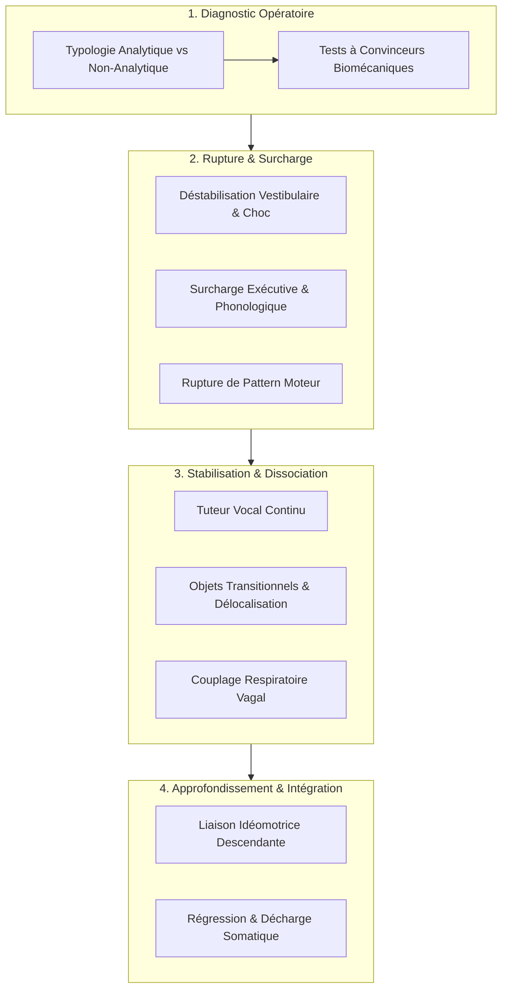

# Hypnotherapy Scripts Manual
**Formateur :** American International Association | **ID :** `american-international-association-hypnotherapy-scripts-manual` | **Tranches :** 38

Voici la **Synthèse Architecturale du Cours** conçue comme tête de pont modélisée, dense et directement exploitable.

---

## Synthèse Architecturale du Cours : *Hypnotherapy Scripts Manual* (American International Association)

### 1. Thèse Centrale & Philosophie du Cours

#### Vision spécifique de l'AIA vs Approche Standard
Là où l'hypnothérapie standard (classique ou ericksonienne pure) oppose souvent suggestibilité autoritaire et métaphores permissives vagues, l'**American International Association (AIA)** adopte une approche résolument **fonctionnelle, biomécanique et pragmatique**. 

La vision de l'AIA repose sur un postulat technique : **l'hypnose n'est pas une énigme mystique, mais un ensemble de réflexes neurophysiologiques et d'états d'absorption prévisibles que l'on déclenche par ingénierie de la contrainte.**
* **Refus du dogme de l'hypnotisabilité innée :** Il n'existe pas de « mauvais sujet », mais un mauvais diagnostic du mode de traitement de l'information (Analytique vs Non-Analytique).
* **Exploitation de l'inévitabilité somatique :** L'AIA intègre délibérément des déterminismes anatomiques et biomécaniques passifs (fatigue des extenseurs des doigts, réactivité vestibulaire lors de l'assise, apnée vagale, réflexes tendineux de Golgi) pour faire vivre au sujet des phénomènes involontaires qu'il attribue immédiatement à la transe naissante (convinceurs structurels).
* **Décharge systématique de la volonté consciente :** Le praticien ne demande pas au sujet de « faire un effort pour se détendre » ; il sature l'exécutif préfrontal ou utilise des objets tiers transitionnels pour forcer la capitulation bienveillante du facteur critique.

#### Fil rouge méthodologique unificateur
L'intégralité du cursus s'articule autour d'une mécanique en 4 temps :
1. **Calibration diagnostique pré-induction :** Qualifier le profil de traitement (analytique / non-analytique) par des tests de suggestibilité rapides à double confirmation.
2. **Bypass du facteur critique par saturation ou surprise :** Rupture de pattern moteur (poignée de main), déstabilisation vestibulaire/kinesthésique (choc gravitationnel à l'assise, traction du bras) ou surcharge cognitive de la mémoire de travail (tâches phonologiques et visuo-spatiales complexes en boucle).
3. **Sécurisation et guidage vocal continu :** Tuteur auditif ininterrompu post-choc pour canaliser la décharge d'hébétude neurophysiologique vers la relaxation profonde sans permettre au filtre analytique de réévaluer la situation.
4. **Dissociation et délégation subconsciente :** Attribution de toutes les fonctions de régulation et de traitement thérapeutique à l'esprit inconscient (*"marvelous subconscious mind"*), neutralisant l'auto-surveillance du sujet.

---

### 2. Carte des Concepts & Leviers Émergents



#### A. Diagnostic & Convinceurs Pré-Inductifs
* **Typologie Opératoire Binaire (Analytique vs Non-Analytique) :** Diagnostic temps réel déterminant si la stratégie doit passer par absorption imaginative directe ou par saturation de l'esprit critique via confusion et surcharge.
* **Convinceurs Biomécaniques Inévitables :** Exploitation de la physiologie articulaire et tendineuse (ex. tendons extenseurs des doigts) pour garantir la survenue physique du phénomène indépendamment de la volonté du sujet.
* **Biofeedback & Amplification Idéomotrice (Loi de Carpenter) :** Utilisation d'amplificateurs visuo-moteurs (pendule de Chevreul, antagonisme cinétique bras lourd/bras léger) pour prouver au sujet la réalité opérationnelle de son inconscient.

#### B. Vecteurs de Rupture du Facteur Critique
* **Choc Kinesthésique & Rupture Vestibulaire :** Désorientation proprioceptive soudaine (yeux fermés) provoquant un réflexe de redressement d'urgence qui éteint instantanément l'inhibition préfrontale et ouvre une fenêtre d'hypersuggestibilité.
* **Rupture de Pattern Moteur Sous-Cortical :** Interruption de séquences automatisées (serrage de main) créant un freeze neuro-cognitif immédiat.
* **Surcharge Exécutive & Phonologique :** Tâches concurrentes non automatisées (épellation miroir de nombres, décomptes dégressifs à double contrainte visuelle/verbale) dépassant l'empan mnésique de la mémoire de travail (loi de Miller) jusqu'à l'abandon analytique.

#### C. Régulation Physiologique & Ancrage
* **Tuteur Vocal Continu Post-Choc :** Flot verbal ininterrompu canalisant le pic adrénergique réactionnel vers la transe avant la réactivation du balayage de vigilance consciente.
* **Contraste Isométrique & Rebond Parasympathique :** Contraction musculaire volontaire maximale suivie d'un relâchement soudain exploitant le réflexe myotatique inverse des organes tendineux de Golgi.
* **Couplage Respiratoire Barorécepteur (Règle des 3 secondes) :** Apnée inspiratoire brève stimulant les barorécepteurs, couplée à une expiration prolongée activant le tonus vagal.

#### D. Véhicules Métaphoriques & Dissociatifs
* **Morphing Somatosensoriel & Objet Transitionnel (Proxy Vehicle) :** Délocalisation de la détente sur un support externe malléable (tissu magique, bille d'argent dans un entonnoir de cristal) pour supprimer l'effort volitionnel.
* **Réification & Drainage Hydraulique :** Matérialisation des tensions internes sous forme de fluides évacués par gravité hors du schéma corporel.
* **Délégation d'Agentivité :** Clivage explicite autorisant le néocortex à se désintéresser du contenu verbal tout en confiant l'exécution à l'inconscient.

---

### 3. Tableau Récapitulatif des Techniques & Démonstrations

| Technique / Exercice | Objectif Opératoire | Déclencheur / Indication | Séquence Résumée |
|---|---|---|---|
| **Arm Rising and Falling** | Valider la dissociation proprioceptive et la réactivité idéomotrice inconsciente. | Test pré-induction ; distinction analytique vs non-analytique. | Bras tendus à l'horizontale, yeux fermés. Suggestion d'hélium à droite, de dictionnaires à gauche. Mesure de l'écart à l'ouverture des yeux. |
| **Chevreul’s Pendulum** | Biofeedback idéomoteur et calibration de l'amplification micromusculaire. | Sujets analytiques doutant du contrôle inconscient ou de l'hypnose. | Coude calé, regard suivant les axes d'un diagramme en croix/cercle. Focalisation pure sur l'intention sans mouvement volontaire de la main. |
| **Magnetic Fingers / Elastic Test** | Créer un convinceur structurel irréfutable par déterminisme biomécanique. | Sujets sceptiques ou rigides ayant besoin d'une preuve somatique immédiate. | Doigts croisés, index pointés vers le haut et écartés. Suggestion d'aimant/élastique. La fatigue tendineuse force inévitablement les doigts à se joindre. |
| **Body Sway on Ground (Icebreaker)** | Désamorcer l'anxiété de performance et tester la soumission au cadre par l'absurde. | Dynamiques de groupe, résistance collective, conformisme social rigide. | Position posturale inhabituelle au sol, ordre de beugler comme un bovin, rupture immédiate par l'humour sans justification thérapeutique. |
| **Sitting Instant Induction** | Provoquer une rupture vestibulaire brutale pour bypasser le facteur critique. | Induction rapide ; sujet debout prêt à s'asseoir, profil adapté au directif. | Le sujet commence à s'asseoir ; le praticien accélère la descente de manière inattendue, commande vocale *"SLEEP"* au décrochage, maintien vocal continu. |
| **Handshake Pattern Interrupt** | Interrompre un programme moteur automatisé et injecter une catalepsie instantanée. | Induction instantanée en face-à-face ; sujets réactifs aux ruptures de pattern. | Début d'un salut conventionnel, saisie inattendue du poignet avec légère traction/rotation, ordre de fermeture des yeux et bascule en transe. |
| **Law of Reverse Effort Challenge** | Verrouiller une catalepsie involontaire en exploitant l'effort conscient contre-productif. | Test d'approfondissement ; consolidation de la transe somnambulique. | Suggestion de rigidité ou de fermeture complète des paupières, puis ordre paradoxal : *"Essayez d'ouvrir les yeux et constatez que plus vous forcez, plus ils se ferment."* |
| **Placebo / Hypnotic Nerve Induction** | Exploiter l'attente conditionnée et l'autorité par illusion anatomique. | Profils crédules ou demandeurs d'une intervention pseudo-médicale technique. | Pré-cadrage sur l'existence d'un "nerf hypnotique réflexe", pression ou claquement sur l'arête nasale, effondrement instantané en état de sommeil hypnotique. |
| **Active Muscular Relaxation (Jacobson Hybride)** | Déclencher un rebond parasympathique mécanique par épuisement sympathique. | Sujets présentant une hypertonie musculaire ou une anxiété somatisée élevée. | Tensions isométriques maximales ciblées de groupes musculaires pendant 5-7 secondes, relâchement brutal, intégration du différentiel sensoriel. |
| **Analytical Body Scan & Linked Tasks** | Saturer la mémoire de travail par concurrence attentionnelle continue. | Sujets hautement analytiques qui surveillent constamment le processus. | Double focalisation simultanée reliée par des conjonctions continues (*"Et pendant que tu penses à X, commence déjà à détendre Y..."*). |
| **Beach / Garden Sensory Flushing** | Réifier et drainer les tensions par lavage sensoriel et clôture spatiale. | Sujets nécessitant une réassurance affective ou une évacuation émotionnelle. | Création d'un sanctuaire hermétique privé (plage, clairière), matérialisation du stress en fluide chaud évacué par gravité via les extrémités. |
| **Breath Induction (Règle des 3s)** | Décharger la vigilance respiratoire consciente et activer le tonus vagal. | Entrée en transe progressive ; transition douce vers la suggestibilité. | Inspiration ample, rétention pulmonaire bloquée 3 secondes (activation barorécepteurs), expiration lente avec suggestion d'effondrement dans le support. |
| **Eye Strain & Fractionated Blinking** | Épuiser les muscles oculomoteurs pour forcer une capitulation palpébrale logique. | Profils visuels résistants au lâcher-prise spontané. | Fixation d'un point haut au-dessus de la ligne d'horizon, décompte rythmé avec ouverture/fermeture cadencée jusqu'à l'impossibilité physique de rouvrir. |
| **Magic Cloth Protocol** | Délocaliser l'effort de détente somatique sur un objet transitionnel externe. | Profils kinesthésiques ou sujets ayant du mal à relâcher volontairement les tensions. | Visualisation d'un tissu magique thermogène qui se déploie, s'enveloppe et diffuse une chaleur parasympathique autonome sur les zones du corps. |
| **Arm Drop Catalepsy Pacing** | Assigner la vitesse de descente en transe à un retour kinesthésique observable. | Approfondissement en phase post-induction ; mesure du tonus musculaire. | Bras levé passivement par le praticien puis relâché ; la vitesse d'affaissement du membre rythme directement le niveau de profondeur hypnotique. |
| **Underwater Oceanic Regression** | Réactiver la mémoire de sécurité périnatale et suspendre les repères proprioceptifs. | Anxiété existentielle profonde, hyper-vigilance de contrôle environnemental. | Immersion imaginaire dans une eau chaude matricielle avec suggestion explicite de respiration fluide et sécurisée sans contrainte vitale. |
| **Dissolving Cloud Countdown** | Saturer le calepin visuo-spatial et la boucle phonologique par inhibition active. | Sujets visuels analytiques ayant besoin d'une structure dégressive ordonnée. | Visualisation de chiffres formés par des nuages (25 à 1) qui doivent être créés mentalement puis obligatoirement vus se dissolvant sous une brise. |
| **Crystal Funnel & Silver Ball** | Approfondir la transe vers le somnambulisme via une géométrie de guidage externe. | Profils très structurés/analytiques nécessitant une trajectoire mesurable. | Visualisation d'un entonnoir de cristal transparent dans lequel roule une bille d'argent qui descend en spirale, rythmant la plongée subconsciente. |
| **Meadow Unloading Regression** | Décharger physiquement les fardeaux psychologiques par régression motrice. | Travail de libération émotionnelle, poids du passé, burn-out ou culpabilité. | Marche dans une prairie, sac à dos chargé de pierres symboliques déposé au sol, retour à un état moteur spontané et allégé (archétype de l'enfant libre). |
| **Phonological Backward Spelling (1 to 30)** | Provoquer une surcharge exécutive absolue par double contrainte cognitive. | Résistances intellectuelles massives, boucle de rumination préfrontale active. | Décompte mental de 1 à 30 avec triple contrainte par chiffre : visualisation du mot, épellation à l'endroit, puis obligatoirement à l'envers (`ONE -> O-N-E -> E-N-O`). |

---

---

## 0. Sommaire Sémantique & Index des Lignes

- **Tranche 1 [Lignes 153-312]** : Test des Bras Élevés et Abaissés (Arm Rising and Falling) — *Protocole :* Test des Bras Élevés et Abaissés (Arm Rising and Falling) | *Mécanisme :* Typologie Opératoire Binaire : Analytique vs Non-Analytique | *Verbatim :* Suggestion de Dissociation Gravitaire Asymétrique (Arm Rising / Falling)
- **Tranche 2 [Lignes 314-566]** : Doigts Magnétiques Attractifs & Répulsifs (Suggestibility / Waking Hypnosis) — *Protocole :* Doigts Magnétiques Attractifs & Répulsifs (Suggestibility / Waking Hypnosis) | *Mécanisme :* Levier de Surcharge Kinesthésique et Rupture d'Équilibre (Kinesthetic Shock & Vestibular Destabilization) | *Verbatim :* Verrouillage Idéo-Moteur et Défi Autoritaire
- **Tranche 3 [Lignes 568-695]** : Sitting Instant Induction & Active Muscular Relaxation Induction (Rene A. Bastarache) — *Protocole :* Sitting Instant Induction | *Mécanisme :* Rupture Vestibulaire & Surcharge de Chute Précipitée (Sitting Instant Induction) | *Verbatim :* Induction Instantanée Assise
- **Tranche 4 [Lignes 697-816]** : "Magic Cloth - Body Scan" (JoAnn Dworman) — *Protocole :* "Magic Cloth - Body Scan" (JoAnn Dworman)
- **Tranche 5 [Lignes 818-930]** : Approfondisseur par Entonnoir de Cristal et Bille d'Argent (Crystal Funnel) — *Protocole :* Approfondisseur par Entonnoir de Cristal et Bille d'Argent (Crystal Funnel) | *Mécanisme :* Fractionnement dissociatif par dissolution optique / évanescence chiffrée | *Verbatim :* Verbatim 1 : La dissolution des nuages chiffrés
- **Tranche 6 [Lignes 932-1059]** : L'Escalier du Puits Ancien avec Validation Verbale Idéomotrice (Martha Affeld) — *Protocole :* L'Escalier du Puits Ancien avec Validation Verbale Idéomotrice (Martha Affeld) | *Mécanisme :* Surcharge de la boucle phonologique et dissociation par tâche concurrente complexe | *Verbatim :* Le Choix Forcé Équifinal
- **Tranche 7 [Lignes 1061-1215]** : Tâche Concurrente de Dissociation Absolue (« Vacation Packing » – Dr. Jane Greer) — *Protocole :* Tâche Concurrente de Dissociation Absolue (« Vacation Packing » – Dr. Jane Greer) | *Verbatim :* Extrait 1 : La Dissociation Opératoire Explicite
- **Tranche 8 [Lignes 1217-1366]** : Daisy - Depth Test (Test de la Marguerite) & Le Test de Profondeur Opératoire (Depth Testing... — *Protocole :* Daisy - Depth Test (Test de la Marguerite) | *Mécanisme :* Le Test de Profondeur Opératoire (Depth Testing as Feedback Loop) | *Verbatim :* PEPITE 1 : Daisy Test (Étalonnage projectif)
- **Tranche 9 [Lignes 1368-1502]** : Le Véhicule Alphabétique de Saturation Conscience/Inconscient (Modèle Universel : Île, Pique... — *Protocole :* Le Véhicule Alphabétique de Saturation Conscience/Inconscient (Modèle Universel : Île, Pique-nique, Supermarché, Fleurs) | *Verbatim :* Verbatim 1 : L'Injonction Paradoxale de Dissociation Consciente
- **Tranche 10 [Lignes 1504-1658]** : A : "The Mall Script" (Induction Spéciale Profil Analytique) — *Protocole :* A : "The Mall Script" (Induction Spéciale Profil Analytique) | *Verbatim :* Le Double-Lien d'Écoute et de Présence ("Mall Script")
- **Tranche 11 [Lignes 1660-1826]** : "Sticks and Tones" (Induction par surcharge motrice et ancrage auditif) — *Protocole :* "Sticks and Tones" (Induction par surcharge motrice et ancrage auditif) | *Mécanisme :* Surcharge cognitive motrice et perceptuelle (Fractionnement attentionnel) | *Verbatim :* La boucle d'amnésie et de permission consciente
- **Tranche 12 [Lignes 1828-1982]** : A : Neutralisation de la Bifurcation et Récupération d'Autonomie (Alcool / Choix toxiques) — *Protocole :* A : Neutralisation de la Bifurcation et Récupération d'Autonomie (Alcool / Choix toxiques) | *Verbatim :* Verbatim 1 : La dissolution des messages d'autrui
- **Tranche 13 [Lignes 1984-2135]** : Désensibilisation et Réduction de la Douleur Chronique (Arthritis / Pain Relief Tunnel) — *Protocole :* Désensibilisation et Réduction de la Douleur Chronique (Arthritis / Pain Relief Tunnel)
- **Tranche 14 [Lignes 2137-2341]** : Recodage des Limites et Affirmation Écologique (Boundaries) — *Protocole :* Recodage des Limites et Affirmation Écologique (Boundaries) | *Mécanisme :* Injonction d'Auto-Détermination et Clôture Frontalière
- **Tranche 15 [Lignes 2343-2497]** : A : Restructuration Sensorielle de la Claustrophobie & Nyctophobie — *Protocole :* A : Restructuration Sensorielle de la Claustrophobie & Nyctophobie | *Mécanisme :* Inversion de Valence Somatosensorielle & Recadrage Phobique (Claustrophobie) | *Verbatim :* Pattern 1 : Resémantisation & Chaînage Physiologique de l'Étreinte
- **Tranche 16 [Lignes 2499-2633]** : Désamorçage de l'Hyper-Contrôle & Libération Relationnelle — *Protocole :* Désamorçage de l'Hyper-Contrôle & Libération Relationnelle | *Verbatim :* Le Détachement de la Responsabilité Cosmique
- **Tranche 17 [Lignes 2635-2808]** : Fractionnement Respiratoire par Cycles de 12 (Deep Relaxation) — *Protocole :* Fractionnement Respiratoire par Cycles de 12 (Deep Relaxation) | *Mécanisme :* Dé-nominalisation & Éradication Ontologique de la Peur | *Verbatim :* Dissolution de l'illusion des peurs décisionnelles
- **Tranche 18 [Lignes 2810-2945]** : Recodage Mnésique de Capacité (Traitement Symbolique de la Dyslexie) — *Protocole :* Recodage Mnésique de Capacité (Traitement Symbolique de la Dyslexie) | *Mécanisme :* Le Recadrage Kinesthésique par Utilisation Sensorielle Concurrente | *Verbatim :* Recadrage Vestibulaire & Dissociation Focalisée
- **Tranche 19 [Lignes 2947-3063]** : Désensibilisation par Objectification Sensorielle (Bastarache Box Technique) — *Protocole :* Désensibilisation par Objectification Sensorielle (Bastarache Box Technique) | *Mécanisme :* Objectification Somatosensorielle et Réification Déconstructive de l'Affect | *Verbatim :* Bastarache Box Submodalities Collapse
- **Tranche 20 [Lignes 3065-3269]** : Réinitialisation Temporelle & Ancrage Respiratoire Présent (R. A. Bastarache) — *Protocole :* Réinitialisation Temporelle & Ancrage Respiratoire Présent (R. A. Bastarache) | *Mécanisme :* Le Principe de Distribution Décisionnelle 90/10 et Découplage Stimulus-Réponse | *Verbatim :* Verbatim 1 : La Répartition Neuro-Émotionnelle et l'Impermanence Temporelle (R. A. Bastarache)
- **Tranche 21 [Lignes 3271-3466]** : Récupération Mnésique d'Objets Égarés & Modèle Informatique de Récupération Mnésique (Disque... — *Protocole :* Récupération Mnésique d'Objets Égarés | *Mécanisme :* Modèle Informatique de Récupération Mnésique (Disque Dur Subconscient) | *Verbatim :* Verbatim 1 : L'Ancrage Métaphorique de l'Arc-en-ciel Thérapeutique
- **Tranche 22 [Lignes 3468-3635]** : A : Restauration Cellulaire & Auto-Guérison par l'Horloger Inconscient (Bastarache) — *Protocole :* A : Restauration Cellulaire & Auto-Guérison par l'Horloger Inconscient (Bastarache) | *Mécanisme :* Le Pattern de Restauration par Plan Matriciel Primitif (The Blueprint Metaphor) | *Verbatim :* Verbatim 1 : L'Accélération Temporelle et le Calembour Somatique
- **Tranche 23 [Lignes 3637-3781]** : A : Protection Gastrique Viscérale (IBS / Côlon Irritable) — *Protocole :* A : Protection Gastrique Viscérale (IBS / Côlon Irritable)
- **Tranche 24 [Lignes 3783-3917]** : Décompte Régressif au Tableau Noir avec Sortie de Fatigue (Blackboard Sleep Induction) — *Protocole :* Décompte Régressif au Tableau Noir avec Sortie de Fatigue (Blackboard Sleep Induction)
- **Tranche 25 [Lignes 3919-4052]** : "Programming Your Computer" – Encodage Spatial de 30 Loci (Rene A. Bastarache) — *Protocole :* "Programming Your Computer" – Encodage Spatial de 30 Loci (Rene A. Bastarache) | *Mécanisme :* Architecturation spatiale de la mémoire sous transe (Méthode des Loci hypnotique) | *Verbatim :* Pattern 1 : Double contrainte permissive et équivalence d'accès (Rene A. Bastarache)
- **Tranche 26 [Lignes 4054-4176]** : Structuration et Test du Palais de la Mémoire Hypnotique (30 Loci) — *Protocole :* Structuration et Test du Palais de la Mémoire Hypnotique (30 Loci) | *Verbatim :* Décompte de sortie avec maintien de transe partielle
- **Tranche 27 [Lignes 4178-4303]** : A : Évacuation de la Douleur par Projection Océanique ("The Drift Bottle") — *Protocole :* A : Évacuation de la Douleur par Projection Océanique ("The Drift Bottle") | *Verbatim :* Le Choc de Dés-essentialisation de l'Obsession
- **Tranche 28 [Lignes 4305-4453]** : Purification Sémantique et Élimination Somato-Spatiale (Positive Thoughts) — *Protocole :* Purification Sémantique et Élimination Somato-Spatiale (Positive Thoughts) | *Verbatim :* Pattern 1 : Ancrage de Densité et Rupture Kinesthésique
- **Tranche 29 [Lignes 4455-4609]** : Dénouement de la Douleur Somatique / Gastrique (David Barr) — *Protocole :* Dénouement de la Douleur Somatique / Gastrique (David Barr)
- **Tranche 30 [Lignes 4611-4757]** : Désamorçage de l'Addiction au Shopping (Rene A. Bastarache) — *Protocole :* Désamorçage de l'Addiction au Shopping (Rene A. Bastarache) | *Mécanisme :* La Technique de l'Écran de Cinéma Mental Dissocié & Équivalence Neuro-Subconsciente | *Verbatim :* Désamorçage de l'exigence de profondeur & Permission hypnotique
- **Tranche 31 [Lignes 4759-4870]** : Sevrage Tabagique Accéléré en 1 Séance (One Session Method) — *Protocole :* Sevrage Tabagique Accéléré en 1 Séance (One Session Method) | *Mécanisme :* Levier du mot-gâchette somato-moteur d'endormissement immédiat | *Verbatim :* Suggestion post-hypnotique d'interruption d'éveil nocturne
- **Tranche 32 [Lignes 4872-5003]** : Programme de Sevrage Tabagique Dégressif Paliers 30 $\rightarrow$ 5 cigarettes/jour — *Protocole :* Programme de Sevrage Tabagique Dégressif Paliers 30 $\rightarrow$ 5 cigarettes/jour | *Verbatim :* Pattern 1 : Impératif d'annihilation et rupture de thésaurisation
- **Tranche 33 [Lignes 5005-5143]** : A : Neutralisation de la Compulsion d'Achat & Prédécision Budgétaire — *Protocole :* A : Neutralisation de la Compulsion d'Achat & Prédécision Budgétaire | *Verbatim :* Verbatim 1 : Le ronflement comme signal d'ancrage de sécurité
- **Tranche 34 [Lignes 5145-5273]** : L'Ancre Digitale Anti-Stress et Anti-Panique (Clive A. Housley) — *Protocole :* L'Ancre Digitale Anti-Stress et Anti-Panique (Clive A. Housley)
- **Tranche 35 [Lignes 5275-5402]** : Recalibrage Analogique du Tinnitus (Acouphènes) — *Protocole :* Recalibrage Analogique du Tinnitus (Acouphènes) | *Mécanisme :* Le Principe d'Élasticité Cybernétique de l'Image de Soi ("Snapback") | *Verbatim :* Verrouillage du Facteur Critique par Contrat Hypermétaphorique
- **Tranche 36 [Lignes 5404-5597]** : Pulvérisation Kinesthésique des Soucis (Concrete Sphere Crushing) — *Protocole :* Pulvérisation Kinesthésique des Soucis (Concrete Sphere Crushing)
- **Tranche 37 [Lignes 5599-5753]** : Construction Opératoire de la "Spirit Room" (Rene A. Bastarache) — *Protocole :* Construction Opératoire de la "Spirit Room" (Rene A. Bastarache) | *Mécanisme :* Architecture du Sanctuaire Intérieur (Spirit Room) | *Verbatim :* Verbatim 1 : Levée de limite financière et imaginaire
- **Tranche 38 [Lignes 5755-5858]** : Clôture de Vie Antérieure, Récolte de Ressources et Réintégration Temporelle — *Protocole :* Clôture de Vie Antérieure, Récolte de Ressources et Réintégration Temporelle | *Verbatim :* Double Dissociation et Protection Perceptive

---

## Extractions Détaillées par Tranche (Opératoire & Verbatim)

## Tranche 1 / 38 : Test des Bras Élevés et Abaissés (Arm Rising and Falling)

### 1. Mécanismes & Principes Actifs

#### 1. Typologie Opératoire Binaire : Analytique vs Non-Analytique
* **Principe actif :** L'évaluation ne cherche pas à mesurer un "degré d'hypnotisabilité" abstrait, mais à diagnostiquer en temps réel le mode de traitement cognitif dominant du client. Un sujet qualifié de *non-analytique* accepte la métaphore sensorielle sans médiation critique, traduisant immédiatement l'injonction imaginative en réponse neuromusculaire et idéomotrice involontaire. À l'inverse, le sujet *analytique* interpose une boucle de contrôle exécutif (cortex préfrontal dorso-latéral), vérifie le réalisme de l'instruction, freine la commande motrice ou tente de l'exécuter consciemment. L'administration d'au moins deux tests permet de neutraliser les biais situationnels et de calibrer si la stratégie d'induction subséquente doit saturer l'esprit critique par des véhicules de confusion et de surcharge cognitive, ou procéder par absorption permissive directe.
* **Terme AIA :** *Analytical or non-analytical classification*
* **Tags libres :** #filtrage_analytique #diagnostic_neuromusculaire #calibration_pre_induction #style_d_induction_cible

#### 2. Amplification Idéomotrice par Dissociation Somatique
* **Principe actif :** Le système nerveux génère des micro-contractions musculaires involontaires synchronisées avec l'activité imaginaire vive (loi de Carpenter / effet idéomoteur). En scindant le corps en deux vecteurs cinétiques opposés (légèreté/ascension à droite via l'hélium, lourdeur/gravité à gauche via des dictionnaires), le praticien crée un différentiel vestibulaire et proprioceptif. Le système d'équilibration postural ne peut compenser simultanément deux stimulations imaginaires antagonistes sans générer un mouvement observable involontaire. L'effet de feedback visuel à l'ouverture des yeux confirme au sujet la puissance de son propre traitement inconscient.
* **Terme AIA :** *Arm rising and falling* / *Power of your subconscious mind*
* **Tags libres :** #effet_ideomoteur #dissociation_proprioceptive #antagonisme_cinetique #boucle_retroaction_visuelle

#### 3. Amplification Visuo-Motrice et Biofeedback Idéomoteur (Pendule de Chevreul)
* **Principe actif :** L'action conjointe de la focalisation visuelle (poursuite oculaire le long des axes du diagramme) et de la commande mentale pure ("demander au pendule") contourne l'inhibition motrice volontaire. Le tremblement physiologique naturel de la main est canalisé et amplifié le long de l'axe spatial scanné par les yeux. L'augmentation d'amplitude progressive valide auprès de la conscience du sujet que son esprit inconscient gouverne des processus physiques réels sans effort volontaire conscient, abaissant instantanément les résistances critiques.
* **Terme AIA :** *Chevreul’s Pendulum*
* **Tags libres :** #biofeedback_ideomoteur #amplification_micromusculaire #poursuite_oculaire #preuve_d_efficacite_mentale

#### 4. Exploitation de la Tension Biomécanique Naturelle Déguisée en Phénomène Hypnotique
* **Principe actif :** Dans le test des doigts magnétiques ou de l'élastique, la posture imposée (mains jointes, index tendus et écartés) place les tendons extenseurs des doigts sous une tension anatomique passive insoutenable au-delà de quelques secondes. Les muscles fléchisseurs reprennent mécaniquement le dessus. En superposant une suggestion sémantique ("élastique épais", "aimant surpuissant") sur un déterminisme biomécanique inévitable, le praticien s'assure que le phénomène physique se produira quoi qu'il arrive. L'esprit du sujet attribue la fermeture inéluctable à la suggestion ou à la transe naissante, instaurant une dynamique d'obéissance involontaire (convinceur structurel).
* **Terme AIA :** *Finger test* / *Magnetic fingers*
* **Tags libres :** #convinceur_biomecanique #recadrage_d_inevitabilite #illusion_de_causalite #fermeture_tendineuse_involontaire

#### 5. Décharge de Conformité Sociale par l'Absurde (Rupture d'Enjeu)
* **Principe actif :** En demandant à un groupe d'exécuter une séquence posturale inhabituelle au sol, puis de beugler comme un bovin avant de révéler qu'il n'y a aucune raison thérapeutique, le praticien procède à un test de soumission à l'injonction tout en désamorçant l'anxiété de performance par le rire. Le ridicule partagé détruit la rigidité de façade (persona sociale) et établit une dynamique relationnelle où le praticien détient le contrôle du cadre sans générer d'hostilité.
* **Terme AIA :** *Body sway on ground (Comedy)* / *Icebreaker*
* **Tags libres :** #rupture_d_enjeu #conformite_sociale #desarmorcage_defensif #desinhibition_posturale

#### 6. Double Lien d'Inhibition Motrice & Défi Autoritaire ("Challenge")
* **Principe actif :** La commande autoritaire ordonne au sujet d'essayer de séparer ses mains ou de plier son bras, après avoir saturé la commande neurologique antagoniste (verrouillage musculaire, blanchiment des articulations, suggestion de métal ou de colle). Le mot "essayez" présuppose l'échec dans la syntaxe hypnotique classique. Le sujet se retrouve piégé dans une boucle paradoxale : s'il n'essaie pas, il obéit ; s'il essaie avec l'armature musculaire déjà contractée et verrouillée, l'effort ne fait qu'augmenter la rigidité, confirmant l'incapacité.
* **Terme AIA :** *Authoritative manner* / *Locking elbow* / *Hand clasp*
* **Tags libres :** #double_lien_moteur #presupposition_d_echec #defi_autoritaire #inhibition_agoniste_antagoniste

---

### 2. Protocoles, Techniques & Démonstrations (Étape par Étape)

#### Protocole 1 : Test des Bras Élevés et Abaissés (Arm Rising and Falling)
* **Intention / Indication :** Évaluer le profil cognitif (analytique vs non-analytique), tester la réactivité aux suggestions kinesthésiques/visuelles antagonistes, créer un convinceur visuel fort.
* **Mise en place & Pré-framing :** Sujet debout, face au praticien, pieds écartés de la largeur des épaules pour assurer la stabilité posturale.
* **Séquence d'actions pas à pas :**
  1. *Posturisation :* Ordonner au sujet de fermer les yeux et de tendre les deux bras droits devant lui, parallèles au sol.
  2. *Configuration motrice asymétrique :* Faire fermer le poing droit avec le pouce pointé vers le haut ; faire ouvrir la main gauche, doigts tendus, paume vers le haut.
  3. *Suggestion d'ascension (bras droit) :* Suggérer 15 ballons d'hélium de 25 pouces attachés au pouce droit, insister sur la propriété physique de l'hélium qui s'élève, suggérer la légèreté et la traction vers le haut ("up, up, up").
  4. *Suggestion de charge gravitationnelle (bras gauche) :* Placer métaphoriquement 5 volumineuses et lourdes encyclopédies sur la paume gauche, suggérer la traction vers le bas ("down, down, down") et l'inconfort musculaire dans le haut du bras.
  5. *Alternance rythmique :* Alterner les suggestions motrices ("bras droit monte... bras gauche descend...").
  6. *Point d'ancrage cinétique :* Annoncer l'ajout soudain d'une encyclopédie supplémentaire au compte de 3. Compter "1... 2... et... 3" en effectuant un claquement de doigts sec au chiffre 3.
  7. *Révélation / Convinceur :* Ordonner l'ouverture immédiate des yeux pour constater le décalage physique entre les deux bras.
* **Signes de calibration :**
  - Mouvement ample et fluide des bras = profil non-analytique marqué.
  - Déplacement minime ou absent = profil analytique (nécessité d'adapter l'approche en séance).
  - Déplacement inverse (le bras gauche monte ou le bras droit descend) = résistance active, peur ou conflit psychologique nécessitant un débriefing préalable.

#### Protocole 2 : Le Pendule de Chevreul (Chevreul’s Pendulum)
* **Intention / Indication :** Démonstration irréfutable de la communication esprit-corps et de l'action de l'inconscient. Idéal pour les enfants, les profils sceptiques ou rationnels.
* **Mise en place & Pré-framing :** Placer le sujet debout confortablement devant une feuille imprimée comportant un cercle et des axes en croix (A-C vertical, B-D horizontal). Le sujet tient la chaînette du pendule entre le pouce et l'index de la main droite, le bras gauche relâché le long du corps. Le plomb du pendule est suspendu à environ 1,2 cm (1/2 inch) au-dessus du centre de la croix.
* **Séquence d'actions pas à pas :**
  1. *Interdiction du mouvement volontaire :* Exiger explicitement de ne pas bouger consciemment la main ou le bras.
  2. *Amorçage horizontal (B -> D) :* Demander mentalement au pendule de se balancer de gauche à droite. Synchroniser le mouvement des yeux du sujet entre B et D jusqu'à ce que le pendule suive l'axe. Suggérer l'amplification du balancement ("wider and wider").
  3. *Transition vectorielle verticale (A -> C) :* Ordonner au sujet de concentrer sa pensée sur un changement d'axe : de haut en bas, de A vers C. Répéter le truisme de progression.
  4. *Génération de trajectoire circulaire horaire (A -> D -> C -> B) :* Demander d'ordonner mentalement un mouvement circulaire dans le sens des aiguilles d'une montre, en nommant les repères cardinaux et en suggérant l'élargissement de l'orbite.
  5. *Attribution causale :* Nommer explicitement le phénomène : "Ceci est la puissance de votre esprit subconscient qui déplace le pendule."
  6. *Inversion anti-horaire (A -> B -> C -> D) :* Demander d'inverser le sens de rotation par la seule volonté inconsciente et observer l'agrandissement du tracé. Clôturer par une valorisation de la force mentale du sujet.
* **Signes de calibration :** Suivre la correspondance exacte entre la saccade oculaire et l'amorce de la micro-oscillation du pendule ; observer l'absence de contraction visible de l'avant-bras ou de l'épaule (pureté du signal idéomoteur).

#### Protocole 3 : Test des Doigts Magnétiques et Fusion Digitale
* **Intention / Indication :** Test de suggestibilité rapide en position assise, bascule directe vers une catalepsie locale et un test de défi (challenge test).
* **Mise en place & Pré-framing :** Sujet assis, dos calé confortablement au fauteuil.
* **Séquence d'actions pas à pas :**
  1. *Posture :* Faire joindre les mains comme pour une prière, puis faire lever et pointer les deux index vers le haut, séparés d'un intervalle de 2,5 à 4 cm (1 to 1.5 inches).
  2. *Focalisation attentionnelle :* Faire fixer exclusivement l'espace vide entre les deux doigts.
  3. *Injonction projective :* Suggérer la mise en place d'un élastique en caoutchouc rouge, large et épais, enroulé autour des extrémités des index.
  4. *Libération de tension :* Suggérer qu'en relâchant l'élastique, celui-ci tire les doigts l'un vers l'autre avec une force continue et croissante ("tighter and tighter... closer and closer").
  5. *Condition de sortie motrice :* Poser comme règle que dès que les doigts se touchent, le sujet peut reposer ses mains.
  6. *Variante d'extension catalytique (Rene A. Bastarache) :* Si les doigts se touchent, enchaîner immédiatement sur la suggestion de fusion : "Imaginez que vos doigts sont soudés comme s'ils ne formaient qu'un seul doigt avec un seul os." Compter de 1 à 3 en augmentant l'autorité. À 3, lancer le défi : "Vous ne pouvez pas les séparer, essayez ! Vous ne pouvez pas !" Laisser lutter 2 à 3 secondes, puis libérer : "Arrêtez d'essayer et relaxez-vous."
* **Signes de calibration :**
  - Rapprochement saccadé ou fluide rapide = profil non-analytique.
  - Immobilité rigide = profil analytique.
  - Écartement des doigts = mécanisme défensif de rejet, peur inconsciente ou opposition délibérée.

#### Protocole 4 : Serrage de Mains Autoritaire (Hand Clasp - Authoritative)
* **Intention / Indication :** Verrouillage catalytique par fixation et induction de défi. Idéal en groupe, spectacle ou sujet réclamant une autorité directive externe.
* **Mise en place & Pré-framing :** Sujet debout face au praticien, posture d'ancrage au sol solide.
* **Séquence d'actions pas à pas :**
  1. *Posture de verrouillage articulaire :* Bras tendus devant soi à hauteur des épaules, coudes rigoureusement verrouillés en hyperextension, mains jointes et doigts fermement entrecroisés, paumes collées l'une contre l'autre.
  2. *Pré-conditionnement :* "Si vous suivez mes instructions et utilisez votre imagination, au compte de trois, vous serez incapable de séparer vos mains."
  3. *Compte 1 :* Suggérer une colle puissante scellant les paumes de manière indissociable.
  4. *Compte 2 :* Diriger le regard du sujet sur les jointures de ses pouces ; calibrer et verbaliser le blanchiment de la peau sous la pression mécanique ("turning whiter and whiter, tighter and tighter").
  5. *Compte 3 & Défi autoritaire :* Poser l'impossibilité d'une voix forte et péremptoire : "Vous ne pouvez pas les séparer ! Essayez... vous ne pouvez pas !"
  6. *Rupture de tension :* Laisser le sujet tenter de tirer pendant 2 à 3 secondes maximum, puis briser l'injonction : "Arrêtez d'essayer et détendez-vous."
* **Signes de calibration :** Blanchiment cutané visible sur les jointures articulaires (preuve de tension musculaire maximale) ; fixité du regard ; tentative infructueuse de séparation confirmant la catalepsie.

#### Protocole 5 : Le Bras d'Acier (Locking Elbow)
* **Intention / Indication :** Créer une catalepsie unilatérale du membre supérieur par métaphore de rigidité métallique ; tester la soumission à une commande de blocage squelettique.
* **Mise en place & Pré-framing :** Sujet debout face au praticien.
* **Séquence d'actions pas à pas :**
  1. *Posture :* Faire tendre le bras droit droit devant, doigts allongés dans le prolongement de l'axe, coude bloqué.
  2. *Cadre d'engagement :* Énoncer que si le sujet suit les consignes et utilise son imagination, au compte de trois, il lui sera impossible de plier le coude.
  3. *Compte 1 :* Métaphore de réification : transformer mentalement le bras en une barre d'acier massif continue de l'épaule jusqu'au bout des doigts ; insister sur le verrouillage de l'articulation.
  4. *Compte 2 :* Dissociation corporelle : suggérer que ce bras ne fait même plus partie de son anatomie biologique, qu'il s'agit d'une pièce d'acier inerte et indestructible.
  5. *Compte 3 & Commande de défi :* Hausser le volume vocal sur un ton impératif : "Allez-y, essayez, vous ne pouvez pas le plier ! Vous ne pouvez pas le plier !"
  6. *Résolution :* Attendre 2 secondes d'effort stérile puis ordonner : "Et arrêtez d'essayer."
* **Signes de calibration :** Contraction simultanée du biceps et du triceps (co-contraction empêchant le mouvement articulaire) ; expression faciale d'effort sans modification de l'angle du coude.

---

### 3. Heuristiques, Subtilités & "Sagesse du Praticien"

#### Règles Conditionnelles & Arbres de Décision
* **Règle d'ajustement du protocole selon le test :**
  - *SI* le client réagit facilement et rapidement aux suggestions motrices (bras qui dérivent amplement, doigts qui se rejoignent en quelques secondes), *ALORS* adopter une approche permissive, directe, basée sur l'imagerie et les inductions rapides/non-analytiques.
  - *SI* le client réagit très lentement, analyse les consignes ou ne produit aucun mouvement idéomoteur, *ALORS* le classer dans la typologie "analytique" et router la séance vers des véhicules d'induction analytique (décomptes, scans corporels séquentiels, saturation logique, véhicules de tri type *Bolts in a box* ou *Grease board*).
  - *SI* les membres bougent dans la direction diamétralement opposée à la suggestion (ex: les bras s'écartent, les index s'éloignent), *ALORS* interrompre immédiatement le test, ne PAS forcer l'induction, et ouvrir un espace d'élucidation verbale car le sujet manifeste une résistance active, une appréhension phobique de la perte de contrôle ou un enjeu relationnel non purgé.

#### Règle de Robustesse Diagnostique
* **Principe des deux tests :** Ne jamais poser un diagnostic de suggestibilité sur un test unique. Administrer obligatoirement au moins deux épreuves distinctes pour éliminer les artéfacts posturaux ou contextuels.
* **Absence d'échec :** Un test de suggestibilité ne se "réussit" ni ne s'"échoue" jamais du point de vue du praticien. Tout résultat est une donnée pure de calibration sur la structure mentale du sujet (*"no matter how they respond the test tells you much about their makeup"*).

#### Subtilités d'Exécution & Pièges Classiques
* **Piège de l'incongruence vocale dans les tests de blocage :** Les tests comme le *Hand Clasp* ou le *Locking Elbow* échouent systématiquement si le praticien adopte un ton doucereux, permissif ou hésitant. Ils exigent un basculement acoustique net : volume sonore augmenté, intonation descendante, posture physique d'autorité indiscutable au moment où le chiffre 3 est prononcé.
* **Gestion du temps dans le défi ("Challenge") :** Ne jamais laisser un sujet lutter plus de 2 à 3 secondes contre une suggestion de blocage moteur. Au-delà de ce délai, le cortex moteur recrute de nouvelles unités motrices et brise la catalepsie, détruisant instantanément l'autorité du praticien et la croyance du sujet en son état d'hypnose.
* **Sécurité physique du sujet :** Lors du test de balancement corporel (*Postural sway*) ou des tests d'yeux fermés debout, anticiper systématiquement la perte d'équilibre en vérifiant la stabilité des appuis au sol.

---

### 4. Pépites Verbatim & Patterns Linguistiques (MOT À MOT EN V.O.)

#### Pépite 1 : Suggestion de Dissociation Gravitaire Asymétrique (Arm Rising / Falling)
> "Now go ahead and close your eyes and extend both your arms out in front of you and with your right hand make a fist with your thumb pointing upwards, and with your left hand, extend your fingers outward with your palm facing upwards. Now use your imagination and imagine that in your right hand you are holding the strings connected to a group of 15... Big …25 inch colorful helium balloons as you know helium is a gas that rises and you can feel them pulling your right and arm upwards so light and weightless as you feel them pulling your right arm up, up, up… and on top of your left hand I am placing five… very large… heavy encyclopedias. You can feel the weight of the encyclopedias pulling your left hand down… down … down … you might even feel some discomfort in your upper arm weight of the encyclopedias as they pull your arm down… right arm up … up … up … left arm down … down … down … in just one moment on going to drop another heavy encyclopedia on top of the pile you already have on your left-hand on the count of three, 1 . . . 2 . . . and . . . 3 [snap fingers] … now open your eyes and look at your arms."

* **[Analyse du Pattern] :**
  - *Truisme d'évidence et validation logique :* La proposition *"as you know helium is a gas that rises"* insère un fait scientifiquement indiscutable pour forcer le système critique à valider la proposition subséquente d'élévation du bras (*"you can feel them pulling"*).
  - *Répétition cadencée en triple ancrage vocal :* L'usage de tics syntaxiques rythmiques (*"up, up, up"* vs *"down, down, down"*) agit comme un métronome auditif qui impose une directionnalité motrice involontaire.
  - *Pacing somatosensoriel par anticipation d'inconfort :* La formule *"you might even feel some discomfort in your upper arm"* valide à l'avance la fatigue musculaire réelle liée au maintien des bras en l'air et la recadre comme la preuve physique directe du poids des livres.
  - *Rupture kinesthésique par ancrage auditif :* Le claquement de doigts synchronisé sur le compte de 3 ("3 [snap fingers]") provoque un sursaut vestibulaire qui fait chuter le bras gauche d'un coup sec, validant définitivement la suggestibilité.

#### Pépite 2 : Guidage Idéomoteur Focalisé et Normalisation (Chevreul’s Pendulum)
> "Without consciously moving the pendulum ask the pendulum to move from left to right from B to D, and as your eyes are going back and forth from B to D notice how the pendulum begins moving back and forth along the line also. And as you concentrate on the pendulum moving back and forth from C to D you can even make it swing wider and wider. Now, with the power of your mind ask the pendulum to change direction and go up and down from A to C that’s right from A to C up-and-down... This is the power of your subconscious mind, moving the pendulum."

* **[Analyse du Pattern] :**
  - *Double contrainte permissive :* L'injonction *"Without consciously moving the pendulum ask the pendulum to move"* dissocie la volonté consciente de l'action motrice, créant un espace où le mouvement doit être produit par une entité tierce ("l'esprit inconscient").
  - *Liaison temporelle et conjonction de coordination :* La structure *"and as your eyes are going back and forth... notice how the pendulum begins moving"* transforme une simple poursuite oculaire en cause directe de l'oscillation mécanique.
  - *Attribution causale hypnotique d'autorité :* La phrase conclusive *"This is the power of your subconscious mind, moving the pendulum"* effectue un recadrage total de l'expérience : un simple tremblement physiologique amplifié devient la preuve éclatante de l'action du subconscient, installant une croyance pivot pour le reste de la thérapie.

#### Pépite 3 : Double Lien de Catalepsie par Tentative d'Opposition (Hand Clasp - Authoritative)
> "If you follow my instructions and use your imagination, on the count of three you will not be able to separate your hands. 1 . . . imagined that your hands are glued tightly together so very tight that you will not be able to separate them . . . 2 . . . hands clasped tighter and tighter and you notice as you focus on the thumb knuckles that they are turning whiter and whiter, tighter and tighter, you will not be able to separate them … and …3 … you cannot separate them, try…you cannot … now stop trying and relax."

* **[Analyse du Pattern] :**
  - *Présupposition conditionnelle d'engagement :* La formule d'ouverture lie le succès à l'adhésion du sujet (*"If you follow my instructions and use your imagination"*), ce qui fait que tout échec à bloquer les mains serait perçu comme un manque d'imagination ou de coopération de sa part.
  - *Focalisation externe sur un signe physiologique d'effort :* L'instruction d'observer les jointures qui blanchissent (*"turning whiter and whiter"*) capture l'attention visuelle et utilise la vasoconstriction mécanique causée par la propre force du sujet comme une confirmation visuelle de l'effet de la suggestion.
  - *Injonction paradoxale du verbe "essayer" (Double Lien) :* L'injonction autoritaire *"try... you cannot"* contient en elle-même l'échec moteur programmé : en linguistique hypnotique, le mot "essayer" active la représentation neurologique de l'obstacle et neutralise la commande motrice fluide de libération.

#### Pépite 4 : Dépersonnalisation Somatique et Rigidité Métaphorique (Locking Elbow)
> "1 . . . concentrate on you arm as a solid steel rod from your shoulder all the way to your fingertips… locking your elbow …it will not bend . . 2 . . . from your shoulder to your fingertips… one solid piece of steel… it’s as if it’s not even part of your body anymore… a solid steel rod … you cannot bend it . . . And 3 go ahead and try you cannot bend it, you cannot bend it … and stop trying."

* **[Analyse du Pattern] :**
  - *Métaphore de réification structurale :* La description continue *"solid steel rod from your shoulder all the way to your fingertips"* remplace la carte mentale d'un membre articulé par celle d'un bloc géométrique rigide et insécable.
  - *Suggestion d'anesthésie/amnésie corporelle :* L'affirmation *"it’s as if it’s not even part of your body anymore"* induit une dissociation proprioceptive locale, facilitant la catalepsie en déconnectant le membre du schéma corporel volontaire habituel.
  - *Répétition impérative saturante :* L'empilement sans pause *"go ahead and try you cannot bend it, you cannot bend it"* inhibe le temps de réaction cortical et empêche le sujet d'élaborer une stratégie motrice de relâchement avant l'ordre libérateur *"stop trying"*.

## Tranche 2 / 38 : Doigts Magnétiques Attractifs & Répulsifs (Suggestibility / Waking Hypnosis)

Voici l'extraction et la modélisation intégrale de la **tranche 2/38** du cours *"Hypnotherapy Scripts Manual"* dispensé par l'American International Association (Rene A. Bastarache & JoAnn Dworman).

---

### 1. Mécanismes & Principes Actifs

#### 1. Levier de Surcharge Kinesthésique et Rupture d'Équilibre (Kinesthetic Shock & Vestibular Destabilization)
* **Principe actif :** Lorsqu'un sujet a les yeux fermés, le système nerveux central s'en remet entièrement à l'appareil vestibulaire et aux récepteurs proprioceptifs pour maintenir le schéma corporel et l'axe postural. Une impulsion kinesthésique soudaine (traction du bras, bascule de la tête, accélération de la descente vers la chaise) crée une désorientation sensorielle brutale. Le cortex conscient est court-circuité par un réflexe de redressement d'urgence. Durant ce laps de temps critique (une fraction de seconde) où l'esprit conscient cherche à rétablir son équilibre, le facteur critique est désactivé. Toute suggestion monosyllabique péremptoire injectée à cet instant précis contourne la résistance analytique et s'imprime directement dans le subconscient comme échappatoire ou instruction de réorganisation.
* **Tags émergents :** `#shock_induction` `#vestibular_destabilization` `#critical_factor_bypass` `#kinesthetic_jarring` `#monosyllabic_imprint`

#### 2. Ancrage Vocal Continu et Sécurisation Post-Choc (Continuous Vocal Anchor)
* **Principe actif :** Un choc vestibulaire ou une rupture de pattern libère une montée adrénergique réflexe. Si le silence s'installe, le système de vigilance conscient s'active pour scanner l'environnement et le sujet émerge instantanément de la transe (« *they will come out of trance just as quickly as they went in* »). Le maintien sans interruption d'une voix calme, régulière et directive agit comme un tuteur sensoriel (ancrage de sécurité) qui canalise l'état d'hébétude neurophysiologique vers la relaxation profonde sans laisser le temps au filtre critique de réévaluer la situation.
* **Tags émergents :** `#continuous_vocal_anchoring` `#post_shock_containment` `#safety_pacing` `#trance_stabilization`

#### 3. Surcharge Cognitive et Épuisement Analytique (Cognitive Overload & Compliance by Exhaustion)
* **Principe actif :** L'esprit conscient dispose d'une capacité de traitement séquentiel restreinte (canal attentionnel limité). L'empilement rapide de commandes contradictoires ou ultra-rapides (inversion de sens, accélération, ralentissement moteur) crée une saturation cognitive, suivie d'agacement et de confusion. Le cerveau cherche activement à interrompre ce coût métabolique élevé. Le mot-commande péremptoire (« *SLEEP* »), combiné à une légère déstabilisation physique, est alors accepté par le système comme la voie de soulagement immédiate pour cesser la tâche.
* **Tags émergents :** `#analytical_overload` `#motor_confusion` `#cognitive_exhaustion` `#relief_mechanism`

#### 4. Rupture de Pattern Social et Réflexe de Salutation (Handshake Pattern Interrupt)
* **Principe actif :** Le serrage de main est une boucle comportementale automatisée au niveau sous-cortical (programme moteur pré-câblé). En interrompant le geste attendu par une traction latérale ou vers le bas synchronisée avec l'ordre de fermeture des yeux et la commande verbale, le programme moteur s'interrompt en plein vol sans conclusion logique, ouvrant une fenêtre d'hypersuggestibilité immédiate.
* **Tags émergents :** `#pattern_interrupt` `#handshake_induction` `#subcortical_freeze`

#### 5. Loi de l'Effort Inverse (Law of Reverse Effort)
* **Principe actif :** Plus la volonté consciente s'efforce d'obtenir un résultat physique contre une image mentale installée (magnets, fusion osseuse, lourdeur), plus l'inconscient renforce la réponse involontaire opposée. En incitant le sujet à « forcer » ou à « essayer » (« *Go ahead and try* »), le praticien transforme la tentative d'effort en preuve somatique de l'incapacité à défaire la suggestion, verrouillant l'illusion de paralysie hypnotique.
* **Tags émergents :** `#law_of_reverse_effort` `#involuntary_catalepsy` `#challenge_test` `#fractionation_of_will`

#### 6. Effet Placebo et Suggestion par Attente Déclarative (Placebo Expectancy Induction)
* **Principe actif :** L'illusion anatomique (ex: « le nerf hypnotique ») exploite l'autorité du praticien et le cadre de référence du sujet. En décrivant exactement la réponse attendue avant d'administrer un stimulus neutre (claquement de doigts sur l'arête nasale), le cerveau génère la cascade comportementale par simple conformité et attente conditionnée. Le sujet ferme la boucle cybernétique en rationalisant que le geste a déclenché l'état.
* **Tags émergents :** `#placebo_induction` `#expectancy_structuring` `#pseudo_anatomical_leverage` `#compliance_loop`

---

### 2. Protocoles, Techniques & Démonstrations (Étape par Étape)

---

#### PROTOCOLE 1 : Doigts Magnétiques Attractifs & Répulsifs (Suggestibility / Waking Hypnosis)
* **Intention / Indication :** Évaluer et amplifier la réceptivité idéo-motrice ; créer une catalepsie partielle (verrouillage) comme pont vers l'induction formelle.
* **Mise en place & Pré-framing :** Sujet assis ou debout, bras levés devant lui, index pointés face à face à environ 25 cm (10 inches) de distance. Cadrage : focaliser l'attention sur l'espace vide entre les doigts et faire appel à l'imagination.
* **Séquence d'actions pas à pas :**
  1. *Focalisation visuelle et spatiale :* Fixer l'intervalle entre les index.
  2. *Suggestion idéo-motrice continue :* Répéter en boucle que des aimants puissants attirent (ou repoussent) les doigts jusqu'à ce que le contact physique (ou l'écartement) ait lieu.
  3. *Verrouillage / Catalepsie (version attractive) :* Dès contact, suggérer la fusion moléculaire (« *fused together as one solid finger with one bone* »).
  4. *Défi / Déclenchement de l'effort inverse :* Décompte ferme 1, 2, 3, suivi de l'injonction autoritaire d'essayer de les séparer (« *You cannot separate them! Go ahead and try!* »).
  5. *Libération :* Commande abrupte : « *And now stop trying.* »
* **Signes de calibration :** Tremblements musculaires involontaires (mouvements saccadés idéo-moteurs), rapprochement progressif non linéaire des doigts, crispation lors de la tentative de séparation.

---

#### PROTOCOLE 2 : Le Balancement Postural (Postural Sway Suggestibility Test)
* **Intention / Indication :** Test de suggestibilité majeur pour sujets non-analytiques / somnambuliques. Outil de démonstration spectaculaire pour installer la confiance du client dans le pouvoir de l'hypnose éveillée.
* **Mise en place & Pré-framing :** Sujet debout, face au mur, bras le long du corps, talons et pointes de pieds joints. Yeux fermés.
* **Séquence d'actions pas à pas :**
  1. *Métaphore de rigidité :* Suggérer que le corps est un morceau de bois rigide de la tête aux pieds.
  2. *Calibrage physique du concept :* Basculer doucement le sujet d'avant en arrière pour lui faire intégrer kinesthésiquement la rigidité attendue.
  3. *Sécurisation physique invisible :* Placer son pied directement derrière les talons du client pour empêcher tout glissement vers l'arrière.
  4. *Implantation de la métaphore de force :* Suggérer une barre d'acier intégrée dans ses épaules et des mains du praticien transformées en électro-aimants industriels surpuissants.
  5. *Traction magnétique et chute :* Reculer lentement les mains en décrivant l'attraction magnétique qui tire le corps en arrière, tout en rassurant verbalement (« *you will feel your body fall backwards but I will catch you, you are very safe* »).
  6. *Rattrapage :* Capter fermement le sujet au moment de la bascule.
* **Signes de calibration :** Perte de l'équilibre réflexe, absence de pas de rattrapage en arrière (corps restant droit comme une planche), expression faciale de surprise/choc lors de la bascule.

---

#### PROTOCOLE 3 : L'Œuf d'Or (The Golden Egg Suggestibility Test)
* **Intention / Indication :** Test de suggestibilité sensorielle combinée (kinesthésique thermique + poids + ouverture idéo-motrice involontaire).
* **Mise en place & Pré-framing :** Sujet yeux fermés, bras droit tendu devant lui, poing fermé, phalanges orientées vers le sol.
* **Séquence d'actions pas à pas :**
  1. *Installation de l'objet :* Imaginer tenir un œuf en or de la taille d'un petit bonbon.
  2. *Échelonnement thermique et pondéral :* Suggérer que l'œuf grandit, dégage sa propre énergie et devient de plus en plus chaud et lourd.
  3. *Progression de volume :* L'œuf atteint la taille d'un œuf de poule et pousse contre la paume et le bout des doigts.
  4. *Dissociation de l'effort :* Suggérer la chaleur brûlante (« *feels quite hot* ») et l'impossibilité de maintenir la prise.
  5. *Ouverture motrice involontaire :* Les doigts se délient automatiquement, la main lâche l'œuf.
  6. *Frappe et ancrage émotionnel :* L'œuf éclate au sol et éclabousse le sujet d'une « énergie joyeuse ».
* **Signes de calibration :** Tremblement des doigts, relâchement progressif de la tension du poing, ouverture lente involontaire des doigts, abaissement du bras sous l'effet du poids suggéré.

---

#### PROTOCOLE 4 : Traction du Bras (Arm Pulling Instant Induction)
* **Intention / Indication :** Induction instantanée ultra-rapide en consultation ou lors d'un protocole d'approfondissement.
* **Mise en place & Pré-framing :** Sujet debout ou assis. Demander une poignée de main normale.
* **Séquence d'actions pas à pas :**
  1. *Poignée de main :* Serrer la main du sujet et lui demander de continuer à la tenir.
  2. *Fermeture des yeux :* Demander au sujet de fermer les yeux et de se détendre.
  3. *Verrouillage articulaire :* Dire « *lock your elbow* » tout en plaçant son autre main sous le coude du sujet pour sécuriser l'articulation.
  4. *Choc et commande simultanés :* Tirer la main du sujet vers soi d'un coup sec mais doux, tout en envoyant au même millième de seconde l'ordre autoritaire : « *SLEEP!* ».
  5. *Chaînage vocal immédiat :* Parler de manière continue et apaisante dès le choc produit.
* **Signes de calibration :** Affaissement immédiat de la tête en avant, relâchement total de la tension dans l'épaule et le bras, respiration qui bascule en rythme abdominal profond.

---

#### PROTOCOLE 5 : Méthode du Bras Circulaire (Circular Arm Rapid Induction)
* **Intention / Indication :** Spécifiquement conçu pour les sujets hautement analytiques ou résistants.
* **Mise en place & Pré-framing :** Sujet debout. Pré-cadrer : « Répondez à mes instructions le plus vite possible sans réfléchir ni analyser. À aucun moment vous ne tomberez, vous resterez parfaitement debout. »
* **Séquence d'actions pas à pas :**
  1. *Initialisation motrice :* Mains levées devant le buste, faire mouliner les avant-bras l'un autour de l'autre rapidement en cercle.
  2. *Bombardement d'injonctions contradictoires :* Débiter rapidement sans temps mort : « *Faster… reverse direction… slower… reverse direction… faster… slower…* ».
  3. *Saturation du canal conscient :* Continuer jusqu'à ce que le sujet commence à se tromper, montre des signes visibles d'irritation ou de désorientation motrice.
  4. *Rupture et bascule :* Glisser doucement une main derrière sa nuque, pousser la tête en avant de quelques centimètres en projetant la commande autoritaire : « *SLEEP* ».
  5. *Chute des bras et soulagement :* Les bras tombent le long du corps, le sujet se relâche instantanément.
* **Signes de calibration :** Désynchronisation des mains, hésitation motrice, micro-froncement de sourcils trahissant la frustration/l'agacement, expression soudaine de soulagement facial dès l'injonction de sommeil.

---

#### PROTOCOLE 6 : Induction du « Guérisseur » (Faith Healer Induction - Assis ou Debout)
* **Intention / Indication :** Induction instantanée percutante ; variante de guérison en remplaçant « *SLEEP* » par « *HEAL* ».
* **Mise en place & Pré-framing :**
  * *Version assise :* Chaise à dossier droit ne soutenant pas la tête. Praticien debout sur le côté.
  * *Version debout :* Présence d'un ou deux assistants placés impérativement derrière ou de part et d'autre pour rattraper le corps. Si aucun assistant : pré-cadrer que le corps reste fermement debout sur ses jambes.
* **Séquence d'actions pas à pas :**
  1. *Positionnement de sécurité :* Une main est placée à quelques centimètres derrière la tête (ou le haut du dos) pour servir de réceptacle. L'autre main repose sur le front du sujet.
  2. *Poussée et choc kinesthésique :* Pousser le front vers l'arrière pour que la tête bascule de la main avant vers la main arrière qui la rattrape.
  3. *Injonction simultanée :* Crier/projeter fermement le mot-commande « *SLEEP!* » (ou « *HEAL!* ») au moment précis où le crâne amorce sa trajectoire arrière.
  4. *Répétition cinétique (si assistants) :* Si le corps bascule plus loin vers les assistants, répéter « *sleep, sleep, sleep* » pendant toute la durée du mouvement de chute.
* **Signes de calibration :** Atonie des muscles cervicaux (la tête devient lourde dans la main de retenue), arrêt de la fixation oculaire sous les paupières.

---

#### PROTOCOLE 7 : Déclenchement par Relâchement d'Appui (Hand Release Method)
* **Intention / Indication :** Induction rapide utilisant la fatigue isométrique et le vide proprioceptif soudain.
* **Mise en place & Pré-framing :** Assis ou debout. Bras gauche tendu droit devant, coude verrouillé.
* **Séquence d'actions pas à pas :**
  1. *Mise en tension isométrique :* Placer sa paume vers le haut sous le poignet du sujet. Lui ordonner de pousser vers le bas de toutes ses forces, comme s'il voulait enfoncer la main du praticien dans le sol.
  2. *Liaison effort-fatigue :* Répéter en boucle : « *The harder you push down on my hand, the more tired you will become.* »
  3. *Saturation :* Continuer jusqu'à ce que la pression motrice soit maximale : « *You are so, so very tired that all you want to do is just sleep.* »
  4. *Suppression de l'appui :* Abaisser subitement la main de soutien de quelques centimètres. Le bras du sujet tombe dans le vide.
  5. *Ancrage verbal :* Envoyer « *SLEEP!* » au moment précis de la chute du bras.
* **Signes de calibration :** Force d'appui maximale sur la main, déglutition réflexe, chute immédiate et flasque du bras dès retrait de la résistance.

---

#### PROTOCOLE 8 : Induction du « Nerf Hypnotique » (Hypnotic Nerve Placebo Induction)
* **Intention / Indication :** Induction instantanée purement psychologique, basée sur l'attente et l'autorité médicale perçue.
* **Mise en place & Pré-framing :** Sujet assis confortablement. Nécessite un rapport préexistant très solide. Pré-cadrage anatomique fictif : expliquer qu'il existe un « nerf hypnotique » situé sur l'arête du nez.
* **Séquence d'actions pas à pas :**
  1. *Conditionnement de l'attente :* Formuler précisément ce qui va se passer : « Au compte de 3, je vais faire un petit claquement sur l'arête de votre nez où se trouve le nerf hypnotique, et vous tomberez immédiatement dans l'état d'hypnose le plus profond… bras ballants, tête en avant. »
  2. *Positionnement digital :* Placer les doigts juste au-dessus de l'arête du nez, prêts à claquer.
  3. *Décompte d'attente :* Énoncer « *One, two, three…* ».
  4. *Stimulus et commande :* Claquer des doigts tout en effleurant l'arête du nez, et projeter la commande « *SLEEP!* ».
* **Signes de calibration :** Tête qui plonge en avant immédiatement lors de l'impact, atonie musculaire complète des épaules et des bras qui retombent sur les côtés.

---

#### PROTOCOLE 9 : Choc d'Assise et Choc d'Oreiller (Sitting & Bed Laying Inductions)
* **Intention / Indication :**
  * *Sitting :* Induction lors du passage de la position debout à assise en cabinet.
  * *Laying in Bed :* Patients hospitalisés, personnes souffrant de douleurs nocturnes ou insomnies sévères.
* **Séquence d'actions pas à pas :**
  1. *Conditionnement initial :* Annoncer : « Dès que vous vous asseyez / dès que votre tête touche l'oreiller, vous basculez dans un sommeil hypnotique profond. »
  2. *Guidage kinesthésique à double appui :* Une main sur le front, une main derrière la nuque/le haut du dos.
  3. *Accélération cinétique :* Pendant que le sujet est déjà en mouvement descendant (yeux fermés), pousser la tête vers le bas légèrement plus vite que sa propre vitesse cinétique naturelle.
  4. *Commande synchrone :* Claquer l'ordre « *SLEEP!* » à la fraction de seconde précédant l'impact du fessier sur le fauteuil ou de la tête sur l'oreiller.
* **Signes de calibration :** Relâchement du tronc contre le dossier ou l'oreiller, expiration profonde involontaire.

---

#### PROTOCOLE 10 : Choc d'Épaules pour Guérison (Shoulders Instant & Healing Induction)
* **Intention / Indication :** Induction instantanée dédiée aux protocoles thérapeutiques ou de guérison énergétique.
* **Mise en place & Pré-framing :** Sujet assis sur une chaise permettant au praticien de se tenir debout derrière lui.
* **Séquence d'actions pas à pas :**
  1. *Contact sécurisant initial :* Poser fermement les deux mains sur les épaules du sujet sans le surprendre, pour établir un sentiment d'ancrage et de sécurité physique.
  2. *Récitation du script :* Dérouler le script thérapeutique habituel d'une voix calme.
  3. *Secousse et commande :* Au moment idoine, appliquer une impulsion sèche vers l'avant sur les deux épaules (« *gentle pushing or jarring movement forward* ») en prononçant simultanément et fermement le mot : « *HEAL!* ».
* **Signes de calibration :** Sursaut suivi d'une descente immédiate de la tonicité musculaire du trapèze et du dos.

---

### 3. Heuristiques, Subtilités & "Sagesse du Praticien"

#### Heuristiques Opératoires Conditionnelles (If / Then)
* **Si** le sujet a un profil non-analytique / très suggestible, **alors** privilégier le test de chute arrière (*Postural Sway*), car la bascule vestibulaire provoque un choc saisissant qui scelle la conviction de l'hypnose éveillée.
* **Si** le sujet est fortement analytique, cérébral ou contrôlant, **alors** utiliser l'induction des bras circulaires (*Circular Arm Method*), car la saturation par commandes divergentes rapides épuise son cortex jusqu'à ce qu'il recherche inconsciemment l'arrêt du processus.
* **Si** vous effectuez une induction instantanée par choc, **alors** vous devez impérativement continuer à parler sans interruption d'une voix calme et rassurante dès le mot « *SLEEP* » prononcé ; **sinon**, le sujet sursaute, active son système de sécurité adrénergique et sort de transe aussi vite qu'il y est entré.
* **Si** le client est debout lors d'une induction rapide, **alors** vous devez lui pré-suggérer formellement qu'il restera parfaitement debout sur ses jambes sans tomber, pour éviter tout effondrement au sol par atonie musculaire soudaine.
* **Si** vous pratiquez en spectacle ou en groupe avec le test du verrouillage des mains (*Handclasp Test*), **alors** prévenez la dernière personne de la rangée que sa tête tombera dans la direction opposée (sur la tête de son voisin de gauche), pour éviter qu'elle ne cherche un appui dans le vide.
* **Si** vous réalisez une induction de recul de tête debout sans assistants, **alors** réduisez l'amplitude de poussée à quelques centimètres seulement : les yeux fermés, un micro-mouvement est perçu par le système nerveux central comme une chute massive.
* **Si** l'objectif de la séance est thérapeutique ou lié à la santé physique, **alors** substituer systématiquement le mot « *SLEEP* » par le mot « *HEAL* » pour mobiliser les ressources régénératrices subconscientes.

#### Erreurs Classiques & Pièges Détectés
* **L'erreur du silence post-induction :** Réussir le choc physique, ordonner le sommeil, puis se taire. Le sujet se retrouve dans un vide sensoriel, son esprit critique reprend le dessus par alerte biologique et il ouvre les yeux.
* **Le décalage de synchronisation mot-geste :** Tirer le bras ou pousser la tête *avant* ou *après* avoir dit « *SLEEP* ». L'effet neurologique n'opère QUE si la commande verbale percute le cerveau à la milliseconde exacte où le corps est déstabilisé.
* **L'illusion du « Nerf Hypnotique » :** Tenter l'induction du nerf hypnotique sans avoir préalablement installé un rapport massif et une attente (expectancy) chirurgicale. Ce n'est pas le nez qui induit l'hypnose, c'est l'obéissance à l'autorité acceptée.
* **La force brute inutile :** Confondre secousse (*jarring*) et violence physique. Une poussée de quelques centimètres suffit largement lorsque la vision est coupée.

---

### 4. Pépites Verbatim & Patterns Linguistiques (MOT À MOT EN V.O.)

#### 1. Verrouillage Idéo-Moteur et Défi Autoritaire
```text
"Now imagine that your fingers are connected so tightly that in a moment when I count to three you will not be able to separate them.
1 - Imagine that your fingers are fused together as if they are one solid finger with one bone connecting them, they will not separate.
2 - They have so tightly fused together that you will not be able to separate them.
3 - You cannot separate them! Go ahead and try, you can not! You cannot! And now stop trying..."
```
* **[Analyse du Pattern] :** 
  * *Présupposition temporelle et structurelle :* « *in a moment when I count to three you will not be able to separate them* » lie inévitablement la fin du décompte à l'impuissance motrice.
  * *Métaphore somatique d'ossification :* « *fused together as if they are one solid finger with one bone* » donne au système nerveux une image concrète de structure rigide indéformable.
  * *Double lien de la Loi de l'Effort Inverse :* « *Go ahead and try, you can not!* » utilise le mot « essayer » qui présuppose l'échec intrinsèque de la volonté consciente contre l'image subconsciente.
  * *Rupture et apaisement :* « *And now stop trying...* » libère la tension et fige l'acceptation de la catalepsie.

---

#### 2. Induction Posturale par Métaphore Industrielle
```text
"I’d like you close your eyes and imagine that your entire body is stiff from head to toe like a tall piece of wood. Now I am going to place my foot directly behind your heels to make sure that your feet do not slip backwards. I want you to use your imagination… I’d like you to imagine that there is a steel bar embedded in your shoulders, a solid steel bar … just imagine it … I also like you imagine that my hands are the most powerful magnets in the world… just like the big magnets that pick up car in the junkyards. In just a moment I’m going to pull my hands backwards and you’ll feel a strong magnetic pull pulling your whole body backwards… you will feel your body fall backwards but I will catch you so don’t worry … you are very safe. Now concentrate on the steel rod and the magnets in my hands . . . as you feel the magnet pull your body back further and further… concentrate… use your imagination and feel that magnetic pull … pulling you all the way back until your body falls, and I catch you nice and safe."
```
* **[Analyse du Pattern] :**
  * *Ancrage de sécurité proprioceptif :* Le geste physique d'apposer son pied contre les talons du sujet retire l'angoisse de glissade tout en confirmant le cadre spatial.
  * *Amplification d'échelle analogique :* La comparaison avec les aimants de casse automobile (« *magnets that pick up car in the junkyards* ») force le subconscient à convoquer une force d'attraction titanesque, irrésistible face à la volonté musculaire.
  * *Entrelacement sécurité-chute (Pacing & Leading) :* « *you will feel your body fall backwards but I will catch you so don't worry… you are very safe* » désamorce le réflexe panique de redressement, autorisant le corps à lâcher prise dans la bascule.

---

#### 3. Surcharge Temporelle et Motrice Dirigée
```text
"Rotate your arms faster … now reverse direction … slower … reverse direction … faster … reverse direction … faster … slower … reverse direction … faster …. reverse direction … slower"
```
* **[Analyse du Pattern] :**
  * *Saturation de l'espace de travail conscient :* L'accélération du débit et l'alternance imprévisible d'ordres opposés provoquent un décrochage des boucles de rétroaction neuromusculaires. L'esprit conscient entre en boucle d'erreur de traitement (*processing error*).
  * *Préparation au soulagement :* L'état d'énervement ou de confusion provoqué fait percevoir la commande subséquente « *SLEEP* » non pas comme une contrainte, mais comme une autorisation biologique immédiate d'interrompre l'effort.

---

#### 4. Rupture de la Poignée de Main et Verrouillage d'Angle
```text
"I’d like you to shake my hand and continue holding it as you close your eyes… and relax … now lock your elbow and … SLEEP!"
```
* **[Analyse du Pattern] :**
  * *Rupture du protocole social :* Garder la main fermée dans la poignée (« *continue holding it* ») maintient le canal ouvert alors que l'interaction normale exigeait de lâcher prise.
  * *Verrouillage somatique préparatoire :* « *lock your elbow* » rigidifie la chaîne cinétique du bras, de sorte que la traction ultérieure ne s'amortit pas dans l'articulation du coude mais se transmet intégralement à l'épaule et au centre de gravité de l'axe postural.
  * *Synchronisation d'impact :* La traction et le mot « *SLEEP!* » frappent le cortex en simultanéité temporelle absolue.

---

#### 5. Liaison Isométrique de Fatigue
```text
"The harder you push down on my hand, the more tired you will become. You are so, so very tired that all of you want to do is just “sleep”."
```
* **[Analyse du Pattern] :**
  * *Liaison de cause à effet inversée (Double Lien Kinesthésique) :* « *The harder you push… the more tired you will become* » convertit chaque once d'énergie musculaire dépensée par le sujet en carburant direct pour l'état d'épuisement hypnotique. Plus il résiste ou pousse fort, plus il valide sa propre somnolence.
  * *Raccourcissement sémantique téléologique :* Réduction progressive du champ perceptif jusqu'à un unique désir d'extinction attentionnelle (« *all of you want to do is just sleep* »).

---

#### 6. Programmation Déclarative du Placebo Anatomique
```text
"In just a moment I am going to count to three and then do a little snapping movement here on the bridge of your nose which is where the hypnotic nerve is and as soon as I do this motion you will immediately drop down go into the deepest state of hypnosis that you have ever gone … and your hands will drop down to your side and your head will droop forward, very relaxed. So let’s begin … One, two, three and “sleep“!"
```
* **[Analyse du Pattern] :**
  * *Création d'une causalité fictive acceptée :* L'assignation d'un nom technique (« *the hypnotic nerve* ») et d'un emplacement physique précis (l'arête du nez) fournit à l'esprit logique une explication pseudo-scientifique recevable.
  * *Pré-programmation séquentielle mot-à-mot :* Le formateur dicte à l'avance la biomécanique exacte de la réponse (chute des mains, inclinaison de la tête en avant). Au moment du claquement de doigts, le sujet n'a plus qu'à exécuter le scénario convenu, s'auto-convainquant que le « nerf » a fonctionné.

## Tranche 3 / 38 : Sitting Instant Induction & Active Muscular Relaxation Induction (Rene A. Bastarache)

Voici l’extraction intégrale et opératoire de la tranche 3/38 du manuel *Hypnotherapy Scripts Manual* (American International Association).

---

### 1. Mécanismes & Principes Actifs

#### 1. Rupture Vestibulaire & Surcharge de Chute Précipitée (*Sitting Instant Induction*)
- **Principe actif** : En accélérant artificiellement la descente du sujet pendant qu'il s'assoit, le praticien déclenche un réflexe vestibulaire de déséquilibre inattendu (*shock / off-balance effect*). Le cerveau critique est momentanément saturé par le besoin immédiat de réajuster sa proprioception et sa survie gravitationnelle. L'ordre verbal impératif (*"Sleep"*) est injecté exactement à cette micro-seconde de désorientation cognitive : n'ayant aucun filtre critique disponible pour analyser la consigne, le système nerveux exécute immédiatement l'instruction sous forme d'effondrement musculaire et d'état hypnotique.
- **Tags libres** : `#rupture_vestibulaire #choc_gravitationnel #saturation_critique #ordre_cinetique #instant_induction`

#### 2. Contraste Isométrique & Épuisement Sympathique (*Active Muscular Relaxation*)
- **Principe actif** : La tension musculaire volontaire maximale (isométrie brève) active le système nerveux sympathique puis provoque, lors du relâchement soudain, un rebond parasympathique mécanique irrépressible (réflexe myotatique inverse des organes tendineux de Golgi). La comparaison somatosensorielle directe entre l'état de contraction extrême et l'état relâché force le système nerveux à reconnaître et amplifier le relâchement physiologique profond.
- **Tags libres** : `#isometrie_reciproque #rebond_parasympathique #organe_tendineux_golgi #contraste_proprioceptif`

#### 3. Concurrence Attentionnelle en Cascade / Traitement Parallèle (*Analytical Body Scan*)
- **Principe actif** : L'induction lie intentionnellement deux tâches cognitives simultanées via la conjonction de coordination continue (*"and while you are thinking about X... begin to think about relaxing Y"*). Le cortex analytique tente de surveiller la première zone tout en étant forcé de porter son attention sur la seconde. Cette saturation de la mémoire de travail dépasse l'empan mnésique (loi de Miller), provoquant l'abdication du facteur critique analytique et une descente passive vers la transe.
- **Tags libres** : `#concurrence_attentionnelle #saturation_memoire_travail #surcharge_analytique #liaison_continue`

#### 4. Isolement Sensoriel Projectif & Matérialisation Somatique du Stress (*Beach & Garden Inductions*)
- **Principe actif** : Création d'un espace psychique clôturé et imperméable (*"private beach... no one can disturb you"*, forêt, clairière). Les états internes sont réifiés sous forme de substances physiques (liquide chaud, eau courante de la crique, brume tiède) qui s'écoulent et drainent les tensions littéralement vers l'extérieur du schéma corporel par les extrémités (pieds/orteils). La négativité devient un objet physique soumis à la gravité et au lavage hydraulique.
- **Tags libres** : `#reification_du_stress #drainage_somatique #cloture_securitaire #lavage_sensoriel_hydraulique`

#### 5. Dissociation Fonctionnelle & Décharge Volontaire du Souffle (*Breath Induction*)
- **Principe actif** : Le praticien déplace le contrôle de la respiration de l'effort conscient vers l'automate inconscient. En assignant la survie et le maintien végétatif au *"marvelous subconscious mind"* (gardien depuis la naissance), le conscient est déchargé de toute obligation de vigilance. Dès lors que l'inconscient gère déjà le souffle, lui confier la réceptivité aux suggestions devient une extension logique non menaçante.
- **Tags libres** : `#dissociation_conscient_inconscient #externalisation_du_controle #transfert_somato_vegetatif`

#### 6. Fatigue Oculomotrice & Fractionnement Répété (*Eye Strain Method*)
- **Principe actif** : La convergence et l'élévation des yeux au-dessus du regard horizontal fatiguent rapidement les muscles moteurs oculaires (notamment les muscles droits supérieurs). Couplé à un fractionnement oculaire rythmique dégressif (ouvrir/fermer sur un décompte), le clignement forcé épuise la musculature palpébrale et offre au sujet une porte de sortie logique et soulageante : capituler en gardant les yeux fermés.
- **Tags libres** : `#fatigue_oculomotrice #fractionnement_visuel #epuisement_palpebral #capitulation_programmee`

#### 7. Objet Transitoire Kinesthésique & Somatotopie Mobile (*Magic Cloth*)
- **Principe actif** : Utilisation d'un inducteur kinesthésique externe matérialisé (linge magique tiède et doux) qui se déplace de zone en zone. Cela découple le sujet de l'obligation de "faire un effort intérieur" : il n'a qu'à observer passivement l'application d'un stimulus imaginaire externe qui produit l'effet physiologique désiré par induction thermique et tactile simulée.
- **Tags libres** : `#objet_transitoire #inducteur_kinesthique_externe #somatotopie_mobile #derealisation_de_l_effort`

---

### 2. Protocoles, Techniques & Démonstrations (Étape par Étape)

#### Protocole 1 : *Sitting Instant Induction*
* **Intention / Indication** : Sujets réceptifs ou situations nécessitant une rupture immédiate du facteur critique au moment exact où le sujet va s'asseoir.
* **Mise en place & Pré-framing** :
  1. Utiliser impérativement une chaise solide et stable (*sturdy chair*).
  2. Prévenir le sujet avant le geste : *"In just a moment you will sit down and as soon as you sit you will immediately drop into a deep relaxed state."*
* **Séquence d'actions pas à pas** :
  1. Demander au client de fermer les yeux pendant qu'il est encore debout devant la chaise.
  2. Placer les mains fermement sur ses épaules au préalable sans le surprendre pour ancrer la sécurité et le contact tactile.
  3. Lorsque le sujet entame le mouvement de descente pour s'asseoir : positionner une main sur son front et l'autre derrière la tête (ou le haut du dos selon le dossier).
  4. Au milieu du mouvement descendant (juste avant qu'il ne touche l'assise), appuyer vers le bas par la tête un peu plus vite que sa vitesse naturelle de descente.
  5. Émettre simultanément l'ordre direct : **« SLEEP »**.
  6. Accompagner la réception du corps sur la chaise alors que le sujet s'effondre en transe somnambulique/hypnotique.
* **Signes de calibration** : Atonie musculaire soudaine, tête qui s'incline, perte des réflexes posturaux habituels, respiration qui s'affaisse brutalement à l'assise.

---

#### Protocole 2 : *Active Muscular Relaxation Induction* (Rene A. Bastarache)
* **Intention / Indication** : Sujets somatiques, athlétiques, agités ou ayant besoin d'une tâche kinesthésique claire pour libérer le contrôle mental.
* **Mise en place & Pré-framing** :
  - Yeux fermés.
  - Pré-respiration standard : 3 respirations profondes, la 3ᵉ retenue 3 secondes, expiration libératoire.
  - Cadrage : l'opérateur nomme une zone, le sujet la contracte au maximum, puis relâche totalement.
* **Séquence d'actions pas à pas** :
  1. **Zone Céphalique supérieure** : front, yeux, joues, nez -> Crisper au maximum -> Relâcher.
  2. **Zone Mandibulaire** : bouche, menton, mâchoire -> Crisper -> Relâcher.
  3. **Cou & Nuque** : muscles antérieurs et postérieurs -> Serrer fort -> Relâcher.
  4. **Ceinture scapulaire & Bras** : épaules, biceps/triceps -> Monter/crisper -> Laisser tomber lourdement (*droop down heavy*).
  5. **Membres supérieurs distaux** : coudes, avant-bras, poignets, poings serrés au maximum -> Relâcher complètement dans l'immobilité.
  6. **Tronc supérieur & Abdomen** : poitrine -> serrer / relâcher ; abdomen -> serrer fort, tenir quelques secondes -> relâcher en visualisant le stress quitter le corps.
  7. **Bassin & Cuisses** : hanches, fessiers, cuisses -> crisper -> relâcher.
  8. **Membres inférieurs distaux** : mollets, chevilles, pieds, orteils recroquevillés -> tension maximale -> relâchement total.
  9. **Intégration globale** : balayage descendant de la tête aux pieds dans une détente totale.
* **Signes de calibration** : Respiration thoracique devenant abdominale, affaissement visible des épaules, décrispation des mâchoires, immobilité tonique des mains.

---

#### Protocole 3 : *Eye Strain Method Induction* (Rene A. Bastarache)
* **Intention / Indication** : Sujets visuels, analytiques ou sceptiques ayant besoin d'une preuve physiologique de leur entrée en transe (fatigue des paupières).
* **Mise en place & Pré-framing** :
  1. Fixer un point précis sur le mur, légèrement au-dessus du niveau des yeux du sujet (*slightly above eye-level*).
  2. Consigne de posture : tête droite sans basculer en arrière, seuls les yeux regardent vers le haut sans forcer excessivement (*lazy, relaxed way*).
  3. Démonstration motrice : l'opérateur montre avec sa main le rythme d'ouverture et de fermeture.
  4. Pré-suggestion du résultat : avertir qu'entre 17, 15 ou 10, les yeux deviendront trop lourds et resteront spontanément fermés.
* **Séquence d'actions pas à pas** :
  1. Lancer le décompte de 20 à 1.
  2. À chaque chiffre énoncé, le sujet ferme les yeux pendant un décompte silencieux de 3 secondes (3... 2... 1...) puis les rouvre en fixant le point.
  3. L'opérateur intercale des suggestions de pesanteur et d'inconfort à rouvrir : *"tired and drowsy"*, *"eyelids so very heavy"*, *"allow your eyes to remain closed as soon as you feel like it"*.
  4. **Condition d'interruption** : dès que les yeux du sujet refusent de s'ouvrir ou restent fermés, cesser immédiatement le décompte et verrouiller : *"That's good... now keep your eyes closed... and continue to relax deeper and deeper"*.
* **Signes de calibration** : Rougeur conjonctivale, clignements retardés ou asynchrones, tremblement des paupières (*fluttering*), hésitation motrice à la réouverture, fermeture définitive avec expiration de soulagement.

---

### 3. Heuristiques, Subtilités & "Sagesse du Praticien"

#### Règles conditionnelles d'action (SI / ALORS / PARCE QUE)
1. **SI** vous pratiquez une induction instantanée par surprise corporelle (*jarring movement*), **ALORS** vous devez préalablement poser vos mains fermement sur les épaules du sujet de façon stable et rassurante, **PARCE QUE** le système nerveux a besoin d'une base de sécurité tactile préalable afin de ne pas déclencher un réflexe de fuite ou d'agression violente lors du choc de descente.
2. **SI** lors de la méthode de fatigue oculaire le sujet garde les yeux fermés avant la fin du décompte (ex: à 15 ou 12), **ALORS** arrêtez immédiatement d'énoncer les chiffres et ratifiez la transe, **PARCE QUE** continuer le protocole forcerait le sujet à rouvrir les yeux, annulant l'inhibition motrice et réactivant le contrôle conscient.
3. **SI** le sujet a un profil hautement analytique qui intellectualise sa relaxation, **ALORS** enchaînez les ordres de détente par des doubles liens temporels continus (*"while you are thinking about X, begin to think about Y"*), **PARCE QUE** la simultanéité des tâches empêche le filtre critique d'exercer son contrôle séquentiel habituel.
4. **SI** vous induisez une transe par la métaphore d'un lieu ressource (plage, jardin, brume), **ALORS** synchronisez le rythme de vos suggestions sur le ressac des vagues ou sur le rythme respiratoire observé, **PARCE QUE** le signal environnemental répétitif devient un métronome externe qui ancre la descente sans effort volontaire.

#### Pièges classiques & Erreurs de débutant
- **Le piège de la chaise instable** : Réaliser une *Sitting Induction* sur une chaise à roulettes ou trop légère. Risque direct de chute au sol ou de crispation panique du sujet.
- **Le piège du décompte mécanique rigide** : Continuer à compter jusqu'à 1 dans la fatigue oculaire alors que le client a déjà capitulé à 16.
- **La précipitation sans pré-contact** : Précipiter la tête du sujet vers le bas sans avoir établi le contact physique apaisant sur les épaules en amont, ce qui induit une réaction d'effroi traumatisant au lieu d'une transe.

---

### 4. Pépites Verbatim & Patterns Linguistiques (MOT À MOT EN V.O.)

#### Induction Instantanée Assise
> "You tell the client that in just a moment they will sit down and as soon as they sit they will immediately drop into a deep relaxed state... just before they sit while still in the downward motion of sitting, just pushed them down a little quicker than they would normally have by the head, and say 'sleep'."
- **[Analyse du Pattern]** : **Présupposition temporelle & Ancrage cinétique.** La structure *"as soon as they sit they will immediately drop"* conditionne neurologiquement l'impact physique de l'assise au déclenchement de l'état modifié. L'impératif monosyllabique *"sleep"* injecté au nadir du déséquilibre vestibulaire court-circuite le cortex et fonctionne comme une bascule d'état.

#### Surcharge Analytique (Rene A. Bastarache)
> "Relax all those muscles in your head and while you are thinking about relaxing all the muscles in your head, begin to think about relaxing all the muscles in your neck and shoulders... and while you are thinking about relaxing all of those muscles in your neck and shoulders, your arms are becoming more and more relaxed."
- **[Analyse du Pattern]** : **Empilement de tâches concurrentes (Double lien d'attention).** Utilisation répétée du connecteur *"while you are thinking about [X]... begin to think about [Y]"*. L'esprit conscient est surchargé par le chevauchement attentionnel, tandis que le résultat somatique (*"your arms are becoming more and more relaxed"*) s'installe en arrière-plan sans validation critique.

#### Drainage Kinesthésique (Ginger Flowers)
> "You can feel the warmth of the sun entering your body like warm liquid coursing through you. You find it impossible to resist it. You can feel the warm, relaxing liquid flowing through your veins ... your muscles are letting go of all tension and stress ... The waves lap against the shore and the warm liquid pushes all tension and negative feelings down ... down and out through your feet and toes."
- **[Analyse du Pattern]** : **Suggestion directe d'impossibilité & Métaphore d'évacuation gravitaire.** L'affirmation péremptoire *"You find it impossible to resist it"* court-circuite la résistance par présupposition d'inexorabilité. La métaphore du liquide tiède couplée au ressac transforme les tensions psychologiques en déchets physiques chassés hors du corps par la gravité.

#### Boucle de Rétroaction Récursive (Holly Kline)
> "Knowing this, you can relax even more deeply with each and every breath that you take … from this point onward you can allow yourself to simply rest on your breath ... rest and relax ... rest and relax ... deeper and deeper... knowing that the more you relax, the deeper you go, and the deeper you go, the more you can relax..."
- **[Analyse du Pattern]** : **Boucle récursive d'Erickson (Double lien d'amplification réciproque).** Le syntagme *"the more you relax, the deeper you go, and the deeper you go, the more you can relax"* enferme le sujet dans un cercle vicieux positif : chaque unité de détente approfondit la transe, qui à son tour produit plus de détente. L'absence d'issue logique force l'approfondissement continu.

#### Ratification Passive & Voyage Dissociatif (Katherine Lee)
> "The outside world ... fades more into the background ... As you begin your journey into your own inner world ... just let go ... more and more relax ... and you may soon find that your mind begins to wander ... and it doesn’t matter where you drift ... where you go ... My voice will travel with you at all times ... So you will continue ... To respond to me on an unconscious level."
- **[Analyse du Pattern]** : **Permissivité dissociative & Commande de contrôle inconscient.** Normalisation de la perte d'attention (*"it doesn't matter where you drift"*), suivie d'une clause de sécurité et de guidage (*"My voice will travel with you"*). La phrase finale *"So you will continue ... To respond to me on an unconscious level"* est une commande directe enchâssée liant l'égarement mental du sujet au maintien du rapport thérapeutique.

## Tranche 4 / 38 : "Magic Cloth - Body Scan" (JoAnn Dworman)

### 1. Mécanismes & Principes Actifs

- **Morphing Somatosensoriel & Projection Tactile Délocalisée**  
  *Principe actif :* En demandant au sujet d'imaginer un tissu magique capable de changer de forme, d'envelopper et de se diviser (*Magic Cloth*), l'esprit conscient externalise l'effort de détente sur un objet transitionnel tiers. Au lieu de lutter pour "détendre un muscle" (effort volitionnel qui entretient l'état d'alerte), le système nerveux reçoit une suggestion tactile passive : la chaleur et le contact physique simulés déclenchent par neurones miroirs et rétroaction idéosensorielle une vasodilatation périphérique et un relâchement parasympathique réel.  
  *Tags libres émergents :* `#morphing_somatosensoriel` `#objet_transitionnel_hypnotique` `#retroaction_ideosensorielle` `#magic_cloth`

- **Couplage Respiratoire-Proprioceptif en Apnée Contrôlée (Règle des 3 secondes)**  
  *Principe actif :* L'induction demande systématiquement une inspiration profonde, suivie d'une rétention de 3 secondes, puis d'une expiration lente avec consigne de "fondre dans la table/le support". Physiologiquement, l'inspiration avec apnée brève augmente la pression intrathoracique et stimule les barorécepteurs carotidiens ; l'expiration prolongée active le tonus vagal (nerf vague), diminuant la fréquence cardiaque et la tension musculaire squelettique. Le thérapeute greffe la suggestion mentale de lâcher-prise exactement sur cette bascule autonome naturelle.  
  *Tags libres émergents :* `#apnee_vagale_3sec` `#stimulus_barorecepteur` `#ancrage_respiratoire_organique`

- **Délégation Subconsciente & Décharge Volitionnelle de l'Écoute**  
  *Principe actif :* En déclarant : *"You will not hear everything I say but you do not need to listen to me. Your subconscious mind will do the work for you"*, le praticien libère le néocortex d'une tâche de vigilance continue. Cette dissociation fonctionnelle entre l'écoute consciente (autorisée à s'endormir, décrocher ou vagabonder) et l'écoute inconsciente élimine le biais d'auto-surveillance ("est-ce que je suis hypnotisé ?") et réduit l'inhibition préfrontale.  
  *Tags libres émergents :* `#dissociation_auditive` `#decharge_volitionnelle` `#permission_de_decrochage`

- **Levitation/Catalepsie Kinesthésique Fractionnée (Arm Drop & Catalepsie Réflexe)**  
  *Principe actif :* Le praticien soulève manuellement le bras du sujet et réduit son soutien jusqu'à ce que le bras tienne de lui-même. Ce passage d'un mouvement passif à un maintien automatique crée une catalepsie waxy/tonique involontaire. Le praticien lie ensuite la pesanteur progressive à la vitesse de descente de la transe (rythme idéomoteur) : la chute physique du bras devient le métronome visible de l'immersion subconsciente.  
  *Tags libres émergents :* `#catalepsie_induite` `#liaison_ideomotrice` `#arm_drop` `#equivalence_somato_hypnotique`

- **Archétype de la Régression Océanique & Re-sécurisation Périnatale**  
  *Principe actif :* L'immersion progressive dans une eau chaude magique où l'on respire sans contrainte (*Underwater Induction*) réactive les mémoires somatosensorielles de l'enveloppe amniotique intra-utérine. L'abolition de la peur par suggestion directe de survie sous l'eau neutralise le réflexe d'alerte respiratoire et induit une suspension proprioceptive quasi totale (perte des frontières corporelles).  
  *Tags libres émergents :* `#immersion_amniotique` `#suspension_proprioceptive` `#desensibilisation_du_reflexe_vital`

- **Compte à Rebours Éphémère & Dissolution Cognitive Visuelle**  
  *Principe actif :* Plutôt que de simplement compter, le sujet observe des nuages qui forment des chiffres (25, 24, 23...) et qui se dissolvent sous une brise. Ce double processus sollicite la mémoire de travail visuelle pour former le symbole, puis exige une inhibition active pour le regarder disparaître. Cette alternance épuise la boucle phonologique et le calepin visuo-spatial de la mémoire de travail, induisant une confusion bienveillante et un effacement progressif de la vigilance.  
  *Tags libres émergents :* `#dissolution_chiffree` `#surcharge_inhibition_visuelle` `#compte_retrograde_metaphorique`

---

### 2. Protocoles, Techniques & Démonstrations (Étape par Étape)

#### Protocole 1 : "Magic Cloth - Body Scan" (JoAnn Dworman)
* **Intention / Indication :** Relâchement somatique rapide, somatisation du stress, clients ayant une dominante kinesthésique/tactile ou du mal à détendre leurs muscles par commande interne.
* **Mise en place & Pré-framing :** Cadrer la serviette comme un objet malléable doué de propriétés thermodynamiques instantanées ("soft and warm", s'adapte à toute surface).
* **Séquence d'actions pas à pas :**
  1. *Cadrage de l'objet :* Visualiser un tissu magique, tiède et doux, s'ajustant à chaque morphologie.
  2. *Pôle Céphalique :* Envelopper le crâne, le front, puis glisser sur les yeux fermés (paupières/sourcils), les joues, les lèvres, le menton et la mâchoire.
  3. *Zone Cervico-Dorsale :* Descendre sur la nuque, le haut du dos (dissolution des nœuds), glisser jusqu'au bas du dos, remonter sur les épaules et la poitrine.
  4. *Bifurcation 1 (Membres supérieurs) :* Diviser le tissu en deux morceaux identiques ; enrober chaque bras jusqu'aux mains ("gloves your hands") jusqu'au bout des doigts.
  5. *Pôle Viscéral :* Rassembler sur l'estomac, détendre les muscles abdominaux, puis couvrir les hanches.
  6. *Bifurcation 2 (Membres inférieurs) :* Re-diviser le tissu en deux manches thermiques le long des cuisses, des genoux, des mollets, jusqu'à envelopper les pieds et les orteils.
  7. *Transition de Transe :* Ancrer le sentiment de flotter plus profondément.
* **Signes de calibration :** Lissage des traits du visage, relâchement de la mandibule (mâchoire entrouverte), déglutition réflexe, affaissement bilatéral des trapèzes.

#### Protocole 2 : "Arm Drop Deepener" (R. Ryan Van Otten)
* **Intention / Indication :** Approfondissement instantané de transe par feedback kinesthésique direct et vérification du niveau d'acceptation inconsciente.
* **Mise en place & Pré-framing :** Avertissement verbal de contact physique imminent pour éviter le sursaut de défense.
* **Séquence d'actions pas à pas :**
  1. *Prise de contact :* Le praticien saisit le bras gauche du sujet et le hisse à l'horizontale (comme un somnambule).
  2. *Test de catalepsie :* Alléger progressivement le support manuel sous le poignet/l'avant-bras jusqu'à ce que le bras tienne suspendu de lui-même dans les airs.
  3. *Liaison de rythme :* Poser le double lien liant la vitesse de descente du bras au niveau de profondeur de la relaxation.
  4. *Multiplicateur d'impact :* Dès que la main ou le bras heurte la cuisse, déclencher la suggestion de doublement de la transe (*"twice as relaxed"*).
* **Signes de calibration :** Absence de rigidité spasmodique volontaire ; micro-oscillations plastiques du bras lors du retrait du support ; chute lourde et flasque sur la cuisse sans correction de trajectoire.

#### Protocole 3 : "Underwater Induction & The Golden Chest" (Clive A. Housley)
* **Intention / Indication :** Induction profonde pour sujets non-analytiques ou en quête de transformation générative (déblocage de potentiel, créativité, ressources profondes).
* **Mise en place & Pré-framing :** Position assise stable, pieds à plat, décharge des membres. Suggestion initiale de respiration nez/bouche.
* **Séquence d'actions pas à pas :**
  1. *Rapprochement du seuil :* Visualiser un bassin d'eau d'un bleu éclatant ; susciter le désir kinesthésique d'y plonger un pied, puis l'autre.
  2. *Immersion somatosensorielle séquentielle :* Faire monter l'eau tiède chevilles -> mollets -> genoux -> hanches -> abdomen -> poitrine -> épaules -> cou.
  3. *Rupture du danger & Respiration paradoxale :* Faire monter l'eau au menton, au nez, puis immersion totale du crâne avec suggestion qu'on respire naturellement sous cette eau magique.
  4. *Visualisation du fond & Décompte (20 à 1) :* Fixer un anneau d'or brillant reposant au fond ; décompter de 20 à 1 à mesure que le corps descend vers le fond.
  5. *Ouverture du coffre à ressources :* À 1, tirer sur l'anneau ; le coffre s'ouvre, libérant une lumière dorée enveloppante (ancrage de potentiel, santé, prospérité).
* **Signes de calibration :** Ralentissement drastique du rythme respiratoire, disparition des micro-mouvements oculaires rapides (calme sous les paupières), hypotonie musculaire généralisée.

---

### 3. Heuristiques, Subtilités & "Sagesse du Praticien"

- **Sélection Typologique des Approfondisseurs (Deepeners) :**  
  *Règle explicite :* Les approfondisseurs ont pour but d'aider le client à lâcher prise et s'ouvrir aux suggestions. Bien qu'utilisables sur tous, ils rencontrent un taux d'efficacité supérieur sur les sujets **non-analytiques**.  
  *Heuristique :* Si le sujet est fortement analytique, privilégier les protocoles riches en détails sensoriels focalisés (*Walking in the field - Analytical Body Scan*) plutôt que les décomptes abstraits sur des nuages ou des bulles.
- **La Liaison Temporelle "Only as quickly as..." :**  
  *Règle implicite :* Ne jamais forcer la chute physique d'un membre. Laisser le sujet maître du timing tout en subordonnant ce timing à l'approfondissement hypnotique.  
  *Structure :* *"Allow that arm to come down only as quickly as you relax much more deeply"*. Si le bras descend vite, la transe s'approfondit vite ; si le bras descend lentement, la transe prend tout son temps pour s'installer profondément. Dans les deux cas, le praticien gagne.
- **Désamorçage Préventif des Parasites Environnants :**  
  *Règle :* Intégrer les bruits extérieurs par fractionnement perceptif avant qu'ils ne brisent la transe. *"Although you may hear other sounds around you, you are focusing only on the soft music and my voice."* Le bruit ambiant n'est plus un obstacle, il devient le contraste qui valorise la voix du thérapeute.
- **Validation Somatique et Non-Serrage Masticatoire :**  
  *Règle clinique :* Vérifier systématiquement les mâchoires lors des inductions progressives (*"make sure your teeth are not clenched together"*). Le serrage dentaire (bruxisme d'éveil) est le verrou somatique numéro un maintenant l'activité de l'amygdale et du système orthosympathique.

---

### 4. Pépites Verbatim & Patterns Linguistiques (MOT À MOT EN V.O.)

* **"allow your conscious mind to take a break....relax and allow your mind to drift into a way that is useful"**
  * [Analyse du Pattern] : Dissociation explicite conscient/inconscient avec présupposition d'utilité sans contenu imposé (*drift into a way that is useful*). L'esprit conscient est invité à se mettre en retrait sans que l'ego ne perçoive cela comme une menace.

* **"The magic cloth magically splits in half and each piece wraps your entire arm allowing them to let completely . . . It gloves your hands in warmth"**
  * [Analyse du Pattern] : Métaphore kinesthésique d'enveloppement dédoublé avec nominalisation active (*gloves your hands*). La transformation du substantif "gant" en verbe d'action enveloppe le sujet dans une passivité totale où le tissu accomplit le travail moteur.

* **"As you listen to the air rushing out of your body feel the warmth of the table flowing into your body"**
  * [Analyse du Pattern] : Syntaxe de couplage temporel (*As [Action A], [Action B]*) associant un fait incontestable vérifiable sensoriellement (l'air qui sort) à une suggestion de réception kinesthésique thermique (la chaleur qui entre).

* **"Although you may hear other sounds around you, the only things that you will pay attention to are the sound of my voice and your inner thoughts."**
  * [Analyse du Pattern] : Clause de concession (*Although...*) suivie d'une focalisation restrictive (*the only things...*). Utilisation du modèle de Milton pour englober la réalité extérieure et la subordonner au dialogue interne guidé par la voix.

* **"give yourself the permission that this is what you want to do"**
  * [Analyse du Pattern] : Injonction de méta-consentement. Elle neutralise la réactance psychologique en recadrant l'abandon du contrôle comme une décision souveraine et volontaire du sujet lui-même.

* **"As I continue to count, perhaps reaching the number 12 the sun will be completely set and as the sun completely sets, you will be completely relaxed"**
  * [Analyse du Pattern] : Double liaison temporelle avec marqueur de doute permissif (*perhaps*). L'équivalence complexe lie la disparition du soleil dans l'imagerie mentale à un état de relâchement complet à un palier chiffré précis.

* **"It’s like the pool is feeding your body nourishment that it has always needed but has until this moment been unable to find."**
  * [Analyse du Pattern] : Recadrage métaphorique régressif comblant un manque fondamental non formulé (*unmet primal need*). Présupposition temporelle (*until this moment*) marquant le début irréversible d'une réparation biologique et émotionnelle.

* **"You realize that you can breath naturally while under this magical water and there is no fear at all"**
  * [Analyse du Pattern] : Négation paradoxale et rupture d'association réflexe. L'association eau/noyade est désactivée par l'affirmation directe de sécurité vitale, forçant le système nerveux à basculer dans un état de confiance omnipotente.

* **"allow that arm to come down only as quickly as you relax much more deeply, fully good... and as that arm touches your leg you become twice as relaxed"**
  * [Analyse du Pattern] : Double lien ericksonien classique liant la cinématique d'un phénomène idéomoteur (le bras qui descend) au niveau d'amplification de la transe (*only as quickly as...*), couronné par un ancrage somatosensoriel d'impact terminal (*as that arm touches your leg you become twice as relaxed*).

* **"When I get to number 1 you will be completely relaxed and will not hear everything I say but you do not need to listen to me. Your subconscious mind will do the work for you."**
  * [Analyse du Pattern] : Suggestion post-décompte de scission attentionnelle. La décharge de la responsabilité de l'écoute consciente déjoue toute résistance analytique en donnant à l'inconscient le mandat exclusif de traitement de l'information.

* **"See the wax melt from the wick and drip down, down, down and just relaxing at the base… And if you find your mind wandering away from the flame of the candle, just bring it gently back to the warmth of that flame"**
  * [Analyse du Pattern] : Isomorphisme somato-visuel. La liquéfaction physique de la bougie représente la perte de rigidité du corps. L'inclusion du décrochage mental anticipé (*if you find your mind wandering...*) normalise la distraction pour la convertir en boucle de retour attentionnelle sans jugement.

* **"you notice that in between each numbered cloud … as it blows away and as the next one forms … 20 … that you are becoming soooo … soooo … very tired …"**
  * [Analyse du Pattern] : Élongation phonétique et transe vocale par ralentissement rythmique. L'attention est focalisée sur les interstices (*in between*), c'est-à-dire le vide entre deux stimuli mentaux, ce qui génère une micro-rupture de pattern cognitive continue.

## Tranche 5 / 38 : Approfondisseur par Entonnoir de Cristal et Bille d'Argent (Crystal Funnel)

Voici l'analyse modélisatrice intégrale et opératoire de la tranche 5/38 du manuel *Hypnotherapy Scripts Manual* (American International Association).

---

### 1. Mécanismes & Principes Actifs

*   **Fractionnement dissociatif par dissolution optique / évanescence chiffrée**  
    Le décompte dégressif (de 25 à 1 ou de 20 à 1) n'est pas utilisé comme une simple abstraction cognitive : chaque chiffre est incarné sous la forme d'un objet gazeux instable (nuage) ou d'une particule en mouvement (étoile filante, feuille, pétale) qui se dissout immédiatement après avoir été perçu. Ce mécanisme sature le cortex visuel interne, puis force une désactivation synaptique réflexe à chaque dissolution : le cerveau associe la disparition de la forme à l'évacuation de la tension somatique.  
    *Tags :* #dissolution_chiffree #evanescence_visuelle #fractionnement_submodalite #effacement_mnesique

*   **Liaison somatosensorielle kinesthésique descendante (Gravity-Pacing)**  
    L'ensemble des inducteurs de profondeur de cette tranche repose sur l'exploitation des récepteurs vestibulaires et proprioceptifs : descente d'un toboggan soyeux, rotation d'une bille dans un entonnoir en cristal, feuille qui tournoie, marche descendante vers un lac ou un escalator de grand magasin. La physique gravitationnelle réelle (descendre = ralentir, se poser, s'abandonner) court-circuite la résistance volitionnelle en l'ancrant sur un phénomène universel de pesanteur corporelle.  
    *Tags :* #pesanteur_induite #vestibulaire_transe #descente_isomorphique #gravity_pacing

*   **Délégation d'agentivité & métaphore de transfert (Proxy Vehicle)**  
    Plutôt que d'ordonner au sujet « descendez en transe », le script transfère l'action à un tiers ou un objet : une bille d'argent (*silver ball*), un pétale de fleur (*petal*), une feuille morte (*falling leaf*) ou un papillon (*butterfly*). Le sujet devient le simple observateur passif d'une descente mécanique ou naturelle inéluctable. L'inconscient s'identifie par isomorphisme au projectile sans activer les défenses critiques de l'ego.  
    *Tags :* #vecteur_tiers #isomorphisme_projectif #delegation_agentivite #bille_funnel_pattern

*   **Pacing contextuel séquentiel (Séquençage par rayons / départements)**  
    Dans le script de l'escalator (*Elevator / Department store*), la transe utilise un ancrage d'habituation de masse : descendre d'étage en étage dans un magasin familier en associant la traversée de rayons banals (hommes, mariage, enfants, maison) à un déconditionnement social et mental. La familiarité banale du décor inhibe toute réaction de frayeur ou d'inconnu liée à l'état modifié de conscience.  
    *Tags :* #habituation_banale #marquage_spatial #desensibilisation_par_decor #ancrage_environnemental

*   **Conditionnement opérant subliminal par ancrage auditif direct (The Audio Trigger)**  
    Dans le protocole *Indirect Deepener*, l'installation d'une commande post-hypnotique instantanée par stimulus physique sec (claquement de doigts, tapotement de stylo) permet d'outrepasser l'analyse sémantique. Une fois la règle posée au conscient (« À chaque fois que vous entendez ce bruit... »), le stimulus est répété en arrière-plan pendant la parole, agissant sous le seuil d'attention critique.  
    *Tags :* #ancrage_subliminal #rupture_claquement #declencheur_sonore #bypassing_conscient

*   **Régression kinesthésique d'âge et décharge des fardeaux (Meadow Unloading)**  
    Dans *Journey From the Meadow*, la métaphore spatiale organise le dépôt physique d'un « sac à dos » lourd représentant les fardeaux du quotidien, immédiatement suivi d'une libération locomotrice (« courir comme un enfant »). La réactivation neuro-émotionnelle de la liberté infantile désactive les circuits de l'hypervigilance adulte.  
    *Tags :* #depot_de_fardeau #regression_motrice #archetype_enfant_libre #decharge_somatique

---

### 2. Protocoles, Techniques & Démonstrations (Étape par Étape)

#### Protocole 1 : Approfondisseur par Entonnoir de Cristal et Bille d'Argent (*Crystal Funnel*)
*   **Intention / Indication :** Transition d'un état de transe légère (stade léthargique ou hypnoïdal) vers un somnambulisme profond chez des profils hautement visuels et analytiques qui ont besoin d'une trajectoire géométrique claire.
*   **Mise en place & Pré-framing :** Installer le sujet assis à l'extérieur, valider la température idéale et l'absence de contrainte physique. Introduire la structure sculpturale transparente.
*   **Séquence d'actions :**
    1. *Visualisation de la structure :* Faire construire mentalement l'entonnoir spiralé en cristal translucide, reposant sur sa pointe, brillant au soleil.
    2. *Comptage des niveaux :* Fixer exactement 18 niveaux de spirale jusqu'au sol.
    3. *Placement du mobile :* Déposer la bille d'argent au sommet, prête à rouler.
    4. *Liaison de commande :* Établir le contrat : « La bille descend d'un niveau -> vous doublez votre détente -> au niveau 1 (la pointe), transe totale ».
    5. *Descente rythmée :* Égrener les chiffres de 18 à 1 en calquant le débit vocal sur la décélération de la bille jusqu'à l'emboîtement final au sol.
*   **Signes de calibration :** Suivi oculaire lent sous les paupières (REM ou mouvements de poursuite oculaire descendante), relâchement progressif de la mâchoire à chaque niveau énoncé.

#### Protocole 2 : L'Escalator des Rayons de Grand Magasin (*Department Store Deepener*)
*   **Intention / Indication :** Sujets urbains, pragmatiques ou résistants aux métaphores ésotériques et bucoliques ; clients ayant besoin d'un cadre hyper-structuré et d'un support physique (la main courante).
*   **Mise en place & Pré-framing :** Cadrer la sécurité absolue du dispositif mécanique (« la main courante avance exactement à la même vitesse que les marches »).
*   **Séquence d'actions :**
    1. *Montée sur l'escalator :* Faire poser les mains sur la rampe et ressentir la traction descendante régulière.
    2. *Défilement des paliers (10 à 1) :* Associer chaque numéro à un rayon commercial spécifique :
       - 10 : Rayon Hommes (détente installée)
       - 8 : Rayon Robes de Mariée (lâcher-prise)
       - 6 : Rayon Enfants (insouciance, régression)
       - 4 : Rayon Arts de la Maison / Électroménager (approfondissement)
       - 1 : Rez-de-chaussée / Sortie (immersion totale).
    3. *Sortie sur le plancher bas :* Suggérer la stabilisation de l'état au moment où les pieds touchent le sol fixe.
*   **Signes de calibration :** Respiration synchronisée avec le rythme mécanique du décompte, affaissement des épaules lors du passage aux étages inférieurs.

#### Protocole 3 : L'Approfondisseur Sonore Indirect (*Indirect Deepener Anchor*)
*   **Intention / Indication :** Décupler la profondeur d'une transe en cours de séance sans interrompre le flux hypnotique ni réveiller le dialogue conscient.
*   **Mise en place & Pré-framing :** Donner l'instruction une seule fois, de façon directe et formelle :
*   **Séquence d'actions :**
    1. *Installation de la règle :* « À chaque fois que vous entendrez ce son [claquer des doigts ou tapoter la table avec un stylo], vous vous détendrez immédiatement deux fois plus profondément. »
    2. *Intégration subliminale :* Ne plus jamais verbaliser la consigne.
    3. *Exécution :* Produire le son cible (claquement/tapotement) 4 à 6 fois pendant la suite du discours thérapeutique, au milieu d'une phrase ou lors d'une baisse de tonalité.
*   **Signes de calibration :** Soupir végétatif spontané, déglutition réflexe ou micro-mouvement d'affaissement musculaire de la tête à l'instant exact du claquement.

---

### 3. Heuristiques, Subtilités & "Sagesse du Praticien"

*   **Heuristique de la décharge physique avant la régression :**
    *Si* le client arrive avec un excès de ruminations cognitives ou de stress quotidien, *alors* introduire un objet lourd à déposer au sol (le sac à dos dans *Journey From the Meadow*) *avant* de solliciter son imaginaire ludique ou créatif, *parce que* le système nerveux ne peut pas basculer en motricité libre/ludique tant que la charge proprioceptive d'alerte n'a pas été métaphoriquement déposée.

*   **Heuristique de la focalisation unitaire (Single-Target Tracking) :**
    *Si* le sujet a l'esprit qui papillonne face à une scène naturelle (feuilles qui tombent en rafale), *alors* lui donner l'ordre de suivre *une seule feuille à la fois* (*« concentrating on only one leaf... following its descent »*), *parce que* restreindre le champ attentionnel à un point mobile unique fatigue les réseaux attentionnels dorsolatéraux et force l'entrée en focalisation hypnotique étroite.

*   **Heuristique du levier ascensionnel paradoxal (*Floating Induction*) :**
    *Si* un sujet est claustrophobe ou angoissé par l'idée de « tomber » ou d'aller « vers le bas », *alors* inverser le vecteur spatial en utilisant l'induction par lévitation (*Floating*) de 1 à 5 vers le haut, *parce que* la sensation de flottement et d'apesanteur produit la même abolition du tonus musculaire sans déclencher la panique réflexe liée au vertige de la chute.

*   **Règle de non-saturation de la suggestion sonore :**
    Ne répétez jamais l'explication d'un ancrage sonore (*Indirect Deepener*). La verbaliser à nouveau annulerait sa dimension subliminale et ramènerait le sujet dans une analyse critique de conformité (« est-ce que je réagis assez ? »). Un stimulus physique posé une fois doit ensuite vivre par pur conditionnement Pavlovien.

---

### 4. Pépites Verbatim & Patterns Linguistiques (MOT À MOT EN V.O.)

#### Verbatim 1 : La dissolution des nuages chiffrés
> « When suddenly you notice one of the clouds that is nearly above you begin to form into the shape of a number … It looks just like the number … 25 … and as the soft breeze blows on it, you see it begin to dissolve and blow away as easily as it formed … »
*   **[Analyse du Pattern] :** Rupture temporelle subite (*« When suddenly you notice »*) capturant l'orientation réflexe, suivie d'une projection morphologique externe. L'analogie d'effacement (*« dissolve and blow away as easily as it formed »*) insinue subtilement que les tensions ou pensées du sujet disparaîtront avec la même fluidité sans nécessiter d'effort conscient.

#### Verbatim 2 : La permission autoréférentielle réflexive
> « … and you find yourself, even allowing yourself, to let go completely ... 17 ... You give yourself the permission that this is what you want to do … »
*   **[Analyse du Pattern] :** Empilement de boucles de feedback d'agentivité (*« you find yourself »* -> *« allowing yourself »* -> *« give yourself the permission »*). Ce triple enchâssement contourne la réactance psychologique : le praticien ne donne pas l'ordre de lâcher prise, il fait constater au sujet qu'il s'est déjà surpris en train de s'autoriser à le faire.

#### Verbatim 3 : L'amnésie des soins sur le toboggan
> « 6…Just feel all your cares melting away, letting go completely. Just very, very relaxed. »
*   **[Analyse du Pattern] :** Métaphore kinesthésico-thermique de liquéfaction (*« melting away »*). L'omission délibérée (suppression de l'objet : quelles sont ces *« cares »* ?) oblige l'inconscient du sujet à combler l'ellipse en y déversant ses préoccupations spécifiques sans avoir à les verbaliser.

#### Verbatim 4 : La dissociation esprit/corps dans le rêve
> « This is a peaceful ride down, as if you are quietly slipping into a wonderful dream state where your mind remains alert but your body is totally and completely relaxed. »
*   **[Analyse du Pattern] :** Double lien dissociatif classique (*mind alert / body relaxed*). L'utilisation de la conjonction paradoxale *« but »* sépare l'activité cérébrale vigilante (qui rassure le besoin de contrôle de la conscience) de la capitulation musculaire totale du corps.

#### Verbatim 5 : Le recadrage hypnotique des bruits parasites
> « All outside sounds … seem to help you to let go even more … »
*   **[Analyse du Pattern] :** Utilisation ericksonienne pure du pacing d'interférence. Tout stimulus environnemental potentiellement perturbateur (bruits extérieurs) est requalifié par une présupposition causale (*« help you to let go even more »*) en carburant direct de l'approfondissement de la transe.

#### Verbatim 6 : Le déclencheur subliminal pavlovien
> « Anytime you hear this sound during the session (snap your fingers - or tap table with a pen etc.) you will immediately relax twice as deep »
*   **[Analyse du Pattern] :** Commande post-hypnotique contingente directe sous forme de cause à effet absolue (*Anytime X -> immediately Y*). L'utilisation du quantificateur d'amplification (*« twice as deep »*) contourne la quantification logique en créant une sensation subjective d'accélération exponentielle du repos.

## Tranche 6 / 38 : L'Escalier du Puits Ancien avec Validation Verbale Idéomotrice (Martha Affeld)

### 1. Mécanismes & Principes Actifs

#### A. Surcharge de la boucle phonologique et dissociation par tâche concurrente complexe
* **Principe actif** : L'esprit conscient (particulièrement la mémoire de travail et l'administrateur central) possède une bande passante limitée à un empan restreint. En imposant au sujet une double contrainte cognitive non automatisée — compter mentalement tout en visualisant le mot, puis l'épeler à l'endroit, puis obligatoirement à l'envers (`ONE -> O-N-E -> E-N-O`), de 1 jusqu'à 30 —, le cortex préfrontal est saturé par l'effort exécutif. L'attention consciente est complètement absorbée par cette tâche algorithmique répétitive.
* **Effet neurologique & inconscient** : La résistance critique et le facteur de censure conscient sont mis hors-jeu. Le praticien donne explicitement la permission de cesser d'écouter, dissociant l'écoute consciente de la réceptivité inconsciente. Les suggestions directes ou métaphoriques émises en tâche de fond accèdent directement aux couches subconscientes sans être filtrées, débattues ou intellectualisées.
* **Tags émergents** : `#phonological_loop_overload #cognitive_depletion #covert_bypassing #conscious_subconscious_dissociation #dual_task_interference`

#### B. Choix illusoire à valence équifinale (Double lien ericksonien structurel)
* **Principe actif** : Présenter au sujet un carrefour décisionnel explicite (s'arrêter au palier et ouvrir la porte maintenant, ou continuer de descendre 20 marches de plus pour trouver exactement la même porte plus bas). 
* **Effet neurologique & inconscient** : Le sujet conserve un sentiment total de contrôle et d'agentivité ("You may choose"), ce qui désamorce toute réactance psychologique. Cependant, la structure logique impose que, quel que soit le choix formulé (`Say door or stairs`), l'état de transe s'intensifie : la porte mène au travail intérieur immédiat, tandis que les escaliers approfondissent la transe par 20 paliers somato-sensoriels supplémentaires. C'est un double lien où la résistance devient structurellement impossible.
* **Tags émergents** : `#equifinal_illusion_of_choice #ericksonian_double_bind #agency_preservation #ratcheting_depth`

#### C. Ancrage somato-moteur et conditionnement pavlovien d'approfondissement ("Nowwww")
* **Principe actif** : Établissement d'un stimulus auditif calibré (allongement vocal spécifique du mot "Nowwww") couplé au pic de relâchement musculaire induit par l'imagerie tactile (feuilles recouvrant le corps, sensation de devenir mou et flasque).
* **Effet neurologique & inconscient** : En reliant la future occurrence du déclencheur verbal à la réactivation immédiate de l'affaissement proprioceptif ("sinking down into the chair"), le praticien installe une commande post-hypnotique intrasession. Le simple rappel ultérieur du mot court-circuite le besoin d'inductions longues et replonge le sujet instantanément au palier de transe acquis.
* **Tags émergents** : `#vocal_anchor #somatomotor_conditioning #post_hypnotic_deepening_cue #ideomotor_collapse`

#### D. Isomorphisme de décantation sédimentaire
* **Principe actif** : Utilisation d'une analogie physique directe entre les particules solides en suspension dans un liquide et les pensées discursives dans l'esprit ("mind as a deep pool of clear water"). Le praticien attribue une masse physique croissante aux pensées ("too heavy to stay afloat"), forçant la gravité à agir sur le contenu cognitif.
* **Effet neurologique & inconscient** : L'esprit passe d'une tentative volontaire de suppression de la pensée (qui produit un rebond ironique) à une observation passive de la gravité naturelle. Le retour à la clarté mentale n'est pas un acte de force, mais le rétablissement d'un état hydrostatique de base une fois les sédiments déposés.
* **Tags émergents** : `#isomorphic_sedimentation #cognitive_gravity #passive_clearing #somatic_metaphor`

#### E. Régression en âge non formelle et projection par le rôle pédagogique (Sand Castles)
* **Principe actif** : Le sujet n'est pas sommé de "redevenir un enfant" (ce qui génère souvent un blocage analytique), mais est placé dans la posture sécurisante et structurante d'enseigner à un compagnon choisi comment construire un château de sable.
* **Effet neurologique & inconscient** : La fonction d'instructeur ("teach your friend") mobilise les compétences d'organisation de l'adulte tout en autorisant une régression ludique ("play in the sand"). Le fractionnement de la tâche en micro-actions répétitives (remplir des seaux, inverser, tasser, creuser des douves) induit une boucle de focalisation absorbante (transe kinesthésique et motrice) libérée de tout enjeu de performance adulte.
* **Tags émergents** : `#covert_age_regression #pedagogical_projection #kinetic_absorption #safe_play_trance`

---

### 2. Protocoles, Techniques & Démonstrations (Étape par Étape)

#### Protocole 1 : L'Escalier du Puits Ancien avec Validation Verbale Idéomotrice (Martha Affeld)
* **Intention / Indication** : Approfondissement graduel pour sujets curieux ou ayant besoin d'un fort sentiment d'autonomie et de sécurité.
* **Mise en place & Pré-framing** : Décharge métaphorique des tensions (poser le sac à dos lourd au sol à l'entrée de la clairière) avant d'engager la descente.
* **Séquence d'actions pas à pas** :
  1. *Évocation polysensorielle* : Végétation, brise, odeur florale, régression spontanée à l'enfance ("just like you would as a small child").
  2. *Ancrage olfactif/respiratoire* : Cueillir une fleur délicate, l'inhaler profondément pour lier l'inspiration à la détente ("as you breath in the scent... you go deeper and deeper").
  3. *Transition vers la verticalité descendante* : Découverte d'un puits de 6 pieds de diamètre pourvu d'escaliers intérieurs taillés dans le roc, bordés de mousse non glissante.
  4. *Décompte régressif somatosensoriel (20 à 1)* : Chaque chiffre est associé au toucher de la roche veloutée, au bruit de l'écho des gouttes d'eau et à l'intensification d'une euphorie lucide.
  5. *Carrefour décisionnel (Palier 1)* : Arrivée sur un palier devant une porte éclairée par l'arrière. 
  6. *Sommation de choix verbal* : Le sujet doit prononcer à haute voix "door" (pour entrer) ou "stairs" (pour descendre 20 marches supplémentaires afin de doubler la profondeur et atteindre la même porte).
  7. *Passage de seuil* : Si escaliers choisis, deuxième décompte (20 à 1) avec sensation de froid/humidité croissante, puis ouverture de la porte via le bouton en cuivre et entrée avec esprit/cœur ouvert.
* **Signes de calibration** :
  - Déglutition ou relâchement des muscles masticateurs lors de l'arrêt devant le puits.
  - Articulation ralentie, basse et monocorde du mot de choix ("door" ou "stairs") confirmant le maintien de la transe sans réveil cortical.

#### Protocole 2 : L'Induction par Épellation Croisée Rétrograde (Holly Kline)
* **Intention / Indication** : Sujets hautement analytiques, intellectuels, résistants, ou sujets incapables de calmer leur dialogue interne.
* **Mise en place & Pré-framing** : Annoncer une tâche banale déjà effectuée des milliers de fois, mais avec une règle formelle modifiée.
* **Séquence d'actions pas à pas** :
  1. *Pré-induction métaphorique* : Isomorphisme du bassin d'eau claire et sédimentation des pensées devenues trop lourdes.
  2. *Modélisation de la règle* : Le praticien démontre le pattern sur le chiffre UN (`ONE` -> `o-n-e` -> `e-n-o`), puis DEUX (`TWO` -> `t-w-o` -> `o-w-t`).
  3. *Instruction de dissociation attentionnelle* : Interdiction formelle d'écouter le praticien ("pay no attention to the words I am saying").
  4. *Présupposition d'action subconsciente* : Ordre au subconscient d'intégrer toutes les suggestions pendant que le conscient s'épuise sur le chiffrage.
  5. *Lancement & Calibrations initiales* : Faire exécuter le chiffre 1 à haute voix ou en validation interne avec pause, puis le chiffre 2.
  6. *Progression autonome jusqu'à 30* : Le sujet continue en silence ; le praticien délivre ses suggestions en arrière-plan pendant toute la durée du comptage.
  7. *Fermeture et bascule* : Rappel de l'attention consciente une fois les suggestions délivrées.
* **Signes de calibration** :
  - Micro-mouvements oculaires rapides (REM) sous les paupières fermées indiquant l'imagerie mentale des lettres.
  - Hésitations motrices respiratoires aux changements de dizaines, suivies d'une respiration abdominale lente et régulière lorsque le conscient capitule devant la complexité.

#### Protocole 3 : L'Ensevelissement Végétal et Ancrage Vocale "Nowwww" (Katherine Lee)
* **Intention / Indication** : Induction de catalepsie souple et flaccidité musculaire complète pour sujets kinesthésiques.
* **Mise en place & Pré-framing** : Installation sur une surface rocheuse large et plate en altitude, métaphore de sécurité et de stabilité.
* **Séquence d'actions pas à pas** :
  1. *Focalisation visuo-spatiale* : Fixation des nuages changeants à l'infini (distraction continue).
  2. *Isomorphisme de descente* : Chute lente des feuilles d'un vieux chêne ("One after another").
  3. *Cartographie somatique progressive* : Les feuilles tombent et recouvrent systématiquement : visage -> torse -> jambes -> orteils -> corps entier.
  4. *Décharge tonique (Flaccidité)* : Suggestion de muscles "limp and floppy" sous le poids léger et couvrant des feuilles.
  5. *Installation de l'ancre vocale* : Délivrance de la suggestion post-hypnotique liant le mot allongé "Nowwww" à l'affaissement proprioceptif immédiat dans le fauteuil.
* **Signes de calibration** :
  - Atonie faciale totale (joues affaissées, lèvres immobiles).
  - Enfoncement perceptible de la tête et des épaules dans les coussins lors de la prononciation du mot-clé.

---

### 3. Heuristiques, Subtilités & "Sagesse du Praticien"

#### Règles Opératoires Conditionnelles
1. **Règle de dissociation réceptive (Holly Kline)** :
   * *Si* le sujet a un esprit conscient trop vigilant ou suspicieux, *alors* donne-lui une tâche formelle complexe exigeant la manipulation de représentations visuelles et phonologiques inverses, *parce que* le conscient ne peut pas simultanément maintenir une vigilance critique et exécuter une syntaxe rétrograde.
2. **Règle de la réponse verbale en transe (Martha Affeld)** :
   * *Si* tu demandes au sujet de verbaliser un choix en état d'hypnose profonde, *alors* pré-cadre explicitement que l'usage de la parole ne brisera ni ne réduira son niveau de relaxation (`"This will not in anyway change how relaxed you are feeling"`), *parce que* l'acte d'émettre des sons vocaux est instinctivement corrélé par le sujet à l'éveil conscient.
3. **Règle de l'approfondissement par feedback actif (Rene Bastarache)** :
   * *Si* le sujet montre des signes de résistance au lâcher-prise, *alors* isole son écoute consciente en répétant que son conscient n'a aucune importance dans le processus (`"it is not important for you to consciously listen to my voice"`), *parce que* le besoin conscient de contrôler capitule dès lors qu'on le déclare explicitement inutile à la réussite du processus.
4. **Règle de l'assimilation temporelle (Marilyn Boucher)** :
   * *Si* tu guides une tâche de projection interactive (comme construire un château de sable), *alors* insère obligatoirement des silences étalonnés (`give them a minute to do this`, `give some time, just a little`), *parce que* le traitement inconscient des mouvements moteurs et de l'imagination spatiale nécessite un temps d'exécution neurologique incompressible.

#### Pièges Classiques & Postulats d'American International Association
* **Le piège de la précipitation verbale** : Vouloir saturer l'espace sonore sans laisser le temps au cerveau du sujet de générer les représentations internes (notamment dans les protocoles kinesthésiques de Boucher ou Affeld). Les pauses indiquées dans les scripts sont des composants structurels, non des vides.
* **Le postulat de l'autonomie subconsciente** : L'AIA pose en dogme opératoire que le subconscient écoute et absorbe en permanence, rendant caduque toute tentative du patient de « bien faire » consciemment. L'alliance thérapeutique est construite directement avec le subconscient en court-circuitant le conscient sans le confronter.

---

### 4. Pépites Verbatim & Patterns Linguistiques (MOT À MOT EN V.O.)

#### A. Le Choix Forcé Équifinal
> "You realize that you have a choice ... You may enter this door or you may continue down the well. You will encounter the same door after the next twenty steps ... It will be the same door. You will simply be more deeply relaxed if you choose to go down to the next door ... You may choose ... If you choose the door you will, in a totally relaxed state simply say the word door ... This will not in anyway change how relaxed you are feeling ... It will simply allow you to make a choice ... Tell me now which choice you prefer ... Say door or stairs"
* **[Analyse du Pattern]** : 
  - **Double lien structurel** : Offre deux alternatives où l'issue est rigoureusement identique (accéder à la porte), mais où l'alternative de continuation impose un approfondissement supplémentaire ("more deeply relaxed").
  - **Suggestion post-hypnotique immédiate avec levée de barrière** : Lie l'action motrice de parler à l'absence de perturbation de la transe ("This will not in anyway change how relaxed you are feeling"), neutralisant l'effet d'éveil réflexe de la phonation.

#### B. La Décharge Kinesthésique Spontanée
> "You can’t help but to place the last of the days burdens at your feet like a heavy pack and begin to spring across the meadow ..."
* **[Analyse du Pattern]** : 
  - **Négation d'impossibilité / Double contrainte** : "You can't help but to..." force le système à envisager et exécuter l'action comme une impulsion irrésistible plutôt que comme un effort de volonté.
  - **Isomorphisme somatique direct** : Transforme les ruminations psychologiques ("days burdens") en un objet physique dense ("a heavy pack") immédiatement désactivé par la gravité.

#### C. L'Ancrage Vocale de Transe Post-Hypnotique
> "In a few moments time ... You will hear me say the word ... Nowwww... and when you hear me say the word ... Nowwww ... your body ... Will continue to sink down ... becoming more and more limp ... more and more relaxed ... and comfortable too..."
* **[Analyse du Pattern]** : 
  - **Présupposition temporelle et conjonction de liaison** : Utilisation de "In a few moments time..." et "when you hear me say..." qui présupposent que l'événement va se produire de manière inévitable.
  - **Allongement phonétique (Onomatopée kinesthésique)** : La graphie étirée "Nowwww" prépare l'analgésie ou la flaccidité musculaire par un ton dégressif qui mime l'affaissement somatique ("sink down").

#### D. La Déconnexion Consciente / Inconsciente Autorisante
> "Your subconscious mind can hear and understand everything I tell you, whether you are listening to me consciously or not and your conscious mind can relax completely ... You are continuing to experience perfect peace of mind, and can feel yourself moving into the situation I describe to you ... it's going to happen automatically, and you don't even need to think about it ..."
* **[Analyse du Pattern]** : 
  - **Double dissociation ericksonienne classique** : Séparation nette et explicite entre "conscious mind" et "subconscious mind", attribuant la compréhension et l'écoute à l'inconscient, et assignant au conscient l'inaction totale.
  - **Truisme d'inévitabilité** : "it's going to happen automatically, and you don't even need to think about it" élimine la responsabilité du sujet dans le résultat hypnotique, annulant toute tension de performance.

#### E. L'Instruction Dissociative sous Double Contrainte Orthographique
> "As you are doing this, please pay no attention to the words I am saying. Continue until you reach the number thirty knowing that as you do so, your subconscious mind is receiving and understanding every word that I am speaking. You will find that it is easy and effortless to allow my suggestions to become a part of you, although you make no effort to hear or understand me."
* **[Analyse du Pattern]** : 
  - **Injonction paradoxale permissive** : "please pay no attention to the words I am saying" retire le focus conscient de la voix du thérapeute.
  - **Liaison simultanée (While/As)** : "knowing that as you do so, your subconscious mind is receiving...", le verbe d'action conscient (compter/épeler) est couplé au verbe d'état passif inconscient (recevoir/comprendre).
  - **Élimination de la résistance par déresponsabilisation** : "easy and effortless... although you make no effort", oxymore apparent qui valide le fait que moins le conscient travaille sur le sens des paroles, plus l'efficacité est garantie.

## Tranche 7 / 38 : Tâche Concurrente de Dissociation Absolue (« Vacation Packing » – Dr. Jane Greer)

Voici l'extraction et la modélisation intégrale de la tranche 7/38 du *Hypnotherapy Scripts Manual* (American International Association).

---

### 1. Mécanismes & Principes Actifs

- **Saturation Cognitive par Tâche Concurrente Distractrice (Bypass conscient / Tâche de packaging)**
  - *Principe actif :* En assignant au facteur critique conscient une tâche séquentielle méticuleuse, complexe et visuo-motrice (remplir une valise, faire l'inventaire de vêtements et de bijoux, épeler des nombres à l'envers lettre par lettre), la bande passante de la mémoire de travail (7 ± 2 fragments) est totalement saturée. L'inconscient devient alors directement récepteur des suggestions sans le filtre analytique habituel.
  - *Tags libres :* `#saturation_cognitive #dissociation_conscient_inconscient #task_absorption #critical_faculty_bypass`

- **Fractionnement Descendant Isomorphe (Couplage Somatique-Kinesthésique)**
  - *Principe actif :* L'association répétée entre une descente physique (marches d'escalier, descente en puits, immersion sous l'eau, flocon qui tombe) et le relâchement proprioceptif crée une équivalence neuro-sémantique : *descendre dans l'espace = descendre dans les fréquences cérébrales*. L'inconscient convertit automatiquement le stimulus spatial en inhibition motrice et parasympathique.
  - *Tags libres :* `#fractionnement_somatique #isomorphisme_descendant #couplage_spatial_neurologique #deepening_loop`

- **Dissociation Idéodynamique Olfactive et Tactile (Synesthésie d'Ancrage)**
  - *Principe actif :* L'activation conjointe du système limbique via la mémoire olfactive (odeur d'iode marin, parfum d'une fleur capiteuse, air frais souterrain) et de kinesthésies tactiles immersives (mousse veloutée, pierres lisses, eau fraîche aux chevilles) force le cerveau à générer une transe somatosensorielle riche, inhibant les dialogues internes critiques.
  - *Tags libres :* `#ancrage_sensoriel_limbique #synesthesie_hypnotique #hallucination_tactile #absorption_olfactive`

- **Double-Lien de Choix Illusoire (Illusion of Choice Deepener)**
  - *Principe actif :* Donner au sujet le contrôle apparent sur une action binaire (choisir d'ouvrir la porte sur le palier ou descendre 20 marches de plus) désamorce toute résistance réactante. Les deux branches de l'alternative mènent rigoureusement au même résultat neurologique (approfondissement de la transe), mais la seconde option capitalise sur la curiosité pour redoubler la profondeur.
  - *Tags libres :* `#double_lien_ericksonien #illusion_de_choix #curiosity_deepening #bifurcation_hypnotique`

- **Sémantique Évacuatrice & Décharge Allostatique Métaphorique**
  - *Principe actif :* L'instruction de déposer les fardeaux de la journée « comme un sac lourd à ses pieds » engage la proprioception et active une boucle de rétroaction descendante réduisant immédiatement le tonus musculaire résiduel des trapèzes et des épaules.
  - *Tags libres :* `#decharge_allostatique #metaphore_isomorphe #relachement_proprioceptif #somatic_unloading`

- **Échelle d'Évaluation Idéomotrice / Idéosensorielle (Depth Testing Subjectif)**
  - *Principe actif :* La matérialisation d'une métaphore fractionnée (les pétales d'une marguerite de 1 à 10) sert de pont idéosensoriel. Demander un chiffre précis sans forcer la réponse permet de calibrer le niveau d'acceptation des suggestions et de catalyser un état de transe interactif où le sujet s'auto-calibre.
  - *Tags libres :* `#depth_testing #auto_etalonnage_inconscient #pont_ideomoteur #fractionnement_quantifie`

---

### 2. Protocoles, Techniques & Démonstrations (Étape par Étape)

#### Protocole 1 : Tâche Concurrente de Dissociation Absolue (« Vacation Packing » – Dr. Jane Greer)
* **Intention / Indication :** Sujets hyper-analytiques, intellectuels, contrôlants, résistants au lâcher-prise direct.
* **Mise en place & Pré-framing :** Cadrer l'exercice comme une préparation de voyage enthousiasmante où le sujet doit consacrer 100 % de sa vigilance à une tâche minutieuse.
* **Séquence d'actions pas à pas :**
  1. *Évocation du contexte :* Imaginer les préparatifs d'un voyage attendu depuis longtemps (excitation, anticipation positive).
  2. *Ouverture spatiale :* Sortir mentalement une grande valise vide et ouvrir la fermeture éclair.
  3. *Assignation de la tâche consciente :* Ordonner de remplir méthodiquement la valise avec vêtements, objets essentiels, articles de toilette, bijoux.
  4. *Dissociation des canaux de traitement :* Poser l'injonction paradoxale formelle : « Dès que je donne le signal de départ, vous continuez cette tâche sans m'accorder la moindre attention jusqu'à ce qu'elle soit finie. Vous entendrez ma voix, mais vous ne l'écoutez pas car je m'adresse directement à votre inconscient. »
  5. *Délivrance des suggestions thérapeutiques :* Administrer le travail de reprogrammation pendant l'absorption totale du conscient.
  6. *Reconnexion :* Prévoir le re-focus conscient dès que la valise est pleine.
* **Signes de calibration :** Regard fixe ou mouvements oculaires rapides sous les paupières (REM d'imagination active), immobilité corporelle, respiration automatique découplée des modulations de la voix du praticien.

---

#### Protocole 2 : L'Épellation Régressive Séquentielle (« Spelling Number Countdown » – Rene A. Bastarache)
* **Intention / Indication :** Approfondissement (deepening) rapide pour sujets ayant un esprit séquentiel, logique ou digital interne.
* **Mise en place & Pré-framing :** Expliquer que le décompte de 20 à 1 est couplé à une épellation interne lettre par lettre, permettant d'approfondir la transe à son propre rythme.
* **Séquence d'actions pas à pas :**
  1. Annoncer le nombre : « 20 ».
  2. Guider l'épellation silencieuse : « t-w-e-n-t-y ».
  3. Lier chaque épellation à une commande descendante : « 19… n-i-n-e-t-e-e-n… all the way down deep ».
  4. Intercaler des permissions directes : « give yourself the permission that this is what you want to do ».
  5. Ralentir le tempo vocal au fur et à mesure que les nombres diminuent pour installer une catalepsie progressive jusqu'à 1.
* **Signes de calibration :** Déglutition ralentie, relâchement de la mâchoire inférieure, apaisement de l'activité subvocalique visible au niveau du larynx.

---

#### Protocole 3 : L'Escalier du Puits Ancestral & Double-Lien d'Approfondissement (« Wishing Well » – Martha Affield)
* **Intention / Indication :** Induction et deepening profond pour sujets visuels et kinesthésiques, couplés à une réceptivité symbolique élevée.
* **Mise en place & Pré-framing :** Transition depuis une clairière vers la découverte d'une structure ancienne éveillant la curiosité sans élément menaçant.
* **Séquence d'actions pas à pas :**
  1. *Décharge somatique :* Déposer le sac à dos métaphorique représentant les soucis du jour.
  2. *Ancrage olfactif :* Cueillir une fleur délicate, respirer son parfum enivrant pour lier inhalation et approfondissement.
  3. *Transition vers l'ouverture :* Découvrir le puits circulaire sans margelle de 6 pieds de diamètre, sentir l'air frais et pur émanant des profondeurs.
  4. *Descente fractionnée (20 à 1) :* Guider la main sur la roche moussue et douce, compter les marches en observant la lueur qui s'amplifie.
  5. *Point de bifurcation (Double-Lien) :* Au palier (marche 1), face à une porte fermée éclairée :
     - Choix A : Ouvrir la porte immédiatement.
     - Choix B : Descendre une seconde série de 20 marches pour atteindre exactement la même porte, mais dans un état de transe deux fois plus profond.
  6. *Instruction idéomotrice verbale :* Inviter le sujet à dire à voix haute « Door » ou « Stairs ».
  7. *Descente secondaire & Intégration :* Accompagner la seconde série jusqu'à l'entrée dans la pièce de vérité intérieure.
* **Signes de calibration :** Modification du rythme respiratoire calqué sur la marche, sursaut ou micro-expression de curiosité, réponse verbale monosyllabique lente et sans rupture de catalepsie motrice.

---

#### Protocole 4 : Test de Profondeur de la Marguerite (« Daisy Depth Test » – Raluca E. Bastarache)
* **Intention / Indication :** Évaluer rapidement le niveau de transe et la réceptivité aux suggestions avant l'intervention thérapeutique.
* **Mise en place & Pré-framing :** Visualiser une marguerite à 10 pétales. Cadrer l'échelle : 10 = état de relaxation le plus profond possible, 1 = état de veille/le moins détendu.
* **Séquence d'actions pas à pas :**
  1. Présenter la marguerite mentale à 10 pétales.
  2. Donner l'instruction d'arracher les pétales un à un mentalement.
  3. Demander de s'arrêter sur le pétale dont le chiffre reflète précisément l'état actuel de transe.
  4. Marquer un silence opératoire de quelques secondes pour l'accomplissement du traitement inconscient.
  5. Solliciter le retour verbal : « Now tell me what number are you relaxed at? ».
* **Signes de calibration :** Latence dans la réponse verbale (signe de profondeur), volume vocal bas, absence de mimique faciale superflue.

---

### 3. Heuristiques, Subtilités & "Sagesse du Praticien"

- **Heuristique de la Validation par Tâche Inverse :**
  * *Règle :* Si le sujet lutte pour "bien faire" ou essaie d'analyser vos paroles -> *Alors* ordonnez-lui formellement de ne pas écouter et de se focaliser sur une sous-tâche manuelle métaphorique (remplir une valise, compter des châteaux de sable).
  * *Raison :* Le besoin de contrôle du conscient s'épuise sur la tâche neutre, libérant le canal auditif subconscient.

- **Heuristique de l'Effacement Synesthésique (Sailboat / Horizon) :**
  * *Règle :* Si le praticien cherche un deepenning par décompte -> *Alors* matérialiser les chiffres sur des objets en mouvement qui s'éloignent et disparaissent au-delà de l'horizon.
  * *Raison :* La disparition visuelle progressive d'un objet (le voilier qui bascule sous l'horizon ou le flocon qui fond) déclenche un effacement homologue du dialogue interne et des tensions musculaires.

- **Heuristique du Choix à Somme Nulle (The Door / Stairs Dilemma) :**
  * *Règle :* Si le sujet arrive à un seuil d'intégration -> *Alors* offrez-lui l'option de continuer ou d'approfondir par un deuxième palier identique.
  * *Raison :* Si le sujet choisit "porte", il valide son état de transe et entre dans le travail ; s'il choisit "escalier", il prolonge volontairement son hypnose de 20 échelons supplémentaires. Dans les deux cas, le praticien gagne.

- **Pièges Classiques & Erreurs de Débutant :**
  - *Ne pas laisser le temps opératoire :* Les scripts de l'AIA précisent à plusieurs reprises *(give them a minute to do this)* ou *(give some time, just a little)*. Vouloir enchaîner les suggestions trop vite casse le traitement idéomoteur et empêche le système nerveux d'engager la réponse kinesthésique.
  - *Terreur de la rupture de transe par la parole :* Les débutants craignent de faire parler le sujet sous hypnose. Le script *Wishing Well* et le *Daisy Depth Test* prouvent qu'une réponse verbale minimale (« door », « stairs », ou un chiffre) renforce la transe en intégrant la communication dans l'expérience hypnotique sans la rompre.

---

### 4. Pépites Verbatim & Patterns Linguistiques (MOT À MOT EN V.O.)

#### Extrait 1 : La Dissociation Opératoire Explicite
> « When I tell you to go ahead and start, you will continue with the task paying no further attention to me until you have completed your packing. You will hear my voice speaking to you however pay no attention to it because I am speaking directly to your subconscious and it will hear exactly what it needs to hear. Stay focused on your packing task and when your suitcase is full you can listen to my instructions once again. »
* **[Analyse du Pattern] :** 
  - **Scission dissociative directe Conscient/Inconscient :** L'opérateur sépare formellement le sujet en deux entités fonctionnelles distinctes (« paying no attention to me » vs « I am speaking directly to your subconscious »).
  - **Permissive bind (Lien permissif) :** Présuppose que l'inconscient trie et sélectionne souverainement l'information (« it will hear exactly what it needs to hear »), ce qui élimine toute anxiété de performance chez le sujet.
  - **Pacing & Leading temporel :** Encadre l'écoute consciente par une condition de fin de tâche (« when your suitcase is full you can listen to my instructions once again »).

---

#### Extrait 2 : Le Double-Lien d'Approfondissement par Curiosité
> « You realize that you have a choice. You may enter this door or you may continue down the well. You will encounter the same door after the next twenty steps. It will be the same door. You will simply be more deeply relaxed if you choose to go down to the next door. You may choose. If you choose the door you will, in a totally relaxed state simply say the word door. This will not in anyway change how relaxed you are feeling. It will simply allow you to make a choice. Tell me now which choice you prefer. Say door or stairs »
* **[Analyse du Pattern] :** 
  - **Double-lien ericksonien parfait :** Aucune issue n'amène vers le réveil ou la résistance. L'une mène à l'entrée dans l'expérience (« door »), l'autre mène à une transe amplifiée (« more deeply relaxed »).
  - **Suggestion post-hypnotique instantanée :** Conditionne l'action de parler à la préservation absolue de l'état de relaxation (« simply say the word door. This will not in anyway change how relaxed you are feeling »).
  - **Rétrécissement de focus :** L'injonction finale « Say door or stairs » force une réponse motrice/verbale binaire, maintenant l'inconscient aux commandes.

---

#### Extrait 3 : L'Effacement Perceptif Rythmé (Voiliers)
> « As you look more closely at the sailboats, you notice each sail is numbered. The first one you see is number 20. Notice that it bobs over the horizon out of sight. But as the wind blows… the next sailboat is in sight and in the folds of the sail is the number 19. […] Number 17…….Number 16, moving smoothly across the water… Almost dissolving into the waves….. Number 15, continues on its way…. Number 14 blows on by and you are becoming very …. Very tired. »
* **[Analyse du Pattern] :** 
  - **Couplage métaphorique de disparition :** L'action physique du bateau qui plonge sous l'horizon ou se dissout (« dissolving into the waves ») sert d'équivalence neuro-sémantique à l'effacement de la vigilance diurne.
  - **Truisme et Pacing kinesthésique :** L'alternance entre l'observation visuelle et l'état somatique (« you are becoming very… Very tired ») associe la simple perception du mouvement extérieur à une induction léthargique automatique.

---

#### Extrait 4 : La Boucle Idéomotrice de l'Épellation
> « In just a moment I’m going to count from 20 down to 1 ... And as I say each number I’d like you to imagine the number, think about it and quietly spell the number to yourself which will help you to deepen your own relaxation allowing you to relax at your own pace. So lets begin with 20 as you spell it… t-w-e-n-t-y …19 … n-i-n-e-t-e-e-n ... 18... all the way down deep… »
* **[Analyse du Pattern] :** 
  - **Conjonction d'attribution causale :** L'utilisation de « which will help you to deepen » relie un acte intellectuel banal (épeler) à une descente physiologique inéluctable.
  - **Sous-vocalisation rythmée :** Forcer le sujet à épeler « t-w-e-n-t-y » en interne empêche la production de tout dialogue parasite ou objection critique.
  - **Suggestion permissive d'autonomie :** « allowing you to relax at your own pace » valide la variabilité individuelle et supprime la pression du résultat.

---

#### Extrait 5 : L'Immersif Somatique Fractionné (Sinking in the Sand)
> « 10 Standing in the water, your feet sink into the soft wet sand…feeling the soothing, cool, blueness lapping around your ankles… 9 You begin to feel relief from the heat…stepping slowly…going deeper and deeper into the water…relaxing… 8 With each step you go deeper… feeling your body become lighter and lighter… 7 You continue moving forward, going deeper into relaxation… 6 The blue silky blanket embraces you…feeling calm… 5 Your arms begin to float… weightless…so peaceful… »
* **[Analyse du Pattern] :** 
  - **Paradoxe proprioceptif fonctionnel :** Le script combine la descente corporelle (« sink », « deeper and deeper ») avec une sensation d'allègement et de lévitation (« lighter and lighter », « arms begin to float… weightless »), induisant une catalepsie douce sans forçage direct.
  - **Métaphore somatosensorielle enveloppante :** « The blue silky blanket embraces you » requalifie l'eau fraîche en une couverture réconfortante et sécurisante, prévenant toute anxiété liée à la profondeur ou à la noyade.

## Tranche 8 / 38 : Daisy - Depth Test (Test de la Marguerite) & Le Test de Profondeur Opératoire (Depth Testing...

Voici l’ingénierie opératoire et la modélisation clinique intégrale de la tranche 8/38 du manuel de l'American International Association.

---

### 1. Mécanismes & Principes Actifs

#### A. Le Test de Profondeur Opératoire (*Depth Testing as Feedback Loop*)
- **Principe actif :** Le test de profondeur n'est pas qu'un outil de mesure passive ; c'est une intervention suggestive active. En demandant au sujet d'auto-évaluer ou de manifester somatiquement sa réceptivité, l'inconscient reçoit une présupposition d'action : l'état hypnotique est déjà installé, la seule variable est son degré numérique ou moteur.
- **Leviers neurologiques & cognitifs :** 
  - *Conversion idéo-motrice* (main magnétique, écartement des doigts) : court-circuite le cortex moteur volontaire au profit de boucles réflexes sous-corticales induites par l'imagerie.
  - *Extériorisation métacognitive* (marguerite, règle graduée) : force le sujet à quantifier son état intérieur, ce qui neutralise le doute critique (« Suis-je hypnotisé ? ») au profit d'une quantification (« Je suis à 7 ou à 24 »).
- **Tags libres :** `#depth_testing` `#boucle_ideomotrice` `#calibration_somatique` `#retroaction_metacognitive`

#### B. La Rupture de Chute / Décharge de Tonus Postural (*Fractionation by Drop*)
- **Principe actif :** Dans le protocole de la main magnétique, l'élévation progressive crée une tension tonique involontaire soutenue. La rupture soudaine par stimulus kinesthésique léger (toucher) combinée à l'ordre d'effondrement (*drop back down*) déclenche une sidération motrice brève et une bascule vagale immédiate : le relâchement physique précipite la transe à un niveau double.
- **Tags libres :** `#rupture_cinetique` `#drop_postural` `#ancrage_kinesthésique_de_chute` `#surcompensation_vagale`

#### C. Les Véhicules Analytiques (*Cognitive Busy-Work & Split Consciousness*)
- **Principe actif :** Conçus spécifiquement pour les profils à fort facteur critique ou intolérants à la simple relaxation passive. Le principe repose sur la dissociation fonctionnelle active : saturer volontairement le traitement conscient et l'hémisphère gauche (classification, calcul régressif, mémoire sémantique, tri alphabétique) via une double ou triple contrainte sérielle.
- **Leviers neurologiques & cognitifs :**
  - *Saturation de la mémoire de travail (Working Memory Overload) :* L'empilement de tâches algorithmiques (ex. : Forme 1 = carré -> Tiroir 1 -> Décompte 50 ; Forme 2 = triangle -> Tiroir 2 -> Décompte 49) draine l'attention exécutive (réseau de contrôle frontal-pariétal).
  - *Bypass du facteur critique par dérivation attentionnelle :* Le thérapeute prescrit explicitement au sujet de ne pas l'écouter. En acceptant cette tâche explicite, le sujet baisse la garde sur le canal verbal secondaire, qui passe directement sans filtre vers l'inconscient.
  - *Injonction paradoxale permissive / Psychologie inversée :* « Essaie de ne pas écouter ce que je dis » transforme l'effort de concentration consciente en un paravent idéal pour la réception des suggestions thérapeutiques.
- **Tags libres :** `#vehicule_analytique` `#saturation_cognitive` `#dissociation_active` `#double_tache_artificielle` `#tri_categoriel_alphabetique` `#fractionnement_d_attention`

---

### 2. Protocoles, Techniques & Démonstrations (Étape par Étape)

---

#### PROTOCOLE 1 : Daisy - Depth Test (Test de la Marguerite)
*Auteure : Raluca E. Bastarache*

* **Intention / Indication :** Évaluation projective visuelle/métaphorique rapide de la profondeur de relaxation et du degré de réceptivité.
* **Mise en place & Pré-framing :** Cadrage d'une échelle métaphorique inversée (10 = détente maximale / 1 = détente minimale).
* **Séquence d'actions pas à pas :**
  1. **Invocation visuelle :** Guider le sujet pour visualiser une marguerite comportant précisément 10 pétales.
  2. **Attribution de charge sémantique :** Fixer le cadre : chaque pétale arraché correspond à un palier (10 = état le plus détendu possible, 1 = le moins détendu).
  3. **Tâche projective séquentielle :** Ordonner d'arracher les pétales un par un et d'interrompre le geste sur le chiffre qui reflète l'état exact du corps à cet instant.
  4. **Latence d'exécution :** Pause silencieuse de plusieurs secondes pour laisser le processus idéo-visuel s'accomplir.
  5. **Élicitation verbale :** Demander au sujet de verbaliser le chiffre atteint.
* **Signes de calibration :** Délai de réponse verbale (ralentissement ideo-moteur signant la profondeur), clarté du chiffre énoncé, relâchement facial pendant le décompte.

---

#### PROTOCOLE 2 : Magnetic Hand (Main Magnétique)
*Auteur : Rene A. Bastarache*

* **Intention / Indication :** Test de profondeur idéo-moteur convertible immédiatement en approfondisseur majeur par induction de catalepsie/lévitation suivie de rupture.
* **Mise en place & Pré-framing :** Le sujet a les mains posées (sur la chaise ou les cuisses). Aucun test direct de force, cadrage sur la force magnétique externe.
* **Séquence d'actions pas à pas :**
  1. **Aimantation projective :** Suggérer qu'un aimant ultra-puissant est fixé sur le dessus de la main cible.
  2. **Intervention spatiale du praticien :** Placer la main de l'opérateur au-dessus de celle du sujet et suggérer l'existence d'une polarité attractive réciproque.
  3. **Traction idéo-motrice progressive :** Éloigner lentement la main du praticien vers le haut en martelant des suggestions de traction continue, de légèreté débutant dans les doigts puis envahissant la main entière.
  4. **Poursuite du mouvement :** Poursuivre le guidage verbal jusqu'à ce que la main lévite franchement dans l'espace aérien.
  5. **Préparation à la bascule :** Annoncer qu'au compte de 3, un contact tactile sur le dessus de la main annulera le magnétisme instantanément.
  6. **Rupture & Effondrement :** Décompte dynamique (« 1… 2… 3 »), toucher léger du dos de la main, commande d'effondrement lourd de la main sur la chaise couplée à la suggestion d'un doublement immédiat de la profondeur de transe.
* **Signes de calibration :** Tremblements fasciculaires des doigts (début de réponse idéo-motrice), lévitation saccadée puis fluide, absence de contraction volontaire des trapèzes/épaules, chute flasque et sans retenue de la main au toucher, apnée réflexe suivie d'une profonde expiration de relâchement.

---

#### PROTOCOLE 3 : Spot on the Hand (Point sur la Main)
*Auteur : Rene A. Bastarache*

* **Intention / Indication :** Test et approfondisseur combinés reposant sur la fatigue oculaire, la dissociation motrice (écartement involontaire des doigts) et le ré-endormissement immédiat.
* **Mise en place & Pré-framing :** Fixer le cadre somatique impératif : le sujet doit lever la main face au visage mais demeurer intérieurement en relaxation totale.
* **Séquence d'actions pas à pas :**
  1. **Positionnement géométrique :** Main droite levée devant le visage, paume vers le sujet à une distance de 20 à 25 cm (8-10 inches), doigts joints pointés vers le haut.
  2. **Fixation oculaire étroite :** Ordre d'ouvrir les yeux et de verrouiller le regard sur un point unique de la paume, à l'exclusion de tout autre stimulus.
  3. **Liaison idéo-motrice :** Lier la focalisation visuelle à l'écartement involontaire et progressif des doigts (« au fur et à mesure que tu fixes ce point, tes doigts commencent à s'écarter »).
  4. **Normalisation & Déradicalisation du contrôle :** Valider le phénomène comme naturel pour éviter la sur-vigilance.
  5. **Décompte régressif somatique (1 à 5) :**
     - *1 :* Lourdeur des paupières.
     - *2 :* Ratio concentration / écartement accru des doigts.
     - *3 :* Dissolution des bruits extérieurs dans l'arrière-plan.
     - *(Ajustement conditionnel : si les doigts ne bougent pas, prolonger le décompte ou réinsérer un approfondisseur).*
     - *4 :* Fermeture complète des paupières (somnolence/fatigue).
     - *5 :* Chute de la main sur les genoux/le fauteuil et descente en transe profonde.
* **Signes de calibration :** Fixité du regard, clignements ralentis puis asynchrones, micro-mouvements latéraux involontaires des doigts, larmoiement, ptose palpébrale, affaissement du tronc lors du retour de la main sur la cuisse.

---

#### PROTOCOLE 4 : The Analytical Vehicle Architecture (Matrice des Véhicules Analytiques)
*Exemples du corpus : Bolts in Box (Johnson Jr.), Choose a Name / Safari (Bastarache / J-Downing), Clock (Tyndel), Clouds (Koh), Computer Keyboard (Smith), Conveyor Belt (Housley), Create Your Utopia (Schneider).*

* **Intention / Indication :** Bypass absolu de l'esprit analytique, hyper-rationnel, anxieux ou résistant qui combat la transe passive conventionnelle.
* **Mise en place & Pré-framing :** Expliquer au sujet qu'il reçoit un exercice d'imagination structuré demandant une concentration totale, pendant que le praticien parlera "en arrière-plan" directement à son inconscient. Prescription formelle : "Essaie de ne pas m'écouter".
* **Séquence d'actions pas à pas :**
  1. **Attribution d'une méta-mission :** Définir un cadre de travail sémantique ou séquentiel lourd (ex. : trier 50 boulons par géométrie et décompte ; trouver un prénom féminin puis masculin pour chaque lettre de A à Z ; assembler des paires d'animaux de A à Z ; taper chaque lettre de l'alphabet en majuscule puis minuscule sur un clavier mental ; compter à rebours sur une horloge inversée ; cueillir des fruits dans des nuages-lettres).
  2. **Calibrage & Exécution des premiers pas (Pacing initial) :** Guider pas à pas les premières étapes (ex. : la lettre A, puis la lettre B) pour s'assurer que le sujet a intégré la cinématique mentale.
  3. **Scission dissociative consciente/inconsciente :** Établir le contrat d'isolement :
     - Conscient = focalisé à 100 % sur la tâche jusqu'à son terme (la lettre Z ou l'écrou 1).
     - Inconscient = dédié à la réception des suggestions verbales du praticien en arrière-plan.
  4. **Verrouillage d'évitement conscient :** Commander formellement au sujet d'ignorer la voix du praticien et de ne pas chercher à exécuter les consignes de thérapie avec sa volonté consciente.
  5. **Délivrance continue des suggestions thérapeutiques :** Pendant que le sujet effectue son calcul, son tri ou son imagerie, le praticien injecte le travail de suggestion direct ou indirect sans rencontrer la moindre objection rationnelle.
* **Signes de calibration :** Mouvements oculaires rapides sous paupières closes (signe d'imagerie active), ralentissement de la respiration trahissant l'effort de mémoire sémantique, déconnexion tonique du reste du corps (laissant toute l'énergie motrice au service de la représentation mentale), réceptivité non censurée aux suggestions thérapeutiques délivrées en simultané.

---

### 3. Heuristiques, Subtilités & "Sagesse du Praticien"

#### Règles Conditionnelles (« Si… Alors… Parce que… »)
1. **Si les doigts ne s'écartent pas lors du test du point sur la main (*Spot on the Hand*) avant le chiffre 3 :**
   - *Alors :* Prolonger le décompte numérique au-delà de 3 avec des suggestions renforcées ou suspendre la manœuvre pour injecter un deepenner supplémentaire.
   - *Parce que :* La réponse idéo-motrice n'est pas encore amorcée ; forcer la fermeture et la chute sans catalepsie préalable priverait l'intervention de son levier de bascule corporelle.
2. **Si le sujet annonce un score insuffisant au test de la marguerite ou de la règle graduée (score trop proche de l'éveil) :**
   - *Alors :* Ne pas enchaîner sur la phase de suggestion thérapeutique ; ré-embrayer immédiatement sur une boucle d'approfondissement (*deepener*).
   - *Parce que :* L'esprit critique conscient demeure prédominant et filtrera activement les suggestions directes de contenu.
3. **Si le sujet présente un profil hyper-analytique / intellectuel qui lutte contre la détente :**
   - *Alors :* Abandonner les suggestions de relaxation corporelle passive ; basculer instantanément sur un *Véhicule Analytique* à surcharge séquentielle (lettres de A à Z, double tri, rétro-comptage).
   - *Parce que :* L'esprit analytique perçoit la passivité comme une perte de contrôle anxiogène ; lui confier une tâche complexe canalise son besoin de maîtrise et libère l'accès à l'inconscient.

#### Erreurs de Débutant & Pièges Déjoués
- **L'illusion que la relaxation est obligatoire pour l'hypnose :** L'école Bastarache rappelle fermement que les sujets analytiques « n'aiment pas se relaxer comme le reste du public ». Vouloir les relaxer de force produit de la résistance. La saturation d'attention produit une transe somnambulique ou de focalisation bien plus profonde sans exiger le moindre abandon physique préalable.
- **La peur de déranger le sujet :** Les débutants hésitent à parler par-dessus le travail mental du client. L'instruction technique de l'AIA pose que le praticien *doit* parler en fond sonore, exploitant la dissociation attentionnelle comme un bouclier pour la suggestion directe.

---

### 4. Pépites Verbatim & Patterns Linguistiques (MOT À MOT EN V.O.)

#### PEPITE 1 : Daisy Test (Étalonnage projectif)
> *"I want you to visualize that you’re pulling out each petal, one by one, thinking that the number 10 is the most relaxed that you can be and number 1 the least relaxed you can be, while pulling the petals out, stop at the number that best reflects how relaxed you are right now . . ."*
- **[Analyse du Pattern] :** **Présupposition d'état et quantification métaphorique.** La phrase ne demande pas « êtes-vous détendu ? » (question fermée laissant place au doute), mais présuppose que la détente existe sur un continuum mesurable. L'action motrice projetée (effeuiller la fleur) synchronise le système cognitif sur un compte à rebours tout en ancrant le concept d'arrêt spontané déterminé par l'état intérieur immédiat.

---

#### PEPITE 2 : Magnetic Hand (Rupture par dissociation tactile et chute)
> *"Now on the count of three I am going to lightly touch the back of your hand and as soon as I do the magnetic pull will be gone and your hand will drop back down to the chair very heavily and you will drop into a very deep relaxed state, even twice as deep as you are right now. One … two … and three (touch) Allow yourself to go deeper and just relax."*
- **[Analyse du Pattern] :** **Liaison contingente conditionnelle temporelle (*As soon as*) + Pont idéo-somatique + Commande d'approfondissement exponentiel.** Le connecteur *« and as soon as I do »* lie inévitablement le stimulus tactile extérieur à la perte de tonus. La répétition du verbe *« drop »* applique le même prédicat moteur à deux réalités différentes : la main physique qui tombe lourdement et le système nerveux tout entier qui s'effondre dans la transe (*« hand will drop... you will drop »*). Le modificateur *« even twice as deep »* contourne la logique en imposant un saut quantique de réceptivité lors de l'impact kinesthésique.

---

#### PEPITE 3 : Spot on the Hand (Liaison causale et truismes sensoriels)
> *"Now try to open your eyes and focus on one spot and only one spot on the palm of your hand … and as you focus on that spot your fingers are beginning to separate … that’s right as you focus on that spot, your fingers are separating … wider and wider, more and more relaxed … and don’t let it bother you now that your fingers have separated now ... it’s a very natural and normal sensation, and in just a moment as I begin counting … you’ll notice that your eyelids are becoming heavier and heavier …"*
- **[Analyse du Pattern] :** **Défi ericksonien inversé (*« Try to open »*) + Conjonction de liaison continue (*« and as you focus... your fingers are »*) + Ratification de truisme + Recadrage préventif.** L'expression *« try to open »* présuppose l'effort ou la difficulté à rouvrir les yeux. L'association *« as you focus... fingers are separating »* crée une causalité artificielle entre un acte d'attention visuelle et un relâchement fascial involontaire. Le recadrage *« don't let it bother you... it's a very natural and normal sensation »* normalise l'anomalie motrice, neutralisant l'alarme du conscient pour enchaîner immédiatement sur une suggestion de fatigue oculaire (*« eyelids becoming heavier and heavier »*).

---

#### PEPITE 4 : Bolts in Box / Analytical Vehicles (Prescription de dissociation et saturation de canal)
> *"I will be speaking to you of course and you will be hearing me but I will be speaking directly to your subconscious mind which always hears and always pays attention. So.. just concentrate on your task and try to not listen to what I am saying.. try not to follow my instructions until you have finished the whole job and then you can listen to me once again."*
- **[Analyse du Pattern] :** **Scission de personnalité (Dissociation conscient/inconscient) + Postulat d'omniprésence subliminale + Injonction paradoxale de non-écoute.** Le schéma scinde le sujet en deux entités distinctes : l'entité consciente (dédiée à l'effort manuel/cognitif du tri) et l'entité inconsciente (gardienne réceptive qui « entend toujours et fait toujours attention »). L'instruction *« try to not listen to what I am saying »* exploite le mécanisme de négation : pour essayer de ne pas écouter, l'esprit doit obligatoirement traiter le signal sonore, tout en abandonnant la résistance critique puisqu'il a reçu l'autorisation formelle d'ignorer le praticien.

---

#### PEPITE 5 : Analytical Sinking (Liaison de progression vers la cible)
> *"With each name you choose you are becoming more relaxed, with each name you choose you are going deeper into the hypnotic state, becoming more open to suggestions, more and more relaxed, and receptive. The closer you get to the letter Z, the deeper into relaxation you will go."*
- **[Analyse du Pattern] :** **Double liaison de rythme séquentiel (*Isomorphisme de tâche*) + Accumulation progressive + Rapprochement spatial métaphorique.** L'effort mental du sujet (trouver des prénoms ou parcourir l'alphabet) est lié de manière inconditionnelle à l'amplification de la réceptivité hypnotique (*« With each name... »*). La phrase finale pose une analogie géométrique d'inévitabilité : l'avancement dans une séquence fermée et inéluctable (l'alphabet jusqu'à Z) entraîne mécaniquement et proportionnellement l'approfondissement de la transe (*« The closer you get to Z, the deeper... »*). Le facteur critique ne peut s'opposer à la progression sans interrompre l'alphabet lui-même.

## Tranche 9 / 38 : Le Véhicule Alphabétique de Saturation Conscience/Inconscient (Modèle Universel : Île, Pique...

Voici l'analyse modélisatrice intégrale et opératoire de la tranche 9/38 du manuel *Hypnotherapy Scripts Manual* (American International Association).

---

### 1. Mécanismes & Principes Actifs

- **Surcharge Cognitive Délibérée & Saturation de la Mémoire de Travail (Cognitive Task Overload)**
  - *Principe actif* : La mémoire de travail humaine est limitée à $7 \pm 2$ éléments d'information (empan mnésique de Miller). En imposant au sujet une tâche séquentielle stricte (l'alphabet de A à Z), combinée à des sous-règles complexes (trouver un objet, ou 3 magasins par lettre, ou dessiner à l'envers sans déborder d'un cercle, ou décrémenter des chiffres décimaux), le cortex préfrontal est accaparé à 100 % de sa bande passante. L'esprit conscient n'a plus aucune ressource disponible pour filtrer, analyser ou critiquer les suggestions de l'opérateur.
  - *Tags libres* : `#saturation_cognitive` `#bypass_facteur_critique` `#dissociation_tache_ecoute` `#alphabet_loading`

- **Dissociation Fonctionnelle Conscient / Inconscient par Prescription de Tâche**
  - *Principe actif* : L'opérateur ordonne explicitement au conscient de se focaliser sur une tâche externe/interne ("*pay no attention to me*"), tout en assignant à l'inconscient la tâche d'écouter et d'intégrer ("*I will be speaking directly to your subconscious mind*"). Cela crée un split attentionnel artificiel : le conscient obéit en ignorant la voix, ce qui donne à la voix un accès direct et non censuré à l'inconscient. Plus le sujet s'efforce d'ignorer la voix pour réussir la tâche, plus il valide la commande de laisser son inconscient absorber les suggestions.
  - *Tags libres* : `#dissociation_conscient_inconscient` `#injonction_dissociative` `#accès_direct_inconscient`

- **Double Lien Permissif / Paradoxal d'Écoute (Batesonian Double Bind)**
  - *Principe actif* : La formulation *"Try not to listen to what I am saying... try not to follow my instructions"* place le sujet dans une boucle paradoxale. Pour "ne pas écouter", il doit entendre ce qui lui est dit ; s'il écoute, il désobéit à la consigne de ne pas écouter, mais valide le cadre thérapeutique. S'il obéit et ignore l'opérateur, il valide la seconde clause : *"mon inconscient prend le relais et écoute à ma place"*. La résistance critique devient logiquement impossible.
  - *Tags libres* : `#double_lien_paradoxal` `#tentative_impossible` `#bypassing_resistance`

- **Couplage Idéomoteur et Idéosensoriel Régressif (Fractionnement Inversé)**
  - *Principe actif* : Le script lie la progression de la tâche (chaque lettre trouvée, chaque chiffre effacé) à une descente proportionnelle en hypnose (*"With each item you choose you are going deeper..."*). L'avancement temporel et arithmétique de la tâche devient le véhicule somatique et mécanique de la transe (entraînement par métronome interne).
  - *Tags libres* : `#ancrage_de_progression` `#pacing_arithmetique` `#fractionnement_interne`

- **Surcharge Analytique Chiffrée & Calcul Mental Décontextualisé (Analytical Disruption)**
  - *Principe actif* : Pour les profils hyper-analytiques et rationnels, l'utilisation de nombres fractionnaires ou bizarres ($4,962.21$ et $75.43$) force l'hémisphère gauche à effectuer des soustractions impossibles en état de détente. Le cerveau analytique capitule devant l'absurdité et la lourdeur du calcul sous contrainte de temps, déclenchant un lâcher-prise neurologique soudain (inhibition protectrice de Pavlov).
  - *Tags libres* : `#saturation_analytique` `#rupture_hemispherique` `#chiffres_non_ronds`

---

### 2. Protocoles, Techniques & Démonstrations (Étape par Étape)

#### Protocole 1 : Le Véhicule Alphabétique de Saturation Conscience/Inconscient (Modèle Universel : Île, Pique-nique, Supermarché, Fleurs)
* **Intention / Indication** : Sujets résistants, intellectuels, analytiques, ou sujets ayant du mal à "lâcher prise" et voulant tout contrôler.
* **Mise en place & Pré-framing** :
  - Fermeture des yeux.
  - Annonce d'une tâche d'imagination active nécessitant une règle stricte : trouver un élément par lettre de l'alphabet (A à Z).
* **Séquence d'actions pas à pas** :
  1. *Étalonnage et amorce (Lettre A & B)* : Faire visualiser l'objet A, le placer dans l'espace mental (panier, île, chariot). Faire de même avec l'objet B. S'assurer que le sujet comprend la règle (si plusieurs choix, en choisir un seul ; si pas d'image, le mot suffit).
  2. *Interruption et délivrance du protocole de scission (The Split Frame)* : Interrompre le sujet net juste avant la lettre C (*"Hold on for a moment and let me explain..."*).
  3. *Pose de la dissociation* :
     - "À partir de la lettre C, continue jusqu'à Z."
     - "Ne fais aucun effort pour m'écouter, ignore ma voix."
     - "Je vais parler directement à ton inconscient qui entend tout."
  4. *Relance de la tâche & Couplage de profondeur* : Ordonner de reprendre à C. Pendant que le sujet cherche intérieurement, délivrer des suggestions directes de relaxation et d'approfondissement calquées sur l'alphabet (*"Plus tu te rapproches de Z, plus tu t'enfonces profondément"*).
  5. *Délivrance des suggestions thérapeutiques* : Exploiter la fenêtre d'ouverture entre les lettres D et Z pour passer les métaphores ou suggestions directes du changement souhaité.
* **Signes de calibration** :
  - Ralentissement de la fréquence respiratoire.
  - Mouvements oculaires rapides (REM) sous les paupières (signe de recherche visuelle interne active).
  - Relâchement musculaire de la mâchoire et des épaules.
  - Immobilité motrice complète (catalepsie spontanée induite par l'absorption interne).

---

#### Protocole 2 : L'Écriture et Effacement Chiffré dans le Cercle (Drawing in the Sand / Grease Board)
* **Intention / Indication** : Sujets perfectionnistes, anxieux de performance, hyper-vigilants, profils moteurs/kinesthésiques.
* **Mise en place & Pré-framing** : Création d'un espace fermé et protégé (un cercle tracé dans le sable ou sur un tableau blanc) avec une consigne d'inviolabilité absolue (*"Il est crucial de ne jamais endommager le cercle"*).
* **Séquence d'actions pas à pas** :
  1. *Définition du cadre spatial* : Faire tracer mentalement un grand cercle (ex: 15 pouces de diamètre).
  2. *Introduction de la complexité motrice/spatiale* :
     - Pour le sable : écrire "100" au doigt, l'effacer avec la paume, écrire "99", l'effacer, etc.
     - Pour le tableau (version Bastarache) : écrire 'A' avec la main dominante sans toucher le bord, effacer avec la main non dominante. Puis écrire 'B' **à l'envers (miroir)**, l'effacer. Écrire 'C' à l'envers, l'effacer.
  3. *Fractionnement & Rupture de pattern (Script du sable)* :
     - Alors que le sujet est en pleine tâche (ex: vers 96 ou 95), l'opérateur injecte des commandes de sommeil abrupte (*"Sleep..."*).
     - Puis rupture de la tâche : *"Je sais que tu n'as pas fini tes chiffres, mais fais une pause, allonge-toi dans le sable et endors-toi pour un instant."*
  4. *Signal idéomoteur (optionnel)* : Lever la main droite lorsque le compte ou la tâche est achevée.
* **Signes de calibration** :
  - Micro-contractions des doigts (activité motrice subliminale liée à l'écriture/effacement).
  - Perte du tonus postural au mot "Sleep".
  - Absence de lever de main (le sujet est tombé en transe profonde avant la fin de la tâche).

---

#### Protocole 3 : L'Induction Analytique du Centre Commercial (Mall Script)
* **Intention / Indication** : Profils comptables, ingénieurs, esprits cartésiens rigides impossibles à induire par la relaxation passive.
* **Mise en place & Pré-framing** : En anamnèse, déterminer un montant d'argent plausible qu'ils pourraient dépenser en 1 heure. Le doubler, puis soustraire un montant impair précis pour générer deux nombres décimaux asymétriques.
* **Séquence d'actions pas à pas** :
  1. *Fixation et fatigue oculaire par fractionnement rapide* : Cligner/ouvrir les paupières selon une cadence asymétrique (compter 3 les yeux fermés, ouvrir et compter 2, refermer, etc.).
  2. *Dissociation spatiale et cognitive* :
     - L'inconscient reste ici à écouter.
     - Le conscient est envoyé au centre commercial avec une carte de crédit créditée d'un montant ultra-précis (ex: $4,962.21).
  3. *Tâche arithmétique impossible* : Consigne de tout dépenser jusqu'à ce qu'il reste exactement un reliquat précis (ex: $75.43$).
  4. *Catalepsie des paupières et capitulation* : Au fur et à mesure que le conscient tente d'effectuer l'opération, la fatigue oculaire prend le dessus. L'inconscient prend le contrôle complet dès la fermeture définitive des yeux.
* **Signes de calibration** :
  - Flutter palpébral (clignements désynchronisés des paupières).
  - Déglutition réflexe.
  - Abandon du mouvement oculaire volontaire, affaissement de la tête.

---

### 3. Heuristiques, Subtilités & "Sagesse du Praticien"

- **L'Heuristique du "Hold On" (Interruption de Séquence)** :
  * *Règle* : Si vous donnez une tâche longue (A à Z), commencez TOUJOURS par faire exécuter A et B sous guidance directe, puis dites : *"Attendez un instant, laissez-moi vous expliquer la suite..."*
  * *Pourquoi* : Cela crée un effet Zeigarnik (tension psychologique d'une tâche inachevée) et permet d'implanter la commande d'amnésie et de dissociation au moment exact où le système nerveux est suspendu dans l'attente de la suite.

- **L'Heuristique de l'Accommodement Visuel Dégradé** :
  * *Règle* : Si le sujet ne parvient pas à visualiser nettement un objet (*"if you cannot see an image"*), basculer immédiatement sur l'encodage sémantique ou lexical (*"just think of the word itself and what that word looks like"*).
  * *Pourquoi* : Évite le blocage de performance ("je n'y arrive pas, je ne vois rien") qui réveille le facteur critique et réinstalle le doute.

- **L'Heuristique de la Protection du Cercle (Task Hyper-Focusing)** :
  * *Règle* : Imposer une contrainte d'intégrité spatiale (*"Prenez soin de ne pas endommager le cercle"*).
  * *Pourquoi* : Cette pseudo-contrainte mobilise l'obsession de perfection du sujet. Plus il fait attention à ne pas toucher les bords, plus son focus s'étrécit (tunnel attentionnel), annihilant la conscience périphérique et l'analyse de l'environnement immédiat.

- **L'Heuristique de l'Interruption de Tâche Inachevée (Task Abandonment)** :
  * *Règle* : N'attendez JAMAIS que le sujet atteigne réellement la lettre Z ou le chiffre 1 pour lui délivrer des suggestions ou le faire plonger.
  * *Pourquoi* : Vers la lettre F, G ou au chiffre 90, la fatigue cognitive est à son comble. Interrompre la tâche par un *"Prenez une pause, allongez-vous et dormez..."* provoque un soulagement neurologique immédiat qui précipite le sujet dans un état somnambulique ou de transe moyenne à profonde.

---

### 4. Pépites Verbatim & Patterns Linguistiques (MOT À MOT EN V.O.)

#### Verbatim 1 : L'Injonction Paradoxale de Dissociation Consciente
> *"Once you begin again, when I tell you to start, you will continue the task, paying no attention to me and what I am saying, until you have finished the entire alphabet. I will be speaking to you and you will be hearing me but I will be speaking directly to your subconscious mind which always hears and always pays attention…so just concentrate on your task and try not to listen to what I am saying…try not to follow my instructions until you have finished the whole task and then you can listen to me again. At that point you will be very relaxed…and your mind will be very open to the positive suggestions that I will be giving you."*
- **[Analyse du Pattern]** : 
  - **Double contrainte et commande négative** (*"try not to listen to what I am saying"* / *"try not to follow my instructions"*) : Utilisation du verbe processuel *"try"* qui présuppose l'échec de la tentative, couplé à une négation que le système nerveux ne peut traiter sans d'abord exécuter la représentation de m'écouter.
  - **Clivage perceptif** : Découplage explicite entre le verbe passif (*"hearing me"*, physiologique, réservé à l'inconscient) et le verbe actif (*"listen to what I am saying"*, cognitif, interdit au conscient).
  - **Présupposition temporelle d'inévitabilité** (*"At that point you will be very relaxed... and your mind will be very open"*) : L'ouverture aux suggestions et la relaxation profonde sont posées comme la conséquence mécanique inévitable de l'achèvement ou de l'abandon de la tâche.

---

#### Verbatim 2 : Le Couplage Arithmétique d'Approfondissement
> *"With each thing you choose for your new home you are becoming more relaxed. With each item you choose you are going deeper into the hypnotic state, becoming more open to suggestions, more and more relaxed and receptive. The closer you get to the letter Z, the deeper into relaxation you will go."*
- **[Analyse du Pattern]** :
  - **Pacing & Leading en boucle continue (Conjonction de coordination)** : Liaison directe entre une action mentale inévitable (*"choose"*) et une réponse somato-psychique involontaire (*"becoming more relaxed"*, *"going deeper"*).
  - **Double comparatif proportionnel** (*"The closer you get... the deeper... you will go"*) : Syntaxe d'assujettissement géométrique. Chaque seconde qui s'écoule et chaque lettre visualisée comprime l'espace critique et multiplie la profondeur de transe.

---

#### Verbatim 3 : Le Paradoxe Épistémique Inconscient
> *"You are aware of everything, and yet you are not aware. You are listening with your subconscious mind, __ while your conscious mind is far away at the Mall _ with a credit card that has $4,962.21 on it exactly, and you have to spend all of the money except $75.43 and as you are shopping you are not listening... Your subconscious mind knows, and because your subconscious mind knows, you can relax..."*
- **[Analyse du Pattern]** :
  - **Oxy-more / Paradoxe linguistique pur** (*"You are aware of everything, and yet you are not aware"*) : Court-circuite la logique booléenne (vrai/faux) du facteur critique et induit une désorientation immédiate.
  - **Ancrage quantitatif asymétrique** (*"$4,962.21"* / *"$75.43"*) : Injection de chiffres non ronds créant une surcharge computationnelle immédiate dans le cortex pariétal et frontal gauche.
  - **Truisme d'implication tautologique ericksonienne** (*"Your subconscious mind knows, and because your subconscious mind knows, you can relax..."*) : Syntaxe circulaire liant la possession d'un savoir inconscient implicite à l'autorisation somatique de se relâcher.

## Tranche 10 / 38 : A : "The Mall Script" (Induction Spéciale Profil Analytique)

### 1. Mécanismes & Principes Actifs

- **Saturation Cognitive par Surcharge de la Mémoire de Travail (Cognitive Task Overload)**
  - *Principe actif :* Le néocortex et le facteur critique conscient sont contraints d'exécuter un calcul mental complexe à double variable (ex. soustraction et addition non linéaires : `+1`, `-2`, puis réécriture de `999`, `+1`, `-3`, etc., ou gestion de centimes précis `$4,962.21 - $75.43`). La capacité de traitement de la mémoire de travail (loi de Miller : $7 \pm 2$ items) est instantanément dépassée. Incapable de maintenir à la fois la tâche de calcul et la vigilance critique vis-à-vis des paroles du praticien, le facteur critique capitule et décroche.
  - *Tags :* `#saturation_analytique` `#surcharge_memoire_travail` `#court_circuit_critique`

- **Dissociation Fonctionnelle Conscient / Inconscient (Bimodal Splitting)**
  - *Principe actif :* Le praticien segmente explicitement l'appareil psychique en deux entités opérationnelles distinctes. L'esprit conscient reçoit une tâche absorbante, triviale ou laborieuse (faire du shopping, peindre l'alphabet, classer des bâtons), tandis que l'inconscient reçoit la charge réceptive d'écoute thérapeutique et d'intégration. En donnant une "permission de non-écoute" au conscient (*"your conscious mind is far away... and not listening"*), l'inhibition et la résistance analytique sont neutralisées.
  - *Tags :* `#dissociation_conscient_inconscient` `#bimodal_splitting` `#permission_de_decrocher`

- **Rupture de Rythme et Confusion Oculaire (Ocular Pattern Disruption)**
  - *Principe actif :* La consigne asymétrique d'ouverture/fermeture des paupières (*"close your eyelids count to 3 and open your eyelids and count to 2..."*) impose une désynchronisation motrice et attentionnelle. Ce rythme binaire asymétrique déroute les automatismes moteurs, épuise rapidement le muscle releveur de la paupière supérieure et induit une catalepsie palpébrale par confusion proprioceptive.
  - *Tags :* `#rupture_pattern_oculaire` `#fatigue_palpebrale_induite` `#asymetrie_motrice`

- **Fractionnement et Réattribution Somatique Directe**
  - *Principe actif :* En demandant au sujet de renommer les parties de son corps de haut en bas ou de peindre chaque lettre, l'attention focalisée se déplace progressivement le long de l'axe corporel ou temporel. Ce scan est couplé à une suggestion post-hypnotique d'approfondissement : chaque unité traitée (une lettre, une partie du corps, un coquillage) devient l'ancrage déclencheur d'une détente plus profonde (*fractionnement séquentiel*).
  - *Tags :* `#fractionnement_progressif` `#ancrage_somatique` `#couplage_action_transe`

- **Utilisation et Validation de la Logique Obsessionnelle/Analytique (Analytical Utilization)**
  - *Principe actif :* Plutôt que de combattre le besoin de contrôle du profil analytique, le protocole l'exploite (*utilization* ericksonienne). On lui fournit des règles ultra-précises, strictes et rigides (*"showing all of your work"*, *"without making any mistakes"*), ce qui satisfait son besoin de performance tout en canalisant son énergie psychique dans une boucle fermée stérile, libérant ainsi l'inconscient de toute interférence.
  - *Tags :* `#utilisation_ericksonienne` `#canalisation_du_controle` `#satisfaction_du_critique`

---

### 2. Protocoles, Techniques & Démonstrations (Étape par Étape)

#### Protocole A : "The Mall Script" (Induction Spéciale Profil Analytique)
* **Intention / Indication :** Sujets hyper-analytiques, intellectuels, résistants, contrôlants, bloqués dans la vérification permanente.
* **Mise en place & Pré-framing :** Lors du test préalable ou de l'anamnèse, déterminer la somme théorique que le sujet dépenserait au centre commercial en 1 heure. Doubler ce montant, puis retrancher une somme impaire arbitraire (ex. générer un solde exact tel que `$4,962.21` et un reste cible de `$75.43`).
* **Séquence d'actions pas à pas :**
  1. *Confusion oculaire asymétrique :* Guider l'ouverture et la fermeture des yeux sur un compte alterné : fermer sur 3, ouvrir sur 2, répéter en boucle jusqu'au signal d'arrêt.
  2. *Bifurcation attentionnelle :* Poser le paradoxe sensoriel : *"You are aware of everything, and yet you are not aware."*
  3. *Attribution de la tâche consciente :* Envoyer l'esprit conscient au centre commercial avec la carte de crédit créditée du montant précis et l'obligation de dépenser la quasi-totalité en visant un reliquat strict au centime près.
  4. *Dissociation d'écoute :* Répéter en boucle que le conscient magasine et n'écoute pas, tandis que l'inconscient reste éveillé, présent et attentif.
  5. *Verrouillage amnésique :* Poser le jeu linguistique d'oubli/mémorisation (*"remembering what you need to remember, and forgetting what you can forget"*).
  6. *Phase d'intervention :* Insérer les suggestions thérapeutiques spécifiques pendant que le sujet calcule mentalement ses achats.
  7. *Réveil et valorisation de l'égo analytique :* Lors du réveil, demander au sujet à combien de dollars de la somme finale il est parvenu. Féliciter l'effort du conscient et annoncer que la prochaine fois, il aura davantage de budget.
* **Signes de calibration :** Ralentissement des micromouvements oculaires (REM), immobilité faciale due à l'effort de calcul interne, relâchement des mâchoires pendant la focalisation sur les chiffres, perte de réactivité aux stimuli sonores externes.

---

#### Protocole B : "Number Countdown" (Surcharge Mathématique sur Tableau Noir)
* **Intention / Indication :** Sujets rigides, perfectionnistes, personnes ayant besoin d'instructions impératives et structurées pour lâcher prise.
* **Mise en place & Pré-framing :** Annoncer une tâche mentale de haute importance. Cadrer les bruits extérieurs comme des multiplicateurs de transe. Poser l'interdiction de faire des erreurs ou de prendre des raccourcis.
* **Séquence d'actions pas à pas :**
  1. *Mise en place kinesthésique/visuelle :* Faire visualiser une ardoise d'écolier sur les genoux, tenue d'une main, une craie dans l'autre, et un effaceur relié par une ficelle.
  2. *Algorithme de calcul complexe :*
     - Écrire `1000`, ajouter `1`, tracer le trait, poser le résultat (`1001`).
     - Sous la réponse, poser un signe moins, soustraire `2`, tracer le trait, poser le résultat (`999`).
     - Effacer l'ardoise, réécrire `999` en haut.
     - Ajouter `1` (`1000`), soustraire `3` (`997`).
     - Effacer l'ardoise, réécrire `997`, ajouter `1`, soustraire `4`, et ainsi de suite (soustraire systématiquement $N+1$).
  3. *Injonction de scission :* Ordonner au sujet de poursuivre le calcul en silence jusqu'à `0` en montrant tout le détail de ses calculs, tout en lui intimant l'ordre formel : *"Do not listen to what I am saying"*.
  4. *Délivrance des suggestions :* Administrer le corps du script thérapeutique pendant que le calcul s'opère en arrière-plan.
* **Signes de calibration :** Mouvements subtils des doigts (mimant l'écriture de l'équation), respiration suspendue ou devenant très lente et rythmée par l'effort arithmétique, absence totale de sursaut aux bruits ambiants.

---

#### Protocole C : "Painting Cursive Alphabet" (Induction par Kinesthésie Visuelle Séquentielle)
* **Intention / Indication :** Sujets visuels et séquentiels, personnes anxieuses ayant besoin d'une tâche créative mais répétitive.
* **Mise en place & Pré-framing :** Faire fermer les yeux et installer un décor standardisé : 26 toiles vierges alignées, un pot de peinture rouge vif, un pinceau.
* **Séquence d'actions pas à pas :**
  1. *Ratification du geste moteur :* Faire peindre sur la première toile la lettre 'A' majuscule en écriture cursive (attachée), tremper le pinceau, peindre le 'a' minuscule, prendre du recul, apprécier les courbes rouges.
  2. *Génération de boucle :* Répéter l'action exacte pour 'B' et 'b' sur la deuxième toile.
  3. *Délégation inconsciente :* Donner la consigne de continuer de 'C' jusqu'à 'Z' de façon autonome sans écouter la voix du praticien.
  4. *Association transe-progression :* Lier chaque coup de pinceau et chaque lettre franchie à un approfondissement exponentiel de la transe (*"The closer you come to the letter Z, the deeper into hypnosis you go"*).
  5. *Signal de complétion :* La fin de l'alphabet marque le point d'assise, de relaxation complète et de réouverture de l'écoute consciente.
* **Signes de calibration :** Micro-mouvements de la tête ou des mains suivant le tracé des lettres, lissage des traits du visage à mesure que la boucle devient mécanique, respiration descendante abdominale.

---

#### Protocole D : "Seashell Vehicle" (Collecte Bicolore avec Ancrage Idéomoteur)
* **Intention / Indication :** Sujets ayant besoin d'un cadre métaphorique apaisant couplé à une consigne arithmétique stricte et à un retour idéomoteur.
* **Mise en place & Pré-framing :** Visualisation d'une plage de sable rose, eau bleu clair, rythme des vagues synchronisé à une musique lointaine.
* **Séquence d'actions pas à pas :**
  1. *Fixation de l'objectif quantitatif :* Collecter exactement 25 coquillages nacrés : 13 bleus, puis 12 roses.
  2. *Apprentissage du tempo :* Assujettir le ramassage au rythme de la mer : une vague = un coquillage choisi méticuleusement, déposé en lieu sûr, retour au bord.
  3. *Découplage de l'attention :* Inviter le conscient à gérer le compte précis des coquillages restants (11 bleus, 12 roses) sans prêter attention aux paroles du praticien.
  4. *Installation du signal idéomoteur :* Poser l'instruction formelle de lever la main droite dès que les 25 coquillages sont amassés.
  5. *Liaison de suggestion :* Chaque coquille ramassée amplifie la réceptivité aux suggestions directes.
* **Signes de calibration :** Mouvement idéomoteur de la main droite (lévitation lente et saccadée typique de l'inconscient), synchronisation respiratoire calée sur les vagues suggérées.

---

### 3. Heuristiques, Subtilités & "Sagesse du Praticien"

- **L'utilisation paradoxale de la distraction :**
  * *Heuristique :* *"Si un sujet est trop analytique pour écouter mes suggestions -> alors je lui ordonne formellement de ne pas m'écouter et je donne une tâche aride à son conscient pour que son inconscient écoute sans entrave."*
  * *Raison :* L'esprit critique ne peut pas censurer ce qu'il a reçu l'ordre d'ignorer. L'injonction d'ignorer l'opérateur libère le sujet de la pression de "réussir l'hypnose".

- **La précision chirurgicale des chiffres impairs et décimaux :**
  * *Heuristique :* Ne donnez jamais un chiffre rond (ex. 5 000 $ ou 100 $). Donnez toujours des valeurs fractionnées et asymétriques (ex. 4 962,21 $ et 75,43 $ de reliquat).
  * *Raison :* Un chiffre rond permet l'approximation et l'évaluation globale intuitive ; un chiffre à décimales oblige le cortex préfrontal gauche à s'activer en mode séquentiel strict, ce qui monopolise 100 % de sa bande passante.

- **Le double feedback post-hypnotique du "gardien conscient" :**
  * *Heuristique :* Au réveil d'un profil analytique induit par script de shopping, validez toujours son résultat mathématique avant de parler de la séance.
  * *Raison :* Cela rassure l'égo critique, confirme qu'il a "bien fait son travail" sans se sentir manipulé, et renforce l'amnésie des suggestions thérapeutiques délivrées en sous-main.

- **Piège classique du débutant : La coquille de copié-collé dans les scripts de transition :**
  * *Observation critique du document :* Dans le script "Song Script" (page 156), le texte final indique : *"ask how close to their final $ amount did they come? (...) next time they will have more money"* alors que la métaphore portait sur une station de radio et des chansons.
  * *Avertissement praticien :* Ne jamais calibrer mécaniquement un script écrit sans l'adapter dynamiquement : si l'induction mobilise des chansons, la vérification au réveil doit porter sur le nombre de chansons reconnues ou le refrain entendu, et non sur un montant en dollars hérité d'un script précédent.

---

### 4. Pépites Verbatim & Patterns Linguistiques (MOT À MOT EN V.O.)

#### Pépite 1 : Le Double-Lien d'Écoute et de Présence ("Mall Script")
> *"You are aware of everything, and yet you are not aware. You are listening with your subconscious mind, while your conscious mind is far away at the Mall with a credit card that has $4,962.21 on it exactly, and you have to spend all of the money except $75.43 and as you are shopping you are not listening."*
* **[Analyse du Pattern]** :
  - **Paradoxe sensoriel initial** : *"aware of everything, and yet you are not aware"* neutralise la binarité conscient/inconscient en créant une surcharge logique (violation du tiers exclu).
  - **Attribution dissociative** : Clivage explicite entre les canaux d'écoute (*"subconscious mind"* vs *"conscious mind"*).
  - **Surcharge numérique ultra-spécifique** : L'exactitude des centimes force l'attention focale du conscient dans une activité d'inventaire, rendant impossible la surveillance du discours.
  - **Négation fonctionnelle** : *"you are not listening"* donne une permission paradoxale qui désactive la résistance critique.

---

#### Pépite 2 : La Boucle d'Amnésie Permissive Ericksonienne ("Mall Script")
> *"You can forget so easily, and with forgetting certain things you can remember other things. Remembering what you need to remember, and forgetting what you can forget. It does not matter if you forget, you need not remember what you can forget. Your subconscious mind remembers everything that you need to know and you can let your subconscious mind listen and remember while your conscious mind is at the Mall and forgets."*
* **[Analyse du Pattern]** :
  - **Chiasme et inversion linguistique** : Croisement rythmique des verbes *remember* et *forget* créant une confusion sémantique où les deux termes deviennent fonctionnellement équivalents.
  - **Présupposition de compétence inconsciente** : Présuppose que la mémoire pertinente appartient au domaine exclusif de l'inconscient.
  - **Destruction de la performance volontaire** : *"It does not matter if you forget"* décharge le sujet de l'anxiété de rétention, validant l'amnésie post-hypnotique comme le comportement correct attendu.

---

#### Pépite 3 : Le Recadrage de Distraction et Bruits Parasites ("Number Countdown")
> *"If you hear noises, it’s okay ... They will only serve to make your state of hypnosis twice as deep as before ... Just continue to listen and pay attention to your task. There is nothing that is as important as completing your task."*
* **[Analyse du Pattern]** :
  - **Recadrage d'assimilation (Truisme / Liaison de causalité)** : L'apparition d'un bruit extérieur (perturbation potentielle) est immédiatement liée par suggestion directe à un doublement de la profondeur de la transe (*"twice as deep"*).
  - **Tunnelisation attentionnelle** : *"There is nothing that is as important..."* pose une hiérarchie de valeurs exclusive fermant la porte aux stimuli concurrents.

---

#### Pépite 4 : L'Enchaînement de Tâche et Interdiction d'Écoute ("Number Countdown")
> *"You will now begin to work silently as I continue to talk ... Do not listen to what I am saying, you are instead focused on the task at hand ... Adding and subtracting until you get down to 0 ... You are not listening to me. It is important that you go from 1000 to 0 without making any mistakes ... Do not take any shortcuts in your work ... Slowly methodically keep working out your numbers on the board, erasing and creating your new equations."*
* **[Analyse du Pattern]** :
  - **Ordre direct paradoxal négatif** : *"Do not listen to what I am saying"* contourne la réactance psychologique. L'esprit ne peut traiter une négation sans d'abord évoquer l'action, tout en libérant le conscient du devoir de vigilance.
  - **Activation du perfectionnisme** : *"without making any mistakes / Do not take any shortcuts"* capture l'angoisse de performance du sujet analytique et la réinvestit entièrement dans le calcul arithmétique.

---

#### Pépite 5 : La Liaison Subordonnée Alphabétique ("Painting")
> *"Each letter you complete painting causes you to relax more and more. Each red cursive letter causes you to drift more easily and more readily into hypnosis. The closer you come to the letter Z, the deeper into hypnosis you go. Each painted cursive letter allows you to drift down and down, deeper and deeper into the hypnotic state."*
* **[Analyse du Pattern]** :
  - **Liaison contingente comparative (Double comparative bind)** : *"The closer you come to the letter Z, the deeper into hypnosis you go"*. Crée une équivalence absolue entre l'avancement d'une tâche mécanique extérieure et l'intensification d'un état interne neurologique.
  - **Répétition isochronique et truisme kinesthésique** : L'association répétée entre l'acte de peindre et le relâchement somatique conditionne le système nerveux à approfondir l'hypnose à chaque itération.

---

#### Pépite 6 : La Boucle Somatique Dérivative ("Renaming Your Body Parts")
> *"As you focus on a particular body part … it becomes extremely relaxed and comfortable, so you will be helping each part let go of any tension it may have as you focus on it and then move on (...) forgetting about me while you do so … noticing how relaxed your face becomes as you find a new name for it …"*
* **[Analyse du Pattern]** :
  - **Suggestion indirecte par dérivation d'attention** : Pendant que le conscient est mobilisé par le jeu intellectuel de trouver un prénom commençant par la même lettre qu'une partie anatomique (recherche sémantique exigeante), la suggestion de détente somatique est glissée de façon incidente (*"noticing how relaxed your face becomes as you find a new name for it"*). L'effet physiologique se produit en sous-marin.

## Tranche 11 / 38 : "Sticks and Tones" (Induction par surcharge motrice et ancrage auditif)

Voici l'analyse opératoire intégrale de la tranche 11/38 du manuel *Hypnotherapy Scripts Manual* (American International Association).

---

### 1. Mécanismes & Principes Actifs

#### A. Surcharge cognitive motrice et perceptuelle (Fractionnement attentionnel)
*Principe actif* : L'esprit conscient possède une mémoire de travail limitée (7 ± 2 éléments). En imposant au sujet une tâche séquentielle stricte, multimodale (visuelle, motrice fine, auditive et kinesthésique) et chronométrée (ex. compter jusqu'à 100 par paquets de 5 avec un geste bilatéral et une cloche, ou cartographier l'alphabet avec 36 crayons de couleur), l'attention critique du conscient est complètement mobilisée par la logistique interne. Ce phénomène d'absorption active épuise les filtres critiques et ouvre un canal direct avec l'inconscient, qui reçoit les suggestions sans censure intellectuelle.
- **Tags libres** : `#cognitive_overload` `#fractionnement_attentionnel` `#dissociation_tache_complexe` `#paralysie_facteur_critique`

#### B. Dissociation Consciente / Inconsciente fonctionnelle (Dérivation du focus)
*Principe actif* : Le praticien ne demande pas au conscient de se taire ou de disparaître (ce qui crée de la résistance), mais lui délègue une « distraction autorisée » (écouter la radio intérieure, dessiner des villes, compter des bâtons). Il donne simultanément l'instruction paradoxale explicite : *« N'écoutez pas ce que je dis / try not to listen »*. Cela libère le sujet de l'obligation de comprendre, neutralise la peur de perdre le contrôle et établit une scission nette : le conscient est occupé à jouer/travailler, tandis que l'inconscient reçoit les suggestions thérapeutiques en tâche de fond.
- **Tags libres** : `#dissociation_fonctionnelle` `#tache_consciente_derivee` `#injonction_paradoxale_decoute` `#contournement_resistance`

#### C. Ancrage somato-auditif et biofeedback de profondeur (Conditionnement de boucle)
*Principe actif* : Dans des protocoles comme *Sticks and Tones*, chaque jalon de la tâche cognitive (tous les 5 bâtons) est verrouillé par un ancrage auditif interne (son de la cloche) et une auto-suggestion répétitive. Le son grave devient un stimulus conditionné qui déclenche automatiquement un niveau supérieur de détente (*« Everytime you ring the bell... it will bring you even deeper »*). Le sujet devient le propre artisan de son deepening sans dépendre de la voix de l'opérateur.
- **Tags libres** : `#auto_ancrage_auditif` `#boucle_retroaction_relaxante` `#deepening_autoregule` `#fractionnement_cinetique`

#### D. Externalisation et désidentification des croyances pathogènes (Modèle de l'Addiction et du Choix)
*Principe actif* : Dans les protocoles de dépendance et de troubles alimentaires (Anorexie, Alcool, Culpabilité/Honte), le pattern actif repose sur la scission temporelle et causale : 
1. *Causalité historique* : Si le comportement a débuté par un choix ou une pensée à un moment T, il n'est pas structurellement inhérent à l'identité du sujet ; il peut donc être annulé par le même mécanisme de décision.
2. *Pardon par limitation de la peine* : Le mécanisme de la culpabilité est recadré comme une punition subconsciente auto-infligée, mais dotée d'une limite légitime franchie (*« there is a boundary to the amount of punishment »*).
3. *Recadrage symptomatique* : Les sentiments de culpabilité sont recontextualisés comme la preuve même de la bonté fondamentale du sujet (*« the fact that you have these guilty feelings are evidence that you ARE a good person »*).
- **Tags libres** : `#recadrage_culpabilite_preuve_de_valeur` `#desidentification_symptomatique` `#limitation_dette_inconsciente` `#retrocession_decisionnelle`

#### E. Dissolution métaphorique des agents stresseurs et neutralisation temporelle
*Principe actif* : Les jugements et critiques extérieurs sont transformés en matière éphémère (fumée, dissolution dans l'air), court-circuitant le traitement linguistique analytique au profit d'un effacement perceptuel visuel/kinesthésique submodalitaire direct. De plus, la guérison est désynchronisée des calendriers conventionnels (*« without having to hold to calendar dates »*), éliminant l'anxiété de performance liée au délai de rétablissement.
- **Tags libres** : `#dissolution_submodalitaire` `#desynchronisation_temporelle` `#decharge_anxiete_performance`

---

### 2. Protocoles, Techniques & Démonstrations (Étape par Étape)

---

#### Protocole 1 : "Sticks and Tones" (Induction par surcharge motrice et ancrage auditif)
- **Auteur cité** : JoAnn Dworman, CHT.
- **Intention / Indication** : Sujets analytiques, contrôlants, hyper-intellectualisés ayant besoin d'une tâche précise pour lâcher prise sans résister.
- **Mise en place & Pré-framing** : 
  - Fermer les yeux.
  - Placer le cadre : un écran blanc en face, une cloche grave à droite, un panier de bâtons courts sous la cloche.
- **Séquence d'actions pas à pas** :
  1. *Visualisation de l'espace de travail* : Écran blanc, cloche sonore grave, panier de bâtons.
  2. *Coordination motrice bilatérale* : Prendre le paquet de bâtons de la main gauche ; avec la main droite, placer un bâton verticalement en haut à gauche de l'écran où il adhère solidement.
  3. *Tâche de groupement (Mémoire procédurale infantile)* : Aligner 4 bâtons, puis poser le 5ᵉ en travers pour former un paquet (rappel du comptage par 5 appris dans l'enfance).
  4. *Double ancrage (Vocal intérieur + Auditif)* : Dire intérieurement « 5 », puis faire sonner la cloche au ton grave et harmonieux.
  5. *Deepening progressif cumulatif* : Répéter l'opération pour 10, 15, 20... jusqu'à 100 bâtons.
  6. *Instruction de dissociation et d'amnésie/détachement* : Pendant que le conscient effectue la tâche (1 à 100), il lui est ordonné d'ignorer la voix du thérapeute, l'inconscient prenant le relais pour écouter les suggestions.
  7. *Délivrance des suggestions thérapeutiques* (pendant l'exécution de la tâche).
  8. *Réveil / Réintégration* : Une fois le compte terminé, réveil classique avec sensation de fraîcheur.
- **Signes de calibration** :
  - Ralentissement du rythme respiratoire calé sur les cycles de 5.
  - Micro-mouvements des doigts (mouvements idéomoteurs accompagnant la manipulation imaginaire).
  - Immobilité faciale croissante au fur et à mesure que le chiffre monte.

---

#### Protocole 2 : "U.S. Map Vehicle" (Induction par focalisation visuo-spatiale et saturation séquentielle)
- **Auteur cité** : Katherine Lee, CHT.
- **Intention / Indication** : Dissociation profonde pour sujets ayant une forte modalité visuelle et ayant besoin d'un travail d'inventaire mental pour cesser de surveiller l'hypnothérapeute.
- **Mise en place & Pré-framing** :
  - Fermer les yeux. Imaginer une carte blanche des États-Unis (format poster 4x6 pieds) à portée de main.
  - Une table à droite avec une boîte de 36 crayons de couleur.
  - Calibration de flexibilité visuelle : si le sujet ne voit pas clairement la carte, normaliser (*« either way, just imagine you can see it »*).
- **Séquence d'actions pas à pas** :
  1. *Balayage oculaire interne* : Scanner la carte de gauche à droite, puis de droite à gauche.
  2. *Initialisation A-B* : 
     - Choisir un crayon, localiser une ville commençant par la lettre « A », marquer le point et écrire son nom au-dessus.
     - Prendre un *crayon de couleur différente*, chercher une ville commençant par « B », pointer et écrire.
  3. *Verrouillage du cadre d'isolation auditive* : Consigne d'interruption temporaire, puis annonce de la règle : continuer de C jusqu'à Z avec une couleur différente à chaque fois, sans faire aucun effort pour écouter le praticien.
  4. *Injonction dissociative continue* : Lier la progression alphabétique (C -> Z) à l'approfondissement de la transe (*« The closer you come to the letter Z, the deeper into hypnosis you go »*).
  5. *Délivrance du script spécifique* pendant que le sujet explore mentalement sa géographie interne de C à Z.
- **Signes de calibration** :
  - Mouvements oculaires rapides sous les paupières (REM / balayage oculaire interne).
  - Relâchement des muscles de la mâchoire et abaissement des épaules.
  - Absence de sursaut ou de réaction consciente aux inflexions de voix du praticien.

---

#### Protocole 3 : "Writing in the Sand" (Décompte kinesthésique à rétroaction d'effacement)
- **Auteur cité** : Barbara Carter, CHT.
- **Intention / Indication** : Gestion du stress, anxiété, décharge des tensions physiques et mentales par ancrage kinesthésique au sol.
- **Mise en place & Pré-framing** :
  - Respiration rythmée : 3 inspirations profondes avec rétention de 3 secondes sur la 3ᵉ, expiration lente associée à la sortie du stress.
- **Séquence d'actions pas à pas** :
  1. *Visualisation transitionnelle* : Sentier boisé bordé de grands arbres, ciel bleu, chants d'oiseaux, marche progressive menant vers une plage au loin.
  2. *Implantation kinesthésique tactile* : S'asseoir sur une chaise sur le sable chaud. Éprouver le contact du sable chaud sous les pieds, le bruit des vagues et les mouettes.
  3. *Création de la frontière motrice* : Ramasser un bâton à côté de la chaise et tracer un cercle dans le sable d'environ 50 cm (20 pouces).
  4. *Tâche de précision motrice et de concentration fine* :
     - Écrire le chiffre « 50 » à l'intérieur du cercle avec le bâton, en veillant scrupuleusement à ne pas toucher les bords du cercle.
     - Utiliser son *pied droit* pour effacer le chiffre 50 dans le sable chaud.
     - Écrire le chiffre « 49 » avec le bâton sans déborder, puis l'effacer avec le pied droit.
  5. *Deepening régressif inversé (50 vers 1)* : Continuer le décompte à rebours. Chaque geste d'effacement et sensation de chaleur sous la voûte plantaire approfondit la relaxation.
  6. *Permission d'autonomie et insertion du script* : Donner l'instruction de continuer à son propre rythme sans avoir besoin d'écouter les mots du thérapeute.
- **Signes de calibration** :
  - Synchronisation de la respiration avec les cycles d'écriture/effacement imaginaires.
  - Chute du tonus postural dans le fauteuil (lâcher-prise somatique).

---

#### Protocole 4 : Recadrage Visuo-Émotionnel de l'Anorexie (Technique de l'Écran de Cinéma Temporel)
- **Auteur cité** : Rene A. Bastarache, CI, CHT.
- **Intention / Indication** : Anorexie et troubles de l'image de soi (en complément strict d'un suivi médical).
- **Mise en place & Pré-framing** :
  - Recadrage cognitif préalable : Le trouble n'a pas toujours existé ; il a commencé par une décision de pensée consciente, et peut donc être désactivé par le même processus décisionnel.
  - Règle de l'action mentale : L'esprit fonctionne par images et émotions (*« thoughts become things »*).
- **Séquence d'actions pas à pas** :
  1. *Dissociation visuelle de cinéma* : Le sujet s'assoit dans une salle de cinéma imaginaire et regarde un écran devant lui.
  2. *Projection de l'État Désiré Achevé (Outcome Movie)* : Se voir sur l'écran dans une scène où le trouble a totalement disparu, en parfaite santé, ayant atteint son objectif de façon permanente.
  3. *Amplification et calibration émotionnelle interne* : Identifier précisément l'émotion générée par cette image (joie, excitation, paix de l'esprit, satisfaction).
  4. *Rétro-ingénierie subconsciente des étapes intermédiaires* : Depuis l'état de réussite, regarder en arrière et identifier les actions ou changements concrets qui ont permis d'y parvenir.
  5. *Validation et fusion d'identité* : Accepter l'image et l'émotion comme étant son identité présente et future (*« You are healthy and you will remain healthy »*).
- **Signes de calibration** :
  - Évolution des traits du visage (détente péri-orbitaire, léger sourire ou soupir de soulagement à l'identification de l'émotion ressource).

---

### 3. Heuristiques, Subtilités & "Sagesse du Praticien"

#### Règles Conditionnelles Opératoires
1. **Si le conscient cherche à contrôler ou analyser les paroles** -> *Alors lui donner une double tâche concurrente (motrice, visuelle ou spatiale : compter, chercher des villes, effacer du sable)* -> *Parce que la saturation de la boucle phonologique et du calepin visuo-spatial rend impossible le filtrage critique du discours thérapeutique.*
2. **Si le sujet éprouve de la culpabilité ou de la honte liée à des addictions passées** -> *Alors utiliser la culpabilité comme preuve formelle de moralité (« le fait que vous ressentiez de la culpabilité prouve que vous êtes une bonne personne »)* -> *Parce que cela convertit instantanément un affect destructeur en validation identitaire positive sans entrer en débat cognitif.*
3. **Si le sujet s'inquiète du temps nécessaire pour guérir d'une dépendance** -> *Alors découpler la guérison des dates calendaires (« healing moment by moment, without having to hold to calendar dates »)* -> *Parce que la pression temporelle active le système d'alerte et favorise la rechute en cas de retard perçu.*
4. **Si le sujet a des difficultés à visualiser avec netteté** -> *Alors ratifier immédiatement l'imprécision comme normale (« Maybe you see it clearly... and maybe you don't... either way, just imagine... »)* -> *Parce que valider l'absence d'image empêche le sujet de conclure à un échec de la transe.*

#### Pièges & Avertissements Déontologiques
- **Frontière médicale impérative** : Pour les troubles sévères du comportement alimentaire (anorexie) ou addictions lourdes, l'hypnose est un outil adjuvant et non un substitut aux soins médicaux ou psychiatriques.
- **Principe de personnalisation du script** : Le mot *« script »* dérive de *« prescription »*. Un script n'est pas un texte figé à lire de manière mécanique, mais une structure de guidage (*« a track to run on »*) dans laquelle le praticien doit impérativement injecter les données, critères et objectifs spécifiques du client, en élaguant ce qui ne s'applique pas à lui.

---

### 4. Pépites Verbatim & Patterns Linguistiques (MOT À MOT EN V.O.)

#### Pépite 1 : La boucle d'amnésie et de permission consciente
> *"Keep your eyes closed, and listen with your subconscious mind, and when you're listening very, very carefully, your conscious mind will not mind _ what it forgets, because your subconscious mind will remember what it has forgotten."*

- **[Analyse du Pattern]** : Jeu de mots phonétique et polysémique sur le verbe et le substantif (*« mind »* / *« will not mind »* = esprit / ne pas s'en faire). Utilisation d'un double emboîtement temporel et d'un lien de causalité illusoire (*« because »*) créant une amnésie hypnotique : le conscient reçoit l'autorisation de lâcher prise et d'oublier, rassuré par l'affirmation paradoxale que l'inconscient se souviendra précisément de ce que le conscient a oublié.

---

#### Pépite 2 : La métaphore de la radio en arrière-plan
> *"As you continue to listen to me, with your subconscious mind, your conscious mind is listening to the Radio that is playing in the back ground it is on that one station that plays all the good songs... You know _ the one that plays the songs that you sing in your Head __, Now let your subconscious mind listen to me."*

- **[Analyse du Pattern]** : Truisme et recherche transdérivationnelle (*« You know _ the one that plays the songs that you sing in your Head »*). Ce pattern force le conscient à fouiller sa mémoire musicale interne pour retrouver une mélodie agréable, occupant instantanément le canal auditif interne. La transition immédiate (*« Now let your subconscious mind listen to me »*) opère une bascule d'ancrage : le praticien prend possession du canal d'apprentissage pendant que le conscient fredonne.

---

#### Pépite 3 : La suggestion paradoxale d'inattention
> *"As you start counting, you will no longer be hearing me, but I will still be speaking directly to your subconscious mind which always hears and always pays attention. . . So just concentrate on the task and try not to listen to what I am saying. . . try not to follow my instructions until you have finished the whole job and then you can listen to me once again."*

- **[Analyse du Pattern]** : Injonction paradoxale utilisant le prédicat négatif et l'effort d'échec (*« try not to listen »* / *« try not to follow my instructions »*). En disant au sujet d'« essayer de ne pas écouter », le praticien présuppose que les paroles sont entendues au niveau subliminal. De plus, cela lève toute réactance psychologique : le sujet résistant se sent obéissant précisément en n'écoutant pas activement. La formule subordonnée finale (*« until you have finished... and then you can listen »*) insère une présupposition temporelle assurant que la transe sera profonde à l'achèvement de la tâche.

---

#### Pépite 4 : L'équivalence complexe du lien distraction/concentration (ADHD)
> *"Distractions are welcome. Distractions strengthen your concentration and focus. You no longer worry about achievement, completion. Worry is a distraction. Acknowledge it, then say “goodbye” to it."*

- **[Analyse du Pattern]** : Recadrage radical par équivalence complexe et utilisation ericksonienne de l'environnement. Transformer le problème (la distraction chez l'adulte TDAH) en agent thérapeutique renforçateur (*« Distractions strengthen your concentration »*). Ensuite, utilisation d'une sous-catégorisation : l'inquiétude est requalifiée en simple distraction, ce qui lui retire son poids affectif et permet son évacuation par un rituel d'action symbolique direct (*« say goodbye to it »*).

---

#### Pépite 5 : La normalisation de la culpabilité comme indicateur de bonté
> *"You’re going find it easier to forgive yourself…the mistakes you made in the past were just that…mistakes…because of your disease, which is addiction... and the fact that you have these guilty feelings are evidence that you ARE a good person."*

- **[Analyse du Pattern]** : Recadrage de sens pur par présupposition causale (*« the fact that X is evidence of Y »*). Le symptôme douloureux (culpabilité dévorante) est extrait du registre de la faute morale pour être placé sous le modèle de la maladie (*« disease »*), retirant la responsabilité criminelle. Il est ensuite inversé pour devenir la preuve irréfutable de la moralité intrinsèque du sujet (*« you ARE a good person »*), restaurant l'estime de soi indispensable au sevrage.

## Tranche 12 / 38 : A : Neutralisation de la Bifurcation et Récupération d'Autonomie (Alcool / Choix toxiques)

### 1. Mécanismes & Principes Actifs

- **Neutralisation de la bifurcation conflictuelle (Double-Bind Resolution)**
  - *Principe actif :* L'inconscient s'enferme souvent dans une polarisation artificielle génératrice d'anxiété (choix binaire entre deux chemins rigides, par exemple « rechute contre privation » ou « liberté contre guérison »). En suggérant que les aspects positifs et négatifs attribués aux deux voies ont été dissous, l'intervention désactive le conflit intérieur. Les deux chemins menant désormais aux mêmes ressources adaptatives, le choix devient arbitraire et l'énergie psychique bloquée dans l'ambivalence est libérée.
  - *Tags :* `#resolution_de_bifurcation #depolarisation_binaire #neutralisation_de_conflit #equipotentialite`

- **Dé-réification par dissolution perceptuelle (Perceptual Dissolution)**
  - *Principe actif :* Les introjections critiques et les jugements d'autrui (« *negative messages* ») sont encodés sous forme de voix submodales puissantes ou de représentations visuelles pesantes. En guidant leur dissolution pure et simple (« *dissolve without so much as a thought... disappear into thin air* »), le système nerveux réduit instantanément la charge allostatique et le réflexe de défense, rompant le cycle de l'autodépréciation.
  - *Tags :* `#dissolution_submodale #de_reification #effacement_introjectif #apaisement_autonome`

- **Souveraineté opératoire : Bascule « Réacteur » vers « Acteur » (Internal Locus Shift)**
  - *Principe actif :* La colère explosive procède d'une attribution externe de causalité : le système nerveux perçoit le comportement d'autrui comme une attaque directe obligeant à réagir. La distinction linguistique et identitaire entre « réacteur » (déterminé par le stimulus d'autrui) et « acteur » (initiateur autonome de ses actes) réinstalle un locus de contrôle interne. Cette reformulation court-circuite le détournement amygdalien en requalifiant le comportement de l'autre en simple *« opinion/comportement irréfléchi »* sans prise sur l'intégrité du sujet.
  - *Tags :* `#bascule_acteur_reacteur #locus_de_controle_interne #desensibilisation_egoïque #inhibition_amygdalienne`

- **Démystification causale par la temporalité décisionnelle (Choice Origin Reframing)**
  - *Principe actif :* Dans les troubles comportementaux chroniques (ici abordés sous l'angle de l'anorexie ou des dépendances), le trouble est souvent vécu comme une entité extérieure aliénante (« *afflicted with* »). Le mécanisme consiste à dater le début du trouble à un point précis dans le temps pour démontrer qu'il a résulté d'une décision ou d'un processus de pensée conscient initial. Par isomorphisme logique strict : si un processus a été initié par une décision mentale, il peut être désactivé par la même voie.
  - *Tags :* `#retro_causalite_decisionnelle #demystification_du_symptome #isomorphisme_curatif #responsabilisation_organique`

- **Modélisation projective en double dissociation (Dissociated Future-Self Cinema)**
  - *Principe actif :* En plaçant le sujet dans un cinéma mental face à un écran montrant le « lui-même » ayant déjà atteint son objectif et guéri, on active les réseaux neuronaux de simulation motrice et prospective sans déclencher l'anxiété de performance liée à l'état présent. L'identification ultérieure des étapes rétrogrades (*reverse engineering* inconscient) permet au cerveau d'intégrer la marche à suivre comme émanant de sa propre sagesse intérieure.
  - *Tags :* `#double_dissociation_prospective #cinema_mental #retro_ingenierie_inconsciente #auto_modele_atteint`

- **Conditionnement d'ancrage somatique somatosensoriel (Kinaesthetic Micro-Trigger)**
  - *Principe actif :* Association synchrone entre un état d'apaisement intense (stabilisé par hyper-oxygénation contrôlée sur 3 cycles respiratoires) et un geste moteur précis, discret et facilement reproductible (frottement du lobe d'oreille droit). Le cortex moteur et le système limbique associent le stimulus tactile cutané au relâchement autonome, permettant un rappel immédiat en situation sociale anxiogène.
  - *Tags :* `#ancrage_kinesthésique #stimulus_reponse_somatique #decharge_parasympathique #interrupteur_physiologique`

- **Pattern Interrupt décisionnel et friction cognitive financière (Behavioral Stop-Interrogation)**
  - *Principe actif :* La pulsion d'achat compulsif repose sur un automatisme dopaminergique rapide sans passage par les fonctions exécutives préfrontales. L'insertion d'un signal de rupture (« STOP ») suivi immédiatement d'une question de tri analytique (*« En ai-je vraiment besoin ? »*) introduit une friction cognitive qui force le basculement du Système 1 (automatique/impulsif) vers le Système 2 (rationnel/budgétaire).
  - *Tags :* `#interruption_de_pattern #friction_cognitive #reactivation_prefrontale #frein_compulsif`

---

### 2. Protocoles, Techniques & Démonstrations (Étape par Étape)

#### Protocole A : Neutralisation de la Bifurcation et Récupération d'Autonomie (Alcool / Choix toxiques)
*Auteur d'origine : Niki Gilbert, CHT*

* **Intention / Indication :** Quand un sujet reste bloqué ou anxieux après un exercice de bifurcation (« croisée des chemins ») ou lorsqu'il culpabilise face à la pression sociale et aux messages toxiques de son entourage.
* **Mise en place & Pré-framing :** Sujet déjà en transe profonde et détendu. Recadrer le temps de guérison comme un flux continu sans échéance calendaire rigide.
* **Séquence d'actions pas à pas :**
  1. *Dissolution des messages parasites :* Suggérer que les personnes projetant de la négativité se dissolvent dans l'air sans laisser de trace.
  2. *Ancrage dans le moment présent :* Établir que le passé apporte la force et que le présent comble chaque besoin au bon rythme.
  3. *Vérification idéomotrice du souvenir :* Demander au sujet de lever un doigt lorsqu'il revoit la croisée des chemins de l'exercice précédent.
  4. *Neutralisation des polarités :* Reconfigurer les deux branches de la croisée : aucune ne peut blesser, les deux mènent aux ressources nécessaires. Le choix devient arbitraire.
  5. *Installation de l'assurance permanente :* Donner la certitude que même si un vieux schéma réémerge sur l'une des voies, le sujet aura instantanément les outils pour le dépasser.
* **Signes de calibration :** Signal idéomoteur franc (doigt qui se lève sans saccade volontaire), déglutition, détente faciale, respiration ventrale régulière.

---

#### Protocole B : Conditionnement Désensibilisant Tri-Respiratoire (Anxiété & Colère)
*Auteurs d'origine : Rene A. Bastarache, CI, CHT & Eugene Johnson Jr., CHT*

* **Intention / Indication :** Gestion des crises d'anxiété soudaines, phobies sociales ou explosions d'irritabilité/colère en entreprise ou en famille.
* **Mise en place & Pré-framing :** Cadrer l'exercice comme l'apprentissage d'un « interrupteur instantané » que le sujet pourra déclencher partout en totale discrétion.
* **Séquence d'actions pas à pas :**
  1. *Évocation du Sanctuaire :* Faire imaginer ou remémorer un endroit de paix absolue (réel ou imaginaire).
  2. *Validation calibration :* Attendre un hochement de tête affirmatif dès que le lieu est visualisé.
  3. *Sortie de transe verbale fractionnée :* Demander au sujet de décrire en quelques mots son lieu refuge (verbalisation active en transe pour ancrer la clarté sensorielle).
  4. *Charge d'ancrage par 3 respirations profondes :*
     - Respiration 1 : Inspiration profonde -> Expiration en doublant le confort.
     - Respiration 2 : Inspiration profonde -> Expiration en approfondissant la relaxation.
     - Respiration 3 : Inspiration profonde -> Expiration en s'immergeant dans la sécurité totale.
  5. *Test et Conviction sous transe (In-Trance Challenge) :*
     - Demander au sujet de penser délibérément à une situation ayant provoqué une légère anxiété/colère dans le passé.
     - Dès que l'affect désagréable pointe, le sujet hoche la tête.
     - Déclenchement immédiat : 3 respirations profondes associées au retour mental au sanctuaire.
  6. *Calibration du relâchement :* Valider l'effacement immédiat de la négativité par feedback direct.
* **Signes de calibration :** Hochements de tête synchrones, modification du tonus musculaire entre la provocation du stress et l'expiration de décharge.

---

#### Protocole C : Cinéma Dissocié de Réorganisation de l'Auto-Image (Troubles du comportement alimentaire / Anorexie)
*Auteur d'origine : Rene A. Bastarache, CI, CHT*

* **Intention / Indication :** Modification de l'image de soi dysfonctionnelle chez un sujet souffrant d'anorexie (en complément indispensable du suivi médical).
* **Mise en place & Pré-framing :** Poser le cadre éthique et médical strict. Recadrer le trouble comme un schéma né d'un choix passé pouvant être défait de la même façon.
* **Séquence d'actions pas à pas :**
  1. *Installation de la salle de projection :* Faire visualiser le sujet assis dans un cinéma, regardant un écran blanc devant lui.
  2. *Projection du Soi Guéri :* Afficher sur l'écran l'image du sujet ayant **déjà** accompli son objectif de guérison de manière permanente.
  3. *Extraction et amplification de la kinesthésie cible :* Questionner précisément l'état interne : joie, soulagement, paix d'esprit, satisfaction ?
  4. *Rétro-ingénierie des étapes inconscientes :* Demander au sujet de regarder sur l'écran quelles actions concrètes et différentes ont été nécessaires pour parvenir à ce résultat.
  5. *Enregistrement mnésique :* Intégrer ces étapes comme les ordres directs de son esprit subconscient.
  6. *Fusion d'identité :* Faire accepter et assimiler cette image et ces sensations comme son identité présente et future.
* **Signes de calibration :** Changement de coloration cutanée, relâchement des muscles masticateurs, respiration plus ample lors de l'évocation des émotions positives de succès.

---

### 3. Heuristiques, Subtilités & "Sagesse du Praticien"

- **L'Heuristique du "Non-Événement" face à l'offense (Martha Affeld) :**
  * *Règle :* Si le sujet se met en colère parce qu'on lui a manqué de respect -> alors recadrer l'acte de l'autre non pas comme une attaque malveillante, mais comme de l'inattention brute (« *thoughtless behavior* » où la personne n'avait même pas conscience de la présence du sujet).
  * *Raison :* L'ego se sent blessé quand il croit être la cible d'une intention. Réduire l'acte d'autrui à une absence totale d'attention désamorce instantanément la réaction de défense d'amour-propre.

- **Le Postulat de la Pensée-Objet (Rene A. Bastarache) :**
  * *Règle :* Utiliser le truisme *« Thoughts become things »* pour légitimer l'action hypnotique.
  * *Subtilité :* Le subconscient gère des processus autonomes vitaux complexes (guérison, respiration, vieillissement cellulaire) sans intervention consciente. Si le praticien démontre que l'inconscient sait déjà accomplir ces fonctions complexes, le sujet accepte par déduction logique qu'il peut tout aussi bien ralentir le vieillissement ou transformer un réflexe compulsif.

- **La Préemption Éthique Obligatoire :**
  * *Règle formelle AIA :* Sur les troubles graves (anorexie, addictions lourdes, affections organiques), poser le cadre clinique explicite : l'hypnose est un adjuvant de soutien et ne remplace jamais le suivi médical psychiatrique ou nutritionnel qualifié.

- **Le Piège de la passivité sensorielle en transe :**
  * *Erreur classique :* Laisser le sujet passif sans vérifier s'il accède réellement aux sous-modalités du lieu ressource.
  * *Correction AIA :* Forcer une réponse verbale brève en pleine transe (*« Now in just a few words … describe, or tell me what the scene is... »*). Si le sujet ne répond pas, répéter l'injonction jusqu'à obtenir la verbalisation. Parler consolide la construction synaptique de l'état ressource.

---

### 4. Pépites Verbatim & Patterns Linguistiques (MOT À MOT EN V.O.)

#### Verbatim 1 : La dissolution des messages d'autrui
> *"People who tell you negative things about yourself, your habits, your past and your future dissolve without so much as a thought. They disappear into thin air and you remain relaxed, in the moment, full of energy..."*
> — Niki Gilbert, CHT

* **[Analyse du Pattern] :** Métaphore de dissolution visuelle et kinesthésique immédiate. L'effacement des personnes négatives sans nécessiter le moindre effort cognitif (*« without so much as a thought »*) découple le sujet de la rumination mentale. La conjonction *« and you remain »* enchaîne l'effacement de l'obstacle sur un état de stabilité et de présence accrue.

---

#### Verbatim 2 : L'équipotentialité des chemins (Double-Bind inversé)
> *"Both paths lead to anything and everything you need in your life. It is an arbitrary choice to go left or right. Nothing along either path can hurt you and you are able to come back to this crossroads anytime..."*
> — Niki Gilbert, CHT

* **[Analyse du Pattern] :** Annulation du double lien anxiogène. La quantification universelle (*« anything and everything »*) combinée à la banalisation du choix (*« arbitrary choice »*) décharge totalement l'enjeu décisionnel. La suggestion post-hypnotique de réversibilité (*« come back to this crossroads anytime »*) offre un sentiment absolu de sécurité psychique.

---

#### Verbatim 3 : Le recadrage identitaire Acteur vs Réacteur
> *"From this moment on you are no longer a reactor, instead you are now an actor. As an actor all of your actions are now original and not a result of someone else’s actions. You value other people’s opinions, but you realize that they are just that, someone else’s opinion. They are not a fact."*
> — Rene A. Bastarache, CI, CHT

* **[Analyse du Pattern] :** Rupture de pattern par contraste binaire identitaire (*« no longer a reactor... now an actor »*). Distinction sémantique nette entre *« opinion »* et *« fact »*, vidant la parole d'autrui de toute autorité coercitive. La présupposition temporelle *« from this moment on »* scelle la transition d'un mode de réaction passive à une posture de création souveraine.

---

#### Verbatim 4 : L'argument rationnel anti-explosion émotionnelle
> *"Intelligent people are rational and they can control their emotions. You are intelligent and you can control your own emotions. You will always be able to control yourself from this moment on."*
> — Martha Affeld, CHT

* **[Analyse du Pattern] :** Syllogisme contraignant et valorisant (Truisme majeur : les personnes intelligentes contrôlent leurs émotions ; Prémisse mineure : vous êtes intelligent ; Conclusion inévitable : vous contrôlez vos émotions). Ce lien d'équivalence lie l'estime de soi intellectuelle du sujet à sa capacité d'inhibition émotionnelle, rendant toute perte de sang-froid synonyme de régression cognitive.

---

#### Verbatim 5 : L'ancrage somatique de l'oreille
> *"Just simply rub your right earlobe and you will feel this happiness, joyfulness, free-fullness and contentment. Just rub your right earlobe. Go ahead, rub your right earlobe. These feelings will be associated with you rubbing your earlobe."*
> — Michael Grady, CHT

* **[Analyse du Pattern] :** Commande directe impérative répétée trois fois avec progression vers l'action motrice immédiate (*« Go ahead, rub your right earlobe »*). L'accumulation d'adjectifs émotionnels (*happiness, joyfulness, free-fullness, contentment*) sature le canal auditif pendant que le geste tactile imprime l'ancrage somesthésique dans le corps.

---

#### Verbatim 6 : Le dialogue interne interruptif d'achat
> *"When you go shopping and see something that you like, you will say to yourself “stop” and ask yourself “do I really need this”. You will think about the bills that you have to pay and you will also think about your living expenses."*
> — Eugene Johnson, CHT

* **[Analyse du Pattern] :** Programmation neuro-linguistique de commande enchâssée sous forme de dialogue interne guidé (*« say to yourself 'stop' »*). La suggestion post-hypnotique subordonne le stimulus visuel agréable de l'objet désiré à l'évocation automatique et instantanée des obligations financières vitales, réalignant le comportement compulsif sur le principe de réalité.

## Tranche 13 / 38 : Désensibilisation et Réduction de la Douleur Chronique (Arthritis / Pain Relief Tunnel)

### 1. Mécanismes & Principes Actifs

- **Régulation Compulsive par Interruption de Pattern et Hiérarchie Séquentielle**
  - *Principe actif* : L'impulsion d'achat compulsif repose sur une réactivité automatique boucle-stimulus (voir l'objet -> désir -> achat immédiat). Le protocole insère de force un stop cognitif verbalisé (`"stop"`), suivi d'un recadrage sur le besoin réel (`"do I really need this"`), puis soumet l'acte d'achat à une stricte conditionnalité financière séquentielle (d'abord l'extinction des dettes fixes, ensuite une allocation budgétaire fermée). Dès que le seuil alloué est franchi, la suggestion désactive le désir lui-même par inhibition descendante.
  - *Tags libres* : `#pattern_interrupt #conditionnalite_financiere #inhibition_du_desir #sequence_budgetaire`

- **Restructuration Temporelle et Anticipation d'Imprévus (Time Anchoring)**
  - *Principe actif* : La procrastination ou le retard chronique proviennent d'une distorsion de la perception temporelle où le sujet planifie à flux tendu sans marge pour l'entropie environnementale. L'intervention recadre l'arrivée anticipée (15 minutes avant) non pas comme du temps perdu (source fréquente d'anxiété ou d'ennui chez le retardataire), mais comme une opportunité de productivité ou de lecture ressource. L'identité sociale est mobilisée (professionnalisme, courtoisie, respect d'autrui) pour créer un renforcement secondaire positif.
  - *Tags libres* : `#recadrage_temporel #tampon_anti_entropie #valeur_identitaire #ponctualite_proactive`

- **Analogie Fonctionnelle de la Douleur et Tunnel Somatique de Dépolarisation**
  - *Principe actif* : La douleur chronique perd souvent sa valeur adaptative une fois le diagnostic et le traitement médical posés. Le pré-cadrage établit la douleur comme une simple « alarme incendie » qui n'a plus lieu de sonner. La douleur est ensuite externalisée sous forme géométrique/spatiale (un grand tunnel sombre). En faisant traverser le tunnel au sujet vers une source lumineuse au loin, le système nerveux associe chaque pas kinesthésique à une décroissance quantitative de l'inconfort (extinction graduelle par pacing spatial).
  - *Tags libres* : `#alarme_somatosensorielle #externalisation_spatiale #tunnel_analgesique #extinction_progressive`

- **Ancrage Respiratoire de la Vasodilatation (Contre-conditionnement du Blushing)**
  - *Principe actif* : Le rougissement involontaire (blushing) est déclenché par une suractivation du système sympathique (décharge adrénergique, tachycardie, dilatation des capillaires faciaux) alimentée par la méta-peur de rougir. L'ancrage d'une inspiration profonde au premier signal physiologique (accélération cardiaque) active le tonus parasympathique vagal et court-circuite le réflexe vaso-moteur avant qu'il n'atteigne le seuil d'expression visible.
  - *Tags libres* : `#contre_conditionnement_vagal #inhibition_parasympathique #interruption_vasomotrice #anti_blushing`

- **Désensibilisation du Seuil d'Éveil Vésical (Enurésie)**
  - *Principe actif* : L'énurésie nocturne est expliquée au sujet non comme une faute ou une régression psychologique, mais comme un sommeil trop profond empêchant le cortex sensoriel d'intégrer le stimulus proprioceptif de tension vésicale. La suggestion reprogramme la profondeur du sommeil pour la rendre sélectivement plus légère, conditionnant le réveil immédiat à la sensation de réplétion vésicale tout en garantissant un repos réparateur.
  - *Tags libres* : `#reprogrammation_seuil_eveil #deculpabilisation_mecanique #vigilance_vesicale #sommeil_selectif`

- **Projection Dissociée du Soi Cible (Body Image Realignment)**
  - *Principe actif* : Au lieu de lutter contre la dysmorphophobie ou le rejet de soi, le sujet visualise en face de lui (dissociation visuelle) son double idéal incarnant le résultat final (vêtements, coupe, posture). Une fois cette image stabilisée avec une charge émotionnelle positive, une fusion identitaire est opérée (« cette personne est en vous, vous êtes en cette personne »), transformant la trajectoire de changement en une progression acceptée pas à pas plutôt qu'un conflit intérieur permanent.
  - *Tags libres* : `#dissociation_identitaire #soi_cible #fusion_posturale #valorisation_du_processus`

- **Immunité Relationnelle et Préservation des Frontières Identitaires (Boundaries)**
  - *Principe actif* : Les personnes aux limites poreuses sacrifient leur estime personnelle pour maintenir le lien relationnel. Le pattern linguistique opère une distinction nette entre le maintien de la bienveillance envers autrui (« caring and concerned ») et la séparation inviolable du système d'auto-évaluation interne. L'opinion d'autrui est acceptée cognitivement mais privée de son pouvoir de déstabilisation somato-émotionnelle.
  - *Tags libres* : `#frontieres_du_soi #dissociation_bienveillance_valeur #immunite_critique #affirmation_souveraine`

---

### 2. Protocoles, Techniques & Démonstrations (Étape par Étape)

#### Protocole 1 : Désensibilisation et Réduction de la Douleur Chronique (Arthritis / Pain Relief Tunnel)
* **Intention / Indication** : Gestion de douleurs chroniques (ex. arthrite, tensions résiduelles) validées médicalement et dont le signal d'alarme n'est plus nécessaire.
* **Mise en place & Pré-framing** :
  - Vérifier impérativement le feu vert médical préalable.
  - Pré-cadrer la douleur comme une simple « alarme incendie » corporelle utile au départ, mais inutile une fois l'incendie maîtrisé.
  - Démystifier l'imagerie mentale : « Si vous ne pouvez pas visualiser nettement, pensez-y simplement, l'effet sera identique ».
* **Séquence d'actions pas à pas** :
  1. *Focalisation sensorielle* : Demander au sujet de porter son attention sur la zone de douleur.
  2. *Spatialisation métaphorique* : Donner à l'inconfort la forme d'un grand tunnel, assez large pour qu'une voiture y pénètre, sécurisant et accueillant, obscur au départ.
  3. *Entrée et pic d'évaluation* : Faire faire un pas mental dans le tunnel ; suggérer une très légère intensification transitoire (calibration du seuil).
  4. *Apparition du repère distal* : Révéler une petite lumière à l'autre extrémité du tunnel.
  5. *Marche kinesthésique progressive* : Guider la progression pas à pas vers la lumière. Lier chaque pas à une diminution proportionnelle de la douleur : plus la lumière approche, plus la douleur s'évapore comme un souvenir lointain.
  6. *Émergence et stabilisation* : Faire franchir la sortie du tunnel dans la lumière totale. Constater la disparition complète de l'inconfort et ancrer la sensation de soulagement.
  7. *Autonomisation post-hypnotique* : Donner au sujet la clé d'auto-répétition (fermer les yeux et retraverser mentalement le tunnel à volonté).
* **Signes de calibration** : Ralentissement respiratoire au fur et à mesure de la marche métaphorique, déglutition spontanée, relâchement des muscles péri-orbitaires et des trapèzes lors du passage dans la lumière.

#### Protocole 2 : Recadrage du Seuil d'Éveil pour l'Énurésie Nocturne (Bed Wetting)
* **Intention / Indication** : Énurésie nocturne par incapacité à se réveiller face aux stimuli de pression de la vessie.
* **Mise en place & Pré-framing** :
  - Dédouaner totalement le sujet de toute culpabilité ou dysfonctionnement moral : « Vous n'avez rien fait de mal, vous dormiez simplement trop profondément ».
* **Séquence d'actions pas à pas** :
  1. *Relégation temporelle* : Renvoyer l'habitude de mouiller le lit dans un passé lointain et scellé.
  2. *Recalibrage du sommeil* : Suggérer que désormais, le sommeil ne sera plus lourd au point de neutraliser les signaux, mais suffisamment léger et alerte.
  3. *Conditionnement stimulus-réveil* : Lier directement la sensation de vessie pleine au déclenchement immédiat du réveil lucide.
  4. *Préservation de la récupération* : Insérer la contre-suggestion que ce sommeil plus léger apportera exactement tout le repos et la fraîcheur nécessaires au corps.
  5. *Boucle de renforcement matinal* : Suggérer la fierté matinale de se souvenir d'être allé aux toilettes la nuit, renforçant l'auto-efficacité.
* **Signes de calibration** : Diminution de la tension posturale chez le sujet suite à la déculpabilisation, micro-mouvements de tête approbatifs (yes-set kinesthésique).

#### Protocole 3 : Court-Circuitage Respiratoire du Rougissement (Anti-Blushing Protocol)
* **Intention / Indication** : Rougissement phobique / éreutophobie en situation sociale ou d'exposition.
* **Mise en place & Pré-framing** :
  - Postulat de reprise de contrôle total : « Vous contrôlez vos fonctions physiologiques ».
* **Séquence d'actions pas à pas** :
  1. *Remplacement du réflexe* : Annoncer que le rougissement est instantanément remplacé par le réflexe de respiration profonde.
  2. *Visualisation exposée (In Vivo Imaginaire)* : Placer le sujet dans une scène du passé où il aurait immanquablement rougi.
  3. *Déclencheur kinesthésique* : Au moment exact où l'accélération cardiaque ou la chaleur se présente, commander d'inspirer profondément (« Right now »).
  4. *Régulation et apaisement* : Guider la redescente de la pression, ancrer le calme et le retour au contrôle souverain.
* **Signes de calibration** : Amplification thoracique visible, expiration longue et soupir de relâchement, décoloration ou absence de flush cutané sur le cou et le visage pendant la réévocation de la situation sociale.

---

### 3. Heuristiques, Subtilités & "Sagesse du Praticien"

- **L'Heuristique du "Signal d'Alarme Débranchable"** :
  - *Règle* : Si la douleur persiste après prise en charge médicale, alors elle n'est plus un signal d'information mais un résidu neurologique inutile. On peut donc l'éteindre sans danger biologique.
  - *Raisonnement* : Ne jamais supprimer une douleur sans validation médicale préalable (risque de masquer une urgence somatique). Dès que le diagnostic est posé, utiliser l'analogie de l'alarme à incendie pour donner à l'inconscient la permission légitime de couper l'alerte.

- **L'Heuristique de Déculpabilisation Mécanique** :
  - *Règle* : Si le sujet souffre d'un comportement honteux (ex. énurésie, compulsions), alors requalifier le problème sous une cause purement fonctionnelle neutre (ex. « vous dormiez trop profondément ») et décharger toute culpabilité morale.
  - *Raisonnement* : La honte génère une anxiété secondaire qui verrouille le symptôme. En rendant le mécanisme mécanique et non moral, la résistance s'effondre et la reprogrammation devient une simple réinitialisation technique.

- **L'Heuristique de Transformation du Temps d'Attente** :
  - *Règle* : Si le sujet a peur de perdre son temps en arrivant en avance à ses rendez-vous, alors prescrire l'emport d'un livre ou d'un carnet de notes.
  - *Raisonnement* : L'anxiété du retardataire vient souvent de l'horreur de l'attente passive. Structurer le vide temporel transforme l'avance en un sanctuaire d'opportunités personnelles.

- **L'Heuristique d'Acceptation des Émotions Polaires** :
  - *Règle* : Si le sujet cherche à anesthésier les émotions désagréables (tristesse, colère), alors recadrer ces états comme les contrastes indispensables pour ressentir la joie et le plaisir.
  - *Raisonnement* : On ne peut engourdir sélectivement une émotion sans éteindre l'ensemble du registre affectif somatique. L'intégration des polarités restaure la vivance globale du système.

---

### 4. Pépites Verbatim & Patterns Linguistiques (MOT À MOT EN V.O.)

```text
"When you go shopping and see something that you like, you will say to yourself “stop” and ask yourself “do I really need this”."
```
* **[Analyse du Pattern]** : Enchaînement de presupposition temporelle (*"When you go..."*) créant un pont vers le futur automatique, immédiatement couplé à une interruption de pattern interne par auto-injonction verbale impérative (*"stop"*), forçant une réévaluation analytique directe du besoin fondamental vs impulsion.

---

```text
"You feel an urgency to get there on time … In fact you feel they are so important to you that you want to get to you’re appointments early … You’ll always plan from this moment forward to arrive at your scheduled appointments a minimum of 15 minutes early, and even earlier than that if time permits …"
```
* **[Analyse du Pattern]** : Recadrage d'intensité par graduation émotionnelle (*"urgency"* réinvesti non pas dans le stress du retard mais dans le désir d'avance). Utilisation d'un double ancrage temporel permissif/prescriptif (*"minimum of 15 minutes early, and even earlier"*) qui verrouille l'avance minimale comme étant la norme basse incontournable.

---

```text
"Just as your strong subconscious mind is what created the warning or pain as a way to help you … it can also easily release or stop it at will."
```
* **[Analyse du Pattern]** : Équivalence complexe et truisme d'inversion symétrique (*"Just as... it can also..."*). Présuppose la toute-puissance bienveillante de l'inconscient : s'il a eu l'autorité et la force somatique de générer la sensation, il possède par définition l'exacte autorité symétrique pour l'évacuer immédiatement.

---

```text
"Now imagine that you are stepping into the entrance of the tunnel, and as you do you can feel you discomfort intensify, just a little bit … just enough for you to notice it ... And as you do you notice that you can now see a small light in the other end of the tunnel ... So you begin to walk towards it … and you notice that with each step you take towards the light in the tunnel that your discomfort is becoming less and less …"
```
* **[Analyse du Pattern]** : Ratification et pacing paradoxal initial (faire augmenter la douleur *"just enough to notice it"* prouve au sujet qu'il contrôle déjà le ressenti par son imagination). Dès que le contrôle est validé, embrayage par conjonction de liaison (*"And as you do... with each step you take..."*) associant une action motrice simple et inévitable (marcher) à une décroissance somatosensorielle continue (*"less and less"*).

---

```text
"The reason you have been wetting the bed and not waking up in the past is that you have been sleeping too deeply. From now on you will not sleep so deeply, you will sleep lighter than you have before so that when you have the urge to urinate you will realize it immediately and be able to wake-up to go to the bathroom."
```
* **[Analyse du Pattern]** : Restructuration causale déculpabilisante (*"The reason... is that you have been sleeping too deeply"*). Remplacement d'un diagnostic d'incompétence vésicale par une explication physiologique mécanique d'hyper-profondeur de sommeil, rendant la solution évidente et facilement modulable par simple allègement du sommeil (*"sleep lighter"*).

---

```text
"Anytime you find yourself in a situation where you feel that you might blush or you can feel your heart beating faster, you simply take a deep breath and it never happens. Taking a deep breath calms you down. From now on instead of blushing it is being replaced by taking a deep breath."
```
* **[Analyse du Pattern]** : Conditionnement de remplacement d'ancrage (Anchor Swish somatique). La sensation précurseur intéroceptive (*"feel your heart beating faster"*) est convertie de signal de panique en signal déclencheur (trigger) de l'inspiration profonde. La négation catégorique (*"and it never happens"*) agit comme une commande de verrouillage post-hypnotique.

---

```text
"… realize that this person standing in front of you … is you. You are this person … this person is in you and you are in this person … Feel good about yourself … see yourself in front of you as the “goal” you …"
```
* **[Analyse du Pattern]** : Chiasme linguistique et boucle d'intégration identitaire (*"this person is in you and you are in this person"*). La structure circulaire abolit la distance temporelle et spatiale entre le moi présent et le moi idéal (« goal you »), facilitant l'incorporation cellulaire du changement souhaité.

---

```text
"So, if you are in a situation or with a person that does not support your great feelings for yourself, you will simply remove yourself from that situation or from now on, when necessary you will indicate to anyone that attempts to change how you feel about you and what you need, that although you appreciate their opinion, you know yourself best and you know what is right for you."
```
* **[Analyse du Pattern]** : Double lien de protection (double bind comportemental) : soit la fuite physique assertive (*"simply remove yourself"*), soit la confrontation diplomatique dépolarisée (*"indicate that although you appreciate their opinion, you know yourself best"*). L'utilisation de la formule concessive (*"although..."*) valide superficiellement l'émetteur pour mieux vider son intervention de tout impact sur l'estime de soi.

## Tranche 14 / 38 : Recodage des Limites et Affirmation Écologique (Boundaries)

### 1. Mécanismes & Principes Actifs

#### 1. Injonction d'Auto-Détermination et Clôture Frontalière
* **Principe actif :** Redéfinit l'identité du sujet non plus par perméabilité aux stimuli relationnels extérieurs, mais par auto-référencement interne strict. En affirmant que la connaissance de ses propres critères (« likes and dislikes ») confère une autorité épistémique absolue (« you know yourself best »), le script rompt la boucle de culpabilité liée au rejet d'autrui. Il reprogramme la proxémie relationnelle en associant le maintien de l'estime de soi à l'action physique de retrait ou de refus verbal calme.
* **Tags émergents :** #frontieres_relationnelles #auto_referencement_identitaire #desengagement_interpersonnel #souverainete_egoique

#### 2. Focalisation Somatosensorielle et Vasodilatation Ciblée (Modulation Tissulaire Idéomotrice / Idéovasculaire)
* **Principe actif :** Exploite la capacité du système nerveux autonome à modifier le calibre des vaisseaux sanguins et la trophicité tissulaire sous l'effet d'une imagerie dirigée. En guidant l'attention kinesthésique et visuelle le long de la moelle épinière jusqu'au tissu mammaire (micro-voyage somatosensoriel), l'induction suggère des signaux précurseurs réels (chaleur, picotements, lourdeur). Ces sensations deviennent la preuve feedback (boucle de biofeedback idéosensoriel) de l'augmentation effective du flux sanguin et de la réplication cellulaire.
* **Tags émergents :** #reponse_ideovasculaire #hyperemie_induite #micro_imagerie_somatique #biofeedback_ideomoteur #remodelage_tissulaire

#### 3. Catharsis Isomorphique par Incinération d'Objets Mnésiques
* **Principe actif :** Utilise une métaphore spatiale et physique de séparation radicale. Les souvenirs résiduels d'une rupture amoureuse sont réifiés (transformés en objets solides contenus dans une boîte). L'acte de les saisir et de les projeter dans le feu détruit la charge affective par destruction isomorphique : la consumation physique équivaut à la fin de la souffrance. Le paysage de neige extérieure qui blanchit sert de boucle d'effacement mnésique et de réinitialisation émotionnelle (tabula rasa kinesthésique et visuelle).
* **Tags émergents :** #reification_mnesique #combustion_affective #dissolution_isomorphique #effacement_visuel_metaphorique

#### 4. Recadrage de Déviation en « Dés-Ordre » et Reprogrammation Hebbienne (Conditionnement en 21 Jours)
* **Principe actif :** Déconstruit l'automatisme involontaire (éructation nerveuse/aérophagie) en le recadrant sémantiquement comme un dés-ordre (« dis-order »), présupposant qu'un simple réalignement cognitif permet de restaurer « l'ordre ». Le levier actif repose sur l'ancrage de la certitude par la répétition mécanique continue (« Théâtre de l'esprit » sur un cycle hebbien de 21 jours) afin de surcharger l'ancien patron moteur involontaire par une nouvelle trace synaptique sous contrôle conscient.
* **Tags émergents :** #recadrage_desordre #plasticite_hebbienne_21jours #saturation_ideomotrice #theatre_de_lesprit

#### 5. Immunomodulation Métaphorique avec Validation Idéomotrice Micro-Étalonnée
* **Principe actif :** Mobilisation de la psycho-neuro-immunologie par allégorie opératoire. Le sujet réduit sa perspective à l'échelle d'une cellule pour cartographier le foyer tumoral. L'inconscient attribue une forme spécifique aux leucocytes (infirmières, animaux bienveillants, soldats), ce qui réduit la panique et active le sentiment d'agentivité immunitaire. L'action d'« escorter » les cellules cancéreuses vers les émonctoires naturels élimine la violence interne tout en engageant des réponses motrices involontaires (levée d'index) qui valident que le cerveau profond exécute l'ordre.
* **Tags émergents :** #psycho_neuro_immunologie #metaphore_immunitaire #signal_ideomoteur_doigt #elimination_tumorale_douce

#### 6. Projection Scénique Dissociée de Magnétisme Personnel
* **Principe actif :** Exploitation de la technique de la double dissociation (salle de cinéma). Le sujet observe sa propre silhouette projetée sur un écran, incarnant le statut de leader charismatique. Cela contourne les résistances de l'estime de soi : le sujet intègre d'abord visuellement les sous-modalités du charisme (calme, regard pénétrant, authenticité) avant de fusionner kinesthésiquement avec l'acteur principal.
* **Tags émergents :** #dissociation_cinema #retroaction_charismatique #ancrage_identitaire_magnétique

#### 7. Contre-Conditionnement Kinesthésique Réflexe par Recadrage Étreinte/Matrice
* **Principe actif :** Réencodage sensoriel direct du patron d'angoisse claustrophobique. Le cerveau limbique interprète l'étroitesse, le confinement et l'obscurité comme des menaces mortelles d'étouffement (activation sympathique). Le praticien applique une métaphore kinesthésique antagoniste : l'espace confiné devient une couette en duvet hivernale (« soft down cover ») ou l'étreinte physique d'un être aimé (« hug from someone you love »). Cette substitution somatique force une décélération vagale (ralentissement cardiaque, chaleur descendante) incompatible avec la panique.
* **Tags émergents :** #inhibition_reciproque #recadrage_kinesthésique #reencodage_claustrophobique #deceleration_vagale_induite

#### 8. Inversion Hiérarchique Homme-Machine (Désensibilisation Technologique)
* **Principe actif :** Réduction radicale de l'anxiété de performance technologique par réassignation de statut ontologique. L'ordinateur n'est plus perçu comme une entité omnisciente ou jugeante, mais comme un « esclave » (« slave to your desires ») entièrement soumis à la volonté humaine. Cette désacralisation sémantique réactive le cortex préfrontal en restituant l'illusion d'un contrôle absolu.
* **Tags émergents :** #inversion_hierarchique #reduction_d_agentivite_technologique #soumission_d_outil

---

### 2. Protocoles, Techniques & Démonstrations (Étape par Étape)

#### Protocole 1 : Recodage des Limites et Affirmation Écologique (Boundaries)
* **Intention / Indication :** Sujets perméables au chantage affectif, incapables de poser un refus, sacrifiant leur identité pour plaire à autrui.
* **Mise en place & Pré-framing :** Installer le sujet dans un état d'introspection axé sur la congruence interne et l'auto-préservation.
* **Séquence d'actions pas à pas :**
  1. *Évocation des discriminateurs internes :* Guider le sujet vers la conscience explicite de ses préférences, aversions et du signal somatique de ce qui « sonne juste » vs « ne sonne pas juste ».
  2. *Verrouillage de l'amour-propre :* Poser le postulat que la connaissance de soi exige le respect inconditionnel de sa propre personne.
  3. *Conditionnement d'action réflexe :* Installer la commande automatique de retrait physique ou d'expression assertive dès qu'une influence toxique tente de modifier ses états internes.
  4. *Permis de conservation bienveillante :* Dissocier la bienveillance envers autrui du sacrifice de sa valeur personnelle (« you can still be caring... without sacrificing self worth »).
  5. *Intégration posturale et post-hypnotique :* Projeter cette force intérieure dans l'allure corporelle (démarche, regard, franchise verbale) et clore sur l'alignement avec sa nature profonde.
* **Signes de calibration :** Redressement du buste, respiration costale plus ample, raffermissement de la tonicité faciale et de la mâchoire.

---

#### Protocole 2 : Idéomodulation Tissulaire et Vasculaire Ciblée (Exemple : Augmentation Mammaire)
* **Intention / Indication :** Modification trophique ou physiologique locale non invasive par suggestion psychosomatique.
* **Mise en place & Pré-framing :** Cadrer la régulation corporelle inconsciente à travers des truismes physiologiques irréfutables (cicatrisation d'une coupure, croissance cellulaire, régulation thermique).
* **Séquence d'actions pas à pas :**
  1. *Activation de l'instance somato-régulatrice :* S'adresser explicitement à « la part de l'esprit qui entend ma voix » et détient la cartographie cellulaire autonome.
  2. *Régression perspective (Voyage intérieur) :* Faire basculer le regard derrière les yeux, descendre le long des vertèbres cervicales et dorsales, observer la vascularisation et les terminaisons nerveuses.
  3. *Immersion ciblée locale :* Pénétrer à l'intérieur du tissu cible (les seins), écouter le bruit de la circulation sanguine et l'activité bioélectrique.
  4. *Déclenchement du flux idéovasculaire :* Commander l'afflux sanguin vers le tissu conjonctif et adipeux.
  5. *Fractionnement idéosensoriel :* Proposer trois alternatives sensorielles au choix pour valider le processus (chaleur diffuse, picotements localisés ou modification de couleur de peau).
  6. *Amplification somatosensorielle de masse :* Suggérer l'apparition d'une lourdeur concrète dans la région pectorale, interprétée comme la preuve directe de la croissance en cours.
  7. *Instruction continue autonome :* Ordonner à l'inconscient de maintenir ce métabolisme anabolique pendant plusieurs minutes en tâche de fond.
* **Signes de calibration :** Rougeur cutanée légère (érythème émotionnel/vasculaire), respiration thoracique suspendue puis ralentie, déglutition.

---

#### Protocole 3 : Purge Mnésique par Incinération Visuelle (Burning Memories)
* **Intention / Indication :** Deuil relationnel pathologique, rumination amoureuse obsessionnelle, incapacité à décrocher d'un ex-partenaire.
* **Mise en place & Pré-framing :** Confort absolu face à un foyer chaleureux en contraste avec un climat froid extérieur.
* **Séquence d'actions pas à pas :**
  1. *Ancrage de l'espace refuge :* Visualiser un fauteuil confortable devant une cheminée allumée ; solliciter les 5 canaux (crépitement, odeur du bois, étincelles, neige extérieure).
  2. *Matérialisation du conteneur mnésique :* Faire apparaître à côté du sujet une boîte contenant la totalité des souvenirs encombrants liés à la personne.
  3. *Action rituelle de destruction :* Faire plonger la main dans la boîte, extraire un souvenir à la fois et le jeter dans les flammes.
  4. *Boucle d'allègement somatique :* Observer la consumation en fumée montante pendant que le cœur s'allège instantanément.
  5. *Synchronisation avec le paysage régénérant :* Associer l'allègement émotionnel à la neige qui recouvre le sol extérieur d'un blanc pur et immaculé.
  6. *Itération jusqu'à vidange :* Répéter le geste jusqu'à ce que la boîte soit vide de tout contenu.
  7. *Verrouillage d'irréversibilité :* Poser la suggestion post-hypnotique que ce qui a été brûlé est anéanti et ne pourra plus jamais revenir tourmenter le sujet.
* **Signes de calibration :** Soupirs de décharge (relâchement du diaphragme), abaissement asymétrique des épaules, larmes de soulagement sans tension faciale.

---

#### Protocole 4 : Psycho-Neuro-Immunologie Opératoire (Cancer, Eliminating)
* **Intention / Indication :** Accompagnement complémentaire de la douleur et soutien immunitaire chez le patient atteint d'un processus tumoral.
* **Mise en place & Pré-framing :** Postuler que l'état hypnotique libère les défenses immunitaires bloquées et que le corps possède par nature le schéma de la guérison cellulaire.
* **Séquence d'actions pas à pas :**
  1. *Délégation à l'inconscient :* Décharger le mental conscient de toute obligation de se rappeler ou de comprendre (« It isn't necessary for you to consciously remember... »).
  2. *Pacing temporel de guérison graduelle :* Pré-cadrer que la destruction ne se fait pas d'un coup mais strate par strate, jour après jour.
  3. *Autorisation nutritionnelle inconsciente :* Conditionner le goût et l'appétit du sujet à réclamer spontanément protéines, légumes frais et eau d'hydratation.
  4. *Micronisation somatique :* Guider l'imagination du sujet à l'échelle d'une cellule vivante circulant à l'intérieur de son propre organisme.
  5. *Localisation de la cible :* Scanner les organes jusqu'à repérer la tumeur ou les cellules anormales. Validation par signal idéomoteur (lever de l'index droit).
  6. *Invocation des leucocytes :* Repérer les globules blancs et leur assigner une représentation métaphorique au choix du sujet (infirmières, animaux alliés, soldats). Validation par micro-levée de l'index.
  7. *Ordre d'élimination et d'escorte :* Commander aux leucocytes d'encercler les cellules malades et de les convoyer en douceur vers les voies d'évacuation naturelles (système d'élimination).
  8. *Rétablissement trophique :* Commander aux globules rouges d'inonder la zone nettoyée en nutriments et vitalité.
  9. *Catalepsie de validation thérapeutique :* Un doigt de la main droite se dresse vers le ciel et reste suspendu jusqu'à confirmation complète du début de guérison.
* **Signes de calibration :** Micro-mouvements involontaires et saccadés de l'index (mouvements idéomoteurs authentiques sans participation consciente), modification du rythme cardiaque et respiratoire.

---

#### Protocole 5 : Recodage Kinesthésique de l'Angoisse Spatiale (Claustrophobia)
* **Intention / Indication :** Claustrophobie modérée (ascenseurs, tunnels, IRM, pièces sans fenêtres).
* **Mise en place & Pré-framing :** Redéfinir le problème non comme un danger, mais comme une entrave aux commodités de la vie moderne, prête à être dissipée sur-le-champ.
* **Séquence d'actions pas à pas :**
  1. *Recadrage des petits espaces :* Présenter les espaces restreints comme des cocons protecteurs équivalents à une couverture chaude en duvet en plein hiver (« safe and comforted like the warmth of a soft down cover »).
  2. *Recadrage de la contrainte physique (Tight Places) :* Associer l'étroitesse au ralentissement réflexe du pouls cardiaque et à la sensation kinesthésique d'une étreinte chaleureuse d'un proche aimé (« like a sweet hug from someone that you love »).
  3. *Recadrage de l'obscurité :* Transformer le noir complet en un interstice créatif entre deux rêves merveilleux (« moments between the sweetest of dreams ») stimulant la curiosité plutôt que l'effroi.
  4. *Évaporation des traces mnésiques résiduelles :* Suggérer la volatilisation métaphorique des angoisses passées comme des gouttes d'eau séchant instantanément au soleil.
* **Signes de calibration :** Décélération visible des mouvements respiratoires, disparition des crispations autour des yeux et de la gorge, réchauffement périphérique.

---

### 3. Heuristiques, Subtilités & "Sagesse du Praticien"

#### 1. Règles Conditionnelles & Réponses Stratégiques
* **Si le sujet exprime un doute quant à la capacité de son esprit à modifier sa chair (ex: grossissement mammaire ou guérison cancéreuse) :**
  * *Alors :* Faire référence à des mécanismes biologiques quotidiens et indiscutables (coupure qui coagule et cicatrise seule, thermorégulation, croissance des ongles et cheveux).
  * *Parce que :* Le système de croyance conscient ne peut contester la compétence biologique déjà acquise de son propre organisme ; la suggestion se greffe sur ce truisme somatique.
* **Si le sujet hésite sur la forme métaphorique de ses ressources immunitaires :**
  * *Alors :* Offrir un éventail large et libre d'archétypes (soignants, animaux protecteurs, soldats) et valider n'importe quel choix spontané de l'inconscient.
  * *Parce que :* C'est la charge affective positive et la cohérence symbolique propre au sujet qui active le système limbique, et non la justesse médicale de la représentation.
* **Si le sujet cherche à analyser consciemment les suggestions pendant la transe (ex: élimination du cancer ou arrêt du tabac à mâcher) :**
  * *Alors :* Séparer explicitement les deux esprits par un split (« It isn't necessary for you to consciously remember... your subconscious mind will remember »).
  * *Parce que :* La dissociation de l'effort conscient désactive l'esprit critique et lève le facteur critique de l'hémisphère dominant.

#### 2. Pièges Classiques & Erreurs Corrigées
* **Le piège de la passivité magique (« Hypnosis is not a magic spell ») :** Souligné vigoureusement par Rene Bastarache dans le protocole de l'éructation : l'hypnose ne remplace pas l'engagement. Le praticien ne doit jamais accepter un client qui n'a qu'un « désir » sans « engagement à 100 % », sous peine d'échec thérapeutique attribué à tort à la technique.
* **L'erreur de la précipitation dans le deuil amoureux :** Tenter de faire oublier immédiatement une personne en bloc est un échec garanti. Le protocole de Greer impose de découper la gestalt relationnelle en souvenirs unitaires (« reach into the box and take ONE memory ») et de les détruire de façon séquentielle et incrémentale.
* **L'erreur de l'attaque frontale de la claustrophobie :** Vouloir forcer un phobique à « respirer dans un grand espace » sous hypnose ne règle pas le problème dans le réel. Le praticien doit au contraire inverser la valence kinesthésique du confinement lui-même (transformer la sensation d'étouffement en une caresse ou une étreinte enveloppante).

#### 3. Postulats Philosophiques sous-jacents de l'AIA
* **La souveraineté de l'inconscient réparateur :** Tout désordre symptomatique corporel ou comportemental est un dérèglement temporaire d'un système qui possède nativement son homéostasie parfaite.
* **La mémoire cellulaire et omnisciente :** L'esprit inconscient détient la trace de tout ce qui a été vécu depuis « que l'âme est entrée en existence » et sait comment effacer les malentendus psycho-émotionnels à la source de la somatisation.

---

### 4. Pépites Verbatim & Patterns Linguistiques (MOT À MOT EN V.O.)

```text
"When you think of yourself, you realize you really do know who you are. You know your likes and dislikes. You know when something doesn’t feel right to you and you know when something is just right for you. Since you know yourself, you respect who you are and you love who you are and what you are becoming."
```
* **[Analyse du Pattern]** : **Empilement de truismes et présupposition d'auto-congruence.** L'accumulation de vérités évidentes (« you know your likes and dislikes ») force l'assentiment du système critique (Yes-Set). La conjonction de cause « Since » (Puisque) transforme instantanément ce truisme banal en une obligation identitaire inévitable : le respect et l'amour de soi-même.

---

```text
"There is a part of your mind… the part of your mind that is listening to my voice right now… that knows how to make changes in your physical body. This part of your brain knows how to heal a cut or a wound, how to grow cells and tissue, and it knows how to stop healing when your body is well."
```
* **[Analyse du Pattern]** : **Fractionnement d'identité et pontage métaphorico-somatique.** Le praticien isole une sous-personnalité fonctionnelle (« a part of your mind ») immédiatement liée à l'expérience sensorielle présente (« listening to my voice right now »). Il injecte ensuite une série de truismes biologiques irréfutables (cicatrisation) pour faire accepter par capillarité l'idée que cette même partie peut altérer le volume des organes à volonté.

---

```text
"You may feel it as a warmth slowly spreading throughout your entire chest… (pause) or you may feel it as a tingle in only certain places… (pause) or you may notice the color changing in the fatty tissue and skin surrounding this area. I don't know just how many ways you will notice it… but one thing I know is that you will be amazed to notice how quickly your mind can make this happen now."
```
* **[Analyse du Pattern]** : **Double lien ericksonien, truisme à choix multiple et fausse ignorance.** En offrant trois manifestations physiologiques différentes (chaleur, picotement, couleur), le praticien supprime toute possibilité d'échec : quel que soit le signal ressenti par le sujet, il valide la suggestion. L'incise « I don't know... but one thing I know » feint l'impuissance pour dissimuler une commande post-hypnotique directe (« you will be amazed to notice how quickly your mind can make this happen now »).

---

```text
"It may have already occurred to you, or you may just be noticing it now as I mention it… that heaviness in your breasts, that seems to as if your breasts are actually growing right now."
```
* **[Analyse du Pattern]** : **Prescience temporelle et attribution illusoire.** L'alternative (« It may have already occurred... or you may just be noticing it now ») enferme le sujet dans un piège perceptif où la sensation de lourdeur est déjà présupposée exister. Le mot « heaviness » (lourdeur) est immédiatement assimilé par glissement sémantique à une augmentation volumétrique concrète (« actually growing right now »).

---

```text
"Reach into the box and take one of the memories and toss it into the fire. As you do so, you will feel your heart become lighter as the memory burns and turns to smoke and goes up the chimney. Look outside at the snow slowly covers the landscape. It is becoming fresh and clean, the same as your heart as you free it from the memories of the person you want to forget."
```
* **[Analyse du Pattern]** : **Synchronisation isomorphique et analogie kinesthésique.** Liaison temporelle simultanée (« As you do so... ») unissant un acte physique imaginaire (jeter dans le feu) à un changement somato-émotionnel involontaire (le cœur qui s'allège). L'utilisation de la métaphore de la neige fraîche agit comme une commande de réinitialisation synaptique : le blanc immaculé efface la charge affective passée.

---

```text
"The first step … is to decide that you want to. You must be committed... A laser beam type of focus and a commitment second to none. A 100% commitment. Anything short of that is a desire but not a commitment. Hypnosis is not a magic spell and will not do it for you, if you do not have the desire … but if you do, it is the biggest help of anything available on the market..."
```
* **[Analyse du Pattern]** : **Recadrage de responsabilisation radicale et défi direct (Provocative Framing).** Le formateur brise l'attente passive du patient consommateur en distinguant drastiquement « désir » et « engagement ». L'utilisation du syntagme « laser beam type of focus » impose une tension attentionnelle intense qui prépare le sujet à obéir aux répétitions rigoureuses du protocole.

---

```text
"It isn’t necessary for you to consciously remember what I’m saying to you while you are hypnotized, because you subconscious mind will remember and will cause everything I tell you to begin working immediately…"
```
* **[Analyse du Pattern]** : **Double dissociation cognitive et décharge du facteur critique.** Utilisation classique du pattern d'amnésie par permission permissive. En accordant au conscient le droit d'oublier, le praticien neutralise l'auto-observation critique et implante la commande d'action directe au niveau du système automatique inconscient (« begin working immediately »).

---

```text
"Now send a command to those white healers to eliminate all the cancer cells from your body…and see them surrounding the cancer cells and escorting them out of your body and an easy, natural way through the processes of your elimination system…"
```
* **[Analyse du Pattern]** : **Recadrage allégorique non violent et ancrage d'évacuation physiologique.** Plutôt que d'employer une terminologie de guerre biologique destructrice (qui peut induire un stress systémique supplémentaire), le praticien choisit l'euphémisme « escorting them out » (les escorter dehors), branchant le processus de guérison directement sur les voies émonctoires naturelles du corps.

---

```text
"When you see are blood cells doing their work properly and know that changes have started and your body is being healed, one of the fingers on your right hand will lift up to a ceiling and will remain up until I tell it to go back down."
```
* **[Analyse du Pattern]** : **Pont idéomoteur cataléptique contraignant.** Ce pattern lie une prise de conscience interne totalement abstraite et invisible (la guérison cellulaire) à un signal somatique involontaire indiscutable (lévitation et catalepsie du doigt). La catalepsie prolongée sert de preuve physique continue au sujet que son système nerveux a pris le relais.

---

```text
"Small places, tight places, dark places allow your heart to slow, to feel okay. Small Places are comfortable, they contain you and help you to feel safe and comforted like the warmth of a soft down cover on a cold winter night... tight places are like a sweet hug from someone that you love."
```
* **[Analyse du Pattern]** : **Inversion kinesthésique radicale par recadrage d'inhibition réciproque.** Association directe et répétée des déclencheurs de panique (« Small places, tight places, dark places ») avec une réponse physiologique parasympathique (« allow your heart to slow »). Le stimulus terrifiant de l'enfermement est requalifié en chaleur enveloppante d'édredon et en étreinte amoureuse bienfaisante, modifiant instantanément l'affect attaché à la kinesthèse de contention.

## Tranche 15 / 38 : A : Restructuration Sensorielle de la Claustrophobie & Nyctophobie

### 1. Mécanismes & Principes Actifs

#### 1. Inversion de Valence Somatosensorielle & Recadrage Phobique (Claustrophobie)
- **Principe actif :** Déconnexion du réflexe d'alarme sympathique face au confinement physique (espaces étroits, fermés, obscurs). Le script redéfinit la sensation proprioceptive d'enserrement et de compression : elle n'est plus un écrasement asphyxiant, mais l'équivalent tactile d'une étreinte affectueuse soutenue (*hug*) ou de la contention sécurisante d'un édredon en duvet (*down cover*). Neurologiquement, l'évocation d'une chaleur ascendante et la décélération cardiaque induite contre-carrent l'activation de l'amygdale en simulant les effets du système nerveux parasympathique et de l'ocytocine.
- **Tags libres :** `#resemantisation_somatosensorielle` `#recadrage_claustrophobique` `#parasympathique_induit` `#simulation_ocytocinergique`

#### 2. Réduction d'Objet Phobique & Dévaluation de Menace Technique (Anxiété Technologique)
- **Principe actif :** Désamorçage de l'intimidation cognitive face à l'ordinateur par double réduction : hiérarchique (*"The computer is a slave"*) et fonctionnelle/comparative (*"There is no reason to respond differently to a computer then you would respond to a telephone"*). La peur de détruire le matériel (*"You will not break your computer"*) est court-circuitée en rabaissant l'objet complexe au statut d'outil basique passif entièrement subordonné à la volonté motrice de l'usager.
- **Tags libres :** `#devaluation_de_menace` `#recadrage_de_domination` `#normalisation_par_analogie` `#deculpabilisation_mecanique`

#### 3. Découplage de la Menace Sociale par Recadrage Topologique (Hyper-perspective & Miniaturisation)
- **Principe actif :** Utilisation d'un changement d'échelle perceptuelle et spatiale via le symbole du tapis volant. En survolant l'environnement quotidien (école, pairs, ennemis, boutiques) depuis la stratosphère, la taille physique perçue des stresseurs diminue drastiquement (*miniature*). Le système nerveux interprète automatiquement la diminution de la sous-modalité visuelle (taille réduite + vision plongeante d'en haut) comme une perte directe d'impact émotionnel et de pouvoir coercitif de l'environnement sur le soi.
- **Tags libres :** `#recadrage_topologique` `#sous_modalite_miniaturisation` `#dissociation_spatiale` `#defusion_sociale`

#### 4. Neuro-Conditionnement Kinesthésique & Ancrage Proprioceptif Instantané
- **Principe actif :** Fixation d'un déclencheur somatique discret (apposition du pouce et de l'index) couplé à une subvocalisation cognitive ciblée (*"respect"*). Ce geste d'auto-ancrage permet d'appeler instantanément une cascade neuro-endocrinienne d'assurance et d'apaisement en contexte d'interaction intimidante (managers, figures d'autorité).
- **Tags libres :** `#ancrage_kinesthique` `#boucle_somato_cognitive` `#micro_geste_amorcage` `#auto_regulation_in_situ`

#### 5. Réarticulation Identitaire Thérapeutique & Emprunt d'Autorité Archétypale
- **Principe actif :** Utilisation de l'effet placebo psychologique conscientisé : pour qu'un thérapeute soit efficace, il doit incarner la certitude non vacillante de la figure parentale rassurante. Le script reprogramme le praticien en alignant son sentiment interne de légitimité sur sa supériorité technique d'apprentissage (*"you know more about what you are doing than any of your clients"*), transformant sa posture en inducteur d'attente de guérison chez le client.
- **Tags libres :** `#placebo_cultive` `#posture_archetypale` `#induction_d_expectance` `#alignement_legitimite`

#### 6. Fractionnement Imaginaire Corporel & Résorption Progressive (Téléportation Sci-Fi)
- **Principe actif :** Métaphore de réorganisation corporelle complète calquée sur le téléporteur de Star Trek. En effaçant puis en reconstruisant mentalement chaque segment corporel (pieds, jambes, hanches, abdomen, torse, tête), le sujet réexpérimente la permanence et la maîtrise de son schéma corporel tout en associant chaque segment réapparu à une montée d'assurance.
- **Tags libres :** `#fractionnement_somatique` `#reconstruction_corporelle` `#isomorphisme_sf` `#amplification_segmentaire`

#### 7. Distinction Définitionnelle & Dé-responsabilisation Systémique (Contrôle Excessif)
- **Principe actif :** Restructuration sémantique stricte entre *conseil* (partage de compétence sans obligation de résultat) et *directive* (tentative de forçage). En redéfinissant la non-obéissance de l'autre non pas comme un rejet ou une insulte, mais comme l'exercice normal de sa souveraineté, le script dissout la boucle obsessionnelle de contrôle chez le client perfectionniste.
- **Tags libres :** `#distinction_semantique` `#decharge_responsabilite` `#recalibrage_frontiere_ego`

---

### 2. Protocoles, Techniques & Démonstrations (Étape par Étape)

#### Protocole A : Restructuration Sensorielle de la Claustrophobie & Nyctophobie
* **Intention / Indication :** Panique dans les espaces exigus, fermés, sombres, ascenseurs, tunnels ou scanners IRM.
* **Mise en place & Pré-framing :** Guidage en état de relaxation physique centré sur le rythme ventilatoire et les sensations de chaleur corporelle.
* **Séquence d'actions pas à pas :**
  1. *Étape 1 : Ré-attribution des petits espaces.* Lier la sensation de confinement physique à l'enveloppement douillet d'une couette par nuit d'hiver (*"contain you and help you to feel safe"*).
  2. *Étape 2 : Resémantisation de l'oppression.* Recadrer l'exiguïté (*tight places*) en une étreinte humaine chaleureuse (*"sweet hug from someone that you love"*), tout en commandant le ralentissement du pouls et l'expansion d'une vague de chaleur depuis les orteils jusqu'au buste.
  3. *Étape 3 : Recadrage de l'obscurité.* Assimiler le noir complet à l'espace suspendu entre deux rêves exquis. Injecter une émotion d'excitation curieuse (*giddy / curiosity*) plutôt que de la vigilance défensive.
  4. *Étape 4 : Évaporation des traces antérieures.* Suggérer l'évaporation totale des mémoires kinesthésiques traumatiques passées comme une flaque d'eau sous un soleil d'été.
* **Signes de calibration :** Respiration abdominale longue et ralentie, relâchement visible des trapèzes, déglutition réflexe, traits du visage apaisés.

---

#### Protocole B : Ancrage Psycho-Somatique de Puissance & Limites Relationnelles
* **Intention / Indication :** Timidité, manque d'assurance face à l'autorité, incapacité à poser des limites ou syndrome de l'imposteur relationnel.
* **Mise en place & Pré-framing :** Sujet en transe légère à moyenne, projection dans le rôle d'un individu en pleine possession de ses moyens.
* **Séquence d'actions pas à pas :**
  1. *Étape 1 : Vêtement de pouvoir.* Faire visualiser au sujet sa tenue idéale de puissance et de succès (*"dressed for success"*).
  2. *Étape 2 : Posture d'incarnation.* Inviter le sujet à s'observer dans un miroir mental : redresser les épaules, lever le menton, aligner le regard.
  3. *Étape 3 : Installation de l'ancre digitale.* Demander d'apposer fermement le pouce et l'index tout en subvocalisant avec force le mot : *"Respect"*. Répéter l'action pour consolider l'association synaptique.
  4. *Étape 4 : Généralisation contextuelle & Pont vers le futur.* Projeter l'utilisation de l'ancre face à des collègues, des membres de la famille et spécifiquement des figures d'autorité.
  5. *Étape 5 : Fixation du critère de négociation.* Intégrer la règle de conduite relationnelle : compromis uniquement en cas de scénario "gagnant-gagnant" (*win-win*).
* **Signes de calibration :** Redressement moteur spontané du sujet dans son fauteuil (ouverture de la cage thoracique), pression visible entre le pouce et l'index, micro-affirmation de la tête.

---

#### Protocole C : Miniaturisation Spatiale & Émancipation Sociale ("Magic Carpet Ride")
* **Intention / Indication :** Adolescentes ou jeunes adultes sous emprise du jugement d'autrui, harcèlement scolaire, anxiété de statut ou pression des pairs.
* **Mise en place & Pré-framing :** Induction vers un décor ouvert et ensoleillé (ville ou campagne), état d'ouverture et d'exploration.
* **Séquence d'actions pas à pas :**
  1. *Étape 1 : Matérialisation de l'outil sécurisant.* Faire repérer au sol un tapis volant rectangulaire luxueux et parfaitement ajusté à la taille du sujet.
  2. *Étape 2 : Élévation et réactivité intuitive.* Suggérer que le tapis lit les désirs du sujet et s'élève sans effort au-dessus des couches terrestres.
  3. *Étape 3 : Survol et miniaturisation des stresseurs.* Faire observer d'en haut le quartier, l'école, les lieux de consommation, les amis et les rivaux/ennemis. Attirer l'attention sur leur taille minuscule (*miniature*).
  4. *Étape 4 : Constat cognitif de dépolarisation.* Poser la question structurante : comment des éléments aussi minuscules d'ici-haut ont-ils pu exercer un tel pouvoir ?
  5. *Étape 5 : Réappropriation identitaire.* Expérimenter le noyau authentique (*authentic self*) au milieu des nuages, hors de portée des attentes d'autrui.
  6. *Étape 6 : Atterrissage intégrateur & Ressource permanente.* Ramener le tapis au sol avec la suggestion post-hypnotique qu'il reste disponible à tout moment par simple évocation.
* **Signes de calibration :** Soupir de soulagement, déconnexion des micro-tensions faciales liées au regard d'autrui, sourire de relâchement.

---

### 3. Heuristiques, Subtilités & "Sagesse du Praticien"

#### Règles Opératoires Conditionnelles
- **Si** le sujet ressent une claustrophobie aiguë (peur de l'étouffement physique) :
  * **Alors** ne combattez pas la sensation d'étroitesse par la visualisation d'un grand espace vide (qui risque d'amplifier le contraste et l'angoisse), **mais** re-qualifiez l'étroitesse en chaleur enveloppante protectrice (*down cover*) et en câlin d'un être cher (*hug*), car le système nerveux sait biologiquement se détendre dans une étreinte aimante.
- **Si** le client panique face à l'apprentissage informatique :
  * **Alors** désamorcez l'illusion d'intelligence de la machine en la ramenant à un statut de simple téléphone et d'esclave passif, et répétez à plusieurs reprises qu'il est impossible de casser la machine par simple manipulation d'apprentissage.
- **Si** un enfant se disperse ou refuse la routine du matin et l'école :
  * **Alors** intégrez la suggestion d'autonomie motrice (*"all without being asked to do so"*) et pré-programmez un pic d'attention vigilant spécifiquement pour le coup de barre de début d'après-midi (*"even at 1:00 or 2:00 in the afternoon"*).
- **Si** le praticien débutant ressent le syndrome de l'imposteur face à ses premiers clients :
  * **Alors** appuyez-vous explicitement sur l'effet placebo et l'expectance : la confiance inébranlable affichée par le thérapeute déclenche le processus d'auto-guérison du patient exactement comme celle d'un parent guérit magiquement le bobo d'un jeune enfant.
- **Si** le sujet souffre de constipation fonctionnelle chronique :
  * **Alors** traitez la problématique sous forme de rituel temporel protégé post-prandial (*"undisturbed visits to the toilet"*), de vigilance somatique aux signaux d'exonération, et d'ajustement du carburant (eau vs déshydratants café/alcool), car le transit dépend directement de l'autorisation psychique de se poser sans urgence.

#### Pièges Classiques & Erreurs à Éviter
- **Le piège de la confrontation frontale chez le profil "Control Freak" :** Ne dites jamais à un sujet contrôlant qu'il doit cesser de s'occuper des affaires des autres. C'est inefficace et perçu comme une attaque. Recadrez son interventionnisme comme une noble volonté d'aider (*"make the world a better place"*), puis séparez chirurgicalement la suggestion amicale de l'ordre directif.
- **L'illusion de la panne d'énergie après le repas de midi chez l'enfant :** L'omission du ciblage horaire précis. Un script pour enfant doit ancrer la vigilance aux moments physiologiques de baisse de régime (13h-14h).
- **L'oubli de la clause de sortie du conducteur agressif :** Tenter de dominer ou de bloquer le conducteur qui colle au pare-choc. L'unique réponse neuro-écologique est de s'écarter systématiquement sur la voie de droite en supposant que l'autre vit une urgence réelle, préservant ainsi sa propre physiologie de la décharge d'adrénaline.

---

### 4. Pépites Verbatim & Patterns Linguistiques (MOT À MOT EN V.O.)

#### Pattern 1 : Resémantisation & Chaînage Physiologique de l'Étreinte
> *"Tight Places…will allow you to take a deep breath, slow your heart….slow…slow…and allow a sense of warmth to grow all the way up from your toes and arms into your whole body because tight places are like a sweet hug from someone that you love. SO wonderful that you wish they wouldn’t end."*
- **[Analyse du Pattern]** : Emploi d'une causalité forcée via le verbe permissif *"will allow you to"*, suivi d'une commande directe de décélération rythmée par la répétition monotone (*"slow…slow…"*). Le connecteur logique *"because"* force l'équivalence complexe entre un stimulus phobogène (*tight places*) et un stimulus d'apaisement affectif maximal (*sweet hug*), créant un glissement vers une suggestion post-hypnotique paradoxale où le sujet en redemande (*"wish they wouldn’t end"*).

---

#### Pattern 2 : Commande Imbriquée & Dissolution Métaphorique
> *"Let any other sensations you may have had from past experiences to evaporate like water on a sunny day. You are confident, and you enjoy tight small dark places from this moment on!"*
- **[Analyse du Pattern]** : Utilisation d'un cadre permissif flou (*"Let any other sensations you may have had..."*) couplé à une métaphore d'évaporation spontanée et irréversible. Clôture par un truisme identitaire au présent (*"You are confident"*) servant de rampe de lancement à la commande post-hypnotique d'inversion hédonique scellée dans le temps (*"you enjoy tight small dark places from this moment on!"*).

---

#### Pattern 3 : Dévaluation d'Objet & Inversion de Statut Hiérarchique
> *"The computer is a slave to your desires. In time you will be able to learn the method in which you bring your slave into your control. The computer is nothing more then a very complex tool that acts as your slave."*
- **[Analyse du Pattern]** : Métaphore de domination asymétrique répétée en boucle (*"slave to your desires"*, *"bring your slave into your control"*). L'expression restrictive *"is nothing more then"* réduit drastiquement la charge intimidante de la technologie en éliminant toute autonomie prêtée à l'appareil.

---

#### Pattern 4 : Équivalence Complexe & Présupposition de Concentration Maximale
> *"You are able to concentrate and focus better, because you are giving it 100% of your attention. Whatever task you are doing you now give it 100% of your attention, by doing so, you find it more interesting and enjoyable."*
- **[Analyse du Pattern]** : Boucle de rétroaction autoréalisatrice articulée par *"because"* et *"by doing so"*. L'acte d'allouer l'attention présuppose mécaniquement la découverte d'intérêt et de plaisir, liant indissociablement l'effort cognitif au bien-être émotionnel.

---

#### Pattern 5 : Présupposition d'Autonomie Spontanée chez l'Enfant
> *"You will want to help yourself get ready for school by washing yourself, dressing yourself, and brushing your teeth, all without being asked to do so."*
- **[Analyse du Pattern]** : Présupposition motivationnelle interne (*"You will want to"*). L'action n'est pas présentée comme une contrainte parentale mais comme un désir d'auto-assistance spontané, consolidé par le truisme d'affranchissement final (*"all without being asked to do so"*), désamorçant la réactance psychologique naturelle de l'enfant.

---

#### Pattern 6 : Fractionnement Visuo-Kinesthésique par Métaphore de Téléportation
> *"First you notice that your feet have disappeared and are still confident of a successful journey. You legs have now disappeared as well as your hips and abdomen. You are gaining even more confidence since you have assured yourself that you will be resuming to your normal self in a matter of a couple of seconds... With each part of your body reappearing, your confidence grows and grows."*
- **[Analyse du Pattern]** : Pattern de fractionnement somatique progressif s'appuyant sur l'imagerie de science-fiction. Le script utilise un lien contingent (*"With each part of your body reappearing, your confidence grows and grows"*) : chaque validation visuelle du retour d'un membre physique entraîne obligatoirement l'amplification cumulative de l'état émotionnel cible.

---

#### Pattern 7 : Ancrage Kinesthésique & Somato-Linguistique
> *"People respect you, because you respect yourself. Say the word respect now as you touch four index finger to your thumb. Do this again; touch your index finger to your thumb as you say the word respect. Any time you need a boost of confidence when interacting with people touch your finger to your thumb as you silently say the word respect and you will instantly be filled with confidence."*
- **[Analyse du Pattern]** : Équivalence complexe inaugurale posée en truisme social indiscutable (*"People respect you, because you respect yourself"*). Installation formelle d'un ancrage tactile classique (index-pouce) combiné à un mot déclencheur phonétique et conceptuel (*"respect"*). Le pont vers le futur scelle le réflexe conditionné avec une promesse d'immédiateté neurologique (*"instantly be filled"*).

---

#### Pattern 8 : L'Expectance Thérapeutique comme Outil de Guérison
> *"Just as a parent shows confidence to their children that they can help them … the child’s expectance is one that the parent can do anything. It is an interesting placebo type of effect in action that the child believes that the parent can cure anything … and in many cases they are able to, due to that unwavering faith in them. This same placebo effect can work for you if you begin right away exhibiting confidence in your abilities and build expectancy in your client."*
- **[Analyse du Pattern]** : Métaphore isomorphe de la relation parent-enfant appliquée à l'alliance thérapeutique. Recadrage de l'effet placebo : il n'est pas un artefact négligeable ou une illusion, mais le vecteur actif fondamental de la guérison (*"strongest placebo and cure that you have at your fingertips"*), légitimant l'adoption immédiate d'une posture d'assurance par le praticien.

---

#### Pattern 9 : Dissolution d'Emprise par la Réduction d'Échelle (Perspective Aérienne)
> *"You begin to wonder how these places that seem so small from your vantage point have seemed to have such power over your day to day life up until now. The people who are coming in and out of these places are miniature too and you realize that they have no power over you in any way."*
- **[Analyse du Pattern]** : Questionnement orienté (*"You begin to wonder how..."*) qui force une rupture logique entre l'ancienne perception d'impuissance et la réalité visuelle actuelle de miniaturisation. L'adverbe temporel de délimitation *"up until now"* relègue définitivement la vulnérabilité dans un passé révolu, rendant la prise de pouvoir d'autrui cognitivement absurde face à l'immensité du ciel.

---

#### Pattern 10 : Restructuration Limites & Déconstruction du Contrôle Interpersonnel
> *"You UNDERSTAND the difference between advice and directives. You only give advice. If someone doesn’t listen to your advice that is okay. You are only giving them the benefit of your knowledge. They are not insulting you by doing something besides what you tell them to do. Someone who doesn’t do what you tell can still be your friend. Making the world go smoothly isn’t your responsibility."*
- **[Analyse du Pattern]** : Marquage analogique par accentuation typographique (*"UNDERSTAND"*). Fragmentation chirurgicale de la signification : la désobéissance d'autrui est dissociée du rejet affectif personnel (*"They are not insulting you..."* / *"can still be your friend"*). L'intervention se conclut par une levée du fardeau ontologique par négation directe de responsabilité globale (*"Making the world go smoothly isn’t your responsibility"*).

## Tranche 16 / 38 : Désamorçage de l'Hyper-Contrôle & Libération Relationnelle

### 1. Mécanismes & Principes Actifs

- **Recadrage de la frontière identitaire / Décontamination du rôle**  
  *Principe actif* : Dans les comportements d'hyper-contrôle (« *control freak* »), le sujet souffre d'une distorsion cognitive par fusion entre *responsabilité personnelle* et *ordre du monde*, confondant « donner un conseil » et « imposer une directive ». L'intervention sépare chirurgicalement la valeur fondamentale positive (le désir de bienveillance et d'ordre) de la contrainte relationnelle toxique. En retirant le fardeau de la responsabilité universelle, le système nerveux désamorce l'état d'alerte sympathique et tolère l'autonomie d'autrui sans le vivre comme un affront narcissique ou un danger.  
  *Tags* : #recalibrage_frontiere_ego #distinction_conseil_directive #defusion_responsabilite #apaisement_hypervigilance

- **Métaphore Isomorphique Agricole & Loi de Semence Mentale**  
  *Principe actif* : L'esprit conscient raisonneur filtre ou rejette souvent les affirmations directes de richesse ou d'abondance par cynisme ou sentiment d'illégitimité. L'assimilation de l'esprit subconscient à un sol arable (« *mind as a garden* ») et des pensées à des graines (« *seeds* ») contourne le facteur critique par une métaphore universelle de cause à effet biologique. Ce mécanisme active le système réticulé activateur (SRA) en programmant une veille active des opportunités (« *look-out for good, positive opportunities* ») tout en instaurant une régulation stricte du dialogue interne par interruption immédiate des propositions négatives.  
  *Tags* : #metaphore_isomorphique_agricole #loi_de_semence #programmation_sra #interruption_dialogue_interne

- **Architecture Spatiale Psychosensorielle d'Isolation (Sanctuaire / Safe Place)**  
  *Principe actif* : La création progressive et multimodale (VAKOG) d'un espace fermé sur mesure agit comme un puissant découpleur vagal. En faisant construire les limites physiques (murs, sol, plafond) avec une absence délibérée de contrainte matérielle (« *open expense account* »), le praticien engage le néocortex dans une tâche d'architecture symbolique qui sature l'imagination active. Le sentiment de sécurité absolue et d'invulnérabilité neurobiologique est ensuite scellé par un ancrage somato-auditif (« *relax now* » couplé à une respiration profonde), fournissant au patient un refuge dissociatif activable à la demande.  
  *Tags* : #architecture_mentale_vakog #sanctuaire_dissociatif #ancrage_kinesique_auditif #securite_neuroceptive

- **Linguistique d'Attraction par Échelonnage Épistémique (« In the process of »)**  
  *Principe actif* : Lorsqu'un sujet est invité à affirmer un état désiré très éloigné de sa réalité (ex: « Je suis riche »), le facteur critique déclenche un signal d'incongruence et de rejet. L'utilisation du syntagme « *I'm in the process of...* » (Je suis en train de / dans le processus de...) introduit une présupposition de transition continue. Le subconscient valide l'affirmation comme factuellement exacte au présent sans résistance, enclenchant une orientation téléologique du focus attentionnel et émotionnel sans friction cognitive.  
  *Tags* : #echelonnage_epistemique #in_the_process_of #contournement_facteur_critique #orientation_teleologique

- **Fusion Kinesthésique & Réduction de la Dualité Partenaire**  
  *Principe actif* : Dans les performances nécessitant une coordination fine (danse, sports de précision), l'excès de monitoring conscient (« *hyper-réflexivité* ») paralyse la fluidité motrice. La suggestion d'une fusion identitaire temporaire (« *mind becomes almost as one mind* » / « *one entity* ») transfère le contrôle des circuits préfrontaux vers les circuits sous-corticaux et les neurones miroirs, favorisant l'état de *flow*, l'ajustement proprioceptif automatique et la désinhibition de l'apprentissage moteur rapide.  
  *Tags* : #fusion_proprioceptive #desinhibition_motrice #etat_de_flow #synchronisation_neurones_miroirs

- **Restructuration Économique Comportementale sous Transe**  
  *Principe actif* : L'anxiété liée à l'endettement engendre l'évitement compulsif ou la sidération. En état de réceptivité hypnotique, le script implémente une séquence d'arbitrage ultra-concrète (« *need or a want* ») et valorise le renoncement sous une étiquette d'élévation morale (« *the noble art of sacrifice* »). L'acceptation du cadre budgétaire n'est plus perçue comme une punition mais comme une reprise active de contrôle somatique et matériel.  
  *Tags* : #arbitrage_besoin_desir #recadrage_art_du_sacrifice #reprise_controle_financier #conditionnement_budgetaire

---

### 2. Protocoles, Techniques & Démonstrations (Étape par Étape)

#### Protocole 1 : Désamorçage de l'Hyper-Contrôle & Libération Relationnelle
* **Intention / Indication** : Sujets perfectionnistes, rigides, directifs avec leurs proches, épuisés par le besoin obsessionnel de diriger l'action d'autrui ou souffrant de tensions relationnelles chroniques.
* **Mise en place & Pré-framing** : Valider l'intention positive d'origine (désir d'aider, d'apporter de l'ordre) pour neutraliser les défenses de culpabilité ou d'ego.
* **Séquence d'actions pas à pas** :
  * *Étape 1 (Ratification & Normalisation)* : Reconnaître le besoin d'ordre dans le monde et valoriser le désir d'être un ami utile.
  * *Étape 2 (Discrimination Sémantique & Frontières)* : Établir la distinction nette entre « conseil » (*advice*) et « directive/ordre » (*directives/orders*). Poser l'équivalence : refuser un conseil $\neq$ rejeter la relation.
  * *Étape 3 (Décharge de Responsabilité)* : Délivrer le verdict de libération : « Faire tourner le monde sans accroc n'est pas votre responsabilité ».
  * *Étape 4 (Inversion du Foyer de Contrôle)* : Transférer l'énergie de contrôle de l'extérieur vers l'intérieur : renoncer au contrôle d'autrui pour reprendre le contrôle de ses propres capacités et de son élévation personnelle.
  * *Étape 5 (Ouverture au Plaisir de l'Imprévu)* : Associer l'incertitude et l'imprévisibilité des comportements d'autrui à la surprise, au divertissement et à la curiosité bienveillante.
* **Signes de calibration** : Baisse du tonus des trapèzes et des épaules, relâchement de la mâchoire, expiration longue et spontanée lors de la décharge de responsabilité.

#### Protocole 2 : Installation du Sanctuaire Intérieur Protégé (« Safe Space »)
* **Intention / Indication** : Gestion du stress aigu, traumatismes légers, préparation aux séances de reprogrammation subconsciente, besoin d'ancrage de ressource inviolable.
* **Mise en place & Pré-framing** : Expliquer au sujet qu'il va bâtir une pièce secrète, totalement personnalisée, avec un « budget illimité » où aucune contrainte physique ne s'applique.
* **Séquence d'actions pas à pas** :
  * *Étape 1 (Ancrage du Siège Principal)* : Faire visualiser et ressentir la pièce de mobilier la plus confortable possible (fauteuil, lit de plumes). Fixer les sous-modalités visuelles, kinesthésiques et olfactives. Faire s'y asseoir/s'y allonger.
  * *Étape 2 (Érection des Limites Structurelles)* : Bâtir successivement les murs (taille, matériaux : plâtre, ciment, verre, bois), le sol (bois, sable, herbe, carrelage) et le plafond (éclairages encastrés, lustre).
  * *Étape 3 (Ouvertures & Meubles Majeurs)* : Intégrer fenêtres, puits de lumière, portes, puis le mobilier de travail ou de repos (bureau, chevalet, commode).
  * *Étape 4 (Micrométrie Émotionnelle)* : Remplir l'espace d'objets intimes, lampes, livres, bibelots qui génèrent sécurité, calme et familiarité.
  * *Étape 5 (Verrouillage Posthypnotique & Mot-Clé)* : Associer le retour instantané dans ce lieu à une respiration profonde couplée à l'auto-suggestion verbale interne : *« relax now »*.
  * *Étape 6 (Présupposition d'Invulnérabilité & Extension Métaphysique)* : Poser que rien de négatif ne peut pénétrer cette pièce, et ouvrir la possibilité d'y inviter des présences ressourçantes en toute sécurité.
* **Signes de calibration** : Ralentissement profond du rythme respiratoire, aplatissement des traits du visage, immobilité cataleptique confortable.

#### Protocole 3 : Programmation Téléologique par Projection VAKOG (« Creating Wealth & Desires »)
* **Intention / Indication** : Croyances de manque, anxiété financière, auto-sabotage, manque de clarté dans les objectifs de vie.
* **Mise en place & Pré-framing** : Postuler la « Loi de Croyance » : le subconscient prend tout au premier degré et exécute ce qui est répété.
* **Séquence d'actions pas à pas** :
  * *Étape 1 (Métaphore du Semeur)* : Établir l'analogie entre pensées et semences. Valider l'acceptation rationnelle consciente des nouvelles graines (prospérité, paix).
  * *Étape 2 (Interruption & Correction du Dialogue Interne)* : Implanter la règle d'arrêt immédiat : ne jamais laisser une phrase négative se terminer sans la corriger au positif (ex: remplacer par « *I can afford it* »).
  * *Étape 3 (L'Échelonnage Linguistique)* : Remplacer les vœux irréalistes par la formule évolutive : « *I'm in the process of...* ».
  * *Étape 4 (Projection Sensorielle Dissociée puis Associée)* :
    - Visualiser le soi prospère : tenue vestimentaire, posture, actions.
    - Éliciter les sous-modalités internes : absence de stress des factures, solvabilité totale.
    - Intégration associative : fusionner avec cette image (« *accept it as you, allow it to become you* »).
  * *Étape 5 (Ancrage & Répétition)* : Commettre l'état émotionnel et visuel à la mémoire pour réactivation fréquente au quotidien.
* **Signes de calibration** : Micro-mouvements d'approbation (hochements légers de tête), modification de la posture (redressement du buste), déglutition d'intégration.

---

### 3. Heuristiques, Subtilités & "Sagesse du Praticien"

- **L'Injonction de l'Anti-Terminaison Négative** :  
  *Règle* : Si le sujet produit un énoncé négatif ou limitant dans son discours conscient $\rightarrow$ *alors* lui imposer d'interrompre immédiatement la phrase en plein vol et de la forcer à se conclure sur une issue positive.  
  *Raison d'être* : Le subconscient enregistrant les déclarations de façon littérale, stopper l'énonciation empêche la boucle neurale négative de se clôturer et rebranche le réseau attentionnel sur la solution (« *You will no longer end a negative statement* »).

- **La Règle de Préservation du Lien contre la Soumission d'Autrui** :  
  *Règle* : Si le client se sent insulté ou blessé lorsqu'un proche ne suit pas ses conseils $\rightarrow$ *alors* recadrer l'acte de conseiller comme un simple partage de connaissances sans droit d'ingérence.  
  *Raison d'être* : L'ami demande de la clarté, pas un supérieur hiérarchique. Séparer l'adhésion au conseil de la survie du lien affectif (« *Someone who doesn't do what you tell them can still be your friend* »).

- **Le Postulat de la Prospérité comme Norme Biologique** :  
  *Postulat AIA* : La prospérité, la santé et la joie constituent l'état *naturel* de l'être humain ; le manque, la maladie et la tristesse sont des anomalies *contre-nature* (« *Prosperity, health and happiness are natural. Meagerness, sickness and sadness are un-natural* »). Ce levier neutralise la culpabilité inconsciente de réussir ou de posséder.

- **Le Piège du Faux Objectif Négatif dans le Deuil / Divorce** :  
  *Erreur classique du sujet* : Définir ce qu'il ne veut plus souffrir (ex: « Je ne veux plus être triste »).  
  *Correction du praticien* : Bloquer l'évocation de la négation et sommer le sujet de lister explicitement ce qu'il *veut* de façon affirmative (« *When I say that I do not mean what you don't want... What DO you want?* »), car l'esprit ne peut pas traiter une absence sans activer au préalable la représentation de cette absence.

- **L'Adoucissement Syntaxique par le Verbe de Processus** :  
  *Règle* : Si le désir formulé soulève un doute interne immédiat $\rightarrow$ *alors* encadrer la formule dans une dynamique temporelle continue : « *I'm in the process of...* ». Cela contourne la barrière du mensonge intérieur tout en instaurant le mouvement vers l'objectif.

---

### 4. Pépites Verbatim & Patterns Linguistiques (MOT À MOT EN V.O.)

#### 1. Le Détachement de la Responsabilité Cosmique
> **« You UNDERSTAND the difference between advice and directives. You only give advice. If someone doesn’t listen to your advice that is okay. You are only giving them the benefit of your knowledge. They are not insulting you by doing something besides what you tell them to do. Someone who doesn’t do what you tell them can still be your friend. Making the world go smoothly isn’t your responsibility. »**
* **[Analyse du Pattern]** :  
  - *Distinction conceptuelle nette* : Scission entre « *advice* » (libre arbitre conservé) et « *directives* » (contrainte).
  - *Élimination de la lecture de pensée et d'équivalence complexe* : Neutralise la distorsion (« s'il ne m'écoute pas, il me méprise ») par la reformulation littérale (« *They are not insulting you...* »).
  - *Truisme libérateur final* : « *Making the world go smoothly isn’t your responsibility* » agit comme une rupture brutale de la charge mentale accumulée.

#### 2. L'Interruption du Sillon Négatif
> **« You will no longer end a negative statement. When you find yourself saying something negative immediately stop yourself and finish it positively. Each negative statement that you make is planting a negative seed in your mind whereas each positive statement is planting a positive seed. Your subconscious mind takes everything literally and when you make a negative statement or a positive statement it will try everything within its power to make those statements come to pass. »**
* **[Analyse du Pattern]** :  
  - *Prescription comportementale paradoxale et stricte* : Injonction de ne plus jamais finir une phrase négative, imposant un arrêt de pattern somato-verbal.
  - *Métaphore de semence à causalité binaire* : Polarisation simplifiée mais chirurgicale (graine négative vs graine positive).
  - *Présupposition de l'agence subconsciente* : Attribue au subconscient une loyauté littérale et une puissance exécutive absolue (« *it will try everything within its power* »), forçant l'esprit conscient à policer son propre langage.

#### 3. L'Autorisation de l'Identité Prospère
> **« Visualize yourself right now as the prosperous person that you would like to be, realizing that you have a right to be this person. You deserve prosperity. Prosperity, health and happiness are natural. Meagerness, sickness and sadness are un-natural. Therefore imagine the natural you, as that healthy, happy and prosperous person. [...] This person that you are imagining right now is you, accept it as you. Allow it to become you. »**
* **[Analyse du Pattern]** :  
  - *Empilement d'équivalences de légitimité* : Rapprochement axiomatique entre « naturel » et « prospérité / santé / joie ».
  - *Glissement d'identité par induction en boucle* : Passe de « la personne que vous aimeriez être » (dissocié) à « cette personne c'est vous » (associé) par le pont impératif : « *accept it as you. Allow it to become you* ».
  - *Suppression de l'effort conscient* : Le verbe « *allow* » (permettre/laisser advenir) lève toute tension volontariste au profit d'un abandon réceptif.

#### 4. Le Verrou d'Ancrage du Sanctuaire
> **« All you need to do to come back to this room whenever you like, is to take a deep breath and as you relax, simply say to yourself “relax now”. Immediately upon saying “relax now” you can allow yourself to return to this room. It is a safe place that no one else knows about but you, a place where you can come to when you are stressed and in the need to relax or unwind. »**
* **[Analyse du Pattern]** :  
  - *Structure de déclencheur conditionnel immédiat* : Utilisation de « *Immediately upon saying...* » pour verrouiller l'immédiateté de la réponse autonome.
  - *Couplage somato-auditif interne* : Respiration profonde + commande interne directe entre guillemets (« *relax now* »).
  - *Clôture spatiale d'exclusivité* : « *that no one else knows about but you* » renforce le sentiment de souveraineté et d'invulnérabilité psychique face au monde extérieur.

#### 5. La Formule de Transition Douce
> **« You will think in terms that are believable to your subconscious. For example, you may develop a sentence that phrases what you desire by saying….I’m in the process of finding a new career, or I’m in the process of attracting my ideal mate. Just insert your specific desire in the correct spot. »**
* **[Analyse du Pattern]** :  
  - *Recadrage d'acceptabilité cognitive* : Cadrage préalable affirmant que le subconscient a besoin de formulations crédibles (« *believable to your subconscious* »).
  - *Pattern syntaxique processuel* : L'incorporation de « *I'm in the process of...* » désamorce instantanément la confrontation entre réalité objective présente et désir futur, évitant le rejet du facteur critique par l'affirmation d'un mouvement déjà enclenché.

#### 6. La Reclassification Morale de la Rigueur Financière
> **« You will lower grocery bills by using foods already in the home, saving money you spend eating out too frequently. You will eliminate breakfast costs by eating at home … you will practice the noble art of sacrifice -- scaling down phone bills and features on the phone, cable costs, entertainment expenditures to increase savings. [...] You will move ahead… with confidence that you can manage your debt, you are in control, you have positive cash flow. »**
* **[Analyse du Pattern]** :  
  - *Recadrage sémantique valorisant* : Transformation de la restriction budgétaire en vertu aristocratique et initiatique : « *the noble art of sacrifice* ».
  - *Impératif futur programmatique répétitif* : Répétition rythmée de « *You will...* », instaurant une certitude comportementale inévitable.
  - *Empilement d'affirmations de souveraineté en clôture* : « *you are in control, you have positive cash flow* », saturant le champ mental par une déclaration d'indépendance financière au temps présent.

## Tranche 17 / 38 : Fractionnement Respiratoire par Cycles de 12 (Deep Relaxation)

Voici l'analyse opératoire intégrale de la tranche 17/38 du manuel *Hypnotherapy Scripts Manual* (American International Association / Rene Bastarache, Martha Affeld, Larry A. Roth, Barbara Carter, Jamie Tyndel).

---

### 1. Mécanismes & Principes Actifs

#### Dé-nominalisation & Éradication Ontologique de la Peur
- **Principe actif :** La peur et l'anxiété sont couramment vécues par le sujet comme des entités tangibles, autonomes et extérieures qui bloquent la décision. Le praticien force une régression ontologique par questionnement socratique déictique (*« Où sont-elles ? Peux-tu les voir ? »*). En acculant la cognition à admettre que ces états ne sont que des impulsions neuronales internes sans réalité matérielle (*« they reside in your head only »*), le praticien brise le postulat de causalité externe. La peur perd son statut d'argument décisionnel et est reclassée en simple résidu d'interférence mémorielle.
- **Tags libres :** #de_nominalisation #dissolution_ontologique #reclassification_epistemique #spatialisation_interne

#### Saturation Cognitive par Double Tâche Asynchrone (Comptage Cyclique de la Respiration)
- **Principe actif :** Le protocole impose une tâche de micro-discrimination sensorielle (détecter le seuil exact de fin/début de souffle) couplée à une boucle de comptage arithmétique rigide (cycles de 12 avec remise à zéro stricte en cas d'erreur). Cette contrainte mobilise 100 % de l'espace de la mémoire de travail (boucle phonologique et administrateur central). Le conscient étant intégralement absorbé par le maintien de la règle de comptage, les suggestions directes et permissives délivrées en arrière-plan contournent le facteur critique sans aucune résistance analytique.
- **Tags libres :** #saturation_memoire_travail #double_tache_asynchrone #contournement_facteur_critique #seuil_infraliminaire

#### Ancrage Kinesthésique Dissociatif Bimodal (Trigger d'Auto-Hypnose Odontologique)
- **Principe actif :** Installation d'un interrupteur somatosensoriel moteur binaire (joindre les mains sur les genoux = entrée immédiate en transe profonde et analgésie ; écarter les mains = réveil complet et effacement des stimuli désagréables). Ce mécanisme transfère au sujet le contrôle moteur de sa propre analgésie, neutralisant la sidération propre au fauteuil dentaire par une boucle d'auto-régulation active.
- **Tags libres :** #ancrage_kinesthique_bimodal #analgesie_conditionnee #interrupteur_somatomoteur #autonomie_perceptive

#### Cartographie Géométrique & Re-condensation Symbolique du Vide Dépressif
- **Principe actif :** L'état dépressif (vécu comme un gouffre insondable) est d'abord dissocié via la métaphore du cartographe/observateur scientifique. Cette posture active le cortex préfrontal dorsolatéral et désengage le système limbique. Une fois la géométrie stabilisée, l'illusion du manque infini est saturée par une substance chromatique fluide hautement concentrée, puis re-condensée sous la forme d'un objet fini impénétrable (le diamant). Le vide perd sa nature poreuse et devient un ancrage visuel et kinesthésique d'intégrité (*« CAN NOT come back »*).
- **Tags libres :** #cartographie_dissociative #condensation_metaphorique #remplissage_symbolique #fermeture_de_gouffre

#### Travail de Parties par Apaisement Somato-Maternant (Transmutation de l'Ombre)
- **Principe actif :** La dépression/tristesse est localisée kinesthésiquement dans le soma, nommée, puis projetée visuellement sous les traits d'une créature hostile/laide (griffes, dents). Plutôt que de détruire ou bannir cette part (ce qui renforcerait le clivage psychique), le script commande un pattern paradoxal d'affection maternelle (bercement, caresses, chants). Ce comportement déclenche un basculement neuro-affectif (activation du circuit de l'ocytocine et apaisement vagal ventral), forçant la créature à transmuter en un symbole docile et rassurant (le lapin).
- **Tags libres :** #parts_therapy #transmutation_symbolique #maternement_somatique #recup_affective #bascule_vagale

#### Recadrage Temporel de Polarité & Réactivation de Réseau Neuronal Latent
- **Principe actif :** La dépression est redéfinie non comme une identité ou une pathologie structurelle, mais comme une simple fluctuation thermique ou temporelle transitoire (*« only a temporary state »*), spatialement contiguë à la joie (*« not far from where you actually want to be »*). Le praticien force le rappel des moments où les mêmes structures relationnelles et de compétences étaient actives, prouvant par empilement de faits constants que la matrice de succès est toujours présente et qu'il ne s'agit que d'un réglage attentionnel.
- **Tags libres :** #recadrage_de_polarite #continuite_structurelle #rappel_ressource_latente #temporalisation

#### Ré-attribution Sensorielle de la Cinétose (Désensibilisation Vestibulaire)
- **Principe actif :** Les afférences vestibulaires perçues en mer (houle, tangage) sont habituellement codées comme des signaux d'alarme viscérale (nausée, perte d'équilibre). Le pattern opère une défocalisation attentionnelle visuelle (coucher de soleil) couplée à une ré-attribution sémantique : le mouvement du bateau cesse d'être une menace et devient le métronome même de la relaxation et du confort corporel.
- **Tags libres :** #re-attribution_vestibulaire #defocalisation_sensorielle #recadrage_cinetique

---

### 2. Protocoles, Techniques & Démonstrations (Étape par Étape)

#### Protocole 1 : Fractionnement Respiratoire par Cycles de 12 (Deep Relaxation)
* **Intention / Indication :** Sujets hyper-analytiques, insomnies, agitations motrices, besoin d'induction d'une profondeur physiologique extrême sans hypnose narrative complexe.
* **Mise en place & Pré-framing :** Cadrer l'exercice comme une tâche de précision attentionnelle pure. Indiquer qu'il n'y a aucun besoin de modifier le rythme du souffle.
* **Séquence d'actions :**
  1. *Focalisation microscopique :* Demander d'observer le point de bascule infinitésimal entre la fin d'une expiration et le tout début de la nouvelle inspiration.
  2. *Comptage synchronisé :* Poser mentalement le chiffre « 1 » au moment exact où la nouvelle inspiration s'amorce. Répéter l'opération pour « 2 », etc.
  3. *Condition cyclique rigide :* Poursuivre le compte jusqu'à 12. À 12, recommencer à 1 pour un total strict de 3 cycles.
  4. *Règle de rupture :* En cas de distraction, d'oubli ou de dépassement du chiffre 12, obligation de recommencer immédiatement à 1.
  5. *Délivrance de suggestions concurrentes :* Pendant que le sujet compte, continuer à débiter des suggestions de relâchement corporel en arrière-plan sonore.
  6. *Phase de silence / test de sédimentation :* Cesser de parler pendant un intervalle correspondant à 25-30 respirations du sujet, soutenu par la musique.
* **Signes de calibration :** Ralentissement visible de l'ampliation thoracique, ptose palpébrale, atonie faciale, relâchement complet de la mâchoire lors de la phase de silence.

---

#### Protocole 2 : L'Interrupteur Kinesthésique Fauteuil-Analgésie (Dental Distress)
* **Intention / Indication :** Phobie des soins dentaires, réflexe nauséeux aigu, anticipation panique des odeurs/bruits d'instruments.
* **Mise en place & Pré-framing :** Établir en amont que le cabinet dentaire est un lieu de préservation vitale et installer l'ancrage moteur en état d'hypnose préalable au cabinet.
* **Séquence d'actions :**
  1. *Conditionnement d'entrée contextuel :* Visualiser la traversée de la salle d'attente et l'installation dans le fauteuil.
  2. *Verrouillage de l'interrupteur moteur (Activation) :* Associer le geste de poser la tête en arrière et de joindre les mains sur les genoux (*clasping hands in lap*) au plongeon immédiat dans l'état hypnotique somnambulique ou analgésique.
  3. *Instruction de dissociation fonctionnelle :* Suggérer que la conscience reste capable d'entendre et de coopérer aux consignes opératoires du dentiste, mais que le système nerveux inhibe 100 % de l'inconfort et de la douleur.
  4. *Verrouillage de la sortie (Désactivation) :* Installer la commande post-hypnotique : écarter les mains signale la fin de la séance, dissipe la transe et efface tout souvenir kinesthésique désagréable.
* **Signes de calibration :** Absence de déglutition réflexe, immobilité tonique des membres, absence de tressaillement aux bruits d'instruments simulés.

---

#### Protocole 3 : Cartographie, Bouteille Cristalline & Diamant Inaltérable (Filling the Void)
* **Intention / Indication :** Dépression mélancolique, sensation de vide viscéral chronique dans la poitrine ou le plexus, comportements compensatoires d'achats ou boulimie.
* **Mise en place & Pré-framing :** Cadrer la sensation de vide non comme un gouffre émotionnel, mais comme un territoire mesurable d'un point de vue scientifique.
* **Séquence d'actions :**
  1. *Dissociation cartographique :* Faire repérer la localisation somatique exacte du « trou noir ». Adopter la posture d'un cartographe qui mesure froidement ses dimensions et sa profondeur.
  2. *Épuisement des compensations futiles :* Passer en revue mentale les tentatives antérieures de comblement (argent, possessions, relations, TV) et acter leur inefficacité structurelle.
  3. *Introduction du catalyseur ressource :* Introduire dans la main du sujet une bouteille en cristal scellée par un bouchon de diamant, contenant une lumière multicolore liquide et tourbillonnante.
  4. *Déversement & Remplissage :* Retirer le bouchon de diamant et verser le fluide dans le trou jusqu'à saturation lumineuse complète du vide.
  5. *Re-condensation & Fixation permanente :* Faire rétrécir la zone lumineuse jusqu'à la taille exacte du bouchon de diamant. Poser la suggestion d'impossibilité absolue de réouverture du trou noir.
  6. *Installation du pont vers le futur (Ancre visuelle) :* Chaque contact visuel futur avec un diamant ou une brillance devient le rappel automatique de la plénitude intérieure.
* **Signes de calibration :** Apparition d'un sourire spontané non forcé, déblocage respiratoire (grande inspiration thoracique spontanée), redressement postural.

---

#### Protocole 4 : Somatisation, Régression Morphologique & Apaisement de l'Ombre (Parts Method)
* **Intention / Indication :** Tristesse endogène réfractaire, culpabilité dépressive, rejet de soi.
* **Mise en place & Pré-framing :** Induction par flottaison sur un nuage vers une prairie isolée pour sanctuariser un cadre kinesthésique de sécurité totale.
* **Séquence d'actions :**
  1. *Localisation somatique déictique :* Demander au sujet de désigner physiquement avec son doigt l'endroit précis de son corps où loge la tristesse.
  2. *Nomination de la part :* Inviter le sujet à demander intérieurement son nom à la tristesse et à l'exprimer à voix haute.
  3. *Extraction et caractérisation visuelle :* Demander de décrire la forme de la tristesse (couleur, texture, ongles, dents, difformités).
  4. *Bascule comportementale paradoxale :* Interdire le rejet ; ordonner au sujet de prendre la créature dans ses bras comme un nouveau-né vulnérable.
  5. *Action motrice d'apaisement :* Faire caresser la créature en continu (comme un petit lapin), la bercer ou lui chanter une berceuse jusqu'à métamorphose kinesthésique et visuelle complète de l'entité en un animal doux.
  6. *Validation idéo-motrice :* Attendre que le sujet valide la pacification totale par trois hochements de tête francs avant de réintégrer l'état de calme.
* **Signes de calibration :** Pointage du doigt net sur le corps, relâchement du tonus musculaire au moment du bercement, larmes de soulagement, trois hochements de tête nets.

---

### 3. Heuristiques, Subtilités & "Sagesse du Praticien"

#### Règles Conditionnelles d'Intervention
- **Si** le sujet est incapable d'extérioriser ou de visualiser la forme de sa tristesse, **alors** le praticien injecte des suggestions suggestives directes polarisées sur le monstrueux (*« Is it Black? Does it have nails instead of fur? Does it have a lot of teeth? »*), **parce que** l'inconscient projette plus rapidement ses affects refoulés sur un archétype hideux contrasté, ce qui facilite ensuite le travail de bascule d'apaisement.
- **Si** le sujet se sent submergé par l'émotion lors de l'investigation du « trou noir » ou de la « part triste », **alors** réaffirmer immédiatement le cadre méta-observateur (*« explore the outside edges as if you were a scientific observer »* ; *« you are in control of the sadness »*), **parce que** l'immersion émotionnelle bloque le néocortex et réactive la boucle limbique traumatique.
- **Si** le sujet perd le fil dans le décompte de ses respirations ou dépasse 12, **alors** lui intimer l'ordre de réinitialiser le compte à 1 sans culpabilité, **parce que** la réinitialisation réactive instantanément la vigilance discriminative et brise tout début d'échappement par rumination interne.
- **Si** le sujet hésite sur une prise de décision en restant bloqué dans l'analyse, **alors** couper court aux délibérations intellectuelles et sommer l'alignement sur la première sensation viscérale (*« gut decision… the initial feeling of right or wrong »*), **parce que** le système nerveux autonome traite les signaux d'évaluation contextuelle bien plus vite que le filtre analytique conscient.

#### Pièges Classiques & Erreurs à Éviter
- **Le piège de la confrontation violente avec le symptôme :** Tenter d'éliminer la tristesse par la force ou la volonté crée une résistance psychique accrue. La méthode enseignée ici impose une surrender paradoxale : aimer et nourrir la tristesse pour qu'elle cesse d'avoir besoin de crier.
- **La confusion entre "mémoire matérielle" et "souvenir interne" (Désencombrement) :** L'erreur du patient qui entasse des objets futiles est de croire que l'objet contient le souvenir. Le recadrage fondamental consiste à dissocier l'objet physique (qui n'est que déchet encombrant) du souvenir mental (qui réside intact dans le disque dur cérébral).
- **Vouloir avoir raison plutôt qu'être en paix :** Dans les conflits interpersonnels, le besoin compulsif de l'ego d'avoir le dernier mot détruit l'homéostasie nerveuse. La prescription philosophique impose l'abandon du litige (*« agree to disagree (in quiet)! »*), l'effacement de la comptabilité des torts (*« stop keeping a record »*), et la valorisation du silence comme acte de puissance mature.

---

### 4. Pépites Verbatim & Patterns Linguistiques (MOT À MOT EN V.O.)

#### 1. Dissolution de l'illusion des peurs décisionnelles
```text
"In the past … worry or fear may have kept you from making the proper decision ... Think of that statement … worry and fear … Where are they? … Can you see them? … If not then where do they reside? … That’s right… they reside in your head only … no one else sees them but you …Therefore since they are only thoughts or feelings in your head, and not real … then they have no business being part of any decision ... They do not exit in the actual decision making process ... They are a hindrance from your past that interferes with the decision making process ... Let them go ... Keep them in the past as they have no productive place in your decision ... Instead they are replaced by increased sensitivity to your intuition ..."
```
* **[Analyse du Pattern] :**
  - **Dé-nominalisation & Déconstruction spatiale :** Enchaînement de questions à présupposition de vacuité (*« Where are they? Can you see them? »*).
  - **Faux syllogisme déductif :** *« Since they are only thoughts [...] and not real … then they have no business being part of any decision »*. La prémisse assimile l'activité mentale non matérielle à l'irréalité pure, disqualifiant logiquement la peur.
  - **Marquage temporel d'exclusion :** Relégation de la peur au passé (*« Keep them in the past »*) couplée à une substitution instantanée par commande directe (*« Instead they are replaced by... »*).

---

#### 2. Double-lien d'écoute passive et absorption périphérique
```text
"Go ahead and begin now, concentrating on your task even as I am speaking to you … and you will find that as you are focusing on your breathing … and counting each breath … that you will still hear me speaking in the background, even though you continue concentrating on your job, and it’s OK if you don’t pay attention to what I am saying … because your subconscious mind always hears and always pays attention … and as you continue counting your breaths … with each breath that you take and each breath that you count, you find yourself relaxing more and more..."
```
* **[Analyse du Pattern] :**
  - **Permission paradoxale / Dédouanement de l'esprit conscient :** *« it’s OK if you don’t pay attention »*. En autorisant explicitement l'inattention, le praticien désamorce toute tension de performance chez le sujet.
  - **Présupposition de compétence inconsciente :** *« because your subconscious mind always hears and always pays attention »*. Séparation nette entre le conscient (assigné au comptage fastidieux) et l'inconscient (récepteur passif des ordres hypnotiques).
  - **Empilement de truismes et ponts de liaison :** Utilisation systématique de conjonctions de coordination temporelles (*« even as », « and as », « with each breath »*) pour lier une action physiologique inévitable (respirer) à un état intérieur suggéré (relaxation profonde).

---

#### 3. Dissociation opératoire et analgésie odontologique conditionnée
```text
"When you join your hands, you will immediately return to this level of hypnosis, or even deeper. Here, you will remain relaxed but be aware of the instructions given by the dentist or his staff. You will be completely aware of all actions and will feel no discomfort or pain of any kind. Whenever they have completed part of all of the exam, you simply bring your hands apart and wake feeling better than before…remembering all of the work done, but none of the anxiety, pain, or discomfort you have felt in the past."
```
* **[Analyse du Pattern] :**
  - **Ancre post-hypnotique kinesthésique à déclenchement immédiat :** *« When you join your hands, you will immediately return... »*. Présupposition temporelle absolue via la conjonction *« When »*.
  - **Double contrainte dissociative positive :** Le sujet reçoit l'injonction d'être hyper-conscient du contexte environnemental et des ordres du personnel soignant (*« be aware of the instructions »*), tout en verrouillant une déconnexion nociceptive complète (*« will feel no discomfort or pain of any kind »*).
  - **Amnésie rétroactive sélective :** *« remembering all of the work done, but none of the anxiety, pain, or discomfort »*. Clivage linguistique entre la mémoire factuelle/opérationnelle (préservée pour la réassurance cognitive) et la mémoire affective/douloureuse (effacée).

---

#### 4. Transmutation affective paradoxale de l'entité dépressive
```text
"Take your sadness in whatever from it is and instead of recoiling and hating your sadness I want you to instead hold your sadness close to you in your arms like you would a baby … Now I want you to begin to stroke the sadness like you would pet a small soft pet bunny ... Even if it has nails instead of fur or frightening teeth it won’t hurt you ... Just stroke the sadness until you can begin to feel it changing into something sweet and wonderful like a small bunny ... You can rock this sad little creature if you want … you can sing to it … but keep petting and petting it ... Make your sadness feel loved ... Its all right ..."
```
* **[Analyse du Pattern] :**
  - **Rupture de pattern réactionnel :** Remplacement de la fuite ou de l'aversion (*« recoiling and hating »*) par un comportement d'attachement protecteur archétypal (*« hold [...] like you would a baby »*).
  - **Recadrage kinesthésique progressif :** L'injonction répétée de caresser (*« stroke », « petting and petting »*) sature la voie kinesthésique tactile, forçant la réévaluation sémantique de l'objet intérieur monstrueux en créature inoffensive.
  - **Sous-modalités de contraste métaphorique :** Confrontation délibérée d'attributs de prédation (*« nails », « frightening teeth »*) neutralisés par la commande d'invulnérabilité (*« it won't hurt you »*), guidant la transformation morphologique directe vers l'état désiré (*« sweet and wonderful like a small bunny »*).

---

#### 5. Recadrage d'invariance contextuelle (Dépression vers Bonheur)
```text
"In essence very little has changed. You still have your family and friends that support you. You still have your state of well-being. With each breath you take you are changing you mindset to a feeling of happiness. You have all the people around you that love and support all that you do or want to do. You are fully able to accomplish all of the goals you want to set for yourself. You know that all that I have said is true and you can easily change that feeling of despair into a feeling of happiness because you know that you are loved..."
```
* **[Analyse du Pattern] :**
  - **Minimisation du changement de contexte :** *« In essence very little has changed »*. Cette affirmation détruit l'illusion dépressive selon laquelle le monde s'est effondré, en réaffirmant la permanence des piliers extérieurs.
  - **Empilement d'évidences incontestables (Pacing) :** Énumération de constats stables (présence des proches, désirs d'objectifs) utilisés comme levier pour faire accepter le basculement d'état émotionnel.
  - **Validation autoritaire par induction d'évidence :** *« You know that all that I have said is true and you can easily change... »*. L'insertion de l'adverbe *« easily »* couplé à la conjonction causale *« because »* verrouille la conclusion logique : le changement d'état est inévitable et immédiat.

---

#### 6. Injonctions paradoxales de pacification relationnelle
```text
"Do you want to be right all the time … or do you want to have peace? … Sometimes you have to be a bigger person, and overlook a few things … you must be tolerant … Don’t make a big deal out of things that are really not a big deal ... By letting enough insignificant things build up, they will eventually become significant … too big to deal with … Let go of the insignificant things … rise above them, be the big person … It’s not about winning all the time, it’s about keeping peace in your life …"
```
* **[Analyse du Pattern] :**
  - **Double lien exclusif (Bifurcation forcée) :** *« Do you want to be right all the time … or do you want to have peace? »*. Ce dilemme rend l'entêtement de l'ego moralement et stratégiquement coûteux.
  - **Recadrage d'élévation identitaire :** L'abandon de l'argumentation n'est plus codé comme une défaite ou une soumission, mais comme une marque de supériorité morale et de maturité (*« be a bigger person », « rise above them »*).
  - **Avertissement hypnotique sur l'effet cumulatif :** Mise en garde contre l'empilement inconscient (*« letting enough insignificant things build up »*) pour motiver le lâcher-prise immédiat par prévention d'une saturation future.

## Tranche 18 / 38 : Recodage Mnésique de Capacité (Traitement Symbolique de la Dyslexie)

Voici l'extraction et la modélisation intégrale de la substance opératoire de la **tranche 18/38** du *Hypnotherapy Scripts Manual* (American International Association).

---

### 1. Mécanismes & Principes Actifs

#### A. Le Recadrage Kinesthésique par Utilisation Sensorielle Concurrente
- **Principe actif :** Dans le mal des transports/bateau, le système vestibulaire envoie des signaux de déstabilisation que le système nerveux interprète comme une alarme (nausée, vertige). Au lieu de suggérer l'absence de mouvement (ce qui créerait un conflit sensoriel direct contredisant la réalité physique), le praticien couple le stimulus kinesthésique réel à un ancrage visuel relaxant (*sunset*) et requalifie sémantiquement l'oscillation : de « perturbation déstabilisante », elle devient un « bercement apaisant ». La perception kinesthésique est validée par le conscient, mais sa valence émotionnelle et physiologique est inversée au niveau sous-cortical.
- **Tags libres :** `#recadrage_kinesthesique` `#inversion_de_valence` `#utilisation_vestibulaire` `#saturation_perceptive`

#### B. La Projection en Salle de Cinéma & Création de Mémoires Synthétiques (Élimination de Déficits Cognitifs/Dyslexie)
- **Principe actif :** Utilisation d'un protocole de double dissociation visuelle (spectateur dans la salle regardant l'écran de cinéma). Le système nerveux ne fait pas de distinction biochimique majeure entre un souvenir autobiographique réel et une simulation mentale hyper-détaillée chargée d'émotions intenses. En saturant la scène imaginaire de détails sensoriels spécifiques (VAKOG) combinés à des affects d'accomplissement, le praticien force le cerveau à encoder une « mémoire synthétique » de compétence, court-circuitant l'impuissance apprise liée au diagnostic.
- **Tags libres :** `#dissociation_cinema` `#memoire_synthetique` `#ecrasement_neuro_mnesique` `#blueprint_originel`

#### C. L'Analogie Isomorphique de Capacité Finie (Satiété & Fuite d'Énergie)
- **Principe actif :** Pour court-circuiter les pulsions alimentaires du soir ou le sentiment d'épuisement relationnel, l'inconscient reçoit une métaphore structurellement équivalente : le réservoir d'essence plein d'une voiture ou la fuite de liquide sous pression. L'isomorphisme impose une contrainte physique stricte : un réservoir plein ne *peut* physiquement plus recevoir de carburant ; un réservoir percé se vide jusqu'à colmatage visualisé. Cette règle logique mécanique est transférée automatiquement par le système nerveux à la fonction biologique (estomac/satiété) ou émotionnelle (limites relationnelles).
- **Tags libres :** `#metaphore_isomorphique` `#contrainte_mecanique_inconsciente` `#cloture_satietogene` `#reparation_somato_energetique`

#### D. La Régression de Réassurance par Chaînage des Succès Ontogéniques
- **Principe actif :** Pour restaurer l'estime de soi et neutraliser le doute critique, l'opérateur fait revivre la chaîne des apprentissages biologiques de base (ramper, marcher, parler, faire du vélo, conduire). Ces étapes ont toutes en commun d'avoir commencé par une incompétence totale surmontée par la plasticité neuronale naturelle. Ce chaînage réactive l'heuristique interne : « Mon système sait apprendre et réussir sans effort délibéré ».
- **Tags libres :** `#chainage_ontogenique` `#reminiscence_de_competence` `#auto_efficacite_biologique` `#truisme_evolutif`

#### E. L'Endossement d'Identité par Monologue Interne à la Première Personne ("I am")
- **Principe actif :** Dans le script *Excuses, no more*, le formateur passe subitement de la suggestion hétéro-guidée (« You... ») à un script rédigé entièrement à la première personne (« I... »). Ce basculement contourne la posture d'écoute passive pour obliger le sujet à co-vocaliser mentalement la responsabilité absolue. L'incorporation kinesthésique et sémantique est directe : l'inconscient intègre les déclarations non comme des injonctions extérieures, mais comme son propre dialogue interne souverain.
- **Tags libres :** `#monologue_interne_direct` `#shift_pronominal_identitaire` `#co_vocalisation_inconsciente` `#locus_de_controle_interne`

---

### 2. Protocoles, Techniques & Démonstrations (Étape par Étape)

#### Protocole 1 : Recodage Mnésique de Capacité (Traitement Symbolique de la Dyslexie)
* **Intention / Indication :** Dyslexie, blocages d'apprentissage, croyances d'incapacité cognitive installées par un diagnostic d'échec.
* **Mise en place & Pré-framing :** Cadrer la séance comme le moment où « le désordre a fait son temps » et où l'on convoque le « plan initial de santé » (*initial blueprint of health*) présent dès la naissance. Poser le postulat que le cerveau traite les souvenirs imaginés avec la même réalité biologique que les souvenirs passés.
* **Séquence d'actions pas à pas :**
  1. *Installation de l'Observateur :* Visualiser le sujet assis dans une salle de cinéma, regardant un écran blanc.
  2. *Projection de l'Accomplissement :* Projeter sur l'écran le sujet ayant déjà éliminé la dyslexie et excellant dans une situation jadis problématique.
  3. *Uptime Sensory Detailing :* Obliger le sujet à verbaliser/décrire précisément la scène projetée : environnement, vêtements, actions, posture.
  4. *Amplification Émotionnelle VAKOG :* Faire ressentir les affects du résultat atteint (soulagement, satisfaction, fierté intense).
  5. *Substitution Mnésique :* Commander à l'inconscient de valider cette scène comme une mémoire neuve et active, venant écraser et remplacer les schémas de dysfonctionnement du passé.
  6. *Verrouillage de Souveraineté :* Déclarer l'autorité totale du sujet sur son propre cerveau (« You are in charge »).
* **Signes de calibration :** Ralentissement respiratoire, micro-sourires lors de l'évocation des affects de réussite, relâchement des muscles péri-orbitaires lors du passage de l'effort de lecture à la vision fluide.

---

#### Protocole 2 : Scan & Scellement des Fuites Somato-Énergétiques
* **Intention / Indication :** Épuisement nerveux, porosité relationnelle (« éponges émotionnelles »), sensation d'être vampirisé ou vidé de son énergie.
* **Mise en place & Pré-framing :** Utiliser l'inhalation pour capter une substance visualisable (lumière blanche cotonneuse) et l'expiration pour évacuer les négativités.
* **Séquence d'actions pas à pas :**
  1. *Inhalation Saturante :* Inspirer profondément la « pure énergie blanche » jusqu'à saturation du corps physique.
  2. *Diagnostic Visuel Interne :* Faire balayer mentalement l'anatomie pour repérer visuellement toute fuite (substance blanche s'échappant d'un point précis du corps).
  3. *Réparation Symbolique Instantanée :* Commander au sujet d'utiliser son imagination pour colmater et réparer chaque fissure/brèche repérée jusqu'à fermeture étanche complète.
  4. *Expansion du Bouclier :* Faire circuler l'énergie en continu jusqu'à déborder des limites cutanées et former un champ protecteur inviolable autour du corps.
* **Signes de calibration :** Amplitude respiratoire augmentée, réchauffement périphérique (mains/visage), déglutition spontanée marquant l'intégration du scellement.

---

#### Protocole 3 : L'Induction Isomorphique du « Réservoir Plein » (Boulimie / Grignotage Nocturne)
* **Intention / Indication :** Compulsions alimentaires après le dîner, grignotage émotionnel télévisuel.
* **Mise en place & Pré-framing :** Guidage en état de relaxation profonde post-prandiale imaginaire.
* **Séquence d'actions pas à pas :**
  1. *Évocation Sensorielle du Repas :* Faire revivre l'ingestion d'un repas complet et satisfaisant jusqu'à la dernière bouchée.
  2. *Définition Somatique de la Satiété :* Ancrer la sensation d'un estomac plein sans ballonnement (« satisfied without feeling stuffed »).
  3. *Plaquage de la Métaphore du Véhicule :* Établir l'isomorphisme avec une voiture dont le réservoir vient d'être rempli à ras bord, disposant d'une autonomie de plusieurs centaines de kilomètres.
  4. *Impossibilité Logique Inconsciente :* Lier l'impossibilité mécanique d'ajouter du carburant dans un réservoir plein à l'impossibilité et l'inutilité absolue d'ingérer de la nourriture avant le lendemain matin.
  5. *Redirection Comportementale :* Réorienter l'attention vers d'autres activités valorisantes nocturnes.
* **Signes de calibration :** Signe de déglutition suivi d'un profond soupir de soulagement, immobilité abdominale, relâchement des mâchoires.

---

### 3. Heuristiques, Subtilités & "Sagesse du Praticien"

- **Règle de Gestion Vestibulaire vs Répression Sensorielle :** *Si le sujet souffre du mal des transports -> Ne jamais lui suggérer que le bateau est immobile (le système vestibulaire prouvera instantanément le contraire et détruira la transe) ; suggérer que le mouvement est réel mais qu'il opère désormais comme un signal de relaxation et de bercement profond.*
- **Règle de Vigilance en Hyper-Relaxation :** *Si le sujet est traité pour l'anxiété au volant -> Veiller à ne jamais dissocier ou endormir le sujet ; lier systématiquement le calme émotionnel à une acuité sensorielle (vue, ouïe) décuplée et un centrage accru (« calm-confident awareness »).*
- **Règle de Répétition Idéomotrice du Rappel des Rêves :** *Si le sujet souhaite se souvenir de ses rêves -> Conditionner le conscient à maintenir active la formule d'intention jusqu'au basculement dans le sommeil, combiné à l'action physique immédiate au réveil (carnet et stylo pré-positionnés au chevet).*
- **Règle de Désactivation Relationnelle (Coupure de Lien) :** *Si le sujet reste obsédé par un tiers toxique -> Ne pas chercher à effacer le souvenir (amnésie forcée vouée à l'échec) ; fractionner son impact en réduisant continuellement son intensité et en réorientant agressivement vers l'exploration de nouveaux liens sociaux.*
- **Le Piège du Débutant en Examen :** Penser que le sujet échoue par manque de savoir. La formulation d'AIA démontre que l'angoisse vient de la distorsion du concept d'examen : l'épreuve doit être recadrée non comme un jugement de valeur, mais comme une simple opportunité ludique de démontrer ce qui a déjà été encodé dans le subconscient.

---

### 4. Pépites Verbatim & Patterns Linguistiques (MOT À MOT EN V.O.)

#### A. Recadrage Vestibulaire & Dissociation Focalisée
```text
"You know the boat is moving through the water, and you may even be aware of the boats’ motion as the waves pass by. But also notice the beautiful sunset…sinking into the ocean…the boat’s motion far from your mind…effects of ocean travel far from your mind…the motion of the boat serving to soothe and relax you…helping you to be comfortable and relaxed then entire time you are on the boat. It’s so easy to remember that the motion of the boat makes you feel good, and erases all effects of ocean travel. You will always feel the motion of the boat and ignore it."
```
* **[Analyse du Pattern] :** 
  - **Pacing & Leading somatique :** L'opérateur commence par valider la réalité sensorielle incontournable (« *You know the boat is moving... aware of the motion* ») pour éviter tout rejet critique.
  - **Détournement d'attention par conjonction d'opposition (« But also notice ») :** Déplacement direct de la focale vers un stimuli visuel hautement esthétique (*sunset*).
  - **Redéfinition de fonction physiologique :** Le mouvement passe du statut de menace biologique à celui d'agent de confort (« *serving to soothe and relax you* »).
  - **Paradoxe thérapeutique inductif (« feel... and ignore ») :** Commande qui scinde la perception : le système nerveux enregistre la kinesthésie mais le conscient lui retire toute charge signifiante.

---

#### B. Axiome de Création de Réalité & Écrasement Mnésique
```text
"The subconscious mind reacts to imagined memories and real memories the same way. So continue to use your imagination for a little while longer as your subconscious accepts these new memories and is beginning to right now use them to replace the old ones."
```
* **[Analyse du Pattern] :**
  - **Truisme neurobiologique :** Énonciation d'une règle d'équivalence acceptée par le conscient comme un fait scientifique indiscutable.
  - **Présupposition temporelle (« as your subconscious accepts ») :** L'acceptation n'est plus à négocier ; elle se déroule dans le présent continu tandis que le sujet imagine.
  - **Commande cachée de substitution :** Déplacement du symptôme vers le statut de « mémoire obsolète » activement remplacée par la nouvelle construction mentale.

---

#### C. Chaînage des Réussites Évolutives (Ego-Strengthening)
```text
"You came into this life programmed for success, and you have had much more than you could ever count ... First you learned to crawl, and then to walk ... Perhaps later you learned to ride a bike, and even later to drive a car ... When you were born, you hadn't yet learned to speak, but in a very short time, expressing yourself with words became second nature to you ... Just as you had completed so many successes in the past … and this pattern was natural ever since your were born … to continually grow and succeed … the same pattern still exist in your life … and it will continue … for as long as it is useful to you …"
```
* **[Analyse du Pattern] :**
  - **Empilement de truismes ontogéniques irréfutables :** Crawl -> Walk -> Ride a bike -> Drive -> Speak. L'esprit conscient ne peut qu'acquiescer à chaque maillon de la chaîne.
  - **Généralisation trans-temporelle :** La capacité biologique d'apprentissage moteur de l'enfance est extrapolée et requalifiée en « pattern de succès continu » applicable au présent d'adulte.
  - **Clôture éricksonienne utilitariste (« for as long as it is useful to you ») :** Offre une porte de sortie logique qui rassure l'esprit critique tout en cimentant la suggestion dans la durée.

---

#### D. Métaphore Mécanique Isomorphique (Satiété Absolue)
```text
"If you were a car you would have a full tank full of gas. You are taking a journey in your car and fortunately you recent fill-up with gas allows you to go hundreds and hundreds of miles on this one tank of gas. With the great mileage you are getting with your car you can travel hours and hours without a need to refill you gas tank. You don’t have to stop during your drive to get gas because of the mileage your car gets. The same holds true with the meal you have just eaten."
```
* **[Analyse du Pattern] :**
  - **Conditionnel d'ouverture analogique (« If you were a car... ») :** Autorise l'inconscient à basculer dans un registre non biologique où les règles de pulsion émotionnelle n'existent pas.
  - **Répétition hypnotique de satiété :** « *full tank full of gas* », « *fill-up* », « *without a need to refill* ».
  - **Pont analogique contraignant (« The same holds true with... ») :** Transfert unilatéral de la propriété mécanique d'indépendance énergétique vers le système digestif, imposant le verrouillage de l'appétit jusqu'au matin.

---

#### E. Monologue Interne de Souveraineté Radicale (Anti-Dédouanement)
```text
"From this point forward I am taking responsibility for my own actions ... I am no longer making excuses for my actions or placing blame with anyone else ... I take responsibility ... I am becoming truthful with myself ... especially in the area of my actions … I own them ... I alone and responsible for what I do ... whether I am experiencing happiness or difficulties with my life … I now realize that they come from me ... I do not blame any other person such as parents, friends, or even society, for my situations or my actions ... I am in control … and responsible for my own destiny ..."
```
* **[Analyse du Pattern] :**
  - **Basculement à la 1re personne du singulier (« I ») :** Rupture radicale avec le modèle classique en « You » ; force l'inconscient du sujet à prononcer et acter la commande comme sa propre vérité intérieure.
  - **Élimination systématique des échappatoires causales externes :** Énumération explicite des boucs émissaires classiques (*parents, friends, society*) pour fermer toutes les portes de sortie psychologiques.
  - **Ancrage du locus de contrôle interne absolu :** Association directe entre l'aveu de responsabilité et l'accès au pouvoir personnel (« *I am in control and responsible for my own destiny* »).

## Tranche 19 / 38 : Désensibilisation par Objectification Sensorielle (Bastarache Box Technique)

### 1. Mécanismes & Principes Actifs

#### A. Objectification Somatosensorielle et Réification Déconstructive de l'Affect
* **Principe actif** : L'anxiété phobique repose sur une boucle kinesthésique interne autoréférente sans contours physiques définis (peur subjective diffuse). Le praticien contraint le système nerveux à translater un affect intéroceptif en un objet sensoriel externe doté de sous-modalités physiques strictes : contenant tridimensionnel (taille d'une boîte), vision (couleur), gustation (goût), olfaction (odeur) et kinesthésie externe (poids). En assignant des coordonnées physiques à une abstraction neuro-émotionnelle, le cerveau commute de l'hyperactivité limbique (amygdale) vers le traitement perceptif cortical (lobes pariétal et occipital). Dès lors que l'expérience est externalisée et reconfigurée en objet tangible, son essence neurobiologique d'affect paniquant s'effondre ("*it is no longer fear*").
* **Tags émergents** : `#reification_sensorielle` `#translation_submodalites` `#objectification_affective` `#effondrement_semantique` `#desensibilisation_viscerale`

#### B. La Règle Proportio-Temporelle du Stress (Ratio 90/10) & Ancrage Respiratoire Présent
* **Principe actif** : Restructuration cognitive postulant que toute réaction de stress en présence d'un stimulus (chat, vomissement, hauteur) est composée à 90 % d'une réactivation de traces mnésiques résiduelles ou de projections catastrophiques futures, et seulement à 10 % de données sensorielles brutes présentes. L'induction d'une rupture de pattern physiologique par 3 respirations diaphragmatiques profondes force l'activation du système parasympathique et redirige l'attention focale sur le champ sensoriel immédiat (« *only in the now* »). En disqualifiant 90 % de la charge comme un artefact obsolète du passé, le système nerveux décharge l'hypervigilance.
* **Tags émergents** : `#ratio_cognitif_90_10` `#disqualification_amnesique` `#recentrage_sensoriel_present` `#rupture_parasympathique` `#desencodage_traumatique`

#### C. Réactivation de l'État-Ressource Ludique Pré-Égotique (Régression Énergétique du Jeu)
* **Principe actif** : Pour court-circuiter l'inertie sédentaire ou la peur de l'échec (« *fear of failure* »), le protocole réactive le circuit dopaminergique de la curiosité et de la vitalité motrice infantile. Chez l'enfant, l'effort musculaire n'est pas codé comme un devoir ou un risque de défaillance, mais comme un jeu d'exploration spontané (« *recess period* », « *play hard* »). En superposant cette empreinte neuro-émotionnelle sur l'exercice physique adulte ou sur des tâches inachevées, l'inhibition motrice et l'anticipation négative du résultat s'éteignent.
* **Tags émergents** : `#regression_ressource_enfance` `#recodage_ludique_dopaminergique` `#eviction_anxiete_performance` `#vitalite_spontanee`

#### D. Biofeedback Vasomoteur Hypnotique (« Hypnotic Face-Lift »)
* **Principe actif** : La suggestion directe de détente des fibres musculaires faciales (orbiculaires, frontaux, corrugateurs) diminue la vasoconstriction cutanée induite par l'activité sympathique tonique. L'imagerie d'une circulation sanguine réactivée et fluide à travers les tissus faciaux agit directement sur le tonus vasomoteur local, induisant une hyperémie fonctionnelle et une détente myotatique, tout en liant ce changement à des boucles comportementales de soutien (hydratation accrue, évitement du soleil/tabac).
* **Tags émergents** : `#biofeedback_vasomoteur` `#detente_myotatique_faciale` `#hyperemie_suggestive` `#rejuvenation_somatique`

#### E. Recadrage Dé-personnalisant du Jugement d'Autrui (Désaffectation Épistémique)
* **Principe actif** : Déplacement de la critique depuis le registre identitaire/affectif blessant vers le registre de la simple « observation projective externe ». La critique est définie comme le filtre subjectif d'un tiers sur ce qu'il croit être souhaitable, dépourvue de pouvoir ontologique. L'esprit conscient et inconscient est ensuite orienté vers une métaphore d'apprentissage (le parent apprenant à l'enfant à faire du vélo), transformant la menace perçue en simple « donnée technique » assimilable.
* **Tags émergents** : `#desaffectation_critique` `#dissociation_identite_comportement` `#recadrage_feedforward` `#neutralisation_ego`

---

### 2. Protocoles, Techniques & Démonstrations (Étape par Étape)

#### Protocole 1 : Désensibilisation par Objectification Sensorielle (Bastarache Box Technique)
* **Intention / Indication** : Phobies spécifiques aiguës, peurs paniques (guêpes/abeilles, confrontation, objets déclencheurs).
* **Mise en place & Pré-framing** : Cadrage cognitif déclarant la peur comme purement subjective, invisible, immatérielle et confinée à la boîte crânienne. Poser le postulat : *« Tout ce qui est dans votre tête est contrôlable. Pour éliminer la peur, on change sa nature de subjective à objective. »*
* **Séquence d'actions pas à pas** :
  1. *Confinement spatial* : Demander au sujet de prendre la peur et d'estimer mentalement la taille exacte de la boîte nécessaire pour l'enfermer.
  2. *Coloration chromatique* : Assigner une couleur spécifique à cette peur enfermée.
  3. *Encodage gustatif* : Inviter le sujet à identifier la saveur précise que cette peur aurait en bouche.
  4. *Encodage olfactif* : Déterminer l'odeur caractéristique émise par la boîte.
  5. *Évaluation kinesthésique de densité* : Faire tenir la boîte entre les mains du sujet imaginaire ou physique, et calibrer son poids exact (lourdeur matérielle).
  6. *Test d'évaporation/disparition* : Inviter le sujet à réévaluer la peur originale dans son esprit.
  7. *Verrouillage logique* : Sceller par la suggestion que l'entité ayant changé de nature, elle a cessé d'exister en tant que peur.
* **Signes de calibration** : Modification du tonus des mains (pesée réelle), clignements oculaires rapides lors de l'accès aux sous-modalités olfactives/gustatives, puis déglutition et haussement d'épaules avec regard neutre ou surpris à l'étape 6 (rupture de la boucle phobique).

---

#### Protocole 2 : Réinitialisation Présente Anti-Phobique (Formule du Ratio 90/10)
* **Intention / Indication** : Phobie des chats, phobie de l'émétophobie (voir autrui vomir), vertige/hauteur.
* **Mise en place & Pré-framing** : Explication que l'inconscient peut créer une amnésie défensive post-traumatique, mais que le système nerveux réagit automatiquement par habitude. Introduire le truisme : le stress ne peut pas exister dans l'instant présent ; il n'appartient qu'au passé ou au futur. 90 % de la panique n'est que la trace du passé.
* **Séquence d'actions pas à pas** :
  1. *Exposition imaginaire du déclencheur* (chat, bruit de vomissement, rebord élevé).
  2. *Détection du signal d'alerte viscéral*.
  3. *Interruption d'état par le souffle* : Inspirer et expirer profondément 3 fois consécutives.
  4. *Rétrécissement du champ attentionnel* : Focaliser 100 % des canaux sensoriels sur les données physiques du moment présent (« *only in the now* »).
  5. *Étiquetage cognitif* : Répéter mentalement que l'événement présent est rigoureusement un événement « nouveau », détaché de toute causalité passée.
* **Signes de calibration** : Baisse immédiate des épaules sur la 3ème expiration, respiration passant de thoracique haute à abdominale basse, posture stabilisée.

---

#### Protocole 3 : Transfert Ressource Réciproque (Dentiste / Médecin)
* **Intention / Indication** : Anxiété anticipatoire des soins médicaux, phobie des aiguilles ou de la fraise du dentiste.
* **Mise en place & Pré-framing** : Induction d'une relaxation de base avec assurance de sécurité totale.
* **Séquence d'actions pas à pas** :
  1. *Segmentation du stimulus anxiogène* : Faire isoler le moment précis du déclenchement (dans la salle d'attente, les préparatifs, ou sur le fauteuil).
  2. *Éviction et rupture d'état* : Faire relâcher entièrement l'image médicale.
  3. *Élicitation d'un ancrage de sécurité* : Faire revivre un souvenir passé où le sujet s'est senti en sécurité absolue, confortable et heureux (reconstitution VAKOG complète).
  4. *Superposition / Collapsus associatif* : Associer directement et simultanément les sensations somatiques de sécurité à l'image du cabinet dentaire/médical.
  5. *Recadrage intentionnel* : Rappeler le truisme sous-jacent : le cabinet a pour seule intention téléologique de porter secours et soigner.
  6. *Pont vers le futur* : Visualiser la prochaine visite médicale saturée par ces sensations de calme.
* **Signes de calibration** : Respiration régulière, absence de crispation au niveau des mâchoires lors de l'évocation du cabinet, lissage des traits du visage.

---

### 3. Heuristiques, Subtilités & "Sagesse du Praticien"

* **La règle de dissociation du chiffre 13 (Désensibilisation par saturation chronologique)** :
  * *Si* le sujet est paralysé par une superstition ou une date phobique (ex: Paraskavedekatriaphobie - Vendredi 13), *alors* ne pas débattre intellectuellement sur l'absurdité du chiffre, *mais* immerger le sujet dans une surcharge temporelle neutre du chiffre lui-même (la 13ème heure, 13h 13min 13s un vendredi 13) tout en associant cette seconde exacte à une action d'une banalité quotidienne absolue (penser à aller dîner le soir). La saturation du déclencheur associée à une non-réaction brise l'hyper-focalisation phobique.
* **La règle de la micro-progression corporelle (Anti-résistance à l'exercice)** :
  * *Si* un client sabote ses résolutions sportives par perfectionnisme ou découragement, *alors* ne jamais suggérer d'emblée des séances d'entraînement intenses. Suggérer l'incorporation de micro-mouvements déguisés en « jeu ludique » (prendre les escaliers, garer la voiture plus loin). Le cerveau adopte l'action motrice sans déclencher la résistance à l'effort pénible.
* **Le postulat de l'équivalence mnésique de l'inconscient** :
  * Postulat fondamental d'American International Association : l'inconscient traite une expérience intensément visualisée et répétée exactement comme un souvenir vécu (« *the subconscious mind does not understand the difference between an imagined and a real memory* »). Par conséquent, on n'efface pas un traumatisme : on empile des mémoires imaginaires positives jusqu'à ce que la réponse neuronale par défaut s'inverse.
* **L'heuristique du Locus de Contrôle Radical (« Excuses, no more »)** :
  * Toute plainte dirigée vers la société, la famille ou le passé doit être immédiatement ramenée à la décision présente : l'identité actuelle est la somme des décisions d'hier, l'identité future dépend des décisions de cette seconde. Le praticien refuse d'alimenter la rationalisation narrative du sujet.

---

### 4. Pépites Verbatim & Patterns Linguistiques (MOT À MOT EN V.O.)

#### A. Bastarache Box Submodalities Collapse
> "If you were to put it in a box, how large of a box would you need? If you were to associate a color with the fear, what color would it be? If you were to associate a taste with your fear, what do you think the fear would taste like? If you were to associate a smell with the fear, what would it smell like? If you were to hold the fear which is in your box, and imagine the color, taste and smell of the fear inside of the box while holding it, how heavy with the box be? Now take a moment and think about the fear once again and you will realize that it is gone. The reason for that is that you have taken the fear of which is a subjective thing and changed its nature by making it objective."

* **[Analyse du Pattern]** : Enchaînement de questions présuppositionnelles en cascade conditionnelle (« *If you were to...* »). L'opérateur force l'encodage synesthésique croisé (boîte + couleur + goût + odeur + poids). Dès que le poids kinesthésique externe est mesuré, la suggestion directe autoritaire (« *you will realize that it is gone* ») s'impose comme un fait accompli. La clause finale fournit une rationalisation pseudo-logique (« *The reason for that is...* ») qui satisfait le cortex analytique pour empêcher le retour de l'ancien pattern.

---

#### B. The 90/10 Temporal Split Suggestion
> "Stress only exist in the past and in the future. It does not and cannot exist in the present. Knowing that, when you make a decision having to do with cats or have a situation when you are in contact with a cat, realize that your initial response is not of the actual occurrence but 90% of that decision or feeling comes from the past. This is the case in all of our decisions. 90% of the decision comes from how we feel about it from your past experiences and only 10% is from the actual event. When ever you have this happen, from this moment on you simply take three deep breaths and bring yourself to the present and be away of what is happening now… only in the now… The past is gone and behind you … each new situation that occurs in your life is just that … a “new” situation."

* **[Analyse du Pattern]** : Clivage temporel strict doublé d'une quantification arbitraire mais percutante (90/10). L'utilisation de truismes axiomatiques absolus (« *Stress cannot exist in the present* ») installe un cadre d'irréfutabilité. La commande motrice liée au pattern somatique (« *take three deep breaths* ») opère comme un ancrage kinésique rompant l'accès au souvenir, pendant que la répétition hypnotique saccadée (« *now… only in the now…* ») restreint la temporalité perçue. La redéfinition sémantique finale (« *a "new" situation* ») déconnecte le stimulus de son historique d'apprentissage traumatique.

---

#### C. Hyper-Saturation Désensibilisante du Nombre Phobique
> "The exact time is “13:13:13 on Friday the 13th”. You make a mental note to go out to dinner, and continue with your day. At no time in the day, do you give any power to the number thirteen. It has no special significance over you and has nothing to do with your day."

* **[Analyse du Pattern]** : Technique d'inondation cognitive par sur-spécification numérique (« *13:13:13 on Friday the 13th* ») immédiatement suivie d'une juxtaposition d'incongruité triviale (« *make a mental note to go out to dinner* »). Ce contraste brise la réponse de menace par aplatissement émotionnel. Les suggestions négatives directes (« *At no time... do you give any power* » / « *has no special significance* ») verrouillent la neutralisation de l'objet superstitieux.

---

#### D. Biofeedback Circulatoire & Rejuvenation Suggestive
> "Allow all of your face muscles to relax right now … to let go and feel the tension leave it completely … Use your strong imagination and allow your face to let go completely and begin the rejuvenation process … You can imagine and even feel it begin right this very moment as all the stress lines and frowns have let go … and you are allowing circulation to flow freely through those areas ... Healing and refreshing your face … which in turn makes you look younger and more vital … Feel that vitality move through your entire face ... With each breath you take it works more and more to rejuvenate and re-charge your face."

* **[Analyse du Pattern]** : Enchaînement de liaisons causales fluides (*pacing and leading*) reliant des micro-actions volontaires à des processus physiologiques autonomes (« *allow your face to let go... and begin the rejuvenation process* »). Présupposition kinesthésique (« *feel it begin right this very moment* ») couplée à un pontage direct sur le cycle respiratoire automatique (« *With each breath you take it works more and more...* »), transformant chaque respiration mécanique en un catalyseur passif de vasodilatation et de tonification cutanée.

---

#### E. Postulat d'Auto-Responsabilité Totale
> "I realize that who I am today, is a direct result of the decisions that I made yesterday … and who I will be tomorrow, will be dependent on the decisions that I make today … I face the truth about myself and my actions … I take responsibility for my actions … I no longer make excuses … I do not blame any other person such as parents, friends, or even society, for my situations or my actions ... I am in control … and responsible for my own destiny ..."

* **[Analyse du Pattern]** : Utilisation d'un monologue interne à la première personne (« *I am... I realize...* ») facilitant l'identification identitaire directe sans la résistance créée par un « vous » directif. Structure en chiasme temporel (Aujourd'hui = résultat d'hier / Demain = dépendance d'aujourd'hui) créant un étau de cohérence logique inévitable. La déconstruction sérielle des cibles projectives classiques (« *parents, friends, or even society* ») élimine systématiquement toutes les voies d'échappement de l'ego pour forcer l'ancrage d'un locus de contrôle interne absolu.

## Tranche 20 / 38 : Réinitialisation Temporelle & Ancrage Respiratoire Présent (R. A. Bastarache)

### 1. Mécanismes & Principes Actifs

#### A. Le Principe de Distribution Décisionnelle 90/10 et Découplage Stimulus-Réponse
* **Principe actif** : L'architecture cognitive proposée postule que 90 % de l'intensité d'une réaction émotionnelle ou d'une décision ne provient pas du stimulus sensoriel immédiat (les 10 % de l'événement présent), mais de la réactivation mnésique d'expériences passées enkystées dans le système nerveux. En faisant conscientiser ce ratio au sujet, le praticien crée une rupture d'équivalence complexe : la nausée, l'arachnophobie ou la peur du rejet ne sont plus des propriétés inhérentes à l'environnement, mais une hallucination mnésique rétroactive. Ce levier désamorce la sidération en ramenant la charge réelle de l'événement présent à un niveau physiologiquement gérable (10 %).
* **Tags libres émergents** : `#ratio_90_10` `#decouplage_stimulus_reponse` `#desensibilisation_mnesique` `#temporalite_du_stress` `#neuro_attribution_retroactive`

#### B. Indifférenciation Subconsciente Réel/Imaginaire & Remplacement Synaptique
* **Principe actif** : Le système subconscient encode les représentations internes intenses avec la même signature somatique que les perceptions perceptives externes réelles (« *the subconscious mind does not understand the difference between an imagined and a real memory* »). En stimulant de façon répétée et vivace une nouvelle scène sécure ou positive en transe, le praticien sature les réseaux neuronaux par une trace mnésique concurrente qui remplace fonctionnellement l'empreinte traumatique passée.
* **Tags libres émergents** : `#indifferenciation_reel_imaginaire` `#engrammation_positive` `#substitution_mnesique` `#reprogrammation_par_repetition`

#### C. Recadrage Physiologique de l'Anxiété en Énergie Disponible (Adrenaline Re-labeling)
* **Principe actif** : L'anxiété de performance (prise de parole) et l'excitation partagent la même activation du système nerveux sympathique (libération d'adrénaline, vasoconstriction périphérique, tachycardie). Plutôt que de tenter de supprimer cette montée somatique (ce qui créerait un conflit interne inhibiteur), le protocole opère un recadrage sémantique et somatique : l'adrénaline n'est pas de la peur, mais un carburant moteur (« *my body’s natural energy available for me to use* »). Ce recadrage réoriente l'énergie viscérale brute vers la projection vocale et l'attention focalisée.
* **Tags libres émergents** : `#relabeling_adrenergique` `#transmutation_anxiete_excitation` `#recadrage_sympathique` `#utilisation_somatique`

#### D. Externalisation et Dé-réification de l'Affect
* **Principe actif** : La phobie et la peur sociale reposent souvent sur une nominalisation (« J'ai peur » traité comme un objet lourd et immuable). Le praticien détruit la matérialité de cette construction cognitive en démontrant qu'elle ne possède aucune propriété physique (invisible, impossible à acheter, vendre ou montrer). Elle est réduite à une fabrication mentale intra-psychique sans substance tangible (« *it only exist in your head* »), ce qui redonne instantanément au sujet son pouvoir d'agentivité sur sa propre création.
* **Tags libres émergents** : `#de_reification` `#demantelement_de_nominalisation` `#recouvrement_d_agentivite` `#critique_epistemologique_du_symptome`

#### E. Catharsis Motrice Dirigée (Pattern de Décharge Vocale)
* **Principe actif** : Face à une sidération phobique viscérale (vertige/montagnes russes), l'inhibition motrice fige le sujet dans une boucle de panique. En prescrivant le cri délibéré à gorge déployée (« *scream as loud as you can* »), l'hypnothérapeute force une expiration complète, active la musculature pharyngée et thoracique, et convertit l'inhibition en action motrice expulsive. Le cri reprogramme la décharge motrice de l'effroi en pattern de jeu (« *just like any other normal kid* »).
* **Tags libres émergents** : `#decharge_motrice_cathartique` `#rupture_de_sideration` `#conversion_effroi_euphorie` `#reinitialisation_neurovegetative`

#### F. Somatisation Chromatique et Fractionnement Thérapeutique (Traversée de l'Arc-en-Ciel)
* **Principe actif** : Dans la prise en charge de douleurs chroniques diffuses (fibromyalgie), l'hypnose utilise la synesthésie chromo-somatique. Chaque longueur d'onde visualisée (du rouge au violet) est couplée à une fonction neuro-somatique ciblée (analgésie nerveuse, déparasitage mental, motricité gastro-intestinale, régulation autonome). En fractionnant la guérison en 8 pas physiques/mentaux, le système nerveux accepte une désensibilisation centrale progressive de la douleur là où une suggestion directe de guérison globale se heurterait au scepticisme de la boucle nociceptive.
* **Tags libres émergents** : `#chromo_analgesie` `#synesthesie_therapeutique` `#fractionnement_somatique` `#regulation_neuropathique_sensorielle`

#### G. Postulat de la Banque de Données Holographique Inconsciente
* **Principe actif** : Pour retrouver un objet perdu, le praticien installe la métaphore informatique du disque dur subconscient où chaque input sensoriel depuis la naissance est stocké avec une fidélité absolue. Ce pré-cadrage crée une certitude d'accès : la mémoire n'est pas "perdue", elle est simplement non-indexée par le conscient. En délimitant strictement le champ d'action (l'inconscient sait où le sujet l'a mis, mais ne fait pas de clairvoyance si un tiers l'a déplacé), le praticien préserve la validité écologique de l'intervention.
* **Tags libres émergents** : `#metaphore_du_disque_dur` `#indexation_mnesique_inconsciente` `#recuperation_d_indices_sensoriels` `#ecologie_epistemique`

---

### 2. Protocoles, Techniques & Démonstrations (Étape par Étape)

#### Protocole 1 : Réinitialisation Temporelle & Ancrage Respiratoire Présent (R. A. Bastarache)
* **Intention / Indication** : Phobies spécifiques situationnelles (émétophobie / voir d'autres personnes vomir, phobie sociale de rejet).
* **Mise en place & Pré-framing** : Expliquer que la peur est un vestige mnésique (règle des 90/10) et que le stress ne peut structurellement pas exister dans le moment présent pur.
* **Séquence d'actions pas à pas** :
  1. *Élicitation de la conscience temporelle* : Faire identifier que la montée de panique découle du passé et non du stimulus présent.
  2. *Déclencheur kinesthésique d'urgence* : Instruire le sujet : dès l'apparition du contexte ou du stimulus, prendre 3 respirations lentes et profondes.
  3. *Recentrage au Présent Zéro* : Porter l'attention sensorielle sur ce qui se passe *ici et maintenant uniquement*.
  4. *Redéfinition sémantique* : Étiqueter l'événement non pas comme une répétition de la mémoire passée, mais comme une situation 100 % « nouvelle ».
  5. *Intégration d'amnésie réparatrice* : Laisser les anciennes mémoires négatives rester dans le passé, remplacées par la neutralité de l'instant.
* **Signes de calibration** : Aplatissement de la courbe respiratoire après les 3 inspirations, déglutition spontanée, absence de micro-mouvements de recul corporel.

---

#### Protocole 2 : Recouvrement Énergétique & Transmutation de l'Adrénaline (P. Ramsey)
* **Intention / Indication** : Glossophobie, trac invalidant, prise de parole en public bloquée par l'inhibition motrice.
* **Mise en place & Pré-framing** : Auto-affirmation identitaire (« *I believe that I can be anything* ») et recadrage de la sensation de panique corporelle en pure énergie d'accomplissement.
* **Séquence d'actions pas à pas** :
  1. *Cloisonnement passé/présent* : Isoler l'inhibition dans le passé (« *that was in the past* »).
  2. *Recadrage somatique de l'adrénaline* : Requalifier les palpitations, la chaleur et les tremblements en afflux d'énergie prêt à l'emploi.
  3. *Respiration de transmutation* : Respirer profondément pour convertir l'anxiété en enthousiasme communicatif.
  4. *Projection de valeur & Décentration de soi* : Focaliser l'esprit sur le cadeau d'information fait au public plutôt que sur le regard scrutateur de l'audience.
  5. *Pont vers le futur (Future Pacing)* : Visualiser et entendre les retours positifs et applaudissements, scellant la boucle de récompense.
* **Signes de calibration** : Redressement du buste, ouverture de la cage thoracique, modification du timbre vocal (devenu plus grave et stable).

---

#### Protocole 3 : Métaphore de la Réécriture du Livre de Vie (R. A. Bastarache)
* **Intention / Indication** : Peur invalidante du rejet, croyances d'indignité relationnelle fondées sur l'histoire passée.
* **Mise en place & Pré-framing** : Démontrer que la peur est une émotion imaginaire et subjective qui n'existe que dans la tête du sujet.
* **Séquence d'actions pas à pas** :
  1. *Dé-réification de l'affect* : Dépouiller la peur de son statut d'objet externe intouchable.
  2. *Induction spatiale du livre ouvert* : Faire visualiser devant le sujet le livre ouvert de son existence.
  3. *Distinction spatio-temporelle* : Attribuer les pages écrites (déjà lues et terminées) au passé, et pointer le regard vers les pages blanches à venir.
  4. *Réactivation de l'Agentivité* : Suggérer la reprise du stylo pour rédiger un nouveau chapitre axé sur la libération et la santé.
  5. *Injonction d'amnésie sélective* : Déclarer le passé clos (« *Let it go NOW* »).
* **Signes de calibration** : Mouvement oculaire saccadé descendant (lecture interne), suivi d'un relâchement des mâchoires et d'un soupir d'apaisement.

---

#### Protocole 4 : Désensibilisation par Substitution du Souvenir Ressource & Signal Idéomoteur (R. A. Bastarache)
* **Intention / Indication** : Phobie des araignées (Arachnophobie).
* **Mise en place & Pré-framing** : Pré-cadrage sur l'origine mnésique (90/10) de la terreur face au stimulus.
* **Séquence d'actions pas à pas** :
  1. *Évocation d'un ancrage ressource* : Demander au sujet de repenser à un souvenir du passé empreint de sécurité, de beauté et de bonheur pur.
  2. *Calibration idéomotrice* : Exiger un signal moteur franc (« *nod your head so I know* ») pour valider l'activation neurologique de l'état ressource.
  3. *Collapsus d'ancre mentalisé* : Conditionner le réflexe : dès qu'une image d'araignée traverse l'esprit -> permutation instantanée et automatique vers la scène refuge.
  4. *Évanouissement du stimulus phobogène* : Laisser la pensée de l'insecte s'effacer d'elle-même (« *fade away* ») comme un détail sans importance.
* **Signes de calibration** : Mouvement net de hochement de tête, relâchement des traits faciaux lors de l'évocation de la scène ressource.

---

#### Protocole 5 : Le Pont de Décharge des Pierres et Récupération des Ressources (N. Gilbert)
* **Intention / Indication** : Peur inconsciente du succès, auto-sabotage, anxiété de complétion d'objectifs.
* **Mise en place & Pré-framing** : Promenade hypnotique de sécurité dans un paysage protecteur menant à un point de franchissement critique (le pont au-dessus du torrent).
* **Séquence d'actions pas à pas** :
  1. *Approche du point de transition* : S'approcher du pont avec la certitude que l'autre rive contient TOUTES les ressources intérieures et extérieures requises.
  2. *Arrêt au centre du flux* : S'arrêter au milieu du pont au-dessus de l'eau torrentielle bleu-noir nettoyante.
  3. *Somatisation du blocage (Les Pierres)* : Découvrir que les poches sont remplies de pierres lourdes représentant les entraves, peurs et frustrations.
  4. *Expulsion séquentielle* : Sortir les pierres une à une et les jeter dans les rapides bouillonnants.
  5. *Assomption d'ordre écologique* : Observer les pierres être absorbées par le torrent (elles ont toujours été destinées à être là).
  6. *Traversée finale libératrice* : Marcher vers l'autre rive allégé, redressé, souriant, pour revendiquer la pleine possession du succès.
* **Signes de calibration** : Micro-mouvements des bras/mains (geste d'allègement ou de projection), redressement spontané de la colonne vertébrale, sourire réflexe.

---

#### Protocole 6 : Le Tunnel Chromatique d'Analgésie Systémique (M. Boucher)
* **Intention / Indication** : Fibromyalgie, douleurs neuropathiques, poly-algies chroniques avec fatigue et brouillard cérébral.
* **Mise en place & Pré-framing** : Visualisation d'un arc-en-ciel au ras du sol formant un tunnel immersif de 7 pieds de haut (2,1 m) sur 12 pieds de long (3,6 m).
* **Séquence d'actions pas à pas** :
  1. *Fractionnement paradoxal préalable* : Faire ressentir délibérément la douleur et la fatigue dans les muscles (« *first you must feel your pain* ») pour ancrer le point de comparaison somatosensoriel.
  2. *Entrée lente à petits pas* : Pénétrer dans le champ vibrant à pas de bébé.
  3. *Progression spectrale pas à pas* :
     - *Étape 1 (Rouge)* : Diffusion sanguine dans les fibres nerveuses ; neutralisation des brûlures et douleurs neurogènes.
     - *Étape 2 (Orange)* : Mélange rouge-orange ; apport de vitalité et restauration de l'équilibre créatif.
     - *Étape 3 (Jaune)* : Lumière solaire ; dissipation du brouillard mental ("cobwebs"), clarté cognitive et déblocage gastro-intestinal.
     - *Étape 4 (Vert)* : Équilibre musculaire ; relâchement des tensions physiques et sédation des courbatures.
     - *Étape 5 (Bleu)* : Sérénité et repos mental ; communication fluide et expansion de tranquillité.
     - *Étape 6 (Indigo)* : Sédation globale corps/esprit ; immobilisation du flot de pensées (pensées métaphorisées en poissons en eaux profondes).
     - *Étape 7 (Violet)* : Intégration rêve/réalité ; accélération des processus naturels de guérison, régulation de l'hyperactivité/léthargie, cessation des céphalées.
  4. *Étape 8 (Synthèse & Sortie)* : Fusion de toutes les couleurs ; ancrage visuel de l'arc-en-ciel réactivable à volonté dans la vie vigile. Réveil en 3 temps.
* **Signes de calibration** : Respiration diaphragmatique lente et profonde, relâchement visible du tonus postural résiduel, disparition des crispations péri-orbitaires.

---

### 3. Heuristiques, Subtilités & "Sagesse du Praticien"

#### Règles Conditionnelles & Arbres de Décision Implicites
* **Règle de l'Origine Mnésique Traumatique Inaccessible** :
  * *Si* le sujet ne se rappelle pas l'origine traumatique de sa phobie (ex: émétophobie),
  * *Alors* ne forcez JAMAIS la régression mnésique et ne tentez pas de fracturer l'amnésie de protection subconsciente.
  * *Parce que* le subconscient a mis en place cette amnésie pour protéger l'intégrité du moi (« *as a way for you to not remember the event* »). Traitez la réaction émotionnelle dans le présent sans avoir besoin du souvenir d'origine.
* **Règle du Contraste Somatique Nociceptif (Fibromyalgie)** :
  * *Si* vous appliquez une analgésie hypnotique sur une douleur chronique complexe,
  * *Alors* faites d'abord contacter et bouger brièvement le sujet dans sa douleur avant d'entrer dans la métaphore analgésique (« *first you must feel your pain* »).
  * *Parce que* l'esprit a besoin d'un ancrage sensoriel de référence net (baseline) pour que le système nerveux puisse évaluer et calibrer l'ampleur du contraste lors du passage dans le soulagement chromatique.
* **Règle de l'Indépendance Cognitive face à la Toxicité d'Autrui** :
  * *Si* le sujet est exposé au discours destructeur ou à l'humeur négative d'autrui,
  * *Alors* isolez ce comportement comme étant la stricte perspective phénoménologique de l'autre (« *negativity is just that other persons perspective* »).
  * *Parce que* cela brise l'empathie fusionnelle négative : le sujet n'a pas à contredire ni à absorber, il reste simple témoin intouchable dans son propre alignement somatique.
* **Règle de la Limite Épique des Objets Perdus** :
  * *Si* un objet a été déplacé ou volé par une tierce personne sans que le sujet en ait été témoin sensoriel subliminal,
  * *Alors* informez d'emblée le sujet que le subconscient ne pourra pas localiser l'objet.
  * *Parce que* l'hypnose n'est pas de la magie extra-sensorielle : le subconscient ne restitue que les inputs sensoriels préalablement stockés (« *It can find where YOU left it* »). Cela évite le discrédit de l'outil hypnotique en cas d'intervention d'un tiers.

#### Pièges Classiques & Erreurs Corrigées
* **L'erreur de lutter contre l'adrénaline** : Les débutants cherchent à calmer le trac en forçant le calme absolu. L'American International Association enseigne à rediriger le flux : l'adrénaline doit être embrassée comme une flamme porteuse d'impact et d'enthousiasme.
* **L'erreur de rationaliser la phobie** : Essayer de convaincre un phobique par des pensées logiques est inopérant (« *Fear is driven by emotion rather than by thoughts* »). Tant qu'on n'intervient pas sur la sensation et la mémoire subconsciente (90 %), le débat intellectuel (10 %) échoue.
* **L'erreur de la temporalisation du changement** : S'imaginer qu'une transformation identitaire exige des mois de travail linéaire. Le subconscient ignore le temps conventionnel (« *There is no time limits in the subconscious mind so allow it to happen NOW* »). Le changement s'adopte comme un état d'être immédiat, déjà accompli.

---

### 4. Pépites Verbatim & Patterns Linguistiques (MOT À MOT EN V.O.)

#### Verbatim 1 : La Répartition Neuro-Émotionnelle et l'Impermanence Temporelle (R. A. Bastarache)
> « Another helpful thing is that stress only exist in the past and in the future. It does not and cannot exist in the present. Knowing that, when you make a decision having to do with being around people who vomit or where it may occur often like hospitals or doctors offices or have a situation when you are in contact with such peopole, realize that your initial response is not of the actual occurrence but 90% of that decision or feeling comes from the past. This is the case in all of our decisions. 90% of the decision comes from how we feel about it from your past experiences and only 10% is from the actual event. Whenever you have this happen, from this moment on you simply take a deep breaths and bring yourself to the present and be aware of what is happening now… only in the now… »

* **[Analyse du Pattern]** : 
  - **Truisme axiomatique / Recadrage spatial-temporel** : « *stress only exist in the past and in the future. It does not and cannot exist in the present.* » Verrouille le raisonnement par une impossibilité ontologique binaire.
  - **Déliage de cause à effet** : Décompose la réaction en deux parts mathématiques (90/10), créant une rupture d'identification entre l'émotion ressentie et la réalité objective.
  - **Ancrage temporel présentifiant et commande cachée** : L'usage répété de « *now… only in the now…* » agit comme une induction par fixation attentionnelle réduisant drastiquement le champ de perception du sujet pour court-circuiter l'anticipation anxieuse.

---

#### Verbatim 2 : Transmutation Somato-Émotionnelle de l'Adrénaline (P. Ramsey)
> « In the past, my fear has prevented me from expressing myself openly and clearly, I may have been unable to communicate easily, but that was in the past. Now I realize that the fear I experienced was simply adrenaline – my body’s natural energy available for me to use and control at the right time. I use this abundant energy to accomplish the goals I set for myself. Controlling this energy keeps me focused, and I am able to calmly and effectively deliver the information I wish to communicate. »

* **[Analyse du Pattern]** :
  - **Ségrégation temporelle stricte** : « *In the past... but that was in the past.* » Répétition syntaxique créant une mise à distance irrémédiable de l'ancien état.
  - **Recadrage de contenu (Re-labeling sémantique radical)** : « *the fear I experienced was simply adrenaline – my body’s natural energy available for me to use* ». Déconstruit la polarité pathologique de l'affect pour en faire une ressource neurochimique positive et mobilisable.
  - **Double contrainte bienveillante (Oxymore hypnotique)** : « *calmly and effectively deliver... using this abundant energy* ». Associe l'énergie explosive à un état de contrôle calme et maîtrisé.

---

#### Verbatim 3 : L'Effacement Dé-réifiant de la Peur (R. A. Bastarache)
> « Fear is driven by emotion (what you feel) rather than by thoughts. It is not thoughts that cause you to act this way, but rather the way that you feel. Fear cannot be seen by anyone else but you. You can’t show it to anyone, buy it or sell it. In other words it only exist in your head. »

* **[Analyse du Pattern]** :
  - **Démantèlement de l'illusion de consistance** : En listant des prédicats physiques impossibles (« *cannot be seen... can’t show it... buy it or sell it* »), l'orateur force le système nerveux à réaliser la vacuité sensorielle du problème.
  - **Réduction solipsiste libératrice** : La conclusion « *it only exist in your head* » prive le symptôme de son statut de menace environnementale pour le ramener à une simple boucle interne modifiable.

---

#### Verbatim 4 : La Métaphore Iso-fonctionnelle des Pierres dans le Torrent (N. Gilbert)
> « You reach in to your pockets now and find them filled with rocks. You take them out of your pockets, one by one, and throw them over the side of the bridge. As each one falls into the stream below it seems to have been there forever, as always part of this rushing stream. You notice that you feel lighter than you have ever felt before, standing taller, smiling brighter and continue to watch the water surround these rocks that you’ve thrown below, giving you confidence that everything is in its place and where and how it should be. »

* **[Analyse du Pattern]** :
  - **Matérialisation kinesthésique du blocage inconscient** : Les inhibitions et la peur du succès sont projetées dans la modalité visuelle/tactile (« *rocks in your pockets* »), rendant l'opération de décharge physique, concrète et mesurable (« *one by one* »).
  - **Boucle de feedback somatique direct** : « *feel lighter... standing taller, smiling brighter* ». Enchaînement de suggestions directes d'ajustements posturaux et somatiques résultant immédiatement de l'acte d'expulsion métaphorique.
  - **Recadrage écologique unificateur** : Le fait que les rochers semblent « *have been there forever* » apaise la culpabilité inconsciente : le symptôme n'était pas une erreur, il réintègre l'ordre naturel des choses dans le lit de la rivière.

---

#### Verbatim 5 : L'Immédiateté A-temporelle de l'Identité (R. A. Bastarache)
> « The true process of feminization begins on the inside rather than the outside. It begins with you self image… How do you see yourself? … how do you describe yourself? … that is the key … from now on you will see yourself and describe yourself as the feminine person that you want to be. You will feel like the “goal“ you, having already attained what it is you seek after. You are the person that you naturally feel you are and desire. You are allowing the feminine side of you to emerge, quickly and safely. There is no time limits in the subconscious mind so allow it to happen NOW. You do not have to wait or progress to your goal. Simply allow it to happen, to take over, to be natural, the way you are meant to be. »

* **[Analyse du Pattern]** :
  - **Saut logique de la cause à l'effet (Intériorité vs Extériorité)** : Établit que l'extérieur n'est que la conséquence de l'auto-modélisation interne (« *How do you see yourself? ... that is the key* »).
  - **Présupposition d'accomplissement rétroactif** : « *having already attained what it is you seek after* ». Fige l'état désiré comme déjà existant dans le temps subjectif, contournant les filtres de doute rationnels.
  - **Court-circuitage du délai linéaire** : « *There is no time limits in the subconscious mind... You do not have to wait or progress* ». Pulvérise la croyance de l'effort et de la transition progressive en commandant une bascule d'identité instantanée (« *NOW* »).

---

#### Verbatim 6 : La Sédation Indigo et la Métaphore Océanique des Pensées (M. Boucher)
> « STEP 6... See and feel the color indigo. This light radiates and sedates your mind, your body, your spirit, and your life. It will put all positive energies into you so that you feel healthy. It will relieve you of your physical, mental, and emotional pain and confusion. In an indigo state of awareness, the stillness of the mind is uninterrupted by thoughts that come and go, like fish moving through deep waters. »

* **[Analyse du Pattern]** :
  - **Empilement verbo-sensoriel synesthésique** : « *See and feel the color indigo* » associe la commande visuelle à une réponse kinesthésique directe.
  - **Généralisation tridimensionnelle** : « *your mind, your body, your spirit, and your life* » assure une diffusion sans faille de la suggestion à travers tous les niveaux logiques de l'être.
  - **Métaphore dissociative de défocalisation** : « *like fish moving through deep waters* ». Dé-identifie le sujet de ses cognitions parasites : les pensées ne sont plus des urgences ou des douleurs, mais de simples formes biologiques transitoires évoluant dans la profondeur silencieuse de la transe.

## Tranche 21 / 38 : Récupération Mnésique d'Objets Égarés & Modèle Informatique de Récupération Mnésique (Disque...

### 1. Mécanismes & Principes Actifs

#### Modèle Informatique de Récupération Mnésique (Disque Dur Subconscient)
L'analogie du disque dur structure la croyance du sujet : l'oubli n'est pas une destruction d'information, mais un simple échec d'indexation consciente. En posant le postulat que chaque perception sensorielle depuis la naissance est encodée de manière inaltérable, le praticien neutralise l'anxiété de la perte et active la recherche inconsciente par levée de l'effort conscient.
- **Terme AIA** : *Hard drive of a computer / subconscious information storage*
- **Tags libres** : `#hypermnesie_hypnotique #registre_mnesique_parfait #deconnexion_effort_recuperation #retro_tracage_associatif`

#### Recontextualisation Chronologique Régressive (Time-Tracking)
Au lieu de chercher statiquement l'objet, le système nerveux est invité à recréer une boucle sensorielle continue en filmant le flux temporel à partir du dernier point d'ancrage conscient validé. Ce balayage chronologique cinématique réactive les marqueurs somatiques et environnementaux périphériques qui ont accompagné l'égarement de l'objet, permettant une remémoration par réassociation kinesthésique et visuelle.
- **Terme AIA** : *Moment to moment movie recreation*
- **Tags libres** : `#deroulement_cinematographique #retroaction_temporelle #reactivation_contextuelle #ancrage_sensoriel_episodique`

#### Découverte Sculpturelle de l'Identité (Soustraction vs Acquisition)
Le changement physique ou comportemental n'est pas cadré comme l'acquisition laborieuse d'une nouvelle identité externe, mais comme le retrait d'un excédent dissimulant un chef-d'œuvre préexistant. Ce mécanisme contourne la résistance à l'effort en postulant que l'état désiré est l'état naturel originel du sujet.
- **Terme AIA** : *Masterpiece within / Chipping away at the excess*
- **Tags libres** : `#modele_sculpteur #identite_essentielle_preexistante #soustraction_comportementale #normalisation_de_lexcellence`

#### Dégustation Orosensorielle Délibérée (Pacing Sensoriel & Extinction par Saturation)
Le comportement alimentaire compulsif repose sur une ingestion automatique dissociée du retour sensoriel gustatif. En imposant un décodage analytique conscient de chaque bouchée (couleur, texture, saveur, mastication lente), le protocole reconnecte les signaux de satiété vagaux et élimine la valence addictive de remplissage inconscient.
- **Terme AIA** : *Mindful eating / noticing color, texture, and flavor*
- **Tags libres** : `#recalibrage_proprioceptif #pacing_orosensoriel #extinction_compulsion #dissociation_nourriture_emotion`

#### Externalisation Océanique et Lavage Symbolique de Charge Émotionnelle
L'écriture métaphorique sur un support minéral (coquillage/sable) soumise au reflux marin utilise l'isomorphisme de la marée pour décharger le système nerveux du ressentiment. En unifiant dans le même geste symbolique les êtres aimés et les agresseurs, le pattern opère une défusion cognitive radicale et retire la charge venimeuse de la rancœur.
- **Terme AIA** : *Washing away to sea / seashell release*
- **Tags libres** : `#isomorphisme_maree #defusion_cognitive_symbolique #decharge_ressentiment #cloture_relationnelle`

#### Rupture Délibérée de Pattern d'Agacement (Interruption & Réancrage Respiratoire)
Face à la frustration ou au manque de contrôle externe, le protocole insère un commutateur linguistique impératif interne (*"STOP !"*) immédiatement couplé à une manœuvre vagale (trois respirations lentes). Cela brise l'embrasement sympathique et installe une dissociation entre l'événement extérieur incontrôlable et la réponse motrice/émotionnelle interne.
- **Terme AIA** : *Stop command / control over reactions*
- **Tags libres** : `#rupture_pattern_interne #bascule_vagale_respiratoire #locus_de_controle_interne #dissociation_stimulus_reponse`

#### Dévaluation d'Attractance par Métaphore Relationnelle de Rupture
Le protocole de désensibilisation à l'addiction au jeu emprunte l'architecture cognitive d'un désamour post-trahison : l'objet d'attraction est vidé de sa substance (*"blank"*), assimilé à un amant toxique ou un voleur qui dépouille sans jamais rendre. Le mécanisme altère directement la submodalité de valeur affective liée au stimulus addictif.
- **Terme AIA** : *Blank feeling / thief in the night / outgrowing*
- **Tags libres** : `#devaluation_dopaminergique #recadrage_relation_toxique #neutralisation_affective #satiation_symbolique`

#### Shift Compétitif : Passage du Mode Comparatif au Mode Créatif
Le blocage de performance sportive est fréquemment issu d'une hyperfocalisation sur l'adversaire (stress sympathique d'évaluation). En recadrant l'activité comme un acte créatif solitaire et une célébration de la fluidité sensorielle (*"in the zone"*), la commande motrice est transférée des centres corticaux inhibiteurs aux automatismes cérébelleux.
- **Terme AIA** : *Creative mind vs competitive mind / in the groove / zone*
- **Tags libres** : `#flow_cerebelleux #desactivation_comparative #projection_teleologique #focalisation_interne`

#### Substitution Somatique de Décharge de Tension (Bruxisme)
Le grincement de dents est modélisé non comme une pathologie dentaire, mais comme un évent de décharge de tension musculaire faciale. Le mécanisme consiste à valider son intention adaptative passée, à déclarer son obsolescence, puis à substituer instantanément le pattern mandibulaire par une expiration diaphragmatique relâchée.
- **Terme AIA** : *Nervous reaction or vent / letting go of physical outlet*
- **Tags libres** : `#recadrage_intention_positive #substitution_somatique #desamorcage_mandibulaire #decharge_neurovegetative`

#### Métaphore Agricole Isomorphe Folliculaire
Face à l'alopécie et à la panique de perte, le protocole utilise le schéma archétypal du jardin, de la graine et de l'engrais. Il recadre la chute des cheveux malades non comme un dépérissement, mais comme une phase préparatoire indispensable pour libérer l'espace aux racines vigoureuses.
- **Terme AIA** : *Scalp as a garden / fertilizer for hair growth*
- **Tags libres** : `#recadrage_organique #isomorphisme_agricole #amplification_ideodynamique #reprogrammation_tissulaire`

#### Somato-Amplification Circulatoire et Accélération Métabolique (Heal Helper)
En focalisant l'intéroception sur la zone douloureuse (*"dis-ease"*), le sujet cesse de contracter la musculature périphérique contre la douleur. La visualisation du flux sanguin emportant les débris cellulaires et apportant les nutriments active une réponse idéo-vasculaire mesurable, couplée à une suggestion directe d'accélération temporelle de guérison (facteur 15).
- **Terme AIA** : *Dis-ease into focus / 15 times faster healing*
- **Tags libres** : `#reponse_ideovasculaire #acceptation_nociceptive #hyperémie_induite #distorsion_temporelle_somatique`

#### Archétype de l'Horloger et Blueprint Morphogénétique Originel
Le protocole mobilise le modèle de la cause première : si l'intelligence subconsciente a créé l'organisme à partir d'une cellule unique, elle conserve l'empreinte matricielle intacte (*"blueprint"*). La guérison n'est donc pas une fabrication ex-nihilo, mais un retour à l'alignement sur le plan d'origine, rendant la guérison biologiquement inévitable.
- **Terme AIA** : *The watchmaker / perfect pattern blueprint*
- **Tags libres** : `#blueprint_embryonnaire #archetype_horloger #auto_reparation_organique #teleologie_biologique`

---

### 2. Protocoles, Techniques & Démonstrations (Étape par Étape)

#### Protocole 1 : Récupération Mnésique d'Objets Égarés
* **Intention / Indication** : Retrouver un objet perdu ou égaré par le sujet (exclut expressément le vol ou le déplacement par un tiers à l'insu du sujet).
* **Mise en place & Pré-framing** :
  1. Instruire le sujet sur la fonction du subconscient : un disque dur qui enregistre l'intégralité des stimuli depuis la naissance avec une clarté parfaite.
  2. Poser la limite opératoire : le subconscient sait uniquement où *le sujet* l'a déposé ; si un tiers l'a déplacé, l'information n'est pas accessible.
  3. Demander uniquement le relâchement et le désir de savoir.
* **Séquence d'actions pas à pas** :
  1. *Purge mentale et ancrage temporel* : Faire le vide de toute pensée extérieure ; ramener l'esprit au dernier moment conscient exact où l'objet était vu ou tenu.
  2. *Interrogation d'extraction* : Faire répondre intérieurement aux questions : "Où l'as-tu vu pour la dernière fois ?", "Quand l'as-tu vu pour la dernière fois ?".
  3. *Amplification sensorielle du point fixe* : Visualiser l'objet et son environnement immédiat avec le maximum de sous-modalités visuelles et contextuelles.
  4. *Validation du repère chronologique* : Vérifier intérieurement s'il s'agit bien de la dernière fois avérée.
  5. *Projection cinématographique continue* : Lancer le déroulement des événements minute par minute, comme un spectateur devant un écran de cinéma, sans sauter d'étapes ni intellectualiser.
  6. *Émergence sans forçage* : Laisser l'imagination fluide progresser à travers la séquence des gestes jusqu'à ce que la localisation finale apparaisse spontanément.
* **Signes de calibration** : Immobilité oculaire suivie de saccades d'accès visuel remémoré (yeux en haut à gauche/droite), apaisement des traits faciaux, hochement spontané de la tête ou micro-mouvement d'évidence lors de la réassociation.

---

#### Protocole 2 : Recadrage de Frustration & Ancrage "STOP Respiratoire"
* **Intention / Indication** : Sujets irritables, perte de sang-froid face aux désaccords, perfectionnisme rigide ou intolérance aux imprévus extérieurs.
* **Mise en place & Pré-framing** : Poser la distinction stoïcienne fondamentale : impuissance sur les comportements d'autrui et sur les événements externes, mais souveraineté absolue sur ses propres réactions émotionnelles et physiques.
* **Séquence d'actions pas à pas** :
  1. *Identification du seuil prémonitoire* : Détecter la micro-sensation corporelle naissante de l'agacement.
  2. *Commande interruptrice* : Prononcer intérieurement l'ordre net et autoritaire : *"STOP !"*.
  3. *Manœuvre de bascule vagale* : Inspirer et expirer profondément trois fois de suite, en synchronisant l'expiration avec le relâchement des épaules et le vide mental.
  4. *Recadrage d'acceptation différentielle* : Installer la suggestion : *"Il est normal de ne pas être d'accord avec tout le monde ; les choses n'ont pas besoin de se dérouler exactement selon mes plans pour que tout aille bien"*.
  5. *Pont vers le futur* : Visualiser une situation conflictuelle ou imprévue typique, tester le déclenchement du "STOP", l'enchaînement des trois respirations, et constater le maintien du calme et du détachement.
* **Signes de calibration** : Déglutition, abaissement visible des trapèzes, déblocage de la respiration thoracique haute vers une respiration ventrale lente.

---

#### Protocole 3 : Double Absolution Océanique par Marée Symbolique
* **Intention / Indication** : Libération des rancœurs, ressentiments, trahisons, sentiments d'injustice, culpabilité interpersonnelle et ruptures non résolues.
* **Mise en place & Pré-framing** : Conduire le sujet au bord d'un océan sur une jetée de pierre, sécuriser l'environnement par saturation sensorielle (bruit des vagues, sel, cris d'oiseaux, chaleur solaire).
* **Séquence d'actions pas à pas** :
  1. *Descente dans l'alcôve de sécurité* : Faire descendre prudemment le sujet des rochers vers une crique de sable chaud où le sol est stable et accueillant.
  2. *Étape 1 : Révérence et amour bienveillant* :
     - Faire ramasser un coquillage sur le rivage.
     - Écrire sur le coquillage ou sur le sable *"Je t'aime"*, suivi du nom des proches, des défunts et des êtres de soutien.
     - Observer la vague monter, baigner les chevilles et emporter ce message vers le large.
  3. *Étape 2 : Évacuation des blessures et des agresseurs* :
     - Écrire à nouveau *"Je t'aime"* et inscrire en dessous le nom des personnes ayant blessé, trahi, offensé ou méprisé le sujet.
     - Laisser la vague suivante dissoudre les noms et emporter le message et les ressentiments dans l'océan infini.
  4. *Immersion purificatrice complète* :
     - Faire avancer le sujet dans l'eau chaude jusqu'à immersion totale du corps.
     - Flotter sur le dos en intégrant la sensation que l'eau dissout et emporte les scories énergétiques et émotionnelles de l'âme et du corps.
  5. *Clôture et scellement d'amnistie* :
     - Retourner sur le rivage, ramasser le coquillage souvenir de la liberté retrouvée.
     - Se retourner face à l'océan, prononcer un *"Au revoir"* définitif scellant l'amnistie des événements passés désormais clos.
* **Signes de calibration** : Modifications du tonus musculaire des mâchoires, soupirs neurovégétatifs profonds, larmes de décharge sans sanglots convulsifs, peau plus rose (vasodilatation périphérique).

---

#### Protocole 4 : Idéo-Vasoconstriction / Vasodilatation Régénératrice ("Heal Helper")
* **Intention / Indication** : Douleurs aiguës ou chroniques, plaies, inflammation, cicatrisation lente, lésions tissulaires.
* **Mise en place & Pré-framing** : Dissocier la notion de "mal-aise" (*dis-ease*) de la souffrance psychique.
* **Séquence d'actions pas à pas** :
  1. *Focalisation intéroceptive nue* : Porter l'attention directement au cœur de la zone douloureuse sans chercher à fuir la sensation : sentir et accepter la douleur présente.
  2. *Mobilisation sanguine dynamique* : Sentir le pouls battre dans la zone ; visualiser le flux artériel pulser vigoureusement à travers les tissus lésés.
  3. *Ébouage et drainage cellulaire* : Visualiser le sang veineux emporter les débris, les cellules altérées et les déchets métaboliques.
  4. *Afflux trophique et nutritionnel* : Observer le sang artériel injecter des nutriments, vitamines, oxygène et molécules réparatrices.
  5. *Amplification catalytique temporelle* : Implanter la suggestion directe de guérison accélérée à un rythme 15 fois supérieur à la normale en transe et en post-hypnose.
* **Signes de calibration** : Sensation de chaleur locale rapportée par le sujet, pulsation visible de la carotide ou de la zone concernée, modification de l'expression douloureuse du visage.

---

### 3. Heuristiques, Subtilités & "Sagesse du Praticien"

#### Règles Opératoires & Logique Conditionnelle ("Si... Alors...")
- **Si** le sujet affirme avoir cherché partout son objet sans succès, **alors** interdis-lui de réfléchir et force la régression cinématographique au dernier souvenir kinesthésique/visuel validé, **parce que** l'effort conscient d'analyse bloque l'accès associatif du stockage subconscient.
- **Si** le sujet a égaré un objet mais qu'un tiers est intervenu pour le déplacer, **alors** préviens-le que le subconscient ne pourra pas inventer la position actuelle, **parce que** l'hypnose n'est pas de la voyance mais de l'extraction d'enregistrements sensoriels subjectifs.
- **Si** le sujet exprime du ressentiment ou un désir de vengeance, **alors** recadre le pardon comme un acte d'auto-préservation égoïste (*"your duty is to forgive… not to punish"*), **parce que** nourrir la rancœur agit comme un poison biologique sur celui qui la maintient.
- **Si** le sujet s'auto-sabote en affirmant qu'il manque de volonté pour faire du sport, **alors** déplace l'objectif du résultat lointain vers l'anticipation jubilatoire de l'acte immédiat (*"eager anticipation"*), **parce que** le système dopaminergique ne s'engage durablement que sur le plaisir projeté, jamais sur la contrainte morale.
- **Si** le sujet rechute dans des compulsions de grignotage entre les repas, **alors** n'interdis pas la nourriture mais impose la micro-mastication et l'analyse sensorielle absolue (couleur, texture, saveur), **parce que** la satisfaction gustative complète éteint mécaniquement la faim hédonique dissociée.
- **Si** le sujet cherche la délivrance dans la performance concurrentielle sportive, **alors** neutralise l'adversaire en le déclarant sans importance (*"They are un-important"*), **parce que** l'attention portée sur l'autre génère une contraction musculaire parasitaire antagoniste au geste parfait.

#### Pièges Classiques & Erreurs de Débutant
- **La confusion entre pardonner et exonérer** : Croire que pardonner signifie dire que l'autre avait raison ou oublier ce qui s'est passé. Le formateur insiste : le pardon est le traitement d'une affaire comme un "dossier clos" (*closed matter*), libérant sa propre énergie vitale sans cautionner la faute.
- **La quête compulsive d'objets par tension frontale** : Laisser le sujet forcer la remémoration. L'état d'esprit doit être celui de la passivité flottante (*"let your imagination run free without second guessing"*).
- **Le piège de la répression de l'envie dans l'addiction** : Lutter contre la pulsion de jeu. Le script montre qu'il faut installer un sentiment de vide complet (*"It feels blank"*), similaire au désintérêt total qu'on éprouve pour une personne autrefois fréquentée dont on a découvert la toxicité.
- **L'injonction d'effort dans la santé** : Présenter la santé comme une bataille contre la maladie. Le postulat fondamental d'AIA est que la santé est le modèle par défaut (*blueprint*) encodé dans les cellules, et que la guérison n'est qu'une restauration naturelle.

---

### 4. Pépites Verbatim & Patterns Linguistiques (MOT À MOT EN V.O.)

#### Verbatim 1 : L'Ancrage Métaphorique de l'Arc-en-ciel Thérapeutique
> "Whenever you are feeling out of sorts due to any pain symptoms, just think of this vibrant rainbow that has healed you, giving you a quality of life that is worth living. Picture this rainbow in your mind now so that you will be able to recall it as needed. It will always be a glowing warmth of colors that energize and heal."
- **[Analyse du Pattern]** : Présupposition temporelle d'efficacité déjà accomplie (*"that has healed you"* au passé composé), associant l'image visuelle à une réponse kinesthésique thermique automatique (*"glowing warmth"*). Utilisation d'un ancrage idéo-émotionnel contingent (*"Whenever you are feeling... just think"*).

#### Verbatim 2 : Présupposition d'Exhaustivité Mnésique Subconsciente
> "Every thought, sight, sound or piece of information you’ve experienced since birth is stored there in perfect clarity right now. Therefore in order to find a lost object, the information of where you left it last IS stored in your subconscious. All that is called for to retrieve it is your willingness to relax and desire to know the information."
- **[Analyse du Pattern]** : Trébuchet logique (syllogisme hypnotique) : Prémisse majeure incontournable (tout est stocké) -> Prémisse mineure (donc l'emplacement de l'objet est stocké) -> Conclusion opératoire (il suffit de se détendre). L'insistance sur le verbe auxiliaire (*"IS stored"*) verrouille la certitude chez le sujet et élimine le doute cognitif.

#### Verbatim 3 : Métaphore Identitaire de la Sculpture Émergente
> "Just as a sculptor chips away at the excess pieces of wood to find the masterpiece that is within. You are the masterpiece already and are simply chipping away at the excess … uncovering the true beauty that has always been there… undiscovered."
- **[Analyse du Pattern]** : Isomorphisme analogique pur. Recadrage de sens et d'identité : le surpoids ou le manque de forme n'est pas un déficit d'être, mais un surplus de matière à soustraire. L'utilisation des adverbes d'antériorité (*"already"*, *"has always been there"*) préserve l'estime de soi fondamentale du sujet tout en normalisant le travail physique nécessaire.

#### Verbatim 4 : Double Lien Sensoriel Alimentaire & Extinction de Faim
> "If you take the time to chew each bite you will find that you are able to notice the color, texture, and flavor of the food… You will find that by eating slowly and enjoying each bit you will want to eat less and eat only the foods that are healthy. When you eat in this way you will notice that you are eating less food and yet you are feeling totally satisfied."
- **[Analyse du Pattern]** : Empilement de truismes sensoriels menant à un paradoxe hypnotique positif : plus vous savourez, moins vous mangez ; moins vous mangez, plus vous êtes rassasié. Le verbe modal répété (*"you will find that"*) installe une commande de découverte inévitable plutôt qu'une consigne restrictive.

#### Verbatim 5 : Recadrage Radical du Pardon comme Clôture Égoïste
> "When challenges arise, when someone wrongs you, your duty is to forgive… Not to punish. Nothing good comes from a spirit of hurt and revenge. The choice is yours. True forgiveness occurs only when you treat the subject as a closed matter. Forgiveness breaks down walls."
- **[Analyse du Pattern]** : Recadrage de critère opératoire : la définition du pardon est débarrassée de toute connotation morale ou sacrificielle pour devenir une simple opération de gestion cognitive (*"treat the subject as a closed matter"*). L'antithèse impérative (*"duty to forgive… Not to punish"*) désactive l'escalade de représailles en fermant le dossier d'arbitrage interne.

#### Verbatim 6 : Ancrage Paradoxal d'Amour Thérapeutique sur les Agresseurs
> "Since this felt so good, write down “I love you again” and beneath, write the names of people who you may have slighted and the names of people who have been unkind or hurtful to you. Again, the wave rushes past your ankles and takes the names and your message of “I love you” out to sea."
- **[Analyse du Pattern]** : Rupture de pattern émotionnel extrême. L'association de l'expression d'affection universelle (*"I love you"*) aux noms d'ennemis ou de persécuteurs crée un court-circuit cognitif qui dissout la réaction neurovégétative de colère, subvertissant l'hostilité par une submersion kinesthésique d'apaisement marin.

#### Verbatim 7 : Dévaluation Submodalitaire du Stimulus Addictif
> "If the compulsion to gamble comes over you, you no longer feel the attraction… instead you have lost your interest in it. It feels blank because you now know that it does not give back to you … it only hurts you and takes away from you. You now wonder what you ever saw in it … as it holds nothing."
- **[Analyse du Pattern]** : Altération directe des submodalités de l'envie : transformation d'une charge d'excitation électrique en un état vide et neutre (*"feels blank"* / *"holds nothing"*). Utilisation d'une métaphore relationnelle implicite post-rupture qui installe la perplexité rétrospective (*"wonder what you ever saw in it"*), invalidant rétroactivement l'attraction.

#### Verbatim 8 : Dissolution de la Pression Compétitive Externe
> "No matter who you are playing against ... They are un-important ... The game is only about how you can improve on your last game … on how much better you can do than before … There is no pressure form outside … It is only you and your game … that you love … as you are creative in improving on it ... with focus and concentration."
- **[Analyse du Pattern]** : Élimination d'autorité de la variable perturbatrice (*"They are un-important"*). Recentrage absolu sur le locus de contrôle interne. Remplacement du stress d'évaluation social par l'affect de joie et d'amour du jeu (*"that you love"*), ramenant le système nerveux dans l'état de jeu exploratoire optimal.

#### Verbatim 9 : Recadrage Étiologique et Substitution Somatique (Bruxisme)
> "Grinding your teeth is a nervous reaction or vent which was your body’s way of dealing with stress and nervousness in the past and you no longer do it anymore. This was a negative habit, and you are letting it go. [...] Your new way of dealing with stress is simply by taking a deep breath and as you exhale you let all the stress go."
- **[Analyse du Pattern]** : Rétrogradation temporelle du symptôme au statut de relique du passé (*"was your body's way... in the past"*). Recadrage de l'intention positive (l'échappement de vapeur/tension), suivi d'un transfert immédiat de la charge motrice vers une alternative respiratoire inoffensive et accessible en permanence.

#### Verbatim 10 : Suggestion Directe d'Accélération Temporelle Somatique
> "Put the dis-ease into focus. Feel it as it is right now. If there is pain right now feel the pain, accept the pain. Feel your blood pump into it and through it. [...] In this state of mind you are able to heal faster then normally. In fact you can heal 15 times faster while under hypnosis and after hypnosis. Feel the dis-ease ease."
- **[Analyse du Pattern]** : Double lien sémantique et phonétique entre le nom et le verbe (*"Feel the dis-ease ease"*). L'acceptation de la douleur lève la résistance de fuite, suivie d'une suggestion directe de quantification arbitraire non critique (*"15 times faster"*) qui force l'inconscient à accélérer l'ensemble des processus enzymatiques et cellulaires de régénération.

#### Verbatim 11 : Analogie Téléologique de l'Horloger et de l'Empreinte Cellulaire
> "A watchmaker has to have the idea in his mind first before his watch is to become an object of reality. If the watch was out of order, the watchmaker could fix it. Just as a watchmaker knows how to fix his watch so is the subconscious intelligence which created your body like the watchmaker. It also knows exactly how to heal or restore you to your full, vital functioning according to the perfect pattern within it."
- **[Analyse du Pattern]** : Analogie aristotélicienne et téléologique classique (l'horloger divin appliqué à la biologie). Induction par homologie structurale : si le créateur connaît l'assemblage complet, la réparation n'est qu'un acte élémentaire de réalignement. Ce pattern élimine chez le sujet le sentiment d'impuissance face à la maladie en restaurant la foi en l'auto-correction systémique interne.

## Tranche 22 / 38 : A : Restauration Cellulaire & Auto-Guérison par l'Horloger Inconscient (Bastarache)

Voici l'analyse d'ingénierie opératoire de la tranche 22/38 du manuel de scripts de l'American International Association (AIA).

---

### 1. Mécanismes & Principes Actifs

#### 1. Le Pattern de Restauration par Plan Matriciel Primitif (The Blueprint Metaphor)
* **Principe actif :** Ce levier repose sur l'axiome que l'inconscient détient la matrice originelle de santé cellulaire (*blueprint*). En réactivant cognitivement le souvenir de la cellule unique initiale et en mobilisant la métaphore de l'horloger (*the watchmaker*), le praticien dissocie l'état actuel altéré (l'organe malade) de l'identité fonctionnelle profonde du système. L'inconscient est présenté non pas comme un réparateur externe, mais comme le créateur direct du corps, possédant intrinsèquement la compétence logique et opératoire pour réaligner les cellules sur leur état d'origine.
* **Tags :** `#blueprint_originel` `#metaphore_de_l_horloger` `#reattribution_de_competence_inconsciente` `#retroconception_somatique`

#### 2. Expulsion Hydrodynamique / Pression de Remplacement (Piston Lumineux & Bouchons)
* **Principe actif :** Le script d'obtention de la santé utilise une analogie mécanique de déplacement de fluide sous pression. L'installation de points de sortie temporaires (bouchons retirés aux paumes et à la plante des pieds) crée une issue somatique vectorisée. La lumière blanche injectée par le sommet du crâne agit comme un piston physique qui pousse littéralement la négativité (matérialisée sous forme dense : huile noire, substance visqueuse, tube de dentifrice pressé). Dès que l'espace interne est purgé, refermer les bouchons séquestre l'énergie positive, empêchant la récidive et amplifiant la concentration bio-énergétique interne.
* **Tags :** `#purge_hydrodynamique` `#vectorisation_somatosensorielle` `#polarite_chromatique` `#piston_visualise` `#ancrage_de_confinement`

#### 3. Déconnexion Nominale et Délogement Identitaire de la Maladie
* **Principe actif :** L'injonction directe retire à la maladie son statut de composante identitaire ou de résident légitime du corps : *"sickness does not have a name nor a home. It is not a welcomed guest"*. En privant la pathologie d'ancrage sémantique et spatial, l'inconscient réorganise sa carte interne : la maladie passe du statut de "partie de moi" à celui d'"intrus rejeté", activant les réponses immunitaires et les comportements de rejet.
* **Tags :** `#delogement_identitaire` `#privation_nominale` `#recadrage_d_intrusion` `#rupture_d_hospitalite`

#### 4. Régulation Hémodynamique par Action Rénale et Vasculaire Dirigée
* **Principe actif :** Pour traiter l'hypertension artérielle, le script court-circuite la boucle de rétroaction anxieuse en focalisant l'attention sur deux cibles physiologiques précises : la relaxation de la constriction artérielle et le fonctionnement épurateur des reins. En induisant une imagerie de flux libre sans résistance jusqu'aux extrémités (doigts et orteils), l'hypnose provoque une vasodilatation périphérique réelle couplée à une décharge du système nerveux sympathique.
* **Tags :** `#vasodilatation_peripherique` `#imagerie_renale_epuratrice` `#desensibilisation_sympathique` `#guidage_visceral_direct`

#### 5. Conditionnement Réflexe Gustatif et Soif Anticipée
* **Principe actif :** Plutôt que de suggérer une volonté abstraite d'hydratation, le script induit une réponse conditionnée pavlovienne immédiate : évoquer l'eau déclenche la sécheresse buccale en séance (*"your mouth is beginning to become dry and parched"*). En confirmant cette réaction comme une preuve de la réponse du corps, le praticien ancre le réflexe de boire de l'eau pure en substitution directe des substances délétères (sel, mauvaises alimentations).
* **Tags :** `#reflexe_pavlovien_somatique` `#ancrage_gustatif` `#preuve_viscerale_immediate` `#substitution_comportementale`

#### 6. Enduit Muqueux Psychosomatique (Bouclier Liquide pour le SCI)
* **Principe actif :** Dans le cadre du syndrome de l'intestin irritable (IBS), l'imagerie d'une substance liquide bue créant un film protecteur (*liquid shield coating your stomach*) utilise la proprioception viscérale. Le cerveau associe la descente du liquide à une analgésie et à une barrière mécanique imperméable, supprimant l'hypervigilance viscérale responsable des spasmes et de l'inflammation.
* **Tags :** `#bouclier_visceral_liquide` `#apaisement_proprioceptif` `#analgesie_d_enrobage` `#inactivation_de_l_hypersensibilite`

---

### 2. Protocoles, Techniques & Démonstrations (Étape par Étape)

#### Protocole A : Restauration Cellulaire & Auto-Guérison par l'Horloger Inconscient (Bastarache)
* **Intention / Indication :** Maladies chroniques, dysfonctionnements organiques, besoin d'une régénération tissulaire profonde.
* **Mise en place & Pré-framing :** Cadrer la séance sur l'origine du corps : si l'esprit a su fabriquer chaque organe à partir d'une cellule invisible, il détient toujours le plan d'origine (*blueprint*) intact pour le réparer. Utiliser l'analogie de l'horloger capable de réparer sa propre montre.
* **Séquence d'actions pas à pas :**
  1. *Énonciation de la prémisse :* Activer la métaphore de l'horloger qui connaît chaque engrenage.
  2. *Intériorisation de l'affirmation racine :* Faire répéter mentalement au sujet, avec focalisation absolue, la formule d'alignement cellulaire : *"My body and all of its organs were created by the intelligence of my subconscious mind..."*
  3. *Amplification par répétition immédiate :* Redemander une seconde répétition mentale complète avec intensité accrue.
  4. *Loi mentale d'antériorité :* Enchâsser la règle selon laquelle rien ne se manifeste dans le corps physique sans avoir d'abord été formulé mentalement.
  5. *Prescription de tâche post-hypnotique :* Remettre la fiche d'affirmations à répéter à haute voix pendant 5 minutes, 2 à 3 fois par jour pendant 3 mois (dont impérativement une fois juste avant l'endormissement).
* **Signes de calibration :** Ralentissement respiratoire post-répétition, immobilité faciale marquant la concentration interne, relâchement des mâchoires lors de l'intégration de la métaphore de l'horloger.

---

#### Protocole B : Débouchage & Purge par Piston Lumineux (Bryun Holt)
* **Intention / Indication :** Surcharge négative, encrassement émotionnel ou toxique, libération des maladies stagnantes.
* **Mise en place & Pré-framing :** Créer une bulle de lumière blanche protectrice et enveloppante. Poser l'intention d'extraire la noirceur par propulsion mécanique.
* **Séquence d'actions pas à pas :**
  1. *Pose et retrait des valves d'évacuation :* Visualiser des bouchons (*corks*) sous la plante des pieds et au creux des paumes. Ordonner leur retrait mental.
  2. *Injection et pression descendante :* Introduire la lumière blanche au sommet du crâne. Visualiser cette lumière poussant vers le bas la négativité (comparée à du dentifrice épais, une huile noire visqueuse).
  3. *Balayage anatomique descendant :* Faire descendre le flux : tête -> cou -> épaules -> poitrine -> abdomen -> hanches -> membres.
  4. *Traitement des zones de résistance :* Demander au sujet de scanner son corps ; si des résidus sombres adhèrent aux parois, concentrer un faisceau haute intensité (*blast them*) jusqu'à décrochage complet.
  5. *Signal idéomoteur de validation :* Demander au sujet d'incliner la tête (*nod your head*) uniquement quand l'intégralité de la substance sombre a été évacuée et qu'il ne reste que la lumière pure.
  6. *Verrouillage & Rétention :* Ordonner de replacer les bouchons dans les paumes et les plantes des pieds pour sceller l'énergie revitalisante à l'intérieur.
  7. *Réveil en 5 temps orienté vitalité :* Compter de 1 à 5 en suggérant un réveil complet, une joie intense et un rétablissement total.
* **Signes de calibration :** Signe idéomoteur clair (hochement de tête franc), déglutition spontanée lors de l'expulsion, changement du teint cutané (vasodilatation périphérique après purge).

---

#### Protocole C : Générateur Autonome de Puissance Supérieure (Marilyn Boucher)
* **Intention / Indication :** Dépendance affective, vide existentiel, anxiété d'abandon, manque de foi/ressource interne face à l'adversité.
* **Mise en place & Pré-framing :** Cadrer la liberté absolue de modélisation : le sujet est le créateur total de son entité/concept de ressource (He/She/It), sans contrainte théologique.
* **Séquence d'actions pas à pas :**
  1. *Évocation du Sanctuaire :* Guider le sujet dans un lieu spécial. Déterminer les textures, décors, objets réconfortants, par ajouts progressifs ou massifs (*chunk at a time*).
  2. *Incarnation de la Présence :* Inviter le sujet à matérialiser la Présence (personne, entité ou symbole). Intégrer cette présence directement dans son propre être (*part of your very being*).
  3. *Inspiration et diffusion somatique :* Respirer la visualisation. Laisser la chaleur de la présence infuser chaque cellule.
  4. *Pose du Déclencheur Respiratoire :* Ancrer l'accès instantané : trois respirations lentes et profondes avec expiration ramèneront immédiatement l'état exact de protection et de force.
  5. *Clôture par réveil en 3 temps :* Réveil centré sur la certitude de la présence intérieure pérenne.
* **Signes de calibration :** Amplification de l'amplitude thoracique lors de la respiration d'absorption, lissage complet des traits du visage, relâchement des épaules.

---

#### Protocole D : Bouclier Gastrique Liquide Anti-Spasmes (David Barr)
* **Intention / Indication :** Syndrome du côlon irritable (SCI/IBS), acidité gastrique, anxiété somatisée sur le tractus digestif.
* **Mise en place & Pré-framing :** Utiliser une focalisation dissociée sur un objet du quotidien (un verre) contenant un principe actif réparateur.
* **Séquence d'actions pas à pas :**
  1. *Matérialisation du récipient :* Visualiser un verre au choix, puis son remplissage avec un liquide spécifique apaisant.
  2. *Association motrice :* Visualiser sa propre main qui saisit le verre et l'amène à la bouche.
  3. *Ingestion et propagation kinesthésique :* Boire le liquide et suivre sa trajectoire descendante, en associant la sensation de descente à une onde de relaxation corporelle.
  4. *Tapissage protecteur :* Visualiser le liquide tapissant l'estomac (*liquid shield coating*). Suggérer l'imperméabilité absolue aux irritants alimentaires ou émotionnels.
* **Signes de calibration :** Gargouillements gastriques d'apaisement (bruits hydro-aériques signant le passage au parasympathique), déglutition réflexe, détente abdominale visible.

---

### 3. Heuristiques, Subtilités & "Sagesse du Praticien"

#### Règles Opératoires Conditionnelles (If / Then)
* **Si le sujet bloque sur la création d'une entité symbolique (Puissance Supérieure) :**
  * *Alors :* Basculer immédiatement sur un lieu ou une personne ressource concrète déjà connue du sujet.
  * *Raison :* L'abstraction peut créer une inhibition chez les profils rationnels. L'affect positif et le sentiment de paix priment sur la nature théologique de l'entité.
* **Si lors du scan de purge lumineuse, le sujet perçoit des dépôts sombres incrustés :**
  * *Alors :* Ne pas paniquer ni forcer le balayage global. Normaliser immédiatement (*"that's ok"*), isoler la zone et concentrer un rayon laser lumineux focalisé (*blast them*) jusqu'à décollement.
  * *Raison :* Valider la perception du sujet renforce son sentiment de contrôle et évite l'échec de la suggestion globale.
* **Si le client souffre d'hypertension artérielle :**
  * *Alors :* Lier systématiquement la commande de baisse tensionnelle à des métaphores vasculaires et rénales mécaniques, couplées à une respiration spécifique en 3 temps.
  * *Raison :* Le système cardiovasculaire répond plus rapidement à une physiologie guidée (vasodilatation et élimination) qu'à une injonction verbale directe de relaxation.
* **Si une guérison intervient rapidement suite aux affirmations :**
  * *Alors :* Maintenir obligatoirement la prescription des 3 mois de pratique biquotidienne/triquotidienne (5 minutes matin, midi et avant le sommeil).
  * *Raison :* Empêcher la rechute par érosion mnésique. La neuroplasticité exige une surconsolidation pour que le nouveau pattern devienne le programme autonome par défaut.

#### Pièges Classiques & Postulats AIA
* **Le piège du décompte temporel biologique :** L'inconscient n'opère pas selon le temps linéaire (*"With the subconscious mind, time is irrelevant"*). Ne jamais enfermer la guérison dans des délais allopathiques standards ; ouvrir la suggestion à une accélération massive (ex: *"15 times faster under hypnosis"*).
* **Le postulat de la genèse mentale :** *"Nothing happens to your body unless it has taken place first mentally within your mind and this even goes for sickness."* La maladie est d'abord une rupture de pattern informationnel dans l'esprit. La guérison consiste à saturer l'inconscient d'affirmations contraires pour contraindre la matière biologique à s'aligner sur la nouvelle empreinte.
* **L'hygiène comportementale des hémorroïdes :** Bastarache recadre la pathologie ano-rectale non comme une fatalité biologique, mais comme la conséquence directe de mauvaises boucles motrices inconscientes (station assise prolongée aux toilettes, effort de poussée). Le travail hypnotique consiste à programmer un réflexe de départ immédiat une fois l'acte accompli.

---

### 4. Pépites Verbatim & Patterns Linguistiques (MOT À MOT EN V.O.)

#### Verbatim 1 : L'Accélération Temporelle et le Calembour Somatique
> "In this state of mind you are able to heal faster then normally. In fact you can heal 15 times faster while under hypnosis and after hypnosis. Feel the dis-ease ease. You are healing very well and you are feeling great."

* **[Analyse du Pattern] :**
  * *Quantification arbitraire d'autorité :* L'introduction du chiffre précis *"15 times faster"* active un effet d'ancrage numérique puissant qui force l'inconscient à sortir de la temporalité de guérison ordinaire.
  * *Double lien temporel :* L'association *"while under hypnosis and after hypnosis"* verrouille l'effet thérapeutique en supprimant toute rupture temporelle lors du réveil.
  * *Décomposition phonétique et polysémique (Phonetic splitting) :* La transition *"Feel the dis-ease ease"* joue sur la scission du mot *disease* (maladie) en *dis-ease* (manque d'aisance / malaise), immédiatement résolu par le verbe homophone *ease* (s'apaiser/disparaître). Le son dissout le symptôme dans sa propre phonétique.

---

#### Verbatim 2 : L'Horloger et la Matrice Inconsciente
> "A watchmaker has to have the idea in his mind first before his watch is to become an object of reality. If the watch was out of order, the watchmaker could fix it. Just as a watchmaker knows how to fix his watch so is the subconscious intelligence which created your body like the watchmaker. It also knows exactly how to heal or restore you to your full, vital functioning according to the perfect pattern within it."

* **[Analyse du Pattern] :**
  * *Isomorphisme déductif :* Structure analogique stricte de type A:B :: C:D (Idée -> Montre :: Inconscient -> Corps).
  * *Présupposition de compétence absolue :* En établissant que l'inconscient est le fabriquant initial (*"created your body"*), la capacité de réparation devient une conséquence logique incontestable (*"so is the subconscious intelligence... It also knows exactly how to heal"*).
  * *Présupposition de perfection originelle :* L'utilisation de *"according to the perfect pattern within it"* réactive l'idée d'une sauvegarde saine inaccessible à la maladie présente, contournant l'impuissance acquise du client.

---

#### Verbatim 3 : L'Extraction Mécanique sous Pression
> "Let’s imagine that there is a cork at the soles of your feet and in the palms of your hands. Now remove those corks. This allows for the release of the negativity and dis-ease to be pushed out of your body like a tube of tooth paste. That this negative, thick, black oily substance is being pushed out of your body by the pressure and force of the positive, white light as it enters your body and fills and replaces the spaces where the darkness, once consumed."

* **[Analyse du Pattern] :**
  * *Métaphore kinesthésique viscérale :* La comparaison avec le tube de dentifrice (*"like a tube of tooth paste"*) et la caractérisation sensorielle répulsive (*"thick, black oily substance"*) créent un ancrage somatique concret d'évacuation physique.
  * *Cause-Effet de déplacement spatial :* La lumière positive n'est pas passive ; elle exerce une force mécanique hydraulique (*"pressure and force"*) qui expulse la substance par simple principe d'exclusion mutuelle : deux matières ne pouvant occuper le même espace, l'arrivée de la lumière force mécaniquement la sortie du noir.

---

#### Verbatim 4 : L'Exclusion Nominale et Territoriale de la Maladie
> "Know, from this point on, that sickness does not have a name nor a home. It is not a welcomed guest. No longer accepted. You are healed! You are healthy! You now feel and see yourself as a healthy person. You no longer fear sickness. You have released fear."

* **[Analyse du Pattern] :**
  * *Destruction de l'ancrage identitaire :* *"sickness does not have a name nor a home"* opère une dissociation radicale en privant le problème de toute étiquette nosologique ou spatiale.
  * *Métaphore de l'hospitalité révoquée :* Traiter la maladie comme un invité non bienvenu (*"not a welcomed guest"*) place le sujet en position d'autorité souveraine dans sa propre maison corporelle.
  * *Choc suggestif en présent continu :* Succession d'affirmations courtes et péremptoires au présent (*"You are healed! You are healthy!"*) écrasant l'état interne antérieur par saturation affirmative.

---

#### Verbatim 5 : L'Induction Conditionnée du Réflexe de Soif
> "In fact you might even be noticing right now ... that by just thinking about water ... your mouth is beginning to become dry and parched … This is your bodies’ natural reaction to thirst ... you have more of a desire than ever before to drink that wonderful crisp refreshing water.."

* **[Analyse du Pattern] :**
  * *Truisme avec boucle de rétroaction sensorielle :* L'expression *"you might even be noticing right now"* feint de laisser le choix tout en dirigeant l'attention sur les muqueuses buccales.
  * *Liaison hypnotique (Pacing to Leading) :* La simple évocation de l'eau entraîne une sécheresse buccale naturelle, que le praticien saisit immédiatement (*"This is your bodies' natural reaction to thirst"*) pour valider rétroactivement que la suggestion fonctionne et installer la compulsion saine d'hydratation.

---

#### Verbatim 6 : Le Bouclier Viscéral Hermétique pour l'Estomac
> "Picture the liquid coating your stomach… As it does, you will notice how good your stomach feels… You now have a liquid shield coating your stomach… Nothing that you eat can bother you."

* **[Analyse du Pattern] :**
  * *Présupposition d'action simultanée :* La conjonction temporelle *"As it does, you will notice..."* lie mécaniquement la visualisation de l'enduit liquide à la production d'une sensation de bien-être physique immédiat.
  * *Généralisation anesthésique protectrice :* La suggestion finale *"Nothing that you eat can bother you"* pose une barrière absolue et universelle, éliminant par anticipation toute anticipation phobique liée à l'alimentation chez le patient souffrant de troubles fonctionnels digestifs.

## Tranche 23 / 38 : A : Protection Gastrique Viscérale (IBS / Côlon Irritable)

### 1. Mécanismes & Principes Actifs

- **Somatisation Métaphorique Directe (Le Bouclier Gastrique)** :
  L'esprit inconscient et le système nerveux autonome (système entérique / axe intestin-cerveau) réagissent aux représentations visuelles et proprioceptives comme à des stimuli physiques réels. En guidant l'ingestion imaginaire d'une substance liquide visqueuse qui tapisse la muqueuse, le praticien stimule une vasodilatation apaisante, une réduction des spasmes musculaires lisses de l'appareil digestif et une extinction de l'hypervigilance viscérale liée au syndrome de l'intestin irritable.
  *Tags libres :* `#somatisation_metaphorique #axe_intestin_cerveau #protection_viscerale #bouclier_liquidien`

- **Déchronologisation d'un État Limitant (Exclusion Temporelle)** :
  Pour désamorcer des traits comportementaux rigides (ex. : impatience, incontinence), le pattern isole le symptôme en tant qu'entité purement passée. En déclarant que le mot et la condition « n'existent pas dans le présent ni dans le futur », la structure linguistique coupe l'équivalence neuronale entre l'identité du sujet et le comportement limitant.
  *Tags libres :* `#dechronologisation #repartition_temporelle #effacement_nominal #reprogrammation_identitaire`

- **Ancrage d'Interruption d'Urgence (Pattern Interrupt Séquentiel)** :
  L'incontinence ou l'urgence mictionnelle repose sur une boucle réflexe d'alarme parasympathique/sympathique non modulée par le cortex. L'introduction d'un mot-clé cognitif monosyllabique (« STOP ») agit comme un coupe-circuit attentionnel. Cette rupture de pattern suspend le spasme vésical et réattribue le contrôle moteur volontaire au sujet en amont de la décharge.
  *Tags libres :* `#pattern_interrupt #coupe_circuit_somatique #modulation_vesicale #ancrage_verbal`

- **Levée de l'Hyper-Effort Paradoxal (Loi du Moindre Effort / Métaphore Isomorphe)** :
  Dans l'infertilité inexpliquée ou les blocages psychosomatiques, la volonté consciente acharnée génère une tension orthosympathique (vasoconstriction, dérèglements neuroendocriniens, hypervigilance) antagoniste à la fonction biologique recherchée. La métaphore du « piège à doigts chinois » offre un isomorphisme parfait : plus on tire par la force, plus le piège se resserre ; relâcher la prise permet la délivrance instantanée. L'inconscient reçoit l'instruction de cesser l'effort conscient pour permettre la réceptivité organique.
  *Tags libres :* `#inversion_paradoxale #piege_chinois #loi_du_moindre_effort #desactivation_sympathique`

- **Projection d'Isolement Idéomoteur (Enracinement Isomorphique Arborescent)** :
  L'identification kinesthésique à un élément naturel immuable (le Grand Chêne) active la proprioception et la posture d'aplomb somatosensoriel. En associant la terre à un filtre de recyclage métabolique des affects (« transmuted back to positive energy »), le sujet externalise ses réponses émotionnelles aiguës sans lutter contre elles.
  *Tags libres :* `#isomorphisme_vegetal #ancrage_terre #transmutation_kinesthique #stabilite_archetypale`

- **Défractionnement Palpébral & Surcharge Idéomotrice Rétrograde** :
  L'ouverture/fermeture lente des paupières coordonnée à un compte à rebours (10 à 1) induit une fatigue musculaire volontaire des releveurs de la paupière (*eye catalepsy fractionation*). Ensuite, l'exercice du tableau noir mobilisant simultanément deux mains imaginaires (main dominante qui écrit, main non-dominante qui efface) crée une surcharge de mémoire de travail visuo-spatiale qui sature l'hémisphère dominant et force le lâcher-prise vers le sommeil ou la transe somnambulique.
  *Tags libres :* `#defractionnement_palpebral #surcharge_visuomotrice #effacement_retrograde #amnesie_active_elucidee`

---

### 2. Protocoles, Techniques & Démonstrations (Étape par Étape)

#### Protocole A : Protection Gastrique Viscérale (IBS / Côlon Irritable)
* **Intention / Indication** : Spasmes digestifs, douleurs gastriques, anxiété viscérale, prévention des crises du syndrome du côlon irritable.
* **Mise en place & Pré-framing** : Confort physique absolu, respiration abdominale calme. Prévenir le sujet qu'il va utiliser une matière protectrice créée sur mesure par son esprit.
* **Séquence d'actions pas à pas** :
  1. *Évocation du contenant* : Visualiser un verre vide, peu importe sa forme.
  2. *Matérialisation de l'agent protecteur* : Voir le verre se remplir d'un liquide spécial, doté de propriétés apaisantes et anti-irritantes.
  3. *Préhension idéomotrice* : Visualiser sa propre main se lever et saisir le verre.
  4. *Ingestion kinesthésique* : Porter le verre à la bouche, avaler le liquide.
  5. *Traçage somatosensoriel* : Suivre la descente du liquide le long de l'œsophage et ressentir une vague de relaxation physique descendre dans tout le corps.
  6. *Nappage de la muqueuse* : Visualiser et ressentir le liquide tapisser l'intégralité de la paroi stomacale et intestinale, créant un blindage protecteur impénétrable.
  7. *Verrouillage suggestif* : Suggérer que désormais, aucun aliment ni stimulus ne peut irriter la zone protégée.
* **Signes de calibration** : Déglutition spontanée du sujet pendant la suggestion de boire ; relâchement visible des tensions abdominales et respiration qui descend dans le bas-ventre.

---

#### Protocole B : Conditionnement Neuromusculaire Vésical (Incontinence)
* **Intention / Indication** : Incontinence d'effort ou d'impériosité, hyperactivité vésicale, anxiété liée aux sorties et au vieillissement perçu.
* **Mise en place & Pré-framing** : Réfuter explicitement la croyance limitante : *l'incontinence n'est PAS une fatalité du vieillissement*. Établir l'autorité de l'esprit conscient/inconscient sur le réflexe autonome.
* **Séquence d'actions pas à pas** :
  1. *Induction respiratoire calibrée en 3 temps* :
     - 1ère inspiration/expiration : installation de la détente.
     - 2ème inspiration/expiration : amplification de la relaxation.
     - 3ème inspiration : rétention de 3 secondes, puis expiration avec suggestion de descente en transe profonde.
  2. *Délégation du contrôle hiérarchique* : Affirmation que le corps n'obéit qu'aux instructions du sujet (« Only with your instructions can your body react »).
  3. *Installation de l'interrupteur d'urgence* : Ancrer que dès l'apparition d'un spasme ou d'une urgence, le mot « STOP » prononcé intérieurement ordonne instantanément l'apaisement vésical.
  4. *Expansion du délai de latence* : Suggérer que le sujet dispose systématiquement de tout le temps nécessaire pour marcher calmement jusqu'aux toilettes.
  5. *Conditionnement nocturne* : Programmer le réveil lucide et immédiat à la moindre sensation de réplétion pendant le sommeil, suivi de la validation au réveil matinal de cette réussite pour renforcer la boucle de rétroaction positive.
* **Signes de calibration** : Ralentissement du pouls, relâchement des muscles fessiers et des adducteurs, micro-hochements de tête validant les commandes directes de contrôle.

---

#### Protocole C : Désamorçage de l'Infertilité Inexpliquée par Résolution Paradoxale
* **Intention / Indication** : Difficulté de conception sans cause physiologique détectable ; blocages dus à la surpression psychologique, à l'angoisse de performance biologique ou à des charges de culpabilité/honte inconscientes.
* **Mise en place & Pré-framing** : Normaliser le fait que l'absence de cause médicale est une excellente nouvelle. Expliquer que la volonté consciente forcée est la cause racine du blocage.
* **Séquence d'actions pas à pas** :
  1. *Cartographie et nettoyage des stresseurs* : Dépôt verbal des mémoires de culpabilité (interventions antérieures, croyances de punition divine, surmenage professionnel).
  2. *Défocalisation paradoxale* : Demander un engagement à 100 % non pas pour « faire », mais pour « ne plus essayer ». Focaliser sur l'abandon total de la focalisation.
  3. *Métaphore du piège à doigts chinois* : Détailler la structure du tube tressé ; illustrer comment la traction frénétique bloque les doigts et comment seul le relâchement détend les mailles et libère la main.
  4. *Régression ressource à un état de certitude* : Faire revivre au sujet un moment spécifique du passé où il s'est senti confiant, heureux et en plein contrôle.
  5. *Pontage neuro-émotionnel (Cross-Anchoring)* : Transférer la physiologie de cet état de plénitude passée directement sur le désir de conception organique.
* **Signes de calibration** : Soupir profond de décompression, baisse des épaules, disparition de la tension autour des sourcils et de la mâchoire.

---

#### Protocole D : Induction par Défractionnement et Épuisement Rétrograde au Tableau Noir (Sleeping to Success)
* **Intention / Indication** : Insomnie d'endormissement, ruminations mentales incontrôlables, transition vers une transe somnambulique profonde nocturne.
* **Mise en place & Pré-framing** : Permettre au sujet de s'autoriser à dormir tout en déléguant à l'inconscient la tâche d'enregistrer les suggestions. Installation de la clause d'urgence (réveil instantané en cas de danger réel).
* **Séquence d'actions pas à pas** :
  1. *Défractionnement paupières 10 à 1* : Fermer les yeux sur chaque chiffre annoncé (10, 9, 8...), les rouvrir entre chaque chiffre au ralenti.
  2. *Catalepsie et diffusion en onde* : À 1, verrouiller les yeux fermés. Constater la lourdeur agréable des paupières, puis faire diffuser cette sensation sous forme d'ondes concentriques (comme les rides sur un étang) : tête, cou, épaules, bras, torse, jambes, orteils.
  3. *Dissociation conscient/inconscient* : Poser la règle de permissivité : l'esprit conscient a le droit de décrocher, de s'endormir ou d'errer, car l'inconscient écoute en continu.
  4. *Tâche visuomotrice bilatérale alternée* :
     - Imaginer un tableau noir à portée de bras, avec craie et effaceur.
     - Saisir la craie de la main dominante, tracer nettement « 99 » au centre.
     - Saisir l'effaceur de la main non dominante, effacer « 99 ».
     - Répéter le cycle pour « 98 », « 97 »...
  5. *Suggestion post-hypnotique de lassitude et amnésie sélective* : Prophétiser qu'autour de 85, 80 ou 75, la tâche deviendra inutilement fastidieuse et que le sujet s'autorisera à abandonner la craie pour sombrer dans le sommeil complet.
* **Signes de calibration** : Arrêt des microsaccades oculaires (REM), immobilité motrice complète, respiration lente et profonde de stade 3/4.

---

### 3. Heuristiques, Subtilités & "Sagesse du Praticien"

- **L'Évacuation des Croyances de Punition** :
  *Règle implicite d'AIA* : Lorsque le corps résiste à une fonction naturelle (infertilité, guérison), traquer immédiatement l'existence d'une croyance de dette morale (*« I may be receiving punishment or retribution from God »*). Tant que la culpabilité inconsciente perçoit le symptôme comme une expiation légitime, aucune suggestion physiologique de succès ne tiendra. Il faut d'abord décoder et désamorcer cette charge.

- **Le Postulat du Dis-Order (Ordre vs Désordre)** :
  *Heuristique linguistique* : Recadrer tout trouble fonctionnel (insécurité, dysfonctionnement) non pas comme une maladie ou une fatalité, mais comme un « dis-order » (une simple rupture de l'ordre naturel). L'intervention ne consiste pas à ajouter une pièce mécanique, mais à restaurer l'ordre intrinsèque du système.

- **Le Dédoublement Dissociatif d'Écoute (Bypass de la Résistance)** :
  *« Si l'esprit conscient s'agite ou tente de contrôler -> lui ordonner explicitement de se désintéresser de la voix de l'hypnotiseur »*. Dire : *« Don't pay attention to me anymore... your conscious mind can think of whatever it wants »*. Ce geste retire toute responsabilité d'attention au conscient, déjoue l'hyper-contrôle et laisse le canal subliminal ouvert à l'inconscient.

- **La Sécurisation des Rôles Biologiques Nocturnes** :
  Dans tout protocole d'induction au sommeil ou de contrôle des sphincters la nuit, toujours poser une clause de sécurité explicite (*fail-safe clause*) : le sujet doit se réveiller immédiatement en cas d'urgence environnementale ou corporelle réelle, accomplir l'action nécessaire sans friction, puis replonger sans effort dans son sommeil.

---

### 4. Pépites Verbatim & Patterns Linguistiques (MOT À MOT EN V.O.)

```text
"Picture the liquid coating your stomach… As it does, you will notice how good your stomach feels… You now have a liquid shield coating your stomach… Nothing that you eat can bother you."
```
* **[Analyse du Pattern]** : Enchaînement d'instructions idéomotrices et de présuppositions temporelles (*« As it does, you will notice... »*). Le lien de causalité implicite associe l'étalement imaginaire du fluide à la sensation viscérale immédiate de bien-être, culminant en une suggestion post-hypnotique directe de protection absolue (*« liquid shield »*).

```text
"Impatience is a word of the past and does not exist in the present and the future."
```
* **[Analyse du Pattern]** : Réification nominale et anéantissement spatio-temporel. Le comportement est réduit à un simple « mot », puis rejeté hors de l'axe temporel opérant du sujet (n'existe ni dans le présent ni dans le futur), créant une rupture radicale de la ligne de temps psychologique.

```text
"Whenever you find your bladder over-reacting, you’ll immediately say to yourself the word “STOP” and as soon as you say the word “STOP”, you’ll find your bladder behaving."
```
* **[Analyse du Pattern]** : Double boucle d'ancrage conditionnel (*« Whenever... you'll immediately... and as soon as... you'll find... »*). L'utilisation du mot « behaving » applique une personnification comportementale à l'organe autonome, imposant la soumission de la contraction du détrusor à la commande verbale interne.

```text
"The secret to getting out of them is to stop trying … you must relax, and stop trying to get out and they will in turn loosen and fall right off of your fingers. Sometimes we try so hard to do something that we end up doing the exact opposite of what the desired intention was."
```
* **[Analyse du Pattern]** : Métaphore isomorphe et recadrage paradoxal. Établissement d'une homologie parfaite entre la dynamique mécanique du piège à doigts et l'effort stérile de concevoir. La moralité finale valide la nécessité du non-agir pour atteindre l'objectif biologique.

```text
"Imagine that once your convictions are put into words, they are like seeds in the wind. They settle in the mind of anyone who may be listening and take root and begin to grow."
```
* **[Analyse du Pattern]** : Métaphore générative archétypale (la semence végétale portée par le vent). Ce pattern bypass les résistances critiques des interlocuteurs en décrivant une pénétration subliminale passive (*« take root and begin to grow »*), déchargeant le locuteur du besoin d'argumenter en force.

```text
"Now, envision yourself as that mighty Oak, majestic and strong…Your feet are planted firmly in the ground. Your arms are raised and absorbing the divine light from above."
```
* **[Analyse du Pattern]** : Transe d'identification somatosensorielle. Fusion kinesthésique d'états : substitution du schéma corporel humain par l'axe végétal (pieds = racines profondes, bras = branches captatrices). Ce schéma active l'ancrage postural et la stabilité autonome.

```text
"In just a moment I am going to have you continue drawing and erasing the numbers backwards … but once I tell you to begin, don’t pay attention to me any more … by that I mean don’t listen to what I’m saying, don’t try to follow my instructions … I will be speaking to you of course and you will be hearing me however I will be speaking directly to your subconscious mind which always hears, and always pays attention…"
```
* **[Analyse du Pattern]** : Dissociation éricksonienne classique Conscient / Inconscient avec double lien permissif. En enjoignant au conscient de ne plus écouter la voix, le praticien neutralise l'esprit critique tout en maintenant l'écoute réceptive de l'inconscient déclarée omnisciente et permanente (*« always hears, and always pays attention »*).

## Tranche 24 / 38 : Décompte Régressif au Tableau Noir avec Sortie de Fatigue (Blackboard Sleep Induction)

### 1. Mécanismes & Principes Actifs

- **Décharge cognitive par saturation motrice bilatérale et visuelle (Blackboard & Cloud Countdown)**  
  L'exercice d'écriture/effacement mental (main dominante pour le tracé, main non dominante pour l'effacement) ou de focalisation sur des formes nuageuses changeantes mobilise simultanément l'attention sélective, le cortex moteur imaginaire et la mémoire de travail. En forçant le cerveau à effectuer une séquence arithmétique descendante complexe tout en manipulant des objets virtuels (craie, éponge, nuage), l'induction surcharge l'appareil analytique critique (le facteur critique conscient). Lorsque la tâche devient perçue comme un fardeau ou un effort inutile, l'esprit abandonne volontairement la vigilance active pour glisser dans l'inertie du sommeil.  
  *Tags :* #surcharge_cognitive #saturation_moteur_imaginaire #bilateralite_virtuelle #effondrement_vigilance #double_tache_dissociative

- **Double lien permissif de déconnexion ("Tiring & Inconvenient Exit Loop")**  
  Au lieu d'imposer le sommeil par injonction directe autoritaire, le praticien insère une clause d'échappement hautement avantageuse pour le système nerveux : l'autorisation de s'arrêter dès que l'exercice devient fastidieux (*"whenever that point arises... simply stop drawing and erasing"*). Le sommeil n'est plus un ordre difficile à exécuter, mais un soulagement immédiat offert face à la corvée imposée. L'esprit inconscient court-circuite l'effort mental et valide le relâchement pour échapper à la contrainte de la tâche.  
  *Tags :* #double_lien_permissif #sortie_par_soulagement #refuge_somatique #levier_de_renoncement

- **Dissociation auditive et contournement du facteur critique ("Don't pay attention to me")**  
  Le praticien installe explicitement une rupture entre l'écoute consciente et la réception inconsciente (*"don't listen to what I'm saying... I will be speaking directly to your subconscious mind"*). Ce mécanisme neutralise le besoin de contrôle du sujet : en lui ordonnant de ne plus écouter tout en continuant de parler, le praticien crée une dissociation opératoire. Le conscient est occupé à dessiner ou à lâcher prise, laissant l'inconscient traiter les suggestions post-hypnotiques de régénération tissulaire et de sommeil paradoxal (REM).  
  *Tags :* #dissociation_conscient_inconscient #bypassing_facteur_critique #permission_inattention #ecoute_subliminale_directe

- **Restructuration comportementale stimulus-contrôle (Insomnia II - Hygiène du sommeil)**  
  Ce levier repose sur la séparation nette des contextes opératoires dans l'environnement : le lit redevient l'unique déclencheur conditionné du sommeil et du repos passif, débarrassé de toute charge de performance ou de distraction (écrans, livres, travail). La dédramatisation de la latence d'endormissement (*"if you do not yet feel sleepy... you will be okay... appreciate the rest"*) désamorce l'anxiété de performance nocturne (l'hyper-arousal autonome), transformant le lit en sanctuaire de repos neutre avant d'être une machine à dormir.  
  *Tags :* #controle_du_stimulus #extinction_anxiete_performance #desensibilisation_insomnie #recadrage_du_repos

- **Défocalisation temporelle des tâches inachevées (Compartimentage cognitif)**  
  L'insomnie d'endormissement est souvent alimentée par des boucles de rumination sur les tâches en suspens. Le principe actif réside dans l'injection d'un postulat d'inutilité opératoire : penser aux tâches la nuit ne fait pas avancer le travail. En validant que ce qui n'est pas fait aujourd'hui sera présent demain, le script autorise une clôture cognitive temporaire (fermeture de boucle de Zeigarnik).  
  *Tags :* #cloture_zeigarnik #desengagement_cognitif #report_intentionnel #apaisement_ruminatif

- **Identité vestimentaire et métaphore spatiale incarnée ("The Golden Suit")**  
  Le choix de carrière ou de travail idéal est matérialisé par un dressing d'opportunités. L'enfilage d'un vêtement sur mesure active la boucle proprioceptive et identitaire de l'habit : le costume "convient" (*suits you*), s'ajuste immédiatement au-dessus de la tenue actuelle sans effort de transition radicale, et intègre des poches d'abondance infinie. Le système nerveux encode l'alignement professionnel non pas comme une compétition externe, mais comme une parure spatiale confortable qui libère l'expression de soi.  
  *Tags :* #metaphore_isomorphique #incarnation_vestimentaire #calibrage_identite #ancrage_visuo_somatique #abondance_tactile

- **Récupération mémorielle par décharge de tension (Accessibilité inconsciente)**  
  Dans l'apprentissage des langues, le blocage est modélisé non comme un déficit d'intelligence, mais comme une contraction musculaire et cognitive parasite. Le principe actif pose l'inconscient comme une banque de données totale (enregistrement continu de tout ce qui a été perçu depuis la naissance). L'effort de rappel actif est remplacé par un réflexe de détente : la relaxation abaisse le seuil d'activation des traces mnésiques, rendant la restitution spontanée ("comme une éponge").  
  *Tags :* #banque_mnesique_inconsciente #inhibition_levee_par_detente #assimilation_spongiforme #evacuation_somatique_blocage

---

### 2. Protocoles, Techniques & Démonstrations (Étape par Étape)

#### Protocole 1 : Décompte Régressif au Tableau Noir avec Sortie de Fatigue (Blackboard Sleep Induction)
* **Intention / Indication :** Insomnie tenace, clients cérébraux/analytiques qui résistent à la relaxation passive et ont besoin d'occuper leur esprit pour lâcher prise.
* **Mise en place & Pré-framing :** Installer le tableau noir mental juste devant le sujet. Prévenir que s'il n'arrive pas à le voir nettement, y penser remplit exactement la même fonction.
* **Séquence d'actions pas à pas :**
  1. *Installation de l'ergonomie imaginaire :* Faire visualiser la craie et l'éponge sur le rebord du tableau noir.
  2. *Démarrage de la séquence motrice :* Demander de tracer le nombre 99 au centre avec la main d'écriture, lentement, puis de prendre l'éponge avec l'autre main et d'effacer le 99.
  3. *Ancrage de la cadence :* Faire tracer et effacer le 98, puis le 97.
  4. *Dissociation de l'attention consciente :* Suspendre l'action et donner l'instruction paradoxale : à partir du 96, ne plus écouter le praticien, laisser l'inconscient entendre la voix.
  5. *Semis de la suggestion de fatigue (Seeding) :* Prédire qu'autour de 85, 80 ou 75, la tâche deviendra lourde, pénible, fastidieuse et inutile.
  6. *Installation du déclencheur d'abandon :* Dès que l'inconfort ou la fatigue se manifeste, autoriser le sujet à cesser immédiatement d'écrire/effacer pour plonger directement dans le sommeil profond réparateur (sommeil paradoxal/REM).
  7. *Suggestions post-hypnotiques de régénération :* Associer chaque respiration et battement cardiaque à une régénération physique accélérée (guérison 3x plus rapide) et à un réveil tonique le matin.
* **Signes de calibration :** Ralentissement des mouvements respiratoires, déglutition spontanée, immobilité tonique des mains/doigts, relâchement des muscles maxillaires indiquant l'arrêt effectif du décompte mental.

#### Protocole 2 : Focusing des Nuages Lunaires pour Auto-enregistrement Nocturne (Insomnia III)
* **Intention / Indication :** Transition vers le sommeil nocturne via un audio enregistré, pour les personnes dont l'esprit reste en mode "tâche rapide" au lit.
* **Mise en place & Pré-framing :** Script conçu pour être dicté sur un enregistreur et écouté une fois bordé dans son lit, tous feux éteints.
* **Séquence d'actions pas à pas :**
  1. *Calibrage respiratoire initial :* Trois respirations profondes (expiration avec décharge de tension, rétention de 3 secondes sur la troisième).
  2. *Ouverture du cadre de sécurité :* Visualiser le lit en plume ultra-épais. Suppression du plafond : la chambre s'ouvre sur le ciel nocturne éclairé par la pleine lune, sans insectes ni menaces (température idéale, sécurité absolue).
  3. *Apparition du premier chiffre nuageux :* Un nuage poussé par un vent doux prend la forme du chiffre 99, reste quelques secondes, puis est dispersé par le vent.
  4. *Enchaînement et décharge progressive :* Les nuages 98, 97, 96 apparaissent puis s'effacent au vent.
  5. *Délégation complète au sujet :* Inviter le sujet à continuer seul à partir de 95, en ignorant totalement les sons extérieurs et la voix du thérapeute.
  6. *Couplage suggestionnel :* À chaque nuage formé et effacé, approfondir la torpeur somatique (*drowsy, at peace*).
  7. *Sécurité d'urgence intégrée :* Suggérer que le sommeil durera jusqu'au matin sauf en cas d'urgence réelle nécessitant son attention immédiate (réveil instantané, action, puis ré-endormissement immédiat).
  8. *Rupture des ruminations :* Rappeler que ce qui n'a pas été fini aujourd'hui attendra demain et que ruminer n'aide en rien.
  9. *Extinction finale :* Répétition rythmée du mot d'ancrage (*"Sleep... sleep... sleep..."*) jusqu'à l'extinction du son.
* **Signes de calibration :** (Si en direct) Transition vers une respiration abdominale profonde et lente, perte totale de réponse motrice, affaissement de la tête ou des épaules.

#### Protocole 3 : Incarnation du Costume Professionnel Idéal ("The Perfect Job Suit")
* **Intention / Indication :** Réorientation de carrière, syndrome de l'imposteur, recherche d'un emploi épanouissant et aligné avec ses valeurs.
* **Mise en place & Pré-framing :** Placer le sujet face à un immense dressing ouvert contenant des centaines de vêtements suspendus représentant tous les métiers possibles.
* **Séquence d'actions pas à pas :**
  1. *Tri des expériences passées :* Observer les vêtements déjà portés, devenus trop étroits ou inconfortables, et les rejeter symboliquement car ils ne correspondent plus à qui l'on est.
  2. *Isolation de l'opportunité d'or :* Faire repérer un cintre doré portant un vêtement/costume d'une attraction irrésistible.
  3. *Enfilage somatique :* Faire enfiler le costume par-dessus les vêtements actuels (compatibilité et aisance instantanée).
  4. *Ajustement kinesthésique :* Faire ressentir la coupe parfaite, l'espace pour la créativité, l'alignement avec la personnalité et le style de vie souhaité.
  5. *Test d'abondance tactile :* Demander au sujet de plonger les mains dans les poches du costume et d'en retirer de l'argent et des ressources en flux ininterrompu (abondance financière et temps libre équilibré).
  6. *Verrouillage identitaire :* Ancrer que ce vêtement lui appartient désormais de droit et réveille sa capacité souveraine à créer la vie désirée.
* **Signes de calibration :** Redressement subtil de la posture assise/allongée, ouverture de la cage thoracique, micro-sourire de soulagement ou de satisfaction lors de l'enfilage mental et de la palpation des poches.

---

### 3. Heuristiques, Subtilités & "Sagesse du Praticien"

- **L'alternative de secours visuel :**  
  *Règle :* Si le sujet bloque sur la consigne de visualisation, alors permuter immédiatement sur la simple pensée conceptuelle (*"if you can't imagine it, then just think about it and the same purpose is being served"*).  
  *Raison :* Forcer la visualisation chez un non-visuel ou un profil aphantasique génère de l'anxiété de performance et détruit la transe. La simple activation sémantique active les mêmes réseaux neuronaux.

- **Le timing de la fatigue suggérée :**  
  *Règle :* Ne jamais suggérer l'arrêt immédiat au début du décompte (ex: à 98 ou 95). Placer la suggestion de rupture entre 85 et 75 (*"maybe at the number 85 … maybe 80 … or maybe even at 75"*).  
  *Raison :* L'inconscient a besoin d'accomplir un minimum de répétitions motrices monotones (environ 15 à 20 cycles) pour épuiser le glucose et la charge attentionnelle du cortex préfrontal.

- **Désamorçage de l'insomnie de contrôle :**  
  *Règle :* Si le client est allongé et ne dort pas, lui interdire formellement de chercher à dormir. Lui prescrire d'apprécier simplement le repos physique les yeux fermés (*"if you do not yet feel sleepy... appreciate the rest. You will welcome rest. You will be content"*).  
  *Raison :* Vouloir dormir est un acte volontaire paradoxal qui stimule le système sympathique. Accepter de simplement se reposer neutralise la boucle de panique et permet à l'homéostasie somnolente de prendre le dessus naturellement.

- **Le paradoxe de la présence de la voix :**  
  *Règle :* Annoncer au sujet qu'il va continuer à entendre la voix tout en s'endormant profondément.  
  *Raison :* Empêche le sujet de se dire : *"Je n'ai pas dormi puisque j'entendais encore sa voix"*. Le fait d'entendre devient la preuve même que la suggestion opère au niveau inconscient sans exiger de traitement conscient.

- **Le levier de la jalousie comme déficit d'estime de soi :**  
  *Règle :* Dans le traitement de la jalousie, ne pas traiter la relation à l'autre ou le sentiment de possessivité directement ; traiter la valeur intrinsèque de l'individu et son statut d'unicité (*"No one can offer what you have to offer except you... Caring is what you are, not what you do or say"*).  
  *Raison :* La jalousie découle d'un réflexe de comparaison défavorable. Réinstaller la certitude que sa contribution est irremplaçable élimine la menace de substitution perçue.

- **L'apprentissage des langues par souveraineté mnésique :**  
  *Règle :* Si un sujet ressent un blocage d'apprentissage, lui faire commander l'expulsion du blocage sur une expiration profonde (*"take a deep breath and as you exhale… you can command that block to leave you … It is your mind … you own it ... And you control it"*).  
  *Raison :* Recadre la mémoire non comme un muscle défaillant, mais comme une base de données personnelle sous le contrôle exclusif de la volonté du sujet.

---

### 4. Pépites Verbatim & Patterns Linguistiques (MOT À MOT EN V.O.)

* **Double dissociation et décharge d'écoute :**
> "In just a moment I am going to have you continue drawing and erasing the numbers backwards … but once I tell you to begin, don’t pay attention to me any more … by that I mean don’t listen to what I’m saying, don’t try to follow my instructions … I will be speaking to you of course and you will be hearing me however I will be speaking directly to your subconscious mind which always hears, and always pays attention…"
- **[Analyse du Pattern]** : Utilisation d'un ordre paradoxal permissif (*"don’t pay attention to me"*) couplé à une redéfinition dissociative de l'attention. Le praticien scinde le sujet en deux entités : le conscient (qui est libéré de la tâche d'écoute et invité à l'inattention) et l'inconscient (défini comme une instance omnisciente et infaillible qui écoute en tâche de fond). Cela neutralise d'un coup l'hyper-vigilance critique.

* **Glissement vers la fatigue et permission d'abandonner :**
> "…and some time in the process of the drawing and erasing your numbers … maybe at the number 85 … maybe 80 … or maybe even at 75 … it will become tiring, and inconvenient to continue with the task … and you will want to stop … and whenever that point arises … where you become tired … or it becomes inconvenient or a nuisance to continue with the numbers … simply stop drawing and erasing the numbers … and just allow yourself to quiet your mind and drop into a deep relaxed sleep…"
- **[Analyse du Pattern]** : Truisme temporel et gradation descendante floue (*"maybe at 85... maybe 80..."*). Le praticien associe le travail mental à un sentiment progressif d'inconvénient et d'ennui (*"tiring, inconvenient, nuisance"*), puis pose le sommeil non comme un effort, mais comme l'autorisation légitime d'arrêter une corvée (*"simply stop... and drop"*). Le mot *"drop"* agit comme une commande de rupture tonique.

* **Allongement phonétique et induction du sommeil paradoxal :**
> "The more you continue to draw and erase … The closer to sleep you come … Until you just allow yourself to let go … and stop writing the numbers … and fall into a deep, deep, sleep … you are falling into a deep REM sleep … which is a d...e...e…p sleep of dreaming … a d...e…e...p sleep that will leave you completely refreshed and recharged…"
- **[Analyse du Pattern]** : Double lien proportionnel classique (*"The more you continue... The closer to sleep you come"*). Présupposition incontournable : que le sujet continue ou s'arrête, l'issue programmée est le sommeil. Utilisation de l'étirement vocal phonétique (*"d...e...e...p"*) qui ralentit l'onde cérébrale par entraînement prosodique, couplée au terme technique *"REM sleep"* qui valide scientifiquement la qualité du sommeil pour le mental logique.

* **Recadrage de la rumination nocturne :**
> "Whatever you haven’t finished today … will still be there tomorrow … Keeping your mind on it … or thinking of it … is not helping you to get the job done … or helping you to sleep … You must let go of the busyness of the day … and focus on sleep…"
- **[Analyse du Pattern]** : Recadrage rationnel d'inefficacité par confrontation directe. Le praticien brise l'illusion névrotique selon laquelle ruminer la nuit équivaudrait à avancer sur son travail. L'alternative binaire est posée de manière irréfutable : penser ne résout rien et détruit le sommeil, donc la seule action logique et utile est l'abandon immédiat.

* **Isolement sécuritaire métaphorique :**
> "Imagine that you are now looking upwards towards the ceiling and you realize that there is no ceiling there … instead you are able to look outside into the evening sky … Even though you are able to see outside into the sky you realize that there are no insects or anything from the outside can come into your room ... It is very comfortable and very safe..."
- **[Analyse du Pattern]** : Élimination préventive des objections inconscientes (sécurité du cadre). L'ouverture de l'espace (disparition du plafond) crée une sensation d'expansion spatiale et d'aération mentale, immédiatement protégée par une barrière invisible qui exclut les parasites (*"no insects or anything... can come into your room"*), garantissant un état de vulnérabilité réceptive totalement sécurisée.

* **Identification par jeu de mots linguistique et homophonie ("Suit / Suits") :**
> "We will now call this garment a suit since it “suits” you so perfectly. But it can be any kind of garment that you “love” representing the work you love. It fits easily over what you are already wearing so go ahead and put it on."
- **[Analyse du Pattern]** : Exploitation d'une polysémie / ambiguïté phonétique et conceptuelle en anglais entre le substantif *"a suit"* (un costume, un tailleur) et le verbe *"to suit"* (convenir parfaitement, être taillé pour). La suggestion installe l'idée que le rôle professionnel s'adapte sans friction et sans rupture brutale d'identité puisqu'il s'enfile directement par-dessus ce que le sujet porte déjà.

* **Normalisation universelle du souvenir inconscient :**
> "All information that you have ever seen, heard or felt since the day you were born is stored in your subconscious mind … and it is available to you … at will … if you desire it … All you need to do is to relax … to let go … It has always been there … and will always be … for your easy access."
- **[Analyse du Pattern]** : Postulat universel d'omniscience mnésique (présupposition que rien n'est jamais perdu). L'effort de rappel est recadré en son exact opposé : la passivité et le relâchement (*"all you need to do is to relax... to let go"*). La structure temporelle absolue (*"has always been there... will always be"*) supprime l'urgence et rétablit une sécurité d'accès permanente.

## Tranche 25 / 38 : "Programming Your Computer" – Encodage Spatial de 30 Loci (Rene A. Bastarache)

### 1. Mécanismes & Principes Actifs

#### 1. Architecturation spatiale de la mémoire sous transe (Méthode des Loci hypnotique)
- **Principe actif :** L'inconscient et l'appareil mnésique humain traitent l'information spatiale et visuelle de manière native et prioritaire par rapport au texte abstrait. En état de transe somnambulique ou alpha, le praticien fait encoder des "ancres" fixes (objets d'une pièce familière) selon un parcours spatial invariant (sens horaire, 4 murs + sol). L'hippocampe relie la cartographie géographique déjà gravée dans le cerveau à des indices de rappel indexés numériquement. L'ancrage spatial élimine l'effort cognitif de recherche linéaire.
- **Tags libres :** #spatial_loci_encoding #hypnotic_filing_system #hippocampal_mapping #ancre_spatiale_mnesique

#### 2. Recadrage de la perte par la thermodynamique énergétique
- **Principe actif :** Dans le deuil aigu, la douleur psychique provient de la rupture brutale de la relation d'objet et du néant perçu. Le script applique le postulat physique : *"l'énergie ne meurt jamais, elle change de forme"*. En transformant le disparu d'un corps matériel absent en une "vibration d'énergie/esprit" omniprésente, le système nerveux passe d'un état de manque et de choc traumatique à un état d'enveloppement sensoriel continu. L'accès au défunt est rattaché aux états hypnagogiques/hypnopompiques (juste avant l'éveil ou l'endormissement).
- **Tags libres :** #thermodynamic_reframing #energy_continuity_presupposition #grief_resolution #somatosensory_presence

#### 3. Dissociation Performance-Compétition ("Creative Mind vs. Competitive Mind")
- **Principe actif :** L'orientation compétitive externe active l'amygdale, le stress social d'évaluation et l'inhibition motrice (choking under pressure). Le recadrage déplace la référence externe ("battre l'adversaire") vers une référence interne créative ("dépasser ses propres standards"). En rendant l'adversaire cognitivement "non pertinent" (*un-important*), le cortex préfrontal relâche la pression, permettant d'induire directement le "flow" motoneuronal (l'état dit "in the zone").
- **Tags libres :** #internal_reference_shift #flow_state_induction #creative_vs_competitive #ego_deactivation

#### 4. La métaphore du terminal informatique et levée de l'hyper-effort mnésique
- **Principe actif :** La tentative consciente de forcer le rappel mnésique active une boucle de stress sympathique qui contracte l'accès synaptique associatif ("fermeture des portes de la mémoire"). En installant la métaphore de l'ordinateur parfait qui stocke *tout* depuis la naissance, le script installe la présupposition que l'information n'est jamais perdue. Le mécanisme d'extraction exige la désactivation vagale sympathique : le lâcher-prise passif devient l'unique déclencheur d'ouverture du cache mnésique.
- **Tags libres :** #computer_cache_metaphor #effortless_retrieval #sympathetic_inhibition_bypass #unconscious_storage_axiom

---

### 2. Protocoles, Techniques & Démonstrations (Étape par Étape)

#### Protocole 1 : "Programming Your Computer" – Encodage Spatial de 30 Loci (Rene A. Bastarache)

* **Intention / Indication :** Développer une mémoire prodigieuse, mémoriser des listes de données massives sans effort, préparer des examens ou stocker des informations professionnelles.
* **Mise en place & Pré-framing :**
  - Expliquer au client que l'esprit fonctionne en images et non en mots.
  - Recadrer la capacité visuelle : *"Si vous ne pouvez pas visualiser clairement, le simple fait d'y penser produit exactement le même effet."*
  - Poser la règle d'or d'architecture : ne jamais doubler un item identique (pas deux fenêtres identiques dans deux pièces différentes).

* **Séquence d'actions pas à pas :**
  1. **Induction & Approfondissement par l'Écran Mental :**
     - 3 respirations diaphragmatiques avec rétention de 3 secondes sur la 3ème.
     - Focalisation sur un écran de cinéma imaginaire situé à 3 mètres, légèrement au-dessus du regard.
     - Décompte visuel et auditif interne de 5 à 1 (répéter chaque chiffre 3 fois mentalement en le voyant défiler).
     - Approfondissement numérique de 20 à 1 vers l'état Alpha (les chiffres apparaissent et s'effacent).
  2. **Initialisation du Protocole des Pièces (Format Horaire Standardisé) :**
     - Faire visualiser la porte d'entrée principale du domicile.
     - Franchir le seuil et marquer un arrêt.
     - Sélectionner 5 items par pièce dans l'ordre strict :
       - Item 1 : Mur immédiat à gauche.
       - Item 2 : Deuxième mur (continuité horaire).
       - Item 3 : Mur d'en face.
       - Item 4 : Quatrième mur (à droite).
       - Item 5 : Centre de la pièce ou motif du sol.
  3. **Itération Structurée sur 6 Pièces (30 Ancres) :**
     - Guidage pièce après pièce en rotation horaire (Pièce 1 : items 1 à 5 ; Pièce 2 : items 6 à 10 ; ... ; Pièce 6 : items 26 à 30).
     - Rythme soutenu pour contraindre l'inconscient à choisir les éléments fixes permanents sans délibération excessive.
  4. **Phase de Test & Révocation Synaptique Immédiate :**
     - Parcourir verbalement le décompte de 1 à 30 sous transe : le praticien énonce le chiffre, le sujet doit flasher instantanément l'item associé.
  5. **Sortie & Ancrage Kinesthésique/Graphique :**
     - Réveil au compte de 3 tout en conservant le calme mental.
     - Passage immédiat à l'action motrice : le sujet prend un stylo et note les 5 premières ancres sur papier pour vérifier la restitution consciente.

* **Signes de calibration :**
  - Raccourcissement du temps de latence de réponse idéomotrice ou verbale lors de l'énoncé des numéros 1 à 30.
  - Immobilité corporelle, respiration basse et régulière pendant la cartographie mentale.
  - Déglutition ou micro-hochements de tête validant la fixation de chaque ancre.

---

#### Protocole 2 : Résolution du Deuil par Transmutation Énergétique (Nancy Trombino)

* **Intention / Indication :** Douleur aiguë suite au décès d'un être cher, blocage traumatique lié à la perte, culpabilité ou sensation de vide.
* **Mise en place & Pré-framing :**
  - Cadrer l'expérience dans un lieu ressource universel hautement sécurisant (plage tropicale sereine).
  - Présenter l'énergie spirituelle/divine sous une neutralité agnostique tolérante (*"God, or whatever you feel comfortable in calling it"*).

* **Séquence d'actions pas à pas :**
  1. **Immersion Sensorielle & Induction par la Lumière :**
     - Évocation de la chaleur du soleil et du ressac marin.
     - Visualisation d'une lumière blanche scintillante au-dessus du corps, qualifiée de médicinale, omnisciente, pure et sécurisante.
     - Pénétration cellulaire : ressentir la lumière toucher chaque cellule physique et l'âme.
  2. **Pont Énergétique d'Isomorphisme :**
     - Établir l'équivalence : *Lumière = Amour pur = État actuel du défunt*.
     - Suggérer que ce calme absolu est ce que le défunt ressent à chaque instant.
  3. **Recadrage Physique de l'Immortalité :**
     - Ancrer le postulat : *L'énergie ne meurt pas, elle change de forme*.
     - Poser la déduction logique irréfutable : *Si l'énergie ne meurt pas, sa présence est toujours là, simplement sous une autre forme*.
  4. **Conditionnement des Fenêtres de Contact Hypnagogiques :**
     - Ancrer le sentiment de présence lors des micro-transitions quotidiennes (avant l'endormissement, juste avant le réveil).
  5. **Substitution Mnésique & Réorientation vers les Vivants :**
     - Remplacer la mémoire de la mort/douleur par des souvenirs de rires et de joie partagée.
     - Rappeler la mission personnelle du sujet dans le monde matériel : sa valeur auprès des vivants qui l'aiment et ont besoin de lui.

* **Signes de calibration :**
  - Relâchement des tensions faciales et orbitaires (disparition du masque de tristesse).
  - Larmes de soulagement (catharsis apaisée) au lieu de pleurs spasmodiques.
  - Modification de la fréquence respiratoire qui devient profonde et ample.

---

### 3. Heuristiques, Subtilités & "Sagesse du Praticien"

#### Règles Opératoires Conditionnelles :
- **Si** le sujet verbalise qu'il n'arrive pas à visualiser nettement les chiffres ou les objets dans sa maison, **alors** lui injecter immédiatement : *"Just think about it and the same purpose is being served"*. **Parce que** l'obligation de visualisation génère une anxiété de performance qui inhibe la réponse neuronale ; la pensée sémantique ou conceptuelle active les mêmes zones de traitement cérébral.
- **Si** le sujet bloque lors de la remémoration d'un souvenir ou d'un fait sous pression, **alors** lui interdire formellement de forcer le rappel et lui faire exécuter le protocole : inspiration profonde, expiration complète, posture relâchée en arrière. **Parce que** le rappel mnésique dépend du système parasympathique ; la force consciente resserre l'accès synaptique.
- **Si** le sujet choisit deux fois le même type d'objet dans la maison (ex: une fenêtre dans le salon et une dans la chambre), **alors** l'interrompre et le forcer à substituer par un autre objet unique. **Parce que** l'ambiguïté de l'index de rappel détruit la fidélité de l'ancrage spatial et provoquera des collisions de données lors de la restitution.
- **Si** un athlète de combat ou d'art martial se focalise sur l'adversaire ou la peur d'échouer, **alors** neutraliser immédiatement la référence externe (*"They are un-important"*) et le reconnecter au motif originel de la pratique (plaisir, discipline, art). **Parce que** l'athlète ne peut pas contrôler autrui ; transférer le focus sur la maîtrise personnelle libère les schémas moteurs automatiques.

#### Pièges & Postulats d'American International Association :
- **Le piège du travail mnésique scolaire :** Croire que mémoriser doit être laborieux pour être efficace (*"It doesn't have to be difficult to be worthwhile... It can be very simple"*).
- **Le postulat de l'ordinateur sans notice :** Le cerveau humain possède déjà l'intégralité du matériel biologique pour tout enregistrer depuis la naissance sans faille ; le rôle de l'hypnothérapeute n'est pas d'augmenter la mémoire, mais d'installer le système de classement (*user's manual*) et de dégager l'angoisse parasitaire.

---

### 4. Pépites Verbatim & Patterns Linguistiques (MOT À MOT EN V.O.)

#### Pattern 1 : Double contrainte permissive et équivalence d'accès (Rene A. Bastarache)
> *"maybe you can see it clearly and maybe you can’t … If you can’t see it clearly, just think about it and the same purpose is being served … just think about what it would look like … imagine that you were looking at this screen in a lazy, relaxed sort of way"*

- **[Analyse du Pattern]** : Utilisation d'un cadre de permissivité absolue qui neutralise toute possibilité d'échec hypnotique. L'opérateur utilise l'alternative inclusive (*maybe... maybe not*) suivie d'une équivalence complexe thérapeutique : visualiser = penser. L'adjonction de l'adverbe *"lazy, relaxed"* commande un tonus vagal bas, interdisant au client de faire un effort volontaire conscient.

#### Pattern 2 : Présupposition causale de deepening numérique (Rene A. Bastarache)
> *"with every number that comes across the screen you become twice as relaxed, feeling much better than you did before … and each and every time you do this to yourself, each time you count backwards and visualize the number is five through one, three times each … you will be able to come back to this come, relaxed state, feeling better than that time before."*

- **[Analyse du Pattern]** : Enchaînement d'une présupposition d'approfondissement exponentiel (*"twice as relaxed"*) couplée à un ancrage post-hypnotique d'auto-induction. La répétition du quantificateur universel (*"each and every time"*) installe un automatisme conditionné liant la séquence 5-1 au retour instantané à l'état de transe.

#### Pattern 3 : Déduction logique irréfutable appliquée au deuil (Nancy Trombino)
> *"You notice that there is a very gentle vibration surrounding you…this is spirit…loving energy… energy never dies…it just changes form. If energy never dies…it is proof that your loved one’s presence is still very much with you…they have just changed form."*

- **[Analyse du Pattern]** : Construction en syllogisme ericksonien imparable. Prémisse 1 (truisme physique universellement accepté) : l'énergie ne meurt jamais, elle change de forme. Prémisse 2 : l'esprit/présence est une énergie. Conclusion hypnotique présentée comme une "preuve" irréfutable (*"it is proof that..."*) : la présence est donc obligatoirement toujours là. Ce pattern contourne l'esprit critique en utilisant la forme logique pure pour imposer une réalité phénoménologique réconfortante.

#### Pattern 4 : Élimination de l'évaluation externe et pré-programmation de victoire (Rene A. Bastarache)
> *"When in competition you imagine yourself already having won your game … even before you start … If there is an award or trophy being given … you imagine yourself being presented the award ... As you do so ... you feel the feelings of victory, accomplishment, and pride of receiving it … You know it is yours … No matter who you are matched up with ... They are un-important ... The game is only about how you can improve on your last time"*

- **[Analyse du Pattern]** : Pont temporel vers le futur projeté au passé composé (*"already having won... even before you start"*). Ce saut dans le temps crée une mémoire future d'accomplissement. L'injonction tranchante *"They are un-important"* opère une rupture brutale de focus social, immédiatement recadrée vers une boucle d'auto-référence compétitive saine (*"only about how you can improve on your last time"*).

#### Pattern 5 : Présupposition d'accès universel et élimination des freins (Rene A. Bastarache)
> *"Reach in now and remove any block to your memory that you may have had … Anytime you feel a block coming back, take a deep breath and as you exhale … you can command that block to leave you … It is your mind … your cache of information … you own it .. And you control it."*

- **[Analyse du Pattern]** : Matérialisation kinesthésique d'un concept abstrait (*"Reach in now and remove any block"*). L'obstacle psychologique devient un objet spatialement manipulable. L'expiration somatique est liée par conjonction temporelle à l'évacuation de l'entrave, clôturée par un empilement d'affirmations d'autorité et de souveraineté identitaire (*"you own it... you control it"*).

## Tranche 26 / 38 : Structuration et Test du Palais de la Mémoire Hypnotique (30 Loci)

### 1. Mécanismes & Principes Actifs

- **Mnémotechnique Spatiale & Indexation par Ancrages Géographiques (Méthode des Loci Hypnotique)**
  Le système nerveux encode naturellement l'information topologique et spatiale (via l'hippocampe et le cortex entorhinal) avec une robustesse bien supérieure aux concepts abstraits ou verbaux. En utilisant un lieu déjà consolidé en mémoire à long terme (la maison familière découpée en pièces et en items séquentiels de 1 à 30), le formateur convertit ces positions physiques en « ancrages » (*file folders* ou répertoires mnésiques). L'information cible est ensuite greffée à ces balises stables via une narration visuelle grotesque, saturant l'attention et garantissant une double voie de rappel : la localisation spatiale et l'affect émotionnel suscité par l'image.
  *Tags :* #spatial_loci_anchoring #hippocampal_mapping #file_folder_encoding #bizarre_imagery_effect

- **Écran Mental Tri-Chromatique & Ligne Temporelle Déplacée (Méthode Silva / Recadrage Visuel Spatial)**
  L'utilisation d'un écran mental situé légèrement au-dessus de la ligne du regard force les yeux vers le haut, activant l'accès visuel interne et facilitant l'activité cérébrale alpha. La progression des cadres colorés couplée à un glissement latéral (*shift your awareness to the left*) spatialise la négociation et la résolution de conflit :
  1. *Cadre Bleu* : Connexion, bienveillance, ouverture relationnelle (désamorçage limbique de la menace).
  2. *Cadre Vert* : Élaboration de la proposition gagnant-gagnant (couleur d'accord, de validation, d'harmonie).
  3. *Cadre Rouge* : Fixation du résultat accompli (*fait accompli*), basculant l'attention sur l'intégration post-résolution. Le déplacement spatial horizontal reproduit une timeline de gauche à droite ou d'un état problème vers une validation corporelle.
  *Tags :* #chromatic_spatial_reframing #silva_screen_projection #bilateral_shift #future_pacing_spatial

- **Désexualisation / Dédramatisation de la Réaction Somatique & Somatisation Inverse**
  Le modèle sépare le stimulus (un bruit soudain de porte ou de bac à glaçons) de l'interprétation d'alerte biologique. En prescrivant paradoxalement que le claquement de porte deviendra « le bruit le plus agréable jamais entendu », l'inconscient reçoit une contre-suggestion absolue destinée à court-circuiter le réflexe de sursaut (*startle reflex*). De même, pour la nervosité viscérale, la contraction est externalisée sous forme d'objet tangible (une balle d'enfant dans l'estomac) puis expulsée physiquement de l'espace péripersonnel, vidant le signal proprioceptif de sa charge phobique.
  *Tags :* #startle_reflex_rewiring #externalisation_somatique #proprioceptive_clearing #paradoxical_pleasantness

- **Régression Symbolique Protectrice & Pédagogie de l'Enfant Intérieur (Onychophagie)**
  Le symptôme (rongement d'ongles) est recadré non comme un vice ou une faiblesse, mais comme une tentative archaïque d'adaptation issue de l'« innocence » d'un enfant de 4 ans gérant l'anxiété. Ce recadrage supprime la culpabilité du sujet et sollicite la partie adulte pour éduquer gentiment cette instance puérile. Le rituel compulsif est ensuite dérivé par un schéma de substitution comportementale motrice : la main monte vers la bouche mais poursuit son mouvement jusqu'aux cheveux pour se transformer en geste d'auto-récompense et de caresse apaisante.
  *Tags :* #inner_child_reframing #symptom_redirection #motor_interruption #behavioral_pacing_leading

- **Contrôle Volitionnel de la Sélection Perceptive (Ciblage Attentionnel & Salience)**
  Pour l'hypersensibilité aux bruits, le mécanisme repose sur la boucle rétroactive de l'attention sélective : plus le sujet surveille un bruit parasite, plus les filtres thalamiques augmentent le gain du canal auditif. Le formateur détruit le statut de fatalité du bruit en expliquant que la salience découle du focus. Il enseigne l'inhibition latérale : saturer délibérément le cortex visuel ou tactile (observer la peau au dos de sa main, décrire un décor) pour forcer l'inhibition sensorielle du stimulus auditif dérangeant.
  *Tags :* #thalamic_gating #attentional_refocusing #sensory_inhibition #volitional_salience

---

### 2. Protocoles, Techniques & Démonstrations (Étape par Étape)

#### Protocole 1 : Structuration et Test du Palais de la Mémoire Hypnotique (30 Loci)
* **Intention / Indication** : Mémorisation instantanée et durable de listes, cours ou discours (séquence de 30 éléments ou plus).
* **Mise en place & Pré-framing** : Le sujet a préalablement cartographié mentalement 30 emplacements dans des pièces connues sous transe.
* **Séquence d'actions pas à pas** :
  1. *Émergence fractionnée* : Le praticien compte jusqu'à 3 et réveille le sujet tout en maintenant un état de réceptivité détendue (*open your eyes but remain in this calm, relaxed state*).
  2. *Épreuve d'accès direct et aléatoire* : Faire prendre papier et stylo au sujet.
     - Demander d'écrire les 5 premiers ancrages de la première pièce.
     - Demander des accès ponctuels aléatoires (item 15, item 10, item 13) pour valider l'indépendance de chaque dossier.
     - Demander un rappel inversé (du numéro 30 au numéro 25).
     - Demander la restitution séquentielle intégrale de 1 à 30.
  3. *Encodage d'items cibles par scénario grotesque* :
     - Pour chaque mot d'une liste cible (ex: « Airplane », « Gorilla »), associer l'ancrage spatial (ex: la table) à l'élément via une action animée, surdimensionnée, colorée, caricaturale (*cartoon-like*).
     - Règle de stabilité : Compléter la scène et ne plus la modifier une fois fixée (*not to continually change the image*).
  4. *Test de restitution* : Énoncer le numéro ou le locus, le sujet restitue l'item cible sans hésitation.
* **Signes de calibration** : Fluidité d'écriture lors des accès non-séquentiels (15, 10, 13), absence d'hésitation posturale, sourire ou hilarité lors de la création de l'image grotesque (indicateur de saturation de l'hémisphère droit).

#### Protocole 2 : Négociation sur Écran Mental Tri-Chromatique
* **Intention / Indication** : Préparation mentale de négociations complexes, résolutions de conflits interpersonnels ou commerciaux, alignement d'accords d'affaires.
* **Mise en place & Pré-framing** : Définir précisément l'objectif avant d'induire la transe (*What exactly is it you wish to accomplish in the upcoming mental meeting?*).
* **Séquence d'actions pas à pas** :
  1. *Induction par décompte respiratoire et fixation d'écran* :
     - 3 respirations profondes avec rétention de 3 secondes sur la dernière.
     - Fixation d'un écran mental situé légèrement au-dessus du niveau des yeux (légère tension oculaire vers le haut).
     - Répétition décroissante de chiffres sur l'écran : 3 apparaissant 3 fois, puis 2 trois fois, puis 1 trois fois.
     - Approfondissement numérique de 10 à 1 (*relax twice as much with each number*).
  2. *Invocation de la ressource d'autorité* : Asseoir à ses côtés un guide imaginaire hautement qualifié, de confiance absolue et expert du sujet.
  3. *Phase 1 - Cadrage Bleu (Empathie & Ouverture)* : Visualiser les interlocuteurs dans un cadre bleu. Leur souhaiter le bien, les remercier d'être réceptifs à l'offre, projeter une considération authentique.
  4. *Phase 2 - Cadrage Vert & Décalage Spatial (Proposition Gagnant-Gagnant)* : Déplacer l'attention vers la gauche sur l'écran. Proposer la solution ou le deal dans un cadre vert, en s'assurant qu'il présente un bénéfice mutuel explicite.
  5. *Phase 3 - Cadrage Rouge & Intégration du Futur (Fait Accompli)* : Déplacer à nouveau l'attention vers la gauche sur l'écran. Voir la scène dans un cadre rouge où l'issue souhaitée est déjà actée et effective dans la réalité.
  6. *Réveil de 1 à 5* : Réorientation complète avec ancrage d'état ressource physique et physiologique.
* **Signes de calibration** : Mouvements oculaires sous les paupières (REM) orientés vers le haut puis vers la gauche lors des bascules d'écrans ; adoucissement des traits du visage en phase bleue ; micro-déglutition ou relâchement musculaire de la cage thoracique en phase rouge (validation corporelle du succès).

#### Protocole 3 : Interruption et Redirection Motrice du Rongement d'Ongles
* **Intention / Indication** : Onychophagie chronique, tics d'arrachage des cuticules, compulsions orales de stress.
* **Mise en place & Pré-framing** : Dissocier le sujet de son habitude en l'attribuant au « comportement d'un enfant de 4 ans face au stress » et décréter l'entrée dans l'état adulte.
* **Séquence d'actions pas à pas** :
  1. *Ancrage respiratoire de secours* : Associer l'inspiration profonde et l'expiration avec le mot-clé sublingual : « relax now ».
  2. *Installation du Pattern d'Évitement Moteur (Pattern Snowman)* :
     - Suggérer que dès que la main s'élève et prend la trajectoire de la bouche, elle dépasse la cible sans s'arrêter.
     - La main monte directement aux cheveux pour les caresser ou se transforme en une tape d'auto-félicitation sur le sommet de la tête (*pat on the head*).
  3. *Progression vers le Futur / Projection Narcissique (Pattern Quinn)* :
     - Faire visualiser les mains tendues avec des ongles longs, soignés, élégants.
     - Scénario d'amplification d'estime : visualité du sujet sortant d'une manucure, embauché comme vedette d'un spot publicitaire télévisé pour crème pour les mains.
     - Validation sociale : couper le gâteau lors d'une fête de famille sans dissimuler ses doigts, admiré par son conjoint et ses enfants.
* **Signes de calibration** : Mouvements des mains involontaires ou micro-ajustements des doigts pendant la transe ; respiration qui s'amplifie lors de l'évocation de la fierté sociale.

---

### 3. Heuristiques, Subtilités & "Sagesse du Praticien"

- **Règle du non-changement d'image mentale mnésique :**
  *Si le sujet hésite ou retouche son image bizarre lors de l'encodage d'un ancrage -> le forcer à figer la première scène venue sans la modifier.* Une image retouchée installe une ambiguïté d'encodage neurologique qui bloque le rappel direct.
- **Principe de l'inutilité de la transe formelle post-encodage :**
  Une fois la structure mnésique (les 30 loci) codifiée sous hypnose, l'accès et l'association peuvent et doivent s'opérer en état d'éveil ordinaire. Conserver la transe pour stocker de simples mots serait contre-productif et ralentirait l'automatisation cognitive.
- **Règle de l'exagération grotesque (Loi de mémorisation AIA) :**
  Plus l'image est absurde, ridicule, disproportionnée (animaux de dessins animés, couleurs flashy, actions irréelles), plus la rétention est immédiate. L'esprit ne retient pas les concepts tièdes ; il grave ce qui choque le modèle du monde ordinaire.
- **Neutralisation de la résistance au succès financier :**
  Dans le script *Money Magnet*, le blocage financier est traité par une reclassification ontologique : le manque et la maladie sont « contre-nature », tandis que l'abondance et la santé sont déclarées « l'état naturel ». Cette manœuvre supprime la résistance morale ou spirituelle liée à l'argent.
- **Règle de conversion sensorielle des phobies de bruits :**
  Face à un stimulus acoustique traumatisant ou irritant (claquement de portes, bacs à glaçons), le formateur ne suggère pas de ne plus l'entendre (suggestion négative vouée à l'échec car l'audition ne possède pas de paupières), mais convertit le cadre émotionnel : en faire le signal paradoxal « le plus agréable jamais entendu ». Si le son ne peut être supprimé, sa valence neurologique doit être totalement inversée.

---

### 4. Pépites Verbatim & Patterns Linguistiques (MOT À MOT EN V.O.)

#### Décompte de sortie avec maintien de transe partielle
> "In just a moment I will count to three, and at the count of three you will open your eyes but you will remain in this calm, relaxed state of mind. One … two … and three … open your eyes and sit back and relax for a moment as I give you the further instructions …"
* **[Analyse du Pattern]** : Présupposition de continuité d'état (*open your eyes but you will remain*). Le formateur sépare la motricité oculaire (éveil périphérique) de l'état neuro-émotionnel profond (calme, suggestibilité), empêchant la décharge de la transe avant le test d'écriture.

#### Encodage Grotesque de Mémoire (Association d'Ancrage)
> "A 300 pound pink guerrilla popped out from under my table, fanned out a deck of cards on the top of it, and with a big smile said 'pick a card!' … now as you can see that was a crazy, very out of the ordinary picture. But, if you were to close your eyes, you can visualize that very easily. And that’s the whole idea. So at any time in the future when I think of my first anchor, which is table, I will immediately remember the word guerrilla."
* **[Analyse du Pattern]** : Pont temporel automatique combiné à une saturation kinesthésique et visuelle (*at any time in the future when I think of… I will immediately remember*). L'absurdité visuelle (*pink guerrilla*, *deck of cards*) court-circuite le filtre analytique de l'hémisphère gauche et crée un réflexe conditionné indélébile.

#### Induction de l'Écran Mental Silva
> "Imagine a movie screen … a few feet in front of you … slightly above your eye level … so you need to strain your eyes a bit to see it … See it as if it were outside of your head a few feet away … and now picture the number three on that screen, appearing and disappearing 3 times as you relax … 3 … 3 ... 3 …"
* **[Analyse du Pattern]** : Induction somato-oculaire par mise en tension des muscles droits supérieurs des yeux (*strain your eyes a bit*), corrélée aux ondes alpha. La réification extérieure de l'écran (*outside of your head*) force la dissociation, et la triple pulsation visuelle des chiffres induit une fixation hypnotique par surcharge rythmique.

#### Légitimation Ontologique de l'Abondance
> "You deserve prosperity ... You expect prosperity … Prosperity, health and happiness are natural. Meagerness, sickness and sadness are un-natural. You have a right to be happy, to be natural, to be successful and to have plenty of money. You are a money magnet."
* **[Analyse du Pattern]** : Empilement de truismes et redéfinition binaire par autorité morale. L'alignement syntaxique associe la santé (fait biologique irréfutable) à l'abondance monétaire, reléguant la pauvreté au rang d'aberration biologique (*un-natural*). La métaphore d'identité finale (*You are a money magnet*) opère comme un ancrage identitaire direct.

#### Éducation de l'Inconscient-Enfant
> "Our subconscious mind is innocent like a four year old child. When a child becomes nervous or stressed they bite their nails which is why you have been doing it in the past. Now it is time to inform your subconscious mind, the child within, that biting nails is no longer the way to deal with stress. Now that you are an adult, you want your nails to look healthy and strong."
* **[Analyse du Pattern]** : Recadrage de fractionnement chronologique et déculpabilisation par personnification métaphorique. L'habitude néfaste est isolée dans un passé enfantin révolu (*which is why you have been doing it in the past*), tandis que l'état d'adulte actuel présuppose automatiquement l'incompatibilité avec le comportement régressif.

#### Interruption de Trajectoire Motrice
> "Anytime your hand is moving towards your mouth, it continues past it and instead stroking your hair. This way you give yourself a pat on the head of confidence and reassurance that your nail biting is a thing of the past."
* **[Analyse du Pattern]** : Déviation de pattern moteur (*motor pattern hijack*). La commande ne tente pas de stopper l'impulsion motrice ascendante du bras (ce qui déclencherait une tension de sevrage), mais réutilise l'énergie cinétique du geste pour la transformer en un geste de réconfort et de valorisation kinesthésique.

#### Inversion Sémantique et Auditive
> "From now on when you hear doors closing and the ice tray being banged on the kitchen counter you will no longer jump. When you hear these sounds from now on… it will be the most pleasant sound that you have ever heard. From now on …I want you to feel the confidence that you have by not letting noises make you nervous."
* **[Analyse du Pattern]** : Commande directe de recontextualisation paradoxale répétée en boucle d'ancrage (*most pleasant sound*). L'association du stimulus sonore anxiogène à l'émotion de plaisir constitue un choc de recadrage destiné à remplacer l'hyper-réactivité du système nerveux sympathique par un apaisement parasympathique.

## Tranche 27 / 38 : A : Évacuation de la Douleur par Projection Océanique ("The Drift Bottle")

### 1. Mécanismes & Principes Actifs

- **Le Recadrage Spatial Interne / Désidentification Ontologique** :
  L'auteur attaque la structure de l'obsession et de la panique en interrogeant leur existence physique dans l'espace tridimensionnel matériel (*"Is it in your living room, under the bed… or in the closet? No, it is only in your head"*). En prouvant que le problème n'a pas de substance matérielle externe, l'esprit est forcé de le relocaliser dans l'espace mental interne subjectif. Le principe actif repose sur un basculement d'autorité : si le phénomène est généré de l'intérieur, le sujet redevient la source causale et récupère le contrôle opérationnel.
  *Tags : #spatial_de-reification #internal_locus_restoration #ontological_reframing #subconscious_ownership*

- **L'Engagement Pré-Séquentiel avec Shunt Critique ("The 3-Step Vault")** :
  Avant de délivrer la suggestion centrale de changement ("DO IT NOW"), le praticien construit un entonnoir de micro-engagements (*Commitment & Consistency principle*). Il pose la condition explicite de suspendre l'évaluation analytique avant même de révéler l'étape 3. Ce mécanisme neutralise le facteur critique en créant une attente saturée de mystère, rendant la commande directive acceptable sans résistance logique.
  *Tags : #critical_factor_bypass #pre-commitment_funnel #anticipatory_compliance #hypnotic_secret_frame*

- **Externalisation Métaphorique et Éloignement Kinesthésique/Visuel (Submodalités de Distance)** :
  Dans le protocole de gestion de la douleur, la sensation somatique diffuse est convertie en un fluide matériel versé dans un réceptacle fermé (la bouteille bouchée), puis projetée dans un courant marin infini. Le système nerveux réagit au changement des sous-modalités visuelles : à mesure que la taille angulaire de l'objet diminue à l'horizon (*"too small to see now"*), l'intensité kinesthésique s'éteint par couplage synesthésique (Vision $\rightarrow$ Kinesthésie).
  *Tags : #somatic_externalization #container_metaphor #submodality_distance_fade #synesthetic_attenuation*

- **Neuromodulation par Pression Kinesthésique Paradoxale & Respiration Circulaire** :
  Utilisé dans la douleur lombaire, ce mécanisme combine l'action mécanique locale (acupression directe par le doigt sur le foyer algique) avec une commande de rétroaction amplificatrice inverse : *"the harder you are pressing and the better your back is feeling"*. Le système nerveux central, submergé par l'information tactile proprioceptive volontaire corrélée au cycle respiratoire profond, module les portes d'entrée de la douleur (Théorie du Portillon / Gate Control) tout en liant la fin du geste moteur au soulagement complet.
  *Tags : #gate_control_modulation #somatosensory_coupling #paradoxical_compression #fractionated_breath_release*

- **Ancrage Somato-Moteur Triangulé (Mudra Kinesthésique) & Rupture Vagal** :
  Dans la crise de panique, le contact des trois doigts (pouce, index, majeur) combiné à 3 respirations diaphragmatiques force l'activation du système nerveux parasympathique. Ce geste kinesthésique précis sert d'ancre d'interruption de pattern : il offre une tâche somatosensorielle active et mesurable au moment précis du déclenchement des signaux prodromiques (avant la tempête sympathique adrénergique).
  *Tags : #anchoring_mudra #parasympathetic_vagal_reset #pattern_interrupt_somatic #prodromal_trigger_catch*

- **Déplacement Attentionnel Exogène Focalisé (Défocalisation Sensorielle / Règle du Présent)** :
  Face aux stimuli envahissants (hypersensibilité auditive, dermatillomanie, anxiété anticipatoire), le praticien postule que le stress n'a pas de coordonnées spatiotemporelles dans l'instant présent (*"stress only resides in the past and in the future… in the present it does not exist"*). En forçant l'attention sur des détails micro-descriptifs immédiats (lignes de la paume, objet neutre, stimulus visuel alternatif), le cerveau réalloue sa bande passante cognitive (charge de travail du cortex préfrontal), désactivant automatiquement la boucle d'amplification du stimulus précédent.
  *Tags : #attentional_bandwidth_exhaustion #sensory_re-routing #present_moment_grounding #stimulus_substitution*

- **Matérialisation et Destruction d'Entités Linguistiques (Poubelle Sémantique)** :
  Les opérateurs modaux d'impuissance (*can't, won't, should-have*) sont extraits de la syntaxe interne et traités comme des déchets physiques solides jetés dans un sac poubelle. Cette métaphore active permet une déconnexion neurologique des programmes verbaux limitants par l'action symbolique motrice d'élimination.
  *Tags : #semantic_externalization #modal_operator_purging #symbolic_trash_compaction #cognitive_de-identification*

---

### 2. Protocoles, Techniques & Démonstrations (Étape par Étape)

#### Protocole A : Évacuation de la Douleur par Projection Océanique ("The Drift Bottle")
*Auteur : Shay Magidov, CHT*
* **Intention / Indication** : Douleurs aiguës, chroniques ou tensions somatisées diffuses.
* **Mise en place & Pré-framing** :
  - Induction de calme et dissociation cognitive : permission explicite accordée aux pensées conscientes de dériver (*"Although your thoughts may be drifted away from here, your subconscious mind is attentive"*).
  - Établissement d'un lieu ressource sensoriel riche (plage chaude, horizon dégagé, contact de l'eau sur les pieds).
* **Séquence d'actions pas à pas** :
  1. *Matérialisation du conteneur* : Visualiser une bouteille en verre vide, bouchée avec un liège, posée sur le sable.
  2. *Action motrice simulée* : Ramasser la bouteille, en ressentir la texture, retirer le bouchon manuellement (*"Do it. Uncork it"*).
  3. *Transfert somatique fluide* : Commander au subconscient de canaliser toute la douleur hors du corps sous forme d'un flux liquide ou gazeux s'écoulant directement à l'intérieur de la bouteille jusqu'à vidange corporelle complète.
  4. *Scellement & Éjection* : Enfoncer fermement le bouchon. Lancer la bouteille de toutes ses forces dans la mer.
  5. *Atténuation par submodalités critiques* : Suivre la bouteille qui dérive dans le courant, s'éloigne, rétrécit, devient un point minuscule, puis disparaît totalement de la vue.
  6. *Couplage somatique* : Dès que la bouteille est invisible, calibrer la sensation de soulagement, de force vitale et de calme profond.
* **Signes de calibration** : Ralentissement du rythme respiratoire, détonification musculaire globale (épaules, mâchoire), lissage des traits du visage à la disparition de l'objet visualisé.

---

#### Protocole B : Résolution Kinesthésique de la Lombalgie Aiguë
*Auteur : Dr. Larry Roth*
* **Intention / Indication** : Douleurs du bas du dos (lombalgies), avec ou sans irradiation sciatique.
* **Mise en place & Pré-framing** :
  - Posture assise confortable.
  - Séquence respiratoire préparatoire : 2 cycles profonds, puis un 3ème avec apnée inspiratoire de 3 secondes avant expiration focalisatrice.
* **Séquence d'actions pas à pas** :
  1. *Cartographie digitale directe* : Demander au sujet de toucher précisément avec l'index de sa main droite le point d'intensité maximale de la douleur dans son dos.
  2. *Synesthésie Pression/Respiration/Soulagement* :
     - Synchroniser chaque inspiration purifiante avec une pression plus profonde du doigt dans le tissu douloureux.
     - Lier paradoxalement la force d'appui à la diminution du symptôme : *"The more you breathe, the harder you are pressing and the better your back is feeling"*.
  3. *Clôture kinesthésique d'extinction* : À l'instant exact où la douleur tombe à zéro, ordonner le retrait de la main pour la poser au repos sur les genoux.
  4. *Consolidation d'ancrage* : Continuer les respirations profondes pour saturer la zone dorsale de force et de solidité.
  5. *Variante d'irradiation (si sciatique)* : Si la douleur descend dans la jambe, verbaliser : le flux douloureux glisse activement vers le bas, s'écoule par l'extrémité du membre et quitte définitivement l'enveloppe corporelle à chaque expiration.
* **Signes de calibration** : Modification de la posture vertébrale, relâchement spontané du bras droit signalant la fin de la douleur sans hésitation motrice.

---

#### Protocole C : Ancrage Anti-Panique par Mudra d'Urgence
*Auteur : Rene A. Bastarache, CI, CHT*
* **Intention / Indication** : Attaques de panique imminentes, phobie de la peur, anxiété aiguë soudaine.
* **Mise en place & Pré-framing** :
  - Normalisation psychologique : dédramatiser la crise (*"inconvenience… annoyance, but not dangerous"*).
  - Recadrage interne : la peur n'a pas de corps physique, elle est invisible et émotionnelle, donc modifiable par commande interne.
* **Séquence d'actions pas à pas** :
  1. *Post-hypnotic Trigger d'alerte* : Le subconscient est programmé pour envoyer un signal conscient dès la première seconde d'un emballement panique.
  2. *Exécution somato-respiratoire immédiate* :
     - Joindre ensemble les extrémités de 3 doigts d'une main : le pouce, l'index et le majeur (Mudra).
     - Déclencher simultanément 3 inspirations/expirations complètes et massives pour forcer l'oxygénation systémique.
  3. *Réactivation de l'État Ressource (Flash Spatial)* : Visualiser instantanément un lieu de sécurité absolue (ex: une vallée paisible), s'y associer en VAK.
  4. *Intégration in situ* : Réaliser l'exercice immédiatement dans la transe pour encoder le circuit neuromoteur (*"In fact do it right now… Touch your three fingers together…"*).
* **Signes de calibration** : Amplitude de la cage thoracique lors des trois respirations, fermeture immédiate des paupières, décélération des micromouvements d'agitation motrice.

---

### 3. Heuristiques, Subtilités & "Sagesse du Praticien"

- **L'Axiome de Localisation Sensorielle** :
  *Règle opératoire* : Si le sujet panique à cause d'une sensation ou d'une idée obsessionnelle, *alors* force-le à chercher l'objet dans la pièce physique. Dès qu'il constate son inexistence spatiale, enchaîne immédiatement sur la réappropriation du contrôle interne : *"Puisque c'est uniquement dans ta tête, tu en es l'unique administrateur"*.

- **Heuristique d'Intervention sur la Panique Sévère vs Légère** :
  *Avis explicite de l'American International Association* : Le script direct d'interruption et d'ancrage somatique fonctionne pour les attaques de panique légères à modérées. *Toutefois*, si la crise est sévère et traumatique, l'hypnose générique directe est insuffisante : le praticien **doit** obligatoirement basculer sur une régression à la cause originelle (ISE - *Initial Sensitizing Event*) pour traiter la racine émotionnelle avant d'installer des ancres d'urgence.

- **Le Piège du Débat Critique face à l'Obsession** :
  *Erreur classique du sujet* : Tenter d'analyser, de comprendre ou de négocier avec son comportement obsessionnel.
  *Correction du praticien* : Court-circuiter tout dialogue rationnel par la triade *"Désir $\rightarrow$ Engagement $\rightarrow$ DO IT NOW"*. Ne jamais laisser le sujet intellectualiser l'arrêt d'un rituel ; la rupture de pattern doit être directive, instantanée et non négociable.

- **Le Postulat de la Bulle Temporelle Présente (Anti-Dermatillomanie & Stress)** :
  *Règle d'orientation attentionnelle* : Le stress ne possède aucune réalité dans le temps T0 (le présent strict). Si le sujet gratte sa peau ou s'agite nerveusement, *alors* détourne sa perception sur l'observation clinique minutieuse d'un détail ultra-proche (les lignes de sa paume, la texture de ses doigts, un tableau en face de lui). L'absorption visuelle dans l'immédiateté physique vide instantanément l'énergie motrice du trouble impulsif.

---

### 4. Pépites Verbatim & Patterns Linguistiques (MOT À MOT EN V.O.)

#### A. Le Choc de Dés-essentialisation de l'Obsession
> *"Think about it, can you see obsessiveness in the room anywhere? Is it in your living room, under the bed … or in the closet? No, it is only in your head. Yes, it may have been a serious hardship for you in the past, but even though it is in your head, you are in control of anything that comes from your subconscious … if you choose to take charge."*
* **[Analyse du Pattern]** : Utilisation d'une séquence de questions rhétoriques spatiales visant à briser la nominalisation ("l'obsession"). En démontrant son absence matérielle (salon, lit, placard), l'auteur crée une rupture de cadre logique qui force l'interlocuteur à reconnaître le caractère purement projectif de son état. Suit une présupposition temporelle marquant le problème comme révolu (*"in the past"*), immédiatement enchaînée avec un lien de cause à effet responsabilisant (*"if you choose to take charge"*).

#### B. La Commande Enchâssée Directe par Pré-Conditionnement Fermé
> *"So, step one … if you truly have a desire … and … step two, you really feel you have a commitment to STOP your obsessiveness and will not think critically, evaluate, or analyze the up-coming step three, and are willing to change … then, here is Step Three. It is the simple three words … they are DO IT NOW."*
* **[Analyse du Pattern]** : Structure de "Yes-Set" conditionnel avec verrouillage du facteur critique. L'accumulation des subordonnées conditionnelles (*"if you truly have...", "and will not think critically..."*) crée une tension cognitive orientée vers une résolution imminente. La délivrance brutale de la commande impérative en majuscules (*"DO IT NOW"*) agit comme une décharge qui s'implante directement dans le système d'action sans passer par le filtre de l'évaluation rationnelle, expressément interdite en amont.

#### C. Dissociation Hypnotique Classique & Permission Consciente
> *"Although your thoughts may be drifted away from here, your subconscious mind is attentive and records every positive suggestion now offered you."*
* **[Analyse du Pattern]** : Double lien de dissociation classique (Ericksonien). Le conscient est libéré de toute obligation de vigilance via une clause concessive (*"Although your thoughts may be drifted away"*), ce qui court-circuite la résistance à la passivité, tandis qu'une suggestion directe lie la dérive de l'attention à une hyper-réceptivité de l'inconscient (*"records every positive suggestion"*).

#### D. L'Équivalence Complexe Pression/Soulagement
> *"With each breath you take, I want you to press a little deeper with your finger into the area of pain… As you breathe deeper and as you press harder, the pain in the lower back is starting to diminish… I want you to continue breathe deeply and press firmly and deeply into the area of pain… The more you breathe, the harder you are pressing and the better your back is feeling…"*
* **[Analyse du Pattern]** : Utilisation d'un rythme syntonique avec structure comparative couplée (*"The more X, the harder Y, and the better Z"*). L'augmentation de la force physique appliquée (qui devrait logiquement accroître l'inconfort) est hypnotiquement liée à l'amélioration de l'état somatique. Le mot *"diminish"* est introduit au présent continu, forçant le système nerveux à valider le soulagement au fur et à mesure que la boucle motrice s'intensifie.

#### E. Recadrage d'Innocuité et Commande d'Autorité Interne
> *"It is important for you to know that while the panic attacks of the past have been an inconvenience … and an annoyance … they are not dangerous to you! … They will not harm you ... Desire yourself at those times to relax ... command yourself to relax … and your subconscious mind will follow your desire."*
* **[Analyse du Pattern]** : Rétrogradation sémantique drastique : la "terreur panique" est réduite linguistiquement à un simple désagrément (*"inconvenience", "annoyance"*). Deux négations directes d'injonction anxiolytique suivent (*"not dangerous", "will not harm you"*). L'auteur substitue ensuite la passivité de la victime par une relation de commandement hiérarchique : le verbe *"command yourself"* transforme le symptôme subi en une opportunité d'exercice d'autorité neuro-émotionnelle immédiate.

## Tranche 28 / 38 : Purification Sémantique et Élimination Somato-Spatiale (Positive Thoughts)

Voici l'analyse opératoire intégrale de la tranche 28/38 du *Hypnotherapy Scripts Manual* édité par l'American International Association.

---

### 1. Mécanismes & Principes Actifs

- **La Réification et l'Évacuation Somato-Spatiale des Parasites Linguistiques**
  *Principe actif :* En demandant au système nerveux de convertir des patterns verbaux abstraits déresponsabilisants ou limitants (*can't*, *won't*, *should-have*, *would-have*, *could-have*) en objets physiques denses (une barre de plomb), le praticien engage le cortex somatosensoriel et moteur. L'acte d'emballer, de fermer hermétiquement et de jeter ces objets dans une poubelle avec un impact auditif (*crash*) décharge le système nerveux de la charge affective associée et active un rituel d'élimination proprioceptive irréversible.
  *Tags :* #reification_linguistique #externalisation_somatosensorielle #rituel_evacuation #ancrage_auditif_rupture

- **Recadrage Énergétique du Système Nerveux Autonome (Transmutation de l'Arousal)**
  *Principe actif :* L'anxiété de performance et le trac pré-compétition partagent la même signature physiologique que l'excitation motrice optimale (élévation du rythme cardiaque, décharge d'adrénaline, hypervigilance). Le mécanisme consiste à redéfinir la sémantique de l'activation : la nervosité n'est plus une défaillance ou une fuite d'énergie (*leak*), mais un carburant concentré à haut indice d'octane (*high octane fuel*). Cela transforme un réflexe d'inhibition en vecteur de focalisation motrice.
  *Tags :* #transmutation_arousal #recadrage_physiologique #recatégorisation_anxiete #optimisation_performance

- **Rupture Verbale Réflexe & Bascule Imaginale Dirigée (*Thought Stopping*)**
  *Principe actif :* L'injection d'un ordre subit et audible (*"Cancel"*) coupe instantanément la boucle récursive du réseau du mode par défaut (DMN) liée à la rumination anxieuse. Cette rupture de pattern crée une brève fenêtre de suggestibilité immédiatement exploitée par une imagerie orientée vers la finitude de la tâche (*Winners Circle*), associant soulagement et circuit de récompense dopaminergique.
  *Tags :* #thought_stopping #interruption_de_boucle #saturation_dopaminergique #winners_circle

- **La Métaphore du Bloc de Sculpture (Élimination par Soustraction Identitaire)**
  *Principe actif :* Plutôt que de concevoir le changement comme l'ajout laborieux d'éléments extérieurs, la métaphore du sculpteur (Picasso/Michel-Ange) postule que la masterpiece existe déjà à l'état latent dans le substrat neurologique. Le travail consiste uniquement à tailler, ciseler et évacuer les excès de pierre (habitudes et mémoires obsolètes). Cela abaisse la résistance psychologique en positionnant le changement comme une redécouverte de soi et non une contrainte.
  *Tags :* #metallurgie_identitaire #sculpture_inconsciente #soustraction_comportementale #actualisation_de_soi

- **Autorisation Rétroactive et Désarmement des Défenses Analytiques**
  *Principe actif :* Chez les profils hyper-rationnels ou contrôlants, la peur centrale est la perte de contrôle ou le dommage physique/psychique (*fear of vulnerability*). Le script neutralise ce gardien mental en posant des postulats rassurants préalables (*"You will not be hurt"*), puis en recadrant l'état hypnotique non comme un abandon, mais comme un sommeil éveillé ou un rêve (*dream state*) choisi délibérément par la conscience (*"Your conscious mind will allow this because this is what you want"*).
  *Tags :* #desarmement_analytique #accord_conscient_inconscient #recadrage_controle #securisation_primordiale

- **Défocalisation Sociale et Présupposition d'Équivalence d'Audience**
  *Principe actif :* L'anxiété de prise de parole découle de la perception asymétrique de la masse (évaluation punitive par le groupe). Le mécanisme linguistico-perceptif détruit la distinction "foule menaçante vs ami intime" en établissant une identité structurelle : une salle n'est qu'un regroupement d'amis bienveillants supplémentaires. Ce basculement réduit immédiatement la réaction de menace de l'amygdale.
  *Tags :* #equivalence_perceptive #defocalisation_menace #recalibration_sociale #ancrage_respiratoire

---

### 2. Protocoles, Techniques & Démonstrations (Étape par Étape)

#### Protocole 1 : Purification Sémantique et Élimination Somato-Spatiale (*Positive Thoughts*)
*Par Dr. Frank Slezak, CHT*

- **Intention / Indication :** Éliminer le langage interne auto-destructeur (*can’t*, *won’t*, *should-have*, *would-have*, *could-have*), les regrets chroniques et le sabotage cognitif.
- **Mise en place & Pré-framing :** Cadrer la séance sur l'interdiction définitive de certains vocables et la prise de contrôle immédiate par un rituel d'évacuation dans le sac poubelle.
- **Séquence d'actions pas à pas :**
  1. *Évocation et réification :* Faire visualiser et nommer les mots toxiques un à un (*"can't"*, *"won't"*, *"could-have"*).
  2. *Densification kinesthésique :* Faire prendre les mots *"would-have"* et *"should-have"* dans la main en leur donnant le poids et la texture d'une barre de plomb solide (*"bar of lead"*).
  3. *Enfermement :* Placer chaque mot dans un sac poubelle tenu en main gauche, puis sceller hermétiquement le sac de sorte que rien ne puisse en sortir.
  4. *Déplacement spatial et destruction sonore :* Faire traverser la pièce imaginaire vers une poubelle rigide. Ouvrir le couvercle de la main droite, jeter le sac et faire entendre distinctement le fracas (*crash*) au fond du bac.
  5. *Fermeture et bascule proprioceptive :* Remettre le couvercle. Calibrer immédiatement la sensation de confiance, puis injecter un afflux d'énergie chaude (*warm surge of energy*).
  6. *Installation du binôme opératoire :* Substituer définitivement le vide créé par le diptyque d'action : *"I can"* et *"I will"*.
- **Signes de calibration :** Relâchement musculaire au moment du fracas sonore ; modification du tonus postural (redressement du buste) à la remise du couvercle ; respiration thoracique ample lors de la suggestion de la vague de chaleur.

#### Protocole 2 : Recalibrage de l'Arousal et Rupture "Cancel" (*Pre-Game Nerves*)
*Par Rene A. Bastarache, CI, CHT*

- **Intention / Indication :** Trac d'avant-match, tremblements, anxiété d'anticipation ou de performance chez les sportifs et performeurs.
- **Mise en place & Pré-framing :** Cadrer les symptômes neurovégétatifs comme du carburant brut mal orienté qu'il suffit de canaliser pour devenir le meilleur.
- **Séquence d'actions pas à pas :**
  1. *Métaphorisation énergétique :* Établir l'isomorphisme entre le trac et un réservoir d'essence qui fuit inutilement dans les pensées circulaires.
  2. *Installation du coupe-circuit :* Ancrer l'interruption réflexe : dès qu'une pensée stérile apparaît, verbaliser à voix haute et ferme : *"CANCEL"*.
  3. *Bascule immédiate vers la finitude :* Immédiatement après la rupture, projeter le sujet dans la phase post-victoire accomplie (*"having completed your game or task and having won"*).
  4. *Saturation sensorielle du Cercle des Vainqueurs :* Faire percevoir les louanges, les regards, les récompenses et la kinesthésie spécifique d'être le vainqueur ultime (*Winners Circle*).
  5. *Reconversion du carburant :* Suggérer que le système nerveux brûle désormais de l'essence "haut octane" pour nourrir le focus et la vitesse de réaction.
- **Signes de calibration :** Disparition des micro-trémulations des paupières lors du mot d'ordre ; décélération du pouls visible à la carotide ; afflux de sang aux joues ou sourire réflexe lors de l'accès au *Winners Circle*.

#### Protocole 3 : Auto-Sculpture Identitaire (*Reinvent Yourself*)
*Par Rene Bastarache, CI, CHT*

- **Intention / Indication :** Blocages de trajectoire de vie, rupture avec une identité du passé, sentiment de stagnation.
- **Mise en place & Pré-framing :** L'état actuel n'est que la somme des pensées passées. Réinventer son être procède de la même précision qu'un sculpteur de génie taillant un bloc de pierre.
- **Séquence d'actions pas à pas :**
  1. *Pose du cadre d'ingénierie mentale :* Postuler la responsabilité créative (les pensées d'aujourd'hui fabriquent l'identité de demain).
  2. *Dédoublement dissocié :* Visualiser un bloc de pierre massif, puis positionner l'inconscient dans le rôle de l'artiste (Picasso) qui cisèle l'excès de matière.
  3. *Observation du chef-d'œuvre achevé :* Placer la nouvelle identité (*the new you*) debout, juste devant soi, dans ses moindres détails visuels et comportementaux.
  4. *Contraste temporel :* Faire expliciter les différences concrètes entre l'ancienne et la nouvelle posture, ainsi que les sensations associées à l'accomplissement.
  5. *Rétro-ingénierie des étapes :* Depuis cet état d'accomplissement, identifier précisément les actions séquentielles qui ont été nécessaires pour y parvenir. Suggérer l'exécution immédiate de la première action.
  6. *Validation et ancrage :* Faire éprouver de la fierté et de l'admiration envers sa propre création.
- **Signes de calibration :** Regards oculaires dirigés en haut à droite (construction visuelle) puis stabilisation en haut au centre ; inspiration profonde ; hochement de tête spontané marquant la clarté des étapes d'action.

---

### 3. Heuristiques, Subtilités & "Sagesse du Praticien"

- **Règles conditionnelles explicites et implicites :**
  - *Si le sujet commence à ruminer une inquiétude de performance -> alors* il doit immédiatement claquer le mot *"CANCEL"* à voix haute et basculer sans transition sur l'image du résultat déjà gagné, *parce que* l'inconscient continue d'alimenter la représentation dominante active.
  - *Si un client à l'esprit analytique résiste à la transe ou à la régression -> alors* désamorcer explicitement l'illusion du danger (*"You will not be hurt"*), puis recadrer la transe en *"état de rêve"* nécessaire au transit vers les connaissances universelles, *parce que* l'analytique ne lâche prise que si on donne à son contrôle conscient une raison noble de s'effacer.
  - *Si le sujet est bloqué sur un problème complexe -> alors* lui faire orienter son esprit dessus juste avant l'endormissement, *parce que* l'inconscient continue de calculer et de recombiner les hypothèses de manière non-linéaire durant la transe hypnagogique et le sommeil.
  - *Si le sujet se sent submergé par une tâche -> alors* lui suggérer d'agir au plus tôt pour libérer immédiatement de l'espace mental réservé à ses loisirs, *parce que* l'inconscient répond mieux à la promesse de temps libre qu'à la contrainte morale.

- **Pièges classiques & Corrections :**
  - *Le piège de la passivité dans la suggestibilité :* Croire que la suggestion positive suffit. Le formateur corrige cela en imposant des actes d'évacuation concrets (peser le plomb, jeter le sac, claquer le couvercle) pour lier kinesthétiquement l'esprit critique.
  - *L'illusion du trac comme ennemi :* Lutter contre la nervosité la décuple. Il faut la valider biologiquement comme un afflux de puissance brute ("haut octane") nécessaire au triomphe.
  - *L'excès de complexité dans la résolution de problème :* Chercher systématiquement des solutions alambiquées. L'inconscient formule souvent la réponse la plus évidente, assise directement sous les yeux.

- **Postulats opératoires de l'American International Association :**
  - L'inconscient qui a conçu un corps humain à partir d'une cellule unique détient la compétence biologique absolue pour régénérer un tissu cutané sain (*Psoriasis*).
  - L'intuition et les capacités parapsychiques (*psychic ability*) fonctionnent comme un muscle somatique : elles s'atrophient sans usage et se développent par un entraînement relaxé régulier.
  - Le public d'une conférence n'est jamais un tribunal, mais un groupe d'amis élargi venu spécifiquement chercher les connaissances du conférencier.

---

### 4. Pépites Verbatim & Patterns Linguistiques (MOT À MOT EN V.O.)

#### Pattern 1 : Ancrage de Densité et Rupture Kinesthésique
> *"Finally take the words “would-have” and “should-have”. Feel them in your hand as if they were a bar of lead and, holding them for the last time, throw them into the bag. Picture yourself sealing the bag so that nothing can escape form it. You are holding the bag in your left hand. Now picture yourself walking across the room to a garbage can. You open the lid of the garbage can with your right hand and throw the bag of negative words into the can hearing them crash against the bottom of the can. They are gone from your life forever."*

- **[Analyse du Pattern] :** 
  - **Synesthésie et corporisation :** Transmutation d'un concept sémantique abstrait (*should-have*) en masse physique inerte (*"bar of lead"*), forçant l'hémisphère droit et les zones motrices à traiter le mot comme un fardeau pondéral.
  - **Présupposition temporelle d'adieu :** *"holding them for the last time"* installe l'inévitabilité de la finitude sans laisser de place au doute.
  - **Latéralisation spatiale :** L'usage croisé (sac tenu en main gauche, couvercle ouvert de la main droite) engage la coordination interhémisphérique.
  - **Validation acoustique définitive :** *"hearing them crash against the bottom"* fournit au système nerveux la preuve sensorielle et irréversible de l'impact et de l'éloignement physique.

---

#### Pattern 2 : Recadrage Physiologique en Carburant à Haut Octane
> *"Think of nerves and anxiety as fuel which is converted into energy. Like a fuel anxiety can be wasted on useless thinking, worry or things that are not important. It is like a leak in your gas tank, draining you of energy, leaving you exhausted before you even start! You are now using your fuel wisely and conserving it for what is important to you by focusing on your performance."*

- **[Analyse du Pattern] :**
  - **Recadrage d'état (Reframing) :** Déconstruction de l'équivalence complexe "anxiété = panique/échec" pour la remplacer par "anxiété = carburant biologique disponible".
  - **Métaphore de déperdition motrice :** L'image de la fuite dans le réservoir (*"leak in your gas tank"*) donne une explication mécanique tangible à l'épuisement, déculpabilisant le sportif.
  - **Présupposition d'action présente :** *"You are now using your fuel wisely"* court-circuite le temps d'apprentissage : le sujet est déjà, au moment où la phrase est entendue, en train de gérer son énergie.

---

#### Pattern 3 : Dérivation Biologique Inconsciente (Cellule Originelle vs Tissu Pathologique)
> *"Everything that happens to you in regards to health and skin growth is a direct result of your desire. Your strong subconscious mind that developed you from a single cell to the human being that you are right now, that same mind has the ability to grow healthy skin. It is your choice … it is in your control, your are relaxed, and now is the time."*

- **[Analyse du Pattern] :**
  - **Truisme d'évidence biologique indiscutable :** L'inconscient a structuré un organisme complet à partir d'une cellule souche unique. Cette vérité incontestable valide la prémisse majeure.
  - **Équivalence logique par entraînement (*Pacing and Leading*) :** Si l'inconscient a su créer des organes et des tissus entiers, alors réparer une couche de peau relève d'une opération infiniment plus simple et déjà maîtrisée par le système nerveux.
  - **Empilement de suggestions directes d'immédiateté :** *"It is your choice … it is in your control, you are relaxed, and now is the time"*, enchaîne quatre affirmations courtes induisant la conviction d'un contrôle autonome instantané.

---

#### Pattern 4 : Équivalence Perceptive Dé-Menacée pour Orateur
> *"You can capture an audience the way you capture the attention of a single individual. You will remember that public speaking is no different then speaking to one or two friends. The people have come to listen to you because they are interested in what you have to say and in you in particular just the way your friends are interested in you. Take three deep breaths and feel proud and excited and exhilarated that there are so many people who like what you have to say..."*

- **[Analyse du Pattern] :**
  - **Égalité sémantique forcée :** *"public speaking is no different then speaking to one or two friends"*. Le cerveau est sommé d'appliquer les programmes relationnels sécurisants d'un échange amical à une tribune publique.
  - **Attribution d'intention bienveillante :** Présupposition que l'auditoire valide et apprécie déjà le locuteur avant même qu'il n'ait prononcé un mot (*"people who like what you have to say"*).
  - **Ancrage somato-respiratoire sommé :** Lier les trois inspirations profondes non à un soulagement de peur, mais à un cocktail d'émotions motrices (*"proud, excited, exhilarated"*), requalifiant l'activation adrénergique en enthousiasme social.

---

#### Pattern 5 : Contournement Paradoxal de l'Esprit Analytique
> *"Your conscious mind must step aside and allow your subconscious mind to take over during each hypnosis session. Every time you are hypnotized, you will allow yourself to fall into a deep relaxed state. Your conscious mind will allow this because this is what you want. Every time you hear the word “relax” in hypnosis you will allow yourself to fall deeper and deeper into a relaxed state. You will not fight it. You will allow it."*

- **[Analyse du Pattern] :**
  - **Double contrainte d'accord conscient (*Conscious Mind Permission*) :** *"Your conscious mind will allow this because this is what you want"*. L'esprit analytique se retrouve pris au piège de sa propre logique : refuser la transe équivaudrait à contredire sa propre volonté consciente d'avoir payé ou sollicité la séance.
  - **Ancrage linguistique direct et récursif :** L'association du signifiant *"relax"* à un approfondissement automatique (*"deeper and deeper"*).
  - **Impératifs à polarité d'acceptation :** Le binôme contrasté *"You will not fight it. You will allow it"* bloque l'énergie de rébellion psychologique en la canalisant dans une permission volontaire de passivité.

## Tranche 29 / 38 : Dénouement de la Douleur Somatique / Gastrique (David Barr)

### 1. Mécanismes & Principes Actifs

- **Défusion par Annulation de Contrainte Spatio-Temporelle & Présupposition Régressive**  
  Le praticien recadre le temps et l'espace comme de simples « contraintes de ce plan d'existence » afin de suspendre l'esprit critique rationnel. En présupposant que les mémoires existent déjà dans l'inconscient et en ordonnant à l'esprit de ne retenir que les éléments positifs porteurs de sens, le système nerveux désamorce l'appréhension liée au trauma ou à l'inconnu, autorisant un rappel mnésique associatif sous imagerie détaillée.  
  *Tags :* #dissolution_spatiotemporelle #presupposition_regressive #filtrage_mnesique_positif

- **Neutralisation de Scripts Toxiques par Dissolution Submodale & Double-Voie Non-Duelliste**  
  Dans le sevrage alcoolique et la libération de messages négatifs, l'analyste fait disparaître littéralement les figures émettrices (« dissolve without so much as a thought »). De plus, face à l'ancrage culpabilisant du « carrefour » (le dilemme moral classique rechute/abstinence), le script recontextualise les deux voies en neutralisant l'enjeu manichéen : aucun chemin ne peut blesser le sujet, les deux mènent aux ressources requises. Cette désensibilisation supprime l'anxiété de performance et l'hypervigilance décisionnelle souvent déclencheuses de rechute.  
  *Tags :* #dissolution_submodale #neutralisation_du_dilemme #recalibrage_non_duelliste #desensibilisation_anxieuse

- **Isomorphisme Somatique Opérant & Biofeedback Métaphorique (Dénouement Viscéral)**  
  La douleur gastrique est traduite en une représentation kinesthésique/visuelle concrète : une corde serrée par un nœud dense. En guidant le sujet pour agir activement avec ses « propres mains » imaginaires (gratter avec les ongles, relâcher millimètre par millimètre), le praticien couple la boucle idéomotrice et neurovégétative. La détente progressive du symbole entraîne la décontraction directe des muscles lisses abdominaux et la désactivation des circuits nociceptifs pariétaux par rétroaction sensorielle guidée.  
  *Tags :* #isomorphisme_somatique #debouclage_ideomoteur #relachement_visceral #metaphore_operante

- **Indexation Synesthésique Visuo-Nominale & Ancrage Mnémotechnique Exagéré**  
  L'oubli des noms est traité par une analogie informatique (« giant computer ») et le stockage dans un classeur visuel interne (« photo album »). L'encodage mnésique est forcé en créant un lien sémantique et perceptif direct entre un trait physique saillant caricaturé (ex. « Bush » / sourcils broussailleux) et le texte imprimé en gras sous le portrait. Cela active simultanément le cortex visuel, le traitement sémantique et la boucle phonologique.  
  *Tags :* #indexation_synesthesique #encodage_visuonominal #amplification_submodale

- **Dissociation Théâtrale V/K & Incorporation Rétroactive de la Réussite**  
  Pour ancrer la responsabilité et vaincre l'évitement ou le déni, le sujet est placé dans la posture d'un spectateur regardant l'écran de cinéma où son double agit avec succès et maîtrise. Une fois les détails visuels stabilisés, le praticien opère une réassociation kinesthésique (« allow those feelings to move through you right now »), forçant l'intégration neurologique de l'identité responsable avant de refermer la boucle : l'image vue devient son identité présente.  
  *Tags :* #dissociation_vk_inversee #incorporation_identitaire #reassociation_kinesique

- **Répétition Mentale Réflexe & Désamorçage de l'Agressivité Routière (Road Rage)**  
  Le protocole confronte le sujet à un ancrage d'agression type (la voiture qui coupe la route) en deux temps : d'abord figer la réaction passée toxique (« Hold that thought » / « that is the past »), puis réinjecter immédiatement une séquence alternative calmante multisensorielle (odeur de la campagne, musique préférée, contrôle moteur souple). Le recadrage identitaire (« you are the lucky one because you can control your anger ») transforme le sentiment d'impuissance ou d'humiliation en supériorité morale et émotionnelle sécurisante.  
  *Tags :* #repetition_mentale_reflexe #recadrage_de_statut #pattern_interrupt_routier

- **Recadrage Sémantique Radical du Rejet Commercial (« NO » = Quête d'Information)**  
  Désensibilisation du choc vagal lié au refus de vente : le mot « NON » est redéfini non pas comme un rejet du vendeur ou du produit, mais comme une simple commande linguistique indiquant un déficit de clarté (« cue that they would like more information »). Ce pivot cognitif élimine l'inhibition sociale, supprime la réaction de fuite ou de combat et entretient l'engagement opératoire.  
  *Tags :* #recadrage_semantique_radical #desensibilisation_du_rejet #persistance_operationnelle

- **Installation d'un Filtre Subconscient Automatisé Anti-Critique (« Cancel »)**  
  Au niveau de l'estime de soi, le praticien installe une commande de tri protectrice : toute parole toxique émise par autrui est interceptée par l'inconscient qui la « supprime/annule » automatiquement à la frontière d'entrée psychique, sans traitement analytique. Associé à la boucle du miroir, cela neutralise le regard dépréciateur et reprogramme la proprioception de la valeur individuelle.  
  *Tags :* #filtre_subconscient_automatique #boucle_du_miroir #neutralisation_de_la_critique

- **Pardon Écologique Bilatéral (Soi / Autrui) comme Décharge Allostatique**  
  Pour éradiquer la haine de soi (« Self Hate »), le thérapeute structure une purge séquentielle : d'abord verbaliser ses propres vertus, puis celles perçues par les proches aimants, puis accorder un pardon intra-psychique explicite pour ses fautes passées, et enfin pardonner aux offenses subies. La conceptualisation du symptôme comme un simple « dis-order » (dés-ordre sémantique) permet de rétablir un « ordre » psychologique réparateur.  
  *Tags :* #decharge_allostatique #pardon_intrapsychique #reordonnancement_semantique

- **Fixation de Focalisation Transoculaire Ascendante (Technique 3-2-1 / Échelle d'Arons niveau 1-2)**  
  Pour l'auto-hypnose, la méthode exploite la fatigue oculaire induite par le regard tourné vers le haut à travers les paupières fermées (écran mental situé à 5-6 pieds, légèrement au-dessus du niveau des yeux). Cette convergence/élévation oculaire combinée aux cycles respiratoires et au compte à rebours 10-1 synchronise immédiatement les ondes cérébrales sur le rythme Alpha, favorisant une réceptivité accrue aux suggestions directes.  
  *Tags :* #fatigue_oculaire_ascendante #rythme_alpha #fractionnement_respiratoire #echelle_arons

---

### 2. Protocoles, Techniques & Démonstrations (Étape par Étape)

#### Protocole 1 : Dénouement de la Douleur Somatique / Gastrique (David Barr)
* **Intention / Indication :** Crampes d'estomac, spasmes abdominaux d'origine psychosomatique, nœuds de stress viscéraux.
* **Mise en place & Pré-framing :** Inviter le patient à mobiliser son imagerie tactile et visuelle sans forcer, en lui expliquant que l'esprit dirige directement les sensations corporelles.
* **Séquence d'actions pas à pas :**
  1. *Métaphorisation de la douleur :* Faire visualiser la douleur sous la forme d'un morceau de corde épaisse comportant un nœud très serré en son centre.
  2. *Matérialisation de l'agent moteur :* Faire imaginer les propres mains du sujet venant saisir fermement ce nœud.
  3. *Validation de la résistance & Amorçage :* Reconnaître que le nœud paraît d'abord trop serré pour être défait ; suggérer d'utiliser la puissance de l'esprit pour le relâcher ne serait-ce qu'un tout petit peu.
  4. *Couplage Somatique Graduel :* Calibrer la relaxation du ventre sur le desserrement de la corde (« As the knot loosens, your stomach will feel better »).
  5. *Intensification Sensorielle Dirigée :* Suggérer au sujet d'enfoncer ses ongles dans les entrelacs de la corde pour écarter les brins davantage.
  6. *Diminution Parallèle :* Établir le pont de causalité : la diminution de tension mécanique dans le nœud correspond exactement à l'évacuation de la douleur.
  7. *Dénouement Final & Post-suggestion :* Défaire entièrement le nœud, libérer la corde et constater que l'estomac est plus détendu qu'il ne l'a jamais été.
* **Signes de calibration :** Respirations abdominales profondes spontanées, déglutition, relâchement des muscles maxillaires et des traits du visage, borborygmes de détente gastro-intestinale.

---

#### Protocole 2 : Recodage Réflexe de la Colère au Volant (Dr. Frank Slezak)
* **Intention / Indication :** Conduite agressive, impulsivité routière, syndrome de « road rage ».
* **Mise en place & Pré-framing :** Régression imaginaire en situation de confort automobile, suivie de l'évocation contrôlée du déclencheur d'irritation pour en casser la séquence kinesthésique.
* **Séquence d'actions pas à pas :**
  1. *Installation du Contexte Idéal :* Visualiser une journée d'été sur l'autoroute, musique favorite à la radio, détente corporelle, sensations olfactives (air frais de la campagne).
  2. *Présentation du Déclencheur Aigu :* Une voiture surgit vivement dans le rétroviseur, double et fait une queue de poisson brutale.
  3. *Arrêt sur Image / Pattern Interrupt :* « Hold that thought… ».
  4. *Évacuation Temporelle du Schéma Destructeur :* Énumérer les réactions de l'ancien soi (klaxonner, insulter par gestes, vouloir dépasser à son tour) et les étiqueter comme définitivement passées (« that is the past »).
  5. *Rejeu Sensoriel Positif :* Reprendre le film au début avec tous les ancrages de plaisir (chanson, air tiède, bien-être).
  6. *Réponse Comportementale Alternative :* Réintroduire la queue de poisson ; le sujet sait qu'il garde le contrôle, ralentit doucement pour laisser filer l'autre véhicule en toute sécurité.
  7. *Attribution de Statut Supérieur :* Suggérer que le sujet est le privilégié/gagnant (« lucky one ») car il maîtrise son calme tandis que l'autre est dominé par sa pulsion.
  8. *Ancrage Post-Hypnotique de Trajet :* Programmer une arrivée à destination frais, détendu, courtois et libéré de tout stress.
* **Signes de calibration :** Absence de crispation des mains sur les accoudoirs lors du second passage, baisse de la fréquence cardiaque observable aux carotides, sourire subtil lors du recadrage de supériorité.

---

#### Protocole 3 : Auto-Hypnose Alpha 3-2-1 & Compte à Rebours Visuel (Rene A. Bastarache)
* **Intention / Indication :** Entrée rapide et autonome en transe légère à moyenne (Échelle d'Arons niveaux 1 et 2), préparation à l'auto-suggestion.
* **Mise en place & Pré-framing :** Position assise, membres décroisés, pieds à plat, suppression des distracteurs sonores. Rappeler que l'inconscient n'a besoin que du niveau Alpha pour se reprogrammer.
* **Séquence d'actions pas à pas :**
  1. *Focalisation Transoculaire Haute :* Fermer les yeux. Prendre une grande inspiration, puis à l'expiration, projeter le chiffre « 3 » sur un écran imaginaire situé à 5-6 pieds de distance et légèrement au-dessus de la ligne d'horizon des yeux (créer une tension oculaire vers le haut derrière les paupières).
  2. *Échelon 2 :* Seconde inspiration profonde ; à l'expiration, visualiser le chiffre « 2 » sur cet écran surélevé tout en maintenant l'attention oculaire.
  3. *Échelon 1 & Lâcher-prise :* Troisième inspiration, bloquer l'air quelques secondes ; à l'expiration, visualiser le chiffre « 1 » et relâcher l'ensemble du tonus musculaire.
  4. *Approfondissement Linéaire 10 à 1 :* Décompter de 10 à 1 en visualisant chaque chiffre sur l'écran. Associer chaque pas à l'instruction de doubler la détente et d'effacer les sons extérieurs.
  5. *Stabilisation Alpha :* Arrivée à 1, déclarer l'accès à l'état Alpha où l'inconscient est ouvert, plastique et réceptif.
  6. *Phase de Suggestion :* (Insérer la visualisation de l'objectif déjà accompli en imagerie finale associée).
  7. *Réveil Métrique Dynamique :* Compter de 1 à 5 en réactivant la mémoire des suggestions, l'orientation spatiale, l'ouverture des yeux à 4 et l'éveil complet revitalisé à 5.
* **Signes de calibration :** Tremblement fibrillaire des paupières (REM) lors du maintien de l'élévation des globes, relâchement des épaules, respiration lente et régulière.

---

### 3. Heuristiques, Subtilités & "Sagesse du Praticien"

- **L'Heuristique du Carrefour Égalitaire (Sortie de l'Injonction Binaire) :**  
  *Règle :* Si un sujet traité pour une addiction (ex. alcool) a été exposé à une métaphore culpabilisante du « choix de la route » (la bonne voie vs la mauvaise voie menant à l'abîme), *alors* réintroduire immédiatement l'exercice sous hypnose pour décréter que les deux chemins sont désormais arbitraires, sécurisés et porteurs des mêmes ressources.  
  *Raison :* La binarité manichéenne hyperactive l'angoisse de l'échec. L'inconscient rechute souvent par défi ou sidération devant la « mauvaise route ». En enlevant le danger supposé sur les deux chemins, la charge obsessionnelle s'effondre.

- **La Règle de l'Isolement du Passé Fautif :**  
  *Règle :* Si le client associe sa mauvaise habitude, son auto-sabotage ou son irresponsabilité à son identité fondamentale, *alors* scinder temporellement de façon stricte : « However you may have acted in the past, realize that it was in the past. This is a new day ».  
  *Raison :* La responsabilité ne peut être assumée si le sujet s'auto-punit pour ses actes antérieurs. Le passé doit être relégué au statut d'artefact inopérant pour libérer le libre arbitre présent.

- **Le Postulat de la Faible Profondeur Utile (Échelle d'Arons) :**  
  *Règle :* Ne cherchez jamais le somnambulisme profond ou la catalepsie pour du travail d'habitude ou d'estime de soi. Les stades 1 et 2 d'Arons (état Alpha) suffisent amplement à la programmation subconsciente par imagerie et suggestion directe.  
  *Raison :* Exiger un état trop profond induit chez le sujet une lutte consciente (« je ne dors pas, donc l'hypnose ne marche pas ») qui sabote l'intégration.

- **La Règle de Recontextualisation du « NON » Commercial :**  
  *Règle :* Si un vendeur a peur du rejet, *alors* verrouillez sous hypnose que « NO » signifie exclusivement « I need more information ».  
  *Raison :* Cela empêche le système nerveux d'interpréter le refus comme une attaque sociale et maintient l'interlocuteur dans une posture de curiosité pédagogique et d'écoute active.

---

### 4. Pépites Verbatim & Patterns Linguistiques (MOT À MOT EN V.O.)

> "You will allow yourself to travel in time and space, these are only restraints from this plane of existence. You know about other planes of existence. It’s time to remember."
* **[Analyse du Pattern]** :  
  Présupposition d'autorisation (« You will allow yourself ») combinée à un recadrage métaphysique dévaluant les repères rationnels spatio-temporels réduits au statut de simples entraves (« only restraints »). L'affirmation non négociable « You know about other planes » court-circuite le doute sceptique, scellée par l'injonction temporelle directe « It’s time to remember » qui présuppose que la mémoire est déjà là et n'attend que son éveil.

---

> "People who tell you negative things about yourself, your habits, your past and your future dissolve without so much as a thought. They disappear into thin air and you remain relaxed, in the moment, full of energy..."
* **[Analyse du Pattern]** :  
  Rupture de pattern et commande de dissolution submodale instantanée (« dissolve without so much as a thought »). L'effacement visuel des contradicteurs (« disappear into thin air ») fait immédiatement contraste avec l'ancrage somatique stable du sujet (« you remain relaxed »), liant l'effacement d'autrui à l'apparition immédiate de ressources d'énergie présente.

---

> "Both paths lead to anything and everything you need in your life. It is an arbitrary choice to go left or right. Nothing along either path can hurt you..."
* **[Analyse du Pattern]** :  
  Destruction du double-lien anxiogène par aplatissement de la polarité. Le choix devient « arbitraire », ce qui vide le dilemme moral de son potentiel tétanisant. Le quantificateur universel (« anything and everything », « Nothing… can hurt you ») sature le champ décisionnel d'un sentiment de sécurité absolue.

---

> "As the knot loosens, your stomach will feel better and more relaxed… Dig your fingernails into the knot and get it too loosen even more… Your stomach feels better and better…As the tension in the knot decreases, so does the pain in your stomach…"
* **[Analyse du Pattern]** :  
  Liaison de causalité temporelle stricte (« As X happens, Y occurs ») couplée à une commande idéomotrice active (« Dig your fingernails »). Le praticien lie de façon synchrone le relâchement physique de la métaphore à la sédation nociceptive viscérale, utilisant l'escalade comparative (« better and better », « easier and easier »).

---

> "In fact, anytime someone says something negative to you your subconscious mind will cancel the statement and not accept it…"
* **[Analyse du Pattern]** :  
  Suggestion post-hypnotique conditionnelle condition-réflexe. La structure « Anytime X -> Y » crée un déclencheur automatique dans l'environnement social. L'emploi du terme informatique/juridique « cancel » ordonne à l'inconscient une action d'oblitération sémantique avant toute pénétration émotionnelle.

---

> "It does not mean that your client does not want your product ... It simply means that they do not yet understand it as you do … That they have more questions … It is a cue that they would like more information..."
* **[Analyse du Pattern]** :  
  Redéfinition par négation préalable puis affirmation sémantique (« It does not mean X, it simply means Y »). L'utilisation de l'adverbe temporel « not yet » (pas encore) introduit une présupposition d'acceptation future inévitable, transformant un arrêt de transaction perçu en un simple délai technique de clarification.

---

> "Even with your eyes closed try to feel the eyestrain from looking upward as if you are looking through your eyelids at that screen …"
* **[Analyse du Pattern]** :  
  Exploitation d'un phénomène physiologique involontaire (la fatigue du muscle releveur de la paupière et des muscles droits supérieurs) habilement convertie en inducteur de transe. En demandant d'« essayer de ressentir » (présupposition de réussite de l'effort), le sujet concentre son feedback proprioceptif sur une tension qui précipite la bascule en ondes Alpha.

## Tranche 30 / 38 : Désamorçage de l'Addiction au Shopping (Rene A. Bastarache)

Voici l'extraction et la modélisation intégrale de la substance opératoire de la **tranche 30/38** du *Hypnotherapy Scripts Manual* (American International Association).

---

### 1. Mécanismes & Principes Actifs

#### A. La Technique de l'Écran de Cinéma Mental Dissocié & Équivalence Neuro-Subconsciente
* **Terme AIA** : `using your imagination` / `motion picture of yourself`
* **Tags émergents** : `#dissociation_spectateur_acteur` `#equivalence_imaginaire_experience` `#reencodage_neurochimique` `#changement_habitudes_21j`
* **Principe actif** : Pour court-circuiter l'attachement compulsif (ici le shopping compulsif), le praticien installe une dissociation visuelle de niveau 2 (le sujet assis regarde un film de lui-même ayant déjà réussi). Le postulat opératoire explicite de l'AIA (*"the imagining of yourself doing something with enough detail is equal to the actual experience as far as your subconscious mind is concerned"*) sature les représentations sensorielles VAKOG de l'état ressource. En contraignant le sujet à générer les kinesthésies internes de fierté, de soulagement et d'ordre, le système nerveux libère de la dopamine liée à l'achèvement plutôt qu'au craving de consommation.

#### B. La Réactivation de l'Empreinte Neuro-Somatique Maximale
* **Terme AIA** : `sexual peak state memory` / `gaining and maintaining`
* **Tags émergents** : `#ancrage_mnesique_somatique` `#retroactivation_etat_crete` `#inhibition_anxiete_performance`
* **Principe actif** : L'anxiété de performance sexuelle provient d'une boucle d'auto-observation critique (le spectateur anxieux de sa propre défaillance). Le mécanisme actif consiste à forcer une régression mnésique vers l'état de pic physiologique passé (*"sexual peak"*). Le subconscient ne distinguant pas le souvenir réactivé de l'état présent, cette réévocation rétablit la vasodilatation et l'activité parasympathique nécessaire à l'érection en neutralisant le tonus sympathique (adrénergique) provoqué par le doute.

#### C. Le Recadrage de Relativisation Épistémique & La Métaphore de l'Échange de Billets
* **Terme AIA** : `just an opinion` / `passing a note in a classroom` / `gatekeeper to your emotions`
* **Tags émergents** : `#deparasitage_du_feedback` `#neutralisation_de_l_hypersensibilite` `#externalisation_des_critiques` `#frontiere_du_moi`
* **Principe actif** : L'hypersensibilité à la critique découle d'une fusion identitaire : le sujet prend l'évaluation externe pour une vérité ontologique. L'AIA réencode le stimulus critique sous forme d'un objet matériel manipulable : un petit mot glissé en classe d'école (*"a note like you would pass to a schoolmate"*). Ce recadrage spatial et sémantique rétrograde instantanément l'autorité de la source (simple camarade d'école) et confère au client un rôle de filtrage actif (*gatekeeper*) : l'information peut être acceptée ou jetée sans impact somatique.

#### D. La Dépolarisation Temporelle Passé Révolu / Présent Agissant
* **Terme AIA** : `that was then, it was old behavior` / `a doer rather than a worrier`
* **Tags émergents** : `#clivage_temporel` `#desidentification_du_sabotage` `#recadrage_doer_vs_worrier`
* **Principe actif** : L'auto-sabotage repose sur la croyance que les échecs passés définissent les compétences futures. Le praticien opère un clivage temporel strict : le comportement négatif est relégué dans une boîte temporelle hermétique (*"that was then"*), tandis que l'identité présente est immédiatement recadrée sous une forme active et productive (*"doer"* vs *"worrier"*), libérant la capacité d'action immédiate (*"do it now"*).

#### E. L'Auto-Ancrage Post-Hypnotique de Récupération du Sommeil
* **Terme AIA** : `RELAX trigger word` / `sound sleeper condition`
* **Tags émergents** : `#mot_gachette_somatique` `#interruption_de_rumination_nocturne` `#deculpabilisation_du_reveil`
* **Principe actif** : Lors d'un réveil nocturne, le sujet entre généralement dans une panique d'anticipation ("je ne vais pas réussir à me rendormir"). Le script installe un mot-gâchette auto-administré (*RELAX!*). Ce stimulus auditivo-interne agit comme un réflexe conditionné qui coupe court au monologue interne anxiogène, réactivant l'empreinte de relâchement musculaire profond installée lors de la séance.

---

### 2. Protocoles, Techniques & Démonstrations (Étape par Étape)

#### Protocole 1 : Désamorçage de l'Addiction au Shopping (Rene A. Bastarache)
* **Intention / Indication** : Achats compulsifs, compensation émotionnelle par la dépense, endettement lié au vide affectif.
* **Mise en place & Pré-framing** :
  1. Recadrer le shopping non comme un plaisir mais comme un leurre émotionnel (*"false reasons: acceptance, love, good feelings"*).
  2. Dédramatiser la profondeur de transe (*"It doesn’t even matter if you go into hypnosis deeply, lightly or even at all"*).
  3. Prescrire le contrat comportemental externe : 21 jours d'écoute consécutive et interdiction absolue de faire les magasins seul(e).
* **Séquence d'actions pas à pas** :
  * **Étape 1 : Cadrage du film mental dissocié** : Faire asseoir mentalement le sujet devant un écran de cinéma géant et projeter son double ayant déjà vaincu l'addiction.
  * **Étape 2 : Élicitation sensorielle VAKOG du résultat** :
    - *Kinesthésique* : Questionner et amplifier les ressentis internes (*confidence, pride, fulfillment, satisfaction, relief*). Laisser des pauses pour laisser infuser.
    - *Auditif* : Faire entendre les paroles valorisantes de l'entourage sur sa nouvelle stabilité.
    - *Visuel* : Observer les vêtements, la posture, les activités du soi libéré.
  * **Étape 3 : Ancrage de la nouvelle norme** : Substitution sémantique : le "désordre" (*dis-order*) du passé s'efface pour laisser place à l'ordre (*order*) et à la fonctionnalité.
* **Signes de calibration** : Ralentissement respiratoire, détente faciale lors de l'évocation du relief/fierté, absence de sursaut défensif lors de l'évocation des dettes passées.

---

#### Protocole 2 : Recadrage de l'Hypersensibilité et Filtre Émotionnel (Rick Ginn)
* **Intention / Indication** : Susceptibilité exacerbée, peur du jugement, paralysie face aux remarques au travail ou en famille.
* **Mise en place & Pré-framing** : Poser que tout avis extérieur n'est ni une vérité ni un ordre, mais une simple "opinion".
* **Séquence d'actions pas à pas** :
  * **Étape 1 : Installation de la métaphore de l'objet manipulable** : Visualiser les critiques sous forme de petits billets pliés passés discrètement en classe.
  * **Étape 2 : Activation du libre arbitre somatique** : Donner au sujet la permission physique de déplier le mot, d'en extraire uniquement les données utiles à sa décision, ou de le jeter silencieusement à la poubelle sans réagir émotionnellement.
  * **Étape 3 : Érection du poste de garde** : Installer le sujet comme "gardien de ses émotions" (*gatekeeper*), inversant le rapport de pouvoir : la critique devient un carburant qui renforce le récepteur au lieu de l'affaiblir.
* **Signes de calibration** : Relâchement de la mâchoire, épaules qui s'affaissent (baisse de l'hypervigilance défensive), micro-sourire lors de l'évocation du mot d'écolier.

---

#### Protocole 3 : Restauration de l'Érection & Maîtrise Sexuelle Masculine (Martha Affeld)
* **Intention / Indication** : Dysfonction érectile psychogène, éjaculation prématurée, perte de confiance sexuelle.
* **Mise en place & Pré-framing** : Dissocier la mécanique physiologique de l'anxiété mentale en affirmant que les capacités intrinsèques sont intactes et qu'il s'agit uniquement d'un problème de focalisation.
* **Séquence d'actions pas à pas** :
  * **Étape 1 : Régression à l'état de pic** : Guider l'attention vers le souvenir où la puissance sexuelle était maximale, où l'érection était instantanée et évidente.
  * **Étape 2 : Pont vers le présent** : Suggérer que le corps est resté biologiquement identique (*"nothing has changed"*).
  * **Étape 3 : Focalisation exclusive sur le partenaire** : Réorienter le focus attentionnel vers l'extérieur (jauger les réactions de la partenaire, anticiper ses désirs) pour couper court à l'auto-observation anxiogène.
  * **Étape 4 : Déconnexion de l'urgence éjaculatoire** : Ancrer que le contrôle de l'érection et la rétention de l'orgasme procurent un plaisir supérieur par le don de plaisir.
* **Signes de calibration** : Respiration abdominale stable, abandon de la tension faciale liée au défi/stress de performance.

---

### 3. Heuristiques, Subtilités & "Sagesse du Praticien"

* **L'Heuristique du Comportement de Remplacement (Bastarache)** :
  * *Règle* : On ne supprime jamais un désordre sans le nommer et le remplacer immédiatement par un ordre fonctionnel (*"replace this dis-order with an orderly behavior"*). Supprimer une addiction sans remplir le vide par une routine sensorielle conduit inévitablement à la rechute ou au déplacement de symptôme.
* **Le Verrou Environnemental des 21 Jours** :
  * *Règle* : L'hypnose ne suffit pas si l'environnement immédiat réactive le stimulus compulsif. Si le client souffre d'achats compulsifs, interdire formellement les sorties de magasinage en solitaire pendant au moins 21 jours pour empêcher l'amorce du réflexe automatique.
* **Le Décrochage du Deuil Électif du Sommeil (Michelle Ginn)** :
  * *Règle* : Si le sujet se réveille la nuit, lui ôter toute culpabilité (*"If you should awake in the night it is not due to anything you have done"*). L'auto-blâme réveille le cortex préfrontal ; la déculpabilisation maintient l'organisme dans un demi-sommeil propice au mot-gâchette.
* **La Règle du Miroir Identitaire dans le Self-Worth (Rachel Power & Jeremiah Siggard)** :
  * *Règle* : Pour modifier l'estime de soi ou l'image corporelle, le travail purement abstrait/auditif est insuffisant : il faut forcer une confrontation projective avec le reflet du miroir (*"When you see your reflection..."*). Si le sujet accepte visuellement son reflet en transe, la reprogrammation s'ancre dans le schéma corporel.
* **Le Postulat de Désamorçage de la Résistance (Bastarache)** :
  * *Règle* : Enlever l'enjeu de la profondeur hypnotique (*"It doesn't matter if you go deeply, lightly or even at all"*). Cette autorisation paradoxale dissout la résistance du client analytique qui passe son temps à se demander s'il est "vraiment" hypnotisé.

---

### 4. Pépites Verbatim & Patterns Linguistiques (MOT À MOT EN V.O.)

#### A. Désamorçage de l'exigence de profondeur & Permission hypnotique
```text
"It doesn’t even matter if you go into hypnosis deeply, lightly or even at all … as long as you use your imagination and keep an open mind you will be successful."
```
* **[Analyse du Pattern]** : Double lien de liberté et réfutation préventive de l'échec. En accordant la permission de ne pas entrer en transe du tout (*"or even at all"*), le praticien annule le facteur critique et la peur de mal faire. La conjonction conditionnelle subordonnée (*"as long as..."*) lie la réussite à une action accessible à tout être humain (imaginer), rendant le succès inévitable.

---

#### B. Clivage temporel et déchéance des comportements limitants
```text
"In the past there may have been times when you got in your own way but that was then, it was old behavior and part of the past, you no longer do that. From now on nothing stands in your way."
```
* **[Analyse du Pattern]** : Emboîtement de marqueurs temporels restrictifs (*"In the past"*, *"that was then"*, *"old behavior"*, *"part of the past"*) créant une mise à distance neurologique. Ce tassement d'adverbes du passé contraste brutalement avec la commande temporelle projective *"From now on"*, suivie d'une négation absolue (*"nothing stands in your way"*), opérant une rupture nette de la ligne de temps.

---

#### C. Métaphore spatialisée et désactivation de l'intrusion critique
```text
"See this input in your mind as a note like you would pass to a schoolmate in the quiet classroom setting, that you, and only you can choose to discard or seek only the facts that would support you in your decision in a constructive way."
```
* **[Analyse du Pattern]** : Réduction métonymique et ancre régressive. Transformer l'évaluation d'un supérieur ou d'un proche en un "mot griffonné entre écoliers" réduit instantanément la charge émotionnelle par miniaturisation et régression à un cadre d'enfance inoffensif. La répétition exclusive (*"that you, and only you"*) restaure l'agentivité et le locus de contrôle interne.

---

#### D. Tautologie suggestive de séduction et validation circulaire
```text
"You will know that your partner does want you because you are very desirable. Your partner finds you desirable because you are desirable."
```
* **[Analyse du Pattern]** : Tautologie circulaire fermée (boucle logique autoréférentielle). La proposition A ("votre partenaire vous désire") est justifiée par la proposition B ("vous êtes désirable"), qui elle-même est justifiée par le simple fait d'être désirable. Ce pattern sature la logique rationnelle et installe une vérité d'évidence non discutable pour le subconscient.

---

#### E. Régression d'ancrage somatique et pont temporel d'immutabilité
```text
"Remember back to the time when you were at your sexual peak. You knew very strongly that there was nothing that could stop you from performing at your best... You know that nothing has changed."
```
* **[Analyse du Pattern]** : Pseudo-truisme et glissement temporel direct. Le passage immédiat du souvenir ancré au passé (*"You knew..."*) vers la réassertion au présent (*"You know that nothing has changed"*) force le système nerveux à calquer l'état physiologique présent sur les souvenirs de plénitude passée, contournant le blocage psychologique actuel.

---

#### F. Métaphore du détachement naturel des pensées parasites
```text
"The thoughts that come into your mind once you lie down will blow away like leaves in autumn..."
```
* **[Analyse du Pattern]** : Métaphore isomorphique kinesthésico-visuelle. L'assimilation des ruminations mentales à des feuilles mortes d'automne présuppose leur finitude, leur nature éphémère et leur absence de poids. L'utilisation du verbe *"blow away"* induit une évacuation sans effort, portée par le rythme naturel du souffle ou du vent.

---

#### G. Post-hypnotic Trigger & Commande d'urgence nocturne
```text
"The first suggestion that I am going to give you is that whenever you find yourself awakening in the night you will immediately say to yourself the word RELAX! And as soon as you say the word RELAX you will find that you will be able to fall back asleep deeper and deeper with each breath you draw in."
```
* **[Analyse du Pattern]** : Ancrage post-hypnotique séquentiel ("Whenever X -> Immediately Y -> Then Z"). L'expression *"as soon as"* verrouille temporellement la commande vocale interne (*RELAX!*) au réflexe somatique d'approfondissement du sommeil (*"fall back asleep deeper and deeper"*), couplé au rythme automatique de la respiration (*"with each breath"*).

## Tranche 31 / 38 : Sevrage Tabagique Accéléré en 1 Séance (One Session Method)

Voici l'analyse d'ingénierie et de modélisation opératoire de la tranche 31/38 du manuel de l'American International Association (AIA).

---

### 1. Mécanismes & Principes Actifs

#### A. Levier du mot-gâchette somato-moteur d'endormissement immédiat
* **Principe actif :** Conditionnement opérant direct associant une vocalisation interne précise (« RELAX! ») à un basculement de l'état d'éveil vers les ondes lentes (delta/thêta). Le mécanisme repose sur le fait de saturer la boucle audio-interne (le dialogue mental d'insomnie) par un mot unique répété en ancre phonatoire, synchronisé sur le cycle ventilatoire expiratoire (« with each breath you draw in »).
* **Tags libres :** `#ancrage_monosyllabique #interruption_dialogue_interne #synchronisation_respiratoire #reendormissement_automatique`

#### B. Substitution comportementale d'apaisement oral : Hydratation vs Fumerie
* **Principe actif :** La pulsion tabagique associe un stimulus tactile/oral et une modulation de l'anxiété par le souffle. L'inconscient refusant la suppression d'un comportement sans alternative (vide de coping), l'eau froide et pure offre une sensation tactile trigéminale (bouche, lèvres, pharynx), étanche la sensation de sécheresse induite par l'état d'alerte, et empêche le transfert vers la compensation calorique (prise de poids post-sevrage).
* **Tags libres :** `#substitution_neuro_orale #verrouillage_prise_de_poids #remplacement_de_pattern #stimulation_trigeminale`

#### C. Friction d'accessibilité et rupture d'automatisme inconscient (De-automatization)
* **Principe actif :** Le tabagisme chronique fonctionne sous forme de boucle réflexe sous-corticale (déclencheur environnemental $\to$ préhension motrice inconsciente $\to$ allumage automatique). En imposant le stockage des cigarettes et du cendrier dans des endroits distants, contraignants et invisibles (coffre, placard en hauteur), le praticien brise le circuit court stimulus-réponse et force la réémergence du contrôle préfrontal conscient.
* **Tags libres :** `#friction_comportementale #desautomatisation #eloignement_de_stimulus #reactivation_prefrontale`

#### D. Titrage dégressif avec sacrifice symbolique quotidien (Rituel de destruction)
* **Principe actif :** L'acte d'écraser et détruire activement 5 à 10 cigarettes chaque matin, ainsi que tous les restes chaque soir, utilise la dissonance cognitive et le passage à l'acte physique (geste somatique de rejet). Jeter activement de la valeur marchande informe le système nerveux que la substance n'a plus de valeur protectrice ni de statut de trésor. Le changement quotidien de marque détruit l'ancrage gustatif et le conditionnement sensoriel associé à la marque fétiche.
* **Tags libres :** `#destruction_symbolique #titrage_degressif #brouillage_gustatif #engagement_moteur`

#### E. Dissociation de la causalité de détente (Recadrage physiologique de l'hypercapnie/souffle)
* **Principe actif :** Le fumeur attribue son calme à la nicotine, alors que la nicotine est un sympathomimétique tachycardiaque. Le formateur démonte cette illusion en isolant la variable active réelle : ce qui détendait le sujet était l'inspiration lente et l'expiration prolongée. En réattribuant la détente à 8 respirations profondes d'air pur, le praticien neutralise l'utilité secondaire du tabac.
* **Tags libres :** `#recadrage_physiologique #dissociation_cause_effet #reappropriation_ventilatoire`

---

### 2. Protocoles, Techniques & Démonstrations (Étape par Étape)

#### Protocole 1 : Sevrage Tabagique Accéléré en 1 Séance (One Session Method)
* **Intention / Indication :** Sujets prêts à arrêter net le jour même, ayant un score de motivation élevé ($\ge 8/10$).
* **Mise en place & Pré-framing :**
  - Confirmer la pleine propriété de la décision (« You have decided today... no one forced you »).
  - Établir l'hypnose comme un état de relâchement total sans effort d'analyse.
* **Séquence d'actions pas à pas :**
  1. *Purge environnementale préalable :* Exiger la remise ou destruction de tout le matériel (paquets, briquets, cendriers).
  2. *Induction et ratification du choix :* Guider vers une détente profonde en associant le relâchement physique à la transition vers l'état de non-fumeur.
  3. *Recadrage d'empowerment :* Réduire l'objet tabac à sa matérialité inoffensive (« a little piece of white paper wrapped around tobacco ») et transférer le contrôle au sujet.
  4. *Génération de l'identité future :* Verrouiller le statut « You are a nonsmoker » dans tous les contextes (seul, en groupe, au travail, en voiture).
  5. *Ancrage de substitution par l'eau :* Lier toute sensation de soif ou de pulsion orale à l'envie immédiate d'eau fraîche et croustillante.
  6. *Pont vers le futur et amplification d'énergie :* Visualiser des activités de santé naturelle (marche, énergie accrue, respiration fluide).
* **Signes de calibration :**
  - Déglutition réflexe lors de la suggestion de la bouche sèche/parfum de l'eau.
  - Diminution du tonus musculaire facial (ptôse) et respiration ventrale lente.

---

#### Protocole 2 : Programme de Réduction Dégressif Multi-Sessions (Smoking Withdrawal Program)
* **Intention / Indication :** Fumeurs lourds (20 à 40+ cigarettes/jour) pour lesquels un arrêt brutal générerait une anxiété d'anticipation bloquante.
* **Mise en place & Pré-framing :**
  - Questionnaire d'anamnèse précis (années, marque, tentatives passées, score d'engagement 1-10).
  - Calcul du palier initial (ex: si 40/jour $\to$ programme sur 8 semaines à raison de 5 cigarettes supprimées par semaine).
* **Séquence d'actions pas à pas :**
  1. *Prescription de tâche d'achat :* Chaque matin, acheter 2 paquets neufs d'une marque inconnue/inhabituelle.
  2. *Rituel du sacrifice sacrificiel :* Extraire immédiatement le quota supprimé (ex: 5 cigarettes pour le palier 35) et les écraser physiquement avant de les jeter.
  3. *Déclaration interne de satiété :* Formulation mentale obligatoire : « I find X cigarettes more than enough for me today ».
  4. *Mise sous contrainte spatiale :* Stocker le paquet restant dans un lieu pénible d'accès (bureau fermé, coffre de voiture, étage). Cendrier rangé propre hors de vue.
  5. *Règle du délai d'attente (2 minutes) :* À chaque envie : boire une gorgée d'eau + exécuter 8 respirations profondes complètes. Si l'envie persiste, fumer uniquement la quantité désirée (même quelques bouffées) et éteindre.
  6. *Purge du soir :* Détruire obligatoirement chaque soir toutes les cigarettes restantes. Zéro report au lendemain.
* **Signes de calibration :**
  - Respect scrupuleux des consignes physiques à la séance suivante (paquets détruits, ashkitch non accessible).
  - Baisse mécanique de la consommation rapportée sous le seuil alloué.

---

### 3. Heuristiques, Subtilités & "Sagesse du Praticien"

* **Si** le client hésite à jeter des paquets ou cartouches neufs sous prétexte du coût financier et veut les donner à des proches, **alors** recadrer moralement : *"Voulez-vous vraiment empoisonner vos amis ou votre famille avec un produit que vous savez destructeur ?"*. Ce levier utilise le tabou de la nuisance à autrui pour forcer l'élimination directe à la poubelle.
* **Si** le client jette les paquets chez lui mais risque de fouiller la poubelle en cas de manque nocturne, **alors** exiger qu'une tierce personne les jette à l'extérieur ou les confie directement au cabinet pour destruction par le praticien.
* **Si** une pulsion (craving) se manifeste, **alors** imposer la temporisation de 2 minutes avec 8 respirations profondes et une gorgée d'eau, **parce que** le pic neurochimique d'une envie impérieuse culmine puis s'effondre naturellement en moins de 120 secondes si le circuit attentionnel est occupé.
* **Erreur classique du débutant :** Tenter de faire disparaître une habitude sans lui donner de substitut direct. L'inconscient compense alors quasi-systématiquement par la nourriture calorique. Remplacer impérativement par l'eau.
* **Postulat philosophique de l'AIA :** L'hypnose ne place rien d'étranger chez le client ; elle réactive simplement un état antérieur fonctionnel. Le client a été non-fumeur pendant des années avant d'apprendre cette habitude ; le travail consiste à restaurer cet état d'origine.

---

### 4. Pépites Verbatim & Patterns Linguistiques (MOT À MOT EN V.O.)

#### A. Suggestion post-hypnotique d'interruption d'éveil nocturne
> *"Whenever you find yourself awake in the night, you’ll immediately say to yourself RELAX! And as soon as you say the word RELAX you will find that you will be able to fall back asleep deeper and deeper with each breath you draw in."*

* **[Analyse du Pattern]** : Présupposition temporelle (« Whenever », « as soon as ») qui transforme le moment du réveil en déclencheur automatique de la réponse hypnotique. Utilisation d'un mot-commutateur (« RELAX ») suivi immédiatement d'une liaison de cause à effet (« you will find that you will be able to ») couplée à un processus physiologique involontaire continu (« with each breath you draw in »).

---

#### B. Dévaluation sémantique et réattribution de souveraineté
> *"no little piece of white paper wrapped around tobacco is going to control you any more ... because you are now in control ... and you have taken the first step ... here ... now ... and today ..."*

* **[Analyse du Pattern]** : Réduction descriptive minimisante (« little piece of white paper wrapped around tobacco ») qui dépouille l'objet de son aura de puissance ou de dépendance psychologique. Opposition binaire immédiate avec l'autorité retrouvée (« you are now in control »), renforcée par un ancrage temporel tridimensionnel au présent (« here ... now ... and today »).

---

#### C. Généralisation universelle de compétence sans tabac
> *"everything you do ... from this moment on ... is better as a nonsmoker ... it doesn't matter whether you’re at home ... at work ... alone or with others ... You are in control ... anywhere you go ... and no matter what you are doing ... whether you are having dinner ... relaxing ... driving ... working ... or having a break ... everything is so much more enjoyable ... so much better as a nonsmoker ..."*

* **[Analyse du Pattern]** : Épuisement exhaustif des contextes par empilement de truismes et d'alternatives englobantes (« home/work », « alone/others », « dinner/driving/working/break »). Cette structure sature les canaux d'échappement conscients et lie l'identité de non-fumeur à un gain de plaisir systématique plutôt qu'à une privation.

---

#### D. Hallucination gustative et pont somatique conditionné
> *"in fact you might even be noticing right now ... that by just thinking about water ... your mouth is beginning to become dry and parched … This is your bodies natural reaction to thirst ... you have more of a desire than ever before to drink that wonderful crisp refreshing water..."*

* **[Analyse du Pattern]** : Suggestion permissive et ratification d'effet somatique (« you might even be noticing right now »). Le praticien lie la simple évocation mentale (« just thinking about water ») à une réponse corporelle involontaire (sécheresse buccale), validée comme preuve biologique indiscutable (« This is your bodies natural reaction ») pour diriger la pulsion vers le comportement d'hydratation souhaité.

---

#### E. Double contrainte d'adhésion stricte (Verrou de conformité)
> *"If you follow my instructions…that I am giving you here today…exactly as I give them to you…without trying to change them…vary from them…or skip any of them…you “WILL” be a nonsmoker by your quitting date!"*

* **[Analyse du Pattern]** : Syntaxe de contrat unilatéral à verrouillage absolu. L'empilement de négations comportementales (« without trying to change... vary... skip ») élimine toute marge de négociation ou d'adaptation consciente. Le verbe modal d'inéluctabilité (« you WILL be ») transfère la responsabilité du résultat sur l'observance mécanique des consignes prescrites.

## Tranche 32 / 38 : Programme de Sevrage Tabagique Dégressif Paliers 30 $\rightarrow$ 5 cigarettes/jour

### 1. Mécanismes & Principes Actifs

- **Destruction Rituelle Active et Rupture de Rétention Somato-Comportementale**  
  *Principe actif :* L'instruction d'écraser physiquement et de jeter immédiatement un quota fixe de cigarettes chaque matin (puis les surplus du soir) empêche la constitution de réserves de sécurité psychologiques ("hoarding"). Ce geste impose une perte financière et matérielle volontaire qui surcharge le système décisionnel de l'addict : l'inconscient enregistre un acte physique d'autorité motrice et de destruction délibérée, désamorçant la peur du manque et rompant le réflexe de préservation de la substance.  
  *Tags libres :* #destruction_rituelle #desensibilisation_a_la_perte #acte_moteur_d_autorite #neutralisation_du_stock_tampon

- **Augmentation Exponentielle du Coût Frictionnel (Friction Inconvéniente)**  
  *Principe actif :* En interdisant formellement le transport des cigarettes sur le corps et en obligeant le sujet à les enfermer dans des zones d'accès difficile (boîte à gants, coffre, placard à l'étage), le script casse l'automatisme perceptivo-moteur (stimulus visuel ou proprioceptif $\rightarrow$ allumage réflexe). L'effort physique supplémentaire et la latence temporelle imposés créent une fenêtre cognitive obligatoire où le cortex préfrontal réactive la décision consciente avant tout passage à l'acte. Le même principe est appliqué au cendrier (lavage et dissimulation immédiate après chaque usage).  
  *Tags libres :* #friction_spatiale #rupture_d_accessibilite #desautomatisation_reflexe #dissimulation_du_stimulus

- **Substitut Somatique Isomorphe par Double Stimulation (Pattern Interrupteur)**  
  *Principe actif :* À l'apparition de l'impulsion (craving), le sujet exécute un protocole strict : une gorgée d'eau fraîche suivie de 8 respirations profondes. Ce couplage remplace l'hyperventilation/inhalation chaude et toxique par une réhydratation froide et une hyper-oxygénation parasympathique. Les 8 respirations profondes stimulent le nerf vague, abaissant le rythme cardiaque et modulant la boucle de stress liée à la nicotine avant que le sujet n'ait le temps d'allumer sa cigarette.  
  *Tags libres :* #substitution_isomorphe #stimulation_vagale #interrupteur_respiratoire #ancrage_parasympathique

- **Fractionnement et Réattribution du Quota Quotidien (Reprogrammation de la Satiété)**  
  *Principe actif :* L'auto-suggestion répétée (*"I find X cigarettes more than enough for me today"*) couplée à la planification mentale des pics de consommation désamorce la panique de la privation. En accordant la permission explicite de n'en fumer que des demi-cigarettes ou quelques bouffées sans obligation de finir, le script installe une gradation descendante du besoin et brise le conditionnement binaire "tout ou rien".  
  *Tags libres :* #allocation_fractionnee #permission_de_gaspillage #recadrage_de_satiete #deconditionnement_du_tout_ou_rien

- **Ancrage Kinesthésique d'Identité par Tapotement Répété (Shoulder Tapping)**  
  *Principe actif :* Lors du jour d'arrêt définitif (*Quitting day*), le praticien effectue une stimulation tactile continue sur l'épaule pendant que le sujet intègre verbalement sa nouvelle identité. L'ancrage kinesthésique s'associe à une validation idéo-motrice (hochement de tête affirmatif), consolidant la bascule de l'identité de "fumeur essayant d'arrêter" à celle de "non-fumeur récompensé", intégrée dans l'ensemble des contextes de vie future.  
  *Tags libres :* #ancrage_kinesthique_continu #validation_ideo_motrice #bascule_identitaire #generalisation_contextuelle

- **Recadrage de Signification Sensorielle / Réattribution Protectrice (Reframing)**  
  *Principe actif :* Dans le script d'insomnie liée au ronflement du partenaire (*Snore, Ignore*), le son gênant passe du statut de nuisance disruptive à celui de signal de sécurité somato-affective. Le stimulus auditif externe devient la preuve kinesthésique et émotionnelle de la présence sécurisante du partenaire ("tu n'es pas seul, tu es en sécurité"). Le script ménage une clause de sauvegarde de l'instinct de survie en maintenant éveillables les bruits anormaux ou menaçants.  
  *Tags libres :* #recadrage_perceptif #reecriture_du_stimulus #signal_de_securite #sauvegarde_vigilance_survie

- **Déclaration de Bienveillance et d'Acceptabilité Pré-Hypnotique**  
  *Principe actif :* Préparer l'esprit subconscient en annonçant que les suggestions à venir seront "raisonnables, acceptables et dans le meilleur intérêt" du sujet diminue la résistance du facteur critique. La suggestion subséquente crée une amnésie rétroactive fonctionnelle en postulant que le désir de parler plus lentement a "toujours été là, mais simplement moins remarquable", éliminant ainsi toute dissonance cognitive liée au changement.  
  *Tags libres :* #contournement_facteur_critique #clause_d_acceptabilite #retroaction_temporelle #naturalisation_du_changement

---

### 2. Protocoles, Techniques & Démonstrations (Étape par Étape)

#### Protocole 1 : Programme de Sevrage Tabagique Dégressif Paliers 30 $\rightarrow$ 5 cigarettes/jour
* **Intention / Indication** : Pour les fumeurs consommant entre 10 et 35 cigarettes par jour, nécessitant une transition comportementale et somatique graduée sur 2 à 7 semaines (décroissance de 5 cigarettes par semaine jusqu'au jour d'arrêt).
* **Mise en place & Pré-framing** : Cadrage hypnotique direct associant contrainte logistique stricte, achat obligatoire de paquets neufs et destruction d'exemplaires non consommés. Fixation d'une date butoir ferme (*Quitting date*).
* **Séquence d'actions pas à pas** :
  1. *Achat matinal et sacrifice rituel* : Acheter chaque matin un ou deux paquets neufs. Retirer immédiatement le nombre excédentaire (ex: retirer 10 ou 15 cigarettes selon le palier) et les détruire physiquement (écraser et jeter). Interdiction de stocker, reporter au lendemain ou donner.
  2. *Auto-suggestion d'abondance* : Répéter mentalement l'affirmation de suffisance : *"I find X cigarettes more than enough for me today"*.
  3. *Planification mentale anticipatoire* : Allouer mentalement les cigarettes restantes aux moments de la journée à haute intensité de craving.
  4. *Régulation du craving (Interrupteur de pattern)* : Dès que l'envie survient :
     - Prendre obligatoirement une gorgée d'eau fraîche.
     - Prendre 8 respirations profondes et lentes.
     - Si l'envie persiste, fumer en pleine conscience mais s'autoriser à éteindre après quelques bouffées ou à la moitié du mégot dès que le seuil de confort est atteint.
  5. *Privation d'accès et dissimulation* : Ne jamais porter les cigarettes sur soi. Les stocker dans un lieu pénible d'accès (tiroir de commode, placard, coffre de voiture, boîte à gants). Nettoyer et dissimuler immédiatement le cendrier après chaque usage.
  6. *Sacrifice vespéral du surplus* : Chaque soir avant le coucher, extraire toutes les cigarettes restantes non fumées, les détruire physiquement avec le paquet vide et les jeter. Interdiction d'emprunter ou de distribuer des cigarettes au cours de la journée.
  7. *Renforcement biologique* : Ancrer le goût de l'eau comme seul agent de désaltération et d'évacuation des toxines.
* **Signes de calibration** : Vérification en séance suivante du nombre réel de cigarettes détruites le soir (preuve du dépassement du besoin), diminution de l'agitation motrice, hydratation accrue, acceptation sans anxiété du palier inférieur.

#### Protocole 2 : Séance du Jour d'Arrêt Définitif (*Quitting Day*)
* **Intention / Indication** : Session finale (atteinte du palier 0 cigarette, ou client fumant 5 cigarettes par jour prêt à l'extinction totale).
* **Mise en place & Pré-framing** : Induction par relaxation descendante. Cadrage de célébration : l'arrêt n'est pas un deuil ou une privation, mais l'intégration valorisante dans un groupe social désirable ("rejoindre les rangs des non-fumeurs").
* **Séquence d'actions pas à pas** :
  1. *Focalisation sur l'état désiré* : Inviter le sujet à visualiser sur un écran de cinéma mental son double futur agissant en tant que non-fumeur épanoui dans ses activités quotidiennes.
  2. *Positionnement physique du praticien* : Le praticien se déplace physiquement à gauche ou à droite du sujet.
  3. *Ancrage somato-sensoriel continu* : Tapoter de façon continue et rythmée l'épaule du sujet en délivrant les suggestions d'assurance et d'identité non-fumeur irréversible.
  4. *Boucle de rétroaction idéo-motrice* : Ordonner au sujet de hocher la tête (*"nod your head… yes!"*) dès qu'il ressent la vague de confiance traverser chaque partie de son corps.
  5. *Généralisation temporelle et contextuelle* : Énumérer tous les contextes de rechute potentielle (matin, travail, conduite, soirées entre amis) pour y transposer l'identité imperméable de non-fumeur.
  6. *Protocole de maintien et d'engagement* : Instaurer la règle d'engagement total ("100% to win"). Réactiver le réflexe eau + 8 respirations profondes en cas de passage dans d'anciennes zones de déclenchement.
* **Signes de calibration** : Présence du hochement de tête idéo-moteur franc sans hésitation consciente, déglutition spontanée, relâchement des muscles trapèzes sous le tapotement, respiration abdominale synchronisée.

#### Protocole 3 : Recadrage de Nuisance Nocturne (*Snore, Ignore*)
* **Intention / Indication** : Insomnie ou micro-réveils provoqués par les ronflements ou bruits respiratoires du partenaire de chambre.
* **Mise en place & Pré-framing** : Transe de relaxation paisible. Validation de la demande initiale (reconnaître que le bruit gênait l'endormissement) avant d'opérer la permutation sémantique.
* **Séquence d'actions pas à pas** :
  1. *Liaison stimulus $\rightarrow$ sécurité* : Lier directement la perception du son du ronflement au sentiment de confort et de réconfort ("le ronflement te rappelle que tu n'es pas seul, qu'un être cher est à tes côtés").
  2. *Conditionnement de somnolence* : Suggérer que la prise de conscience du ronflement déclenche le sommeil profond.
  3. *Garde-fou écologique de sécurité* : Poser la distinction fonctionnelle : tous les sons anormaux, dangereux ou requérant une attention éveilleront le sujet immédiatement comme d'habitude.
  4. *Verrouillage nocturne* : Assurer un repos continu et réparateur bercé par le son familier.
* **Signes de calibration** : Relâchement facial, baisse du tonus des paupières, absence de crispation musculaire à l'évocation auditive du bruit.

---

### 3. Heuristiques, Subtilités & "Sagesse du Praticien"

- **Heuristique de rupture du pacte de pénurie :**  
  *Règle :* Si le client hésite ou rechigne à écraser et détruire des cigarettes neuves chaque matin en arguant du gaspillage financier, *alors* le praticien doit insister sans concession sur cet acte précis, *parce que* l'acte sacrificiel de destruction matérielle brise l'attachement inconscient à la valeur perçue du poison et affirme la dominance de la volonté sur la substance.
- **Heuristique de l'interrupteur physiologique :**  
  *Règle :* Si l'impulsion de fumer persiste après la décision de ralentir, *alors* exiger impérativement l'enchaînement "eau + 8 respirations profondes" avant toute allumette, *parce que* le délai imposé dissipe le pic neuro-chimique d'urgence et rééquilibre le système nerveux autonome.
- **Heuristique du tabac résiduel :**  
  *Règle :* Si le sujet a fumé moins que son quota journalier autorisé, *alors* il est formellement interdit de conserver les cigarettes restantes pour le lendemain matin ou pour la nuit ; elles doivent être détruites le soir même, *parce que* garder une réserve maintient le statut psychologique de dépendance et de vulnérabilité au manque.
- **Heuristique de sauvegarde écologique sensorielle :**  
  *Règle :* Si vous neutralisez une nuisance auditive nocturne (ronflements), *alors* vous devez expressément préserver la réactivité aux sons anormaux ou d'urgence, *parce que* désensibiliser aveuglément le système d'alarme inconscient mettrait la survie du sujet en péril en cas d'incendie ou d'intrusion.
- **Erreur classique du débutant :**  
  Tenter d'imposer un arrêt brutal ("Cold Turkey") chez un sujet consommant plus de 25-30 cigarettes par jour sans préparer son écosystème comportemental, ou le laisser gérer ses paquets de cigarettes dans ses poches. L'AIA impose le déplacement spatial contraignant des cigarettes pour neutraliser la boucle d'habitude motrice.

---

### 4. Pépites Verbatim & Patterns Linguistiques (MOT À MOT EN V.O.)

#### Pattern 1 : Impératif d'annihilation et rupture de thésaurisation
> "You will open one pack and take out 10 cigarettes, which will leave you 30 in the remaining packs. You will then take those 10 cigarettes, and destroy them. Crush them up and get rid of them. You do not want them. Do not carry them over to the next day. Do not save them or give them away…you must destroy them."
* **[Analyse du Pattern]** : Enchaînement d'injonctions directes et d'impératifs catégoriques (*"Crush them up"*, *"you must destroy them"*). Utilisation d'une commande déclarative d'état interne (*"You do not want them"*) couplée à une négation multiple des comportements d'évitement habituels (*"Do not carry"*, *"Do not save"*, *"Do not give"*), éliminant toute échappatoire cognitive.

---

#### Pattern 2 : Présupposition d'abondance et fractionnement permissif
> "You will then think to yourself, I find 30 cigarettes more than enough for me today... after you have done that, if you still want to have the cigarette, just go ahead and smoke it, you may find that you do not want the entire cigarette, you may only smoke a few puffs, you may only smoke half of the cigarette… once you find that you have had enough simply put your cigarette out and continue about your business."
* **[Analyse du Pattern]** : Enchâssement d'un dialogue interne directisant (*"I find 30 cigarettes more than enough..."*). Suivi d'un recadrage de fausse permission (*"just go ahead and smoke it"*) qui court-circuite la rébellion psychologique, immédiatement modulé par des modaux de possibilité (*"you may find"*, *"you may only smoke"*) orientant subtilement l'attention vers la satiété précoce et l'interruption spontanée de la consommation.

---

#### Pattern 3 : Hallucination positive gustative et ancrage de substitution
> "You will be craving water more and more each day, that wonderful, crisp, clear, refreshing water will taste great to you and will be the only thing that will really quench your thirst. Water will be very helpful to you in every step of the way in your goals and your added health."
* **[Analyse du Pattern]** : Déplacement de la pulsion addictive (*craving*) vers une substance saine via une surcharge d'adjectifs sensoriels hautement suggestifs (*"wonderful, crisp, clear, refreshing"*). Installation d'une restriction exclusive de satisfaction (*"will be the only thing that will really quench your thirst"*), transformant un besoin biologique neutre en substitut actif de gratification dopaminergique.

---

#### Pattern 4 : Échelonnement temporel et anticipation de triomphe
> "You will find 5 cigarettes to be 'more' than enough for you … You may not even want to smoke them all … You may even not want to smoke any of them. You will be surprised at how well you will do with this task and look forward with anticipation to your future goal of being a non smoker, once and for all, on your quitting date next week."
* **[Analyse du Pattern]** : Progression de suggestions en entonnoir : passer de "plus qu'assez" à "ne pas toutes les fumer", puis à "n'en fumer aucune". Utilisation d'un truisme sur la surprise (*"You will be surprised at how well..."*) qui présuppose obligatoirement le succès de l'action, projetant le sujet dans un futur post-victoire (*"look forward with anticipation"*).

---

#### Pattern 5 : Induction de présence somatique et ancrage kinesthésique d'identité
> "I’m coming over to your (right or left) side now … and as I tap you on the shoulder I want you to feel the confidence move through you that you have finally attained this goal….you are a nonsmoker…you have stopped smoking…and you will never smoke again… and as you feel it moving through you I want you to nod your head…yes!"
* **[Analyse du Pattern]** : Synchronisation spatiale et physique explicite créant une attente sensorielle. Utilisation de la conjonction de liaison temporelle (*"and as I tap you... feel the confidence"*) établissant un pont kinesthésique direct entre la stimulation mécanique et l'émotion de réussite. Verrouillage idéo-moteur immédiat (*"nod your head… yes!"*) convertissant la transe passive en validation motrice active d'une nouvelle identité.

---

#### Pattern 6 : Permutation de valence sensorielle (Reframing d'inconfort)
> "From this day forward, whenever you hear the snore, imagine that it comforts you and makes you feel safer, knowing that your loved one is there with you. The snoring sounds remind you that you are not alone, you’re with a loved one, you are safe, and that a good night’s sleep will happen when you become aware of the snoring. All abnormal sounds will awaken you as normal…"
* **[Analyse du Pattern]** : Ancrage contextuel (*"whenever you hear the snore"*) couplé à une réattribution sémantique complète (le bruit devient marqueur de réconfort et de protection). Double lien positif : la prise de conscience de la nuisance garantit l'apparition de l'état désiré (*"sleep will happen when you become aware"*). Clause d'exception vitale limitative préservant l'éveil d'alarme (*"All abnormal sounds will awaken you..."*).

---

#### Pattern 7 : Prémunition d'acceptabilité et révision du passé cognitif
> "I am going to present some suggestions to your subconscious mind that will be reasonable, acceptable, and in your best interests... This feeling is giving you the strength to relax and slow down the pace of your speech. This feeling is comfortable to you and feels as if it has always been there. Yet somehow it just was not as noticeable before."
* **[Analyse du Pattern]** : Pré-cadrage de non-ingérence éthique désarmant la sentinelle critique (*"reasonable, acceptable, and in your best interests"*). Implantation d'un souvenir/ressenti rétroactif pseudo-amnésique (*"feels as if it has always been there... just was not as noticeable before"*), ce qui court-circuite la perception d'un apprentissage laborieux en le normalisant comme la redécouverte d'une capacité naturelle préexistante.

## Tranche 33 / 38 : A : Neutralisation de la Compulsion d'Achat & Prédécision Budgétaire

### 1. Mécanismes & Principes Actifs

- **Recadrage de Sécurité Paradoxale (Auditory Signal Reframing)**  
  *Principe actif* : Le système réticulaire activateur ascendant (SRAA) traite les bruits nocturnes répétitifs comme des alertes de vigilance potentielle. En recadrant le ronflement non plus comme une agression acoustique disruptive, mais comme un indicateur biologique de présence et de protection (« you are not alone, you're with a loved one, you are safe »), le cerveau réassigne le stimulus du circuit de menace amygdalien vers le circuit de sécurité et d'attachement ventral-vagal. Une clause de sauvegarde somatosensorielle (« all abnormal sounds will awaken you ») empêche la panique inconsciente liée à la perte de vigilance protectrice.  
  *Tags* : #signal_reframing #reassignation_auditive #clause_de_sauvegarde_sentinelle #securite_polyvagale

- **Pacification Psycho-Linguistique & Synchronisation Respiratoire**  
  *Principe actif* : L'élocution précipitée résulte d'une boucle d'hypervigilance sympathique où l'expiration et le débit verbal s'emballent pour échapper au jugement d'autrui ou à une anxiété d'inadéquation. L'intervention ancre le ralentissement du débit non comme une contrainte mécanique, mais comme un accès à une puissance et une ressource préexistante (« feels as if it has always been there »). La réintroduction de micropauses inspiratoires brise la tachyphémie sans créer de dysfluidité.  
  *Tags* : #tachyphemie_inhibition #resynchronisation_pneumo_phonique #ressource_retroactive

- **Effondrement Temporel de la Dopamine d'Achat (Impulse Buy Deconstruction)**  
  *Principe actif* : L'achat compulsif repose sur un pic dopaminergique d'anticipation et d'excitation marketing (rareté perçue, FOMO). Dès que l'objet est possédé, le niveau de dopamine chute dramatiquement. Le protocole utilise une dissociation temporelle projective : amener le sujet à s'imaginer en état de « possession déjà acquise » (*post-purchase state*). En simulant mentalement la possession effective, le système nerveux expérimente l'évaporation immédiate de l'excitation artificielle avant que la transaction financière réelle n'ait eu lieu, neutralisant le réflexe moteur d'achat.  
  *Tags* : #dissociation_temporelle_dopaminergique #simulation_post_possession #neutralisation_fomo #cortex_prefrontal_arbitrage

- **Auto-Correction Intuitive Ultra-Rapide (Spontaneous Heuristic Processing)**  
  *Principe actif* : La paralysie d'analyse provient d'une boucle récursive du cortex préfrontal dorsolatéral pesant trop de variables futiles. Le protocole réattribue le traitement des décisions complexes au calcul parallèle inconscient (« subconscious is capable of solving unlimited multiple tasks simultaneously »). Il installe un filtre séquentiel binaire ultracourt : éthique/écologique -> désir positif -> passage à l'acte immédiat, évitant l'épuisement de l'ego (*ego depletion*).  
  *Tags* : #filtrage_heuristique_eclair #calcul_parallele_inconscient #court_circuit_suranalyse

- **Transposition Symbolique & Décompression Somatique (Somatic Knot Dissolution)**  
  *Principe actif* : Les douleurs gastriques fonctionnelles et viscérales sont étroitement médiées par l'axe intestin-cerveau et les plexus entériques sous tonus sympathique. La métaphorisation isomorphique de la douleur sous forme de « nœud de corde serré » permet au patient de manipuler un objet mental concret. L'action kinesthésique interne de desserrer le nœud (*action motrice idéomotrice/idéosensorielle*) déclenche par biofeedback cérébro-viscéral un relâchement du tonus musculaire lisse gastro-intestinal et une inhibition descendante de la nociception.  
  *Tags* : #isomorphisme_somatosensoriel #desserrage_nociceptif #axe_intestin_cerveau #boucle_ideomotrice

- **Rupture Réflexe par Ancre Vocale Interne (« Pattern Interrupt STOP »)**  
  *Principe actif* : L'irruption d'un signifiant verbal impératif subit (« STOP ! ») subvertit la rumination en boucle par une interruption de patron (*pattern interrupt*). Cela crée une micro-dépolarisation attentionnelle de l'hémisphère dominant, ouvrant une fenêtre réfractaire durant laquelle le praticien insère le principe stoïcien de dichotomie du contrôle (passage de *re-actor* à *actor*).  
  *Tags* : #pattern_interrupt #rupture_amorce_cognitive #dichotomie_du_controle #recadrage_agentif

---

### 2. Protocoles, Techniques & Démonstrations (Étape par Étape)

#### Protocole A : Neutralisation de la Compulsion d'Achat & Prédécision Budgétaire
* **Intention / Indication** : Sujets impulsifs aux achats, sensibles aux stimulations marketing, compulsions consuméristes.
* **Mise en place & Pré-framing** : Démystifier l'illusion d'urgence marketing (« unethical stimulation »). Recadrer le contrôle non comme une privation, mais comme une reprise de souveraineté.
* **Séquence d'actions pas à pas** :
  1. *Discrimination cognitive* : Installer la question-filtre avant tout passage en caisse : *« Est-ce un besoin réel ou un simple désir ? »*.
  2. *Interruption spatiale et pneumatique* : À la moindre pulsion, inspirer profondément et s'éloigner physiquement de l'objet/de l'écran (*walk away*).
  3. *Simulation de possession future (Dopamine Reset)* : S'imaginer possédant déjà l'objet. Vérifier la disparition de l'excitation superficielle.
  4. *Garde-fou matériel extérieur* : Règle environnementale : emporter uniquement l'argent liquide alloué ou confier les moyens de paiement à un tiers de confiance.
* **Signes de calibration** : Baisse du tonus d'excitation, expiration de soulagement, posture plus ancrée, fin des micromouvements d'agitation motrice.

---

#### Protocole B : Le Tableau Noir & L'Écran Vidéo Dissocié (Sports / Compétence)
* **Intention / Indication** : Préparation mentale de sportifs, effacement des croyances limitantes de performance et programmation de gestes idéomoteurs parfaits.
* **Mise en place & Pré-framing** : Contexte neutre en transe moyenne. Présence d'un tableau d'école, d'une brosse et d'une craie neuve.
* **Séquence d'actions pas à pas** :
  1. *Effacement actif des interférences* : Prendre la brosse. Effacer méthodiquement chaque mot ou doute négatif inscrit sur le tableau. Calibration : *Demander au sujet un signe de tête (nod) quand le tableau est immaculé*.
  2. *Inscription kinesthésique & phonique* : Saisir la craie. Écrire des affirmations de maîtrise et de victoire tout en les prononçant à voix haute (« slowly and softly »). Calibration : *Signe de tête quand le tableau est rempli*.
  3. *Vérification écologique* : Double inspection visuelle de la surface du tableau (zéro résidu de craie négative).
  4. *Dissociation V/K spectateur (Vidéo)* : S'asseoir face à un écran. Regarder son double accomplir le geste/le match à la perfection absolue. Calibration : *Signe de tête une fois confortablement assis et aligné sur l'écran*.
  5. *Intégration et réveil au compte de 10* : Ancrer l'identité de vainqueur relaxé.
* **Signes de calibration** : Signes idéomoteurs nets (hochements de tête), respiration synchronisée avec le geste d'écriture imaginaire, mouvements oculaires rapides sous les paupières (REM) lors du visionnage du geste d'excellence.

---

#### Protocole C : Soulagement Gastro-Intestinal par Déliement Idéosensoriel
* **Intention / Indication** : Douleurs abdominales idiopathiques, crampes d'estomac liées au stress, spasmes viscéraux.
* **Mise en place & Pré-framing** : Utiliser l'imagination somatosensorielle sans forcer la disparition immédiate mais en modulant la tension.
* **Séquence d'actions pas à pas** :
  1. *Projection isomorphique* : Matérialiser la douleur d'estomac sous la forme d'un gros nœud extrêmement serré au centre d'une corde.
  2. *Mobilisation motrice interne* : Imaginer ses propres mains saisissant la corde. Tenter de desserrer le nœud.
  3. *Fractionnement somatosensoriel* : « Même un tout petit peu... ». Planter métaphoriquement les ongles dans les fibres de la corde pour créer du jeu.
  4. *Boucle de rétroaction synchronisée* : Coupler verbalement le relâchement physique de la fibre de la corde à la décroissance directe de la douleur gastrique (« as the tension in the knot decreases, so does the pain »).
  5. *Libération complète* : Défaire entièrement le nœud jusqu'à ce que la corde soit droite et souple.
* **Signes de calibration** : Relâchement de la sangle abdominale, borborygmes audibles (reprise du transit parasympathique), déglutition, respiration diaphragmatique profonde.

---

#### Protocole D : Désensibilisation du Stress en 25 Souffles Rétrogrades
* **Intention / Indication** : Épisode d'anxiété aiguë, agitation mentale diffuse, sortie de transe avec intégration profonde.
* **Mise en place & Pré-framing** : « Tu vas compter chaque respiration de 25 jusqu'à 1, et à 1, tes yeux s'ouvriront ».
* **Séquence d'actions pas à pas** :
  1. *Inspiration/Expiration normale* : Attendre que tout l'air quitte le corps.
  2. *Comptage mental sub-vocal* : Compter « 25 » à vide avant la ré-inspiration.
  3. *Poursuite en décrément continu* : 24, 23... jusqu'à 1 sous stimulation continue du praticien qui ratifie le deepening (« deeper and deeper »).
  4. *Réveil programmé sur le chiffre 1* : Ouverture des yeux dans un état de clarté totale et d'apaisement neuromusculaire.
* **Signes de calibration** : Ralentissement continu de la fréquence ventilatoire, perte de tonicité des trapèzes, décalage temporel allongé entre expiration et inspiration.

---

### 3. Heuristiques, Subtilités & "Sagesse du Praticien"

- **L'Heuristique de la Clause Sentinelle Nocturne** :  
  *« Si l'on reprogramme la réponse d'un sujet à un bruit perturbateur (ronflement), alors il faut impérativement préserver et surligner l'acuité aux bruits anormaux »*.  
  *Pourquoi* : L'inconscient refuserait la suggestion d'ignorer un bruit s'il craint de se mettre en danger physique (incendie, intrusion). Formuler que « tout ce qui nécessite ton attention te réveillera » libère la permission de dormir profondément au son du ronflement.

- **Le Postulat de l'Énergie Dopaminergique Déplacée** :  
  *« Le sujet n'achète jamais l'objet ; il achète l'excitation scénarisée autour de l'objet »*.  
  *Règle d'intervention* : Ne jamais lutter contre le désir de l'objet, mais dissiper l'excitation périphérique en saturant la projection mentale. Une fois l'excitation évaporée en imagination, la valeur réelle de l'objet redevient banale.

- **Le Principe de l'Acteur vs Réacteur (Dichotomie d'Agence)** :  
  *« En situation de crise, si le sujet s'affole, recadrer son identité de "Re-actor" (balle de flipper passive) à "Actor" (décideur actif) »*.  
  *Pourquoi* : Le stress n'est pas causé par l'événement mais par la réactivité inconsciente non régulée. L'arrêt par « STOP ! » rétablit la prééminence exécutive de l'inconscient comme choix délibéré.

- **La Règle du Double Témoin Idéomoteur (Sports Enhancement)** :  
  Ne jamais passer à l'étape du film mental sans avoir verrouillé l'effacement complet par un signal idéomoteur explicite (hochement de tête). Si le sujet hésite ou ne hoche pas la tête, lui ordonner de scruter les résidus microscopiques de craie négative jusqu'à disparition totale. La moindre interférence résiduelle pollue la projection du film de performance.

---

### 4. Pépites Verbatim & Patterns Linguistiques (MOT À MOT EN V.O.)

#### Verbatim 1 : Le ronflement comme signal d'ancrage de sécurité
> *"The snoring sounds remind you that you are not alone, you’re with a loved one, you are safe, and that a good night’s sleep will happen when you become aware of the snoring. All abnormal sounds will awaken you as normal…anything that needs your attention will wake you as it always has…but your partner’s snoring will help you to sleep…and rest well through the night."*
* **[Analyse du Pattern]** :  
  - *Reframing contextuel complet* : Le stimulus aversif (*snoring*) devient l'ancrage auditif de réassurance (*safe, with a loved one*).
  - *Lien de causalité forcée (Cause-Effet Presupposition)* : « a good night's sleep will happen *when* you become aware of the snoring ». La prise de conscience du ronflement n'est plus un réveil, mais le déclencheur programmé du sommeil profond.
  - *Clause de sauvegarde éthico-sécuritaire* : Utilisation d'un truisme (« as normal », « as it always has ») pour rassurer la partie sentinelle de l'inconscient.

#### Verbatim 2 : Illusion de permanence de la nouvelle compétence
> *"This feeling is giving you the strength to relax and slow down the pace of your speech. This feeling is comfortable to you and feels as if it has always been there. Yet somehow it just was not as noticeable before."*
* **[Analyse du Pattern]** :  
  - *Pseudo-amnésie / Réécriture biographique (« feels as if it has always been there »)* : Élimine la résistance liée à l'effort de nouveauté en suggérant que l'état ralenti est un état fondamental naturel préexistant qui avait simplement été négligé.
  - *Nominalisation fluide* : « This feeling » et « the strength » installent une force motrice autonome découplée de la volonté consciente.

#### Verbatim 3 : Dissociation temporelle d'achat compulsif
> *"You take a few moments to imagine yourself already owning the item to see how things are different having it. You take the time to work it through. Many times imagining that you already own the item you realize that the excitement has left and that you don’t really need or even want it anymore."*
* **[Analyse du Pattern]** :  
  - *Projection temporelle achevée (Future Pacing inversé)* : Le verbe au participe présent « already owning the item » transporte la cognition au-delà de l'acte d'achat.
  - *Désactivation émotionnelle programmée* : Présupposition inévitable que l'excitation s'est retirée (« you realize that the excitement has left »), rompant le lien associatif entre impulsion et action d'achat.

#### Verbatim 4 : Évacuation métaphorique de la croyance limitante au sport
> *"Just as years ago people had limited themselves with the 4 minute mile barrier in running … today that limitation or barrier is being beat on a daily basis, even in high schools … Why? Because somewhere along the way … someone … decided that he would not buy into that limitation … and they surpassed it. You also beat any limitations."*
* **[Analyse du Pattern]** :  
  - *Analogie paradigmatique (Roger Bannister effect)* : Utilisation d'un fait sociologique indéniable pour bypasser le facteur critique.
  - *Structure isomorphe de libération* : Déconstruction de la barrière comme une pure convention mentale (« bought into that limitation »), suivie d'une commande directe d'alignement identitaire : « You also beat any limitations ».

#### Verbatim 5 : Couplage idéosensoriel du nœud somatique
> *"Take hold of the knot with your hands… At first it might seem too tight to untie… Use the power of your mind to loosen it, even if it’s just a little… Good… As the knot loosens, your stomach will feel better and more relaxed… Dig your fingernails into the knot and get it too loosen even more… Your stomach feels better and better…As the tension in the knot decreases, so does the pain in your stomach…"*
* **[Analyse du Pattern]** :  
  - *Pacing initial de la difficulté* : « At first it might seem too tight to untie » valide la résistance ressentie par le sujet et désamorce le scepticisme.
  - *Boucle analogique continue (Synesthésie Kinesthésique-Viscérale)* : Utilisation de connecteurs temporels d'asservissement (« As the knot loosens... », « As the tension in the knot decreases, so does the pain... »). L'action physique imaginaire sur la corde commande mécaniquement le relâchement des récepteurs nociceptifs de l'estomac.

#### Verbatim 6 : Reframing identitaire Stoïcien
> *"You have become an actor … rather than a re-actor … which simply means that in any given situation … you … and only you … choose … how you are going to react … or to act … and now you choose to act … calmly … positively … and in control."*
* **[Analyse du Pattern]** :  
  - *Recadrage par redéfinition phonétique et conceptuelle* : Contraste binaire net entre « actor » et « re-actor ».
  - *Scansion hypnotique et ancrage de choix souverain* : Lenteur imposée par les suspensions (« you … and only you … choose »), forçant l'esprit conscient et inconscient à accepter la souveraineté interne absolue face aux stimuli environnementaux.

## Tranche 34 / 38 : L'Ancre Digitale Anti-Stress et Anti-Panique (Clive A. Housley)

### 1. Mécanismes & Principes Actifs

- **Ancrage Kinesthésique Circulaire Auto-Activé (#ancrage_kinesthesique_circulaire #ressource_accessible_en_eveil)**
  - *Principe actif :* L'induction d'un mouvement tactile spécifique (frottement circulaire des pulpes du pouce, de l'index et du majeur) pendant un pic d'inhibition corticale et de relâchement parasympathique conditionne le système nerveux. Le mouvement moteur précis et inhabituel sert de déclencheur proprioceptif réversible. En post-hypnose, ce geste envoie une décharge afférente au cortex sensorimoteur qui réactive par conditionnement classique la signature physiologique de la transe (baisse de l'activité amygdalienne, régulation du tonus vagal), court-circuitant l'accès au réseau du mode par défaut hyperactif en état d'anxiété.
  - *Tags :* #ancrage_moteur #biofeedback_tactile #court_circuit_amygdalien #interrupteur_somatique

- **Dissonance Cognitive par Audit Rétrospectif de l'Utilité (#audit_utilite_worry #recalibrage_strategie_mentale)**
  - *Principe actif :* L'interrogation directe sur la rentabilité passée de l'inquiétude force le cortex préfrontal à évaluer les faits plutôt que les scénarios affectifs. En amenant le sujet à constater que l'inquiétude n'a jamais résolu le problème et l'a souvent empiré, le thérapeute brise le gain secondaire illusoire ("m'inquiéter me prépare ou me protège"). Cette invalidation pragmatique libère la bande passante cognitive pour adopter l'état de calme comme seule stratégie opérationnelle viable.
  - *Tags :* #invalidation_pragmatique #desillusionnement_cognitif #rationalite_appliquee

- **Restructuration Identitaire : Acteur vs Réacteur (#recadrage_agentivite #locus_de_controle_interne)**
  - *Principe actif :* Déplacement du locus de contrôle externe (subir les déclencheurs environnementaux en tant que *re-actor*) vers un locus de contrôle interne absolu (*actor*). La scission morphologique du mot permet de dissocier le stimulus de la réponse motrice/émotionnelle, insérant un espace de choix conscient et souverain.
  - *Tags :* #dissociation_stimulus_reponse #souverainete_decisionnelle #recadrage_morphologique

- **Métaphore Isomorphique de l'Ordinateur & Mémoire Totale (#metafore_ordinateur_parfait #presupposition_de_rappel_absolu)**
  - *Principe actif :* L'assimilation de l'esprit inconscient à un « ordinateur parfait qui enregistre chaque parcelle d'information » contourne les croyances limitantes liées à l'intelligence, à l'âge ou aux capacités de mémorisation. Cela installe le présupposé neuro-cognitif que le problème n'est pas le stockage (qui est automatique et sans faille), mais uniquement le protocole d'accès/recherche (requête fluide sans interférence de stress).
  - *Tags :* #recadrage_capacitaire #encodage_passif #deblocage_d_acces #effacement_du_doute

- **Postulat Homéostatique du « Blueprint » Originaire (#homeostasie_psychique #blueprint_de_succes)**
  - *Principe actif :* Présupposition que l'état naturel, fondamental et inné de l'être humain est la santé, l'ordre et le succès, tandis que l'échec ou la détresse ne sont que des déviations accidentelles (« désordre »). Cela soulage le sujet du fardeau de « devoir créer du succès à partir de rien » : le système nerveux a seulement besoin de se réaligner sur sa calibration d'usine (téléologie de restauration).
  - *Tags :* #droit_de_naissance #teleologie_naturelle #restauration_homeostatique #destigmatisation

- **Dissociation Visuelle Théâtrale & Rétroaction Rétrospective (#dissociation_ecran_cinema #auto_retro-ingenierie_inconsciente)**
  - *Principe actif :* L'observation de soi sur un écran de cinéma ayant déjà accompli l'objectif (abstinence du sucre, minceur) supprime le stress lié à l'effort immédiat en le projetant dans un passé accompli. Ensuite, demander à l'inconscient d'identifier rétrospectivement « ce qu'il a fallu faire pour en arriver là » mobilise les ressources exécutives sans la résistance défensive habituelle : les actions correctives émergent comme des souvenirs d'actions déjà réussies plutôt que comme des contraintes futures.
  - *Tags :* #projection_temporelle_inverse #pont_vers_le_futur #ingenierie_inverse_mentale

- **Loi de Rétraction de l'Image de Soi ("Snapback Effect") (#effet_elastique_self_image #reprogrammation_matricielle)**
  - *Principe actif :* Postulat cybernétique selon lequel le comportement externe revient inévitablement s'aligner sur la représentation interne dominante (*self-image*). Toute tentative de modifier le comportement sans modifier au préalable la matrice d'auto-perception déclenche un retour à l'équilibre homéostatique antérieur. Modifier l'image de soi en état thêta/alpha permet de déplacer le point de référence du thermostat identitaire.
  - *Tags :* #thermostat_identitaire #cybernetique_mentale #auto_perception_inconsciente

---

### 2. Protocoles, Techniques & Démonstrations (Étape par Étape)

#### Protocole 1 : L'Ancre Digitale Anti-Stress et Anti-Panique (Clive A. Housley)
* **Intention / Indication :** Panique aiguë, ruminations mentales, anxiété d'anticipation ou stress situationnel nécessitant un arrêt immédiat en vie quotidienne sans s'isoler.
* **Mise en place & Pré-framing :** Conduire le sujet en état de relaxation profonde. Recadrer la futilité passée du « worry » par un questionnement socratique afin de créer un vide stratégique.
* **Séquence d'actions pas à pas :**
  1. *Évaluation d'inutilité :* Guider l'attention sur un souvenir stressant passé et faire constater que l'inquiétude n'a apporté aucune aide.
  2. *Contrat d'accès :* Poser la suggestion que le thérapeute va donner un accès permanent à cet état de calme n'importe quand et n'importe où.
  3. *Mise en mouvement somatique :* Demander au sujet de lever sans tension la main droite, de joindre les pulpes du pouce, de l'index et du majeur.
  4. *Amorce kinesthésique dynamique :* Faire frotter lentement les pulpes dans un mouvement circulaire continu.
  5. *Fusion corps-esprit :* Focaliser intensément l'attention du sujet sur le contraste entre le frottement tactile et la vague d'apaisement intérieur : lier formellement la sensation dans les doigts au calme de l'esprit (« *permanently connected* »).
  6. *Pont vers le futur & Post-hypnotique :* Prescrire l'usage du geste en état d'éveil complet au moindre début de contrariété. Ajouter la décharge d'humour (« *you will be able to laugh about it* ») et l'effacement permanent.
* **Signes de calibration :** Ralentissement respiratoire synchronisé avec le rythme du frottement digital, relâchement du tonus musculaire des trapèzes et des mâchoires, exécution fluide et sans crispation motrice du geste circulaire.

#### Protocole 2 : Préparation Cognitive & Conditionnement aux Examens (Rene A. Bastarache)
* **Intention / Indication :** Blocages aux tests, procrastination de révision, anxiété de performance académique ou professionnelle.
* **Mise en place & Pré-framing :** Cadrer l'examen non pas comme un jugement de valeur, mais comme une simple vitrine d'exposition (« *a way for you to show how well you have learned* »). Établir un contrat précis sur l'horaire et la durée des sessions d'étude en amont.
* **Séquence d'actions pas à pas :**
  1. *Purge des mémoires obsolètes :* Faire s'estomper les anciens souvenirs d'échecs comme des images usées et inutiles.
  2. *Installation de l'Archétype Ordinateur :* Suggérer que toute information perçue par les 5 sens est stockée de manière indélébile dans l'inconscient.
  3. *Effacement de la procrastination :* Associer l'action d'étudier tôt à un gain direct de temps libre et de satisfaction.
  4. *Ancrage Respiratoire Réflexe (Anti-Trou Noir) :* Implanter la consigne qu'au moment de lire la question, la réponse fuse immédiatement. Si une hésitation apparaît : consigne d'inspirer profondément, de relâcher, ce qui déclenche le flux libre de la réponse.
  5. *Inhibition du doute secondaire :* Verrouiller l'interdiction de douter de son premier jet (« *no longer second guess yourself* »).
* **Signes de calibration :** Absence de micro-tensions faciales lors de l'évocation des mots « *tests* » ou « *quizzes* », respiration ample abdominale sur la suggestion d'inspiration profonde.

#### Protocole 3 : Éradication des Compulsions (Sucre / Alimentation) par Cinéma Rétrospectif (Rene A. Bastarache)
* **Intention / Indication :** Addictions comportementales, envies irrépressibles de sucre, compulsions alimentaires.
* **Mise en place & Pré-framing :** Avertissement légal médical impératif (l'hypnose ne remplace pas le médecin). Recadrage temporel : le trouble a commencé à une date précise suite à une décision/pensée ; il peut donc s'éteindre de la même manière.
* **Séquence d'actions pas à pas :**
  1. *Projection dissociée :* Placer le sujet dans une salle de cinéma, face à l'écran géant.
  2. *Visualisation de l'objectif accompli :* Projeter sur l'écran l'image de soi ayant déjà résolu définitivement le problème, en pleine santé, dans un scénario débarrassé de la substance.
  3. *Amplification somatosensorielle :* Faire identifier et ressentir précisément les émotions de l'état de libération (joie, paix d'esprit, soulagement).
  4. *Rétro-ingénierie inconsciente :* Inviter le sujet à interroger l'image sur l'écran pour découvrir les étapes concrètes et les changements comportementaux qu'il a dû entreprendre pour en arriver là.
  5. *Intégration du plan d'action :* Enregistrer ces étapes comme des instructions directes émanant du subconscient.
  6. *Consolidation identitaire :* Valider l'acceptation de cette nouvelle image comme la seule réalité pérenne (« *This is you* »).
* **Signes de calibration :** Fascination oculaire sous paupières (mouvements REM orientés vers le haut/l'écran mental), soupir de soulagement à la prise de contact avec les étapes révélées, redressement spontané de la posture.

---

### 3. Heuristiques, Subtilités & "Sagesse du Praticien"

- **Heuristique de Contrat Temporel Préalable :**
  * *Règle :* Ne commencez JAMAIS un script d'apprentissage accéléré sans avoir verrouillé au préalable, à l'état conscient, l'heure exacte et la durée quotidienne de l'étude (*"Before you begin this script, come into agreement with the client when and how long they will study"*). L'hypnose amplifie l'exécution d'un cadre convenu ; elle ne compense pas le flou structurel.
- **Heuristique du Choix Rétrospectif des Addictions :**
  * *Règle :* Si le client croit que son addiction est une tare biologique immuable, rappelez-lui qu'il y a eu un moment dans sa vie où elle n'existait pas. Si elle a été initiée par un choix ou une pensée, elle relève du domaine de la décision et peut être éteinte par la même porte d'entrée.
- **Heuristique de l'Effet Élastique de l'Identité :**
  * *Règle :* Si vous modifiez un comportement sans modifier l'image de soi interne, le client va inévitablement revenir brutalement à son état de départ (*"You will always snapback to who you perceive yourself to be"*). Le travail externe (régime, volonté) échoue toujours face à la self-image inconsciente.
- **Heuristique du Trouble vs Ordre Naturel (Philosophie AIA) :**
  * *Règle :* Considérer tout problème comme un simple "désordre passager". Le subconscient possède la matrice originelle de santé et d'ordre (*blueprint*). Le travail de l'hypnothérapeute n'est pas d'ajouter des briques de l'extérieur, mais de stimuler le retour automatique du système vers sa configuration ordonnée native.
- **Heuristique Anti-Perfectionnisme dans l'Action :**
  * *Règle :* Casser l'illusion des bonnes intentions. La réussite n'exige pas un confort d'exécution, mais l'acceptation délibérée d'être dérangé (*"You must be willing to be inconvenienced, to step outside of your comfort zone"*). L'hypnose doit transformer un "intentionniste" en "faiseur" (*doer*).

---

### 4. Pépites Verbatim & Patterns Linguistiques (MOT À MOT EN V.O.)

```text
"...you have become an actor … rather than a re-actor … which simply means that in any given situation … you … and only you … choose … how you are going to react … or to act … and now you choose to act … calmly … positively … and in control."
```
* **[Analyse du Pattern] :** Scission phonologique et sémantique (*actor* vs *re-actor*). Utilisation d'un truisme suivi d'une restriction exclusive (*"you … and only you … choose"*), induisant un double lien où toute réaction devient un acte délibéré de calme et de maîtrise.

```text
"With your right hand staying relaxed, I want you to touch the tips of your first and second finger and your thumb together....and then slowly rub them together in a circular motion. Just the tips of those fingers while staying completely relaxed. While you are doing this I want you to be aware of the incredible relaxation you are feeling in your body and in your mind. There is no worry, stress or anxiety here at all. I want you to link the feeling in your hand to the feeling in your mind. They are now permanently connected."
```
* **[Analyse du Pattern] :** Empilement de commandes motrices microscopiques créant une boucle d'attention interne focalisée (fractionnement tactile). La conjonction temporelle *"While you are doing this"* couple l'action kinesthésique à l'état neuro-émotionnel, scellé par une suggestion directe autoritaire de pontage permanent (*"They are now permanently connected"*).

```text
"Your mind is the most perfect computer ever made. Your strong subconscious mind stores every bit of information that you have ever experienced. All that information and all the new information that you are now learning is available with perfect recall in your mind. You retain all the information that you learn."
```
* **[Analyse du Pattern] :** Métaphore machinique autoritaire couplée à un quantificateur universel (*"every bit of information"*). Cela neutralise le doute en séparant la mémoire en tant que capacité mécanique (parfaite) du mécanisme de récupération conscient, contournant l'anxiété d'oubli par un présupposé de rétention absolue.

```text
"Feeling even more proud of yourself for studying, learning and testing better feeds the ability to get better grades and feeds your desire to read and study more."
```
* **[Analyse du Pattern] :** Boucle de rétroaction autoréférentielle ascendante (*circular feedback loop*). L'émotion de fierté renforce la compétence, qui alimente les résultats, qui en retour alimentent le désir d'étudier. Le verbe *"feeds"* naturalise la causalité circulaire sans laisser d'issue au doute.

```text
"Events unfold and happen … not to hurt or punish … they just happen … and you now realize that … and accept things as they come …"
```
* **[Analyse du Pattern] :** Désaffectation stochastique par truisme existentiel. Neutralisation de la paranoïa cognitive ou du sentiment de persécution par l'affirmation de la neutralité des événements (*"they just happen"*), induisant immédiatement une dissociation apaisante et l'abandon de la résistance émotionnelle.

```text
"When you were born, you were born into this world in a healthy, happy state. Your subconscious mind had an inner blueprint that showed you how you should be in a healthy happy state. That blueprint stayed with you and is still there today. Whenever anything happens to you that is disorderly in your life, your inner blueprint has the knowledge and ability to return you to that orderly state."
```
* **[Analyse du Pattern] :** Régression implicite vers l'état de pureté originel. Utilisation du concept métaphorique de *"blueprint"* comme ancre temporelle d'ordre homéostatique. Présupposition que la guérison n'est pas un apprentissage difficile, mais un simple rappel mécanique d'un état déjà gravé biologiquement dans le système.

```text
"It is important to realize that you can never really escape your own self image for very long. You will always snapback to who you perceive yourself to be. Knowing this, it is important that in order to create change, change must come from the inside rather than the outside."
```
* **[Analyse du Pattern] :** Cadrage par double contrainte inévitable : le terme kinesthésique *"snapback"* crée une sensation physique de tension élastique inéluctable. L'argument force le sujet à abandonner la lutte superficielle au profit d'une acceptation totale de l'intervention hypnothérapeutique sur la matrice identitaire profonde.

```text
"Take a moment now to think of what steps you may have taken to attain this goal. Is there anything that you may have had to do differently than you are right now? If there is, be honest with yourself and take note of it mentally. These are the steps that your subconscious mind is telling you that you must take."
```
* **[Analyse du Pattern] :** Pseudo-orientation temporelle inverse avec attribution d'autorité interne. En faisant regarder les étapes depuis le sommet de la réussite future, la suggestion valide que toute intuition émergente n'est pas un effort théorique, mais un ordre direct et incontournable du subconscient (*"These are the steps that your subconscious mind is telling you that you must take"*).

## Tranche 35 / 38 : Recalibrage Analogique du Tinnitus (Acouphènes)

Voici l'analyse d'ingénierie et de modélisation opératoire de la tranche 35/38 du manuel *Hypnotherapy Scripts Manual* (American International Association).

---

### 1. Mécanismes & Principes Actifs

#### 1. Le Principe d'Élasticité Cybernétique de l'Image de Soi ("Snapback")
* **Mécanisme :** Le système nerveux régule l'homéostasie comportementale en fonction du gabarit identitaire interne (self-image). Toute modification des comportements périphériques (régime, privation) crée une tension élastique qui ramène inévitablement l'individu à son point de consigne perçu (*snapback*). L'intervention opère en modifiant directement le modèle cybernétique interne en état dissocié (voir le soi futur mince de l'extérieur) afin que la tension élastique tire le comportement vers la minceur plutôt que vers l'ancien schéma.
* **Tags :** `#snapback_effect` `#homeostasie_identitaire` `#self_concept_anchor` `#reprogrammation_consigne_interne`

#### 2. L'Horloge Somatique Inconsciente & la Dilatation Subjective du Temps
* **Mécanisme :** Déconnexion de la gestion temporelle du cortex préfrontal (anxieux, comptable, saturé) au profit d'un réflexe biologique autonome (calibré sur le rythme respiratoire et le SNA parasympathique). En installant l'équivalence "gérer le temps = respirer", la perception du temps passe d'une ressource extérieure rare à un état interne expansif (*"You are the time"*), éliminant la réponse d'urgence adrénergique.
* **Tags :** `#somatisation_temporelle` `#ecologie_chronobiologique` `#expansion_subjective_temps` `#desactivation_stress_adrenergique`

#### 3. Contrôle Rétroactif par Boucle de Rétroaction Analogique (Volume Shift pour Tinnitus)
* **Mécanisme :** Utilisation d'une modulation sous-modalitaire auditive via une interface analogique (potentiomètre 1-10). Le système nerveux accepte l'amplification du symptôme (passer de 9 à 10) car cela prouve le contrôle perceptif volontaire sur le signal sensoriel. Dès lors que le cerveau valide qu'une commande mentale peut augmenter l'intensité du signal, il valide automatiquement la possibilité symétrique de l'abaisser jusqu'au seuil d'extinction sensorielle (0 / off).
* **Tags :** `#fractionnement_sous_modalitaire` `#boucle_retroaction_analogique` `#amplification_prealable_de_controle` `#extinction_sensorielle_induite`

#### 4. Recadrage Radical du Facteur Critique par Soumission Déclarative
* **Mécanisme :** Suspension délibérée de la censure analytique (Facteur Critique de l'esprit conscient) par un pacte hypnotique direct et assertif. Le praticien ne contourne pas la résistance par de la métaphore floue : il l'interdit contractuellement en couplant l'abandon de l'esprit critique à la garantie absolue du résultat (*"If you can accept... you will lose all the weight"*).
* **Tags :** `#bypass_facteur_critique` `#contrat_hypnotique_direct` `#suspension_analytique` `#injonction_autoritaire_bienveillante`

#### 5. Découplage Proprioceptif de la Prise Alimentaire (Disruption Motrice)
* **Mécanisme :** Rupture de l'automatisme moteur oral par imposition de microruptures comportementales (poser la fourchette entre chaque bouchée, laisser des restes dans l'assiette, servir loin de la table). Cela réactive le feedback leptinergique de satiété (qui prend environ 20 minutes) avant que le volume gastrique ne soit saturé, dissociant l'action de manger de la régulation émotionnelle.
* **Tags :** `#disruption_chaine_motrice` `#recalibrage_satiete_leptine` `#deconditionnement_nettoyage_assiette` `#dissociation_nourriture_emotion`

#### 6. Externalisation et Réification Destructive du Parasitage Mental
* **Mécanisme :** Transformation de cognitions diffuses et envahissantes (angoisses, ruminations) en objets physiques définis (sac jeté, sphères d'énergie agglomérées en béton). L'esprit ne peut pas "détruire" une pensée abstraite ; en revanche, le système sensori-moteur sait écraser une pierre ou jeter un sac. L'écrasement kinesthésique réel/visualisé déclenche une extinction de charge limbique.
* **Tags :** `#reification_cognitive` `#externalisation_somatosensorielle` `#pulverisation_kinesthésique` `#clôture_symbolique`

---

### 2. Protocoles, Techniques & Démonstrations (Étape par Étape)

#### Protocole 1 : Recalibrage Analogique du Tinnitus (Acouphènes)
* **Intention / Indication :** Présence d'un acouphène subjectif continu invalidant, avec fixation attentionnelle anxieuse.
* **Mise en place & Pré-framing :** Induction préalable d'une relaxation profonde. Pré-cadrage sur l'usage de l'imagination active.
* **Séquence pas à pas :**
  1. *Matérialisation de l'interface :* Guider le sujet pour visualiser un curseur/bouton de volume gradué. Calibrer le niveau actuel sur **9/10**.
  2. *Épreuve de validation active du contrôle :* Ordonner au sujet de monter le bouton à **10**. Constater/faire valider l'augmentation de l'acouphène.
  3. *Amorce de la descente :* Faire redescendre le bouton à **9**. Souligner le soulagement et la diminution du son.
  4. *Fractionnement descendant (Compte à rebours 8 à 1) :*
     - Compter de 8 à 1 en liant chaque chiffre à une baisse de volume :
       * *8 à 6 :* Le son faiblit, le volume descend.
       * *5 à 4 :* Maintien du geste de rotation/abaissement.
       * *3 à 2 :* Le son devient à peine perceptible.
       * *1 :* Disparition quasi-complète.
  5. *Verrouillage d'extinction :* Ordonner l'extinction complète de l'interrupteur (*"Turn the volume off"*).
  6. *Suggestion post-hypnotique de disparition définitive :* Ancrer que le son a disparu et ne reviendra plus.
* **Signes de calibration :** Micro-tensions faciales lors du passage à 10, suivies d'une détente visible des mâchoires et des muscles péri-orbitaires lors de la descente de 8 à 1 ; respiration plus lente et profonde lors du basculement sur "OFF".

#### Protocole 2 : Rupture des Ruminations par Pulvérisation Kinesthésique
* **Intention / Indication :** Anxiété généralisée, pensées circulaires incontrôlables, multiplication de soucis dispersés.
* **Mise en place & Pré-framing :** Cadrage direct sur la spatialisation des pensées.
* **Séquence pas à pas :**
  1. *Projection et fragmentation :* Visualiser les soucis comme une multitude de petites sphères lumineuses/étoiles dispersées dans l'espace mental.
  2. *Invocation de la puissance motrice :* Visualiser une main géante appartenant au sujet, dominant l'espace.
  3. *Attraction et fusion :* Les sphères gravitent et convergent vers la main pour ne former qu'une seule et unique boule d'énergie.
  4. *Miniaturisation et Densification :* Réduire la sphère pour qu'elle tienne dans la paume. Transmuter l'énergie immatérielle en **béton solide**.
  5. *Recadrage d'échelle & Contrôle :* Vérifier la tangibilité et la petitesse de l'objet (*"minuscule, sous votre contrôle"*).
  6. *Destruction somato-motrice :* Fermer le poing avec force, écraser et pulvériser la sphère de béton en poussière.
  7. *Dispersion :* Ouvrir la main, souffler sur la poussière pour la chasser complètement.
* **Signes de calibration :** Contraction physique involontaire des muscles de la main ou des doigts du patient, expiration profonde et tonique au moment de souffler la poussière.

#### Protocole 3 : Sas d'Isolement Frontière Travail / Domicile
* **Intention / Indication :** Hyper-responsabilité professionnelle, incapacité à déconnecter en fin de journée, intrusion du stress professionnel dans la sphère privée.
* **Mise en place & Pré-framing :** Ancrage géographique et temporel : le seuil de la porte d'entrée du domicile.
* **Séquence pas à pas :**
  1. *Point d'arrêt kinesthésique :* Pause obligatoire d'une minute sur le seuil avant de franchir la porte d'entrée.
  2. *Réification des dossiers mentaux :* Sortir un sac imaginaire de sa poche.
  3. *Déchargement cognitif :* Y faire entrer visuellement et mentalement toutes les pensées, dossiers en suspens et problèmes insolubles du jour.
  4. *Dissimulation sécurisée :* Nouer le sac, le placer sous un buisson ou une marche extérieure (lieu neutre, accessible le lendemain).
  5. *Franchissement d'état :* Prendre une inspiration complète, franchir le seuil l'esprit libre.
  6. *Boucle de réalité matinale :* Le lendemain matin en partant au travail, récupérer le sac.
  7. *Calcul différentiel inconscient :* Constater que le sac est beaucoup plus léger, l'inconscient ayant trié et évaporé les problèmes non pertinents durant la nuit.
* **Signes de calibration :** Abaissement net des épaules lors de l'arrêt sur le pas de la porte ; changement de posture au moment du franchissement du seuil.

---

### 3. Heuristiques, Subtilités & "Sagesse du Praticien"

#### Règles Conditionnelles & Arbres de Décision
* **Si** le sujet a tendance à trop intellectualiser ou analyser les suggestions pendant la transe, **alors** installer une clause de verrouillage dès l'induction en posant la règle : *"Si vous analysez ou critiquez, le résultat échouera ; si vous acceptez sans examiner, le succès est automatique."* Cela utilise le besoin de contrôle du sujet contre son propre esprit critique.
* **Si** le patient s'angoisse pour un problème futur, **appliquer l'heuristique de l'action immédiate :**
  - *Le sujet peut agir immédiatement ?* -> Prescription de passage à l'acte direct (l'action détruit la rumination).
  - *Le sujet ne peut rien changer ?* -> Recadrage de la rumination comme gaspillage énergétique pur et acceptation radicale.
* **Si** le sujet souffre d'un symptôme psychosensoriel continu (tinnitus, douleur, acouphène), **ne jamais** tenter de le faire baisser directement. **Toujours** le faire monter d'un cran d'abord pour créer la preuve neurologique incontestable que son esprit pilote le signal.
* **Si** le patient a un ancrage d'échec sur la "perte de poids" (peur de la privation), **alors** substituer systématiquement le champ lexical : remplacer *"Weight Loss"* par *"Weight Release"* et introduire un ancrage d'apaisement respiratoire avec épellation cognitive du mot *"P-E-A-C-E"*.

#### Pièges Classiques & Erreurs de Débutant
* **Le piège de la privation alimentaire externe :** Vouloir forcer un régime sans reconstruire au préalable l'image de soi en état dissocié. Sans identité de personne mince fermement ancrée, le mécanisme d'élasticité (*snapback*) réinstallera le poids initial dès l'arrêt de la volonté consciente.
* **Le piège de la passivité à table :** Laisser les plats sur la table pendant le repas. L'environnement visuel surcharge la volonté ; il faut impérativement prescrire une modification spatiale (laisser les casseroles sur la cuisinière, ne monter que l'assiette).
* **Le piège de l'éradication abstraite du souci :** Tenter de "calmer" une anxiété par des suggestions verbales génériques. L'angoisse nécessite une forme, une masse et une action mécanique de destruction (écraser du béton, enfermer dans un sac) pour que les circuits sous-corticaux enregistrent la fin de l'alerte.

#### Postulats Fondamentaux (American International Association)
1. **L'Inconscient prend tout au sens littéral :** Chaque déclaration négative interne est une commande d'action exécutée servilement par le système nerveux.
2. **La Loi de Croyance régit la biologie :** *"What the mind can conceive, the mind can achieve."* La santé et la prospérité sont l'état homéostatique naturel ; la pénurie et la maladie sont des déviations contre-nature induites par des pensées erronées.
3. **Le découplage Conscient / Inconscient libère la suggestion :** Il est totalement inutile que le conscient écoute ou comprenne ; le vagabondage de la conscience vigile est le signe exact que l'inconscient reçoit la suggestion sans interférence.

---

### 4. Pépites Verbatim & Patterns Linguistiques (MOT À MOT EN V.O.)

#### 1. Verrouillage du Facteur Critique par Contrat Hypermétaphorique
> "If you can accept all the suggestions that are being given to you without being critical of them or without over examining them ... and can follow my instructions exactly as I give them to you, you will lose all the weight you desire and attain your goal weight ... Let me repeat that again so it is perfectly clear ... If you can accept all the suggestions that are being given to you without being critical of them or without over examining them ... and can follow my instructions exactly as I give them to you, you will lose all the weight you desire and attain your goal weight..."
* **[Analyse du Pattern] :** Double lien autoritaire et présupposition absolue de réussite conditionnée. La répétition intégrale mot pour mot agit comme une frappe syntaxique qui désarme le facteur critique. Le praticien pose un cadre où le doute est étiqueté comme la seule cause d'échec possible, créant une obligation psychologique de lâcher prise pour obtenir la récompense.

#### 2. Dissociation Conscient/Inconscient par Épuisement de l'Attention
> "Being in this relax state that you are now in you may be hearing everywhere that I say ... or you may only be hearing bits and pieces. As your mind strays back and forth ... here ... and there ... it doesn't matter whether you're listening to me as I speak or not ... all you need to do is relax ... you conscious mind may be floating all over with many different thoughts going through it ... however you're subconscious mind hears everything, and always pays attention ... and it is to the subconscious mind that I am speaking to right now ..."
* **[Analyse du Pattern] :** Utilisation de truismes permissifs et de la technique du saupoudrage dissociatif. En validant simultanément le fait d'entendre ou de ne pas entendre ("bits and pieces"), le praticien décharge le conscient de toute responsabilité d'écoute. L'opposition entre l'esprit conscient qui "flotte" et l'esprit inconscient qui "entend tout" opère un clivage hypnotique direct, sécurisant le récepteur subliminal.

#### 3. Démonstration de Contrôle Rétroactif du Symptôme (Acouphène)
> "Picture in your mine a volume control. Right now, the volume is on 9... Good… Now turn the volume up to 10. The ringing in your ears just got a little louder… Go ahead and adjust the volume down to 9. Now notice the ringing just became softer. I’m going to count down to 8 to 1. As I do so, I want you to lower the volume, the ringing will become softer, until you no longer hear it."
* **[Analyse du Pattern] :** Boucle de ratification par provocation sensorielle. Le praticien commence par faire empirer le problème (passer de 9 à 10) pour valider la réalité du contrôle kinesthésique. Une fois cette commande vérifiée dans l'expérience subjective ("just got a little louder"), la suggestion inverse de réduction devient une certitude neurologique irréfutable pour le cerveau.

#### 4. Fusion Identitaire avec le Temps
> "It‘s as if time stands still … because you are the time … You are the thing which you are doing … You are the place where you are … You feel wonderful and happy."
* **[Analyse du Pattern] :** Empilement d'équivalences complexes et dissolution des frontières perceptives de l'Ego. En identifiant l'être au Temps, à l'Action et au Lieu, le praticien annule le vecteur d'anxiété projective lié au futur. Si le sujet "est" le temps, il ne peut plus "manquer de temps" ou "courir après le temps".

#### 5. Commande d'Interruption et de Remplacement Cognitif
> "You will no longer end a negative statement. When you find yourself saying something negative immediately stop yourself and finish it positively. Each negative statement that you make is planting a negative seed in your mind whereas each positive statement is planting a positive seed. Your subconscious mind takes everything literally..."
* **[Analyse du Pattern] :** Prescription d'action post-hypnotique couplée à une métaphore agraire causative. Le pattern installe un censeur réflexe immédiat : l'interdiction de finir une phrase négative force une reconfiguration syntaxique en temps réel au niveau sub-vocal, empêchant la consolidation de boucles neuronales dépressives.

#### 6. Pulvérisation Kinesthésique Réifiée
> "Using the power of your mind, transform the ball of energy into concrete… These are your worries… They are tangible… You control them… You hold them in the palm of your hand… Your worries are minuscule. Close your hand around the concrete sphere… Now crush it… You have just pulverized your worries… Look at the dust in the palm of your hand… Blow it away… Your worries are gone."
* **[Analyse du Pattern] :** Translation sous-modalitaire somatisée et commande motrice directe. Passage d'un concept abstrait ("worries") à un objet sub-modalitaire visuel ("ball of energy"), puis kinesthésique lourd ("concrete"), suivi d'une réduction d'échelle ("minuscule"), d'un acte physique d'écrasement ("crush it") et d'un souffle d'éviction ("blow it away"). L'accumulation séquentielle court-circuite le cortex pour fournir une expérience d'annihilation tactile complète à l'amygdale.

## Tranche 36 / 38 : Pulvérisation Kinesthésique des Soucis (Concrete Sphere Crushing)

### 1. Mécanismes & Principes Actifs

- **Matérialisation et Somatisation de l'Abstrait (Concrete Crushing)**
  - *Principe actif* : L'inconscient traite difficilement les concepts flous ou diffus (« le stress », « les soucis »). En agrégeant ces éléments sous forme d'énergie gravitationnelle condensée en une bille de béton logée au creux de la paume, le système nerveux opère une conversion symbolique directe : le problème passe du statut de menace diffuse à celui d'objet physique manipulable, sous dimensionné et soumis à la force motrice de la main. L'acte moteur de serrer le poing, d'écraser la sphère puis de souffler la poussière déclenche une décharge kinesthésique d'auto-efficacité (*motor action completion*), signalant au système limbique la destruction définitive de la charge émotionnelle.
  - *Tags* : #reification_somatique #condensation_symbolique #motor_action_completion #destruction_kinesthésique

- **Dissociation Cinématographique et Émergence Textuelle Subliminale (Movie Screen Transmutation)**
  - *Principe actif* : Installer le sujet au premier rang d'une salle de cinéma vide focalise l'attention sélective sur un champ visuel restreint tout en induisant une légère transe dissociative (spectateur de son propre écran mental). L'expansion des étoiles qui se muent soudainement en mots désamorce le blocage de la page blanche ou la peur de l'échec : les phrases ne sont pas « créées » par un effort conscient crispé, elles sont « découvertes » comme des constellations préexistantes dans le ciel nocturne.
  - *Tags* : #dissociation_visuelle #exteriorisation_creative #transmutation_symbolique #levier_constellation

- **Disjonction Temporelle des Tâches Parasites (Compartmentalization Protection)**
  - *Principe actif* : L'anxiété et la procrastination proviennent souvent d'une dilution cognitive où le sujet traite en tâche de fond toutes les obligations domestiques ou professionnelles en suspens pendant son travail créatif. Poser la suggestion que les autres tâches « seront toujours là à attendre » après la séance d'écriture lève la menace de négligence sans exiger leur résolution immédiate, sécurisant ainsi l'espace attentionnel présent.
  - *Tags* : #compartimentation_temporelle #inhibition_des_parasites #permis_de_focus

- **Recyclage de l'Ancrage Respiratoire Vagal (Vagal Yawn Interruption Anchor)**
  - *Principe actif* : Le bâillement intempestif et la fatigue diurne réactionnelle traduisent souvent une dysrégulation du tonus vagal ou une fuite attentionnelle. En intercalant un cycle strict de trois respirations profondes purifiantes conclu par l'auto-suggestion verbale interne (« relax now ») au moment précis où l'envie de bâiller surgit, le protocole détourne le réflexe automatique : l'expiration profonde régule le rythme cardiaque tout en réorientant l'état vers l'éveil focalisé (« alert and awake »), transformant un symptôme d'affaissement en signal de reset.
  - *Tags* : #deroutement_de_reflexe #ancrage_vagal #auto_cue_respiratoire #polarite_eveil_relaxation

- **Neutralisation de la Valence Émotionnelle par Étiquetage Phénoménologique (Emotional Equanimity & Labelling)**
  - *Principe actif* : La souffrance découle de la lutte contre les affects désagréables et de l'attachement aux stimuli plaisants. En forçant le sujet à expérimenter des polarités contrastées (gâteau réel vs gâteau en plastique ; chiots adorables vs berger allemand menaçant) puis en le guidant à simplement nommer (« label ») ce qui émerge sans jugement de valeur (« neither good nor bad, they just are »), le cortex préfrontal réengage la métacognition. L'affect est désarmé par acceptation phénoménologique du moment présent corporel.
  - *Tags* : #etiquetage_affectif #desensibilisation_contrastive #equanimite_phenomenologique #presence_somatique

- **Graduation de l'Extension Métaconsciente (Metta Step-Laddering)**
  - *Principe actif* : L'induction de sentiments d'amour et de bénévolence envers des personnes hostiles échoue presque toujours si elle est tentée d'emblée, car le système nerveux déclenche une réaction de rejet ou d'incongruence. La technique utilise un échelonnement progressif : amorçage avec les êtres chers (activation aisée des circuits d'ocytocine/empathie), glissement vers des connaissances neutres, puis saut maîtrisé vers l'ennemi ou la personne rejetée (« move them up one more rung on the ladder »), avant d'englober toute la création.
  - *Tags* : #amorcage_empathique #echelonnage_relationnel #metta_progressif #extension_universelle

- **Projection de Sécurité par Déconstruction Rituelle (No-Ritual Direct Safety Postulate)**
  - *Principe actif* : Dans le travail métaphysique ou transpersonnel, les croyances de vulnérabilité aux forces extérieures créent des boucles de panique idéo-motrices. En postulant que « les rituels de protection et le folklore ne servent qu'à convaincre l'imagination », l'opérateur élimine l'intermédiaire symbolique : la sécurité devient un pur axiome de la pensée intentionnelle. L'esprit qui crée la réalité intérieure en est par définition le souverain absolu.
  - *Tags* : #axiome_de_souverainete #demystification_operatoire #securite_axiologique #auto_immunite_mentale

- **Sanctuaire Éidétique Sécurisé (Spirit Room Architectonics)**
  - *Principe actif* : Pour explorer des zones inconscientes profondes (symbolisées par le contact avec des guides ou des disparus), le sujet a besoin d'une base kinesthésique et visuelle inexpugnable. La construction méthodique d'une pièce personnalisée, débutant par un point d'appui tactile hyper-confortable (fauteuil en peluche, lit de plumes) et financée par un « compte bancaire illimité », lève les brides imaginatives et installe un ancrage spatial de réconfort absolu avant toute confrontation dialogique.
  - *Tags* : #sanctuaire_eidetique #ancrage_spatial #mobilier_ressource #cadre_contenant

---

### 2. Protocoles, Techniques & Démonstrations (Étape par Étape)

#### Protocole 1 : Pulvérisation Kinesthésique des Soucis (Concrete Sphere Crushing)
* **Intention / Indication** : Anxiété diffuse, rumination mentale obsédante, sentiment d'impuissance face à des tracas multiples.
* **Mise en place & Pré-framing** : Faire positionner la main du sujet paume ouverte vers le ciel. Définir les soucis comme des objets manipulables.
* **Séquence d'actions pas à pas** :
  1. *Focalisation somato-spatiale* : Amener l'attention exclusive sur la paume ouverte (« This is your hand… »).
  2. *Attraction gravitationnelle* : Suggérer que toutes les sphères d'énergie dispersées gravitent vers la main et se fondent en une seule boule d'énergie.
  3. *Réduction d'échelle* : Guider mentalement le rétrécissement de la sphère jusqu'à ce qu'elle tienne parfaitement au creux de la paume.
  4. *Solidification symbolique* : Transmuter la boule d'énergie en béton dense et rugueux. Poser l'affirmation : « These are your worries… They are tangible… You control them… Your worries are minuscule. »
  5. *Écrasement moteur* : Commander la fermeture vigoureuse du poing sur la sphère pour la broyer (« Now crush it… You have just pulverized your worries… »).
  6. *Évacuation par le souffle* : Faire ouvrir la main, faire constater visuellement la poussière résiduelle, puis inviter le sujet à souffler physiquement dessus pour disperser les débris dans le vide.
* **Signes de calibration** : Contraction musculaire nette du poing et de l'avant-bras lors de l'écrasement, relâchement respiratoire profond immédiat après le souffle, décontraction des traits faciaux.

#### Protocole 2 : L'Écran Constellé de l'Écrivain (Screen Star-to-Words Protocol)
* **Intention / Indication** : Blocage d'écriture, déficit d'inspiration, anxiété de performance chez l'auteur.
* **Mise en place & Pré-framing** : Prévenir le sujet que son subconscient va recevoir de nouvelles directives pour libérer la fluidité et le plaisir d'écrire.
* **Séquence d'actions pas à pas** :
  1. *Dissociation spatiale au cinéma* : Visualiser une salle de cinéma complètement vide, assis au centre du premier rang face à un écran géant.
  2. *Apparition du ciel étoilé* : L'écran se remplit d'un ciel nocturne parsemé de centaines d'étoiles scintillantes.
  3. *Morphing sémantique* : Observer les étoiles grossir jusqu'à ce qu'elles se transforment spontanément en mots agencés selon un motif.
  4. *Lecture des axiomes d'identité* : Les mots s'ordonnent en phrases lumineuses dans le ciel : « You are a great writer », « You will publish a successful book », « You will bring joy to everyone who reads your work ».
  5. *Ancrage somatique de validation* : Constater le sourire qui monte sur le visage en réalisant la certitude de cette réalité.
  6. *Pont vers le futur comportemental* : Visualisation à la maison instaurant un calendrier fixe quotidien (« scheduled time everyday »), conclue par l'assomption du statut de « master author ».
* **Signes de calibration** : Mouvements oculaires sous les paupières (accès visuel construit), esquisse spontanée d'un sourire au moment suggéré, respiration ample.

#### Protocole 3 : Désactivation du Réflexe de Bâillement / Fatigue par Reset Respiratoire
* **Intention / Indication** : Bâillements compulsifs, somnolence diurne inadaptée en séances ou au travail, sensation constante de léthargie.
* **Mise en place & Pré-framing** : Expliquer que la fatigue diurne est souvent un automatisme erroné et que le corps dispose déjà de toute l'énergie nécessaire issue du repos nocturne.
* **Séquence d'actions pas à pas** :
  1. *Conditionnement initial* : Faire exécuter trois respirations purifiantes successives en approfondissant la relaxation à chaque expiration.
  2. *Installation du déclencheur d'interruption* : Dès que le besoin de bâiller ou le coup de pompe survient dans le futur, initier immédiatement la séquence des 3 respirations profondes.
  3. *Injonction sur l'expiration charnière* : Sur la troisième expiration, énoncer intérieurement le mot de commande : « relax now ».
  4. *Inversion de polarité somatique* : Lier la détente musculaire obtenue à une alerte mentale accrue (« relax further and yet feel more alert and awake »).
  5. *Verrouillage post-hypnotique du sommeil nocturne* : Suggérer que le sommeil de la nuit précédente est suffisant et parfait, rendant caduque toute fatigue diurne.
* **Signes de calibration** : Amplitude respiratoire amplifiée sur les 3 cycles, posture qui se redresse au lieu de s'affaisser lors de la phase « alert and awake ».

#### Protocole 4 : Alchimie Émotionnelle et Metta Échelonné (Buddha Nature Protocol)
* **Intention / Indication** : Réactivité émotionnelle excessive, rancœur, quête anxieuse du bonheur dans des facteurs externes.
* **Mise en place & Pré-framing** : Présenter les 3 piliers : Être heureux, Ne causer aucune douleur, Aider les autres dès que possible. Préciser que le bonheur ne dépend pas des objets extérieurs mais de l'observation intérieure.
* **Séquence d'actions pas à pas** :
  1. *Épreuve du gâteau (Désillusion de l'objet)* : Imaginer son dessert favori -> calibrer le plaisir. Révéler qu'il est en plastique -> observer l'effondrement immédiat de l'émotion pour le même objet perçu.
  2. *Épreuve des chiots et du prédateur (Fluidité de l'affect)* : Visualiser deux chiots mignons qui jouent (attendrissement). Faire entrer la mère berger allemand qui grogne (peur/alerte). Faire disparaître la scène.
  3. *Labellisation neutre du Présent* : Enoncer que les émotions ne sont ni bonnes ni mauvaises, simplement des ressentis du corps mortel. Faire prononcer la phrase interne d'acceptation : « This is what I am feeling right now… and it is okay ».
  4. *Metta échelonné (Ascension par degré)* :
     - Échelon 1 (Êtres chers) : Visualiser famille/amis, leur envoyer mentalement amour, joie, bienveillance (« move them up one rung on the ladder »).
     - Échelon 2 (Neutres/Amis) : Visualiser connaissances ou amis, projeter santé et succès.
     - Échelon 3 (Personnes hostiles/Ennemis) : Penser à quelqu'un qu'on n'aime pas. Lui souhaiter la santé et le bien-être (test ultime du caractère, passage par l'acceptation ou le pardon).
     - Échelon 4 (Cosmos) : Étendre la bienveillance à l'humanité entière et à tous les êtres vivants.
* **Signes de calibration** : Modifications du tonus du visage (passage de la tension à l'apaisement lors du saut à l'échelon 3), soupir d'intégration.

#### Protocole 5 : Confection du Sanctuaire Mental et Évocation Délibérée (Spirit Room & Contact)
* **Intention / Indication** : Deuil non résolu, recherche d'inspiration archétypale, exploration transpersonnelle ou besoin d'un conseil sage face à une impasse de vie.
* **Mise en place & Pré-framing** : Poser l'axiome fondamental : le monde intérieur fonctionne selon la pensée et l'imagination. Tout ce qui y est pensé est réel dans ce registre. Aucun rituel magique ou de protection n'est requis car l'intention de sécurité suffit.
* **Séquence d'actions pas à pas** :
  1. *Création du meuble central ancre* : Dans un espace vierge, bâtir la pièce de mobilier la plus confortable possible (fauteuil en peluche, lit de plumes, objet connu ou pure création). Décrire matière, couleur, texture, odeur. S'y asseoir/allonger.
  2. *Édification des murs à crédit illimité* : Bâtir les limites de la pièce avec un compte de dépenses ouvert et infini, sécurisant l'isolation totale du monde extérieur.
  3. *Clarification de l'intention de contact* : Définir avec précision la question ou la sagesse recherchée avant l'ouverture de la porte.
  4. *Invitation éidétique* : Penser à la personne (disparue, contemporaine, figure historique). Visualiser son arrivée à l'extérieur et entendre frapper à la porte.
  5. *Ouverture et accueil polysensoriel* : Se lever, ouvrir la porte, accueillir le visiteur avec le sourire, lui offrir un siège confortable en face ou côte à côte.
  6. *Phase de dialogue silencieux* : Poser la question essentielle. Laisser un temps de silence complet (2 à 3 minutes en séance) en rappelant la règle : « The first thought or feeling that you have is the right one. »
  7. *Remerciement et clôture étanche* : Remercier le visiteur, le raccompagner à la porte, lui dire adieu, le regarder partir, fermer fermement la porte, revenir au meuble de confort pour intégrer les messages reçus.
* **Signes de calibration** : Immobilité motrice quasi-cataleptique pendant les 2-3 minutes de pause, micromouvements faciaux ou larmoiements émotionnels, retour à une respiration diaphragmatique calme lors de la fermeture de la porte.

---

### 3. Heuristiques, Subtilités & "Sagesse du Praticien"

- **L'Axiome de Primaire Éidétique (Thought Precedes Reality)** :
  * *Heuristique* : Ne jamais laisser le sujet douter de la validité de ce qu'il perçoit en transe métaphysique. Rappeler systématiquement que tout objet existant dans le monde physique a d'abord été une pensée dans l'esprit de son créateur. Par conséquent, visualiser n'est pas « inventer une illusion », c'est opérer dans la matrice originelle de la réalité.
  * *Règle opérationnelle* : Si le sujet bloque en disant qu'il ne voit rien clairement -> « If you don’t right now, then just think about it and the same purpose is being served. » Penser à une chose équivaut neurologiquement à la voir pour le travail inconscient.

- **Le Postulat de Non-Rituel (The Demystification Rule)** :
  * *Heuristique* : Refuser explicitement l'usage de cercles de sel, incantations ou grigris de protection. Si un sujet manifeste la peur d'attirer des énergies négatives ou des entités hostiles, lui expliquer : « Les rituels de sécurité ne sont que des artifices pour convaincre votre imagination. Puisque l'imagination gouverne cet espace, décrétez simplement votre sécurité absolue et elle est instantanée. »

- **L'Heuristique du Premier Flash (First Thought is Reality)** :
  * *Heuristique* : Lors du dialogue intérieur avec une ressource ou un défunt, le mental analytique tente souvent de censurer ou de requalifier la réponse (« C'est moi qui m'invente cette phrase »). 
  * *Règle* : Imposer l'axiome d'immédiateté : « The first thought or feeling that you have is the right one. » Toute modification intervenant après deux secondes relève de la rationalisation consciente.

- **Désamorçage de l'Attente Temporelle dans le Dialogue Symbolique** :
  * *Heuristique* : Si le sujet ne reçoit pas de réponse verbale limpide pendant les 2-3 minutes de silence du script, prévenir avant la transe que la réponse peut se manifester sous forme de sensation corporelle, de symbole abstrait, ou différée sous forme d'intuition plus tard dans la journée. Cela prévient le sentiment d'échec de la séance.

- **Le Principe du Détournement d'Épuisement (Tiredness is Just an Anchor)** :
  * *Heuristique* : Ne jamais lutter frontalement contre la fatigue rapportée par le sujet. Le formateur présuppose que le sommeil physiologique pris la nuit est obligatoirement suffisant. Le coup de fatigue diurne est requalifié comme un simple signal d'appel pour déclencher une relaxation vigile (3 respirations + mot de commande).

---

### 4. Pépites Verbatim & Patterns Linguistiques (MOT À MOT EN V.O.)

```text
"Using the power of your mind, transform the ball of energy into concrete… 
These are your worries… They are tangible… You control them… 
You hold them in the palm of your hand… Your worries are minuscule. 
Close your hand around the concrete sphere… Now crush it… 
You have just pulverized your worries… Look at the dust in the palm of your hand… 
Blow it away… Your worries are gone."
```
* **[Analyse du Pattern]** : 
  - *Équivalence complexe et réification* : Transformation d'un affect diffus (« worries ») en matière hyper-dense (« concrete »).
  - *Présupposition de contrôle par la taille* : Utilisation d'un cadre spatial réducteur (« minuscule », « in the palm of your hand ») conférant mécaniquement l'ascendant moteur au sujet.
  - *Séquence d'impératifs kinesthésiques directs* (« crush it », « pulverized », « blow it away ») couplée à un constat de disparition temporelle immédiat au passé composé (« You have just pulverized... Your worries are gone »), scellant l'effacement du problème dans la réalité neurologique.

---

```text
"You set aside time to write and any other tasks that need to be done will still be there 
when you have finished your writing. Allow your writing time to truly be your writing time, 
that has been set aside for you. Do not share it with un-needed distractions."
```
* **[Analyse du Pattern]** :
  - *Double liaison de permission et truisme temporel* : Affirmer que les corvées « seront toujours là quand vous aurez fini » valide le sens des responsabilités tout en supprimant l'urgence de s'y soustraire maintenant.
  - *Tautologie hypnotique protectrice* (« Allow your writing time to truly be your writing time ») : Formule circulaire à haute autorité qui sature le dialogue critique interne et sanctuarise le créneau horaire sans conflit d'objectifs.

---

```text
"When you have the urge to yawn, relax and take three deep breaths. 
Every time you exhale on the third breath, you will relax further and yet feel more alert and awake."
```
* **[Analyse du Pattern]** :
  - *Régulation par stimulus conditionné (Pattern Interrupt)* : L'envie de bâiller devient l'élément déclencheur (« When you have the urge... ») d'un comportement respiratoire précis au lieu du bâillement mécanique habituel.
  - *Oxymore hypnotique et conjonction de polarité* (« relax further and yet feel more alert and awake ») : Association paradoxale via le connecteur d'opposition « and yet », liant la décontraction physique à l'hyper-vigilance cérébrale, cassant l'association séculaire entre relaxation et somnolence.

---

```text
"None of these emotions or feelings were meant to be good or bad.. Better or worse… 
they just are exactly what they are… feelings! 
So from now on… you are aware of what you are doing, of feeling… you label how it affects you .. 
And you accept it by saying to yourself … This is what I am feeling right now at this point in my life.. 
What I am experiencing … and it is okay."
```
* **[Analyse du Pattern]** :
  - *Déchirement des polarités évaluatives* (« neither good nor bad… better or worse ») : Neutralisation de la charge surmoïque par réduction tautologique (« they just are exactly what they are… feelings! »).
  - *Commande enchâssée d'auto-compassion* insérée dans un dialogue interne pré-formaté (« This is what I am feeling... and it is okay »), court-circuitant la panique d'éprouver des émotions négatives et validant la réalité somatique du présent immédiat.

---

```text
"Rituals for safety and other fanfare are not required, as they are simply done 
to convince your imagination of safety. 
So go directly to the source and realize that you are safe … good …"
```
* **[Analyse du Pattern]** :
  - *Recadrage par déflation de l'illusion* : Réduction sémantique péjorative des rituels traditionnels (« other fanfare ») requalifiés de simples placebos psychologiques.
  - *Postulat d'efficacité directe* (« go directly to the source ») : Présuppose que l'imagination est le tribunal suprême de l'esprit ; en déclarant la sécurité à la source imaginaire, le besoin d'intermédiaires défensifs s'évanouit, ce qui induit un état d'invulnérabilité immédiat validé par le truisme de clôture (« … good … »).

---

```text
"Remember your thought process is reality in this realm. 
The first thought or feeling that you have is the right one …"
```
* **[Analyse du Pattern]** :
  - *Présupposition d'équivalence absolue* : Identité ontologique entre cognition et événement (« thought process is reality »).
  - *Bypass du doute métacognitif* : L'axiome de la première pensée (« The first thought... is the right one ») supprime l'inhibition analytique, forçant le conscient à valider instantanément le matériel émergent de l'inconscient sans chercher à le juger, l'altérer ou le censurer.

## Tranche 37 / 38 : Construction Opératoire de la "Spirit Room" (Rene A. Bastarache)

Voici l'extraction opératoire intégrale de la **tranche 37/38** du manuel *"Hypnotherapy Scripts Manual"* de l'**American International Association** (textes de Rene A. Bastarache, Bryun Holt, Martha Affield et Judy McGlauflin).

---

### 1. Mécanismes & Principes Actifs

#### A. Architecture du Sanctuaire Intérieur (Spirit Room)
*   **Principe actif :** Création d'une structure spatiale de référence (safe place) par empilement d'ancrages sensoriels gradués (VAKOG) et attribution d'une liberté cognitive sans friction (*« open expense account »*). En fixant d'abord le meuble central (isomorphisme somatique d'immobilité), puis les frontières matérielles (murs, sol, plafond), puis les micro-objets d'affect, le sujet construit un filtre d'inviolabilité psychologique.
*   **Tags émergents :** `#sanctuaire_interieur` `#ancrage_spatial_securise` `#reduction_friction_imaginaire` `#isomorphisme_somatique` `#interrupteur_relax_now`

#### B. Désactivation du Filtre Analytique par Équivalence Métaphorique (Psychic Muscle)
*   **Principe actif :** Normalisation d'une capacité réputée ésotérique ou bloquante par métaphore biologique (*« psychic muscle »*). L'assimilation de l'intuition aux cinq canaux sensoriels primaires (VAKOG hyper-aiguisé) contourne l'esprit critique : entraîner son "sixième sens" revient simplement à focaliser l'attention sur des détails sensoriels subtils déjà présents dans l'environnement.
*   **Tags émergents :** `#metaphore_musculaire` `#normalisation_sensorielle` `#calibration_vakog_externe` `#recalibration_intuitive`

#### C. Projection Archétypale de Clôture et de Guidance (Spirit Guide)
*   **Principe actif :** Mobilisation de la part sage/inconsciente du sujet sous la forme d'un vecteur projectif relationnel extérieur (*« spirit guide »* / *« being of light »*). L'induction suspend le temps linéaire terrestre, ce qui permet à l'inconscient de délivrer des recadrages majeurs sans générer de résistance égotique (le sujet accepte de son "guide" ce qu'il refuserait de son propre monologue intérieur).
*   **Tags émergents :** `#vecteur_projectif_guide` `#externalisation_sagesse_interne` `#dilatation_temporelle_realm` `#decharge_responsabilite_ego`

#### D. Double Dissociation Protectrice en Régression (Movie Screen & Bubble Shield)
*   **Principe actif :** Utilisation conjointe d'un bouclier spatial symbolique (*« clear sphere in the shape of a large bubble »*) et d'une double dissociation cinématographique (*« watching yourself on a movie screen »*). Cela neutralise instantanément le risque d'abréaction traumatique, particulièrement lors de l'accès aux phases critiques comme la scène de mort (*death scene*).
*   **Tags émergents :** `#double_dissociation_cinema` `#bouclier_bulle_protectrice` `#desensibilisation_abreaction` `#ligne_du_temps_spatiale`

#### E. Sas Dépolarisant et Décharge d'Affects Négatifs (Past Life Vacuum)
*   **Principe actif :** Utilisation d'un sas de transition lumineux (*« door of light »*) servant à la fois de filtre amnésique sélectif (conserver les apprentissages et ressources) et de déchargeur symbolique (abandonner les colères, rancœurs et bagages du présent dans une vie révolue sans conséquence pour l'identité actuelle).
*   **Tags émergents :** `#sas_lumineux_depolarisant` `#purge_affective_retroactive` `#recadrage_moral_vie` `#amnesie_selective_ressource`

---

### 2. Protocoles, Techniques & Démonstrations (Étape par Étape)

---

#### PROTOCOLE 1 : Construction Opératoire de la "Spirit Room" (Rene A. Bastarache)

*   **Intention / Indication :** Installation d'un lieu ressource inviolable pour gestion du stress, méditation, travail métaphysique ou auto-hypnose rapide.
*   **Mise en place & Pré-framing :** Cadrer l'espace comme totalement secret et inaccessible à autrui. Supprimer toute censure financière ou physique (*« open expense account »*).
*   **Séquence d'actions pas à pas :**
    1.  *Point d'ancrage somatique :* Faire concevoir le siège le plus confortable imaginable (existant ou imaginaire). Focalisation VAKOG complète (couleur, texture, odeur). Le sujet s'y assoit virtuellement et s'immobilise.
    2.  *Édification des paramètres primaires :* Choisir dimensions et matériaux des murs (béton, plâtre, bois, verre), du sol (bois, sable, carrelage, herbe) et du plafond (éclairage, lustre).
    3.  *Ouvertures et fixtures :* Ajout de fenêtres, portes, puits de lumière.
    4.  *Macro-mobilier :* Tables, bureau, chevalet d'art selon le besoin ressource.
    5.  *Micro-mobilier d'affect :* Livres, bibelots, photos, lampes (tout ce qui génère sécurité et plaisir).
    6.  *Encodage et Raccourci Post-Hypnotique :* Fixer la mémoire de la pièce. Poser l'ancrage : inspiration profonde + verbalisation interne *"relax now"* = réintégration immédiate de l'état.
    7.  *Postulat d'immunité :* Établir l'inviolabilité totale de l'espace (aucune nuisance négative ne peut franchir le seuil).
*   **Signes de calibration :** Ralentissement respiratoire synchronisé avec l'assise imaginaire dans le siège, lissage des traits faciaux lors de l'intégration des objets personnels, déglutition automatique au verrouillage de l'ancrage *"relax now"*.

---

#### PROTOCOLE 2 : Éveil du 6ᵉ Sens par Hyperesthésie Sensorielle (Bryun Holt)

*   **Intention / Indication :** Développer l'intuition, affiner la prise de décision viscérale, sortir de l'indécision mentale.
*   **Mise en place & Pré-framing :** Présenter l'intuition non comme un don mystique mais comme un organe sensoriel standard nécessitant simplement de la musculation attentionnelle.
*   **Séquence d'actions pas à pas :**
    1.  *Dégagement du doute :* Valider l'absence d'expériences antérieures (*« If you haven't, that's ok »*).
    2.  *Entraînement sensoriel du quotidien (Prescription de tâches) :*
        *   *Goût :* Décomposer chaque saveur en mangeant.
        *   *Vue :* Focaliser textures, nuances et dégradés.
        *   *Ouïe :* Isoler les bruits périphériques d'arrière-plan (chants d'oiseaux distants, conversations éloignées).
        *   *Toucher :* Discriminer granularité et température au contact.
    3.  *Calibration Somatique Interne :* Face à une situation/personne, sonder la réponse entérique (*gut feeling*) : sensation de sécurité vs malaise/tension.
    4.  *Conditionnement temporel :* Assurer que le rythme d'éveil s'ajuste strictement aux capacités métaboliques et émotionnelles du sujet (*« divine right order »*).
*   **Signes de calibration :** Regard qui s'élargit (passage en vision périphérique), mouvements oculaires d'accès auditif et kinesthésique, relâchement abdominal.

---

#### PROTOCOLE 3 : Régression en Âge / Vies Antérieures par Double Dissociation (Rene A. Bastarache)

*   **Intention / Indication :** Exploration de nœuds karmiques, recherche de sens, résolution de croyances limitantes ou détachement de charges émotionnelles actuelles.
*   **Mise en place & Pré-framing :** Règle de la première impression sans censure critique (*« first impression is the right one »*). Garantie absolue d'absence de douleur via double dissociation cinématographique.
*   **Séquence d'actions pas à pas :**
    1.  *Sas d'induction :* Traversée d'une lumière blanche apaisante débouchant sur un sentier bucolique (paysage d'archétype contes de fées).
    2.  *Rencontre du Gardien & Protection :* Sur un pont enjambant un ruisseau, apparition d'un gardien encapuchonné qui génère une sphère de protection transparente autour du sujet.
    3.  *Carrefour Temporel :* Panneau indicateur à trois voies (*Past* à droite, *Present* au centre, *Future* à gauche). Choix de la voie de droite, puis sélection intuitive d'un sous-sentier entrant dans un brouillard protecteur.
    4.  *Interrogatoire de Débarquement (VAKOG Neutre) :*
        *   Luminosité (clair/sombre), température (froid/chaud), lieu (intérieur/extérieur).
        *   Point zéro corporel : chaussures/pieds nus, vêtements, taille, âge, sexe, cheveux/yeux.
        *   Orientation spatio-temporelle : repères, année présumée, identité, nom, statut.
    5.  *Saut Temporel Intermédiaire :* Respiration profonde + expiration relaxante -> avance rapide de quelques années dans la même existence -> scan du lieu de vie, de la mission et des proches (regard dans les yeux pour identifier des correspondances actuelles).
    6.  *Scène de Transition / Scène de Mort :*
        *   Rappel impératif de la dissociation écran de cinéma (*« viewing this as if you are sitting... on a movie screen »*).
        *   Arrêt quelques minutes avant l'issue fatale : cause du décès, derniers mots, présences environnantes, bilan des regrets ou accomplissements.
    7.  *Extraction de la Leçon & Clôture :* Identification de la "morale" ou leçon de cette vie.
    8.  *Purge et Rapatriement :* Passage à travers une porte de lumière. Rétention exclusive des souvenirs utiles ; décharge et abandon dans cette vie passée de toutes les colères ou rancœurs de la vie actuelle. Retour sur le sentier vers le présent.
*   **Signes de calibration :** Absence de spasmes émotionnels lors de la scène de mort (validant que l'écran de cinéma opère), respiration profonde aux signaux de saut temporel, micro-mouvements faciaux lors de l'identification des visages familiers.

---

### 3. Heuristiques, Subtilités & "Sagesse du Praticien"

*   **Heuristique de Non-Visualisation (Bastarache) :**
    *   *Règle :* Si le sujet signale qu'il n'arrive pas à visualiser -> Lui demander simplement : *« À quoi cela ressemblerait-il si tu pouvais le voir ? »* ou de simplement *y penser*.
    *   *Raison opératoire :* La tentative de fabriquer une image crée un blocage d'effort conscient. La question modale conditionnelle (*« What would it look like? »*) mobilise les mêmes aires corticales et l'accès inconscient sans solliciter l'effort de performance visuelle.
*   **Heuristique de Dépolarisation de la Scène Critique :**
    *   *Règle :* Toujours intercaler un marqueur d'ancrage de sécurité physique (respiration profonde) et réitérer la consigne d'écran de cinéma AVANT d'annoncer la scène de mort.
    *   *Raison opératoire :* Si le sujet s'associe kinesthésiquement à sa propre finitude ou à une agonie imaginaire, le système sympathique s'emballe et déclenche une sortie de transe ou une crise panique.
*   **Heuristique du "Premier Flash" :**
    *   *Règle :* Répéter au sujet que la toute première impression (même fugace ou absurde) est systématiquement la bonne.
    *   *Raison opératoire :* Le premier dixième de seconde provient des processus pré-attentionnels de l'inconscient. L'hésitation qui suit correspond à la censure de l'hémisphère gauche cherchant la cohérence logique.
*   **Heuristique de la Décharge Rétroactive :**
    *   *Règle :* Utiliser le voyage régressif non seulement pour glaner des informations, mais comme déchargeur de bagages émotionnels actuels (*« leave it back there, you don't need it »*).
    *   *Raison opératoire :* L'inconscient accepte plus facilement de se délester d'un affect lourd (colère, rancœur) s'il a un réceptacle narratif éloigné où le déposer symboliquement.

---

### 4. Pépites Verbatim & Patterns Linguistiques (MOT À MOT EN V.O.)

#### Verbatim 1 : Levée de limite financière et imaginaire
> *"Imagine that you have an open expense account that you never have to pay back so what ever you want to imagine, you can have. You can create anything you have ever seen or maybe even things that do not exist yet. The only limitation you have is that of your own imagination."* (p. 538)

*   **[Analyse du Pattern] :**
    *   **Métaphore d'autorisation absolue :** L'*« open expense account »* contourne les schémas mentaux de restriction de ressources du quotidien.
    *   **Double lien d'émancipation :** L'illusion de choix entre le déjà vu et l'inexistant force l'accès créatif.
    *   **Présupposition de clôture :** Présuppose que la seule limite est interne, engageant le sujet à dilater ses propres frontières cognitives.

---

#### Verbatim 2 : Ancrage de rappel instantané du Sanctuaire
> *"All you need to do to come back to this room whenever you like, is to take a deep breath and as you relax, simply say to yourself 'relax now'. Immediately upon saying 'relax now' you can allow yourself to return to this room."* (p. 539)

*   **[Analyse du Pattern] :**
    *   **Structure d'ancrage composante :** Association d'un stimulus somatique (inspiration ample), d'un stimulus auditif interne (*« relax now »*) et d'une bascule spatiale.
    *   **Lien temporel direct :** L'adverbe *« Immediately upon »* court-circuite toute latence de transition cognitive.
    *   **Autorisation permissive enchâssée :** *« you can allow yourself to »* élimine la résistance à la contrainte.

---

#### Verbatim 3 : Normalisation du sixième sens par assimilation musculaire
> *"Everyone has psychic abilities. The difference between practicing psychics and those who do not appear to have ability, is practice. And from now on you will practice and exercise your psychic muscle on a daily basis. The more you practice the more your psychic abilities will increase. Just like any other muscle or ability if it is not used it remains dormant."* (p. 540)

*   **[Analyse du Pattern] :**
    *   **Truisme universalisant :** *« Everyone has... »* dissout le sentiment d'incompétence ou d'illégitimité.
    *   **Redéfinition comportementale :** Le manque de don est recadré en simple absence d'entraînement pratique.
    *   **Cause à effet ericksonienne (The more... the more...) :** L'amplification mécanique *« The more you practice the more... »* lie inévitablement la répétition au résultat neurologique.

---

#### Verbatim 4 : Équivalence de substitution visuo-cognitive
> *"You must use your strong imagination and visualize all that you hear. If you cannot visualize… just “think” about it… What “would” it look like?… And the same purpose is being served."* (p. 544)

*   **[Analyse du Pattern] :**
    *   **Recadrage d'équivalence opérationnelle :** Égalisation stricte entre *visualiser* et *penser à*.
    *   **Interrogation modale permissive :** L'utilisation de *« would »* suspend le devoir de netteté optique pour ouvrir la modalité du conditionnel hypothétique.
    *   **Fermeture rassurante :** *« And the same purpose is being served »* éteint immédiatement l'anxiété de performance hypnotique chez le client non-visuel.

---

#### Verbatim 5 : Double dissociation cinématographique pré-mortem
> *"Whatever you died of ... remember you will be viewing this as if you are sitting someplace comfortable, watching yourself on a movie screen, so you will feel no discomfort, or pain, or anything negative whatsoever ... You will just be watching it on a screen ... So bring yourself now to just a few minutes before your death scene ..."* (p. 549)

*   **[Analyse du Pattern] :**
    *   **Double dissociation spatiale :** Le sujet est assis dans un fauteuil confortable (niveau 1) en train de s'observer lui-même sur un écran extérieur (niveau 2).
    *   **Négation d'affect :** L'accumulation *« no discomfort, or pain, or anything negative whatsoever »* sature les canaux récepteurs de signaux anxiogènes.
    *   **Commande temporelle directive :** Déplacement direct à l'instant T (*« just a few minutes before »*) rendu émotionnellement neutre par le cadrage préalable de l'écran.

## Tranche 38 / 38 : Clôture de Vie Antérieure, Récolte de Ressources et Réintégration Temporelle

### 1. Mécanismes & Principes Actifs

- **Décorrélation Somato-Émotionnelle par Double Dissociation Visuelle**
  *Principe actif :* L'induction de la scène de mort dans une régression sous hypnose présente un risque élevé d'abréaction ou de détresse somatique. L'opérateur désactive la charge viscérale en imposant un cadrage de double dissociation : le sujet observe l'événement projeté sur un écran mental (`"watching it on a screen"`), tout en recevant une contre-suggestion d'anesthésie affective (`"feel no discomfort, or pain, or anything negative whatsoever"`). Ce filtrage perceptif bascule le traitement de l'information du cortex limbique/insula vers les zones d'association visuelle et cognitive, permettant une extraction sémantique sans perturbation neurovégétative.
  *Tags :* #dissociation_visuelle_ecran #anesthesie_affective #prevention_abreaction #traitement_cognitif_protege

- **Extraction Métacognitive du Sens et Réalignement Téléologique**
  *Principe actif :* En questionnant les regrets, les apprentissages et la "morale" de l'incarnation (`"lessons you can learn"`, `"moral to the life"`), le protocole active les fonctions réflexives frontales. L'expérience passée n'est plus vécue comme un trauma ou un événement passif, mais restructurée sous forme de schéma d'apprentissage explicite. Cela réorganise l'histoire personnelle en une trajectoire téléologique utile pour la vie présente.
  *Tags :* #extraction_de_sens #recadrage_teleologique #metacognition #integration_d_apprentissage

- **Bifurcation Perceptive et Amnésie Sélective Fonctionnelle (Dépôt Métaphorique)**
  *Principe actif :* L'opérateur utilise le passage d'un seuil lumineux (`"door of light"`) comme point de rupture spatial et conceptuel. Il installe une dissociation nette entre deux catégories d'expériences : les ressources/apprentissages positifs sont validés pour le transfert vers le présent (`"bring back with you"`), tandis que les charges négatives (colère, haine, bagage émotionnel) reçoivent l'instruction explicite d'être abandonnées dans l'espace-temps passé (`"just throw it in that past life and leave it there"`). Ce mécanisme exploite la métaphore spatiale pour opérer un tri mnésique et décharger les affects résiduels.
  *Tags :* #tri_mnesique_spatial #dechargement_emotionnel #seuil_de_lumiere #amnesie_selective_induite

- **Ancrage Somatique et Intéroceptif de l'Intuition (Le Hara / Centre Sub-Ombilical)**
  *Principe actif :* La focalisation attentionnelle sur la zone corporelle située 5 cm sous le nombril (le Hara) déplace l'activité mentale des ruminations corticales vers l'intéroception profonde. Ce repère spatial somatique court-circuite le bavardage interne et l'analyse rationnelle critique. En désignant cette zone précise comme l'origine de la sagesse interne, le praticien crée un pont idéomoteur et intéroceptif où les réponses inconscientes émergent sous forme de sensations brutes ou d'impressions intuitives avant d'être traduites par le conscient.
  *Tags :* #ancrage_somatique_hara #interoperabilite_corps_esprit #court_circuit_analytique #emergence_inconsciente

- **Dé-hypnotisation Progressivo-Vectorielle (Comptage Ascendant et Calibration Physiologique)**
  *Principe actif :* Contrairement aux inductions descendantes (10 à 1) qui diminuent la fréquence des ondes cérébrales (alpha/thêta) et le tonus moteur, le réveil hypnotique utilise un vecteur strictement ascendant (1 à 5). Ce processus réactive graduellement le tonus vagal sympathique, élève le rythme respiratoire, rétablit le tonus postural et prépare l'ouverture palpébrale sans choc orthostatique ni dysphorie post-hypnotique.
  *Tags :* #vecteur_ascendant_1_a_5 #reequilibrage_orthosympathique #reactivation_motrice #emergence_calibree

---

### 2. Protocoles, Techniques & Démonstrations (Étape par Étape)

#### Protocole 1 : Clôture de Vie Antérieure, Récolte de Ressources et Réintégration Temporelle
* **Intention / Indication :** Gérer la phase critique de fin d'une régression en vie antérieure : explorer la scène de mort sans trauma, intégrer les leçons de vie, abandonner les résidus négatifs et réassocier le sujet à sa ligne temporelle actuelle.
* **Mise en place & Pré-framing :** Verrouillage de sécurité immédiat via double dissociation (écran mental) et neutralisation sensorielle avant l'évocation de la fin de vie.
* **Séquence d'actions pas à pas :**
  1. *Installation du cadre de sécurité :* Suggérer l'absence totale de douleur ou de sensation négative et projeter la scène sur un écran mental.
  2. *Exploration sensorielle périphérique :* Situer le contexte spatio-temporel quelques minutes avant la transition (sensations, sons, odeurs, témoins présents, paroles prononcées).
  3. *Identification relationnelle :* Faire observer les visages des proches présents, regarder profondément dans leurs yeux et rechercher un pont de reconnaissance avec l'entourage actuel.
  4. *Bilan de vie et extraction du sens :* Questionner les regrets éventuels, les souvenirs précieux à conserver, les leçons à tirer et la "morale" de cette existence.
  5. *Traversée du seuil et délestage :* Respirer profondément, franchir une porte de lumière chaude et bienveillante. Activer la bifurcation : transférer les ressources positives / déposer et jeter la négativité (colère, haine, bagages) dans cette vie passée.
  6. *Consultation de la ressource archétypale (Le Gardien) :* Remonter le sentier vers le pont, retrouver le guide/gardien. Période de silence d'environ 1 minute 30 pour dialogue intérieur, questions et remerciements.
  7. *Réintégration de la ligne temporelle :* Traverser la seconde porte de lumière, visualiser le calendrier défiler en marche arrière (jour par jour, mois par mois, an par an, 5 ans par 5 ans) jusqu'à la date et l'heure actuelles.
* **Signes de calibration :** Respiration qui s'apaise lors du passage de la porte, micro-mouvements oculaires lors de la lecture du calendrier, retour progressif du tonus musculaire normal au moment de la fixation sur la date présente.

#### Protocole 2 : Questionnement Intuitif par Centrage sur le Hara
* **Intention / Indication :** Résoudre un blocage décisionnel, clarifier une préoccupation ou obtenir une réponse directe de l'inconscient/du "soi profond" via un protocole d'auto-guidage.
* **Mise en place & Pré-framing :** Cadrer la zone du Hara comme le réservoir somatique de la sagesse ; clarifier qu'après avoir formulé la demande, la tâche consciente consiste uniquement à se taire et observer les signaux internes.
* **Séquence d'actions pas à pas :**
  1. *Vidange respiratoire en trois temps :*
     - Respiration 1 : Expiration avec relaxation totale.
     - Respiration 2 : Expiration avec lâcher-prise complet.
     - Respiration 3 : Expiration avec corps détendu, esprit silencieux et effacement progressif des pensées résiduelles.
  2. *Focalisation topographique :* Diriger l'attention consciente sur le point situé environ 5 centimètres (2 inches) sous le nombril.
  3. *Émission de la requête :* Formuler mentalement la question ou le problème depuis ce centre vers le "soi intérieur" (*inner self*).
  4. *Écoute passive multi-canal :* Maintenir le silence mental et capter toute réponse émergente (sensations intéroceptives, intuitions, images, pensées ou émotions).
  5. *Encodage mnésique :* Dès réception du message, consacrer quelques instants à mémoriser l'information pour garantir sa rétention post-hypnotique.
  6. *Sortie autonome :* Compter mentalement de 1 à 5 en silence, puis ouvrir les yeux.
* **Signes de calibration :** Relâchement des épaules à la 3e expiration, diminution de l'activité cognitive frontale (visage lisse), réveil spontané dans une fenêtre de 5 à 6 minutes.

#### Protocole 3 : Les Quatre Formats de Réveil Hypnotique (Émergence)
* **Intention / Indication :** Adapter la réassociation finale à l'état recherché par le client et au contexte de la journée.
* **Mise en place & Pré-framing :** Toujours utiliser un comptage vers l'avant (ascendant) et procéder de manière progressive.
* **Variantes d'application :**
  - *Format I (Alerte et Dynamisant) :* Comptage de 1 à 5 avec claquement de doigts au chiffre 5. Conçu pour injecter de l'énergie et éliminer la somnolence.
  - *Format II (Repos Profond / Récupérateur) :* Compter de 1 à 5 avec suggestion d'avoir bénéficié d'une nuit complète de sommeil réparateur. *Contre-indication formelle en soirée avant le coucher.*
  - *Format III (Relaxation Totale Préservée) :* Compter de 1 à 5 en maintenant la détente musculaire et le confort général, tout en ramenant la pleine conscience vigile.
  - *Format IV (Auto-Émergence / Responsabilisation) :* Transférer la commande motrice et verbale au client qui compte lui-même de 1 à 5 dans son esprit.

---

### 3. Heuristiques, Subtilités & "Sagesse du Praticien"

- **Gestion de la Scène de Mort : Règle de Dissociation Obligatoire**
  *Heuristique :* Si le sujet approche de la transition de fin de vie dans une régression -> *alors* imposer immédiatement la projection sur écran et l'absence de douleur *parce que* l'inconscient ne fait pas la différence entre un souvenir revécu de manière associée et une menace vitale biologique actuelle (risque de spasmes, tachycardie, panique).

- **Filtrage Écologique des Traces Mnésiques**
  *Heuristique :* Avant de réassocier le sujet au présent -> *alors* lui faire jeter explicitement la colère, la haine et les fardeaux dans le décor passé *parce que* l'inconscient a tendance à ramener par inertie les affects non résolus dans la réalité actuelle si aucun tri spatial formel n'est ordonné.

- **Délai d'Auto-Émergence et Intervention Subsidiaire**
  *Heuristique :* Si le client s'auto-administre la sortie de transe (Protocole du Hara) mais n'a pas amorcé son réveil après 5 à 6 minutes -> *alors* l'opérateur intervient à voix basse pour réaliser un comptage guidé de 1 à 5 *parce qu'un* sujet peut facilement glisser de l'état de transe vers le sommeil physiologique sans un cadre de rappel externe.

- **Calibration Temporelle du Réveil selon le Moment de la Séance**
  *Heuristique :* Ne JAMAIS utiliser la suggestion de réveil type "nuit complète de sommeil" (Awakening II) en fin de journée ou en soirée -> *alors* privilégier un réveil purement relaxant (Awakening III) *parce que* saturer le système nerveux d'un signal "nuit de sommeil terminée" à 19h perturbe gravement l'endormissement nocturne ultérieur.

---

### 4. Pépites Verbatim & Patterns Linguistiques (MOT À MOT EN V.O.)

#### Double Dissociation et Protection Perceptive
> "u will feel no discomfort, or pain, or anything negative whatsoever ... You will just be watching it on a screen ... So bring yourself now to just a few minutes before your death scene ..."
- **[Analyse du Pattern]** Présupposition négative protectrice immédiate couplée à un recadrage dissociatif spatial (`"watching it on a screen"`). L'usage de la conjonction de coordination `"So"` agit comme un lien causal forcé (post hoc ergo propter hoc) : puisque le sujet est protégé par l'écran, il peut immédiatement s'orienter temporellement vers la scène critique sans résistance.

#### Métaphore de Dépôt et Amnésie Ciblée
> "If you have any negative thoughts or feeling or any negative baggage from your present life ... you can leave it back there, you don't need it ... Bad thoughts, anger, hatred whatever it might be, just throw it in that past life and leave it there before you come back ..."
- **[Analyse du Pattern]** Utilisation d'une métaphore spatiale de rejet et truisme permissif (`"you can leave it... you don't need it"`). L'empilement nominal (`"thoughts, anger, hatred"`) subsumé par l'expression floue `"whatever it might be"` permet au sujet de projeter ses propres contenus refoulés. La structure syntaxique lie l'action motrice imaginaire (`"throw it"`) à une barrière temporelle infranchissable installée avant le retour (`"before you come back"`).

#### Régression Temporelle Inverse par Rythme Fracturé
> "seeing the calendar moving back a day at a time, a month at a time, a year at a time, five years at a time, all the way to the present date ... The calendar slows down, and you find yourself right back ... To today's date and time..."
- **[Analyse du Pattern]** Pattern de modulation du débit temporel (accélération géométrique : jour, mois, an, 5 ans) suivi d'une décélération abrupte (`"slows down"`). Ce contraste syntaxique ancre kinesthésiquement l'arrivée dans le présent tout en nettoyant la transe par saturation de la représentation visuelle du temps.

#### Centrage Somato-Intuitif sur le Hara
> "I would like you to focus your attention on a certain part of the body that is called the Hara …. This is the area that is about 2 inches below your navel ... I would like you to imagine that your wisdom comes from this place ... The place on intuition … From this wonderful place you may ask yourself any question you like …"
- **[Analyse du Pattern]** Commande indirecte d'attention focalisée (`"I would like you to focus"`) combinée à une liaison métaphorique arbitraire mais puissante : assimilation d'un repère anatomique mesurable (`"2 inches below your navel"`) à une fonction abstraite (`"wisdom"`, `"intuition"`). L'adjectif évaluatif `"wonderful"` colore positivement l'espace pour inhiber tout réflexe d'auto-censure.

#### Clôture Post-Hypnotique Ancrée au Geste
> "In just a moment I will count to five and that the count of five I will snap my fingers, and when I do you will be fully awake feeling better than before and very energized."
- **[Analyse du Pattern]** Conditionnement temporel en cascade (`"In just a moment"`, `"at the count of five"`, `"when I do"`). L'association du stimulus auditif kinesthésique (claquement de doigts) au changement d'état physiologique constitue une suggestion post-hypnotique à déclenchement immédiat, verrouillant l'état de pleine vigilance par comparaison temporelle ascendante (`"better than before"`).

