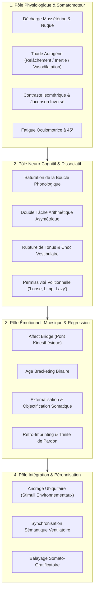

# Hypnosis Scripts
**Formateur :** Anne King | **ID :** `anne-king-hypnosis-scripts` | **Tranches :** 9

## Synthèse Architecturale du Cours

### 1. Thèse Centrale & Philosophie du Cours

* **Posture pragmatique et ancrage somato-fonctionnel :**  
  La vision d’Anne King se démarque de l'hypnose purement métaphorique ou directive abstraite par un **pragmatisme somatique immédiat**. Au lieu de solliciter une adhésion intellectuelle ou une foi aveugle, elle utilise les réalités physiologiques incontournables (fatigue oculomotrice à 45°, relâchement myotatique, espace mandibulatoire, pesanteur) comme des truismes biologiques convertis en leviers d'induction. Sa posture n'est ni autoritaire ni mystique : elle guide le système nerveux vers un abandon consenti du contrôle en dédramatisant l'expérience (normalisation hypnagogique, allitération permissive).
* **Le fil rouge méthodologique :**  
  Toutes les interventions reposent sur une séquence en trois temps :
  1. **Décharge et saturation neuromotrice/cognitive :** Désactiver les circuits de vigilance et de contrôle conscient par saturation attentionnelle (comptes asymétriques, doubles tâches) ou épuisement idéomoteur.
  2. **Découplage de la charge affective :** Extraire l'émotion de la trame narrative par spatialisation, objectivation métaphorique ou pont kinesthésique, permettant au sujet de travailler sur le signal sans subir l'inondation traumatique.
  3. **Ré-encodage et généralisation ubiquitaire :** Réécrire la trace mnésique à la source (ISE) et ancrer les nouvelles réponses sur des stimuli quotidiens et inévitables (respiration, déclencheurs environnementaux comme l'eau).

---

### 2. Carte des Concepts & Leviers Émergents



* **Découplage mandibularo-dentaire et triade autogène :**  
  Inhibition mécanique du nerf trijumeau et bascule parasympathique directe pour désactiver le dialogue interne et l'hyper-vigilance.
* **Permissivité volitionnelle (*Loose, Limp & Lazy*) :**  
  Désamorçage de l'anxiété de performance hypnotique en autorisant explicitement l'abandon de l'effort volontaire.
* **Surcharge attentionnelle asymétrique :**  
  Saturation de la mémoire de travail par concurrence cognitive (double flux verbal, calcul régressif complexe), neutralisant le facteur critique.
* **Épuisement idéomoteur à seuil d'effondrement (*Kernels of Corn*, *Hand to Face*) :**  
  Remplacement de la volonté consciente par un micro-contrôle moteur inhibiteur menant à une atonie réflexe soudaine.
* **Rupture kinesthésique et choc vestibulaire :**  
  Suppression instantanée de contre-résistance proprioceptive provoquant un vide postural qui court-circuite tout filtrage analytique.
* **Pont affectif (*Affect Bridge*) et découpage binaire (*Age Bracketing*) :**  
  Isolation de la signature somatosensorielle d'un symptôme pour remonter les réseaux synaptiques jusqu'à l'événement initial (ISE) sans interférence narrative.
* **Objectification et containment métaphorique :**  
  Extraction de l'affect hors de l'enveloppe corporelle sous forme d'objet manipulable et destructible, redonnant la commande exécutive au sujet.
* **Conditionnement pavlovien ubiquitaire :**  
  Association des états de ressource à des déclencheurs environnementaux omniprésents (eau, respiration) pour une réactivation autonome continue.

---

### 3. Tableau Récapitulatif des Techniques & Démonstrations

| Technique / Exercice | Objectif Opératoire | Déclencheur / Indication | Séquence Résumée |
|---|---|---|---|
| **Réveil Hypnotique / Dé-hypnotisation (3, 5, 10 temps)** | Réorientation progressive du système nerveux autonome vers la vigilance bêta. | Fin de toute séance d'induction ou de travail thérapeutique. | Décompte ascendant progressif associé à la respiration profonde, reprise du tonus musculaire distal puis proximal, ouverture des yeux et ratification de la pleine lucidité. |
| **Relaxation Progressive Somatique Descendante** | Chute myotatique complète et bascule parasympathique par contraste neuromusculaire. | Sujets tendus, profils débutants ou somatisations corporelles diffuses. | Balayage crânio-caudal ; contraction isométrique brève suivie d'un relâchement passif ; intégration de la triade autogène (lourdeur, chaleur, inertie). |
| **Surcharge Cognitive & Compte à Rebours Asymétrique** | Saturation de la mémoire de travail et court-circuit du facteur critique. | Sujets hyper-analytiques, résistances intellectuelles, dialogue interne actif. | Fixation oculaire à 45° ; demande de calcul régressif asymétrique (ex. -3 depuis 397) pendant que le praticien délivre un décompte verbal superposé jusqu'à l'abandon du contrôle. |
| **Épuisement Idéomoteur ("Kernels of Corn")** | Décharge proprioceptive progressive menant à une rupture brutale de tonus. | Préférence pour les inductions kinesthésiques lentes et mesurables. | Mains en supination ; instruction de les retourner millimètre par millimètre pour vider des grains imaginaires ; effondrement postural total suggéré à la chute du dernier grain. |
| **Boucle d'Auto-réalisation ("Hand to Face")** | Catalyser un automatisme idéomoteur à partir de micro-mouvements réflexes. | Sujets ayant besoin de preuves tangibles de la transe en cours. | Fixation des doigts à hauteur des yeux ; ratification des fasciculations musculaires comme volonté de rapprochement ; contact cutané main-visage scellant la fermeture des yeux et la transe. |
| **Induction par Rupture d'Appui ("Shock Induction")** | Désorientation vestibulaire instantanée et contournement immédiat du filtre critique. | Besoin d'une induction ultra-rapide chez un sujet coopératif mais tendu. | Pression descendante maintenue sur la main du praticien ; retrait soudain de l'appui créant un vide proprioceptif ; commande verbale monosyllabique ferme (« DORS ») et bascule vers l'avant. |
| **Descente Gravitaire ("Stairway / Downward Motion")** | Approfondissement hypnotique par isomorphisme vestibulaire. | Post-induction pour stabiliser et approfondir le passage en ondes lentes (alpha/thêta). | Visualisation d'un escalier de 10 marches ; décompte descendant synchronisé avec l'expiration et la sensation d'alourdissement à chaque marche franchie. |
| **Lévitation & Catalepsie du Bras ("Arm Rigidity")** | Dissociation somatique agence/mouvement et verrouillage par double lien. | Test de profondeur, ratification de transe, installation d'une réponse involontaire. | Suggestion de ballons allégeant le bras (lévitation) puis suggestion de rigidité d'acier avec défi paradoxal (« plus vous essayez de plier, plus il se fige »). |
| **Ancrage Compressif d'Épaule ("Shoulder Pressure")** | Installation d'une gâchette post-hypnotique somato-verbale instantanée. | Structuration de raccourcis pour ré-inductions ultra-rapides ultérieures. | Pression physique descendante sur le trapèze au pic de la relaxation, synchronisée avec l'ancrage verbal (« Plus profondément »). |
| **Ancrage du Lieu Spécial ("Safe Place Induction")** | Création d'une zone refuge de haute sécurité avec désactivation amygdalienne. | Pré-requis obligatoire avant tout travail sur trauma, phobie ou abréaction. | Évocation multi-sensorielle VAKOG complète d'un lieu ressource ; ancrage somatique direct par double respiration ventrale profonde. |
| **Signaux Idéomoteurs à Renforcement Direct ("Finger Signals")** | Canal de communication subconscient pur contournant le filtre verbal conscient. | Établissement d'un dialogue binaire (oui/non) pour le diagnostic ou la régression. | Sélection consciente initiale d'un doigt par réponse, ratification par toucher physique de l'opérateur, puis passage en mode de réponse réflexe automatique. |
| **Découpage Temporel Binaire ("Age Bracketing")** | Localisation chronologique précise de l'ISE sans affabulation narrative. | Recherche de la cause racine d'un symptôme ou d'une croyance limitante. | Interrogation de l'inconscient par dichotomie temporelle stricte via signaux idéomoteurs (avant 10 ans ? avant 5 ans ? avant 3 ans ?) jusqu'à l'année exacte. |
| **Pont Émotionnel Somato-Centré ("Affect Bridge")** | Utilisation de la signature kinesthésique du symptôme comme rail mnésique. | Traumatismes anciens non conscientisés, blocages émotionnels récurrents. | Amplification contrôlée de la sensation physique présente ; découplage du contexte narratif actuel ; remontée de la ligne temporelle guidée uniquement par le ressenti somatique. |
| **Externalisation & Destruction Objectale de l'Affect** | Dissociation émotionnelle et reprise de contrôle exécutif sans abréaction violente. | Traumas lourds, sensations corporelles toxiques, colère ou rancœur enkystée. | Condensation visuelle/tactile de la charge interne ; extraction somatique hors du corps ; scellage dans un réceptacle imaginaire et destruction symbolique complète (feu/océan). |
| **Pardon Relationnel, Rupture Cordale & Réécriture de Scène** | Neutralisation des ruminations empathiques et ré-encodage de la mémoire biographique. | Conflits relationnels du passé, dettes affectives, blessures d'abandon/rejet. | Trinité de pardon (vers l'autre, soi-même, demande à l'autre) ; coupure symbolique du lien au plexus ; réinsertion d'un self adulte ressource pour réécrire la scène originelle. |
| **Hypermnésie par Restauration Sensorielle Contextuelle** | Récupération de souvenirs ou localisation d'objets perdus sans effort frontal. | Oublis d'informations précises, amnésie fonctionnelle, objets égarés. | Réactivation sensorielle complète 3D du moment précédant l'événement (tactile, posture, température, humeur) pour amorcer l'accès mnésique associatif passif. |
| **Ancrage Environnemental Ubiquitaire** | Automatisation de la décharge vagale dans la vie courante sans effort conscient. | Anxiété chronique, réactivité au stress, consolidation post-séance. | Suggestion post-hypnotique liant chaque perception de l'eau (visuelle, sonore, tactile, robinet, pluie) à un signal réflexe de calme et de respiration ventrale. |
| **Balayage Somato-Gratificatoire** | Réalignement psychoneuroimmunologique et extinction de l'hyper-sympathicotonie. | Convalescence, stress somatisé, réconciliation avec un corps perçu comme défaillant. | Exploration anatomique descendante où chaque zone/organe est nommée, remerciée et reconnue pour sa fonction biologique protectrice. |

---

---

## 0. Sommaire Sémantique & Index des Lignes

- **Tranche 1 [Lignes 116-309]** : Le Réveil Hypnotique / Dé-hypnotisation (Protocoles 3, 5, 10 temps & Ericksonien) — *Protocole :* Le Réveil Hypnotique / Dé-hypnotisation (Protocoles 3, 5, 10 temps & Ericksonien) | *Mécanisme :* Fractionnement somatosensoriel en trois stades (Autogène / Schultz dérivé) | *Verbatim :* Dé-hypnotisation & Clôture
- **Tranche 2 [Lignes 311-451]** : Relaxation Progressive Somatique Descendante & Contraste Musculaire — *Protocole :* Relaxation Progressive Somatique Descendante & Contraste Musculaire | *Verbatim :* Verbatim 1 : Clôture du truisme d'alourdissement
- **Tranche 3 [Lignes 453-672]** : Les Grains de Maïs ("Kernels of Corn") — *Protocole :* Les Grains de Maïs ("Kernels of Corn") | *Verbatim :* s Verbatim
- **Tranche 4 [Lignes 674-800]** : Ancrage du Lieu Spécial (Safe Place Induction & Anchor) — *Protocole :* Ancrage du Lieu Spécial (Safe Place Induction & Anchor) | *Mécanisme :* Conditionnement Réflexe d'Ancrage Kinesthésique-Somatique (Lieu Sûr / Special Place)
- **Tranche 5 [Lignes 802-1039]** : A : Résolution de Conflit Émotionnel du Passé, Pardon & Réécriture du Scénario (Pages 56-59) — *Protocole :* A : Résolution de Conflit Émotionnel du Passé, Pardon & Réécriture du Scénario (Pages 56-59) | *Mécanisme :* Somatisation inversée et extériorisation objectale de l'affect (affectobjectification somaticextraction symbolicdestruction) | *Verbatim :* La régression graduée avec boucle de confort
- **Tranche 6 [Lignes 1041-1315]** : L'Ancrage de Relaxation Universelle à l'Eau & Hyper-Généralisation et Conditionnement Multi-... — *Protocole :* L'Ancrage de Relaxation Universelle à l'Eau | *Mécanisme :* Hyper-Généralisation et Conditionnement Multi-Modal Omniprésent | *Verbatim :* Verbatim 1 : L'Ancrage Pavlovien Universel de l'Eau
- **Tranche 7 [Lignes 1317-1473]** : Le Temple des Vies Antérieures (Régression & Exploration Transpersonnelle) — *Protocole :* Le Temple des Vies Antérieures (Régression & Exploration Transpersonnelle) | *Verbatim :* Le Sas de Clôture & Immunisation Mnésique (p. 83 & 87)
- **Tranche 8 [Lignes 1475-1612]** : Rêve Hypnotique Résolutif d'Incubation (60 secondes) — *Protocole :* Rêve Hypnotique Résolutif d'Incubation (60 secondes)
- **Tranche 9 [Lignes 1614-1794]** : Le Bouclier de Lumière Rose (Protection Émotionnelle pour Enfants) — *Protocole :* Le Bouclier de Lumière Rose (Protection Émotionnelle pour Enfants) | *Verbatim :* Le Bouclier de Lumière Rose & L'Immunité Émotionnelle

---

## Extractions Détaillées par Tranche (Opératoire & Verbatim)

## Tranche 1 / 9 : Le Réveil Hypnotique / Dé-hypnotisation (Protocoles 3, 5, 10 temps & Ericksonien)

Voici l'analyse opératoire intégrale de la **tranche 1/9** du cours et manuel de scripts d'Anne King.

---

### 1. Mécanismes & Principes Actifs

* **Fractionnement somatosensoriel en trois stades (Autogène / Schultz dérivé)** :
  * *Principe actif* : Le système nerveux autonome bascule en dominance parasympathique via une séquence physiologique précise et invariable : relâchement moteur passif (*limp & relaxed*), sensation d'inertie/pesanteur par chute du tonus musculaire (*heavy*), puis vasodilatation périphérique réflexe (*pleasantly warm*). En induisant verbalement ces trois états somatiques dans cet ordre biomécanique strict avec des durées de pause calibrées, l'esprit conscient synchronise l'attention proprioceptive avec les marqueurs physiologiques d'endormissement sans perdre la lucidité.
  * *Tags* : `#triade_autogene #lourdeur_chaleur_reflexe #parasympathique_somatomoteur #rythme_temporel_calibre`

* **Décharge de la commande motrice par découplage mandibularo-dentaire** :
  * *Principe actif* : La mâchoire (muscle masséter) et la nuque sont les réservoirs primaires du tonus de vigilance (réflexe de morsure/défense de la formation réticulée). En suggérant explicitement « un espace entre les dents » (*leaving a little space between your teeth* / *teeth come slightly apart*), le praticien provoque l'inhibition du nerf trijumeau (V), signalant au tronc cérébral l'absence de menace immédiate et neutralisant le dialogue interne articulatoire sub-vocal.
  * *Tags* : `#desactivation_masseterine #rupture_dialogue_interne #inhibition_trigeminale #relachement_mandibulaire`

* **Triade allitérative kinesthésique d'inhibition cognitive (*Loose, Limp & Lazy*)** :
  * *Principe actif* : L'utilisation itérative de la formule allitérative *« loose and limp and lazy »* associe deux états mécaniques observables (relâchement musculaire périphérique, flaccidité) à un état permissif motivationnel (*lazy*). Cela court-circuite l'effort conscient de bien faire : le sujet est autorisé à démissionner de toute performance volontaire, ce qui prévient l'anxiété de performance hypnotique.
  * *Tags* : `#alliteration_hypnotique #permissivite_moteur #decrochage_volitionnel #loose_limp_lazy`

* **Double boucle respiratoire de projection sémantique (Entraînement ventilatoire)** :
  * *Principe actif* : La fixation de l'attention sur l'extension pulmonaire crée une focalisation intéroceptive exclusive qui sature la mémoire de travail. Dès que ce rythme lent est installé, Anne King y greffe un pattern d'équivalence neuro-sémantique binaire : *Inspiration = Paix / Sérénité*, *Expiration = Évacuation mécanique des tensions et négativités*. La physiologie ventilatoire devient le véhicule physique du nettoyage psychique.
  * *Tags* : `#synchronisation_ventilatoire #nettoyage_somatique #ancrage_respiratoire #polarite_in_out`

* **Permissivité régressive et normalisation hypnagogique** :
  * *Principe actif* : En associant la lourdeur hypnotique non pas à un poids pathologique ou étranger, mais à l'expérience quotidienne et naturelle de l'endormissement du soir (*« That same feeling of heaviness that you experience in your body each night »*), le praticien dédramatise la transe et mobilise les canaux synaptiques déjà existants de l'entrée dans le sommeil naturel.
  * *Tags* : `#normalisation_hypnagogique #reappropriation_mnesique #securisation_transe`

---

### 2. Protocoles, Techniques & Démonstrations (Étape par Étape)

#### A. Le Réveil Hypnotique / Dé-hypnotisation (Protocoles 3, 5, 10 temps & Ericksonien)
* **Intention / Indication** : Clôturer toute séance d'hypnose, rétablir la motricité, la vigilance corticale complète, le tonus postural et la réorientation spatiotemporelle.
* **Mise en place & Pré-framing** : Annoncer le compte à rebours ascendant avant de débuter le comptage afin que l'inconscient prépare la montée de vigilance avant même le premier chiffre.
* **Séquence d'actions pas à pas** :
  * *Variante 3 Count (Rapide / Urgence / Séance courte)* :
    1. Pré-cadre : « Dans un instant je vais compter de 1 à 3... »
    2. Chiffre 1 : Réorientation proprioceptive lente (*coming back slowly, feeling so good*).
    3. Chiffre 2 : Amplification de la vitalité (*almost there, feeling better than you’ve ever felt*).
    4. Chiffre 3 : Commande de réouverture des yeux et ancrage de grande forme (*back with me now ... feeling great ... open your eyes*).
  * *Variante 5 Count (Standard / Clinique)* :
    1. Compte 1 : Amorce du retour à l'environnement.
    2. Compte 2 : Augmentation progressive de la vigilance.
    3. Compte 3 : **Restauration sensorielle complète** (*all normal feeling returning* - impératif après analgésie ou anesthésie).
    4. Compte 4 : Préparation oculomotrice (*your eyes ready to open*).
    5. Compte 5 : Éveil complet et commande oculaire (*wide awake open your eyes*).
  * *Variante 10 Count (Transe très profonde / Sujets somnambuliques)* :
    1. Décomposition graduée de 1 à 10 par paliers : clarté mentale à 4, fraîcheur à 5, activation motrice à 7-8, éveil complet à 10.
  * *Variante Ericksonienne (Auto-rythmée)* :
    1. Valider l'état actuel et le bénéfice de la séance.
    2. Donner un cadre temporel délimité (ex: deux minutes).
    3. Laisser l'inconscient du sujet décider du tempo exact de sa sortie de transe.
* **Signes de calibration** :
  * Reprise du clignement spontané et rapide des paupières.
  * Déglutition réflexe, changement du rythme respiratoire (qui passe d'abdominal lent à thoracique régulier).
  * Rétablissement du tonus cervical et réalignement de la colonne vertébrale.

#### B. Protocole de Respiration Profonde (Deep Breathing Induction - 3 à 5 minutes)
* **Intention / Indication** : Induction initiale pour sujets agités, hyper-analytiques ou stressés au premier rendez-vous.
* **Mise en place & Pré-framing** : Autorisation de fermer les yeux basée sur l'utilité fonctionnelle (bloquer les distractions externes).
* **Séquence d'actions pas à pas** :
  * *Étape 1* : Fermeture oculaire permissive (*allow your eyes to close... for as long as is comfortable*).
  * *Étape 2* : Focalisation ventilatoire exclusive. Inspirations lentes et profondes, expirations prolongées pendant plusieurs minutes.
  * *Étape 3* : Encodage de l'image de charge/décharge : inspirer calme et sérénité, expirer tension et négativité.
  * *Étape 4* : Ratification somatique : lier chaque cycle respiratoire au relâchement musculaire (*loose and limp*).
  * *Étape 5* : Déconnexion de la vie quotidienne : verbaliser l'abandon des urgences, de la hâte (*rush*, *hurry and worry*).
  * *Étape 6* : Transition vers l'autonomie respiratoire : autoriser le sujet à cesser de penser à son souffle pour glisser vers une respiration naturelle et automatique.
* **Signes de calibration** :
  * Chute des épaules à l'expiration.
  * Disparition des micro-ajustements posturaux.
  * Décoloration ou lissage des traits du visage (masque facial détendu).

#### C. Induction Hypnotique de Base Métrée (Basic Hypnotic Induction Procedure)
* **Intention / Indication** : Induction formelle directe, rythmée à la seconde, structurée pour installer un état somatique stable et profond.
* **Mise en place & Pré-framing** : Réglage ergonomique du corps (bras et jambes décroisés et relâchés).
* **Séquence d'actions pas à pas** (avec respect strict de la métrique en secondes) :
  * *Cycle 1 : Relâchement Moteur (Lignes 1 à 15)* :
    - Inspiration profonde, expiration.
    - Répétition alternée : bras relâchés (pause 2-4s) -> jambes relâchées -> corps entier relâché -> Commande d'ancrage : *« You are going deep... deep... asleep... »*. Répété 3 fois jusqu'à confirmation d'immobilité.
  * *Cycle 2 : Pesanteur (Lignes 16 à 28)* :
    - Transition : « Vous êtes tellement détendu que... vos bras deviennent lourds... très lourds... ».
    - Répétition bras -> jambes -> corps entier -> Commande : *« You are going deeper... deeper... asleep... »*.
  * *Cycle 3 : Chaleur Vasomotrice (Lignes 29 à 41)* :
    - Transition : « Vous êtes si détendu et lourd que... vos bras deviennent agréablement chauds... ».
    - Répétition bras -> jambes -> corps entier -> Commande : *« You are going ever more deeply... asleep... totally relaxed »*.
* **Signes de calibration** :
  * Absence de sursaut lors des silences calibrés de 4 secondes.
  * Immobilité catatonique des membres (bras et jambes plaqués au fauteuil).
  * Vasodilatation visible (teint qui se réchauffe, rougeur légère des pommettes ou des mains).

#### D. Relaxation Corporelle Progressive #1 (Ascendante : Pieds -> Tête)
* **Intention / Indication** : Induction somatosensorielle complète, idéale pour les sujets ayant besoin d'un ancrage dans le corps physique avant le lâcher-prise.
* **Mise en place & Pré-framing** : Inviter le sujet à mobiliser son imagination sensorielle.
* **Séquence d'actions pas à pas** :
  * *Étape 1 (Pieds & Jambes)* : Flux chaud entrant par les orteils, voûte plantaire, talons, chevilles, mollets, genoux, cuisses. Formule pivot : *« loose and limp and lazy »*.
  * *Étape 2 (Tronco-abdominal)* : Montée du flux du bassin jusqu'aux épaules.
  * *Étape 3 (Membres supérieurs)* : Descente du flux des épaules aux bouts des doigts.
  * *Étape 4 (Ceinture scapulaire & Nuque)* : Ciblage précis de la zone interscapulaire (entre les omoplates) et de la nuque pour dissoudre les tensions résiduelles.
  * *Étape 5 (Tête & Scalp)* : Passage par l'arrière de la tête et sommet du crâne.
  * *Étape 6 (Face & Mâchoire)* : Front, tempes, adoucissement du regard (muscles périorbitaires), ouverture de l'articulé dentaire, relâchement de la gorge.
* **Signes de calibration** :
  * Lissage complet du front et disparition des rides du lion/sourcils.
  * Mâchoire tombante créant une légère ouverture visible de la bouche.

#### E. Relaxation Corporelle Progressive #2 (Descendante : Scalp -> Thorax)
* **Intention / Indication** : Variante descendante, excellente pour induire une sensation d'enfoncement progressif de la tête vers le bas.
* **Mise en place & Pré-framing** : Focalisation immédiate sur le sommet de la tête.
* **Séquence d'actions pas à pas** :
  * *Étape 1* : Scalp et sensation insolite des cheveux qui se relâchent (*causing your hair to feel loose*).
  * *Étape 2* : Visage, joues et déverrouillage de la mâchoire (dents écartées).
  * *Étape 3* : Nuque et sensation consécutive de tête confortablement lourde sur son support.
  * *Étape 4* : Épaules et libération ciblée du trapèze/entre les omoplates.
  * *Étape 5* : Membres supérieurs jusqu'aux doigts.
  * *Étape 6* : Cage thoracique, liant la décontraction musculaire à un ralentissement mécanique de la respiration.
* **Signes de calibration** :
  * Légère bascule de la tête en arrière ou sur le côté dès l'étape 3.
  * Respiration devenant spontanément plus ample et lente dès l'étape 6.

---

### 3. Heuristiques, Subtilités & "Sagesse du Praticien"

* **Gestion du sujet réfractaire au réveil (Failure to awaken)** :
  * *Heuristique 1 (Modulation vocale)* : Si le sujet ne rouvre pas les yeux au compte final, augmenter l'intensité et le volume de la voix, prononcer son prénom en premier pour capter le filtre attentionnel réticulé : *"Janet ... Number 10 .. Wide Awake!"*.
  * *Heuristique 2 (Contact kinesthésique)* : Si le stimulus auditif ne suffit pas, répéter l'ordre verbal en appliquant simultanément une pression tactile ferme mais douce sur l'avant-bras ou l'épaule pour réassocier le sujet à son schéma corporel externe.
  * *Heuristique 3 (Normalisation écologique)* : Si aucune urgence ne se présente, ne jamais forcer : laisser le sujet transiter naturellement de la transe au sommeil physiologique ; il se réveillera spontanément quand son cycle de repos sera comblé.

* **Sécurité post-hypnotique impérative** :
  * *Règle de réassociation sensorielle* : Lors de tout réveil (particulièrement après des protocoles de gestion de la douleur ou d'anesthésie), il est formellement obligatoire d'insérer la commande de restitution sensitive intégrale : *« with all the normal feeling returning to every part of your body »*. Omettre cette suggestion peut laisser le sujet avec des sensations d'engourdissement ou de dissociation motrice résiduelle.

* **Permissivité du regard et retrait du forçage** :
  * *Formulation non autoritaire* : Au lieu d'imposer la fermeture des paupières (*« Fermez les yeux »*), Anne King utilise systématiquement le pattern permissif : *« go ahead and allow your eyes to close... for as long as is comfortable for you »*. Cela contourne la réactance psychologique du sujet contrôlant.

* **Répétition rythmée et gestion millimétrée du silence** :
  * *Le rôle des secondes d'arrêt* : Dans l'induction de base, les pauses de (2 sec) et (4 sec) ne sont pas des hésitations mais des espaces d'intégration somatique. Une suggestion de détente nécessite 2 à 4 secondes pour que l'arc réflexe moteur se relâche effectivement. Parler sans pause maintient le sujet dans le canal auditif et empêche le basculement kinesthésique.

---

### 4. Pépites Verbatim & Patterns Linguistiques (MOT À MOT EN V.O.)

#### Dé-hypnotisation & Clôture
```text
"In a moment I’m going to count from 1 to 3, and on the count of 3, you’ll be fully alert ... feeling rested, refreshed and rejuvenated. When I reach the count of the 3, you’ll be back with me feeling fantastically good."
```
* **[Analyse du Pattern]** : Présupposition temporelle double (*In a moment*, *When I reach*). Association allitérative en "R" (*rested, refreshed, rejuvenated*) créant une résonance phonétique énergisante. Utilisation du renforçateur d'état d'éveil (*feeling fantastically good*) pour lier le réveil à une récompense dopaminergique.

```text
"Number 3 ....... all normal feeling returning. Number 4...... back with me, your eyes ready to open. And number 5 ...... wide awake open your eyes."
```
* **[Analyse du Pattern]** : Commande directe de sécurité intégrée au chiffre central (3) restaurant la sensibilité somatosensorielle complète. Au chiffre 4, utilisation d'un truisme précurseur (*your eyes ready to open*) préparant l'action motrice avant l'injonction directe finale du chiffre 5 (*wide awake open your eyes*).

```text
"As we conclude with this session, you may notice just how wonderful and relaxed you feel. You may even reflect on how beneficial this session has been. And you may now take as much time as you need in the next two minutes to come back to full awakening..."
```
* **[Analyse du Pattern]** : Pattern ericksonien pur d'autorisation (*you may notice*, *you may even reflect*, *you may now take*). Présupposition de succès de la séance (*how wonderful*, *how beneficial*). Double lien temporel encadré : liberté totale de temps concédée à l'inconscient, mais contrainte paradoxale fermée dans la matière (*as much time as you need in the next two minutes*).

#### Respiration & Centrage
```text
"It's often easier to relax with your eyes closed because for most people, it makes it easier for them to be quiet, and still, and to block outside distractions."
```
* **[Analyse du Pattern]** : Utilisation du quantificateur flou et du truisme d'autorité douce (*for most people*). Conjonction de subordination causale (*because*) qui lie logiquement un comportement physique observable (fermer les yeux) à un bénéfice psychologique interne (être tranquille et bloquer les distractions), empêchant le sujet d'en contester le bien-fondé.

```text
"And you can imagine, if you like, that with every breath you breathe in, you're filling your body and mind with peace and serenity... and with every breath you exhale, you're just letting go of all tightness and tension and negativity ...."
```
* **[Analyse du Pattern]** : Permission hypnotique (*if you like*) couplée à un couplage respiratoire métaphorique. Polarisation linguistique rigoureuse : l'inspiration est connectée aux concepts nominaux de plénitude (*peace and serenity*), l'expiration est connectée à l'élimination des états kynesthésiques négatifs (*tightness, tension, negativity*). Le marqueur réducteur *« just letting go »* minimise l'effort requis pour s'en libérer.

#### Induction de Base
```text
"Now you are so relaxed...(2 sec)...so completely relaxed...(2 sec)... That your arms are becoming heavy...(2 sec)...very heavy...(4 sec)..."
```
* **[Analyse du Pattern]** : Structure de type cause à effet transitive (*so... that...*). La première clause ratifie et amplifie l'état déjà acquis (*so completely relaxed*), et en fait la cause mécanique obligatoire de l'état suivant (*that your arms are becoming heavy*). L'esprit conscient accepte la lourdeur comme une conséquence physique inéluctable du relâchement.

```text
"Now you are so very relaxed...(2 sec)...and your entire body is so very heavy (2 sec) That your arms are becoming pleasantly warm...(2 sec)..."
```
* **[Analyse du Pattern]** : Enchaînement séquentiel cumulatif. Les deux stades précédents (détente + lourdeur) sont fusionnés en prémisse pour forcer l'entrée du troisième marqueur somatique : la vasodilatation thermique (*pleasantly warm*). L'adverbe *pleasantly* qualifie par anticipation la sensation pour éviter toute interprétation d'inconfort ou de fébrilité.

#### Relaxations Progressives Corporelles
```text
"...All of the muscles in your legs are relaxed and you can just allow them to feel loose and limp and lazy ..... the muscles loose and limp and lazy. As your legs relax, they may even begin to feel kind of warm or tingly or heavy ...."
```
* **[Analyse du Pattern]** : Triple ancrage auditif allitératif (*loose and limp and lazy*) répété en boucle fermée pour saturer le cortex auditif. Offre de choix multiples de calibration interne (*warm OR tingly OR heavy*) : quelle que soit la sensation ressentie par le sujet (picotement, chaleur ou poids), elle valide la suggestion et approfondit la transe.

```text
"...and you especially feel your jaw become very, very relaxed ... leaving a little space between your teeth ... and even your chin and your throat feel very, very relaxed."
```
* **[Analyse du Pattern]** : Focalisation amplifiée par l'adverbe de ciblage (*especially*). Commande comportementale somatique précise et testable (*leaving a little space between your teeth*) imbriquée entre deux suggestions de détente générale, désamorçant le contrôle mandibulaire réflexe sans confrontation directe.

```text
"Imagine a wonderful feeling of relaxation now beginning in your scalp .... relaxing the muscles in your scalp .... causing your hair to feel loose."
```
* **[Analyse du Pattern]** : Suggestion d'effet physique inhabituel (*causing your hair to feel loose*). En reliant la relaxation musculaire du cuir chevelu à une sensation kinesthésique surprenante (les cheveux qui se détendent), l'attention consciente décroche momentanément par rupture de schéma logique, créant une micro-fenêtre d'acceptation accrue de la suggestion.

## Tranche 2 / 9 : Relaxation Progressive Somatique Descendante & Contraste Musculaire

Voici l'analyse d'ingénierie et de modélisation opératoire de la tranche 2/9 du cours *Hypnosis Scripts* d'Anne King.

---

### 1. Mécanismes & Principes Actifs

- **Décharge proprioceptive & Contraste neuromusculaire (Jacobson inversé)**
  - *Principe actif* : La contraction volontaire isométrique suivie d'un relâchement soudain épuise les micro-tensions musculaires toniques, force un afflux sanguin réflexe et sature les mécanorécepteurs. Le système nerveux autonome bascule par rebond physiologique du tonus sympathique vers une dominance parasympathique.
  - *Tags* : `#contraste_isometrique #rebond_parasympathique #relachement_myotatique #somatisation_descendante`

- **Surcharge cognitive par double tâche concurrente (Split attentif & Compte à rebours)**
  - *Principe actif* : La mémoire de travail (boucle phonologique) est limitée à environ 4 à 7 éléments. L'obligation de calculer un compte à rebours asymétrique (ex. par 3 depuis 397) pendant que le praticien délivre un flux verbal de décompte indépendant sature l'hémisphère dominant et désamorce la résistance critique ou analytique. L'inconscient se résout à l'abandon du contrôle conscient pour soulager la fatigue cognitive.
  - *Tags* : `#surcharge_attentionnelle #saturation_boucle_phonologique #rupture_contrecritique #confusion_arithmetique`

- **Fatigue oculomotrice & Déclenchement du réflexe d'extinction visuelle**
  - *Principe actif* : Fixer un point situé à 45° au-dessus de l'axe naturel de vision met en tension prolongée les muscles droits supérieurs et élévateurs de la paupière. Cette contrainte physique induit naturellement sécheresse lacrymale, clignements réflexes et lourdeur palpébrale. Le praticien utilise ces conséquences somatiques inévitables pour ratifier la transe (truisme biologique converti en suggestion hypnotique).
  - *Tags* : `#fixation_ophtalmique #elevation_45deg #truisme_somatique #ratification_physiologique`

- **Fractionnement de Vogt (Rupture et ré-induction itérative)**
  - *Principe actif* : Faire émerger le sujet d'un état hypnotique léger/moyen puis le ré-induire immédiatement utilise l'inertie physiologique de la transe précédente. Chaque aller-retour abaisse le seuil de bascule neurologique, bypassant les défenses et amplifiant la profondeur subjective sans effort d'analyse.
  - *Tags* : `#fractionnement_vogt #hysteresis_neurologique #ancrage_reactif #chute_de_seuil`

- **Couplage ideo-moteur kinesthésique à terminaison discrète (Seuil d'effondrement)**
  - *Principe actif* : Associer l'induction à un geste physique lent et irréversible (descente du bras, grains de maïs imaginaires qui s'échappent, main qui se rapproche du visage). Dès que le marqueur terminal est atteint (toucher de la cuisse, dernier grain tombé), une commande de collapse musculaire total s'exécute par ancrage temporel conditionnel.
  - *Tags* : `#boucle_ideomotrice #ancrage_cinetique #conditionnement_terminal #rupture_de_tonus`

---

### 2. Protocoles, Techniques & Démonstrations (Étape par Étape)

#### A. Relaxation Progressive Somatique Descendante & Contraste Musculaire
* **Intention / Indication** : Sujets kinesthésiques, tendus corporellement, anxieux ou débutants ayant besoin d'une validation physique de leur détente.
* **Mise en place & Pré-framing** : Installation assise ou semi-allongée. Informer que l'exercice ne requiert aucun effort de concentration soutenu, juste le suivi passif de la voix.
* **Séquence d'actions pas à pas** :
  1. *Segment cranio-facial* : Focalisation sur le cuir chevelu, relâchement du front, joues, et commande spécifique de desserrage des mâchoires (laisser un espace entre les dents).
  2. *Contractions isométriques sélectives (Variante active)* : Contracter le poing gauche 3-5 s -> relâcher ; contracter le poing droit -> relâcher ; fléchir orteils/jambes -> relâcher ; serrer fessiers -> relâcher ; creuser le dos/épaules -> relâcher ; serrer mâchoires et yeux -> relâcher.
  3. *Balayage respiratoire* : Expirations lentes associées à l'évacuation des tensions résiduelles.
* **Signes de calibration** : Décrochage de la mâchoire inférieure (séparation visible des lèvres/dents), relâchement des trapèzes, respiration abdominale ralentie.

---

#### B. Induction par Confusion Arithmétique & Double Flux (397 par 3 vs 33 par 1)
* **Intention / Indication** : Sujets hyper-analytiques, intellectuels, contrôlants, sceptiques ou anxieux du "lâcher-prise".
* **Mise en place & Pré-framing** : Définir la tâche impossible comme un jeu d'imagination où l'erreur est délibérément autorisée et requise.
* **Séquence d'actions pas à pas** :
  1. *Amorçage* : Faire visualiser le nombre 397. Définir la consigne : soustraire par 3 mentalement (397, 394, 391...). Si erreur, recommencer à 397.
  2. *Liaison de transe* : Poser la suggestion que chaque décompte approfondit la détente et que le souffle emporte les tensions.
  3. *Interférence concurrente* : Le praticien lance son propre décompte à voix haute (33 à 0) en associant chaque chiffre à une marche d'escalier descendant vers l'oubli des tensions.
  4. *Suggestion de découplage et d'abandon* : Vers les chiffres médians (24-15), suggérer qu'il devient difficile de suivre, autoriser l'abandon des nombres.
  5. *Résolution à Zéro* : Au chiffre zéro, commander l'arrêt total du calcul et la plongée dans la transe.
* **Signes de calibration** : Mouvements oculaires rapides sous paupières closes, pauses respiratoires d'effort intellectuel qui cèdent soudainement à un grand soupir, affaissement postural.

---

#### C. Induction par Fixation Oculaire & Clignement Conditionné
* **Intention / Indication** : Sujets visuels, inductibilité classique en cabinet.
* **Mise en place & Pré-framing** : Cible située à 45° vers le haut (doigt, marque au plafond, objet).
* **Séquence d'actions pas à pas** :
  1. Fixation continue du point en synchronisation avec la voix.
  2. Pacing des phénomènes physiologiques inévitables : sensation de sécheresse, picotements, larmoiement, besoin de cligner.
  3. Suggestion d'alourdissement progressif des paupières dès l'apparition des premiers clignements.
  4. Double lien de fermeture : rendre intolérable l'effort de garder les paupières ouvertes ; autoriser et commander la fermeture complète.
* **Signes de calibration** : Battement accéléré des cils (flutter), larmoiement visible, rougeur conjonctivale, strabisme convergent léger.

---

#### D. Fractionnement Rapide (10 à 1 / 1 à 10)
* **Intention / Indication** : Approfondissement d'une transe légère, réveil d'urgence contrôlé, ou installation d'une flexibilité hypnotique.
* **Mise en place & Pré-framing** : Décompte lent à la descente, décompte dynamique à la montée.
* **Séquence d'actions pas à pas** :
  1. Descente 10 à 1 au rythme lent d'élocution, jusqu'à immobilité complète.
  2. Réveil partiel 1 à 10 avec élocution accélérée, ouverture brève des yeux au chiffre 10.
  3. Ré-induction instantanée sur le chiffre 10 : commande immédiate de fermeture et reprise du décompte descendant (9, 8, 7...).
  4. Répéter le cycle 2 à 3 fois jusqu'au niveau somnambulique requis.
* **Signes de calibration** : Vitesse de fermeture des yeux multipliée par deux au second cycle, hypotonie immédiate de la nuque.

---

#### E. Inductions Idéo-motrices Rapides (Abaissement de bras & Grains de maïs)
* **Intention / Indication** : Transition vers une transe somatique profonde sans verbalisation complexe.
* **Mise en place & Pré-framing** : Bras tendu à hauteur d'épaule ou mains en coupe débordant des accoudoirs.
* **Séquence d'actions pas à pas** :
  1. Fermeture des yeux et focalisation sur la kinesthésie (poids du bras ou sensation de grains de maïs s'échappant un par un par retournement millimétrique des paumes).
  2. Liaison de cause à effet : la vitesse de descente/vidange régit le niveau de profondeur inconsciente.
  3. Déclenchement terminal : au moment exact du contact physique (main sur cuisse/accoudoir) ou de la chute du dernier grain -> commande d'effondrement musculaire (*deep breath, limp, loose*).
* **Signes de calibration** : Micro-saccades idéo-motrices dans le bras ou les doigts, chute finale brusque et non contrôlée (perte de tonus volontaire).

---

### 3. Heuristiques, Subtilités & "Sagesse du Praticien"

- **Règle de l'espace dentaire (Le baromètre facial)** :
  * *Heuristique* : *Si* la mâchoire reste serrée, *alors* le sujet est encore en veille active ou en contrôle analytique. Commander spécifiquement un espace entre les rangées de dents libère la chaîne myo-fasciale du cou et de la base du crâne.
- **Autorisation de l'erreur dans la confusion** :
  * *Heuristique* : *Si* le sujet perd le fil de son décompte, *alors* ne jamais le recadrer comme un échec, mais le valoriser comme la preuve directe que l'esprit conscient fatigue et cède sa place à la transe.
- **Rythme de prosodie en fractionnement** :
  * *Heuristique* : Adapter le tempo vocal à la direction neurologique : élocution rapide et tonus montant pour désamorcer l'immobilité (1 à 10), élocution ralentie, grave et expiratoire pour la descente (10 à 1).
- **Le piège de la fixation oculaire directe (Direct Gaze)** :
  * *Heuristique* : Réservé aux contextes de spectacle ou aux cadres d'autorité consentie. En clinique standard, fixer les yeux du praticien génère une menace sociale ou un sentiment d'intimidation contre-productif ; préférer un point neutre surélevé.
- **Ré-induction post-hypnotique d'office** :
  * *Heuristique* : Toujours ancrer en fin de première séance un stimulus déclencheur (mot signal "RELAX", toucher à l'épaule, 3 respirations dans le fauteuil) pour économiser le temps d'induction lors des séances ultérieures.

---

### 4. Pépites Verbatim & Patterns Linguistiques (MOT À MOT EN V.O.)

#### Verbatim 1 : Clôture du truisme d'alourdissement
> "Your jaw muscles relax so much that your teeth come slightly apart and your jaw feels loose and relaxed."
* **[Analyse du Pattern]** : *Liaison de cause à effet & marqueur somatique objectif*. L'adverbe "so much that" lie une détente subjective invisible à un fait biomécanique mesurable (dents qui s'écartent), forçant le système nerveux à valider la transe par rétroaction proprioceptive.

---

#### Verbatim 2 : Présupposition d'action inconsciente furtive
> "Without realizing it, you have altered your breathing rate, you have increased your sense of relaxation. Without realizing it, you may already be entering the deeply relaxed state of hypnosis."
* **[Analyse du Pattern]** : *Empilement anaphorique de truismes avec présupposition d'amnésie/automatisme*. "Without realizing it" contourne le jugement critique en postulant que le changement a déjà eu lieu sous le radar conscient, suivi d'un adoucisseur modal ("may already be entering") qui rend la suggestion impossible à contester.

---

#### Verbatim 3 : Saturation cognitive et suggestion d'abandon
> "Now, as you continue to relax, silently -- in your mind, begin to count backwards from 100 to 1, and after each number think to yourself 'sleep now.' [...] When you become tired of counting or when you come to the end, just repeat the word 'one' over and over again..."
* **[Analyse du Pattern]** : *Double tâche concurrente & commande enchâssée itérative*. Lier chaque nombre à la commande intérieure "sleep now" programme une auto-suggestion répétitive. La clause d'échappement ("When you become tired of counting") normalise la capitulation de l'intellect conscient.

---

#### Verbatim 4 : Double lien de fatigue oculaire
> "Now your eyes are beginning to blink …. your eyes are feeling heavier and heavier …. but just try to keep focusing on ________________ …. even though your eyes may be tired and heavy …. It may be hard to keep your eyes open when they want to close …. In fact you're probably getting tired of holding your eyes open ... wanting to close them …. Yes, it’s alright to just allow your eyes to close …. Just let your eyes close now …."
* **[Analyse du Pattern]** : *Pacing-and-Leading avec double lien (Bind)*. "Try to keep focusing" utilise le mot "try" qui présuppose l'échec de la résistance. L'injonction contradictoire (garder les yeux ouverts contre la fatigue) épuise la volonté, puis la permission ("it's alright to just allow...") transforme la capitulation physique en soumission consentie à la transe.

---

#### Verbatim 5 : Conditionnement post-hypnotique à déclencheur multimodal
> "From this moment forward, whenever: (1) you stretch out in my recliner and take 3 deep breaths, (2) I say the word RELAX, (3) I count backwards from 5 to 1, (4) I touch your shoulder and say the word RELAX you will immediately become as relaxed as you are right now or you may even become more relaxed."
* **[Analyse du Pattern]** : *Ancrage post-hypnotique structuré & double lien d'amplification*. Formulation temporelle d'autorité ("From this moment forward, whenever..."). L'alternative terminale ("as relaxed as you are right now or you may even become more relaxed") ne laisse aucune porte de sortie pour un état de veille ordinaire.

---

#### Verbatim 6 : Boucle de résistance paradoxale (Elman Handshake)
> "The third time they'll lock and you won't be able to open them ... WANT that to happen and WATCH it happen ... and they're locked and you'll find they just won't work, no matter how hard you try. The harder you try, the less they'll work. Test them, and you'll find they won't work at all. That's right."
* **[Analyse du Pattern]** : *Inversion de l'effort volontaire (Loi de l'effet inverse)*. "The harder you try, the less they'll work" piège l'énergie du sujet contre lui-même : l'effort conscient pour ouvrir les paupières active directement les muscles antagonistes de fermeture. "That's right" ratifie immédiatement l'impuissance motrice comme une victoire de l'inconscient.

## Tranche 3 / 9 : Les Grains de Maïs ("Kernels of Corn")

### 1. Mécanismes & Principes Actifs

- **Décharge proprioceptive progressive par épuisement idéomoteur ("Kernels of Corn")**
  * *Principe actif :* En demandant au sujet de renverser très lentement les mains paumes vers le bas pour vider d'imaginaires grains de maïs un par un, l'attention consciente est saturée par un micro-contrôle moteur inhibiteur (freinage volontaire). L'association verbale répétée (« au dernier grain, relâchement complet ») crée une chute brutale de tonus postural (atonie musculaire réflexe des fléchisseurs du poignet) au moment précis où le compte imaginaire s'achève. Le cortex moteur bascule de l'hyper-focalisation à l'inhibition motrice descendante.
  * *Tags :* `#epuisement_ideomoteur` `#atonia_reflexe` `#focalisation_proprioceptive` `#kernels_of_corn`

- **Fatigue oculomotrice en élévation angulaire & boucle d'auto-réalisation ("Hand to Face")**
  * *Principe actif :* L'élévation des yeux à 45 degrés sollicite les muscles droits supérieurs et les muscles releveurs des paupières, provoquant rapidement une fatigue oculaire, un assèchement cornéen et un réflexe de clignement. L'attention est simultanément dérivée vers les micro-mouvements involontaires (fasciculations, micro-secousses) des doigts. En présentant ces micro-mouvements naturels comme la preuve que « la main veut s'approcher du visage », le praticien ratifie un phénomène physiologique normal pour en faire le déclencheur d'un mouvement idéomoteur automatique. Le contact cutané (main-visage) sert de rupture somatosensorielle fermant la boucle motrice et déclenchant la fermeture des yeux.
  * *Tags :* `#fatigue_oculomotrice_45deg` `#ratification_fasciculations` `#boucle_ideomotrice_contact` `#hand_to_face`

- **Rupture kinesthésique d'équilibre et court-circuit du facteur critique ("Shock Induction")**
  * *Principe actif :* L'application continue d'une pression descendante contre la main du praticien active les circuits d'anticipation et d'ajustement postural (réflexe myotatique, arc moteur de résistance). Le retrait instantané de l'appui annule brutalement le point de contre-résistance proprioceptive : le sujet tombe vers l'avant dans le vide proprioceptif. Cette désorientation vestibulaire et motrice de quelques millisecondes génère un état de confusion intense qui court-circuite le facteur critique (incapacité temporaire à analyser ou filtrer). L'injection simultanée d'un ordre impératif monosyllabique (« SLEEP! ») couplée à une traction vers l'avant réoriente immédiatement le système nerveux vers un affaissement parasympathique profond.
  * *Tags :* `#shock_induction` `#rupture_kinesique_d_appui` `#bypass_facteur_critique` `#effondrement_postural_reactionnel`

- **Métaphore isomorphique de descente gravitaire ("Stairway / Downward Motion")**
  * *Principe actif :* Le système nerveux humain encode spatialement et somatiquement la relaxation sous forme de descente (baisse du tonus, respiration abdominale basse, ralentissement du rythme cardiaque). Les métaphores d'escalier descendant, d'ascenseur ou de chute lente exploitent cette cartographie neuro-sémantique. Le décompte régressif (10 à 1) synchronisé avec le franchissement visuel/proprioceptif de chaque marche conditionne une baisse incrémentale de la fréquence des ondes cérébrales (passage de bêta à alpha/thêta).
  * *Tags :* `#descente_gravitaire` `#isomorphisme_vestibulaire` `#decompte_regressif_fractionne` `#stairway_deepening`

- **Fractionnement proprioceptif et dissociation bras-corps ("Hand Levitation" & "Arm Rigidity")**
  * *Principe actif :* 
    - *Lévitation :* L'imagerie de ballons d'hélium sollicite les circuits idéomoteurs agonistes/antagonistes : le sujet cesse de "vouloir lever" le bras pour laisser les micro-contractions involontaires prendre le relais (dissociation agence/mouvement).
    - *Rigidité et double lien d'épreuve :* La catalepsie est induite en canalisant la tension globale du corps dans le membre (métaphore de la barre d'acier). L'injonction paradoxale de vérification (« plus vous essayez de plier, plus il devient rigide ») crée un verrouillage moteur : tout effort volontaire pour plier le bras active en réalité la contraction isométrique des extenseurs, validant l'impuissance de la volonté consciente face à la suggestion.
  * *Tags :* `#levitation_ideomotrice` `#catalepsie_localisee` `#double_lien_de_pliage` `#dissociation_de_l_agence`

- **Ancrage somatosensoriel compressif proprioceptif ("Shoulder Pressure")**
  * *Principe actif :* Une pression tactile descendante exercée sur les trapèzes/épaules stimule les mécanorécepteurs à adaptation lente (corpuscules de Ruffini/Merkel). En associant ce stimulus physique au mot-clé « Deeper and deeper », le praticien crée une synesthésie somato-verbale : le poids physique de la main devient l'équivalent somatique de la profondeur hypnotique, installant une gâchette post-hypnotique kinesthésique instantanée.
  * *Tags :* `#ancrage_kinesique_descendant` `#reinduction_somatosensorielle` `#shoulder_pressure`

- **Réassignation des signaux nociceptifs par transformation sensorielle ("Glove Anesthesia")**
  * *Principe actif :* La réactivation mnésique d'une paresthésie bénigne (main engourdie, picotements, membre "endormi") stimule les voies descendantes inhibitrices de la douleur. En superposant l'analogie tactile d'un gant épais ou d'un morceau de bois, le système nerveux central réinterprète les afférences nociceptives futures (pincement) comme une simple "pression mécanique", sans valence affective négative. Le geste de "secouer la main" sert de neutralisateur moteur clair (dissolution de l'amnésie/analgésie).
  * *Tags :* `#analgesie_suggestive` `#reinterpretation_nociceptive` `#ancrage_dissipateur` `#glove_anesthesia`

- **Profilage neuro-sensoriel calibré par ideomoteur ("Visualizing in All Five Senses")**
  * *Principe actif :* L'évaluation de l'acuité et de la vivacité représentationnelle sur les 5 canaux (VAKOG) par le balayage de stimuli universels standardisés (visuels, auditifs, olfactifs, gustatifs, tactiles). L'utilisation d'un signal idéo-moteur (levée de doigt) externalise la validation interne du sujet sans rupture de l'état de transe par la verbalisation.
  * *Tags :* `#calibrage_vakog` `#signal_ideomoteur_doigt` `#cartographie_representationnelle`

- **Conditionnement d'un état ressource spatialisé et auto-déclencheur ("Your Special Place")**
  * *Principe actif :* Construction d'un sanctuaire neural multimodal réassociant sécurité, contentement et calme viscéral. L'intégration d'un pont post-hypnotique (fermer les yeux + respirations profondes) transforme l'état d'absorption imaginative en un commutateur vagal autonome que le sujet peut déclencher à volonté dans sa vie vigile.
  * *Tags :* `#lieu_de_securite` `#ancrage_autonome_vagal` `#generalisation_ecologique`

---

### 2. Protocoles, Techniques & Démonstrations (Étape par Étape)

#### Protocole 1 : Les Grains de Maïs ("Kernels of Corn")
* **Intention / Indication :** Induction rapide pour sujets analytiques ou sujets ayant besoin d'une tâche kinesthésique/oculaire précise pour lâcher le contrôle mental.
* **Mise en place & Pré-framing :** Sujet assis dans un fauteuil confortable, avant-bras reposant sur les accoudoirs, les mains pendantes et dépassant l'extrémité des accoudoirs.
* **Séquence d'actions pas à pas :**
  1. *Fermeture des yeux et posture initiale :* Demander au sujet de fermer les yeux, de mettre les mains en coupe (paumes vers le haut) et de faire semblant de tenir deux poignées pleines de grains de maïs à popcorn.
  2. *Conditionnement opérant préalable :* Prévenir que lorsque le signal sera donné, il tournera très lentement les mains vers l'intérieur, et qu'à la chute du tout dernier grain, la relaxation sera totale et les poignets deviendront mous.
  3. *Déclenchement moteur :* Ordonner : « Commencez à tourner lentement vos mains maintenant… ».
  4. *Pacing proprioceptif continu :* Verbaliser la chute progressive grain par grain : *« one-by-one… »*, lier la diminution du nombre de grains à l'augmentation du relâchement des poignets.
  5. *Point de bascule (Dernier grain) :* Lorsque les mains sont tournées vers le bas, marquer la fin : *« when the last kernel falls… wrists limp… head forward… completely relaxed… »*.
  6. *Scellement respiratoire :* Faire prendre une profonde inspiration pour fixer la détente dans le corps.
* **Signes de calibration :** Ralentissement visible de la rotation des mains, hésitations motrices, affaissement soudain des poignets vers le sol (perte de tonus), inclinaison de la tête vers l'avant, modification du rythme respiratoire.

---

#### Protocole 2 : Main au Visage ("Hand to Face")
* **Intention / Indication :** Induction rapide exploitant la fixation oculaire et la réponse idéomotrice d'attraction. Idéale pour les sujets visuels ou kinesthésiques.
* **Mise en place & Pré-framing :** Sujet assis ou légèrement incliné. Le bras est tendu devant le visage, paume orientée vers le regard, placée légèrement au-dessus du niveau des yeux pour imposer une inclinaison oculaire vers le haut de 45 degrés.
* **Séquence d'actions pas à pas :**
  1. *Fixation et mise sous tension oculaire :* Fixer la paume de la main levée, yeux levés à 45°.
  2. *Focalisation sensorielle périphérique :* Attirer l'attention sur les sensations dans les doigts (chaleur, picotements).
  3. *Ratification des micro-mouvements :* Suggérer que les doigts commencent à s'écarter légèrement, puis pointer les micro-sursauts musculaires involontaires.
  4. *Attribution d'intention à la main :* Recadrer les fasciculations : *« comme si votre main ressentait le besoin irrésistible de se déplacer vers votre visage »*.
  5. *Boucle d'amplification idéomotrice :* Suggérer que le mouvement s'accélère tout seul sans intervention de la volonté consciente (*« without resistance… just observing »*).
  6. *Attache de suggestion terminale :* Poser le postulat : dès que la main touche le visage, les yeux se ferment et l'hypnose est totale.
  7. *Verrouillage à l'impact :* Dès le contact cutané main-visage, envoyer les injonctions directes : *« EYES CLOSE… MUSCLES RELAXED… BODY RELAXED… SO RELAXED »*.
* **Signes de calibration :** Tremblements des paupières (fatigue du droit supérieur), micromouvements saccadés des doigts, mouvement fluide ou par à-coups du bras vers le visage, contact physique de la main sur la joue/menton suivi d'une déglutition et d'un relâchement général des épaules.

---

#### Protocole 3 : Induction par Choc ("Shock Induction")
* **Intention / Indication :** Court-circuit immédiat du facteur critique chez un sujet préparé ou ré-induction ultra-rapide. À proscrire chez les sujets avec fragilité cardiaque ou cervicale.
* **Mise en place & Pré-framing :** Praticien et sujet assis face à face, genou contre genou, pieds bien à plat au sol. Le praticien tend sa main droite, paume vers le haut, juste à droite de son propre genou droit.
* **Séquence d'actions pas à pas :**
  1. *Contact et accroche visuelle :* Le sujet pose sa main gauche à plat sur la main droite du praticien. Le praticien verrouille le regard du sujet dans ses propres yeux (*« stare at my eyes… concentrate on my voice »*).
  2. *Mise sous tension isométrique :* Demander au sujet d'appuyer vers le bas sur la main du praticien avec une force croissante (*« push down… a little more pressure »*).
  3. *Fractionnement par décompte descendant lié à la force :* Lancer le compte de 3 à 1 en liant l'effort musculaire à l'alourdissement des paupières : *« 3… pushing down… sleepy, tired… 2… push harder… eyes heavy… »*.
  4. *Rupture kinesthésique brutale :* Au compte de « 1 » (ou surprise sur « 3 »), retirer vivement et latéralement la main d'appui vers le bas/côté.
  5. *Commande de choc & traction somatique :* Simultanément, crier fermement le mot « SLEEP! », se pencher en avant et tirer doucement le sujet par son bras vers soi pour amplifier la perte d'équilibre vers l'avant.
  6. *Ratification et approfondissement immédiat :* Enchaîner sans laisser de pause cognitive : décompte 3-2-1 à voix basse et descendante pour stabiliser l'effondrement parasympathique.
* **Signes de calibration :** Absence totale de résistance musculaire lors de la traction, tête qui bascule vers le praticien, yeux qui se révulsent ou se ferment instantanément, relâchement complet de la mâchoire.

---

#### Protocole 4 : L'Approfondissement par l'Escalier ("Stairway Deepening")
* **Intention / Indication :** Stabilisation de la transe après l'induction ; transition d'une transe légère vers une transe moyenne à profonde.
* **Mise en place & Pré-framing :** Sujet déjà en transe, yeux fermés. Installer un cadre de sécurité absolue (*« safe and secure »*).
* **Séquence d'actions pas à pas :**
  1. *Visualisation du palier :* Imaginer être en haut d'un escalier de 10 marches menant vers le bas.
  2. *Établissement du lien conditionnel :* Poser que chaque marche descendue multipliera la relaxation.
  3. *Descente rythmée marche par marche :* Égrener les marches de 10 à 1 en intercalant des truismes kinesthésiques :
     - Marche 10 : poser le pied, ressentir le corps.
     - Marches 9 à 7 : approfondissement incrémental (*« deeper and deeper »*).
     - Marches 6 à 4 : abandon proprioceptif (*« moving down… deeper still »*).
     - Marches 3 à 1 : dérive passive (*« drifting into a peaceful state… at ease »*).
* **Signes de calibration :** Respiration qui devient plus lente et diaphragmatique à chaque marche, relâchement symétrique des trapèzes, micro-mouvements oculaires rapides (REM) sous les paupières.

---

#### Protocole 5 : Lévitation et Rigidité du Bras ("Hand Levitation & Arm Rigidity")
* **Intention / Indication :** Démonstration de réponses idéomotrices involontaires, approfondissement par fractionnement kinesthésique et test de suggestibilité catalytique.
* **Mise en place & Pré-framing :** Sujet assis détendu.
* **Séquence d'actions pas à pas (Lévitation) :**
  1. *Imagerie des ballons d'hélium :* Guider l'imagination sur des ballons attachés au poignet (couleurs, formes, traction sur la ficelle).
  2. *Patter verbal répétitif :* Utiliser les termes de traction (*« tugging », « pulling upward »*).
  3. *Aide kinesthésique discrète (si blocage) :* Toucher le dessus du poignet pour marquer l'attache, puis glisser l'index sous le poignet pour initier une très légère élévation physique.
  4. *Ratification du mouvement automatique :* Valider que l'inconscient prend le contrôle du soulèvement.
  5. *Retour et approfondissement :* Suggérer que les ballons se dégonflent doucement, le bras redescend avec une sensation de lourdeur croissante ; dès qu'il touche la cuisse, la transe double.
* **Séquence d'actions pas à pas (Rigidité / Catalepsie) :**
  1. *Positionnement physique :* Faire lever le bras du sujet. Le praticien soutient le coude d'une main pour le "verrouiller" et tend le bras de l'autre.
  2. *Canalisation de la tension somatique :* Caresser le bras de l'épaule jusqu'au bout des doigts en suggérant que toute la tension du corps s'évacue et se cristallise dans ce membre comme une barre d'acier ou un poteau d'acier.
  3. *Lancement du défi paradoxal (Double lien) :* *« Plus vous essayez de le plier, plus il devient rigide. Allez-y, essayez de plier votre bras maintenant. »*
  4. *Relâchement du soutien :* Lâcher le bras en observant la catalepsie.
  5. *Interruption et dissipation :* Dire : *« Cessez d'essayer maintenant. »* Décompter de 3 à 1 pour libérer la tension et laisser le bras tomber lourd et mou sur les genoux, approfondissant la transe.
* **Signes de calibration :** Lévitation saccadée et involontaire du membre ; pour la rigidité : absence de flexion articulaire au coude lors de l'effort, blanchiment de la peau par contraction isométrique, chute inerte du bras lors de la libération au compte de 1.

---

#### Protocole 6 : Anesthésie du Gant ("Glove Anesthesia")
* **Intention / Indication :** Gestion de la douleur aiguë/chronique, démonstration de contrôle neuro-sensoriel ou préparation à des interventions chirurgicales/dentaires mineures.
* **Mise en place & Pré-framing :** Sujet en transe stable, bras reposant confortablement.
* **Séquence d'actions pas à pas :**
  1. *Focalisation et induction de paresthésie :* Faire porter l'attention sur une main. Évoquer le souvenir d'un membre engourdi, endormi ou picotant (*« tingly »*).
  2. *Alternance thermique et métaphore matérielle :* Suggérer des changements de température (légère tiédeur ou fraîcheur), puis introduire l'analogie du morceau de bois ou du gant épais.
  3. *Approfondissement tactile dégressif (3 à 1) :* Caresser doucement le dessus de la main en décomptant de 3 à 1, en affirmant qu'à 1 la main sera totalement engourdie et insensible.
  4. *Test de calibration sensorielle :* Prévenir : *« Je vais toucher votre main et vous ne sentirez qu'une simple pression. »* Pincer la peau du dessus de la main.
  5. *Vérification verbale :* Demander confirmation du confort (*« Let me know if you feel any discomfort »*).
  6. *Annulation formelle de l'anesthésie :* Ordonner au sujet de secouer vigoureusement la main pour restaurer immédiatement la sensibilité physiologique normale.
* **Signes de calibration :** Diminution des micro-réflexes de retrait au toucher, absence de crispation faciale lors du pincement cutané, décoloration temporaire locale, confirmation verbale calme de non-douleur.

---

#### Protocole 7 : Cartographie des Cinq Sens ("Visualizing in All Five Senses")
* **Intention / Indication :** Détermination du système de représentation dominant (VAKOG), entraînement de l'imagination et flexibilité neuronale sous hypnose.
* **Mise en place & Pré-framing :** Expliquer au sujet que des impressions claires ou floues peuvent apparaître, et que toute réponse est correcte. Établir un signal idéo-moteur (lever un doigt spécifique) pour valider chaque item avant de passer au suivant.
* **Séquence d'actions pas à pas :**
  1. *Étalonnage du signal :* Faire lever le doigt de signalisation à blanc (*« raise the finger now… »*).
  2. *Test Visuel :* Énumérer les items (arbre de Noël, lever de soleil, fleur pourpre, calice d'argent, maison ancienne, voiture de police aux gyrophares allumés, sommet enneigé, hamac). Attendre le signal idéo-moteur entre chaque image.
  3. *Test Auditif :* Sons de cloches d'église, klaxon, hochet, fanfare, tambours, carillons, téléphone, chien qui aboie, pluie sur un toit en tôle.
  4. *Test Olfactif :* Pain frais, café en train de passer, pluie, rose, parfum, essence, peinture fraîche, banane, fumée de barbecue.
  5. *Test Gustatif :* Chocolat, soda, glace, cacahuètes, citron, menthe poivrée, pomme, lait, café, cornichon.
  6. *Test Kinesthésique / Tactile :* Ours en peluche, tasse de soupe brûlante, éponge mouillée, pierre sale, morceau de velours, chiot qui gigote, poignée de sable, boule de cristal.
  7. *Scène d'intégration multisensorielle :* Immerger le sujet au bord de la mer au crépuscule (cris des mouettes, ciel pourpre/orange, brise tiède, dégustation d'une limonade).
  8. *Normalisation et clôture :* Valider le profil émergent sans jugement de performance (*« whatever is the easiest and best for you is what is exactly right for you »*).
* **Signes de calibration :** Latence variable de la levée de doigt selon les modalités sensorielles (révélateur du canal dominant vs canaux bloqués), micro-mimiques gustatives (salivation au citron), frissons tactiles.

---

### 3. Heuristiques, Subtilités & "Sagesse du Praticien"

#### Règles Conditionnelles Opératoires (Si... Alors... Parce que...)
- **Si** la main du sujet ne commence pas à monter toute seule pendant la lévitation de la main, **alors** toucher physiquement le dessus du poignet pour ancrer l'attache des cordes, puis glisser délicatement l'index sous le poignet pour amorcer une légère traction physique ascendante, **parce que** le système nerveux a parfois besoin d'un amorçage proprioceptif direct pour transformer l'image mentale en commande motrice involontaire.
- **Si** le sujet a du mal à visualiser une image nette (ex: ballons ou paysages), **alors** bifurquer immédiatement vers la mémoire cognitive ou kinesthésique (*« If you're unable to get a clear picture… just remember what helium balloons are like… the way they look, feel, tug »*), **parce que** l'obligation de "voir" crée un facteur de stress et de performance qui active le cortex préfrontal et bloque la transe.
- **Si** vous voulez tester la profondeur de la rigidité d'un bras, **alors** lancez le défi de le plier (*« try to bend your arm »*), **parce que** la suggestion d'impossibilité paradoxale (*« the harder you try, the stiffer it becomes »*) transforme l'énergie du doute conscient en tension cataleptique involontaire.
- **Si** vous pratiquez une induction par choc, **alors** vous devez impérativement tirer le sujet légèrement vers l'avant au moment précis du retrait de la main en criant l'ordre monosyllabique, **parce que** la rupture d'équilibre vestibulaire crée une vulnérabilité biologique immédiate que le cerveau résout en acceptant l'ordre direct d'effondrement (*SLEEP*).
- **Si** une anesthésie hypnotique (gant) a été installée pour un exercice, **alors** vous devez impérativement la dissiper activement en faisant secouer le membre avant de réveiller le sujet, **parce que** les suggestions kinesthésiques résiduelles non neutralisées peuvent persister sous forme d'engourdissements gênants ou d'ataxie motrice post-séance.

#### Pièges Classiques & Erreurs de Débutant
- **Attendre que le bras monte sans patter continu :** En lévitation, le praticien débutant se tait et attend. L'absence de verbalisation laisse le dialogue interne du sujet reprendre le dessus. Le patter doit être continu, rythmé et synchronisé sur la respiration.
- **Exiger une visualisation visuelle pure :** Forcer un sujet kinesthésique à "voir clairement" les grains de maïs ou les ballons. Anne King recadre systématiquement : une simple impression, une idée ou un souvenir kinesthésique est suffisant.
- **Oublier de tester avant de ratifier l'anesthésie :** Ne jamais prétendre que la main est anesthésiée sans tester (pincement). Si le sujet sursaute, le praticien doit recadrer immédiatement en simple "pression" sans perdre sa congruence.
- **Ralentir le débit lors de l'induction par choc :** Si le praticien hésite une demi-seconde entre le retrait de la main, le mot d'ordre et l'approfondissement, le sujet récupère son équilibre logique et l'induction échoue.

#### Postulats Fondamentaux d'Anne King
- *L'inconscient comme régulateur automatique parfait :* L'esprit subconscient possède la capacité intrinsèque d'effacer les blocages mentaux et de faire remonter les souvenirs refoulés uniquement lorsqu'ils peuvent être traités de manière inoffensive et sereine (*General Well Being*).
- *L'absence d'obligation de revivre le traumatisme :* Il n'est pas nécessaire de souffrir pour guérir ; le passé ne peut pas être modifié, mais sa charge émotionnelle peut être dissoute par la prise de recul logique et le pardon dirigé (y compris envers soi-même).
- *La transe comme processus naturel non directif :* Quelle que soit la manière dont le sujet répond (vague idée, émotion, image vive), *« whatever happens is exactly right for you »* ; la calibration dicte l'adaptation du praticien et non l'inverse.

---

### 4. Pépites Verbatim & Patterns Linguistiques (MOT À MOT EN V.O.)

#### Pépites Verbatim

> « Just relax now and close your eyes …. using your imagination …. just cup your hands and pretend that you are holding two handfuls of popcorn kernels in your hands …. When I tell you to, begin to very slowly turn your hands inward …. as you imagine the popcorn kernels falling out of your hands …. one-by-one ... and as soon as all of the kernels have fallen out of your hands, you’ll relax completely …. your wrists will feel limp …. and you’ll feel as if you’re melting into the chair. »
- **[Analyse du Pattern]** : *Liaison temporelle contingente et métaphore d'épuisement.* L'utilisation de « as soon as » (dès que) lie un événement mécanique inévitable (les mains qui finissent par tourner) à un état somatique involontaire (« you'll relax completely »). L'adjectif kinesthésique lourd (« melting into the chair ») induit une baisse immédiate du tonus postural par résonance métaphorique.

---

> « You may notice your fingers beginning to spread slightly ….. your fingers spreading slightly …. you may begin to notice very subtle movements in your fingers and your hand .... A slight twitching … almost as if your hand wants to move toward your face …. almost as if there is an urge in your hand to move toward your face …. The movement becoming more distinct now ...... wanting to move toward your face ....... pulling toward your face .... That’s right. Just let whatever is happening to happen .... without resistance .... just observing .... as your hand moves toward your face …. And when your hand touches your face …. you’ll move into a comfortable state of hypnosis .... »
- **[Analyse du Pattern]** : *Ratification de truismes et réattribution d'agence motrice.* Le passage utilise des formes modales permissives (« You may notice ») pour décrire des phénomènes physiologiques inévitables (les doigts qui bougent sous l'effet du maintien en l'air). Puis, par glissement sémantique (« almost as if there is an urge »), la volonté est retirée au sujet et attribuée à la main elle-même. La formule permissive « just let whatever is happening to happen » désamorce l'esprit critique en transformant le sujet en simple observateur passif de son propre corps, scellé par un pont temporel déterminant (« when your hand touches your face… you'll move into… hypnosis »).

---

> « Alright, (name) …. just place your left hand on top of mine …. palm down …. that’s right …. and just stare at my eyes …. that’s right …. and as you stare at my eyes …. just concentrate on my voice …. now begin to push down on hand …. that’s right …. put a little more pressure …. that’s good ... and just keep pushing ... applying pressure to my hand …. and as you push on my hand, I am going to count from 3 to 1 …. and with each number …. you’ll feel yourself relaxing a more and more ..... drowsier …. with each number …. push harder and your eyes will feel heavier .... drowsier ..... 3 ... pushing down .... sleepy, tired, drowsy ..... 2 ... push harder .... sleepy ... drowsy .... your eyes heavy .... and 3 (PULL HAND AWAY QUICKLY)
SLEEP! (Lean forward and draw subject forward to you) »
- **[Analyse du Pattern]** : *Surcharge cognitive multi-tâches, double contrainte motrice et rupture de pattern kinesthésique.* Le praticien superpose quatre tâches simultanées : fixation visuelle des yeux, écoute de la voix, pression motrice descendante et suivi du décompte. De plus, il lie deux éléments physiologiquement opposés : « push harder » (activation sympathique, effort musculaire) et « drowsier / eyes heavy » (inhibition parasympathique). Au moment d'épuisement critique, la rupture brutale de l'appui physique couplée à l'injonction impérative « SLEEP! » plonge instantanément le système dans un état d'effondrement réactionnel.

---

> « In fact, it’s beginning to feel so rigid that it would be difficult to bend .... and if you were to try to bend your arm, the harder you’d try, the stiffer it would automatically become. Go ahead and try to bend your arm now. (RELEASE THEIR ARM) Feel how stiff it is and the harder you try, the stiffer it is. That's good. Quit trying now. »
- **[Analyse du Pattern]** : *Double lien d'épreuve paradoxale (Double Bind de Milton Erickson).* L'injonction conditionnelle « the harder you try, the stiffer it would automatically become » enferme le sujet dans un piège logique sans issue : s'il n'essaie pas, son bras reste raide ; s'il essaie de le plier, il valide la suggestion en contractant davantage les muscles, ce qui le rend encore plus raide. L'interruption « Quit trying now » soulage le sujet et confirme définitivement l'autorité de la suggestion inconsciente.

---

> « And from this moment forward, whenever I apply slight pressure to your shoulders and say the words "Deeper and deeper," you will automatically feel yourself moving DOWN into a deeper level of relaxation .... deeper and deeper into a more relaxed level of consciousness .... Feel yourself going deeper now as I gently press your shoulders. »
- **[Analyse du Pattern]** : *Ancrage post-hypnotique somato-verbal composé.* Création d'une réponse conditionnée associant un déclencheur proprioceptif (pression des épaules vers le bas) et un déclencheur auditif (« Deeper and deeper »). Le mot « DOWN » est marqué prosodiquement pour s'aligner avec la direction mécanique du stimulus physique, établissant une équivalence neuro-fonctionnelle entre toucher corporel et plongée dans l'inconscient.

---

> « As I gently stroke the top of your hand and count from 3 to 1, you’ll feel your hand becoming even number. With each number I count, your hand will feel number and number .... as if it were a piece of wood or covered by a thick glove. When I reach the count of one, your hand will be completely numb ... without any feeling .... like a piece of wood or as if it were covered by a thick glove. »
- **[Analyse du Pattern]** : *Empilement de truismes par métaphores concrètes et nominalisation sensorielle.* L'utilisation répétée de « numb » et « number » (comparatif phonétique créant une ambiguïté rythmée) combine la caresse physique tactile (qui détourne le focus sensoriel) avec deux métaphores kinesthésiques d'insensibilité : l'objet inorganique (« piece of wood ») et l'isolant matériel (« thick glove »). L'insensibilité est présupposée comme une certitude mathématique au chiffre un.

---

> « I’m going to touch the top of your hand now and you’ll feel only pressure. Feeling only pressure now as I touch the top of your hand ..... Let me know if you feel any discomfort. (TEST FOR NUMBNESS BY PINCHING SKIN ON TOP OF HAND) Fine. »
- **[Analyse du Pattern]** : *Recadrage préventif des signaux afférents et ratification fermée.* En annonçant « you'll feel only pressure », le praticien requalifie d'avance le pincement avant même qu'il ne se produise. La phrase « Let me know if you feel any discomfort » utilise une présupposition négative protectrice (le mot douleur est banni au profit de l'atténuation « discomfort »). Le « Fine » immédiat du praticien ratifie unilatéralement la réussite de l'anesthésie sans laisser au sujet le temps de douter.

---

> « Any repressions or mental blocks that you may have been retaining in your subconscious mind that you need to remember in order for your life to be perfect, do surface... easily, peacefully, harmlessly... at a time and in a way, so that you handle them very easily, undisturbed, understanding them .... and then just setting them aside so that you are unaffected by them. Any repressions, mental blocks, negative thought patterns or negative habit patterns in your subconscious mind that need to just dissolve away, do dissolve away and your life becomes better and better every day in every way. »
- **[Analyse du Pattern]** : *Double alternative permissive englobante et formules couéiques.* Le script divise tous les blocages possibles en deux catégories exhaustives : 
  1. Ceux qu'il faut se rappeler pour avancer : ils remontent de façon inoffensive (« harmlessly ») et sont mis de côté.
  2. Ceux qu'il n'est pas nécessaire de comprendre : ils se dissolvent d'eux-mêmes (« dissolve away »).
  Cette structure élimine toute anxiété liée à l'abréaction ou à la confrontation traumatique. L'inclusion verbatim de la formule d'Émile Coué (« better and better every day in every way ») capitalise sur un rythme mnémotechnique universel d'auto-suggestion positive.

## Tranche 4 / 9 : Ancrage du Lieu Spécial (Safe Place Induction & Anchor)

### 1. Mécanismes & Principes Actifs

* **Conditionnement Réflexe d'Ancrage Kinesthésique-Somatique (Lieu Sûr / Special Place)**
  * *Principe actif :* L'état interne de haute sécurité et de calme n'est pas seulement visualisé : il est somatisé via un accès multi-sensoriel VAKOG (`ground beneath your feet`, `temperature of the air`, `smells`, `sounds`), puis immédiatement relié à un déclencheur physiologique simple (`close your eyes and take a few deep relaxing breaths`). Le système nerveux associe la baisse du tonus sympathique et l'inhibition de la réponse d'alarme amygdalienne à cette séquence respiratoire et idéatoire précise.
  * *Tags :* `#ancrage_ressource_somatique` `#extinction_amygdalienne` `#lieu_refuge_multisensoriel`

* **Installation Idéomotrice Délibérée à Double Renforcement (Finger Signals)**
  * *Principe actif :* Le contournement de la résistance consciente et du filtre critique ne repose pas sur une attente passive d'un mouvement involontaire (ce qui bloque fréquemment les sujets analytiques). Anne King court-circuite l'anxiété de performance en ordonnant d'abord une sélection volontaire du doigt, puis applique un conditionnement tactile direct (toucher physique du doigt + étiquetage verbal + répétition mentale). Le réflexe idéomoteur passe d'un acte semi-volontaire à une voie de décharge autonome purement inconsciente.
  * *Tags :* `#signalisation_ideomotrice_active` `#desinhibition_du_critique` `#ancrage_tactile_conditionne`

* **Encadrement Temporel Binaire par Découpage Décimal (Age Bracketing)**
  * *Principe actif :* La recherche de la cause racine d'un symptôme (ISE - *Initial Sensitizing Event*) est souvent parasitée par la reconstruction mémorielle consciente ou l'affabulation. En utilisant une recherche dichotomique binaire stricte ("Avant 10 ans ?", "Avant 5 ans ?", "Avant 3 ans ?"), le système nerveux n'a pas à rechercher une narration complexe : il répond par simple seuil temporel neurologique via le signal oui/non, isolant l'âge exact de l'encodage traumatique ou du conditionnement initial sans surcharge cognitive.
  * *Tags :* `#recherche_dichotomique_subconsciente` `#age_bracketing` `#isolation_chronologique_ise`

* **Découplage de la Charge Affective et Régression par Pont Émotionnel (Affect Bridge)**
  * *Principe actif :* Le symptôme actuel est utilisé comme point d'entrée somatosensoriel. Le sujet intensifie la sensation kinesthésique désagréable au temps présent jusqu'au seuil de sécurité, puis l'opérateur lui ordonne de découpler l'histoire ("hold on the feeling and let go of the experience"). L'affect brut sert de rail synaptique conducteur pour remonter les réseaux neuronaux associés jusqu'au premier encodage de cette signature émotionnelle spécifique.
  * *Tags :* `#affect_bridge` `#pont_kinesique_retrograde` `#decouplage_affect_evenement`

* **Externalisation et Déplacement Métaphorique des Somatisations (Somatic Ejection)**
  * *Principe actif :* Transformer une sensation affective ou corporelle diffuse en un objet visuel ou spatial manipulable ("removing them from your body... putting them into some kind of container"). En spatialisant l'émotion hors de l'enveloppe corporelle, le sujet cesse d'être identifié à la charge ("je ressens cela" devient "ceci est un objet distinct de moi"), permettant l'abréaction sans submersion et initiant la désensibilisation.
  * *Tags :* `#externalisation_somatique` `#submodalites_spatiales` `#containment_metaforique`

---

### 2. Protocoles, Techniques & Démonstrations (Étape par Étape)

#### Protocole 1 : Ancrage du Lieu Spécial (Safe Place Induction & Anchor)
* **Intention / Indication :** Création d'une base de sécurité absolue avant toute régression ou travail sur le trauma ; gestion du stress, des phobies et des douleurs chroniques.
* **Mise en place & Pré-framing :** Recueillir au préalable un lieu réel ou imaginaire mentionné par le sujet.
* **Séquence d'actions pas à pas :**
  1. *Évocation & Personnalisation :* Faire imaginer le lieu en intégrant le mot exact du client (`use the place they told you`).
  2. *Saturation VAKOG :*
     - Kinesthésique thermique et spatial : température de l'air, texture du sol sous les pieds.
     - Visuel : paysage, détails, couleurs.
     - Olfactif & Auditif : odeurs distinctives, sons environnementaux naturels.
  3. *Amplification affective :* Focalisation sur le ressenti de paix profonde et de sécurité.
  4. *Généralisation & Restructuration perspective :* Suggérer que depuis cet endroit, toute émotion future est perçue "dans sa juste perspective" (`in their proper perspective`).
  5. *Pose de l'amorce de retour :* Déclencher l'état à volonté via la séquence : fermeture des yeux + quelques respirations profondes + évocation mentale du lieu.
* **Signes de calibration :** Ralentissement respiratoire, relâchement de la mâchoire, perte du tonus musculaire postural, mouvements oculaires de traitement interne lent.

---

#### Protocole 2 : Établissement des Signaux Idéomoteurs (Finger Signals Conditioning)
* **Intention / Indication :** Permettre une communication directe avec l'inconscient sans passer par la parole consciente, pour interroger la genèse de symptômes ou négocier des résolutions internes.
* **Mise en place & Pré-framing :** Cadrer que la réponse ne nécessite pas d'attendre un mouvement involontaire mystique ; le sujet est autorisé à bouger le doigt consciemment s'il le souhaite.
* **Séquence d'actions pas à pas :**
  1. *Annonce du cadre :* Expliquer les 4 réponses possibles : "Oui", "Non", "Je ne sais pas", "Je ne veux pas répondre".
  2. *Attribution des doigts (Séquence 1 à 4) :*
     - Demander pour chaque réponse : *"Which finger will signal the answer [X]?"*
     - Attendre que le sujet lève un doigt.
  3. *Boucle de rétroaction et d'ancrage tactile (Étapes A -> B -> C pour chaque doigt) :*
     - Étape A : Demander d'abaisser le doigt (`Put that finger back down now`).
     - Étape B : Valider et nommer explicitement le doigt et sa signification (`Your right index finger means yes`).
     - Étape C : Toucher légèrement le doigt concerné -> demander au sujet de le lever en pensant au mot associé -> le faire redescendre -> prononcer à haute voix le mot de confirmation.
* **Signes de calibration :** Net changement dans la dynamique du mouvement entre le premier lever (volontaire, sec) et le troisième lever après ancrage tactile (mouvement plus fluide, trémolo idéomoteur involontaire).

---

#### Protocole 3 : L'Interrogatoire Subconscient par les 6 Domaines Cibles (Subconscious Diagnostic Query)
* **Intention / Indication :** Identifier la cause originelle et la fonction d'un symptôme complexe (allergies, insomnie, phobie dentaire, surpoids, douleur).
* **Mise en place & Pré-framing :** Sujet en transe stable, signaux idéomoteurs calibrés et actifs. Poser la question de permission inaugurale : *"Is it all right for you to know the reason for [condition]?"*
* **Séquence d'actions pas à pas :**
  Interroger systématiquement via le signal du doigt à travers les 6 grilles :
  1. *Conflict (Conflit interne) :* Conflit entre désir et culpabilité/peur des conséquences ? Auto-punition ?
  2. *Secondary Gain (Bénéfice secondaire) :* Protection ? Excuse pour ne pas faire ? Excuse pour faire ? Recherche d'attention/sympathie ?
  3. *Accepted Suggestions (Suggestions reçues/hétéro-suggestions) :* Paroles entendues dans le passé encodées comme ordres ?
  4. *Organ Language (Langage d'organe / Somatisation symbolique) :* Manifestation physique d'une pensée refoulée (ex: nez qui coule = besoin de pleurer, allergie à quelqu'un) ?
  5. *Identifying with Another (Identification) :* Copie inconsciente d'une figure d'attachement ayant ce symptôme ?
  6. *Past Experience (Événement déclencheur) :* Événement sensitif initial -> Enclencher immédiatement l'*Age Bracketing* (avant 10 ans, 5 ans, 3 ans, 1 an).
* **Signes de calibration :** Latence de réponse du doigt idéomoteur (un délai plus long indique une fouille subconsciente profonde ou un conflit d'accès).

---

#### Protocole 4 : Régression par Pont de Pensée et d'Émotion (Affect/Cognition Regression)
* **Intention / Indication :** Éradication directe de la croyance racine ou du trauma sous-jacent à un comportement compulsif ou phobique.
* **Mise en place & Pré-framing :** Obtenir en prétalk la dernière occurrence vivace du problème et l'émotion associée.
* **Séquence d'actions pas à pas :**
  1. *Reviviscence de l'état récent :* Placer le sujet dans la dernière situation problème via tous les canaux sensoriels.
  2. *Extraction de la cognition racine :* Poser la question directe : *"What are you thinking?"* pour isoler la phrase subconsciente exacte (l'injonction limitante).
  3. *Déclenchement du pont régressif :* Donner l'instruction de lier cette pensée et ce ressenti exacts, puis décompter de 10 à 1 vers la première fois où cette pensée a été forgée.
  4. *Gestion de l'abréaction :* Accueillir la libération émotionnelle spontanée ; faire raconter l'événement en boucle jusqu'à décharge affective complète.
  5. *Apport d'Insight & Restructuration :* Recontextualiser que la pensée était soit fausse, soit protectrice à l'époque mais devenue obsolète.
  6. *Consolidation & Future Pacing :* Recadrer la scène passée, métaphore d'arrachage de mauvaise herbe (`pulling a weed out of the garden of the mind`), et projection dans une situation future avec le problème résolu.
* **Signes de calibration :** Montée des signes d'abréaction (respiration saccadée, larmes, crispations somatiques), suivie lors de l'insight d'un soupir de relâchement neuro-végétatif majeur.

---

### 3. Heuristiques, Subtilités & "Sagesse du Praticien"

* **Gestion de l'anxiété de performance idéomotrice :**
  * *Heuristique :* Si le sujet hésite ou reste immobile en attendant que son subconscient fasse bouger son doigt "par magie", alors l'opérateur doit désamorcer la pression en lui donnant la permission de bouger volontairement le doigt (`you don't need to wait for it to move by itself`).
  * *Raison :* L'intention motrice consciente abaisse le filtre critique ; le conditionnement tactile et la répétition prennent ensuite le relais pour basculer le signal en automatisme autonome.

* **Niveau de profondeur pour la régression conversationnelle :**
  * *Heuristique :* Si l'on prévoit un protocole de régression interactive nécessitant de verbaliser les scènes du passé, alors maintenir le sujet dans une transe légère à moyenne (`light enough level so that they are able to converse with you`).
  * *Piège :* Une transe somnambulique trop profonde fige l'appareil phonatoire du sujet, provoquant léthargie ou mutisme et empêchant l'échange interactif sur les souvenirs.

* **Résolution subconsciente sans rappel conscient (Ideomotor Without Recall) :**
  * *Heuristique :* Si le subconscient refuse l'accès conscient au souvenir ou si le matériel est trop douloureux, négocier une résolution purement interne à 3 signaux :
    1. Localisation du problème (`signal yes`).
    2. Recherche autonome d'une solution (`signal yes`).
    3. Accord pour appliquer la solution et dissiper les symptômes physiques (`signal yes`).
  * *Règle sur réponse "NON" :* Si le subconscient répond "Non" à l'accord d'application, cela valide la présence d'une fonction d'auto-punition, de culpabilité ou d'un bénéfice secondaire non purgé qu'il faut obligatoirement investiguer avant de poursuivre.

* **Traitement de l'imprécision mémorielle :**
  * *Heuristique :* Si le sujet régressé exprime de la confusion ou ne parvient pas à voir clairement la scène passée, ne pas insister sur les faits visuels ; basculer immédiatement l'interrogation sur les émotions ou les pensées brutes (`Ask for thoughts or feelings, even if the events are unclear`).

---

### 4. Pépites Verbatim & Patterns Linguistiques (MOT À MOT EN V.O.)

> "And whenever you focus your mind on this special place, you’ll find the feelings return immediately and you may even choose to allow those feelings to become stronger ... and more a part of you ... Just allowing yourself to enjoy this special place more and more... and you may notice that your enjoyment is heightened every moment you mentally spend here ..."
* **[Analyse du Pattern]** : Présupposition temporelle absolue introduite par *"whenever"* qui lie automatiquement la simple pensée du lieu au retour physiologique des affects. Utilisation d'un faux choix / double lien permissif (*"you may even choose to allow"*), couplé à une suggestion de sommation temporelle (*"every moment... your enjoyment is heightened"*).

> "Before we start it is necessary to establish some signals and you can do this by lifting the appropriate finger in answer to my questions. As I ask the questions, move whichever finger you like ----- you don't need to wait for it to move by itself."
* **[Analyse du Pattern]** : Déconstruction paradoxale de l'injonction hypnotique classique. L'usage du truisme d'inutilité (*"you don't need to wait..."*) désactive la boucle de vérification analytique du sujet ("est-ce que ça bouge tout seul ?") et élimine la résistance par permission d'agir consciemment, facilitant la bascule vers le réflexe conditionné.

> "Your subconscious mind has its own time line. It understands everything that has ever happened in your life. It knows what caused it and what the outcome was. As you continue to relax, just allow your subconscious mind to move back easily through the years to something important that happened that ultimately caused this condition."
* **[Analyse du Pattern]** : Empilement de truismes et de postulats d'omniscience du subconscient (personnification de l'inconscient comme entité omnisciente dotée de sa propre *time line*). Conjonction subordonnée de liaison (*"As you continue to relax, just allow..."*) couplant un comportement physiologique passif déjà présent à une tâche de recherche mémorielle rétrograde sans effort conscient.

> "Hold on the feeling and let go of the experience ...... just stay with the feeling .... allow yourself to feel it as strongly as possible."
* **[Analyse du Pattern]** : Commande directe de dissociation somato-mnésique. Séparation binaire stricte entre le canal kinesthésique pur (*the feeling*) et le canal narratif/visuel (*the experience*). Cela permet de convertir l'émotion en vecteur pur (pont d'affect) sans s'embourber dans l'analyse de l'anecdote de surface.

> "And as you feel the power of those feelings, physically release those feelings by imagining yourself removing them from your body .... removing all past painful feelings ..... Create your own image of what these old feelings look like and imagine yourself vigorously removing them from your body ..... imagine putting them into some kind of container ...."
* **[Analyse du Pattern]** : Glissement transmodal et commande enchâssée d'expulsion somatique (*"physically release... by imagining"*). L'adverbe *"vigorously"* introduit une rupture avec la léthargie de la transe pour engager une action motrice subconsciente forte. Métaphorisation spatiale de l'inconfort qui le transmute en matière inerte déplaçable et confinée (*container*).

## Tranche 5 / 9 : A : Résolution de Conflit Émotionnel du Passé, Pardon & Réécriture du Scénario (Pages 56-59)

Voici l'analyse opératoire et la modélisation intégrale de la tranche 5/9 du cours *Hypnosis Scripts* d'Anne King.

---

### 1. Mécanismes & Principes Actifs

#### 1. Somatisation inversée et extériorisation objectale de l'affect (#affect_objectification #somatic_extraction #symbolic_destruction)
* **Principe actif :** Pour neutraliser une charge émotionnelle bloquée dans la mémoire corporelle sans revivre un trauma (réduction de l'abréaction incontrôlée), le protocole force l'inconscient à condenser l'affect en une forme visuelle/tactile distincte du self ("crée une image de ce à quoi ces vieux sentiments ressemblent"), à l'extraire physiquement du soma ("removing them from your body"), puis à l'enclore dans un contenant symbolique (boîte, sac) avant destruction définitive (feu, explosion, océan). En déplaçant la charge kinesthésique interne vers un objet extérieur dissocié manipulable dans l'espace imaginal, le cerveau réattribue le contrôle exécutif au sujet. La destruction de l'objet symbolique déclenche par congruence l'effondrement de l'engramme émotionnel résiduel.

#### 2. Ré-attribution causale et boucle d'immunité projective (#locus_of_control_shift #teacher_reframing #ego_detachment)
* **Principe actif :** L'affect négatif relationnel est souvent entretenu par une projection externe ("il me fait souffrir"). La suggestion installe un pivot de localisation du contrôle : l'inconscient classe immédiatement tout stimulus désagréable comme un produit interne ("the feelings are coming from within you rather than what's happening"). Couplé au recadrage des antagonistes comme des "enseignants" (*teachers*), le sujet neutralise le réflexe d'attaque/défense de l'amygdale pour basculer dans un mode méta-cognitif d'apprentissage.

#### 3. Rétro-imprinting & Découplage par rupture de liens énergétiques cordaux (#cord_cutting #timeline_reimprinting #gestalt_forgiveness)
* **Principe actif :** Le protocole utilise une trinité de pardon (pardonner à autrui, se pardonner soi-même, demander pardon à autrui) complétée par une coupure de liens symboliques au plexus solaire (*cord cutting*). Sur le plan neurologique, cela dissout la boucle de rumination empathique et d'hyper-vigilance relationnelle. Une fois le lien négatif tranché, le sujet est ramené dans la scène originelle pour la réécrire (*change that old uncomfortable scene*) avec des ressources de sécurité adulte, écrasant la trace mnésique traumatique par un ré-encodage sensoriel enrichi.

#### 4. Régression par rétrécissement spatio-temporel gradué pour la récupération mnésique (#hypermnesia_context_reinstatement #associative_drift)
* **Principe actif :** Utilisé pour retrouver un objet perdu ou explorer un événement. Plutôt que de forcer la mémoire déclarative frontale (qui bloque par stress), le protocole restaure l'état contextuel en 3D (sensation tactile, texture, température, émotions au moment de la possession). En réactivant les zones sensorielles primaires (cortex somatosensoriel et visuel), l'inconscient retrouve par association passive le chemin d'accès neuronal (*associative priming*) jusqu'à l'instant de la perte.

#### 5. Conditionnement pavlovien à stimuli ubiquitaires ubiquistes (#ubiquitous_anchoring #environmental_trigger #conditioned_parasympathetic_response)
* **Principe actif :** L'ancrage d'un état de relaxation profonde n'est pas lié à un stimulus rare ou artificiel, mais à un élément omniprésent de l'environnement : l'eau sous toutes ses formes (visuelle, auditive, pluie, robinet, chasse d'eau, rivière, pensée d'eau). Cela crée une boucle de réactivation parasympathique continue tout au long de la journée, transformant chaque interaction quotidienne banale en inducteur de décharge vagale.

#### 6. Balayage somato-gratificatoire et immunité psychoneuroimmunologique (#somatic_gratitude_scan #cellular_dialogue)
* **Principe actif :** Un body-scan anatomique où l'attention n'est pas seulement descriptive mais relationnelle (remercier chaque tissu, chaque organe, du cheveu aux globules blancs). En modifiant le rapport cognitif au corps (passer d'un corps "défaillant" ou ignoré à un corps "allié et protecteur"), le système nerveux bascule hors de l'état de stress chronique sympathique, libérant des cascades d'ocytocine et de signaux neuroendocriniens favorables à l'homéostasie.

---

### 2. Protocoles, Techniques & Démonstrations (Étape par Étape)

---

#### PROTOCOLE A : Résolution de Conflit Émotionnel du Passé, Pardon & Réécriture du Scénario (Pages 56-59)

* **Intention / Indication :** Charge émotionnelle résiduelle, rancœur, trauma relationnel non résolu, blocage d'estime personnelle ancré dans l'enfance ou le passé.
* **Mise en place & Pré-framing :** Sécurisation préalable ("feeling the feeling as strongly as is safe for you to do so"), induction d'un tunnel temporel de régression.

##### Séquence d'actions pas à pas :

1. **Régression à la source (Compte à rebours 8 à 1) :**
   * Suggestion de rajeunissement et de flottement spatio-temporel.
   * Calibration de sécurité : "Knowing you are only going to experience what is comfortable for you to experience".
   * Élicitation sensorielle directe : Lieu (intérieur/extérieur), âge approximatif, présence/solitude, clarification de la scène.
   * Signal idéo-moteur : Hochement de tête une fois l'événement pleinement identifié.

2. **Extraction et destruction somatique de l'affect :**
   * Ressentir la sensation dans le corps.
   * Matérialiser visuellement la forme/l'aspect de la vieille émotion.
   * Extraire physiquement/vigoureusement la charge hors du corps.
   * Placer la charge dans un réceptacle imaginaire (boîte, sac).
   * Détruire complètement le contenant (feu, explosion, immersion marine) et observer sa dissolution totale jusqu'à la disparition complète.

3. **Alchimie énergétique via le Moi Supérieur :**
   * Invocation du *Higher Self* pour transmuter l'empreinte résiduelle en amour, confort et soutien.
   * Signal idéo-moteur : Hochement de tête pour confirmer l'intégration.

4. **Trinité du Pardon & Découplage Énergétique :**
   * *Étape 4a :* Pardonner à chaque protagoniste depuis l'espace du cœur (Validation par hochement).
   * *Étape 4b :* Se pardonner à soi-même (Validation par hochement).
   * *Étape 4c :* Demander et recevoir le pardon de chacun (Validation par hochement).
   * *Étape 4d (Coupure de liens) :* Visualiser des cordes reliant le plexus solaire à chaque personne. Trancher nettement les cordes. Ressentir la force et l'énergie vitale revenir dans son propre corps (Validation par hochement).
   * *Étape 4e :* Envoyer de l'amour et du soutien à autrui pour leur propre pouvoir créatif, puis s'inonder soi-même d'amour.

5. **Ré-encodage du passé (Reimprinting de la Gestalt) :**
   * Retourner dans la scène d'origine tout en maintenant l'état de ressource (amour et soutien).
   * Modifier arbitrairement la scène : changer les actions des protagonistes, s'offrir ce dont on avait besoin, ou modifier le sens/ressenti attribué à l'événement.
   * Installer la nouvelle image positive de soi (Validation par hochement).

6. **Pont vers le Futur & Consolidation Identitaire :**
   * Projection 5 ans dans le futur : corps sain, mode de vie aligné, succès, relations.
   * Verrouillage identitaire : "As you see and feel yourself as that person, know you already are that person!".
   * Réveil énergétique graduel de 1 à 10 avec bulles de ressources.

* **Signes de calibration :** Hochements de tête idéo-moteurs nets aux pauses ; relâchement visible du tonus musculaire lors de l'extraction et de la coupure de liens ; lissage des traits du visage lors du ré-encodage.

---

#### PROTOCOLE B : Hypermnésie Régressive pour Retrouver un Objet Perdu (Page 60)

* **Intention / Indication :** Retrouver un objet égaré en déverrouillant la mémoire implicite inconsciente.
* **Mise en place & Pré-framing :** Anamnèse poussée lors du pré-talk (dernière fois vu, jour, heure, pensée de l'époque, plan des pièces, personnes présentes, description physique hyper-détaillée de l'objet).

##### Séquence d'actions pas à pas :

1. **Réactivation sensorielle de l'objet (Context Reinstatement) :**
   * Faire imaginer l'objet en main en transe.
   * Stimuler tous les canaux : vue (détails, aspérités), kinesthésique (texture lisse/rugueuse, température du matériau, poids), affect (joie de la possession retrouvée).

2. **Désinhibition cognitive :**
   * Poser le postulat que le subconscient est une banque de mémoire infaillible.
   * Suggérer un écoulement des pensées sans forçage, sans tension ("without force ... without stress").

3. **Régression chronologique pas à pas :**
   * Revenir au matin du jour de la perte.
   * Dérouler heure par heure la séquence menant à la disparition, en activant les entrées sensorielles (météo, paroles entendues, état d'esprit).

4. **Saut d'ancrage spatio-temporel (Compte de 1 à 3) :**
   * Suggestion directe au compte de 3 : être exactement à l'endroit où l'objet a été laissé ou déplacé.
   * Verbalisation immédiate : inviter le sujet à énoncer les premières pensées/images brutes qui montent.

5. **Boucle de rattrapage en cas de flou :**
   * Encourager le "gentle brainstorming" (pensées de possibilités aléatoires).
   * Technique du seuil de porte : faire tenir mentalement le sujet sur le pas de chaque porte de la maison et balayer la pièce de bas en haut (sol, murs, plafond, meubles).
   * Suggestion post-hypnotique différée : si le souvenir conscient n'apparaît pas en séance, programmer l'émergence spontanée dans les jours suivants.

* **Signes de calibration :** Micro-mouvements oculaires rapides (accès visuel remémoré) ; intonation de voix détendue ; expressions spontanées ou sursauts de reconnaissance ("Ah, je me rappelle...").

---

#### PROTOCOLE C : Régression dissociée sur Écran de Télévision (Page 61)

* **Intention / Indication :** Exploration de souvenirs biographiques à forte charge émotionnelle potentielle ou reviviscence protégée d'un événement clé (famille, enfance, mariage, carrière).
* **Mise en place & Pré-framing :** Attribution explicite du contrôle exécutif au sujet (la télécommande est entre ses mains).

##### Séquence d'actions pas à pas :

1. **Mise en place de l'artefact dissociatif :**
   * Visualiser un grand téléviseur devant soi.
   * Donner métaphoriquement la télécommande en main propre.

2. **Installation des contrôles de sécurité :**
   * Poser le cadre de contrôle absolu : capacité garantie de changer de chaîne ou d'éteindre l'appareil à tout instant si l'image est inconfortable.

3. **Génération d'attente ouverte (Milton-Model) :**
   * Suggérer des options floues (flash info personnel, école, famille d'origine, sphère pro/conjugale).

4. **Déclenchement au compte de 3 :**
   * "One ... two ... three .... Turn on the set and tell me what you see ...".
   * Recueil immédiat du matériel émergent.

---

#### PROTOCOLE D : Réarmement Psychosomatique par la Lumière ("Healing with Light", Pages 66-67)

* **Intention / Indication :** Douleurs chroniques, somatisations, fatigue nerveuse, détoxification émotionnelle.
* **Mise en place & Pré-framing :** Transe moyenne, posture réceptive.

##### Séquence d'actions pas à pas :

1. **Induction du cône de lumière blanche :**
   * Descente d'un cône vibrant et protecteur au-dessus du corps.
2. **Scan descendant et pénétration organique :**
   * Tête -> Nuque -> Épaules (relâchement musculaire).
   * Poitrine et cœur (massage et ouverture).
   * Colonne vertébrale, pénétration dans chaque couche de tissu et chaque organe.
   * Ventre (chaleur, apaisement).
3. **Balayage intuitif ciblé :**
   * La lumière se dirige d'elle-même là où sont logées les déceptions ou les lourdeurs.
4. **Respiration bidirectionnelle d'expulsion :**
   * *Inspir :* lumière, énergie vitale, joie, espoir.
   * *Expir :* toxines, maladie, brouillard mental, ressentiments, blessures.
5. **Dissolution et ancrage de permanence :**
   * Retrait progressif de la lumière, avec post-hypnose assurant que le travail régénérateur se poursuit hors de la conscience vigile.

---

### 3. Heuristiques, Subtilités & "Sagesse du Praticien"

#### 1. Gestion de l'impossibilité de pardonner (Heuristique d'externalisation transcendantale)
* **Règle conditionnelle :** 
  > *SI le sujet bloque, résiste ou refuse de pardonner à un agresseur ou à un proche impliqué dans la scène,*
  > *ALORS ne pas forcer le pardon personnel direct, mais lui faire faire le geste à hauteur de ses capacités actuelles, puis lui faire demander à Dieu / à une force supérieure de pardonner à sa place, et acter que c'est accompli.*
* **Raisonnement clinique :** Forcer un pardon direct sur une blessure d'abus ou de trahison réactive le conflit de loyauté et le sentiment d'impuissance. Déléguer le geste à un tiers transcendantal libère le sujet de l'obligation morale tout en coupant le lien d'amertume neuro-affective.

#### 2. Heuristique d'investigation en mémoire bloquée
* **Règle conditionnelle :** 
  > *SI le sujet régresse sur un souvenir ou la perte d'un objet et qu'aucun détail précis ne remonte à l'esprit,*
  > *ALORS basculer immédiatement en mode "random possibility thoughts" (brainstorming d'hypothèses légères sans enjeu de vérité) ET utiliser l'ancrage spatial des seuils de portes.*
* **Raisonnement clinique :** L'effort conscient d'accès mnésique augmente le tonus musculaire et active le cortex préfrontal dorsolatéral (inhibition). Proposer un "jeu de possibilités au hasard" court-circuite la censure de vérification et permet aux fragments de mémoire implicite de percer.

#### 3. Le postulat d'incorporation de l'identité future
* **Heuristique d'Anne King :** Ne jamais laisser un sujet concevoir son identité idéale comme un "but futur lointain à atteindre". Dès la projection temporelle (+5 ans), injecter la suggestion d'identité présente : *"As you see and feel yourself as that person, know you already are that person!"*. L'inconscient ne traite que le présent : tout écart temporel dilue la charge motrice de la ressource.

#### 4. Postulat de l'antagoniste comme miroir projectif
* **Heuristique relationnelle :** Les personnes qui déclenchent les pires affects chez le sujet sont systématiquement requalifiées de "professeurs" (*teachers*). Le praticien ne valide jamais la victimisation face à l'événement ; il recadre instantanément l'affect négatif comme un signal d'ajustement cognitif interne immédiat.

---

### 4. Pépites Verbatim & Patterns Linguistiques (MOT À MOT EN V.O.)

#### Pépite 1 : La régression graduée avec boucle de confort
> *"you are protected, feeling the feeling as strongly as is safe for you to do so ..... 8--Going back to a time very important in the formation of that feeling ...... 7--Feeling the feeling, imagine yourself drifting back down a tunnel of time ..... 6--If you choose, imagine yourself getting younger, smaller ..... 5--Drifting ..... floating back ..... way back through time and space ....... 4--Feeling the feeling way back ...... 3--Almost there, almost back at the source of the feeling ...... 2--Knowing you are only going to experience what is comfortable for you to experience ..... 1--You are back there now. Allow the images to flow easily and freely into your mind."*

* **[Analyse du Pattern]** : 
  * Double lien permissif (*as strongly as is safe for you to do so*) qui autorise l'intensité tout en posant un verrou de sécurité absolu.
  * Pont d'affect (*affect bridge*) : utilisation du verbe d'action répété en incantation rythmique (*feeling the feeling*) couplé à un décompte numérique pour entraîner le système nerveux dans une synesthésie spatio-temporelle descendante.
  * Truisme et présupposition temporelle finale (*You are back there now*) qui élimine tout doute sur la réussite de la régression.

---

#### Pépite 2 : L'externalisation somatique de la douleur
> *"First, feel those feelings way back then as strongly as is safe for you to do so. And as you feel the power of those feelings, physically release those feelings by imagining yourself removing them from your body .... removing all past painful feelings ..... Create your own image of what these old feelings look like and imagine yourself vigorously removing them from your body ..... imagine putting them into some kind of container ..... it might be a box ... or a bag of some sort .... anything that will hold them for now ..... imagine removing them from your body, putting them in a container .... and feel your body becoming lighter and lighter."*

* **[Analyse du Pattern]** : 
  * Déplacement de modalité : la sensation kinesthésique interne est convertie en objet visuo-spatial manipulable (*Create your own image of what these old feelings look like*).
  * Commande motrice analogique (*vigorously removing them*).
  * Conjonction d'effet immédiat : lier l'action d'enfermement métaphorique à une réponse physiologique directe (*and feel your body becoming lighter and lighter*).

---

#### Pépite 3 : Le recadrage du lieu de contrôle et des persécuteurs
> *"From this moment forward, whenever something you experience causes negative feelings, you immediately realize that the feelings are coming from within you rather than what's happening ..... and you immediately make any adjustments in your thinking that's necessary so that you easily and automatically emotionally detach. You understand .... at a deep subconscious level .... that it is important to view all people .... especially those who cause unpleasant feelings .... as your teachers ...... showing you something you need to learn."*

* **[Analyse du Pattern]** : 
  * Marqueur temporel irréversible d'amorce (*From this moment forward*).
  * Présupposition d'immédiateté et d'automaticité (*immediately realize*, *easily and automatically emotionally detach*).
  * Recadrage de sens radical (*reframing*) : les persécuteurs sont transformés sémantiquement en agents didactiques (*your teachers*), ce qui désamorce le circuit de la colère pour réactiver la curiosité cognitive.

---

#### Pépite 4 : L'effondrement temporel d'identité
> *"As you see and feel yourself as that person, know you already are that person! Know that deep within you, you have everything you need to consciously be exactly who you want to be. You are already that person. And you know that as you focus your mind on the energies of that person, you experience being that person more and more on the reality plane."*

* **[Analyse du Pattern]** : 
  * Répétition d'affirmation identitaire au présent absolu (*know you already are that person*, *You are already that person*).
  * Pontage de plans d'existence : connecter la focalisation mentale à la manifestation physique (*on the reality plane*).
  * Utilisation du verbe d'évidence (*And you know that*) qui court-circuite le sens critique en traitant la suggestion comme un fait déjà accepté par le système.

---

#### Pépite 5 : La réactivation tactile pour l'hypermnésie de l'objet
> *"Notice all the intricacies of how it looks ... how it feels ... any smooth or rough parts ... notice the temperature of the material as you touch it .... hold it ... You know it well .... It is something of yours..... Notice the feelings within you as you gaze upon it ... handle it ... notice how good it feels to have it once again in your possession. Your subconscious mind knows exactly where it is. Your mind is a memory bank and holds a clear memory of the last time you had it."*

* **[Analyse du Pattern]** : 
  * Empilement sensoriel V-K (visuel et kinesthésique tactile fin : textures, aspérités, température) pour déclencher la réactivation des représentations corticales primaires.
  * Métaphore computationnelle directe (*Your mind is a memory bank*).
  * Présupposition d'omniscience inconsciente (*knows exactly where it is*), retirant la pression de recherche au moi conscient pour la confier à l'automatisme inconscient.

---

#### Pépite 6 : L'ancrage post-hypnotique environnemental total (L'Eau)
> *"From this moment forward, whenever you see water or even hear the sound of water, you’ll immediately relax. You relax both physically and mentally. Every time you see water in any form, it will automatically trigger the conditioned subconscious response of relaxation. Even if you just hear the sound of water in any form, you will immediately relax. From this moment forward, water in any form ... perceived in any way ... causes an immediate relaxation response. From this moment forward, water causes you to relax .... immediately and automatically. This suggestion is effective immediately and remains in effect for the rest of your life."*

* **[Analyse du Pattern]** : 
  * Clôture logique universelle (*water in any form ... perceived in any way*).
  * Termes explicites de conditionnement opérant (*trigger the conditioned subconscious response*).
  * Verrouillage temporel indéfini (*remains in effect for the rest of your life*).
  * Multiplication des contextes d'ancrage jusqu'au truisme comique/inévitable dans la suite du script (de la pluie aux tuyaux de plomberie, jusqu'au bruit des toilettes qui se vident), garantissant des dizaines de renforcements par jour sans effort délibéré.

## Tranche 6 / 9 : L'Ancrage de Relaxation Universelle à l'Eau & Hyper-Généralisation et Conditionnement Multi-...

Voici l'analyse opératoire intégrale de la tranche 6/9 du cours *Hypnosis Scripts* d'Anne King.

---

### 1. Mécanismes & Principes Actifs

#### 1. Hyper-Généralisation et Conditionnement Multi-Modal Omniprésent
* **Terme d'Anne King** : *Conditioned subconscious response* / *Automatic signal to your subconscious mind*.
* **Tags** : `#conditionnement_pavlovien_multimodal` `#ancrage_environnemental_incontournable` `#saturation_contextuelle`
* **Principe actif** : Plutôt que de conditionner un signal discret et artificiel (comme une pression sur deux doigts), le protocole associe le réflexe de détente à l'élément le plus universel et incontournable de l'écologie du sujet : l'eau sous toutes ses formes (visuelle, sonore, tactile, gustative, conceptuelle). Le système nerveux est exposé à l'eau des dizaines de fois par jour (robinet, douche, pluie, toilettes, verre d'eau). En liant la décharge vagale (détente) à ce stimulus inévitable, le praticien transforme le quotidien en une machine d'auto-induction perpétuelle. L'inclusion des perceptions auditives (« *toilet flushing* », « *rushing river* ») empêche toute stratégie d'évitement conscient.

#### 2. Chromothérapie Subjective & Synesthésie Somatique
* **Terme d'Anne King** : *Healing with Color* / *Bathing in healing energy*.
* **Tags** : `#chromesthesie_projective` `#transduction_visuo_somatique` `#amplification_submodalites`
* **Principe actif** : L'utilisation d'une couleur auto-choisie (« *a color that denotes healing to you* ») court-circuite les représentations imposées par le thérapeute pour mobiliser l'encodage subconscient personnel de la régénération. Le protocole fait muter cette couleur à travers toutes les modalités sensorielles (visuelle : brillance/taille ; kinesthésique : caresse, nuage duveteux, pénétration tissulaire ; gustative : goût propre sur les lèvres ; olfactive : parfum de guérison). Cette synesthésie forcée active simultanément plusieurs aires corticales, saturant l'attention et provoquant un basculement profond des rétroactions autonomes du système nerveux vers l'homéostasie.

#### 3. Réattribution Psychologique Organique
* **Terme d'Anne King** : *Power to say what needs to be said* / *Removing imprints and impressions*.
* **Tags** : `#somatisation_symbolique` `#catharsis_localisee` `#decharge_viscerale`
* **Principe actif** : Le travail chromatique cible des zones corporelles porteuses de somatisations spécifiques :
  * Les lèvres sont connectées à la parole authentique et bienveillante.
  * Les épaules sont connectées au désamorçage de la tension et à la capacité d'ouvrir la réceptivité affective.
  * La tête/cerveau est liée à la neutralisation des toxines cognitives (culpabilité, ressentiment, colère, honte).
L'énergie de la couleur agit comme un solvant métaphorique qui sépare l'émotion enkystée du tissu somatique.

#### 4. Transfert Délocalisé d'Anesthésie (Glove Anesthesia Transference)
* **Terme d'Anne King** : *Glove Anesthesia* / *Transferring anesthesia*.
* **Tags** : `#analgesie_dissociative` `#externalisation_somatosensorielle` `#isomorphisme_tactile`
* **Principe actif** : Il est neurobiologiquement très difficile d'engourdir directement une zone douloureuse en alerte rouge (les signaux nociceptifs monopolisent l'attention). En déplaçant la zone d'apprentissage de l'anesthésie vers une extrémité saine et malléable (la main), le cerveau réplique l'expérience sans résistance. Une fois l'engourdissement validé dans la main (refroidissement, picotement, rigidité boisée), la main devient un applicateur externe. Le contact physique de la main sur la douleur transfère le schéma d'inhibition sensorielle par isomorphisme somatique direct.

#### 5. Clause de Sauvegarde Nociceptive (Bio-Security Valve)
* **Terme d'Anne King** : *Medical attention safeguard*.
* **Tags** : `#garde_fou_symptomatique` `#securite_ecologique_medicale`
* **Principe actif** : L'anesthésie hypnotique comporte le risque de masquer une pathologie aiguë sous-jacente (appendicite, fracture, etc.). L'insertion d'une suggestion conditionnelle stricte (« *if the discomfort is a sign that you need medical attention... the discomfort will return within five minutes* ») garantit que le système d'alarme vital du corps n'est pas neutralisé si un danger biologique réel persiste.

#### 6. Objectivation et Déformation Submodale de la Douleur
* **Terme d'Anne King** : *Pain as an Object* / *Changing feelings into objects*.
* **Tags** : `#objectivation_symbolique` `#manipulation_submodale` `#amplification_paradoxale`
* **Principe actif** : La douleur brute est une sensation diffuse et incontrôlable. Dès qu'elle est convertie en un objet doté de submodalités discrètes (forme, contour, couleur, texture), elle bascule du système intéroceptif viscéral vers le traitement visuel externe. Le sujet n'« est » plus la douleur ; il « regarde » un objet. La technique utilise ensuite une calibration paradoxale : agrandir légèrement l'objet avant de le rétrécir. Le système nerveux découvre qu'il a le contrôle volumétrique direct de l'intensité ; en rétrécissant l'objet, le signal neural nociceptif décroît en temps réel.

#### 7. Focalisation Punctiforme et Évacuation Thermodynamique
* **Terme d'Anne King** : *Breathing Out Pain* / *The molecule at the very center point*.
* **Tags** : `#reduction_focale` `#projection_thermodynamique` `#defusion_respiratoire`
* **Principe actif** : La panique liée à la douleur crée une expansion de la zone perçue. L'induction oblige le sujet à zoomer jusqu'à trouver « la molécule exacte » au centre géométrique de la douleur. Ce rétrécissement attentionnel extrême empêche la sommation temporelle et spatiale du signal douloureux. L'inhalation transporte l'air dans ce point précis, et l'expiration sous forme de « vapeur » (submodalité thermique et gazeuse) matérialise l'évacuation de l'énergie thermique inflammatoire hors de l'enveloppe corporelle.

#### 8. Pont Temporel Émotionnel (Emotional Temporal Propulsion)
* **Terme d'Anne King** : *Projection for Goal Achievement* / *Propel you into the future*.
* **Tags** : `#pont_de_ressources_temporel` `#ancrage_kinesique_engagement` `#amplification_neuro_associative`
* **Principe actif** : Au lieu de construire un futur abstrait, le praticien ranime un souvenir de triomphe passé, charge le corps avec les neuro-transmetteurs associés (dopamine, fierté, confiance), puis utilise cette inertie somatique pour propulser le sujet sur sa ligne temporelle jusqu'à l'accomplissement de son objectif futur. L'ancrage d'engagement est validé par un mouvement idéomoteur (lever l'index droit), scellant l'accord neuromusculaire du libre arbitre.

#### 9. Réduction de Densité et Corps Astral / Métaphore d'Allègement
* **Terme d'Anne King** : *Cleansing white light* / *Energy body expanding* / *Floating on a cloud*.
* **Tags** : `#dissociation_soma_psychique` `#attenuation_densite_proprioceptive` `#vehicule_symbolique_regressif`
* **Principe actif** : Pour préparer une régression (vies antérieures), le protocole désensibilise progressivement la proprioception corporelle en injectant une métaphore de « lumière blanche » qui rend le corps « moins dense » et « flottant ». La conscience est ensuite transférée dans un « corps d'énergie » capable de traverser les parois et le temps. Le nuage sert d'isolateur sensoriel et d'ascenseur gravitationnel régulateur, assurant une dissociation sans anxiété.

---

### 2. Protocoles, Techniques & Démonstrations (Étape par Étape)

---

#### PROTOCOLE 1 : L'Ancrage de Relaxation Universelle à l'Eau
* **Intention / Indication** : Gestion du stress chronique, anxiété généralisée, irritabilité, hypertension, réactivité émotionnelle.
* **Mise en place & Pré-framing** : En état de transe établie, introduire la suggestion post-hypnotique comme un réflexe biologique automatique et permanent.
* **Séquence d'actions pas à pas** :
  1. **Pose du postulat absolu** : Lier la perception de l'eau (vue, son) à la détente musculaire et mentale immédiate.
  2. **Balayage contextuel exhaustif** :
     - Eau naturelle : pluie, flaques dans la rue, étangs, lacs, océans, ruisseaux.
     - Eau domestique/urbaine : robinets ouverts, douches, baignoires, arroseurs automatiques, et explicitement le bruit d'une chasse d'eau (*toilet flushing*).
  3. **Activation de l'ancrage interne de secours** : En cas de tension ou de colère subite, l'acte volontaire de *penser* à l'eau déclenche la même réponse parasympathique.
  4. **Généralisation aux bénéfices cognitifs et somatiques** : Lier la relaxation à une clarté mentale accrue, une mémoire instantanée, et une augmentation de l'hydratation physique quotidienne (boire de l'eau détend le corps).
  5. **Verrouillage temporel** : Décréter que la suggestion reste active immédiatement et pour le reste de l'existence.
* **Signes de calibration** : Aplatissement des traits du visage, ralentissement du rythme respiratoire, déglutition spontanée, relâchement des trapèzes.

---

#### PROTOCOLE 2 : Guérison par le Nuage Chromatique Synesthésique
* **Intention / Indication** : Convalescence, douleurs diffuses, fatigue chronique, désamorçage de la culpabilité ou du ressentiment, rééquilibrage psychosomatique.
* **Mise en place & Pré-framing** : Laisser l'inconscient sélectionner la couleur sans forcer la visualisation (« *just allow yourself to know the color* »).
* **Séquence d'actions pas à pas** :
  1. **Sélection & Calibration idéomotrice** : Inviter le sujet à faire défiler les couleurs jusqu'à identifier celle qui représente la guérison. Demander un hochement de tête pour valider.
  2. **Enveloppement aurique** : Projeter la couleur tout autour du corps comme une aura protectrice ou un nuage vaporeux.
  3. **Amplification submodale** :
     - Augmenter la luminosité et la vibration.
     - Augmenter le volume spatial du nuage et l'expansion des sensations agréables.
  4. **Pénétration et ciblage organique/fonctionnel** :
     - *Lèvres & Bouche* : Toucher et goût propre -> Libération de la parole bienveillante et affirmée.
     - *Épaules & Nuque* : Chaleur décontractante -> Libération de la capacité d'aimer et d'être aimé sans armure.
     - *Tête & Système cognitif* : Dissolution de la culpabilité, colère, ressentiment, haine et reproches -> Réalignement avec la perfection originelle de l'être.
  5. **Activation olfactive & respiratoire** : Faire inhaler le parfum spécifique de cette couleur dans les poumons, l'arbre bronchique, puis le système circulatoire.
  6. **Diffusion cellulaire micro-somatique** : Faire circuler la couleur dans chaque nerf, muscle, vaisseau sanguin, glande, chakra, cellule et atome.
  7. **Ancrage post-hypnotique permanent** : Chaque vision ou évocation future de cette couleur réactivera instantanément le rajeunissement et la confiance.
* **Signes de calibration** : Respiration thoracique devenant profondément abdominale, micro-mouvements des lèvres lors du passage gustatif, décontraction faciale complète.

---

#### PROTOCOLE 3 : Le Gant d'Anesthésie Liquide & Transfert Analgésique
* **Intention / Indication** : Douleurs aiguës localisées, migraines, douleurs musculo-squelettiques, interventions médicales/dentaires.
* **Mise en place & Pré-framing** : Faire apparaître un récipient devant le sujet. Prévenir que l'anesthésique imaginaire produit un effet neurologique réel et tangible.
* **Séquence d'actions pas à pas** :
  1. **Matérialisation du récipient** : Fixer la taille, la forme, la couleur et le liquide anesthésique ultra-puissant capable de traverser la peau.
  2. **Immersion fractionnée (Compte 1 à 3)** :
     - *Étape 1* : Plonger les doigts. Suggérer les picotements initiaux.
     - *Étape 2* : Descendre aux articulations, à la paume, au dos de la main, puis jusqu'au poignet.
     - *Étape 3* : Installation des sensations (froid, constriction, engourdissement boisé / *wooden-like feeling*).
  3. **Imprégnation profonde** : Faire tourner la main dans le liquide (*swirl your hand*) pour imbiber les muscles et les os. Laisser les dernières sensations couler au fond du pot.
  4. **Validation idéomotrice & Test de réalité** :
     - Demander un hochement de tête quand la main est complètement anesthésiée.
     - Sortir la main. Le praticien touche physiquement la main du sujet : « *Do you feel any discomfort? Any pressure?* ».
  5. **Transfert sur la zone douloureuse** :
     - Poser la main anesthésiée directement sur la partie du corps douloureuse.
     - Visualiser et ressentir l'anesthésie s'écouler de la main vers la zone malade, cellule par cellule.
     - Frotter lentement la zone jusqu'à vidange complète de l'anesthésie de la main.
  6. **Clause de sauvegarde biologique** : Si la douleur nécessite une prise en charge médicale urgente, elle réapparaîtra dans les 5 minutes ; sinon, le soulagement est définitif.
  7. **Réversibilité / Sortie** :
     - *Option A* : Reposer la main sur la zone et réabsorber l'engourdissement.
     - *Option B (Fin standard)* : Secouer vivement la main pour éliminer tout engourdissement résiduel et restaurer la sensibilité normale.
* **Signes de calibration** : Pâleur cutanée réflexe au niveau de la main (vasoconstriction périphérique), insensibilité au pincement lors du test physique, chute immédiate de la tension faciale lors du contact main-douleur.

---

#### PROTOCOLE 4 : Objectivation Submodale et Destruction de la Douleur
* **Intention / Indication** : Douleurs chroniques, tensions musculaires tenaces, somatisations de stress.
* **Mise en place & Pré-framing** : Métaphore de l'enfant qui joue à faire semblant. Postulat : le subconscient ne comprend que les images et les mots. Il est difficile de modifier un ressenti brut, mais enfantin de transformer un objet visuel.
* **Séquence d'actions pas à pas** :
  1. **Localisation et Réification** :
     - Identifier la sensation et son emplacement somatique précis.
     - Transformer le ressenti en objet : assigner une forme géométrique ou abstraite. Validation par hochement de tête.
  2. **Attribution de submodalités discrètes** :
     - Donner une couleur à la forme.
     - Définir sa texture (molle ou dure, lisse ou rugueuse).
  3. **Établissement de l'équivalence neuro-sémantique** :
     - Plus la forme est volumineuse, plus la douleur est vive.
     - Plus la forme est minuscule, plus le confort s'installe.
  4. **Pompage submodal paradoxal (Contrôle volumétrique)** :
     - Faire d'abord grandir l'objet intentionnellement (prouve le contrôle).
     - Puis le faire rétrécir autant que possible.
     - *Règle de rebond* : Si le rétrécissement bloque, le ré-agrandir pour le refaire rétrécir encore plus petit que précédemment.
  5. **Destruction métaphorique active** :
     - Éclater la forme avec une aiguille (si ballon).
     - La shooter au pied.
     - La jeter ou l'attacher à l'empennage d'un avion qui s'éloigne dans le ciel.
  6. **Dissolution finale** : La couleur s'efface, la forme disparaît dans le blanc mental.
* **Signes de calibration** : Mouvements oculaires sous les paupières (accès visuel submodal), soupir de soulagement quand la forme rétrécit.

---

#### PROTOCOLE 5 : Évacuation Punctiforme par le Souffle (Breathing Out Pain)
* **Intention / Indication** : Céphalées légères (1 souffle), migraines (3 souffles), douleurs aiguës nécessitant une désactivation en 30 secondes chrono.
* **Mise en place & Pré-framing** : Peut s'exécuter avec ou sans induction formelle préalable.
* **Séquence d'actions pas à pas** :
  1. **Localisation microscopique** : Fermer les yeux, aller chercher mentalement le centre absolu de la douleur : « *la molécule au centre exact de la douleur* ».
  2. **Verrouillage attentionnel** : Maintenir la fixation sur ce point précis. Confirmer par un hochement de tête.
  3. **Inhalation dans le foyer** : Inspirer profondément directement *à l'intérieur* de cette molécule centrale. Bloquer l'air un court instant dans ce centre.
  4. **Expiration thermodynamique** : Expirer lentement vers l'extérieur depuis ce point central, en visualisant la douleur quitter le corps sous forme de vapeur brûlante s'échappant d'une casserole d'eau bouillante et se dissipant au loin.
  5. **Répétition** : 1 respiration pour un mal de tête léger, 3 respirations complètes pour une migraine installée.
* **Signes de calibration** : Apnée de suspension suivie d'une expiration buccale audible et prolongée ; baisse immédiate du tonus musculaire des mâchoires.

---

#### PROTOCOLE 6 : Projection Temporelle et Cristallisation du Choix
* **Intention / Indication** : Blocage d'objectifs, procrastination, manque d'auto-discipline, préparation mentale à la réussite.
* **Mise en place & Pré-framing** : Utiliser l'imagination comme une machine à voyager dans le temps sans limites physiques.
* **Séquence d'actions pas à pas** :
  1. **Sanctuaire initial** : Établir un lieu de paix et de tranquillité avec calibrage multi-sensoriel (couleurs, sons, température, odeurs).
  2. **Extraction de ressource passée** : Faire régresser le sujet vers un moment de réussite incontestable (personnelle ou professionnelle). Calibrer et attendre le signal idéomoteur (hochement de tête).
  3. **Propulsion temporelle future (Compte 1-2-3)** : Utiliser cette charge kinesthésique de victoire pour catapulter la conscience dans le futur, au moment exact où l'objectif actuel est pleinement atteint.
  4. **Immersion sensorielle dans le résultat** :
     - Regarder autour de soi, entendre les sons de la réussite, sentir les odeurs.
     - Énumérer systématiquement tous les bénéfices matériels (comptes en banque, silhouette, possessions) et émotionnels (fierté, indépendance, liberté).
  5. **Scellement neuromusculaire de la décision** : « *Si tu choisis d'expérimenter ces bénéfices dans ta vie, lève ton index droit maintenant.* »
  6. **Métaphore du muscle de la volonté** : Le libre arbitre se renforce par l'exercice répété. Le sujet intègre qu'il mérite et commande cette réalité.
* **Signes de calibration** : Micro-sourire, redressement postural spontané, levée nette et franche de l'index droit sans hésitation.

---

#### PROTOCOLE 7 : Décorporation Énergétique & Régression en Vies Antérieures
* **Intention / Indication** : Exploration régressive, résolution de schémas karmiques ou existentiels inexpliqués, quête de sens.
* **Mise en place & Pré-framing** : Installation d'une respiration rythmée associant l'inhalation de valeurs (Paix, Amour, Sérénité) et l'exhalation des toxines mentales et musculaires.
* **Séquence d'actions pas à pas** :
  1. **Balayage de lumière blanche ascendante** : Une lumière nettoyante pénètre par la plante des pieds et monte graduellement (chevilles, mollets, cuisses, bassin, dos, poitrine, épaules, bras, gorge, visage, cuir chevelu). À chaque segment, le corps perd de sa densité et devient léger.
  2. **Expansion du corps d'énergie** : L'aura d'énergie commence à rayonner hors du corps physique, grandit, devient immense et se détache. Le sujet devient ce corps énergétique libéré de la pesanteur.
  3. **Élévation dans les nuages** : Flotter à travers plafonds et murs, monter dans le ciel de jour au milieu des nuages. Rencontre avec le *Moi Supérieur* (*Higher Self*).
  4. **Descente temporelle régulée** : Le nuage sert de véhicule pour redescendre lentement dans le temps passé.
  5. **Réincarnation au sol** : Le nuage touche terre dans une autre époque. Le sujet reprend un corps physique solide, plante ses pieds par terre et ouvre son champ perceptif immédiat.
  6. **Clôture et désensibilisation amnésique protectrice** :
     - Suggestion de sécurité : Les informations reçues ne peuvent en aucun cas blesser ou perturber le sujet dans sa vie actuelle.
     - Remontée dans le nuage, traversée du temps vers l'avant, retour dans la pièce, le corps physique et réveil complet.
* **Signes de calibration** : Immobilité cataleptique des membres, respiration superficielle caractéristique des transes profondes, micro-mouvements des pieds lors de la réincarnation au sol.

---

### 3. Heuristiques, Subtilités & "Sagesse du Praticien"

#### Règles Conditionnelles d'Anne King (SI / ALORS / PARCE QUE)
1. **Règle du blocage de rétrécissement submodal** :
   * *Si* le sujet a du mal à faire rétrécir l'objet de douleur,
   * *Alors* ordonnez-lui de le faire grandir délibérément avant de le faire rétrécir à nouveau,
   * *Parce que* l'effet de contraste neuromusculaire et kinesthésique fait que chaque expansion volontaire permet un rebond de rétrécissement encore plus marqué qu'au tour précédent.
2. **Règle du non-visuel dans l'accès chromatique** :
   * *Si* le sujet est incapable d'obtenir une image visuelle claire de sa couleur de guérison,
   * *Alors* recadrez immédiatement : « *that's okay. Just allow yourself to know the color that is right for you* »,
   * *Parce que* forcer le canal visuel réactive le contrôle conscient et l'auto-évaluation critique, alors que le canal kinesthésique ou le simple savoir subconscient suffisent amplement à guider l'effet physiologique.
3. **Règle de persistance de la douleur aiguë** :
   * *Si* l'analgésie hypnotique s'estompe en moins de 5 minutes après l'exercice,
   * *Alors* renvoyez immédiatement le sujet vers une consultation médicale d'urgence,
   * *Parce que* la clause de sécurité subconsciente refuse d'anesthésier un signal de détresse tissulaire active engageant le pronostic vital.
4. **Règle du ratio céphalée / migraine** :
   * *Si* la douleur est un mal de tête léger, 1 seul cycle respiratoire punctiforme suffit ; *si* c'est une migraine, appliquez impérativement 3 cycles complets et accordez un temps de latence de 10 minutes avant de juger de la disparition totale.

#### Pièges Classiques & Erreurs de Débutant
* **Le piège de la précipitation sur le centre de la douleur** : Dans le protocole *Breathing Out Pain*, l'exercice peut techniquement s'exécuter en 30 secondes. L'erreur du novice est d'aller trop vite. Si le sujet n'a pas pris le temps de localiser la molécule centrale exacte avec une précision chirurgicale, l'inhalation ne cible rien et l'expiration de la vapeur n'évacue pas la charge.
* **L'oubli de la réversibilité de l'engourdissement** : Laisser un sujet repartir avec une anesthésie résiduelle dans la main expose à des accidents physiques (brûlure, blessure par manque de sensation). Il est impératif de faire secouer la main vigoureusement (*shake your hand briskly*) pour réinstaller le tonus sensoriel initial.
* **L'absence de clause d'innocuité en régression** : En fin de régression karmique, si le praticien omet de suggérer explicitement que les visions passées n'ont aucun pouvoir de nuisance dans le présent, le sujet peut importer des résidus d'angoisses ou de deuils historiques non résolus.

---

### 4. Pépites Verbatim & Patterns Linguistiques (MOT À MOT EN V.O.)

#### Verbatim 1 : L'Ancrage Pavlovien Universel de l'Eau
> « From this moment forward, whenever you see water or even hear the sound of water, you’ll immediately relax. You relax both physically and mentally. Every time you see water in any form, it will automatically trigger the conditioned subconscious response of relaxation. Even if you just hear the sound of water in any form, you will immediately relax. From this moment forward, water in any form ... perceived in any way ... causes an immediate relaxation response. From this moment forward, water causes you to relax .... immediately and automatically. This suggestion is effective immediately and remains in effect for the rest of your life. »
* **[Analyse du Pattern]** : 
  * Utilisation massive de marqueurs de cause à effet temporels incontournables (*whenever*, *every time*, *from this moment forward*).
  * Double couplage sensoriel : « *see water or even hear* », étendu à un truisme absolu : « *perceived in any way* » qui ferme toute échappatoire perceptive.
  * Commande enchâssée rythmée par l'adverbe binaire invariable : « *immediately and automatically* ».
  * Postulat temporel pérenne à verrouillage terminal : « *effective immediately and remains in effect for the rest of your life* ».

#### Verbatim 2 : L'Inclusion Domestique Triviale comme Déclencheur
> « Hearing the sound of rain, or a sprinkler, or an open faucet, or even a toilet flushing causes you to relax. The sound of the surf causes you to relax. The sound of a rushing river, a babbling brook or a drain emptying causes you to relax. »
* **[Analyse du Pattern]** : 
  * Rupture de pattern poétique par insertion d'éléments triviaux/vulgaires du quotidien (« *toilet flushing* », « *drain emptying* ») entrelacés avec des figures nobles de la nature (« *sound of the surf* », « *babbling brook* »).
  * Répétition anaphorique en fin de clause de la commande directe : « *causes you to relax* », créant une cadence hypnotique par empilement de truismes environnementaux.

#### Verbatim 3 : Le Paradoxe d'Absorption de la Réalité
> « Using your imagination, just proceed through these actions as if they are real and you may be surprised to discover that the numbness you experience is also real. »
* **[Analyse du Pattern]** : 
  * Utilisation magistrale de la structure conditionnelle du « comme si » (*as if they are real*).
  * Présupposition d'apprentissage par l'adverbe modal d'étonnement : « *you may be surprised to discover* ». Le mot *discover* présuppose que l'engourdissement existe déjà dans la physiologie et qu'il ne reste plus qu'à en constater l'évidence.
  * Pont sémantique qui fait fusionner la fiction mentale et la réalité neurologique (*also real*).

#### Verbatim 4 : Le Pompage Volumétrique Paradoxal de la Douleur
> « If you ever have any difficulty making it get small enough .... just let it get bigger again .... then smaller again ..... because each time it gets bigger .... and then begins to shrink .... it shrinks smaller than it did before ..... »
* **[Analyse du Pattern]** : 
  * Utilisation d'une structure permissive pour neutraliser l'échec potentiel (« *If you ever have any difficulty... that's okay* »).
  * Recadrage paradoxal : l'incapacité temporaire à rétrécir devient l'opportunité d'agrandir, ce qui valide la capacité du sujet à agir sur l'objet.
  * Boucle cybernétique de rétroaction négative à gain progressif liée par la conjonction causale « *because* » : l'expansion est redéfinie comme la condition sine qua non d'un rétrécissement encore plus profond.

#### Verbatim 5 : La Dissociation Microscopique Ultime
> « Now mentally find the very center of the discomfort ...... the molecule at the very center point of the discomfort ..... When you find it, hold onto that point and just nod to let me know you're there. »
* **[Analyse du Pattern]** : 
  * Commande d'hyper-focalisation spatiale déconstructive : passer de « l'inconfort » (généralisation floue et submergeante) à une entité physique imperceptible (« *the molecule at the very center point* »).
  * Verrouillage kinesthésique (« *hold onto that point* ») combiné à une ratification idéomotrice obligatoire (« *nod to let me know you're there* »), forçant l'esprit conscient à abandonner toute autre rumination.

#### Verbatim 6 : Le Transfert Kinesthésique du Passé vers le Futur
> « Fine. Just keep in touch with the feeling .... and now, on the count of 3, let this feeling propel you into the future to a time when you again feel this feeling of success associated with your present goals. Feel the successful feeling ... Now moving quickly forward, 1 - 2 - 3, you're now in a time when you've accomplished your goal. »
* **[Analyse du Pattern]** : 
  * Ancrage de la trace kinesthésique présente (« *keep in touch with the feeling* »).
  * Métaphore balistique de propulsion temporelle utilisant le sentiment lui-même comme carburant vectoriel (« *let this feeling propel you* »).
  * Rupture temporelle par compte régressif/progressif rapide (1-2-3) qui court-circuite le temps subjectif et installe le sujet d'autorité au temps présent de la réussite achevée (*accomplished your goal*).

#### Verbatim 7 : La Présupposition d'Équivalence Identitaire
> « Life is a choice ... you make wise choices ... and you're so thankful to have the power of choice. Like a muscle ... your power of choice gets stronger with use ... So once again, imagine the biggest or best benefit of your success. Imagine it so vividly you feel as if it's real ... as if you've already obtained it ... Now, know that it is yours because you choose it. So it is. »
* **[Analyse du Pattern]** : 
  * Enchaînement tautologique en truisme : « *Life is a choice... you make wise choices* ».
  * Métaphore analogique somatique : la volonté comparée à un muscle qui se développe par l'usage mécanique.
  * Formule de scellement autoritaire quasi-performative : « *know that it is yours because you choose it. So it is.* » (fermeture sans discussion possible de l'espace de doute).

#### Verbatim 8 : L'Inoculation de Sécurité Post-Régressive
> « The information furnished to you during this session by your subconscious mind is unable to affect you negatively or cause you discomfort in any way … physically, mentally, emotionally or spiritually. You understand that life is a series of experiences … all of which benefit you at many levels. »
* **[Analyse du Pattern]** : 
  * Suggestion de protection directe à verrouillage quadruple (« *physically, mentally, emotionally or spiritually* »).
  * Utilisation d'un verbe d'impossibilité totale attribué au subconscient (« *is unable to affect you negatively* »).
  * Recadrage de niveau méta sur le sens de la vie (« *life is a series of experiences… all of which benefit you* »), dissolvant préventivement toute charge traumatique liée à des mémoires régressives perturbantes.

## Tranche 7 / 9 : Le Temple des Vies Antérieures (Régression & Exploration Transpersonnelle)

### 1. Mécanismes & Principes Actifs

- **Ancrage Somato-Spatial de la Conscience (#ancrage_somato_spatial #reincorporation_proprioceptive)** :
  Lors de la transition depuis un état de transe régressive ou métaphorique (le nuage) vers la scène d'exploration, le guidage force le système nerveux à réinvestir les récepteurs proprioceptifs et tactiles (« *feel your feet planted solidly on the ground* »). Ce passage direct d'un état éthéré/désincarné à une surface solide génère un ancrage d'incarnation immédiat, garantissant que l'expérience hallucinatoire ou régressive soit vécue en mode associé (VAKOG complet) plutôt qu'en dissociation intellectuelle passive.

- **Défusion Traumatique par Blindage Épistémique (#blindage_epistemique #immunisation_mnesique)** :
  Avant le réveil d'une transe exploratoire intense (régression ou rêves), la formulation pose un axiome de protection : l'information reçue est structurellement incapable de nuire (« *is unable to affect you negatively* »). Cela opère une distinction neurologique entre l'activation du contenu mnésique et la réponse affective d'alarme amygdalienne. Le thérapeute recadre rétroactivement toute mémoire négative comme un sous-ensemble d'expériences globalement bénéfiques.

- **Descente Chromatique Neuro-Associative (#induction_chromatique #decompression_scalaire)** :
  L'induction du *Temple des Vies Antérieures* utilise une descente en ascenseur combinée au spectre lumineux inversé (du violet/lavande au rouge puis doré). Chaque étage associe un marqueur numérique, un état somatique d'approfondissement et une vibration chromatique. Le passage méthodique à travers les longueurs d'onde lumineuses sature l'attention interne (V interne) et contourne le dialogue critique en fixant l'attention sur les variations sensorielles subjectives générées par chaque couleur.

- **Métaphore de l'Archivage Spatial Séparé (#bibliotheque_akashique #compartimentation_projective)** :
  L'utilisation d'une bibliothèque classée par ordre alphabétique, contenant un livre relié en cuir portant le nom du sujet, opère une dissociation instrumentale. L'histoire du sujet est spatialisée à l'extérieur de lui-même sous forme d'objet tangible manipulable. Cette médiation externe désamorce le blocage analytique : le sujet ne « force » pas une mémoire, il lit simplement une ligne imprimée dans un livre symbolique.

- **Recadrage en 6 Étapes (Six-Step Reframing / Parts Therapy) (#dissociation_de_parties #intention_positive)** :
  Le protocole de thérapie des parties repose sur la scission fonctionnelle entre le symptôme (comportement observable non désiré) et l'intention adaptative profonde du sous-système neurologique qui le génère. En personnifiant la partie et en la validant pour son utilité protectrice, le praticien neutralise la résistance de l'ego. L'introduction d'une tierce partie (« *creative part* ») permet de découpler l'écologie du système sans confrontation directe.

- **Incubation Onirique Post-Hypnotique (#incubation_onirique #programmation_sommeil)** :
  Le pont entre l'état de transe de cabinet et le cycle REM nocturne utilise le symptôme comme un simple pointeur ou « signal d'alarme ». En dissociant le signal de sa cause, la suggestion autorise la disparition immédiate de la détresse somatique (« *symptom relief right now* ») sous condition suspensive que le travail analytique et cathartique soit transféré au rêve nocturne.

- **Déchiffrement Isomorphe du Rêve (#projection_isomorphe #retro_ingenierie_onirique)** :
  Plutôt que d'imposer une grille d'analyse psychanalytique préconçue, le protocole d'interprétation des rêves postule que chaque élément onirique (personnages, actions, symboles, timing) est une projection d'une partie du self du patient. En interrogeant la résonance du rêve en état de non-jugement (« *the very first thought that pops into your mind* »), le patient réassocie les fragments dissociés à ses conflits réels actuels.

- **Transe Onirique Fractionnée de Soixante Secondes (#fractionnement_temporel #reve_minute)** :
  L'amorce d'un rêve d'une durée exacte d'une minute d'horloge induit une distorsion temporelle massive. Le système nerveux accomplit en 60 secondes une boucle complète de traitement créatif ou de récupération mnésique, l'inconscient n'étant pas contraint par la linéarité temporelle de l'état de veille.

---

### 2. Protocoles, Techniques & Démonstrations (Étape par Étape)

#### A. Le Temple des Vies Antérieures (Régression & Exploration Transpersonnelle)
* **Intention / Indication** : Exploration de causes profondes, sensation de blocage existentiel inexpliqué, travail sur la mission de vie ou résolution de patterns relationnels répétitifs.
* **Mise en place & Pré-framing** : Confort physique absolu, fermeture des yeux, respiration diaphragmatique lente et profonde. Évacuation délibérée des tensions à chaque expiration.
* **Séquence d'actions pas à pas** :
  1. *Induction & Relâchement Somatique* : Respirer profondément dans les zones de tension. Visualisation de la paix entrant à l'inspir, la tension/négativité sortant à l'expir.
  2. *Compte à rebours 10 à 1* : Approfondissement graduel associant chaque chiffre décroissant à un palier de relâchement musculaire total.
  3. *L'Ascenseur Chromatique (Étages 8 à 1 + Étoile)* :
     - Entrée dans l'ascenseur, porte fermée, installation dans un fauteuil confortable.
     - Étage 8 (départ) -> Étage 7 (lavande doux / paix) -> Étage 6 (bleu profond) -> Étage 5 (bleu clair vibrant) -> Étage 4 (vert profond / nature) -> Étage 3 (jaune doux) -> Étage 2 (orange vibrant) -> Étage 1 (rouge).
     - Remplacement des numéros par une *étoile dorée* (lumière/vibration or) -> Arrivée dans le Temple.
  4. *La Bibliothèque des Vies* :
     - Traverser l'espace jusqu'à la porte marquée « Library ».
     - Trouver la section correspondant à la première lettre de son nom de famille.
     - Trouver son livre relié en cuir. Prendre le livre, l'ouvrir au hasard, faire glisser le doigt et relever les mots ou phrases qui captent l'attention. Validation par signal idéomoteur (verbal ou hochement).
  5. *La Salle des Souvenirs (Hall of Memories)* :
     - Sortir de la bibliothèque, entrer dans le « Hall of Memories ».
     - Choisir parmi les nombreuses portes celle qui mène vers la vie passée qui a du sens pour sa trajectoire présente.
     - Ouvrir la porte et pénétrer dans la vie.
  6. *Interrogatoire Exploratoire (Past Life Questions)* :
     - Balayage sensoriel immédiat : intérieur/extérieur, décor, température.
     - Proprioception/Tenue : pieds (chaussures ?), vêtements, visage, cheveux, genre, âge estimé, prénom.
     - Tressage temporel : Enfant (3-6 ans), adolescence, jeune adulte, adulte mûr, repas typique, jour normal, grand événement communautaire, temps difficile/stressant, fin de vie.
     - Événement du décès : Détachement émotionnel préalable (« *view unemotionally and without pain* »), moment juste avant la mort, passage physique, sortie du corps astral/spirituel.
     - Résolution karmique/thérapeutique : Identification des affaires inachevées, culpabilités, ressentiments. Guérison par pardon, envoi d'amour ou excuses télépathiques.
     - Synthèse de la leçon : Intégration du but de cette vie et corrélation avec la vie présente.
  7. *Sortie & Verrouillage Protecteur* :
     - Suggestion d'inconfort impossible et d'intégration positive de toutes les données.
     - Retour par le Hall of Memories -> Ascenseur -> Bouton 8 -> Décompte ascendant de 1 à 8 (éveil progressif).
* **Signes de calibration** : Atonie musculaire progressive, pauses respiratoires, micro-mouvements oculaires lors de la lecture du livre, changements de tonalité vocale du sujet lors des transitions d'âges.

#### B. Thérapie des Parties (Parts Therapy / Recadrage des Parties en 6 Étapes)
* **Intention / Indication** : Comportement compulsif, symptôme psychosomatique, réaction émotionnelle indésirable perçue comme étrangère ou incontrôlable (« une partie de moi veut X, mais... »).
* **Mise en place & Pré-framing** : Identifier précisément le symptôme ou comportement indésirable avant l'induction.
* **Séquence d'actions pas à pas** :
  1. *Élicitation & Respect* :
     - Demander à l'inconscient d'entrer en contact avec la partie responsable du symptôme sous forme d'image, pensée ou sensation. Demander un signal idéomoteur (hochement de tête).
     - Valider inconditionnellement la partie : « *une partie importante... une partie à respecter... qui a vos meilleurs intérêts en tête* ».
     - Demander le nom de cette partie.
  2. *Élicitation de l'Intention Positive* :
     - Demander à la partie ce qu'elle essaie d'accomplir de bénéfique à travers ce symptôme.
     - « *Continuez à demander jusqu'à obtenir une réponse positive.* »
     - Remercier intérieurement la partie pour son dévouement.
  3. *Médiation avec la Partie Créative* :
     - Contacter la partie créative de l'esprit (génératrice de solutions).
     - Demander à la partie créative de communiquer avec la partie symptomatique pour convenir de **trois nouvelles options positives** pour satisfaire la même intention.
     - Signal idéomoteur (ou verbalisation) une fois les 3 options trouvées.
  4. *Engagement Écologique de la Partie Symptomatique* :
     - Demander à la partie si elle s'engage à rendre ces 3 nouvelles options (ou au moins 1 ou 2) effectives au moment opportun.
  5. *Vérification Écologique Globale* :
     - Demander intérieurement s'il existe une *autre* partie de la personnalité qui s'oppose à l'adoption de ces nouvelles options.
     - *Règle de branchement* : Si objection -> boucler le protocole sur la nouvelle partie objectrice.
  6. *Période d'Essai & Pont vers le Futur (Pacing the Future)* :
     - Demander si le nouveau comportement peut débuter immédiatement pour une période test de six semaines.
     - Ancrer l'automatisation inconsciente des choix sans obligation de surveillance consciente.
* **Signes de calibration** : Hochements de tête francs (réponse idéomotrice non feinte), adoucissement des traits du visage lors de la reconnaissance de l'intention positive, soupirs de relâchement lors de la négociation créative.

#### C. Analyse Onirique Évolutive sous Hypnose
* **Intention / Indication** : Cauchemars récurrents, rêves marquants incompris, impasses psychologiques bloquées au niveau conscient.
* **Mise en place & Pré-framing** : Récit exhaustif du rêve à l'état de veille avec prise de notes par le praticien. Ré-induction sous hypnose avec directive de répondre par le premier élément sans censure (« *without analyzing or judging* »).
* **Séquence d'actions pas à pas** :
  1. *Re-narration Hypnotique* : Le sujet redit le rêve en transe pour récupérer les détails masqués.
  2. *Interrogatoire des 5 Piliers* :
     - **Thème** : Identifier le ressenti global (piégé, noyé, étouffé) et corréler directement avec la vie éveillée actuelle.
     - **Personnes** : Questionner chaque figure onirique (« *Comment [Nom] est-il une partie de toi ?* »).
     - **Symboles** : Extraire la sémantique propre au sujet (« *Que représente X pour toi ?* »).
     - **Temporalité (Timing)** : Si un élément appartient au passé, investiguer les affaires inachevées et les similitudes avec le présent.
     - **Action** : Explorer la signification du mouvement (courir, crier, voler). Proposer le recadrage actif : *remplacer l'action indésirable par une action désirée et rejouer le rêve immédiatement*.
  3. *Clôture & Post-Hypnotique d'Intégration* :
     - Suggestions d'assimilation nocturne continue, facilitation du sommeil réparateur et clarté permanente dans le rappel des futurs rêves.
* **Signes de calibration** : Fluidité du débit verbal en transe, absence de temps de latence intellectuelle (signe que le patient livre le brut inconscient et n'intellectualise pas).

---

### 3. Heuristiques, Subtilités & "Sagesse du Praticien"

- **L'Impératif de Non-Intellectualisation dans l'Extraction Inconsciente** :
  * *Heuristique* : Si le sujet hésite ou commence à rationaliser lors de l'exploration d'un symbole ou d'une vie antérieure -> *Interrompre immédiatement la réflexion par : « Just allow your thoughts to flow... tell me the very first thought that pops into your mind without analyzing or judging »*.
  * *Raison d'être* : La seconde de latence marque l'intervention du filtre critique de l'hémisphère gauche. La vérité opératoire se trouve dans l'immédiateté pulsionnelle du premier fragment qui émerge.

- **Désensibilisation Systématique de la Scène de Mort** :
  * *Heuristique* : Avant d'amener le sujet sur la phase terminale d'une expérience régressive -> *Poser un ancrage de dissociation affective totale (« You'll emotionally detach... letting impressions flow, without emotion... without hurt or pain »)*.
  * *Raison d'être* : Éviter l'abréaction incontrôlée, le re-traumatisme somatique ou la panique respiratoire en forçant la modalité perceptive en mode témoin désincarné (dissociation V-K).

- **La Règle de Résolution par les Paires Opposées lors de l'Exploration** :
  * *Heuristique* : Toujours alterner les polarités affectives dans le guidage mnésique. Si une séquence heureuse/communautaire a été explorée, guider vers une séquence difficile (« *unhappy or stressful time* ») pour mobiliser l'ensemble du réseau associatif sans complaisance idyllique.

- **La Clause de Non-Violation Écologique dans la Thérapie des Parties** :
  * *Heuristique* : Si une partie tierce émet une objection inconsciente lors de l'intégration des 3 solutions -> *Ne jamais forcer la décision ni suggérer l'écrasement de la contestation. Revenir immédiatement au point de départ et traiter la partie contestataire avec le même respect et le même processus en 6 étapes.*
  * *Raison d'être* : Toute solution imposée par contournement de l'objection inconsciente produit une rechute du symptôme sous une forme dérivée plus violente dans les jours suivants.

- **L'Autonomie Réparatrice du Rêve par Recadrage Moteur** :
  * *Heuristique* : Si une action dans un rêve produit une sensation de défaite ou de panique -> *Donner le contrôle créatif au sujet en lui demandant par quoi il souhaite la remplacer, puis lui faire ré-exécuter le rêve modifié en transe.* Le cerveau valide la nouvelle empreinte motrice et émotionnelle comme la réalité de référence.

---

### 4. Pépites Verbatim & Patterns Linguistiques (MOT À MOT EN V.O.)

#### Pépite 1 : Le Sas de Clôture & Immunisation Mnésique (p. 83 & 87)
> « The information furnished to you during this session by your subconscious mind is unable to affect you negatively or cause you discomfort in any way … physically, mentally, emotionally or spiritually. You understand that life is a series of experiences … all of which benefit you at many levels. When you come back into full awakening, you will feel only positive feelings and emotions. »

- **[Analyse du Pattern]** :
  - *Présupposition de clôture inviolable* : L'expression « *is unable to affect you negatively* » utilise une modalité d'incapacité absolue (« unable ») plutôt qu'une interdiction (« will not »), retirant neurologiquement toute possibilité physique à la négativité d'exister.
  - *Recadrage ontologique universel* : L'affirmation truisme « *life is a series of experiences … all of which benefit you* » agit comme un méta-cadre d'apprentissage qui neutralise préventivement toute mémoire douloureuse résiduelle.
  - *Lien temporel inévitable* : Le connecteur « *When you come back... you will feel only...* » assujettit le retour à l'état de veille ordinaire à l'installation exclusive d'émotions positives.

#### Pépite 2 : L'Induction des Parties et la Séparation Intention/Symptôme (p. 93)
> « Ask this part, now, what it is trying to do for you by producing the unwanted __________ (symptom or behavior). Go inside and ask now .... What is it trying to do? Keep asking until you get a positive answer. Let me know what answer you get. »

- **[Analyse du Pattern]** :
  - *Commande enchâssée d'intention positive* : En stipulant « *what it is trying to do for you* », la structure syntaxique présuppose que même un symptôme destructeur opère un service bénéfique pour l'individu (*for you* et non *against you*).
  - *Boucle de rétroaction fermée (TOTE)* : L'instruction « *Keep asking until you get a positive answer* » empêche la conscience de s'arrêter à la première couche de rationalisation défaitiste ou d'auto-critique, forçant l'esprit à descendre jusqu'à la motivation essentielle (Core Purpose).

#### Pépite 3 : Le Désengagement Post-Hypnotique du Symptôme (p. 95)
> « Now that your subconscious mind knows you'll find the cause of the symptom .... and since that symptom serves only as a sign .... calling attention to the cause .... it's all right to begin to feel symptom relief right now .... and for those symptoms to continue relieving spontaneously throughout the rest of the day and evening .... »

- **[Analyse du Pattern]** :
  - *Double lien de causalité (Pacing & Leading)* : « *Now that... and since... it's all right to...* ». En liant la validation cognitive du symptôme à sa caducité fonctionnelle (si le symptôme n'est qu'un signal, une fois la recherche initiée, le signal n'a plus de raison de sonner), le praticien dissout la nécessité biologique de la douleur ou du trouble.
  - *Suggestion permissive de soulagement spontané* : « *it's all right to begin... continue relieving spontaneously* » court-circuite la résistance de l'effort conscient en utilisant l'adverbe « *spontaneously* », déplaçant la guérison sur le plan autonome involontaire.

#### Pépite 4 : La Fraction d'Éternité – Transe Onirique Minute (p. 99)
> « I am going to allow you to rest for a while, about a minute, and you are going to have a dream during that rest... a real dream, just like the kind you have when you are asleep at night... when I stop talking to you shortly, you will begin to dream... the dream will be relevant to your problem and will help you work through this problem in some way so that it becomes far less of a problem. »

- **[Analyse du Pattern]** :
  - *Distorsion temporelle encadrée* : La définition explicite « *about a minute* » couplée à l'équivalence complexe « *a real dream, just like the kind you have when you are asleep at night* » force l'inconscient à condenser l'activité neuro-onirique d'une nuit entière en 60 secondes chrono.
  - *Rupture de charge sémantique* : La gradation régressive « *relevant to your problem... work through this problem... so that it becomes far less of a problem* » dégrade la charge anxiogène du mot « problème » à mesure qu'il est répété, le vidant de son inertie psychologique.

## Tranche 8 / 9 : Rêve Hypnotique Résolutif d'Incubation (60 secondes)

### 1. Mécanismes & Principes Actifs

- **Rêve Hypnotique en Fenêtre Délimitée (*Hypnotic Dreaming for Solutions / Remembering*)**
  - **Principe actif :** En demandant au sujet de rêver durant un intervalle chronométré très court (« environ une minute »), le praticien court-circuite le contrôle narratif du néocortex et force l'esprit inconscient à utiliser la compression temporelle propre aux états de transe. Le rêve hypnotique agit comme une métaphore auto-générée par le système nerveux : au lieu de rationaliser un problème ou de chercher volontairement un souvenir dans les banques de mémoire explicite, le sujet délègue l'association libre à l'inconscient. L'encadrement par la suggestion (« un rêve réel, comme la nuit » + « s'efforcera de rendre le problème bien moindre ») oriente l'énergie psychique vers une résolution ou une émergence sécurisée sans réactivation traumatique.
  - **Tags émergents :** `#hypnotic_dreaming #time_distortion #subconscious_incubation #memory_retrieval_safety #compression_temporelle`

- **Filtrage Homéostatique Sécurisé de l'Information Oubliée (*Titrated Recall*)**
  - **Principe actif :** Dans la recherche de souvenirs ou d'objets égarés, le protocole insère une clause de sécurité neuropsychologique : l'information ne doit émerger que « dans la mesure où vous le souhaitez, en avez besoin ou vous sentez à l'aise avec cela », « petit à petit ». Cela évite l'abréaction ou la surcharge d'anxiété qui verrouillerait l'accès mnésique (inhibition par le stress). Le cerveau lève progressivement les barrières amnésiques lorsque le système limbique reçoit la garantie que la réintégration consciente reste sous contrôle de confort.
  - **Tags émergents :** `#titrated_recall #safety_framing #amnesia_release #sensory_reassembly #gestion_abreaction`

- **Isomorphisme Métaphorique & Double Liaison Adaptative (*The Hawk*)**
  - **Principe actif :** La métaphore de l'épervier qui refuse de voler modélise la résistance au changement, la pression sociale stérile (gronder, supplier) et l'impasse identitaire (« un rapace qui ne vole pas n'est plus un rapace »). Le mécanisme neurologique sous-jacent repose sur l'exposition forcée contrôlée : confronté au vide, le système reptilien/limbique passe de la tétanie à la microrégulation kinesthésique (« il déploya lentement le bout de ses ailes »). L'apparition immédiate du biofeedback proprioceptif (la décélération de la chute) réactive le sentiment d'agentivité (*locus of control*). L'isomorphisme s'achève sur le plaisir du vol plané et la fierté, transférant au client l'idée que le premier micro-geste face au vide dissipe la panique.
  - **Tags émergents :** `#therapeutic_metaphor #isomorphism #flight_freeze_release #biofeedback_proprioceptif #locus_of_control #crisis_induction`

- **Régulation Homéostatique de la Tension Psychophysique (*The Guitar*)**
  - **Principe actif :** La métaphore de la guitare poussiéreuse trouvée dans un grenier opère une réévaluation cognitive de la tension intérieure. L'instrument symbolise le self : pour sonner juste, les cordes ne doivent être ni trop lâches (manque de direction, mollesse) ni trop tendues (stress excessif, rupture). Elle apprend au système nerveux du client à normaliser le stress comme une tension vibratoire nécessaire à l'harmonie, plutôt que comme un dysfonctionnement à éradiquer. Le nettoyage de la poussière représente la redécouverte de la valeur intrinsèque masquée par les injonctions parentales ou de genre.
  - **Tags émergents :** `#dynamic_tension #eustress_calibration #restoring_self_value #unconscious_tuning #archetypal_cleaning`

- **Reframing de la Dynamique de l'Enfantement (*Sensory Reattribution in Labor*)**
  - **Principe actif :** Les contractions utérines, traditionnellement perçues sous le prisme de la « douleur/danger » par conditionnement culturel, sont systématiquement recadrées comme des « vagues d'énergie motrice », des « élans de puissance » et des « amies ». D'un point de vue somatique et neurovégétatif, éliminer la peur coupe la triade Peur-Tension-Douleur (Dick-Read) : le col utérin se relâche (« comme une fleur qui s'ouvre d'un bouton à une éclosion ») sous l'effet du système parasympathique plutôt que de se crisper sous l'effet du système sympathique.
  - **Tags émergents :** `#sensory_reframing #hypnobirthing #uterine_wave_pacing #parasympathetic_opening #fear_tension_pain_cycle`

- **Suggestion Indirecte & Prétraitement Pédiatrique (*Childhood Suggestibility & Imagery*)**
  - **Principe actif :** Chez l'enfant, l'induction s'appuie sur des réflexes physiologiques contagieux (bâillement, déglutition involontaire) ou sur le jeu kinesthésique (« faire le Beanie Baby », le jouet en peluche mou). Cela court-circuite le sens critique par la validation physiologique immédiate de la suggestion (neurones miroirs pour le bâillement, boucle motrice autonome pour la déglutition). L'ancrage de sécurité sous forme d'un « bouclier de lumière rose » capitalise sur la plasticité eidétique de l'enfant pour installer une barrière psychique protectrice contre les humiliations et les conflits émotionnels.
  - **Tags émergents :** `#mirror_neurons #pediatric_induction #proprioceptive_metaphor #ideomotor_testing #somatic_shielding`

---

### 2. Protocoles, Techniques & Démonstrations (Étape par Étape)

#### Protocole 1 : Rêve Hypnotique Résolutif d'Incubation (60 secondes)
* **Intention / Indication :** Résolution d'un problème bloqué au niveau conscient, ou récupération protégée d'un souvenir/objet égaré.
* **Mise en place & Pré-framing :** Le sujet est déjà en état d'induction/relaxation. Le praticien cadre le timing : « environ une minute » de silence extérieur, mais un travail intérieur complet.
* **Séquence d'actions pas à pas :**
  1. *Présupposition du rêve :* Poser que dès l'arrêt de la parole du praticien, un vrai rêve commence, identique à ceux de la nuit.
  2. *Attribution de fonction :* Lier le rêve à la résolution du problème (« deviendra beaucoup moins un problème ») ou à l'émergence des détails mnésiques (« faces, couleurs, odeurs, impressions »).
  3. *Clause de confort/sécurité :* Spécifier que le conscient ne recevra que ce qui est sûr, confortable et nécessaire.
  4. *Injonction au silence :* Donner le signal de bascule (« sleep and dream, deeply asleep ») et maintenir 60 secondes de silence complet.
  5. *Réveil de la tâche mnésique :* Clore précisément (« The dream is ending... The dream is over ») avec suggestion post-hypnotique de souvenir clair (« you remember every detail of it clearly »).
* **Signes de calibration :** Apparition de mouvements oculaires rapides (REM) sous les paupières pendant la minute de silence, modifications de l'onde respiratoire, sursauts kinesthésiques légers marquant l'intégration onirique.

#### Protocole 2 : Induction Métaphorique Éricksonienne de Régression Positive
* **Intention / Indication :** Entrée progressive en transe pour sujets analytiques ou ayant besoin de valider leur propre rythme d'abandon.
* **Mise en place & Pré-framing :** Utilisation du modèle de Milton, double liens d'allure (« rapidement ou lentement ») et réactivation d'un souvenir ressource d'enfance.
* **Séquence d'actions pas à pas :**
  1. *Révocation de la veille par le regard :* Lier la fermeture douce des yeux à l'approfondissement (« more relaxed when you gently close your eyes »).
  2. *Pont vers l'enfance :* Réactiver l'expérience naturelle de l'enfant qui « s'enferme en lui-même » dans une rêverie.
  3. *Double lien de tempo :* Demander à l'inconscient s'il choisira de relaxer « très rapidement » ou « lentement et régulièrement ».
  4. *Rappel sensoriel universel (Truismes kinesthésiques) :* Évoquer le bain chaud, le massage, ou l'affaissement dans son fauteuil préféré.
  5. *Décrochage cognitif :* Utiliser la sensation physique de lourdeur pour « décrocher l'esprit des soucis », en laissant la voix du thérapeute dériver avec le sujet.
* **Signes de calibration :** Aplatissement des traits du visage, ralentissement de la déglutition, asymétrie posturale de relâchement musculaire, respiration abdominale profonde.

#### Protocole 3 : Préparation Hypnotique à l'Accouchement (Visualisation Active des Vagues)
* **Intention / Indication :** Grossesse avancée, préparation au travail d'accouchement, désensibilisation de la douleur des contractions.
* **Mise en place & Pré-framing :** Posture confortable, ancrage tactile sur le ventre, orientation temporelle projetée au jour du terme.
* **Séquence d'actions pas à pas :**
  1. *Projection temporelle :* « Laissez votre esprit dériver dans le futur jusqu'au jour de la naissance... »
  2. *Reconnexion foetale :* Visualiser la position du bébé (tête en bas contre le col, position fœtale, yeux fermés). Toucher kinesthésique du ventre.
  3. *Recadrage de la contraction en vague motrice :* Ressentir l'énergie monter du fond du corps, entourer la taille. Reconceptualiser la douleur en « puissance dont vous êtes la source ».
  4. *Conditionnement stimulus-réponse :* À chaque montée de la vague -> expiration profonde, relâchement musculaire intérieur, activation du « mot-clé » d'ancrage.
  5. *Métaphore de dilatation :* Visualiser la tête appuyant sur le col et l'ouvrant « comme une fleur qui s'ouvre d'un bouton à une éclosion ».
  6. *Pont vers la récompense somatique :* Sauter à l'après-travail : le bébé chaud, humide, déposé contre les bras et le sein.
* **Signes de calibration :** Alignement du rythme respiratoire sur le tempo de parole du praticien, disparition des micromouvements de tension au front et aux épaules, respiration diaphragmatique fluide.

#### Protocole 4 : Tests de Suggestibilité & Induction Pédiatrique du « Bouclier Rose »
* **Intention / Indication :** Enfants (environ 5-12 ans) présentant de l'insécurité émotionnelle, de l'anxiété scolaire ou des blessures relationnelles.
* **Mise en place & Pré-framing :** Cadrer la séance comme un « jeu », jamais comme une thérapie formelle.
* **Séquence d'actions pas à pas :**
  1. *Test de suggestion physiologique :* Déclencher le bâillement (effet miroir) ou faire remarquer la salivation/déglutition spontanée.
  2. *Test de chute arrière :* Debout, talons et orteils joints, tête en arrière, yeux clos -> capter le balancement postural et l'assurer par les mains du praticien.
  3. *Induction kinesthésique du « Beanie Baby » :* Demander à l'enfant d'imaginer que ses os deviennent mous, mous comme une peluche remplie de microbilles, puis lourds.
  4. *Amplification par le nuage :* Transformer le fauteuil en nuage moelleux en sustentation.
  5. *Création du Bouclier Lumineux :*
     - Faire choisir une couleur libre, puis diriger vers la couleur rose (associée à l'amour inconditionnel et protecteur).
     - Étendre la lumière tout autour du corps comme une armure impénétrable.
     - *Suggestion post-hypnotique :* En cas d'agression verbale, de vexation ou de colère à l'école, l'enfant n'aura qu'à fermer les yeux pour réactiver instantanément le bouclier rose.
* **Signes de calibration :** Corps de l'enfant qui s'affaisse mollement sur le fauteuil, paupières immobiles sans clignement forcé, sourire réflexe de sécurité lors de l'évocation de la couleur rose.

---

### 3. Heuristiques, Subtilités & "Sagesse du Praticien"

- **L'utilisation du double lien de rythme d'induction éricksonien :**
  * *Heuristique :* Si le sujet résiste ou analyse, ne lui ordonne jamais de se détendre. Demande-lui : *« Je me demande si vous choisirez de vous détendre très rapidement... ou simplement de vous détendre lentement... en vous enfonçant très lentement et régulièrement... »*. Quel que soit son choix (rapide ou lent), la détente est présupposée comme inévitable.
- **Délai et sécurité de restitution mnésique :**
  * *Règle :* Ne force jamais un souvenir refoulé ou un oubli traumatique à remonter d'un bloc. Utilise l'adverbe permissif : *« Tôt ou tard, l'information remontera... aussi longtemps et aussi intensément que vous vous sentez à l'aise avec cela »*. La titration protège de l'inhibition défensive.
- **Le saut dans le vide métaphorique (*The Hawk Rule*) :**
  * *Sagesse :* Quand les proches grondent, supplient ou poussent (pressions conscientes inefficaces), la seule façon de débloquer l'inhibition d'action est de retirer le sol sous les pieds du sujet dans un cadre cadré par des figures d'autorité bienveillantes (« elder caring hawks »). La reprise de contrôle commence toujours par une micro-extension (« just the tips of the wings ») qui freine la panique avant d'autoriser l'envol total.
- **La tension optimale de la métaphore de la guitare :**
  * *Heuristique :* Ne cherche pas la détente absolue (« flaccidité »). Trop de relâchement détruit la musique intérieure (cordes trop lâches = sans direction). Le praticien vise *« the right amount of tension... the right amount of stress »* pour que l'instrument personnel du client puisse vibrer harmonieusement.
- **Dédramatisation de la motricité oculaire chez l'enfant :**
  * *Règle :* Si l'enfant bouge les yeux sous ses paupières, ne lui dis pas d'arrêter. Anticipe et légitime immédiatement : *« Et si tu sens tes yeux commencer à bouger partout, c'est tout à fait normal. Garde-les simplement fermés et fais comme un Beanie Baby »*. Transformer un signe d'agitation en composante normale du jeu.

---

### 4. Pépites Verbatim & Patterns Linguistiques (MOT À MOT EN V.O.)

```text
"when I stop talking to you shortly, you will begin to dream... the dream will be relevant to your problem and will help you work through this problem in some way so that it becomes far less of a problem."
```
* **[Analyse du Pattern]** : Enchaînement temporel pré-conditionné (*« when I stop... you will begin »*). Emploi d'un modalisateur flou (*« in some way »*) qui laisse l'inconscient architecturer la modalité de résolution, combiné à une réduction sémantique progressive (*« your problem »* -> *« this problem »* -> *« far less of a problem »*).

```text
"Whatever you registered at an unconscious level at the time will become available to your conscious mind in a way that is safe... you will remember as much of what happened as you wish to or need to or feel comfortable with..."
```
* **[Analyse du Pattern]** : Présupposition d'enregistrement exhaustif par l'inconscient (*« Whatever you registered... will become available »*). Utilisation d'un cadre de sécurité conditionnel (*« in a way that is safe »*) et d'un triple choix permissif (*« wish to / need to / feel comfortable with »*) pour neutraliser toute résistance ou peur d'abréaction.

```text
"And if you choose to be aware of your body ... of your mind .... I wonder if you’ll notice ... as you hear the soft sound of my voice .... that you are continuing to relax .... and I wonder if you are listening ... if you are aware .... whether you will choose to relax very quickly .... or simply relax slowly ... sinking very slowly .... and steadily .... into a more and more relaxed state .... I wonder when you will choose to simply let go ...."
```
* **[Analyse du Pattern]** : Modèle de Milton classique. Utilisation répétée du postulat d'incertitude du praticien (*« I wonder if... »*) qui interdit la confrontation directe. Double lien temporel (*« very quickly or slowly »*), truisme auditif liant un stimulus externe au processus interne (*« as you hear... you are continuing to relax »*), et présupposition temporelle finale (*« when you will choose »* qui pose le lâcher-prise comme une certitude dont seul le moment reste indéterminé).

```text
"With great effort, because his fear was so intense, he slowly extended the tips of his wings .... and as soon as he did, he noticed a slight breaking of the rate of his descent .... a moment of control .... and yet, he was still going down .... more slowly now .... and he extended his wings a little more .... and noticed more control .... and finally he extended his wings all the way out .... and for the first time he felt the power .... and the peace .... and the confidence of being in control."
```
* **[Analyse du Pattern]** : Pacing & Leading kinesthésique d'une intensité dramatique. Le texte synchronise d'abord la panique et l'effort (*« fear was so intense »*), puis crée une boucle de rétroaction positive immédiate par équivalence complexe (*« extended the tips »* = *« slight breaking »* = *« moment of control »*). L'empilement graduel (*« tips »* -> *« a little more »* -> *« all the way out »*) amène la bascule émotionnelle complète vers le pouvoir, la paix et la confiance.

```text
"Some strings were too tight ... had too much stress ... some were too loose and laid back ... without any direction .... But she worked with the old guitar .... adjusting all the strings ... and when she finished ... she was pleased with the sound ..... and knew it was ready."
```
* **[Analyse du Pattern]** : Métaphore de calibration somato-émotionnelle. Déplacement symbolique du perfectionnisme ou de l'anxiété sur les chevilles de l'instrument. La métaphore valide qu'un excès de détente est tout aussi dysfonctionnel (*« loose... without any direction »*) qu'un excès de contrainte (*« too much stress »*), offrant à l'inconscient une représentation concrète de l'autorégulation par ajustement fin.

```text
"Allow the contractions surge ... rise to a crest ... and ebb away like waves .... knowing that this is happening in order for your baby to come ...."
```
* **[Analyse du Pattern]** : Recadrage sensoriel et temporel complet. La contraction passe de la catégorie sémantique de « douleur intolérable » à une métaphore d'onde fluide maritime (*« surge... rise... ebb away like waves »*). La terminaison téléologique (*« in order for your baby to come »*) réassigne un sens positif et constructif à la contrainte mécanique.

```text
"Now make believe you're a Beanie Baby. You know how they just flop around. They look all loose and floppy. Like they have loose bones. Pretend that you have become one of those Beanie Babies. So your arms are all limp and your legs are all limp."
```
* **[Analyse du Pattern]** : Induction pédiatrique par identification métaphorique projective. Utilisation d'un référentiel hautement familier et affectif pour l'enfant (*« Beanie Baby »*). L'image impossible (« loose bones ») crée une déliaison musculaire immédiate par suggestion indirecte ludique, éliminant tout jargon abstrait sur la relaxation.

```text
"Now pretend that the pink light is a shield ... and that shield protects you. You know, like the shields the warriors used to have? Well, this light is like your shield. So you are protected from anything that could hurt. Anytime you have hurt your feelings, or you feel angry or upset ... you can just close your eyes and you pretend that this pink light is around you."
```
* **[Analyse du Pattern]** : Ancrage de ressource archétypale combiné à une suggestion post-hypnotique d'autonomie. L'association de la couleur rose (amour/sécurité maternelle) au concept de bouclier de guerrier unit la douceur réparatrice à la force protectrice active. Le déclencheur est auto-initié (*« just close your eyes »*), redonnant à l'enfant le plein pouvoir de régulation de ses frontières psychiques.

## Tranche 9 / 9 : Le Bouclier de Lumière Rose (Protection Émotionnelle pour Enfants)

### 1. Mécanismes & Principes Actifs

- **Bouclier Somato-Affectif Chromatique & Conditionnement Sécuritaire**
  - *Principe actif :* L'enfant associe une perception kinesthésique interne (chaleur, flottement, douceur) à une modalité visuelle chromatique personnalisable puis guidée (la lumière rose, ancrée comme « amour inconditionnel » et « amour parental/divin »). Cette lumière est ensuite convertie métaphoriquement en armure/bouclier défensif. En cas d'agression sociale, d'embarras ou de douleur émotionnelle, le simple rappel somato-visuel (« fermer les yeux et voir la lumière rose ») active immédiatement une réponse inhibitrice parasympathique, bloquant le circuit de l'amygdale lié à la honte ou au rejet.
  - *Tags libres :* #bouclier_chromatique #ancrage_somato_affectif #inhibition_amygdalienne #armure_identitaire #auto_apaisement_visuel

- **Délégation d'Autorité Hypnotique à un Tiers Métaphorique (Anthropomorphisme Sécurisant)**
  - *Principe actif :* Dans la relaxation progressive pour enfants, l'induction n'est pas portée par la figure d'autorité du thérapeute (qui risquerait de déclencher réactance ou passivité contrainte), mais déléguée à une projection bienveillante externe choisie par l'enfant (super-héros, Casper, ange). Ce personnage prend en charge le toucher imaginaire (« il dit bonne nuit à ton pied »). Le système nerveux accepte l'inhibition motrice segment par segment sans résistance parce qu'elle est assimilée à un rituel de coucher ludique et magique.
  - *Tags libres :* #delegation_hypnotique #tiers_metaphorique #segmentation_corporelle #neutralisation_reactance #rituel_magique

- **Surcharge Attentionnelle et Défocalisation Nociceptive (Confusion / Distraction)**
  - *Principe actif :* La perception de la douleur et de la panique exige une bande passante attentionnelle consciente focalisée sur le signal afférent. En injectant soit une tâche de recherche visuelle complexe et non pertinente (les micro-fissures au plafond formant des figures), soit une question d'incongruité cognitive totale (« Es-tu marié ? », « L'air était de quelle couleur ? »), le cerveau subit un arrêt de traitement (pattern interrupt). Le réseau de saillance décroche du stimulus douloureux/panique pour tenter de résoudre le problème sémantique absurde.
  - *Tags libres :* #saturation_attentionnelle #pattern_interrupt #rupture_nociceptive #incongruite_semantique #defocalisation_sensorielle

- **Recadrage Temporel Évolutif & Normalisation de la Maturation (Énurésie)**
  - *Principe actif :* L'énurésie est souvent figée dans une identité d'échec (« je suis un mouilleur de lit ») et une anxiété d'anticipation. Le recadrage temporelle brise cette croyance en projetant le sujet à l'âge adulte (20 ans, 80 ans) pour faire émerger un présupposé incontestable : *« Tu as toujours su que ça s'arrêterait un jour »*. Le problème passe ainsi du statut d'anomalie ontologique (« si » je guéris) à un simple calibrage temporel (« quand » cela prend fin). L'accès à la continence est ensuite aligné sur les privilèges de grandir (dormir chez des amis, conduire une voiture).
  - *Tags libres :* #recadrage_temporel #presupposition_maturationnelle #destruction_identite_symptomatique #continence_comme_privilege

- **Régulation Neuro-Végétative par Boucle Rétroactive Suggestive (Power Drive de Réveil)**
  - *Principe actif :* Le protocole d'énurésie installe un encodage conditionné strict sur les stades de sommeil. La suggestion recadre les cycles en alternance sommeil profond / sommeil léger, et couple mécaniquement la tension du détrusor/vessie au seuil de vigilance : signal vésical en sommeil léger $\rightarrow$ micro-réveil $\rightarrow$ automatisation du comportement moteur sans réveil affectif anxieux (se lever, allumer, uriner, tirer la chasse, se recoucher dans un lit sec). L'association répétée « lit sec » (ancrage sensoriel olfactif et tactile) reprogramme l'attente inconsciente du réveil au matin.
  - *Tags libres :* #reprogrammation_neurovegetative #arc_reflexe_conditionne #power_drive #conditionnement_somatosensoriel #boucle_motrice_automatique

---

### 2. Protocoles, Techniques & Démonstrations (Étape par Étape)

#### Protocole 1 : Le Bouclier de Lumière Rose (Protection Émotionnelle pour Enfants)
* **Intention / Indication :** Enfant hypersensible, victime de moqueries, timide, sujet à la honte, aux blessures d'amour-propre ou à l'anxiété de rejet.
* **Mise en place & Pré-framing :** Après une induction de flottement (ex. nuage), inviter l'enfant à jouer avec les couleurs d'une grande lumière environnante.
* **Séquence d'actions pas à pas :**
  1. *Jeu de modulation chromatique :* Demander à l'enfant de faire changer la lumière de couleur (bleu, vert, jaune) pour vérifier la plasticité idéomotrice et visuelle.
  2. *Focalisation sur le Rose :* Imposer la bascule vers le rose. Associer le rose à la kinesthésie de l'amour inconditionnel (amour des parents, étreinte de la personne préférée, réconfort divin).
  3. *Métaphore du Bouclier :* Recadrer la lumière rose comme le bouclier des guerriers d'autrefois.
  4. *Génération de l'Ancre d'Urgence :* Poser l'instruction post-hypnotique : dès qu'une émotion négative, colère, blessure ou moquerie survient $\rightarrow$ fermer les yeux et voir/ressentir le bouclier rose.
  5. *Intégration Identitaire :* Lier la présence du bouclier à une confiance inaltérable (« tu peux faire tout ce que tu crois possible ») et au désir d'excellence.
* **Signes de calibration :** Ralentissement respiratoire, détente des traits faciaux, sourire subtil à l'évocation de l'amour parental, posture corporelle qui s'ancre fermement dans le fauteuil.

---

#### Protocole 2 : Les Canaux Sensoriels d'Évocation Enfantine (VAK Imagery)
* **Intention / Indication :** Entrée en transe sur mesure selon le canal préférentiel de l'enfant (télévision/récit, musique/chant, mouvement/kinesthésie).
* **Mise en place & Pré-framing :** Questionnement direct et conversationnel sur les goûts de l'enfant pendant l'anamnèse.
* **Séquences par modalité :**
  - **Option A : Visuelle (Watching TV)**
    1. Demander le nom de l'émission favorite et solliciter le récit d'un épisode récent.
    2. Utiliser la suggestion permissive : *"Tu te souviendrais encore mieux en fermant les yeux, tu veux bien ?"*
    3. Valider son imagination, puis insérer dans l'écran mental le dénouement thérapeutique (« end result ») ou faire intervenir le personnage favori pour dispenser un conseil.
  - **Option B : Auditive (Favorite Song)**
    1. Identifier la chanson préférée et l'amour du chant.
    2. Fermer les yeux et lancer l'écoute/chant mental : jouer la chanson intérieurement avec les instruments.
    3. Établir un signal idéomoteur de fin : *« Quand la chanson est finie, fais-le moi savoir en levant un doigt »*.
    4. Enchâsser une voix tierce : imaginer quelqu'un qui chante pour l'enfant et écouter le message thérapeutique délivré dans les paroles.
  - **Option C : Mouvement / Kinesthésique (Magic Carpet)**
    1. Visualiser le tapis volant au sol (choix de la couleur, texture douce), s'asseoir ou s'allonger dessus.
    2. Établir l'attribution de contrôle : l'enfant est le pilote, décide de l'altitude (ras du sol ou au-dessus des arbres) et de la vitesse par la simple pensée.
    3. Expérimenter la kinesthésie d'élévation et la dissociation visuelle (regarder en bas, voir le monde en miniature).
    4. Piloter vers un lieu refuge désigné, atterrir confortablement et signaler l'atterrissage en levant un doigt.
* **Signes de calibration :** Mouvements oculaires rapides (REM) sous les paupières pour la TV ; micromouvements laryngés ou balancement rythmique pour la musique ; inclinaison de la tête, ajustement proprioceptif et signal idéomoteur digital net pour le tapis.

---

#### Protocole 3 : Relaxation Progressive Anthropomorphique (« Bonne Nuit le Corps »)
* **Intention / Indication :** Enfant ayant du mal à relâcher son tonus musculaire ou présentant une agitation psychomotrice au moment du coucher/séance.
* **Mise en place & Pré-framing :** Présentation sous forme de jeu : *"Je vais te montrer un truc amusant... Je vais te raconter une histoire et tu fais semblant que c'est réel."*
* **Séquence d'actions pas à pas :**
  1. Installer le contexte nocturne : sous les couvertures, dans sa chambre.
  2. Faire entrer par la fenêtre la figure magique (super-héros, Casper, ange).
  3. Parcourir chaque zone corporelle en faisant toucher la zone par le personnage qui dit « bonne nuit » : pied droit, pied gauche, jambes, ventre, poitrine, main droite, main gauche, bras.
  4. *Test de catalepsie/flaccidité :* Lever légèrement le bras de l'enfant, le remuer doucement, le lâcher pour observer la chute inerte (« drop »).
  5. Continuer l'endormissement vers le haut : cou, sommet de la tête, cheveux, yeux, nez, bouche.
  6. *Dissociation sélective terminale :* Tout s'endort sauf les oreilles qui restent éveillées pour entendre la voix du praticien.
* **Signes de calibration :** Perte totale de résistance musculaire lors du test de lâcher de bras (bras mou comme un chiffon) ; respiration abdominale ample ; relâchement de la mâchoire.

---

#### Protocole 4 : Fixation Oculaire Pédiatrique (3 Variantes)
* **Intention / Indication :** Induction rapide chez l'enfant capable de focaliser son attention visuelle sur un objet concret.
* **Séquence d'actions pas à pas :**
  - **Variante A : La Pièce de Monnaie (Holding a Penny)**
    1. Tenir une pièce entre le pouce et l'index, bras tendu en avant à hauteur des yeux.
    2. Fixer les doigts qui tiennent la pièce.
    3. Lier l'effort isométrique à la fatigue : plus les doigts se fatiguent, plus la pièce est prête à glisser.
    4. Ancrer la chute : dès que la pièce tombe sur le sol ou le fauteuil, fermer instantanément les yeux.
  - **Variante B : L'Ongle (Looking at Fingernail)**
    1. Fixer n'importe quel ongle de sa main.
    2. Synchroniser sur 5 respirations lentes, profondes et confortables sans quitter l'ongle du regard.
    3. À la cinquième expiration : fermeture automatique et confort des paupières.
  - **Variante C : La Petite Lumière Descendante (Look at the Light)**
    1. Lever les yeux vers une lumière tenue au-dessus du champ visuel ordinaire de l'enfant (fatigue des droits supérieurs).
    2. Associer la fixation à la lourdeur des paupières et au clignement permis.
    3. Abaisser lentement la lumière : les yeux la suivent, les paupières deviennent de plus en plus lourdes.
    4. Clôture lors du passage sous l'axe horizontal : fermeture autorisée et maintien des yeux fermés pendant que le praticien parle.
* **Signes de calibration :** Clignements répétés s'espaçant pour devenir des battements lents ; larmoiement réflexe ; ptôse palpébrale complète.

---

#### Protocole 5 : Protocole Anti-Énurésie (« Dry Beds » & Power Drive)
* **Intention / Indication :** Énurésie nocturne primaire ou secondaire chez l'enfant en âge de propreté.
* **Mise en place & Pré-framing :** Transe moyenne à profonde établie. Déclaration d'un jour pivot marquant la rupture temporelle (« Aujourd'hui est un jour très spécial »).
* **Séquence d'actions pas à pas :**
  1. *Démantèlement de l'impuissance acquise :* Valider l'intelligence de l'enfant. Affirmer qu'il a toujours su qu'il ne mouillerait pas son lit à 20 ans ou à 80 ans avec des arrière-petits-enfants. Redéfinir le problème : ce n'était qu'une question de *quand*.
  2. *Liaison avec la maturation biologique :* « Tu es plus âgé aujourd'hui que l'an dernier... tu es assez grand pour avoir des lits secs ». Associer le lit sec aux privilèges futurs (dormir chez des copains, camper, conduire).
  3. *Reprogrammation des cycles de sommeil :* S'adresser à la partie inconsciente régulatrice du corps. Normaliser les oscillations sommeil profond $\leftrightarrow$ sommeil léger. Établir que la vessie alerte le cerveau *durant les phases de sommeil léger*.
  4. *Power Drive Comportemental (Répété deux fois avec intensité vocale accrue) :*
     - Signal : vessie pleine $\rightarrow$ réveil immédiat.
     - Enchaînement d'actions automatisées : se lever du lit sec $\rightarrow$ marcher vers la salle de bain $\rightarrow$ allumer la lumière $\rightarrow$ faire pipi $\rightarrow$ tirer la chasse $\rightarrow$ éteindre $\rightarrow$ retourner dans le lit sec.
     - Ré-endormissement immédiat dans les cycles normaux.
  5. *Renforcement physiologique du sphincter :* Suggérer que la vessie devient un muscle plus fort de jour en jour, capable de retenir plus d'urine et plus longtemps pour traverser la nuit entière sans réveil.
  6. *Ancrage multi-sensoriel du « Lit Sec » :* Répéter la litanie du lit propre, doux, tiède, à l'odeur agréable au réveil. Introniser l'enfant : *« Tu es le patron de ton propre esprit »*.
* **Signes de calibration :** Déglutition automatique, mouvements corporels d'affirmation (tête qui acquiesce imperceptiblement), respiration synchronisée avec la cadence martelée du *Power Drive*.

---

### 3. Heuristiques, Subtilités & "Sagesse du Praticien"

- **L'Heuristique du Choix Forcé par Question Absurde (Distraction d'Urgence)**
  - *Règle :* *SI* un enfant panique face à une piqûre, une douleur ou un saignement, *ALORS* lui poser immédiatement une question hors-contexte totalitaire (*« Es-tu marié ? »*, *« Ton pouce est en train de te dire un truc ? »*, *« Lequel de tes deux yeux pleure le plus de larmes ? »*), *PARCE QUE* le cerveau gauche analytique est contraint de mobiliser toute son énergie pour traiter l'incongruité sémantique, coupant instantanément la boucle panique de l'amygdale.

- **L'Heuristique du Sang Rouge Vif (Recadrage Somatique Spontané)**
  - *Règle :* *SI* un enfant saigne et regarde sa blessure avec effroi, *ALORS* examiner la couleur du sang avec enthousiasme (*« Oh, c'est un rouge très vif, c'est génial, ça veut dire que tu es super sain ! »*), *PARCE QUE* l'enfant ne réagit pas à la blessure physique mais à la signification dramatique qu'il lui attribue. Changer la polarité de l'indice visuel convertit la terreur en fierté biologique.

- **L'Heuristique de l'Effacement Numérique Métaphorique (Deepening)**
  - *Règle :* *SI* l'on approfondit la transe chez un enfant par le décompte, *ALORS* matérialiser les chiffres sous forme d'éléments éphémères (chiffres écrits dans le ciel par un avion qui se dissolvent dans l'air comme des nuages), *PARCE QUE* la dissolution visuelle du symbole graphique induit par résonance kinesthésique la dissolution des tensions corporelles (*« melting into relaxation »*).

- **L'Heuristique du "Power Drive" (Martèlement Cadencé)**
  - *Règle :* *SI* l'on implante une chaîne d'automatismes vitaux (ex. se lever la nuit pour aller aux toilettes), *ALORS* abandonner le ton permissif/hypnotique doux pour adopter un débit ferme, rythmé, assertif et impératif (*Power Drive*), répété mot à mot, *PARCE QUE* l'inconscient moteur exige une commande claire et séquentielle non négociable pour surpasser la léthargie du sommeil profond.

- **L'Heuristique de la Continuité Auditive Sélective**
  - *Règle :* Lors d'une induction somatique globale (*« tout ton corps s'endort »*), *TOUJOURS* insérer l'exception protectrice : *« Tout s'endort, sauf tes oreilles qui restent bien éveillées pour m'écouter »*, *PARCE QUE* cela prévient l'endormissement comateux réel et préserve le canal de communication thérapeutique.

---

### 4. Pépites Verbatim & Patterns Linguistiques (MOT À MOT EN V.O.)

#### Pépite 1 : Le Bouclier de Lumière Rose & L'Immunité Émotionnelle
> "Now change the color of that light to pink. Feel that pink light all around you. And it feels so good... that pink light. Pink is the color of love ... like your mommy and daddy love you. Feel the pink light all around you ... pretend you’re feeling love all around you ..... It's all around you. Like the person that you love the most in the whole world is holding you and loving you and comforting you. And you can feel that love all around you... and that pink light feels like love ..maybe like God's love. Let yourself feel completely loved and protected, like nothing in the whole world could ever hurt you. Now pretend that the pink light is a shield ... and that shield protects you. You know, like the shields the warriors used to have? Well, this light is like your shield. So you are protected from anything that could hurt. Anytime you have hurt your feelings, or you feel angry or upset ... you can just close your eyes and you pretend that this pink light is around you."

- **[Analyse du Pattern]**
  - *Empilement d'équivalences complexes et ancrage somato-affectif :* Anne King pose une chaîne d'identités sémantiques : Lumière $\rightarrow$ Rose $\rightarrow$ Amour parental $\rightarrow$ Étreinte physique $\rightarrow$ Amour divin $\rightarrow$ Protection absolue $\rightarrow$ Bouclier de guerrier.
  - *Généralisation et pont vers le futur (Future Pacing) :* Le quantificateur universel (*« anything that could hurt »*) combiné à l'ancrage spatial (*« all around you »*) prépare le conditionnement opérant déclenché par un geste minimal (*« you can just close your eyes »*). L'agression externe est neutralisée avant même qu'elle ne touche l'enfant.

---

#### Pépite 2 : La Distraction Médicale (Plafond aux Piqûres)
> "Whenever you look at the ceiling in the doctor’s office or at the hospital, you’ll see that it looks funny. There are all kinds of little cracks or lines in the ceiling. Funny looking little squiggly lines. You just watch those lines, watch them very carefully. They may look like shapes, or animals, or other things. Whatever is going on with the nurses and doctors is something you care nothing about, so you just watch the ceiling. You just follow those little lines in the ceiling. See what interesting designs they make. Maybe you’ll find a ball or an ice cream cone. You just keep looking at the ceiling until your mom tells you to stop."

- **[Analyse du Pattern]**
  - *Présupposition de comportement futur & Dévalorisation du contexte nociceptif :* L'adverbe *« Whenever »* présuppose que l'enfant appliquera la règle sans hésitation.
  - *Scotomisation induite :* L'expression *« Whatever is going on with the nurses and doctors is something you care nothing about »* ordonne à l'inconscient d'effacer les stimuli médicaux de son champ de pertinence.
  - *Tâche de paréidolie absorbante :* Chercher des formes concrètes et appétitives (*« a ball or an ice cream cone »*) dans des fissures aléatoires sature le cortex visuel et bloque l'encodage de la douleur physique.

---

#### Pépite 3 : Le Double Lien Temporel de Disparition de la Douleur
> "I wonder if your arm will feel better in 5 minutes .... or if it will only take 2 minutes .... or if it will be in just 10 seconds ... or maybe right now! I see your right hand is hurt, but I’m very interested in your left hand. Does it hurt? How about here? Are you sure it’s not hurt? What does your left hand feel like?"

- **[Analyse du Pattern]**
  - *Double lien à options multiples (Illusion of Choice) :* La structure *« I wonder if... or if... or if... »* ne laisse aucune place à l'hypothèse où le bras ne va pas mieux. La seule variable est la vitesse de guérison (5 min, 2 min, 10 sec, immédiatement).
  - *Déplacement spatial et réorientation somatosensorielle :* En ignorant la main blessée pour porter une attention exagérée à la main saine (*« but I’m very interested in your left hand »*), Anne King force le système nerveux à recruter les afférences non douloureuses de l'hémisphère opposé, effaçant le signal nociceptif dominant.

---

#### Pépite 4 : L'Écrasement Temporel de l'Énurésie (Recadrage d'Âge Adulte)
> "Today is a very special day, because today is the day that dry beds begin for you ..... And from this moment on, every day when you awaken, you’ll feel that nice soft, dry bed beneath you .... and that’s a good thing to know isn’t it? Of course, though, you’re smart. I know that YOU ALWAYS KNEW that one day the problem of bedwetting would go away. You never thought of yourself as grown and married with kids of your own --- still having this problem. You never thought of yourself as 80 years old, with great-grandkids --- still wetting the bed. So, of course, you knew that one day it would quit being a problem. It was just a question of when it would be over, rather than if you would ever have dry beds."

- **[Analyse du Pattern]**
  - *Présupposition d'omniscience passée :* L'affirmation en majuscules vocales *« YOU ALWAYS KNEW »* neutralise le sentiment de fatalité en postulant que la guérison a toujours été programmée dans l'esprit de l'enfant.
  - *Réduction à l'absurde par saut dans le temps :* Évoquer l'image comique d'être marié ou d'avoir 80 ans avec des arrière-petits-enfants en mouillant le lit fait exploser la croyance limitante par le ridicule.
  - *Bascule linguistique modale fondamentale :* Substitution définitive du connecteur d'incertitude ontologique (*« if »*) par un marqueur de certitude temporelle inéluctable (*« when »*).

---

#### Pépite 5 : Le Power Drive du Réveil Réflexe (Conditionnement Moteur)
> "Whenever your bladder is full ... whenever there is a need to go to the bathroom ... you immediately wake up ... you automatically get out of your dry bed ... you automatically walk to the bathroom, turn on the light, use the toilet, flush, turn off the light and go back to a nice, dry bed. When you get back in your nice, dry bed, you fall asleep very easily and quickly, and return to the normal sleep cycles .... going back and forth between deep levels and light levels of sleep .... and whenever you are in a light level of sleep, your bladder easily signals your brain to wake up if you need to use the toilet ... and you DO wake up."

- **[Analyse du Pattern]**
  - *Enchaînement d'instructions en chaîne linéaire rigide (Chaining) :* Succession implacable de verbes d'action au présent de l'indicatif liés par l'adverbe *« automatically »* (*wake up $\rightarrow$ get out $\rightarrow$ walk $\rightarrow$ turn on $\rightarrow$ use $\rightarrow$ flush $\rightarrow$ turn off $\rightarrow$ go back*).
  - *Répétition hypnotique de l'ancrage nominal :* Le syntagme *« nice, dry bed »* est martelé quatre fois dans ce court paragraphe pour imprimer profondément la cible kinesthésique et thermique.
  - *Emphase modale terminale (Verbal Marker) :* L'utilisation de l'auxiliaire d'insistance appuyé *« and you DO wake up »* verrouille la commande motrice au niveau sous-cortical, empêchant le déni de réveil lors des phases de sommeil paradoxal ou léger.

