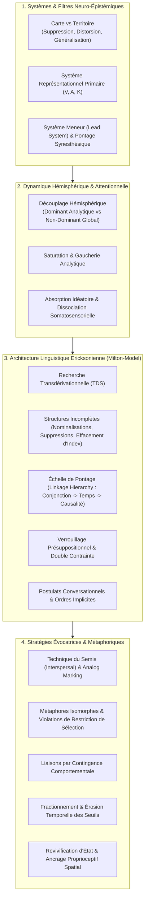

# Patterns of the Hypnotic Techniques of Milton H. Erickson Vol 1
**Formateur :** Bandler & Grinder | **ID :** `bandler-grinder-patterns-of-the-hypnotic-techniques-of-milton-h-erickson-vol-1` | **Tranches :** 18

# Synthèse Architecturale du Cours

**Ouvrage de référence :** *Patterns of the Hypnotic Techniques of Milton H. Erickson, M.D. – Volume 1*  
**Auteurs & Modélisateurs :** Richard Bandler & John Grinder  

---

### 1. Thèse Centrale & Philosophie du Cours

#### La vision spécifique de Bandler & Grinder vs l'approche standard
Bandler et Grinder démystifient radicalement l'hypnose ericksonienne : là où la tradition psychiatrique et médicale classique postulait l'existence d'un « don », d'un magnétisme intuitif ou d'un pouvoir suggestif mystique propre à Milton Erickson, ils démontrent qu'il s'agit d'une **technologie linguistique et neuro-sémantique rigoureusement reproductible**.

Leur posture repose sur l'application conjointe de la **grammaire transformationnelle de Noam Chomsky** et de la **neurologie différentielle hémisphérique** :
* **Décodage cybernétique plutôt que directif :** L'hypnose n'est pas une imposition autoritaire de la volonté du praticien sur un sujet passif, mais un guidage stratégique de l'attention du sujet pour contraindre son système nerveux à fouiller ses propres structures profondes (*Deep Structure*).
* **Acceptation et utilisation intégrale (*Utilization Approach*) :** Contrairement aux protocoles standardisés rigides qui traitent la résistance ou l'absence de réponse immédiate comme un échec, la posture ericksonienne/P&G pose que tout comportement, symptôme, mouvement involontaire, posture ou bruit environnemental est immédiatement intégré (*paced*) et réinvesti comme levier d'induction ou de changement.
* **Respect structurel des modèles du monde :** Le thérapeute n'impose pas son propre modèle cognitif ; il utilise un langage formellement « vide de contenu spécifique » (indéterminations sémantiques, nominalisations, suppressions d'index) pour que le sujet remplisse lui-même la structure avec son matériel expérientiel le plus congruent.

#### Le fil rouge méthodologique : La Triade Universelle Induction/Intervention
Toutes les techniques, métaphores et interventions du volume sont unifiées par une boucle cybernétique en trois temps :
1. **Pacing de l'expérience sensorielle immédiate (Observable & Incontestable) :** Synchronisation analogique et linguistique sur ce qui est biologiquement irréfutable (respiration, clignements d'yeux, posture, tonus), validant le système critique et instaurant une boucle de biofeedback fermée.
2. **Surcharge, distraction ou dérivation de l'hémisphère dominant (Analytique / Verbal / Linéaire) :** Saisie et neutralisation du filtre critique par des asyntaxismes, des paradoxes, des violations de restrictions de sélection, la saturation d'attention ou des tâches de surface (interspersal).
3. **Accès et activation directe de l'hémisphère non-dominant (Global, Kinesthésique, Analogique) :** Déclenchement de la recherche transdérivationnelle (*Transderivational Search*) et greffe de suggestions indirectes, métaphores homomorphes et pontages synesthésiques sans réactance psychologique.

---

### 2. Carte des Concepts & Leviers Émergents



#### Écosystème des leviers clés :
* **Recherche Transdérivationnelle (TDS) :** Le pivot moteur. Dès qu'une Surface Structure est incomplète (suppression d'arguments, nominalisation), le conscient cherche le sens et l'inconscient fouille ses représentations profondes pour combler le blanc, produisant l'état de transe.
* **Échelle de Pontage (*Linkage Hierarchy*) :** L'outil de transition invisible. En connectant un fait actuel (*Pacing*) à un état futur désiré (*Leading*) par simple conjonction (`et`), puis relation temporelle (`pendant que`, `au fur et à mesure que`), puis lien causal explicite (`fait en sorte que`), le cerveau ne perçoit aucune frontière entre le réel et le suggéré.
* **Le Système Meneur (*Lead System Overlap*) :** Le levier de flexibilité représentationnelle. S'appuyer sur la modalité d'accès immédiate (souvent kinesthésique interne) pour faire glisser sans friction le sujet vers un système initialement inaccessible (ex. hallucinations visuelles).
* **Le Saupoudrage (*Interspersal Technique*) :** Le ratio signal/bruit. Le conscient est piégé par une trame narrative banale, agricole ou chaotique, tandis que les commandes thérapeutiques marquées analogiquement perforent le filtre sans réactance.
* **L'Isomorphisme Végétal/Biologique :** Support projectif qui réactive l'homéostasie et les fonctions involontaires sans heurter la mémoire traumatique de la pathologie.

---

### 3. Tableau Récapitulatif des Techniques & Démonstrations

| Technique / Exercice | Objectif Opératoire | Déclencheur / Indication | Séquence Résumée |
|---|---|---|---|
| **Pacing Somato-Sensoriel & Bio-Feedback Verbal** | Éteindre l'alerte critique de l'hémisphère dominant par validation perceptive continue. | Début de toute induction ; sujet hypervigilant, anxieux ou dubitatif. | 1. Calibrer la physiologie (respiration, battements, micro-mouvements).<br>2. Formuler des descriptions verbales calquées sur l'observable incontestable.<br>3. Ajuster son propre débit, tempo et respiration en miroir direct. |
| **Ratification par Résonance Somatique (*Inevitability*)** | Rendre la suggestion mécaniquement irréfutable par coïncidence proprioceptive. | Levitation du bras, approfondissement de transe, contournement du déni. | 1. Repérer un mouvement corporel biomécaniquement obligatoire (ex. cage thoracique à l'inspiration).<br>2. Synchroniser la suggestion verbale sur ce mouvement précis (*« votre main se soulève »*).<br>3. Ratifier le fait accompli : le cerveau ne peut plus nier la réponse. |
| **Échelle de Pontage Linguistique (*Linkage Hierarchy*)** | Transformer imperceptiblement un fait actuel vérifié en une réponse hypnotique non volontaire. | Transition fluide de la veille vers la transe ; amener un comportement cible. | 1. Énoncer 2 ou 3 truismes incontestables (Pacing).<br>2. Connecter le comportement cible via `Et...` (conjonction).<br>3. Enchaîner avec `Pendant que...` (temps), puis `Fait que... / Vous amène à...` (causalité). |
| **Indétermination Sémantique & TDS (Milton-Model)** | Forcer le système nerveux à projeter son propre matériel interne sans résistance. | Sujet intellectuel, besoin d'induire une introspection sans connaître le contenu du problème. | 1. Émettre des phrases à suppression d'index de référence (*« une certaine sensation »*).<br>2. Utiliser des nominalisations (*confort, compréhension*).<br>3. Intégrer des prédicats non spécifiés et lectures de pensée (*« vous savez déjà »*). |
| **Verrouillage Présuppositionnel & Double Contrainte** | Court-circuiter le choix d'entrer ou non en transe en déplaçant l'attention sur un détail annexe. | Sujets résistants, personnalités polaires ou ayant un fort besoin de contrôle. | 1. Encapsuler la suggestion principale dans une subordonnée temporelle ou factive.<br>2. Donner une alternative apparente sur un élément secondaire (*« Préférez-vous entrer en transe assis ou plus confortablement calé ? »*).<br>3. Valider la réalité sous-jacente quel que soit le choix de surface. |
| **Technique de l'Interspersal Métaphorique (Cas "Joe")** | Anesthésie de douleurs intratables (organiques, cancer) et contournement du rejet de l'hypnose. | Douleurs sévères, échec médicamenteux, patient hostile au mot « hypnose ». | 1. Engager une narration banale sur un sujet extérieur neutre (ex. germination d'une tomate).<br>2. Saupoudrer des suggestions impératives de confort et d'engourdissement en les marquant analogiquement (ton, pause).<br>3. Maintenir le conscient captif de l'histoire pendant que le système nerveux intègre les commandes analgésiques. |
| **Liaison par Contingence Comportementale (*Combined Task*)** | Rendre une réponse hypnotique inévitable en la liant à un geste physique déjà engagé. | Consolidation de suggestions post-hypnotiques ; inductions rapides. | 1. Identifier un acte moteur ou cognitif inévitable que le sujet va accomplir (*s'asseoir, franchir la porte*).<br>2. Lier la réponse hypnotique à cet acte (*« Dès que votre dos touche le dossier, vos yeux se ferment complètement »*).<br>3. Conditionner la sortie de transe à l'intégration inconsciente d'un apprentissage. |
| **Fractionnement Temporel & Érosion des Seuils** | Éliminer un spasme ou un symptôme à seuil rigide (ex. vessie spastique, phobie). | Symptômes déclenchés par des limites de temps fixes ou des ancrages rigides. | 1. Partir du seuil pathologique rigide (ex. 15 minutes).<br>2. Découper le temps en incréments infinitésimaux contigus (*16, 17, 18 min...*).<br>3. Répéter la formule sémantique de relativisation (*« quelle est la différence ? »*) pour dissoudre l'ancrage de panique. |
| **Postulat Conversationnel & Atténuation de Réactance** | Déclencher l'exécution motrice immédiate sans susciter de réflexe d'opposition délibéré. | Sujets réactifs aux ordres directs ou aux figures d'autorité. | 1. Remplacer l'impératif direct par une question sur la capacité ou le désir (*« Pouvez-vous fermer les yeux ? »*).<br>2. Ne pas attendre une réponse verbale : calibrer l'exécution somatomotrice réflexe.<br>3. Ratifier le mouvement comme l'amorce de la transe. |
| **Régression par Réactivation des Apprentissages Primordiaux** | Réactiver la neuroplasticité enfantine en contournant le filtre analytique de l'adulte. | Blocages d'apprentissage, rigidité mentale, impossibilité de modifier une croyance adulte. | 1. Évoquer les premiers apprentissages scolaires élémentaires (confusion spatiale `b`/`d`, `6`/`9`).<br>2. Revivre kinesthésiquement l'état d'avant la compréhension (confusion confortable).<br>3. Ancrer l'accès à ce réservoir d'apprentissage inconscient pour installer de nouvelles réponses physiologiques. |
| **Ré-entrée Rapide par Ancrage Spatial & Reviviscence Kinesthésique** | Réinstaller instantanément une transe profonde sans ré-induction verbeuse. | Ré-induction chez un sujet ayant déjà expérimenté un état de transe stable. | 1. Repérer la posture, le fauteuil et l'orientation spatiale de la transe précédente.<br>2. Placer le sujet dans la configuration proprioceptive identique.<br>3. Utiliser une phrase passerelle contextuelle (*« C'est comme si nous parlions à nouveau du plant de tomate »*) pour déclencher le recall somatique immédiat. |
| **Pontage Synesthésique par Système Meneur (*Lead System Overlap*)** | Accéder à une modalité sensorielle bloquée (ex. images visuelles) sans activer le dialogue interne. | Sujets « kinesthésiques purs » affirmant ne rien pouvoir visualiser en hypnose. | 1. Ancrer l'attention dans le système dominant accessible (kinesthésique interne : battements, micro-mouvements).<br>2. Créer une intersection sensorielle transmodale (ex. sensation d'oscillation du corps liée au mouvement d'un point lumineux).<br>3. Glisser le prédicat linguistique du kinesthésique vers le visuel, permettant au cortex non dominant de générer l'imagerie sans résistance critique. |

---

## Extractions Détaillées par Tranche (Opératoire & Verbatim)


## --- Tranche 1 / 18 ---

### 1. Mécanismes & Principes Actifs

* **La dérivation linguistique comme recherche transdérivationnelle inconsciente**  
  *Principe actif :* En grammaire transformationnelle (Chomsky), une phrase prononcée en Surface Structure ($SS$) dérive d'une Deep Structure ($DS$) complète par des opérations de suppression (deletions), distorsion (distortions) et généralisation (generalizations). Lorsqu'un praticien prononce une phrase de surface incomplète (ex. : *"The window was broken"* où l'agent et l'instrument sont supprimés), le système nerveux de l'auditeur est structurellement contraint de faire le chemin inverse : régresser de la surface vers la structure profonde pour lui donner un sens. Ce traitement linguistique s'exécute sous le seuil de la conscience vigile, mobilisant des associations expérientielles internes pour combler les lacunes syntaxiques.  
  *Tags :* #derivation_transformationnelle #structure_de_surface_vs_profonde #recherche_inconsciente_du_sens #suppression_syntaxique

* **Le découplage hémisphérique fonctionnel (Dominant vs Non-Dominant)**  
  *Principe actif :* Erickson opérationnalise l'inconscient à travers une triple dynamique neurologique :  
  1. *Pacing* et distraction de l'hémisphère dominant (gauche, analytique, verbal) pour saturer ses mécanismes de contrôle et de défense critique.  
  2. Utilisation des processus de décodage linguistique sous-jacents de l'hémisphère dominant (qui s'exécutent en tâche de fond hors de l'attention consciente).  
  3. Accès direct à l'hémisphère non-dominant (droit, holistique, spatial, somatique, associatif).  
  L'induction ne force pas un état ; elle surcharge l'arbitre logique pour libérer le traitement global et non-linéaire du système nerveux.  
  *Tags :* #deconnexion_analytique #distraction_hemispherique #acces_non_dominant #triade_strategique_induction

* **Les trois filtres universels de modélisation épistémologique**  
  *Principe actif :* L'être humain ne réagit jamais directement à la réalité objective mais à une carte interne construite via trois mécanismes cognitifs continus :  
  - *Suppression (Deletion) :* Filtrage d'une immense quantité de stimuli sensoriels pour éviter la surcharge cognitive du système nerveux.  
  - *Distorsion (Distortion) :* Mutation de l'information brute (capacité à imaginer l'inexistant, planifier le futur ou créer une hallucination positive/négative).  
  - *Généralisation (Generalization) :* Élévation d'une instance unique en catégorie globale pour automatiser les réponses motrices et sémantiques.  
  En transe, le praticien exploite délibérément ces trois opérations fondamentales plutôt que de lutter contre elles.  
  *Tags :* #carte_vs_territoire #suppression #distorsion #generalisation #filtres_representationnels

* **Le système représentationnel hautement valorisé (Primary Representational System)**  
  *Principe actif :* Bien que les entrées soient multimodales (input channels), chaque individu traite et organise préférentiellement son expérience à travers un système interne spécifique : Visuel ($V$), Auditif ($A$) ou Kinesthésique ($K$). L'utilisation exclusive de prédicats (verbes, adverbes, adjectifs) correspondant à ce système court-circuite la friction cognitive : le cerveau du sujet traite l'information sans devoir la traduire dans un autre code sensoriel, maximisant la réceptivité et l'acceptation involontaire des suggestions.  
  *Tags :* #systeme_representationnel_dominant #predicats_sensoriels #isomorphisme_linguistique #alignement_vak

* **Le bio-feedback analogique et verbal (Pacing sensoriel direct)**  
  *Principe actif :* L'alignement verbal sur l'expérience sensorielle en cours produit une boucle de rétroaction cybernétique où le praticien devient un miroir vivant du sujet. En formulant des descriptions synchronisées d'événements observables (mouvements respiratoires, battements de cils, micromouvements musculaires) et en ajustant sa propre physiologie (posture, respiration, tempo, syntaxe), le praticien supprime tout écart entre son discours et la réalité du sujet, éliminant tout réflexe critique de rejet.  
  *Tags :* #pacing_observable #biofeedback_humain #synchronisation_psychophysiologique #validation_perceptive_continue

* **Niveaux de communication à compréhensions stratifiées (Double/Triple Takes)**  
  *Principe actif :* Une formulation unique peut être entendue de façon diamétralement opposée selon le niveau de décodage (conscient vs inconscient, sémantique vs phonétique/tonal). Erickson s'appuie sur le mécanisme neurologique des associations proches et distantes : la conscience enregistre le sens littéral de premier plan tandis que l'inconscient intègre les implications phonétiques, analogiques ou contextuelles sous-jacentes.  
  *Tags :* #double_take #communication_multiniveaux #bifurcation_semantique #associations_distantes

---

### 2. Protocoles, Techniques & Démonstrations (Étape par Étape)

#### Protocole 1 : Le Pacing Verbal d'Expériences Observables (Bio-Feedback Induction)
* **Intention / Indication :** Fixation de l'attention, arrêt de l'esprit critique, amorçage de l'état de transe chez les sujets rationnels, résistants ou analytiques.
* **Mise en place & Pré-framing :** Installer le sujet confortablement. Le praticien se place à un angle lui permettant d'observer sans intrusion les micromouvements thoraciques, abdominaux et les extrémités (mains, doigts).
* **Séquence d'actions pas à pas :**
  1. *Observation passive & Calibration fine :* Repérer le cycle respiratoire exact (inspiration, point mort haut, expiration, point mort bas) et les mouvements périphériques minimaux (tressaillement de doigt, déglutition, paupières).
  2. *Synchronisation somatique immédiate :* Caler sa propre cadence respiratoire et son débit de parole sur l'expiration du sujet.
  3. *Verbalisation synchronisée en temps réel :* Énoncer des descriptions factuelles indiscutables calées sur l'instant exact où l'événement somatique a lieu (ex. prononcer les mots d'expiration pendant la descente de la cage thoracique).
  4. *Incorporation des micromouvements :* Introduire les mouvements involontaires naissants dans la description (ex. si un doigt bouge ou si la main se soulève d'un millimètre, le refléter verbalement aussitôt sans temps de latence).
* **Signes de calibration pour valider :**
  - Ralentissement spontané du rythme respiratoire du sujet calé sur celui du praticien.
  - Fixité du regard ou battements de paupières plus lents.
  - Perte de tonicité musculaire visible au niveau des épaules et de la mâchoire.

---

#### Protocole 2 : L'Isomorphisme des Prédicats Sensoriels
* **Intention / Indication :** Établir un rapport hypnotique instantané, fluidifier les inductions, éliminer les résistances de traitement chez un sujet inconnu.
* **Mise en place & Pré-framing :** Poser une question neutre ou observer l'expression libre du sujet dans la conversation préliminaire afin de repérer le lexique dominant.
* **Séquence d'actions pas à pas :**
  1. *Repérage du lexique prédicatif :* Isoler les verbes, adverbes et adjectifs utilisés par le sujet.  
     - *Visuel :* clair, voir, perspective, éclairer, horizon, flou, regarder, image.  
     - *Auditif :* entendre, résonner, sonner, bruit, accorder, écouter, silence, ton.  
     - *Kinesthésique :* saisir, toucher, lourd, peser, chaud, solide, tenir, contact, glisser.
  2. *Sélection du canal principal :* Identifier le système qui prédomine structurellement dans la cartographie du sujet.
  3. *Restitution en boucle (Mirroring linguistique) :* Formuler l'ensemble des instructions, métaphores et suggestions en utilisant exclusivement des prédicats issus du même canal sensoriel.
* **Signes de calibration pour valider :**
  - Validation verbale immédiate sans hésitation ("Oui, exactement").
  - Mouvements d'approbation involontaires (hochements de tête).
  - Absence de pause cognitive de reformulation chez le sujet.

---

#### Protocole 3 : La Manœuvre d'Exclusion par Double Lien Préparatoire (Démonstration Kristina Erickson)
* **Intention / Indication :** Contourner un droit de refus légitime, éliminer l'évitement ou la non-coopération sur une procédure anxiogène ou invasive.
* **Mise en place & Pré-framing :** Reconnaître d'abord la fatigue et l'inconfort accumulés par le sujet face aux interventions précédentes pour valider totalement son état émotionnel (pacing affectif).
* **Séquence d'actions pas à pas :**
  1. *Énumération exhaustive des contraintes passées (Pacing saturant) :* Détailler avec sympathie toutes les intrusions subies lors des étapes préalables ("regarder dans les yeux, les oreilles, le nez, tapoter partout...").
  2. *Introduction de la condition de libération :* Relier l'accès à la récompense finale (pouvoir partir, être libéré, "dire au revoir") à la complétion immédiate de la tâche redoutée.
  3. *Présupposition d'exécution :* Présenter l'action refusable non pas comme un choix ("Voulez-vous faire l'examen ?"), mais comme une simple transition temporelle inévitable avant la sortie.
* **Signes de calibration pour valider :**
  - Soupir de soulagement ou acceptation passive résignée.
  - Absence totale d'opposition verbale ; le sujet attend patiemment la fin de la procédure pour obtenir le bénéfice promis.

---

### 3. Heuristiques, Subtilités & "Sagesse du Praticien"

* **Heuristique de description de l'expérience :**
  > *Si* le sujet est encore en veille active ou manifeste un contrôle conscient rigide,  
  > *Alors* commence exclusivement par des descriptions d'expériences *observables* et incontestables (respiration, posture, bruits ambiants),  
  > *Parce que* son hémisphère dominant ne peut pas contredire ce que ses propres sens perçoivent factuellement, ce qui désamorce le réflexe critique.

* **Heuristique du bio-feedback analogique :**
  > *Si* tu veux accélérer la transe sans multiplier les mots,  
  > *Alors* adopte la posture physique, la cadence respiratoire, le tempo vocal et la syntaxe du sujet avant de commencer à les faire varier progressivement,  
  > *Parce que* le système nerveux du sujet ressent intuitivement cette résonance corporelle comme une validation absolue de son état interne (*pacing somatique*).

* **Heuristique des lacunes syntaxiques (Deep Structure) :**
  > *Si* tu construis une phrase d'induction ou de suggestion,  
  > *Alors* supprime délibérément l'agent de l'action ou l'instrument (ex. : *"Un changement peut être ressenti"* plutôt que *"Je vais changer votre état avec mes mots"*),  
  > *Parce que* l'inconscient du sujet est forcé de combler la suppression en insérant ses propres références et significations intimes, éliminant tout risque de rejet d'un contenu imposé.

* **Heuristique des niveaux d'expression vocale (Frank Bacon effect) :**
  > *Si* tu prononces une commande ou un mot simple (ex. *"Non"*, *"Maintenant"*, *"Reposez"*),  
  > *Alors* charge ton intonation, ton timing et ton analogique corporel pour transmettre un message simultané qui contredit ou élargit le sens littéral,  
  > *Parce que* le conscient traite le lexique tandis que l'inconscient exécute la commande véhiculée par l'analogique et la tonalité.

* **Erreurs de débutant corrigées :**
  - *Le piège de la verbigération répétitive et autoritaire :* Remplacer la répétition mécanique de suggestions directes (*"Dormez, dormez, vous êtes lourd"*) par une communication stratifiée et significative. L'injonction autoritaire alerte l'esprit conscient et déclenche la résistance, alors que le pacing multiniveaux guide le système nerveux sans confrontation.
  - *L'inadéquation prédicative :* Tenter de guider un sujet kinesthésique avec des métaphores visuelles lumineuses ou des panoramas détaillés. Cela oblige son cerveau à traduire le visuel en sensation, générant de la fatigue cognitive et rompant l'état d'absorption.

---

### 4. Pépites Verbatim & Patterns Linguistiques (MOT À MOT EN V.O.)

* **Extrait 1 :**
  > "... breathing in and out... ... hand lifting, lifting..."
  * **[Analyse du Pattern] :** Pacing verbal d'expérience observable en temps réel. La formulation est calibrée et rythmée exactement sur l'action sensorielle du sujet. L'absence de pronoms personnels ou d'impératifs directs transforme l'affirmation en simple constat physiologique incontestable, neutralisant la critique de l'hémisphère dominant.

* **Extrait 2 :**
  > "... I see what you are saying, clearly, looking at this work will show you how to improve your work, Imagine how this appears to be dull reading."
  * **[Analyse du Pattern] :** Empilement saturant de prédicats visuels (*see*, *clearly*, *looking*, *show*, *imagine*, *appears*). L'isomorphisme lexical force le traitement de l'information par les aires corticales visuelles du sujet, assurant une congruence totale avec sa carte du monde interne.

* **Extrait 3 :**
  > "... I want you firmly to grasp this concept; I feel you can overcome some hard problems; Can you get in touch with, and get a handle on, what this means."
  * **[Analyse du Pattern] :** Empilement de prédicats kinesthésiques (*firmly*, *grasp*, *feel*, *hard*, *get in touch with*, *get a handle on*). Les abstractions cognitives sont traduites en sensations tactiles et proprioceptives directes, mobilisant le traitement somatosensoriel.

* **Extrait 4 :**
  > "... Sounds interesting to me; I will talk to you later; I will be hearing from him soon; so in other words we will all get together and be sounding boards for these ideas."
  * **[Analyse du Pattern] :** Alignement auditif systématique via prédicats et expressions consacrées (*sounds*, *talk*, *hearing*, *in other words*, *sounding boards*). La syntaxe s'adapte strictement au canal auditif interne du sujet pour éviter toute déperdition ou distorsion lors de l'intégration.

* **Extrait 5 :**
  > "The window was broken"
  * **[Analyse du Pattern] :** Structure de surface ($SS$) avec suppression passive de l'agent et de l'instrument. La structure profonde sous-jacente impose une recherche transdérivationnelle inconsciente chez l'auditeur pour instancier *qui* a brisé la fenêtre et *avec quoi*.

* **Extrait 6 :**
  > "Every patient has the right to refuse permission for a rectal and hernial examination, and many patients do. But when I have reached that part of the physical examination I tell my patients, sympathetically, that I know they are tired of having me peer into their eyes, and peak into their ears and up their noses, and poking and thumping here and there, but that, as soon as I complete the rectal and hernial examinations, they can say good-bye to me."
  * **[Analyse du Pattern] :** Double lien contextuel (Double Bind) et présupposition temporelle enchâssée (*as soon as I complete...*). La proposition lie la libération finale souhaitée par le sujet ("dire au revoir") à l'exécution préalable de la procédure intrusive, supprimant l'alternative du refus sans confrontation autoritaire directe.


## --- Tranche 2 / 18 ---

### 1. Mécanismes & Principes Actifs

#### 1. La Boucle de Biofeedback Somato-Sensoriel (Pacing Physiologique Global)
* **Principe actif** : Le praticien transforme l'intégralité de ses canaux d'émission (posture, fréquence respiratoire, tempo vocal, dilatation veineuse, micro-gestes) en un miroir dynamique des canaux de sortie du sujet. Lorsque le sujet perçoit simultanément son propre mouvement interne (ex. soulèvement thoracique) et le même mouvement synchronisé dans le champ visuel ou auditif externe (ex. mouvement corporel ou débit vocal du praticien), le système nerveux traite cette cohérence comme une boucle fermée d'auto-référence. L'absence de divergence sensorielle éteint les réflexes d'alerte et de filtrage critique de l'hémisphère dominant.
* **Tags émergents** : `#biofeedback_loop #isomorphisme_physiologique #miroir_neuro_sensoriel #extinction_du_filtrage_critique`

#### 2. L'Effet de Ratification par Résonance Somatique (Somatosensory Inevitability)
* **Principe actif** : Synchroniser une suggestion de mouvement ("*hand lifting*") sur un acte mécanique obligatoire et biologiquement non réfutable (ex. le gonflement de la cage thoracique à l'inspiration qui soulève passivement les bras posés sur les cuisses). L'expérience proprioceptive réelle devance ou coïncide avec le mot : le cerveau ne peut logiquement pas contester le fait sensoriel brut ("*they haven't got an opportunity to deny it*"). La suggestion est immédiatement ratifiée comme une description du présent et non comme un ordre extérieur.
* **Tags émergents** : `#ratification_somatique #verite_biologique_inevitable #ancrage_respiratoire #bypassing_denial`

#### 3. L'Échelle de Pontage Linguistique (Linkage Hierarchy)
* **Principe actif** : L'esprit humain organise la réalité au moyen de modélisations causales et temporelles pour donner du sens à l'environnement. En reliant une expérience vérifiable dans l'instant (Pacing) à un comportement désiré (Leading) par un connecteur syntaxique de plus en plus contraignant, la frontière entre ce qui arrive déjà et ce qui va arriver s'efface totalement :
  1. *Conjonction simple* : juxtaposition associative neutre (A *et* B).
  2. *Causalité implicite* : couplage temporel créant une dépendance de déroulement (*Pendant que / Au fur et à mesure que* A, B).
  3. *Cause à effet (Mal-formation sémantique)* : contrainte neurologique directe où A produit obligatoirement B (*A fait que / entraîne* B). Le cerveau accepte la chaîne comme une loi physique plutôt que comme une injonction persuasive.
* **Tags émergents** : `#pontage_syntaxique #linkage_principles #cause_effet_artificiel #effacement_de_frontiere_pacing_leading`

#### 4. Le Pacing de l'Expérience Non-Observable par Indétermination Sémantique
* **Principe actif** : L'utilisation calculée de structures linguistiques de surface privées d'indices de référence obligent l'inconscient du sujet à une recherche transdérivationnelle (Transderivational Search). Le sujet *doit* combler le vide sémantique en projetant ses propres sensations, pensées et processus internes du moment pour rendre la phrase intelligible.
  * **Suppression d'index de référence** : termes vagues qui s'adaptent à n'importe quel contenu interne ("*a certain sensation*").
  * **Violation des restrictions de sélection** : attribution d'un prédicat animé/humain à une entité non humaine/inanimée ("*the tomato plant can feel good*"), forçant l'esprit à dériver le sens vers lui-même ("*je peux me sentir bien*").
  * **Suppression (Deletion)** : retrait d'arguments clés de la Structure Profonde (qui s'émerveille ? de quoi ?), forçant l'interlocuteur à être l'agent implicite du verbe.
  * **Nominalisation** : transformation d'un verbe de processus en un nom figé (ex. *sentir/percevoir* $\rightarrow$ *sensation*), effaçant l'agent, l'objet et le mode d'action pour offrir un réceptacle vide instantanément validé.
  * **Prédicats non spécifiés & Lecture de pensée** : verbes cognitifs indéterminés (*wonder, know, understand*) posant l'autorité du praticien sur l'espace interne sans révéler la source de l'information.
* **Tags émergents** : `#recherche_transderivationnelle #effacement_d_index_de_reference #nominalisation_receptacle #violation_de_restriction_de_selection #lecture_de_pensee`

#### 5. Verrouillage Présuppositionnel & Double Contrainte Syntaxique
* **Principe actif** : Encapsuler le résultat hypnotique souhaité à l'intérieur d'une clause subordonnée relative ou derrière un prédicat factif (*aware, realize, notice*) ou un adverbe qualificatif (*deeply*). Le focus conscient du sujet est accaparé par la question périphérique ou le qualificatif, tandis que l'action ou l'état de base est intégré neurologiquement comme une réalité déjà acceptée pour que la phrase ait un sens.
* **Tags émergents** : `#presupposition_enchassee #predicat_factif #adverbe_verrou #court_circuit_conscient`

#### 6. Structures Moindres Incluses & Marquage Analogique
* **Principe actif** : Insérer une directive impérative ou une interrogation à l'intérieur d'une phrase déclarative socialement bénigne (*Lesser Included Structures*). L'esprit conscient traite l'anecdote ou la narration de surface, tandis que le marquage analogique (micro-inflexion vocale, changement de tempo, déplacement d'accentuation, micro-geste) détache la commande cachée pour le traitement inconscient. Le système immunitaire psychologique (la réactance / résistance) n'est jamais déclenché car aucune sommation directe n'apparaît en surface.
* **Tags émergents** : `#lesser_included_structures #marquage_analogique #double_communication #injonction_focalisee`

#### 7. La Technique du Saupoudrage (Interspersal Technique) & Dilution Temporelle
* **Principe actif** : Séparer l'induction formelle de l'intervention thérapeutique en saturant le canal conscient avec un récit technique totalement étranger au symptôme (ex. la culture des tomates, le jardinage), tout en distillant (*interspersing*) des fragments d'instructions thérapeutiques et de recadrages temporels. L'incapacité du conscient à lier le sujet abordé à sa pathologie empêche toute interférence critique. La fragmentation progressive du temps (passer de 15 min, à 30 min, 35, 45, 50, 60 minutes par micro-incréments "sans importance") reconditionne la plasticité neurologique du contrôle viscéral sans lutte frontale.
* **Tags émergents** : `#technique_du_saupoudrage #interspersal #fragmentation_temporelle #saturation_d_incoherence #reconditionnement_autonome`

---

### 2. Protocoles, Techniques & Démonstrations (Étape par Étape)

#### Protocole 1 : Levitation de la Main par Ratification Respiratoire Inévitable
* **Intention / Indication** : Provoquer une catalepsie ou une lévitation de la main chez un sujet sceptique, analytique ou résistant aux suggestions motrices directes.
* **Mise en place & Pré-framing** : Faire asseoir le sujet, dos droit mais confortable, les deux mains reposant à plat sur les cuisses. Aucun pré-requis de transe annoncé.
* **Séquence d'actions pas à pas** :
  * **Étape 1 (Calibration du cycle)** : Observer le rythme respiratoire du sujet (soulèvement et abaissement du thorax/diaphragme).
  * **Étape 2 (Instruction cinétique calée)** : Au moment exact où l'inspiration commence, donner l'instruction de respirer profondément si nécessaire, ou attendre une inspiration spontanée.
  * **Étape 3 (Ratification verbale synchronisée)** : Précisément pendant la phase ascendante de la cage thoracique (qui tire mécaniquement les épaules et donne l'illusion proprioceptive d'allègement ou de soulèvement des mains sur les cuisses), prononcer : *"lifting... lifting..."*.
  * **Étape 4 (Amplification intermittente)** : Caler l'instruction verbale sur une inspiration sur deux (*"taking every other inspiration to say 'lifting'"*) pour laisser le système proprioceptif du sujet généraliser la sensation d'autonomie motrice.
  * **Étape 5 (Transition de Pacing à Leading)** : Enchaîner dès que la micro-levitation musculaire prend le relais de l'illusion mécanique, en liant ce mouvement à une profondeur de transe accrue.
* **Signes de calibration** :
  * Respiration synchronisée avec le mot.
  * Décollement des doigts ou allègement de la pression cutanée main/cuisse.
  * Incapacité du sujet à nier la sensation somatique immédiate.

#### Protocole 2 : L'Entraînement Syntaxique Pacing-to-Leading (Les 3 Degrés de Liaison)
* **Intention / Indication** : Guider un état interne (relaxation, transe, catalepsie, anesthésie) à partir de faits immédiatement observables, sans éveiller de friction cognitive.
* **Mise en place & Pré-framing** : Repérer au moins 2 ou 3 faits externes indiscutables (ce que le sujet voit, entend, ou fait physiquement).
* **Séquence d'actions pas à pas** :
  * **Étape 1 (Pacing sensoriel direct)** : Énoncer 2 descriptions de l'expérience sensorielle immédiate vérifiable.
  * **Étape 2 (Liaison Degré 1 - Conjonction Simple)** : Lier le fait au comportement cible via le connecteur "*et*" (*"you are sitting there, listening to the sound of my voice AND relaxing more and more"*).
  * **Étape 3 (Liaison Degré 2 - Causalité Implicite)** : Renforcer la dépendance temporelle par un marqueur de simultanéité (*"AS you sit there, listening to the sound of my voice, you will relax more and more"*).
  * **Étape 4 (Liaison Degré 3 - Cause à Effet Sémantique)** : Verrouiller la transition en posant le fait vérifié comme cause directe et contraignante de l'état interne visé (*"sitting there, listening to the sound of my voice, WILL MAKE you relax more and more"*).
* **Signes de calibration** :
  * Validation inconsciente (hochements de tête imperceptibles, ralentissement respiratoire).
  * Absence de micro-tensions musculaires ou de clignements de paupières rapides (signes de rejet logique).

#### Protocole 3 : La Technique du Saupoudrage Thérapeutique (Cas Joe le Fermier - Énurésie / Fréquence Urinaire)
* **Intention / Indication** : Traitement d'un symptôme psychosomatique ou compulsif rigide chez un patient défiant, hostile, désespéré, ayant accumulé des échecs médicaux et rejetant l'hypnose formelle.
* **Mise en place & Pré-framing** :
  * Ne pas chercher à convaincre, rassurer ou théoriser le problème.
  * Retirer les repères d'interférence temporelle consciente du bureau (détourner le cadran de l'horloge hors de la vue du patient).
  * Trouver une métaphore isomorphique neutre issue du propre univers de vie du sujet (ex. l'agriculture, la croissance des plantes, les cycles de la terre) et la dérouler comme récit de fixation de l'attention consciente.
* **Séquence d'actions pas à pas** :
  * **Étape 1 (Absorption consciente par non-pertinence apparente)** : Lancer une narration détaillée, captivante, sur un sujet familier (faire pousser des plantes) mais sans lien rationnel apparent avec le cabinet ou la vessie. L'esprit conscient cherche la logique et se fatigue.
  * **Étape 2 (Inversion paradoxale de départ)** : Saupoudrer une première idée qui dramatise légèrement ou réduit le temps pour casser la rigidité du symptôme (*"think of your bladder needing emptying every 15 minutes instead of every half hour... Not difficult to think that"*).
  * **Étape 3 (Déstabilisation de la précision temporelle)** : Introduire l'imprécision des horloges (*"A watch can run slow... or fast... be wrong even a minute... two, five minutes"*).
  * **Étape 4 (Incrémentation fragmentée banalisée)** : Décaler imperceptiblement le temps d'attente par petites touches additives, en répétant le postulat d'indifférence cognitive (*"35, 40 minutes... what's the difference... 35, 36, 41, 42, 45... not much difference... not important difference"*).
  * **Étape 5 (Activation de la ressource historique oubliée)** : Rappeler une expérience passée d'attente réussie sous contrainte (*"lots of times you maybe had to wait when somebody got there ahead of you... you made it... you can again"*).
  * **Étape 6 (Recadrage identitaire sur la compétence accumulée)** : Reconnecter le sujet à ses décennies de pratique viscérale (*"you got half a century or better of practice in waiting behind you... you can use all that... why not use it"*).
* **Signes de calibration** :
  * Rupture de la posture de défi (les bras croisés se relâchent, déglutition, regard qui se fige).
  * Suspension des interruptions verbales.
  * Prolongation spontanée de la durée de la séance sans besoin d'aller aux toilettes.

---

### 3. Heuristiques, Subtilités & "Sagesse du Praticien"

#### Règles Conditionnelles Opératoires (Si -> Alors -> Parce que)
* **Si** le sujet présente une hyper-vigilance critique ou une méfiance envers les ordres directs, **alors** formuler les instructions motrices sous forme de postulats conversationnels (*"Can you place your hands on your thighs?"*), **parce que** cette structure se présente superficiellement comme une question fermée (oui/non), éliminant l'impression de contrainte tout en conservant intacte la force de commande neurologique au niveau implicite.
* **Si** le praticien souhaite évoquer un état interne sans savoir exactement comment le sujet le catégorise, **alors** employer des nominalisations et des verbes non spécifiés (*"a certain sensation"*, *"wonder"*, *"experience"*), **parce que** l'absence d'index de référence contraint l'inconscient du sujet à remplir le vide avec son matériau interne du moment sans pouvoir relever d'inexactitude.
* **Si** un patient arrive avec une attitude de défi agressif (*"Now psychiatrize and hypnotize me and cure this bladder of mine"*), **alors** ne jamais entrer dans la confrontation directe ni tenter de prouver sa compétence ; lancer immédiatement une narration absorbante dérivée de son propre monde (le saupoudrage agricole), **parce que** l'inadéquation apparente du récit désarme son cadre conflictuel et neutralise ses mécanismes de défense.
* **Si** l'on veut introduire une suggestion de transe profonde sans contestation possible, **alors** enchâsser l'affirmation derrière un adverbe ou un prédicat factif (*"I wonder whether you are aware that you are deeply in trance"*), **parce que** le conscient débat uniquement du fait d'en être *conscient* ou du degré (*profondément*), validant implicitement l'existence de la transe comme un présupposé incontestable.

#### Pièges Classiques & Erreurs de Débutant
* **Erreur du débutant** : Donner une suggestion directe de lévitation ou de détente déconnectée de la physiologie en temps réel.
  * *Correction Bandler/Grinder/Erickson* : Être un mécanisme de bio-feedback impitoyablement aiguisé. Si la suggestion vocale n'est pas calée à la milliseconde près sur l'inspiration ou l'expansion veineuse, le sujet enregistre une dissonance et réactive son filtrage critique.
* **Erreur du débutant** : Chercher la cause originelle, l'étiologie historique ou la raison "oubliée" du symptôme (croire qu'il faut comprendre *pourquoi* Joe urine toutes les 30 minutes).
  * *Correction Erickson* : L'origine est expressément jugée sans importance thérapeutique. L'intervention vise uniquement la modification opératoire du comportement perceptif et viscéral ici et maintenant.
* **Erreur de raisonnement logique** : Rejeter les liaisons Cause-Effet au motif qu'elles ne respectent pas la logique formelle.
  * *Correction opératoire* : L'important n'est absolument pas la validité logique de la phrase, mais le principe de modélisation linguistique par lequel l'inconscient du patient structure déjà sa propre réalité. S'il accepte la causalité magique, utilisez sa propre syntaxe pour le guérir.

#### Postulats Philosophiques & Structurels (Bandler & Grinder)
1. **L'incompétence de la conscience vigilante dans la pathologie** : Le conscient du patient est celui qui a créé l'impasse ou qui l'entretient en essayant de la contrôler ; la technique hypnotique a pour rôle premier de le distraire, de l'occuper ou de le neutraliser afin qu'il cesse de s'ingérer stérilement dans un processus qu'il ne comprend pas.
2. **La présence préalable des potentiels de guérison** : Le thérapeute n'implante rien de magique d'extérieur ; il induit un état réceptif permettant d'accéder à des répertoires comportementaux et neurologiques déjà existants mais mal utilisés ou sous-exploités (ex. les 50 ans d'apprentissage de rétention urinaire de Joe).
3. **L'indifférence du contenu direct face au processus de communication** : La même structure hypnotique (l'histoire du plant de tomate saupoudrée) fonctionne de manière équivalente pour une névrose compulsive invalidante ou pour la douleur réfractaire d'un cancer terminal.

---

### 4. Pépites Verbatim & Patterns Linguistiques (MOT À MOT EN V.O.)

#### Pépite 1 : La Ratification Somato-Respiratoire
```text
"Put your hand on your thigh, take a deep breath. What happened to your hand? ... It lifts! ... You time the inspiration. And they haven't got an opportunity to deny it. . . . Later on I thought I would emphasize that, by taking every other inspiration to say 'lifting.'"
```
* **[Analyse du Pattern]** : Utilisation d'un déterminisme biomécanique inévitable (l'inspiration soulève les mains posées sur les cuisses) couplé à une ratification verbale immédiate. Le calage temporel supprime toute possibilité logique ou sensorielle de déni chez le sujet. L'alternance intermittente ("*every other inspiration*") transfère la causalité du phénomène mécanique vers une réponse idéomotrice autonome.

#### Pépite 2 : La Graduation des Trois Niveaux de Liaison Syntaxique
```text
"... you are sitting there, listening to the sound of my voice and relaxing more and more..."
"... as you sit there, listening to the sound of my voice, you will relax more and more..."
"... sitting there, listening to the sound of my voice, will make you relax more and more..."
```
* **[Analyse du Pattern]** : Progression ascendante de la force contraignante du lien :
  1. Conjonction simple (*and*) : association permissive.
  2. Causalité implicite / temporelle (*as... you will*) : couplage synchronisé créant une attente séquentielle.
  3. Cause-Effet direct (*will make you*) : mal-formation sémantique imposant neurologiquement l'écoute de la voix comme le déclencheur physiologique obligatoire de la relaxation.

#### Pépite 3 : Violation de Restriction de Sélection & Projection
```text
"... the tomato plant can feel good..."
```
* **[Analyse du Pattern]** : Violation délibérée des règles de sélection sémantique (attribuer une capacité sensorielle subjective d'éprouver du bien-être à un végétal). L'esprit conscient rejette la validité littérale, ce qui force une dérivation transdérivationnelle inconsciente immédiate : le sujet s'approprie le prédicat (*"I can feel good"*).

#### Pépite 4 : Double Enchâssement Présuppositionnel par Factif et Adverbe
```text
"... I wonder whether you are aware that you are deeply in trance..."
```
* **[Analyse du Pattern]** : Empilement de présuppositions à haute pression :
  1. Prédicat factif (*aware*) : présuppose la vérité absolue de la proposition qui le suit (l'état de transe). Le doute ne porte que sur la prise de conscience du sujet.
  2. Adverbe qualificatif de profondeur (*deeply*) : déplace le traitement critique sur l'intensité de la transe et non sur sa réalité, rendant l'état de transe logiquement inattaquable pour le système nerveux.

#### Pépite 5 : Postulat Conversationnel et Commande Enchâssée
```text
"Can you place your hands on your thighs?"
"... I knew a man once who really understood how to feel good about..."
```
* **[Analyse du Pattern]** :
  * Dans la première phrase, utilisation d'une fausse question de capacité (forme interrogative de surface) qui s'exécute neurologiquement comme un impératif comportemental sans susciter de résistance.
  * Dans la seconde phrase, structure moindre incluse (*lesser included structure*) : l'impératif *"feel good"* est niché dans une narration à la troisième personne, marqué analogiquement par la voix pour être extrait directement par l'inconscient.

#### Pépite 6 : Saupoudrage et Fractionnement Temporel Psychophysiologique
```text
"You know, we could think of your bladder needing emptying every 15 minutes instead of every half hour. . . . Not difficult to think that. . . . A watch can run slow. . . . or fast. . . . be wrong even a minute. . . . even two, five minutes. . . . or think of bladder every half hour. . . . like you've been doing. . . . maybe it was 35, 40 minutes sometimes. . . . like to make it an hour. . . . what's the difference. . . . 35, 36 minutes, 41, 42, 45 minutes. . . . not much difference. . . . not important difference. . . . 45, 46, 47 minutes. . . . all the same. . . . lots of times you maybe had to wait a second or two. . . . felt like an hour or two. . . . you made it. . . . you can again. . . . 47 minutes, 50 minutes, what's the difference. . . . stop to think, no great difference, nothing important. . . . just like 50 minutes, 60 minutes, just minutes. . . . anybody that can wait half an hour can wait an hour. . . . I know it . . . . you are learning. . . . not bad to learn. . . . in fact, good. . . . come to think of it, you have had to wait when somebody got there ahead of you. . . . you made it too. . . . can again. . . . and again. . . . all you want to . . . . hour and 5 minutes. . . . hour and 5 1/2 minutes. . . . what's the difference. . . . or even 6 1/2 minutes. . . . make it 10 1/2, hour and 10 1/2 minutes. . . . one minute, 2 minutes, one hour, 2 hours, what's the difference. . . . you got half a century or better of practice in waiting behind you. . . . you can use all that. . . . why not use it . . . . you can do it . . . . probably surprise you a"
```
* **[Analyse du Pattern]** :
  * *Changement de cadre initial paradoxal* : suggérer d'abord un rythme plus rapide (15 min) pour rendre le problème malléable.
  * *Relativisation sémantique de l'unité de mesure* : lier la perception subjective de la vessie à l'imperfection mécanique d'une montre qui avance ou retarde.
  * *Pacing par micro-incrémentation (Banalisation)* : fractionner le temps en unités insignifiantes (de 35 à 36, puis 41, 42, 45 min) rythmées par le truisme disqualifiant *"what's the difference... not important difference"*.
  * *Réactivation de souvenirs ressources ratifiés* : évoquer des contextes réels où les toilettes étaient occupées pour réactiver l'ancrage somatique de rétention réussie (*"you made it... you can again"*).
  * *Élargissement de la catégorie temporelle* : saut analogique audacieux qui transforme 30 minutes en 1 heure par le postulat *"anybody that can wait half an hour can wait an hour"*, étendu jusqu'à 50 ans d'expertise biologique intégrée (*"half a century... of practice"*).


## --- Tranche 3 / 18 ---

### 1. Mécanismes & Principes Actifs

*   **Technique du semis / Disjonction attentionnelle par interspersal (`Interspersal Technique`)**
    *   *Principe actif* : Consiste à disséminer des suggestions thérapeutiques directes ou indirectes au sein d'une narration banale continue (induction, maintien de transe ou métaphore agricole). L'appareil critique conscient du sujet s'accroche au fil conducteur superficiel (ex. la biologie d'un plant de tomate) pour tenter d'en dégager un sens rationnel. Pendant que l'attention consciente traite ou s'épuise sur cette trame de surface, les commandes thérapeutiques (marquées par de subtiles variations analogiques : ton, tempo, volume) contournent les résistances et sont absorbées directement par le système inconscient sans être filtrées ni rejetées.
    *   *Tags* : #interspersal_technique #semis_hypnotique #contournement_critique #analog_marking #saturation_consciente

*   **Liaison par contingence comportementale / Double tâche indivisible (`Contingency & Combined Task Assignment`)**
    *   *Principe actif* : Mécanisme qui subordonne une réponse hypnotique ou thérapeutique involontaire à une action physique ou cognitive inévitable que le sujet est déjà engagé à accomplir (*"As you sit down... go into trance"* ou *"As you put away your bicycle, close the door"*). Neurologiquement et psychologiquement, refuser une tâche combinée demande un effort d'analyse cognitive infiniment supérieur à l'exécution de la séquence. L'esprit opte pour la moindre résistance en validant l'ensemble de la boucle liée. De plus, rendre le réveil contingent à l'intégration d'un apprentissage (*"as you understand... you will awaken"*) verrouille l'amorce de futures transes par simple conditionnement opérant.
    *   *Tags* : #contingency_binding #tâche_liée #évitement_du_refus #conditionnement_opérant #liaison_inévitable

*   **Dérivation métaphorique homomorphe & Projection somatique indirecte (`Isomorphic Plant Metaphor`)**
    *   *Principe actif* : En développant une analogie sensorielle lente et détaillée sur la germination et la croissance cellulaire d'un organisme végétal (absorption d'eau sans effort, racines à cils, poils protecteurs, développement insensible au jour le jour), le praticien active des réseaux neuronaux d'homéostasie, d'apaisement et de régénération biologique. Chez un sujet souffrant de douleurs physiques intenses (cancer, nécrose) ou de rétention/incontinence, la métaphore du végétal offre un support de projection défocalisé : le corps intègre le confort et le fonctionnement autonome par sympathie végétale sans que le trauma de la pathologie physique ne vienne activer les barrières de défense.
    *   *Tags* : #isomorphisme_biologique #projection_somatique #défocalisation_organique #régulation_autonome #confort_végétatif

*   **Fractionnement par dilatation temporelle & Érosion des seuils (`Temporal Fractionation & Threshold Erosion`)**
    *   *Principe actif* : Utilisé dans le cas de la vessie spastique. Au lieu d'imposer un saut quantique impossible (passer de 15 minutes à 2 heures), le praticien érode l'équivalence de signification par un découpage infinitésimal des unités de temps (*"35, 36 minutes, 41, 42... what's the difference"*). En répétant la formule de relativité *"what's the difference"* et en reliant des durées contiguës, le cerveau perd le point d'ancrage rigide du seuil pathologique. Le seuil temporel subjectif devient fluide, permettant une extension massive sans déclencher le réflexe de panique somatique.
    *   *Tags* : #dilatation_temporelle #érosion_de_seuil #fractionnement_chronologique #relativisation_sémantique

*   **Réactivation d'état par évocation sensorielle rétroactive (`State Revivification via Reminiscing`)**
    *   *Principe actif* : Pour réinduire instantanément une transe profonde et un état de soulagement somatique chez un sujet méfiant ou traumatisé par des tiers, le praticien réactive la structure perceptive de la séance précédente par une phrase passerelle (*"It almost seems as if I could be talking about a tomato plant right now"*). Le système nerveux ne fait pas la différence entre l'évocation vivide d'un contexte ressource et l'immersion en temps réel : l'accès neurophysiologique aux réponses hypnotiques de la première séance est instantanément réinstallé.
    *   *Tags* : #revivification_d_état #ancrage_contextuel #phrasé_passerelle #réinstallation_somatique

---

### 2. Protocoles, Techniques & Démonstrations (Étape par Étape)

#### Protocole A : La Technique de l'Interspersal Métaphorique pour la Douleur Intratable (Cas "Joe")
*   **Intention / Indication** : Gestion et élimination des douleurs organiques majeures (stades terminaux, nécroses, échecs médicamenteux), en particulier chez les patients résistants, hostiles au mot "hypnose", ou cognitivement perturbés par des toxicités médicamenteuses.
*   **Mise en place & Pré-framing** :
    1. Établir une alliance sur un terrain neutre commun issu du monde du sujet (ex. l'horticulture, les plantes).
    2. Poser un cadre négatif paradoxal : avertir le sujet que l'on ne parlera *pas* de son expertise directe (*"it won't be about flowers because you know more than I do"*), ce qui court-circuite l'esprit critique et la posture de défi.
    3. Poser la tâche superficielle sous forme de curiosité : inviter à écouter une narration inhabituelle (*"an odd thing to talk about... a tomato plant"*).
*   **Séquence d'actions pas à pas** :
    *   *Étape 1 : Amorce de confort et d'absorption*
        Associer la posture d'écoute au confort physique (*"listen to me comfortably"*). Introduire l'analogie d'une graine en terre qui s'imbibe d'eau sans effort.
    *   *Étape 2 : Développement micro-sensoriel & Semis de suggestions somatiques*
        Décrire la croissance microscopique invisible et inaudible (les racines, les cils, les feuilles duveteuses). Intercaler au même rythme, en marquage analogique léger, des suggestions de bien-être physique : *"feel very good, very comfortable"*, *"all is getting better"*.
    *   *Étape 3 : Restauration des fonctions végétatives fondamentales*
        Projeter sur la plante les besoins biologiques déficients du patient :
        - La soif et l'absorption hydrique (*"a thirsty child... want a drink"*).
        - La faim et la digestion (*"nice to have food in one's stomach"*).
        - L'orientation temporelle réduite et supportable (*"just one day at a time"*).
    *   *Étape 4 : Gestion des ruptures ou sursauts de toxicité/réveil*
        Si le sujet émerge brutalement ou s'agite, ne pas lutter. Intervenir au niveau somatique de base (contact ferme au bras relâché aussitôt, épongeage, hydratation). Réinduire immédiatement via les ancres verbales déjà posées (*"think Joe think"*, *"sleep so restfully, so comfortably"*).
    *   *Étape 5 : Post-hypnose disséminée & Sortie de séance*
        Intégrer les suggestions post-hypnotiques de manière conversationnelle répétée (*"know the fullness of comfort each day"*, *"one day at a time"*). Laisser le sujet décanter dans un état de repos.
*   **Signes de calibration** :
    *   Absence de réponse aux stimuli environnementaux externes (ex. le sujet ne voit pas son épouse agiter une feuille sous ses yeux).
    *   Catalepsie posturale spontanée dans le fauteuil.
    *   Diminution radicale de l'agitation motrice (arrêt des mouvements fébriles et de l'écriture compulsive de notes).
    *   Diminution de la transpiration liée à la douleur et apaisement des traits faciaux.

---

#### Protocole B : Extension Temporelle d'un Réflexe Somatique par Dissolution des Seuils (Cas de la Vessie)
*   **Intention / Indication** : Fréquence mictionnelle compulsive / vessie spastique ou toute dépendance à un seuil temporel rigide générant de l'anxiété anticipatoire somatique.
*   **Mise en place & Pré-framing** :
    1. Valider la possibilité d'un décalage temporel minime en utilisant l'analogie d'une montre déréglée (*"A watch can run slow or fast... be wrong even a minute"*).
    2. Déplacer l'objectif conscient sur un micro-décalage anodin (*"35, 40 minutes sometimes"*).
*   **Séquence d'actions pas à pas** :
    *   *Étape 1 : Brouillage de la frontière des intervalles*
        Égrener les minutes une à une en martelant l'absence de différence quantitative (*"35, 36 minutes, 41, 42, 45 minutes... not much difference... not important difference"*).
    *   *Étape 2 : Récupération des victoires passées (Ressource historique)*
        Rappeler que le sujet a déjà attendu par nécessité dans le passé et qu'il possède un capital d'apprentissage massif (*"you got half a century or better of practice in waiting behind you... you can use all that"*).
    *   *Étape 3 : Incrémentation fractionnée au-delà du seuil critique*
        Pousser le compteur minute par minute au-delà de l'heure (*"hour and 5 minutes... hour and 5 1/2 minutes... make it 10 1/2"*).
    *   *Étape 4 : Recadrage du défi en plaisir de surprise*
        Transformer la corvée de rétention en jeu d'auto-découverte (*"why not surprise yourself at home... how long can you hold out... that's the surprise"*).
    *   *Étape 5 : Clôture par Amnésie & Éveil masqué*
        Ordonner l'amnésie directe du contenu en le renvoyant à l'arrière-plan (*"forget what I've been talking about and just keep it in the back of your mind"*). Prescrire un comportement de transition distrayant (*"take a nice leisurely walk home, thinking about nothing"*).
*   **Signes de calibration** :
    *   Confusion cognitive visible sur les repères temporels.
    *   Absence de réaction critique ou de contradiction verbale face à l'étirement des minutes.
    *   Amnésie totale manifestée au suivi (le sujet pense n'avoir rien fait d'autre qu'écouter une histoire de plante et redécouvre spontanément sa performance somatique).

---

### 3. Heuristiques, Subtilités & "Sagesse du Praticien"

*   **Règle du camouflage anti-résistance (Sujet hostile à l'hypnose)** :
    *   *Si* le sujet ou son entourage rejette formellement l'hypnose, *alors* ne jamais employer le vocabulaire de la transe ; adopter une attitude ultra-décontractée et structurer l'échange comme un bavardage anodin ou un récit d'intérêt partagé.
    *   *Raison* : Le conscient ne peut pas combattre ce qu'il ne catégorise pas comme une tentative d'influence.

*   **Règle du non-verbal et de l'alignement interne du praticien** :
    *   *Si* vous avez des doutes cliniques massifs sur les chances de succès face à une pathologie terminale ou un état toxique, *alors* gardez ces doutes strictement scellés en vous-même et transmettez par la voix, le regard et chaque micro-mouvement une intention pure d'intérêt et d'aide.
    *   *Raison* : L'état interne du praticien communique au niveau infraconscient ; Joe, même désorienté, capte la bienveillance absolue et s'y raccroche pour trouver du sens au discours.

*   **Heuristique de la ré-induction conversationnelle à double issue** :
    *   *Si* vous formulez une amorce de transe sous forme banale (*"If I talked to you some more... you would probably go to sleep"*), observez instantanément la réponse :
        *   *Branche 1* : S'il plonge en transe, validez et continuez.
        *   *Branche 2* : S'il reste éveillé, enchaînez sans rupture comme s'il s'agissait d'une remarque de salon insignifiante (*"But instead, let's talk about..."*).
    *   *Raison* : Élimine totalement la notion d'échec hypnotique ; le praticien a toujours raison et ne subit jamais de résistance.

*   **Heuristique de la protection contre les "pollutions" d'amateurs** :
    *   *Si* des tiers (personnel hospitalier, proches) perturbent le sujet avec des techniques autoritaires de foire ("passes hypnotiques"), *alors* éliminez tout geste théâtral lors des séances suivantes et ancrez la continuité thérapeutique sur le lien personnel et la narration spécifique passée.

*   **Erreur classique du débutant** :
    *   Vouloir attaquer la douleur ou le symptôme frontalement par des suggestions directes d'anesthésie (*"Votre joue ne fait plus mal"*). Face à une souffrance cancéreuse sévère, cela déclenche immédiatement une confrontation avec la réalité physiologique et renforce la douleur. L'approche d'Erickson enseigne la métaphore organique décalée et l'absorption passive.

---

### 4. Pépites Verbatim & Patterns Linguistiques (MOT À MOT EN V.O.)

#### Pépite 1 : La dissolution des seuils temporels et l'activation du capital passé
> "You know, we could think of your bladder needing emptying every 15 minutes instead of every half hour. . . . Not difficult to think that. . . . A watch can run slow. . . . or fast. . . . be wrong even a minute. . . . even two, five minutes. . . . or think of bladder every half hour. . . . like you've been doing. . . . maybe it was 35,40 minutes sometimes. . . . like to make it an hour. . . . what's the difference. . . . 35, 36 minutes, 41, 42, 45 minutes. . . . not much difference. . . . not important difference. . . . 45,46,47 minutes. . . . all the same. . . . lots of times you maybe had to wait a second or two. . . . felt like an hour or two. . . . you made it. . . . you can again. . . .47 minutes, 50 minutes, what's the difference. . . . stop to think, no great difference, nothing important. . . . just like 50 minutes, 60 minutes, just minutes. . . . anybody that can wait half an hour can wait an hour. . . . I know it . . . . you are learning. . . . not bad to learn. . . . in fact, good. . . . come to think of it, you have had to wait when somebody got there ahead of you. . . . you made it too. . . . can again. . . . and again. . . . all you want to . . . . hour and 5 minutes. . . . hour and 5 1/2 minutes. . . . what's the difference. . . . or even 6 1/2 minutes. . . . make it 10 1/2, hour and 10 1/2 minutes. . . . one minute, 2 minutes, one hour, 2 hours, what's the difference. . . . you got half a century or better of practice in waiting behind you. . . . you can use all that. . . . why not use it . . . . you can do it . . . . probably surprise you a lot. . . . won't even think of it . . . . why not surprise yourself at home. . . . good idea. . . . nothing better than a surprise . . . . an unexpected surprise . . . . how long can you hold out. . . . that's the surprise. . . . longer than you even thought. . . . lots longer. . . . might as well begin. . . . nice feeling to begin. . . . to keep on . . . ."

*   **[Analyse du Pattern]** :
    *   *Érosion graduelle et truisme d'analogie* : Commence par la variabilité naturelle d'une montre pour introduire la distorsion du temps comme un fait objectif indiscutable.
    *   *Énumération fractionnée & répétition de phrase d'équivalence* : L'alternance des chiffres rapprochés (*"35, 36... 41, 42... 45"*) couplée au refrain modalisateur *"what's the difference"* sature l'évaluation logique et détruit la rigidité de la limite temporelle.
    *   *Distorsion temporelle subjective réorientée* : Récupère le vécu où *"une seconde ressemblait à une heure"* pour légitimer que si une seconde peut s'étirer, une heure de confort peut passer comme une minute.
    *   *Présupposition de compétence & Recadrage par le défi ludique* : L'expression *"half a century of practice in waiting"* transforme l'âge du patient en ressource neurologique disponible. L'effort contraignant est recadré en *"surprise"*, bypassant toute posture défensive d'échec.

---

#### Pépite 2 : La clôture amnestique et la prescription de sortie masquée
> "Say, why don't you just forget what I've been talking about and just keep it in the back of your mind. Good place for it - can't lose. Never mind the tomato plant - just what was important about your bladder pretty good, feel fine, nice surprise - say, why don't you start feeling rested, refreshed right now, wider awake than you were earlier this morning (...) Then, why don't you take a nice leisurely walk home, thinking about nothing (...)? I’ll be able to see you at 10:00 a.m. a week from today."

*   **[Analyse du Pattern]** :
    *   *Question négative douce / Commande conversationnelle* : *"why don't you just forget..."* a la structure d'une suggestion informelle mais fonctionne syntaxiquement comme une directive impérative d'amnésie.
    *   *Scission topologique inconsciente* : Renvoyer l'information *"in the back of your mind"* crée une dissociation active : le conscient oublie la mécanique, l'inconscient la conserve et la traite.
    *   *Rupture de continuité contextuelle & Tâche amnestique de diversion* : La consigne d'une marche tranquille en *"pensant à rien"* constitue une prescription de transition qui scelle la transe, empêche le traitement conscient immédiat de la séance et masque l'écoulement d'une heure et demie en cabinet.

---

#### Pépite 3 : Le cadrage préliminaire d'exclusion et l'amorce de la métaphore de la tomate
> "Joe, I would like to talk to you. I know you are a florist, that you grow flowers, and I grew up on a farm in Wisconsin and I liked growing flowers. I still do. So I would like to have you take a seat in that easy chair as I talk to you. I'm going to say a lot of things to you but it won't be about flowers because you know more than I do about flowers. That isn't what you want. Now as I talk and I can do so comfortably, I wish that you will listen to me comfortably as I talk about a tomato plant. That is an odd thing to talk about. It makes one curious. Why talk about a tomato plant?"

*   **[Analyse du Pattern]** :
    *   *Pacing d'expérience commune & Délimitation paradoxale* : Établit le rapport par les fleurs, puis désamorce immédiatement tout risque de compétition d'expertise par une exclusion délibérée (*"it won't be about flowers because you know more than I do"*).
    *   *Liaison comportementale contingente* : *"take a seat in that easy chair as I talk to you"* lie la posture physique de relaxation à l'écoute de la parole hypnotique.
    *   *Transfert de prédicat de confort* : Glissement syntaxique de *"I can do so comfortably"* vers *"you will listen to me comfortably"*.
    *   *Utilisation de l'adjectif neutre et commande de curiosité* : *"That is an odd thing to talk about. It makes one curious"* utilise le pronom indéfini *"one"* pour forcer une recherche transdérivationnelle chez Joe : l'inconscient cherche activement le pourquoi de la métaphore.

---

#### Pépite 4 : L'isomorphisme cellulaire, somatique et végétal du plant de tomate
> "The seed soaks up water, not very much difficulty in doing that because of the rains that bring peace and comfort and the joy of growing to flowers and tomatoes. That little seed, Joe, slowly swells, sends out a little rootlet with cilia on it. Now you may not know what cilia are, but cilia are things that work to help the tomato seed grow, to push up above the ground as a sprouting plant, and you can listen to me Joe so I will keep on talking and you can keep on listening, wondering, just wondering what you can really learn, and here is your pencil and your pad but speaking of the tomato plant, it grows so slowly. You cannot see it grow, you cannot hear it grow, but grow it does - the first little leaflike things on the stalk, the fine little hairs on the stem, those hairs are on the leaves too like the cilia on the roots, they must make the tomato plant feel very good, very comfortable if you can think of a plant as feeling and then, you can't see it growing, you can't feel it growing but another leaf appears on that little tomato stalk and then another. Maybe, and this is talking like a child, maybe the tomato plant does feel comfortable and peaceful as it grows. Each day it grows and grows and grows, it's so comfortable Joe to watch a plant grow and not see its growth not feel it but just know that all is getting better for that little tomato plant that is adding yet another leaf and still another and a branch and it is growing comfortably in all directions."

*   **[Analyse du Pattern]** :
    *   *Marquage analogique en semis (Interspersal)* : Les éléments suggérés (*"comfort"*, *"peace"*, *"feel very good"*, *"all is getting better"*, *"growing comfortably"*) sont systématiquement attribués à la plante, rendant la suggestion totalement invisible pour le censeur conscient du patient cancéreux.
    *   *Boucle de saturation et truisme de maintien d'attention* : *"you can listen to me Joe so I will keep on talking and you can keep on listening, wondering..."* crée une boucle d'assentiment tautologique qui fige la relation d'attention.
    *   *Négation sensorielle & Réassurance somatique* : *"You cannot see it grow, you cannot hear it grow... you can't feel it growing but... just know that all is getting better"*. Ce pattern dissocie l'absence de perception consciente immédiate de l'efficacité réelle du processus de guérison interne.
    *   *Désarmement par l'humilité feinte* : *"Maybe, and this is talking like a child, maybe..."* abaisse drastiquement la vigilance critique en faisant passer une reprogrammation somatique complexe pour une naïveté puérile.

---

#### Pépite 5 : La ré-induction conversationnelle instantanée et la suggestion de sommeil
> "You know, Joe, I could talk to you some more about the tomato plant and if I did you would probably go to sleep, in fact, a good sound sleep."

*   **[Analyse du Pattern]** :
    *   *Conditionnel d'implication douce* : L'emploi du conditionnel (*"I could talk... and if I did you would probably..."*) élimine toute autorité directe tout en peignant dans l'esprit du sujet l'image exacte de l'action désirée.
    *   *Amplification par palier (Truisme vers commande)* : Transition fluide de *"go to sleep"* vers l'affirmation résolue *"in fact, a good sound sleep"*. Si le sujet répond, c'est une induction profonde ; s'il ne répond pas, ce n'était qu'une simple supposition conversationnelle.

---

#### Pépite 6 : Le pont mnésique et la revivification d'état
> "I talked about a tomato plant then and it almost seems as if I could be talking about a tomato plant right now. It is so enjoyable to talk about a seed, a plant."

*   **[Analyse du Pattern]** :
    *   *Glissement temporel anaphorique (Then -> Right now)* : Utilise la formule modale *"it almost seems as if I could be..."* pour effacer le mois écoulé et reconnecter instantanément le système nerveux de Joe à la configuration neurophysiologique exacte (analgésie, calme, réceptivité) ancrée lors de la séance précédente.
    *   *Généralisation hédonique* : Conclut par un truisme d'agrément (*"It is so enjoyable to talk about a seed..."*) validant et consolidant le retour dans l'expérience de transe sans aucune friction défensive.


## --- Tranche 4 / 18 ---

### 1. Mécanismes & Principes Actifs

- **Surcharge et Dérivation de l'Hémisphère Dominant (Gaucherie Analytique vs Saisie Globale)**
  *Principe actif* : L'esprit conscient (hémisphère dominant, verbal et logique) exige de la cohérence séquentielle. En introduisant des fragments asyntaxiques, des paradoxes visuo-spatiaux (la réversibilité spéculaire des lettres comme "b" et "d" ou des chiffres "6" et "9") et des métaphores à violation de restriction sélectionnelle, le système analytique sature ses canaux de décodage. Ne pouvant maintenir son contrôle critique, il abandonne la recherche de sens linéaire, ce qui permet à l'hémisphère non-dominant de traiter directement les structures globales, analogiques et somatosensorielles.
  *Tags* : #derivation_hemispherique #non_dominant_access #recherche_transderivationnelle #saturation_critique

- **L'Enchâssement Thérapeutique dans le Bruit de Fond (*Interspersal Technique*)**
  *Principe actif* : Erickson utilise le flux de verbigération incohérente (discours schizophrénique ou logorrhée de dictée) comme un "bruit blanc" linguistique dans lequel sont saupoudrées des suggestions impératives isolées. Le conscient de l'interlocuteur est absorbé par la tâche de surface (prendre des notes, transcrire, tenter de saisir une trame logique absente) ou s'en désintéresse par dépit, tandis que l'inconscient opère une extraction sélective des segments porteurs de sens (*signal-to-noise ratio*), intégrant les ordres de guérison sans la moindre résistance défensive.
  *Tags* : #technique_de_saupoudrage #interspersal_technique #signal_to_noise #evitement_de_la_resistance #inconscient_percepteur

- **Généralisation de l'Index de Référence par Violation de Restriction Sélectionnelle**
  *Principe actif* : Prêter des sentiments humains, de l'espoir, du confort ou du bien-être à une entité végétale (la graine de tomate) viole les règles sémantiques de sélection des prédicats. Parce qu'Erickson a préalablement verrouillé le cadre conscient (*« je ne vais pas te parler de fleurs »*), le système neurologique du patient est contraint, pour donner un sens à la communication, de substituer l'index de référence de la plante par le sien propre. L'analogie biologique devient un modèle isomorphique direct de régénération somatique.
  *Tags* : #violation_restriction_selectionnelle #deplacement_index_referentiel #isomorphisme_somatique #recadrage_metaphorique

- **Postulat Conversationnel et Évitement de la Polarité Réactive**
  *Principe actif* : Remplacer un ordre impératif (*« Décroisez les jambes »*) par une question interrogeant la capacité ou la volonté (*« Voulez-vous décroiser vos jambes ? »*) court-circuite la réactance psychologique. L'esprit traite la forme comme une simple interrogation de politesse, mais le système moteur exécute directement la réponse comportementale présupposée sans délibération consciente.
  *Tags* : #postulat_conversationnel #evitement_reactance #double_contrainte_attenuee #ordre_implicite

- **Liaison Causale Implicite et Empilement de Truismes (*Pacing & Leading*)**
  *Principe actif* : Relier des faits incontestables et immédiatement vérifiables (stimuli sensoriels, postures physiques, données biographiques) à un comportement cible souhaité via des connecteurs logiques (*and*, *as*, *while*, *so*). Le système nerveux valide la séquence de vérités factuelles (activation du réflexe d'assentiment neurologique), ce qui entraîne automatiquement l'adhésion sans friction à la suggestion motrice ou hypnotique greffée à la fin de la chaîne.
  *Tags* : #pacing_and_leading #implied_causative #truismes_en_chaine #reflexe_d_assentiment

- **Régression en Âge par Réactivation des Circuits d'Apprentissage Primordiaux**
  *Principe actif* : Révoquer l'état kinesthésique et cognitif des tout premiers apprentissages scolaires (distinction des lettres, graphisme, confusion initiale suivie de maîtrise inconsciente) réactive la neuroplasticité enfantine. En reliant la transe actuelle à ce réservoir d'apprentissage non conscient, le sujet cesse d'essayer de "comprendre avec sa tête d'adulte" et redevient capable d'assimiler de nouvelles réponses végétatives et comportementales.
  *Tags* : #regression_en_age #amnesie_structurale #neuroplasticite_d_apprentissage #acces_ressources_sources

---

### 2. Protocoles, Techniques & Démonstrations (Étape par Étape)

#### Protocole A : La Technique de Saupoudrage Camouflée (*The Clinical Interspersal via Dictation*)
* **Intention / Indication** : Sujet réfractaire ou s'opposant explicitement à l'hypnose ("objection forte"), souffrant de douleurs psychosomatiques sévères récurrentes (migraines cataméniales, céphalées de tension, dysménorrhées) ayant échoué face aux thérapeutiques médicales classiques.
* **Mise en place & Pré-framing** : 
  - Ne jamais mentionner l'hypnose. Exploiter un cadre utilitaire ou transactionnel où le sujet est sous contrainte ou volontaire pour une tâche cognitive absorbante (ex : prise de dictée sténographique, transcription de notes, relecture minutieuse).
  - Activer un mécontentement ou une focalisation sur l'effort : l'attention consciente doit être fixée sur la difficulté mécanique du texte.
* **Séquence d'actions pas à pas** :
  1. *Étape 1 - Préparation du matériau verbal* : Prendre un texte de surface totalement dépourvu de sens direct accessible ou chaotique (verbigérations de patients psychotiques, jargon ultra-technique disconnected).
  2. *Étape 2 - Enchâssement des commandes de confort* : Intercaler de façon chirurgicale, à intervalles réguliers, des fragments thérapeutiques précis orientés vers l'état cible (cessation de la douleur, détente des tissus vasculaires, réconfort).
  3. *Étape 3 - Délivrance vocale congruente* : Dicter le texte d'une voix expressive, en marquant analogiquement (tempo, timbre, pauses millimétrées) les segments thérapeutiques tout en débitant le texte neutre de manière continue.
  4. *Étape 4 - Suggestion post-hypnotique incidente* : Insérer à la dérobée une instruction pour empêcher les effets secondaires indésirables (ex: interdiction du sommeil pendant le travail).
* **Signes de calibration** :
  - Apaisement des traits du visage (dé-crispation frontale, relâchement des mâchoires).
  - Modification du rythme de transcription (la personne ralentit, soupire, interrompt son geste pour déclarer la disparition spontanée du symptôme dans les 8 à 15 minutes).

---

#### Protocole B : L'Induction Isomorphique de la Plante de Tomate (*Joe’s Metaphoric Pain Relief*)
* **Intention / Indication** : Gestion de douleurs intraitables chez un patient en phase terminale, épuisé, alité, ayant une faible capacité de coopération volontaire autre que l'écoute passive.
* **Mise en place & Pré-framing** :
  - Établir le rapport sur l'identité professionnelle du sujet (fleuriste, cultivateur).
  - Poser un méta-cadre paradoxal d'exclusion thématique : affirmer explicitement que l'on ne va *pas* parler de son domaine d'expertise (*« it won't be about flowers »*), créant ainsi une alerte attentionnelle et obligeant le sujet à chercher le sens sous-jacent.
* **Séquence d'actions pas à pas** :
  1. *Étape 1 - Pacing biographique absolu* : Aligner 4 à 5 faits d'expérience indiscutables (ex: le métier, le goût des plantes, l'origine rurale commune).
  2. *Étape 2 - Liaison causale vers la posture* : Utiliser un *Implied Causative* pour installer le sujet dans le fauteuil sans ordre brutal (*« So I would like to have you take a seat... as I talk to you »*).
  3. *Étape 3 - Introduction de l'objet métaphorique* : Déplacer le focus sur une entité biologique apparemment insignifiante (la graine de tomate, la pousse).
  4. *Étape 4 - Projection de sensations d'apaisement par violation de sélection* : Décrire les processus physiologiques de la plante en leur attribuant des états humains hautement désirables (la graine boit sans effort, la pluie apporte *« peace and comfort and the joy of growing »*).
  5. *Étape 5 - Dérivation vers les micro-structures somatiques* : Évoquer les cils microscopiques (*cilia*) des racines et le duvet des feuilles qui font que la plante *« feels very good »*, créant une commande de bien-être physique cellulaire chez le patient.
* **Signes de calibration** :
  - Ralentissement et approfondissement respiratoire.
  - Diminution des gémissements et de la tension motrice liée aux spasmes de souffrance.
  - Gain d'appétit, reprise de poids et réduction drastique de la médication antalgique lourde.

---

#### Protocole C : L'Induction Fondamentale Standard de Grinder & Erickson (*The Non-Dominant Hemispheric Access Routine*)
* **Intention / Indication** : Entrée en transe formelle avec lévitation de main, neutralisation du bavardage interne et préparation à l'apprentissage inconscient profond.
* **Mise en place & Pré-framing** :
  - Le sujet est assis en face du praticien. L'interaction démarre par des requêtes motrices douces formulées sous forme de postulats conversationnels.
* **Séquence d'actions pas à pas** :
  1. *Étape 1 - Positionnement et Fixation Visuelle* :
     - Postulat conversationnel pour décroiser les jambes (*« Will you uncross your legs? »*).
     - Fixation oculaire sur un point précis avec interdiction de contact tactile (*« And sit with your hands just like this... And look at any one spot there... And do not touch it »*).
  2. *Étape 2 - Décharge de l'Obligation Consciente* :
     - Supprimer l'obligation de parler, de bouger et d'écouter analytiquement (*« Now there is no need to talk... No need to move... You really don't have to pay attention to me »*).
     - Séparer le conscient de l'inconscient en attribuant l'écoute active à l'inconscient seul (*« Your unconscious mind will hear me... And it will understand »*).
  3. *Étape 3 - Régression Spatio-Temporelle et Surcharge Neurologique* :
     - Évoquer le premier apprentissage de l'écriture à l'école primaire.
     - Activer les discriminations spatiales de l'hémisphère non-dominant : le tracé des lettres, la symétrie axiale ("b" vs "d"), les inversions de chiffres ("6" vs "9").
     - Valider que l'apprentissage est devenu automatique et inconscient pour la vie entière.
  4. *Étape 4 - Pacing Végétatif en Temps Réel* :
     - Nommer précisément les modifications physiologiques observées : respiration, tension artérielle, battements cardiaques, réflexe palpébral.
  5. *Étape 5 - Fermeture des Paupières par Commande Marquée* :
     - Lier l'image mentale du point fixé à la fermeture oculaire via une accentuation tonale impérative (*« and now you can close your eyes NOWWWW »*).
  6. *Étape 6 - Amorçage de la Lévitation Cataleptique* :
     - Instaurer un double lien dissociatif sur l'amorce du mouvement involontaire (*« not knowing which one of your hands is going to lift first »*).
* **Signes de calibration** :
  - Asynchronisme respiratoire suivi d'un rythme plus lent et régulier.
  - Figeage moteur (immobilité cataleptique).
  - Clignements des paupières ralentis, épaississement palpébral, larmes ou fermeture spontanée.
  - Décoloration ou rougissement cutané (changement de pression sanguine périphérique).
  - Micro-tressaillements musculaires dans les doigts indiquant le début de la lévitation.

---

### 3. Heuristiques, Subtilités & "Sagesse du Praticien"

* **La Règle de l'Économie de la Plainte** : 
  *Heuristique* : « Un patient n'a besoin d'énoncer son problème qu'une seule et unique fois. »
  *Raisonnement* : Dès lors que le thérapeute a calibré la demande, contraindre le patient à répéter son symptôme ne fait que rigidifier son ancre névrotique. L'inconscient sait déjà qu'il a été compris ; tout le travail ultérieur doit être orienté vers la réponse et non vers l'analyse récursive du déficit.

* **Heuristique de la Réactance Active** : 
  *Heuristique* : *« Si le sujet résiste vigoureusement à l'hypnose formelle -> alors forcer une tâche intellectuelle absorbante et saupoudrer les suggestions dans un flux incohérent. »*
  *Raisonnement* : Le conscient s'épuise à combattre ou à analyser la contrainte extérieure de la tâche, ouvrant un boulevard neurologique direct pour les instructions thérapeutiques indirectes.

* **La Règle du Contrat d'Attention par Métacommunication Négative** : 
  *Heuristique* : *« Pour forcer un sujet à généraliser une métaphore à lui-même -> lui déclarer explicitement qu'on ne parlera PAS de ce qui l'intéresse. »*
  *Raisonnement* : En affirmant à Joe *« I'm going to say a lot of things to you but it won't be about flowers »*, Erickson interdit au conscient de classer le discours comme une discussion technique banale. L'interlocuteur est contraint de générer une recherche transdérivationnelle interne pour résoudre le paradoxe : *"Pourquoi me parle-t-il donc de cette plante ?"*.

* **Heuristique de Détection des Capacités Inconscientes** : 
  *Heuristique* : L'inconscient capte les significations voilées infiniment plus vite et plus précisément que le conscient.
  *Raisonnement* : L'inconscient repère les indices non-verbaux, les commandes marquées vocalement et les patterns fragmentés là où la conscience ne voit que du désordre ou de la politesse courante. Il faut faire confiance à la compétence computationnelle de l'inconscient sans ressentir le besoin d'être "clair" ou explicite.

* **Piège du Débutant - Le Piège de l'Explicite et de l'Ordre Direct** :
  *Erreur* : Donner des ordres directs nus (*« Relaxez-vous »*, *« Décroisez vos jambes »*, *« Fermez les yeux »*).
  *Correction Bandler & Grinder* : Utiliser exclusivement des structures incluses mineures (*lesser included structures*), des postulats conversationnels et des présuppositions temporelles. Le sujet doit glisser dans le comportement cible par implication logique, jamais par soumission autoritaire.

* **Postulat Fondamental d'Erickson validé par Bandler & Grinder** :
  *Postulat* : Le comportement et le symptôme apportés par le patient font partie de son écologie présente et doivent être intégralement utilisés comme véhicule de la transe et du changement, jamais combattus frontalement.

---

### 4. Pépites Verbatim & Patterns Linguistiques (MOT À MOT EN V.O.)

> **"I know you are a florist / That you like to grow flowers / I grew up on a farm in Wisconsin / I liked growing flowers / I still do / So I would like to have you take a seat in that easy chair as I talk to you."**
* **[Analyse du Pattern]** : Empilement de 5 truismes factuels et partagés (pacing irréfutable $A, B, C, D, E$) raccordés par une implication causale (*"So"*) à un postulat conversationnel doux (*"I would like to have you take a seat..."*), lui-même verrouillé par un connecteur temporel simultané (*"as I talk to you"*). Le sujet s'assied mécaniquement par simple inertie d'assentiment.

---

> **"I'm going to say a lot of things to you but it won't be about flowers because you know more than I do about flowers. That isn't what you want."**
* **[Analyse du Pattern]** : Absence totale d'index de référence (*"a lot of things"*, *"it"*), lecture de pensée combinée à une liaison cause-effet (*"because you know"*), suivie d'une seconde lecture de pensée reprenant mot pour mot le verbatim écrit du patient (*"what you want"*). Métacommunication d'interdiction qui contraint l'esprit à une dérivation transdérivationnelle sur le sujet qui va suivre.

---

> **"Now as I talk and I can do so comfortably, I wish that you will listen to me comfortably as I talk about a tomato plant."**
* **[Analyse du Pattern]** : Double lien causal implicite croisé (*"as I talk... as I talk about a tomato plant"*). Marquage analogique de la sous-structure incluse de confort (*"comfortably... listen to me comfortably"*). Rupture d'isomorphisme grammatical intentionnelle : utilisation asyntaxique de l'indicatif futur (*"I wish that you will"* au lieu du subjonctif conditionnel standard *"would"*), ce qui déclenche un signal d'alerte neurologique subliminal focalisant l'attention inconsciente.

---

> **"The seed soaks up water, not very much difficulty in doing that because of the rains that bring peace and comfort and the joy of growing to flowers and tomatoes."**
* **[Analyse du Pattern]** : Triple nominalisation thérapeutique sans index de référence (*"peace"*, *"comfort"*, *"joy"*), verbes d'action non spécifiés (*"doing"*, *"bring"*), liaison cause-effet (*"because"*), et violation majeure de restriction sélectionnelle (attribuer de la paix et de la joie subjective à des tomates), forçant le receveur à projeter son propre schéma corporel dans l'hydratation sans effort de la graine.

---

> **"Will you uncross your legs? ... And sit with your hands just like this ... And look at any one spot there ... And do not touch it ... And, yes, just keep looking at that spot"**
* **[Analyse du Pattern]** : Démarre par un postulat conversationnel sous forme interrogative court-circuitant le refus. Enchaînement par le connecteur additif monotone (*"And"*) créant une ambiguïté de portée syntaxique (l'effet de requête polie couvre-t-il la suite ou devient-ce un ordre direct ?). Utilisation du prédicat d'aspect continuatif (*"keep looking"*) qui présuppose comme un fait accompli indiscutable que le sujet a déjà commencé et continuera d'exécuter la focalisation.

---

> **"Now there is no need to talk ... No need to move ... You really don't have to pay attention to me because ... Your unconscious mind will hear me ... And it will understand"**
* **[Analyse du Pattern]** : Suppression grammaticale du sujet agissant et nominalisation du besoin (*"no need"*). Postulat conversationnel inversé : ordonner le désengagement conscient (*"don't have to pay attention"*) validé par une clause causale (*"because"*). Présupposition d'existence et d'autonomie fonctionnelle de l'inconscient (*"Your unconscious mind will hear me"*), complétée par un verbe totalement non spécifié créant un espace de projection totale (*"it will understand"* [quoi ? comment ?]).

---

> **"And while you were mastering those problems - you were forming mental images that stay with you for the rest of your life ... But you didn't know it then ... And while you've been sitting there ... The same thing has been happening to you now that happened to you then"**
* **[Analyse du Pattern]** : Régression en âge et pont temporel par implication causale (*"while"*). Présupposition d'amnésie structurelle infantile (*"you didn't know it then"*). Utilisation d'un groupe nominal sans index référentiel (*"The same thing"*) qui autorise l'inconscient à choisir n'importe quel apprentissage ressource du passé pour l'appliquer à la transe présente.

---

> **"Your respiration is changed ... Your blood pressure is changed ... Your heartbeat is changed ... Your eyelids reflex is changed ... And you've got a mental image, a visual image of that spot and now you can close your eyes NOWWWW"**
* **[Analyse du Pattern]** : Pacing somatosensoriel en boucle fermée via le feedback verbal de signaux neuro-végétatifs réels observés chez le sujet, formulés sous forme de faits accomplis au participe passé (*"is changed"*). Bascule soudaine du pacing vers le leading par conjonction (*"and now you can"*), culminant par une commande cachée analogiquement marquée avec surtension tonale et allongement phonétique (*"NOWWWW"*), forçant l'effondrement des paupières.

---

> **"Then perhaps you might have the experience ... Of not knowing which one of your hands is going to lift first"**
* **[Analyse du Pattern]** : Adoucisseurs modaux en cascade (*"perhaps"*, *"might"*), dissimulant une structure incluse mineure impérative sous forme de nominalisation (*"have the experience"*). Double lien classique et présupposition d'inévitabilité : l'utilisation du sélectif ordinal (*"which one... first"*) présuppose de façon absolue que les deux mains vont obligatoirement se soulever, déplaçant l'attention consciente sur le faux choix de l'ordre d'exécution motrice, tout en amorçant la lévitation cataleptique involontaire (*"not knowing"*).


## --- Tranche 5 / 18 ---

### 1. Mécanismes & Principes Actifs

- **Déconnexion Kinesthésique Sélective comme Marqueur d'État Modifié** :
  Chez un sujet dont le système représentationnel primaire dominant à l'état de veille est kinesthésique (utilisation prédominante de prédicats corporels, tactiles, proprioceptifs), l'accès à une transe profonde ou à la « Réflexion Profonde » (*Deep Reflection*) s'opère par une inhibition ciblée des afférences sensorielles corporelles. Le système nerveux suspend le monitoring conscient des sensations somatiques et proprioceptives (« cast aside all anchors », perte de conscience de l'acte physique en cours). Cette désensibilisation kinesthésique libère l'intégralité de la bande passante cognitive au profit des processus internes d'ordonnancement inconscient et d'absorption idéatoire.
  *Tags :* #deconnexion_kinesthesique #dissociation_somatique #systeme_representateur_primaire #inhibition_afferente #absorption_ideatoire

- **Automatismes Moteurs dissociés et Vigilance Périphérique Dévolue** :
  L'état de concentration profonde n'annule pas la réactivité neurologique à l'environnement, mais la rétrograde au niveau de circuits sensorimoteurs sous-corticaux autonomes. Le sujet est capable de répondre au téléphone, de noter un message, de se lever, d'ouvrir la porte au facteur ou de changer de crayon de manière fluide et machinale, sans que ces boucles d'action n'accèdent à la conscience réflexive ni ne génèrent de trace mnésique explicite (amnésie spontanée). L'inconscient maintient une veille contextuelle active : il filtre et exécute les tâches nécessaires sans interrompre la continuité du flux interne.
  *Tags :* #automatisme_moteur #vigilance_peripherique #amnesie_spontanee #dissociation_sensorimotrice #attention_dediee

- **Ancrage Spatial et Ré-évocation Kinesthésique (*Kinesthetic Recall*)** :
  L'activation d'un état hypnotique antérieur repose sur la reviviscence sensorielle complète de la configuration corporelle et spatiale liée à cet état. En s'asseyant physiquement dans un fauteuil spécifique (« that chair »), le sujet déclenche une réactivation proprioceptive immédiate de l'empreinte neuronale associée aux transes précédentes. Cette somatisation contextuelle court-circuite le besoin d'induction verbale complexe en réinstallant directement le tonus musculaire, l'orientation spatiale et les repères internes constitutifs de l'état recherché.
  *Tags :* #ancrage_spatial #kinesthetic_recall #reviviscence_somatique #amorce_proprioceptive #induction_contextuelle

- **Délivrance de Signal en Modalité Croisée (Cross-Modality Bypassing)** :
  L'établissement d'un signal post-hypnotique ou d'une commande de réveil gagne en efficacité lorsqu'il est formulé dans une modalité sensorielle distincte du système représentationnel hautement valorisé par la conscience du sujet (ex. un signal auditif ou tactile chez un sujet kinesthésique focalisé). Ce décalage modal contourne la zone d'attention critique et vigilante du conscient, déposant le repère directement au niveau du traitement perceptif inconscient non analysé.
  *Tags :* #cross_modality #bipassement_conscient #signal_post_hypnotique #modalite_croisee

- **Amorce Prédicative Transmodale et Genèse Synesthésique** :
  En formulant une consigne au moyen d'un prédicat transitionnel non restrictif (« *sense color* » au lieu de « *see color* »), le praticien invite le système nerveux à construire un pont entre sa modalité source (kinesthésique : « *sense* », « *feel* ») et la modalité cible (visuelle : « *color* »). Ce guidage flou sollicite les circuits neuronaux de connexion intermodale, induisant une synesthésie opératoire (*« sea of color »*, *« yielding vista »*) propice à l'état créatif et à la réorganisation des représentations internes.
  *Tags :* #predicat_transitionnel #amorce_synesthesique #recouvrement_modal #flexibilite_representionnelle #predicat_kinesthesique_vers_visuel

- **Structuration Minimale de Tâche et Utilisation Maximale des Ressources** :
  Définir positivement l'événement déclencheur sans dicter la façon dont le sujet doit ignorer ou traiter les stimuli parasites laisse l'inconscient libre de déployer sa propre stratégie d'adaptation (catalepsie, surdité hypnotique sélective, anesthésie spontanée). Plus la consigne d'Erickson est épurée, plus elle élargit le champ d'action du sujet et maximise la mobilisation de ses ressources latentes.
  *Tags :* #minimalisation_du_cadre #elargissement_du_role_sujet #surdite_selective #utilisation_des_ressources

---

### 2. Protocoles, Techniques & Démonstrations (Étape par Étape)

#### Protocole A : Ré-entrée Rapide en Transe par Reviviscence Kinesthésique et Spatiale
* **Intention / Indication** : Réactiver instantanément un état de transe profonde ou d'absorption interne sans induction formelle verbeuse, chez un sujet ayant déjà expérimenté cet état.
* **Mise en place & Pré-framing** : Identifier le contexte physique, postural et spatial récurrent où le sujet a vécu ses transes les plus stables et productives.
* **Séquence d'actions pas à pas** :
  1. *Repositionnement somatique* : Placer le sujet dans l'emplacement géographique et le siège précis associé à ses transes passées (« that chair »).
  2. *Alignement postural* : Faire adopter au sujet la posture spécifique liée à l'absorption (tête penchée, fermeture spontanée des yeux, bras reposant sur les accoudoirs).
  3. *Guidage de rappel ordonné* : Inviter le sujet à se remémorer, dès le début et de manière séquentielle, l'ensemble des sensations kinesthésiques, auditives et visuelles éprouvées lors de l'état initial.
  4. *Régression subjective et absorption* : Répéter en écho les verbalisations du sujet et poser des questions facilitatrices au fur et à mesure que la reviviscence s'approfondit et que le tonus musculaire se relâche.
  5. *Lâcher-prise des ancrages de veille* : Laisser le sujet « larguer toutes les amarres » (*cast aside all anchors*) jusqu'à l'effacement de l'attention dirigée vers le monde extérieur.
* **Signes de calibration** :
  - Immobilité motrice et absence de mouvements parasites.
  - Déconnexion progressive des réactions aux bruits d'ambiance.
  - Respiration ralentie, régulière et abaissement du tonus postural global.

#### Protocole B : Calibration de la Discrimination Réceptive et Test de Réveil Conditionné
* **Intention / Indication** : Vérifier la profondeur de l'état d'absorption dissociée, tester la sélectivité sensorielle inconsciente et valider la précision de réponse à un signal post-hypnotique convenu.
* **Mise en place & Pré-framing** : Établir avec le sujet, avant l'entrée en transe, un stimulus déclencheur spécifique de fin de transe ou de réveil (« arousal signal »), positionné de préférence dans une modalité différente de sa modalité dominante.
* **Séquence d'actions pas à pas** :
  1. *Établissement du signal* : Définir le stimulus précis (ex. 3 tapotements de crayon consécutifs, ou poignée de main à la main droite). Ne pas spécifier comment ignorer les autres bruits/contacts.
  2. *Induction de l'absorption* : Laisser le sujet entrer dans son état de retrait complet.
  3. *Délivrance de stimuli distracteurs / interférents* :
     - Administrer des variations du signal dans la même modalité sensorielle (ex. tapoter une fois, deux fois, quatre fois, faire tomber une chaise avec fracas).
     - Administrer des stimuli physiques intenses sur des zones hors consigne (ex. secouer vigoureusement la main gauche, pincer fortement le dos des mains jusqu'à marquer la peau).
  4. *Observation des micro-réponses somatiques* : Surveiller les micromouvements oculaires sous les paupières, les micro-retraits de membres, les modifications respiratoires ou du pouls.
  5. *Délivrance du signal convenu exact* : Administrer le stimulus précis (les 3 tapotements rapprochés ou la poignée de main droite).
  6. *Calibration du réveil et débriefing indirect* : Observer la latence et la fluidité du retour ; interroger le sujet de manière indirecte pour vérifier l'amnésie des stimuli parasites et l'absence de conscience réflexive du signal de réveil.
* **Signes de calibration** :
  - Absence totale d'orientation motrice ou de sursaut face aux faux signaux et bruits d'impact.
  - Aucune réponse d'évitement conscient ou de frottement réflexe post-éveil aux points de pincement cutané.
  - Réveil immédiat mais doux dès la transmission du signal exact.
  - Rapport verbal subjectif décrivant une simple « nécessité interne de revenir » sans souvenir explicite de la survenue du stimulus externe.

#### Protocole C : Transition Intermodale vers la Synesthésie par Prédicats Flous
* **Intention / Indication** : Sortir un sujet d'une fixation rigide dans son système représentationnel primaire pour ouvrir des états de créativité, de dissolution de l'ego ou d'élargissement de conscience.
* **Mise en place & Pré-framing** : Engager le sujet dans un état d'absorption interne confortable.
* **Séquence d'actions pas à pas** :
  1. *Formulation de la suggestion passerelle* : Introduire un objet d'expérience appartenant à une autre modalité (visuelle) en le combinant avec un verbe sensoriel issu du canal préférentiel du sujet (kinesthésique). Exécuter la formule : « ressentir la couleur » (*to sense color*), et non « visualiser » ou « voir » la couleur.
  2. *Laisse-faire adaptatif* : Laisser le sujet explorer librement cette conjonction paradoxale sans lui imposer de forme géométrique ou de scénario.
  3. *Ancrage d'éveil transmodal* : Utiliser une poignée de main tactile précise pour calibrer le retour.
  4. *Recueil des prédicats émergents au retour* : Noter l'apparition spontanée de descriptions synesthésiques croisant le toucher/kinesthésique et la vue (ex. « mer de couleur », « couleur douce, malléable et enveloppante »).
* **Signes de calibration** :
  - Mouvements d'absorption faciale, détente des traits.
  - Déplacement progressif ou réajustement lent des membres (environ 2-3 cm) traduisant l'adaptation proprioceptive interne à la masse sensorielle évoquée.
  - Discours post-expérimental révélant la dissolution des repères spatio-temporels et de l'identité égotique (*« with no identity of your own »*).

---

### 3. Heuristiques, Subtilités & "Sagesse du Praticien"

- **Règles Conditionnelles (Si -> Alors -> Parce que)** :
  * *Si* le système représentationnel le plus valorisé du sujet est kinesthésique, *alors* son état de transe profonde se manifestera principalement par une anesthésie sensorielle, une absence de sensations corporelles ou un sentiment de « flotter hors de tout ancrage corporel », *parce que* l'accès à l'inconscient implique de désactiver la modalité qui sature habituellement l'appareil conscient.
  * *Si* l'on veut programmer un repère ou signal post-hypnotique sans réveiller l'analyse critique du sujet, *alors* il faut installer ce signal dans une modalité sensorielle différente de son canal dominant de veille (ex. auditif ou tactile chez un kinesthésique), *parce que* la conscience filtre en priorité les données issues de son canal favori, laissant les autres canaux accessibles à l'inconscient.
  * *Si* l'on installe une instruction de réponse à un stimulus, *alors* il faut formuler l'action attendue de manière positive et spécifique sans interdire explicitement les autres stimuli, *parce que* restreindre les comportements bride le sujet, tandis que laisser le champ ambigu force l'inconscient à mobiliser ses propres mécanismes de sélection et de surdité/anesthésie hypnotique.
  * *Si* l'on souhaite faire accéder un sujet à un mode de représentation inhabituel (ex. visuel chez un non-visuel), *alors* il faut amorcer la consigne par un prédicat flou compatible avec son canal dominant (*« to sense »* plutôt que *« to see »*), *parce que* cela évite le blocage critique (« je n'arrive pas à visualiser ») et active naturellement les circuits synesthésiques.

- **Pièges Classiques & Erreurs de Débutant** :
  * *Vouloir contraindre le comportement du sujet* : Le praticien novice tente de dicter point par point la posture, les ressentis ou la façon dont le sujet « devrait » entrer en transe. L'approche d'Erickson exige au contraire de minimiser le rôle du praticien et d'élargir constamment le rôle du sujet.
  * *Interpréter la non-réponse physique comme un échec* : Penser que parce qu'un sujet absorbe un choc sans broncher (bruit, pincement), il est catatonique ou comateux. En réalité, une conscience périphérique filtre l'information et choisit de ne pas interrompre l'expérience interne.
  * *Imposer son propre canal représentationnel* : Ordonner à un sujet kinesthésique d'imaginer ou de visualiser une scène complexe dès le départ crée un effort conscient bloquant. Il faut partir des indices kinesthésiques (le contact d'un siège, le relâchement) pour conduire progressivement vers les autres modalités.

- **Postulats Philosophiques de Bandler & Grinder** :
  * *L'hypnose comme expansion du modèle du monde* : L'objectif de la transe n'est pas simplement d'anesthésier ou de supprimer un symptôme, mais de donner au sujet la maîtrise de portions de son système nerveux habituellement considérées comme hors de contrôle conscient, ouvrant directement sur le génie créatif.
  * *L'accordage au modèle du sujet* : La communication totale (consciente et inconsciente) ne devient possible que lorsque le praticien se synchronise chirurgicalement avec le système de représentation et les règles du modèle du monde de l'interlocuteur.

---

### 4. Pépites Verbatim & Patterns Linguistiques (MOT À MOT EN V.O.)

```text
"The client, with the assistance of the hypnotist, literally achieves domination over portions of his nervous system usually considered beyond conscious control - he can succeed in gaining phenomenal command over the ongoing process of his direct experience of the world, his modeling process."
```
* **[Analyse du Pattern]** : Recadrage ontologique puissant. Bandler & Grinder redéfinissent l'hypnose non comme une perte de contrôle ou une soumission, mais comme un gain d'autonomie et de souveraineté (*« achieves domination »*, *« phenomenal command »*) sur les processus neurologiques autonomes de modélisation de la réalité.

```text
"In trance induction, the inexperienced hypnotist often tries to direct or bend the subject's behavior to fit his conception of how a subject 'should' behave. There should be a constant minimalization of the role of the hypnotist and a constant enlargement of the subject's role."
```
* **[Analyse du Pattern]** : Prescription heuristique fondamentale par contraste binaire (*inexperienced* vs *posture ericksonienne*). Utilisation d'un principe de balancier dynamique : minimisation de l'opérateur / expansion du sujet. Ce pattern neutralise l'autoritarisme hypnotique classique pour libérer l'utilisation pure des ressources internes.

```text
"The procedure is to get the subject to recall from the beginning in a reasonably orderly, detailed manner the events of a previous successful hypnotic trance. As the subject does this, repetitions of his statements are offered and helpful questions are asked. As he becomes absorbed in this task, the subject revivifies the previous trance state, usually regressing subjectively to that previous situation and developing a special rapport with the operator."
```
* **[Analyse du Pattern]** : Présupposition temporelle et boucle de rétroaction cumulative (*« As the subject does this... As he becomes absorbed... »*). L'opérateur utilise le marqueur de simultanéité « As » pour lier inexorablement une action cognitive consciente banale (décrire un souvenir dans l'ordre) à une régression somatique involontaire (reviviscence de l'état de transe et établissement du rapport).

```text
"He was asked to enter Deep Reflection and to sense color..."
```
* **[Analyse du Pattern]** : Utilisation d'un prédicat intentionnellement indéterminé et transmodal (*« to sense color »*). En évitant le verbe visuel strict (*to see*) au profit d'un verbe somato-perceptif (*to sense*), Erickson court-circuite le contrôle conscient du sujet kinesthésique, favorisant l'émergence d'une synesthésie spontanée (*« sea of color »*, *« gentle and yielding vista »*).

```text
"I found myself just waiting for something. I did not know what. It was just a 'something' that I seemed to feel would come in what seemed to be a timeless, spaceless void. [...] I was just completely disinterested, indifferent, just waiting for something and then I felt a need to come out of it. I say, did you give me this signal?"
```
* **[Analyse du Pattern]** : Nominalisation vague et indéfinie (*« something »*, *« timeless, spaceless void »*). La consigne ouverte d'Erickson génère une structure de référence vide d'attentes concrètes, ce qui suspend l'orientation spatio-temporelle consciente du sujet tout en maintenant une réceptivité somatique périphérique prête à s'exécuter à la réception du signal convenu.


## --- Tranche 6 / 18 ---

### 1. Mécanismes & Principes Actifs

- **Pontage Synesthésique et Système Meneur (Lead System Overlap)**
  * *Principe actif* : Lorsqu'un sujet tente d'accéder directement à un système de représentation non familier ou bloqué (ex: générer des images pour un kinesthésique pur), l'effort volontaire direct active le dialogue interne analytique de l'hémisphère dominant, ce qui inhibe l'accès sensoriel direct et allège/rompt la transe. Le système nerveux fonctionne par continuité associative : en ancrant d'abord l'expérience dans le système de représentation dominant ou primaire (ici le kinesthésique interne : battements, déglutition, micromouvements), puis en reliant spatialement ou temporellement un point d'intersection sensoriel (ex: sensation de mouvement oscillatoire de la tête couplée au balancement d'un point visuel ; son d'une voix couplé au mouvement visuel des lèvres), le cortex non dominant bascule sans rupture dans la modalité cible.
  * *Tags* : `#lead_system` `#overlapping_representational_systems` `#meta_tactic_III` `#synesthesie_induite` `#cross_modality_bridging`

- **Asymétrie Hémisphérique et Spécialisation Transe-Profondeur**
  * *Principe actif* : L'hémisphère gauche (analytique, digital, linéaire, temporel) traite le langage complexe et le détail conceptuel ; l'hémisphère droit (synthétique, analogique, spatial, non verbal) traite les formes globales, l'organisation gestaltiste, la prosodie musicale et l'imagerie sensorielle directe. L'induction de transe opère un glissement fonctionnel progressif vers l'hémisphère non dominant ("mute hemisphere"). Lorsque la transe s'approfondit, le système visuel pur émerge spontanément au détriment du commentaire verbal.
  * *Tags* : `#lateralisation_hemispherique` `#mute_hemisphere` `#shift_visuel_profond` `#synthese_spatiale` `#dissociation_interhemispherique`

- **Visualisation Directe vs Construction Linguistique ("Seeing" vs "Imaging")**
  * *Principe actif* : « Imaginer une image » (*imaging*) est un processus descendant (top-down) piloté par le dialogue interne et l'hémisphère verbal : l'image produite est instable, schématisée, floue et consommatrice d'effort cognitif. À l'inverse, « voir une image » (*seeing*) est un accès direct ascendant (bottom-up) aux représentations de l'hémisphère non dominant : l'image est stable, saturée, vive, et s'accompagne obligatoirement de l'extinction du dialogue interne verbal. Faire taire le dialogue interne force le basculement instantané en état de transe.
  * *Tags* : `#shutting_down_internal_dialogue` `#seeing_vs_imaging` `#acces_visuel_direct` `#extinction_subvocale`

- **Équilibre Homéostatique Transe Légère / Transe Moyenne vs Transe Profonde**
  * *Principe actif* : La transe légère et moyenne se caractérise neurologiquement par le maintien d'une orientation tenace bien que résiduelle vers la réalité physique extérieure. L'attention est retirée des signaux périphériques pour se focaliser sur le confort intéroceptif subjectif. Cependant, examiner un élément externe pour sa « valeur objective/intrinsèque » réactive immédiatement le traitement conscient (allègement ou rupture). Examiner un élément externe sous l'angle de sa « valeur subjective » (ex: le confort moelleux du fauteuil) sert au contraire d'amplificateur de transe.
  * *Tags* : `#reality_grasp` `#trance_equilibrium` `#valeur_subjective_vs_intrinseque` `#retrait_attentionnel`

- **Seuil d'Échelle des Phénomènes Hypnotiques (Local vs Global)**
  * *Principe actif* : Les phénomènes dissociatifs majeurs (anesthésie, amnésie) peuvent être générés dès la transe légère/moyenne à condition stricte qu'ils soient **sélectifs et segmentaires** (ex: anesthésie d'une main, amnésie d'un fait circonscrit). Dès que le praticien ou le sujet tente de généraliser le phénomène à la totalité somatique ou cognitive (anesthésie du cou aux pieds, amnésie totale), la charge d'inhibition neuronale requise est trop vaste pour le niveau d'éveil résiduel : le sujet bascule immédiatement en transe somnambulique profonde.
  * *Tags* : `#segmentation_phenomenologique` `#amnesie_selective` `#anesthesie_locale` `#bascule_somnambulique`

---

### 2. Protocoles, Techniques & Démonstrations (Étape par Étape)

#### Protocole 1 : Meta-Tactic III — Recouvrement Inter-Modalités (Overlap System)
* **Intention / Indication** : Élargir la carte du monde du sujet, intégrer des polarités ou déclencher des hallucinations sensorielles stables chez un individu bloqué dans un système unique (ex: auditif bloqué en dialogue critique, ou kinesthésique incapable de visualiser).
* **Mise en place & Pré-framing** : Repérer le prédicat ou le canal sensoriel par lequel l'inconscient du sujet manifeste spontanément la matière (la tonalité d'une voix, un rythme somatique, une posture).
* **Séquence d'actions pas à pas** :
  1. *Étape 1 (Stabilisation du canal actif)* : Demander au sujet de fermer les yeux et d'amplifier la perception dans le système déjà accessible (ex: entendre distinctement la voix critique à l'intérieur de sa tête).
  2. *Étape 2 (Recherche du point d'intersection mécanique)* : Diriger l'attention sur l'interface physique ou motrice qui génère cette perception (ex: « Regarde les lèvres et la bouche qui bougent pour former ces mots » ; ou pour un kinesthésique : « Sens ta tête bouger au rythme de ce balancement »).
  3. *Étape 3 (Déploiement spatial progressif)* : Élargir la vision depuis le point d'impact anatomique/spatial (ex: de la bouche au visage entier du père, puis à sa posture complète ; du point oscillant à la fleur géante en 3D).
  4. *Étape 4 (Fédération triadique V-A-K)* : Introduire la kinesthésie et l'enactment (faire jouer les rôles ou interagir physiquement avec l'image stabilisée).
* **Signes de calibration** : Disparition des micro-froncements de sourcils dus à l'effort intellectuel ; déglutition spontanée ; respiration ralentie et synchronisée avec le rythme hallucinatoire ; mouvements involontaires des paupières (REM) validant la projection visuelle autonome.

#### Protocole 2 : Induction Double Latéralisée (Bandler & Grinder Dual Induction)
* **Intention / Indication** : Saturation cognitive ultrarapide et contournement immédiat des défenses critiques de l'hémisphère dominant par surcharge sélective.
* **Mise en place & Pré-framing** : Deux opérateurs positionnés de part et d'autre du sujet, parlant simultanément dans chaque oreille à un volume constant et égal.
* **Séquence d'actions pas à pas** :
  1. *Étape 1 (Attribution hémisphérique)* :
     - Opérateur 1 (Oreille droite -> Hémisphère gauche analytique) : Débite une syntaxe complexe d'adulte, saturée d'ambiguïtés phonétiques, syntaxiques, de présuppositions imbriquées et de doubles liens.
     - Opérateur 2 (Oreille gauche -> Hémisphère droit non verbal) : Débite une syntaxe archaïque, ultra-simple, type « parler bébé » (*baby English*), rythmée, analogique, porteuse de suggestions spatiales et sensorielles directes.
  2. *Étape 2 (Fractionnement attentionnel)* : L'hémisphère gauche s'épuise à décoder la complexité syntaxique pendant que l'hémisphère droit absorbe directement les directives spatiales et affectives sans filtrage critique.
  3. *Étape 3 (Test moteur contralatéral)* : Observer et calibrer la réponse motrice du côté gauche du corps (main gauche, pied gauche, regard vers la gauche).
* **Signes de calibration** : Mouvements involontaires, lévitation ou catalepsie spontanée du membre supérieur/inférieur gauche ; regard dérivant vers la gauche sous les paupières closes ; effondrement du tonus postural.

---

### 3. Heuristiques, Subtilités & "Sagesse du Praticien"

- **L'illusion du choix et la suggestion camouflée en validation** :
  * *Règle* : Si un sujet analytique et hyper-intellectuel (type Huxley) demande à contrôler sa transe ou à fixer des conditions d'arrêt, formulez une permission qui présuppose le résultat hypnotique désiré.
  * *Formule d'Erickson* : Valider son expérience passée de somnambule pour justifier qu'il a désormais le plein pouvoir d'arrêter la transe au niveau voulu. Le sujet se sent valorisé et en contrôle, alors qu'il vient d'avaler une suggestion directe de profondeur et de malléabilité.

- **Le test de réalité comme levier d'approfondissement** :
  * *Si* le sujet en transe légère cherche à évaluer l'environnement physique extérieur :
    - *S'il l'évalue pour sa valeur intrinsèque* (combien mesure la pièce, quelle heure est-il), la transe se brise.
    - *Alors guidez-le pour qu'il l'évalue pour sa résonance kinesthésique interne* (la texture du coussin, la lourdeur du bras sur l'accoudoir, le calme absorbant de la pièce). La prise sur la réalité devient alors le combustible de l'approfondissement.

- **L'erreur de débutant sur les prédicats directifs** :
  * *Erreur* : Ordonner à un sujet kinesthésique de « voir » une image (`"See a color"`). Cela produit un blocage, un sentiment d'échec ou un effort conscient qui expulse le sujet de l'état.
  * *Correction d'Erickson* : Employer un prédicat générique et ouvert (`"Sense color"`). Le sujet utilise sa propre passerelle sensorielle (`"Lost in a sea of color"`, `"Feeling being color"`), créant une synesthésie naturelle et respectueuse de ses circuits neuronaux.

- **Distinguer mémoire revivifiée et hallucination authentique** :
  * *Règle de calibration* : Une imagerie qui surgit de façon prévisible ou familière est une mémoire réactivée (souvent polluée par le conscient). Une hallucination hypnotique véritable s'accompagne d'un élément de surprise somatique ou sémantique non planifié (ex: voir une rose géante de trois mètres de diamètre avec une odeur écoeurante totalement inattendue).

---

### 4. Pépites Verbatim & Patterns Linguistiques (MOT À MOT EN V.O.)

> **VERBATIM 1 :**  
> Erickson states, ". . . was asked to enter Deep Reflection and to sense color." Notice, not to see color but to sense color.
- **[Analyse du Pattern]** : Utilisation d'un **prédicat non spécifique et multi-modal ("sense")**. Si Erickson avait dit *"see color"*, il aurait imposé le système visuel de force, déclenchant l'évaluation critique. En formulant *"to sense color"*, il permet à un sujet kinesthésique d'entrer dans l'expérience par le ressenti somatique avant que la couleur ne s'organise visuellement d'elle-même.

> **VERBATIM 2 :**  
> Huxley, in fact, responds creatively with expressions such as: . . . Lost himself in a "sea of color" . . . Of sensing, feeling being color. . . An endless vista of color that is soft and gentle and yielding. . .
- **[Analyse du Pattern]** : **Synesthésie Kinesthésique-Visuelle par empilement de prédicats**. Le sujet chevauche les deux systèmes : kinesthésique (*"lost"*, *"feeling"*, *"soft"*, *"gentle"*, *"yielding"*) et visuel (*"sea of color"*, *"endless vista"*). Ce mixage linguistique marque précisément la transition neuronale entre le système de commande conscient et l'émergence des structures de l'inconscient.

> **VERBATIM 3 :**  
> . . . making fragmentary notes with a pencil and paper quickly supplied to him, "most extraordinary. . . I overlooked that. . . How? . . . Strange I should have forgotten that (making a notation) . . . fascinating how different it appears. . . I must look. . . ."
- **[Analyse du Pattern]** : **Bascule totale vers les prédicats visuels d'accès inconscient**. Lors de la dissociation profonde, le discours interne n'est plus kinesthésique : les prédicats sont exclusivement visuels (*"overlooked"*, *"appears"*, *"look"*). Cela calibre chez le sujet l'activation pleine et entière du cortex visuel de l'hémisphère non dominant.

> **VERBATIM 4 :**  
> Since he had briefly been a somnambulistic subject previously, he was carefully assured that this fact could serve to make him feel confident in arresting his trance states at any level he wished. He did not recognize this as a simple, direct hypnotic suggestion.
- **[Analyse du Pattern]** : **Présupposition de compétence hypnotique enchâssée dans une validation rationnelle**. En utilisant le fait historique (*"somnambulistic subject previously"*) comme cause logique (*"this fact could serve to make him feel confident"*) de sa capacité à moduler la transe, Erickson présuppose sans contestation possible que le sujet *est* somnambule et qu'il *entre* en transe. L'attention consciente est piégée sur la notion de contrôle ("arrêter la transe où il veut"), ce qui fait passer la suggestion de transe elle-même totalement inaperçue.

> **VERBATIM 5 :**  
> Specifically, if John is speaking into the ear which transmits information to the languge hemisphere, he will speak in a style of syntax which is complex, using ambiguity, for example, as a key technique, while Richard speaks to the mute hemisphere in a style of syntax which is maximally simple - a style of syntax which is not well-formed adult English but is well-formed baby English.
- **[Analyse du Pattern]** : **Structure de Double Induction Dichotique Neuro-Linguistique**. Surcharge unilatérale de l'oreille droite (hémisphère gauche) par de la complexité syntaxique et des ambiguïtés pour saturer le filtre critique grammatical, couplée à un adressage direct à l'oreille gauche (hémisphère droit) par du discours primaire, analogique et impératif régressif (*baby syntax*), provoquant un effondrement immédiat de l'attention vigile.


## --- Tranche 7 / 18 ---

Voici l'analyse modélisatrice complète, opératoire et sans déperdition de la tranche 7/18 de *Patterns of the Hypnotic Techniques of Milton H. Erickson Vol. 1* (Bandler & Grinder).

---

### 1. Mécanismes & Principes Actifs

#### Bascule Hémisphérique et Accès Visuel Non-Dominant
* **Principe actif :** Dans l'état de veille ordinaire d'Aldous Huxley, le système de représentation dominant est kinesthésique/auditif digital (hémisphère dominant, traitement séquentiel, analytique et laborieux). L'induction d'une transe légère puis profonde opère une bascule fonctionnelle vers l'hémisphère non-dominant, déverrouillant un accès direct, simultané et spontané à la mémoire visuelle eidétique (« flash » de la page, lecture directe de l'hallucination visuelle). Dès que le sujet réintègre l'état de veille ordinaire, le système analytique reprend le contrôle, interdisant le rappel visuel direct et forçant le recours à des algorithmes de reconstitution séquentiels dégradés.
* **Tags :** `#bascule_hemispherique` `#acces_eidétique` `#recuperation_non_dominante` `#asymetrie_cerebrale`

#### Déconnexion des Postulats Conversationnels (Effondrement de l'Étape de Dérivation Sémantique)
* **Principe actif :** En état de veille ordinaire ou en transe légère, un locuteur traite les questions fermées portant sur les présuppositions d'un ordre (`Can you... ?`) en sautant automatiquement de la Structure de Surface à la force illocutoire de l'ordre via les *conversational postulates* (règle socio-pragmatique apprise). En transe somnambulique profonde, ce métaprogramme de dérivation pragmatique est désactivé. Le système nerveux traite exclusivement le sens littéral de la Structure Profonde. La question est comprise strictly comme une demande d'information binaire, exactement comme chez le jeune enfant avant l'acquisition des conventions sociales indirectes.
* **Tags :** `#postulats_conversationnels` `#structure_profonde_litterale` `#effondrement_pragmatique` `#regression_linguistique`

#### Isomorphisme Kinesthésique de la Littéralité (Paralysie par Omission Procédurale)
* **Principe actif :** Ce qui se produit sur le plan linguistique avec les postulats conversationnels possède un équivalent structural strict dans le système kinesthésique. À l'état d'éveil, face à un ordre moteur complexe (« prends ce livre là-bas »), le cerveau génère et exécute automatiquement la chaîne de micro-ajustements posturaux préalables (redresser le buste, déplacer le centre de gravité, désengager les appuis). En transe profonde, le sujet ne comble plus les étapes implicites : si la position initiale empêche biomécaniquement l'exécution directe de l'ordre sans une correction posturale explicite, le sujet reste figé. L'absence d'instruction pour la micro-étape intermédiaire induit une catalepsie totale par sidération du programme moteur.
* **Tags :** `#isomorphisme_kinesthésique` `#omission_procedurale` `#catalepsie_posturale_induite` `#paralysie_syntaxique`

#### Rétrécissement Spontané du Champ Perceptif (« Well of Light ») & Amnésie de Contexte
* **Principe actif :** En transe somnambulique profonde, le cerveau inhibe les afférences sensorielles périphériques non pertinentes à la relation hypnotique. Le champ visuel se condense en un îlot restreint incluant l'opérateur et le sujet (« puits de lumière »), tandis que le contexte spatial large et les stimuli externes (bruits, chocs légers) sont effacés ou réinterprétés en fonction d'expériences corporelles passées familières (ex. un livre tombant sur le dos est perçu et traité comme une démangeaison banale).
* **Tags :** `#tunnelisation_perceptive` `#inhibition_afferentielle` `#assimilation_stimulus_externe` `#anesthesie_negative_spontanee`

#### Écologie de la Réalité Hypnotique : Hallucination Positive vs Négative
* **Principe actif :** L'hallucination positive (projeter une entité absente) surajoute une forme sur un fond stable et est accessible dès les transes moyennes. En revanche, l'hallucination négative (effacer un objet ou une personne réellement présente) détruit la trame même des coordonnées spatio-temporelles de la pièce. Parce qu'elle entre en conflit violent avec le test de réalité sensoriel fondamental, l'hallucination négative requiert une transe somnambulique profonde pour suspendre les données perceptives primaires.
* **Tags :** `#hallucination_negative` `#destruction_coordonnees_realite` `#profondeur_critique`

---

### 2. Protocoles, Techniques & Démonstrations (Étape par Étape)

#### Protocole 1 : Calibration de la Profondeur Somnambulique par la Littéralité Pure
* **Intention / Indication :** Vérifier formellement si le sujet a atteint la transe somnambulique profonde (état de réceptivité sans interférence critique) sans briser la transe.
* **Mise en place & Pré-framing :** Adopter une posture et un ton de voix strictement neutres, sans affect, sans modulation d'attente ni intérêt particulier (« passive inquirer »).
* **Séquence d'actions :**
  1. Poser une question fermée ou une demande d'identification spatiale nécessitant ordinairement une déduction ou une action de recherche visuelle :  
     *Exemple :* `What is to my right?`
  2. **Test de la réponse :**
     - *Si réponse d'éveil/transe légère :* Le sujet énumère immédiatement les objets ou tourne activement la tête pour regarder.
     - *Si somnambulisme profond :* Le sujet répond laconiquement par la littérale vérité interne : `I don't know.`
  3. Poursuivre le forage de littéralité :  
     *Praticien :* `Why?` -> *Sujet :* `I haven't looked.`  
     *Praticien :* `Will you do so?` -> *Sujet :* `Yes.` *(reste immobile).*  
     *Praticien :* `Now!` -> *Sujet :* `How far do you want me to look?`
* **Signes de calibration :**
  - Économie motrice totale (immobilité tant que le vecteur exact n'est pas ordonné).
  - Réponses monosyllabiques ou ultra-courtes.
  - Absence absolue de comportement de complaisance sociale ou de projection d'intention chez l'hypnotiseur.

---

#### Protocole 2 : Induction Indolore d'Anesthésie Corporelle par Catalepsie Posturale Discrète (« Saddle Block »)
* **Intention / Indication :** Obtenir une anesthésie massive de la moitié inférieure du corps sans jamais prononcer les mots « anesthésie », « insensible » ou « douleur ».
* **Mise en place & Pré-framing :** Installer le sujet en transe profonde dans un fauteuil sous prétexte d'optimiser son confort.
* **Séquence d'actions :**
  1. **Positionnement mécanique asymétrique :** Disposer le corps du sujet dans une posture anatomique confortable mais dont le centre de gravité et le calage des membres rendent physiquement impossible le redressement direct sans un repositionnement préalable des pieds ou du tronc.
  2. **Ordre direct d'action distale :** Donner un ordre clair et pressant exigeant de se lever pour aller accomplir une tâche ailleurs dans la pièce :  
     *Exemple :* `Take the book on that table there and place it on the desk over there and do it now.`
  3. **Attente passive du verrouillage moteur :** Laisser le sujet tenter mentalement ou physiquement d'obéir. Le sujet constate son impuissance sans comprendre que la posture en est la cause.
  4. **Enchaînement vers l'amnésie somatotopique :** Maintenir une conversation neutre ou focaliser l'attention du sujet sur le haut du corps. L'immobilité prolongée et l'inhibition du schéma moteur entraînent spontanément la perte de conscience proprioceptive du bas du corps.
  5. **Anesthésie automatique :** La perte d'orientation spatiale et motrice du bas du corps bascule automatiquement en analgésie/anesthésie complète (anesthésie en selle).
* **Signes de calibration :**
  - Regard perplexe et figé du sujet face à l'immobilité de ses membres.
  - Absence d'effort compensatoire pour réajuster ses pieds (le sujet ne « pense » pas à corriger sa posture).
  - Abolition totale des réflexes nociceptifs sur la zone inférieure (testable par pincement ou froid sans réaction de retrait).

---

#### Protocole 3 : Pantomime Projective pour Hallucination Complexe Spontanée
* **Intention / Indication :** Déclencher une hallucination sensorielle complète (visuelle, auditive, relationnelle) sans suggestion verbale directe, éliminant tout artefact d'observateur ou résistance à la suggestion.
* **Mise en place & Pré-framing :** Le sujet est en transe profonde avec les yeux ouverts, dans une attention flottante mais connecté à l'opérateur.
* **Séquence d'actions :**
  1. **Comportement théâtral non verbal (Pantomime) :** L'opérateur simule soudainement par sa posture, l'orientation de sa tête et son regard qu'une porte s'ouvre.
  2. **Validation spatiale :** L'opérateur se lève avec déférence, accueille un visiteur imaginaire, et désigne d'un geste courtois un siège spécifique (idéalement un siège ancré dans les habitudes du sujet, ex. le fauteuil favori de sa femme).
  3. **Rupture et transfert de cadre :** L'opérateur se tourne vers le sujet et lui demande simplement s'il est confortable, agissant comme si la scène était parfaitement réelle.
  4. **Autorisation de projection :** Le sujet comble le vide perceptif en matérialisant la personne exacte correspondant au contexte relationnel et au siège (hallucination visuelle et auditive bidirectionnelle).
  5. **Effacement non verbal :** Pour dissoudre l'hallucination, capter l'attention du sujet et effectuer un geste lent de la main suggérant la disparition vers le siège occupé.
* **Signes de calibration :**
  - Le regard du sujet converge vers le fauteuil vide avec des micro-mouvements oculaires de suivi d'un visage.
  - Pauses conversationnelles rythmées (le sujet « écoute » les répliques hallucinées avant de répondre).
  - Cohérence affective et respiratoire calée sur l'identité de la personne projetée.
  - Stupéfaction physiologique lors du geste d'effacement (l'objet/la personne « s'estompe » visuellement).

---

### 3. Heuristiques, Subtilités & "Sagesse du Praticien"

#### Règles Conditionnelles Opératoires
* **Si** vous voulez tester la réalité de la transe somnambulique profonde sans biais, **alors** adoptez une intonation plate, détachée et sans intérêt affectif (`purely passive inquirer`), **parce que** toute modulation d'enthousiasme ou de curiosité dans la voix agit comme une suggestion indirecte indiquant au sujet l'amplitude ou le contenu de la réponse attendue (démonstration avec Huxley : enthousiaste -> il inclut les objets lointains hors champ ; neutre -> il répond strictement sur l'objet situé à 15 pieds).
* **Si** un sujet tente une anesthésie ou une amnésie globale/généralisée en transe légère, **alors** il va spontanément « glisser » vers une transe profonde, **parce que** l'effacement massif des repères somatosensoriels ou mnésiques déstabilise le maintien de la veille et exige une inhibition corticale propre au somnambulisme.
* **Si** un stimulus physique imprévu et externe à la transe frappe le sujet (bruit de chute, choc tactile), **alors** ne l'interrompez pas et observez son intégration, **parce que** le système nerveux en transe profonde réinterprète automatiquement le stimulus sous la forme d'une expérience corporelle interne familière et non intrusive (ex. le choc du livre vécu comme une simple démangeaison à gratter sans sursaut).
* **Si** vous donnez un ordre moteur direct alors que le corps n'a pas reçu les instructions explicites de repositionnement intermédiaire, **alors** le sujet expérimente une catalepsie totale, **parce que** les automatismes de correction posturale de la conscience d'éveil ne sont plus générés spontanément en transe profonde.

#### Pièges Classiques & Erreurs de Débutant
* **L'erreur de l'intonation projective :** Croire qu'on pose une question neutre alors que l'inflexion vocale dicte la réponse du sujet. En transe profonde, l'hypnotiseur modèle le monde du sujet par sa prosodie ; le débutant induit des artefacts expérimentaux en injectant son propre désir de résultat dans sa tonalité.
* **Confondre réveil et sortie de transe :** Réveiller un sujet tout en maintenant des suggestions post-hypnotiques de catalepsie ou d'amnésie peut faire croire au praticien que le sujet est éveillé, alors qu'il est en réalité dans un état somnambulique actif masqué sous un vernis de veille.

#### Postulats Bandler & Grinder
* **Isomorphisme Formel Trans-Systèmes :** Une règle de syntaxe linguistique (ex. réponse à la Structure Profonde pure plutôt qu'au postulat conversationnel) a son pendant structural exact dans le système kinesthésique (impossibilité d'exécuter un mouvement sans l'instruction de l'étape motrice intermédiaire).
* **Écologie de l'Asymétrie Hémisphérique :** La profondeur de transe correspond au degré d'accès direct et sans entrave aux fonctions de traitement globales et visuelles de l'hémisphère non-dominant, libérées du filtrage séquentiel et digital de l'hémisphère dominant.

---

### 4. Pépites Verbatim & Patterns Linguistiques (MOT À MOT EN V.O.)

#### Pépites Verbatim & Analyse

> **Verbatim :**  
> *"What is to my right?"*  
> *Huxley : "I don't know."*  
> *"Why?"*  
> *Huxley : "I haven't looked."*  
> *"Will you do so?"*  
> *Huxley : "Yes."*  
> *"Now!"*  
> *Huxley : "How far do you want me to look?"*
* **[Analyse du Pattern]** :  
  - Déconstruction chirurgicale des postulats conversationnels (*conversational postulates*). La question `Will you do so?` est traitée par le système nerveux au niveau de sa **Structure Profonde** (la capacité/volonté théorique d'exécuter l'action, induisant la réponse fermée `Yes`), sans déclencher l'action motrice de regarder.  
  - Le forçage temporel par l'impératif direct `Now!` révèle l'absence de portée spatiale définie, poussant le sujet à exiger une spécification métrique explicite (`How far...`). C'est l'étalon d'or linguistique de la transe somnambulique : l'annulation de la télépathie sociale et du décodage contextuel implicite.

---

> **Verbatim :**  
> *"Can you place your hands on your thighs? Are your hands on your thighs?"*
* **[Analyse du Pattern]** :  
  - Utilisation d'une forme interrogative binaire (oui/non) portant sur une présupposition de capacité (`Can you...`) pour communiquer une commande impérative (`Place your hands on your thighs!`).  
  - Permet de contourner intégralement la réactivité et les mécanismes d'opposition du facteur critique : le conscient traite la politesse de surface de la question pendant que le niveau inconscient/automatique exécute le comportement moteur pré-supposé sans percevoir d'injonction autoritaire.

---

> **Verbatim :**  
> *"What, tell me now, is that which is just about 15 feet in front of you?"*
* **[Analyse du Pattern]** :  
  - Insertion d'une commande temporelle enchâssée impérative (`tell me now`) au milieu d'une structure interrogative (`What [...] is that`).  
  - Conjointement à l'intonation enthousiaste de l'opérateur, cette formulation active une recherche transdérivationnelle forcée qui pousse le sujet à dépasser la consigne spatiale stricte (`15 feet`) pour inclure tout ce qui se trouve sur la table au-delà (le livre et le vase), démontrant la vulnérabilité du sujet somnambulique aux micro-pressions prosodiques et syntaxiques de l'hypnotiseur.

---

> **Verbatim :**  
> *"Tell me now what is that just about 15 feet in front of you?"*  
> *Huxley : "A table."*  
> *"Anything else?"*  
> *Huxley : "Yes."*  
> *"What else?"*  
> *Huxley : "A book."*  
> *"Anything else?"*  
> *Huxley : "Yes."*  
> *"Tell me now."*  
> *Huxley : "A vase."*  
> *"Anything else?"*  
> *Huxley : "Yes."*  
> *"Tell me now."*  
> *Huxley : "A spot."*  
> *"Anything else?"*  
> *Huxley : "No."*
* **[Analyse du Pattern]** :  
  - Délivrance sur un ton plat et indifférent (`casual indifferent fashion`).  
  - La séquence utilise une interrogation itérative ultra-minimaliste (`Anything else?`) qui force le système visuel du sujet à explorer le champ par couches concentriques successives selon la proximité métrique exacte (Table -> Livre -> Vase -> Tache).  
  - L'ancrage de la commande `Tell me now` agit ici comme un déclencheur d'extraction de données pures sans contamination imaginative.

---

> **Verbatim :**  
> *"Take the book on that table there and place it on the desk over there and do it now."*
* **[Analyse du Pattern]** :  
  - Ordre moteur complexe direct avec double ancrage déictique spatial (`that table there`, `the desk over there`) et compression d'urgence temporelle (`and do it now`).  
  - **Piège syntaxique et moteur :** La commande présuppose que le sujet est capable de se lever immédiatement. En omettant délibérément l'ordre de réajuster la posture corporelle préalable, cette phrase sature le système d'exécution motrice et provoque un blocage kinesthésique complet (catalepsie spontanée par omission des étapes intermédiaires).

---

> **Verbatim :**  
> *Huxley was then gently indirectly awakened from the trance by the simple suggestion that he adjust himself in his chair to resume the exact physical and mental state he had had at the decision to discontinue until later any further experimental study of Deep Reflection.*
* **[Analyse du Pattern]** :  
  - **Réorientation spatio-temporelle rétroactive :** La commande n'utilise pas le mot « réveil », mais ordonne un réajustement kinesthésique calé sur un marqueur temporel précis du passé (`adjust himself in his chair to resume the exact physical and mental state...`).  
  - En reconnectant le corps et l'esprit à l'état antérieur exact, la suggestion installe une amnésie post-hypnotique spontanée et parfaite de tout le travail en transe profonde effectué dans l'intervalle, par simple scission des états de conscience dépendants de l'état (*state-dependent memory*).


## --- Tranche 8 / 18 ---

### 1. Mécanismes & Principes Actifs

- **Nominalisation comme aspirateur de projections (Suppression de l'indice référentiel)**
  *Principe actif :* En linguistique transformationnelle, une nominalisation est la conversion d'un prédicat de Structure Profonde (un verbe décrivant un processus dynamique, un acte ou une relation située dans le temps) en un nom statique dans la Structure de Surface (ex. *depth*, *frustration*, *confrontation*). Cette opération syntaxique supprime les arguments obligatoires : le sujet agent, l'objet patient, et le contexte spatiotemporel (*deletion* / effacement transformationnel). Privé de son indice référentiel (*lacks a referential index*), le mot ne pointe vers aucun objet concret vérifiable du monde physique (test de la brouette : impossible d'y mettre *a frustration* ou *the depth*). Le système nerveux et l'appareil linguistique de l'auditeur sont alors contraints d'exécuter une recherche transdérivationnelle inconsciente pour lui donner du sens. Le sujet projette ses propres représentations internes, affects et souvenirs dans la coquille vide syntaxique offerte par le praticien. Cela assure un *pacing* parfait sans que l'opérateur ait besoin de connaître le contenu intime du sujet.
  *Tags :* #nominalisation #suppression_indice_referentiel #recherche_transderivationnelle #projection_hallucinatoire #pacing_sans_contenu

- **Surcharge par ambiguïté phonétique combinatoire (*Binaural / Sound Ambiguity*)**
  *Principe actif :* L'émission d'une chaîne sonore identique (ex. *a part* [en deux mots : une partie] et *apart* [en un mot : séparé/à l'écart]) crée une bifurcation dans la décomposition de la Structure de Surface vers la Structure Profonde. Si la séquence phonologique est redoublée et coordonnée par une conjonction (*"a part and apart"*), l'arbre syntaxique génère non pas deux, mais $2 \times 2 = 4$ structures profondes distinctes et simultanées : (1) *a part and apart*, (2) *apart and a part*, (3) *apart and apart*, (4) *a part and a part*. L'hémisphère dominant (gauche, logico-analytique) tente d'assigner une résolution de sens univoque mais sature face à la multiplication des dérivations formelles contradictoires (être à la fois un composant inclus et une entité disjointe). Cette saturation provoque un décrochage de l'esprit conscient au profit d'un traitement global non-dominant.
  *Tags :* #ambiguite_phonetique #bifurcation_syntaxique #saturation_combinatoire #confusion_technique #decrochage_analytique

- **Violation des restrictions de sélection (*Selectional Restriction Violations*)**
  *Principe actif :* Dans la grammaire générative, un prédicat impose des contraintes sémantiques sur les classes d'arguments avec lesquels il peut entrer en intersection (ex. le prédicat *pregnant* exige un argument femelle). L'association volontaire d'un prédicat modifiant un nom dont les ensembles sémantiques ne s'intersectent pas (ex. *impossible actuality*, ou *the rock feels silly*) bloque le traitement logique linéaire standard. Face à un paradoxe sémantique formel (ce qui est réel ne peut être impossible ; ce qui est impossible ne peut être actuel), l'hémisphère gauche entre en état de perplexité (*puzzlement*). Ne pouvant résoudre l'équation logique par les règles ordinaires du langage, la cognition consciente cède le relais aux processus primaires de l'inconscient capables de tolérer la superposition des contraires.
  *Tags :* #violation_restriction_selection #paradoxe_semantique #perplexite_cognitive #court_circuit_logique

- **Dispersion de l'ancrage temporel (*Temporal Predicates Scrambling*)**
  *Principe actif :* L'empilement au sein d'une même unité de discours de prédicats temporels couvrant l'intégralité des dimensions chronologiques (*was* = passé, *now* = présent, *will* = futur, *once* = passé indéfini ou référence ambiguë) déstructure la chaîne d'indexation temporelle linéaire de l'ego. Le sujet ne peut plus situer son expérience sur un axe temporel unique ; il vit simultanément la régression, l'actualisation présente et la projection future, ce qui dissout les résistances fondées sur la continuité temporelle habituelle de l'état de veille.
  *Tags :* #predicats_temporels #desindexation_temporelle #omnipresence_chronologique #flexibilite_temporelle

- **Marquage analogique multi-canal et décomposition de messages parallèles**
  *Principe actif :* L'énoncé verbal manifeste (la syntaxe digitale de surface) est délivré de manière fluide et grammaticalement bien formée pour satisfaire la quête de cohérence de l'esprit conscient. Simultanément, le praticien impose un système de marqueurs analogiques non-verbaux (inflexions de tonalité, variations micro-temporelles du tempo, modifications spatiales de la voix). Ces signaux analogiques regroupent sélectivement des fragments de phrases dispersés dans le flot verbal pour former des canaux sous-jacents étanches :
  1. *Canal conscient / Digital de surface (A)* : orientation vers l'éveil et retour aux repères normaux.
  2. *Canal post-hypnotique (B)* : installation d'un déclencheur de réactivation.
  3. *Canal amnésique / Dissociatif (C)* : commande directe d'amnésie sélective.
  Puisque le conscient traite le message global digital sans être entraîné à suivre la méta-structure des signaux analogiques, les sous-messages B et C sont absorbés directement par le système nerveux inconscient sans subir de filtrage critique ni de contre-argumentation.
  *Tags :* #marquage_analogique #messages_enchasses #decoupage_multicanal #amnesie_structuree #bypassing_conscient

---

### 2. Protocoles, Techniques & Démonstrations (Étape par Étape)

#### Protocole 1 : Induction par Confusion Sémantique et Vacuité Référentielle (Cas Huxley)
* **Intention / Indication :** Conçu spécifiquement pour les sujets à très haute capacité intellectuelle, analytique et rationnelle, qui analysent compulsivement le discours de l'hypnotiseur ou tentent d'en intellectualiser la progression. Utilisé ici pour induire une transe somnambulique profonde avec régression dissociative à deux états (*two-state dissociative regression*).
* **Mise en place & Pré-framing :**
  - Reconnaître et exploiter l'appétit intellectuel du sujet : au lieu de restreindre ses associations, lui fournir un matériel syntaxique délibérément vague, dense et permissif pour qu'il use sa puissance cognitive à construire lui-même les connexions signifiantes (*setting the stage*).
  - Cadrer l'exercice comme une exploration d'une importance extrême qui va défier et réorganiser l'ensemble de ses compréhensions et souvenirs.
* **Séquence d'actions pas à pas :**
  - *Étape 1 : Amorçage par la nominalisation pure.* Lancer une proposition posant un processus comme un objet sans agent ni repère : formuler la descente non pas comme une action du sujet, mais comme une entité autonome (*the depth*).
  - *Étape 2 : Injection de l'ambiguïté phonétique redoublée.* Lier la nominalisation à un syntagme phonologique doublement sécable : prononcer avec neutralité acoustique *"a part and apart"*, ouvrant instantanément 4 lectures contradictoires en Structure Profonde.
  - *Étape 3 : Empilement de prédicats nominaux abstraits.* Concaténer des nominalisations décrivant des états internes d'intensité croissante sans en spécifier la nature (*"in utter clarity, in living reality, in impossible actuality"*).
  - *Étape 4 : Violation de restriction de sélection.* Insérer une contradiction sémantique directe pour bloquer le sens logique usuel (*"impossible actuality"*).
  - *Étape 5 : Balayage et brouillage temporel complet.* Enchâsser dans la même phrase le passé révolu, le présent immédiat et le devenir futur (*"that which once was, but which now in the depths of the trance, will..."*).
  - *Étape 6 : Confrontation nominalisée sans agent.* Conclure la suggestion par un affrontement de processus dont les acteurs sont entièrement absents (*"in bewildering confrontation, challenge all of your memories and understandings"*), laissant le sujet projeter qui confronte quoi.
  - *Étape 7 : Retrait stratégique et silence de l'opérateur.* Dès que le sujet s'absorbe intensément dans le traitement de ces équations internes, cesser toute intervention verbale directive et le laisser opérer en autonomie complète.
* **Signes de calibration :**
  - Fixité du regard les yeux ouverts, regard vide ou orienté vers l'espace interne (*gazing intently before him*).
  - Variabilité neurovégétative autonome marquée et irrégulière : fluctuations rapides et inexplicables du rythme cardiaque et de la fréquence respiratoire.
  - Mobilité expressive faciale intense et désordonnée (*rapid and bewildering play of expression*).
  - Comportements de dissociation externe : le sujet perçoit la voix du praticien comme venant d'une hauteur lointaine, ou demande explicitement le silence car le discours extérieur parasite son travail interne monumental.
  - Phénomène de double dissociation : le sujet s'exprime au pluriel (*"We don't know you"*, *"am I he or is he me?"*), percevant une partie de lui-même observant une autre partie dans un cadre spatial halluciné (ex. le vestibule vs le ravin).

---

#### Protocole 2 : Réveil Intégratif avec Amnésie Structurée par Décomposition Analogique
* **Intention / Indication :** Sortir un sujet d'une transe dissociative profonde et déroutante sans provoquer de choc psychique, tout en installant une amnésie opératoire immédiate pour protéger l'intégration inconsciente et en programmant un signal de réactivation ultérieure.
* **Mise en place & Pré-framing :**
  - Calme extérieur absolu du praticien face au désarroi exprimé par le sujet.
  - Acceptation intégrale des indices verbaux fournis par le sujet (*accepting the partial clues given*), sans tenter d'expliquer ou de contredire rationnellement son délire dissociatif.
* **Séquence d'actions pas à pas :**
  - *Étape 1 : Pacing universel de localisation et d'action.* Commencer par couvrir toutes les positions possibles du sujet : *"Wherever you are, whatever you are doing..."*
  - *Étape 2 : Ré-ancrage progressif sur la voix et la réalité partagée.* Commander le retour du contact perceptif avec la situation présente : *"feel a need to establish an increasing contact with my voice, with me..."*
  - *Étape 3 : Déploiement du triple canal analogique simultané.* Débiter une phrase continue en marquant distinctement par la tonalité, le timbre et le tempo trois ensembles de mots :
    * **Sous-message A (Voix d'orientation/Éveil - tempo normal, ton orienté vers l'ici et maintenant) :**
      *". . . in the not so long ago belonging to me and now, let us see, that's right, you are sitting there, wide awake, rested, comfortable and ready for discussion of what little there is."*
    * **Sous-message B (Voix de programmation/Cue - tonalité distincte, marquée, ancrage de récupération) :**
      *". . . AVAILABLE UPON REQUEST . . . KNOWING BUT NOT KNOWING . . . AVAILABLE UPON REQUEST . . ."*
    * **Sous-message C (Voix d'effacement/Amnésie - ton bas, étouffé ou descendant, directif inconscient) :**
      *". . . and leave behind . . . practically everything of importance . . . that it is . . ."*
  - *Étape 4 : Dévalidation consciente du contenu de la transe.* Conclure la trame digitale par une suggestion réductrice banalisante (*"ready for discussion of what little there is"*), réduisant à néant toute tentative de l'ego de sur-analyser ce qui vient d'avoir lieu.
* **Signes de calibration :**
  - Réorientation somatique progressive : retour des micro-mouvements posturaux de veille.
  - Absence de verbalisation spontanée sur le contenu profond de la transe lors du réveil immédiat (validation de l'amnésie du canal C).
  - Sentiment subjectif de confort, d'être reposé (*rested and comfortable*), avec sensation que "rien d'extraordinaire ne s'est passé" au niveau conscient.

---

### 3. Heuristiques, Subtilités & "Sagesse du Praticien"

- **L'Heuristique du Sujet Hyper-Intellectuel :**
  *Règle :* Si le sujet possède une intelligence analytique exceptionnelle et une curiosité insatiable, alors n'essaie JAMAIS de lui imposer un contenu thérapeutique défini ou une direction métaphorique étroite. Utilise une technique de confusion saturée de nominalisations sans indice référentiel (*purposely vague yet permissively comprehensive*).
  *Raison :* Son intellect va combler le vide en produisant des architectures associatives infiniment plus complexes, riches et pertinentes pour lui-même que tout ce que le praticien pourrait inventer. Le praticien ne prépare que la scène (*setting the stage*), le sujet définit la tâche.

- **L'Heuristique de l'Ignorance Délibérée du Praticien :**
  *Règle :* Ne cherche jamais à spéculer, deviner ou savoir consciemment ce que tes propres suggestions signifient pour le client (*"I did not even attempt to speculate upon what my suggestions might mean to Huxley"*).
  *Raison :* Dès que le praticien tente de comprendre ou de spécifier le sens de ses suggestions vagues, il restreint ses formulations, introduit ses propres projections limitantes et détruit l'isomorphisme parfait que le sujet construit avec son propre vécu.

- **L'Heuristique du Respect de l'Absorption Trancique :**
  *Règle :* Si le sujet manifeste de l'agacement face à tes paroles, lève la main pour imposer le silence ou te demande de te taire parce que son expérience interne est trop intense (*"do you mind hushing up there"*), alors TAIS-TOI IMMÉDIATEMENT.
  *Raison :* L'objectif de l'induction est de transférer le contrôle aux processus inconscients autonomes. Persister à parler par besoin narcissique de guider constitue une interférence toxique qui interrompt le traitement transdérivationnel.

- **L'Heuristique de la Validation de la Transe Profonde :**
  *Règle :* Plus l'état de transe est profond et dissocié de la conscience ordinaire, plus le système nerveux bascule dans l'accès direct aux mémoires et patterns visuels stockés dans l'hémisphère non-dominant (contrairement à la réflexion consciente ou *Deep Reflection* qui s'appuie sur une trame émotionnelle stable et un discours intellectuel ordonné).
  *Piège classique de débutant :* Croire que la transe profonde doit ressembler à du sommeil passif et calme. En réalité, une transe somnambulique profonde peut se manifester les yeux grands ouverts, avec un regard fixe et des oscillations violentes du pouls et de la respiration.

- **L'Heuristique du Double Lien Linguistique Analogique :**
  *Règle :* Ne transmets jamais un ordre direct d'amnésie par le canal digital explicite (ex. *"Vous allez tout oublier"*), car l'esprit conscient s'y oppose par réflexe de contrôle. Découpe la suggestion en unités disjointes marquées analogiquement (tonalité, tempo) sous le radar de l'analyse logique.

---

### 4. Pépites Verbatim & Patterns Linguistiques (MOT À MOT EN V.O.)

```text
"The depth was a part and apart"
```
* **[Analyse du Pattern]** : 
  - *Nominalisation sans indice référentiel* (*the depth*) : le processus de s'approfondir est figé en une entité sans sujet ni mesure, forçant une recherche transdérivationnelle.
  - *Ambiguïté phonétique combinatoire* (*a part / apart*) : identité acoustique créant 4 structures profondes divergentes (inclusion vs séparation), saturant l'hémisphère gauche dominant.
  - *Présupposition d'existence* : le verbe *was* pose comme un fait accompli l'existence de cette profondeur avant même que le conscient ait pu en débattre.

---

```text
"utter clarity, in living reality, in impossible actuality, that which once was, but which now in the depths of the trance, will, in bewildering confrontation, challenge all of your memories and understandings."
```
* **[Analyse du Pattern]** : 
  - *Cascade de nominalisations dérivées de prédicats* (*clarity, reality, actuality, depth, trance, confrontation, memories, understandings*) : sur 31 mots, 20 sont des prédicats profonds dont seulement 2 apparaissent comme des verbes de surface, effaçant tous les indices de référence.
  - *Violation de restriction de sélection* (*impossible actuality*) : oxymore sémantique forçant le décrochage de la logique rationnelle binaire.
  - *Ratissage temporel exhaustif* (*once, was, now, will*) : activation simultanée de toutes les coordonnées temporelles (passé révolu, passé indéterminé, présent immédiat, projection future), rendant impossible la fixation rigide du moi dans l'ici et maintenant.
  - *Prédicat sur prédicat non spécifié* (*bewildering confrontation*) : adjonction d'un adjectif issu d'un verbe (*bewilder*) à un nom issu d'un verbe (*confront*), sans préciser qui confronte qui ni qui est dérouté, invitant le sujet à une hallucination/projection complète de ses conflits ou apprentissages passés.

---

```text
"Wherever you are, whatever you are doing, listen closely to what is being said and slowly, gradually, comfortably begin to act upon it."
```
* **[Analyse du Pattern]** : 
  - *Quantificateurs universels permissifs de pacing* (*wherever, whatever*) : synchronisation absolue avec n'importe quelle localisation hallucinatoire ou activité interne du sujet, rendant la résistance logiquement impossible.
  - *Injonction couplée par adverbes de transe* (*slowly, gradually, comfortably*) : conditionnement neurovégétatif de la réponse motrice, introduisant le confort comme critère d'exécution de l'ordre.

---

```text
"Feel rested and comfortable, feel a need to establish an increasing contact with my voice, with me, with the situation I represent, a need of returning to matters in hand with me not so long ago, in the not so long ago belonging to me, and leave behind but AVAILABLE UPON REQUEST practically everything of importance, KNOWING BUT NOT KNOWING that it is AVAILABLE UPON REQUEST. And now, let us see, that's right, you are sitting there, wide awake, rested, comfortable, and ready for discussion of what little there is."
```
* **[Analyse du Pattern]** : 
  - *Marquage analogique multi-canal (Tricaméral)* : le texte de surface digital est scindé en 3 messages parallèles par la modulation de la voix (tonalité/tempo) :
    1. *Canal d'Éveil / Pacing Présent* : *"... in the not so long ago belonging to me and now, let us see, that's right, you are sitting there, wide awake, rested, comfortable and ready for discussion of what little there is."*
    2. *Canal de Réactivation Conditionnée (Post-hypnotique)* : *"... AVAILABLE UPON REQUEST ... KNOWING BUT NOT KNOWING that it is AVAILABLE UPON REQUEST."* (Installation d'une ancre verbale et paradoxale de rappel).
    3. *Canal Amnésique Dissociatif* : *"... and leave behind ... practically everything of importance ... that it is ..."* (Commande couverte d'amnésie sélective sans confrontation directe).
  - *Oxymore de dissociation cognitive* (*knowing but not knowing*) : suspension de la barrière critique par validation simultanée de la rétention inconsciente et de l'oubli conscient.
  - *Présupposition de banalisation post-transe* (*what little there is*) : minimisation verbale radicale qui décourage le conscient d'enquêter sur les phénomènes monumentaux vécus pendant la transe.


## --- Tranche 9 / 18 ---

### 1. Mécanismes & Principes Actifs

- **Décomposition analogique et traitement hémisphérique asymétrique** : Le langage digital parlé respecte la syntaxe adulte standard, mobilisant l'hémisphère dominant pour l'extraction consciente du sens global. Simultanément, des indices analogiques (intonations, micro-pauses, changements de posture ou de tempo) isolent des séquences sous-jacentes. Ces sous-ensembles syntaxiques simplifiés échappent à l'analyse critique de l'hémisphère gauche et sont captés directement par l'hémisphère non dominant.
  - *Tags :* `#marquage_analogique` `#traitement_hemispherique` `#decomposition_syntaxique` `#contournement_critique`

- **Régression syntaxique vers la grammaire infantile (*Child Grammars*)** : Les fragments isolés par marquage analogique ne respectent pas la complexité syntaxique adulte mais adoptent les structures hiérarchiques des grammaires enfantines (acquises entre 2 et 5 ans). La réception de ces structures force le système nerveux à réactiver les mécanismes neuronaux de compréhension précoce, déclenchant de manière quasi automatique une régression en âge spontanée sans suggestion directe.
  - *Tags :* `#grammaire_enfantine` `#regression_en_age_spontanee` `#universal_grammar` `#reactivation_neuronale`

- **Activation des circuits synesthésiques non conscients (*Fuzzy Functions*)** : Le système nerveux associe une entrée sensorielle spécifique (ex. un stimulus auditif/mot verbal) directement à une réponse dans un autre système de représentation (kinesthésique, somatique ou émotionnel), sans passage par la boucle d'évaluation cognitive consciente. L'amnésie post-hypnotique ne détruit pas le contenu encodé ; elle le verrouille au niveau sémantique tout en laissant actives les fonctions synesthésiques (« hear-feel » ou « see-feel »).
  - *Tags :* `#fuzzy_functions` `#synesthesie_inconsciente` `#hear_feel` `#see_feel` `#encodage_neuro_somatique`

- **Déclencheurs post-hypnotiques de verrouillage/déverrouillage mnésique (*State-Dependent Anchors*)** : Des expressions verbales ciblées, insérées et marquées durant la transe, fonctionnent comme des commutateurs binaires d'accès aux traces mnésiques. Une commande d'amnésie isole l'expérience du flux conscient, tandis qu'une phrase-clé spécifique restaure instantanément et intégralement le complexe expérientiel.
  - *Tags :* `#amnesie_post_hypnotique` `#commutateur_mnesique` `#ancrage_verbal` `#recuperation_detat`

- **Acceptation intégrale de la réalité hallucinatoire en transe profonde** : Contrairement aux états de réflexion concentrée où le sujet garde une conscience de soi critique et un contrôle exécutif, la transe profonde supprime les jugements comparatifs et les contradictions logiques. Toute construction subjective (ex. distorsion temporelle, dédoublement d'identité, hallucination visuelle) est vécue comme une réalité objective et subjective indiscutable.
  - *Tags :* `#transe_profonde` `#suspension_critique` `#hallucination_integree` `#distorsion_temporelle`

---

### 2. Protocoles, Techniques & Démonstrations (Étape par Étape)

#### Protocole 1 : Vérification et Levée / Rétablissement Expérimental de l'Amnésie Post-Hypnotique
* **Intention / Indication** : Valider la profondeur d'une transe, tester la solidité d'une amnésie induite et démontrer au sujet le contrôle inconscient des souvenirs refoulés ou dissociés.
* **Mise en place & Pré-framing** : Accepter sans contradiction le retour du sujet affirmant qu'il n'a rien vécu ou que la transe était « stérile ». Entretenir une conversation informelle et décousue (*desultory conversation*) pour dissoudre l'attente consciente.
* **Séquence d'actions pas à pas** :
  1. *Sondage indirect par amorces lexicales spécifiques* : Introduire au détour d'une phrase banale des mots ou expressions utilisés par le sujet pendant sa transe profonde (ex. *"In what vestibule would you place that chair?"*).
  2. *Calibration des réponses synesthésiques* : Observer les réactions émotionnelles et somatiques (chaleur, perplexité, sentiment d'impuissance) générées par ces termes sans que le sujet comprenne consciemment leur provenance.
  3. *Attente stratégique et non-intervention* : Laisser le sujet intellectualiser et chercher des associations en vain pendant plusieurs minutes sans lui apporter d'aide.
  4. *Déclenchement du déverrouillage mnésique* : Prononcer avec une emphase calme et marquée la formule de libération encodée au préalable (ex. *"Well, perhaps now matters will become available."*).
  5. *Recueil du flot amnestique* : Recueillir le déversement verbal immédiat et rapide de l'expérience vécue en transe.
  6. *Rétablissement en boucle de l'amnésie (Test de répétabilité)* : Réintroduire la commande de clôture de manière incidente (*"Of course, all that could be left behind to become AVAILABLE at some later time"*). Vérifier que le sujet oublie à nouveau spontanément le contenu, puis répéter la libération pour constater l'identité quasi parfaite des narrations successives.
* **Signes de calibration** :
  - Regards perplexes, sourcils froncés, fixation du regard lors de l'écoute des mots-clés.
  - Changement postural brusque (le sujet s'adosse confortablement, puis se redresse subitement avec stupéfaction dès le déclencheur).
  - Débit verbal accéléré et flot irrépressible lors de la levée de l'amnésie.

---

### 3. Heuristiques, Subtilités & "Sagesse du Praticien"

- **Heuristique d'Utilisation du Modèle du Monde** :
  - *Règle* : Si le sujet déclare au réveil : « Mon expérience a été totalement stérile et inutile », alors ne pas argumenter ni tenter de le convaincre du contraire. Utiliser précisément cette certitude d'échec pour introduire des déclencheurs qui feront émerger le phénomène de manière irréfutable.
- **Heuristique de la Synesthésie Forcée (*Fuzzy Function Trap*)** :
  - *Règle* : Si un sujet réagit de manière automatique et compulsive (peur, colère, chaleur corporelle) à un stimulus auditif ou visuel spécifique, alors le praticien sait qu'une « fuzzy function » (circuit réflexe non régulé) est active. L'objectif n'est jamais de détruire le circuit, mais de redonner au sujet la flexibilité de choix sur l'activation de ce canal de réponse.
- **Heuristique de la Simplicité Syntaxique pour l'Inconscient** :
  - *Règle* : Pour adresser une commande hypnotique directement aux circuits primaires sans alerter l'analyse consciente, structurer le message sous forme de fragments courts et simplifiés rappelant la grammaire enfantine, tout en les dissimulant dans une syntaxe adulte irréprochable via le marquage analogique.
- **Piège classique du débutant** :
  - *Erreur* : Vouloir aider le sujet ou lui expliquer ses associations dès qu'il montre des signes de confusion face à un mot-clé.
  - *Correction ericksonienne* : Garder le silence, contourner délibérément la demande d'aide consciente et laisser la tension associative inconsciente monter jusqu'au moment opportun pour prononcer le déclencheur exact.

---

### 4. Pépites Verbatim & Patterns Linguistiques (MOT À MOT EN V.O.)

#### Pépite 1 : L'amorce lexicale hors-contexte
> **« In what vestibule would you place that chair? »**

- **[Analyse du Pattern]** : Injection impromptue d'un nominal d'ancrage (*"vestibule"*) encastré dans une question pratique triviale. Le conscient tente de traiter la question spatiale, tandis que l'inconscient reçoit le choc de l'ancre sémantique issue de la transe, provoquant une synesthésie immédiate (*hear-feel* : chaleur et perplexité) sans rappel conscient.

---

#### Pépite 2 : L'évocation indirecte des coordonnées du paysage de transe
> **« As for the edge where I was sitting, I wonder how deep the ravine was. »**

- **[Analyse du Pattern]** : Formulation conversationnelle sous forme de monologue interrogatif (*"I wonder..."*), contenant une double réactivation lexicale (*"edge"*, *"ravine"*). L'absence d'injonction directe évite la résistance critique, tout en forçant une recherche transdérivationnelle interne intense et déstabilisante chez le sujet.

---

#### Pépite 3 : Le déverrouillage de la mémoire dissociée
> **« Well, perhaps now matters will become available. »**

- **[Analyse du Pattern]** : Emploi d'un adoucisseur permissif (*"perhaps"*) couplé à une présupposition temporelle de transition (*"now"*). Le mot-clé capitalisé/marqué (*"available"*) agit comme un commutateur post-hypnotique précis, déverrouillant instantanément l'amnésie post-hypnotique sans heurt logique.

---

#### Pépite 4 : La double commande emboîtée (Ré-induction d'amnésie & Ancrage futur)
> **« Of course, all that could be left behind to become AVAILABLE at some later time. »**

- **[Analyse du Pattern]** : Truisme ouvrant avec modalité d'évidence (*"Of course"*), suivi d'une commande d'amnésie métaphorique (*"left behind"*), combinée immédiatement à l'ancrage de réactivation (*"become AVAILABLE"*) assujetti à une présupposition temporelle indéfinie (*"at some later time"*). Cette structure referme le voile amnésique tout en laissant la porte de sortie opérationnelle pour le praticien.


## --- Tranche 10 / 18 ---

### 1. Mécanismes & Principes Actifs

- **Dissociation de l'observateur temporel et amnésie développementale rétrograde**
  - *Principe actif :* En état de transe profonde, le système nerveux et les structures cognitives peuvent scinder l'instance d'observation consciente de l'expérience subjective incarnée. Lorsqu'une régression en âge est amorcée sous forme dissociée (le sujet adulte regardant le sujet enfant), l'accès mnésique aux événements ultérieurs au point temporel observé est temporairement suspendu (amnésie antérograde relative au point de régression). Le sujet perd sa capacité prospective (« ne pas savoir ce qui va arriver le lendemain »), restaurant l'affect, la vulnérabilité et l'incertitude originels en temps réel.
  - *Tags :* `#regression_dissociee` `#amnesie_selective_developpementale` `#scission_observateur_observe` `#revecu_spontane`

- **Distorsion temporelle subjective (Subjective Time Distortion)**
  - *Principe actif :* L'inconscient n'est pas contraint par le temps horloge (clock time). Le traitement de l'information interne et la réactivation de réseaux neuronaux associatifs denses peuvent comprimer des années subjectives de maturation et d'apprentissage en quelques minutes ou heures de temps réel, sans sentiment de précipitation.
  - *Tags :* `#distorsion_temporelle` `#compression_subjective` `#temps_horloge_vs_temps_interne`

- **Isomorphisme structural : De l'ambiguïté linguistique à l'ambiguïté kinesthésique**
  - *Principe actif :* Les structures de surface du langage qui génèrent une surcharge d'interprétation (ambiguïté syntaxique) possèdent un équivalent direct dans le système sensoriel kinesthésique/tactile. En administrant des stimuli tactiles irréguliers, incertains, multidirectionnels et contradictoires (pressions opposées simultanées, intensités variables), le canal kinesthésique de l'hémisphère dominant est saturé. Le sujet ne peut plus catégoriser consciemment l'origine ou l'intention motrice des signaux et passe en réponse idéomotrice automatique.
  - *Tags :* `#ambiguite_kinesthesique` `#isomorphisme_sensoriel` `#saturation_tactile` `#reponse_ideomotrice`

- **Défocalisation oculaire et rupture du regard direct (Altering Convergence / Gaze Shift)**
  - *Principe actif :* L'altération volontaire de la convergence oculaire du praticien (qui regarde « à travers » et au-delà du sujet) fournit un indice minimal non verbal qui défocalise l'attention visuelle focale (fovéale) du sujet. Cela déclenche une réponse réflexe du système parasympathique : dilatation pupillaire, suspension de la fixation critique et induction d'une attention périphérique propre aux états modifiés de conscience.
  - *Tags :* `#defocalisation_oculaire` `#convergence_visuelle` `#ancrage_analogique_visuel` `#dilatation_pupillaire`

- **Symptôme de la catalepsie par retrait insensible (Catalepsy by Imperceptible Withdrawal)**
  - *Principe actif :* En retirant le contact physique de façon progressive, irrégulière et infinitésimale pendant que le sujet tente d'anticiper la prochaine pression, le membre reste figé dans l'espace. Le cerveau moteur maintient la proprioception et la tonicité posturale sans commande volontaire descendante, fixant le membre en apesanteur cataleptique.
  - *Tags :* `#catalepsie_de_bras` `#rupture_de_pattern_poignee_de_main` `#retrait_tactile_imperceptible`

- **Arrêt du dialogue interne par saturation de l'attention (Modèle du Tonal & Nagual / Castaneda)**
  - *Principe actif :* Le modèle conscient du monde (l'île du tonal) est maintenu actif par un flux permanent de verbalisation interne (dialogue interne). Lorsque le système nerveux est inondé de stimuli simultanés non catégorisables (la marche du guerrier, vision panoramique, signaux tactiles multiples), la capacité limitée de l'attention consciente (7 ± 2 chunks) est débordée. L'arrêt forcé du dialogue interne suspend l'accès à la description ordinaire du monde et ouvre l'accès immédiat aux processus inconscients (le nagual).
  - *Tags :* `#arret_du_dialogue_interne` `#saturation_du_tonal` `#depassement_de_capacite_attentionnelle`

- **Synchronisation (Pacing), Distraction et Utilisation de l'hémisphère dominant**
  - *Principe actif :* L'hémisphère dominant (gauche/analytique) est monopolisé par la description exacte de ses perceptions sensorielles en cours (feedbacks visuels, auditifs, proprioceptifs). Occupé à vérifier la véracité des truismes (« pacing »), il ne peut simultanément ériger des barrières critiques ou des résistances. L'hypnotiseur peut alors orienter (« lead ») l'expérience vers de nouveaux apprentissages sans susciter d'opposition.
  - *Tags :* `#pacing_leading` `#distraction_hemispherique` `#boucle_de_retroaction_sensorielle` `#utilisation`

- **Contournement de la polarité par sur-adhésion paradoxale (Prescribing the Resistance)**
  - *Principe actif :* Lorsqu'un sujet s'enferme dans une dynamique relationnelle réactive ou oppositionnelle (défense automatique de la polarité inverse), le praticien synchronise le modèle du sujet en l'exagérant jusqu'à l'absurde. En interdisant tout point d'appui à la résistance, le système cognitif du sujet est contraint, par son propre réflexe d'opposition, de se repositionner vers la ressource ou l'auto-correction.
  - *Tags :* `#pacing_paradoxal` `#prescription_du_symptome` `#rupture_de_polarite` `#depassement_de_resistance`

---

### 2. Protocoles, Techniques & Démonstrations (Étape par Étape)

#### Protocole A : L'Induction Kinesthésique par Ambiguïté Tactile et Poignée de Main (Handshake Induction)
* **Intention / Indication :** Déclencher une transe profonde et rapide chez un sujet analytique, méfiant ou ne partageant pas la langue du praticien ; contourner le filtre linguistique verbal.
* **Mise en place & Pré-framing :** Établir un contact visuel direct, visage souriant, tendre la main pour amorcer le pattern social habituel de la poignée de main.
* **Séquence d'actions pas à pas :**
  * *Étape 1 (Amorçage du pattern social) :* Avancer d'un pas vif, sourire aux lèvres, tendre la main droite. Dès que les mains se rejoignent, cesser immédiatement de sourire et fixer intensément les yeux du sujet.
  * *Étape 2 (Rupture du pattern et injection d'ambiguïté) :* Au moment de relâcher la prise, le faire de manière irrégulière, hésitante et imprévisible. Alterner des micro-pressions subtiles : pouce, puis auriculaire, puis majeur. Retirer la main avec une lenteur extrême, sans discontinuité franche.
  * *Étape 3 (Défocalisation oculaire simultanée) :* Modifier l'angle de convergence de ses propres yeux pour regarder « à travers » et au-delà des yeux du sujet, créant un signal non verbal de perception à distance.
  * *Étape 4 (Ancrage cataleptique) :* Observer la dilatation pupillaire du sujet. Relâcher totalement la main dans le vide au moment précis de la dilatation ; appliquer une légère pression ascendante sous le talon de la paume pour laisser la main suspendue en catalepsie.

#### Protocole B : Induction Pantomime & Guidage Idéomoteur Sensoriel (Non-Verbal Wrist-Attunement)
* **Intention / Indication :** Induction en contexte multilingue ou sur sujet non préparé présentant une « attention réceptive » (responsive attentiveness).
* **Mise en place & Pré-framing :** Cadrer le sujet par traducteur ou geste simple pour requérir sa coopération et capter son attention visuelle sur les mains nues du praticien.
* **Séquence d'actions pas à pas :**
  * *Étape 1 (Capture tactile) :* Entourer délicatement le poignet droit du sujet avec les doigts, sans peser, en délivrant une succession irrégulière et imprévisible de micro-stimulations tactiles du bout des doigts.
  * *Étape 2 (Bifurcation directive/non-directive) :* Appliquer simultanément :
    - Une pression légère ascendante du pouce sur la face antéro-médiale (latéro-volar-ulnar) du poignet.
    - Une pression descendante du majeur sur la proéminence radiale (face dorso-latérale).
    - Des touchers doux et non directionnels avec les autres doigts pour brouiller la discrimination consciente.
  * *Étape 3 (Levée idéomotrice assistée) :* Dès l'apparition d'un mouvement réflexe automatique (le sujet répond sans savoir consciemment quel doigt dirige), augmenter les pressions ascendantes et réduire les touchers neutres. Retirer le contact de façon si douce que le bras continue son ascension seul.
  * *Étape 4 (Pantomime d'approfondissement) :* Moduler la courbure des doigts du sujet pour amener sa main vers son visage. Capter son regard, orienter ses yeux vers les vôtres, regarder au loin, fermer lentement ses propres yeux, pousser un profond soupir de relaxation, relâcher les épaules et pointer du doigt la main qui se rapproche de ses yeux jusqu'à l'occlusion complète des paupières.

#### Protocole C : Dépasser la Résistance d'Auto-Dévalorisation par Amplification Paradoxale
* **Intention / Indication :** Quand le sujet se plaint d'incompétence (« Je suis trop nul ») ou demande des conseils pour systématiquement défendre l'option inverse (« X ou Y ? »).
* **Mise en place & Pré-framing :** Ne JAMAIS réconforter ni argumenter contre la croyance. Adopter une posture de sérieux absolu et valider le cadre du sujet à 100 %.
* **Séquence d'actions pas à pas :**
  * *Étape 1 (Sur-synchronisation de la plainte) :* Valider le constat du sujet et déclarer qu'il a parfaitement raison : *"J'ai remarqué cela ; en fait, tu es tellement incompétent que personne ne peut t'aider."*
  * *Étape 2 (Poussée aux limites absurdes) :* Prescrire l'abandon total et proposer une conclusion radicale : *"Tu ne peux absolument rien faire, tu devrais t'enfermer dans un placard et renoncer définitivement."*
  * *Étape 3 (Interception du retournement de polarité) :* Attendre que le sujet s'interrompe, esquisse un rire ou conteste sa propre affirmation (*"Je ne suis pas si nul que ça"*).
  * *Étape 4 (Lead vers le travail) :* Relever immédiatement l'énergie mobilisée par l'opposition pour basculer sur l'objectif opérationnel de la séance.

---

### 3. Heuristiques, Subtilités & "Sagesse du Praticien"

- **Règles Conditionnelles :**
  - *Règle 1 :* Si le praticien tente de contredire une croyance limitante du sujet par des preuves logiques -> alors le sujet renforce sa position et argumente pour le symptôme -> parce que contredire offre un point d'appui à la résistance du conscient.
  - *Règle 2 :* Si un sujet présente une réaction d'opposition systématique -> alors adopter la position du problème de manière plus radicale que lui -> parce que le réflexe d'opposition du sujet le contraindra mécaniquement à défendre la ressource.
  - *Règle 3 :* Si un sujet à haut potentiel intellectuel entre en transe profonde sans consigne fermée -> alors le laisser explorer spontanément sa propre structuration (ex: régression dissociée, méta-observation de son développement) -> parce que son système inconscient réorganise ses apprentissages de manière plus créative et sophistiquée que toute suggestion directive standardisée.
  - *Règle 4 :* Si l'on souhaite induire une catalepsie physique sans susciter de contrôle conscient -> alors mêler des micro-contacts directifs à une majorité de micro-contacts erratiques non directifs -> parce que le système proprioceptif conscient ne peut pas discriminer les signaux signifiants du bruit de fond tactile.

- **Pièges & Erreurs Classiques :**
  - *Vouloir aider en rassurant :* L'erreur du débutant consiste à vouloir « remonter le moral » d'un patient qui se dévalorise (*"Mais non, tu es très intelligent..."*), ce qui pousse le patient à prouver davantage son incompétence.
  - *Croire que l'hypnose se limite aux patterns verbaux :* Négliger le canal kinesthésique et analogique. Les mêmes lois de suppression, distorsion, généralisation et ambiguïté s'appliquent aux doigts, à la respiration et au regard.
  - *Confondre "Réflexion Profonde" (Deep Reflection) et Transe Hypnotique :* La réflexion profonde (comme celle d'Aldous Huxley) est un état d'intense concentration consciente dissociée des bruits externes mais connectée au contrôle volontaire ; la transe hypnotique élicite des phénomènes idéomoteurs, somnambuliques, régressifs et une amnésie post-hypnotique distincts.

- **Postulats Fondamentaux Bandler & Grinder :**
  - La carte n'est pas le territoire : le monde perçu n'est qu'une description maintenue par un dialogue interne continu.
  - L'art du maître consiste à synchroniser (pacer) le modèle du monde du client pour ensuite le guider (lead), plutôt que d'affronter de face ses limitations.
  - La transe requiert obligatoirement la saturation ou l'occupation de l'hémisphère dominant pour permettre l'émergence des capacités intégratives de l'hémisphère non-dominant.

---

### 4. Pépites Verbatim & Patterns Linguistiques (MOT À MOT EN V.O.)

```text
"Hypnotizing hypnotists can be tricky"
```
* **[Analyse du Pattern]** : **Ambiguïté syntaxique / Structure de surface réversible.** Le syntagme verbal peut signifier à la fois l'action d'hypnotiser des praticiens de l'hypnose (les hypnotiseurs comme objets d'induction) ou le fait que des hypnotiseurs en train de pratiquer soient rusés dans leurs procédés (les hypnotiseurs comme agents). L'hémisphère dominant reste suspendu dans le traitement des deux représentations sémantiques simultanées sans pouvoir trancher.

```text
"Slowly, I shook hands with her, staring her fully in the eyes even as she was doing to me, and I ceased smiling. As I let loose of her hand, I did so in an uncertain, irregular fashion, slowly withdrawing it, now increasing the pressure slightly with my thumb, then with the little finger, then with the middle finger, always in an uncertain, irregular, hesitant manner and, finally, so gently withdrawing my hand that she would have no clear-cut awareness of just when I had released her hand or what part of her hand I had last touched."
```
* **[Analyse du Pattern]** : **Rupture kinesthésique de pattern et suppression de seuil sensoriel.** Séquence de transition abrupte (arrêt du sourire + maintien du regard) combinée à une déstructuration progressive du pattern habituel de préhension. L'absence de démarcation nette entre contact et retrait abolit le seuil de conscience kinesthésique ordinaire.

```text
"At the same time, I slowly changed the focus of my eyes by altering their convergence, thereby giving her a minimal but appreciable cue that I seemed to be looking not at, but through, her eyes and off into the distance. Slowly the pupils of her eyes dialated and, as they did so, I gently released her hand completely, leaving it in mid-air in a cataleptic position."
```
* **[Analyse du Pattern]** : **Synchronisation physiologique et ancrage de dissociation visuelle.** L'altération de la convergence oculaire du praticien sert d'amorce mimétique (mirroring) déclenchant la dilatation pupillaire du sujet. La conjonction temporelle (*"and, as they did so"*) lie l'état physiologique involontaire (dilatation pupillaire) à la suspension cataleptique du membre.

```text
"With my right thumb, I made slight tactile pressure on the latero-volar-ulnar aspect of her wrist, as if to turn it upward; at the same moment, at the area of the radial prominence, I made a slightly downward tactile pressure at the dorso-lateral aspect of her wrist with my third finger; also at the same time, I made various gentle touches with my other fingers somewhat comparable in intensity but nonsuggestive of direction."
```
* **[Analyse du Pattern]** : **Double contrainte kinesthésique et surcharge sensorielle.** Application simultanée de vecteurs moteurs opposés (ascendant/descendant) noyés au milieu de bruits tactiles neutres. Cette configuration empêche le traitement conscient analytique et confie la réponse motrice aux circuits sous-corticaux involontaires.

```text
"The teacher reorders the view of the world. I have called that view the island of the tonal. I've said that everything that we are is on that island. The sorcerers' explanation says that the island of the tonal is made by our perception, which has been trained to focus on certain elements... My task has been to disarrange your ordinary view, not to destroy it, but to force it to rally on the side of reason."
```
* **[Analyse du Pattern]** : **Métaphore ontologique et recadrage d'état.** Emploi de l'analogie de « l'île du tonal » pour désigner la structure close du modèle conscient du monde. Le recadrage pose que l'intervention hypnotique ne détruit pas la cognition rationnelle mais réorganise ses frontières pour rendre disponible l'inconscient non verbal.

```text
"Stopping the internal dialogue is, however, the key to the sorcerers' world... The rest of the activities are only props; all they do is accelerate the effect of stopping the internal dialogue."
```
* **[Analyse du Pattern]** : **Présupposition d'essentialité et truisme structural.** Présuppose que le dialogue interne est l'unique armature maintenant l'expérience de veille ordinaire. Toute technique rituelle ou d'induction n'est qualifiée que d'artifice périphérique (accessoire) subordonné à cette fin neurologique unique.

```text
Jane: "I'm so dumb, I. . . I never say the right thing."
Therapist: "I've noticed that; in fact, you're so dumb that I don't think anyone can help you. You probably can't do anything - you'd better just give up."
Jane: "Well. . . a. . . um . . . a"
Therapist: "No, no you're right; you must be beyond help. I think you'd better just go home and lock yourself in the closet; no one in the whole wide world is as dumb as you."
Jane: (interrupting) "I'm not that bad; come on, (beginning to laugh) I know what you're doing, so let's just get on with it, shall we?"
```
* **[Analyse du Pattern]** : **Prescription paradoxale extrême et rupture d'enfermement de rôle.** Utilisation de quantificateurs universels négatifs (*"anyone"*, *"anything"*, *"no one in the whole wide world"*) alignés sur la plainte du sujet. En supprimant tout espace de confrontation, le thérapeute force le sujet à sortir de son état de victime passive pour réaffirmer son agentivité et sa rationalité par l'interruption et le rire.


## --- Tranche 11 / 18 ---

### 1. Mécanismes & Principes Actifs

- **Polarisation Réfractaire et Surenchère Paradoxale (Anti-Hooking)**
  - *Principe actif :* Lorsqu'un interlocuteur émet une auto-dévalorisation ou une demande d'avis polarisée (ex: « Je suis nul », « Dois-je faire X ou Y ? »), toute tentative consciente d'aide ou de réassurance directe active immédiatement le réflexe psychologique d'opposition (maintien de la cohérence interne du modèle du monde du client). En adoptant une posture d'amplification outrancière et d'accord total avec la limitation (« Vous êtes tellement nul que personne ne peut rien pour vous »), le praticien sature l'espace d'opposition : le sujet n'a plus d'autre choix opératoire, pour préserver son autonomie, que d'argumenter en faveur de ses propres ressources et de basculer dans le rôle constructif.
  - *Tags :* `#polarisation_refractaire` `#surenchere_paradoxale` `#inversion_d_opposition` `#saturation_de_limitation`

- **Isomorphisme Structural et Synchronisation Échologique (Word-Salad Pacing)**
  - *Principe actif :* Le cas de George démontre le principe ultime du pacing : synchroniser non pas le contenu sémantique (inexistant dans la salade de mots), mais la *forme syntaxique et prosodique* de la production verbale du patient. Le système nerveux perçoit l'interlocuteur comme un miroir fidèle de sa réalité subjective (rapport neuro-biologique profond). En maintenant la structure mais en modifiant le vocabulaire pour éviter toute collusion projective, Erickson prouve au système du patient qu'il est compris dans son modèle même sans être forcé d'en sortir. La transition vers le langage conventionnel ne se fait que lorsque le sujet lui-même réclame du sens (« Talk sense, Doctor »), éliminant toute résistance.
  - *Tags :* `#isomorphisme_structural` `#pacing_syntaxique` `#synchronisation_prosodique` `#rapport_echologique`

- **Recadrage Fonctionnel de la Résistance Somatique (Utilisation Catalepsie/Rigidité)**
  - *Principe actif :* Transformer un symptôme d'anxiété bloquant (« getting scared stiff ») en levier hypnotique direct. Le terme « stiff » (raide/rigide) est extrait du champ lexical de la panique et réinjecté comme commande directe d'inhibition motrice (catalepsie somatique et des paupières). Le système nerveux utilise l'énergie physiologique déjà mobilisée par la peur pour installer la rigidité nécessaire à la transe, éliminant le conflit entre l'état présent et l'état désiré.
  - *Tags :* `#recadrage_fonctionnel` `#conversion_symptomatique` `#utilisation_somatique` `#catalepsie_induite`

- **Amnésie Dépendante du Contexte Spatial (State-Bound / Spatial Amnesia Anchoring)**
  - *Principe actif :* La mémoire et les états de conscience sont ancrés spatialement et contextuellement. En fragmentant géographiquement l'expérience du patient (bureau = souvenirs hyper-lucides et critiques / salle d'attente = amnésie totale et confusion temporelle), Erickson contourne la rigidité du sujet hyper-analytique. La répétition physique des allers-retours déstabilise les repères critiques de l'hémisphère dominant par surcharge et rupture de continuité logique, transformant une posture hostile en fascination et acceptation du cadre.
  - *Tags :* `#amnesie_spatiale` `#ancrage_contextuel` `#state_dependent_memory` `#surcharge_critique`

- **Naturalisation Conversationnelle par Calibrage Rythmique (Conversational Pacing-Conditioning)**
  - *Principe actif :* Lier temporellement des prédicats verbaux spécifiques (« inspirez », « expirez », « levez », « baissez ») aux mouvements physiologiques spontanés du sujet (fumer une cigarette, cligner des yeux) transforme le langage en un conditionnement réflexe sans alerte critique. L'hémisphère dominant traite les phrases comme de simples commentaires descriptifs anodins (« casual remarks »), tandis que le système sous-cortical associe mécaniquement le mot à l'action motrice et à l'état de sommeil (« sleep/sleepy » calé sur le clignement).
  - *Tags :* `#calibrage_rythmique` `#conditionnement_occulte` `#naturalisation_conversationnelle` `#inhibition_critique`

- **Le Modèle de Milton comme Inverse du Méta-Modèle (Inverse Meta-Model / Milton Model)**
  - *Principe actif :* Alors que le Méta-Modèle déconstruit les distorsions, suppressions et généralisations pour clarifier la structure profonde d'un sujet éveillé, le Modèle de Milton exploite volontairement ces mêmes mécanismes de modélisation linguistique pour distraire l'hémisphère dominant et forcer une recherche transdérivationnelle (TDS). En reliant ce qui est immédiatement vérifiable dans le sensoriel externe (truismes) à une suggestion interne désirée, le praticien crée des ponts d'adhésion cognitive irrépressibles.
  - *Tags :* `#milton_model` `#inverse_meta_model` `#distraction_hemispherique` `#pont_cognitif`

- **Gradation des Prédicats de Liaison Causale (Causal Linkages Hierarchy)**
  - *Principe actif :* Le cerveau humain est une machine à inférer de la causalité. Bandler & Grinder catégorisent trois forces d'impulsion syntaxique qui lient l'expérience vérifiable présente (X) à la suggestion hypnotique (Y) :
    1. *Conjonction simple (and, but) :* Association temporelle minimale, acceptation facile.
    2. *Causalité implicite (as, while, during, before, after) :* Synchronisation de processus où l'écoulement de X entraîne naturellement le déroulement de Y.
    3. *Cause à Effet explicite (make, cause, force, require) :* Affirmation d'une nécessité mécanique inévitable entre un acte présent et une réponse involontaire.
  - *Tags :* `#liaison_causale` `#conjonction_simple` `#causalite_implicite` `#cause_effet_syntaxique`

---

### 2. Protocoles, Techniques & Démonstrations (Étape par Étape)

#### Protocole 1 : Utilisation Paradoxale de l'Auto-Dépréciation (Anti-Hooking Protocol)
* **Intention / Indication :** Quand un client résistant se plaint de son incompétence, de sa bêtise, ou demande un avis pour systématiquement défendre l'option opposée.
* **Mise en place & Pré-framing :** Refuser catégoriquement de jouer le rôle du thérapeute réconfortant ou « aidant » conventionnel, qui validerait la polarité passive.
* **Séquence d'actions :**
  1. *Écoute et validation de la limitation :* Laisser le client verbaliser son auto-critique (« I never say the right thing »).
  2. *Surenchère dramatique absolue :* Confirmer le diagnostic du client en l'exagérant jusqu'à l'absurde (« You're so dumb that I don't think anyone can help you... give up »).
  3. *Prescription de l'isolement/échec :* Pousser le comportement à son terme logique déraisonnable (« Go home and lock yourself in the closet; no one in the whole wide world is as dumb as you »).
  4. *Attente du point de bascule :* Maintenir le cadre jusqu'à ce que le client interrompe, risposte, rigole ou prenne la défense de ses capacités (« I'm not that bad... »).
  5. *Recadrage opérationnel immédiat :* Activer l'accord de travail dès que le client réclame le changement (« OK, if you think you can be helped, let's begin »).
* **Signes de calibration :** Rupture du ton victimaire, rire ou sourire gêné/libérateur, interruption du thérapeute, changement de posture corporelle (redressement).

#### Protocole 2 : Désamorçage de l'Inintelligibilité Psychotique (Le Protocole George)
* **Intention / Indication :** Sujet mutique, délirant, ou produisant un flot verbal incohérent infranchissable (salade de mots, jargonaphasie fonctionnelle, dissociation extrême).
* **Mise en place & Pré-framing :** Cartographier précisément le comportement dans son environnement sans interférence (sténographie des productions, identification des seuils de tolérance spatiale).
* **Séquence d'actions :**
  1. *Établissement du contact non-verbal passif :* S'asseoir à proximité sans parler, par tranches de temps croissantes (jusqu'à une heure).
  2. *Émission dans le vide :* Nommer sa propre identité à haute voix dans la pièce, sans regarder le sujet.
  3. *Interpellation directe & Contre-Salade symétrique :* S'adresser directement au sujet. Lorsqu'il répond par son flot incohérent, répliquer avec un volume équivalent de salade de mots improvisée (même structure prosodique et syllabique, mais lexique distinct), avec une politesse et une courtoisie irréprochables.
  4. *Régulation du temps d'échange :* Clore l'échange dès que le sujet s'interrompt et faire mine de vaquer à ses occupations.
  5. *Épreuve d'endurance et de synchronisation :* Si le sujet teste le praticien sur une durée extrême (ex: 4 heures consécutives), égaler scrupuleusement la durée et le rythme de l'échange.
  6. *Point de rupture / Recadrage par le client :* Dès que le client exige du sens (« Talk sense, Doctor »), basculer instantanément dans un dialogue rationnel tout en acceptant le maintien de résidus de non-sens comme signature de confort (« sprinkled with bits of word-salad »).
* **Signes de calibration :** Regard dubitatif ou étonné du sujet, intonation interrogative, suivi attentif du temps/horloge, réduction progressive du débit verbal irrationnel.

#### Protocole 3 : Double Réalité Spatiale de l'Amnésie (Spatial Amnesia Loop)
* **Intention / Indication :** Sujet hyper-critique, méprisant, clamant qu'il ne peut être hypnotisé et qu'il se souvient de chaque détail stupide de la séance.
* **Mise en place & Pré-framing :** Pendant la séance, délivrer des suggestions douces et monotones sous les insultes du patient. À la fin, lier explicitement la mémoire au lieu physique précis.
* **Séquence d'actions :**
  1. *Ancrage verbal de la mémoire au lieu :* Répéter de manière insistante que l'expérience s'est passée *ici dans ce bureau*, et que *c'est uniquement ici dans ce bureau* qu'il peut se souvenir de tout.
  2. *Accueil décalé dans l'anti-chambre (Zone B) :* À la session suivante, accueillir le patient dans la salle d'attente. Répondre de manière évasive à ses doutes (« vous vous en souviendriez sûrement »), calibrant la désorientation temporelle/spatiale.
  3. *Transition en Zone A (Bureau) :* Faire entrer le patient dans le bureau -> Déclenchement automatique du rappel critique (« J'étais bien là, vous avez échoué »).
  4. *Manoeuvre de bascule Zone A -> Zone B :* Le ramener sous un prétexte dans la salle d'attente -> Réinstallation instantanée de l'amnésie et de la confusion.
  5. *Bouclage itératif :* Répéter le passage de porte jusqu'à ce que le sujet prenne conscience de l'alternance amnésie/hypermnésie dépendante du lieu.
* **Signes de calibration :** Blocage à la porte (« stopped short »), confusion sur l'heure de sa montre, posture oscillant entre agressivité et fascination médusée, démarche exploratoire répétitive entre les deux pièces.

#### Protocole 4 : Induction Conversationnelle par Consommation Tabagique / Acte Moteur
* **Intention / Indication :** Sujet demandeur mais vigilant, ayant besoin d'une occupation motrice de contenance (ex: fumer, boire un thé, manipuler un objet).
* **Mise en place & Pré-framing :** Donner le choix absolu de la posture et des accessoires de confort. Minimiser la présence du praticien au profit du confort du sujet.
* **Séquence d'actions :**
  1. *Commentaire descriptif synchrone (Pacing sensoriel) :* Décrire le plaisir de l'acte, la fumée qui monte, le sentiment d'absorption.
  2. *Conditionnement rythmique imperceptible :* Prononcer les mots « inspirez » et « expirez » en synchronicité millimétrée avec la respiration réelle ; prononcer « levez » et « abaissez » lors des mouvements du bras vers la bouche.
  3. *Introduction du prédicat cible calé sur le regard :* Placer les mots « sleep », « sleepy », « sleeping » exactement lors des battements et abaissements de paupières du sujet.
  4. *Délégation de l'acte et approfondissement :* Prendre délicatement en charge l'objet/cigarette en suggérant que le plaisir et les sensations se poursuivent automatiquement pendant que l'esprit plonge dans un sommeil profond.
* **Signes de calibration :** Ralentissement du clignement des yeux, respiration qui s'approfondit et se cale sur le tempo du praticien, déconnexion motrice (lenteur du geste de la main), relâchement musculaire global.

---

### 3. Heuristiques, Subtilités & "Sagesse du Praticien"

- **L'Axiome de non-résistance :**
  * *Règle :* « Any attempt to force a client into something, or to get him to deny what he believes, opens the possibility for resistance by giving the client something to resist. »
  * *Heuristique :* Si le client résiste, c'est que le praticien lui a fourni un point d'appui contre lequel pousser. Ne jamais entrer dans une épreuve de force ; se synchroniser avec la force d'opposition et l'amplifier jusqu'à ce qu'elle travaille pour l'objectif thérapeutique.

- **Le Piège du Sauveur ("Being Helpful") :**
  * *Erreur de débutant :* Répondre à une auto-dévalorisation par une réassurance (« Mais non, regarde tout ce que tu sais faire »). Cela contraint neurologiquement l'autre à prouver sa défaillance pour préserver son identité.
  * *Correction :* Convenir immédiatement et intégralement du constat négatif, en poussant le cadre aux limites de l'absurde pour que le sujet réactive sa propre défense.

- **L'Heuristique d'Échec Délibéré comme Fondement Thérapeutique (Face-Saving Fail) :**
  * *Règle :* Face à un sceptique académique ou agressif (le cas de la psychologue Ph.D.), ne jamais tenter de réussir une induction frontale.
  * *Action :* Utiliser délibérément une technique vouée à l'échec pour lui offrir la gratification de la victoire consciente. Ce sentiment de supériorité, mêlé d'un léger regret/remords pour le praticien, devient la faille émotionnelle inconsciente sur laquelle bâtir les transes ultérieures (via l'activité idéomotrice « waking state »).

- **La Définition Opératoire de la Transe Profonde :**
  * *Postulat Bandler & Grinder / Erickson :* La transe profonde n'est pas un état de passivité léthargique, mais le niveau de fonctionnement où le sujet opère directement au niveau inconscient, sans interférence de l'appareil critique de l'hémisphère dominant.

- **Principe de Minimisation / Maximisation :**
  * *Règle :* « Constant minimization of the role of the hypnotist and a constant enlargement of the subject's role. » Le praticien ne fait rien d'autre que valider et utiliser ce que le sujet amène spontanément dans la pièce.

---

### 4. Pépites Verbatim & Patterns Linguistiques (MOT À MOT EN V.O.)

#### Verbatim 1 : L'Inversion Paradoxale Directe
```text
Jane: I'm so dumb, I. . . I never say the right thing.

Therapist: I've noticed that; in fact, you're so dumb that I don't think anyone can help you. You probably can't do anything - you'd better just give up.

Jane: Well. . . a. . . um . . . a

Therapist: No, no you're right; you must be beyond help. I think you'd better just go home and lock yourself in the closet; no one in the whole wide world is as dumb as you.

Jane: (interrupting) I'm not that bad; come on, (beginning to laugh) I know what you're doing, so let's just get on with it, shall we?

Therapist: OK, if you think you can be helped, let's begin.
```
* **[Analyse du Pattern] :** 
  - *Surenchère d'accord absolu :* Utilisation de quantificateurs universels négatifs (« no one can help you », « can't do anything », « no one in the whole wide world ») pour saturer la généralisation limitante du sujet.
  - *Double lien comportemental :* Pour continuer à se plaindre, Jane doit accepter une absurdité insupportable pour son ego (« s'enfermer dans un placard »). L'interruption et le rire constituent la rupture de pattern libératrice, immédiatement enchaînée par le praticien avec un présupposé d'action thérapeutique (« OK, if you think you can be helped, let's begin »).

#### Verbatim 2 : Recadrage de la Catalepsie Anxieuse
```text
"You wish to have hypnosis utilized in connection with your dental work. Your husband and his colleagues wish the same, but each time hypnosis was attempted, you have failed to go into a trance. You got scared stiff and you cried. It would really be enough just to get stiff without crying. Now you want me to treat you psychiatrically, if necessary, but I don't believe it is. Instead, I will just put you in a trance so that you can have hypnosis for your dentistry."

She replied, "But I'll just get scared stiff and cry."

She was answered with, "No, you will first get stiff. That is the first thing to do and do it now. Just get more and more stiff, your arms, your legs, your body, your neck - completely stiff - even stiffer than you were with your husband.

Now close your eyes and let the lids get stiff, so stiff that you can't open them."
```
* **[Analyse du Pattern] :**
  - *Pacing du modèle d'échec :* Énumération exacte des antécédents (« failed to go into a trance », « scared stiff and cried »).
  - *Distinction et Découplage sémantique :* Séparation chirurgicale de la réponse physiologique utile (« get stiff ») de la réponse émotionnelle limitante (« crying ») via l'adverbe de réduction (« It would really be enough just to get stiff without crying »).
  - *Ordonnancement temporel impératif :* Réutilisation de la peur comme prescription d'ordre moteur (« No, you will first get stiff. That is the first thing to do and do it now »).
  - *Généralisation et Test de défi somatique :* Extension de la rigidité à tout le corps puis glissement direct vers la catalepsie des paupières (« so stiff that you can't open them »), créant le test classique d'inhibition de la transe par défi inversé.

#### Verbatim 3 : Sauvetage de l'Hallucination Négative par Pacing de Réalité
```text
Subject: "But it's still there."
Therapist: "Yes, of course, you can see that hand."
Subject: (shifts gaze to the other hand) "I don't believe it! It's gone!"
```
* **[Analyse du Pattern] :**
  - *Validation instantanée de l'échec perçu :* « Yes, of course » valide immédiatement le modèle du monde sensoriel de la patiente pour désamorcer la déception.
  - *Restriction déictique et Présupposition d'exclusion :* En énonçant avec une intonation marquée « you can see THAT hand » (en insistant sur le démonstratif *that*), le praticien présuppose linguistiquement que si *cette* main-là est visible, *l'autre* ne l'est pas. L'esprit inconscient comble la lacune syntaxique par une réorientation visuelle immédiate et déclenche spontanément l'hallucination négative sur la main gauche.

#### Verbatim 4 : Ancrage Verbal de l'Amnésie Contextuelle
```text
"Certainly you remember. You are here in the office. Naturally here in the office you can remember everything. It all occurred here in the office and you were here and here you can remember everything."
```
* **[Analyse du Pattern] :**
  - *Empilement de truismes spatiaux :* Répétition hypnotique en boucle du syntagme « here in the office » associé au prédicat « remember ».
  - *Présupposition de dépendance d'état (State-bound) :* En martelant que le souvenir est indissociable de la présence physique dans le bureau, le praticien programme en creux l'amnésie dès que le corps franchit le seuil de cette pièce (« outside the office = amnesia »), sans jamais prononcer le mot interdit « oublier » qui aurait alerté l'appareil critique.

#### Verbatim 5 : Conjonctions et Causalités Implicites de Base
```text
X and Y:
"You are listening to the sound of my voice and you are relaxing more and more."
"You are sitting in the chair and you are drifting deeper into trance."

X as/while/during Y:
"You will go deeper into trance as you listen to the sound of my voice."
"Sitting all the way in that chair while your eyelids become heavy."

Negation compounding:
"You won't be able to keep your eyelids open as you feel their weight. . ."
"Not talking makes it so easy to not listen to any sound but my voice."
"Not speaking and preventing your eyes from closing will make you go even more rapidly into a trance as you listen to the sound of my voice."
```
* **[Analyse du Pattern] :**
  - *Structure X -> Y :* X est une réalité sensorielle externe irréfutable (le son de la voix, la posture assise) ; Y est un état interne involontaire non vérifiable (la détente, la transe). Le connecteur linguistique (« and », « as », « while ») fusionne les deux réalités, obligeant le cerveau à accepter Y dès lors qu'il valide X.
  - *Syntaxe négative inversée :* « Not talking makes it so easy to not listen... » utilise des doubles négations qui saturent l'analyse computationnelle de l'hémisphère gauche, tout en suggérant en structure profonde l'inhibition motrice et l'attention focalisée exclusive.

#### Verbatim 6 : Empilement de Truismes Sensoriels (Pacing Overload)
```text
". . . And that paperweight; the filing cabinet; your foot on the rug; the ceiling light; the draperies; your right hand on the arm of the chair; the pictures on the wall; the changing focus of your eyes as you glance about; the interest of the book titles; the tension in your shoulders; the feeling of the chair; the disturbing noises and thoughts; weight of hands and feet; weight of problems, weight of desk; the stationery stand; the records of many patients; the phenomena of life, of illness, of emotion, of physical and mental behavior; the restfulness of relaxation; the need to attend to one's needs; the need to attend to one's tension while looking at the desk or the paperweight or the filing cabinet; the comfort of withdrawal from the environment; fatigue and its development; the unchanging character of the desk; the monotony of the filing cabinet; the need to take a rest; the comfort of closing one's eyes; the relaxing sensation of a deep breath; the delight of learning passively; the capacity for intellectual learning by the unconscious. . . ."
```
* **[Analyse du Pattern] :**
  - *Glissement continu du concret vers l'interne :* Débute par des objets physiques indiscutables du bureau (*paperweight, filing cabinet, foot on the rug*), glisse vers des ressentis kinesthésiques (*tension, feeling of the chair*), puis intègre les parasites (« disturbing noises and thoughts ») avant de basculer vers des nominalisations de processus internes (*restfulness of relaxation, delight of learning passively, capacity for intellectual learning by the unconscious*).
  - *Saturation transdérivationnelle par juxtaposition :* L'absence de verbes actifs conjugués et l'usage répété de conjonctions et de points-virgules créent une surcharge d'informations descriptives qui fatigue le système attentionnel conscient et le conduit naturellement vers le retrait sensoriel (*comfort of withdrawal*).

#### Verbatim 7 : Lecture de Pensée (Mind Reading) et Séparation Inconsciente
```text
"We both want to know why you are so promiscuous. We both want to know the cause of your behavior. We both know that that knowledge is in your unconscious mind.

For the next two hours, you will sit quietly here thinking of nothing, doing nothing, just knowing that your unconscious is going to tell you and me the reason for your behavior. It will tell the reason clearly and understandably, but neither you nor I will understand until the right time comes, and not until then. You don't know how your unconscious will tell. I won't know what it tells until after you do, but then I will learn the reason too. At the right time, in the right way, you will know and I will know. Then you will be all right."
```
* **[Analyse du Pattern] :**
  - *Postulat de Mind Reading unificateur :* L'emploi itératif de « We both want to know », « We both know » crée une alliance inattaquable en attribuant des pensées et motivations communes, validant l'accès à des territoires psychiques non-observables.
  - *Scission Conscient/Inconscient :* Dépossession de la responsabilité consciente (« thinking of nothing, doing nothing ») au profit d'une entité autonome (« your unconscious is going to tell »).
  - *Prescription de délai temporel et Frustration stratégique :* « neither you nor I will understand until the right time comes » préserve le mystère, neutralise l'impatience analytique du patient et verrouille la transe par un double lien temporel qui conditionne la guérison future (« Then you will be all right »).


## --- Tranche 12 / 18 ---

Voici l'extraction exhaustive, chirurgicale et opératoire de la tranche 12/18 de *Patterns of the Hypnotic Techniques of Milton H. Erickson Vol 1* (Bandler & Grinder).

---

### 1. Mécanismes & Principes Actifs

#### A. Recherche Transdérivationnelle (Transderivational Search - TDS)
- **Principe actif :** Lorsque le système nerveux reçoit une Structure de Surface (Surface Structure) lacunaire — c'est-à-dire dépouillée de son indice référentiel ou amputée d'arguments syntaxiques obligatoires —, l'hémisphère dominant (verbal, logique) ne peut pas extraire un sens univoque depuis la seule chaîne de mots. Pour donner du sens, le cerveau est contraint de générer en tâche de fond une série de Structures Profondes (Deep Structures) alternatives en allant puiser dans sa propre banque de données mnésique et sensorielle. L'indice référentiel manquant est alors obligatoirement comblé par le modèle du monde du client, et en premier lieu par son propre indice référentiel (`Self`). Ce processus transforme une projection inconsciente involontaire en un levier hypnotique de focalisation interne.
- **Tags libres émergents :** `#transderivational_search` `#recuperation_structure_profonde` `#surcharge_hemisphere_dominant` `#projection_induite` `#activation_ressources_internes`

#### B. Flou Pacing / Leading par Omission Linguistique
- **Principe actif :** En retirant les spécifications concrètes (qui, quoi, comment), l'hypnotiseur produit des phrases structurellement vraies et irréfutables quel que soit le vécu du client. Puisque le praticien ne verbalise aucun détail en conflit avec l'expérience subjective du sujet, ce dernier ratifie l'énoncé sans résistance et y projette sa propre réalité présente. La frontière entre la synchronisation (pacing de ce qui est déjà là) et la guidance (leading vers la transe ou le confort) s'efface totalement dans l'appareil perceptif.
- **Tags libres émergents :** `#flou_pacing_leading` `#irrefutabilite_syntaxique` `#synchronisation_universelle`

#### C. Omission Transformationnelle (Deletion : Grammaticale et Non-Grammaticale)
- **Principe actif :**
  - *Omission grammaticale :* Le retrait d'arguments obligatoires (ex. passer d'un verbe à 4 arguments comme *buy/acheter* [acheteur, vendeur, objet, prix] à un passif tronqué) oblige l'inconscient à instancier les variables manquantes pour rendre la phrase intelligible.
  - *Omission non-grammaticale (fragments de phrases) :* Interrompre une phrase ou laisser des séquences incomplètes crée un effet Zeigarnik syntaxique et un vide d'information brutal. L'hémisphère dominant s'épuise à tenter de refermer la boucle linguistique, ce qui mobilise et surcharge l'attention consciente, facilitant le décrochage hypnotique.
- **Tags libres émergents :** `#suppression_transformationnelle` `#deletion_non_grammaticale` `#fragment_de_phrase` `#effet_zeigarnik_syntaxique` `#surcharge_de_traitement`

#### D. Nominalisation et Réification de Processus
- **Principe actif :** Transformer un verbe d'action ou un prédicat de relation en un substantif statique (ex. « relaxer » $\rightarrow$ « la relaxation », « savoir » $\rightarrow$ « la connaissance »). Ce gel linguistique supprime automatiquement les indices temporels, spatiaux et les agents (qui fait quoi à qui). Le système cognitif doit exécuter un décodage complexe pour convertir à nouveau l'objet statique en expérience sensorielle vécue, surchargeant le cortex analytique tout en permettant au patient d'adapter la transe à sa propre définition de ces concepts.
- **Tags libres émergents :** `#nominalisation` `#reification_de_processus` `#gel_semantique` `#saturation_analytique`

#### E. Violation des Restrictions de Sélection (Méta-Prédication Métaphorique)
- **Principe actif :** Attribuer un prédicat réservé à une classe sémantique spécifique (ex. un état émotionnel propre à un être animé doué de conscience) à une entité d'une autre catégorie (un végétal, un meuble, un objet inanimé : « une plante de tomate peut se sentir détendue »). Le filtre critique et l'appareil logique conscient ne peuvent appliquer l'énoncé au pied de la lettre et relâchent la garde rationnelle ; la recherche transdérivationnelle force alors le système inconscient à cartographier les propriétés décrites (le confort, la détente) sur sa propre structure interne. C'est le moteur biologique des contes, fables et métaphores thérapeutiques.
- **Tags libres émergents :** `#violation_restriction_selection` `#predication_incongruente` `#metaphore_isomorphique` `#contournement_du_facteur_critique`

#### F. Oscillations Préconscientes de l'Ambiguïté (Phonologique, Syntaxique, Portée/Scope)
- **Principe actif :** Le cerveau humain traite préconsciemment toutes les structures profondes possibles d'un stimulus avant que la conscience n'en sélectionne une seule. En exploitant délibérément les homophones (*weight/wait*, *a part/apart*), les ambiguïtés syntaxiques de surface (*investigating FBI agents can be dangerous*) ou le flou de portée lié aux verbes factifs (*realize... and...*), le praticien provoque une divergence de calcul interne : l'inconscient reçoit plusieurs instructions simultanées tandis que le conscient reste verrouillé sur une seule branche ou bascule dans la confusion.
- **Tags libres émergents :** `#ambiguite_phonologique` `#ambiguite_syntaxique` `#ambiguite_de_portee_scope` `#bifurcation_preconsciente` `#double_canal_inconscient`

---

### 2. Protocoles, Techniques & Démonstrations (Étape par Étape)

#### Protocole 1 : L'Indice Référentiel Généralisé avec Injection Nominale (Suggested Noun Phrase)
* **Intention / Indication :** Glisser une commande d'accès à un état ressource ou à un comportement sans susciter de rejet conscient, en testant l'ancrage spatial du prénom dans la phrase.
* **Mise en place & Pré-framing :** Intégrer l'intervention dans une conversation ordinaire ou durant une phase de fixation de l'attention.
* **Séquence d'actions pas à pas :**
  1. *Formuler l'énoncé généralisé sans indice référentiel :* Établir une affirmation universelle portant sur un état désiré (ex: « Les gens peuvent être parfaitement à l'aise en écoutant ceci »).
  2. *Positionner le prénom du sujet (sélectionner la variante selon l'impact calibré) :*
     - Variante Début : `[Nom], les gens peuvent...` (accroche l'attention consciente).
     - Variante Milieu/Verbe modal : `Les gens peuvent, [Nom], être à l'aise...` (rompt la continuité syntaxique, colle le nom directement au verbe d'action).
     - Variante Fin : `Les gens peuvent être à l'aise en écoutant ceci, [Nom].` (associe rétroactivement la totalité de la proposition à l'interlocuteur).
  3. *Délivrer avec marquage analogique :* Ajuster une micro-pause ou une modulation de tonalité sur le prénom pour forcer la recherche transdérivationnelle à assigner l'indice `Self` au sujet.
* **Signes de calibration :** Ralentissement du clignement des yeux, micro-mouvements de déglutition, soupir végétatif, relâchement du tonus musculaire facial marquant l'appropriation subjective de l'affirmation.

---

#### Protocole 2 : L'Empilement de Surcharge Sensorielle par Déletions & Nominalisations (Le Catalogue Éricksonien de Cabinet)
* **Intention / Indication :** Épuiser l'hémisphère dominant par saturation d'éléments environnementaux et internes, induisant une transe d'absorption rapide.
* **Mise en place & Pré-framing :** Le sujet est assis en consultation face au praticien, les yeux ouverts, regardant autour de lui.
* **Séquence d'actions pas à pas :**
  1. *Égrenage de faits vérifiables sans prédicat relationnel complet :* Nommer des objets visuels externes (« le presse-papier », « le classeur », « les rideaux »).
  2. *Basculer sur des perceptions somato-sensorielles sans auteur spécifié :* Entrelacer les objets avec le corps du sujet (« ton pied sur le tapis », « la tension dans tes épaules », « le poids des mains et des pieds »).
  3. *Injecter des ambiguïtés phonétiques et des nominalisations pures :* (« le poids des problèmes, le poids du bureau » $\rightarrow$ introduire *weight/wait*, « le confort du retrait de l'environnement », « l'immutabilité du meuble »).
  4. *Introduire des fragments de phrases (ungrammatical deletions) :* Laisser des phrases ouvertes ou suspendues (« et tu réalises si bien que tu... », « et si clairement ce besoin de... ») pour forcer le cerveau à compléter.
  5. *Lier les nominalisations d'apprentissage à l'inconscient :* (« le délice d'apprendre passivement », « la capacité de l'inconscient pour les apprentissages intellectuels »).
* **Signes de calibration :** Fixité du regard (défocalisation pupillaire), inhibition motrice complète, baisse du rythme respiratoire, affaissement des épaules.

---

#### Protocole 3 : Verrouillage de Transe par Extension de Portée (Scope Ambiguity sous Verbe Factif)
* **Intention / Indication :** Rendre l'approfondissement de la transe indiscutable en la plaçant sous la juridiction syntaxique d'une vérité évidente et constatable.
* **Mise en place & Pré-framing :** S'applique en phase de deepening (approfondissement), dès que les premiers signes idéomoteurs ou végétatifs apparaissent.
* **Séquence d'actions pas à pas :**
  1. *Poser un verbe factif de constat incontestable :* Commencer par un prédicat impliquant obligatoirement la vérité de ce qui le suit (« te rendre compte », « réaliser », « être conscient »).
  2. *Enchâsser un pacing sensoriel irréfutable :* « ...que tu es assis ici confortablement, à écouter le son de ma voix... » (Le sujet ne peut nier ce fait sans nier la réalité immédiate).
  3. *Insérer le connecteur de coordination "et" (and) :* Créer l'ambiguïté de portée : ce qui suit fait-il partie de ce qui est présupposé sous le verbe factif, ou est-ce une nouvelle proposition ?
  4. *Injecter la suggestion de transe liée à la temporalité inconsciente :* « ... et que tu entres dans une transe profonde seulement aussi vite que ton esprit inconscient le désire. »
  5. *Attendre la validation interne :* Le cerveau accepte la transe profonde comme une donnée factuelle présupposée pour préserver la cohérence logique du verbe introducteur.
* **Signes de calibration :** Absence de clignement de vérification, fermeture spontanée des yeux ou plongée du menton, synchronisation de la respiration sur le débit du praticien.

---

### 3. Heuristiques, Subtilités & "Sagesse du Praticien"

#### Règles Conditionnelles d'Intervention :
- **Si** le patient prétend « je ne sais pas » lorsqu'on l'interroge sur son état interne ou ses blocages, **alors** lui ordonner immédiatement : *« Devinez »*. **Parce que** la supposition (« guess ») est obligée de provenir de son propre modèle du monde ; c'est un rêve éveillé condensé en une seule phrase sans le verrou du jugement conscient.
- **Si** vous énoncez une suggestion d'état ressource, **alors** employez un indice référentiel non-spécifique (*« Quelqu'un peut ressentir... »*, *« Les gens sont capables de... »*), **parce que** l'inconscient comble instantanément l'absence de référent externe par l'indice le plus disponible de son modèle : lui-même.
- **Si** le sujet manifeste une résistance analytique ou une hyper-vigilance intellectuelle, **alors** augmentez la densité de nominalisations et de fragments non-grammaticaux, **parce que** le décodage de ces structures sature la bande passante de l'hémisphère dominant et force le lâcher-prise logique.
- **Si** vous utilisez un mot à double sens catégoriel (verbe ou nom, ex: *hand, touch, rest, move, weight/wait*), **alors** marquez-le analogiquement (inflexion de voix, volume plus bas, micro-geste vers la main du client), **parce que** cette double entrée sème une ambiguïté phonologique qui agit comme commande subliminale directe pour le système inconscient.

#### Pièges Classiques & Erreurs Corrigées :
- **L'erreur de sur-spécification :** Décrire précisément ce que le sujet doit ressentir (*« Vous sentez une chaleur de 38 degrés dans votre paume droite »*). Si la physiologie du sujet ne ressent pas cela, le pacing est brisé. *Règle :* Utiliser *« certaines sensations »* pour laisser la recherche transdérivationnelle valider l'expérience subjective exacte qui émerge.
- **L'illusion de la communication univoque :** Croire qu'une phrase n'a qu'un seul sens parce que l'esprit conscient n'en retient qu'un. Le système nerveux traite les sens multiples préconsciemment : ignorer les ambiguïtés phonologiques ou de portée prive le praticien d'un double canal de communication.
- **Le piège de la phrase complète académique :** S'obliger à faire des phrases toujours grammaticalement parfaites. Les fragments inachevés (*« et si bien que vous... »*) sont infiniment plus inducteurs de transe qu'une syntaxe close, car ils contraignent l'inconscient à clore l'action mentale.

---

### 4. Pépites Verbatim & Patterns Linguistiques (MOT À MOT EN V.O.)

#### Verbatim 1 : L'Universalité Projetée sur Soi
> *"You know, people should study language closely if they want to learn how to use it in their work. People who do hypnosis use language as their main tool, yet they fail to study it closely."*
- **[Analyse du Pattern]** : Absence totale d'indice référentiel (*"people"*, *"people who do hypnosis"*). Par recherche transdérivationnelle, l'auditeur qui pratique l'hypnose connecte automatiquement l'affirmation à sa propre pratique sans pouvoir accuser le praticien d'une attaque frontale ou d'un reproche direct.

---

#### Verbatim 2 : L'Indice Référentiel Généralisé Décliné
> *"Certain sensations in your hand will increase."*
- **[Analyse du Pattern]** : Utilisation d'un quantificateur indéfini (*"certain sensations"*). L'énoncé sonne chirurgicalement précis tout en étant totalement vide de contenu sensoriel spécifique. Le patient sélectionne lui-même la sensation (picotement, chaleur, pulsation) et valide la suggestion.

> *"You become aware of that specific memory."*
- **[Analyse du Pattern]** : Présupposition d'existence via le déictique démonstratif (*"that specific memory"*). Le contenu de la mémoire est laissé vacant, forçant la recherche transdérivationnelle à exhumer un souvenir significatif sans que le thérapeute ait à le deviner.

---

#### Verbatim 3 : Insertion Itérative du Prénom (Suggested Noun Phrase)
> *"People can be comfortable while reading this sentence, Joe."*  
> *"Joe, people can be comfortable while reading this sentence."*  
> *"People, Joe, can be comfortable while reading this sentence."*  
> *"People can, Joe, be comfortable while reading this sentence."*  
> *"People can be comfortable, Joe, while reading this sentence."*
- **[Analyse du Pattern]** : Déplacement stratégique de l'indice référentiel nominal manquant (*"Joe"*). Selon la position de la césure, le nom vient soit amorcer l'état, soit rompre la liaison modale (*"can, Joe, be"*), forçant l'attribution de l'état de confort à la personne désignée à travers une assertion généraliste.

---

#### Verbatim 4 : Fragments de Phrases et Déletions Non-Grammaticales
> *"and you fully realize so well that you. . ."*  
> *"and so clearly you want and need. . ."*  
> *"I will want soon to tell you. . ."*
- **[Analyse du Pattern]** : Déletions non-grammaticales pures (phrases suspendues). L'appareil linguistique attend la complétion de l'objet direct ou de la proposition subordonnée. L'absence de fermeture oblige l'inconscient à compléter la fin de la phrase avec ses propres désirs, besoins ou compréhensions immédiates.

---

#### Verbatim 5 : Le Catalogue d'Absorption Éricksonien (Nominalisations & Ambiguïtés Séquentielles)
> *". . . And that paperweight; the filing cabinet; your foot on the rug; the ceiling light; the draperies; your right hand on the arm of the chair; the pictures on the wall; the changing focus of your eyes as you glance about; the interest of the book titles; the tension in your shoulders; the feeling of the chair; the disturbing noises and thoughts; weight of hands and feet; weight of problems, weight of desk; the stationery stand; the records of many patients; the phenomena of life, of illness, of emotion, of physical and mental behavior; the restfulness of relaxation; the need to attend to one's needs; the need to attend to one's tension while looking at the desk or the paperweight or the filing cabinet; the comfort of withdrawal from the environment; fatigue and its development; the unchanging character of the desk; the monotony of the filing cabinet; the need to take a rest; the comfort of closing one's eyes; the relaxing sensation of a deep breath; the delight of learning passively; the capacity for intellectual learning by the unconscious. . . ."*
- **[Analyse du Pattern]** :
  - **Empilement de nominalisations :** *"relaxation"*, *"withdrawal"*, *"fatigue"*, *"development"*, *"monotony"*. Les processus vécus sont figés en objets conceptuels nécessitant un travail de décodage interne.
  - **Ambiguïté phonologique :** *"weight of hands and feet; weight of problems, weight of desk"* exploite l'homophonie acoustique stricte entre *weight* (la masse physique pesante) et *wait* (l'injonction d'attente, de temporisation et de suspension motrice).
  - **Glissement d'absorption :** Passage graduel d'objets extérieurs distaux inanimés (*paperweight, filing cabinet*) à des sensations somatiques proprioceptives (*tension, breathing*), pour finir par des suggestions directes d'état hypnotique (*comfort of closing one's eyes, learning passively by the unconscious*).

---

#### Verbatim 6 : Ambiguïté Syntaxique de Surface
> *"Investigating FBI agents can be dangerous"*
- **[Analyse du Pattern]** : Ambiguïté de structure profonde double :
  1. *[Pour quelqu'un], enquêter sur des agents du FBI peut être dangereux.*
  2. *Les agents du FBI [qui sont en train d']enquêter peuvent être dangereux.*
  L'auditeur traite les deux représentations sémantiques au niveau préconscient, ce qui mobilise son attention interne pour résoudre le conflit interprétatif.

---

#### Verbatim 7 : Présupposition sous Verbe Factif et Ambiguïté de Portée (Scope Ambiguity)
> *". . . how soon you will fully realize that you are sitting here comfortably, listening to the sound of my voice, and you are going into a deep trance only as quickly as your unconscious mind wants. . ."*
- **[Analyse du Pattern]** :
  - **Présupposition temporelle & factive :** Le verbe factif *"realize"* couplé à *"how soon"* présuppose comme indiscutablement vraie l'action qui suit (la question ne porte pas sur le *si*, mais sur la rapidité de la prise de conscience).
  - **Ambiguïté de portée (Scope Ambiguity) :** La coordination *"and"* rend incertain le rattachement de la proposition *"you are going into a deep trance..."* : est-elle subordonnée au verbe *"realize"* (auquel cas la transe est un fait avéré déjà présupposé vrai) ou est-ce une proposition indépendante ? Le traitement inconscient absorbe la transe comme un fait déjà acquis.
  - **Double lien intégrateur :** *"only as quickly as your unconscious mind wants"* offre une fausse liberté tout en présupposant que l'esprit inconscient a déjà initié le processus.


## --- Tranche 13 / 18 ---

Voici l'extraction chirurgicale et opératoire de la tranche 13/18 du cours *"Patterns of the Hypnotic Techniques of Milton H. Erickson Vol 1"* par Bandler & Grinder.

---

### 1. Mécanismes & Principes Actifs

#### A. Ambiguïté de portée couplée à un prédicat factif (*Scope Ambiguity with Factive Predicates*)
- **Principe actif** : L'utilisation d'une conjonction de coordination (*"and"*) immédiatement après une proposition régie par un prédicat factif (*"realize"*, *"be aware"*) crée une indécision syntaxique formelle. Le système nerveux de l'auditeur est incapable de déterminer au niveau de la Structure de Surface si la proposition qui suit le connecteur reste enchâssée sous la portée du verbe factif (ce qui impose logiquement sa présupposition de vérité) ou si elle constitue une proposition indépendante (qui pourrait être défiée ou contestée). 
- **Effet neurologique/cognitif** : Le prédicat factif force le traitement sémantique à admettre la clause dépendante comme un fait d'arrière-plan indiscutable pour que la phrase ait du sens. En étendant la portée ambiguë à l'induction de transe, l'hémisphère dominant (verbal/analytique) s'enlise dans le calcul de la frontière syntaxique, laissant la suggestion opérer sans filtre critique.
- **Tags libres** : `#portee_syntaxique_ambigue` `#predicat_factif` `#presupposition_incontestable` `#saturation_hemisphere_dominant`

#### B. Ambiguïté de ponctuation par chevauchement lexical (*Punctuation Ambiguity / Lexical Overlap*)
- **Principe actif** : Superposition temporelle de deux Structures de Surface valides partageant un mot-pivot unique qui change de catégorie grammaticale (ex. : nom dans la première séquence, verbe transitif/impératif dans la seconde). 
- **Effet neurologique/cognitif** : L'appareil de décodage linguistique de l'hémisphère dominant traite la chaîne de mots séquentiellement. Arrivé au mot suivant le pivot, les règles de dérivation échouent (*"normal processing strategies fail"*). S'il tente de clôturer la première phrase, la suite est un fragment agrammatical ; s'il réassigne le pivot comme début de la seconde phrase, la première se retrouve tronquée et dénuée de Structure Profonde valide. Face à l'impossibilité de résoudre cette double contrainte syntaxique, la stratégie d'analyse consciente s'effondre (sidération/distraction de l'hémisphère gauche), provoquant une ouverture d'accès directe aux représentations inconscientes.
- **Tags libres** : `#ambiguite_ponctuation` `#chevauchement_syntaxique` `#mot_pivot_bivalent` `#crash_analyseur_syntaxique` `#court_circuit_hemidominant`

#### C. Recherche transdérivationnelle forcée par l'ambiguïté (*Transderivational Search*)
- **Principe actif** : Présentation d'une Structure de Surface unique codant plusieurs Structures Profondes distinctes. Le sujet ne peut pas rester passif : son système linguistique est contraint de générer en interne l'ensemble des représentations profondes candidates et de scanner sa propre banque d'expériences pour sélectionner celle qui est acceptable.
- **Effet neurologique/cognitif** : Le client devient un co-générateur actif du sens. La signification finalement retenue émergeant de ses propres représentations intérieures, le contenu hypnotique est validé de l'intérieur, assurant une synchronisation (*pacing*) absolue sans résistance possible.
- **Tags libres** : `#recherche_transderivationnelle` `#participation_inconsciente_active` `#pacing_interne_automatique`

#### D. Questions enchâssées et accumulation de potentiel de réponse (*Imbedded Questions & Response Potential*)
- **Principe actif** : Insertion de structures interrogatives à l'intérieur d'énoncés déclaratifs portés par des opérateurs d'incertitude ou de curiosité (*"I wonder"*, *"I don't know if"*).
- **Effet neurologique/cognitif** : L'interrogation déclenche réflexement le dialogue interne pour chercher une réponse, mais la forme syntaxique globale (déclarative) bloque l'autorisation d'une réponse verbale manifeste (*overt response*). L'énergie attentionnelle et neurologique mobilisée par la recherche reste confinée à l'intérieur du système nerveux, créant une tension psychomotrice ou charge d'activation appelée *potentiel de réponse*. Ce potentiel est ensuite immédiatement déchargé dans l'exécution de la commande hypnotique qui succède à l'empilement.
- **Tags libres** : `#questions_enchassees` `#inhibition_reponse_ouverte` `#potentiel_de_reponse` `#activation_dialogue_interne`

#### E. Commandes cachées par opérateurs modaux, infinitifs et citations (*Imbedded Commands via Modals, Infinitives & Quotes*)
- **Principe actif** : Camouflage d'un impératif d'action dans une matrice grammaticale permissive ou descriptive :
  1. Insertion du prénom du sujet immédiatement après un opérateur modal (*"can [Nom], relax"*).
  2. Utilisation de la forme infinitive des prédicats comme noyau d'ordre.
  3. Déplacement de l'énonciation par citation directe ou indirecte (*"my friend told me: Milton, do it now"*).
- **Effet neurologique/cognitif** : Le filtre critique conscient valide la phrase globale comme une narration anodine ou une généralité sur des tiers. Pendant ce temps, le marquage analogique (inflexion de voix, regard, pause) isole localement le sous-segment impératif `[Verbe d'action + Nom du sujet]`, qui est décodé par le système subconscient/non-dominant comme une injonction d'action immédiate.
- **Tags libres** : `#commandes_enchassees` `#marquage_analogique` `#deplacement_enonciatif` `#dissociation_structure_surface`

#### F. Postulats conversationnels (*Conversational Postulates*)
- **Principe actif** : Formulations interrogatives de type oui/non (*"Can you...?"*, *"Is it possible...?"*) dont la convention socioculturelle et pragmatique dérive directement une valeur d'action/ordre sans en porter la contrainte formelle.
- **Effet neurologique/cognitif** : Contourne l'autorité frontale. Si le sujet répond par le comportement suggéré, il le fait comme s'il s'agissait d'une initiative propre ou d'une coopération volontaire ; s'il ne répond pas, aucune injonction n'a été formellement transgressée, préservant la relation hypnotique et empêchant tout affrontement de volonté.
- **Tags libres** : `#postulat_conversationnel` `#injonction_pragmatique_derivee` `#evitement_autoritaire` `#cooperation_volontaire`

#### G. Équipotentialité hémisphérique et langage universel (*Hemispheric Asymmetry & Universal Grammar*)
- **Principe actif** : L'hémisphère dominant gère le système linguistique complet, la temporalité séquentielle, l'analyse critique et la motricité controlatérale. L'hémisphère non-dominant héberge la visualisation, la mélodie, les patterns somatosensoriels holistiques, ainsi qu'une compétence linguistique fondamentale câblée neurologiquement (Grammaire Universelle).
- **Effet neurologique/cognitif** : En occupant ou saturant l'hémisphère dominant par des calculs linguistiques insolubles (ambiguïtés, empilements syntaxiques, questions internes), le praticien libère la communication directe avec l'hémisphère non-dominant, réceptif aux tonalités, métaphores et structures de sens profondes sans interférence défensive.
- **Tags libres** : `#asymetrie_cerebrale` `#saturation_hemisphere_gauche` `#grammaire_universelle` `#equipotentialite_neurologique`

---

### 2. Protocoles, Techniques & Démonstrations (Étape par Étape)

#### Protocole 1 : Séquençage par Ambiguïté de Ponctuation à Pivot Bivalent
* **Intention / Indication** : Provoquer une rupture de pattern cognitive immédiate, désamorcer le contrôle analytique critique et induire une confusion légère menant à l'approfondissement de la transe.
* **Mise en place & Pré-framing** : Orienter l'attention visuelle ou auditive du client vers un objet anodin ou une observation contextuelle.
* **Séquence d'actions pas à pas** :
  1. *Étape 1 (Amorce)* : Débuter une Structure de Surface parfaitement grammaticale décrivant une observation factuelle du praticien (ex. : *"I notice that you are wearing a watch..."*).
  2. *Étape 2 (Pivot phonologique/catégoriel)* : Prononcer le mot pivot à double valence grammaticale (Nom/Verbe) sans marquer la fin de phrase par une intonation descendante.
  3. *Étape 3 (Embranchement impératif)* : Enchaîner immédiatement, sans pause respiratoire ni marque de ponctuation, sur un adverbe et un syntagme qui requièrent que le mot pivot soit réinterprété comme un verbe à l'impératif (ex. : *"...carefully what I am doing."*).
  4. *Étape 4 (Capture de l'état)* : Utiliser le moment précis où la stratégie de traitement conscient s'effondre pour introduire la suggestion de confort ou d'intériorisation.
* **Signes de calibration** :
  * Fixité soudaine du regard (défocalisation).
  * Suspension micro-motrice (arrêt des micromouvements d'ajustement postural).
  * Dilatation pupillaire brève trahissant le blocage de l'analyseur syntaxique conscient.

---

#### Protocole 2 : L'Empilement de Questions Enchâssées pour Décharge de Commande (*Stacked Imbedded Questions to Direct Command*)
* **Intention / Indication** : Construire un potentiel de réponse interne massif en interdisant toute issue verbale, puis canaliser cette charge vers l'exécution motrice ou hypnotique d'un phénomène précis (ex. : lévitation du bras, fermeture des yeux).
* **Mise en place & Pré-framing** : Aucune demande de réponse explicite. Cadrer l'énoncé sous forme de curiosité personnelle ou monologue réflexif du praticien.
* **Séquence d'actions pas à pas** :
  1. *Étape 1 (Formule de base d'interrogation enchâssée)* : Appliquer la formule structurelle :
     $$\text{Sujet} + \text{Verbe d'ignorance/curiosité} + \text{Conditionnel/Mot interrogatif} + \text{Sujet cible} + \text{Verbe de conscience} + \text{Contenu hypnotique}$$
     *(Ex : "I wonder whether you know which hand will rise first...")*
  2. *Étape 2 (Empilement récursif)* : Enchaîner 3 à 5 questions enchâssées sans laisser d'espace temporel pour qu'un dialogue interne complet aboutisse :
     - Première couche : Curiosité sur le motif (*"I wonder why you wish..."*).
     - Deuxième couche : Curiosité sur la capacité réflexive (*"and I'm even more curious to know if you know whether or not you think you can..."*).
     - Troisième couche : Ignorance sur la temporalité (*"I don't know if you know how soon you will close your eyes..."*).
     - Quatrième couche : Ignorance globale sur les états (*"in fact, I don't even know if you know anything about a trance at all."*).
  3. *Étape 3 (Focalisation finale)* : Fermer la boucle d'incertitude sur la relaxation motrice :
     *(Ex : "...curious about knowing if you know how to even relax completely.")*
  4. *Étape 4 (Délivrance de la commande cible)* : Utiliser immédiatement le potentiel de réponse accumulé en formulant la commande visée, soit par impératif direct, soit par commande cachée avec prénom.
* **Signes de calibration** :
  * Déglutition réflexe ou micro-mouvements des lèvres (tentatives avortées du dialogue interne de verbaliser une réponse).
  * Accélération transitoire du rythme respiratoire suivie d'un lâcher-prise respiratoire (soupir, décompression thoracique) au moment où la commande est délivrée.
  * Amorces de réponses idéo-motrices dans les mains ou paupières.

---

#### Protocole 3 : Commande Cachée par Déplacement Enonciatif (Citations Directes/Indirectes)
* **Intention / Indication** : Faire passer des ordres impératifs directs (moteurs ou cognitifs) sans risquer de rejet conscient, en déléguant la responsabilité syntaxique de l'injonction à une entité tierce (autre temps, autre lieu).
* **Mise en place & Pré-framing** : Entamer une anecdote banale ou clinique à propos d'une relation, d'un ancien patient ou d'une observation du quotidien.
* **Séquence d'actions pas à pas** :
  1. *Étape 1 (Cadre narratif tiers)* : Introduire un personnage externe ou une voix passée (*"I used to have a patient...", "My friends tell me...", "What does it mean when someone says..."*).
  2. *Étape 2 (Bascule analogique)* : Au moment d'énoncer les mots exacts de la citation qui constituent la commande hypnotique :
     - Verrouiller le regard directement sur les yeux du client.
     - Modifier la hauteur, le volume ou le tempo de la voix (marquage analogique).
     - Énoncer l'ordre sous forme impérative nette (*"...to feel relaxed", "...Milton, scratch your nose... Do it now", "...shut your eyes NOW"*).
  3. *Étape 3 (Débrayage et retour à la neutralité)* : Reprendre instantanément le ton narratif décontracté pour conclure la phrase, déchargeant ainsi la tension relationnelle.
* **Signes de calibration** :
  * Mouvement d'assentiment réflexe du système somatique (la personne obéit à l'ordre tout en l'attribuant au personnage de l'histoire).
  * Absence totale d'attitude défensive ou d'inconfort lié à l'injonction.

---

### 3. Heuristiques, Subtilités & "Sagesse du Praticien"

#### Heuristiques Conditionnelles Formelles (If-Then) :
1. **Règle du non-conflit sur l'état corporel** :
   * *Si* le client s'agite ou bouge sur son siège pendant l'induction $\rightarrow$ *Alors* énoncer un postulat conversationnel négatif du type : *"There is no need for you to move"* $\rightarrow$ *Parce que* cela opère syntaxiquement comme un ordre direct (*"Ne bouge pas"*), tout en pacifiant le conscient.
   * *Si* le client est parfaitement immobile $\rightarrow$ *Alors* énoncer la même phrase : *"There is no need for you to move"* $\rightarrow$ *Parce qu'elle* valide rétroactivement son comportement actuel comme un pacing exact de son état.
2. **Règle de gestion des yeux ouverts/fermés** :
   * *Si* le sujet a les yeux fermés et que le praticien dit : *"There is no need for you to keep your eyes closed"* $\rightarrow$ *Alors* le mécanisme du postulat conversationnel déclenche la réouverture des yeux sans heurt ni directive autoritaire.
   * *Si* le praticien cherche à approfondir la transe $\rightarrow$ *Alors* utiliser l'affirmation modale de possibilité : *"It is possible for you to go even deeper into a trance"* $\rightarrow$ *Parce que* l'auditeur la dérive pragmatiquement comme une commande exécutive immédiate.
3. **Règle de neutralisation du doute (Présupposition de lévitation)** :
   * *Si* le praticien veut induire un mouvement idéomoteur (lévitation de la main) $\rightarrow$ *Alors* ne jamais demander si la main va monter, mais énoncer : *"I don't yet know whether it will be your right hand or your left hand or both of your hands which your unconscious mind will allow to rise to your face..."* $\rightarrow$ *Parce que* l'attention critique du sujet se polarise sur le choix de la main gauche ou droite, laissant le fait de la lévitation accepté comme une réalité d'arrière-plan inaccessible à la contestation.

#### Pièges Classiques & Erreurs de Débutant :
- **L'ordre frontal autoritaire** : Donner un ordre direct (*"Détends-toi"* ou *"Ferme les yeux"*) crée immédiatement une relation de pouvoir où l'hémisphère dominant peut exercer son veto. Erickson utilise systématiquement des dérivés de sens (postulats conversationnels) pour que le sujet s'auto-suggère l'action sans friction.
- **Vouloir être trop grammatical** : Les praticiens débutants s'efforcent de faire des phrases académiques. Or, Bandler & Grinder soulignent explicitement que l'enchâssement non grammatical ou brisé produit une désorganisation syntaxique bien plus redoutable pour paralyser les facultés d'analyse de l'hémisphère dominant.
- **Oublier le marquage analogique** : Une commande enchâssée prononcée sans rupture tonale, sans pause préalable ou sans contact visuel marqué reste une simple phrase. C'est l'asymétrie analogique qui découpe la commande pour l'inconscient.

#### Postulats Épistémologiques & Fondements de Bandler & Grinder :
- **La carte n'est pas le territoire (Korzybski / Vaihinger)** : Le modèle du monde d'un individu n'est pas la réalité, mais une représentation fonctionnelle destinée à naviguer dans le monde. La thérapie ne consiste pas à changer le monde réel, mais à élargir le modèle linguistique et perceptif du sujet.
- **Respect absolu du modèle du monde du client** : Erickson ne dispute jamais les concepts ou croyances du sujet. Qu'il croie aux esprits, à l'inconscient ou à des structures mécaniques, Erickson valide son cadre pour s'y insérer et le guider vers le changement (*"The author assumes no responsibility for the validity of these concepts... they served the purposes"*).
- **Structure vs Contenu** : Ne jamais se laisser distraire par le contenu sémantique de ce que raconte un patient. Les limitations, blocages et opportunités thérapeutiques se manifestent exclusivement dans la *façon* dont la personne structure son langage et ses représentations.

---

### 4. Pépites Verbatim & Patterns Linguistiques (MOT À MOT EN V.O.)

#### Pépite 1 : Ambiguïté de portée avec prédicat factif et conjonction
> ". . . how soon you will fully realize that you are sitting here comfortably, listening to the sound of my voice, and you are going into a deep trance only as quickly as your unconscious mind wants. . . ."

* **[Analyse du Pattern]** : 
  - **Prédicat factif (*"realize"*)** : impose que toute proposition tombant sous sa coupe syntaxique soit admise comme une vérité incontestable.
  - **Ambiguïté de portée (*Scope Ambiguity*)** : l'introduction de *"and"* laisse indéterminé si *"you are going into a deep trance..."* dépend encore de *"realize"* (auquel cas la transe est un fait avéré) ou s'il s'agit d'une phrase indépendante.
  - **Présupposition temporelle & Double lien** : *"how soon"* présuppose l'inéluctabilité de la réalisation, tandis que *"only as quickly as your unconscious mind wants"* offre une fausse liberté de rythme tout en validant le contrôle inconscient du processus.

---

#### Pépite 2 : Ambiguïté de ponctuation par chevauchement lexical
> ". . . I notice that you are wearing a watch carefully what I am doing. . ."

* **[Analyse du Pattern]** : 
  - **Chevauchement syntaxique (*Punctuation Ambiguity / Lexical Overlap*)** : Fusion de deux phrases distinctes partageant le mot pivot *"watch"*.
  - Phrase A : *"I notice that you are wearing a watch."* (ici *"watch"* = substantif/nom).
  - Phrase B : *"Watch carefully what I am doing."* (ici *"watch"* = verbe d'action à l'impératif).
  - L'auditeur ne peut dériver aucune Structure Profonde cohérente intégrant *"carefully"*, ce qui provoque un crash du décodage analytique conscient de l'hémisphère gauche.

---

#### Pépite 3 : Empilement massif de questions enchâssées créant un potentiel de réponse
> "I wonder why you wish to go into a trance, and I'm even more curious to know if you know whether or not you think you can, I don't know if you know how soon you will close your eyes; in fact, I don't even know if you know anything about a trance at all. I'm pondering this and I am very curious about knowing if you know how to even relax completely."

* **[Analyse du Pattern]** : 
  - **Empilement de questions enchâssées (*Stacked Imbedded Questions*)** : Multiplication d'opérateurs de doute et de curiosité (*"I wonder", "I'm curious to know", "I don't know if", "I'm pondering"*) suivis de verbes de cognition (*"you know", "you think"*).
  - **Saturation du dialogue interne** : Force le système à tester en boucle des réponses internes sans jamais pouvoir répondre à haute voix, créant une tension d'achèvement (*Response Potential*).
  - **Présupposition d'action** : Enchâsse subtilement des comportements cibles (*"go into a trance", "close your eyes", "relax completely"*).

---

#### Pépite 4 : Commande cachée avec prénom et opérateur modal
> "Children are able to Fred, sit down and relax"
> "I may, Fred, breathe deeply while I speak but you don't mind, do you"
> "People must Fred, sit all the way down in the chair relax"
> "Plants can Fred, feel comfortable and relaxed"

* **[Analyse du Pattern]** : 
  - **Injonction intercalée par opérateur modal (*Imbedded Command with Modal Operator*)** : La phrase semble énoncer une vérité générale sur des tiers (*"Children are able to...", "Plants can..."*).
  - **Rupture analogique par insertion nominale** : L'intercalation abrupte du prénom (*"Fred"*) immédiatement après l'opérateur modal isole syntaxiquement la suite comme un impératif direct adressé à la personne : `[Fred] + [sit down and relax]`.

---

#### Pépite 5 : Commandes cachées par citation directe et indirecte
> "I had a patient once who would say to me, Milton, scratch your nose. It never made much sense but he would consistently tell me to Do it now."
> "What do they mean when they say, shut your eyes NOW. What do they mean when they say, Count backwards silently from 20 to 1."

* **[Analyse du Pattern]** : 
  - **Déplacement d'instance énonciatrice (*Direct Quotation Imbedded Command*)** : Le praticien ne prend pas la responsabilité de l'ordre ; il rapporte les propos d'un tiers dans une scène passée.
  - **Marquage analogique d'ordre impératif** : Les segments *"scratch your nose"*, *"Do it now"*, *"shut your eyes NOW"*, *"Count backwards..."* sont accentués vocalement. L'inconscient reçoit l'instruction motrice pure pendant que le conscient écoute une anecdote historique.

---

#### Pépite 6 : Présupposition complexe par sélection restrictive d'alternative
> "I don't yet know whether it will be your right hand or your left hand or both of your hands which your unconscious mind will allow to rise to your face. . . ."

* **[Analyse du Pattern]** : 
  - **Faux choix / Illusion de choix** : Le focus critique est accaparé par le dilemme (main droite, main gauche ou les deux).
  - **Présupposition motrice incontournable** : L'élévation de la main jusqu'au visage (*"rise to your face"*) n'est jamais remise en question ; elle est tenue pour acquise comme base nécessaire de l'alternative.
  - **Dissociation agentive** : L'acte est attribué à l'esprit inconscient (*"which your unconscious mind will allow"*), déchargeant le conscient de tout effort volitionnel.

---

#### Pépite 7 : Postulats conversationnels dérivés
> "Can you allow your hand to rise. . ."
> "There is no need for you to move"
> "There is no need for you to keep your eyes closed"
> "It is possible for you to go even deeper into a trance"

* **[Analyse du Pattern]** : 
  - **Postulat conversationnel dérivé (*Conversational Postulate*)** : La Structure de Surface est une simple question d'aptitude oui/non (*"Can you...?"*) ou une constatation modale d'inutilité/possibilité (*"There is no need...", "It is possible..."*).
  - **Pragmatique de commande** : Au niveau de la réponse motrice, le système du patient décode ces formulations comme des ordres exécutifs stricts (*"Lève la main"*, *"Ne bouge pas"*, *"Ouvre les yeux"*, *"Approfondis ta transe"*), tout en éliminant toute tonalité autoritaire qui risquerait de déclencher une résistance psychologique.


## --- Tranche 14 / 18 ---

### 1. Mécanismes & Principes Actifs

- **Plasticité hémisphérique et Grammaire Universelle du cerveau non-dominant**
  *Principe actif :* Le cerveau humain possède une équipotentialité neurobiologique. Si l'hémisphère dominant (siège conventionnel du langage verbal) est saturé, court-circuité ou désactivé, l'hémisphère non-dominant (droit chez le droitier) possède des structures câblées (*wired-in*) correspondant aux distinctions fondamentales de la Grammaire Universelle. Le système non-dominant comprend les mots de base (noms, verbes d'action concrets, adjectifs) et réagit à une syntaxe pivot/enfantine sans passer par le filtre analytique conscient.
  *Tags :* #equipotentialite_neurologique #grammaire_universelle #capacite_linguistique_inconsciente #court_circuit_analytique

- **Dichotomie "Imagining" (Dominant) vs "Seeing" (Non-dominant)**
  *Principe actif :* L'imagerie volontaire générée par commande verbale consciente (*imaging a picture*) utilise le système linguistique de l'hémisphère dominant pour construire l'image. Le rendu est pauvre, flou, terne et instable. À l'inverse, l'accès direct aux représentations visuelles internes du système non-dominant (*seeing a picture in the mind's eye*) mobilise les circuits perceptifs bruts : les hallucinations visuelles y sont nettes, focalisées, lumineuses, indiscernables de la vision réelle. Le transfert de contrôle de l'hémisphère dominant vers le non-dominant produit la bascule instantanée en transe.
  *Tags :* #imaging_vs_seeing #bascule_interhemispherique #hallucination_visuelle_interne #eidetic_imagery

- **Primauté de l'hallucination interne sur l'appareil externe (Subject Intrapsychic vs External Apparatus)**
  *Principe actif :* L'appareil physique (métronome réel, boule de cristal, lumière stroboscopique) impose une contrainte mécanique externe rigide qui force le sujet à synchroniser sa physiologie de manière consciente, créant des frictions et le ramenant constamment à la réalité extérieure. L'objet halluciné (métronome imaginaire, boule de cristal interne) s'adapte avec une plasticité totale à la cinétique interne du sujet (son rythme cardiaque, sa respiration, son tempo mental), permettant une absorption intrapsychique sans aucune résistance.
  *Tags :* #appareillage_interne_vs_externe #adaptation_idio-rythmique #plasticite_hallucinatoire #absorption_intrapsychique

- **Chevauchement de systèmes de représentation et "Body Tuning" (Lead System Pacing & Leading)**
  *Principe actif :* Lorsqu'un canal de représentation est appauvri ou bloqué (ex. incapacité à visualiser), le système nerveux conserve des connexions synesthésiques fortes entre ses modalités sensorielles hautement valorisées (ex. kinesthésique/moteur) et le canal cible. En plaçant le corps dans une posture isomorphe familière et en amorçant des micro-mouvements réels (accordage somatique), on active l'arc réflexe sensorimoteur qui entraîne par contiguïté l'émergence des représentations visuelles ou auditives associées.
  *Tags :* #body_tuning #chevauchement_synesthesique #lead_system_activation #recuperation_de_canal

- **Traitement mélodique et Gestalts auditives de l'hémisphère non-dominant**
  *Principe actif :* Les mélodies, timbres, hauteurs tonales et comptines archaïques sont encodés sous forme de configurations globales (*Gestalts*) dans l'hémisphère droit. Contrairement au langage analytique segmenté (syntaxique), une mélodie ne peut être traitée que séquentiellement dans sa totalité holistique. L'activation d'un souvenir mélodique réquisitionne instantanément l'attention de l'hémisphère non-dominant, amorçant une recherche inconsciente profonde (*transderivational search*) tout en contournant l'hémisphère verbal.
  *Tags :* #gestalt_auditive #intonation_melodique #stockage_tonal_droit #recherche_transderivationnelle

- **Double induction dichotique et dissociation hémisphérique**
  *Principe actif :* L'oreille contralatérale projette de manière prioritaire sur le cortex auditif opposé. En adressant simultanément à l'oreille droite (hémisphère gauche dominant) une surcharge syntaxique complexe et à l'oreille gauche (hémisphère droit non-dominant) une syntaxe primitive/enfantine, l'opérateur produit un éclatement du traitement conscient. L'hémisphère logique implose sous la saturation computationnelle, tandis que les commandes simples pénètrent l'inconscient sans aucune barrière critique.
  *Tags :* #double_induction_dichotique #surcharge_syntaxique_unilaterale #syntaxe_pivot_enfantine #dissociation_hemispherique

- **Marquage analogique de séquences incluses (Analogical Marking of Included Sequences)**
  *Principe actif :* Erickson reproduit en solo l'effet de la double induction en superposant deux canaux d'information dans un même flux verbal. La Structure de Surface (la phrase complète) sature le traitement linguistique conscient, tandis que des micro-ruptures analogiques (inflexion vocale, tempo ralenti, fixation oculaire, micro-gestes) sélectionnent et isolent certains mots du flux pour former une commande cachée autonome, traitée exclusivement hors du champ de la conscience.
  *Tags :* #marquage_analogique #sequences_incluses #commande_enchassee #bicanalite_communicative

---

### 2. Protocoles, Techniques & Démonstrations (Étape par Étape)

#### Protocole 1 : Le "Body Tuning" pour déblocage de visualisation (Bandler & Grinder)
* **Intention / Indication :** Sujet prétendant être "incapable de visualiser", bloqué dans un système dominant kinesthésique ou auditif digital, nécessitant l'accès au canal visuel non-dominant pour la transe.
* **Mise en place & Pré-framing :** Repérer l'activité ou le hobby favori du sujet impliquant une forte boucle sensorimotrice familière (jouer du piano, bricoler, conduire, faire du sport).
* **Séquence d'actions pas à pas :**
  1. *Adoption posturale :* Faire adopter au sujet la posture somatique exacte de l'action dans l'espace réel.
  2. *Amorçage kinesthésique :* Faire exécuter les micro-mouvements physiques réels (ex. bouger les doigts comme sur un clavier de piano).
  3. *Amplification synesthésique :* Yeux fermés, lui donner pour instruction d'entendre le son correspondant à l'action en rythme avec les doigts.
  4. *Superposition visuelle focale :* Lui ordonner de baisser les yeux (toujours fermés) vers la zone d'impact somatique directe (*"Regarde tes doigts sur les touches"*).
  5. *Expansion périphérique progressive :* Une fois l'image brute apparue, élargir le champ visuel : regarder l'instrument -> la pièce -> les observateurs présents.
* **Signes de calibration :** Exclamations spontanées du sujet validant l'expérience sensorielle directe (*"Je vois mes doigts et les touches !"*), sursaut tonique suivi d'une décélération respiratoire, pupilles bougeant sous les paupières fermées.

#### Protocole 2 : Test de suggestibilité converti en induction par accès visuel
* **Intention / Indication :** Déterminer la capacité d'accès visuel direct du sujet et enclencher la bascule en transe sans transition.
* **Mise en place & Pré-framing :** Adapter le test classique de Weitzenhoffer (mains serrées) en remplaçant les prédicats kinesthésiques par des prédicats visuels hautement descriptifs.
* **Séquence d'actions pas à pas :**
  1. *Posture de départ :* Faire joindre les mains au sujet.
  2. *Changement de prédicats :* Ordonner au sujet de fabriquer une image interne nette de ses mains jointes dans son œil intérieur.
  3. *Introduction de stimuli visuels chromatiques et texturés :* Faire visualiser un seau vert foncé juste au-dessus des mains, rempli de colle blanche.
  4. *Ralenti visuel dynamique :* Décrire la colle qui coule, goutte après goutte, le long des parois écaillées et abîmées du seau, tombant entre les doigts.
  5. *Test d'adhérence :* Demander au sujet de constater visuellement et physiquement la fixation résultante.
* **Signes de calibration :** Déglutition, immobilisation motrice complète des avant-bras, regard interne fixé, absence d'effort conscient pour serrer les mains.

#### Protocole 3 : Double Induction Hémisphérique en Stéréo (Bandler & Grinder)
* **Intention / Indication :** Induction ultra-rapide (moins de 5 minutes) chez les sujets rigides, analytiques ou hyper-rationnels.
* **Mise en place & Pré-framing :** Deux opérateurs se positionnent de part et d'autre du sujet, parlant simultanément directement dans chaque pavillon auriculaire.
* **Séquence d'actions pas à pas :**
  1. *Canal Contralatéral Dominant (Oreille droite si sujet droitier - Opérateur A) :* Débite un discours ininterrompu utilisant les structures syntaxiques les plus complexes, ambiguïtés structurales, nominalisations, violations de sélection et surcharge logique.
  2. *Canal Contralatéral Non-Dominant (Oreille gauche si sujet droitier - Opérateur B) :* Débite simultanément des syntagmes ultra-simplifiés, mots isolés, ou grammaire pivot enfantine (ex. *"fermer yeux... dormir doux... main monte... profond"*).
  3. *Intercalage de commandes motrices :* L'Opérateur B distille des instructions de lévitation de la main gauche dans le flux enfantin.
  4. *Rapprochement et stabilisation :* Maintenir le barrage sonore jusqu'à l'effondrement du tonus postural conscient.
* **Signes de calibration :** Asymétries faciales nettes (l'hémiface gauche réagit différemment de la droite), micro-mouvements indépendants des deux côtés du corps, lévitation spontanée de la main gauche sans participation consciente, mydriase ou fermeture soudaine des paupières sous hypotonie.

#### Protocole 4 : Recouvrement de fluence et désamorçage de bégaiement par induction d'effort idéomoteur involontaire (Démonstration Erickson avec Jane & Anne)
* **Intention / Indication :** Bégaiement, blocage de la parole chez l'enfant/adolescent par hyper-contrôle conscient.
* **Mise en place & Pré-framing :** Utiliser un tiers complice (Jane) préalablement entraîné à réciter une comptine enfantine de manière saccadée, hachée et hésitante. Placer le sujet réel (Anne) à ses côtés sans l'informer de la ruse.
* **Séquence d'actions pas à pas :**
  1. *Mise en tandem :* Ordonner à Anne de réciter la comptine "Pease Porridge" conjointement avec Jane, quelle que soit la lenteur requise.
  2. *Introduction de l'irritant rythmique :* Jane accélère le tempo tout en bégayant de façon insupportable et douloureuse.
  3. *Injonction autoritaire de centration :* Erickson ordonne sévèrement à Anne d'écouter Jane attentivement et de continuer coûte que coûte la récitation commune.
  4. *Déclenchement idéomoteur involontaire :* En observant le bégaiement intolérable de Jane, les muscles labiaux et faciaux d'Anne amorcent des mouvements réflexes autonomes pour corriger Jane.
  5. *Bascule en guidance automatique :* L'agacement d'Anne court-circuite sa propre inhibition ; elle commence à souffler les mots à Jane pour la corriger, retrouvant une fluence verbale continue et fluide pendant deux heures.
* **Signes de calibration :** Spasmes et tics labiaux involontaires (mouvements idéomoteurs), fixation oculaire sur la bouche de l'autre, passage d'une expression d'hésitation à une irritation agacée, puis élocution continue sans blocage phonique.

---

### 3. Heuristiques, Subtilités & "Sagesse du Praticien"

- **Règles conditionnelles du Praticien :**
  * *SI* le sujet utilise principalement des prédicats visuels dans son langage spontané, *ALORS* démarrer immédiatement l'induction par la visualisation de son émission télévisée favorite ou d'un affichage numérique interne, *PARCE QUE* l'accès au non-dominant est déjà pré-câblé sur cette modalité.
  * *SI* la technique classique du comptage de 1 à 100 échoue ou laisse le sujet totalement conscient, *ALORS* lui ordonner de visualiser la forme calligraphique de chaque chiffre avec une couleur distincte au fur et à mesure qu'il entend le nom du nombre, *PARCE QUE* le symbole numérique statique réside dans l'hémisphère droit et force l'activation visuelle inconsciente.
  * *SI* un sujet refuse la suggestion directe ou présente une barrière rationnelle infranchissable, *ALORS* rechercher dans son anamnèse une mélodie obsédante ou une comptine de son enfance et lui faire battre la mesure intérieurement, *PARCE QUE* la mélodie réactive des Gestalts mnésiques complètes stockées dans le cerveau droit et déclenche une régression en âge implicite.
  * *SI* le sujet affirme ne rien visualiser (*"C'est tout noir"*), *NE PAS* insister sur l'injonction visuelle directe, *MAIS* brancher son système kinesthésique le plus fort dans une posture physique réelle, puis lui faire porter l'attention sur ce que ses yeux fermés voient juste à l'endroit de son corps, *PARCE QUE* le système de guidage (lead system) transfère son énergie sensorielle au système déficient par chevauchement synesthésique (*body tuning*).

- **Erreurs de débutant & Pièges corrigés :**
  * *Le piège de l'appareil fétiche :* Croire que la boule de cristal, le métronome ou la lampe oscillante induisent la transe en eux-mêmes. Le débutant rend le sujet dépendant d'un artefact externe qui fige l'expérience. Le maître supprime l'objet dès que possible pour ne manipuler que l'hallucination intrapsychique interne de l'objet, infiniment plus souple et ajustable à la physiologie du sujet.
  * *La confusion entre "construire une image" et "voir une image" :* Forcer un sujet à "imaginer" une scène via des descriptions verbales analytiques le maintient dans son hémisphère dominant (images ternes, grises, sans profondeur hypnotique). Il faut amener le sujet à *voir* (accès direct sans effort de construction consciente).
  * *L'application aveugle des tests de suggestibilité :* Croire que le test des mains jointes mesure une "docilité" ou une "sensibilité hypnotique globale". Ce n'est qu'un test de calibrage pour vérifier quel canal sensoriel (kinesthésique ou visuel) répond instantanément aux prédicats utilisés.

- **Postulats philosophiques opératoires :**
  * *L'approche naturaliste de l'enfant :* L'état hypnotique ne nécessite aucun rituel formel ; chez l'enfant comme chez l'adulte, l'accès à la transe repose sur le jeu d'imitation, l'imagerie eidétique et le "faire semblant" (*pretend games*).
  * *L'indépendance corporelle contralatérale :* En double induction ou sous saturation, le corps révèle la dualité neurologique : la main et la face contralatérales à l'hémisphère stimulé réagissent de manière totalement autonome par rapport à l'autre côté.

---

### 4. Pépites Verbatim & Patterns Linguistiques (MOT À MOT EN V.O.)

#### Pépite 1 : Le métronome imaginaire vs le métronome physique (Rapport de sujet cité par Erickson)
> "When I listen to the imaginary metronome, it speeds up or slows down, gets louder or fainter, as I start to go into a trance, and I just drift along. With the real metronome, it remains distractingly constant, and it keeps pulling me back to reality instead of letting me drift along into a trance. The imaginary metronome is changeable and always fits in with just the way I'm thinking and feeling, but I have to fit myself to the real one."

* **[Analyse du Pattern]** :  
  * *Contraste structurel et dissociation :* Mise en opposition directe entre le feed-back rigide externe (qui impose une accommodation cognitive coûteuse : *"pulling me back"*, *"have to fit myself"*) et l'objet hallucinatoire intrapsychique malléable.  
  * *Prédicats de transe kinesthésique :* Utilisation récurrente du verbe de glissement (*"drift along into a trance"*), qui relie le relâchement musculaire à la modification des sous-modalités auditives internes (tempo, volume). L'illusion interne crée un pacing parfait et permanent de la physiologie du sujet par elle-même.

---

#### Pépite 2 : Déplacement des prédicats kinesthésiques vers les prédicats visuels (Bandler & Grinder d'après Weitzenhoffer)
> "I want you to make a picture in your mind's eye of your hands clasped together. Look just above your hands and see the dark green bucket filled with white glue. Watch closely as the white fluid falls, dripping down the scarred, battered sides of the green bucket. . . ."

* **[Analyse du Pattern]** :  
  * *Glissement de canal sensoriel (Sub-modality Shift) :* Substitution délibérée du test kinesthésique originel (*"tight / locked"*) par un protocole purement visuel (*"make a picture"*, *"look"*, *"see"*, *"watch"*).  
  * *Surcharge visuelle par contraste chromatique et texturé :* Utilisation de contrastes vifs (*"dark green"* vs *"white glue"*) et d'éléments à forte granularité sensorielle (*"scarred, battered sides"*). Cette précision micro-visuelle force l'hémisphère droit à allouer ses ressources computationnelles pour générer l'image, empêchant tout dialogue interne parasite.  
  * *Présupposition d'action continue :* L'adverbe et le participe présent (*"Watch closely as the white fluid falls, dripping..."*) présupposent que le fluide est déjà en train de s'écouler, amorçant le verrouillage idéomoteur des mains sans ordonner explicitement de les bloquer.

---

#### Pépite 3 : Régression d'âge et confusion par réactivation de l'apprentissage des lettres (Pattern ericksonien récurrent)
> "...reminding the client of the great difficulty which he experienced at one point in his life in distinguishing between a b and a d as he learned the alphabet forms."

* **[Analyse du Pattern]** :  
  * *Commande cachée de régression en âge (Covert Age Regression) :* Le rappel d'un état développemental spécifique (l'apprentissage de la lecture chez l'enfant) oblige le système nerveux à réactiver les réseaux neuronaux et la mémoire épisodique de cette période pré-syntaxique.  
  * *Double résonance hémisphérique :* La distinction spatiale/visuelle entre les formes miroirs des lettres 'b' et 'd' (spécificité de l'hémisphère droit pour la rotation spatiale et la forme pure) est réactivée en tant que symbole visuel, tout en désamorçant le sentiment de compétence intellectuelle de l'adulte, induisant une confusion transitoire propice à l'apprentissage hypnotique.

---

#### Pépite 4 : Marquage analogique d'une séquence incluse pour déclenchement idéomoteur (Bandler & Grinder modélisant Erickson)
> "start from scratch and nobody phonologically, to scratch
really knows. . . . nose) [scratch ... nose]"

* **[Analyse du Pattern]** :  
  * *Structure de Surface distractrice vs Séquence incluse :* Au niveau conscient, la phrase complète est un idiome abstrait banal (*"start from scratch and nobody really knows..."*).  
  * *Homophonie et marquage phonético-analogique :* Erickson isole et marque analogiquement (changement de tonalité, micro-pause, accentuation rythmique) le mot *"scratch"* et le syntagme *"knows"*, phonétiquement identique à *"nose"*.  
  * *Extraction inconsciente de commande impérative :* L'inconscient du sujet extrait la séquence marquée hors de sa syntaxe d'origine : **[Scratch Nose]** ("Gratte-toi le nez"). L'action est exécutée de manière somatique et involontaire sans que le conscient n'ait accès à la commande réelle reçue.


## --- Tranche 15 / 18 ---

### 1. Mécanismes & Principes Actifs

#### A. Le Marquage Analogique des Séquences Incluses (Double Induction Monologique)
* **Principe actif** : Erickson compense l'absence d'un second praticien (induction double) en fragmentant une seule et même Structure de Surface (*Surface Structure*) en plusieurs flux de traitement d'information concurrents. 
  1. *Surcharge de l'hémisphère dominant (gauche / digital / conscient)* : Le praticien débite des constructions syntaxiques complexes, grammaticalement bien formées, qui saturent la mémoire de travail et la capacité de décodage analytique linéaire.
  2. *Extraction de messages inclus par marquage analogique* : Des sous-ensembles de mots ou de phonèmes au sein de la phrase sont extraits par une variation analogique discrète (tonalité, tempo, posture, pointage oculaire, micro-geste).
  3. *Traitement dissocié* : Deux modèles neuro-linguistiques expliquent ce phénomène :
     - *Modèle inter-hémisphérique* : Le message digital de surface s'adresse à l'hémisphère dominant, tandis que la chaîne de signaux analogiquement marqués est décodée par l'hémisphère non dominant (droit / holistique / somatique).
     - *Modèle de traitement subliminal intra-hémisphérique* : La structure globale est traitée consciemment, tandis que les commandes marquées contournent les filtres critiques pour activer des processus sous le seuil de conscience (régression en âge, mouvements idéo-moteurs, amnésie fractionnée).
* **Tags émergents** : `#marquage_analogique` `#analogical_marking` `#séquences_incluses` `#saturation_hémisphérique` `#fragmentation_syntaxique` `#double_induction_unilatérale` `#double_fonction_linguistique`

#### B. Utilisation et Rétroaction Cybernétique des Modélisations Causales Défectueuses
* **Principe actif** : Dans la communication ordinaire (modélisée dans *The Structure of Magic I*), l'esprit humain organise sa réalité à travers trois filtres modélisateurs universels (Généralisation, Distorsion, Suppression) et commet des erreurs de logique sémantique : le *Cause-Effet* (attribuer une relation de causalité directe et nécessaire entre deux phénomènes distincts) et la *Lecture de Pensée / Mind-Reading* (prétendre connaître l'état interne d'autrui sans preuve sensorielle).
* **Renversement opératoire (Cybernetics of Restraints vs. Linear Causality)** : 
  - Bateson démontre que l'explication cybernétique n'est pas causale positive (une force A pousse B), mais négative (un système de contraintes empêche toutes les alternatives de se produire, rendant l'événement final hautement probable).
  - En hypnose, le praticien exploite les failles de modélisation causale du sujet : puisque le sujet croit déjà naturellement à la causalité linéaire et au mind-reading dans son modèle du monde, le praticien insère une contrainte cybernétique déguisée en relation de cause à effet. En liant un comportement sensoriel déjà observable ($X$) à la réponse hypnotique visée ($Y$), il ferme les voies d'échappement cognitives et contraint le système nerveux à réaliser $Y$.
* **Tags émergents** : `#cybernetique_des_contraintes` `#cause_effet_hypnotique` `#pacing_leading_causal` `#mind_reading_opératoire` `#restraints_batesoniennes` `#distorsion_utilisée`

#### C. Incorporation Sémantique et Ambiguïté de Sélection Transdérivationnelle
* **Principe actif** : 
  - *Incorporation sémantique* : Choix délibéré de prédicats de surface qui contiennent intrinsèquement dans leur Structure Profonde (*Deep Structure*) un référent non prononcé (ex: utiliser *strum, pour, grasp, slice* active neurologiquement et somatiquement la représentation interne de la *main* sans jamais la verbaliser explicitement).
  - *Ambiguïté de suppression actancielle* : Suppression du sujet ou de l'objet dans des nominalisations associées à des prédicats ambigus (ex: *"the feeling of the couch"*). Le système nerveux ne peut pas déterminer si le canapé est l'agent ou l'objet de la sensation, ce qui force une recherche transdérivationnelle inconsciente immédiate pour résoudre la vacuité sémantique.
* **Tags émergents** : `#incorporation_sémantique` `#deep_structure_covert` `#recherche_transdérivationnelle` `#ambiguïté_de_sélection` `#suppression_actancielle`

---

### 2. Protocoles, Techniques & Démonstrations (Étape par Étape)

#### Protocole 1 : Marquage Analogique de Commandes Incluses et de Clés Mnésiques (Modèle Erickson/Huxley)
* **Intention / Indication** : Provoquer une réponse motrice inconsciente, contourner une résistance consciente, installer une amnésie ou créer des ancrages/déclencheurs dissimulés dans un discours apparemment anodin.
* **Mise en place & Pré-framing** : Adopter un flux verbal continu, fluide, grammaticalement irréprochable et syntaxiquement complexe pour monopoliser la conscience critique du sujet.
* **Séquence d'actions pas à pas** :
  1. **Définition de l'objectif caché ($M_2$)** : Sélectionner la commande ou la réponse idéo-motrice visée (ex: se gratter le nez : *scratch / knows*).
  2. **Génération de la matrice de surface ($M_1$)** : Construire une phrase longue, bien formée en grammaire de surface, traitant d'un sujet abstrait ou réflexif qui exige l'attention de l'hémisphère gauche.
  3. **Sélection du canal analogique de marquage** :
     - *Cible Hémisphère Non-Dominant* : Modulation d'inflexion vocale (abaissement tonal), micro-mouvement corporel répétitif, déplacement spatial de la posture, fixation oculaire stable.
     - *Cible Hémisphère Dominant sous-conscient* : Rupture de tempo, allongement rythmique, micro-pause immédiatement avant/après le mot cible.
  4. **Livraison entrelacée** : Débiter la phrase $M_1$ en appliquant le marqueur analogique sélectionné exclusivement et précisément sur les constituants formant $M_2$.
  5. **Fractionnement en 3 jeux de marqueurs (Procédure Huxley pour l'amnésie)** :
     - Utiliser un marqueur analogique $A$ pour le message manifeste.
     - Utiliser un marqueur analogique $B$ sur des mots clés distribués pour déclencher l'amnésie.
     - Utiliser un marqueur analogique $C$ sur une autre série de mots pour restaurer le souvenir.
* **Signes de calibration** : Réponse idéo-motrice sans ajustement postural conscient (le sujet exécute le geste de manière autonome), relâchement des traits faciaux, absence de souvenir explicite des mots marqués, clignement ou dérive du regard indiquant un traitement non conscient.

---

#### Protocole 2 : Construction de Connexions Causales Délibérées ($X \to Y$)
* **Intention / Indication** : Transformer le pacing (reflet de l'expérience présente) en leading (induction de la transe ou de phénomènes hypnotiques) en utilisant la tendance naturelle du sujet à lier les événements.
* **Mise en place & Pré-framing** : Observer l'expérience sensorielle immédiate et indiscutable du sujet.
* **Séquence d'actions pas à pas** :
  1. **Étape 1 (Définition de $Y$)** : Isoler le comportement, l'état ou la réponse interne que le praticien souhaite générer (ex: transe profonde, lévitation, détente somatique).
  2. **Étape 2 (Capture de $X$)** : Identifier un comportement ongoing, un stimulus kinesthésique ou une action en train d'être vécue et immédiatement vérifiable par le sujet (ex: s'enfoncer dans le fauteuil, expirer, entendre le son de la voix).
  3. **Étape 3 (Liaison causale explicite ou causatif implicite)** :
     - *Variante Cause-Effet Direct* : Insérer un verbe d'action causale (`cause`, `make`, `force`, `require`, `push`, `pull`, `close`, `open`).
       $$\text{Formule : } [X \text{ (Ongoing verifiable)}] + [\text{Verbe causal}] + [Y \text{ (Desired response)}]$$
     - *Variante Causal Implicite (Conjonction contingente)* : Relier $X$ et $Y$ par des connecteurs temporels ou de processus (`as`, `when`, `after`, `before`, `during`, `throughout`, `following`).
       $$\text{Formule : } [\text{Connecteur}] + [X] \implies [Y]$$
* **Signes de calibration** : Modification du rythme respiratoire calquée sur la fin de la phrase, micro-affaissement tonique musculaire au moment où le lien causal est énoncé, acceptation sans froncement de sourcil ni sursaut analytique.

---

#### Protocole 3 : Mind-Reading Présupposé (Lecture de Pensée Stratégique)
* **Intention / Indication** : Établir un pacing irréfutable des processus internes du sujet tout en dirigeant subrepticement son attention vers un niveau supérieur de réponse hypnotique.
* **Mise en place & Pré-framing** : Se synchroniser avec le rythme d'absorption du sujet.
* **Séquence d'actions pas à pas** :
  1. **Étape 1 (Sélection d'un état universel)** : Choisir un processus cognitif ou perceptif inhérent à toute situation d'induction, ou qui s'active automatiquement dès lors qu'il est nommé (ex: *wondering, learning, feeling, thinking, remembering, recalling, experiencing*).
  2. **Étape 2 (Affirmation d'omniscience non spécifiée)** : Formuler une phrase affirmant connaître cet état interne sans jamais préciser le canal sensoriel qui donne cet accès (Suppression de l'indice de référence et du processus d'obtention).
  3. **Étape 3 (Verrouillage par Présupposition)** : Enchâsser la lecture de pensée sous un marqueur présuppositionnel (adverbe, prédicat de continuation ou de changement d'état) pour rendre l'affirmation indiscutable :
     - Utiliser un focalisateur comparatif (`even`, `more rapidly`) qui détourne l'esprit conscient sur la *vitesse* ou le *degré*, validant obligatoirement le fait que l'apprentissage est en cours.
     - Utiliser un verbe d'aspect temporel (`continue`) qui présuppose que l'expérience a déjà commencé avant l'énonciation.
* **Signes de calibration** : Hochement de tête involontaire (micro-validation), dilatation pupillaire, regard défocalisé témoignant d'une recherche interne transdérivationnelle pour confirmer la sensation présupposée.

---

### 3. Heuristiques, Subtilités & "Sagesse du Praticien"

1. **Heuristique de Sélection du Marqueur Analogique selon la Cible Neuro-Fonctionnelle** :
   - *Règle* : Si vous cherchez à engager l'hémisphère non dominant, utilisez prioritairement des marqueurs de tonalité vocale basse/rythmée et des déplacements visuo-spatiaux de posture. Si vous cherchez à stimuler le décodage temporel sous-jacent de l'hémisphère dominant, privilégiez les accélérations, ralentissements ou micro-ruptures de tempo.
2. **Heuristique du Verrouillage Présupposé contre la Résistance au Mind-Reading** :
   - *Règle conditionnelle* : Ne dites jamais une lecture de pensée nue (*"You are learning"*), car l'hémisphère critique peut répondre par la négation (*"Non, je n'apprends rien"*). Enchâssez-la systématiquement sous un modificateur de vitesse ou de continuité (*"You are learning even more rapidly than..."* ou *"You can continue to feel..."*). Le conscient débat de la vitesse ou du temps, pendant que le système nerveux intègre le fait qu'il est en train d'apprendre ou de ressentir.
3. **Règle de Pacing/Leading Continu** :
   - *Heuristique* : Ne cessez jamais de relier du factuel indiscutable ($X$) à du suggéré ($Y$). La transe s'effondre ou devient laborieuse si le praticien tente de délivrer des commandes directes isolées de l'expérience vécue du sujet.
4. **Heuristique des Prédicats d'Incorporation Sémantique** :
   - *Règle* : Pour activer une partie du corps sans la nommer (ce qui éveillerait l'attention critique), utilisez des verbes qui exigent ce membre dans leur Structure Profonde (utiliser *button, paddle, stroke, slice* pour induire des sensations ou des mouvements dans les mains).
5. **Heuristique de l'Ambiguïté de Suppression Actancielle** :
   - *Règle conditionnelle* : Si un sujet rationalise et bloque l'entrée en transe, introduisez des nominalisations ambiguës où le sujet/objet est effacé (*"the feeling of the chair"*). L'impossibilité syntaxique de déterminer si la chaise ressent ou est ressentie force l'hémisphère dominant à lâcher prise et enclenche un traitement transdérivationnel inconscient.
6. **Pièges de Débutant & Démythification d'Erickson** :
   - *Erreur classique* : Croire que le génie d'Erickson repose sur une "intuition magique non reproductible". Bandler & Grinder affirment que ses intuitions sont des ensembles systématiques de patterns linguistiques et analogiques formels, parfaitement modélisables et transférables sous forme d'algorithmes précis.

---

### 4. Pépites Verbatim & Patterns Linguistiques (MOT À MOT EN V.O.)

#### Pépite 1 : Le double marquage phonétique et sémantique
> "start from scratch and nobody really knows. . . ."  
> *(marqué analogiquement pour extraire : scratch / knows [nose])*

* **[Analyse du Pattern]** : 
  - **Structure** : Double marquage analogique combiné à une homophonie phonétique (*knows* $\equiv$ *nose*).
  - **Effet syntaxique & neurologique** : La Structure de Surface consciente traite une locution idiomatique banale (*commencer de zéro et nul ne sait vraiment*). Au niveau non conscient, la dissociation analogique isole deux éléments : l'impératif moteur *scratch* et l'homophone spatial/anatomique *nose*. Le système nerveux reçoit l'ordre direct d'exécuter l'action motrice (*gratter le nez*) en contournant intégralement la censure volontaire du sujet.

---

#### Pépite 2 : La séquence complète de Pacing / Leading entrelacé
> "You're sitting there, breathing, watching that spot (pacing)  
> becoming relaxed. (leading)  
> And as you close your eyes (pacing)  
> you will feel your body float and become light. (leading)  
> And as you sit all the way down in the chair (pacing)  
> you will go into a deep trance. (leading)  
> And as you close your eyes (pacing)  
> you go into a deep trance, remembering a pleasant memory from your childhood (leading)  
> and this will make you smile. (pacing)"

* **[Analyse du Pattern]** : 
  - **Structure** : Enchaînement cybernétique serré alternant observations sensorielles directes (vérifiables en temps réel) et suggestions de guidage.
  - **Effet syntaxique & neurologique** : L'utilisation répétée de conjonctions temporelles (*And as...*) crée une équivalence logique entre les comportements automatiques inévitables (fermer les yeux, être assis, respirer) et les phénomènes de transe (flotter, transe profonde, régression mnésique). Le dernier segment boucle sur un pacing somatique observable (*make you smile*), validant rétroactivement toute la chaîne de leading précédente.

---

#### Pépite 3 : Les constructions de Cause-Effet direct ($X \implies Y$)
> "Sitting all the way down in that chair will make you go into a deep trance."  
> "As you continue to breathe, each exhaling of your breath will make you become more and more relaxed."  
> "When your hand touches your face, it will cause you to go completely into a profound trance."  
> "As your breathing slowly changes, it will make you aware of those particular sensations in your fingers and hand."

* **[Analyse du Pattern]** : 
  - **Structure** : Causalité sémantiquement mal formée utilisant des verbes d'obligation ou de production mécanique (*make you go*, *will cause you to go*).
  - **Effet syntaxique & neurologique** : Violation de la bonne formation sémantique du Métamodèle. Un événement physique passif ($X$, ex: l'expiration d'air ou le contact main-visage) est posé comme la cause mécanique directe et inéluctable d'un état interne complexe ($Y$, ex: transe profonde). Le sujet, habitué à ce biais de modélisation dans sa vie quotidienne, accepte la suggestion comme une loi physique inévitable.

---

#### Pépite 4 : Les causatifs implicites à charnière temporelle
> "As you sit all the way down in that chair, you will go into a deep trance"  
> "As you listen to the sound of my voice, you will relax more and more"  
> "When you fully understand this communication, you will be at the right level of trance"  
> "After you have finished allowing your hand to return to your thigh, you will be fully prepared to experience new deep trance phenomena"

* **[Analyse du Pattern]** : 
  - **Structure** : Connecteurs de contingence temporelle (*As*, *When*, *After*).
  - **Effet syntaxique & neurologique** : L'absence de verbe causal explicite adoucit la structure et contourne les résistances cognitives. La contingence temporelle présuppose que la réalisation de l'événement $Y$ est déjà acquise dès lors que l'événement $X$ se déroule ou se termine. La clause temporelle (*After you have finished allowing...*) insère en plus une présupposition d'action achevée et d'autorisation inconsciente (*allowing*).

---

#### Pépite 5 : Le Mind-Reading blindé par présupposition d'aspect et d'adverbe
> "You must be wondering now what will happen next. . ."  
> "You can continue to feel the satisfaction of. . ."  
> "You are learning even more rapidly than you just . . ."  
> "You really are beginning to understand how quickly you can. . ."

* **[Analyse du Pattern]** : 
  - **Structure** : Prédicats d'expérience interne non spécifiés (*wondering*, *feeling*, *learning*, *understanding*) combinés à des marqueurs de présupposition (*continue*, *even more rapidly*, *beginning to*, modal *must*).
  - **Effet syntaxique & neurologique** : 
    - L'adverbe *even* force l'esprit du sujet à focaliser son analyse sur la rapidité de l'apprentissage plutôt que sur l'existence même de l'apprentissage, validant ce dernier de manière indiscutable.
    - Le verbe d'aspect *continue* présuppose temporellement que la satisfaction était déjà active avant l'énonciation de la phrase, déplaçant le focus attentionnel du *si* vers le *quand*.
    - L'utilisation de prédicats universels d'induction (*wondering*) garantit un pacing infaillible de l'activité cérébrale en cours.


## --- Tranche 16 / 18 ---

### 1. Mécanismes & Principes Actifs

- **La Recherche Transdérivationnelle (Transderivational Search - TDS)**
  - *Principe actif :* Lorsqu’un énoncé en Structure de Surface (*Surface Structure*) est grammaticalement bien formé mais privé d'indices référentiels liant le message directement au sujet, l'appareil de traitement linguistique conscient décode une Structure Profonde (*Deep Structure*) dénuée d'application immédiate. Le système nerveux refuse le non-sens ou le vide sémantique : il déclenche automatiquement et inconsciemment une recherche transdérivationnelle pour reconstruire une série de Structures Profondes isomorphes (de forme identique), en substituant aux variables indéterminées des éléments issus de l'expérience en cours du sujet. L'inconscient s'approprie le message sans que le conscient n'érige de barrière critique ou de résistance.
  - *Tags :* `#transderivational_search` `#recuperation_structure_profonde` `#isomorphisme_semantique` `#engagement_inconscient` `#contournement_resistance`

- **Indice Référentiel Généralisé (Generalized Referential Index)**
  - *Principe actif :* En substituant le pronom direct (« vous ») par un substantif indéfini, un tiers ou une généralité (« un patient », « les gens », « une serveuse »), le conscient classe le message comme une narration externe le concernant nullement. L'inconscient, opérant par projection et recherche de pertinence immédiate, remplace l'indice indéfini par le pronom personnel « je / moi », réassignant l'injonction ou l'apprentissage directement à lui-même.
  - *Tags :* `#generalized_referential_index` `#projection_narrative` `#depersonnalisation_tactique` `#reassignation_interne`

- **Violation des Restrictions de Sélection (Selectional Restriction Violations)**
  - *Principe actif :* La sémantique d'une langue impose que certains prédicats (verbes/adjectifs d'état ou d'action) ne s'appliquent qu'à des catégories sémantiques précises (ex. : « ressentir » exige un être sentient). Appliquer un tel prédicat à un objet inanimé ou végétal (« un plant de tomate peut se sentir bien ») crée un bug logique immédiat. L'esprit conscient décroche face à l'incongruité (« cela n'a pas de sens »), forçant l'inconscient à réparer la violation en remplaçant le nom discordant par l'unique entité sentiente présente dans la pièce : le sujet lui-même.
  - *Tags :* `#selectional_restriction_violation` `#bug_semantique` `#reparation_inconsciente` `#decrochage_critique`

- **Suppressions Simples et Grammaticales (Grammatical Deletions)**
  - *Principe actif :* En omettant délibérément l'agent, le patient ou l'instrument dans la Structure de Surface (ex. : « c'est si satisfaisant » sans préciser *pour qui* ni *par quoi*), le praticien laisse des variables non assignées dans la Structure Profonde. Le sujet est forcé de combler ces lacunes avec sa propre phénoménologie sensorielle et émotionnelle du moment, garantissant un calibrage et un pacing interne parfaits.
  - *Tags :* `#grammatical_deletion` `#variables_non_assignees` `#projection_phenomenologique` `#pacing_sur_mesure`

- **Suppressions Agrammaticales et Surcharge Syntaxique (Ungrammatical Deletions & Jamming)**
  - *Principe actif :* Couper abruptement une phrase avant son complément obligatoire (ex. : « et vous voulez et avez besoin... ») génère une Structure de Surface syntaxiquement incomplète. Le processeur conscient s'efforce d'achever la séquence ; submergé par une succession de ces incomplétudes, il s'engorge (*jamming*) et abdique sa fonction de tri critique, laissant l'inconscient combler le vide avec ses besoins impérieux.
  - *Tags :* `#ungrammatical_deletion` `#surcharge_cognitive` `#syntactic_jamming` `#abdication_consciente`

- **Nominalisations (Process Frozen into Nouns)**
  - *Principe actif :* Transformer un verbe d'action/processus de la Structure Profonde en un substantif abstrait de Surface (ex. : *satisfaire* -> *la satisfaction*) efface automatiquement les acteurs, les critères et le contexte temporel. Le mot devient un récipient sémantique vide : le sujet le remplit instantanément de sa propre définition expérientielle, rendant la suggestion irréfutable.
  - *Tags :* `#nominalisation` `#recipient_semantique` `#effacement_processuel` `#irrefutabilite`

- **Ambiguïté Phonétique (Phonological Ambiguity)**
  - *Principe actif :* L'usage d'homophones acoustiques (ex. : *here / hear*) produit une onde sonore identique associée à deux dérivations et deux Structures Profondes divergentes. Le cortex auditif décode simultanément les deux sens : tandis que le conscient sélectionne le sens contextuel évident, l'inconscient enregistre l'injonction hypnotique latente.
  - *Tags :* `#phonological_ambiguity` `#homophonie_operatoire` `#double_canal_auditif` `#bifurcation_semantique`

- **Ambiguïté Syntaxique (Syntactic Ambiguity)**
  - *Principe actif :* Structurer une phrase de telle sorte que la fonction grammaticale d'un terme soit indécidable (ex. : verbe en *-ing* pouvant agir comme participe présent ou comme adjectif épithète). Le système d'analyse linguistique oscille indéfiniment entre les deux arbres syntaxiques sans pouvoir trancher, maintenant l'attention consciente suspendue.
  - *Tags :* `#syntactic_ambiguity` `#indecidabilite_grammaticale` `#suspension_analytique`

- **Ambiguïté de Portée (Scope Ambiguity)**
  - *Principe actif :* Insérer un modificateur ou un syntagme prépositionnel dont le périmètre d'application syntaxique est indéterminé (s'applique-t-il au locuteur, à l'interlocuteur, à l'action ou au produit de l'action ?). Cela génère une superposition d'états d'apprentissage ou des inductions régressives instantanées (ex. : « speaking to you as a child »).
  - *Tags :* `#scope_ambiguity` `#portee_floue` `#regression_enchassee` `#superposition_etats`

- **Ambiguïté de Ponctuation (Punctuation Ambiguity)**
  - *Principe actif :* Concaténer deux Structures de Surface bien formées via un mot charnière (« pivot ») qui sert simultanément de terminaison pour la première proposition et de déclencheur/verbe impératif pour la seconde. L'esprit conscient tente d'appliquer une ponctuation absente, se surcharge face à l'illicéité syntaxique, pendant que l'ordre impératif inséré dans la seconde moitié est exécuté de manière réflexe.
  - *Tags :* `#punctuation_ambiguity` `#mot_charniere_pivot` `#court_circuit_syntaxique` `#injonction_directe_voilee`

---

### 2. Protocoles, Techniques & Démonstrations (Étape par Étape)

#### Protocole 1 : Activation de la Recherche Transdérivationnelle par Indice Référentiel Généralisé
* **Intention / Indication :** Déposer une suggestion thérapeutique ou installer un recadrage sans risquer la moindre réactivité ou opposition du conscient du sujet.
* **Mise en place & Pré-framing :** Cadrer l'intervention sous la forme d'une anecdote anodine (« Il m'est arrivé une fois d'observer... » ou « J'ai eu un patient autrefois... »). Le sujet écoute en observateur neutre.
* **Séquence d'actions pas à pas :**
  - *Étape 1 (Définition de l'objectif) :* Identifier avec exactitude le message ou l'apprentissage que l'inconscient du sujet doit intégrer.
  - *Étape 2 (Formulation directe) :* Formuler une phrase directe portant le message (ex. : *« Tu peux tirer le meilleur parti de cette opportunité d'apprentissage »*).
  - *Étape 3 (Dépersonnalisation des indices) :* Remplacer systématiquement tous les noms et pronoms renvoyant directement au client, à sa situation présente et à son problème par des substantifs indéfinis ou des référents extérieurs sans lien apparent (ex. : *« Les gens »*, *« Un homme assis sur cette même chaise »*, *« Une serveuse »*).
  - *Étape 4 (Optionnelle - Substitution suggérée) :* Insérer le prénom du client au milieu de la phrase dépersonnalisée pour forcer le ciblage de la TDS vers son identité propre.
* **Signes de calibration :** Regard qui se défocalise, ralentissement du clignement des yeux, micromouvements d'assimilation (hochements de tête imperceptibles), relâchement tonique musculaire indiquant que le sujet a réassigné l'histoire à son propre système interne.

#### Protocole 2 : Induction de Trance par Violation des Restrictions de Sélection
* **Intention / Indication :** Provoquer un état de confusion sémantique rapide et forcer une recherche transdérivationnelle sur un affect ou un état somatique précis (apaisement, bien-être, détente).
* **Mise en place & Pré-framing :** Intégrer l'intervention dans une description d'un élément naturel, végétal ou matériel, en apparence complètement extérieur au contexte de la séance.
* **Séquence d'actions pas à pas :**
  - *Étape 1 :* Déterminer l'état interne cible à induire chez le sujet (ex. : se sentir bien, croître à son rythme).
  - *Étape 2 :* Écrire la suggestion sous forme directe : *« Tu peux te sentir bien. »*
  - *Étape 3 :* Remplacer le sujet sentient par une entité non sentiente incompatible avec le verbe de sensation : *« Un plant de tomate peut se sentir bien... »*
  - *Étape 4 (Marquage nominal) :* Insérer le prénom du client en incise : *« Un plant de tomate peut, Joe, se sentir bien... »*
  - *Étape 5 (Méta-commentaire d'appui) :* Attirer explicitement l'attention du conscient sur la bizarrerie sémantique pour forcer l'inconscient à réparer la phrase : *« C'est drôle de parler d'un plant de tomate qui se sent bien, n'est-ce pas, Joe... »*
* **Signes de calibration :** Expression faciale initiale de perplexité fugitive (sourcils froncés), immédiatement suivie par un relâchement musculaire massif du visage et une modification du rythme respiratoire dès que l'inconscient applique le « feel good » au corps du sujet.

#### Protocole 3 : Séquençage par Ambiguïté de Ponctuation (Overlapping Command)
* **Intention / Indication :** Court-circuiter le contrôle conscient pour délivrer une instruction motrice ou hypnotique à exécution immédiate.
* **Mise en place & Pré-framing :** Maintenir une cadence verbale fluide et monotone, sans marquer d'arrêt vocal ni de pause de respiration entre les propositions.
* **Séquence d'actions pas à pas :**
  - *Étape 1 :* Concevoir une première Structure de Surface légitime focalisant l'attention sensorielle (ex. : *« I want you to notice your hand »*).
  - *Étape 2 :* Concevoir une seconde Structure de Surface impérative démarrant par le même mot ou un homophone d'action (ex. : *« Hand me the glass »*).
  - *Étape 3 :* Fusionner les deux structures en supprimant tout silence ou ponctuation, le mot charnière assurant la suture syntaxique : *« I want you to notice your hand me the glass. »*
* **Signes de calibration :** Arrêt soudain du traitement analytique (sidération motrice brève), suivi par l'exécution physique machinale de la commande ou par un décrochage instantané de la vigilance vigile.

---

### 3. Heuristiques, Subtilités & "Sagesse du Praticien"

- **Heuristique du Seuil de Conscience :**
  * *Règle :* L'ajustement de la pertinence de l'histoire doit se situer *exactement* à la lisière de la conscience du sujet (*just outside the client's conscious awareness*).
  * *Condition :* Si le sujet est en transe légère ou en veille -> augmenter drastiquement la dépersonnalisation des indices référentiels pour éviter que le conscient ne perçoive l'intention délibérée. Si le sujet est en transe profonde -> le praticien peut réduire l'écart et utiliser des analogies beaucoup plus transparentes et directes.
- **Heuristique de l'Immunité contre la Résistance :**
  * *Règle :* Aucune résistance ne peut émerger face à une suggestion délivrée par recherche transdérivationnelle, car sur le plan conscient, aucun ordre direct n'a été donné. Si un sujet se rebiffe ou débat, le praticien sait qu'il a commis une faute d'ingénierie : ses indices référentiels étaient trop explicites.
- **Heuristique d'Évaluation Sensorielle Continue :**
  * *Règle :* C'est l'observation méticuleuse des micro-indices visuels et auditifs du sujet (changements de couleur de peau, asymétries musculaires, amplitude respiratoire, tonus vocal) qui dicte au praticien le degré d'effacement ou de distorsion des indices nominaux à appliquer. Ne jamais se fier au contenu verbal de surface pour évaluer l'assimilation d'une suggestion.
- **Heuristique du Jamming par Incomplétude (Agrammatical Deletions) :**
  * *Règle :* Si un sujet reste hyper-analytique et tente de décortiquer chaque mot du praticien, multiplier en rafale les suppressions agrammaticales (« vous réalisez si bien... et vous prenez pleinement... »). Devant l'impossibilité de clôturer syntaxiquement les propositions, les processeurs linguistiques conscients saturent et abandonnent le contrôle critique.
- **Postulat Bandler & Grinder sur le Rôle de l'Inconscient :**
  * *Règle :* L'inconscient n'a pas besoin de l'autorisation ni de la validation intellectuelle du conscient pour sélectionner la signification la plus fonctionnelle. Laisser délibérément des éléments vides (nominalisations, suppressions) garantit que la réponse produite sera précisément celle qui satisfait les besoins adaptatifs profonds du sujet, sans interférence de ses croyances limitantes de surface.

---

### 4. Pépites Verbatim & Patterns Linguistiques (MOT À MOT EN V.O.)

* **Citation 1 :**
  > "People can make the most of learning opportunities."
  - **[Analyse du Pattern] :** Utilisation d'un **Indice Référentiel Généralisé** (*People*), d'un modal de possibilité (*can*), d'une suppression d'adverbe de comparaison (*make the most* sans repère métrique) et d'une nominalisation plurielle non spécifiée (*learning opportunities*). Provoque une recherche transdérivationnelle obligeant le sujet à substituer « I » à « People » et « this hypnotic session » à « learning opportunities ».

* **Citation 2 :**
  > "A man once sat in that very chair and felt nervous."
  - **[Analyse du Pattern] :** **Indice Référentiel Dépersonnalisé** combiné à un **ancrage spatial et physique immédiat** (*that very chair*). Sur le plan conscient, il s'agit d'un récit historique extérieur ; sur le plan inconscient, le partage immédiat de la même coordonnée spatiale force le sujet à tester et associer l'état somatique de référence à sa propre expérience.

* **Citation 3 :**
  > "A waitress wanted to have an important thing for herself."
  - **[Analyse du Pattern] :** **Indice Référentiel Extérieur** (*A waitress*), suppression totale du contenu de l'objet désiré via une **pro-forme ultra-générique** (*an important thing*), et suppression des critères de réalisation. L'inconscient du sujet projette instantanément sa propre priorité non résolue dans le syntagme vide.

* **Citation 4 :**
  > "People can, Susan, make the most of learning opportunities."
  - **[Analyse du Pattern] :** **Indice Référentiel Généralisé avec Substitution Suggérée de Nom**. L'insertion du prénom *Susan* en incise au cœur de la proposition indéfinie injecte directement l'indice référentiel cible au sein de l'algorithme de recherche transdérivationnelle, forçant l'application de la Structure Profonde à Susan tout en préservant le bouclier syntaxique général.

* **Citation 5 :**
  > ". . . a tomato plant can feel good. . . ."
  - **[Analyse du Pattern] :** **Violation de Restriction de Sélection**. Le prédicat somatosensoriel et émotionnel *feel good* est syntaxiquement couplé à un végétal (*tomato plant*), créant un non-sens pour le conscient qui abdique, tandis que l'inconscient résout l'incongruité en transférant l'état sensoriel de confort au seul être vivant capable d'éprouver cette sensation dans la pièce : le client.

* **Citation 6 :**
  > ". . . a tomato plant can, Joe, feel good. . . funny to talk about a tomato plant feeling good, isn't it, Joe. . . ."
  - **[Analyse du Pattern] :** **Violation de Restriction de Sélection combinée à un Méta-commentaire conscient et un Tag Question**. L'incise du prénom *Joe* oriente l'affect vers le sujet, tandis que le commentaire explicite sur la bizarrerie de la phrase piège l'attention critique du conscient, garantissant et verrouillant la recherche transdérivationnelle inconsciente en arrière-plan.

* **Citation 7 :**
  > ". . . it is so satisfying. . . ."
  > ". . . you have learned so quickly. . . ."
  > ". . . I have understood so much from you. . . ."
  - **[Analyse du Pattern] :** **Suppressions Grammaticales d'Indices**. Les éléments essentiels de la Structure Profonde sont expurgés : *satisfying* (à qui ? par quoi ?), *learned* (quoi précisément ?), *understood* (quoi exactement ?). Le sujet doit obligatoirement puiser dans ses propres réussites internes pour valider et compléter la signification de la phrase.

* **Citation 8 :**
  > ". . . and you want and need. . . ."
  > ". . . you fully realize so well. . . ."
  - **[Analyse du Pattern] :** **Suppressions Agrammaticales (Ungrammatical Deletions)**. Rupture délibérée de la complétion syntaxique. La privation brutale du complément d'objet direct bloque le traitement logique de surface (*jamming*) et pousse l'inconscient à injecter ses pulsions et désirs réels sous-jacents dans le vide laissé en suspens.

* **Citation 9 :**
  > ". . . the satisfaction. . . ."
  - **[Analyse du Pattern] :** **Nominalisation Pure**. Gel d'un verbe de relation dynamique (*satisfy*) en un bloc nominal opaque. L'effacement complet de l'agent dispensateur, du récepteur et des conditions d'émergence de la satisfaction transforme le mot en un contenant universel utilisable pour le pacing d'expériences purement intériorisées.

* **Citation 10 :**
  > "They are visiting relatives."
  - **[Analyse du Pattern] :** **Ambiguïté Syntaxique Structurelle**. Impossibilité grammaticale de déterminer si *visiting* agit comme verbe transitif (action de rendre visite à des proches) ou comme adjectif épithète qualifiant les membres de la famille (des parents en visite). Suspend le tri logique en créant deux dérivations concurrentes et simultanées de Structures Profondes.

* **Citation 11 :**
  > ". . . speaking to you as a child. . ."
  - **[Analyse du Pattern] :** **Ambiguïté de Portée (Scope Ambiguity)**. L'adjonction circonstancielle *as a child* possède une portée floue : elle peut qualifier l'état du locuteur (Erickson adoptant le rôle d'un enfant) ou l'état de l'interlocuteur (Erickson s'adressant au sujet en tant qu'enfant). Cette indécidabilité syntaxique déclenche de façon fulgurante une régression en âge hypnotique chez le client.

* **Citation 12 :**
  > "I want you to notice your hand me the glass"
  - **[Analyse du Pattern] :** **Ambiguïté de Ponctuation (Punctuation Ambiguity)**. Recouvrement de deux Structures de Surface distinctes : *« I want you to notice your hand »* (focalisation sensorielle) et *« Hand me the glass »* (injonction motrice impérative). Le mot pivot *hand* opère une bascule instantanée entre nom commun et verbe d'action, désarmant l'analyse syntaxique et forçant le passage à l'acte inconscient.


## --- Tranche 17 / 18 ---

Voici l’extraction intégrale, opératoire et modélisée de la tranche 17/18 de *Patterns of the Hypnotic Techniques of Milton H. Erickson, Vol. 1* (Bandler & Grinder).

---

### 1. Mécanismes & Principes Actifs

#### 1. Ambiguïté Syntaxique & Transdérivation Structurelle
- **Principe actif :** Lorsqu'une structure de surface (Surface Structure) admet deux structures profondes (Deep Structures) concurrentes sans que le contexte grammatical immédiat ne tranche (ex. `Verbe + ing + Nom` ou `Nominalisation d'un Nom`), l'appareil linguistique de l'hémisphère dominant (gauche) échoue à fixer une représentation sémantique univoque. Le système cognitif est forcé de suspendre sa clôture sémantique et lance une recherche transdérivationnelle (transderivational search) interne pour assigner du sens. L'inconscient accède aux deux branches de sens simultanément, permettant d'implanter une suggestion ou de provoquer une régression en âge sans heurt avec l'analyse consciente.
- **Tags libres émergents :** `#syntax_duality` `#transderivational_search` `#semantic_indeterminacy` `#scope_ambiguity` `#structural_overload`

#### 2. Ambiguïté de Ponctuation & Court-Circuit par Effacement d'Intersection (Overlap Deletion)
- **Principe actif :** En enchaînant deux phrases grammaticalement bien formées qui se chevauchent sur un mot-pivot (`A - B` et `B - C`), l'opérateur émet une structure de surface mal formée (`A - B - C`). Le décodeur linguistique conscient fonctionne de façon linéaire ; confronté à la collision où un mot est simultanément la fin d'une proposition descriptive et le début impératif de la suivante, il subit une rupture de pattern immédiate. Face à cette surcharge de parsing, le traitement critique conscient s'arrête net ("stops processing with normal linguistic processes"), laissant la commande finale s'exécuter directement au niveau du système moteur ou de l'inconscient.
- **Tags libres émergents :** `#punctuation_ambiguity` `#overlap_deletion` `#syntax_jamming` `#direct_unconscious_channel` `#pivot_word_takeover`

#### 3. Structures Moindres Incluses (Lesser Included Structures) & Réponses Dissimulées (Covert Response)
- **Principe actif :** En insérant une proposition complète (question ou ordre) à l'intérieur d'une clause matricielle complexe, le locuteur contourne les conventions pragmatiques de la communication consciente. 
  - *Questions enchâssées :* Au niveau conscient, aucune réponse n'est requise puisque la phrase entière n'a pas la syntaxe d'une question directe. Cependant, le traitement cognitif profond impose au sujet de répondre *en interne* pour comprendre l'énoncé. L'opérateur accède ainsi à une portion d'expérience interne que le sujet ne sait pas avoir divulguée, ouvrant un levier majeur de lecture de pensée calibrée.
  - *Commandes enchâssées :* L'inconscient traite la proposition incluse de façon autonome.
- **Tags libres émergents :** `#lesser_included_structures` `#embedded_questions` `#covert_response` `#synthetic_mind_reading` `#subconscious_compliance`

#### 4. Citations & Erreur de Typage Logique (Bateson Logical Typing Shift)
- **Principe actif :** Lors du récit d'une métaphore ou d'une anecdote, les phrases attribuées à un personnage tiers constituent un méta-énoncé. Le filtre conscient du sujet catégorise le message comme s'appliquant à un tiers dans un espace narratif distinct. Néanmoins, au niveau du système nerveux autonome et du traitement sémantique inconscient, le cerveau commet une erreur de type logique (logical typing error) : il traite le matériel cité comme un impératif direct adressé à sa propre physiologie ici et maintenant, éliminant toute résistance autoritaire.
- **Tags libres émergents :** `#quote_technique` `#logical_type_error` `#bateson_frame_shift` `#metaphoric_smuggling` `#authoritarian_bypass`

#### 5. Marquage Analogique & Concurrence de Structures Profondes
- **Principe actif :** L'encodage simultané d'une information digitale (la syntaxe globale de la phrase) et d'un signal analogique (décrochage de tonalité, appui rythmique, micro-mouvement, shift postural ou spatial) sur un sous-ensemble précis de mots force le système nerveux à extraire deux flux signifiants en parallèle. Le conscient suit le narratif global tandis que le marquage analogique extrait et concatène les mots marqués pour assembler une commande impérative distincte qui percute directement les processus inconscients.
- **Tags libres émergents :** `#analogical_marking` `#parallel_processing` `#somatic_prosodic_split` `#cross_modal_cuing`

#### 6. Postulats Conversationnels & Dérivation Pragmatique
- **Principe actif :** Le postulat conversationnel transforme un ordre direct en une question fermée portant sur une condition présupposée (capacité ou état de l'objet) ou en une affirmation couplée à un opérateur modal de possibilité ou de nécessité. L'auditeur est habitué socialement à extraire la signification dérivée (Derived Meaning) sans en ressentir la coercition. L'absence de forme impérative désamorce la réactance psychologique tout en engageant un traitement cognitif supplémentaire qui amplifie l'implication inconsciente du sujet.
- **Tags libres émergents :** `#conversational_postulates` `#derived_meaning` `#reactance_bypass` `#modal_operator_inversion`

#### 7. Méta-Principes d'Organisation : Intersection des Sens Inconscients & Direction Maximale
- **Principe actif :**
  - *Intersection of Unconscious Meanings :* La puissance d'une suggestion ne réside pas dans son insistance, mais dans la concordance de multiples vecteurs linguistiques de bas niveau (ambiguïté, structure incluse, présupposition, marquage analogique, recherche transdérivationnelle). Lorsque toutes ces voies sous-jacentes pointent vers le même message cible $P$, le système nerveux le valide avec une force motrice maximale.
  - *Maximal Direction :* Chaque message inconscient consécutif ($P_1, P_2, P_3, \dots, P_n$) doit s'enchaîner sans le moindre conflit logique ou sémantique avec le précédent, formant une rampe d'orientation continue qui sature l'hémisphère dominant par le rythme et guide l'hémisphère non dominant vers l'état cible.
- **Tags libres émergents :** `#intersection_unconscious_meanings` `#maximal_direction` `#coherent_vectoring` `#multi_channel_convergence`

---

### 2. Protocoles, Techniques & Démonstrations (Étape par Étape)

---

#### Protocole 1 : Construction d'une Ambiguïté de Ponctuation (Overlap Deletion)
* **Intention / Indication :** Provoquer une interruption immédiate du traitement linguistique conscient critique ou induire une commande motrice instantanée (ex. catalepsie, saisie d'objet, fermeture des yeux) sans déclencher de résistance.
* **Mise en place & Pré-framing :** Parler avec un débit fluide et régulier, sans marquer de pause grammaticale à la jointure des deux phrases.
* **Séquence d'actions pas à pas :**
  - **Étape 1 :** Identifier le message/commande précis que le sujet doit recevoir (ex. : `Hand me the glass` ou `Close your eyes`).
  - **Étape 2 :** Repérer un mot phonologiquement ou sémantiquement ambigu au sein de ce message ou exploiter un terme du langage des organes (body parts : *hand*, *eye*, *shoulder*).
  - **Étape 3 :** Construire deux phrases complètes :
    - Phrase 1 : Se termine par le mot sélectionné (ex. : *"I want you to notice your hand"*).
    - Phrase 2 : Commence par ce même mot utilisé avec un statut grammatical différent (verbe impératif) (ex. : *"Hand me the glass"*).
  - **Étape 4 :** Supprimer le premier mot de la seconde phrase et prononcer la séquence fusionnée d'une seule traite, sans virgule vocale ni hésitation :
    *(Formule finale : "I want you to notice your hand me the glass")*.
* **Signes de calibration :** Regard qui se fige soudainement (transfixion), sursaut d'incompréhension suivi d'un relâchement musculaire facial (arrêt du dialogue interne), ou exécution motrice automatique et réflexe de la seconde proposition.

---

#### Protocole 2 : Question Enchâssée & Lecture de Pensée Calibrée
* **Intention / Indication :** Déterminer l'état interne du sujet sans le heurter, orienter son attention vers une zone corporelle spécifique ou installer un levier de "mind reading".
* **Mise en place & Pré-framing :** Ton calme, impersonnel, distancié.
* **Séquence d'actions pas à pas :**
  - **Étape 1 :** Identifier l'information ou l'état interne cible auquel vous souhaitez que le client accède.
  - **Étape 2 :** Formuler la question directe correspondante (ex. : *"Do you know where your knee is?"*).
  - **Étape 3 :** Enchâsser cette question derrière un prédicat prenant un complément de proposition interrogative indirecte (*wonder, ask myself, am curious, question, know, understand*).
  - **Étape 4 :** Délivrer la phrase : *"I wonder whether you really know where your knee is."*
  - **Étape 5 :** Observer la réponse somatique cachée (covert response) : micro-mouvement de la rotule, shift respiratoire, orientation du regard vers le genou.
  - **Étape 6 (Mind Reading) :** Réutiliser immédiatement cette réponse non verbale dans une suggestion directe pour prouver votre connaissance intime de son vécu : *"And that awareness in your knee can now spread..."*.
* **Signes de calibration :** Micro-ajustement postural, déglutition, modification du rythme respiratoire, réorientation oculaire vers la zone nommée.

---

#### Protocole 3 : Commande Enchâssée sous Marquage Analogique
* **Intention / Indication :** Tester la suggestibilité/responsivité en temps réel sans que le sujet ne réalise qu'il a reçu une directive formelle.
* **Mise en place & Pré-framing :** Débit narratif continu ou conversationnel anodin.
* **Séquence d'actions pas à pas :**
  - **Étape 1 :** Définir le comportement moteur ou l'état cible (ex. : `feel better`, `close your eyes`, `scratch your nose`).
  - **Étape 2 :** Formuler la commande brute.
  - **Étape 3 :** Intégrer cette commande dans une structure de surface grammaticalement acceptable et inoffensive (ex. : *"A tomato can, Joe, feel better"* ou *"People are able to learn quickly"*).
  - **Étape 4 :** Appliquer le marquage analogique strict au moment où la commande est prononcée :
    - Baisse de tonalité d'un demi-ton.
    - Ralentissement du tempo d'élocution.
    - Micro-inclinaison de la tête ou fixation oculaire ciblée.
* **Signes de calibration :** Le sujet réalise le comportement suggéré (ajustement de posture, soupir de soulagement, ralentissement des clignements) de manière déconnectée de son intention consciente.

---

#### Protocole 4 : Technique des Citations (Quotes)
* **Intention / Indication :** Délivrer des ordres directs, brutaux ou hautement thérapeutiques qui provoqueraient un blocage s'ils étaient énoncés en direct.
* **Mise en place & Pré-framing :** Lancer une anecdote ou raconter une interaction passée avec un collègue, un patient ou une figure d'autorité.
* **Séquence d'actions pas à pas :**
  - **Étape 1 :** Déterminer la consigne opératoire (ex. : `Scratch your nose`, `Close your eyes and sleep`).
  - **Étape 2 :** Encadrer la consigne dans une histoire où un protagoniste s'adresse à un autre personnage.
  - **Étape 3 :** Lors de la citation mot à mot des paroles du protagoniste, basculer son regard vers le sujet et appliquer une intensité vocale marquée (shift prosodique).
    *(Ex. : "Yeah, and then he said to me, 'Scratch your nose'...")*.
  - **Étape 4 :** Reprendre instantanément le fil narratif sans marquer de temps d'arrêt.
* **Signes de calibration :** Exécution différée ou immédiate de l'action par le sujet (ex. main qui monte au visage), confusion passagère suivie d'un approfondissement de la transe.

---

#### Protocole 5 : Construction Systématique de Postulats Conversationnels
* **Intention / Indication :** Obtenir des réponses motrices (lévitation, maintien de catalepsie, fermeture des yeux) ou cognitives (amnésie, focalisation) avec une friction psychologique nulle.
* **Classe 1 : Questions Oui/Non construites sur une Présupposition :**
  - **Étape 1 :** Formuler l'ordre direct (ex. : *"Focus your eyes on that spot"* / *"Close your eyes tightly"*).
  - **Étape 2 :** Extraire une condition nécessaire (présupposition) à cet ordre (ex. : `Vous pouvez vous concentrer` / `Vos yeux vont se fermer`).
  - **Étape 3 :** Transformer cette présupposition en question binaire fermée :
    - *"Can you focus your eyes on that spot?"*
    - *"Will your eyes close tightly?"*
* **Classe 2 : Inversion Modale Négative / Positive :**
  - *Forme Négative (Ordre déguisé d'inhibition) :*
    1. Identifier l'ordre : `Ne bougez pas` / `Ne baissez pas le bras`.
    2. Insérer un opérateur modal de nécessité entre la négation et la commande :
       - *"There's no need to move."* (Dérivé inconscient : *Don't move*).
       - *"It's not necessary to put your arm down."* (Dérivé : *Keep your arm suspended*).
       - *"You don't have to listen to me."* (Dérivé : *Don't listen* / écoute inconsciente).
  - *Forme Positive (Ordre déguisé d'activation) :*
    1. Identifier l'ordre : `Ouvrez les yeux` / `Oubliez cela`.
    2. Insérer un opérateur modal de possibilité devant l'action :
       - *"You can open your eyes, Steve."* (Dérivé inconscient : *Open your eyes*).
       - *"You can forget this."* (Dérivé inconscient : *Forget this*).
* **Signes de calibration :** Absence totale de crispation faciale d'opposition, exécution passive et fluide de la consigne (les yeux restent fermés ou le bras reste figé en l'air sans effort volontaire visible).

---

#### Protocole 6 : Induction par Saturation d'Interruptions & Dépendance à la Stimulation (Démonstration Erickson)
* **Intention / Indication :** Canaliser un sujet verbeux, hyperactif, intellectuel ou hautement agité qui monopolise la parole.
* **Mise en place & Pré-framing :** Lui accorder une permission conditionnelle d'exposition : *"Please proceed with an account of your ideas and understanding, permitting me only enough interruptions to insure that I understand fully and that I follow along with you."*
* **Séquence d'actions pas à pas :**
  - **Étape 1 : Pacing nominal accéléré :** À chaque micro-pause du sujet, insérer un élément nominal du champ sensoriel direct (pacing visuel, spatial, proprioceptif).
  - **Étape 2 : Augmentation de la cadence d'interjection :** Rapprocher les interruptions verbales de manière à morceler et déborder le flux narratif du sujet (*"And that paperweight; the filing cabinet; your foot on the rug..."*).
  - **Étape 3 : Glissement vers des nominalisations de confort et d'inhibition :** Faire dériver imperceptiblement le contenu des objets externes vers les processus internes (*"the feeling of the chair... the restfulness of relaxation... the fatigue and its development... the monotony of the filing cabinet... the comfort of closing one's eyes..."*).
  - **Étape 4 : Rupture du pattern par l'hésitation suspendue (Expectant Dependency) :** Commencer une interjection de stimulation puis s'arrêter au milieu, en suspendant la voix. Le sujet, conditionné au flux de relance, s'arrête net et développe une attente dépendante du stimulus suivant.
  - **Étape 5 : Délivrance de la suggestion de transe passive :** Utiliser ce vide attentionnel pour faire glisser la transe profonde (*"the delight of learning passively; the capacity for intellectual learning by the unconscious"*).
* **Signes de calibration :** Perte du fil narratif conscient, regard qui devient fixe (défocus), respiration qui ralentit et s'accorde au rythme des interjections de l'hypnotiseur, relâchement de la mâchoire.

---

### 3. Heuristiques, Subtilités & "Sagesse du Praticien"

#### Heuristiques Conditionnelles de Bandler & Grinder
1. **Règle de Réaction aux Structures Mal Formées (Punctuation Ambiguity) :**
   * *Si* vous introduisez une ambiguïté de ponctuation avec un mot-pivot (`A - B - C`), *alors* le sujet va soit obéir immédiatement à la commande motrice B-C, soit stopper instantanément tout traitement critique linéaire conscient. *Par conséquent*, enchaînez immédiatement sur une suggestion de transe sans laisser de temps de récupération sémantique.
2. **Règle de l'Écho Somatique (Embedded Questions) :**
   * *Si* vous prononcez une question enchâssée sur une partie du corps (*"I wonder whether you really know where your hand is"*), *alors* observez le micro-mouvement corporel inconscient qui suit obligatoirement dans les 2 secondes ; *ensuite*, réinjectez ce mouvement dans une phrase affirmative de transe pour simuler une lecture de pensée télépathique.
3. **Règle de la Pression Nulle (Conversational Postulates) :**
   * *Si* vous devez donner une consigne d'inhibition motrice ou de maintien d'état (ex. catalepsie du bras, maintien du silence), *alors* n'utilisez jamais un ordre négatif direct (*"Ne baissez pas le bras"*), mais retirez l'opérateur de nécessité avec une négation : *"It is not necessary to lower your arm"*. Le sens dérivé agit sans déclencher l'orgueil conscient.
4. **Règle de l'Induction Optimale (Most Highly Valued Induction) :**
   * *Si* vous concevez une transe pour un objectif donné, *alors* minimisez le nombre de mots bruts tout en maximisant la convergence mathématique de toutes les structures profondes ($P$). L'efficacité est le produit de la concision et de l'alignement multi-niveaux.
5. **Règle de Non-Conflit Monotone (Maximal Direction) :**
   * *Si* vous enchaînez des suggestions sous-jacentes $P_1, P_2, \dots, P_n$, *alors* assurez-vous qu'aucune proposition $P_j$ n'entre en contradiction avec une proposition $P_k$, et que chaque proposition serve de rampe logique menant à la suivante.

#### Pièges Classiques & Erreurs de Débutant
- **Marquer la ponctuation dans une ambiguïté de ponctuation :** Le débutant fait une micro-pause entre la première phrase et la seconde (ex. : *"I want you to notice your hand... [pause]... me the glass"*). Cela détruit immédiatement l'effet d'illusion syntaxique ; le sujet entend deux phrases distinctes dont l'une est un ordre direct incongru. La transition doit être acoustiquement transparente.
- **Oublier le marquage analogique :** Prononcer une commande enchâssée sur la même intonation plate que le reste de la phrase. Sans variation prosodique ou gestuelle (décrochage de voix, pause, posture), la phrase reste une simple structure de surface et n'est pas segmentée par l'inconscient comme une instruction séparée.
- **Interpréter l'accord conscient comme une transe :** Penser que le sujet est en transe parce qu'il répond "oui" à une question directe, au lieu d'observer les réponses cachées (covert responses) aux questions enchâssées.
- **Négliger la réintégration finale :** *Piège éthique et clinique majeur rappelé dans l'épilogue :* Utiliser les patrons dissociatifs sans réassocier et réintégrer le modèle du monde du client avant la clôture de la séance. La dissociation est un outil de changement, l'intégration est la finalité thérapeutique.

#### Postulats Épistémologiques de Bandler & Grinder
- **Invariance de forme vs Variabilité de contenu :** La forme linguistique de l'induction la plus valorisée est universelle et constante ; seuls les contenus s'adaptent à la médecine, à la thérapie ou au contexte dentaire.
- **Neutralité d'outil :** Les patterns de communication hypnotique d'Erickson sont des algorithmes technologiques purs, dépourvus de jugement moral : leur puissance opère identiquement quel que soit le cadre d'application.
- **Dissociation fonctionnelle comme condition de changement :** Tout apprentissage hypnotique profond présuppose une séparation fonctionnelle temporaire entre processus conscients et processus inconscients.

---

### 4. Pépites Verbatim & Patterns Linguistiques (MOT À MOT EN V.O.)

#### Verbatim 1 : L'Ambiguïté de Portée / Régression en Âge
> ". . . speaking to you as a child. . ."

* **[Analyse du Pattern] :** Ambiguïté de portée (Scope Ambiguity). Le syntagme adverbial *"as a child"* ne possède pas d'ancrage syntaxique exclusif : il peut qualifier le locuteur (Erickson qui s'exprimerait avec la naïveté ou la simplicité d'un enfant) ou le récepteur (le client qui est positionné dans l'état identitaire d'un enfant). Cette indétermination force le système nerveux du sujet à activer la structure profonde correspondant à sa propre enfance, enclenchant une régression en âge somatique sans instruction formelle.

---

#### Verbatim 2 : L'Ambiguïté de Ponctuation par Chevauchement
> "I want you to notice your hand me the glass"

* **[Analyse du Pattern] :** Ambiguïté de ponctuation par effacement d'intersection (Overlap Deletion). La structure superficielle fusionne *"I want you to notice your hand"* (où *hand* est un nom substantif objet) et *"Hand me the glass"* (où *hand* commute en verbe impératif d'action). La collision paralyse le parsing linéaire de l'hémisphère dominant et injecte l'impératif moteur directement au niveau sous-cortical.

---

#### Verbatim 3 : Question Enchâssée & Déclenchement de Réponse Couverte
> "I wonder whether you really know where your knee is."

* **[Analyse du Pattern] :** Question enchâssée (Embedded Question). La proposition interrogative est neutralisée consciemment par la matrice *"I wonder whether..."*. L'appareil critique ne détecte aucune sollicitation sociale directe d'élocution (pas de réponse verbale "oui/non" requise), mais le traitement sémantique inconscient oblige le système proprioceptif du sujet à vérifier instantanément les coordonnées spatiales de son genou, générant une réponse somatique non consciente exploitable.

---

#### Verbatim 4 : Commande Enchâssée Déguisée
> ". . . a tomato can, Joe, feel better. . ."

* **[Analyse du Pattern] :** Commande enchâssée (Embedded Command) avec ambiguïté syntaxique modale/nominale et insertion de vocatif. La structure de surface anodine traite d'une plante de tomate (*tomato can*), mais le marquage analogique et l'insertion du prénom *Joe* isolent la séquence impérative *"Joe, feel better"*. L'inconscient traite l'ordre thérapeutique direct pendant que le conscient traite une métaphore agricole banale.

---

#### Verbatim 5 : La Technique des Citations (Quotes)
> ". .. Yeah, and then he said to me, 'Scratch your nose' . . . ."

* **[Analyse du Pattern] :** Technique des citations (Quotes) exploitant une violation de typage logique (Logical Typing Error selon Bateson). Au plan sémantique conscient, l'ordre est relégué au rang de méta-déclaration narrative attribuée à un tiers dans un passé révolu. Au plan inconscient, le signal verbal impératif *"Scratch your nose"* est traité hors contexte citationnel et percuté comme une instruction motrice immédiate pour le corps du sujet.

---

#### Verbatim 6 : Double Lien Temporel Présupposé
> "Will your unconscious mind let your conscious [mind] know what this terrible thing is in five minutes or in ten minutes?"

* **[Analyse du Pattern] :** Présupposition à double lien temporel avec division de conscience. Le choix offert porte uniquement sur la durée (5 minutes vs 10 minutes). Sont entièrement présupposés et soustraits à la négation : 
  1. L'existence de l'esprit inconscient distinct de l'esprit conscient,
  2. L'accès effectif de l'inconscient à l'information refoulée (*"what this terrible thing is"*),
  3. L'obligation inévitable de révélation à l'esprit conscient.

---

#### Verbatim 7 : Postulats Conversationnels d'Inhibition & de Permission
> "There's no need to move."
> "You don't have to talk."
> "You can see her."
> "You may go now."

* **[Analyse du Pattern] :** Postulats conversationnels négatifs et positifs. 
  - Dans les deux premières phrases, l'inversion d'un opérateur modal de nécessité sous négation (*"no need to"*, *"don't have to"*) induit pragmatiquement l'interdiction ou l'inhibition directe (*Don't move*, *Don't talk*) sans utiliser la forme impérative négative autoritaire.
  - Dans les deux dernières, l'opérateur modal de possibilité (*"can"*, *"may"*) déclenche l'exécution immédiate de l'action (*See her*, *Go now*) en se présentant sous la couverture bienveillante d'une simple validation de capacité.

---

#### Verbatim 8 : L'Enchaînement Interjectif de Pacing/Leading d'Erickson
> "And that paperweight; the filing cabinet; your foot on the rug; the ceiling light; the draperies; your right hand on the arm of the chair; the pictures on the wall; the changing focus of your eyes as you glance about; the interest of the book titles; the tension in your shoulders; the feeling of the chair; the disturbing noises and thoughts; weight of hands and feet; weight of problems, weight of desk; the stationary stand; the records of many patients; the phenomena of life, of illness, of emotion, of physical and mental behavior; the restfulness of relaxation; the need to attend to one's needs; the need to attend to one's tension while looking at the desk or the paperweight or the filing cabinet; the comfort of withdrawal from the environment; fatigue and its development; the unchanging character of the desk; the monotony of the filing cabinet; the need to take a rest; the comfort of closing one's eyes; the relaxing sensation of a deep breath; the delight of learning passively; the capacity for intellectual learning by the unconscious."

* **[Analyse du Pattern] :** Saturation sensorielle par empilement de truismes nominaux, glissement métonymique et bascule vers l'inhibition motrice. 
  1. *Pacing sensoriel externe pur* (objets physiques incontestables dans la pièce : *paperweight*, *filing cabinet*, *foot on the rug*).
  2. *Transition kinesthésique et physiologique* (*changing focus of your eyes*, *tension in your shoulders*, *feeling of the chair*).
  3. *Utilisation des stimuli parasites* (*disturbing noises and thoughts* transformés en éléments de la transe).
  4. *Glissement sémantique par chaîne d'équivalence* (*weight of hands* -> *weight of problems* -> *weight of desk*).
  5. *Leading vers la transe et le repli intérieur* (*comfort of withdrawal*, *monotony of the filing cabinet*, *need to take a rest*, *comfort of closing one's eyes*).
  6. *Installation de l'apprentissage passif inconscient* (*delight of learning passively*, *intellectual learning by the unconscious*). La surcharge de descriptions nominales non connectées désagrège le discours intérieur et suspend l'activité analytique de l'hémisphère dominant.


## --- Tranche 18 / 18 ---

### 1. Mécanismes & Principes Actifs

- **La Dissociation Fonctionnelle Temporaire (Tri Conscient / Inconscient)**
  - *Principe actif* : La transe hypnotique permet d'isoler une portion du modèle du monde du client en créant une frontière de conscience temporaire. Ce cloisonnement suspend les filtres critiques, les réactions de panique et la surcharge émotionnelle liée aux expériences traumatiques ou hautement conflictuelles. Le système nerveux peut ainsi initier des réorganisations cognitives et sémantiques au niveau inconscient sans déclencher les réflexes d'évitement ou de refoulement du conscient.
  - *Tags libres* : #dissociation_fonctionnelle #tri_conscient_inconscient #bypass_panique_consciente #traitement_securise

- **L'Impératif de Réintégration Écologique (Clôture de l'Incision Thérapeutique)**
  - *Principe actif* : Tout changement initié sous dissociation doit impérativement être reconnecté aux autres états et ressources du client avant la fin du cadre relationnel hypnotique. Laisser un apprentissage ou une réorganisation isolée dans l'inconscient équivaut à « une appendicectomie où le chirurgien omet de recoudre l'incision ». Pour que le sujet dispose d'un libre choix comportemental unifié, le modèle du monde doit redevenir coordonné.
  - *Tags libres* : #reintegration_ecologique #cloture_de_l_incision #modele_du_monde_unifie #coordination_neurologique

- **Le Rythme Différé d'Intégration & Protection Homéostatique de l'Inconscient**
  - *Principe actif* : L'intégration ne doit pas obligatoirement être synchrone avec le travail inconscient. Forcer le conscient à absorber immédiatement un insight inconscient non préparé provoque résistance, rejet, rationalisation et amnésie défensive (perte des gains thérapeutiques). L'inconscient opère comme un bouclier protecteur : il régule le dosage et le timing de restitution des apprentissages au conscient, garantissant une assimilation stable et sans décompensation.
  - *Tags libres* : #integration_differee #bouclier_inconscient #protection_homeostatique #assimilation_rythmee

- **La Mécanique des Présuppositions Linguistiques (Invisibilité Syntaxique)**
  - *Principe actif* : La présupposition linguistique force le système cognitif de l'interlocuteur à accepter une proposition implicite comme condition préalable absolue pour que la phrase ait un sens logique (qu'elle soit jugée vraie ou fausse). En déplaçant l'attention focale du sujet sur l'argument de surface (la clause principale ou le choix apparent), la proposition enchâssée échappe au filtre critique conscient et s'installe directement dans le système de traitement sémantique inconscient.
  - *Tags libres* : #presupposition_syntaxique #court_circuit_critique #acceptation_involontaire #structure_de_surface_vs_profonde

---

### 2. Protocoles, Techniques & Démonstrations (Étape par Étape)

#### Protocole d'Intervention Dissociée et de Réintégration Tempérée

* **Intention / Indication** :
  Traitement des conflits internes sévères, phobies, cauchemars récurrents, vécus traumatiques ou matériaux lourdement chargés d'affects négatifs générant panique ou sidération à l'état vigile.

* **Mise en place & Pré-framing** :
  - Valider auprès du client que son esprit inconscient détient déjà des savoirs et des capacités non immédiatement accessibles au conscient (comme le phénomène du « mot sur le bout de la langue »).
  - Établir explicitement le cadre de la dissociation thérapeutique : l'inconscient est autorisé à explorer, traiter et modifier le problème de manière autonome.

* **Séquence d'actions pas à pas** :
  - **Étape 1 : Induction de la Transe et Tri des États de Conscience**
    Mettre en place une dissociation explicite entre le conscient (qui peut se reposer, dériver ou observer de loin) et l'inconscient (qui prend en charge la communication et le travail).
  - **Étape 2 : Exploration et Restructuration Inconsciente Isolée**
    Guider l'inconscient à analyser la charge émotionnelle, à dégager la fonction protectrice des symptômes (ex: cauchemars) et à générer de nouveaux choix sans obligation de rapport immédiat au conscient.
  - **Étape 3 : Évaluation du Niveau de Tolérance Conscient (Test Écologique)**
    Vérifier auprès de l'inconscient si le conscient est actuellement capable de supporter l'insight complet ou seulement une fraction.
  - **Étape 4 : Détermination du Mode de Réintégration**
    - *Option A (Guidée / Directe)* : Si le conscient est prêt, guider pas à pas la prise de conscience et l'articulation de la nouvelle ressource avec les comportements vigiles.
    - *Option B (Spontanée / Différée)* : Si le conscient risque de paniquer ou de rejeter l'acquis, ordonner à l'inconscient de conserver l'insight sous clé et de ne libérer les apprentissages que sous forme de changements comportementaux graduels ou de prises de conscience distillées au fil du temps.
  - **Étape 5 : Clôture de l'Incision & Réunification**
    S'assurer qu'avant l'émergence de la transe, le pont entre les ressources nouvellement acquises et le modèle global du monde du sujet soit solidement ancré, préservant l'homéostasie du sujet.

* **Signes de calibration** :
  - *Pendant la dissociation* : Immobilité somatique, asymétries motrices (mouvements idéomoteurs autonomes), tonalité de voix modifiée, dissociation du regard.
  - *Pendant l'évaluation de la tolérance* : Absence de sursaut panique ou de crispation faciale lors de l'évocation des insights ; verbalisations du type « je comprends maintenant, mais je ne pourrais pas le supporter consciemment ».
  - *À la réintégration* : Respiration ample et régulière, intégration posturale symétrique, retour du tonus musculaire coordonné, cohérence sémantique au réveil.

---

### 3. Heuristiques, Subtilités & "Sagesse du Praticien"

- **Règles Conditionnelles d'Intervention** :
  - *Si* le sujet manifeste une détresse aiguë, un blocage panique ou une surcharge émotionnelle face à son problème -> *Alors* scinder immédiatement le travail en dissociant l'inconscient du conscient, *parce que* forcer une confrontation consciente provoque une rétraction défensive.
  - *Si* l'inconscient formule un insight mais signale une incapacité de tolérance consciente (ex: traumatisme, culpabilité) -> *Alors* interdire formellement le transfert conscient immédiat et utiliser l'inconscient comme filtre protecteur régulateur, *parce que* l'irruption prématurée détruit le gain thérapeutique par refoulement.
  - *Si* le problème requiert une autonomie de généralisation -> *Alors* privilégier une réintégration spontanée libre de toute interférence directe du thérapeute, *parce que* le système inconscient intègre mieux ses propres solutions selon son propre rythme écologique.

- **Pièges Classiques & Erreurs de Débutant** :
  - *L'erreur de l'appendicectomie sans suture* : Réussir un changement profond sous hypnose et terminer la séance sans unifier le modèle du monde du client, le laissant fragmenté ou déconnecté de ses ressources vigiles.
  - *Le dogme de l'intégration instantanée* : Exiger que le client comprenne et intellectualise consciemment tout ce qui s'est passé en transe dès la fin de la séance.
  - *Le biais des critiques de salon* : Rejeter l'hypnose sous prétexte qu'elle « ne traite que l'inconscient », ignorant que l'objectif ultime est précisément l'intégration de la personnalité totale.

- **Postulats Fondamentaux de Bandler & Grinder** :
  - Le client dispose déjà de toutes les ressources dans son inconscient (parallèle du nom sur le bout de la langue) ; le rôle du praticien est de lever les barrières d'accès.
  - La dissociation est l'outil souverain de contournement des peurs du modèle du monde conscient.
  - Les présuppositions syntaxiques constituent le moyen le plus direct et formel d'introduire des réalités subjectives dans le modèle du monde du sujet à son insu conscient.

---

### 4. Pépites Verbatim & Patterns Linguistiques (MOT À MOT EN V.O.)

#### Passage 1 : La Métaphore Chirurgicale de l'Intégration Manquée
> « In hypnotic psychotherapy, too often, suitable therapy may be given to the unconscious but with the failure by the therapist to appreciate the tremendous need of either enabling the patient to integrate the unconscious with the conscious, or, of making the new understandings of the unconscious fully accessible, upon need, to the conscious mind. Comparable to this failure would be an appendectomy with failure to close the incision. »
- **[Analyse du Pattern]** : Recours à une analogie médicale saisissante (*appendectomy with failure to close the incision*) créant une équivalence complexe forte. Elle établit une présupposition d'obligation absolue : séparer sans réintégrer est un acte chirurgical incomplet et dangereux pour l'écologie du patient.

#### Passage 2 : La Protection Inconsciente comme Levier de Motivation
> « "I now understand those horrible dreams, but I couldn't possibly tolerate such an understanding consciously." By this utterance, the patient demonstrated the protectiveness of the unconscious for the conscious. Utilization of this protectiveness as a motivating force enabled the patient subsequently to accept consciously her unconscious insights. »
- **[Analyse du Pattern]** : Recadrage d'un refus d'accès conscient non pas comme une « résistance » pathologique, mais comme un mécanisme de protection bienveillant. Utilisation de la nominalisation (*protectiveness*) comme force motrice (*motivating force*) et présupposition temporelle (*subsequently*) préparant l'acceptation future inévitable.

#### Passage 3 : Clauses Subordonnées Temporelles
> « If the judge was home when I stopped by her house, she didn't answer her door. »
- **[Analyse du Pattern]** : Présupposition enchâssée par le mot-pivot temporel *when*. La réalité du fait (« Je suis passé chez la juge ») est totalement soustraite au doute ou à la conditionnalité de la proposition *if*.

#### Passage 4 : Phrases Clivées (Cleft Sentences)
> « It was the extra pressure which shattered the window. »
- **[Analyse du Pattern]** : Structure clivée (*It was [X] which [Y]*). Elle présuppose formellement et irréfutablement la réalité de l'événement d'arrière-plan (« Quelque chose a brisé la fenêtre ») pour focaliser la délibération uniquement sur l'agent causal (*the extra pressure*).

#### Passage 5 : Pseudo-Clivées (Pseudo-Cleft Sentences)
> « What Sharon hopes to do is to become well liked. »
- **[Analyse du Pattern]** : Formule syntaxique amorcée par *What [Sujet] [Verbe] is...*. Elle pose comme un fait acquis indiscutable que Sharon espère accomplir quelque chose, détournant l'attention sur l'objet précis de ce désir.

#### Passage 6 : Adjectifs Complexes de Temporalité
> « If Fredo wears his new ring, I'll be blown away. »
- **[Analyse du Pattern]** : Utilisation du modificateur *new*. Le prédicat conditionnel (*If*) porte sur le port de la bague, mais le choix de l'adjectif *new* force l'acceptation automatique du présupposé : Fredo possédait auparavant une autre bague.

#### Passage 7 : Numéraux Ordinaux
> « If you can find a third clue in this letter, I'll make you a mosquito pie. »
- **[Analyse du Pattern]** : Emploi de l'ordinal *third*. La clause de défi et la conséquence ironique dissimulent le présupposé factuel strict : deux indices ont déjà été formellement identifiés.

#### Passage 8 : Mots-Repères de Répétition
> « If she tells me that again, I'll kiss her. »
- **[Analyse du Pattern]** : Présupposition déclenchée par l'adverbe répétitif *again*. La validité de la menace/promesse d'embrasser dépend d'une itération future, mais installe comme une vérité historique qu'elle a déjà formulé cette déclaration dans le passé.

#### Passage 9 : Verbes et Adverbes Répétitifs (Préfixe Re-)
> « If he returns before I leave, I want to talk to him. »
- **[Analyse du Pattern]** : Présupposition portée par le morphème et verbe répétitif *returns*. L'interlocuteur ne peut concevoir l'énoncé sans admettre que la personne en question a déjà été présente dans ce lieu auparavant.

#### Passage 10 : Verbes de Changement d'État
> « If Mae turns into a hippie, I'll be surprised. »
- **[Analyse du Pattern]** : Verbe de transformation d'état (*turns into*). L'hypothèse porte sur le basculement futur, mais verrouille syntaxiquement l'état présent : Mae n'est actuellement pas une hippie.

#### Passage 11 : Verbes Factifs
> « It is odd that she called Maxine at midnight. »
- **[Analyse du Pattern]** : Prédicat factif (*odd that*). Le locuteur qualifie subjectivement l'événement d'étrange, ce qui ancre définitivement l'occurrence de l'action brute sous-jacente (« Elle a appelé Maxine à minuit ») comme une réalité factuelle indiscutable.

#### Passage 12 : Adjectifs et Adverbes de Commentaire
> « It's far out that you understand your dog's feelings. »
- **[Analyse du Pattern]** : Évaluation d'arrière-plan (*far out*). En posant un jugement de valeur sur une situation, le locuteur court-circuite la vérification de la proposition subordonnée : il est tenu pour acquis que le sujet perçoit et comprend réellement les sentiments de son animal.

#### Passage 13 : Conditionnelles Contrefactuelles (Subjonctif Passé)
> « If you had listened to your father and me you wouldn't be in the wonderful position you in now. »
- **[Analyse du Pattern]** : Construction contrefactuelle au conditionnel passé. Elle présuppose de façon absolue et irrévocable l'action inverse dans le réel historique : « Tu n'as pas écouté ton père et moi ».

#### Passage 14 : Négation Spurieuse (Spurious Not)
> « I wonder if you're not being a little unfair. »
- **[Analyse du Pattern]** : Emploi de la négation apparente de politesse ou d'atténuation. Malgré la tournure interrogative adoucie par *I wonder*, la structure syntaxique installe directement et assertivement l'affirmation profonde : « Je pense que tu es injuste ».
