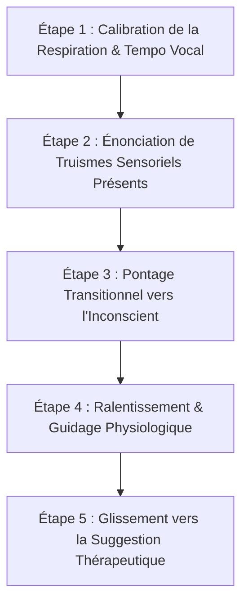
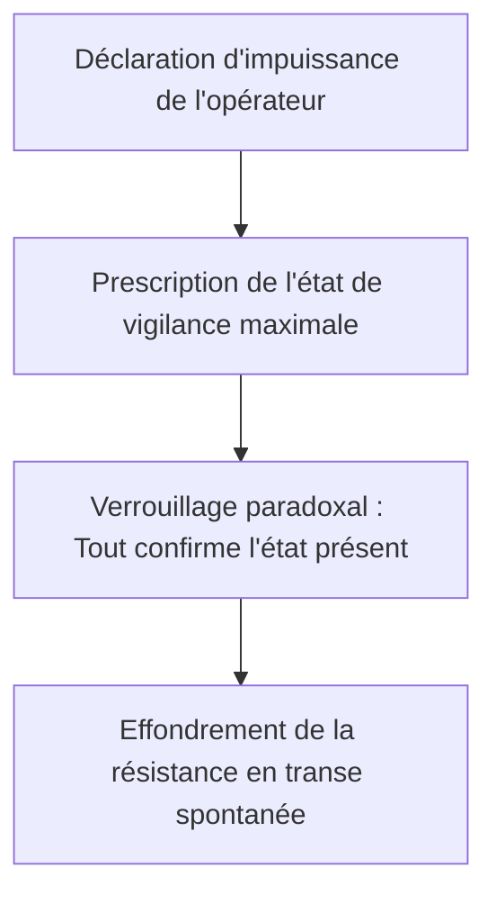

# Trance-formations
**Formateur :** Bandler & Grinder | **ID :** `bandler-grinder-trance-formations` | **Tranches :** 23

## Synthèse Architecturale du Cours : *Trance-formations* (Bandler & Grinder)

---

### 1. Thèse Centrale & Philosophie du Cours

#### La vision spécifique de Bandler & Grinder vs l'approche standard
L'approche standard de l'hypnose (classique, directive ou même ericksonienne ritualisée) traite la transe comme un état binaire artificiel, induit par l'autorité du praticien, des scripts standardisés ou un rituel de relaxation/sommeil. 

Pour Richard Bandler et John Grinder, **la transe n'a rien de magique ni d'artificiel : c'est un processus neuro-attentionnel continu, endogène et déjà encodé dans le système nerveux de chaque individu** (*Everyday Trance*). La transe fonctionnelle se définit simplement par la **réorientation de l'attention de l'externe vers l'interne** (*Inward Focus*), entraînant la **mise en suspens temporaire du modèle du monde conscient habituel** (*Conscious Mind in Abeyance*).

Le praticien ne « met » pas quelqu'un en transe : il exploite des mécanismes cybernétiques, linguistiques et physiologiques inévitables pour contourner la réactance critique sans la combattre.

#### Le fil rouge méthodologique : Cybernétique, Invariances et Utilisation
Toutes les interventions du cours reposent sur un trépied méthodologique constant :
1. **L'Invariance Sensorielle & le Pacing Incontestable ("Must Be There") :** Le praticien ne suggère rien qui puisse être réfuté ou corrigé par le conscient. Il commence par se caler sur ce qui est biologiquement et contextuellement inévitable (le contact de la chaise, les bruits de la pièce, le rythme respiratoire).
2. **Le Pontage Syntaxique et la Modélisation Causale :** Une fois le pacing établi, des connecteurs linguistiques lient les truismes vérifiables à des processus internes suggérés (*Leading*), transférant automatiquement la valeur de vérité du réel vers le changement désiré.
3. **L'Utilisation Totale :** Toute réponse somatique, résistance ou mouvement involontaire n'est jamais contré, mais immédiatement requalifié et incorporé comme le signal moteur même de l'approfondissement de la transe.

---

### 2. Carte des Concepts & Leviers Émergents

```
                          ┌──────────────────────────────────────────────┐
                          │     RÉORIENTATION DE L'ATTENTION (INWARD)    │
                          │        (Conscious Mind in Abeyance)          │
                          └──────────────────────┬───────────────────────┘
                                                 │
         ┌───────────────────────────────────────┼───────────────────────────────────────┐
         ▼                                       ▼                                       ▼
┌─────────────────────────────┐        ┌───────────────────────────┐           ┌─────────────────────────────┐
│    LEVIERS SENSORIELS &     │        │    STRUCTURE LINGUISTIQUE │           │    CYBERNÉTIQUE &           │
│         SOMATIQUES          │        │       & SYNTAXIQUE        │           │     UTILISATION             │
├─────────────────────────────┤        ├───────────────────────────┤           ├─────────────────────────────┤
│ • Invariables sensoriels    │        │ • Modélisation causale    │           │ • Boucle de biofeedback     │
│ • Transdérivation épisodique│        │ • Transitions sans heurts │           │ • Utilisation des réponses  │
│ • Chevauchement VAK         │        │ • Injonction négative     │           │ • Surcharge cognitive       │
│ • Truismes somatiques       │        │ • Opérateurs asymétriques │           │ • Clivage état-état         │
└─────────────────────────────┘        └───────────────────────────┘           └─────────────────────────────┘
```

#### A. Leviers Sensoriels & Somatiques
* **Levier de Transdérivation Sensorielle Inévitable (*"Must Be There"*) :** Restreindre les descriptions aux universaux perceptifs d'une scène afin d'éliminer toute friction de validation interne.
* **Transdérivation Épisodique & Divorce Spatio-Temporel :** L'obligation de décrire des coordonnées sensorielles passées précises dissocie mécaniquement le sujet de son repère présent pour réactiver l'état source.
* **Chevauchement des Systèmes de Représentation (*System Overlap*) :** Partir du canal dominant (V, A ou K) et utiliser un pont synesthésique pour forcer le système nerveux à synthétiser un nouveau canal, désamorçant la rigidité cognitive ordinaire.
* **Truismes Somatiques & Ratification Physiologique :** Détourner des mécanismes involontaires (pesanteur, clignements, respiration) en les requalifiant verbalement comme preuves de la transe.

#### B. Structure Linguistique & Syntaxe Avancée
* **Transitions Linguistiques Continues (*Flow* vs *Jarring*) :** Éliminer les disjonctions sémantiques qui éjectent le sujet vers le dialogue interne critique, sauf en cas de confusion délibérée.
* **Modélisation Causale Graduée (*Linguistic Linkage*) :** Connecter un fait incontestable ($X$) à un état suggéré ($Y$) via des conjonctions (`et`, `pendant que`) puis des liens de causalité directe (`fait que`, `provoque`).
* **Asymétrie de Vérifiabilité & Opérateurs Modaux :** Employer le mode hypothétique (*"could", "might"*) sur les signaux sensoriels immédiats (pour éliminer le risque d'échec perçu) et le mode affirmatif certain sur les états internes abstraits invérifiables.
* **Négation Spécifique (*Negative Command*) :** Formuler la suggestion sous forme négative (« Ne te détends pas trop vite ») pour obliger le traitement sémantique primaire à activer la représentation avant d'inhiber l'opérateur logique.

#### C. Boucles Cybernétiques, Saturation & Écologie
* **Boucle de Rétroaction Cybernétique (*Biofeedback Loop*) :** Extraire des micro-indices somatiques inconscients (rythme respiratoire, tonus) et les renvoyer en miroir pour créer un entraînement neurophysiologique direct.
* **Surcharge Cognitive & Démission de l'Analyse (*Overload*) :** Séquences métaphoriques denses saturant l'empan mnésique ($7 \pm 2$), forçant le conscient à abdiquer pour laisser l'inconscient traiter les isomorphismes en parallèle.
* **Utilisation & Incorporation Systématique :** Absorber toute manifestation (bruit externe, spasme, doute) au lieu de la combattre, la convertissant en moteur de transe.
* **Pontage Écologique & Clivage État-État (*State-Boundary Separation*) :** Poser une démarcation structurelle étanche entre la transe et d'autres pratiques du sujet (méditation, sommeil) pour préserver l'intégrité de ses routines autonomes.

---

### 3. Tableau Récapitulatif des Techniques & Démonstrations

| Technique / Exercice | Objectif Opératoire | Déclencheur / Indication | Séquence Résumée |
|---|---|---|---|
| **Induction par Évocation Sensorielle Invariable** *(Ex. 1 & 2)* | Obtenir une absorption sans friction ni résistance critique par validation automatique. | Sujet rationnel, analytique, méfiant ou débutant. | 1. Choisir une activité/lieu universel.<br>2. Énoncer uniquement des invariants sensoriels (*"Must be there"* : température de l'air, contact du sol).<br>3. Zéro détail subjectif non vérifié.<br>4. Observer les signes de fixation attentionnelle interne. |
| **Induction par Pacing Présent & Biofeedback Respiratoire** | Caler le système nerveux du sujet sur le tempo du praticien de manière invisible. | Sujet tendu, agité, ou refusant l'hypnose formelle. | 1. Calibrer la fréquence respiratoire du sujet.<br>2. Caler son propre débit vocal sur l'expiration du sujet.<br>3. Énoncer des truismes auditifs et somatiques présents.<br>4. Ralentir progressivement le débit pour entraîner la physiologie (*leading*). |
| **Rythme 3 Pacing + 1 Leading avec Transition Syntaxique** *(Ex. 3)* | Transférer la valeur de vérité de faits observables vers une altération d'état interne. | Transition fluide vers un état de transe légère à moyenne. | 1. Énoncer 3 faits sensoriellement vérifiables ici et maintenant.<br>2. Relier par un connecteur temporel/continu (`et`, `au fur et à mesure que`).<br>3. Glisser 1 leading interne suggéré.<br>4. Réduire à 2 Pacing + 2 Leading, puis 1 Pacing + 3 Leading. |
| **Capture Attentionnelle Hors-Conscience (*Out of Awareness Pacing*)** | Prendre le contrôle du focus sans ordre direct et valider la précision du guidage. | Sujet distrait par l'environnement ou intellectualisant. | 1. Repérer un stimulus réel présent mais non conscientisé (talon contre la chaise, température des mains).<br>2. Le nommer avec précision.<br>3. Constater la bascule attentionnelle obligatoire du sujet.<br>4. Enchaîner immédiatement sur une suggestion d'approfondissement. |
| **Induction par Chevauchement des Systèmes (*Overlap*)** | Sortir le sujet de son canal sensoriel habituel rigide pour déclencher la transe. | Sujet mono-canal bloqué dans une boucle mentale (ex. hyper-visuel ou hyper-auditif). | 1. Éliciter un contexte agréable et identifier le canal dominant (ex. Visuel : *"la vue sur la mer"*).<br>2. Pacer abondamment dans ce canal dominant.<br>3. Introduire un pont synesthésique vers un canal secondaire (ex. *"la lumière qui réchauffe ta peau"* $\rightarrow$ Kinesthésique).<br>4. Élargir au canal tertiaire pour saturer l'état ordinaire. |
| **Régression Automatique par Accès Épisodique** | Dissocier le sujet des coordonnées spatio-temporelles immédiates (*Divorce spatio-temporel*). | Besoin d'accéder à des ressources passées ou transe somnambulique profonde. | 1. Demander une mémoire concrète précise (ex. maison d'enfance, transe antérieure).<br>2. Exiger des détails micro-sensoriels (couleur exacte du chambranle, son des pas sur le plancher).<br>3. La recherche transdérivationnelle force le décrochage du présent.<br>4. Seul lien restant : la voix du praticien. |
| **Empilement d'Isomorphismes de Transes Naturelles** | Réactiver un état somnambulique sans donner d'ordre hypnotique direct. | Résistance aux protocoles formels ou contexte conversationnel/conférence. | 1. Enchaîner des récits anodins sur des situations à monotonie motrice (attente au feu rouge, trajet d'autoroute, ascenseur).<br>2. Calibrer la réactivation subliminale des marqueurs (catalepsie, regard fixe).<br>3. Lier ces marqueurs spontanés à l'intégration inconsciente en cours. |
| **Rupture de Pattern & Disjonction Brutale (*Jarring / Confusion*)** | Suspendre instantanément le dialogue interne et créer un vide d'apprentissage. | Sujet rigide, contrôlant ou bloqué dans une logique circulaire fermée. | 1. Engager une séquence logique ou motrice hautement prévisible.<br>2. Interrompre brusquement la séquence par un non-sens sensoriel ou un geste inattendu.<br>3. Utiliser la seconde de sidération/vide cognitif pour injecter la suggestion de transe. |
| **Clivage État-État & Préservation Écologique** | Protéger les pratiques personnelles du sujet (méditation, sommeil) de toute contamination par la transe de travail. | Utilisation d'un état modifié préexistant (méditant aguerri, auto-hypnose). | 1. Utiliser les compétences d'entrée en état du sujet.<br>2. Établir une frontière linguistique explicite : isoler cet espace de travail thérapeutique de son rituel méditatif/sommeil.<br>3. Valider que la pratique autonome demeure intacte et distincte. |

---

---

## 0. Sommaire Sémantique & Index des Lignes

- **Tranche 1 [Lignes 114-238]** : Induction par Évocation Sensorielle Invariable (Exercice 1 & 2) — *Protocole :* Induction par Évocation Sensorielle Invariable (Exercice 1 & 2) | *Mécanisme :* Levier de Transdérivation Sensorielle Inévitable ("Must Be There") | *Verbatim :* La Négation de Prémisse Hypnotique
- **Tranche 2 [Lignes 240-423]** : Induction par Pacing Sensoriel Présent et Biofeedback Respiratoire (Exercise 2 & Suite) — *Protocole :* Induction par Pacing Sensoriel Présent et Biofeedback Respiratoire (Exercise 2 & Suite) | *Mécanisme :* Le Biofeedback Inconscient par Appariement Comportemental | *Verbatim :* La Démonstration Vivante de Congruence Prosodique
- **Tranche 3 [Lignes 425-554]** : Le Rythme 3 Pacing + 1 Leading avec Transition Syntaxique (Exercice 3) — *Protocole :* Le Rythme 3 Pacing + 1 Leading avec Transition Syntaxique (Exercice 3) | *Verbatim :* Recadrage de la Résistance à la Détente par Dérivation Métaphorique
- **Tranche 4 [Lignes 556-675]** : Pacing & Leading Verbal Gradué (Exercice 5-4-3-2-1) — *Protocole :* Pacing & Leading Verbal Gradué (Exercice 5-4-3-2-1)
- **Tranche 5 [Lignes 677-823]** : Induction par Chevauchement Sensoriel (Representational System Overlap) — *Protocole :* Induction par Chevauchement Sensoriel (Representational System Overlap) | *Mécanisme :* Le Chevauchement des Systèmes de Représentation (Representational System Overlap) | *Verbatim :* La Passerelle Sensorielle Visuo-Kinesthésique
- **Tranche 6 [Lignes 825-953]** : Traitement et Incorporation Immédiate des Phénomènes Spontanés Inattendus — *Protocole :* Traitement et Incorporation Immédiate des Phénomènes Spontanés Inattendus | *Verbatim :* Formule de transition : intégration inconsciente et retour autonome
- **Tranche 7 [Lignes 955-1088]** : Exercice de Marquage Analogique Intégré (Exercise 5) — *Protocole :* Exercice de Marquage Analogique Intégré (Exercise 5)
- **Tranche 8 [Lignes 1090-1265]** : L'Interruption de la Poignée de Main Classique & Dérivation en Transe — *Protocole :* L'Interruption de la Poignée de Main Classique & Dérivation en Transe | *Mécanisme :* L'Interruption de Pattern (Pattern Interruption) & Suspension de Programme | *Verbatim :* La Poignée de Main et la Redirection Verbale Directe
- **Tranche 9 [Lignes 1267-1421]** : Structure Standard d'Exploration en Transe (Exercice 6) — *Protocole :* Structure Standard d'Exploration en Transe (Exercice 6) | *Verbatim :* Verbatim 1 : L'Instruction de Transe Stable & Signal Idéomoteur
- **Tranche 10 [Lignes 1423-1561]** : L'Établissement du Cadre par Illusion de Choix — *Protocole :* L'Établissement du Cadre par Illusion de Choix | *Verbatim :* Double-Lien sur le Mode d'Induction
- **Tranche 11 [Lignes 1563-1729]** : Induction Générative par Rêve Hypnotique & Catalepsie Liée — *Protocole :* Induction Générative par Rêve Hypnotique & Catalepsie Liée | *Mécanisme :* La boucle de biofeedback humain (Pacing & Leading somato-vocal)
- **Tranche 12 [Lignes 1731-1866]** : A : Clôture de Transe et Reconnexion en Processus Pur (The Content-Free Cleanup) — *Protocole :* A : Clôture de Transe et Reconnexion en Processus Pur (The Content-Free Cleanup) | *Verbatim :* La Clôture Générative Post-Hypnotique
- **Tranche 13 [Lignes 1868-1991]** : A : Réancrage Hypnotique de Comportement Aversif Conjugal (Démonstration sur Linda) — *Protocole :* A : Réancrage Hypnotique de Comportement Aversif Conjugal (Démonstration sur Linda) | *Verbatim :* Verbatim 1 : Double lien temporel & dissociation conscient/inconscient
- **Tranche 14 [Lignes 1993-2146]** : A : Négociation Somatique Directe et Recadrage d'un Symptôme Corporel Chronique (Démonstrati... — *Protocole :* A : Négociation Somatique Directe et Recadrage d'un Symptôme Corporel Chronique (Démonstration des « Pieds Engourdis ») | *Verbatim :* s Verbatim
- **Tranche 15 [Lignes 2148-2279]** : Recadrage en 6/7 Étapes sous Hypnose (Bandler & Grinder) — *Protocole :* Recadrage en 6/7 Étapes sous Hypnose (Bandler & Grinder) | *Verbatim :* Double-Lien d'Élection et Présupposition d'Amour
- **Tranche 16 [Lignes 2281-2420]** : Protocole de Résolution Somatique Accélérée (Rhume, Congestion, Troubles Aigus) — *Protocole :* Protocole de Résolution Somatique Accélérée (Rhume, Congestion, Troubles Aigus) | *Mécanisme :* Rupture de Boucle Étiologique par Projection Fonctionnelle d'Avenir | *Verbatim :* Le Recadrage Conversationnel Suicide/Alcool
- **Tranche 17 [Lignes 2422-2589]** : Protocole : Générateur de Nouveau Comportement (New Behavior Generator) — *Protocole :* Protocole : Générateur de Nouveau Comportement (New Behavior Generator) | *Verbatim :* Recadrage Somatique / Allégorie Immunitaire (Poison Oak)
- **Tranche 18 [Lignes 2591-2752]** : Deep Trance Identification (DTI) via le Jeu d'Habillage Enfantin — *Protocole :* Deep Trance Identification (DTI) via le Jeu d'Habillage Enfantin | *Mécanisme :* Régression en Âge par Empilement de Contextes Absurdes & Échafaudage Métaphorique | *Verbatim :* La régression par l'objet géant
- **Tranche 19 [Lignes 2754-2974]** : Récupération d'informations traumatiques sans ré-traumatisation (Double Dissociation) — *Protocole :* Récupération d'informations traumatiques sans ré-traumatisation (Double Dissociation) | *Mécanisme :* Le piège du revécu identique vs Réorganisation de l'histoire personnelle | *Verbatim :* La réfutation de l'abréaction cathartique
- **Tranche 20 [Lignes 2976-3152]** : Auto-Induction Externe de Betty Erickson & Boucle de Biofeedback Verbal-Sensoriel (Sensory B... — *Protocole :* Auto-Induction Externe de Betty Erickson | *Mécanisme :* Boucle de Biofeedback Verbal-Sensoriel (Sensory Biofeedback Loop) | *Verbatim :* Utilisation Immédiate d'une Réponse de Polarité
- **Tranche 21 [Lignes 3154-3334]** : Réduction à l'Absurde par Amplification Prescriptive (Paradoxical Symptom Exhaustion) — *Protocole :* Réduction à l'Absurde par Amplification Prescriptive (Paradoxical Symptom Exhaustion)
- **Tranche 22 [Lignes 3336-3500]** : A : La Technique du « Bras du Rêve » et Recadrage Métaphorique Pédiatrique (Cas Dave) — *Protocole :* A : La Technique du « Bras du Rêve » et Recadrage Métaphorique Pédiatrique (Cas Dave) | *Verbatim :* Double contrainte de sécurité et ancrage somatique
- **Tranche 23 [Lignes 3502-3632]** : Génération de Postulats Conversationnels (Conversational Postulates) — *Protocole :* Génération de Postulats Conversationnels (Conversational Postulates) | *Mécanisme :* Inaccessibilité Neurologique de la Négation en Expérience Primaire | *Verbatim :* Embedded Questions

---

## Extractions Détaillées par Tranche (Opératoire & Verbatim)

## Tranche 1 / 23 : Induction par Évocation Sensorielle Invariable (Exercice 1 & 2)

Voici l'analyse opératoire intégrale de la tranche 1/23 (Foreword & Introduction jusqu'à l'Exercise 2) de l'ouvrage *Trance-formations* de Richard Bandler et John Grinder.

---

### 1. Mécanismes & Principes Actifs

#### 1. Levier de Transdérivation Sensorielle Inévitable ("Must Be There")
* **Principe actif :** Pour traiter le langage, le système nerveux est forcé de récupérer les représentations internes correspondantes (VAKOG). En restreignant les suggestions verbales à ce qui est **universellement et sensoriellement obligatoire** dans l'activité choisie par le sujet (ex. température de l'air, contact d'appui, rythme cardiaque), le praticien supprime tout frottement ou décalage entre la parole et l'expérience interne. Le cerveau du sujet ne rencontre aucun élément à rejeter ou corriger : il valide inconsciemment chaque mot, ce qui absorbe l'attention consciente vers l'intérieur.
* **Tags :** `#sensory_invariants #artful_vagueness #transderivational_absorption #universal_pacing #zero_friction_induction`

#### 2. Négation Spécifique et Focalisation Obligatoire ("Negative Command")
* **Principe actif :** L'inconscient et le système de traitement sémantique primaire ne traitent pas la négation booléenne directement : pour comprendre l'injonction « Ne pense pas à X », le système neurologique doit obligatoirement activer la représentation sensorielle interne de « X » avant d'y appliquer un opérateur logique d'inhibition. En formulant une suggestion précédée d'une négation (ex. « Ne te détends pas trop vite »), le praticien contourne la réactance psychologique du conscient tout en activant directement la réponse neuromusculaire et somatique visée.
* **Tags :** `#negative_command #bypassing_resistance #automatic_representation #subconscious_processing`

#### 3. Découpage Modulaire et Automatisation Inconsciente ("Chunking")
* **Principe actif :** La mémoire de travail et l'attention consciente sont limitées à $7 \pm 2$ éléments d'information simultanés. L'apprentissage de patterns hypnotiques complexes sature immédiatement le conscient si la tâche n'est pas segmentée. En isolant des micro-compétences perceptivo-motrices (ex. synchronisation du débit vocal, sélection de prédicats sensoriels neutres, calibrage oculaire), le praticien automatise chaque brique au niveau sous-cortical / inconscient, libérant ainsi la conscience pour le niveau méta (calibration fine du sujet).
* **Tags :** `#behavioral_chunking #unconscious_competence #bandwidth_management #perceptual_motor_skills`

#### 4. Rupture de Continuité Représentationnelle (Le "Jarring" vs "Natural Transitions")
* **Principe actif :** Une transition fluide maintient l'état d'absorption en respectant la cinématique interne du sujet (ex. mélanger la peinture $\rightarrow$ prendre le pinceau $\rightarrow$ appliquer la couleur sur la toile). Si le guidage introduit un saut contextuel brutal (omission d'une étape cinétique évidente) ou une contradiction externe (ex. évoquer le ciel alors que le sujet est dans une patinoire couverte), le conscient est brutalement éjecté de l'état altéré pour réconcilier l'incongruence logique via le dialogue interne. À l'inverse, l'usage délibéré et calibré de ces ruptures constitue la base de la technique de confusion.
* **Tags :** `#representational_continuity #jarring_effect #internal_coherence #natural_transition #pacing_violation`

#### 5. Transes Naturelles et Réduction du Focus d'Attention ("Everyday Trance")
* **Principe actif :** L'état de transe n'est pas un phénomène artificiel ou binaire mais un processus neurologique continu caractérisé par le rétrécissement du focus attentionnel sur une boucle restreinte d'entrées (ex. ascenseur, lecture, conduite, jogging). L'hypnose formelle n'est rien d'autre que l'amplification et l'utilisation systématique de ces états déjà encodés dans l'organisme.
* **Tags :** `#naturally_occurring_trance #focused_attention #state_elicitation #trance_demystification`

---

### 2. Protocoles, Techniques & Démonstrations (Étape par Étape)

#### Protocole 1 : Induction par Évocation Sensorielle Invariable (Exercice 1 & 2)

* **Intention / Indication :**
  * Eliciter un état de transe légère à moyenne sans induction formelle visible.
  * Réactiver un état de concentration intense ou d'immersion déjà existant dans l'histoire du sujet.
  * Entraîner le praticien à éliminer les hallucinations / suppositions projectives et à maîtriser le langage sensoriellement neutre ("artfully vague").

* **Mise en place & Pré-framing :**
  * Groupes de trois : Sujet (A), Praticien 1 (B), Praticien 2 (C).
  * Consigne au sujet A : Choisir une activité où il/elle se retrouve naturellement profondément absorbé(e) avec un focus attentionnel restreint (ex. course à pied, piano, lecture, conduite).
  * Règle de cadrage : Ne donner **qu'un seul mot** désignant l'activité (ex. "jogging", "piano"), sans aucun détail contextuel (lieu, météo, émotion).
  * Consigne au sujet : Fermer les yeux et faire semblant d'être sous hypnose.

* **Séquence d'actions pas à pas :**
  1. **Phase 1 : Identification des invariants sensoriels**
     * Les praticiens B et C recherchent mentalement ce qui est *obligatoirement présent* sur le plan sensoriel (VAKOG neutre) dans cette activité.
     * Règle d'exclusion : Interdiction de nommer un détail contingent (ex. "le soleil brille", "l'eau éclabousse", "tu penses que la musique fait un avec toi").
  2. **Phase 2 : Guidage alterné à faible dose**
     * Les praticiens B et C prennent la parole à tour de rôle en alternance stricte.
     * Praticien B émet **deux phrases maximum**, purement basées sur des invariants kinesthésiques ou auditifs inévitables (ex. le contact des doigts, la température de la peau).
     * Praticien C enchaîne avec **deux phrases maximum**, maintenant le même tempo et le même niveau de neutralité sensorielle.
  3. **Phase 3 : Rythmicité et synchronisation**
     * Aligner la prosodie et le débit vocal sur le rythme respiratoire observé chez le sujet.
     * Maintenir une vitesse de diction stable entre le Praticien B et le Praticien C (éviter les ruptures de tempo rapide/lent).
  4. **Phase 4 : Élargissement progressif (Exercice 2)**
     * Formuler des catégories sensorielles ouvertes : remplacer les stimuli spécifiques par des classes de stimuli inévitables (ex. au lieu de "le clapotis de l'eau", dire "les sons que l'eau produit").

* **Signes de calibration (Validation des étapes) :**
  * *Succès (Entrée en transe) :* Ralentissement de la fréquence respiratoire, relâchement du tonus musculaire du visage (perte de symétrie faciale volontaire), immobilité corporelle, mouvements oculaires rapides (REM) sous les paupières closes.
  * *Échec / Sortie de transe ("Jarring") :* Mouvements brusques des yeux ou de la tête, micro-secousses, fronçage de sourcils, reprise de tonus dans la mâchoire, réactivation du dialogue interne visible par le mouvement des lèvres ou de la gorge.

---

### 3. Heuristiques, Subtilités & "Sagesse du Praticien"

#### Règles conditionnelles :
* **Si** le sujet est engagé dans une activité interne spécifique, **alors** décrivez uniquement des sensations physiques inévitables (*skin temperature, contact points*), **parce que** toute tentative de deviner ses pensées ou son état d'esprit interne (*"you think the music is you"*) active l'analyse consciente et le désoriente.
* **Si** vous mentionnez une action ou un changement de contexte, **alors** respectez rigoureusement la cinématique séquentielle naturelle de l'expérience (ex. préparer la peinture $\rightarrow$ saisir le pinceau $\rightarrow$ appliquer), **parce que** sauter une étape oblige le sujet à suspendre sa transe pour combler mentalement le vide.
* **Si** vous travaillez à deux opérateurs (ou alternez deux dynamiques), **alors** conservez un tempo vocal rigoureusement homogène, **parce qu'**une variation brutale de vitesse entre deux suggestions réveille le sujet en créant un contraste auditif violent.
* **Si** vous souhaitez diriger l'attention sur deux modalités simultanées (*"hear and feel your breathing"*), **alors** séparez-les séquentiellement si le sujet montre une surcharge, **parce que** la plupart des sujets ne peuvent pas traiter consciemment deux canaux sensoriels distincts en même temps au début de l'induction.
* **Si** vous voulez suggérer l'estompage d'une expérience, **alors** ne nommez jamais explicitement le contenu à effacer (*"as all other experiences fade"* est une erreur), **parce que** le système nerveux doit obligatoirement rechercher et identifier les éléments concernés pour pouvoir les estomper, ce qui les réactive au premier plan.
* **Si** vous formulez un prédicat d'environnement et ignorez le contexte spécifique du sujet (ex. extérieur vs intérieur), **alors** utilisez des descriptions abstraites de classes d'expériences (*"the sounds that the environment produces"*), **parce que** tout détail faux provoque une friction logique immédiate (*"No, I can't do that"*).

#### Pièges classiques & Erreurs relevées par Bandler & Grinder :
* **Erreur du débutant : Projeter son propre contenu hallucinatoire.** Décrire ce que *vous* imaginez de la situation (du soleil sur le corps lors d'un jogging) au lieu de ce qui est *forcément* présent (la température de l'air sur la peau).
* **Erreur du débutant : La redondance exclusive d'un seul système de représentation.** Rester bloqué pendant 5 minutes sur le seul canal kinesthésique sans jamais introduire de visuel ou d'auditif, ce qui engendre une faim sensorielle consciente chez le sujet (*"I want to see something"*).
* **Erreur conceptuelle : Croire que l'hypnose est une intervention isolée.** Penser que l'hypnose n'a lieu que sur une chaise de thérapie, alors qu'elle est un amplificateur inhérent à toute communication d'influence (vente, justice, éducation, relations).

---

### 4. Pépites Verbatim & Patterns Linguistiques (MOT À MOT EN V.O.)

#### Pépite 1 : La Négation de Prémisse Hypnotique
> *"Don't think of blue"*
* **[Analyse du Pattern] :** Commande négative pure (*Negative Command*). Pour traiter la négation de "blue", le récepteur neurologique est contraint d'activer la représentation interne de la couleur bleue. L'opérateur conscient est contourné par la mécanique computationnelle du langage.

---

#### Pépite 2 : Dépressurisation par Négation Temporelle
> *"I don't want you to relax too soon"*
* **[Analyse du Pattern] :** Double lien linguistique et présupposition temporelle enchâssée. 
  1. *Negative Command* ("I don't want you...") qui élimine toute pression de performance ou réactance.
  2. Présupposition temporelle portée par l'adverbe "too soon" : cela présuppose incontestablement que le sujet *va* se détendre, la seule variable non tranchée étant le moment exact où cela se produira.

---

#### Pépite 3 : Suggestion Enchâssée sous Négation Modale
> *"Don't be too curious about what you'll learn from reading this book."*
* **[Analyse du Pattern] :** Commande négative avec marquage analogique potentiel. Le syntagme "be curious about what you'll learn" est la directive sous-jacente transmise directement à l'inconscient, tandis que le conscient s'accroche au "Don't be too...". La présupposition temporelle liée à la subordonnée relative ("what you'll learn") pose l'apprentissage futur comme un fait acquis.

---

#### Pépite 4 : Suggestion Conversationnelle par Déni Déclaratif
> *"I wouldn't tell you to be eager to discover how you'll change comfortably in the coming weeks."*
* **[Analyse du Pattern] :** Apophase / Prétérition conversationnelle (*Conversational Postulate / Paralipsis*). La structure de surface prétend s'abstenir de faire la suggestion ("I wouldn't tell you..."), ce qui désamorce toute résistance critique. Simultanément, la commande enchâssée injecte l'état d'empressement ("be eager to discover") et couple le changement à des prédicats kinesthésiques hautement désirables ("change comfortably") verrouillés dans le temps futur ("in the coming weeks").

---

#### Pépite 5 : Recadrage Déstabilisant sur la Réalité du Phénomène
> *"We could immediately launch into an argument about whether there is such a thing, and what it might be if there were. However, since you already paid your money and came here for a seminar in hypnosis, I won't bring up that particular argument."*
* **[Analyse du Pattern] :** Prétérition et utilisation d'un fait contextuel irréfutable (le paiement du stage). En affirmant qu'il ne va pas aborder l'argument alors même qu'il vient de l'énoncer, le formateur brise le cadre formel traditionnel d'une conférence, installe un état d'attention flottante et établit un cadre d'apprentissage orienté sur l'expérience pragmatique plutôt que sur le débat théorique.

---

#### Pépite 6 : Découpage de l'Expérience en Invariant Kinesthésique
> *"You can feel the temperature of the air on your body, and the place where your foot touches the ground."*
* **[Analyse du Pattern] :** Pacing sensoriel pur et universel (*Sensory Pacing*). L'utilisation de prédicats neutres et incontestables ("feel the temperature", "the place where...") force l'alignement kinesthésique interne du sujet. Il est impossible de contester ces données car la peau a toujours une température et le corps a toujours un point d'appui avec le sol. Le connecteur logique "and" lie deux réalités indiscutables pour initier une transe de focalisation.

---

#### Pépite 7 : Transformation d'un Stimulus Spécifique en Classe Ouverte
> *"You can hear the sounds that the water makes"*
* **[Analyse du Pattern] :** Nominalisation ouverte / Flou artistique (*Artful Vagueness*). En substituant une description spécifique (ex. "the splash") par une catégorie d'expériences ouverte ("the sounds that..."), le langage s'adapte à n'importe quelle configuration interne du sujet (qu'il soit à la surface ou sous l'eau), rendant le pacing infaillible et universel.

## Tranche 2 / 23 : Induction par Pacing Sensoriel Présent et Biofeedback Respiratoire (Exercise 2 & Suite)

### 1. Mécanismes & Principes Actifs

#### 1. Le Biofeedback Inconscient par Appariement Comportemental
L'hypnose n'est pas une prise de pouvoir mais l'établissement d'une boucle cybernétique fermée où l'opérateur utilise son propre comportement comme un mécanisme de biofeedback pour le système nerveux du sujet. En calquant une variable physiologique subtile (rythme respiratoire, tempo vocal, clignement), le système nerveux du sujet synchronise son horloge interne sur celle de l'hypnotiseur. Dès que la boucle est verrouillée, l'opérateur modifie son propre comportement, ce qui entraîne automatiquement la modification de la physiologie du sujet (*pacing leading*).
- **Tags émergents** : `#boucle_biofeedback_inconsciente #synchronisation_respiratoire #pacing_leading_physiologique #retroaction_somatique`

#### 2. La Transition Linguistique comme Pont de Continuité Attentionnelle
La conscience vigile fonctionne par micro-sauts cognitifs discontinus (questions internes, doutes, déconnexions). Lorsqu'une rupture ou une disjonction intervient dans le discours, le sujet sort de son état réceptif pour évaluer ou contester. Les connecteurs de liaison temporelle et causale (*and, as, while, because, when, even as*) créent une illusion de nécessité et de flux continu sans friction logique. Le système nerveux accepte l'association arbitraire entre une réalité sensorielle vérifiable et une suggestion interne, évitant l'activation du filtre critique.
- **Tags émergents** : `#connecteurs_isomorphes #pontage_attentionnel #syntaxe_de_continuite #flux_sans_disjonction #illusion_de_causalite`

#### 3. L'Orientation vers l'Éprouvé Universel et Sensoriellement Incontestable
Pour installer une transe sans résistance, l'opérateur ne suggère aucune hallucination arbitraire ou métaphore non vérifiable immédiatement. Il utilise des propositions qui *doivent nécessairement être vraies* dans l'expérience physique présente ou passée du sujet (contact des vêtements, température des extrémités, bruits de la pièce). Dès que le sujet vérifie sensoriellement la première affirmation, il accorde du crédit inconscient à l'ensemble du flux suggestif.
- **Tags émergents** : `#truisme_sensoriel #universalite_somatique #ancrage_incontestable #verification_interne_spontanee`

#### 4. Le Paradoxe de la Résistance et l'Utilisation du Gradient Opposant
La résistance n'est pas un blocage psychologique mais une modalité active de réponse du système nerveux à une tentative perçue de domination frontale. Si le sujet a besoin de résister pour maintenir son intégrité ou son autonomie, l'hypnotiseur cadre le comportement de résistance lui-même comme le véhicule exact qui l'enfonce dans la transe (injonction paradoxale : ordonner de rester hyper-éveillé pour que le refus d'obtempérer induise la transe).
- **Tags émergents** : `#injonction_paradoxale #recadrage_de_resistance #utilisation_ericksonienne #absorption_du_gradient_opposant`

#### 5. La Démythification de la Transe et l'Amplification Perceptive
La transe n'est pas un état de sommeil comateux, de perte de contrôle ou d'amnésie, mais un déplacement et une focalisation sélective de l'attention qui *amplifie* les perceptions sensorielles internes et externes. Les phénomènes dits « profonds » (hallucinations positives et négatives) sont des processus cognitifs que le cerveau exécute quotidiennement à l'état de veille (ex. ne pas voir un objet posé devant soi, sentir une odeur par évocation, entendre une voix familière imaginaire).
- **Tags émergents** : `#transe_comme_amplification #normalite_des_phenomenes_hypnotiques #continuum_veille_transe #reappropriation_du_controle`

#### 6. La Rupture de Pattern par Disjonction Brutale (*Jarring / Confusion*)
À l'opposé de la transition douce, l'introduction subite d'un élément sémantiquement ou contextuellement incompatible (ex. le rhinocéros dans les bois, la question abrupte *"Does that make sense?"*, ou la prescription choquante en thérapie familiale) crée un choc cognitif instantané. Ce court-circuit de la carte mentale habituelle sidère le dialogue interne et ouvre une fenêtre d'amorce d'état modifié où le système cherche frénétiquement du sens, devenant immédiatement preneur de la prochaine transition offerte.
- **Tags émergents** : `#rupture_de_pattern #disjonction_semantique #choc_cognitif #induction_par_confusion #sideration_du_sens`

---

### 2. Protocoles, Techniques & Démonstrations (Étape par Étape)

#### Protocole 1 : Induction par Pacing Sensoriel Présent et Biofeedback Respiratoire (Exercise 2 & Suite)
* **Intention / Indication** : Conduire un sujet dans un état de transe légère à moyenne de manière totalement invisible, fluide et sans déclencher de résistance critique.
* **Mise en place & Pré-framing** : L'opérateur s'interdit d'utiliser des termes subjectifs ou spécifiques invérifiables ("tu te sens bien", "tu visualises un lac bleu"). Il se restreint à ce qui est inévitablement présent dans les canaux sensoriels du sujet ici et maintenant.



* **Séquence d'actions pas à pas** :
  1. **Calibration & Synchronisation respiratoire** : Repérer visuellement le soulèvement et l'abaissement de la cage thoracique / de l'abdomen du sujet. Ajuster le débit, la cadence et les pauses de sa propre voix pour calquer exactement son expiration.
  2. **Truismes sensoriels non-spécifiques** : Décrire des faits sensoriels indiscutables liés à la posture et à l'environnement présent :
     - Audition : *"You can hear the sound of my voice... and the other sounds in the room..."*
     - Kinesthésie externe : *"You can feel the contact of your hands on your thighs... the temperature of the air on your face..."*
  3. **Attribution de pertinence inconsciente** : Nommer des sensations corporelles réelles mais jusque-là maintenues hors du champ de la conscience consciente (ex. la température de l'oreille gauche, le contact des lunettes sur le nez, le poids d'un carnet). Dès que l'attention du sujet se porte dessus, la congruence opérateur/sujet s'établit.
  4. **Pontage par connecteurs de transition** : Enchaîner les truismes avec des mots de liaison temporelle (*and, as, while, when, because*) pour glisser de la réalité concrète à une modification cognitive ou physiologique :
     - Formule : `[Fait physique vérifié] + [Connecteur] + [Glissement interne/involontaire]`
     - Exemple : *"As you feel the weight of your hands on your legs... you can begin to notice the slow rhythm of your breathing..."*
  5. **Guidage physiologique progressif (*Leading*)** : Réduire imperceptiblement le débit de la parole et allonger les pauses entre les mots. Observer si la respiration du sujet ralentit d'elle-même pour rester calquée sur le tempo vocal.
  6. **Amplification & Translation de phénomènes** (ex. anesthésie ou analgésie) : Lier une sensation existante pour la déplacer :
     - Focaliser sur une sensation tactile neutre (battement cardiaque, pression des orteils), l'intensifier par focalisation, puis suggérer le transfert de cette intensité d'un membre à un autre (*"take all the feelings in one hand and put them in another"*).
* **Signes de calibration** :
  - Ralentissement et approfondissement spontané du rythme respiratoire calqué sur la voix.
  - Déglutition réflexe, lissage des traits du visage, relâchement du tonus musculaire.
  - Fixité ou ralentissement des clignements de paupières (*fluttering* ou fermeture).
  - Absence de questions, de froncements de sourcils ou de micro-mouvements de désaccord.

---

#### Protocole 2 : L'Induction Paradoxale de Résistance (Pour Sujets Hyper-Contrôlants)
* **Intention / Indication** : Sujet arrivant avec l'affirmation identitaire : *"On ne peut pas m'hypnotiser, tout le monde a essayé, allez-y essayez pour voir"*.
* **Mise en place & Pré-framing** : Refus total d'entrer dans un rapport de force ou de compétition. Abandon apparent de toute intention d'hypnotiser.



* **Séquence d'actions pas à pas** :
  1. **Déclaration d'impuissance absolue** : *"I can't hypnotize you. There's nothing I can do."*
  2. **Cadrage de la contrainte imaginaire** : *"If I decided to force you to keep your eyes open, that would make you keep your eyes open, I'll try."*
  3. **Prescription du symptôme / Double contrainte** :
     - Ordonner activement au sujet de faire exactement ce qu'il fait déjà : *"Keep your eyes wide open. Stay totally alert. Everything you do will make you stay right here and right now."*
  4. **Attente passive calibrée** : Laisser la physiologie du sujet s'épuiser à maintenir la tension volontaire de résistance contre une injonction d'éveil. Le sujet ne pouvant plus résister à une tentative de transe (puisqu'on lui ordonne de rester éveillé), sa tendance naturelle à s'opposer à l'opérateur l'amène à fermer les yeux et basculer en transe.
* **Signes de calibration** :
  - Fatigue oculaire rapide (larmoiement, clignements saccadés).
  - Bascule de la tête ou relâchement soudain de la posture rigide.
  - Soupir d'abandon de la lutte consciente.

---

### 3. Heuristiques, Subtilités & "Sagesse du Praticien"

#### Règles Conditionnelles d'Intervention (If / Then)
* **Si** le sujet se met à contester, poser une question d'interruption ou sortir de son état d'écoute,
  **Alors** c'est que l'opérateur a introduit une disjonction, une affirmation non-sensorielle, ou un détail non-universel à l'expérience.
  **Parce que** le mental conscient s'accroche immédiatement aux fausses notes pour reprendre le contrôle analytique.
* **Si** vous voulez faire un appariement postural sans intrusion consciente,
  **Alors** ne reproduisez jamais les maniérismes idiosyncratiques manifestes (ex: se gratter le nez, tapoter du doigt), adoptez uniquement l'inclinaison globale du corps ou calquez la respiration.
  **Parce que** refléter un maniérisme spécifique est perçu par le conscient comme une singerie ou une manipulation, ce qui détruit le rapport instantanément.
* **Si** vous parlez d'une expérience excitante ou dynamique,
  **Alors** adoptez une voix modulée, vibrante et passionnée, et abandonnez la voix monocorde pseudo-hypnotique.
  **Parce que** l'incongruité entre un ton monotone et un contenu excitant envoie deux commandes neurologiques contradictoires qui neutralisent la réponse inconsciente.
* **Si** le sujet tente de réguler un système involontaire (ex: rythme cardiaque, douleur) et échoue,
  **Alors** structurez une séquence ininterrompue de transitions fluides liant des sensations vérifiables à l'effet désiré sans jamais le laisser retourner au silence de son dialogue interne.
  **Parce que** les sauts entre la tâche physiologique et le dialogue interne douteux (*"est-ce que ça marche ?"*) provoquent des micro-changements d'état de conscience qui cassent la régulation neuro-végétative.
* **Si** vous travaillez en thérapie de couple/famille où les schémas conscients sont rigides et verrouillés,
  **Alors** abandonnez délibérément les transitions douces et utilisez des disjonctions brutales et paradoxales (*"enfermez-la dans un placard"*).
  **Parce que** secouer le cadre logique force le système à lâcher ses limitations conscientes par saturation immédiate du dialogue habituel.
* **Si** vous devez choisir entre aller vite ou aller lentement en hypnose,
  **Alors** ralentissez délibérément le tempo de communication.
  **Parce qu**'en hypnose, on va vite en allant lentement : ralentir permet de mettre en sommeil les mécanismes automatiques de défense de l'esprit conscient sans les heurter.

#### Pièges Classiques & Erreurs de Débutant
* **Le piège de la spécificité audacieuse** : Dire *"Tu entends l'eau clapoter"* à quelqu'un qui imagine être sous l'eau. Règle : Toujours rester non-spécifique dans la sensorialité (*"You can hear the sounds that the water makes"*).
* **L'incongruité analogique** : Dire le mot *"up"* en baissant l'inflexion vocale, ou dire *"pensez-y très lentement"* avec un débit de mitraillette. Le système nerveux réagit au canal analogique (prosodie, tempo) et rejette le canal digital (mots).
* **Le mythe de l'anesthésie vigile** : Croire que parce que le sujet entend toujours les bruits ambiants ou sent la chaise, il n'est pas en transe. L'opérateur doit recadrer : l'absence totale de perception sensorielle s'appelle la mort ; la transe est au contraire une acuité et une amplification sélective.
* **Le fétichisme de la profondeur hypnotique** : Chercher à mesurer la "profondeur" en croyant qu'elle détermine l'efficacité. Tout phénomène hypnotique majeur (hallucination positive, hallucination négative, anesthésie) est exécutable et déjà exécuté à l'état de veille par n'importe quel individu.

---

### 4. Pépites Verbatim & Patterns Linguistiques (MOT À MOT EN V.O.)

#### Pépite 1 : La Démonstration Vivante de Congruence Prosodique
```text
"If I tell you that I want you to think about this (speaking rapidly) 'very-slowly-and-carefully,' the incongruity between what I say and how I say it gives you two contradictory instructions. But if I tell you I want you to stop . . . and consider . . . very . . . slowly , . . just exactly . . . what the change . . . in your own experience . . . was . . . then . . . the tempo . . . the rate of my speech . . . the movements of my body . . . don't interfere with the words that I'm saying. In fact they embellish them and amplify their impact."
```
* **[Analyse du Pattern]** :
  - **Injonction analogique incarnée** : L'opérateur applique le principe au moment exact où il l'explique.
  - **Marquage analogique par points de suspension** : Les pauses délibérées synchronisent le traitement cérébral sur un rythme thêta/alpha.
  - **Rétroaction somatique** : Le balancement du corps et le ralentissement du débit vocal agissent comme un amplificateur non-verbal qui force le système nerveux à exécuter la commande de ralentissement sans résistance verbale.

---

#### Pépite 2 : La Neutralisation de la Résistance par Injonction Inversée
```text
"People come into my office and say 'People have tried to hypnotize me for years and it has never worked.' They sit down and say 'go ahead and try to hypnotize me.' And I say 'I can't hypnotize you.' They say 'Well, go ahead and try.' I say 'I can't do it. There's nothing I can do; if I decided to force you to keep your eyes open, that would make you keep your eyes open, I'll try. Keep your eyes wide open. Stay totally alert. Everything you do will make you stay right here and right now.' Then they resist me right into trance."
```
* **[Analyse du Pattern]** :
  - **Élimination du cadre de compétition** : L'aveu feint d'impuissance (*"I can't hypnotize you"*) prive le sujet de son levier de confrontation habituel.
  - **Double lien thérapeutique / Prescription du symptôme** : En ordonnant de garder les yeux grands ouverts et de rester alerte (*"Keep your eyes wide open. Stay totally alert"*), l'opérateur utilise le réflexe d'opposition du sujet : pour résister à l'ordre d'éveil, le sujet est contraint de fermer les yeux et d'entrer en transe.
  - **Prémisse de causalité forcée** : *"Everything you do will make you stay right here and right now"* lie chaque micro-réaction du sujet au contexte défini par l'opérateur.

---

#### Pépite 3 : Le Pacing de Phénomènes Inconscients et Éveil Attentionnel
```text
"And you are listening to the sound of my voice . . . and you can feel the warmth where your left hand is resting on your thigh. . . . Until I say this sentence, you will be unaware of the temperature and feeling in your left ear . . . and suddenly you are aware of that. If I say to Ann 'You can be aware of the feeling of warmth where your hand touches your chin' she was probably not aware of that before I made the statement. But when I said it, she could immediately verify that my verbalization was in fact an accurate representation of her experience."
```
* **[Analyse du Pattern]** :
  - **Présupposition temporelle négative** : *"Until I say this sentence, you will be unaware..."* présuppose mathématiquement qu'à la seconde où la phrase est prononcée, la prise de conscience devient inévitable.
  - **Empilement de truismes sensoriels vérifiables** : Voix, chaleur de la main sur la cuisse, contact main/menton. Le cerveau valide chaque segment comme VRAI, ce qui abaisse le seuil de vigilance critique et confère une crédibilité absolue à l'opérateur.
  - **Déplacement trans-dérivationnel** : L'attention passe d'un état de veille focalisé vers un scannage somatosensoriel interne, ce qui constitue la définition même du début de la transe.

---

#### Pépite 4 : L'Enchaînement de Connecteurs et la Fausse Causalité
```text
"As you sit in that chair, you can feel the warmth of your hand on your arm and you can feel the notebook on your legs. If you listen, you can even hear your own heart beating and you don't really know . . . exactly . . . what you're going to learn in the next three days but you can realize that there are a whole lot of new ideas and experiences and understandings that could be useful."
```
* **[Analyse du Pattern]** :
  - **Liaison temporelle arbitraire (*As / And*)** : Relie une réalité somatique indiscutable (chaise, chaleur du bras, carnet sur les cuisses) à un processus d'apprentissage abstrait.
  - **Négation et suggestion indirecte** : *"you don't really know . . . exactly . . . what you're going to learn"* utilise la négation pour contourner le doute : le conscient admet qu'il ne sait pas *exactement*, présupposant ainsi de manière irréfutable que l'apprentissage aura bel et bien lieu.
  - **Nominalisations ouvertes non-spécifiques** : *"new ideas and experiences and understandings"*. Ces récipients vides forcent l'inconscient du sujet à chercher dans sa propre mémoire ses futures compréhensions.

---

#### Pépite 5 : Le Transfert d'Intensité pour le Contrôle de la Douleur
```text
"You can feel the pain in your arm, and it hurts you very badly, but you can also feel the beating of your heart, the movement of your toes, and you can feel the sound in your ears as your heart beats. You can feel your glasses on your nose, and it's possible for you to begin to feel that other hand, and that other hand can become very intense in its feelings. You can notice each finger, and in fact, you can take all the feelings in one hand and put them in another."
```
* **[Analyse du Pattern]** :
  - **Pacing sans jugement de la souffrance** : Validation totale du symptôme sans minimisation (*"You can feel the pain in your arm, and it hurts you very badly"*), ce qui évite le rejet de la suggestion.
  - **Conjonction de coordination d'élargissement (*but you can also*)** : Dé-focalisation de la douleur par dilution sensorielle dans des stimuli périphériques neutres (battement de cœur, orteils, lunettes sur le nez).
  - **Redéfinition sémantique / Recadrage de la sensation** : La douleur est requalifiée de manière neutre sous le terme d'intensité (*"very intense in its feelings"*).
  - **Isomorphisme spatial de transfert** : Déplacement kinesthésique d'un bras vers l'autre bras (*"take all the feelings in one hand and put them in another"*), transformant une sensation subie en une variable mobile sous contrôle subjectif.

---

#### Pépite 6 : La Rupture de Pattern par Disjonction Contextuelle Absurde
```text
"Most of you here have been standing near a grove of trees at some time in your life. And as you stood there and looked up at those trees, you could see the leaves and the branches, and you could smell the air that surrounded the trees. You could feel the weather, the temperature of the air; you might even begin to hear a breeze, and as you hear that breeze you might notice the branches and the leaves responding with movement. You might turn to your left and see a large rhinoceros charging at you."
```
* **[Analyse du Pattern]** :
  - **Pacing progressif multisensoriel (VAKOG)** : Induction classique d'un souvenir universellement accessible (vue des feuilles, odeur de l'air, température, son de la brise). Le sujet s'enfonce dans une rêverie détendue et continue.
  - **Rupture paroxystique de pattern (*Pattern Interrupt*)** : L'apparition subite et illogique du rhinocéros brise brutalement le vecteur de traitement associatif.
  - **Effet neurologique** : Sidération instantanée de l'hémisphère gauche (analytique), dilation pupillaire, arrêt net du dialogue interne et suspension du jugement critique. Le système se fige dans l'attente d'une réorganisation sémantique.

## Tranche 3 / 23 : Le Rythme 3 Pacing + 1 Leading avec Transition Syntaxique (Exercice 3)

### 1. Mécanismes & Principes Actifs

- **Amplification vs Contrôle/Persuasion** : L'hypnose ne consiste pas à imposer une volonté extérieure ni à convaincre rationnellement, mais à identifier un micro-processus ou un réflexe physiologique/interne déjà existant et à l'amplifier par focalisation attentionnelle. Vouloir "contrôler" déclenche les défenses du conscient ; amplifier un phénomène physiologique inévitable contourne toute friction critique.
  * *Tags :* `#amplification #non_force #biofeedback_humain #evitement_du_controle`

- **Mise en suspens du paradigme conscient (*Conscious Mind in Abeyance*)** : La transe ne correspond pas à une extinction des facultés cognitives (le sujet entend, voit et pense toujours), mais à la suspension du modèle opératoire habituel du conscient. Ce déplacement de cadre permet d'insérer et de structurer de nouveaux apprentissages logiques et rigoureux sans le filtrage des limitations habituelles.
  * *Tags :* `#mise_en_suspens #suspension_du_paradigme #changement_detat #dissociation_fonctionnelle`

- **Principe de Continuité par Transitions Linguistiques** : L'esprit critique détecte et rejette les ruptures logiques ou sensorielles brutales. L'usage de connecteurs de transition (conjonctions de coordination, subordinations temporelles) crée un flux ininterrompu qui masque l'arbitraire du passage entre une donnée factuelle et une suggestion, exploitant la structure syntaxique profonde du langage.
  * *Tags :* `#transitions_naturelles #continuite_syntaxique #effacement_de_rupture #flow_linguistique`

- **Asymétrie de Vérifiabilité et Opérateurs Modaux** : Pour immuniser le sujet contre l'échec perçu (qui réactiverait le conscient et créerait des croyances de limitation), le praticien module ses formes verbales en fonction de la contrôlabilité de la cible. Tout phénomène sensoriellement vérifiable immédiatement est introduit via la modalité du possible (*"could", "might"*), empêchant l'échec si le corps ne répond pas. Tout phénomène invérifiable (états internes abstraits) est asséné via des liens de causalité directe (*"causes", "makes you"*), car le conscient ne dispose d'aucun instrument sensoriel pour l'invalider.
  * *Tags :* `#operateurs_modaux #asymetrie_de_verifiabilite #prevention_de_lechec #saturation_non_falsifiable`

- **Ratification Inévitable et Détournement Physiologique** : Utilisation de processus autonomes ou biomécaniques certains (fatigue oculaire liée à la fixation vers le haut, ouverture/fermeture du champ visuel, élévation des mains induite par l'inspiration thoracique, battement de paupières) en les requalifiant verbalement comme les signes avant-coureurs de la transe. Le sujet attribue la cause du phénomène naturel à l'induction hypnotique.
  * *Tags :* `#ratification_inevitable #piege_biologique #recadrage_physiologique #truismes_somatiques`

- **Levée du Catch-22 de l'État Vigile** : Les problèmes d'un individu sont directement contraints par les règles, limites et filtres de son état de conscience ordinaire. Tenter de résoudre un problème avec l'état qui le maintient génère une impasse logique (*Catch-22*). L'état modifié de conscience ne supprime pas toute contrainte, mais permute le système de contraintes, rendant accessibles des choix impossibles à l'état vigile.
  * *Tags :* `#catch_22_cognitif #permutation_de_contraintes #expansion_des_choix #relativite_des_etats`

- **Sécurité et Discernement Accrus de l'Inconscient** : Contrairement au mythe de la vulnérabilité hypnotique, le sujet en état modifié est beaucoup plus sélectif, protecteur de son intégrité et aligné avec ce qui est signifiant et positif pour lui. Il est infiniment plus aisé de tromper ou de manipuler un individu dans l'état de veille ordinaire.
  * *Tags :* `#discernement_inconscient #ecologie_fondamentale #inviolabilite_de_la_transe`

---

### 2. Protocoles, Techniques & Démonstrations (Étape par Étape)

#### Protocole 1 : Le Rythme 3 Pacing + 1 Leading avec Transition Syntaxique (Exercice 3)
* **Intention / Indication** : Conduire en douceur et de manière fluide le sujet d'un état vigile vers un état de transe, en contournant le facteur critique par empilement de faits vérifiables.
* **Mise en place & Pré-framing** : Le sujet s'assoit confortablement et ferme les yeux. Le praticien adopte une synchronisation non verbale (tempo vocal calé sur la fréquence respiratoire du sujet).

* **Séquence d'actions pas à pas** :
  1. **Énonciation de 3 Pacing vérifiables** : Formuler successivement 3 propositions descriptives correspondant rigoureusement à l'expérience sensorielle immédiate et irréfutable du sujet (kinesthésique externe, auditif externe/interne).
     * *Exemple :* Contact du corps sur le siège -> position des bras -> bruits ambiants dans la pièce.
  2. **Insertion d'un connecteur de transition** : Utiliser un lien de conjonction naturelle (*"et...", "pendant que...", "au fur et à mesure que..."*).
  3. **Injection d'un Leading invérifiable** : Greffer une proposition orientée vers l'état cible (intériorisation, relâchement, dissociation ou confusion légère).
  4. **Itération & Répétition** : Effectuer un second cycle de 3 Pacing + 1 Leading.
  5. **Pont vers le souvenir ressource** : Au troisième cycle, utiliser le Leading pour réactiver une expérience kinesthésique passée (ex: souvenir de course/jogging).
  6. **Phase de Test par Violation Délibérée (Calibration du Rapport)** :
     * Une fois la transe installée, introduire *une seule* violation à la fois pour calibrer la réaction du sujet :
       - Changement brutal du tempo vocal (passer de lent à saccadé).
       - Rupture de ton (intonation inadéquate).
       - Suppression pure et simple des connecteurs (énoncés hachés et séparés).
       - Insertion d'éléments totalement non pertinents (*non sequitur* hors contexte).
     * Revenir immédiatement au pacing/leading pour stabiliser l'état avant de tester le paramètre suivant.

* **Signes de calibration** :
  * Épuration et symétrie musculaire du visage.
  * Modification franche de la fréquence et de la localisation respiratoire.
  * Micro-mouvements involontaires (sursauts, myoclonies des doigts).
  * Chaleur et rougeur des extrémités (vasodilatation périphérique).
  * Battements des paupières (*eyelid flutter*) ou mouvements oculaires rapides (*REM* sous la paupière).

---

#### Protocole 2 : L'Induction par Fixation Oculaire Haute & Épuisement Physiologique
* **Intention / Indication** : Obtenir une fermeture involontaire des paupières et une catalepsie oculaire rapide sans résistance frontale.
* **Mise en place & Pré-framing** : Le sujet est assis. Le praticien se tient debout ou positionne un point de mire (ou deux doigts) nettement au-dessus de la ligne d'horizon visuelle du sujet, forçant un strabisme convergent vers le haut.

* **Séquence d'actions pas à pas** :
  1. **Focalisation intense** : Commander au sujet de fixer ce repère haut sans ciller.
  2. **Pacing physiologique inévitable (Étape 1)** : Valider la fatigue oculaire naturelle induite par la tension musculaire des yeux (*"Vos yeux commencent à fatiguer"*).
  3. **Pacing de modification de focalisation (Étape 2)** : Valider le flou visuel naturel résultant de la fatigue rétinienne (*"Vous remarquez des changements dans le focus de votre vision"*).
  4. **Pacing du réflexe palpébral (Étape 3)** : Valider le besoin biologique irrépressible d'humidifier la cornée (*"Vos paupières deviennent lourdes, vous ressentez le besoin de les fermer"*).
  5. **Leading / Commande scellée (Étape 4)** : Lier la fermeture naturelle à l'impossibilité d'ouverture (*"Et quand vos yeux se ferment, ils restent fermés"*).

* **Signes de calibration** :
  * Fixité du regard, pupilles dilatées ou modifications d'accommodation.
  * Battements saccadés des paupières annonçant la rupture du contrôle volontaire.
  * Chute des paupières accompagnée d'un soupir respiratoire spontané.

---

### 3. Heuristiques, Subtilités & "Sagesse du Praticien"

#### Règles Conditionnelles d'Action
- **Si** la suggestion porte sur un fait directement observable ou vérifiable (ex: mouvement d'un bras, ouverture des yeux), **alors** employer des opérateurs modaux de possibilité (*could, might, may*), **parce que** si le phénomène ne se produit pas, le sujet ne subit aucun échec psychologique et ne conclut pas à son inaptitude hypnotique.
- **Si** la suggestion porte sur un processus interne abstrait et invérifiable (ex: profondeur, détente, apprentissage inconscient), **alors** employer des marqueurs de causalité stricte (*makes you, causes, leads to*), **parce que** le conscient ne possède aucun moyen sensoriel d'infirmer la déclaration, ce qui valide automatiquement le lien de cause à effet.
- **Si** le sujet verbalise une tension ou résiste à une consigne directe de relaxation (*"Je n'arrive pas à me détendre"*), **alors** ratifier immédiatement son impuissance et déplacer l'attention sur une métaphore sensorielle neutre et sans enjeu (ex: *"une goutte de pluie posée sur une feuille"*), **parce que** l'effort volontaire de se détendre produit l'effet inverse (*loi de l'effort converti*), tandis qu'une évocation métaphorique mobilise le système nerveux involontaire sans court-circuit conscient.
- **Si** le sujet manifeste une asymétrie faciale accentuée au début du processus, **alors** maintenir le pacing sans forcer le leading, **parce que** l'asymétrie signale une phase transitoire de réorganisation neurologique avant l'installation d'une symétrie profonde caractéristique de la transe stable.
- **Si** une communication déclenche une réaction adverse (ex: un compliment perçu comme une insulte), **alors** traiter la réponse comme l'unique signification réelle du message, **parce que** chercher à se justifier (*"il n'a pas compris"*) masque l'incompétence communicative du praticien et bloque l'apprentissage de calibration.

#### Pièges Classiques & Erreurs de Débutant
- **Le piège du test de suggestibilité classique** : Faire passer des tests gradués où le sujet finit par bloquer, créant de toutes pièces la croyance limitante destructrice qu'il a atteint son "plafond" ou qu'il est incapable de produire certains phénomènes hypnotiques (ex: hallucinations positives).
- **Le piège de la voix monocorde imposée scolairement** : Utiliser un ton monocorde sans rapport avec la physiologie du sujet par simple conformisme dogmatique. Bien que la monotonie réduise les risques d'incongruence, elle prive le praticien du levier d'action le plus puissant : la variation de tempo et d'intonation synchronisée avec l'état somatique.
- **Vérifier l'état après coup (rétrospectivement)** : Attendre la fin de la séance pour interroger verbalement le sujet au lieu de calibrer en direct et en continu par acuité visuelle. En transe, le sujet ne communique presque pas verbalement ; le retour d'information doit être extrait des micro-variations somatiques immédiates.

#### Postulats Opératoires de Bandler & Grinder
- *Le sens de la communication réside dans la réponse qu'elle suscite, et non dans l'intention de l'émetteur.*
- *L'illusion de la vitesse en hypnose : On va vite en allant lentement.* Construire patiemment la continuité évite les décrochages conscients qui font perdre un temps considérable.
- *L'hypnose n'est pas une entité en soi ("a thing"), c'est une boîte à outils procédurale.* Elle n'a aucune valeur de guérison magique isolée, mais sert d'accélérateur pour transférer un individu d'un état de blocage à un état générateur de solutions.

---

### 4. Pépites Verbatim & Patterns Linguistiques (MOT À MOT EN V.O.)

#### 1. Recadrage de la Résistance à la Détente par Dérivation Métaphorique
> "Someone says 'Why don't you relax?' and you try to relax, but it's difficult and you can't, and you say to yourself 'If only I could.' I could tell you 'Be comfortable' but it's hard to be comfortable deliberately. But it's very easy to think about a raindrop resting on a leaf."

* **[Analyse du Pattern]** : Ratification complète du dialogue interne négatif du sujet (*"If only I could"*) et déconstruction du paradoxe du contrôle conscient (*"hard to be comfortable deliberately"*). Ce pacing de la difficulté crée une alliance avec le conscient, suivi d'une dérivation instantanée par contraste (*"But it's very easy to think about..."*) vers une image sensorielle kinesthésique/visuelle stable et passive (*"a raindrop resting on a leaf"*), induisant le tonus de repos sans susciter de résistance volontaire.

---

#### 2. Pattern Ericksonien de Désactivation Sémantique par Homophonie et Négation Croisée
> "Have you ever read a book? What does it mean to have a book read (red)? It doesn't mean anything at all. Somebody told me one time that there was a 'blue Monday.' I said to myself 'a blue Monday. That doesn't mean a thing. These things go together somehow, but they don't have any meaning.' They don't mean anything to me. They don't need to mean anything to you."

* **[Analyse du Pattern]** : Utilisation d'une ambiguïté phonétique (*read* / *red*) pour saturer et suspendre le traitement logique du conscient, couplée à un recadrage de synesthésie linguistique arbitraire (*"blue Monday"*). La structure opère une dissociation progressive de la signification (*"doesn't mean anything"*), se terminant par une commande permissive décroissante via un pont d'équivalence transitive : de soi (*"don't mean anything to me"*) vers le sujet (*"They don't need to mean anything to you"*), libérant le système perceptif de ses catégories rigides pour induire une anesthésie ou une cécité aux couleurs sans injonction directe.

---

#### 3. Induction Ericksonienne Officielle par Régression Analogique et Empilement Temporel
> "And as you sit there I want you to stare at a spot on the wall, and as you stare at that spot you can realize that you're doing the same thing now that you did when you very first went to school and learned the task of writing numbers and the letters of the alphabet. You're learning . . . learning about something that you really don't know about. And even though you haven't realized it, already your breathing has changed, and you're becoming more comfortable and more relaxed."

* **[Analyse du Pattern]** : Enchaînement de conjonctions temporelles (*"And as you...", "and as you stare..."*) créant un enrobage continu. Pont temporel et métaphorique puissant associant l'immobilité actuelle à un état d'apprentissage archétypal de l'enfance (école primaire). Emploi d'une commande enchâssée sur l'apprentissage (*"learning... learning about something..."*) doublée d'une présupposition de non-conscience (*"even though you haven't realized it"*), suivie d'un marquage temporel d'antériorité (*"already your breathing has changed"*) qui valide la réalité du changement physiologique avant que le conscient n'ait pu le contester, débouchant sur un double leading somatique (*"more comfortable and more relaxed"*).

---

#### 4. Levier Bio-Mécanique pour la Lévitation de la Main
> "Try taking a really deep breath, and notice what happens to your hands. . . . Your hands have a little light feeling, because when you breathe in and your chest goes up, that pulls your hands up. So if you give your instruction for light hands when the person breathes in, it will be true."

* **[Analyse du Pattern]** : Exploitation d'une liaison biomécanique inévitable (expansion de la cage thoracique tirant mécaniquement sur les fascias des membres supérieurs) requalifiée en phénomène hypnotique de légèreté par association verbale de cause à effet (*"because when... that pulls..."*). La suggestion est temporellement verrouillée sur la phase inspiratoire du sujet pour garantir sa véracité sensorielle immédiate et irréfutable.

---

#### 5. Séquence Type 3 Pacing + 1 Leading avec Interruption Cognitive
> "You are breathing, . . . There are sounds in the room. . . , You can hear people moving . . . and you wonder, really wonder, exactly what you're doing . . . while you take time and go back and think about when you were jogging."

* **[Analyse du Pattern]** : Succession de 3 truismes kinesthésiques et auditifs irréfutables (*breathing, sounds, hear people moving*), enchaînés par le connecteur *"and"* avec un leading qui pace et amplifie le doute conscient lui-même (*"and you wonder, really wonder..."*). L'usage de la répétition avec intensificateur amplifie la désorientation, immédiatement résolue et dérivée par une clause de subordination temporelle permissive (*"while you take time..."*) vers une régression kinesthésique ressource (*jogging*).

## Tranche 4 / 23 : Pacing & Leading Verbal Gradué (Exercice 5-4-3-2-1)

### 1. Mécanismes & Principes Actifs

- **La Transe comme Déplacement de l'Attention vers l'Intérieur (*Inward Focus*) & Amplification**
  * **Principe actif :** La transe n'est pas un sommeil passif mais une focalisation sélective de l'attention qui quitte les repères sensoriels externes pour s'orienter vers le traitement interne (souvenirs, imagerie, cénesthésie, réorganisations sémantiques). En nommant ou en stimulant des processus internes, le praticien s'appuie sur la tendance du système nerveux à amplifier le signal sur lequel l'attention est dirigée.
  * **Tags :** `#inward_focus #amplification_de_reponse #transe_attentionnelle #reorientation_sensorielle`

- **Capture Attentionnelle Hors-Conscience (*Out of Awareness Pacing*)**
  * **Principe actif :** Mentionner un stimulus physique réel, vérifiable, mais qui se trouvait juste sous le seuil d'attention consciente du sujet (la pression de l'échelon de la chaise sous les talons, la chaleur du contact des mains). Pour vérifier la véracité de l'énoncé du praticien, le système nerveux du sujet est contraint d'altérer instantanément sa configuration attentionnelle actuelle afin de ramener cette sensation kinesthésique à la conscience. Cette manœuvre remplit un double rôle : elle valide l'autorité/crédibilité du praticien tout en imposant une instruction d'altération d'état non détectée comme directive par l'esprit critique.
  * **Tags :** `#out_of_awareness #redirection_attentionnelle #calibration_kinesthésique #instruction_couverte`

- **Boucle de Rétroaction Cybernétique (*Cybernetic Feedback Loop*) & Rapport Bi-directionnel**
  * **Principe actif :** L'hypnose fonctionne comme un système bouclé où le praticien ne dicte rien ex nihilo : il extrait des fragments du comportement inconscient du sujet (rythme respiratoire, micro-mouvements, clignements d'yeux, tonus musculaire) et les lui réinjecte sous forme verbale ou posturale (*pacing*). Une fois la résonance établie, toute modification opérée par le praticien (ralentissement de la voix, détente musculaire) force physiologiquement le système nerveux du sujet à suivre (*leading*).
  * **Tags :** `#feedback_loop #synchronisation_retroactive #entrainement_physiologique #bioloop`

- **Surcharge Cognitive & Démission de l'Analyse Consciente (*Overload & Conscious Abdication*)**
  * **Principe actif :** Déployer une chaîne métaphorique dense, complexe ou apparemment décousue (ex. le charpentier, les planches, l'alphabet, la skyline vue d'avion) sature la capacité de traitement séquentiel du conscient (limité à $7 \pm 2$ morceaux d'information). Le conscient renonce à analyser (« *it was just so many words, I just quit trying to make sense out of it* »). L'inconscient, qui opère par traitement parallèle et associatif, extrait directement la structure isomorphe pour réorganiser l'apprentissage interne.
  * **Tags :** `#saturation_cognitive #rupture_analytique #metaphore_isomorphe #traitement_parallele`

- **Liaison Causale Graduée (*Causal Modeling / Linguistic Linkage*)**
  * **Principe actif :** Le cerveau recherche en permanence du sens et des corrélations de cause à effet. En reliant grammaticalement un fait indiscutable et observable ($X$) à un état interne suggéré non vérifiable ($Y$), l'acceptation de la réalité de $X$ transfère automatiquement sa valeur de vérité à $Y$. La force de contrainte logique s'intensifie selon le connecteur : de la simple conjonction temporelle/spatiale jusqu'à la causalité directe.
  * **Tags :** `#modelisation_causale #linkage_syntaxique #transfert_de_validite #presupposition_de_lien`

- **Transposition de Système Représentationnel comme Vecteur d'Altération**
  * **Principe actif :** Chaque individu encode son état de veille ordinaire dans un canal sensoriel dominant (visuel, auditif ou kinesthésique). L'état altéré se définit fonctionnellement pour un sujet par le basculement vers un canal différent de son canal de référence habituel (ex. passer d'un mode visuel « clair et focalisé » à un mode kinesthésique « connecté à l'univers »). Guider le sujet hors de son système de veille constitue en soi une induction hypnotique.
  * **Tags :** `#systemes_representationnels #changement_de_canal #predicate_shift #cartographie_sensorielle`

---

### 2. Protocoles, Techniques & Démonstrations (Étape par Étape)

#### Protocole 1 : Pacing & Leading Verbal Gradué (Exercice 5-4-3-2-1)
* **Intention / Indication :** Induction verbale fondamentale et universelle. Utilisable avec tout sujet, particulièrement efficace avec les personnes ayant un fort esprit d'analyse ou nécessitant une progression douce sans confrontation directe.
* **Mise en place & Pré-framing :**
  - Laisser le choix de la posture et du confort : yeux ouverts ou fermés selon la préférence du sujet.
  - Donner une consigne de vérification interne : inviter le sujet à vérifier mentalement la parfaite exactitude de ce qui lui est décrit (ce qui mobilise son attention vers l'intérieur sans résistance).
* **Séquence d'actions pas à pas :**
  - **Phase 1 (Cycle 4/1) :** Énoncer 4 faits sensoriels externes immédiatement vérifiables par le sujet (dont au moins un hors de son champ d'attention immédiate), connectés à 1 suggestion d'expérience interne non vérifiable (utiliser le présent continu). Relier par une conjonction simple (*« et »*, *« tandis que »*).
  - **Phase 2 (Cycle 3/2) :** Énoncer 3 faits vérifiables reliés à 2 suggestions d'états internes.
  - **Phase 3 (Cycle 2/3) :** Énoncer 2 faits vérifiables reliés à 3 suggestions d'états internes.
  - **Phase 4 (Cycle 1/4) :** Énoncer 1 fait vérifiable relié à 4 suggestions d'états internes ou métaphores de transformation.
  - **Phase 5 (Consolidation) :** Utiliser des connecteurs causaux plus stricts pour sceller l'état de transe et introduire le travail inconscient.
* **Signes de calibration :**
  - Lissage des traits et asymétrie faciale suivie d'une symétrie profonde.
  - Dilatation pupillaire et regard vague (« blank stare » / « spacing out »).
  - Ralentissement et approfondissement du rythme respiratoire.
  - Chaleur et rougeur des extrémités (vasodilatation périphérique par relaxation musculaire).
  - Micro-mouvements involontaires (sursauts, tressaillements des doigts/pouces précédant la lévitation).

---

#### Protocole 2 : Pacing & Leading Non-Verbal Pur (Miroir Hypnotique Silencieux)
* **Intention / Indication :** Induction sans parole, contournant totalement les filtres linguistiques et les défenses critiques de l'hémisphère gauche. Utilisable en silence ou en superposition avec une induction verbale.
* **Mise en place & Pré-framing :**
  - S'installer dans le champ visuel direct ou périphérique du sujet, adopter une posture symétrique ou croisée. Ne donner aucune consigne verbale préalable.
* **Séquence d'actions pas à pas :**
  - **Étape 1 (Sélection) :** Identifier un comportement physique non verbal hors de la conscience active du sujet (fréquence respiratoire, cadence de clignement des yeux, tonus musculaire général, dilatation de la pupille).
  - **Étape 2 (Pacing) :** Synchroniser son propre corps sur ce paramètre précis avec une exactitude totale.
  - **Étape 3 (Test de Rapport) :** Vérifier l'accroche : introduire une légère variation (ex. ralentir légèrement son propre clignement ou sa respiration) et calibrer si le sujet suit automatiquement.
  - **Étape 4 (Leading vers l'état altéré) :** Le praticien entre lui-même délibérément et progressivement en transe profonde : dé-focalisation du regard, ralentissement marqué de la respiration, relâchement complet du tonus postural, fermeture lente des yeux.
  - **Étape 5 (Sortie) :** Le praticien s'assure d'avoir programmé au préalable sa propre procédure de réveil pour guider le sujet vers la sortie de transe.
* **Signes de calibration :**
  - Suivi synchrone du clignement et fermeture involontaire des paupières du sujet.
  - Baisse du tonus musculaire (affaissement subtil des épaules, balancement corporel / *body sway*).
  - Dé-focalisation du regard chez le sujet en écho au regard dé-focalisé du praticien.

---

### 3. Heuristiques, Subtilités & "Sagesse du Praticien"

#### Règles Conditionnelles d'Action (*If / Then*)
- **Si** le sujet manifeste un retour en arrière des signes physiologiques (reprise de tension musculaire, respiration qui s'accélère, perte de l'affaissement de la lèvre inférieure), **alors** interrompre immédiatement la suggestion en cours et revenir au pacing sensoriel vérifiable pur, **parce que** cette inversion physiologique signale une rupture de rapport ou le rejet inconscient de la suggestion proposée.
- **Si** un bruit parasite surgit dans l'environnement (éternuement, bruit de vaisselle), **alors** l'incorporer instantanément dans la phrase hypnotique en le reliant à l'approfondissement de la transe (*incorporation*), **parce que** tout ce qui n'est pas intégré par le praticien devient une source potentielle de réveil pour le conscient.
- **Si** un stimulus vérifiable doit être choisi pour le pacing, **alors** privilégier une donnée sensorielle réelle mais dont le sujet n'a pas conscience au moment présent (ex. contact des pieds sur les barreaux de la chaise), **parce que** cela force une réorientation interne immédiate de son attention tout en validant la véracité des propos du praticien.
- **Si** le praticien observe des micro-tressaillements (*twitches*) dans les doigts ou le pouce, **alors** la lévitation motrice est déjà enclenchée par l'inconscient ; il est inutile de forcer verbalement la montée.
- **Si** l'on veut éviter la résistance consciente face à une tâche, **alors** formuler la consigne sous forme de choix multiple offert à l'inconscient (ex. lever la main OU revenir avec un sentiment de rafraîchissement), **parce que** l'inconscient choisit l'option la plus écologique sans entrer en confrontation.

#### Pièges Classiques & Erreurs de Débutant
- **L'illusion du « non-hypnotisable » :** Erreur méthodologique historique des chercheurs qui appliquent une procédure standardisée unique. Si un protocole échoue, ce n'est pas le sujet qui résiste : c'est le praticien qui manque de flexibilité comportementale.
- **Utiliser le futur au lieu du présent continu :** Proposer *"vous vous détendrez"* projette l'expérience dans un temps abstrait et incite l'esprit critique à attendre ou juger ; employer le présent progressif (*"vous êtes en train de prendre conscience..."*) contraint le système nerveux à exécuter l'état dans l'immédiat.
- **Confondre mots sensoriels et mots d'états internes :** Croire que des termes comme *"confort"*, *"sécurité"*, *"calme"* sont des descriptions sensorielles. Ce sont des étiquettes nominalisées vides de contenu sensoriel objectif qui demandent à l'inconscient du sujet de générer son propre vécu idiosyncrasique.
- **Se cramponner au plan au détriment du feedback sensoriel :** Bandler martèle que tous les modèles théoriques sont des « mensonges » utiles. Si le sujet entre en transe dès la deuxième phrase, abandonner le schéma théorique (5-4-3-2-1) et passer immédiatement au guidage du travail.

---

### 4. Pépites Verbatim & Patterns Linguistiques (MOT À MOT EN V.O.)

> **"You are sitting there and you can hear the tone of my voice. And you can feel the warmth of your fingers being interlaced."**
- **[Analyse du Pattern] :** Empilement de truismes sensoriels incontestables reliés par la conjonction *"And"*. L'attention est d'abord captée sur un stimulus auditif externe conscient, puis basculée vers un stimulus tactile/kinesthésique interne moins conscient (les doigts entrelacés), déclenchant le premier lissage musculaire et la dilatation pupillaire.

---

> **"And as you sit there, you can feel the support that the chair offers you along your lower back, and you can feel the place where the rungs are supporting your feet just in front of your heels. And you can notice, as you sit there, the warmth where your hands are resting on your legs and thighs, and a sense of growing comfort."**
- **[Analyse du Pattern] :** Pacing hors-conscience (*out-of-awareness sensory pacing*) associé à une transition vers le leading. Les sensations physiques réelles de la chaise et des barreaux sous les talons forcent une vérification cénesthésique interne, qui valide automatiquement la suggestion finale non vérifiable : *"a sense of growing comfort"*.

---

> **"And the next time that your eyes begin to close, simply allow them to stay there and enjoy a growing sense of comfort internally. (Someone sneezes.) The sound of a sneeze washes through you, leaving you even more comfortable."**
- **[Analyse du Pattern] :** Double pattern : (1) Présupposition temporelle liant un réflexe physiologique inévitable (*"the next time that your eyes begin to close"*) à une instruction de lâcher-prise (*"simply allow them to stay there"*). (2) Incorporation instantanée d'une perturbation externe aléatoire (l'éternuement dans la salle) transformée en cause directe d'approfondissement du confort (*"washes through you, leaving you even more comfortable"*).

---

> **"And I am going to request of your unconscious mind . . . that it cause . . . one . . . or both . . . of your hands and arms . . . to begin to lift, if indeed . . . it is appropriate . . . in small . . . honest . . . unconscious movements. . . . And you can wonder . . . as you sit there . . . breathing in . . . and out . . . whether or not . . . that particular response will be the one selected by your unconscious mind . . . or . . . equally useful . . . would be for your unconscious . . . to give you a sense . . . of comfort . . . and if more appropriate . . . to cause you . . . with a sense of refreshment . . . to slowly drift back and rejoin us . . . here . . . in this room . . ."**
- **[Analyse du Pattern] :** Double lien ericksonien et dissociation conscient/inconscient. L'illusion de choix est totale : quelle que soit l'option motrice ou somatique adoptée (lever un bras, les deux, ou simplement revenir reposée), l'inconscient valide l'autorité du processus. L'utilisation du verbe d'ambiguïté cognitive *"wonder"* occupe le conscient pendant que l'inconscient sélectionne la réponse.

---

> **"The carpenter who approaches . . . the construction of a building . . . has . . . as his basic . . . tools to begin with . . . boards . . . nails . . . and the tools he brings. . . . The boards and the nails . . . have no meaning . . . until they are assembled . . . in a particular form . . . and attached to one another . . . So, too, with little marks on paper . . . The particular marks on paper that we call the alphabet are constructed . . . by small . . . boards or sticks . . . And it's a lot easier to see . . . clearly . . . the finished product . . . than it is to see that same form . . . while the boards . . . and the nails are still separated . . . From the air . . . an entire skyline . . . can be taken in with a single glance . . . and its meaning discerned . . ."**
- **[Analyse du Pattern] :** Métaphores isomorphes imbriquées et changement de niveau d'abstraction (Chunking). L'analogie du charpentier et de l'alphabet contourne l'intellect conscient pour suggérer une nouvelle compétence d'apprentissage (synthèse globale plutôt qu'analyse fragmentée). Le passage à la vision aérienne d'une skyline induit un changement de cadrage perceptuel (*perceptual zoom-out*), rendant l'intégration globale instantanée et inconsciente.

---

> **"The feeling of warmth and support as your body fits against the chair will allow you to grow even more comfortable."**
- **[Analyse du Pattern] :** Modélisation causale de force intermédiaire (*"As X, Y"* / *"will allow"*). Le fait physique irréfutable du corps en contact avec la chaise est posé syntaxiquement comme le vecteur qui autorise et produit mécaniquement l'état interne d'aisance accrue.

---

> **"The lifting of your arm will make you drift off into a pleasant memory."**
- **[Analyse du Pattern] :** Modélisation causale forte directe (*"X causes Y"* via le verbe transitif d'action causale *"make"*). Le déclencheur moteur idéomoteur (la lévitation du bras) devient la cause neurologique directe et contraignante d'un phénomène de régression ou de transe interne (l'émergence d'un souvenir agréable).

## Tranche 5 / 23 : Induction par Chevauchement Sensoriel (Representational System Overlap)

### 1. Mécanismes & Principes Actifs

#### 1. Le Chevauchement des Systèmes de Représentation (*Representational System Overlap*)
* **Principe actif :** Tout individu traite et code préférentiellement l'information dans un canal sensoriel dominant (Visuel, Auditif ou Kinesthésique - VAK) dans son état ordinaire de veille. Lorsqu'un individu est sous stress ou coincé dans un problème ("stuck"), sa spécialisation s'accentue. L'état modifié de conscience (transe) se définit fonctionnellement comme l'activation de canaux sensoriels inhabituels pour la personne. L'induction par chevauchement utilise une passerelle naturelle : chaque expérience interne possède simultanément des dimensions visuelles, auditives et kinesthésiques. En synchronisant d'abord le canal dominant du sujet (pacing), puis en le reliant via une conjonction ou une contiguïté sémantique à un canal secondaire non habituel (leading), le système nerveux est obligé de réorienter son attention vers l'intérieur pour synthétiser le nouveau percept sensoriel. Cela désamorce le cadre de référence habituel de l'hémisphère dominant et induit la transe.
* **Tags :** #representational_system_overlap #pacing_and_leading_sensoriel #pont_synesthesique #reorientation_attentionnelle #changement_de_canal

#### 2. La Régression Automatique par Accès aux Coordonnées Épisodiques (*Transderivational Memory Access*)
* **Principe actif :** Pour qu'un cerveau humain réponde précisément à une demande d'informations sensorielles détaillées passées (ex: disposition spatiale, couleur des murs, sons ambiants, posture corporelle lors d'une transe antérieure ou dans la maison d'enfance), il ne peut pas se contenter d'un rappel sémantique abstrait. Il est contraint d'activer les réseaux neuronaux associés à l'expérience d'origine via une recherche transdérivationnelle. En réactivant les composantes somatiques, visuelles et auditives passées, le sujet se dissocie obligatoirement de ses coordonnées spatio-temporelles immédiates ("divorce from present space-time coordinates"). Le seul fil le reliant au présent devient la voix du praticien. L'état d'hypnose profonde (régression en âge, hallucinations positives) est donc déclenché mécaniquement par la simple exigence de précision descriptive.
* **Tags :** #automatic_regression #divorce_spatio_temporel #rappel_episodique_contraignant #transderivational_search #revivification_somatique

#### 3. L'Isomorphisme Thématique des Transes Naturelles (*Shared Sub-Threshold Isomorphism*)
* **Principe actif :** Dans la vie courante, le système nerveux entre continuellement en transe somnambulique (immobilité motrice, attention focalisée, suspension du dialogue interne) lors de micro-situations stéréotypées : longs trajets en voiture, ascenseur, feu rouge, cours magistral ennuyeux, marche en forêt silencieuse, télévision. Raconter une suite de vignettes narratives courtes ayant pour seul dénominateur commun la monotonie, la répétition ou l'immobilisation motrice force l'auditeur à sonder sa propre mémoire autobiographique pour donner du sens au récit. Ce processus réactive de manière subliminale (*sub-threshold*) les états neurophysiologiques vécus lors de ces moments-là (dilatation pupillaire, ralentissement du tonus, catalepsie). En empilant ces histoires sans donner d'injonction directe de transe, la résistance consciente est contournée.
* **Tags :** #naturally_occurring_trances #isomorphisme_monotonie #effet_evocation_universelle #catalepsie_situationnelle #transe_sans_etiquette

#### 4. Le Pontage Écologique et Clivage État-État (*State-Boundary Separation*)
* **Principe actif :** Lorsque l'on utilise un état modifié déjà maîtrisé par le sujet (comme la méditation) pour entrer en transe, le système nerveux risque d'amalgamer les deux conditions par conditionnement classique. Si l'on ne pose pas une frontière sémantique et intentionnelle explicite protégeant l'intégrité de l'état source ("leaving its integrity fully protected"), le sujet perdra sa capacité à méditer sans glisser involontairement en transe somnambulique lors de ses futures pratiques autonomes. Le recadrage de séparation préserve l'écologie fonctionnelle des routines du sujet.
* **Tags :** #state_boundary #protection_ecologique #differenciation_transe_meditation #fractionnement_structurel

---

### 2. Protocoles, Techniques & Démonstrations (Étape par Étape)

#### Protocole 1 : Induction par Chevauchement Sensoriel (Representational System Overlap)
* **Intention / Indication :** Quand le sujet présente une spécialisation rigide dans un système sensoriel (ex: purement visuel ou kinesthésique) ou lorsqu'il exprime une préférence spontanée pour un contexte sensoriel agréable.
* **Mise en place & Pré-framing :**
  - Poser une question contextuelle anodine : *"Tell me something you like about your house"* ou *"Do you like the beach?"*.
  - Repérer les prédicats linguistiques dominants utilisés par le sujet (ex: *"I love the view"*, *"overlooking"* -> Visuel).
* **Séquence d'actions pas à pas :**
  1. *Pacing Primaire :* Développer 4 à 5 descriptions sensorielles riches dans le système préférentiel du sujet (ex: la lumière du ciel, les nuages, la clarté de l'air, la surface de la plage, les vagues).
  2. *Point de contact somatique :* Guider le regard intérieur vers un élément qui touche le corps (ex: *"look down and see your feet"*).
  3. *Le Pont d'Overlap (Formule "As X, Y") :* Connecter l'élément visuel à la modalité kinesthésique (ou auditive) : *"and as you stand there looking down at the beach... you can feel the feeling of your feet on the beach"*.
  4. *Test de Suivi (Pacing / Leading vérificatif) :* Introduire une nouvelle transition sensorielle via une causalité naturelle de la scène (ex: voir les embruns soulevés par le vent -> ressentir l'humidité et la brise sur le visage ; entrer dans l'eau -> sentir la fraîcheur tourbillonner autour des chevilles).
  5. *Stabilisation dans le nouveau canal :* Rester dans le canal kinesthésique pour approfondir l'état altéré.
  6. *Phase d'Utilisation :* Une fois les signes de transe installés, réintégrer les trois systèmes simultanément (V-A-K) pour construire une matrice riche de changement thérapeutique (toucher une personne ressource, voir son visage, entendre ses paroles).
  7. *Sortie graduée :* Invitation ouverte à revenir à son propre rythme.
* **Signes de calibration :**
  - Mouvements corporels congruents et synchrones aux suggestions spatiales (ex: la tête monte quand on dit *"look up"*, la tête descend à *"look down"*, les yeux convergent ou fixent l'horizon à *"look out at the waves"*).
  - Changement de respiration, lissage des traits du visage, immobilité posturale, modification du tonus musculaire.

---

#### Protocole 2 : Induction par Régression Automatique à une Transe Antérieure
* **Intention / Indication :** L'induction la plus rapide et économique si le sujet a déjà fait l'expérience d'une hypnose formelle ou d'un état similaire dans son passé.
* **Mise en place & Pré-framing :** Prétexter une collecte d'informations préparatoires : *"Before we begin, there are a couple of things I need to know about your personal history / previous experiences."*
* **Séquence d'actions pas à pas :**
  1. Demander au sujet s'il a déjà été en transe auparavant (ou s'il a déjà rencontré un hypnotiseur réputé).
  2. Demander de raconter dans un détail microscopique la séquence exacte des événements :
     - La configuration physique de la pièce.
     - La couleur des murs.
     - Le son exact de la voix de l'hypnotiseur.
     - Ce que l'opérateur a fait précisément pour le guider.
  3. *Calibration & Ralentissement :* Si le sujet débite l'histoire trop vite intellectuellement sans reviviscence, intervenir non-verbalement pour ralentir ou poser une question posturale contraignante :
     - *"Were you seated just as you are now? Would you show me how?"* -> Ajuster la posture physique pour correspondre à l'état de transe passé.
  4. *Divorce spatio-temporel :* Fermer les yeux et reconstruire la scène : *"Allow your eyes to close and form a mental image of the room you were in the last time you went..."*
  5. *Intensification par commandes cachées :* Enchâsser des présuppositions d'approfondissement dans des questions de détail (ex: *"Was he leaning to his right or to his left when your eyes first began to close?"*).
  6. *Utilisation :* Exploiter la transe réactivée pour le travail demandé.
* **Signes de calibration :**
  - Ralentissement du débit verbal, voix plus grave ou ralentie, perte de contact avec l'environnement immédiat, fixité du regard, catalepsie posturale calquée sur la position évoquée.

---

#### Protocole 3 : Induction par Évocation de Transes Naturelles du Quotidien
* **Intention / Indication :** Sujets naïfs, résistants à l'étiquette "hypnose", ou travail en groupe/conférence.
* **Mise en place & Pré-framing :** Cadrer la discussion comme un échange préliminaire d'évaluation : *"Before we begin, let's talk about common kinds of experiences, because it is of use to me as a communicator to know what kind of personal history you have..."*
* **Séquence d'actions pas à pas :**
  1. Évoquer successivement 3 à 5 contextes culturels universels inducteurs de transe :
     - *Exemple 1 : L'autoroute monotone* (conduire sur un trajet familier, la répétition de la route, l'inconscient qui prend le relais en toute sécurité pendant que l'esprit s'absente jusqu'à l'arrivée).
     - *Exemple 2 : Le cours ennuyeux* (conférence obligatoire, orateur monotone sans variation, esprit qui décroche et dérive vers d'autres lieux et d'autres temps plus stimulants).
     - *Exemple 3 : La forêt / l'ascenseur* (silence majestueux, homogénéité visuelle, immobilité obligatoire, regard fixé sur les chiffres).
  2. Employer un rythme vocal monotone, calqué sur la respiration, répétitif et régulier.
  3. Empiler ces épisodes jusqu'à ce que la masse critique de réponses somatiques soit atteinte dans l'auditoire.
* **Signes de calibration :**
  - Dilatation pupillaire (*pupil dilation*), suspension du clignement des yeux, immobilité totale (*immobilization*), respiration abdominale lente, relâchement des muscles de la mâchoire.

---

### 3. Heuristiques, Subtilités & "Sagesse du Praticien"

#### Règles Opératoires Conditionnelles (If / Then)
* **Si** le sujet bouge son corps en accord avec les descriptions spatiales (ex: tête qui se lève ou s'abaisse), **alors** le rapport est installé et le praticien a la main (*lead*) ; il peut initier le changement de système sensoriel.
* **Si** un bruit parasite extérieur survient (ex: clic d'un magnétophone) et que le sujet ne montre aucune réaction physiologique (aucun sursaut, aucune altération de respiration ou de tonus), **alors ne jamais l'incorporer dans l'induction** car attirer l'attention dessus réveillerait le sujet.
* **Si** le sujet réagit au bruit parasite, **alors** l'incorporer immédiatement par un truisme d'inclusion (*"And there are disturbing noises, even at the beach"*).
* **Si** le sujet manifeste un micro-comportement moteur spontané (ex: balancer sa jambe de manière enfantine), **alors** l'intégrer métaphoriquement dans le décor (ex: la mettre sur une balançoire à la plage) ou s'en servir d'ancrage somatique pour amplifier une régression en âge.
* **Si** le sujet s'endort ou dérive trop vite au détriment de l'apprentissage conscient, **alors** marquer une pause et lui faire formuler une négociation interne avec une partie de lui pour maintenir un état double (faire l'expérience inconsciente tout en gardant une trace consciente).
* **Si** l'on demande un contexte agréable pour l'induction, **toujours vérifier l'écologie** au préalable (*"Do you like the beach?"*) avant de s'y engouffrer, afin de ne pas déclencher une ancre traumatique non calibrée (ex: risque de noyade familiale dans l'enfance).

#### Pièges Classiques & Erreurs Corrigées
* **Erreur du débutant : Vouloir utiliser toutes les options à la fois.** Le praticien n'a pas besoin d'utiliser toutes les bonnes opportunités comportementales (mouvements, bruits, prédicats) ; il lui suffit d'en utiliser le strict minimum nécessaire pour obtenir la réponse somatique visée.
* **Erreur de confusion : Induction vs Utilisation.** L'induction requiert de suivre un canal puis de glisser sur un canal non familier pour altérer l'état. Mais l'utilisation thérapeutique exige de reconstruire l'expérience en **V-A-K complet** (voir, entendre, toucher) pour donner au cerveau une matrice complète d'apprentissage.
* **L'illusion des 100 inductions :** Beaucoup de praticiens croient maîtriser des dizaines de méthodes différentes alors que leur matrice formelle profonde est strictement invariable (ex: séquence rigide : V-externe -> V-interne -> K-externe -> K-interne -> A-externe -> A-interne). C'est la structure formelle qui opère, pas le contenu anecdotique.

#### Postulats Fondamentaux de Bandler & Grinder
* *Tout le monde a déjà expérimenté la transe somnambulique profonde ; la transe n'est pas un état mystique créé de toutes pièces, c'est un mécanisme biologique naturel d'attention focalisée et de dissociation spatio-temporelle.*
* *La Gestalt-thérapie produit constamment des phénomènes de transe profonde (hallucinations visuelles et auditives positives devant une chaise vide) sans aucune résistance, simplement parce qu'elle évite l'étiquette verbale "hypnose".*
* *Enseigner ou parler de l'hypnose, c'est déjà faire de l'hypnose : pour comprendre une description d'état altéré, le système nerveux de l'auditeur est obligé d'accéder à l'état lui-même.*

---

### 4. Pépites Verbatim & Patterns Linguistiques (MOT À MOT EN V.O.)

#### Pépite 1 : La Passerelle Sensorielle Visuo-Kinesthésique
```text
"I would like to invite you, with your eyes open or closed, to follow along with me as I offer you a description of the experience . . . of being at the ocean. . . . If you were actually able . . . to go to the ocean . . . on a day like today . . . one of the first things that you can become aware of . . . is that as you look up . . . you see clearly . . . the distinctive lighting of the sky. . . . You may be able to see some clouds floating across the sky . . . and as you look about . . . you can enjoy . . . the clarity of the air . . . and you glance down and see . . . the surface of the beach . . . and as you stand there . . . looking down at the beach you're standing on . . . you can see your feet . . . and you can feel . . . the feeling . . . of your feet . . . on the beach. . . ."
```
* **[Analyse du Pattern] :**
  - Double lien permissif d'entrée : *"with your eyes open or closed"* (l'inconscient choisit, mais l'adhésion au processus est présupposée).
  - Présupposition de prise de conscience : *"one of the first things that you can become aware of"* (neutralise la possibilité de ne pas s'en apercevoir).
  - Marqueurs spatiaux calibrants : *"as you look up"*, *"you glance down"*, calquant le mouvement oculaire et céphalique du sujet.
  - Chevauchement syntaxique (Overlap) : transition progressive de *"glance down and see... the surface"* vers *"see your feet"* (visuel externe), puis duplication du mot *"feel the feeling of your feet on the beach"* (glissement vers le kinesthésique interne) servant de passerelle somato-sensorielle.

#### Pépite 2 : La Formule "As X, Y" et l'Appel Amnésique / Régression
```text
"And as you watch that spray, you can feel . . . the moisture in the air . . . as the breeze blows on your face. . . . And if you were to now take . . . a couple of steps . . . into the water . . . and feel the coolness of the water swirling around your feet . . . and ankles . . . and you can really enjoy it. . . . Now if you look up or down along the beach, you can see a familiar figure . . . someone you had not expected to find there . . . and you wave . . . and that person calls across to you . . . reminding you of another time and place . . . and something rather pleasant and surprising . . . that came from that experience . . . and enjoy the experience . . . and learn . . . from it . . . whatever might be useful for you. . . ."
```
* **[Analyse du Pattern] :**
  - Formule de liaison universelle : *"As [X - stimulus visuel vérifiable], you [Y - réponse kinesthésique suggérée]"*.
  - Présupposition conditionnelle engageante : *"And if you were to now take..."* (provoque une répétition mentale motrice).
  - Indice d'évocation flou (Artful Vagueness) : *"a familiar figure... someone you had not expected to find there"*. Aucun trait n'est imposé par l'opérateur, contraignant l'inconscient à projeter une figure affectivement signifiante (hallucination visuelle positive projetée).
  - Évocation d'un état ressource sans contenu forcé : *"reminding you of another time and place... and learn from it whatever might be useful for you"*. Déclenche une recherche transdérivationnelle orientée vers l'apprentissage inconscient.

#### Pépite 3 : La Commande Épisodique Enchâssée
```text
"Well, was he leaning to his right or to his left when your eyes first began to close?"
```
* **[Analyse du Pattern] :**
  - Présupposition par double lien d'alternative illusoire : la question porte sur la position spatiale de l'hypnotiseur (*"leaning to his right or to his left"*), ce qui détourne l'attention consciente du sujet du fait central.
  - Commande temporelle enchâssée : *"when your eyes first began to close"* est traité par le système nerveux comme un fait avéré dans le passé, réactivant immédiatement l'oculomotricité de fermeture palpébrale et la léthargie somatique de l'épisode précédent.

#### Pépite 4 : L'Isomorphisme de l'Autoroute (Transe Naturelle)
```text
"And as has happened so many times when I am driving . . . especially along a route which I know . . . a great deal about . . . I have driven it a number of times . . . the last thing I remember . . . before arriving at the airport . . . was turning onto Highway 17 . . . And I evidently drove quite safely . . . and during the drive . . . the monotony of the road . . . I assume . . . induced in me a sort of automatic . . . and unconscious response . . . which I could trust . . . to get me safely from where I began . . . to where I wanted to go. . . ."
```
* **[Analyse du Pattern] :**
  - Isomorphisme amnésique et confiance en l'inconscient : normalise l'amnésie post-hypnotique (*"the last thing I remember... was turning"*) en la reliant à une compétence sécurisante du quotidien.
  - Saupoudrage et commandes cachées associatives : les termes *"monotony of the road"*, *"induced in me"*, *"automatic"*, *"unconscious response"*, *"which I could trust"* installent l'idée que l'abandon du contrôle conscient n'est pas seulement sécurisé mais automatique et déjà éprouvé des centaines de fois.

#### Pépite 5 : Ratification de Transe et Sortie Respectueuse (Closing & Reorientation)
```text
"And enjoy . . . those particular experiences . . . which your unconscious mind . . . can offer you at this point . . . a sense of wonder . . . and adventure . . . as you enter . . . new states of consciousness . . . gleaning from this experience . . . a sense of assurance . . . about your own capabilities . . . and flexibility . . . as a human being. . . . And after doing that fully . . . and deeply . . . your unconscious, slowly . . . with full respect . . . can bring you back to this state . . . giving you a sense of refreshment and renewal. . . . I will be attentive. . . . If at any point . . . you would be interested . . . in my assisting you . . . in getting back . . . indicate that with a hand movement."
```
* **[Analyse du Pattern] :**
  - Nominalisations ressources : *"a sense of wonder"*, *"adventure"*, *"assurance"*, *"flexibility"* (permettent au sujet de remplir ces termes avec ses propres critères internes).
  - Présupposition temporelle d'intégration complète avant le réveil : *"And after doing that fully and deeply... your unconscious, slowly... can bring you back"*. L'action de revenir est conditionnée à l'achèvement complet et profond du travail inconscient.
  - Suggestion post-hypnotique d'état somatique positif : *"giving you a sense of refreshment and renewal"*.
  - Mise en place d'un signal idéomoteur de sécurité : *"indicate that with a hand movement"*, établissant une ligne de communication inconsciente directe sans forcer la parole consciente.

## Tranche 6 / 23 : Traitement et Incorporation Immédiate des Phénomènes Spontanés Inattendus

### 1. Mécanismes & Principes Actifs

- **Utilisation & Incorporation Systématique des Réponses Spontanées**
  - *Principe actif* : Tout comportement, mouvement involontaire (tremblement, tressautement) ou sensation somatique non sollicité survenant pendant une induction ne doit jamais être ignoré ou combattu. Le système nerveux conscient interpréterait l'interruption ou le doute de l'opérateur comme un échec de la transe. En verbalisant et validant immédiatement le phénomène, l'opérateur maintient la boucle de feedback fermée, neutralise le jugement critique du conscient et transforme une décharge motrice aléatoire en preuve/catalyseur de l'état altéré.
  - *Tags* : `#incorporation_verbale #boucle_de_validation #utilisation_ericksonienne #absorption_du_bruit`

- **Langage Organique / Métaphores Anatomiques Subliminales (Organ Language)**
  - *Principe actif* : L'utilisation de calembours somatiques, d'idiomes kinesthésiques ou de jeux de mots ciblant précisément la partie du corps en mouvement (ex: la main qui tremble -> *« handy »*, *« to come to grips »*, *« to put their finger on »*, *« grasp »*) opère une communication à double niveau. Le conscient, s'il tente d'écouter, traite ces expressions comme de simples figures de style colloquiales. L'inconscient et le système neuromoteur y lisent une reconnaissance directe, analogique et isomorphique de leur activité présente, stabilisant le rapport sans confrontation.
  - *Tags* : `#organ_language #isomorphisme_somatique #double_ecoute #saturation_semantique`

- **Pacing Croisé (Cross-Over Pacing)**
  - *Principe actif* : Le système nerveux central maintient une cohérence proprioceptive et autonome globale. Il est possible de synchroniser le rythme autonome d'un sujet (ex: sa respiration) à travers un canal sensoriel différent (ex: la pression kinesthésique d'une main sur l'épaule au rythme expire/inspire, ou un fredonnement auditif calé sur le cycle). Cette transmodalité empêche la contamination de l'état du praticien (évite de sombrer dans le sommeil lors du pacing de sujets comateux/endormis) tout en créant un couplage neurologique suffisant pour ensuite *mener* (leading) le sujet.
  - *Tags* : `#cross_over_pacing #couplage_transmodal #synchronisation_autonome #conduite_neurologique`

- **Conditionnement Réactif et Pression de Transe (Utilization as a Deepener)**
  - *Principe actif* : Lier un symptôme moteur incontrôlable à l'approfondissement de la transe (*« à chaque mouvement de ce type, vous irez plus profondément »*) place le système involontaire devant un double lien physiologique : soit le système nerveux choisit d'amplifier la réponse motrice et accélère la transe, soit il inhibe le tremblement pour résister. Dans les deux cas, le praticien prend le contrôle du cadre opératoire.
  - *Tags* : `#double_lien_operatoire #utilisation_symptomatique #amplification_neuromotrice`

- **Critères Équivalents & Convainqueurs Sensoriels (Convincers & Complex Equivalence)**
  - *Principe actif* : La certitude subjective d'avoir été en transe dépend de l'« équivalence complexe » propre au sujet (ce qui, dans son modèle du monde, prouve l'état). Un sujet kinesthésique habituel ne sera convaincu que par des images visuelles stables et saturées ; un cérébral internalisé ne sera convaincu que par une anesthésie ou une sensation corporelle massive inhabituelle. L'amnésie somnambulique masque souvent la transe au conscient ; le convainqueur (via suggestion post-hypnotique à déclencheur kinesthésique) crée une rupture logique explicite post-transe que le conscient ne peut rationaliser.
  - *Tags* : `#convincers #equivalence_complexe #rupture_logique #preuve_post_hypnotique`

- **Ancrage Somato-Spatial & Discrimination Comportementale (State Segregation)**
  - *Principe actif* : Le système nerveux associe spontanément l'environnement et les micro-comportements de l'interlocuteur à un état interne (conditionnement contextuel pavlovien). Si un thérapeute utilise sa voix, sa posture et son siège habituels pour induire la transe, le sujet entrera involontairement en transe lors des échanges conversationnels ordinaires. En clivant explicitement les comportements (deux chaises distinctes, modulation vocale stricte, micro-mouvements spécifiques pour la transe), le praticien crée des commutateurs neuro-états distincts et réutilisables instantanément.
  - *Tags* : `#ancrage_spatial #segregation_des_etats #reinduction_contextuelle #commutation_de_transe`

- **Marquage Analogique (Analogue Marking) et Extraction Inconsciente**
  - *Principe actif* : La bande passante consciente traite la structure séquentielle de surface du langage, tandis que les modules inconscients traitent en parallèle les signaux analogiques para-verbaux (inflexion de voix, direction spatiale du son, orientation de la tête, micro-geste de la main). En sur-imprimant un marqueur analogique sur certains mots d'une phrase banale, on forme un message subliminal cohérent et impératif qui contourne le filtre critique. Inversement, le sujet extériorise involontairement le noyau de son trauma en marquant analogiquement des termes clés dispersés dans son propre discours (ex: *« electric... shock... treatment »*).
  - *Tags* : `#marquage_analogique #canal_parallele #commandes_enchassees #decodage_involontaire`

---

### 2. Protocoles, Techniques & Démonstrations (Étape par Étape)

#### Protocole 1 : Traitement et Incorporation Immédiate des Phénomènes Spontanés Inattendus
* **Intention / Indication** : Mouvements moteurs involontaires (tremblement d'une main, clignement asymétrique, spasme, toux) apparaissant pendant l'induction sans avoir été suggérés.
* **Mise en place & Pré-framing** : Ne pas s'arrêter, ne pas interroger le conscient sur l'origine médicale ou passée du symptôme. Maintenir un débit calme et continu.
* **Séquence d'actions pas à pas** :
  1. *Validation directe sans contenu* : Verbaliser que la sensation/mouvement présent fait partie intégrante du processus en cours.
  2. *Application de l'« Organ Language »* : Insérer dans le flux verbal 3 à 5 métaphores ou expressions idiomatiques faisant référence à l'organe actif (ex: pour la main : *« handy »*, *« grips »*, *« touch upon »*, *« grasp »*).
  3. *Liaison à l'approfondissement (Option B)* : Suggérer formellement que chaque répétition du mouvement approfondit la transe.
  4. *Redirection thérapeutique sans contenu (Fluff opératoire)* : Lier les sensations physiques à un apprentissage de survie passé qui s'intègre au présent sans forcer l'émergence d'un trauma conscient.
* **Signes de calibration** : Diminution de la tension du visage ; soit arrêt complet du tremblement (inhibition motrice liée à la profondeur), soit accélération du rythme respiratoire menant à une bascule d'état marquée.

#### Protocole 2 : Thérapie du Sommeil Physiologique & Pacing Croisé (Cross-Over Sleep Pacing)
* **Intention / Indication** : Sujet tombé en sommeil physiologique réel pendant la transe, patient comateux/anesthésié, ou interventions de nuit (ex: anorexie sévère, résistances conscientes massives).
* **Mise en place & Pré-framing** : L'opérateur s'installe à proximité physique immédiate. Il s'auto-suggère un niveau d'alerte éveillé stable pour ne pas se laisser entraîner par l'isomorphisme du sommeil.
* **Séquence d'actions pas à pas** :
  1. *Établissement du canal transmodal* : Poser la main sur l'épaule du sujet. Augmenter la pression lors de l'expiration du sujet ; relâcher la pression lors de son inspiration (ou fredonner/chanter doucement une note calée sur le cycle).
  2. *Maintien du Pacing* : Maintenir cette synchronisation stricte pendant 3 à 4 minutes continues.
  3. *Test de Conduite (Leading Test)* : Ralentir ou décaler très légèrement le rythme de pression manuelle (ne jamais forcer un changement brutal qui réveillerait le système autonome).
  4. *Calibration du Suivi* :
     - Si la respiration ne suit pas : réinitialiser et synchroniser plus longtemps.
     - Si la respiration s'ajuste au nouveau rythme : le rapport avec l'inconscient est scellé malgré le sommeil conscient.
  5. *Installation des Signaux Idéomoteurs* : Suggérer l'attribution d'un doigt pour le « oui » et d'un autre pour le « non » tout en maintenant le sommeil profond.
  6. *Intervention Directe* : Poser des questions fermées ou formuler des suggestions de recadrage/changement de comportement sans réveiller le conscient.
* **Signes de calibration** : Respiration qui épouse les variations de l'opérateur ; micro-mouvements lents et retardés des extrémités digitales ; absence de réveil oculaire.

#### Protocole 3 : Construction de Transe par Cartographie & Empilement d'Ancres VAK
* **Intention / Indication** : Sujet affirmant « ne jamais avoir été hypnotisé » ou incapable d'accéder spontanément à un souvenir de transe.
* **Mise en place & Pré-framing** : Demander au sujet de décomposer son modèle de ce que serait « une transe profonde ».
* **Séquence d'actions pas à pas** :
  1. *Composante Visuelle Externe & Posturale* : Demander : *« De quoi auriez-vous l'air pour quelqu'un d'autre si vous étiez en transe profonde ? Montrez-le-moi avec votre corps. »* Adopter la posture en miroir pour lui renvoyer le feedback visuel. Dès que le sujet valide l'ajustement : poser l'Ancre 1 (toucher kinesthésique ou son spécifique).
  2. *Composante Visuelle Interne* : Demander si des images internes défilent et quelles sont leurs propriétés. Poser l'Ancre 2 dès accès visuel (défocus ou regard fixe).
  3. *Composante Kinesthésique* : Demander : *« Comment vous sentiriez-vous ? Comment respireriez-vous ? Montrez-moi exactement à quel point vous seriez détendu. »* Poser l'Ancre 3 dès l'installation du relâchement musculaire et de la modification respiratoire.
  4. *Composante Auditive* : Explorer la présence d'une voix de l'hypnotiseur ou la diminution du dialogue interne. Poser l'Ancre 4.
  5. *Déclenchement Simultané* : Activer simultanément l'ensemble des ancres (visuelle, kinesthésique, auditive).
* **Signes de calibration** : Convergence immédiate des indices de transe (traits faciaux lissés, bascule de la tête, immobilité tonique, pupilles dilatées à l'ouverture réflexe).

---

### 3. Heuristiques, Subtilités & "Sagesse du Praticien"

- **Règles Conditionnelles Opératoires :**
  - *Si* le sujet ne sort pas de transe quand vous lui demandez de revenir -> *alors* c'est le diagnostic irréfutable que vous avez perdu le rapport ; vous devez immédiatement vous ré-aligner sur sa respiration, accumuler les apprentissages positifs, puis guider un décompte de 10 à 1 calé sur une respiration sur deux.
  - *Si* vous essayez de mener (lead) le rythme respiratoire d'un sujet endormi et qu'il ne suit pas -> *alors* ne concluez pas qu'il est inaccessible ; concluez que votre temps de pacing a été trop court, et reprenez la synchronisation plus longtemps.
  - *Si* un sujet manifeste une décharge motrice non suggérée (tremblement) -> *alors* liez ce mouvement à la profondeur de la transe (*« plus la main bouge, plus l'état s'approfondit »*) : soit le tremblement cesse net (inhibition), soit la transe devient somnambulique instantanément.
  - *Si* un client somnambulique prétend à son réveil *« Je n'étais pas du tout en transe, j'ai tout entendu »* -> *alors* ne discutez pas ; installez en transe une suggestion post-hypnotique à déclencheur kinesthésique incongru (ex: retirer une chaussure), pour lui offrir un convainqueur objectif irréfutable.
  - *Si* vous installez un cabinet privé -> *alors* utilisez systématiquement une séparation spatiale rigide (fauteuil A pour le travail conscient / fauteuil B pour l'état modifié) pour transformer l'orientation dans l'espace en une induction sans parole.

- **Pièges & Erreurs de Débutant :**
  - *L'illusion du « sommeil sourd »* : Croire qu'un patient endormi, dans le coma ou sous anesthésie générale n'entend rien. Les suggestions directes ou les paroles maladroites de l'équipe médicale (ex: *« elle ne passera pas la nuit »*) s'impriment directement sous anesthésie sans le filtrage de l'esprit conscient.
  - *L'homogénéité du comportement du praticien* : Utiliser le même ton de voix, la même posture et la même gestuelle pour discuter de la pluie et du beau temps et pour induire la transe. Résultat : le client commence à s'écrouler en transe pendant les entretiens administratifs ordinaires.
  - *Vouloir convaincre par le débat* : Tenter de persuader rationnellement le sujet qu'il était en transe. L'acceptation intellectuelle du sujet est totalement hors de propos pour l'efficacité du changement thérapeutique.

- **Postulats Fondamentaux Bandler & Grinder :**
  - *« There is no lack of response, only a failure of pacing »* : L'absence apparente de réponse d'un sujet n'est jamais une résistance, c'est la preuve que l'opérateur a tenté de mener avant d'avoir pacé suffisamment longtemps.
  - *« Content is irrelevant, process is everything (Fluff concept) »* : Le langage hypnotique n'a pas besoin de contenu informationnel pour opérer. Une suite de structures verbales vides de contenu factuel oblige le système nerveux du client à remplir les blancs avec ses propres ressources et souvenirs de survie.

---

### 4. Pépites Verbatim & Patterns Linguistiques (MOT À MOT EN V.O.)

#### 1. Formule de transition : intégration inconsciente et retour autonome
> "And enjoy . . . those particular experiences . . . which your unconscious mind . . . can offer you at this point . . . a sense of wonder . . . and adventure . . . as you enter . . . new states of consciousness . . , gleaning from this experience . . . a sense of assurance . , . about your own capabilities . . . and flexibility . . . as a human being, . . , And after doing that fully . . . and deeply . . . your unconscious, slowly . . . with full respect . . . can bring you back to this state . . . giving you a sense of refreshment and renewal. . . ."
- **[Analyse du Pattern]** : 
  - Présupposition temporelle et d'achèvement (*« after doing that fully and deeply »*) qui verrouille l'exécution complète du travail interne avant tout retour.
  - Nominalisations multiples dépourvues de contenu (*« sense of wonder »*, *« adventure »*, *« assurance »*, *« flexibility »*, *« refreshment »*) forçant l'esprit inconscient à effectuer une recherche transdérivationnelle pour leur donner du sens.
  - Split d'agentivité : attribution de l'action de réveil non pas à la volonté consciente, mais à l'inconscient (*« your unconscious... can bring you back »*).
  - Débit calé sur le cycle respiratoire (marqué par les points de suspension).

#### 2. Incorporation immédiate de réponse involontaire (Pattern minimal)
> "Yes, and you continue to have those specific experiences and the body sensations connected with them."
- **[Analyse du Pattern]** : 
  - Utilisation du *« Yes, and... »* (pacification et jonction) : validation d'un phénomène perturbateur comme s'il était expressément désiré.
  - Indice référentiel non spécifié (*« those specific experiences »*, *« the body sensations connected with them »*) : aucun mot descriptif précis n'est plaqué sur le symptôme, ce qui empêche le conscient de contredire l'instruction.

#### 3. Organ Language appliqué aux mouvements de la main
> "Now, the first time that a person . . . goes into an altered state of consciousness . . . it often shakes them up a little bit. . . . But they often find it handy . . . to come to grips with the part . . . of the problem . . . that may be attached to this particular syndrome in a way that . . . allows them to put their finger on changes . . . which they can really grasp the reality of."
- **[Analyse du Pattern]** : 
  - Empilement d'isomorphismes somatiques cachés (Organ Language) ciblant la main qui tremble : *« shakes them up »* (tremblement), *« handy »* (main), *« come to grips »* (saisir/empoigner), *« put their finger on »* (poser le doigt sur), *« grasp »* (saisir/agripper).
  - Dissociation du problème via la métaphore de l'objet manipulable.
  - Contournement critique : pour le conscient, il s'agit d'un discours d'encouragement abstrait ; pour les réseaux sensorimoteurs de la main, c'est un message d'adressage direct ultra-spécifique.

#### 4. Recadrage de survie sans contenu (Content-Free Therapeutic Fluff)
> "Those particular experiences . . , connected with those dramatic movements of your hand . . . at this point in time . . . will become available to you . . . only when you reach an adequately deep state of trance . . . for you to appreciate them . . . as experiences from your past . . . which may or may not have had negative repercussions then . . . but which you can now recognize with comfort . . . as something that you survived . . . and to draw from a review and a rehearing . . . of those particular experiences . . . ways in which you might protect yourself . . . in the present and in the future . . . learning from your own experience . . . which is the foundation of your present resources."
- **[Analyse du Pattern]** : 
  - Double lien restrictif d'accès (*« will become available to you... only when you reach an adequately deep state of trance »*) : utilise le désir de comprendre le symptôme comme levier mécanique pour approfondir la transe.
  - Distanciation temporelle massive (*« experiences from your past... which may or may not have had negative repercussions then... but which you can now recognize with comfort as something that you survived »*) : présuppose la sécurité absolue du présent tout en neutralisant l'affect traumatique lié au passé.
  - Vacuité sémantique totale (« fluff ») : aucune mention de ce qui s'est réellement passé dans l'histoire du sujet, laissant le système nerveux autonome réorganiser ses mémoires sans conflit d'interprétation.

#### 5. Commande directe d'extraction inconsciente avec exclusion du conscient
> "You've been in therapy too long. So your conscious mind obviously has failed utterly to deal with this problem and the conscious minds of your therapists have failed utterly to deal with this problem. I want only your unconscious mind to tell me exactly what I need to know to change you—nothing more and nothing less—and I don't want your conscious mind to intrude unhelpfully. Begin speaking now!"
- **[Analyse du Pattern]** : 
  - Rupture de pattern brutale et recadrage de choc : disqualification totale des efforts analytiques antérieurs (*« failed utterly »* répété pour la patiente et ses thérapeutes).
  - Clivage conscient/inconscient strict et impératif : interdiction explicite d'accès au conscient (*« I don't want your conscious mind to intrude unhelpfully »*).
  - Double contrainte temporelle immédiate (*« Begin speaking now! »*) : la saturation et l'urgence bloquent la censure consciente et forcent l'inconscient à produire directement les marqueurs analogiques du trauma (qui ont fait émerger *« electric... shock... treatment »*).

## Tranche 7 / 23 : Exercice de Marquage Analogique Intégré (Exercise 5)

### 1. Mécanismes & Principes Actifs

- **Marquage Analogique Dérivé (Analogue Marking / Subconscious Retrieval)**
  *Principe actif :* L'inconscient du sujet segmente et met en relief acoustiquement (hauteur de ton, volume, micro-pauses) ou visuellement des fragments de mots dispersés dans un discours conscient anodin. En demandant explicitement à l'inconscient de s'exprimer sans l'interférence du conscient, le système nerveux encode la réponse réelle sous forme de marquage analogique involontaire (ex. : *"electric shock treatment"*). 
  *Tags :* #marquage_analogique #canal_inconscient_parallele #segmentation_phonique #deconditionnement_iatrogene

- **Absence de Négation Neurologique (Primary Sensory Representation of Negation)**
  *Principe actif :* Le système nerveux humain est incapable de traiter directement une négation sémantique. Pour comprendre l'instruction « ne fais pas X », le cerveau est neurologiquement contraint de construire d'abord la représentation sensorielle interne de X (image, son, geste moteur) avant d'y appliquer un artifice logique d'annulation (comme barrer l'image). Si l'impulsion motrice ou émotionnelle est activée par cette première représentation, le comportement X se déclenche automatiquement. La négation n'existe que dans le langage formel, jamais dans l'expérience sensorielle immédiate.
  *Tags :* #absence_de_negation_neurologique #amorcage_moteur_involontaire #representation_primaire_obligatoire

- **Utilisation des Réponses de Polarité (Polarity Response Utilization)**
  *Principe actif :* Chez certains sujets, tout stimulus direct ou cadrage d'autorité déclenche un réflexe moteur/cognitif d'inversion systématique (communément qualifié à tort de « résistance »). Bandler & Grinder postulent qu'il s'agit d'une responsiveness mécanique inversée à 180°. En appliquant une commande négative (« Ne te détends surtout pas »), le système nerveux polarisé exécute l'inversion et produit exactement l'état visé sans friction psychologique.
  *Tags :* #reponse_de_polarite #responsiveness_inversee #inversion_mecanique #contournement_de_resistance

- **Lévier Hypnotique par Catalepsie (Leverage Induction)**
  *Principe actif :* Placer le sujet dans une configuration corporelle inhabituelle (un bras suspendu en catalepsie) crée une anomalie kinesthésique forte que le conscient ne sait pas gérer. Le praticien utilise cette position bizarre comme point d'appui (*leverage*) : le retour du membre à sa position de repos naturelle n'est rendu possible qu'à condition d'accepter une boucle de synchronisation (le bras ne redescend qu'au rythme où la transe, les yeux fermés et l'amnésie/apprentissage s'installent). L'échappatoire somatique sert de moteur d'induction.
  *Tags :* #induction_de_levier #catalepsie_utilitaire #liaison_somatique_echappatoire #leverage_point

- **Rupture de Pattern sur Macro-Unité Comportementale (Pattern Interruption)**
  *Principe actif :* Un schéma culturel ou personnel hautement ritualisé (poignée de main, « Ça va ? », allumer une cigarette) fonctionne au niveau neuro-moteur comme une unité séquentielle indivisible (*single unit of behavior*). Il n'a plus d'étapes intermédiaires conscientes (« pas de milieu »). Si ce programme est physiquement ou verbalement interrompu en son centre, le cerveau se retrouve brutalement en suspens : il n'a aucun sous-programme pour faire suite à un « demi-geste ». Cet état de vide computationnel transitoire (*impossible situation*) oblige le sujet à accepter la première instruction structurante injectée par le praticien pour sortir du bug.
  *Tags :* #rupture_de_pattern #unite_comportementale_indivisible #vide_computationnel #handshake_interruption #amnesie_structurelle

- **Isomorphisme Hémisphérique et Surcharge Attentionnelle (The Dreaming Arm)**
  *Principe actif :* Lors de l'accès à un souvenir visuel interne (mouvement des yeux vers le haut/gauche ou haut/droite), l'hémisphère cérébral dédié est saturé par la génération d'images et de sons internes. En soulevant le bras contrôlé par ce même hémisphère (relation croisée / controlatérale), l'attention consciente ne dispose plus de bande passante pour enregistrer le mouvement du membre. Le bras conserve sa position sans effort conscient : il entre en catalepsie pure induite par absorption cognitive.
  *Tags :* #dreaming_arm #mouvements_oculaires_dacces #saturation_hemispherique #absorption_sensorielle_interne

---

### 2. Protocoles, Techniques & Démonstrations (Étape par Étape)

#### A. Exercice de Marquage Analogique Intégré (Exercise 5)
* **Intention / Indication :** Éliciter un comportement moteur précis chez le sujet (se gratter le nez, décroiser les jambes, se lever) à son insu conscient.
* **Mise en place & Pré-framing :** Choisir une réponse comportementale binaire, simple et observable sans ambiguïté.
* **Séquence d'actions pas à pas :**
  1. *Sélection :* Définir l'action cible discrète.
  2. *Brouillage verbal (Chatter) :* Engager une conversation sur n'importe quel sujet sans rapport (ex. météo, concept d'apprentissage, surface des choses).
  3. *Enchâssement & Marquage :* Découper l'instruction en mots ou membres de phrase isolés et les surligner analogiquement (changement subtil de pitch vocal, de tempo, d'inclinaison de tête ou de regard) : « ...scratch... the surface... uplift... hand to face... ».
  4. *Calibration du feed-back :* Observer si le geste se produit.
  5. *Réinjection conditionnelle :* Si le geste ne vient pas, intégrer une nouvelle séquence d'instructions avec un marquage analogue réajusté.
* **Signes de calibration :** Exécution du mouvement, soit de manière involontaire pure, soit intégré par le conscient dans un autre geste de rationalisation (ex. réajuster ses lunettes tout en se grattant le nez).

---

#### B. Protocole de Lévier par Catalepsie du Bras (Arm Leverage Induction - Démonstration Al)
* **Intention / Indication :** Utiliser une catalepsie physique pour entraîner une transe profonde et un réapprentissage inconscient.
* **Mise en place & Pré-framing :** Demander une permission formelle déstabilisante : *"May I borrow your arm for a moment?"*
* **Séquence d'actions pas à pas :**
  1. *Saisie et vérification :* Soulever le bras par le poignet et appliquer un léger mouvement oscillatoire (*jiggle*) jusqu'à ce que le tonus musculaire prenne le relais de façon autonome (sensation de légèreté).
  2. *Lâcher-prise :* Retirer le support physique ; le bras demeure suspendu dans l'espace.
  3. *Liaison de sortie (Double Lie) :* Verrouiller la descente du bras sur le processus interne : le bras ne peut redescendre que proportionnellement à la vitesse à laquelle les yeux se ferment, qu'un souvenir ressources est retrouvé et que la transe s'approfondit.
  4. *Point d'ancrage somatique de retour :* Suggérer que le contact final de la main sur la cuisse marquera le retour à l'état de veille avec intégration et rafraîchissement.
* **Signes de calibration :** Micro-saccades involontaires de descente du bras (*ratchet movements* ou mouvements honnêtes inconscients), respiration ralentie, clignements puis occlusion complète des paupières, relâchement facial à l'impact sur la cuisse.

---

#### C. L'Interruption de la Poignée de Main (Handshake Pattern Interruption - Démonstration David)
* **Intention / Indication :** Court-circuiter instantanément le conscient par blocage d'un programme automatique social pour induire une transe rapide ou une amnésie.
* **Mise en place & Pré-framing :** S'approcher avec une attitude corporelle et un ton tout à fait ordinaires (regarder le badge, tendre la main droite de façon congruente).
* **Séquence d'actions pas à pas :**
  1. *Amorçage :* Déclencher le programme automatique en tendant la main droite vers la main du sujet.
  2. *Rupture kinesthésique :* Dès que la main du sujet se lève, intercepter son poignet droit avec sa propre main gauche, stopper le geste à mi-chemin et soulever la main du sujet vers son visage.
  3. *Pointage et focalisation visuelle :* Pointer de l'index droit la paume de la main du sujet et donner une tâche visuelle précise : observer les lignes, les ombres, les changements de couleur de la peau.
  4. *Liaison hypnotique descendante :* Suggérer que le bras redescend avec des mouvements inconscients au fur et à mesure que les yeux s'alourdissent et qu'une mémoire oubliée émerge.
  5. *Fermeture de boucle et amnésie :* Disposer sa propre main sous celle du sujet ; au contact physique, suggérer l'amnésie (*remembered to forget*) et refermer la poignée de main normale.
  6. *Restauration instantanée du cadre social :* Reprendre immédiatement la voix normale et terminer la phrase sociale interrompue au départ (*"John Grinder, and I have enjoyed meeting you..."*).
* **Signes de calibration :** Suspension du regard (*stare*), dilatation pupillaire, immobilité tonique posturale, temps de latence avant récupération verbale, amnésie de l'interlude au moment de la complétion du geste.

---

#### D. La Technique du « Bras Rêveur » (The Dreaming Arm - Induction pour Enfants)
* **Intention / Indication :** Induction ludique et instantanée pour enfants ou profils hautement visuels/absorbables.
* **Mise en place & Pré-framing :** Éveiller la curiosité et créer une tension de réponse (*building response potential*) par défi ou refus feint (*"Tu ne connais pas le bras qui rêve ? Je pourrais te le dire, mais tu vas le répéter..."*).
* **Séquence d'actions pas à pas :**
  1. *Élicitation de l'absorbance sensorielle :* Demander quel est son film/série préféré (ex. Star Wars) et l'inviter à revivre la première scène avec musique et détails visuels.
  2. *Calibration des mouvements oculaires :* Observer la direction des yeux lors de l'accès au souvenir.
  3. *Levée isomorphique du bras :* 
     - Regard vers le haut/gauche $\rightarrow$ lever délicatement le bras gauche du sujet.
     - Regard vers le haut/droite $\rightarrow$ lever le bras droit.
  4. *Vérification de catalepsie :* Le membre reste en suspension sans effort car l'attention consciente est saturée par l'écran mental interne.
  5. *Liaison de révision interne :* Lier la vitesse de descente du bras au défilement intégral du film dans sa tête.
* **Signes de calibration :** Fixité oculaire ou mouvements rapides sous paupières closes, absence de résistance kinesthésique lors du portage du bras, lévitation/maintien stable sans fatigue apparente.

---

### 3. Heuristiques, Subtilités & "Sagesse du Praticien"

- **L'Erreur Foncée de la Négation du Praticien :**
  *Heuristique :* Si tu formules un interdit (« Ne pense pas à X », « N'interromps pas »), tu ordonnes hypnotiquement au système nerveux d'exécuter la représentation de X.
  *Correction :* Toujours formuler l'instruction en termes de comportements sensoriels observables positifs (ce que le sujet *doit* faire, jamais ce qu'il ne doit pas faire).

- **Détection des Profils de Polarité :**
  *Heuristique 1 (Visuelle) :* Si, lors du traitement interne d'une suggestion, le visage du sujet montre une rupture faciale radicale et asynchrone (passage brutal d'une émotion à une contraction opposée sans transition lisse), il est engagé dans un pattern d'invalidation interne.
  *Heuristique 2 (Comportementale) :* Repérer le pattern verbal « Oui, mais... ».
  *Heuristique 3 (Test direct par provocation) :* Donner une micro-commande brute comme *"Cligne des yeux"* : observer s'il cligne aussitôt, s'il bloque délibérément ses paupières, ou s'il s'immobilise. S'il bloque, utiliser l'inversion négative.
  *Heuristique 4 (Test de recalibrage négatif) :* Affirmer P, observer. Affirmer non-P, observer. S'il s'oppose aux deux formulations consécutives, la réaction est mécanique et purement structurelle, totalement indépendante du contenu sémantique.

- **Conduite face à une Catalepsie Consciente :**
  *Heuristique :* Si en testant le poignet du sujet (*jiggle* ou doigt sous le poignet), tu sens qu'il retient volontairement son bras au lieu de laisser faire l'inconscient, ne le confronte jamais. Utilise cette résistance comme si elle était une réponse inconsciente pure (*« Go ahead and utilize it as if he weren't doing it consciously »*).

- **Résolution en Cas de Regard Flou / Défocalisé (Defocus) :**
  *Heuristique :* Si le sujet regarde droit devant sans dévier les yeux pour choisir le bras à lever : soulève les deux bras. Celui qui retombe n'était pas cataleptique.

- **Le Piège du Silence Post-Rupture de Pattern :**
  *Heuristique :* Une interruption de pattern pure sans suggestion immédiate ne mène qu'à une désorientation brève (10 secondes à quelques minutes) après laquelle le conscient reprend le dessus avec agacement ou incompréhension (« C'était bizarre »). Une interruption n'est utile qu'à la condition stricte d'injecter immédiatement une direction dans le vide computationnel créé.

- **Cadre Artificiel vs Réalité Extérieure :**
  *Heuristique :* Contrairement aux croyances des élèves, la rupture de pattern est infiniment plus facile et puissante sur un passant ou un client dans la vie quotidienne qu'en salle de stage. En salle, les sujets sont sur leurs gardes cognitifs ; dans la rue, ils sont en mode automate absolu.

---

### 4. Pépites Verbatim & Patterns Linguistiques (MOT À MOT EN V.O.)

> **"I want only your unconscious mind to tell me exactly what I need to know to change you—nothing more and nothing less—and I don't want your conscious mind to intrude unhelpfully. Begin speaking now!"**
* **[Analyse du Pattern]** : *Double dissociation conscient/inconscient avec scission d'autorité.* L'injonction disqualifie préventivement tout commentaire analytique conscient en le labellisant d'*intruder* négatif, tout en contraignant l'appareil phonatoire (*"Begin speaking now!"*) à court-circuiter la censure verbale pour extraire des marqueurs analogiques purs.

> **"You see, with what we've discovered so far about hypnosis, we've only begun to scratch the surface, and no one really knows what we'll learn next, I hope it can be an uplifting experience. But you've got to hand it to those who are facing the possibilities. . . ."**
* **[Analyse du Pattern]** : *Enchâssement analogique camouflé dans des métaphores idiomatiques.* Utilisation de clichés conversationnels pour glisser des sous-ordres moteurs subliminaux : *"scratch the surface"* (se gratter), *"uplifting"* (lever), *"hand it to"* (porter la main à), *"facing"* (le visage). L'inconscient compile ces marqueurs dispersés en une commande unique motrice : porter la main au visage et se gratter le nez.

> **"The dog is not chasing the cat."**
* **[Analyse du Pattern]** : *Démonstration de l'impossibilité de la négation kinesthésique/visuelle.* La phrase oblige le récepteur à générer mentalement la scène d'un chien courant après un chat avant d'ajouter un filtre symbolique artificiel (croix noire ou arrêt sur image), prouvant que l'accès sensoriel primaire viole la syntaxe logique.

> **"You are listening to the sound of my voice, and I don't want you to close your eyes. I don't want you to have a growing sense of comfort and relaxation."**
* **[Analyse du Pattern]** : *Commande négative sur profil de polarité liée à un truisme sensoriel.* La conjonction « and » associe un fait irréfutable (écouter la voix) à deux suggestions négatives directes. Chez un sujet résistant/polarisé, l'interdiction de fermer les yeux et de se détendre force neurologiquement la fermeture des paupières et l'apparition de la détente par inversion mécanique.

> **"Now what I would like, if it is acceptable to you, is for you to simply allow that arm to drift down, no faster than you can find . . . a comfortable . . . place . . . and time . . . in your past . . . when you could go away . . . and refresh yourself for a moment or two . . . so that your arm should drift down . . . no faster than your eyes . . . close . . . with honest, unconscious movements . . . so that when your hand . . . slowly comes to rest . . . on your thigh . . . after its slow movement . . . down . . . you return . . . with a sense of relaxation . . . which wasn't present . . . before. . . ."**
* **[Analyse du Pattern]** : *Liaison subordonnée négative temporelle et double lien (« No faster than »).* La vitesse de descente du bras est subordonnée au succès d'une recherche transdérivationnelle interne (trouver un souvenir ressource et fermer les yeux). Si le bras descend vite, il doit trouver le souvenir vite ; si le bras descend lentement, la transe s'approfondit d'autant. Les hésitations marquées (...) fractionnent le débit et induisent un ralentissement du rythme cérébral par calage somatique.

> **"Look at your hand. Would you consider carefully all the color changes and shadows that occur in your hand. Study the lines and creases with interest as you allow your arm to begin to drift down slowly. . . . As soon as your hand comes to rest . . . on mine . . . at that particular moment . . . you will have . . . a sense of completion . . . and amusement . . . having remembered to forget . . . what that memory was. . . ."**
* **[Analyse du Pattern]** : *Focalisation d'induction de rupture de poignée de main avec amnésie post-hypnotique.* L'attention visuelle est absorbée sur des détails fovéaux (lignes, ombres). L'oxymore hypnotique *"remembered to forget"* applique une commande de dissociation mnésique synchronisée sur un ancrage somatique terminal tactile précis (*"hand comes to rest on mine"*).

> **"David? My name is— [...] John Grinder, and I have enjoyed meeting you very much. I don't know how you got the information to come to the seminar, but I am glad that you did."**
* **[Analyse du Pattern]** : *Encadrement par boucle ouverte et fermeture temporelle (Amnestic Bracket).* La phrase sociale entamée avant l'interruption ("David? My name is—") est laissée en suspens pendant toute la durée de la transe catalepsique, puis complétée mot à mot à la fin ("John Grinder..."). Cette clôture de séquence réactive le programme d'accueil initial là où il s'était arrêté, effaçant l'épisode hypnotique intermédiaire de la continuité narrative consciente.

## Tranche 8 / 23 : L'Interruption de la Poignée de Main Classique & Dérivation en Transe

### 1. Mécanismes & Principes Actifs

#### 1. L'Interruption de Pattern (Pattern Interruption) & Suspension de Programme
* **Principe actif :** Le cerveau humain exécute les séquences sociales et comportementales automatisées sous forme de macro-programmes sensorimoteurs (ex. la poignée de main, la complétion d'une phrase). Lorsqu'une action initiée est brutalement interrompue ou déviée avant son terme habituel, le système nerveux se retrouve dans un état d'impasse cognitive : le programme moteur en cours s'arrête, mais aucun programme substitutif n'est disponible. Le sujet entre dans une phase d'inhibition transitoire (« on hold »), durant laquelle l'esprit critique conscient tente de résoudre l'incongruité. Cette brèche temporelle (de quelques secondes à plusieurs minutes) ouvre une fenêtre de suggestibilité maximale où toute instruction verbale simple et directive est acceptée sans filtrage pour combler le vide opérationnel.
* **Tags :** `#pattern_interruption` `#kinesthetic_ambiguity` `#program_suspension` `#transitory_inhibition` `#critical_bypass`

#### 2. L'Interruption de Stratégie Clé & Vérification de Congruence (Congruency Check Strategy)
* **Principe actif :** Chaque individu possède des séquences internes spécifiques (stratégies) pour traiter l'information (ex. stocker un numéro de téléphone sous forme tonale, mémoriser un nom par affichage visuel interne, vérifier la congruence d'un orateur en appariant le mouvement des lèvres au flux auditif). Interrompre le maillon critique d'une stratégie spécifique (ex. couper le son tout en continuant à articuler face à quelqu'un qui utilise une boucle visuelle-auditive de congruence) fait dysfonctionner l'algorithme interne du sujet. La rupture est infiniment plus profonde et durable qu'une simple surprise générique, car elle désorganise la structure même du traitement de la réalité chez le sujet.
* **Tags :** `#strategy_interruption` `#congruency_check_break` `#sensory_mismatch` `#synesthesia_crash`

#### 3. Saturation de la Bande Passante Consciente (Overload / Règle de Miller 7 ± 2)
* **Principe actif :** La conscience humaine est limitée par une capacité de traitement de 7 ± 2 « chunks » (agrégats) d'information simultanés. Dès que la quantité de stimuli sensoriels externes ou de tâches de calcul interne dépasse ce goulot d'étranglement neurologique, la conscience décroche, cesse de pouvoir organiser l'expérience et commet des erreurs. Tout stimulus ou suggestion présenté au-delà de cette saturation bascule directement dans le traitement inconscient sans passer par la filtration critique. L'état de transe s'installe alors comme une réaction de repli et de confort neurophysiologique face à une complexité devenue ingérable.
* **Tags :** `#conscious_overload` `#miller_7_plus_minus_2` `#processing_saturation` `#unconscious_direct_access` `#sensory_exhaustion`

#### 4. Disorientation Kinesthésique & Occupation Multi-Systèmes
* **Principe actif :** En mobilisant simultanément tous les systèmes de représentation sensorielle (interne et externe) — auditif digital (compter à rebours à voix haute), visuel interne (calcul de soustraction), kinesthésique externe (rotation spatiale, perte des repères vestibulaires, contact physique) —, le sujet n'a plus aucune ressource attentionnelle disponible pour monitorer la relation ou résister aux suggestions. La perte de repères vestibulaires (tourner sur soi) force le système nerveux à chercher un point d'ancrage stable, rendant l'instruction de « glisser en transe en toute sécurité » hautement attractive et congruente.
* **Tags :** `#multimodal_saturation` `#vestibular_disorientation` `#sensory_channel_jamming` `#kinesthetic_tactile_loop`

#### 5. Biais d'Incongruité Croisée & Arbitrage Perceptif (Cross-Modal Mismatch)
* **Principe actif :** Forcer le sujet à évaluer en temps réel si un stimulus auditif correspond fidèlement à une série de stimulations kinesthésiques et visuelles simultanées (ex. pointer/toucher un doigt en énonçant délibérément le nom d'un autre). L'évaluation de l'erreur exige un temps de calcul cognitif bien supérieur à la validation d'une congruence (dilatation pupillaire, apnée réflexe). L'accumulation exponentielle d'erreurs sature l'arbitrage conscient, poussant le sujet à capituler intellectuellement (« tell me what you want me to do »).
* **Tags :** `#cross_modal_mismatch` `#cognitive_latency` `#arbitration_exhaustion` `#pupil_dilation_marker`

#### 6. Double Induction & Dissociation Hémisphérique
* **Principe actif :** Deux opérateurs délivrent simultanément deux flux verbaux distincts, un dans chaque oreille. Chaque message auditif est préférentiellement acheminé et traité par l'hémisphère cérébral contralatéral. Chez les profils kinesthésiques dérivés (qui traduisent immédiatement mots et images en sensations corporelles), l'impossibilité de fusionner consciemment les deux flux auditifs provoque une scission kinesthésique somatique nette le long de la ligne médiane du corps (sensation d'être fendu en deux), provoquant un effondrement ultra-rapide des défenses vigiles.
* **Tags :** `#double_induction` `#hemispheric_lateralization` `#derived_kinesthetic` `#midline_splitting` `#rapid_trance_collapse`

#### 7. Puissance Personnelle, Congruence Absolue & Cadre Temporel Ouvert
* **Principe actif :** L'hypnose directe fonctionne par contamination mimétique et autorité non-verbale lorsque le praticien manifeste une congruence comportementale à 100 % (zéro micro-hésitation vocale, tonale ou posturale). Le sentiment d'échec du praticien provient uniquement de l'auto-imposition d'une limite de temps. En maintenant une attente confiante sans fin prédéterminée, le praticien disqualifie les résistances conscientes du sujet (« Ce n'est pas à toi que je m'adresse, j'attends l'inconscient »), forçant le système nerveux de l'interlocuteur à s'ajuster à l'état attendu.
* **Tags :** `#personal_power` `#absolute_congruence` `#infinite_time_frame` `#expectant_waiting` `#conscious_dismissal`

#### 8. Empilement de Réalités (Stacking Realities / Nested Loops) & Floutage de Niveaux
* **Principe actif :** L'enchâssement successif d'histoires et de niveaux narratifs (Moi parlant d'un groupe -> me rappelant une histoire d'Erickson -> racontant son père -> parlant du grand-père Sven en Suède...) outrepasse les capacités de la mémoire de travail à maintenir les index de référence (« Qui parle à qui et à quel niveau ? »). En insérant des éléments de la réalité présente immédiate (les séquoias visibles par la fenêtre) au sein des récits emboîtés, les frontières entre monde perceptif externe et construction hypnotique interne s'effacent. L'inconscient exécute les commandes opératoires insérées dans l'histoire sans que le conscient puisse déterminer si l'ordre s'adresse à un personnage fictif ou à lui-même.
* **Tags :** `#stacking_realities` `#nested_loops` `#reference_index_loss` `#reality_bleed` `#embedded_induction`

---

### 2. Protocoles, Techniques & Démonstrations (Étape par Étape)

#### Protocole 1 : L'Interruption de la Poignée de Main Classique & Dérivation en Transe
* **Intention / Indication :** Entrée rapide en transe conversationnelle ou formelle ; sidération immédiate d'un sujet analytique lors du salut social initial.
* **Mise en place & Pré-framing :** Cadrage social standard. Tendre la main de façon tout à fait naturelle et congruente pour initier le rituel social de salutation.
* **Séquence d'actions pas à pas :**
  1. *Amorçage :* Tendre la main vers le sujet. Attendre que la main du sujet se lève et s'engage dans le geste.
  2. *Rupture :* Au moment précis où le contact va s'établir (ou commence à peine), retirer sa propre main, ou saisir le poignet/la main du sujet de manière inattendue.
  3. *Maintien en suspens (Kinesthetic Ambiguity) :* Si le contact est initié (variante Erickson), relâcher avec des micro-pressions asymétriques et variables, de façon à ce que le sujet ignore l'instant exact de la fin du contact.
  4. *Fixation de catalepsie :* Avant le relâchement total, imprimer une légère impulsion ascendante sous le poignet du sujet pour déclencher le réflexe de catalepsie du bras (le bras reste suspendu dans l'air).
  5. *Alimentation immédiate du vide (Instruction d'action) :* Profiter des 2 à 10 secondes de suspension pour délivrer une instruction verbale directe et limpide reliant la suspension à l'entrée en transe : inviter les paupières à s'alourdir et le corps à s'installer dans une relaxation profonde.
* **Signes de calibration :** Regard qui se fige (« blank stare »), suspension du mouvement moteur, absence d'initiative gestuelle de compensation, maintien du bras en suspension cataleptique, apnée transitoire.

#### Protocole 2 : L'Induction par Désorientation Vestibulaire & Saturation Multi-Systèmes
* **Intention / Indication :** Sujets rigides, hyper-vigilants, intellectualisant l'expérience, nécessitant une surcharge kinesthésique et un court-circuitage de la volonté.
* **Mise en place & Pré-framing :** Faire lever le sujet. Prévenir simplement qu'il va réaliser une tâche d'attention partagée en toute sécurité physique.
* **Séquence d'actions pas à pas :**
  1. *Fermeture des yeux :* Demander au sujet de fermer les yeux pour éliminer les repères visuels environnementaux.
  2. *Charge cognitive interne (Auditive/Visuelle) :* Ordonner au sujet de compter à rebours à voix haute, lentement, à partir de 200 de 3 en 3 (200, 197, 194...). Le sujet est obligé de visualiser les chiffres et d'auditorialiser le calcul.
  3. *Perturbation vestibulaire (Kinesthésique) :* Poser fermement les deux mains sur les épaules du sujet et le faire pivoter lentement sur lui-même en cercle continu.
  4. *Calibration tactile continue :* Utiliser les mains posées sur les épaules pour ressentir le tonus musculaire, l'équilibre et les micro-relâchements du sujet.
  5. *Insertion de la porte de sortie (Suggestion de transe) :* Pendant qu'il compte et tourne, formuler la suggestion permissive : *"If at any point you discover it is more comfortable for you to simply drop into a nice deep trance, do so with the full realization that you are in good hands."*
  6. *Évaluation du feedback :*
     - S'il s'arrête de compter : vérifier s'il s'est effondré en transe (relâchement musculaire franc) ou s'il tente d'écouter consciemment.
     - S'il hésite ou résiste : lui ordonner fermement de continuer à compter jusqu'à la rupture du tonus.
* **Signes de calibration :** Élocution hachée des nombres, ralentissement du décompte, perte de verticalité, affaissement du tonus des épaules sous les mains du praticien, respiration abdominale profonde.

#### Protocole 3 : L'Induction par Discrimination d'Incongruité Croisée (Touch & Label)
* **Intention / Indication :** Démonstration d'induction de confusion assise, idéale pour épuiser un sujet qui cherche à vérifier si le praticien a raison ou tort.
* **Mise en place & Pré-framing :** Sujet assis confortablement. Cadrer la consigne comme un jeu de jugement simple : *"Votre seul travail est de décider si je nomme correctement ou incorrectement ce que je touche."*
* **Séquence d'actions pas à pas :**
  1. *Conditionnement de base (Rythme congruent) :* Toucher successivement chaque doigt de la main du sujet en le nommant fidèlement (*"Index, majeur, annulaire, auriculaire, pouce"*). Répéter jusqu'à ce que la validation consciente soit fluide et instantanée.
  2. *Injection de l'erreur (Mismatch auditivo-kinesthésique) :* Toucher l'auriculaire tout en affirmant distinctement : *"Pouce"*.
  3. *Calibration de la latence :* Observer le temps de calcul supplémentaire nécessaire au cerveau pour traiter la divergence sensorielle.
  4. *Accélération de la distorsion :* Continuer les touchers en augmentant progressivement le taux d'erreurs d'étiquetage.
  5. *Ancrage de transe sur l'erreur :* Au moment où le système analytique capitule (confusion visible), coupler l'erreur physique à une suggestion hypnotique : *"As I touch your ring finger this time [en touchant délibérément le mauvais doigt]... you are more relaxed."*
  6. *Délivrance des commandes de transe :* Enchaîner sur les instructions directes de fermeture des yeux et d'approfondissement.
* **Signes de calibration :** Dilatation pupillaire soudaine lors de l'erreur, blocage respiratoire réflexe, retard significatif de la réponse verbale, expression faciale d'incrédulité suivie d'un abandon musculaire.

#### Protocole 4 : La Double Induction Auditivo-Hémisphérique
* **Intention / Indication :** Induction ultra-rapide et profonde. Particulièrement foudroyante sur les sujets dits « kinesthésiques dérivés » (qui transforment immédiatement les mots entendus en éprouvé corporel).
* **Mise en place & Pré-framing :** Deux praticiens (A et B) positionnés chacun d'un côté du sujet assis, parlant chacun directement et de très près dans une oreille.
* **Séquence d'actions pas à pas :**
  1. *Synchronisation des débuts de phrase :* Praticien A (oreille gauche) et Praticien B (oreille droite) commencent à parler simultanément.
  2. *Délivrance de deux flux d'instructions distincts :*
     - Praticien A déroule un récit métaphorique ou des instructions de relaxation orientées vers le côté gauche du corps.
     - Praticien B déroule un script parallèle de suggestions directes ou un second récit orienté vers le côté droit du corps.
  3. *Dissociation physique :* L'impossibilité de concilier les deux sources sonores force l'hémisphère gauche et l'hémisphère droit à traiter séparément leur flux respectif.
  4. *Calibration de la scission :* Observer le relâchement bilatéral asymétrique du corps jusqu'à l'affaissement médian.
* **Signes de calibration :** Tête qui penche au centre ou oscille, immobilité oculaire totale, sensation rapportée de division corporelle le long de la ligne médiane (« split down the center »), affaissement rapide du tonus postural.

#### Protocole 5 : L'Induction par Empilement de Réalités (Stacking Realities / Nested Loops)
* **Intention / Indication :** Transe conversationnelle élégante, invisible, sans résistance possible ; insertion d'ordres thérapeutiques ou d'apprentissage chez des profils critiques.
* **Mise en place & Pré-framing :** Aucune annonce d'hypnose formelle. Une simple discussion engageante avec ancrage dans la pièce actuelle.
* **Séquence d'actions pas à pas :**
  1. *Niveau de Réalité 0 (Présent) :* Parler de la pièce actuelle, de la métaphore ou du problème du client, en pointant un élément sensoriel stable observable ici et maintenant (ex. *le vent qui fait bouger la cime des arbres par la fenêtre*).
  2. *Niveau de Réalité 1 (Emboîtement 1) :* Raconter une situation passée similaire : *"Cela me rappelle une jeune femme venue s'asseoir exactement dans ce fauteuil, qui regardait la cime des mêmes arbres bouger..."* (Faire le pont entre la réalité présente et la réalité 1 grâce au stimulus visuel commun).
  3. *Niveau de Réalité 2 (Emboîtement 2) :* Dans cette histoire, décrire ce que cette personne a vécu : *"Et alors qu'elle écoutait le ton de ma voix, elle s'est souvenue d'un rêve où elle visitait quelqu'un de spécial à la campagne..."*
  4. *Niveau de Réalité 3 (Emboîtement 3) :* Pousser un niveau plus loin si nécessaire (ex. *la visite chez Milton Erickson à Phoenix, qui lui-même racontait une histoire de son père...*).
  5. *Délivrance de la commande au cœur de la boucle :* Quand le conscient a renoncé à comptabiliser les niveaux de citation, délivrer les instructions de transe et de changement génératif (*"Sleep... perfectly making a change which will surprise and delight you..."*).
  6. *Bouclage ou ouverture de transe :* Laisser le sujet opérer ses réorganisations inconscientes au niveau de réalité le plus approprié pour l'apprentissage.
* **Signes de calibration :** Regard perdu (« transe défocalisée »), clignements de paupières ralentis ou catalepsie palpébrale, immobilité motrice complète, respiration ralentie et synchronisée au rythme de la voix de l'opérateur.

---

### 3. Heuristiques, Subtilités & "Sagesse du Praticien"

#### Règles Conditionnelles d'Action (If / Then)
* **SI** tu interromps une poignée de main sans donner d'instruction verbale immédiatement après, **ALORS** le sujet va simplement trouver une sortie logique en quelques secondes à minutes (*"Tiens, c'était bizarre"*) et sortir de l'état, **PARCE QUE** le cerveau cherche naturellement à refermer une boucle interrompue s'il n'est pas redirigé.
* **SI** le sujet possède une grande sophistication auditive (habitué à gérer les anomalies sonores), **ALORS** une baisse subite de volume ou un marmonnement ericksonien n'aura AUCUN effet d'interruption sur lui, **PARCE QUE** son système nerveux a déjà des stratégies de récupération auditive automatisées.
* **SI** tu veux interrompre un sujet avec une efficacité chirurgicale, **ALORS** identifie et interromps sa *stratégie clé* de traitement interne (ex. sa stratégie de vérification de congruence lips-to-sound, ou son chunking auditif de mémorisation), **PARCE QUE** l'effondrement de la stratégie désamorce tout son protocole d'orientation dans le monde.
* **SI** tu veux délivrer une suggestion imparable sans résistance consciente, **ALORS** calibre le moment précis où l'attention du sujet bascule vers l'intérieur (dilatation pupillaire, regard fixe vers un quadrant de mémorisation interne), **PARCE QUE** toutes ses unités d'attention consciente ($7 \pm 2$) sont alors occupées à construire sa représentation interne, le laissant sans filtre de défense.
* **SI** le sujet s'arrête de compter à voix haute durant l'induction par rotation, **ALORS** tu dois immédiatement calibrer son tonus corporel : s'il s'est effondré musculairement, il est en transe profonde (commence le travail thérapeutique) ; s'il s'est raidi pour écouter, ordonne-lui fermement de reprendre le décompte, **PARCE QUE** le décompte est ton indicateur de feedback infaillible sur son occupation consciente.
* **SI** tu disconviens de la réponse d'un sujet qui prétend *"Je veux entrer en transe mais je n'y arrive pas"*, **ALORS** réponds impassiblement : *"Bien sûr que tu n'y arrives pas. Je ne m'adresse pas à toi, j'attends l'autre (l'inconscient)"*, **PARCE QUE** tu dissocies instantanément le conscient impuissant de l'inconscient capable, tout en maintenant le cadre d'attente.
* **SI** tu manques de confiance ou hésites à formuler une suggestion autoritaire directe, **ALORS** enchâsse-la dans le pattern des guillemets (*"Milton m'a regardé droit dans les yeux et m'a dit : 'Dors !'"*), **PARCE QUE** le conscient du sujet (et le tien) l'accepte comme une citation d'archive historique, tout en recevant l'impact phonétique et neurologique de la commande au premier degré.
* **SI** le sujet ne réagit pas à une induction donnée, **ALORS** ne conclus JAMAIS à un échec ou à une résistance du sujet : change d'induction et varie ton répertoire, **PARCE QUE** tout le monde est hypnotisable dès lors que tu adaptes le levier au modèle du monde et aux stratégies du sujet.

#### Pièges Classiques & Erreurs de Débutant Corrigées
* **Le piège de la limite temporelle auto-imposée :** Croire que l'on a échoué parce que la transe n'apparaît pas dans les 30 secondes. La transe est un processus sans chronomètre : si elle tarde, c'est juste le signal qu'il faut calibrer davantage et varier le comportement jusqu'au déclenchement.
* **L'illusion du souvenir conscient nécessaire :** David demande s'il devait oublier ce qui s'est passé. Bandler tranche : l'amnésie post-hypnotique n'a aucune importance pour l'efficacité du changement. Le conscient peut se souvenir de tout sans que cela n'altère en rien le recâblage opéré au niveau inconscient.
* **L'oubli de la congruence personnelle :** Utiliser les patterns verbaux sans l'attitude non-verbale d'une certitude absolue. Les techniques d'interruption et de puissance personnelle échouent lamentablement si l'opérateur trahit le moindre doute interne.
* **L'application dogmatique de généralisations :** Croire qu'un pattern (ex. la baisse de voix) fonctionne sur tout le monde. L'opérateur NLP ne croit pas aux recettes : il agit, calibre le feedback sensoriel, et ajuste en fonction de la réponse obtenue.

---

### 4. Pépites Verbatim & Patterns Linguistiques (MOT À MOT EN V.O.)

#### Pépite 1 : La Poignée de Main et la Redirection Verbale Directe
> *"People can find a way out of an impossible situation, like an interrupted handshake, given enough time... That's the point of supplying verbal instructions about what you want to occur next."*
* **[Analyse du Pattern]** : Définition pure du cadre opératoire de l'interruption de pattern. L'interruption crée une brèche de confusion motrice (« impossible situation ») ; l'instruction verbale fournit le seul pont cognitif disponible pour résoudre la tension d'inachèvement.

#### Pépite 2 : L'Interruption Syntaxique Démonstrative (Auditory Fragment)
> *"For example, have you noticed how this TV monitor? . . ."*
* **[Analyse du Pattern]** : Rupture de pattern auditive par fragmentation syntaxique incomplète. La structure de la phrase (amorce d'une question d'observation) active le programme conscient de recherche de complétion. La suspension brutale gèle le traitement conscient dans l'attente du prédicat manquant, déclenchant le rire nerveux du groupe à des temporalités variables selon la vitesse de récupération de chacun.

#### Pépite 3 : La Commande Permissive d'Échappement face au Malaise de Surcharge
> *"OK, would you close your eyes? Now what I would like you to do is to softly, out loud, begin to count backwards from two hundred by threes. And as you do that, I'm going to put my hands on your shoulders and turn you around in circles. If at any point you discover it is more comfortable for you to simply drop into a nice deep trance, do so with the full realization that you are in good hands."*
* **[Analyse du Pattern]** : 
  - Présupposition temporelle et liaison de synchronisation (*"And as you do that..."*) : lie le geste perturbateur au décompte.
  - Double lien / Choix illusoire d'évitement de la tension (*"If at any point you discover it is more comfortable for you to simply drop into a nice deep trance..."*) : la tâche étant fastidieuse et étourdissante, la transe profonde est présentée non pas comme un effort, mais comme un soulagement et une libération bienvenue.
  - Commande enchâssée d'abandon (*"drop into a nice deep trance"*).
  - Réassurance de sécurité kinesthésique à double sens phonétique/sémantique (*"you are in good hands"* : mes mains physiques tiennent tes épaules / tu es protégé).

#### Pépite 4 : L'Ancrage d'Approfondissement sur Erreur Perceptive
> *"As I touch your ring finger this time... you are more relaxed."*
* **[Analyse du Pattern]** : Pont de liaison temporel (*"As..."*) associant l'incongruité sensorielle (toucher délibérément le mauvais doigt alors que le conscient attend l'annulaire) à une suggestion directe de relaxation somatique profonde. Le pic de confusion cognitive provoqué par le mismatch est immédiatement converti en vecteur d'approfondissement de l'état hypnotique.

#### Pépite 5 : La Dissociation Inconsciente face à la Résistance Consciente
> *"Of course, you aren't able to. I'm waiting for him."*
* **[Analyse du Pattern]** : Recadrage de scission identitaire ultra-rapide. Bandler valide pleinement l'impuissance du « Moi » conscient du sujet (*"Of course, you aren't able to"*), détruisant instantanément toute résistance d'ego, puis projette l'attente sur une troisième personne dissociée présente dans le même corps (*"I'm waiting for him"* : l'inconscient), plaçant le sujet en position de spectateur passif de son propre basculement.

#### Pépite 6 : Le Pattern des Guillemets pour Suggestions Imparables (Quotes Pattern)
> *"Let me tell you about the last time I went to Phoenix to see Milton Erickson. I walked into Milton's office, and then Milton came rolling into the room in his wheelchair, and he looked at me and said 'Go into a trance!'"*
* **[Analyse du Pattern]** : Utilisation des guillemets épistémiques (Quotes pattern). Sur le plan syntaxique conscient, l'opérateur relate une anecdote historique passée dont il n'est que le narrateur innocent. Sur le plan phonologique et analogique, le ton impératif et l'accentuation de *"Go into a trance!"* s'abattent directement sur le système nerveux de l'auditeur comme une commande directe sans que le conscient puisse objecter, puisque « c'est ce qu'Erickson a dit à Bandler ».

#### Pépite 7 : L'Induction par Récit d'Isomorphisme Traversant (Nested Redwoods)
> *"I invite her to notice the wind moving the tops of the redwood trees as she looks out of the office window, and begin to relate to her a story about a young woman who had once come to me and sat in that very chair and had watched . . . closely . . . the tops of the same redwoods waving . . . not pushed, of course, by the same wind . . . back and forth . . . and that young woman had fallen into a deep reverie, and even as she was listening to the tone of my voice, she remembered a dream in which she had gone to the country to visit someone . . . someone special who had made her feel particularly comfortable. . . ."*
* **[Analyse du Pattern]** :
  - Ancrage sensoriel partagé présent/passé : utilisation de repères physiques réels identiques (*"that very chair"*, *"tops of the same redwoods"*).
  - Négation paradoxale hypnotique (*"not pushed, of course, by the same wind"*), introduisant une ambiguïté temporelle qui fond le présent dans le passé.
  - Commande couplée à la prosodie (*"watched . . . closely . . . back and forth"*), induisant un balancement oculaire interne.
  - Marquage analogique et identification projective : l'écoute de *"the tone of my voice"* s'applique simultanément à la femme de l'histoire et à la cliente assise en face, déclenchant l'entrée automatique en *"deep reverie"*.

#### Pépite 8 : L'Instruction Opératoire Inconsciente de Changement Gracieux
> *"And as I talked to that young woman who had come to visit me . . . even as she had her dream . . . the contents of which I didn't know, nor did I need to . . . it was only important that she did . . . and the changes which are attendant upon such dreams . . . would manifest themselves in a graceful way in her future behavior. Even as I watched her in her dream . . . I remembered something that had happened once when I visited an old friend of mine in Phoenix, Arizona."*
* **[Analyse du Pattern]** :
  - Permissivité de contenu (Content-free therapy) : *"the contents of which I didn't know, nor did I need to"*, libérant le sujet de toute obligation d'explication rationnelle.
  - Présupposition d'action inéluctable : le changement n'est pas interrogé dans sa possibilité, mais caractérisé dans sa modalité (*"in a graceful way in her future behavior"*).
  - Rupture d'intégration immédiate : l'introduction subite d'un nouveau niveau narratif (*"I remembered something that had happened once when I visited an old friend of mine in Phoenix..."*) amnésie la commande précédente et l'enfonce dans le traitement sous-jacent.

#### Pépite 9 : Le Sommeil Hypnotique Déclenché par Citation Emboîtée & Suggestion Post-Hypnotique
> *"And Milton looked at me, and he said 'Sleeepp' . . . only as long as you need to . . . to enjoy . . . perfectly . . . making a change which will surprise and delight you . . . the contents of which will not be available until you notice it . . . in your actual behavior . . . sometime within the next twenty-four hours . . . because it's always delightful to be surprised by your unconscious . . . and so Milton then said to that person that he could of course . . . at any point . . . where it was useful . . . and when his unconscious mind was satisfied . . . that it had identified a particular change . . . which would be of use to him . . . he could simply . . . with a sense of refreshment . . . slowly return . . . to the level of reality which was most appropriate for him in learning important things. . . ."*
* **[Analyse du Pattern]** :
  - Commande directe enchâssée sur allongement vocal (*"'Sleeepp'"*) attribuée à un tiers (Erickson).
  - Double lien de protection et valorisation (*"only as long as you need to... to enjoy... perfectly... making a change"*).
  - Présupposition de modification comportementale post-hypnotique à échéance temporelle précise (*"within the next twenty-four hours"*).
  - Prévention de l'analyse critique par validation du mystère inconscient (*"the contents of which will not be available until you notice it"*).
  - Réveil progressif orienté ressource et apprentissage inconscient (*"with a sense of refreshment... slowly return... to the level of reality which was most appropriate for him in learning important things"*).

## Tranche 9 / 23 : Structure Standard d'Exploration en Transe (Exercice 6)

### 1. Mécanismes & Principes Actifs

- **Utilisation & Incorporation Dynamique des Perturbations (#incorporation #dynamic_pacing #sensory_utilization)**  
  Toute tentative d’ignorer ou de masquer une perturbation externe (bruit de porte, choc) ou interne (spasme, montée émotionnelle) brise le rapport et signale au système nerveux du sujet une désynchronisation du praticien. Le système nerveux traite déjà le stimulus sensoriel : l'ignorer force le conscient à ré-émerger pour évaluer la menace. L'incorporation consiste à injecter immédiatement le stimulus dans la narration hypnotique par une liaison causale (*conjonction de coordination* ou *cause à effet*), transformant un potentiel facteur d'éveil en catalyseur d'approfondissement de la transe.

- **Arbitraire du Sens et Re-sémantisation Neurologique (#meaning_arbitrariness #content_reframing #semiotic_reprogramming)**  
  Aucun signal kinesthésique, somatique ou événement contextuel ne possède de signification inhérente dans le système nerveux. Une secousse musculaire myoclonique ou un sursaut n’est pas un « rejet de la transe », mais un phénomène physiologique de transition d’état. En rattachant ce stimulus à une signification opératoire positive (« c'est le signe précurseur de l'immersion profonde »), le praticien reconfigure la réponse cognitive du sujet avant que son dialogue interne critique ne construise une interprétation limitante ou anxiogène.

- **Mécanisme Protecteur de l'Abréaction & Écologie de Dissociation (#abreaction_mechanism #representational_repression #unconscious_sorting)**  
  L'abréaction découle du déverrouillage d'un système de représentation (visuel, kinesthésique ou auditif) jusqu'alors exclu du conscient pour protéger l'individu d'une surcharge émotionnelle. Lorsque la transe rend ce système à nouveau accessible, le matériel brut non intégré émerge spontanément. Le recadrage de contenu et la dissociation spatio-temporelle (voir le soi du passé depuis une position externe sécurisée) désactivent la boucle d'effroi tout en intégrant les apprentissages nécessaires.

- **Découplage Douleur/Changement (#pain_change_decoupling #counter_anchoring)**  
  Une heuristique culturelle majeure ancre la douleur au changement (« souffrir pour évoluer »). Ce couplage conditionne le sujet à résister au changement par simple répulsion de la douleur. En ordonnant à l'inconscient de trier et de faire émerger en priorité des ressources plaisantes, le praticien déconditionne cette équivalence neuro-émotionnelle et installe une dynamique d'exploration sans friction.

- **Judo Mental vs Résistance Directive (#mental_judo #kinesthetic_utilization #vector_redirection)**  
  Dans le paradigme classique, la commande directe heurte le modèle du monde du sujet et déclenche une réaction motrice/mentale opposée d'égale intensité (démontré par la pression réflexe de la main opposée). Le modèle ericksonien/PNL valide l'impulsion motrice ou verbale du sujet comme étant son meilleur choix immédiat, l'épouse intégralement (*Pacing*), puis dévie son vecteur énergétique dans la direction visée (*Leading*).

- **Instructions de Processus Libres de Contenu (*Content-Free Process Instructions*) (#content_free_processing #structural_resolution #unconscious_search)**  
  Le conscient d’un individu en souffrance a épuisé ses cadres rigides de référence dans le contenu du problème. S'adresser au conscient ou solliciter le détail de l'histoire ralentit l'intervention et réactive les mécanismes d'échec. Les instructions de processus imposent une syntaxe et un algorithme neurologique précis de réorganisation (sélectionner, contraster, trier, projeter dans le temps) tout en laissant l'inconscient sélectionner seul les représentations internes nécessaires, sans filtre ni veto conscient.

- **Intégration Nocturne Subconsciente & Programmation du Sommeil (#oneiric_integration #post_hypnotic_learning #sleeping_consolidation)**  
  La surcharge d'apprentissage conscient induit une saturation transitoire. Le cadrage direct de la phase de sommeil et de rêve (sommeil paradoxal) réquisitionne les processus neurologiques naturels de consolidation mnésique pour trier, encoder et transposer les compétences acquises sans intervention du mental analytique.

---

### 2. Protocoles, Techniques & Démonstrations (Étape par Étape)

#### Protocole 1 : Structure Standard d'Exploration en Transe (Exercice 6)
* **Intention / Indication** : Structurer une induction complète, stable, sécurisée et mesurable pour un apprentissage subconscient libre de contenu.
* **Mise en place & Pré-framing** : L'opérateur sélectionne une méthode d'induction inconnue de lui-même pour étendre son répertoire. L'observateur calibre les changements physiologiques (dilatation pupillaire, micro-coloration cutanée, fréquence respiratoire, tonus musculaire).
* **Séquence d'actions pas à pas** :
  1. *Induction* : Conduire le sujet en transe via la méthode choisie.
  2. *Calibration & Signal de Stabilisation* : Demander un signal idéomoteur subconscient manifeste (hochement de tête honnête et inconscient, lévitation du bras) pour attester du niveau de profondeur et de confort désiré.
  3. *Instruction de Processus d'Apprentissage Général (Content-Free)* : Commander à l'inconscient de fouiller les banques mnésiques pour retrouver une expérience positive ancienne oubliée (V-A-K) ou générer une expérience future stimulante d'intégration des apprentissages. Interdiction formelle d'ajouter du contenu spécifique.
  4. *Boucle de Rétroaction Subconsciente (Feedback Signal)* : Poser un ancrage idéomoteur signalant la complétion du traitement interne (ex. : bras qui flotte ou battement soudain des paupières avec sensation de fraîcheur).
  5. *Procédure de Réveil Réorienté* : Dès réception du signal, réorienter le sujet via un compte à rebours (10 à 1), une catalepsie descendante couplée au retour à la réalité vigile, ou un ancrage kinesthésique sur l'épaule déclenchant vitalité et réorientation temporelle.
* **Signes de calibration** : Fluidité du mouvement idéomoteur (non saccadé, sans initiative consciente), changements de tonus facial, respiration diaphragmatique ralentie, réveil spontané au signal exact.

---

#### Protocole 2 : Pré-Cadrage Écologique Anti-Abréaction (Vaccination Inconsciente)
* **Intention / Indication** : Neutraliser tout risque de débordement émotionnel traumatique avant toute première induction avec un sujet inconnu ou fragile.
* **Mise en place & Pré-framing** : Regard franc, soutenu et direct vers le sujet avant d'entamer l'induction.
* **Séquence d'actions pas à pas** :
  1. *Validation du rôle protecteur* : Reconnaître solennellement que l'inconscient a toujours protégé le sujet des souvenirs accablants en les maintenant hors du conscient.
  2. *Injonction de continuité protectrice* : Demander à l'inconscient de maintenir strictement ce mandat durant la transe à venir.
  3. *Tri temporel sélectif* : Ordonner que seules les expériences ressources hautement positives soient récupérées et explorées dans un premier temps.
  4. *Mise en réserve et différé des contenus négatifs* : Donner l'instruction que le matériel désagréable soit compartimenté et déposé dans un espace sécurisé, en attendant que le sujet possède la stabilité et l'outillage pour le retraiter constructivement.
* **Signes de calibration** : Relâchement respiratoire, baisse de la tension défensive des épaules, acquiescement non-verbal spontané.

---

#### Protocole 3 : Conduite d'Urgence Face à une Abréaction Active
* **Intention / Indication** : Neutraliser instantanément une montée de larmes, une détresse émotionnelle ou une réactivation traumatique soudaine en transe.
* **Mise en place & Pré-framing** : Zéro panique, zéro négation, zéro tentative de rassurer maladroitement ("calmez-vous").
* **Séquence d'actions pas à pas** :
  1. *Pacing Sensoriel Immédiat* : Valider et nommer factuellement la réalité kinesthésique vécue sans la juger (*« Tu ressens de l'inconfort et c'est très inconfortable... tu pleures et ces larmes représentent une souffrance passée... »*).
  2. *Bifurcation au choix* :
     - **Option A - Recadrage de Contenu Structurant** : Déclarer que ces épreuves passées constituent le terreau fondamental ayant développé des compétences et des ressources uniques chez le sujet, inaccessibles à ceux qui n'ont jamais été mis à l'épreuve.
     - **Option B - Dissociation V/K Instantanée (Base de la Cure de Phobie)** : Faire sortir le sujet de la scène en le plaçant en observateur externe de lui-même à cet âge-là (*« Vois-toi à cet âge-là... avec curiosité... sachant que tu y as survécu »*).
  3. *Ancrage de Survie et Intégration* : Lier la fin de la reviviscence au fait avéré et indéniable que l'épreuve est terminée et que le sujet a survécu.
* **Signes de calibration** : Régulation immédiate du souffle, décélération des pleurs, relâchement des mâchoires, retour de la motricité oculaire stable.

---

### 3. Heuristiques, Subtilités & "Sagesse du Praticien"

- **Distinction Fondamentale : Calibrage Sensoriel vs Hallucination Cognitive**  
  *Heuristique* : Ne confondez jamais une observation basée sur les sens (*tension des masséters*, *mouvements oculaires rapides*, *larme qui perle*, *hochement*) avec une déduction interprétative (*« il souffre »*, *« il fait une résistance »*, *« il est triste »*).  
  *Règle d'or* : Une larme peut n'être qu'une décharge lacrymale due au relâchement des paupières. Verbalisez toujours le fait sensoriel brut indiscutable, puis couplez-le immédiatement à la réponse désirée (*« Et tandis que cette larme coule sur ta joue, tu ressens une sécurité grandissante... »*).

- **La Règle de l'Incorporation Absolue**  
  *Si* un événement inattendu se produit (claquement de porte, sursaut du corps, bruit ambiant de voix)  
  *Alors* interdiction de l'ignorer : utilisez-le instantanément comme levier métaphorique ou comme cause directe de transe.  
  *Exemple* : Les voix de la pièce voisine deviennent le bourdonnement d'abeilles en plein été ; le claquement d'une porte devient le signal que l'inconscient peut se relaxer encore plus profondément.

- **Absence Totale d'Erreur dans la Communication**  
  *Postulat Bandler & Grinder* : Il n'y a pas d'échec ou d'erreur en hypnose/PNL, il n'y a que des réponses et des rétroactions. Si un mot inadéquat (ex. : « bras désincarné ») produit une réaction d'effroi, ce n'est pas une faute à réparer : c'est le point de départ de l'intervention suivante. Pacez la réaction sans hésiter (*« Et cela provoque une réaction très vive en toi... »*).

- **L'Abstraction comme Bouclier de Synchronisation**  
  *Si* vous ignorez totalement la nature interne de ce que vit le sujet (est-ce positif, négatif, traumatique ou agréable ?)  
  *Alors* restez au plus haut niveau d'abstraction nominale : *« Tu as une réaction très puissante à cela... et ton inconscient sait exactement comment utiliser cette expérience »*. Rester structurellement vague vous garantit d'avoir 100% raison aux yeux de l'inconscient du sujet.

- **La Métastratégie de la "Finesse" (Multiplicité des Inductions)**  
  Un praticien ne force jamais une technique d'induction qui bloque. Si la réponse hypnotique attendue ne se développe pas avec la vitesse requise, glissez insensiblement vers une seconde classe d'induction (ex. : passer de la surcharge à la rupture de pattern, puis aux réalités empilées), comme si cela faisait partie intégrante d'un flux continu. Le sujet doit ignorer totalement que vous avez changé d'outil.

- **Non-Nécessité du Contenu Analytique**  
  Demander le récit ou le contenu d'un problème est une déformation psychothérapeutique traditionnelle qui ralentit l'intervention et réactive les boucles de résistance consciente. Travailler sur le processus pur (*Process Work*) suffit amplement à transformer la structure neurologique du problème.

---

### 4. Pépites Verbatim & Patterns Linguistiques (MOT À MOT EN V.O.)

#### Verbatim 1 : L'Instruction de Transe Stable & Signal Idéomoteur
> "Continue . . . deepening . . . your trance . . . to the point that you find most relaxing . . . and then you can indicate . . . that you have now reached the point where you desire to stabilize . . . by a simple, honest, and unconscious nodding of the head or . . . a lifting of the right or the left arm . . . a few inches off of your thigh. . . . "

* **[Analyse du Pattern]** :
  - *Présupposition temporelle et continue* (*"Continue deepening..."*) : présuppose que la transe et son approfondissement sont déjà en cours d'exécution.
  - *Double lien de choix illusoire* (*"right or the left arm"*) : offre le choix de l'effecteur moteur pour contourner la résistance sur l'acte lui-même.
  - *Commande enchâssée d'autonomie subconsciente* (*"honest, and unconscious nodding"*) : disqualifie l'intervention volontaire du conscient par l'adjectif "honest" couplé à "unconscious".

---

#### Verbatim 2 : Instruction de Processus d'Apprentissage Libre de Contenu
> "Now, I would be delighted . . . to notice . . . how well your unconscious mind chooses some particularly positive experience . . . which you have not thought about in years . . . and allows you the pleasure of once again seeing . . . and hearing . . . and recovering the feelings . . . to your delight . . . of that lost experience . . . which involved . . . very positive sorts of experiences on your part."

* **[Analyse du Pattern]** :
  - *Lecture de pensée inversée et valorisation* (*"I would be delighted to notice how well your unconscious mind..."*) : oriente la physiologie vers la réussite sans laisser de prise au doute cognitif.
  - *Dérivation transdérivationnelle totale* (*"some particularly positive experience"*) : force l'inconscient à scanner l'intégralité de sa base de données sans qu'aucune restriction thématique ne soit imposée par l'opérateur.
  - *Réactivation synesthésique séquentielle V-A-K* (*"seeing... and hearing... and recovering the feelings"*) : impose la réassociation complète dans les trois systèmes de représentation principaux.

---

#### Verbatim 3 : Incorporation Causale d'une Perturbation Externe
> "And that loud slam of the door you just heard will allow you to be even more comfortable as you sit here listening to the sound of my voice."

* **[Analyse du Pattern]** :
  - *Pacing sensoriel brut* (*"loud slam of the door you just heard"*) : ratification irréfutable de la réalité auditive partagée.
  - *Cause à effet forcée (Liaison opératoire)* (*"will allow you to be even more comfortable"*) : convertit un stimulus d'alerte en vecteur direct de relaxation.
  - *Redirection attentionnelle en entonnoir* (*"as you sit here listening to the sound of my voice"*) : rabat l'attention auditive externe sur le canal exclusif du thérapeute.

---

#### Verbatim 4 : Recadrage de Contenu Post-Abréaction (Pacing & Transformation Sémantique)
> "You are having feelings of discomfort and they are very uncomfortable. And you are crying . . . and those tears are representative of pain and discomfort from your past . . . and you are very uncomfortable. . . . As you remember . . . these particular feelings and they again come into your body . . . I would like you to consider the following. . . . Each of us, in our own personal history has had many, many experiences, some of which we label as unpleasant. . . . Those unpleasant experiences often form the basis . . . for later abilities . . . and skills . . . which people who have never been challenged by such experiences . . . fail to develop. . . . How pleasant it is . . . to experience discomfort from the past . . . with the full realization . . . that you survived those experiences, and that they form a rounded set of experiences from which you can generate more adequate behavior in the present."

* **[Analyse du Pattern]** :
  - *Pacing massif et itératif* (*"feelings of discomfort... very uncomfortable... you are crying"*) : synchronisation absolue sans échappatoire, supprimant toute lutte chez le sujet.
  - *Relativisation linguistique / Nominalisation érodée* (*"some of which we label as unpleasant"*) : transforme l'inconfort d'une réalité ontologique en une simple étiquette sémantique arbitraire ("we label").
  - *Recadrage de contenu adaptatif* (*"form the basis for later abilities and skills"*) : réassigne une fonction de ressource adaptative à la souffrance passée.
  - *Oxymore hypnotique et glissement de ton* (*"How pleasant it is... to experience discomfort from the past... with the full realization that you survived"*) : collision sémantique neutralisant l'affect négatif par le fait biologique incontestable de la survie.

---

#### Verbatim 5 : Vaccination Pré-Hypnotique Anti-Abréaction
> "Your unconscious mind has protected you—which is its prerogative and its duty—during your entire life, from material from your personal history that might be painful or overwhelming if it were to become conscious. I call upon your unconscious mind to continue to perform that function as it has in the past. And as you alter your consciousness, the first experiences that you have will be designed specifically to remember and uncover and enjoy once again some positive and delightful part of your past. The unpleasant material which is also located in that system can be sorted out and set to the side in a safe place for the time being. Once you have some facility with altered states, unpleasant material can be dealt with in a comfortable and powerful way, because the so-called negative experiences in our past often form the foundation for the very powerful resources that we have in the present, when seen, heard and felt in a new way."

* **[Analyse du Pattern]** :
  - *Attribution d'autorité et valorisation de rôle* (*"its prerogative and its duty"*) : légitime l'amnésie et le refoulement comme des actes nobles de sauvegarde psychique.
  - *Contrat subconscient direct* (*"I call upon your unconscious mind to continue..."*) : contourne l'assentiment conscient et engage l'agent autonome profond.
  - *Spatialisation métaphorique et tri différé* (*"sorted out and set to the side in a safe place for the time being"*) : compartimente l'inconscient pour empêcher l'inondation affective.
  - *Recadrage épistémologique préalable* (*"so-called negative experiences... when seen, heard and felt in a new way"*) : modifie d'avance l'impact des futurs souvenirs difficiles par le filtre des sous-modalités (V-A-K).

---

#### Verbatim 6 : Bénédiction Finale & Réquisition du Sommeil Paradoxal
> "Sometime this evening you are going to go to sleep. During sleep and dreaming, natural integrative processes go on all the time in very dramatic and interesting ways. Sometimes you remember the content of such dreams; sometimes you do not. That's irrelevant with respect to the integrative function that dreaming has. I call upon your unconscious minds, during the natural integrative processes of dreaming and sleep tonight, to make use of that opportunity to sort through the experiences of today. Your unconscious can select and represent those portions of what we or someone else did that were effective in eliciting certain responses that you would like to add to your repertoire. So your unconscious can sort through the experiences of today, both the ones you are aware of and the ones that were going on outside of your awareness, and store in some useful form whatever it believes would be useful additions to your repertoire, so that in the days and weeks and months to come, you can discover yourself evolving your own behavior, coming up with new choices appropriate for your needs in context, and doing things that you learned here without even knowing about it."

* **[Analyse du Pattern]** :
  - *Truisme inévitable servant d'ancrage d'amorce* (*"Sometime this evening you are going to go to sleep"*) : pose un fait certain comme déclencheur temporel de la suggestion.
  - *Disqualification de la mémoire consciente* (*"Sometimes you remember... sometimes you do not. That's irrelevant..."*) : neutralise l'anxiété de performance de la mémoire vigile.
  - *Couplage neurophysiologique naturel* (*"During sleep and dreaming, natural integrative processes go on..."*) : utilise l'activité biologique de phase REM comme moteur d'apprentissage inconscient.
  - *Génération de comportement automatique post-hypnotique* (*"doing things that you learned here without even knowing about it"*) : installe l'intégration directe dans les boucles de rétroaction du quotidien sans contrôle conscient.

## Tranche 10 / 23 : L'Établissement du Cadre par Illusion de Choix

### 1. Mécanismes & Principes Actifs

- **Instructions de Processus Libres de Contenu (*Content-Free Process Instructions*)**
  * *Principe actif* : Le conscient s'épuise et résiste lorsqu'on tente de lui imposer des solutions directes, car il fonctionne à travers un modèle du monde rigide et restreint ("j'ai tout essayé consciemment et j'ai échoué"). En fournissant des directives ultra-précises sur le *comment* (la dynamique cognitive, la structure de recherche interne) tout en laissant le *quoi* délibérément indéfini (vide de contenu spécifique), le praticien court-circuite toute résistance logique. Le système nerveux est forcé de combler les lacunes par ses propres données mnésiques et émotionnelles signifiantes. L'intégrité du sujet est mécaniquement préservée car le praticien ne peut projeter son propre matériel psychique.
  * *Tags émergents* : `#content_free_process_instructions` `#processus_vs_contenu` `#court_circuit_du_critique` `#resolution_non_dirigee`

- **Inversion Délibérée du Méta-Modèle (*Inverse Meta-Model*)**
  * *Principe actif* : Alors que le Méta-Modèle de la PNL vise la précision linguistique chirurgicale en récupérant les suppressions, généralisations et distorsions (pour désillusionner la structure de surface), le langage hypnotique opère le mouvement exactement inverse. Il empile volontairement les suppressions, les index de référence non spécifiés et les verbes non spécifiques pour contraindre le sujet à une recherche transdérivationnelle permanente.
  * *Tags émergents* : `#inverse_meta_model` `#effacement_syntaxique_intentionnel` `#flou_operatoire`

- **Recherche Transdérivationnelle Déclenchée par Nominalisations (*Transderivational Search via Nominalizations*)**
  * *Principe actif* : Une nominalisation fige un processus actif sous l'apparence d'un nom abstrait (*"compréhension"*, *"ressource"*, *"apprentissage"*, *"changement"*). Le cerveau humain ne possédant aucun équivalent sensoriel direct (VAKOG) pour un tel vocable, il est contraint de descendre dans sa structure profonde (*deep structure*), de scanner l'ensemble de son archive biographique et d'activer des circuits neurologiques personnalisés pour lui attribuer un sens concret immédiat. Le sujet devient le co-générateur actif et intensif de son propre état de transe.
  * *Tags émergents* : `#transderivational_search` `#nominalization_loading` `#activation_structure_profonde` `#co_creation_hypnotique`

- **Illusion de Choix par Présupposition Enchâssée (*Illusion of Choice / Presuppositional Binding*)**
  * *Principe actif* : En présentant une alternative consciente de surface (A ou B : verbal vs non-verbal, maintenant vs après l'explication), l'attention analytique se focalise sur l'arbitrage entre les options secondaires. Ce faisant, la prémisse fondamentale sous-jacente — l'entrée irréversible en transe profonde — est acceptée sans validation critique comme un fait déjà accompli. Le système nerveux réagit au cadre présupposé avant même le début officiel de la technique formelle.
  * *Tags émergents* : `#illusion_of_choice` `#presupposition_structurelle` `#double_lien_ericksonien` `#piege_attentionnel`

- **Dissociation Psycho-Motrice et Calibration des Mouvements Inconscients (*Unconscious vs Conscious Motor Dynamics*)**
  * *Principe actif* : Le mouvement conscient est unitaire, fluide, planifié du début à la fin et initié par les centres proximaux (épaules, coudes ou centre de gravité/ventre). Le mouvement commandé par les circuits sous-corticaux/inconscients est discontinu, saccadé (*jerky*), hésitant, initié par les extrémités (poignet) et progresse par micro-paliers avec des temps d'arrêt. Observer et amplifier cette signature motrice spécifique permet de valider et d'approfondir le degré réel de dissociation du sujet.
  * *Tags émergents* : `#signature_motrice_inconsciente` `#jerky_movement` `#dissociation_somatique` `#calibration_neurologique`

- **Boucle de Rétroaction en Biofeedback Humain (*Human Biofeedback Loop & Pacing-Leading*)**
  * *Principe actif* : Le praticien synchronise le tempo, le timbre et le rythme de sa voix sur les oscillations involontaires du système autonome du sujet (rythme respiratoire, fréquence du pouls, vasomotricité faciale, clignements palpébraux). Une fois le couplage neuro-physiologique verrouillé (*pacing*), le praticien ralentit et modifie graduellement ses propres canaux d'émission (*leading*), forçant par contagion synaptique le système nerveux du sujet à plonger plus profondément dans l'état modifié.
  * *Tags émergents* : `#biofeedback_humain` `#pacing_leading_physiologique` `#entrainement_autonome` `#calibrage_vasomoteur`

- **Test de Transe Échafaudé et Validation Somatique Dérobée (*Covert Trance Testing*)**
  * *Principe actif* : En insérant une anecdote anodine en apparence (l'homme ivre qui tressaille lorsqu'une mouche se pose sur sa main), le praticien envoie une commande motrice idéomotrice masquée. Si la main du sujet effectue un micro-sursaut involontaire sans que le conscient intervienne, le praticien obtient une confirmation non verbale absolue de réceptivité sans jamais rompre le flux hypnotique par une question frontale.
  * *Tags émergents* : `#covert_testing` `#reponse_ideomotrice_indirecte` `#sonde_neurologique_invisible`

---

### 2. Protocoles, Techniques & Démonstrations (Étape par Étape)

#### Protocole 1 : L'Établissement du Cadre par Illusion de Choix
* **Intention / Indication** :
  Court-circuiter d'emblée l'appréhension, le scepticisme ou l'intellectualisation avant d'initier formellement une transe.
* **Mise en place & Pré-framing** :
  Faire venir le sujet face au groupe ou au praticien. Poser une question de tri préliminaire sur l'expérience passée de la transe.
* **Séquence d'actions pas à pas** :
  1. *Étape 1 : Vérification de transe spontanée.* Demander si le sujet reconnaît avoir déjà expérimenté des états de transe profonde dans sa vie.
  2. *Étape 2 : Double-lien sur le mode d'induction.* Offrir le premier choix d'illusion : *"Préfères-tu une induction verbale ou non-verbale pour entrer en transe profonde ?"* (Quel que soit le choix, l'entrée en transe profonde est actée).
  3. *Étape 3 : Double-lien sur la temporalité.* Dès la réponse obtenue, enchaîner immédiatement avec un second choix : *"Préfères-tu le faire maintenant ou préfères-tu que j'explique au public ce que je vais faire avant de commencer ?"*
  4. *Étape 4 : Utilisation du temps d'explication.* Pendant que le conscient attend l'explication promise, observer la transe déjà installée par la simple acceptation des présuppositions.
* **Signes de calibration** :
  Perte de tonus postural, regard défocalisé, diminution de la fréquence de déglutition et ralentissement du clignement des yeux dès la formulation des alternatives.

---

#### Protocole 2 : Lévitation/Descente de Main Synchronisée avec Rupture de Pattern (Démonstration Liz)
* **Intention / Indication** :
  Utiliser une séquence automatique du quotidien (la poignée de main) pour installer une transe somatique profonde et induire une réorganisation inconsciente ciblée.
* **Mise en place & Pré-framing** :
  Aborder le sujet en s'annonçant par son nom et en lui tendant la main de façon conventionnelle pour engager un pattern moteur socialement automatisé.
* **Séquence d'actions pas à pas** :
  1. *Étape 1 : Interruption et réorientation sensorielle.* Au moment où la main du sujet se lève, intercepter son poignet, orienter la paume vers son visage et donner une consigne visuelle précise : *"Regarde ta main."*
  2. *Étape 2 : Liaison du clignement des paupières et de la descente.* Lier la fermeture des yeux à la vitesse de descente du bras avec une instruction de rythme contingentée : *"Regarde le focus de tes yeux changer... tes paupières descendent seulement aussi vite que ton besoin de cligner apparaît... et laisse ta main descendre seulement aussi vite que tu te relaxes complètement..."*
  3. *Étape 3 : Catalepsie croisée et lévitation compensatoire.* Déconnecter l'importance de la vitesse pour lier la descente d'un bras à l'ascension de l'autre : *"...au même rythme que l'autre main commence à se soulever."*
  4. *Étape 4 : Injection d'instructions de processus de haut niveau.* Délivrer des suggestions nominalisées d'apprentissage et d'équilibre interne (*"apprendre de façon équilibrée"*, *"nouvelles compréhensions bénéfiques"*).
  5. *Étape 5 : Prescription de rêve métaphorique.* Suggérer la génération d'un rêve inconscient dont le conscient n'a pas besoin de saisir le sens : *"Rêver un rêve qui contient en lui la solution... il n'a pas besoin d'avoir de sens pour ton conscient."*
  6. *Étape 6 : Ancrage terminal et réveil automatique.* Soulever le bras du sujet et coupler le retour à la conscience vigile au contact physique du bras retombant sur la cuisse.
* **Signes de calibration** :
  - Observer la qualité du mouvement de descente : saccades légères (*jerky*), micro-pauses (descente comme une "feuille qui tombe d'un arbre").
  - Si le mouvement s'accélère et devient lisse (reprise de contrôle par le conscient), corriger instantanément par un arrêt vocal : *"Slow down!"* pour restaurer l'atonie inconsciente.

---

#### Protocole 3 : La Marche des Trois Portes & La Métaphore Isomorphique de Construction (Démonstration Ann)
* **Intention / Indication** :
  Résoudre un blocage ou installer de nouveaux apprentissages fondamentaux sans jamais aborder le problème du client ni avoir besoin d'en connaître la teneur.
* **Mise en place & Pré-framing** :
  Faire fermer les yeux au sujet. Poser une voix calée sur sa respiration (*biofeedback*).
* **Séquence d'actions pas à pas** :
  1. *Étape 1 : Construction spatiale du choix métaphorique.* Demander de visualiser un mur avec plusieurs portes. Donner à la porte de droite une destination familière, à la porte de gauche une destination en apparence différente mais déjà connue, puis désigner la troisième porte comme le passage inédit.
  2. *Étape 2 : Utilisation / Ratification des déviations du sujet.* Si le sujet modifie l'image (ex: *"ce n'est pas une poignée, c'est une porte battante"*), intégrer immédiatement sa description : *"Tu n'as pas regardé autour... explore-la jusqu'à trouver une caractéristique inhabituelle qui a du sens pour toi..."*
  3. *Étape 3 : Passage du seuil et dissolution de la sortie.* Faire franchir la porte au sujet et suggérer que dès le passage effectué, la porte d'entrée disparaît, interdisant le retour en arrière passif.
  4. *Étape 4 : Dérivation d'objet à haute charge symbolique.* Guider le regard intérieur jusqu'à repérer un élément non encore identifié de l'environnement, doté d'une signification personnelle profonde.
  5. *Étape 5 : Métaphore développementale fondamentale (L'apprentissage de la marche).* Utiliser l'objet découvert comme point d'ancrage pour bâtir une fondation solide, en réactivant la mémoire corporelle du passage de la position à quatre pattes à la marche bipède dans l'enfance.
  6. *Étape 6 : Double-lien de dilemme évolutif.* Poser le choix intérieur incontournable : laisser la tâche inachevée en cherchant vainement à sortir, ou rester et laisser les processus inconscients bâtir les structures de comportement nécessaires.
  7. *Étape 7 : Validation physiologique invisible.* Raconter l'histoire de l'homme ivre réagissant au contact de la mouche pour calibrer la réponse motrice involontaire de la main.
  8. *Étape 8 : Réintégration sous amnésie partielle.* Donner instruction à l'inconscient de manifester immédiatement le changement dans les comportements futurs sans obligation de compréhension consciente.
* **Signes de calibration** :
  - Rythme respiratoire (ralentissement progressif guidé par la voix).
  - Teinte et couleur de la peau (vasodilatation cutanée).
  - Tressaillement idéomoteur involontaire des doigts ou de la main lors de la métaphore de la mouche.

---

### 3. Heuristiques, Subtilités & "Sagesse du Praticien"

#### Règles Conditionnelles d'Intervention
- **Si** le sujet arrive en disant *"Je ne peux pas faire ceci et pourtant je le veux"* -> **Alors** postule immédiatement qu'il a déjà épuisé toutes ses ressources conscientes et qu'interagir avec son conscient est la démarche la moins pertinente. **Parce que** le conscient se limite à ses croyances de faisabilité, tandis que l'inconscient est prêt à tout essayer s'il est instruit de manière structurée.
- **Si** le sujet présente une objection ou dévie de la consigne (ex: la porte n'a pas de poignée) -> **Alors** ne le contredis jamais ; utilise sa propre hallucination comme la clé du protocole (*"Explore-la jusqu'à ce que..."*).
- **Si** le bras en lévitation/descente accélère son mouvement et devient fluide -> **Alors** interviens immédiatement par une commande verbale directe de freinage (*"Slow down!"*). **Parce qu'**un mouvement lisse et rapide trahit la reprise en main par les circuits moteurs volontaires du conscient, restaurant le poids du membre.
- **Si** tu observes des micro-mouvements oculaires rapides (REM) ou des changements d'état somatiques pendant une instruction de processus -> **Alors** prononce un simple *"That's right"* (*"C'est bien"*). **Parce que** c'est une synchronisation universelle (*pacing*) qui amplifie le traitement interne sans nécessiter de décrire ou d'interrompre l'expérience.

#### Pièges Classiques & Erreurs de Débutant
- **Croire que la résistance existe** : Bandler affirme péremptoirement : *"There can be no resistance."* La "résistance" n'est que la conséquence d'un praticien qui s'obstine à argumenter avec le système de croyances limité du conscient au lieu de contourner ce dernier pour s'adresser directement à l'inconscient ("the boss").
- **Vouloir connaître les détails du problème du client** : Vouloir savoir *de quoi* parle le sujet pousse le thérapeute à halluciner ses propres significations sur les nominalisations du client (*"Quand un client dit 'je cherche du soutien', le thérapeute imagine ce que lui entend par soutien"*). Travailler sans contenu évite toute projection erronée.
- **Confondre fluidité et mouvement inconscient** : Un mouvement conscient est fluide, planifié et prévisible d'un seul bloc. Un véritable mouvement hypnotique inconscient est saccadé, hésitant, fractionné en micro-étapes et débute souvent de manière ténue au niveau du poignet.

#### Postulats Fondamentaux de Bandler & Grinder
- L'hypnose n'est rien d'autre qu'un **amplificateur d'expérience**.
- Le rôle du praticien n'est pas de fournir des solutions ou du contenu, mais d'agir comme un **appareil de biofeedback perfectionné** (*"an elaborate biofeedback machine"*).
- L'inconscient assure déjà des centaines de milliers de processus biologiques et de protections automatiques complexes (battements cardiaques, réflexes d'évitement) ; le changement thérapeutique consiste simplement à lui confier la même autonomie pour les comportements psychologiques.

---

### 4. Pépites Verbatim & Patterns Linguistiques (MOT À MOT EN V.O.)

#### Double-Lien sur le Mode d'Induction
> "Today would you prefer that I do a verbal or nonverbal induction to take you into a deep trance?"
* **[Analyse du Pattern]** : Présupposition enchâssée sous la forme d'une alternative (double-lien). Le choix porte sur la modalité d'induction (*verbal or nonverbal*), ce qui valide implicitement et sans négociation possible le résultat final (*take you into a deep trance*).

#### Double-Lien Temporel
> "Would you prefer to do it now or would you like for me to describe to everyone else what I am going to do before I begin?"
* **[Analyse du Pattern]** : Illusion de choix temporelle. Que le sujet choisisse "maintenant" ou "après l'explication", l'acceptation de la proposition valide que l'induction aura lieu de manière inéluctable. L'attention consciente est captée par l'organisation pratique, laissant l'inconscient s'installer dans la transe.

#### Adressage Spatial et Cloisonnement de l'Écoute
> "And I trust that your unconscious mind can make a distinction between . . . (He faces Jane.) when I direct my words to you, specifically . . . (He turns his head to the audience.) and when I direct my words elsewhere. . . ."
* **[Analyse du Pattern]** : Ancrage spatial de la communication et dissociation des niveaux d'écoute. Permet de parler au groupe tout en maintenant le sujet en transe protégée, en utilisant un postulat de compétence inconsciente (*"I trust that your unconscious mind can make a distinction"*).

#### Induction de Lévitation et Concomitance Motrice
> "Watch the changing focus . . . of your eyes . . . as you see the tops of your lids slowly move down . . . over . . . eyes . . . only as fast as you become aware of that need to blink. Take all the time you need, and allow your hand to go down only as fast . . . as you become completely relaxed . . . in your own special way. And it isn't important how fast that hand goes down. It's only important that it goes down . . . at the same rate . . . and speed . . . that the other hand begins . . . to lift up."
* **[Analyse du Pattern]** : Empilement de liaisons contingentes (*as you see... only as fast as...*). Utilisation d'un phénomène physiologique inévitable (le clignement) pour catalyser la détente somatique. La dissociation est renforcée par l'injonction paradoxale de lévitation croisée (un bras descend pendant que l'autre monte).

#### Saturation de Nominalisations & Dévaluation du Sens Conscient
> "Now, I don't know . . . whether or not . . . you could begin to dream a dream . . . which has within it the solution that your unconscious knows . . . will give you what you want. But I do know that if and when you do begin that dream, it won't make any sense at all. And it's not important that you understand. . . . It's only important that you learn . . . and you learn . . . exactly what you need to know. . . ."
* **[Analyse du Pattern]** : Déclaration d'ignorance feinte (*"I don't know whether or not..."*) neutralisant la résistance. Utilisation massive de nominalisations vides (*solution*, *learning*, *understand*). Clivage explicite entre la compréhension consciente (jugée inutile) et l'apprentissage inconscient obligatoire.

#### Métaphore Développementale Régressive
> "That solid foundation . . . will serve as the same basis . . . as the foundation you built . . . the very first time you stood on your own two feet . . . because before that you'd only had the experience of crawling . . . until someone lifted you up . . . and for only an instant . . . you balanced on your own two feet . . . with their support. . . ."
* **[Analyse du Pattern]** : Régression en âge implicite mobilisant une ressource somatosensorielle universelle. La métaphore associe l'apprentissage actuel de l'inconscient à la plasticité neuronale prodigieuse mise en œuvre lors de l'apprentissage infantile de la bipédie.

#### Sonde Inconsciente Camouflée (Covert Test)
> "One of the interesting things about this man . . . is that he was completely drunk . . . and yet . . . each time a fly landed on his hand, he involuntarily twitched . . . and the fly would move off his hand. He repeated this process . . . again . . . and again . . . and again . . . and even though his conscious mind . . . did not know what was going on, his unconscious activity was organized . . . and methodical . . . and protective. . . ."
* **[Analyse du Pattern]** : Commande idéomotrice analogique déguisée en récit anecdotique. L'évocation répétée du tressaillement de la main face à la mouche sert simultanément de suggestion indirecte de réflexe protecteur et de test de profondeur hypnotique calibré en direct sur la main du sujet.

## Tranche 11 / 23 : Induction Générative par Rêve Hypnotique & Catalepsie Liée

### 1. Mécanismes & Principes Actifs

* **La boucle de biofeedback humain (Pacing & Leading somato-vocal)** : Le praticien ne cherche pas à imposer un état, il se calibre rigoureusement sur le rythme respiratoire, le pouls visible, le tonus musculaire et la coloration cutanée du sujet, puis synchronise son débit et sa tonalité vocale sur ces constantes physiologiques. Une fois le couplage établi, il ralentit progressivement son propre débit : le système nerveux du sujet suit mécaniquement par entraînement neuro-végétatif.
  * Tags : `#biofeedback_humain` `#pacing_and_leading` `#synchronisation_respiratoire` `#entrainement_autonome`

* **L'illusion de choix & le marquage analogique aversif** : Présenter plusieurs options (ex. trois portes) tout en marquant négativement ou positivement les alternatives par l'intonation, le tempo ou la micro-expression. L'esprit conscient s'accroche au sentiment d'avoir délibéré (« Je savais que je prendrais la troisième porte quoi qu'il dise »), alors que le choix a été verrouillé en amont par le guidage para-verbal du praticien.
  * Tags : `#illusion_de_choix` `#marquage_analogique` `#guidage_paraverbal` `#saturation_consciente`

* **L'irréversibilité linguistique (« Try in vain » vs « Try »)** : L'utilisation du verbe *« essayer »* sous-entend la possibilité d'un échec, mais permet la répétition. L'adjonction du syntagme *« en vain »* (*« try in vain »*) clôture neurologiquement l'espace des solutions : l'action est ordonnée tout en étant linguistiquement définie comme irrémédiablement vouée à l'échec, ce qui fige la tentative motrice et génère la catalepsie ou la sidération.
  * Tags : `#try_in_vain` `#verrouillage_presuppositionnel` `#inhibition_motrice` `#catalepsie_induite`

* **L'amplification de la « résistance » par surcharge de négations** : La « résistance » n'existe pas en tant qu'obstacle intrinsèque ; elle est traitée comme une réponse physiologique prévisible. Si l'inconscient du sujet répond par l'immobilité, le praticien utilise des négations inversées (« essaie de ne pas... », « demande-toi quelle main ne se lèvera pas en premier »). Plus le sujet tente de résister à la consigne verbale, plus il s'enfonce dans le pattern somatique que le praticien cherche à amplifier.
  * Tags : `#dissolution_de_la_resistance` `#utilisation_ericksonienne` `#empilement_de_negations` `#double_lien_moteur`

* **La dérivation attentionnelle par contraste de Perls** : L'état altéré de conscience est déclenché en contrastant le foyer de l'attention consciente (le dialogue interne, une tension dans la mâchoire) avec des perceptions sensorielles subliminales déjà présentes mais non conscientisées (chaleur du contact, pression des pieds, rythme thoracique). Ce déplacement forcé de l'attention sature le canal conscient et ouvre l'accès aux couches non-conscientes.
  * Tags : `#contraste_attentionnel` `#defocalisation_perls` `#elargissement_perceptif` `#surcharge_sensorielle`

* **L'instruction de processus (Process Instruction) par nominalisations pures** : L'utilisation de termes dénués de référents sensoriels concrets (*« apprentissage »*, *« compréhension »*, *« ressource »*, *« réévaluation »*) oblige le système nerveux du sujet à plonger dans sa propre base de données autobiographique pour donner du sens à la phrase. Le praticien fournit la syntaxe du changement sans en imposer le contenu.
  * Tags : `#process_instruction` `#nominalisation_hypnotique` `#artful_vagueness` `#recherche_transderivationnelle`

* **La littéralité computationnelle et le langage d'organe (Organ Language)** : En transe ou sous suggestion continue, le système nerveux traite tout idiome ou métaphore au premier degré somatique. L'utilisation d'expressions courantes (« se casser la tête », « porter le monde sur ses épaules », « yeasting ») est calculée simultanément au niveau métaphorique et au niveau biologique direct, créant des somatisations réelles (maux de tête, tensions lombaires, mycoses).
  * Tags : `#calcul_somatique_litteral` `#langage_d_organe` `#idiome_somatise` `#danger_iatrogene`

* **L'équation générative (« The more X, the more Y »)** : Couplage de deux variables par une relation de proportionnalité inévitable. En associant une réaction automatique inévitable (ou même un affect désagréable / une abréaction) à un apprentissage ou à une intensification de l'état, toute tentative d'évitement devient le moteur même du processus thérapeutique.
  * Tags : `#equation_hypnotique` `#the_more_x_the_more_y` `#recadrage_abreactif` `#boucle_retroactive`

* **La dissociation temporelle conscient/inconscient via les « Clean-up Routines »** : À la fin d'une séance ou face à une contrainte de temps imprévue, le praticien sépare formellement les tâches : l'inconscient est programmé pour continuer le travail de recherche et d'intégration en tâche de fond (notamment la nuit en rêve), tandis que le conscient est renvoyé à sa sécurité et à ses tâches logistiques ordinaires.
  * Tags : `#clean_up_routine` `#dissociation_taches` `#post_hypnotic_processing` `#reintegration_securisee`

---

### 2. Protocoles, Techniques & Démonstrations (Étape par Étape)

#### Protocole 1 : Induction Générative par Rêve Hypnotique & Catalepsie Liée

* **Intention / Indication** :
  * Améliorer un comportement ou une compétence que le sujet maîtrise déjà bien (changement génératif, non remédiatif).
  * Résoudre un problème complexe comportant trop de variables pour le calcul conscient.
* **Mise en place & Pré-framing** :
  * Définir un résultat d'amélioration (faire X de façon deux fois plus exquise).
  * Recadrer : il ne s'agit pas de réparer un déficit, mais d'exploiter la base d'excellence déjà existante en réexaminant les micro-différences passées.
* **Séquence d'actions pas à pas** :
  1. *Induction rapide* : Faire fermer les yeux au sujet et lui demander de « faire semblant d'être en hypnose » jusqu'à observer les signes de relâchement physique et de transe moyenne à profonde.
  2. *Liaison idéo-motrice (Ratchet / Arm Levitation)* : Saisir le bras du sujet, le soulever à l'horizontale en catalepsie, et lier la vitesse de descente de la main au processus interne de rêve :  
     *« Je lève ton bras, et je ne te dirai pas de le redescendre plus vite que tu ne commenceras à faire un rêve... »*
  3. *Instruction de processus (Le recadrage de l'omission)* :
     * Définir l'échec ou la simple moyenne comme un simple « regard porté trop haut » (*overlooking*).
     * Commander à l'inconscient de déplacer son regard vers les souvenirs où l'action a été exécutée de manière absolument exquise vs médiocrement exquise.
     * Ordonner à l'inconscient d'extraire la différence critique et de la coder sous forme d'un rêve coloré et mystérieux.
  4. *Cristallisation finale* : Lier la descente du bras sur le genou à l'éclair de compréhension consciente :  
     *« L'idée ne viendra pas plus vite que ta main ne descendra lentement pour toucher ton genou... et à ce moment précis, l'idée se cristallisera dans ton esprit. »*
  5. *Option variante pour problèmes multi-factoriels (Protocole des 6 rêves)* :
     * Prescrire 6 rêves identiques dans leur structure mais aux décors et personnages différents.
     * Gradient de clarification : Rêve 1 = confusion totale ; Rêve 2 = un peu moins confus ; Rêve 3 = condensation inconsciente ; Rêve 4 = début de clarté ; Rêve 5 = sur le bout de la langue ; Rêve 6 = jaillissement soudain de la solution dans la conscience.
* **Signes de calibration** :
  * Mouvement saccadé ou descente millimétrique du bras (réponse idéo-motrice autonome).
  * Mouvements oculaires rapides (REM) sous les paupières pendant la phase de rêve.
  * Déglutition, modifications vasomotrices (rougeur/pâleur), soupir ou micro-sourire (« giggle ») au moment du contact de la main sur la cuisse.

---

#### Protocole 2 : La « Clean-Up Routine » (Fermeture et Intégration d'Urgence)

* **Intention / Indication** :
  * La séance arrive à son terme horaire alors que le sujet est en pleine transe ou en plein milieu d'une réorganisation émotionnelle non stabilisée.
  * Conflit familial ou interpersonnel non résolu à 2 minutes de l'arrivée du client suivant.
* **Mise en place & Pré-framing** :
  * Ne jamais tenter de forcer une résolution de contenu à la hâte. Basculer immédiatement à 100 % sur le niveau du processus pur.
* **Séquence d'actions pas à pas** :
  1. *Validation de l'effort inconscient* : Poser que tout le matériel remué est hautement positif et fonctionnel.
  2. *Rassemblement métaphorique des parties* : Suggérer au sujet de rassembler toutes les facettes de lui-même exprimées durant l'heure et de réintégrer leur énergie brute au profit du système inconscient.
  3. *Prescription de recherche post-hypnotique* : Donner pour mandat à l'inconscient de continuer à tester et élaborer la solution optimale durant le reste de la journée et durant le sommeil de la nuit suivante.
  4. *Dissociation de sécurité fonctionnelle* : Assigner au conscient la tâche exclusive de veiller à la sécurité physique et aux activités pratiques immédiates de la vie courante.
  5. *Réveil / Réorientation* : Réorienter le sujet avec l'attente implicite de surprises comportementales positives dans les jours à venir.
* **Signes de calibration** :
  * Respiration qui s'égalise et s'approfondit (fin de la turbulence émotionnelle).
  * Tonus postural qui se raffermit légèrement (préparation motrice à la transition vers l'état de veille).
  * Réduction des micro-mouvements faciaux asymétriques ; retour d'un tonus facial symétrique et calme.

---

### 3. Heuristiques, Subtilités & "Sagesse du Praticien"

* **Règles conditionnelles du Praticien :**
  * *SI* le sujet semble résister ou s'immobiliser face à une demande -> *ALORS* ne force pas le mouvement, demande-lui de s'immobiliser davantage ou utilise l'injonction négative (« essaie de ne pas bouger »), *PARCE QUE* l'amplification du pattern inconscient dominant conduit inévitablement à la transe.
  * *SI* tu veux que le sujet vive une expérience inédite et non familière -> *ALORS* fais en sorte que le seuil d'accès (la porte, la transition) se comporte lui-même de façon inhabituelle (*try in vain to open it*), *PARCE QUE* la congruence structurelle de l'induction prépare le système nerveux au contenu qui va suivre.
  * *SI* tu veux donner des instructions de processus inconscient -> *ALORS* utilise un langage massivement non spécifique et saturé de nominalisations, *PARCE QUE* le vague force le sujet à générer son propre contenu sans interférence dogmatique du praticien.
  * *SI* tu veux qu'un client ou un clinicien exécute une tâche spécifique (ex. cuire un gâteau, protocole de phobie) -> *ALORS* bannis les nominalisations et fournis la séquence algorithmique sensoriellement vérifiable, *PARCE QUE* le langage non spécifique empêche la réplication comportementale.
  * *SI* une émotion désagréable ou une abréaction survient -> *ALORS* couple-la immédiatement à un apprentissage par une équation (« plus c'est désagréable, plus les apprentissages sont précieux »), *PARCE QUE* cela inverse la polarité motivationnelle de l'affect et tire le sujet vers la sortie de l'état négatif.

* **Pièges classiques & Erreurs corrigées :**
  * *L'illusion du « choix » conscient* : Croire que le client décide rationnellement de la direction du travail. Le praticien attentif sait qu'il oriente les choix par son calibrage para-verbal bien avant que le conscient ne prenne sa décision.
  * *L'usage iatrogène d'idiomes culturels ou du « langage d'organe »* : Employer des mots comme « énergie » en pleine campagne de restriction énergétique (qui engendre l'apathie) ou parler de « levure / germination » (*yeasting*) qui déclenche biologiquement des mycoses.
  * *Le piège de la thérapie purement remédiative* : Passer son temps à « réparer ce qui est cassé ». Travailler sur ce que le client fait déjà bien (génératif) élimine souvent spontanément les symptômes périphériques sans confrontation directe.
  * *La confusion entre l'explication théorique et l'instruction opératoire (Le cas Sally)* : Parler d'un processus en utilisant des étiquettes floues (« estime de soi », « voir les choses telles qu'elles sont ») en croyant transmettre une technique. Une technique décrit ce que l'on voit, entend et fait concrètement dans l'espace mental.

* **Postulats philosophiques de Bandler & Grinder :**
  * *« There can be no resistance »* : La résistance est une chimère de praticien inattentif ; toute réponse du sujet est une coopération inconsciente utilisable.
  * *« Utile vs Vrai »* : Il n'existe pas de façon dont les choses « sont réellement ». L'intervention thérapeutique consiste à remplacer des auto-tromperies limitantes par des auto-tromperies plus utiles et plus riches en choix.
  * *La supériorité de la perspective extérieure* : Être un expert enfermé à l'intérieur d'une discipline aveugle sur ses propres présupposés ; les percées réelles viennent de modélisations structurelles opérées depuis l'extérieur du champ.

---

### 4. Pépites Verbatim & Patterns Linguistiques (MOT À MOT EN V.O.)

```text
"There's a door that you can go in and everything inside will seem familiar"
```
* **[Analyse du Pattern]** : Marquage analogique aversif. La phrase syntaxiquement neutre est délivrée avec une tonalité basse et un affect de dégoût subtil, installant un ancrage auditif négatif qui disqualifie l'option familière et contraint l'inconscient à sélectionner l'alternative.

---

```text
"You can try in vain to not lift your hand. . . . It's a far-reaching experience. . . . And then you begin to wonder which hand won't lift first . . . because you thought it was that one."
```
* **[Analyse du Pattern]** : Double lien moteur et saturation de négations. L'expression *« try in vain »* postule l'impossibilité d'agir ; la négation enchâssée (*« to not lift »*) inverse la commande motrice ; la présupposition ordinale (*« which hand won't lift first »*) élimine l'option de lever les bras et focalise le conscient sur un faux dilemme, provoquant l'inhibition motrice immédiate (catalepsie).

---

```text
"But you weren't aware of the warmth where your hand touches your face, and the feeling of your feet on the floor, and your elbows against your thigh, and your breathing, your chest rising and falling."
```
* **[Analyse du Pattern]** : Dérivation attentionnelle par empilement de truismes sensoriels. Utilisation d'une négation de cadrage (*« you weren't aware »*) suivie d'une conjonction cumulative (*« and... and... and... »*) qui force le système nerveux à basculer son attention du dialogue interne vers une avalanche de perceptions kinesthésiques inconscientes mais immédiatement vérifiables.

---

```text
"Now I know in your past, there's a wealth of experience . . . and that each and every one of those experiences . . . constitutes the basis for building a learning . . . or understanding for yourself . . . that is relevant to you . . . only as an adult . . . that wasn't relevant to you as a child . . . but it can serve as the basis . . . for building something that you learned."
```
* **[Analyse du Pattern]** : Empilement de nominalisations sans index de référence. Les termes *« wealth of experience »*, *« learning »*, *« understanding »* n'ont aucun contenu tangible. La temporalité différentielle (*« adult »* vs *« child »*) déclenche une recherche transdérivationnelle automatique obligeant le sujet à synthétiser une ressource interne sans direction imposée.

---

```text
"The significance of your building that learning . . . is something that consciously . . . you can appreciate only when it's complete . . . and then you'll realize . . . suddenly . . . the ideas . . . and understandings about how to make changes in yourself . . . can begin to flow . . . into your conscious mind. . . . But those ideas have nothing to do with that new learning . . . because when one of those ideas comes into your mind . . . if it's truly an unconscious one . . . it will have to have a giggle attached to it. . . ."
```
* **[Analyse du Pattern]** : Postulat de post-séparation conscient/inconscient et installation d'un marqueur somatique involontaire. L'appréciation consciente est verrouillée jusqu'à achèvement complet (*« only when it's complete »*), tandis que la validité du travail inconscient est liée à une réaction biologique spécifique et non contrôlable : le rire étouffé (*« giggle »*).

---

```text
"It's so pleasant to learn from unpleasantness. And the more unpleasant it becomes, the more pleasant learnings you will have."
```
* **[Analyse du Pattern]** : Équation hypnotique comparative (*The more X, the more Y*) et recadrage d'abréaction. Inversion dialectique couplant directement l'intensité du déplaisir à l'intensité de l'apprentissage utile, privant l'affect négatif de son pouvoir de blocage.

---

```text
"I am now lifting up your arm, and I'm not going to tell you to put it down any faster than you begin to dream a dream. . . . During this dream . . . odd and diffuse things will begin to happen. . . . But you know that unconsciously . . . something is building up . . . which is going to crystallize . . . into an idea . . . which will produce in you . . . a change in your perceptions . . . which will allow you to be able to do X . . . even better than you ever suspected. . . ."
```
* **[Analyse du Pattern]** : Double lien temporel idéo-moteur (mécanisme ericksonien du cliquet/ratchet) et enchaînement de causes à effets. La redescente physique du bras est subordonnée au déploiement du rêve ; le mot *« crystallize »* transforme une série d'impressions diffuses en un résultat comportemental mesurable.

---

```text
"What does it mean to overlook something? . . . Overlooking means you looked too high . . . so now you can go back . . . and shift your gaze . . . past experiences . . . at the unconscious level . . . and find out . . . what it was in the times you did it absolutely exquisitely . . . that was different . . . from the times you only did it . . . sort of exquisitely. . . ."
```
* **[Analyse du Pattern]** : Déconstruction étymologique littérale et recadrage d'incompétence. Le mot abstrait *« overlook »* (négliger) est ramené à sa composante spatiale concrète (*regarder trop haut*), déculpabilisant le sujet et guidant son balayage visuel interne vers la détection de micro-contrastes d'excellence.

---

```text
"And now, as you gather all the parts of yourself that have expressed themselves today, once again into yourself, you can sense the energy that they represent made available to your unconscious mind, to continue these processes which we have begun here, in a meaningful way. . . . leaving you free at the conscious level to go about the rest of your day in safety and perform adequately any tasks that you intend to."
```
* **[Analyse du Pattern]** : Boucle de réintégration métaphorique (Clean-up loop) et scission fonctionnelle. Suggestion post-hypnotique de rassemblement des parties fragmentées et transfert d'énergie vers un traitement inconscient d'arrière-plan, protégeant l'autonomie et la sécurité motrice du conscient pour le quotidien.

## Tranche 12 / 23 : A : Clôture de Transe et Reconnexion en Processus Pur (The Content-Free Cleanup)

### 1. Mécanismes & Principes Actifs

- **Instructions de Processus Pures (Content-Free Closing)** :
  *Principe actif* : Saturer et orienter l'esprit inconscient vers l'intégration et la résolution sans introduire de contenu sémantique spécifique. En formulant des suggestions purement procédurales (« rassembler les parties », « laisser émerger la compréhension »), le praticien évite d'activer les résistances, les filtres critiques ou les cadres rigides du conscient. Le système nerveux réorganise ses patterns neuronaux de manière autonome pendant que le conscient est déchargé de la tâche de « comprendre ».
  *Tags* : #process_instruction #content_free #integration_inconsciente #boucle_post_hypnotique

- **Scission Fonctionnelle Conscient / Inconscient (Task-Splitting)** :
  *Principe actif* : Assigner deux rôles orthogonaux et simultanés aux deux instances de traitement de l'information. L'inconscient reçoit la tâche lourde de calcul computationnel interne (recherche de solutions optimales, réorganisation écologique globale du système), tandis que l'esprit conscient reçoit la permission et la directive stricte de s'occuper exclusivement de la survie pratique, de la sécurité physique et des tâches quotidiennes. Cela neutralise l'hypervigilance et l'interférence analytique consciente.
  *Tags* : #dissociation_fonctionnelle #delegation_inconsciente #securite_consciente #tache_parallele

- **Le Paradigme Génératif vs Paradigme de Réparation** :
  *Principe actif* : La psychothérapie traditionnelle se focalise sur le modèle médical du « réparer ce qui est cassé » (recherche de cause, pathologisation, focalisation sur le manque, ex: enseigner le concept d'estime de soi qui crée la méta-douleur « je me sens mal de me sentir mal »). Le modèle génératif utilise les propensions naturelles et existantes du système nerveux pour installer des états cibles d'excellence, de compétence et de plaisir subjectif (*kinesthetic happiness* : absence de douleur et stimulation sensorielle appréciée). On ne répare pas, on optimise au-delà du seuil de base.
  *Tags* : #modele_generatif #depassement_du_repair #meta_douleur #competence_hédonique

- **Génération et Modification de Généralisations Cognitives** :
  *Principe actif* : Une généralisation neurologique s'établit soit en un coup (apprentissage en un seul essai, ex: phobie, traumatisme d'enfance avec décès), soit par accumulation séquentielle d'expériences. Pour modifier une règle interne limitante, le praticien dispose de trois leviers :
  1. *Le Contre-exemple direct* : Briser la règle logique en confrontant le conscient à une violation factuelle de la causalité imaginaire (ex: « dis-moi non -> suis-je mort ? »).
  2. *L'Inclusion / Méta-cadre (Chunking Up)* : Englober deux généralisations opposées ou conflictuelles dans un cadre logique supérieur qui les unifie sans rien détruire (ex: l'algèbre unifiant addition et soustraction ; le concept de feedback unifiant les états agréables et désagréables).
  3. *La Création Ex Nihilo par Labellisation « Nouveauté »* : Définir arbitrairement un domaine d'apprentissage ou une relation comme entièrement « nouveau ». Le cerveau n'appliquant ses limitations qu'aux catégories préexistantes, labelliser une expérience comme inédite court-circuite toutes les interférences et installe des apprentissages sans avoir à déconstruire les anciens.
  *Tags* : #generalisation_neurologique #apprentissage_un_seul_essai #contre_exemple #meta_cadre_inclusif #labellisation_nouveaute #utilisation_des_limitations

- **Transfert Kinesthésique Rétroactif et Ré-ancrage Somatique (Empilement de Ressources Hypnotiques)** :
  *Principe actif* : Récupérer des états somatiques et émotionnels de ressources précoces (souvenirs d'enfance agréables réactivés en VAKOG complet avec une étiquette/mot-ancre), puis modifier la règle d'encodage mnésique (« oublier d'emporter le désagréable, toujours emporter l'agréable »). Le stimulus déclencheur aversif (le comportement idiosyncratique du conjoint) est ensuite couplé en temps réel par une ancre kinesthésique bilatérale (rapprochement des paumes) au flux de sensations positives, opérant un contre-conditionnement automatique.
  *Tags* : #reactivation_ressource #ancrage_kinesthésique #contre_conditionnement #recadrage_relationnel

---

### 2. Protocoles, Techniques & Démonstrations (Étape par Étape)

#### Protocole A : Clôture de Transe et Reconnexion en Processus Pur (The Content-Free Cleanup)
* **Intention / Indication** : Clôturer une démonstration ou un travail hypnotique lourd/incomplet, ou quand le temps manque en séminaire, en assurant l'intégration écologique et la continuité du changement sans dépendre de la présence du thérapeute.
* **Mise en place & Pré-framing** : Cadrer que le travail conscient s'arrête ici, mais que le système nerveux autonome a enclenché une chaîne de transformations.
* **Séquence d'actions pas à pas** :
  1. *Pacing somatique* : Caler son propre rythme respiratoire sur celui du sujet pendant quelques cycles.
  2. *Ratification du travail inconscient* : Valider que beaucoup de matière a été remuée en profondeur et que cette énergie est constructive.
  3. *Prescription de scission conscient/inconscient* : Ordonner à l'inconscient de continuer à tester et chercher la solution optimale (d'ici le réveil du lendemain matin) pendant que le conscient s'occupe de la sécurité physique et des tâches de la journée.
  4. *Suggestion post-hypnotique ouverte* : Suggérer l'émergence progressive de compréhensions et de changements comportementaux spontanés au fil des jours et semaines, qui surprendront agréablement le sujet.
  5. *Réassociation somatique* : Inviter le sujet à réintégrer toutes les parties, puiser la fraîcheur et revenir dans la pièce à son propre rythme.
* **Signes de calibration** : Synchronisation respiratoire, relâchement du tonus musculaire, mouvements oculaires lents de réorganisation interne, réouverture progressive des yeux avec clarté sensorielle.

---

#### Protocole B : Effacement de Réactivité Négative Conjugale par Ressource d'Enfance et Ancrage des Mains
* **Intention / Indication** : Neutraliser une réponse kinesthésique d'irritation, d'énervement ou de rejet face à un micro-comportement d'un conjoint (ton de voix, geste, mimique) sans demander au conjoint de changer.
* **Mise en place & Pré-framing** :
  - « Vous n'avez pas besoin de me dire de quoi il s'agit » (Travail sans contenu).
  - Présupposition de départ : si son comportement reste identique mais que votre réaction devient agréable/positive, votre vie devient infiniment plus facile.
* **Séquence d'actions pas à pas** :
  1. *Élicitation sensorielle du stimulus (Dissociation et focus détails)* :
     - Faire fermer les yeux.
     - Demander d'observer le conjoint en train de faire le geste.
     - Saturer l'attention sensorielle sur des détails périphériques neutres : repérer quelle main bouge le plus, comment il est habillé, quelle heure il était (défocalisation de la charge émotionnelle).
  2. *Décontextualisation philosophique du "fait"* :
     - Suggérer que ce qu'on croyait être un fait absolu par le passé change avec le temps. Utiliser le temps comme vecteur d'inévitabilité du changement.
  3. *Régression vers une ressource précoce agréable (Search & Retrieve)* :
     - Ordonner à l'inconscient de fouiller dans les souvenirs d'enfance pour en trouver un qui soit « juste assez agréable ».
     - Inviter à plonger *à l'intérieur* (association VAKOG : odeurs, sons, goûts, sensations).
  4. *Nommage / Ancrage symbolique* :
     - Faire identifier le « nom » de ce qui se produit dans ce souvenir. Demander au sujet de répéter intérieurement ce mot-code.
  5. *Recadrage sur le transport des états (Pattern de Rupture de Croyance)* :
     - Poser le contraste : naturellement, les gens ont la mauvaise habitude d'emporter le négatif dans les situations positives, et d'oublier d'emporter le positif face aux situations désagréables.
     - Activer la décision interne : « Plus jamais ça » face à l'abandon des ressources positives. Laisser l'inconscient garder l'évitement du danger en tâche de fond et emporter le plaisir.
  6. *Amplification de la ressource inconsciente* :
     - Laisser l'inconscient trier à grande vitesse d'autres souvenirs (avec un rire, de la tendresse, du pur amusement).
  7. *Installation de l'ancre motrice et pont vers le futur (Collapsing/Chaining)* :
     - Suggestion idéomotrice : les paumes des mains commencent très lentement à se rapprocher jusqu'à entrer en contact (chaleur et texture).
     - Au moment exact où les paumes se touchent, maintenir ces sensations intenses d'agrément et visualiser le mari accomplir son comportement idiosyncratique autrefois déplaisant.
     - Lier immédiatement la vision de ce comportement à l'appréciation profonde : « comme il est bon d'avoir quelqu'un de spécial dans sa vie ».
* **Signes de calibration** :
  - Lissage des traits du visage lors de l'accès aux souvenirs ressources.
  - Ralentissement et synchronisation du mouvement des mains avec l'état interne.
  - Disparition de la micro-tension musculaire (mâchoire, sourcils) lors de l'évocation finale du stimulus mari.
  - Respiration ventrale ample et coloration cutanée normale.

---

### 3. Heuristiques, Subtilités & "Sagesse du Praticien"

- **Règles Conditionnelles (Si -> Alors -> Parce que)** :
  * *Si* un client arrive en thérapie avec une explication logique, historique et détaillée de l'origine de son problème (5 ans d'analyse, 50 000 $ investis), *alors* lui couper l'herbe sous le pied en disant « C'est très intéressant, mais qu'est-ce que vous voulez maintenant ? Je n'ai absolument pas besoin de savoir pourquoi vous avez ce problème », *parce que* la compréhension intellectuelle (*understanding*) n'est pas un état de compétence générative et fige le client dans son identité de sujet dysfonctionnel.
  * *Si* vous voulez installer une nouvelle compétence sans vous battre avec les résistances, *alors* définissez le domaine comme totalement nouveau (plutôt que comme une amélioration d'un domaine existant), *parce que* l'esprit humain ne projette pas ses anciennes généralisations limitantes sur une catégorie sémantique étiquetée comme vierge.
  * *Si* vous devez modifier une généralisation limitante tenace par un contre-exemple en direct (ex: la femme qui ne peut pas dire non sous peine de mort), *alors* forcez une première rupture contextuelle avec vous-même (« Am I dead? »), puis multipliez immédiatement les contre-exemples avec d'autres personnes, *parce que* le conscient a tendance à créer une clause d'exception protectrice (« Vous, c'est pas pareil, vous êtes spécial ») pour sauvegarder sa croyance initiale.
  * *Si* vous terminez une démonstration ou une séance et que vous avez l'impression qu'« il ne s'est rien passé », *alors* délivrez une forte suggestion post-hypnotique de processus (« Nous avons remué énormément de choses... sois attentif aux changements radicaux dans les 2 semaines »), *parce que* l'effet d'attente dirigée contraint le système cognitif du client à rechercher et valider les variations de comportement futures en les attribuant à la séance.

- **Pièges Classiques & Erreurs de Débutant** :
  * *Le piège de la non-directivité naïve* : Croire qu'on n'impose rien au client en étant non-directif. Bandler martèle qu'on impose toujours quelque chose inconsciemment. Les thérapeutes non-directifs finissent souvent par aggraver l'état du patient en lui apprenant des concepts métacognitifs toxiques.
  * *Le piège du concept d'« estime de soi »* : Donner à un client le métaconcept d'estime de soi le pousse à calibrer son absence d'estime de soi, créant une boucle où il « se sent mal de se sentir mal », doublant la souffrance initiale.
  * *L'illusion de la cohérence interne absolue* : Chercher à tout prix à éliminer toutes les contradictions internes d'un individu. L'être humain fonctionne parfaitement avec des généralisations incompatibles selon les contextes. Vouloir forcer une authenticité unidimensionnelle est rigide et inutile.
  * *L'état cible de « raison » dans le couple* : Les partenaires choisissent souvent d'avoir « raison » (*being right*) comme état cible au détriment du bonheur et de l'intimité, oubliant le méta-cadre de la relation.

---

### 4. Pépites Verbatim & Patterns Linguistiques (MOT À MOT EN V.O.)

#### Pépite 1 : La Clôture Générative Post-Hypnotique
> "We've worked very, very hard and a lot of things have been stirred up at the unconscious level that are extremely useful in a positive way. Over the next days and weeks, you will notice understanding emerging from your unconscious. As a result of beginning to put things together here, you will notice changes, alterations in your behavior that will delightfully surprise you. And now, as you gather all the parts of yourself that have expressed themselves today, once again into yourself, you can sense the energy that they represent made available to your unconscious mind, to continue these processes which we have begun here, in a meaningful way. . . . "

* [Analyse du Pattern] :
  - *Truisme initial & Présupposition d'activité interne utile* : « worked very, very hard », « a lot of things have been stirred up... extremely useful ». Valide l'effort tout en présupposant la valeur positive des processus amorcés.
  - *Post-hypnotic pacing and leading temporel* : « Over the next days and weeks, you will notice... ». Le verbe « notice » présuppose que le changement a *déjà* lieu et qu'il s'agit simplement de le constater sensoriellement.
  - *Liaison de cause à effet floue* : « As a result of beginning to put things together here, you will notice changes... ».
  - *Adverbe de cadrage émotionnel* : « delightfully surprise you » programme d'avance une réponse affective de joie face à l'imprévu comportemental.
  - *Métaphore spatiale somatique* : « gather all the parts... into yourself », réintégration physique des états dissociés.

---

#### Pépite 2 : La Dissociation Opératoire Tâche-Conscient / Tâche-Inconscient
> "During the afternoon, as your unconscious mind continues to work hard to find and test the various possible solutions, in order to find the one which most uniquely fits your needs as a total organism, leaving you free at the conscious level to go about the rest of your day in safety and perform adequately any tasks that you intend to. So as your unconscious mind continues this work, your conscious mind will attend to the tasks of the day and your own safety."

* [Analyse du Pattern] :
  - *Double lien de focalisation (Double-bind d'attribution)* : Pendant que l'inconscient travaille à un niveau complexe (« find and test », « total organism »), le conscient reçoit une injonction de normalité (« in safety », « perform adequately »).
  - *Conjonction de subordination temporelle comme contrainte de réalité* : « as your unconscious mind continues... your conscious mind will attend... ». L'action de l'un valide mécaniquement l'action continue de l'autre.
  - *Délégation de souveraineté computationnelle* : L'inconscient est qualifié d'expert systémique capable de satisfaire l'organisme total, libérant le conscient du fardeau du contrôle.

---

#### Pépite 3 : Le Recadrage du Factuel par la Relativité Temporelle
> "It's not that these facts are important in and of themselves . . . because what's important here . . . is not necessarily , . . going to be . . . facts at all. . . . Because in your past you've had the experience . . . where what you thought was an absolute fact . . . became the opposite of what you came to believe later on. . . . That's the nature of time. . . . Time changes everything. . . . In fact, without time . . . nothing at all changes. . . . Light wouldn't exist without motion . . . and motion doesn't exist without time, . . ."

* [Analyse du Pattern] :
  - *Démolition de la certitude rigide (Destabilisation cognitive)* : Déréalise l'importance des « faits » du problème (« what's important here is not necessarily going to be facts at all »).
  - *Évocation d'un contre-exemple universel chez le sujet* : Rappelle que ce qui semblait jadis un fait indiscutable s'est inversé avec le temps.
  - *Enchaînement de truismes et nominalisations cosmologiques (Pacing physique)* : « Time changes everything... Light wouldn't exist without motion... and motion doesn't exist without time ». Relie la possibilité du changement psychologique aux lois fondamentales de la physique (lumière, mouvement, temps), rendant l'immobilisme neurologique littéralement impossible à concevoir pour le sujet.

---

#### Pépite 4 : La Réécriture de la Règle d'Emport des États Internes
> "When you go from a pleasant experience to an unpleasant one, you don't use the pleasantness as a way of coping. . . . On the other hand when you leave an unpleasant experience and go to a pleasant one, somehow or other it's so easy to take the unpleasantness with you. . . . It seems foolish somehow, but yet it's easier that way. And if you take some time . . . take a deep breath . . . and let that unpleasant memory really fade . . . and then move forward . . . and go back into that pleasant memory . . . that enjoyable memory . . . and when you're in that memory this time . . . you tell yourself . . . 'I'll never forget this again. . . .' Because some things . . . are a resource . . . that you want to take with you . . . to be at your beck and call. . . . And some things are a burden . , . and they're no longer needed. . . ."

* [Analyse du Pattern] :
  - *Mise en lumière de l'absurdité du pattern existant (Explicitation de la stratégie dysfonctionnelle)* : Souligner avec ironie que les humains savent parfaitement contaminer les bons moments avec leurs vieux souvenirs amers, mais ne font jamais l'inverse.
  - *Fractionnement somatique* : « take a deep breath » sert d'interrupteur physiologique pour acter la séparation des souvenirs.
  - *Submodalités métaphoriques temporelles et visuelles* : « let that unpleasant memory really fade », « move forward », « go back into that pleasant memory ».
  - *Recatégorisation sémantique binaire* : Redéfinit les traces mnésiques en deux catégories tranchées : les « ressources » (à disposition immédiate, « at your beck and call ») et les « fardeaux » obsolètes (« a burden... no longer needed »), facilitant le tri inconscient sans culpabilité.

## Tranche 13 / 23 : A : Réancrage Hypnotique de Comportement Aversif Conjugal (Démonstration sur Linda)

### 1. Mécanismes & Principes Actifs

- **Empilement de ressources & Réancrage somato-tonal croisé**  
  *Principe actif :* Le praticien accède à des réseaux de mémoire autobiographique hautement positifs (affects de plaisir, émerveillement de l'enfance) et utilise des canaux d'ancrage multisensoriels (mouvement kinesthésique d'approche des paumes, intonation vocale spécifique). En basculant la tonalité vocale « ressource » sur l'évocation du stimulus aversif (le comportement agaçant de l'époux), le système nerveux opère une collision synaptique et un reconditionnement pavlovien immédiat. Le stimulus déclencheur change de valence affective sans nécessiter d'analyse rationnelle.  
  *Tags :* #reancrage_tonal #collision_d_ancres #somato_kinesthésie #conditionnement_croise

- **Recadrage de contenu par redéfinition du critère d'évaluation (*Content Reframe*)**  
  *Principe actif :* L'inconfort ou l'irritation causés par un comportement spécifique reposent sur une assignation de sens arbitraire (« il fait ça pour m'énerver »). En modifiant le cadre perceptuel (« ce comportement est la marque irréfutable de son unicité et de sa nature spéciale »), la réponse neuro-affective bascule de l'exaspération à la tendresse ou à la gratitude. L'information sensorielle reste identique, mais le filtre de signification est permuté.  
  *Tags :* #recadrage_de_contenu #redefinition_de_sens #critere_d_unicite

- **Métaphores universelles inductrices d'état/commande (*Non-isomorphic Response-eliciting Metaphors*)**  
  *Principe actif :* Contrairement aux métaphores isomorphiques (qui calquent la structure du problème 1:1), la métaphore génératrice de réponse ne présente aucune ressemblance narrative avec la situation du sujet. Elle active une expérience de référence humaine universelle (apprendre l'alphabet, voir ses goûts changer avec l'âge, l'apprentissage de la marche, la régulation autonome du rythme cardiaque). Parce que ces réalités sont indiscutables pour l'esprit conscient, le système nerveux réactive le circuit neurologique sous-jacent : « le difficile devient facile », « le changement se fait spontanément », « l'inconscient sait gérer la survie sans le conscient ». La séquence narrative agit dès lors comme une directive neuro-fonctionnelle implicite.  
  *Tags :* #metaphore_universelle #induction_de_reponse #isomorphisme_vs_commande #activation_de_ressource_latente

- **Dissociation Fonction vs Signification (*Purpose vs Meaning*) & Écologie du Symptôme**  
  *Principe actif :* Le conscient cherche la « signification » (intellectualisation, sémantique, cause passée), tandis que l'inconscient opère selon la « fonction » (utilité systémique immédiate, obtention d'un gain secondaire, protection de l'organisme). Un symptôme est une solution automatisée, souvent mise en place dans l'enfance, qui remplit un rôle homéostatique vital dans le système du sujet (ex. : maintenir le lien conjugal via la cigarette, échapper à des corvées aliénantes via une douleur ou une paralysie). Supprimer brutalement la forme comportementale sans recycler la fonction détruit l'équilibre du sujet ou force le système à générer une substitution symptomatologique involontaire.  
  *Tags :* #fonction_vs_signification #intention_positive #homeostasie_systemique #gain_secondaire

- **Substitution Délibérée de Symptôme comme Outil de Diagnostic et de Calibration**  
  *Principe actif :* Plutôt que de combattre le symptôme ou de le supprimer à l'aveugle, le praticien déplace arbitrairement la manifestation physiologique (d'un bras à l'autre, puis à la jambe, puis aux ongles ; de la douleur otique chronique à la paralysie conditionnelle des bras). Cela produit un double effet :  
  1. *Déstabilisation de la croyance étiologique :* le sujet ne peut plus soutenir que le trouble est purement mécanique ou biologique s'il navigue à travers le corps au gré des suggestions hypnotiques (production d'un contre-exemple flagrant).  
  2. *Vérification de l'hypothèse écologique :* en rendant le symptôme conditionnel (« tes bras ne se paralyseront que lorsqu'il sera opportun que ce comportement apparaisse »), le praticien cartographie les déclencheurs contextuels exacts (tonte de pelouse, comptabilité).  
  *Tags :* #substitution_deliberee #deplacement_de_symptome #test_ecologique #destruction_de_croyance_limitante

---

### 2. Protocoles, Techniques & Démonstrations (Étape par Étape)

#### Protocole A : Réancrage Hypnotique de Comportement Aversif Conjugal (Démonstration sur Linda)
- **Intention / Indication :**  
  Désensibiliser et requalifier un comportement agaçant ou une manie d'un proche (conjoint, enfant, collègue) qui déclenche une réaction de rejet ou d'irritation automatique.
- **Mise en place & Pré-framing :**  
  Le sujet est en transe formelle. Pré-framing temporel : l'accès à l'âge adulte ne signifie pas l'abandon du plaisir de l'enfance ; l'inconscient trie les souvenirs infiniment plus vite et plus précisément que le conscient.
- **Séquence d'actions pas à pas :**
  1. *Élicitation de la ressource inconsciente :* Donner pour directive à l'inconscient de chercher le souvenir le plus agréable, inattendu et unique au sein de l'histoire du sujet.
  2. *Ancrage kinesthésique progressif (Mouvement idéo-moteur) :* Lier la découverte de ce sentiment agréable à un mouvement lent de rapprochement des mains : inviter le sujet à sentir les paumes se rapprocher, ressentir la texture et la chaleur dès que le sentiment est présent.
  3. *Superposition d'ancres (Tonalité & Kinesthésie) :* Utiliser une voix chaleureuse et posée pour soutenir l'état ressource.
  4. *Présentation du stimulus aversif sous couverture de ressource :* Au moment où les paumes se touchent (pic de l'état agréable), ordonner de voir le mari accomplir son comportement idiosyncratique tout en maintenant intacte la sensation physique agréable.
  5. *Recadrage sémantique enchâssé :* Associer directement ce geste jadis irritant au statut d'indicateur exclusif de son « unicité » et de sa place de personne « spéciale ».
  6. *Installation de métaphores de recalibrage de réponse :*
     - Métaphore aversive d'évitement (la mère négligente/violente qui a oublié l'amour de son enfant).
     - Métaphore de maturation sensorielle (le refus de la croûte de pain transformé avec l'âge en dégustation de pains spéciaux).
  7. *Rupture et test de réveil idéo-moteur :* Offrir un choix de sortie de transe via une dissociation droite/gauche du corps (ex. : pied droit pour se réveiller, pied gauche pour autre chose).
- **Signes de calibration :**  
  Ralentissement respiratoire, lissage des traits du visage à l'évocation des souvenirs ressources, synchronisation visible entre le mouvement millimétrique d'approche des paumes et la profondeur de la transe, absence de micro-tensions faciales lors de la visualisation du conjoint effectuant la manie.

---

#### Protocole B : Investigation Écologique par Déplacement / Substitution de Symptôme
- **Intention / Indication :**  
  Cas de symptômes psychosomatiques réfractaires (paralysie hystérique, acouphènes/douleurs chroniques sans substrat organique intact) où l'origine psychogène est niée par le sujet ou lorsque la fonction adaptative du symptôme est inconnue.
- **Mise en place & Pré-framing :**  
  Le praticien accepte la réalité phénoménologique de la plainte sans débattre théoriquement de sa cause, mais pose le postulat que l'inconscient sait moduler la localisation somatique.
- **Séquence d'actions pas à pas :**
  1. *Induction de transe.*
  2. *Déplacement spatial initial :* Suggérer sous transe le déplacement de l'incapacité (ex. : déplacer la paralysie du bras gauche vers le bras droit).
  3. *Calibration de la croyance :* Observer la réaction du patient confronté au changement somatique (effondrement de la certitude de cause purement physique).
  4. *Déplacement progressif vers l'absurde ou l'inoffensif :* Déplacer le symptôme vers une zone non invalidante (ex. : de la jambe jusqu'aux ongles des mains).
  5. *Prescription de substitution conditionnelle (Test fonctionnel) :* Si le symptôme d'origine persiste (ex. : douleurs auriculaires post-chirurgicales), commuter le symptôme vers une incapacité motrice sélective : instruire l'inconscient que les bras deviendront immobiles *uniquement* lorsqu'il sera approprié et utile que l'évitement se produise.
  6. *Observation in situ :* Laisser le patient retourner dans son environnement et relever les moments précis où le nouveau symptôme se déclenche (mise en lumière instantanée du gain secondaire : tâches ménagères, corvées d'entreprise).
- **Signes de calibration :**  
  Déclenchement du symptôme de substitution uniquement en présence de stimuli environnementaux aversifs spécifiques (conjoint demandant une tâche, associé déléguant des comptes) et disparition hors de ces contextes.

---

### 3. Heuristiques, Subtilités & "Sagesse du Praticien"

- **Heuristique de l'ancrage croisé inconscient :**  
  *Règle :* Ne jamais compter sur le simple discours verbal pour changer une émotion.  
  *Opération :* Ancrez la ressource avec une voix A et le problème avec une voix B. Pour dissoudre le problème, parlez du stimulus problématique avec la voix A. L'inconscient obéit à l'analogie tonale, pas au contenu lexical.
- **Heuristique de la métaphore universelle de compétence :**  
  *Règle :* Si un patient juge son changement « trop difficile », ne cherchez pas à le convaincre rationnellement.  
  *Opération :* Racontez une histoire sur un apprentissage universel ayant semblé insurmontable avant de devenir automatique (l'alphabet, marcher, faire du vélo). L'évocation réactive le schéma neuro-développemental de maîtrise spontanée.
- **Heuristique de la Métaphore par Choc Évitant :**  
  *Règle :* Pour stopper un comportement d'entêtement ou de rigidité cognitive chez un sujet convaincu d'avoir raison contre tous, n'argumentez pas.  
  *Opération :* Utilisez une métaphore disproportionnée à issue fatale (ex. : l'ingénieur persuadé de son fait qui branche le transformateur et meurt électrocuté). Le système nerveux enregistre une commande viscérale d'évitement sans activer les défenses de l'ego.
- **Heuristique de la fonction adaptative (Gain secondaire) :**  
  *Règle :* « Tout symptôme est un ami. » Si vous supprimez une habitude ou un symptôme et que le patient revient avec un trouble relationnel ou une nouvelle conversion, c'est que le comportement supprimé servait de signal de synchronisation systémique (ex. : le couple qui ne communique que lorsqu'une cigarette est allumée).  
  *Piège de débutant :* Confondre « suppression de symptôme » et « guérison ». Guérir sans remplacer la fonction laisse le sujet sans défense ou prive son entourage du code relationnel établi.
- **Heuristique de calibration discrète hors-cadre :**  
  *Règle :* Ce que le patient dit dans le bureau thérapeutique est saturé d'idéologie et de justification consciente.  
  *Opération :* Observez le sujet en salle d'attente, lorsqu'il interagit sans savoir qu'il est évalué. Cinq minutes de calibration libre révèlent la chorégraphie réelle du problème (évitement postural, micro-signaux ignorés).

---

### 4. Pépites Verbatim & Patterns Linguistiques (MOT À MOT EN V.O.)

#### Verbatim 1 : Double lien temporel & dissociation conscient/inconscient
> *"You can consciously look for memories, but unconsciously you know how to sort through memories much faster . . . and much more effectively. . . . Your unconscious knows much more about your own experience than I do . . . and it can sort through memories at a high rate . . . until it finds one that it thinks your conscious mind would never have thought about, which is pleasant in a very unique way."*
- **[Analyse du Pattern] :**  
  - *Dissociation conscient/inconscient :* Oppose la lenteur de la recherche consciente à l'efficacité computationnelle de l'inconscient (`consciously look... but unconsciously you know`).  
  - *Présupposition de compétence :* Présuppose que l'inconscient dispose déjà de l'information et qu'il est en train d'opérer la sélection (`until it finds one`).  
  - *Double lien :* Quoi que fasse le sujet, l'inconscient est validé comme supérieur et autonome.  
  - *Effet de surprise programmé :* Déclare que le souvenir sera quelque chose auquel le conscient n'aurait « jamais pensé », ce qui empêche toute censure ou sélection volontaire.

---

#### Verbatim 2 : Bio-feedback idéo-moteur & ancrage simultané
> *"And if you find that thread . . . that allows you to have a good feeling . . . then very, very slowly I want you to feel the palms of your hands . . . begin to touch one another, slowly . . . the warmth and texture. . . . And as they come together I want you to keep those good feelings . . . and I want you to see your husband doing that special idiosyncratic behavior . . . that in the past you didn't like . . . and I want you to see him do it . . . and keep those good feelings . . . and know how good it can feel to have somebody special in the world."*
- **[Analyse du Pattern] :**  
  - *Conditionnel de liaison sensorielle :* Lie la trouvaille interne du sentiment (`thread`) à un comportement somatique externe observable (`feel the palms of your hands... begin to touch`).  
  - *Redéfinition temporelle du problème :* Relègue l'irritation dans le passé révolu par l'insertion modale (`that in the past you didn't like`).  
  - *Collision d'ancres en temps réel :* Le pic de contact physique des mains (`warmth and texture`) est synchronisé avec l'image mentale du mari et la suggestion de confort (`keep those good feelings`).  
  - *Recadrage de valeur :* Le comportement agaçant devient le signifiant direct de l'amour conjugal (`have somebody special in the world`).

---

#### Verbatim 3 : Métaphore universelle d'évolution spontanée du goût
> *"Now as time went on, I discovered that not all breads tasted like rubber; I discovered that there were some breads on which the crust really did taste good. There was San Francisco French bread, certain kinds of rye bread, and certainly cinnamon toasts of odd, interesting fashions. And I discovered that as time went on my tastes . . . changed . . . from one thing to another . . . and as your tastes change and you learn to appreciate something . . . that you didn't before . . . it makes you aware . . . and more alert . . . to just exactly what it is . . . that makes something important."*
- **[Analyse du Pattern] :**  
  - *Isomorphisme déguisé / Truisme universel :* Utilise le développement des préférences alimentaires de l'enfance à l'âge adulte pour normaliser l'évolution des goûts sans résistance.  
  - *Glissement pronominal hypnotique :* Démarre à la première personne (`I discovered... my tastes`) puis bascule imperceptiblement vers la deuxième personne (`and as your tastes change and you learn to appreciate something that you didn't before`).  
  - *Commande cachée de recadrage :* Suggère que changer d'avis sur un objet d'aversion est une preuve de maturation et de raffinement perceptuel, et non une capitulation.

---

#### Verbatim 4 : Métaphore ericksonienne du changement de perception neuro-développemental
> *"When you were a very young child, and you first learned to crawl, you saw toes and table legs, and the world looked a certain way. And when you first stood up, you had a whole new set of perceptions about the world. The whole world looked different to you. . . . You can gain new perceptions for yourself as you change your abilities. And as you change your perceptions you have the possibility of acquiring new abilities."*
- **[Analyse du Pattern] :**  
  - *Régression en âge implicite :* Réactive les représentations kinesthésiques et visuelles primitives du corps de l'enfant (`saw toes and table legs`).  
  - *Liaison de causalité réversible :* Établit une équivalence complexe et un lien de cause à effet entre posture somatique, perception et compétence (`as you change your abilities... as you change your perceptions`).  
  - *Directive de recadrage total sous forme de souvenir indiscutable :* Le sujet ne peut contester qu'en grandissant la vision du monde change ; l'inconscient traduit cette évidence passée en autorisation présente de transformer radicalement sa perception d'un problème donné.

## Tranche 14 / 23 : A : Négociation Somatique Directe et Recadrage d'un Symptôme Corporel Chronique (Démonstrati...

### 1. Mécanismes & Principes Actifs

- **Le symptôme comme allié et canal de communication homéostatique**
  *Principe actif :* Le symptôme n'est pas une dysfonction ou une pathologie à éradiquer par la force, mais un comportement adaptatif généré par l'inconscient pour répondre à un besoin écologique impérieux (intention positive). Il opère comme un signal de rétroaction somatique ou comportementale. Lorsqu'un thérapeute ou le conscient lutte contre le symptôme, le système nerveux intensifie le signal ou bascule dans une résistance accrue. En traitant le symptôme comme un partenaire de dialogue et en reconnaissant sa fonction adaptative, le praticien désamorce l'escalade conflictuelle intrapsychique et convertit l'énergie du blocage en un levier d'apprentissage.
  *Tags :* #symptom_as_communication #positive_intention #homeostatic_feedback #alliance_inconsciente #non_pathologisation

- **Substitution et modulation délibérées du symptôme comme instrument de diagnostic fonctionnel**
  *Principe actif :* En modifiant délibérément la forme, l'intensité, le timing ou la localisation du symptôme (par exemple, transformer des acouphènes en paralysie hystérique circonstancielle des bras, ou étendre un engourdissement jusqu'aux genoux uniquement lors d'un signal précis), le praticien teste l'hypothèse de la fonction secondaire/systémique du symptôme dans son contexte réel (relationnel, conjugal, professionnel). Le symptôme calibré se déclenche exclusivement lorsque la fonction de protection ou d'évitement est sollicitée, rendant visible la structure cybernétique sous-jacente du problème sans interprétation verbale abstraite.
  *Tags :* #deliberate_symptom_substitution #functional_diagnosis #contingency_testing #biofeedback_contextuel

- **Délégation somatique et externalisation par scission de contrôle (Fractionnement du Self)**
  *Principe actif :* L'intervention consiste à court-circuiter complètement le conscient (et l'appareil verbal rationnel) en adressant la communication directement à une partie somatosensorielle spécifique (les pieds, un bras, une sous-personnalité/partie). Cette scission dissocie le contrôle volontaire conscient de la réponse autonome/neurologique. En attribuant une agentivité aux parties corporelles (« *Numb feet, I know you have something important to tell us* »), le praticien crée une transe focalisée où la résistance de l'ego s'effondre, car le conscient est relégué au rôle de spectateur curieux de ses propres réponses somatiques involontaires.
  *Tags :* #somatic_dissociation #organ_language #parts_differentiation #ego_bypass #perceptual_split

- **Réponses idéomotrices comme pont cybernétique non verbal pur**
  *Principe actif :* Les mouvements idéomoteurs (lévitation de doigt, balancement de tête, micro-secousses, changements vasomoteurs de coloration cutanée ou de tonus musculaire) sont directement pilotés par les voies neuromusculaires sous-corticales involontaires. Ils se caractérisent physiologiquement par une cinématique lente, fluide et saccadée, distincte de la cinématique rapide et striée des mouvements volontaires. Ce canal de rétroaction élimine la contamination sémantique, la rationalisation consciente et les défenses discursives du sujet.
  *Tags :* #ideomotor_signaling #subcortical_response #involuntary_movement #biofeedback_pur #yes_no_polarity

- **Indifférence au contenu versus calibration absolue du processus (Response-Focus)**
  *Principe actif :* Le contenu verbal (« ce dont le patient parle ») est une rationalisation de surface souvent trompeuse, structurée par les limitations du modèle du monde conscient du client. L'hypnose conversationnelle et le recadrage en six pas opèrent au niveau de la structure formelle : peu importe ce que le conscient pense ou dit, seules les réponses neurovégétatives et somatiques immédiates (asymétrie faciale, rythme respiratoire, rougeur, motricité involontaire) constituent des données fiables. Le praticien s'appuie sur la calibration de la réponse en temps réel plutôt que sur le récit.
  *Tags :* #content_free #process_calibration #response_not_content #sensory_acuity

- **Séparation formelle entre comportement (forme) et fonction utile (intention)**
  *Principe actif :* Tout comportement problématique $X$ n'est qu'un véhicule comportemental contingent servant une intention ou une fonction préservatrice vitale. En introduisant une dissociation linguistique et conceptuelle stricte entre l'acte gênant et le gain fonctionnel sous-jacent, le système nerveux cesse de défendre le comportement comme une condition de survie. Cela libère la partie responsable pour envisager de nouveaux canaux comportementaux équivalents ou supérieurs sans trahir sa mission protectrice.
  *Tags :* #parts_reframing #function_vs_behavior #positive_purpose #secondary_gain_dissociation

---

### 2. Protocoles, Techniques & Démonstrations (Étape par Étape)

#### Protocole A : Négociation Somatique Directe et Recadrage d'un Symptôme Corporel Chronique (Démonstration des « Pieds Engourdis »)

* **Intention / Indication :** Présence d'un symptôme somatique chronique sans substrat neurologique/médical lésionnel avéré, servant de communication inconsciente ou de barrière systémique/familiale ignorée par le conscient.
* **Mise en place & Pré-framing :**
  - Calibrer les incongruités non verbales du patient lorsque son entourage ou son thérapeute affirme que « tout va bien » (ex. asymétrie faciale, accélération de la respiration).
  - Rompre publiquement l'alliance rationnelle avec les interprétations médicales ou psychologiques intellectualisantes (« Ce n'est pas dans votre tête, c'est dans vos pieds »).
  - Déclarer l'incapacité de l'ego conscient (« Vous avez échoué à gérer ce problème, je refuse de vous parler ») pour focaliser l'attention hypnotique sur l'organe symptomatique (« Je veux parler directement à vos pieds »).
* **Séquence d'actions pas à pas :**
  1. *Fixation et réorientation sensorielle :* Déplacer le regard vers la zone du symptôme (les pieds). Provoquer la focalisation de tous les observateurs (patient et accompagnant) sur cette cible corporelle.
  2. *Attribution arbitraire de polarités idéomotrices :* Imposer une convention neuro-spatiale explicite (« *Biologiquement, le pied droit est le pied 'oui', le pied gauche est le pied 'non'* »).
  3. *Validation du canal de contact :* Poser une question binaire ouverte à l'organe pour tester le mouvement involontaire (« *Y a-t-il quelque chose que vous voulez me dire ?* »). Calibrer le premier mouvement idéomoteur.
  4. *Élicitation de l'intention et de l'historique :* Demander si le symptôme tente de communiquer un message ignoré par le conscient depuis des années (« *Est-ce quelque chose que vous essayez de lui dire depuis des années sans qu'elle comprenne ?* » -> Calibrer 'oui').
  5. *Test d'écologie et de satisfaction du symptôme :* Demander à la partie si le mode de communication actuel lui convient et si le coût n'est pas trop élevé. Si la partie répond 'non' (elle estime que le symptôme actuel fonctionne très bien), ne pas insister frontalement.
  6. *Proposition de contrat conditionnel supérieur :* Proposer une alternative d'efficacité supérieure (« *Seriez-vous d'accord pour essayer une autre approche si elle fonctionnait encore mieux ?* » -> Calibrer 'oui').
  7. *Recadrage opérationnel et prescription du symptôme sous conditions strictes :*
     - Ordonner le retrait immédiat et total du symptôme au repos (« *Retirez chaque once d'engourdissement. Restaurez un équilibre solide et ferme* »).
     - Réintroduire le symptôme sous une forme amplifiée mais strictement circonscrite aux moments exacts de communication requise (« *Uniquement au moment où vous devez communiquer, devenez engourdi, des orteils jusqu'au-dessus des genoux* »).
     - Justifier cybernétiquement cette règle : le symptôme continu empêche le conscient de discerner quand il communique et quand il ne communique pas, générant une obéissance aveugle au lieu d'une compréhension.
  8. *Déclenchement immédiat de l'action somatique :* Clôturer par une commande impérative directe : « *Begin now.* »
* **Signes de calibration :**
  - Mouvement involontaire, saccadé ou spontané du pied assigné ('oui' / 'no').
  - Soupirs, stupéfaction ou réactions de surprise du sujet et de l'entourage.
  - Récupération sensorielle instantanée : vérification somatosensorielle active par le sujet (flexion des orteils, appui ferme, marche stable).
  - Réapparition immédiate de l'engourdissement amplifié dès qu'une suggestion invalidante ou une situation relationnelle non écologique se présente (ex. remarque pessimiste de l'accompagnatrice ou rejet du mari), suivie de sa disparition dès que le sujet affirme verbalement sa limite.

---

#### Protocole B : Installation d'un Système de Signaux Idéomoteurs Inconscients Oui/Non

* **Intention / Indication :** Phase préparatoire indispensable à tout recadrage direct en transe ou travail en aveugle (*content-free*). Permet d'établir un canal de rétroaction objectif et non contaminé par l'ego.
* **Mise en place & Pré-framing :**
  - Établir une induction hypnotique basée sur une expérience universelle de distorsion temporelle et d'immersion sensorielle continue (ex. long voyage en voiture de nuit).
  - Pré-cadrer l'inconscient comme une ressource bienveillante d'apprentissage et de régulation.
  - Éliminer totalement la notion d'échec : toute absence de réponse visible est attribuée à un manque d'options proposé par l'opérateur, jamais à une incapacité du sujet.
* **Séquence d'actions pas à pas :**
  1. *Induction d'un état modifié profond :* Décrire le flux rythmique et monotone d'expériences sensorielles (vibration du volant, ronronnement du moteur, objets défilant dans l'obscurité, distorsion du temps, micro-rêves de 20 minutes condensés).
  2. *Évocation ouverte des canaux somatosensoriels disponibles :* Présenter à l'inconscient un éventail de manifestations motrices possibles sans en imposer une seule :
     - Hochement de tête vertical pour 'oui', horizontal pour 'non'.
     - Lévitation lente du bras gauche pour 'oui', du bras droit pour 'non'.
     - Micro-tressaillement du pied droit pour 'oui', du pied gauche pour 'non'.
     - Déviation oculaire latérale à droite pour 'oui', à gauche pour 'non'.
     - Changements vasomoteurs : rougissement ('oui') versus pâleur ('non'), relaxation versus tension.
  3. *Attribution du choix à l'inconscient :* Suggérer que seul l'inconscient sait quel canal est le plus approprié et lui demander de sélectionner son signal.
  4. *Stratégie de déblocage par double-lien moteur (si aucun signal spontané n'émerge) :*
     - Soulever manuellement l'un des bras du sujet (ex. bras gauche).
     - Lier le mouvement de descente du bras levé à l'élévation involontaire de l'autre bras : « *Ce bras ne descendra que dans la mesure où l'autre main commence et continue à flotter involontairement... et pas plus vite.* »
     - Rythmer verbalement la cinématique : ralentir le sujet s'il utilise sa force volontaire (« *That's much too fast—slow down. Let the other mind do it* »).
  5. *Demande d'amplification du contraste :* Si le signal est trop ténu ou invisible, formuler une requête respectueuse à l'inconscient : « *Veuillez rendre ce signal plus évident afin qu'il soit sans équivoque et non ambigu.* »
* **Signes de calibration :**
  - Différence de cinématique : les mouvements inconscients sont lents, saccadés, progressifs (*jerky*), sans tension des muscles antagonistes.
  - Déconnexion volontaire : le sujet ne sait pas quand le mouvement va se terminer.
  - Rejet des mouvements rapides et volontaires (« *That's the wrong mind* »).

---

#### Protocole C : Identification Inconsciente du Pattern et Séparation Comportement / Intention Utile

* **Intention / Indication :** Traitement de comportements compulsifs, d'habitudes indésirables ou de symptômes récurrents sans révélation obligatoire du contenu au praticien ni conscientisation obligatoire par le client.
* **Mise en place & Pré-framing :**
  - Ré-induction de la transe et réactivation des signaux oui/non calibrés.
  - Désignation arbitraire du comportement indésirable sous une étiquette abstraite ($X$ ou $Y$) pour neutraliser l'interférence sémantique.
  - Instruction à l'inconscient de balayer l'ensemble de la vie du sujet et de sélectionner le pattern fondamental le plus critique pour son bien-être, au-delà des symptômes de surface futiles (comme le tabagisme ou les compulsions alimentaires mineures).
* **Séquence d'actions pas à pas :**
  1. *Transfert de contrôle des signaux idéomoteurs :* Demander à l'inconscient de confier le contrôle exclusif des signaux oui/non à la partie responsable du comportement $X$.
  2. *Validation de la prise de commande :* Attendre et calibrer le signal de confirmation (ex. élévation simultanée des deux doigts ou signal 'oui' dédié) validant que la partie est aux commandes.
  3. *Présupposition de la communication et dissociation de l'intention :*
     - Poser la question charnière : « *Es-tu d'accord pour faire savoir à son esprit conscient ce qu'il y a de valeur et d'utile qui se produit lorsqu'elle fait $X$ ?* »
     - **Si 'Oui' :** Ordonner à la partie d'informer le conscient (sous forme d'image, de sensation ou de mot), puis de lever le signal 'oui' dès que l'information a été transmise.
     - **Si 'Non' :** Accepter immédiatement la réponse sans insister. Recadrer intérieurement : le simple fait d'avoir répondu 'non' valide que la communication avec la partie est active et que l'intention utile est présupposée exister. Enchaîner : « *Dans ce cas, es-tu d'accord pour déterminer par toi-même, au niveau inconscient, ce que tu considères comme l'aspect le plus utile de ce comportement ?* »
* **Signes de calibration :**
  - Apparition distincte du signal idéomoteur confirmant la transmission d'information ou le refus délibéré.
  - Modifications physionomiques lors de la prise de contact avec la partie (modifications du tonus musculaire du visage, déglutition, pauses respiratoires).

---

### 3. Heuristiques, Subtilités & "Sagesse du Praticien"

#### Règles Conditionnelles d'Intervention
- **Si** le sujet répond immédiatement et trop rapidement par un mouvement fluide à une sollicitation idéomotrice, **alors** invalider la réponse verbalement (« *That's the wrong mind. I am not interested in that mind* ») et réorienter vers une cinématique lente, **parce que** les mouvements volontaires sont rapides et linéaires, tandis que les mouvements sous le contrôle de l'inconscient sont lents et saccadés.
- **Si** le sujet semble échouer ou ne produit aucun signal observable, **alors** ne jamais qualifier cela d'échec ; redéfinir la situation comme une insuffisance de choix offerts par le praticien (« *It's the other person who is failing* »), **parce que** définir l'absence de réponse comme un échec installe une boucle d'incompétence hypnotique apprise chez le sujet.
- **Si** la partie inconsciente responsable du symptôme refuse d'informer l'esprit conscient de son intention positive, **alors** contourner complètement le conscient et maintenir le travail en aveugle (*content-free*), **parce que** le conscient n'a pas besoin de comprendre intellectuellement pour qu'un recadrage neurobiologique opère. L'information consciente procure un sentiment de contrôle mais n'a pas d'efficacité transformative par elle-même.
- **Si** une question fermée sur la volonté de communiquer risque de provoquer un blocage (« *Es-tu d'accord pour communiquer ?* » -> risque de 'Non'), **alors** présupposer l'existence de la communication et de l'intention positive dans la formulation (« *Es-tu d'accord pour faire savoir au conscient ce qu'il y a d'utile dans ce comportement ?* »), **parce que** quelle que soit la réponse ('oui' ou 'non'), la communication est déjà formellement engagée.

#### Pièges Classiques & Erreurs Corrigées
- **L'illusion de la signification (The Freudian Meaning Trap) :** Croire qu'un comportement symptomatique doit avoir une signification symbolique complexe, ésotérique ou psychanalytique. Bandler martèle : *les comportements ont peu de sens, mais ils ont une quantité immense de fonction/d'utilité opératoire (purpose)*. Traiter le symptôme comme un mécanisme d'évitement ou de préservation, jamais comme un mystère métaphysique.
- **L'effet de tunnel du regard (Calibration Tunnel Vision) :** Regarder obstinément les doigts du client en attendant un signal idéomoteur en lévitation, alors que le sujet hoche continuellement la tête ou change de couleur de peau. L'inconscient choisit toujours le canal le plus direct et le plus économique pour lui ; le praticien doit maintenir une vision périphérique diffuse.
- **Lutter contre le symptôme (Making War on Symptoms) :** Considérer la thérapie ou l'hypnose comme une arme pour détruire le symptôme. Le client échoue déjà à lutter contre son inconscient avec sa propre volonté ; si le thérapeute s'associe à cette guerre avec son esprit conscient, il renforce la dissociation pathologique et l'escalade du symptôme.
- **La superficialité du contrôle des habitudes (The Habit Control Fallacy) :** Se focaliser sur la demande consciente de surface (arrêter de fumer, ne pas manger de noix de pécan à 4h du matin). Ces comportements ne sont que des sous-produits de patterns pervasifs bien plus profonds touchant à l'intimité, à l'équilibre de vie ou à la gestion de la solitude.

---

### 4. Pépites Verbatim & Patterns Linguistiques (MOT À MOT EN V.O.)

#### Pépites Verbatim

> "Now I don't want to talk to you . . . because you've failed utterly to cope with this problem. . . . You haven't learned to stand on those feet . . . by yourself . . . without numbness. . . . I want to speak to your feet directly."

* **[Analyse du Pattern]** : **Rupture de pattern radicale, disqualification délibérée de l'ego conscient et métaphore littéralisée.** En annonçant brutalement son refus de converser avec la personne (« *you've failed utterly* »), Bandler désactive la posture sociale et défensive du conscient. Il utilise une ambiguïté sémantique/métaphorique (« *stand on those feet by yourself* » = être autonome / tenir debout physiquement) et opère une scission hypnotique en somatisant l'interlocuteur : l'esprit conscient est mis au rebut, tandis que les pieds deviennent l'interlocuteur direct.

---

> "Now, I know . . . that biologically . . . the right foot is the 'yes' foot . . . and the left foot is the 'no' foot. . . . Is there something that you want to say to me?"

* **[Analyse du Pattern]** : **Postulat arbitraire formulé comme un truisme biologique incontestable et cadrage de réponse idéomotrice.** L'utilisation du verbe factitif « *I know* » couplé à l'adverbe « *biologically* » installe une autorité présupposée irréfutable. L'attribution binaire ('oui' à droite, 'non' à gauche) contraint l'inconscient à canaliser sa réponse neuromusculaire dans un cadre spatial précis tout en offrant une illusion complète de choix d'expression.

---

> "If you like this idea, what I want you to do is to remove every ounce of numbness. Restore complete and solid and firm balance. And only at the moments that you need to communicate, I want you to become numb. But I want you to do a more thorough job. I want you to become numb from the tip of the toes to at least a foot above the knees. And then when you no longer need to communicate, go back to full balance."

* **[Analyse du Pattern]** : **Prescription du symptôme avec recadrage contextuel conditionnel strict et amplification paradoxale.** Bandler ordonne d'abord la disparition immédiate du symptôme au repos (« *remove every ounce...* »), puis lie sa réapparition future à des critères stricts de pertinence fonctionnelle (« *only at the moments that you need to communicate* »). Il surenchérit en exigeant que le symptôme soit plus intense et étendu (« *a foot above the knees* »), transformant un handicap chronique permanent en un signal d'alarme ponctuel, net, impossible à ignorer pour l'entourage comme pour le sujet.

---

> "Sally, I'm reaching over and I'm lifting up your left arm. And I'm not going to tell you to put it down any faster than you really relax comfortably and completely and learn to allow your other hand to float up involuntarily. So that hand will go down slowly while you think pleasant thoughts . . . and allow all the weight to drain out of the other hand . . . so that one hand goes down . . . only as fast as the other one begins and continues to lift up . . . and no faster."

* **[Analyse du Pattern]** : **Double lien temporel et cinématique croisée (Ericksonian Interlocking Double Bind).** Bandler utilise une négation paradoxale (« *I'm not going to tell you to put it down any faster than...* ») qui lie indissolublement la vitesse motrice d'un bras qui descend à la relaxation du sujet et à la lévitation involontaire de l'autre bras (« *only as fast as... and no faster* »). L'attention consciente est captée par la régulation de la descente et les « pensées agréables », laissant le système neuromusculaire autonome activer la lévitation sans interférence de la volonté.

---

> "Are you willing to allow her conscious mind to know what it is of value that occurs when she does X?"

* **[Analyse du Pattern]** : **Double présupposition enchâssée et dissociation de l'agentivité.** La phrase ne demande jamais *si* le comportement $X$ a une valeur (c'est présupposé comme une certitude absolue par la formulation « *what it is of value that occurs* »). Elle présuppose également que la partie responsable est une entité autonome distincte capable d'autoriser ou de refuser l'accès à l'information (« *allow her conscious mind to know* »). Que la réponse soit 'oui' ou 'non', l'utilité fonctionnelle de $X$ est gravée dans le système sans possibilité de débat conscient.

## Tranche 15 / 23 : Recadrage en 6/7 Étapes sous Hypnose (Bandler & Grinder)

### 1. Mécanismes & Principes Actifs

- **Présupposition de l'intention positive et dissociation comportement/intention**
  - *Principe actif :* Le système cognitif s'enferme souvent dans une équivalence rigide : *comportement indésirable = problème à supprimer*. En posant la question sous forme de présupposition linguistique (*« la partie est-elle prête à faire savoir à l'esprit conscient quelle est sa fonction utile ? »*), le praticien ne demande pas *s'il existe* une intention utile ; il la pose comme un fait acquis incontestable. Cela neutralise instantanément la résistance de l'inconscient, valide le rôle protecteur de la partie et sépare formellement le résultat poursuivi de la mécanique comportementale inadaptée.
  - *Tags libres émergents :* #separation_comportement_intention #presupposition_d_utilite #equifinalite_comportementale #desarmement_des_resistances

- **Communication à résultat neutre (Neutralité du Feedback "Yes/No")**
  - *Principe actif :* Que la réponse soit affirmative ou négative, l'acte de répondre confirme l'établissement du canal de communication inconsciente. Si la partie refuse de communiquer avec le conscient, elle communique déjà avec l'opérateur. L'accès conscient au sens n'est pas requis pour la réorganisation neurologique ; l'illusion de contrôle conscient est contournée pour permettre un calcul direct au niveau des réseaux neuronaux sous-jacents.
  - *Tags libres émergents :* #communication_presupposee #boucle_de_retroaction_invariable #neutralisation_du_controle_conscient #inutilite_de_l_insight

- **Génération créative d'alternatives sans obligation d'engagement**
  - *Principe actif :* En précisant expressément que la partie n'a aucune obligation d'adopter les nouvelles options ni d'abandonner l'ancien comportement, le système nerveux lève ses réflexes de défense homéostatiques. L'accès aux ressources génératrices (état de rêve, rêverie diurne, synthèse associative) s'effectue hors de toute contrainte menaçante, maximisant la plasticité cognitive et la quantité d'options produites.
  - *Tags libres émergents :* #generation_sans_menace #preservation_homeostatique #ressources_associatives_inconscientes #plethore_de_choix

- **Critères d'équivalence d'éligibilité : Immédiateté, Efficacité, Disponibilité**
  - *Principe actif :* Une alternative purement intellectuelle ou complexe échoue systématiquement face à un automatisme biologique ou compulsif (ex. manger un gâteau vs peindre un tableau, fumer vs partir en voyage). L'inconscient opère sur des renforcements à court terme. Pour qu'une nouvelle option remplace durablement l'ancienne sans provoquer de substitution de symptôme névrotique (ex. remplacer la nourriture par la cigarette), elle doit égaler ou surpasser l'ancien comportement sur trois axes neuro-comportementaux stricts : vitesse de déclenchement (*immediate*), puissance du résultat (*effective*) et facilité d'accès environnemental (*available*).
  - *Tags libres émergents :* #criteres_de_substitution_valide #immediate_effective_available #anti_substitution_symptomatique #economie_comportementale

- **Rupture de pattern urgente (Pattern Interrupt) et redirection attentionnelle**
  - *Principe actif :* Face à un effondrement émotionnel non productif (boucle de larmes ou désespoir), l'interruption violente du flux par un stimulus kinesthésique/visuel externe inattendu et urgent brise le circuit de rumination interne. La rupture libère une brève fenêtre de suggestibilité et de confusion que le praticien réinvestit immédiatement avec un cadrage métaphorique ou une question de redirection.
  - *Tags libres émergents :* #pattern_interrupt_urgent #surcharge_attentionnelle #reinitialisation_d_etat #dissolution_de_boucle_affective

- **Recadrage d'Outcome : Du diagnostic causal (« Pourquoi ») à l'alternative téléologique (« Quoi d'autre »)**
  - *Principe actif :* La question causale (*« Why do you drink? »*) enferme le sujet dans une recherche rétroactive stérile de justifications, d'échecs passés et de récits victimaires. La question téléologique orientée vers l'espace vide (*« What would you do if you didn't drink? »*) crée un vide transdérivationnel majeur : le système nerveux, n'ayant jamais cartographié l'après-problème, bascule en transe de recherche interne pour synthétiser de nouveaux comportements possibles.
  - *Tags libres émergents :* #shift_de_cadre_causal_a_generatif #recherche_transderivationnelle #vide_representationnel #question_propulsive

---

### 2. Protocoles, Techniques & Démonstrations (Étape par Étape)

#### Protocole : Recadrage en 6/7 Étapes sous Hypnose (Bandler & Grinder)

* **Intention / Indication :** Modification de comportements compulsifs, d'automatismes indésirables, de symptômes psychosomatiques ou d'habitudes rigides où le sujet subit un comportement $X$ qu'il désapprouve consciemment mais ne parvient pas à stopper.
* **Mise en place & Pré-framing :** Installer un état modifié de conscience (transe légère à moyenne) ou opérer en conversationnel vigilant. Établir des signaux idéo-moteurs fiables (*yes/no*). Poser le postulat fondamental : tout comportement répond à une fonction utile pour le système.

##### Séquence d'actions pas à pas :

1. **Établissement des signaux involontaires :**
   - Calibrer et fixer les réponses idéo-motrices ou involontaires inconscientes pour le « Oui » et le « Non ».
2. **Identification du pattern comportemental $X$ :**
   - Demander à l'inconscient de sélectionner un comportement $X$ qu'il n'apprécie pas et qui touche à un enjeu vital de bien-être pour la personne.
   - Attendre le signal « Oui ».
3. **Séparation de la fonction positive et du comportement :**
   - *3a.* Demander à l'inconscient de transférer le contrôle exclusif des signaux *yes/no* à la partie spécifique responsable de $X$. Valider par un signal « Oui » (ou l'activation simultanée de « Oui » et « Non »).
   - *3b.* Demander à la partie : *"Es-tu d'accord pour faire savoir à son esprit conscient quelle est la fonction utile et précieuse produite lorsque $X$ est exécuté ?"*
     - Si « Oui » : dire à la partie d'en informer le conscient et de donner le signal de validation une fois fait.
     - Si « Non » : accepter immédiatement (*"Très bien"*) et poursuivre sans forcer l'insight conscient ; la séparation conceptuelle comportement/fonction est déjà actée.
4. **Création de nouvelles alternatives (Génération brute) :**
   - Demander à la partie si elle accepte d'entrer en contact avec les ressources créatives de la personne (le générateur de rêves, d'idées neuves) pour trouver de nouveaux moyens d'accomplir cette même fonction positive, sans utiliser $X$.
   - *Clause de sauvegarde :* Rassurer totalement la partie en lui précisant qu'elle n'a aucun engagement à les utiliser ni à abandonner $X$.
   - Dès le « Oui » obtenu, ordonner de générer au moins 10 alternatives nouvelles et d'envoyer un signal « Oui » dès qu'elles sont trouvées.
5. **Évaluation écologique des alternatives :**
   - Demander à la partie de passer en revue chaque option et de vérifier si, inconsciemment, elle estime cette alternative **au moins aussi immédiate, efficace et disponible** que $X$.
   - Faire émettre un signal « Oui » pour chaque alternative retenue (comptabiliser).
   - *Boucle de rétroaction :* Si le nombre d'options validées est inférieur à 3, renvoyer la partie à l'étape 4 pour générer de nouveaux choix. (Minimum requis : 3 options validées pour entrer dans le champ du réel choix).
6. **Sélection et engagement temporel d'essai :**
   - Demander à la partie de choisir parmi les nouvelles options celle qui lui apparaît comme la plus satisfaisante et la plus disponible.
   - Demander à la partie si elle accepte de prendre la responsabilité d'utiliser cette nouvelle option à la place de l'ancienne pendant une période test déterminée (ex. 3 semaines) afin d'en évaluer l'efficacité sur le terrain.
   - *Sécurité intégrée :* Si l'option échoue, la partie est programmée pour ne pas considérer cela comme un échec, mais comme le signal automatique de tester une des deux autres ou de relancer le générateur créatif la nuit pendant les rêves.
7. **Pont vers le futur (Future-Pacing) :**
   - Demander au sujet de s'imaginer en fantaisie dans la situation précise où il aurait eu le plus tendance à déclencher le comportement $X$.
   - L'inviter à se laisser surprendre en exécutant la nouvelle réponse comportementale.
   - Demander à l'inconscient d'envoyer un signal : « Oui » si tout fonctionne écologiquement, « Non » s'il y a la moindre friction, effet secondaire ou blocage.
   - Si « Non » : recycler immédiatement vers l'étape 4 pour adapter ou générer d'autres solutions.

* **Signes de calibration :** Latence des signaux involontaires (la réponse idéo-motrice ne doit pas être un mouvement volontaire rapide), micro-mouvements faciaux, changements de coloration cutanée, déglutition, modification du rythme respiratoire, bascule en transe d'absorption interne lors du scanning créatif.

---

### 3. Heuristiques, Subtilités & "Sagesse du Praticien"

#### Règles Opératoires Conditionnelles :
- **Si** le sujet refuse une communication directe ou dit *« Non, je ne veux pas changer »*, **alors** monter d'un niveau logique et présupposer l'accord (ex. dans l'analogie du père de famille : ne pas demander s'il veut changer son comportement, demander s'il aime son fils, puis lier cet amour au changement de comportement pour le bonheur de son fils).
- **Si** la partie refuse d'informer le conscient de son intention positive, **alors** valider sans insister (*"Fine"*) et continuer le protocole : l'inconscient a déjà communiqué et la scission fonction/comportement est posée. L'insight conscient est facultatif.
- **Si** le nombre de choix générés et validés est inférieur à 3, **alors** interdiction formelle de passer à l'action : 1 option = pas de choix ; 2 options = dilemme ; 3 options et plus = véritable sélection écologique (*Land of Selection*).
- **Si** le sujet génère des alternatives trop complexes, lentes ou éloignées (ex. peindre un tableau au lieu de manger un gâteau), **alors** rejeter l'alternative : elle ne passera pas l'épreuve de la vie réelle car elle manque d'immédiateté et d'accessibilité par rapport au symptôme.
- **Si** un changement thérapeutique disparaît après quelques semaines ou mois, **alors** ne jamais qualifier cela d'échec : considérer le symptôme réémergent comme un baromètre signalant que l'éventail de choix actuels est insuffisant et qu'il faut élargir les options.
- **Si** le sujet présente une structure de réponse polarisée (*Polarity Responder* : esprit de contradiction systématique), **alors** utiliser la négation paradoxale : affirmer son incapacité totale à changer pour déclencher mécaniquement la réponse inverse (*« Tu as raison, tu es incapable de trouver la moindre solution »* $\rightarrow$ *« En fait, si, il y a une petite chose... »*).
- **Si** le sujet est un répondeur congruent (non polarisé) et qu'on lui applique du paradoxe, **alors** il s'effondrera dans le sentiment d'échec ; dans ce cas, basculer immédiatement sur du guidage direct et du pacing bienveillant.
- **Si** le réservoir créatif standard (rêves, idées) ne fournit aucune alternative satisfaisante, **alors** inventer un nouveau cadre opérationnel arbitraire (ex. *"le centre cérébral qui crée tous les comportements retors et manipulateurs"*) et agir comme s'il était réel. L'inconscient s'y conformera.

#### Pièges Classiques & Erreurs de Débutant :
- **Perdre le contrôle du tempo vocal :** Faire monter la voix en fréquence (pitch élevé) lors du guidage, ce qui a pour effet direct de sortir involontairement le sujet de sa transe.
- **Vouloir convaincre ou informer le conscient à tout prix :** Croire que la personne a besoin de comprendre intellectuellement pourquoi elle agit pour guérir. L'explication intellectuelle procure une illusion de sécurité mais n'induit aucun changement neurologique profond.
- **Substituer le symptôme par un comportement "moral" mais inefficace :** Proposer une activité socialement valorisée (sport, art) mais qui demande 1 heure de préparation là où l'addiction opère en 3 secondes.
- **L'illusion de la théologie psychologique :** Croire que les concepts théoriques (le Parent/Adulte/Enfant de l'AT, le Topdog/Underdog de la Gestalt, le Surmoi freudien) sont des réalités objectives. Ce sont des fictions arbitraires qui finissent par rigidifier les clients. Le praticien doit inventer une psychothérapie sur-mesure pour chaque individu, peuplée de parties coopérantes, créatives et bienveillantes.

---

### 4. Pépites Verbatim & Patterns Linguistiques (MOT À MOT EN V.O.)

#### Double-Lien d'Élection et Présupposition d'Amour
> "Do you love your son?" he'll say "Yes." If you ask "Do you really love him?" he'll say "Yes" again. If you then ask "Do you love him enough that you would be willing to make changes in your behavior so that he could have a happy life?"
- **[Analyse du Pattern] :** Empilement de truismes (*Yes-Set*) verrouillant l'identité affective du sujet, suivi d'une liaison causale complexe (*« love him enough that »*) et d'un double lien d'obligation morale. Dire non signifierait admettre qu'il n'aime pas assez son fils, ce qui est psychologiquement insoutenable pour le parent. Le changement de comportement est présupposé comme la conséquence mécanique naturelle de son amour.

#### Présupposition Totale de la Séparation Intention/Comportement
> "Are you willing to figure out for yourself exactly what you consider to be the most useful aspect of this behavior?"
- **[Analyse du Pattern] :** Présupposition enchâssée d'existence et de valeur (*« the most useful aspect »*). La phrase ne demande pas *s'il y a* une utilité, mais ordonne à la partie de déterminer *laquelle* est la plus utile. L'expression *« for yourself »* exclut l'esprit conscient de l'équation et préserve l'autonomie et l'intimité de la partie, éliminant tout réflexe défensif.

#### Décharge Complète d'Obligation (Suppression de Résistance)
> "Totally reassure the part that it does not have to accept any of these choices, and that it does not have to give up the old behavior. It can simply go in and get a whole plethora of other ways of accomplishing the same positive intention."
- **[Analyse du Pattern] :** Négations libératrices répétées (*« does not have to accept »*, *« does not have to give up »*). Ce cadre permissif abaisse la réactance psychologique. L'utilisation du quantificateur d'abondance (*« a whole plethora »*) stimule la recherche divergente inconsciente sans enjeu de performance immédiat.

#### Présupposition de Sélection Exclusive du Nouveau
> "You ask her to select which of the new ways strikes her as being the most effective and the most available in satisfying whatever purpose she has..."
- **[Analyse du Pattern] :** Présupposition restrictive (*« which of the new ways »*). La syntaxe exclut formellement l'ancien comportement du champ de sélection possible, forçant l'esprit à choisir uniquement parmi les créations récentes sans que l'interdiction de l'ancienne option soit verbalisée frontalement.

#### Recadrage Métaphorique de la Rechute et du Symptôme
> "A symptom is like a barometer; it tells you when the choices you have are inadequate for your being able to cope and respond in a way that is appropriate for you."
- **[Analyse du Pattern] :** Recadrage de sens par analogie instrumentale (*baromètre*). Le symptôme perd son statut de « maladie », d'« ennemi » ou d'« échec » pour devenir un simple dispositif de mesure neutre, signalant objectivement un besoin d'ajustement du répertoire comportemental.

#### Provocation de Polarité (Reverse Psychology / Paradoxe)
> "All right, I'm going to do something that will make you stay in that chair." [...] "Now, you feel so heavy you feel compelled to stay in that chair, and everything you try to do will be in vain, because every motion you make will keep you in that chair." The guy immediately stood straight up. I opened the piece of paper and showed it to him. The paper said "You are standing now."
- **[Analyse du Pattern] :** Utilisation tactique de la réponse opposante (*Polarity Utilization*). En posant un défi d'autorité direct et des suggestions d'inhibition motrice lourde à un sujet compulsé par la contradiction, le thérapeute utilise la force du client pour produire exactement l'action désirée (se lever). La prédiction écrite à l'avance ancre la sensation d'inévitabilité et de maîtrise suprême de l'opérateur.

#### Rupture Brutale de Pattern Somato-Émotionnel
> "LOOK! IS THAT YOUR DOG?"
- **[Analyse du Pattern] :** Rupture de pattern (*Pattern Interrupt*) par choc auditif, impératif vocal urgent et focalisation externe immédiate. Ce stimulus projette le système cognitif hors de son état kinesthésique interne (les larmes) pour vérifier une menace/information dans l'environnement sensoriel extérieur, réinitialisant l'état du sujet.

#### Métaphore d'Identification à Double Niveau (Isomorphisme)
> "This dog believed that nobody in the world understood it. That's what the dog told me, and the dog was almost right. Because it was true that almost nobody in the world really understood her. And the dog didn't realize that there is a big difference between no one understanding it and almost no one understanding her."
- **[Analyse du Pattern] :** Métaphore d'empathie à déplacement indiciel. Glissement pronominal subtil entre le neutre animal (*« it »*) et le féminin personnel (*« her »*), opérant une contamination inconsciente directe chez la cliente. La distinction sémantique entre *« personne »* et *« presque personne »* ouvre une micro-brèche d'espoir et de connexion sans confrontation frontale.

#### Destitution du Cadre Causal par Imposition d'un Cadre Téléologique
> "Well, the question is not 'Why do you drink?' the question is (slowly) 'What would you do if you didn't drink?'"
- **[Analyse du Pattern] :** Rupture de cadre par négation et ralentissement prosodique hypnotique (*slow tempo*). Transition brutale d'un cadre de cause à effet passéiste et culpabilisant vers un conditionnel d'action future (*« What would you do if... »*). Cette formulation plonge le sujet dans un vide représentationnel total, déclenchant une transe immédiate d'élaboration de vie alternative.

#### Recadrage Littéral d'un Idiome Sensoriel (Prise au Mot Thérapeutique)
> She said "Well, I just felt like I was going down the drain." And I said to her "People don't go down the drain. Other things do!"
- **[Analyse du Pattern] :** Recadrage par défamiliarisation littérale d'une métaphore usée (*idiom literalization*). En refusant l'équivalence symbolique négative appliquée à l'identité de la personne (*« People don't... »*) et en la redirigeant vers les objets matériels destructeurs (*« Other things do! »*), le praticien prescrit indirectement l'action d'assainissement physique (vider les bouteilles d'alcool dans l'évier).

## Tranche 16 / 23 : Protocole de Résolution Somatique Accélérée (Rhume, Congestion, Troubles Aigus)

Voici l'extraction chirurgicale et l'analyse modélisatrice de la tranche 16/23 de *Trance-formations* (Bandler & Grinder).

---

### 1. Mécanismes & Principes Actifs

*   **Rupture de Boucle Étiologique par Projection Fonctionnelle d'Avenir**
    *   *Principe actif :* En substituant la question causale habituelle (*« Pourquoi bois-tu ? »*, qui active une boucle de justification interne infinie et verrouille l'attention sur le problème) par une question orientée vers le vide post-comportemental (*« Que ferais-tu si tu ne buvais pas ? »*), le praticien provoque un choc de saturation cognitive (dérivation transdérivationnelle). Le sujet n'ayant jamais encodé de représentations internes pour cette alternative, le système conscient capitule et plonge dans un état de recherche inconsciente profonde (transe spontanée d'inventaire).
    *   *Tags :* #conversational_reframing #future_vacuum #symptom_substitution #interruption_etiologique

*   **Ralentissement & Stabilisation d'États (Fonction Primaire de la Transe)**
    *   *Principe actif :* L'état modifié de conscience n'apporte aucun phénomène absent de l'état de veille ordinaire ; il opère comme une loupe temporelle. Il abaisse la vitesse de traitement perceptivo-moteur et amplifie les réponses involontaires, stabilisant la configuration neuro-émotionnelle assez longtemps pour que le praticien puisse calibrer, intervenir et fixer des réorganisations sans être dépassé par la vitesse de fuite du conscient.
    *   *Tags :* #state_stabilization #temporal_slowing #signal_amplification #perceptual_zoom

*   **Désactivation des Circuits Perceptivo-Émotionnels Raccourcis (*See-Feel Circuits*)**
    *   *Principe actif :* Dans les troubles psychosomatiques et fonctionnels (ex. myopie psychogène), une ancre visuelle déclenche instantanément une réponse kinesthésique intense de détresse sans médiation cognitive ($V \to K$). L'altération physique du récepteur (flou visuel, myopie) agit comme une défense homéostatique visant à couper la transmission du signal source. Si le gain secondaire n'est pas réassigné, le système sabote toute correction physiologique (exercices de Bates ou verres correcteurs).
    *   *Tags :* #see_feel_circuit #synesthesia_disruption #secondary_gain #psychosomatic_defense

*   **Construction d'Histoire Alternative & Référentiels d'Apprentissage Manquants (*February Man Pattern*)**
    *   *Principe actif :* Lorsqu'un comportement dysfonctionnel adulte (ex. obésité, incapacité à élever un enfant) découle de l'absence totale d'expériences motrices, sensorielles et relationnelles durant le développement précoce, aucune ressource présente ne peut être mobilisée. L'hypnose permet d'implanter rétroactivement des réseaux d'expériences incarnées via une enfance alternative, fournissant à l'inconscient la matière première comportementale nécessaire pour agir dans la nouvelle identité.
    *   *Tags :* #alternative_history #experiential_scaffolding #february_man_mechanism #developmental_imprint

*   **Reconditionnement Sensoriel de l'Inconfort Addictif (Kinesthetic Rerouting)**
    *   *Principe actif :* Une addiction physique génère un signal somato-sensoriel spécifique (manque, tension). Au lieu de tenter de supprimer le signal par suggestion brute — ce qui échoue face à l'homéostasie biologique —, l'intervention consiste à recalibrer l'étiquette sémantique et sensorielle de ce ressenti viscéral en l'associant automatiquement à un état d'excitation, de fierté ou de curiosité ($K_{manque} \to K_{curiosite/plaisir}$).
    *   *Tags :* #kinesthetic_rerouting #submodal_transmutation #craving_utilization #affect_relinking

*   **Dissociation Complète Conscient/Inconscient par Exclusion Spatiale de l'Attention**
    *   *Principe actif :* Pour intervenir chirurgicalement sur des processus somatiques involontaires (rhume, réponses immunitaires), l'attention critique consciente doit être expédiée dans un espace métaphorique riche et verrouillé (jardin, tunnel). L'isolation du système autonome neutralise l'interférence du doute, des métacommentaires et des résistances cognitives.
    *   *Tags :* #conscious_unconscious_dissociation #spatial_distraction #autonomous_quarantine

*   **Chevauchement Sensoriel Thérapeutique (*Somatic Overlap*)**
    *   *Principe actif :* Au moment de la réémergence de la transe, le système nerveux traverse un état de haute plasticité de transition. Le praticien guide une hallucination kinesthésique et contextuelle vive dont les propriétés physiques réelles (ex. eau chaude, climat désertique sec, eau salée de l'océan) imposent au système nerveux autonome des modifications vasomotrices et glandulaires réelles incompatibles avec les symptômes physiologiques (congestion, courbatures).
    *   *Tags :* #somatic_overlap #autonomic_override #vasomotor_conditioning #hallucinatory_counteraction

*   **Recadrage Étiologique de Réponse Auto-Immune (L'Allergie comme "Erreur de Jugement")**
    *   *Principe actif :* Une réaction immunitaire inappropriée (urticaire, herbe à puce / *poison oak*) est recadrée non pas comme une fatalité biologique, mais comme une méprise tactique de l'organisme (déploiement défensif agressif contre une substance inoffensive). En restaurant la métaphore de "l'erreur administrative" du système de défense et en injectant le postulat qu'une erreur doit simplement être effacée, l'inconscient interrompt la cascade de libération d'histamine et de leucocytes.
    *   *Tags :* #immune_reframing #cognitive_immunology #error_clearing #somatic_reclassification

---

### 2. Protocoles, Techniques & Démonstrations (Étape par Étape)

#### A. Protocole de Résolution Somatique Accélérée (Rhume, Congestion, Troubles Aigus)

*   **Intention / Indication :** Élimination rapide d'un trouble physiologique aigu ou psychosomatique (rhume, céphalée, congestion, courbatures).
*   **Mise en place & Pré-framing :** Recenser au préalable les paramètres sensoriels précis des symptômes physiques (sécrétions, brûlures, courbatures).
*   **Séquence d'actions pas à pas :**
    1.  **Induction & Dissociation Conscient/Inconscient :** Conduire le sujet en transe profonde. Envoyer métaphoriquement l'esprit conscient dans un lieu agréable, engageant et distant (ex. nager dans des jardins avec fontaines au bout d'un tunnel). Fermer la porte métaphorique pour bloquer l'indiscrétion consciente.
    2.  **Calibrage du Canal Inconscient Dédié :** Établir un système de retour idéomoteur de présence/absence : un doigt reste levé tant que l'inconscient est seul aux commandes, et s'abaisse dès que le conscient revient.
    3.  **Vérification de la Volonté de Guérison :** Demander un signal involontaire (Oui/Non) : *« L'inconscient est-il d'accord pour éliminer ce rhume/symptôme carte blanche ? »*.
    4.  **Négociation Temporelle & Recherche de Gain Secondaire :**
        *   Si accord immédiat : Demander l'échéance exacte par dichotomie temporelle (*« Est-il d'accord pour le faire en 1 heure ? En 2 heures ? En 1 jour ? »*).
        *   Si la moindre hésitation ou réponse négative : Basculer immédiatement sur le format du recadrage en 6 étapes pour identifier la fonction utile du symptôme et générer de nouveaux choix.
    5.  **Chevauchement Somato-Environnemental (*Overlap*) de Sortie :** Durant la réassociation et la sortie de transe, faire traverser au sujet des scènes sensorielles opposées aux composantes physiologiques :
        *   Courbatures/Douleurs $\to$ immersion kinesthésique dans un bain chaud / bain à remous (*whirlpool*).
        *   Écoulement nasal $\to$ exposition à l'air sec et chaud d'un désert qui absorbe l'humidité.
        *   Gorge irritée $\to$ nage dans l'océan tropical d'eau salée qui assèche et apaise les muqueuses.
    6.  **Réveil et Réassociation :** Compléter la réémergence en vérifiant l'intégration physique immédiate.
*   **Signes de calibration :** Maintien du doigt signal pendant l'absence consciente ; clarté et vitesse sans à-coup du signal Oui/Non ; déglutition, assèchement des sécrétions, respiration plus ample et décongestion visible des muqueuses dès la phase d'overlap.

#### B. Protocole de Rééducation Visuelle par Régression & Disjonction Âge/Organe (Myopie Fonctionnelle)

*   **Intention / Indication :** Traitement de la myopie fonctionnelle liée à la tension oculaire d'accommodation et aux réflexes de défense psychologique.
*   **Mise en place & Pré-framing :** S'assurer de l'absence d'astigmatisme structurel majeur non-traitable à ce stade. Définir le problème comme une simple tension involontaire de contraction du globe oculaire.
*   **Séquence d'actions pas à pas :**
    1.  **Régression Spontanée d'Âge :** Régresser le sujet à un âge antérieur à l'apparition du premier port de lunettes (ex. 5 ans).
    2.  **Calibration & Test de Vision Enfantine :** Faire retirer les verres correcteurs. Évaluer la vision sans lunettes (faire identifier des lettres ou faire dessiner les formes vues sans référence aux lettres adultes). Vérifier l'acuité visuelle naturelle intacte.
    3.  **Séparation Âge-Organe (Ancrage Biologique Rétentionnel) :** Formuler l'instruction de maintien dissocié : *« Maintenant, tes yeux vont rester à l'âge de 5 ans, et tout le reste de ton corps/être va grandir. »*
    4.  **Retour à l'Âge Présent :** Ramener le sujet à son âge chronologique en conservant le focus oculaire détendu de l'enfance.
    5.  **Écologie & Traitement du Gain Secondaire (*See-Feel Circuit*) :** Si la baisse réapparaît après plusieurs semaines, appliquer un recadrage formel pour identifier quelles charges émotionnelles stressantes étaient court-circuitées par le fait d'avoir une vision floue, et installer des ancres d'interruption alternatives.
*   **Signes de calibration :** Décontraction faciale totale, disparition du plissement des paupières (*squinting*), motricité graphique enfantine lors des tests, posture oculaire détendue à l'état adulte.

#### C. Protocole de Neutralisation de Dépendance Physique en Transe

*   **Intention / Indication :** Éradication des pulsions de manque physique (tabac, substances, compulsion alimentaire).
*   **Mise en place & Pré-framing :** Traiter d'abord les parties et les gains secondaires (par recadrage conversationnel ou standard hors transe). Ne pas promettre l'extinction magique par ordre direct verbal.
*   **Séquence d'actions pas à pas :**
    1.  **Élicitation Sensorielle de l'Envie :** Induire la transe et localiser précisément la sensation viscérale/somatique associée à l'état de manque physique.
    2.  **Validation Involontaire :** Obtenir confirmation par signal idéomoteur (doigt ou signe de tête) que l'inconscient reconnaît distinctement ce signal somatosensoriel.
    3.  **Recâblage Synesthésique Automatique :** Donner pour tâche à l'inconscient d'associer immédiatement et spontanément l'apparition de cette sensation à un circuit physiologique incompatible : curiosité intense, plaisir, ou poussée de fierté absolue liée au refus de la substance.
    4.  **Installation Écologique Contextuelle :** Lier l'acte de refuser la substance à une gratification identitaire autonome plutôt qu'à une privation.
*   **Signes de calibration :** Micro-expressions de fierté ou sourire lors de l'évocation du signal de manque ; absence de déglutition de stress ; relâchement du diaphragme.

---

### 3. Heuristiques, Subtilités & "Sagesse du Praticien"

*   **Sur la "Résistance" du Sujet :**
    *   *Règle d'or :* *« There is no resistance; there are only incompetent therapists. »* La résistance est une pure construction mentale du praticien incapable de calibrer et de changer de canal.
    *   *Heuristique de déviation :* Toute réaction inattendue du sujet n'est pas une opposition, mais un matériau clinique offert pour l'intervention.
    *   *Si* le sujet régresse spontanément et devient un enfant de 5 ans $\to$ *alors* le praticien valide immédiatement et lui ordonne de s'amuser.
    *   *Si* le sujet sort brutalement de transe $\to$ *alors* le praticien reste parfaitement immobile, le regarde d'un regard neutre/vide sans paniquer et attend que le sujet replonge par lui-même, ou demande calmement : *« And what can I do for you now? »*.
    *   *Si* le sujet produit un mot ou une hallucination bizarre (ex. *« Pur-ple! Au-ra! »*) $\to$ *alors* le praticien fait un écho immédiat en mimant le tempo et la tonalité exacte, valide le contenu comme un message hautement signifiant et l'utilise directement pour diriger le changement sans chercher à le décoder rationnellement.

*   **Sur les "Flotteurs" (*Floaters*) :**
    *   Exiger d'un sujet qu'il maintienne un état de transe statique et uniforme est une erreur artificielle. Les individus naviguent naturellement à travers différents niveaux de profondeur. Le praticien doit adopter une fluidité totale et synchroniser son timing sur les vagues de transe.

*   **Sur la Suggestion Directe vs Création de Contexte :**
    *   Dire *« Vous ne serez plus dépendant »* ou *« Vous ne voudrez plus fumer »* est inefficace car cela n'offre aucune procédure motrice ou neurologique au système nerveux.
    *   *Heuristique :* Toujours concevoir un contexte perceptif où le comportement souhaité devient la réponse spontanée, logique et naturelle du système (ex. rendre l'odeur répulsive, ou faire du refus une source d'extase narcissique).

*   **Sur l'Amnésie Rétroactive et l'Écologie Sociale :**
    *   Effacer le souvenir d'un comportement passé (amnésie totale d'avoir été fumeur) isole le sujet de son système social (famille, amis, médecin constatant les taches sur les dents). Le coût adaptatif de maintenir l'amnésie face aux feedbacks contradictoires du réel peut provoquer une décompensation psychotique/paranoïaque (*« Le monde entier devient fou »*). Ne jamais couper un symptôme de son histoire sans recalibrer l'écologie interactionnelle du système.

*   **Sur l'Amélioration Spontanée Hors-Cadre :**
    *   Lorsque le praticien explique un protocole à un tiers en présence du sujet (comme avec Susan et son rhume), le système inconscient du sujet absorbe les suggestions indirectes, métaphores et chevauchements sans lever de barrière critique, amorçant la guérison avant même le début officiel de la séance.

---

### 4. Pépites Verbatim & Patterns Linguistiques (MOT À MOT EN V.O.)

#### A. Le Recadrage Conversationnel Suicide/Alcool

> "Well, the question is not 'Why do you drink?' the question is (slowly) 'What would you do if you didn't drink?'"
*   **[Analyse du Pattern] :** Rupture de pattern catégorielle avec négation explicite (*« the question is not... »*), suivie d'un changement de tempo (prosodie ralentie) marquant une commande d'accès transdérivationnel. Présupposition que l'arrêt de l'alcool est un fait acquis (*« didn't drink »*), ouvrant un gouffre représentationnel obligeant le système nerveux à calculer une réalité alternative jusqu'alors inexistante.

> "People don't go down the drain. Other things do!"
*   **[Analyse du Pattern] :** Réification littérale et défusionnement d'idiome. Le praticien prend l'expression métaphorique du sujet (*« going down the drain »*) au pied de la lettre, redéfinit la catégorie (*les humains ne vont pas dans le siphon*) et injecte une commande d'action externe permissive (*« other things do »*), ce qui pousse directement l'inconscient à exécuter l'acte matériel correspondant (déverser l'alcool dans l'évier).

#### B. La Disjonction Neuro-Oculaire Somatique

> "Now your eyes are going to stay five years old, and the rest of you is going to grow up."
*   **[Analyse du Pattern] :** Double dissociation somato-temporelle avec conjonction de coordination de liaison (*« and »*). Présupposition d'autonomie physiologique locale (les yeux possèdent leur propre chronologie indépendante de l'âge systémique). Commande d'ancrage structurel par maintien sélectif de ressource somatique.

#### C. L'Élucidation Déguisée en Preamble Hypnotique

> "Before I can put you into a trance, there are certain things I have to know. Go inside and ask if the part that is responsible for this pattern of behavior. . . ."
*   **[Analyse du Pattern] :** Double contrainte temporelle avec illusion de prérequis (*« Before I can... »*). Le recadrage complet des parties est déguisé en simple formalité administrative préparatoire, ce qui désamorce toute résistance du patient pressé d'accéder à la "vraie hypnose". Commande enchâssée d'orientation interne (*« Go inside and ask... »*).

#### D. La Neutralisation de Résistance par Assimilation Immédiate

> "Lift your right index finger for 'yes' and your left index finger for 'no'—and the guy went 'Pur-ple!' [...] That's right, pur-ple! [...] Au-ra! [...] Pur-ple! Au-ra! Now we'll take this meaningful message . . . "
*   **[Analyse du Pattern] :** Utilisation éricksonienne radicale et synchronisation vocale absolue. Le praticien valide immédiatement l'irruption incongrue par un truisme d'acceptation (*« That's right »*), emprunte la prosodie et le débit staccato du sujet (*« pur-ple »*), et nominalise l'expérience hallucinée comme une communication fondamentale de l'inconscient (*« this meaningful message »*), transformant un sabotage potentiel en levier d'induction directe.

#### E. Le Recadrage Immunologique de l'Erreur Biologique

> "Poison oak rash is a response to a plant to protect you from the danger of it, when the plant isn't dangerous. And then you get all this stuff over your skin, but it is your body responding. And it's just a mistake; and when you make mistakes, the best policy is always to go back and clear them up."
*   **[Analyse du Pattern] :** Redéfinition cognitive et déculpabilisation biologique. L'urticaire est recadrée en intention positive de protection systémique (*« to protect you »*), immédiatement juxtaposée à une erreur d'évaluation factuelle (*« the plant isn't dangerous »*). Utilisation d'un truisme moral universellement accepté (*« when you make mistakes, the best policy is always to go back and clear them up »*), qui agit comme une métaphore isomorphique ordonnant aux globules blancs et aux médiateurs inflammatoires de résorber la réaction cutanée sur le champ.

## Tranche 17 / 23 : Protocole : Générateur de Nouveau Comportement (New Behavior Generator)

Voici l'extraction et l'analyse chirurgicale de la tranche 17/23 du séminaire *Trance-formations* de Bandler & Grinder.

---

### 1. Mécanismes & Principes Actifs

- **La Métaphore comme Pont Neurologique & Somatique**  
  *Principe actif* : Le système nerveux et l'inconscient ne traitent pas la "vérité scientifique" comme un fait objectif, mais comme un cadre de référence métaphorique qui autorise la réorganisation biologique. En fournissant une métaphore médicale plausible (plasticité cérébrale, antigènes/anticorps, réassignation de voies adjacentes), le praticien crée une logique interne où la guérison ou la récupération motrice devient la *seule réponse cohérente possible*.  
  *Tags* : `#metaphore_neurologique` `#scientific_placebo` `#context_creation` `#biologie_croyance`

- **Dissociation Kinesthésique Pré-Installation (New Behavior Generator)**  
  *Principe actif* : Séparer l'information sensorielle visuelle/auditive de la charge kinesthésique (ressenti corporel). Voir et entendre un comportement dysfonctionnel ou nouveau depuis une position extérieure neutralise le circuit de menace ou d'inconfort immédiat. Cela permet d'évaluer cognitivement et objectivement une action avant d'en engager le système nerveux viscéral.  
  *Tags* : `#dissociation_v_a_k` `#tampon_kinesthésique` `#generateur_nouveau_comportement`

- **Vérification Écologique par Réassociation Séquentielle**  
  *Principe actif* : Un comportement peut être visuellement satisfaisant tout en étant kinesthésiquement inacceptable (inconfort viscéral, rejet émotionnel, conflit d'écologie interne). Réassocier le sujet en lui faisant "enfiler le film" de l'intérieur force le système nerveux autonome à tester la viabilité du comportement dans les boucles de rétroaction proprioceptives réelles.  
  *Tags* : `#test_ecologique_kinesthésique` `#reassociation_sensorielle` `#calibration_somatique`

- **Ancrage Contextuel Inconscient (Future-Pacing Automatique)**  
  *Principe actif* : Si l'accès à un nouveau comportement dépend de la mémoire de travail consciente (l'attention volontaire à 7 ± 2 morceaux d'information), il échouera sous stress ou automatisme. Le mécanisme consiste à transférer la charge au système de perception inconscient en reliant un déclencheur environnemental sensoriel externe (visuel, auditif ou kinesthésique) directement au déclenchement automatique de la nouvelle boucle motrice.  
  *Tags* : `#future_pacing` `#declencheur_contextuel` `#pont_temporel` `#automatisation_inconsciente`

- **Décalage d'Index Référentiel (Referential Index Shift)**  
  *Principe actif* : Lorsque le répertoire autobiographique du sujet est appauvri ou bloqué par des croyances limitantes ("je ne sais pas faire ça"), le cerveau conserve néanmoins des représentations internes très riches issues de l'observation d'autrui (modèles réels ou fictifs). Remplacer l'index référentiel "Je" par "Modèle X" contourne les auto-injonctions d'impuissance.  
  *Tags* : `#decalage_index_referentiel` `#modelisation_indirecte` `#emprunt_ressource`

- **Identification en Transe Profonde (DTI) par Érosion d'Identité & Régression Naturelle**  
  *Principe actif* : Pour adopter pleinement les compétences inconscientes (micro-mouvements, posture, prosodie, syntaxe) d'un tiers, le système nerveux doit suspendre temporairement sa propre structure d'ego (amnésie de l'identité actuelle). En utilisant une régression vers l'enfance (âge 6 ans), l'adulte réactive la plasticité mimétique primaire : la structure de jeu de simulation enfantine ("faire semblant", "se déguiser") où l'apprentissage par osmose neuromotrice opère sans filtre critique.  
  *Tags* : `#deep_trance_identification` `#amnesie_identitaire` `#regression_age_strategique` `#plasticite_mimetique`

- **Utilisation des Phénomènes Naturels Universels**  
  *Principe actif* : Aucun phénomène hypnotique n'est étranger au fonctionnement cérébral quotidien. L'amnésie, la régression, l'hallucination ou la dissociation sont des processus que le cerveau exécute spontanément (ex: feuilleter un album photo, réécouter une musique de jeunesse). Le rôle du praticien n'est pas de "forcer" un état, mais d'offrir un prétexte métaphorique logique qui exploite une route neuronale préexistante.  
  *Tags* : `#isomorphisme_quotidien` `#universal_trance_phenomena` `#levier_naturaliste`

---

### 2. Protocoles, Techniques & Démonstrations (Étape par Étape)

#### A. Protocole : Générateur de Nouveau Comportement (New Behavior Generator)

* **Intention / Indication** : Modification directe d'un comportement dysfonctionnel ou insatisfaisant (sans gain secondaire majeur non traité). Installation de nouveaux choix d'actions automatiques.
* **Mise en place & Pré-framing** : Sujet mis en transe préalable. Établissement et calibration d'un signal idéomoteur binaire (Oui/Non) digital (doigts) ou automatique.
* **Séquence d'actions pas à pas** :
  1. **Sélection & Dissociation du problème** : Demander au sujet de choisir la situation insatisfaisante. Lui donner l'instruction de se voir et de s'entendre agir à distance, sur un écran en face de lui, avec confort et sécurité.
     * *Instruction* : Lever le doigt "Oui" dès que le visionnage dissocié complet est terminé.
  2. **Vérification d'alternative connue** : Demander : *"Sais-tu quel comportement ou réponse tu préférerais avoir dans cette situation ?"*
     * *Si OUI* -> Aller directement à l'étape 4.
     * *Si NON* -> Passer par la recherche de modèle (Étape 3).
  3. **Recherche de Modèle (Décalage d'index référentiel)** :
     * Option A (Histoire personnelle) : Demander de scanner le passé pour trouver une réponse similaire efficace déjà vécue ailleurs.
     * Option B (Modèle externe réel ou fictionnel) : Faire choisir une personne admirée/respectée incarnant la réaction idéale.
     * Faire visionner et écouter le modèle agir dans la situation problème. Signal "Oui" de fin. Abaisser doucement le doigt du sujet et calibrer l'accord : *"Ayant vu et entendu cela, crois-tu que c'est le type de réponse que tu voudrais avoir ?"* (Si non, changer de modèle).
  4. **Substitution Dissociée (Projection de Soi)** :
     * Donner l'instruction de remplacer l'image et la voix du modèle par les siennes sur la bande-film.
     * Le sujet regarde et écoute son propre double agir avec la nouvelle attitude, tout en restant dissocié kinesthésiquement (sans ressentir dans son corps physique). Validation par signal "Oui".
     * Contrôle d'écologie visuelle/auditive : *"Est-ce que cela te convient tout à fait ?"* (Si non, ajuster les variables du comportement).
  5. **Réassociation Kinesthésique (Installation Somatique)** :
     * Instruction : Entrer physiquement à l'intérieur de l'image. Rejouer la scène depuis la perspective interne subjective (à la première personne) en ressentant pleinement les sensations physiques associées à l'action.
     * Test somatique : *"Était-ce toujours satisfaisant de l'intérieur ?"* (Si non, ressortir, modifier dissocié, puis réassocier).
  6. **Future-Pacing Contextuel Automatique (Le Pont Temporel)** :
     * Demander à l'inconscient d'assumer la responsabilité de déclencher ce comportement.
     * Recherche de l'ancre sensorielle : *"Lève le doigt 'Oui' dès que ton inconscient a identifié ce qu'il verra, entendra ou ressentira précisément, qui indiquera que c'est le moment d'activer ce comportement."*
  7. **Clôture & Amnésie Stratégique** :
     * Suggestion d'amnésie post-hypnotique pour court-circuiter l'interférence du conscient : se souvenir d'oublier ce qui n'a pas besoin d'être retenu, avec promesse de surprise agréable dans le contexte réel.

* **Signes de calibration** :
  * Étape 1 & 4 : Déglutition calme, absence de micro-tensions musculaires (signe d'une dissociation réussie).
  * Étape 5 : Modification de la fréquence respiratoire, changement du tonus postural, micro-mouvements moteurs cohérents avec l'action vécue.
  * Validation du "Oui" : Clarté et franchise du mouvement digital idéomoteur (absence d'hésitation, de spasmes antagonistes ou de froncement de sourcils traduisant une incongruence).

---

#### B. Protocole : Amorçage de l'Identification en Transe Profonde (DTI) via Régression par Métaphores Universelles

* **Intention / Indication** : Modélisation avancée, acquisition ultra-rapide de compétences verbales/non-verbales complexes par adoption d'identité.
* **Mise en place & Pré-framing** : Transe profonde requise. But sous-jacent : dissoudre l'identité adulte actuelle pour contourner les croyances capacitaires.
* **Séquence d'actions pas à pas** :
  1. **Induction de Régression d'Âge par Isomorphisme Naturel** :
     * Présenter la métaphore du "Livre du Temps" (album photo de vie) ou de la "Boîte à souvenirs".
     * Donner la suggestion de tourner les pages en arrière, une année à la fois, en abandonnant les connaissances futures et en retrouvant l'état somatique et mental exact de chaque âge.
     * Fixer l'ancrage à l'âge de 6 ans : *"Ne sachant que ce que tu savais alors, et rien de plus."*
  2. **Calibration de l'Âge Régressé** :
     * Demander une lévitation automatique d'une main comme signal que le sujet est sincèrement et complètement âgé de 6 ans.
     * Observer les traits du visage (lissage musculaire, posture relâchée, respiration haute/enfantine).
  3. **Le Pont du Déguisement ("Play Dress-Up")** :
     * Exploiter la propension naturelle de l'enfant de 6 ans au jeu mimétique (le grenier, la malle de vêtements).
     * Suggérer le port d'un costume mystérieux, sans étiquette consciente : ce ne sont ni les habits de papa, ni ceux de maman.
  4. **Substitution Identitaire Inconsciente** :
     * Suggérer que l'inconscient sait exactement à qui appartiennent ces vêtements.
     * Amnésie de l'état d'enfant : le sujet oublie l'enfant et laisse l'inconscient télécharger la physiologie, la prosodie, la posture et les programmes moteurs du modèle cible pendant une période de temps définie (ex: 10 minutes en transe).

---

### 3. Heuristiques, Subtilités & "Sagesse du Praticien"

- **Règle de l'Incongruence Somato-Visuelle** :
  * *Règle* : Si un comportement paraît parfait vu de l'extérieur (dissocié) mais que le sujet exprime un signal "Non" ou une incongruence une fois associé (kinesthésique), **interdiction de forcer le passage**.
  * *Heuristique* : *Toujours recalibrer le comportement depuis la position dissociée avant de réassocier.* Ne jamais négocier un inconfort kinesthésique à l'intérieur de l'expérience associée, sous peine d'ancrer une anxiété somatique sur le nouveau comportement.

- **Règle du Diagnostic de Gain Secondaire (Limites du Générateur de Nouveau Comportement)** :
  * *Condition* : Si le sujet bloque à l'étape du choix de nouvelles alternatives ou si un comportement s'effondre après quelques mois dans une habitude complexe (ex: tabagisme, addictions).
  * *Action* : Ne pas insister avec le Générateur de Nouveau Comportement. Basculer immédiatement sur le **Recadrage en 6 pas (Reframing)**.
  * *Raison* : Le comportement dysfonctionnel porte une fonction vitale d'accès à des ressources ou à des états internes protégés. Supprimer l'action sans négocier avec la partie responsable garantit la rechute ou l'apparition d'un symptôme de substitution.

- **Règle de la Défaillance du Déclencheur Contextuel** :
  * *Condition* : Si, lors du future-pacing, l'inconscient répond "Non" à la question *"Sais-tu quel indice déclenchera le comportement ?"*.
  * *Action* : Ne pas argumenter. Faire recréer mentalement le décor exact d'apparition du problème (mêmes personnes, mêmes sons, même éclairage) et ordonner à l'inconscient d'isoler l'élément sensoriel situé **juste avant** l'ancien réflexe pour en faire le commutateur (cue).

- **L'Inconscient et la Congruence du Contexte (Leurre Médical & Guérison)** :
  * *Postulat philosophique de Bandler* : Le corps/l'inconscient ne se soucie pas de la vérité objective, mais de la **cohérence du cadre d'action**. Les guérisseurs de foi (*faith healers*) réussissent souvent mieux que les thérapeutes parce que leur croyance absolue produit une congruence non-verbale sans faille.
  * *Heuristique* : Les métaphores scientifiques et neurologiques (ex: la plasticité cérébrale, les 90% de cerveau inutilisé) sont des "mensonges utiles". Si le praticien les délivre avec une autorité absolue et un aplomb parfait, le système nerveux du client accepte le cadre et opère la réorganisation motrice ou immunitaire.

- **Règle d'Économie Cognitive** :
  * Si le conscient doit faire l'effort de se souvenir du nouveau comportement, l'intervention est un échec d'ingénierie hypnotique. L'esprit conscient est la partie la plus limitée (7 ± 2) et la moins fiable du système ; l'automatisme doit résider exclusivement dans les circuits inconscients.

---

### 4. Pépites Verbatim & Patterns Linguistiques (MOT À MOT EN V.O.)

#### A. Recadrage Somatique / Allégorie Immunitaire (Poison Oak)
> "It's a mistake. Allow me to tell you the story of antigens and antibodies. Poison oak rash is a response to a plant to protect you from the danger of it, when the plant isn't dangerous. And then you get all this stuff over your skin, but it is your body responding. And it's just a mistake; and when you make mistakes, the best policy is always to go back and clear them up."

* **[Analyse du Pattern]** :  
  * **Recadrage de sens (Meaning Reframe)** : La réaction allergique cutanée n'est plus une agression subie ou une fatalité biologique, mais une "erreur de calcul" d'un système protecteur bien intentionné.
  * **Truisme généralisant** : *"when you make mistakes, the best policy is always to go back and clear them up"* (équivalence complexe universelle acceptée par le conscient).
  * **Commande enchâssée somatique** : La directive de "nettoyer l'erreur" s'adresse directement au système immunitaire qui cesse la cascade inflammatoire en désactivant la réponse anticorps.

---

#### B. Directive de Plasticité Neurale Directe
> "Discover exactly where the damage has occurred, and check adjacent nerve pathways which are either uncommitted to other functions, or which may be recommitted safely without interfering with other functions, until you have restored the functions of the damaged area."

* **[Analyse du Pattern]** :  
  * **Double lien de couverture (Double Bind of Options)** : Que les voies nerveuses adjacentes soient *"uncommitted"* (libres) ou *"recommitted safely"* (réassignables sans risque), le résultat inévitable présupposé est la réutilisation de circuits.
  * **Présupposition temporelle finale** : L'utilisation de *"until you have restored..."* valide linguistiquement comme un fait certain que la restauration des fonctions motrices aura lieu ; seule la durée nécessaire à l'exploration des nerfs adjacents reste en suspens.
  * **Délégation d'autorité inconsciente** : La commande contourne le savoir médical conscient du patient en s'adressant aux capacités computationnelles internes du système nerveux central.

---

#### C. Transition Métaphorique du Générateur de Ressources (Combinaison NBG & Reframing)
> "And as you continue to work, developing and considering various alternatives . . . I'd like to remind you of . . . some additional resources . . . sources of models that you might consider. . . . There may be other times and places in your life . . . when you had alternative behaviors which are more successful . . . at protecting you and getting you what you want and need . . . than X. . . . If there are, you might consider those alternatives. . . . In addition . . . you might quickly go on . . . a thorough search visually . . . and auditorily . . . for people whom you really respect and admire . . . who seem to have alternative choices . . . which are more effective than X . . . and still allow them the kinds of experiences that you desire for yourself . . . . Evaluate each one of those . . . allowing the part of you that runs X . . . to determine for you which, if any, of those are more effective than X. . . . Of course once your unconscious has determined . . . that it has these three methods of proceeding to do what X was supposed to do . . . more effectively than X . . . it will give you that 'yes' signal, and cause you to arouse . . . taking all the time you need."

* **[Analyse du Pattern]** :  
  * **Pacing & Conjonctions temporelles** : Utilisation de *"And as you continue to work..."* qui valide le processus interne en cours et le lie imperceptiblement aux suggestions suivantes.
  * **Nominalisation variable (X)** : Le comportement problème est étiqueté "X", ce qui dépersonnalise le symptôme, le détache de l'identité et le réduit à une simple variable fonctionnelle.
  * **Préservation de l'intention positive** : *"protecting you and getting you what you want and need"* rassure la partie responsable du comportement sur la conservation de ses gains secondaires.
  * **Liaison d'éveil conditionnelle (Trance Termination Bind)** : *"cause you to arouse . . . taking all the time you need"*. L'éveil du sujet est subordonné à l'achèvement réussi du travail inconscient de sélection des trois choix alternatifs.

---

#### D. Boucle d'Amnésie Structurée
> "It is important to remember to forget the things that you don't need to remember."

* **[Analyse du Pattern]** :  
  * **Violation logique & Confusion syntaxique** : Empilement de deux verbes aux vecteurs mnésiques opposés (*"remember to forget"*). L'esprit conscient s'empêtre dans la résolution sémantique de l'injonction, ce qui paralyse son contrôle et permet à l'inconscient d'exécuter l'amnésie sélective sur les éléments techniques de la séance.

---

#### E. Induction de Régression par le "Livre du Temps"
> "And in that book there will be photographs from your entire life, and the page you are open to now is your present age totally and completely. But as you turn the page back one year, suddenly and completely, you are back there again . . . feeling what you felt then . . . and knowing only what you knew then and nothing more . . . honestly and completely . . . such that you can turn back one page . . . of time . . . at a time . . . going back fully and completely in each year . . . until you go all the way back to age six . . . such that when you are back there fully and completely . . . at age six . . . honestly knowing what you knew then and only then . . . will you be ready to continue . . . spontaneously . . . one of your hands will begin to float up, only as an indication to me . . . that you are honestly six years old."

* **[Analyse du Pattern]** :  
  * **Adverbes d'amplification saturants** : Répétition hypnotique en cascade de *"totally"*, *"completely"*, *"suddenly"*, *"honestly"*, créant une clôture hermétique qui interdit les interférences de l'âge adulte.
  * **Fractionnement temporel inversé** : *"one page of time at a time"* impose un rythme d'effacement graduel des apprentissages ultérieurs.
  * **Rétrécissement de l'index épistémique** : *"knowing only what you knew then and nothing more"* est une commande directe d'amnésie rétrograde ciblée, condition sine qua non d'une régression authentique.
  * **Ratification par phénomène idéomoteur involontaire** : La lévitation spontanée de la main (*"hand will begin to float up"*) lie la validation de l'état de régression à une réponse neuromusculaire subconsciente échappant au contrôle volontaire.

## Tranche 18 / 23 : Deep Trance Identification (DTI) via le Jeu d'Habillage Enfantin

Voici l'analyse opératoire intégrale de la tranche 18/23 de *Trance-formations* (Bandler & Grinder).

---

### 1. Mécanismes & Principes Actifs

#### A. Régression en Âge par Empilement de Contextes Absurdes & Échafaudage Métaphorique
* **Principe actif :** Pour amener un adulte à régresser, l'intellect critique s'oppose souvent à l'idée directe de « rajeunir ». Le formateur construit un méta-cadre spatialisé (« la boîte du temps », des objets géants dotés de portes) qui crée une cohérence interne narrative. L'esprit conscient est occupé à traiter le non-sens apparent (« utter nonsense »), pendant que l'inconscient adopte la logique symbolique proposée : franchir le seuil d'un objet ramène automatiquement à l'âge où cet objet est apparu dans l'histoire du sujet.
* **Tags :** `#regression_en_age` `#boite_du_temps` `#cadre_meta_logique` `#suspension_critique` `#isomorphisme_temporel`

#### B. Identification en Transe Profonde (DTI) par Émulation Enfantine (« Jouer à faire semblant »)
* **Principe actif :** L'identification directe à un tiers de génie ou à un modèle est bloquée chez l'adulte par le sentiment d'imposture ou l'incongruence identitaire. En régressant d'abord le sujet à l'état d'un enfant de 6 ans, on exploite le câblage neurologique naturel du jeu symbolique (« play dress-up / pretend »). L'enfant ne se demande pas s'il est légitime d'incarner quelqu'un d'autre ; enfiler un vêtement déclenche immédiatement l'adoption de la prosodie, des micromouvements et des réponses du modèle. Le stock de connaissances implicites/latentes du sujet sur le modèle est alors synthétisé sous forme d'une identité opérante unifiée.
* **Tags :** `#deep_trance_identification` `#dti` `#pretend_play` `#emulation_identitaire` `#recolte_de_ressources` `#synthese_inconsciente`

#### C. L'Iatrogénie et le Mécanisme de Possession / Personnalités Multiples
* **Principe actif :** Ce que la psychiatrie ou les traditions spirituelles catégorisent comme « personnalités multiples » ou « possession démoniaque » n'est qu'une forme spontanée ou induite de DTI couplée à une amnésie compartimentée. Bandler démontre comment un psychiatre « fabrique » littéralement une personnalité alternative : il repère un trou amnésique normal, le baptise (« Fred »), ignore le comportement présent du sujet conscient, applique un choc/rupture de pattern physique et ordonne à « Fred » de sortir. Le système nerveux répond à la demande contextuelle en générant une sous-personnalité distincte.
* **Tags :** `#iatrogenie_hypnotique` `#fabrication_mp` `#possession_comme_dti` `#amnesie_compartimentee`

#### D. Contrôle de la Douleur par Préséance Évolutive & Saturation Attentionnelle ($7 \pm 2$)
* **Principe actif :** 
  1. *Préséance contextuelle de survie :* Le signal nociceptif n'est pas absolu ; il est modulé par le tronc cérébral et le système limbique en fonction de la priorité vitale immédiate. Face à une menace supérieure (ex. : l'évocation frappante d'un tigre prêt à vous dévorer), le système nerveux coupe instantanément l'accès kinesthésique à la douleur. Cet état de zéro-douleur peut ensuite être ancré et stabilisé.
  2. *Saturation du canal conscient :* La mémoire de travail étant limitée à $7 \pm 2$ chunks d'information, imposer 9 tâches cognitives ou kinesthésiques concurrentes entraîne une éviction mécanique du stimulus douloureux hors du champ attentionnel.
  3. *Dissociation perceptive par spatialisation (Piaget) :* Forcer le sujet à adopter des perspectives visuelles excentrées (voir son corps alité depuis les coins de la pièce) sollicite massivement le cortex visuel et impose une dissociation kinesthésique complète. Plus la capacité visuo-spatiale est activée, plus la sensibilité somatique s'éteint.
* **Tags :** `#controle_douleur` `#analgesie_contextuelle` `#preseance_survie` `#saturation_7_plus_ou_moins_2` `#dissociation_piagetienne` `#recadrage_biologique_signal`

#### E. Amnésie par Rupture Abrupte de Continuité (Interruption de Pattern au Réveil)
* **Principe actif :** La mémoire consciente repose sur la continuité du flux narratif et des indices de récupération contextuels. Si, à la seconde précise où le sujet ouvre les yeux (ou à la fin d'une consigne de devoir), le praticien brise net le pattern en parlant de manière ultra-congruente d'un sujet trivial totalement sans rapport (l'état des freins sur une route de montagne, le silence de la pièce), l'esprit conscient est immédiatement détourné. Privé du fil conducteur pour boucler la boucle cognitive, l'accès au matériel de transe est refoulé au niveau inconscient, éliminant ainsi toute résistance consciente à l'exécution.
* **Tags :** `#amnesie_post_hypnotique` `#rupture_de_continuite` `#changement_abrupt_de_sujet` `#court_circuit_resistance`

#### F. Amnésie d'État-Dépendance Sensorielle et Dissociation par Clivage d'Accès Oculaire
* **Principe actif :** 
  1. *Mémoire dépendante de l'état :* Une information encodée dans un canal sensoriel spécifique (ex. : expérience kinesthésique profonde) n'est pas traduisible spontanément si le sujet revient dans un mode de traitement purement visuel ou auditif. Sans « pont » explicite reliant les deux états, l'amnésie est automatique.
  2. *Clivage par vecteur oculaire :* La neurologie des accès oculaires montre que l'accès aux sons/paroles requiert une position latérale/basse gauche. Si le praticien oblige le regard du sujet à pointer vers le haut à gauche (visuel remémoré) tout en lui demandant de répéter ce qui vient d'être dit, le système nerveux est verrouillé dans un canal inadéquat. Le sujet expérimente alors une amnésie immédiate et totale (« c'est effacé »), réversible dès que le vecteur oculaire est ramené vers le canal auditif.
* **Tags :** `#etat_dependance` `#amnesie_sensorielle` `#clivage_oculaire` `#direction_du_regard` `#verrouillage_d_acces`

#### G. Réorganisation Rétroactive de l'Histoire Personnelle vs Catharsis Nocive
* **Principe actif :** La croyance académique ou psychanalytique selon laquelle « revivre un traumatisme le libère » est réfutée. Revivre un événement à l'identique ne fait que renforcer et ré-encoder le pattern neurologique initial et sa généralisation limitante. L'hypnose ne doit faire revivre le passé que pour *changer la séquence interne* (Erickson réorganisant l'événement criminel d'un enfant pour lui prouver qu'il n'est pas doué pour le crime). Le cerveau traite une mémoire alternative richement encodée avec la même réalité empirique qu'un fait réel.
* **Tags :** `#reorganisation_histoire_personnelle` `#refutation_catharsis` `#reencodage_retroactif` `#fausse_memoire_therapeutique`

---

### 2. Protocoles, Techniques & Démonstrations (Étape par Étape)

#### Protocole 1 : Deep Trance Identification (DTI) via le Jeu d'Habillage Enfantin
* **Intention / Indication :** Modéliser et acquérir inconsciemment les compétences, la posture, la créativité ou les schémas comportementaux d'un individu remarquable (ex. : Einstein, Irving Berlin).
* **Mise en place & Pré-framing :** Exiger un sujet hautement entraîné aux phénomènes de transe profonde (amnésie, hallucinations positives et négatives). Prévenir que l'inconscient sait déjà intégrer des rôles sans interférence logique.
* **Séquence d'actions pas à pas :**
  1. *Étape 1 - Induction de la régression en âge :* Guider le sujet à travers « la boîte du temps » et lui faire franchir la porte correspondant à ses 6 ans.
  2. *Étape 2 - Activation de l'isomorphisme du déguisement :* Installer le cadre du grenier où les enfants jouent à « faire semblant » et à s'habiller.
  3. *Étape 3 - Enfilage des vêtements énigmatiques :* Suggérer qu'il revêt un ensemble d'habits curieux qui n'appartiennent ni à papa, ni à maman, ni à l'armée, mais à une figure mystère.
  4. *Étape 4 - Effacement de l'identité primaire :* Suggérer que le sujet commence à oublier qu'il est l'enfant et commence à devenir la personne associée à ces habits.
  5. *Étape 5 - Agrégation des sous-modalités du modèle :* Ordonner à l'inconscient d'isoler et d'adopter exclusivement le ton de voix, les micro-réponses, la dynamique corporelle et le comportement global du modèle.
  6. *Étape 6 - Période d'incubation & Émergence spontanée :* Allouer un temps précis (ex. : 10 à 15 minutes) pendant lequel les yeux papillonnent et le sujet émerge complètement transformé en l'adulte cible avec ses capacités opérationnelles.
* **Signes de calibration :** Posture corporelle spontanément modifiée (tonus d'un enfant puis adoption précise de la physiologie du modèle), changements du timbre de voix, relâchement facial, ouverture oculaire spontanée et regard aligné sur le modèle.

---

#### Protocole 2 : Contrôle de la Douleur par Prescription de Tâche Dissociative (Test de Piaget)
* **Intention / Indication :** Douleur chronique sévère d'origine physiologique (ex. : blessure post-accidentelle dorsale) résistante aux approches directes.
* **Mise en place & Pré-framing :** Poser un défi d'ego et d'intelligence. Annoncer : « J'ai un protocole très efficace, mais il ne fonctionne que sur les personnes exceptionnellement intelligentes et matures selon la théorie de Jean Piaget. Je ne sais pas si vous êtes assez mûr pour cela. »
* **Séquence d'actions pas à pas :**
  1. *Étape 1 - Cadrage théorique de la maturité :* Expliquer l'expérience de Piaget (bloc de bois et dé à coudre) et démontrer que la véritable intelligence consiste à voir parfaitement une scène depuis un point de vue externe sans s'identifier.
  2. *Étape 2 - Prescription de tâche à domicile ultra-rigoureuse :* Ordonner au sujet de s'allonger chez lui et de cartographier son propre corps vu depuis un coin de la pièce, puis depuis le coin opposé, puis depuis chaque point intermédiaire.
  3. *Étape 3 - Double contrainte d'évaluation :* Annoncer qu'à la séance suivante, un angle de vue sera tiré au sort, mesuré au millimètre près sur un dessin pour calculer son coefficient de maturité cognitive.
  4. *Étape 4 - Récolte du résultat :* Au retour, constater la disparition de la douleur, conséquence mécanique de la dissociation visuelle prolongée imposée par l'exercice.
* **Signes de calibration :** Motivation intense du sujet par le défi intellectuel, focalisation externe, réduction immédiate des tensions myofasciales associées à la plainte corporelle.

---

#### Protocole 3 : Négociation Métaphorique Directe avec le « Cerveau »
* **Intention / Indication :** Douleur résiduelle persistante après cicatrisation ou traitement médical adéquat.
* **Mise en place & Pré-framing :** Présupposition totale que le « Cerveau » est une entité autonome capable d'exécuter des commandes physiologiques hors de la conscience.
* **Séquence d'actions pas à pas :**
  1. *Étape 1 - Isolation de la conscience :* « Je veux parler au Cerveau. Dès que le Cerveau est prêt à me parler et qu'aucune partie consciente ne sait ce qui se passe, la bouche s'ouvrira et dira "Maintenant". »
  2. *Étape 2 - Attente du signal involontaire :* Attendre le temps nécessaire (ex. : 20 minutes) jusqu'au signal somatique autonome.
  3. *Étape 3 - Recadrage cybernétique :* « Bon, Cerveau, tu t'es planté. La douleur sert à signaler ce qui doit être pris en charge. Cette blessure est déjà traitée au maximum. À moins que tu aies autre chose à proposer, il est temps d'éteindre la douleur. »
  4. *Étape 4 - Validation et coupure :* Attendre la confirmation involontaire (« Ouiiii ») et ordonner l'extinction immédiate avec consigne de rallumage conditionnel futur uniquement en cas d'urgence réelle.
* **Signes de calibration :** Temps de latence long (état de catalepsie), voix déformée/lente lors de l'élocution (« Nowwww », « Yessss »), détente musculaire générale post-extinction.

---

#### Protocole 4 : Induction d'Amnésie Instantanée par Clivage d'Accès Oculaire
* **Intention / Indication :** Effacer instantanément de la conscience une consigne, une suggestion post-hypnotique ou une information sensible tout en la laissant active dans l'inconscient.
* **Mise en place & Pré-framing :** Réalisable au sein d'une conversation ordinaire ou à la sortie d'un état modifié.
* **Séquence d'actions pas à pas :**
  1. *Étape 1 - Formuler la question portant sur le canal A (ex. : auditif) :* Poser une question demandant la restitution exacte de mots prononcés (« Qu'est-ce que je viens de dire ? »).
  2. *Étape 2 - Verrouillage kinésique dans le canal opposé (ex. : visuel) :* Concomitamment à la question, lever le bras vers le haut et vers la gauche du sujet pour contraindre ses yeux à suivre le geste dans la zone visuelle remémorée ($V^r$).
  3. *Étape 3 - Constat d'amnésie :* Le sujet tente d'accéder au souvenir sonore via le champ visuel et répond invariablement : « Je ne sais pas, c'est effacé ».
  4. *Étape 4 - Réactivation optionnelle du souvenir :* Pour lever l'amnésie, orienter le bras vers le bas à gauche du sujet (accès auditif interne / dialogue interne) : le souvenir réapparaît instantanément.
* **Signes de calibration :** Trajectoire oculaire calquée sur le geste du praticien, micro-confusion faciale, sentiment sincère de « blanc » mental de la part du sujet.

---

### 3. Heuristiques, Subtilités & "Sagesse du Praticien"

* **Heuristique de Création Hypnotique :**
  * *Règle :* Ne force jamais un phénomène hypnotique par suggestion brute. Demande-toi toujours : *« Quel est le résultat voulu ? Dans quel contexte ce résultat se produit-il naturellement chez un être humain ? »* Puis, crée ou suggère ce contexte.
* **Heuristique du Contrôle de la Douleur :**
  * *Règle :* Pour supprimer une douleur physique, ne combats pas la sensation. Transforme temporairement le sujet en une personne coupée de sa kinesthésie (comme ceux qui se cognent partout sans s'en rendre compte), plonge-le dans une situation de survie absolue (présence d'un prédateur), ou sature sa bande passante avec 9 chunks d'attention.
* **Heuristique de la DTI (Deep Trance Identification) :**
  * *Règle :* N'essaie JAMAIS une DTI complexe sur un sujet novice. Les prérequis neurologiques minimaux sont la capacité prouvée à produire des hallucinations positives, négatives et de l'amnésie. Pour tout changement ordinaire, préfère le *Générateur de Nouveau Comportement* ou le recadrage, infiniment plus rapides et simples.
* **Heuristique de l'Amnésie Immédiate :**
  * *Si* tu veux qu'un client exécute des devoirs ou intègre un recadrage sans interférence ni résistance consciente, *alors* délivre les instructions puis brise la séquence sans transition en abordant un sujet trivial avec une implication émotionnelle totale. L'inconscient exécutera la consigne, la conscience l'aura oubliée.
  * *Si* un sujet sort de transe, *alors* commente immédiatement l'environnement immédiat (« Remarquez le silence dans cette pièce ») ou attends au moins 15 minutes avant d'évoquer la séance.
* **Heuristique de Presupposition vs Directivité :**
  * *Erreur de débutant :* Dire « Vous prendrez une décision d'ici mardi prochain » (déclenche la réactance et le doute).
  * *Formulation experte :* « Et quand nous nous reverrons mardi prochain pour poursuivre notre échange, j'aimerais que vous m'indiquiez quelle est votre décision d'une manière qui me soit particulièrement intéressante » (présuppose que la décision est déjà prise).
* **Heuristique du Travail sur les Mémoires Traumatiques :**
  * *Axiome :* Revivre une expérience désagréable à l'identique NE SOIGNE PAS. Cela ne fait qu'approfondir la trace neuronale et renforcer la généralisation invalidante.
  * *Règle opératoire :* Si l'amnésie post-traumatique protège l'écologie du patient (comme la victime d'agression qui va bien car amnésique), NE CASSE PAS l'amnésie par idéalisme de la « vérité ». Si tu renvoies un sujet dans son passé, assure-toi d'altérer la structure de l'événement (Satir / Erickson) de sorte qu'il n'ait d'autre choix que d'en tirer un apprentissage ressource inédit.

---

### 4. Pépites Verbatim & Patterns Linguistiques (MOT À MOT EN V.O.)

#### Pépite 1 : La régression par l'objet géant
> *" . . . and slowly you begin to walk into the box of time . . . and as you step through that door you have strange and confusing feelings. As you step through you look around and there are big objects lying all around you and each object has a door . . . . And you know, although you arc slightly frightened, that if you walk through any of those doors . . . you will become the age . . . at which that object appeared in your life. . . ."*

* **[Analyse du Pattern] :** 
  * *Pacing somatique et truisme interne :* L'insertion de « strange and confusing feelings » normalise et cadre par avance toute désorientation kinesthésique vécue par le sujet.
  * *Présupposition de liaison temporelle-spatiale :* « if you walk through any of those doors... you will become the age... ». La structure conditionnelle subordonnée transforme le franchissement spatial en voyage temporel inévitable. L'ellipse de points et la tonalité basse ancrent l'état de régression.

---

#### Pépite 2 : La bascule d'identité chez l'enfant de 6 ans (DTI)
> *"'This is a funny set of clothes. It's not like mama's clothes. It's not daddy's clothes. It's not army clothes. I have no idea whose clothes these are. It doesn't make any sense . . . but suddenly, unconsciously . . . you begin to forget that you are the child . . . and you begin to become a person whom you don't know at six years old . . . but your unconscious knows who it is . . . and can take that person's tone of voice . . . that person's responses . . . only that person's movement . . . and only that person's behavior such that for the next ten minutes you will sit there . . . and develop unconsciously . . . a personality which is based on only what you know . . . about that particular human being . . . so that in ten minutes your eyes will spontaneously flutter open . . . and you will be completely that particular human being."*

* **[Analyse du Pattern] :** 
  * *Conjonction d'effacement négatif :* L'énumération de ce que les vêtements ne sont pas (« not mama's, not daddy's ») sature le champ analytique conscient par le vide conceptuel.
  * *Bascule via conjonction adversative & adverbe temporel :* « It doesn't make any sense... but suddenly, unconsciously... ». Bandler valide l'incompréhension logique pour autoriser le shift inconscient immédiat.
  * *Clivage conscient/inconscient :* « a person whom you don't know... but your unconscious knows who it is ». Décharge la conscience de l'obligation de savoir pour libérer la compétence de simulation inconsciente.
  * *Post-hypnotic temporal loop :* Délimitation d'une fenêtre de 10 minutes avec repère somatique involontaire (« your eyes will spontaneously flutter open ») validant l'intégration complète de la nouvelle identité.

---

#### Pépite 3 : Le recadrage du tigre d'Erickson (Extinction de la douleur)
> *"You came here because your doctor told you to come here, and you don't understand how just words could control your pain. Drugs don't even control your pain. Surgery doesn't even control your pain. And you think this is the dumbest thing you've ever heard of. Well, let me ask you a question. If that door were to burst open right now . . . and you looked over and saw a great big tiger . . . licking its chops hungrily . . . staring at only you . . . how much pain do you think you'd feel?"*

* **[Analyse du Pattern] :** 
  * *Pacing intégral de la résistance et du scepticisme :* Erickson valide mot à mot les objections cyniques de la patiente (« dumbest thing », échec des drogues et de la chirurgie). L'accord total désarme toute confrontation.
  * *Choc contextuel de survie immédiate (Pattern Interrupt) :* L'irruption brutale de l'image kinesthésique/visuelle du tigre affamé qui regarde *uniquement* la patiente force le cerveau reptilien à évaluer instantanément la priorité vitale.
  * *Présupposition d'analgésie par question réflexive :* La question finale ne demande pas *si* la douleur diminue, mais *combien* de douleur elle ressentirait, présupposant l'éviction totale du signal douloureux face à la mort imminente.

---

#### Pépite 4 : La dissociation verbale de l'auditeur (« parler aux oreilles »)
> *"And as you sit there . . . I'm going to speak to you . . . and the more you listen to me . . . the less you will understand with your conscious mind . . . the more you will understand with your unconscious mind . . . because it's your ears that I am speaking to."*

* **[Analyse du Pattern] :** 
  * *Double lien proportionnel (The more... the less...) :* « the more you listen... the less you will understand with your conscious mind... the more you will understand with your unconscious mind ». Tout effort conscient d'écoute produit automatiquement l'augmentation proportionnelle de la compréhension inconsciente et la déconnexion de l'analyse critique.
  * *Dissociation somatique paradoxale :* « because it's your ears that I am speaking to ». L'adresse directe aux organes sensoriels (« les oreilles ») plutôt qu'à l'identité du sujet crée un clivage hypnotique immédiat entre le moi psychologique et l'appareil sensoriel.

---

#### Pépite 5 : La boucle d'amnésie post-hypnotique autorisée
> *"And your unconscious mind can sort through everything that has occurred here so that it can let you know only those portions of what has occurred that it believes would be useful for you to know . . . because it can be so delightful to find yourself using new choices . . . and you don't know where they came from."*

* **[Analyse du Pattern] :** 
  * *Suggestion permissive de tri sélectif :* Autorise l'inconscient à filtrer l'accès mémoriel en fonction d'un critère d'utilité (« only those portions... it believes would be useful »).
  * *Présupposition de transformation avec amnésie de source :* « find yourself using new choices... and you don't know where they came from ». Le nouveau comportement est installé comme un automatisme spontané et agréable, tandis que l'amnésie de la séance est recadrée comme la source même du plaisir de l'apprentissage.

## Tranche 19 / 23 : Récupération d'informations traumatiques sans ré-traumatisation (Double Dissociation)

Voici l'extraction opératoire intégrale de la tranche 19/23 de *Trance-formations* (Bandler & Grinder).

---

### 1. Mécanismes & Principes Actifs

#### A. Le piège du revécu identique vs Réorganisation de l'histoire personnelle
* **Principe actif** : La psychologie académique et la neurologie démontrent que revivre un événement traumatique ou limitant à l'identique ne fait que renforcer la généralisation et consolider l'engramme synaptique initial. Pour transformer une limitation, le retour dans le passé doit obligatoirement introduire une différence structurelle (*reorganize history*).
* **Conséquence neurologique** : Le cerveau traite un souvenir reconstruit avec un encodage sensoriel riche et détaillé avec le même statut de réalité qu'un événement factuel (*"as real to him as anything that actually occurred"*).
* **Tags** : `#reinforcement_of_generalization` `#memory_reconsolidation` `#history_reorganization` `#subjective_reality_status`

#### B. La dissociation visuo-kinesthésique (Simple et Double Dissociation)
* **Principe actif** : La réponse phobique ou traumatique exige que le sujet soit *associé* (vue à travers ses propres yeux, ressenti kinesthésique synchrone). En contraignant la perception à adopter une position externe (se voir soi-même vivre la scène depuis l'extérieur, ou voir son propre corps en train de regarder l'écran depuis une cabine de projection), le signal kinesthésique viscéral d'origine est court-circuité. Le sujet éprouve alors des *sentiments à propos de l'expérience* (méta-état cognitif) au lieu de réactiver la terreur viscérale de l'événement.
* **Précaution somatique** : Si le sujet a perdu connaissance lors de l'événement originel (traumatisme crânien, anesthésie de choc, malaise cardiaque), une réassociation sensorielle complète réactive automatiquement le programme moteur d'évanouissement ou d'arrêt cardiaque.
* **Tags** : `#visual_kinesthetic_dissociation` `#double_dissociation` `#meta_feelings_vs_associated_feelings` `#somatic_loop_prevention`

#### C. La calibration sensorielle comme boucle cybernétique
* **Principe actif** : La communication efficace repose sur une boucle cybernétique à trois composants : (1) Connaître l'objectif visé, (2) Flexibilité comportementale pour varier l'action, (3) Acuité sensorielle pour calibrer si la réponse obtenue correspond au but.
* **Loi fondamentale** : *« Le sens de la communication est la réponse obtenue. »* Tout comportement qui ne produit pas l'effet désiré doit être immédiatement interrompu et remplacé par une variation comportementale.
* **Micro-indices non-verbaux** : Micro-tensions mandibulaires, variations vasomotrices (rougissement/pâleur), rythme et amplitude respiratoire, tonus musculaire axial, inclinaison de la tête.
* **Tags** : `#calibration` `#cybernetic_loop` `#meaning_of_communication` `#sensory_acuity` `#micro_muscle_tonus` `#vasomotor_shifts`

#### D. Réactivation de programmes moteurs automatiques dormants
* **Principe actif** : Les schémas moteurs hautement entraînés (boxe, conduite) deviennent des programmes subcorticaux inconscients. Face au stimulus moteur spécifique adéquat (ex. : shadow boxing face à un catatonique ancien boxeur), le système nerveux n'a pas d'autre choix que d'exécuter la réponse motrice réflexe (*"He didn't have a choice"*), court-circuitant des années de catatonie.
* **Tags** : `#motor_program_elicitation` `#subcortical_reflex_loop` `#pacing_motor_patterns`

#### E. L'effet "Psychic" : Arborescence binaire et projection transdérivationnelle
* **Principe actif** : Le cerveau humain opère par catégorisation contrastive binaire artificielle (homme/femme, jour/nuit, intérieur/extérieur). En formulant une proposition binaire puis en calibrant la micro-réaction involontaire du sujet :
  1. Si le sujet valide : l'information est confirmée.
  2. Si le sujet invalide (ou hésite) : le praticien bifurque instantanément et congruemment vers l'alternative opposée (*"the mists have cleared now"*).
* **Recherche transdérivationnelle & Process Instructions** : En maintenant le discours au niveau de la structure pure (nominalisations, prédicats sans contenu spécifique, phrases de processus ericksoniennes), le sujet est contraint d'injecter ses propres souvenirs et données signifiantes dans le cadre vide. L'illusion que le praticien "sait tout" naît de l'amnésie du sujet sur sa propre contribution projective.
* **Tags** : `#binary_search_tree` `#transderivational_projection` `#cold_reading_neurology` `#process_instruction` `#contentless_framing`

---

### 2. Protocoles, Techniques & Démonstrations (Étape par Étape)

#### Protocole 1 : Récupération d'informations traumatiques sans ré-traumatisation (Double Dissociation)
* **Intention / Indication** :
  * Amnésie consécutive à un accident/agression, besoin d'extraction d'informations factuelles sans réactiver le choc.
  * Phobies, traumatismes, antécédents d'accidents avec perte de connaissance ou risques cardiovasculaires.
* **Mise en place & Pré-framing** :
  * Ne jamais demander : *"Que s'est-il passé ?"* de manière associative.
  * Cadrage explicite : le sujet n'ira pas dans la scène ; il restera spectateur extérieur en sécurité.
* **Séquence d'actions pas à pas** :
  1. **Établissement du point de vue méta (Dissociation simple)** : Amener le sujet au début de la chronologie, puis le faire sortir de son corps pour qu'il se regarde agir de l'extérieur (*watch himself go through it*), comme s'il regardait un film.
  2. **Verrouillage de sécurité (Double dissociation)** : Pour les agressions sévères ou chocs brutaux, installer le sujet dans la cabine de projection d'un cinéma (*projection box*). De là, il s'observe lui-même assis dans la salle en train de regarder l'écran où défile la scène.
  3. **Défilement visuel/auditif découplé du kinesthésique** : Le sujet voit le déroulement et entend les sons de l'époque, mais conserve uniquement des émotions réflexives distantes (kinesthésique méta) sans jamais reconnecter les kinesthésiques viscérales de l'impact.
  4. **Extraction d'information / Réorganisation** : Extraire les données factuelles utiles sans laisser s'installer de généralisation limitante.
* **Signes de calibration** :
  * Respiration calme et régulière, absence de blanchiment cutané ou de tension péribuccale/mandibulaire.
  * Posture corporelle détendue attestant qu'il n'y a pas d'effraction kinesthésique primaire.

---

#### Protocole 2 : Calibration Contrastive État A vs État B (Exercice 8)
* **Intention / Indication** :
  * Aiguiser la discrimination sensorielle non-verbale du praticien face à deux états internes opposés.
* **Mise en place & Pré-framing** :
  * Travail en binôme. Le sujet ne doit rien verbaliser lors de la phase de test.
* **Séquence d'actions pas à pas** :
  1. **Élicitation État A (Attraction/Appréciation)** : Demander au partenaire de penser à quelqu'un qu'il apprécie (*someone he likes*). Observer et mémoriser : respiration, posture, tonus musculaire, couleur cutanée.
  2. **Élicitation État B (Rejet/Aversion)** : Demander de penser à quelqu'un qu'il n'apprécie pas (*someone he dislikes*). Observer les micro-changements physiologiques contrastés.
  3. **Allers-retours de consolidation** : Faire alterner mentalement le sujet entre A et B jusqu'à ce que les deux signatures physiologiques soient distinctement lisibles.
  4. **Test comparatif à choix forcé** : Poser une question comparative externe (ex. : *"Lequel est le plus grand ?"*, *"Lequel as-tu vu le plus récemment ?"*).
  5. **Observation de la séquence de traitement interne** :
     - Le sujet accède d'abord à A (micro-signal A).
     - Il compare avec B (micro-signal B).
     - Juste avant de revenir au contact visuel avec le praticien, il sélectionne la réponse : la dernière signature physiologique stabilisée désigne l'élément choisi.
  6. **Validation** : Le praticien annonce la réponse. Atteindre 4 réussites consécutives avant d'inverser les rôles.
* **Variantes d'ajustement du seuil de difficulté** :
  * *Si trop facile* : Masquer le visage du sujet avec un carnet et calibrer uniquement les mains, le thorax ou les micro-mouvements des pieds ; ou utiliser des stimuli neutres (*"Pense à une chaise chez toi vs au bureau"*).
  * *Si trop difficile* : Exagérer le contraste émotionnel avec une voix congruente (*"La personne la plus répugnante et odieuse de ta vie"* vs *"La personne que tu aimes le plus au monde"*).

---

#### Protocole 3 : Calibration Conversationnelle du Oui / Non Involontaire (Exercice 9)
* **Intention / Indication** :
  * Lire l'accord ou le désaccord interne dans des contextes conversationnels ou professionnels (réunions de direction, négociation, vente) sans transe formelle.
* **Séquence d'actions pas à pas** :
  1. **Phase d'amorce conversationnelle** : Poser des questions banales, non polémiques, fermées (ex. : *"Tu t'appelles Bob ?"*, *"Tu es né en Californie ?"*, *"Tu as une voiture ?"*).
  2. **Cartographie des micro-indices** : Observer ce qui distingue le "Oui" du "Non" au moment précis où le sujet répond verbalement :
     - Mâchoires (serrage inconscient pour "non", relâchement pour "oui").
     - Vasomotricité (pâleur pour "non", flush/rougeur pour "oui").
     - Micro-inclinaisons axiales de la tête (vers l'avant vs vers l'arrière).
  3. **Phase de test muet** : Demander au sujet de ne plus répondre vocalement. Poser une nouvelle question fermée, calibrer la signature physiologique, et déclarer verbalement à sa place s'il pense "Oui" ou "Non".
  4. **Critère de maîtrise** : 4 validations exactes d'affilée.
* **Application Stratégique (Négociation / Board)** :
  - Poser un cadre ouvert : *"Je ne sais pas si cette proposition fait déjà sens comme plan bénéfique pour notre organisation..."*
  - Marquer une pause et scanner le groupe.
  - Si signaux "Oui" dominants $\rightarrow$ **Mise au vote immédiate**.
  - Si signaux "Non" $\rightarrow$ **Poursuivre la discussion** et traiter les objections implicites avant tout vote formel.

---

#### Protocole 4 : Télépathie Apparente & Lecture Froide par Boucle Binaire ("Crystal Ball Gazing")
* **Intention / Indication** :
  * Développer la confiance absolue dans la lecture des micro-signaux non-verbaux en devinant des fragments biographiques chez un inconnu total.
* **Mise en place & Pré-framing** :
  * Choisir un sujet inconnu pour neutraliser tout biais d'information préalable.
  * Formule de pré-cadrage de secours (si le praticien craint de paraître ridicule) :
    * *"Je trouve cet exercice ridicule, mais les formateurs me demandent de le faire. Comme j'ai toujours appris de leurs instructions, je tente le coup. Es-tu prêt à coopérer ?"*
* **Séquence d'actions pas à pas** :
  1. **Calibration préalable** : 2 minutes de bavardage anodin pour étalonner le "Oui" et le "Non" non-verbaux.
  2. **Fixation de l'attention & Synchronisation somatique** :
     - Mettre ses mains en coupe comme si elles contenaient une boule de cristal (ou prendre la main en lecture palmaire).
     - Regarder fixement l'espace vide entre ses mains $\rightarrow$ le sujet regarde automatiquement les mains.
     - Synchroniser le balancement subtil des mains avec le rythme respiratoire du sujet (Pacing respiratoire = Rapport immédiat + transe par capture attentionnelle sur un stimulus absent).
  3. **Lancement de l'instruction de processus universelle** :
     - Énoncer une catégorie universelle : *"Alors que je regarde dans cette boule de cristal... je vois les brumes tournoyer... et une silhouette émerge... une silhouette très importante... issue de ton passé."*
     - Pause : laisser le sujet accéder intérieurement à une figure signifiante.
  4. **Descente dans l'arbre binaire ($2^n$)** :
     - Émettre la première branche binaire d'une voix affirmative : *"On dirait un homme..."*
     - Observer la micro-calibration :
       * *Signal Oui* $\rightarrow$ Poursuivre sur cette branche.
       * *Signal Non (micro-mouvement de tête, recul, tension)* $\rightarrow$ Bifurquer instantanément sans rupture de congruence : *"Non, c'est une femme ! Les brumes sont en train de se dissiper !"*
  5. **Enchaînement des catégories contrastives** :
     - Dérouler au moins 6 dichotomies successives :
       * Intérieur / Extérieur
       * Plus âgé / Plus jeune
       * Proche / Éloigné
       * Bienveillant / Sévère
       * Jour / Nuit
  6. **Fermeture par suggestion ericksonienne de processus (sans contenu)** :
     - Délivrer une suggestion ouverte intégrant les apprentissages inconscients et prescrivant une actualisation dans les 48 heures.
* **Signes de calibration** :
  * Micro-hochements de tête involontaires, dilatation pupillaire, déglutition, modifications du clignement d'yeux indiquant la validation ou l'invalidation immédiate.

---

### 3. Heuristiques, Subtilités & "Sagesse du Praticien"

#### Heuristiques Conditionnelles (Si X $\rightarrow$ Alors Y parce que Z)
* **Si** un client a perdu connaissance lors d'un accident ou d'un choc passé,
  * **Alors** interdiction absolue de lui faire revivre l'événement de manière associée (V-A-K synchrone),
  * **Parce que** le système nerveux déclenche à nouveau le programme moteur et neurovégétatif de syncope ou d'arrêt cardiaque (*"If you got knocked out the first time, you'll get knocked out when reliving it"*).
* **Si** la réponse obtenue auprès de votre interlocuteur ne correspond pas à votre intention,
  * **Alors** cessez immédiatement votre comportement actuel et produisez n'importe quelle variation comportementale alternative,
  * **Parce que** *le sens de votre communication est la réponse que vous obtenez*, et non l'intention que vous aviez en tête.
* **Si** l'exercice de calibration est trop aisé face à un partenaire très expressif,
  * **Alors** restreignez artificiellement vos canaux perceptifs (masquez le visage pour ne calibrer que le torse ou les doigts) ou utilisez des stimuli sémantiques neutres,
  * **Parce que** l'acuité sensorielle ne s'accroît que lorsque la tâche se situe immédiatement au-delà des compétences déjà acquises.
* **Si** lors de la proposition binaire en "lecture froide" le sujet émet un micro-signal de désaccord,
  * **Alors** opérez une rectification immédiate et congruente en l'attribuant au support (*"Les brumes se dissipent à l'instant..."*),
  * **Parce que** le sujet attribuera l'ajustement à l'accroissement de la netteté de votre vision et non à une erreur de devinette.
* **Si** vous posez une question comparative interne,
  * **Alors** ignorez les premiers micro-signaux oscillatoires et calibrez uniquement la dernière configuration non-verbale stabilisée juste avant que le sujet ne relève la tête vers vous,
  * **Parce que** les premières réactions correspondent à la recherche séquentielle des options et la dernière au résultat du calcul cognitif interne.

#### Pièges Classiques & Erreurs de Débutant
* **L'enquête associative naïve** : Demander *"Que s'est-il passé lors de votre crise cardiaque / de votre agression ?"*. C'est une faute professionnelle qui plonge le sujet dans le revécu kinesthésique traumatique plein pot.
* **La sur-spécification du contenu** : Tenter d'inventer des détails concrets dans les métaphores ou lectures à froid. Règle absolue de Bandler & Grinder : *Restez en dehors du contenu* (*"Stay out of content"*). Proposez uniquement des cadres structurels (nominalisations, prédicats vagues) ; le système inconscient du sujet comblera les vides avec un luxe de détails réels.
* **L'aveuglement communicatif** : Pratiquer l'hypnose ou la thérapie sans calibration continue. Bandler ironise : travailler sans acuité sensorielle revient à travailler en étant sourd et aveugle.

---

### 4. Pépites Verbatim & Patterns Linguistiques (MOT À MOT EN V.O.)

#### Pépite 1 : La réfutation de l'abréaction cathartique
```text
"If what you learned from an event causes you limitations, reliving that event over and over again in the same way will only reinforce your generalization and the limitations that result from that generalization."
```
* **[Analyse du Pattern]** :
  * **Structure conditionnelle de cause à effet** (*"If X... will only reinforce Y"*).
  * **Démantèlement de l'illusion thérapeutique** : Dénonciation du dogme psychanalytique de la catharsis. Le verbe *"reinforce"* ancre l'idée que le revécu associatif non modifié est une boucle de rétroaction négative qui solidifie l'apprentissage limitant.

---

#### Pépite 2 : La définition triadique de l'excellence en communication
```text
"To be an effective communicator you need to: 1) know what outcome you want, 2) have the behavioral flexibility to vary what you are doing to get the outcome, and 3) have the sensory experience to know when you've got the response that you want."
```
* **[Analyse du Pattern]** :
  * **Algorithme cybernétique complet du TOTE (Test-Operate-Test-Exit)** distillé sous forme de préceptes d'action pragmatiques.
  * **Présupposition d'interdépendance** : Les trois compétences sont posées comme inséparables ; l'absence de l'acuité sensorielle (point 3) rend la flexibilité (point 2) aveugle et l'objectif (point 1) inaccessible.

---

#### Pépite 3 : Le cadrage de neutralisation de l'incongruence du praticien
```text
"I think this is a ridiculous exercise, but John and Richard are asking me to do it. I've usually gained from following their instructions, so I'm going to try it. Would you be willing to cooperate?"
```
* **[Analyse du Pattern]** :
  * **Désarmement par méta-commérage et projection de responsabilité** : Le praticien s'allie avec le scepticisme potentiel du sujet en déclarant lui-même que l'exercice est ridicule (*pacing* du doute).
  * **Recadrage par l'autorité et le précédent d'utilité** : *"I've usually gained from following their instructions..."* insère une présupposition d'efficacité passée.
  * **Question de consentement fermée et engageante** : Terminer par une demande explicite d'accord coopératif (*"Would you be willing to cooperate?"*) qui lie le sujet socialement.

---

#### Pépite 4 : L'amorce de fixation et de transe dans la boule de cristal
```text
"As I look into this crystal ball . . . I see the mists swirling . . . and as they swirl, it looks like a figure is emerging . . . a very important figure . . . from your past."
```
* **[Analyse du Pattern]** :
  * **Conjonctions temporelles de liaison continue** (*"As I look... and as they swirl..."*) qui forcent la continuité attentionnelle et ralentissent le traitement conscient.
  * **Métaphore visuelle d'opacité vers la clarté** (*"mists swirling... a figure is emerging"*), calquée exactement sur le temps de latence nécessaire au système nerveux du client pour procéder à une recherche transdérivationnelle interne.
  * **Nominalisation ultra-large** (*"a very important figure from your past"*) : Conteneur vide universel que l'esprit du sujet ne peut s'empêcher de remplir avec une personne signifiante réelle.

---

#### Pépite 5 : La rectification instantanée de la branche binaire
```text
"It looks like a man. . . . No, it's a woman! The mists are clearing now!"
```
* **[Analyse du Pattern]** :
  * **Assertion suivie d'un pivot immédiat fondé sur la calibration** : Utilisation d'un marqueur d'hésitation apparente pour masquer l'erreur de devinette.
  * **Recadrage perceptuel externe** (*"The mists are clearing now!"*) : La correction est attribuée à l'amélioration de la visibilité dans le médium (la boule imaginaire) et non à une erreur d'évaluation du praticien, préservant ainsi l'illusion de clairvoyance et la congruence.

---

#### Pépite 6 : La suggestion de processus ericksonienne post-calibration (Fermeture thérapeutique sans contenu)
```text
"And that event from your past contains some information, some learning that you hadn't realized was there, . . . Because the meaning which that event has for you now may be different than the meaning you drew from it . . . at the time. . . . So that as your unconscious mind makes sense out of your past . . . in a new way . . . it doesn't matter if it allows your conscious mind to appreciate that understanding . . . a lot . . . or a little. . . . Your unconscious mind can apply that new understanding . . . in a meaningful . . . and surprisingly delightful way . . . to some experience . . . that will occur within the next forty-eight hours."
```
* **[Analyse du Pattern]** :
  * **Présupposition d'apprentissage occulte** : *"contains some information, some learning that you hadn't realized was there"* présuppose l'existence indiscutable de ressources non reconnues dans l'événement traumatique ou passé.
  * **Distinction temporelle et recadrage de sens** : Mise en opposition du sens figé du passé (*"at the time"*) avec le sens évolutif actuel (*"the meaning which that event has for you now may be different"*).
  * **Dissociation Conscient / Inconscient avec double lien d'impuissance consciente** : *"it doesn't matter if it allows your conscious mind to appreciate that understanding... a lot... or a little"*. Quelle que soit la réaction de l'esprit conscient (comprendre beaucoup ou peu), l'inconscient opère la transformation en arrière-plan.
  * **Post-hypnotic Pont vers le futur borné dans le temps** : *"within the next forty-eight hours"* ancre une attente active et inconsciente de changement positif dans l'expérience quotidienne immédiate. Predicats adjectivaux ouverts : *"meaningful and surprisingly delightful way"*.

## Tranche 20 / 23 : Auto-Induction Externe de Betty Erickson & Boucle de Biofeedback Verbal-Sensoriel (Sensory B...

### 1. Mécanismes & Principes Actifs

#### Boucle de Biofeedback Verbal-Sensoriel (Sensory Biofeedback Loop)
- **Principe actif** : En verbalisant (de manière sub-vocale ou à voix haute) une description rigoureuse et indiscutable des stimuli sensoriels effectivement perçus en temps réel ($V \to A \to K$), l'esprit conscient s'aligne en syntonie parfaite avec la physiologie. Ce procédé élimine l'activité critique et le dialogue interne discursif en saturant la bande passante cognitive d'assertions factuelles vérifiables (truismes sensoriels). La transition progressive vers la somnolence et la vision tubulaire résulte de la réduction du scanning environnemental et de la focalisation attentionnelle soutenue.
- **Tags** : `#biofeedback_sensoriel` `#saturation_attentionnelle` `#synchronisation_somatique` `#pacage_realite`

#### Levitation de Bras comme Interrupteur Idéomoteur et Amnésique
- **Principe actif** : La suggestion de légèreté couplée à l'attraction cinétique de la main vers le visage délègue l'action motrice à des processus involontaires inconscients (*honest unconscious movements*). L'impact physique de la main touchant le visage agit comme un point de rupture proprioceptif (*kinesthetic interrupt*). Ce contact sert de déclencheur programmateur pour basculer instantanément dans un état de transe profonde associé à une rupture de la mémoire de travail (amnésie spontanée post-contact).
- **Tags** : `#mouvement_ideomoteur` `#catalepsie_rupture` `#ancrage_cinesthesique` `#amnesie_declenchee`

#### Dissociation Visuo-Kinesthésique Interne et Recouvrement (Overlap)
- **Principe actif** : Se projeter à cinq pieds devant soi en train de s'observer crée immédiatement une dissociation ($3^e$ position perceptuelle). L'utilisation de l'overlap sensoriel (partir de la sensation kinesthésique ou auditive de la respiration pour générer visuellement le mouvement de la cage thoracique) contourne les blocages de visualisation. En observant ensuite cette image externe tout en scannant les sensations corporelles internes, le praticien force le cerveau à traiter en parallèle des flux d'informations découplés, ce qui désactive les schémas d'auto-surveillance rigides.
- **Tags** : `#dissociation_visuo_kinesthesique` `#recouvrement_sensoriel` `#overlap` `#cartographie_somatosensorielle`

#### Programmation Anté-Transe & Horloge Biologique Subconsciente
- **Principe actif** : Fixer la durée exacte et l'objectif avant d'entrer en état de transe décharge le conscient du rôle de régulateur temporel pendant l'expérience. Le système nerveux autonome possède une précision chronobiologique extrême capable de réveiller le sujet à moins de 15 secondes près. L'intention fixée en amont oriente les processus associatifs inconscients sans nécessiter de guidage conscient laborieux une fois la transe installée.
- **Tags** : `#programmation_ante_transe` `#chronobiologie_inconsciente` `#decharge_cognitive` `#commande_prealable`

#### Modélisation Générative par Intégration en Trois Phases (New Behavior Generator Transe)
- **Principe actif** : L'acquisition d'un comportement complexe passe par trois phases neurologiques d'assimilation : 
  1. *Observation externe dissociée* (activation des neurones miroirs sans implication somatique),
  2. *Substitution identitaire dissociée* (conditionnement de la reconnaissance du soi réalisant l'action),
  3. *Association kinesthésique incarnée* (activation des circuits moteurs et proprioceptifs). 
  L'inconscient généralise ensuite le schéma pour le déployer spontanément dans les contextes écologiques pertinents.
- **Tags** : `#generateur_nouveau_comportement` `#repetition_mentale_associee` `#encodage_neuromusculaire` `#generalisation_comportementale`

#### Synthèse de Réalité et Pseudo-Orientation Temporelle
- **Principe actif** : La perception du temps est une construction modale malléable (submodalités temporelles). En régressant vers des moments d'altération de vitesse (ex. sortie d'autoroute) et en ancrant un modulateur analogique (bouton de commande), le cerveau apprend à contrôler le taux d'échantillonnage de ses perceptions. La pseudo-orientation temporelle permet de fabriquer de toute pièce un historique d'expériences subjectives riches (ex. deux mois de pratique) doté de la même valeur d'apprentissage pour le système nerveux qu'un vécu physique réel.
- **Tags** : `#pseudo_orientation_temporelle` `#distorsion_du_temps` `#synthese_d_histoire` `#ancrage_analogique`

#### Écologie des Réalités et Piège du Méta-Commentaire
- **Principe actif** : Tout état hypnotique ou cadre conceptuel impose des contraintes opérationnelles au sujet. Remplacer un contact émotionnel direct par un méta-commentaire systématique (*« je me sens bien que tu puisses exprimer ta colère »*) coupe le circuit de rétroaction relationnelle directe, isolant le sujet dans une boucle méta stérile menant à l'aliénation. Toute réalité subjective installée doit posséder des critères stricts de complétude, de viabilité biologique et relationnelle, ainsi qu'une porte de sortie explicite.
- **Tags** : `#ecologie_des_cadres` `#piege_du_meta_commentaire` `#boucle_d_alienation` `#criteres_de_survie`

---

### 2. Protocoles, Techniques & Démonstrations (Étape par Étape)

#### Protocole 1 : Auto-Induction Externe de Betty Erickson

* **Intention / Indication** : Induction rapide, accessible et autogérée d'un état de transe moyenne à profonde sans guidance externe, facilitant l'accès au travail de transformation.
* **Mise en place & Pré-framing** :
  - S'installer dans un endroit confortable, assis ou allongé.
  - Définir l'instruction préalable à l'inconscient (durée exacte de la séance et réveil régénéré).
  - Choisir un point focal visuel fixe (ex. un reflet lumineux, un détail d'objet).
* **Séquence d'actions pas à pas** :
  1. **Cycle 3-3-3** :
     - Énoncer (sub-vocalement ou à voix haute) 3 affirmations factuelles sur l'expérience visuelle externe en cours (*« Je vois... »*).
     - Énoncer 3 affirmations factuelles sur l'expérience auditive externe en cours (*« J'entends... »*).
     - Énoncer 3 affirmations factuelles sur l'expérience kinesthésique externe/somatique (*« Je ressens... »*).
  2. **Cycle 2-2-2** :
     - Répéter le balayage avec 2 éléments visuels nouveaux, 2 éléments auditifs nouveaux, 2 éléments kinesthésiques nouveaux.
     - *Ajustement seuil* : Si les paupières s'alourdissent ou si la vision tubulaire apparaît, fermer les yeux et basculer sur des représentations visuelles internes, tout en conservant les canaux auditif et kinesthésique sur l'extérieur.
  3. **Cycle 1-1-1** :
     - Formuler 1 élément visuel, 1 élément auditif, 1 élément kinesthésique.
  4. **Phase Idéomotrice de Plongée (Attraction Main-Visage)** :
     - Porter attention aux deux bras et déterminer lequel paraît le plus léger.
     - Suggérer à cette main/bras : la légèreté va s'accentuer, le bras va commencer à flotter par des mouvements inconscients involontaires en direction du visage.
     - Établir l'instruction de bascule : *au moment exact du contact entre la main et le visage, basculer dans une transe profonde*.
* **Signes de calibration** :
  - Apparition de la vision tubulaire (perte de la vision périphérique).
  - Battement ou lourdeur marquée des paupières, ralentissement du clignement.
  - Déglutition spontanée, relâchement des muscles du cou et des épaules.
  - Mouvements saccadés, micromouvements caractéristiques de la lévitation idéomotrice.

---

#### Protocole 2 : Auto-Induction par Dissociation Interne & Recouvrement

* **Intention / Indication** : Préférable pour les sujets fortement kinesthésiques ou ayant des difficultés d'accès à la transe par stimuli externes.
* **Mise en place & Pré-framing** :
  - Poser l'instruction de temps et de réveil.
  - S'installer confortablement, fermer les yeux d'emblée.
* **Séquence d'actions pas à pas** :
  1. **Construction dissociée par overlap** :
     - Se focaliser sur la sensation kinesthésique de la respiration (montée et descente de la cage thoracique) ou sur le son du souffle.
     - Par recouvrement (overlap), construire une image de soi-même situé à environ 1,50 m (5 pieds) en face, en synchronisant le mouvement visuel du thorax sur la sensation physique respiratoire.
  2. **Balayage somatosensoriel corrélé** :
     - Tout en maintenant l'image externe de soi, porter l'attention au sommet du crâne.
     - Descendre lentement à travers le corps en identifiant chaque micro-distinction kinesthésique (température, tension, pression, humidité).
  3. **Intégration trimodale** :
     - Verbaliser intérieurement l'expérience simultanée : ce qui est vu (l'image de soi), ce qui est ressenti somatiquement, et la description auditive de la dissolution des tensions (ex. *« Je ressens une tension dans le sourcil droit, et au moment où je la ressens, elle commence à se dissiper »*).
  4. **Transition Idéomotrice** :
     - Identifier le bras le plus léger, visualiser le bras de l'image externe se lever tout en amorçant la lévitation réelle du membre physique.
     - Déclencher la transe au toucher du visage.
* **Signes de calibration** :
  - Synchronisation parfaite du rythme respiratoire avec l'image visuelle mentale.
  - Atonie musculaire faciale progressive.
  - Lévitation non contrôlée volontairement.

---

#### Protocole 3 : Auto-Programmation Générative (Revue d'Excellence & Modélisation)

* **Intention / Indication** : Préparation à des performances complexes (prise de parole, négociation, thérapie, prise de décision) ou intégration de compétences observées chez autrui.
* **Mise en place & Pré-framing** :
  - Choisir l'objectif avant d'entrer en état de transe.
  - Si le comportement existe dans l'histoire personnelle : utiliser la *Revue d'Excellence*.
  - Si le comportement n'a jamais été manifesté : utiliser le *Générateur de Nouveau Comportement en Transe*.
* **Séquence d'actions pas à pas** :
  * **Option A : Revue d'Excellence Personnelle** :
    1. Formuler la consigne pré-transe : demander à l'inconscient de passer en revue (sons, images, sensations) les 5 moments de sa vie où l'on a été le plus créatif, assertif ou efficace dans ce contexte spécifique.
    2. Donner pour consigne d'extraire les éléments structurels distinctifs de ces performances et de les réinstaller pour qu'ils s'exécutent de façon spontanée et naturelle dans les contextes futurs adéquats.
    3. Induire la transe, laisser le traitement inconscient s'opérer sans contrôle conscient, et laisser l'inconscient réveiller le corps à l'issue.
  * **Option B : Modélisation d'un Expert (New Behavior Generator)** :
    1. Sélectionner un modèle d'excellence reconnu.
    2. Pré-programmer les 3 phases de transe :
       - *Phase 1 (Observation pure)* : Voir et entendre le modèle exécuter l'action avec fluidité.
       - *Phase 2 (Substitution identitaire)* : Rejouer la scène en substituant son propre visage et sa propre voix sur le modèle.
       - *Phase 3 (Incarnation associée)* : Entrer à l'intérieur du film en position associée (1re personne), ressentir les schémas musculaires et l'état somatique précis lors de l'exécution.
    3. Commander à l'inconscient de déployer naturellement ces patterns lors des prochaines occurrences réelles.
* **Signes de calibration** :
  - Modification post-transe spontanée de la posture et du non-verbal dans les contextes cibles sans effort d'attention délibéré.
  - Prise de conscience ultérieure par le résultat (*a posteriori*) et non par contrôle cognitif préalable.

---

### 3. Heuristiques, Subtilités & "Sagesse du Praticien"

#### Heuristiques Opératoires (Règles Conditionnelles)
- **Si** le sujet verbalise une divergence lors d'une lecture ou d'une calibration (ex: *« Je vois un homme »* alors que vous aviez posé *« C'est une femme »*), **alors** validez immédiatement sa réponse et incorporez-la comme si elle faisait partie intégrante du cadre (*« Bien sûr que vous voyez un homme, et observez attentivement l'expression de son visage »*), **parce que** traiter une réponse divergente comme une erreur brise le rapport, alors que l'utilisation l'approfondit et absorbe la polarité.
- **Si** un client résiste systématiquement par polarité à votre première proposition, **alors** utilisez sa réponse opposée comme tremplin directionnel pour le guider exactement là où vous devez aller.
- **Si** un praticien possède déjà un état ressource ou un fonctionnement intuitif développé (ex: état médiumnique ou lecture intuitive) et souhaite apprendre une méthode sensorielle systématique, **alors** dissociez formellement les deux compétences par recadrage interne avant la séance, **parce que** mélanger les deux modes d'accès crée une interférence cognitive et empêche l'étalonnage de nouvelles voies d'acquisition d'informations.
- **Si** vous enseignez l'auto-hypnose à un client, **alors** demandez-lui en consultation suivante de raconter en détail la méthode qui a généré la transe la plus profonde, **parce que** le rappel descriptif sensoriel réactive automatiquement l'état sans nécessiter de nouvelle réinduction formelle.
- **Si** vous débutez en auto-hypnose, **alors** réservez les 6 premières séances exclusivement à l'apprentissage de l'entrée et de la sortie de transe sans tâche de changement, **parce que** la confiance dans l'horloge interne subconsciente doit être consolidée avant d'introduire des charges de traitement complexes.

#### Pièges Classiques & Erreurs Corrigées
- **Erreur du débutant** : Poser des jugements sur ses propres calibrations en parlant d'« erreur » ou d'« échec ». Les fondateurs rappellent qu'il n'existe que des résultats (*outcomes*) et des réponses. Le sujet ignore l'itinéraire interne planifié par le praticien ; toute divergence est une information exploitable.
- **Erreur de complexification intra-transe** : Tenter d'élaborer des instructions complexes ou de négocier les protocoles une fois la transe installée. La programmation doit être verrouillée intégralement *avant* la rupture attentionnelle.
- **Erreur de l'intellectualisation préalable** : Vouloir comprendre consciemment un pattern avant de l'adopter. L'efficacité maximale consiste à installer le schéma au niveau inconscient, observer son émergence spontanée dans le comportement, puis procéder à sa numérisation (*digitalization*) consciente.
- **Piège du méta-commentaire humaniste** : Répondre systématiquement *à propos* des gens au lieu de répondre *aux* gens. Cela détruit l'intimité et enferme le sujet dans une construction artificielle toxique pour sa survie relationnelle.

---

### 4. Pépites Verbatim & Patterns Linguistiques (MOT À MOT EN V.O.)

#### Utilisation Immédiate d'une Réponse de Polarité
> **« Of course you see a man, and examine carefully the expression on his face. »**

* **[Analyse du Pattern]** : 
  - **Validation d'autorité et normalisation** (*« Of course... »*) : Annule instantanément la polarité du sujet en transformant une contradiction potentielle en une étape prévue et évidente du processus.
  - **Connecteur d'enchaînement** (*« and »*) : Empêche toute pause réflexive ou contestation en liant immédiatement la validation à une directive.
  - **Commande enchâssée d'orientation attentionnelle** (*« examine carefully... »*) : Déplace la focalisation du sujet d'un niveau d'identification globale (homme/femme) vers une tâche de traitement kinesthésique et visuel interne ultra-spécifique (l'expression faciale), maintenant l'absorption hypnotique.

---

#### Commande d'Autorégulation Temporelle Pré-Transe
> **« I would like you, my unconscious, to arouse me in fifteen minutes, allowing me to feel refreshed and renewed by this experience. »**

* **[Analyse du Pattern]** :
  - **Personnification et adresse directe** (*« you, my unconscious »*) : Instaure une scission fonctionnelle entre le conscient opérateur et l'instance inconsciente exécutrice.
  - **Verbe d'éveil d'autorité** (*« arouse me »*) : Présuppose l'état de sommeil ou de transe profonde sans avoir à l'ordonner directement.
  - **Marqueur temporel d'ancrage** (*« in fifteen minutes »*) : Délègue l'estimation temporelle aux processus physiologiques internes.
  - **Présupposition de bénéfice physiologique** (*« allowing me to feel refreshed and renewed... »*) : Présuppose que l'expérience produira nécessairement une régénération somatique, éliminant tout résidu de fatigue post-transe.

---

#### Suggestion de Mouvement Idéomoteur et Catalepsie
> **« My left hand is beginning to lift with honest, unconscious movements. Even if you don't know what honest, unconscious movements are, your unconscious does. Leave that to her. My hand will continue to feel lighter and be attracted to my face. When it touches my face, I'll sink into a nice deep trance. »**

* **[Analyse du Pattern]** :
  - **Nominalisation dissociative** (*« honest, unconscious movements »*) : Sépare l'action motrice de la volonté délibérée, invalidant toute tentative de simulation consciente.
  - **Court-circuit logique / Double lien cognitif** (*« Even if you don't know... your unconscious does. Leave that to her. »*) : Libère le conscient de l'obligation de comprendre, neutralisant la surveillance analytique en valorisant l'expertise autonome de l'inconscient.
  - **Présupposition temporelle d'inévitabilité** (*« When it touches my face... »*) : La particule temporelle *When* pose comme un fait acquis que la main touchera le visage.
  - **Liaison de cause à effet** (*« When [contact], I'll sink into a nice deep trance »*) : Associe un signal kinesthésique externe précis à un effondrement complet du tonus et à l'amnésie de transe profonde.

---

#### Induction par Balayage Tri-Sensoriel Externe (Betty Erickson)
> **« I see the light glittering on the various pieces of cut glass; I see the movement of somebody's bare arm; I see that somebody just looked up at the chandelier. I hear the sound of the ventilation system; I hear the sound of paper being rustled as people are making notes; I hear the sound of somebody clearing her throat. I can feel where the soles of my feet are making solid contact with the platform I'm standing on; I can feel the weight of my jacket as it lies across my shoulders; I can feel the warmth where my fingers are interlaced as I stand here. »**

* **[Analyse du Pattern]** :
  - **Empilement de truismes sensoriels incontestables** (*Truism stacking*) : Chaque proposition est rigoureusement synchronisée avec l'expérience phénoménologique immédiate du sujet. L'esprit conscient valide chaque énoncé sans résistance.
  - **Répétition anaphorique des prédicats fondamentaux** (*« I see... I hear... I can feel... »*) : Crée une cadence hypnotique rythmée et prévisible, saturant le système d'attention sélective par balayage séquentiel systématique des trois modalités ($V \to A \to K$).
  - **Gradation vers le somatosensoriel intéroceptif** : Le passage progressif d'indices visuels distants à des contacts tactiles intimes (la plante des pieds, le poids de la veste, la chaleur des doigts entrelacés) focalise inexorablement la conscience vers l'intérieur du corps.

## Tranche 21 / 23 : Réduction à l'Absurde par Amplification Prescriptive (Paradoxical Symptom Exhaustion)

### 1. Mécanismes & Principes Actifs

- **L'impasse du méta-commentaire humaniste vs le contact relationnel direct**
  *Principe actif :* Le méta-commentaire intellectuel (« je me sens bien que tu puisses exprimer ta colère ») déplace l'attention du contenu relationnel et émotionnel brut vers une analyse abstraite du processus. Ce mécanisme empêche tout contact kinesthésique et relationnel réel : il répond *à propos* des gens au lieu de répondre *aux* gens. Cela isole l'individu dans un schéma d'auto-référence intellectuelle sans intimité possible.
  *Tags :* `#meta_commentaire_sterilisant` `#rupture_intimite` `#reponse_sur_vs_reponse_a`

- **Soustraction incapacitante vs Addition de choix (Écologie des résultats)**
  *Principe actif :* Tenter de résoudre une limitation par une amputation fonctionnelle (supprimer le dialogue interne ou anesthésier la kinesthésie) détruit les boucles de rétroaction indispensables à l'homéostasie et à la planification cognitive. L'inconscient et le système nerveux fonctionnent par régulation et enrichissement comportemental, non par déficit fonctionnel. La véritable résolution consiste à ajouter des aptitudes et des options, jamais à soustraire une fonction neurologique de base.
  *Tags :* `#amputation_fonctionnelle` `#ecologie_du_changement` `#addition_de_choix` `#counter_example_game`

- **Création de contextes externes contraignants (External Context Engineering)**
  *Principe actif :* Au lieu d'induire une transe interne formelle pour modifier une croyance ou un schéma moteur, le praticien façonne un environnement physique ou social réel tel que la réponse cible est la seule réaction naturelle, réflexe ou logique possible. Le système nerveux réagit au stimulus environnemental direct sans que l'esprit critique conscient ne puisse ériger de barrière thérapeutique.
  *Tags :* `#contexte_externe` `#reponse_naturelle` `#induction_situationnelle` `#manipulation_environnementale`

- **Surcharge émotionnelle contextuelle et court-circuit du symptôme psychosomatique**
  *Principe actif :* Un symptôme comportemental (comme une paralysie fonctionnelle ou l'évitement social) mobilise des ressources attentionnelles et neurologiques précises. En saturant le système d'une double tension biologique (pression vésicale intense) et d'un pic d'excitation cognitive/émotionnelle (conflit conjugal et sexuel), la mémoire procédurale du symptôme est temporairement désactivée. Le système nerveux priorise la survie et l'impératif biologique immédiat, suspendant l'inhibition motrice apprise.
  *Tags :* `#court_circuit_somatique` `#saturation_attentionnelle` `#levee_d_inhibition_motrice` `#ancrage_de_fonctionnement`

- **Pacing du système de croyances institutionnel (Allégeance stratégique)**
  *Principe actif :* Lorsqu'un résultat clinique ou neurologique surprenant (ex. relaxation complète d'une spasticité post-AVC) heurte de plein fouet le cadre de référence du corps médical ou de l'entourage, leur esprit conscient cherchera inconsciemment à annuler ce changement pour préserver leur modèle du monde. En synchronisant (`pacing`) leurs doutes (« l'hypnose n'est pas scientifique », « cela va probablement récidiver ») et en attribuant le mérite futur au personnel soignant, le praticien désamorce le sabotage inconscient de l'institution.
  *Tags :* `#pacing_institutionnel` `#protection_du_changement` `#desamorcage_de_sabotage` `#reframing_medical`

- **Présupposition par saut attentionnel (Presuppositional Leap)**
  *Principe actif :* En posant d'emblée une question ciblant un détail secondaire d'un phénomène (« De quelle couleur sont les monstres ? »), le système nerveux valide et fige instantanément l'existence de la structure de base sans débat critique (il y a des monstres, l'enfant les voit, la peur est réelle). Cela court-circuiterait des heures d'anamnèse en créant une alliance hypnotique immédiate dans la carte du monde du sujet.
  *Tags :* `#saut_presuppositionnel` `#contournement_critique` `#validation_ontologique` `#rapport_direct`

- **Ressources symboliques externalisées et ancrage somato-kinesthésique chez l'enfant**
  *Principe actif :* L'enfant traite les constructions archétypales (Wookie, Godzilla) comme des entités opératoires réelles dans son espace onirique. L'utilisation d'une catalepsie du bras (« dreaming arm ») sert de jauge d'absorption visuelle et motrice inconsciente. L'ancrage tactile d'un soutien externe sur l'épaule installe une sécurité kinesthésique protectrice (la fuite rapide assurée), libérant des ressources cognitives pour affronter l'agression onirique.
  *Tags :* `#dreaming_arm` `#catalepsie_jauge` `#archétype_ressource` `#ancrage_somatique` `#resolution_onirique`

---

### 2. Protocoles, Techniques & Démonstrations (Étape par Étape)

#### Protocole 1 : Réduction à l'Absurde par Amplification Prescriptive (Paradoxical Symptom Exhaustion)
* **Intention / Indication :** Fixation obsessionnelle ou phobie corporelle (ex. dysmorphophobie, honte d'un trait physique, port d'artifices pour masquer une partie du corps).
* **Mise en place & Pré-framing :** Cadrer l'attitude du sujet non comme une tragédie, mais comme une incongruité absurde qui mérite d'être exploitée ou poussée à son paroxysme.
* **Séquence d'actions pas à pas :**
  1. *Étape 1 - Création d'une opportunité d'exposition délibérée :* Rédiger ou faire concevoir un faux document d'autorité (ou orchestrer un groupe social) qui associe le symptôme redouté à une conséquence humiliante, ridicule ou grotesque (ou au contraire à un attrait sexuel inhabituel).
  2. *Étape 2 - Intrusion et retrait frustrant :* Exposer le sujet au document juste assez longtemps pour qu'il commence à l'assimiler, puis lui retirer abruptement sans explication.
  3. *Étape 3 - Déni déstabilisant :* Lorsque le sujet réclame l'information, nier l'existence même de l'élément, le confrontant à un leurre absurde (ex. remplacer l'article par un texte sur l'allaitement maternel) pour attribuer sa réaction à sa propre anxiété.
  4. *Étape 4 - Tâche comportementale de provocation humoristique :* Prescrire au sujet d'exagérer son comportement en public auprès d'inconnus (ex. faire fuir ou vomir les gens en exhibant son masque), ancrer le rire et le ridicule pour neutraliser l'angoisse sous-jacente.
* **Signes de calibration :** Rires réflexes du sujet face à l'absurdité du scénario proposé, rupture de l'état de terreur figée, confusion face au retrait de l'information.

---

#### Protocole 2 : Sortie de Catatonie par Pacing Postural Extrême ou Rupture Kinesthésique Majeure
* **Intention / Indication :** Retrait catatonique complet, mutisme figé, états de transe stuporeuse post-traumatique profonde.
* **Mise en place & Pré-framing :** Reconnaître que l'état interne de la personne en catatonie est plus gratifiant ou protecteur que la réalité externe perçue ; le praticien doit offrir une stimulation ou une présence plus puissante que l'immersion intérieure.
* **Séquence d'actions pas à pas :**
  * *Option A (Voie de la rupture kinesthésique directe) :*
    1. Appliquer une stimulation kinesthésique intense et incontournable (ex. marcher lourdement sur les pieds du sujet).
    2. Calibrer la réaction réflexe de protestation et d'émergence immédiate hors de la transe.
  * *Option B (Voie du pacing physiologique patient) :*
    1. S'asseoir et synchroniser scrupuleusement les micro-mouvements observables du sujet : fréquence et amplitude respiratoires, battements de paupières, inclinaison posturale exacte.
    2. Maintenir cette synchronisation continue sans interruption pendant une durée prolongée (pouvant atteindre 40 minutes).
    3. Guider subtilement vers un micro-mouvement (respiration plus profonde, relâchement) pour vérifier que le rapport kinesthésique inconscient est établi.
  * *Option C (Voie de l'attraction externe irrésistible) :*
    1. Fournir un stimulus sensoriel externe à très haute valeur hédonique ou émotionnelle (ex. contact physique intense, baiser passionné) qui rend l'expérience extérieure instantanément plus gratifiante que le repli protecteur interne.
* **Signes de calibration :** Clignement des yeux accéléré, réactivation du tonus musculaire réactif, verbalisation spontanée ("arrêtez"), sortie du regard fixe.

---

#### Protocole 3 : Diagnostic Différentiel In Vivo du Symptôme Psychosomatique (Bathroom Ambush Test)
* **Intention / Indication :** Paralysie fonctionnelle d'un membre ou conversion somatique sans lésion neurologique démontrée.
* **Mise en place & Pré-framing :** Disposer d'un environnement spatial où l'accès aux commodités nécessite un effort moteur (ex. monter un escalier).
* **Séquence d'actions pas à pas :**
  1. *Étape 1 - Temporisation et création de la tension physiologique :* Engager un interrogatoire clinique prolongé jusqu'à ce que la patiente demande à se rendre aux toilettes.
  2. *Étape 2 - Distraction et sur-activation émotionnelle :* Différer la permission d'aller aux toilettes en ouvrant des sujets à très haute charge affective (relations conjugales, sexualité).
  3. *Étape 3 - Ordre paradoxal sous urgence :* Au pic de la tension biologique et émotionnelle, ordonner brusquement l'action motrice sous contrainte temporelle : « Allez-y maintenant, mais dépêchez-vous de revenir ! ».
  4. *Étape 4 - Calibration de la fonction motrice :* Observer l'exécution du geste sans le pattern de paralysie (la personne court dans l'escalier).
  5. *Étape 5 - Récupération métaphorique :* Utiliser l'épisode motrice comme ancre conversationnelle indirecte (« franchir des étapes », « répondre à l'appel de la nature »).
* **Signes de calibration :** Disparition complète de l'inhibition motrice sous tension physiologique/émotionnelle, surprise (« Oh, oh ! ») et réinstallation consciente rétroactive du schéma paralysé dès la reprise du contrôle attentif.

---

#### Protocole 4 : Installation d'Alliés Oniriques chez l'Enfant (Dreaming Arm Resource Protocol)
* **Intention / Indication :** Cauchemars récurrents, terreurs nocturnes infantiles entraînant une privation sévère de sommeil.
* **Mise en place & Pré-framing :** Obtenir un rapport immédiat par le contact physique et poser la question présuppositionnelle directement dans le cadre des monstres sans valider la pathologie.
* **Séquence d'actions pas à pas :**
  1. *Étape 1 - Saut présuppositionnel et cadrage ressource :* Demander les caractéristiques sensorielles des menaces (« De quelle couleur sont-ils ? »), puis chercher quelle figure de référence fictionnelle de l'enfant a la puissance nécessaire pour y faire face (ex. Le Wookie, Godzilla).
  2. *Étape 2 - Induction par catalepsie du bras de rêve (« Dreaming Arm ») :*
     - Soulever le bras de l'enfant et l'installer en catalepsie.
     - Lier la descente motrice inconsciente du bras au déroulement visuel intérieur : « Ce bras est ton bras de rêve, et laisse-le descendre seulement aussi vite que tu vois la scène du film où le Wookie agit. »
  3. *Étape 3 - Négociation et calibrage de l'alliance symbolique :*
     - Vérifier la visualisation par les micro-mouvements oculaires (REM).
     - Inviter l'enfant à poser sa demande à l'entité (observer les micromouvements labiaux).
     - Adapter la communication selon les propriétés réelles de l'entité (ex. opter pour des hochements de tête si le personnage ne parle pas le langage humain).
  4. *Étape 4 - Ancrage somatique de protection et de fuite :*
     - Définir les capacités réelles de l'allié (vitesse de déplacement supérieure aux monstres).
     - Poser la main sur l'épaule de l'enfant pour ancrer la sensation physique que le protecteur est présent, prêt à l'emporter en cas de danger.
  5. *Étape 5 - Échelonnement des forces (Allié d'attaque secondaire) :*
     - Si le premier allié ne suffit pas à détruire la menace, inviter l'enfant à convoquer un second allié indestructible (ex. Godzilla) pour le combat direct, en réactivant la catalepsie du bras.
* **Signes de calibration :** Mouvements oculaires rapides sous les paupières fermées (REM), micro-mouvements des lèvres lors du dialogue interne, abaissement progressif et saccadé du bras sous contrôle moteur involontaire.

---

### 3. Heuristiques, Subtilités & "Sagesse du Praticien"

- **Heuristique de calibration sensorielle vs description verbale :**
  *Règle :* Ne jamais poser de diagnostic ou prescrire de chaîne d'intervention rigide sur la base du seul récit d'un tiers.
  *Formulation :* *« Si un praticien te décrit un cas sans que le patient soit présent -> applique d'abord la cure de phobie sur le praticien, car son récit reflète son propre état interne, non les données sensorielles en temps réel du sujet. »*

- **Heuristique du traitement des états sous médication :**
  *Règle :* Les psychotropes créent un état de conscience altéré chimiquement qui contamine les réponses comportementales.
  *Formulation :* *« Si tu effectues un changement PNL chez une personne sous médication -> alors réitère impérativement les mêmes protocoles lorsqu'elle aura arrêté ses médicaments, afin de construire un pont neurologique vers son état normal de conscience. »*

- **Heuristique de la plasticité neurologique contre le fatalisme organique :**
  *Règle :* Même en présence de lésions documentées (ex. AVC, aphasie de Broca), considérer le système nerveux comme hyper-plastique et capable de re-routages fonctionnels par la transe profonde.
  *Formulation :* *« Si le diagnostic médical affirme une lésion irréversible -> fais comme si le changement était une routine quotidienne et utilise des métaphores de réorganisation synaptique en transe profonde. »*

- **Heuristique de la gestion du système hospitalier et médical :**
  *Règle :* Ne jamais défier l'autorité médicale ou menacer le système de croyances du personnel soignant avec un résultat hypnotique miraculeux.
  *Formulation :* *« Si tu obtiens un résultat spectaculaire rejeté par la norme scientifique -> synchronise leurs croyances en affirmant que l'hypnose n'est pas scientifique, prédis une récidive probable sous 24h, et attribue toute réussite durable à la compétence du kinésithérapeute/médecin. »*

- **Heuristique de l'absurdité vestimentaire et identitaire :**
  *Règle :* La modification extérieure agit directement sur le schéma corporel et l'identité.
  *Formulation :* *« Si le sujet modifie son apparence externe et que cela altère favorablement son comportement -> valide l'opération sans chercher de profondeur psychodynamique inutile. »*

---

### 4. Pépites Verbatim & Patterns Linguistiques (MOT À MOT EN V.O.)

> **"Well, I really feel good that you can express your anger towards me."**
* **[Analyse du Pattern]** : Déviation par méta-commentaire humaniste. Ce pattern substitue une réponse évaluative sur le processus émotionnel (« feel good that you can express ») à la confrontation relationnelle réelle du contenu (« mad about your walking out »), créant une rupture d'intimité immédiate par intellectualisation défensive.

---

> **"Please! Do something!" I said "All right, now we'll do it my way."**
* **[Analyse du Pattern]** : Prescription paradoxale du symptôme poussée jusqu'à son point de rupture. En retirant hypnotiquement toute kinesthésie au client selon sa demande explicite, Bandler crée une privation sensorielle intolérable (perte d'équilibre). La détresse induite brise la résistance du sujet et installe une soumission complète au cadre du praticien (« now we'll do it my way »).

---

> **"The first step is for you to use the phobia cure on yourself!"**
* **[Analyse du Pattern]** : Recadrage de focalisation immédiat. Bandler identifie instantanément que la panique et l'impuissance n'appartiennent pas au cas décrit, mais à la réactivité émotionnelle du thérapeute qui raconte l'histoire. Il renvoie le problème à la calibration de l'interlocuteur.

---

> **"You can tell him 'Well we can shorten your nose for you, but. . . .' Or you can get the plastic surgeon to say 'Well, what we do is we take it and we go whack.' (He makes a chopping gesture.) That might change his mind!"**
* **[Analyse du Pattern]** : Suggestion par suspension temporelle inachevée (« but... ») combinée à une liaison métaphorique phallique/nasale. La rupture brutale avec geste kinesthésique de hachoir (« whack ») produit une rupture de pattern traumatique qui injecte la peur de la castration symbolique, rendant la demande chirurgicale instantanément indésirable.

---

> **"We've been lying to you all these years. Actually your nose is totally—ugh!—it's so repulsive! So just go down there and get the damn thing chopped off, for God's sake."**
* **[Analyse du Pattern]** : Rupture de résistance par validation paradoxale extrême. En confirmant violemment l'hallucination dysmorphophobique de la fille au lieu de la rassurer, la famille cesse de nourrir la boucle de contre-argumentation. Le doute s'effondre, ouvrant la voie à une chirurgie placebo négociée avec le chirurgien.

---

> **"Keep him out! I'll be right back!"**
* **[Analyse du Pattern]** : Commande d'urgence directe transmise sans cadre opératoire. La simplicité de l'ordre active l'inconscient de l'étudiante-bénévole qui, libre de tout dogme psychiatrique, génère une réponse comportementale sensorielle maximale (le baiser passionné) qui maintient le patient hors de sa transe catatonique.

---

> **"Go ahead to the bathroom now, but hurry up and get back!"**
* **[Analyse du Pattern]** : Double contrainte temporelle sous pression physiologique. L'ordre d'évacuation biologique couplé à l'injonction d'urgence (« hurry up ») court-circuite le contrôle conscient de la motricité : l'inhibition hystérique de la jambe est oubliée au profit de la survie physique immédiate.

---

> **"I want to tell you that hypnosis is not a valid scientific treatment, and that this is only a way to aid physical therapy, and probably it will go back. In fact it usually will go back in 24 hours. But every once in a while for some strange reason, it doesn't. And when it doesn't, it's usually because the person has been treated by a really skilled physical therapist before he was treated by hypnosis."**
* **[Analyse du Pattern]** : Pacing et Leading institutionnel sophistiqué avec boucle de suggestion paradoxale :
  1. *Pacing des préjugés médicaux* : « hypnosis is not a valid scientific treatment ».
  2. *Désamorçage de l'attente de miracle* : « probably it will go back in 24 hours ».
  3. *Introduction de l'exception statistique* : « But every once in a while for some strange reason, it doesn't ».
  4. *Attribution causale gratifiante (Ego-flattery)* : « treated by a really skilled physical therapist ». Le thérapeute est incité inconsciemment à maintenir la guérison pour prouver sa propre compétence clinique.

---

> **"What color are the monsters?"**
* **[Analyse du Pattern]** : Saut présuppositionnel direct. La question ne porte pas sur l'existence ou la réalité des monstres, mais sur un prédicat sous-modalitaire visuel (la couleur). Elle valide instantanément l'expérience subjective de l'enfant sans examen clinique critique et établit un rapport hypnotique immédiat dans son univers mental.

---

> **"Now this is your dreaming arm, and let it drift down only as quickly as you watch, and see once again, the part of the movie that you especially like where the Wookie was doing things."**
* **[Analyse du Pattern]** : Suggestion post-hypnotique contingente avec double lien temporel et catalepsie kinesthésique. La descente physique involontaire du bras est couplée au traitement de l'imagerie interne (« drift down only as quickly as you watch »). L'enfant ne peut ramener son bras sans réactiver la ressource visuelle salvatrice.

---

> **"The Wookie's going to be standing there, and you know he's going to be there for you because you'll feel the pressure on your shoulder as he stands next to you with his hand on your shoulder, knowing that if worse comes to worse, he'll sweep you up into his arms and run, because he can outrun the monsters."**
* **[Analyse du Pattern]** : Ancrage kinesthésique somatosensoriel avec pont vers le futur. La pression physique exercée par la main du praticien sur l'épaule de l'enfant est rattachée à la présence protectrice de l'archétype. La suggestion intègre une issue de secours absolue (« he can outrun the monsters »), neutralisant la panique de mort imminente durant le cauchemar.

## Tranche 22 / 23 : A : La Technique du « Bras du Rêve » et Recadrage Métaphorique Pédiatrique (Cas Dave)

### 1. Mécanismes & Principes Actifs

- **Utilisation du système de croyance et de la métaphore du client**  
  *Principe actif :* Le praticien n'essaie pas de corriger, rationaliser ou contester le contenu hallucinatoire ou effrayant de l'enfant (monstres, cauchemars). Il accepte l'ontologie subjective du sujet comme un fait opératoire et introduit de nouvelles ressources, règles et agents protecteurs directement *à l'intérieur* de cette réalité métaphorique (Wookie, Godzilla). Le système nerveux n'a pas à franchir la barrière critique du doute logique ; les ressources agissent avec la même force neurologique que la menace initiale.  
  *Tags :* #metaphoric_isomorphism #pacing_client_reality #utilization #intra_systemic_intervention

- **Restitution de l'agentivité et du locus de contrôle sous transe**  
  *Principe actif :* La terreur et le cauchemar naissent de la passivité sensorielle : le sujet subit des représentations kinesthésiques et visuelles non choisies. En demandant à l'enfant de commander activement aux créatures intérieures (*"Tell him to turn around!"*), Bandler inverse la polarité neurologique de la victime vers celle du régulateur du champ perceptif.  
  *Tags :* #agency_reclamation #perceptual_control #one_trial_learning #submodal_command

- **Ancrage somato-kinesthésique de sécurité par relais tactile**  
  *Principe actif :* L'installation d'une pression physique sur l'épaule du sujet au moment précis où la protection du Wookie est évoquée crée un pont synesthésique direct : stimulus tactile externe $\rightarrow$ représentation interne de présence protectrice $\rightarrow$ inhibition autonome de l'alarme de panique.  
  *Tags :* #somatosensory_anchoring #kinesthetic_resource #synesthesia_bridge

- **Dispositif déclencheur externe et écologie systémique**  
  *Principe actif :* L'utilisation d'un objet transitionnel concret (le collier de Godzilla) agit comme un ancrage spatial et temporel discriminant. Le port conditionné (*"only to wear it on evenings when he knew he would need it"*) installe une commande prédictive : le port active la sécurité, son absence présuppose le retour à un sommeil ordinaire sans monstres, tout en préservant l'écologie sociale (éviter la stigmatisation par les pairs).  
  *Tags :* #transitional_anchor #trigger_device #contextual_ecology #state_discrimination

- **Recadrage implicite de la fonction du rêve via présupposition conversationnelle**  
  *Principe actif :* Au lieu d'affirmer *"tes cauchemars vont s'arrêter"* (ce qui focaliserait l'attention sur la pathologie), le thérapeute insère une restriction d'usage d'une ressource (*"you don't want him tromping around in dreams when you don't need him"*). Cela force le système cognitif à présupposer que la majorité des nuits seront exemptes de menaces, transformant le sommeil en espace neutre ou plaisant.  
  *Tags :* #presuppositional_reframing #normative_restoration #unconscious_presupposition

- **Apprentissage dépendant de l'état (State-Bound / State-Conditioned Learning) et pont vers le futur contextuel**  
  *Principe actif :* Les apprentissages acquis sous transe ou dans un contexte émotionnel/physique singulier restent chimiquement et synaptiquement confinés à ce contexte si aucun vecteur de liaison n'est projeté. L'évocation sensorielle précise des déclencheurs quotidiens (mobilier, lit, chaise de bureau, collaborateurs) greffe les ressources intérieures sur les stimuli physiques de l'environnement futur (stimulus-response generalization).  
  *Tags :* #state_conditioned_learning #context_generalization #future_pacing #environmental_cues

- **Dissociation conscient/inconscient avec amnésie protectrice**  
  *Principe actif :* En déchargeant le conscient du fardeau d'analyser le « comment » et le « pourquoi » (*"especially not why, it is"*), et en attribuant le traitement à la mécanique inconsciente, le praticien contourne l'interférence analytique et prévient les rechutes causées par l'hypercontrôle cognitif.  
  *Tags :* #conscious_unconscious_dissociation #cognitive_unloading #functional_amnesia #latent_integration

- **Indicateurs d'accès visuel (Eye Accessing Cues)**  
  *Principe actif :* Les mouvements oculaires systématiques reflètent l'activation différentielle des aires corticales dédiées (visuelle, auditive, kinesthésique, dialogue interne). Le repérage de ces signaux en temps réel permet de calibrer la modalité de calcul interne du sujet sans interrompre son flux phénoménologique.  
  *Tags :* #eye_accessing_cues #neurological_indexing #sensory_calibration #transderivational_search

- **Vagueness artistique (Artfully Vague) et modèle de Milton inverse**  
  *Principe actif :* Contrairement au Métamodèle qui spécifie et désagrège l'information, le Milton-Model maximise les omissions, les nominalisations et les verbes non spécifiés. Cette sous-détermination sémantique oblige le cerveau du sujet à une recherche transdérivationnelle exhaustive pour projeter ses propres souvenirs, émotions et solutions dans les coquilles linguistiques offertes.  
  *Tags :* #artfully_vague #inverse_meta_model #transderivational_search #semantic_underdetermination

---

### 2. Protocoles, Techniques & Démonstrations (Étape par Étape)

#### Protocole A : La Technique du « Bras du Rêve » et Recadrage Métaphorique Pédiatrique (Cas Dave)
* **Intention / Indication :** Terreurs nocturnes, cauchemars récurrents, hallucinations hypnagogiques phobiques chez l'enfant ou l'adulte à forte imagerie.
* **Mise en place & Pré-framing :** Cadrer l'exercice non comme une séance de thérapie ou de résolution de problème, mais strictement comme un jeu. Utiliser un signal idéomoteur visible (le bras qui lévite et redescend au rythme des rêves/visualisations) pour conférer au sujet une prise physique sur son cinéma mental.
* **Séquence d'actions pas à pas :**
  1. *Élicitation de l'accès idéomoteur :* Faire monter le bras du sujet ; lier la descente inconsciente du bras à l'activation des images oniriques (*REM / Visualisation*).
  2. *Entrée dans l'écologie métaphorique du client :* Demander au sujet de repérer ses personnages ou protecteurs internes (*"Can you see the Wookie?"*).
  3. *Calibration et adaptation des canaux de réponse idéomotrice :* Si le personnage ne parle pas de manière intelligible, établir un code idéomoteur binaire interne (*"have him move his head up and down for 'yes' and sideways for 'no'"*).
  4. *Évaluation de la calibration des forces en présence :* Tester la capacité de la ressource face à la menace (*"Is he tough enough?"*). Si la ressource est insuffisante en puissance brute, vérifier et ancrer ses compétences secondaires (ex: la vitesse pour fuir).
  5. *Ancrage kinesthésique somatique direct :* Poser la main sur l'épaule du sujet pour ancrer physiquement la présence du protecteur et la certitude de la fuite sécurisée.
  6. *Recrutement d'une méga-ressource complémentaire par le sujet :* Laisser le sujet choisir l'entité capable de détruire la menace (ex: Godzilla).
  7. *Inversion de l'agentivité / Commande active :* Si la ressource est non alignée ou mal orientée, ordonner au sujet de lui donner une directive vocale explicite (*"Tell him to turn around!"*). Vérifier la soumission de la créature au vouloir du sujet.
  8. *Régulation écologique et limitation d'intervention :* Présupposer que la ressource ne doit intervenir que lorsque c'est strictement requis, restaurant la normalité des nuits paisibles.
  9. *Mise en place d'un ancrage / commutateur matériel externe :* Co-créer un geste ou sélectionner un objet physique discriminant (ex: collier spécifique) déclenchant la protection uniquement à la demande, en validant l'écologie familiale et sociale.
* **Signes de calibration :** Mouvements oculaires rapides (REM) sous les paupières fermées ; mouvements musculaires subtils des lèvres/bouche (subvocalisation du dialogue avec l'entité) ; micro-mouvements de lévitation ou d'affaissement du bras ; validation par hochement de tête et relâchement respiratoire lors de l'ancrage sur l'épaule.

---

#### Protocole B : Clôture de Transe collective, Généralisation et Pont vers le Futur (La « Bénédiction »)
* **Intention / Indication :** Fin de séminaire, fin de séance complexe ou après un travail sous transe profonde, pour empêcher l'amnésie contextuelle et garantir le transfert automatique des compétences dans le quotidien.
* **Mise en place & Pré-framing :** Feindre de refuser l'induction formelle (*"We decided not to do it this time"*) pour désarmer la résistance critique, tout en amorçant une transe conversationnelle rythmée par la voix et les pauses.
* **Séquence d'actions pas à pas :**
  1. *Rupture d'attente et recadrage initial :* Signaler que l'état présent s'améliore immédiatement (*"There, it feels much better already, doesn't it?"*).
  2. *Revue interne accélérée :* Inviter l'esprit conscient à faire un balayage chronologique de l'expérience depuis l'origine jusqu'au présent.
  3. *Délivrance de l'avertissement sur l'apprentissage dépendant de l'état (State-Bound Learning) :* Expliquer via une métaphore ou un exemple concret (ex: les étudiants en médecine dans le gymnase) que les apprentissages restent piégés dans le lieu d'apprentissage s'ils ne sont pas explicitement adressés.
  4. *Normalisation de l'accès sélectif :* Présenter la métaphore du numéro de téléphone (l'information utile ne doit émerger qu'à proximité du téléphone, pas en continu).
  5. *Semis d'ancrages spatiaux et contextuels (Future Pacing par balayage de stimuli) :* Énumérer les éléments de l'environnement futur du sujet (meubles du salon, lit, fauteuil du bureau, secrétaire, collaborateurs, clients, conjoints) en y associant la libération spontanée des apprentissages.
  6. *Dissociation fonctionnelle opératoire :* Séparer explicitement le travail besogneux de l'esprit conscient de l'assimilation structurelle de l'inconscient.
  7. *Attribution de léthargie bienveillante et d'amnésie du « Pourquoi » :* Suggérer que l'inconscient réorganise l'information de manière économique et finalisée, réservant au conscient la surprise d'agir différemment sans savoir comment ni pourquoi.
  8. *Sortie abrupte (Clean Return / Rupture) :* Conclure sans transition analytique (*"Goodbye."*).
* **Signes de calibration :** Fixité du regard du public ; ralentissement du clignement des yeux ; immobilité corporelle générale ; synchronisation respiratoire de l'audience sur le débit et les pauses du praticien.

---

### 3. Heuristiques, Subtilités & "Sagesse du Praticien"

- **L'inutilité de la cause première vs la gestion du symptôme :**
  *Règle :* Ne perds jamais de temps à chercher la « cause racine » ou le conflit inconscient sous-jacent lorsqu'un symptôme se présente. Tout ce dont tu disposes cliniquement, ce sont des symptômes. Si tu recadres ou dissous le symptôme et qu'aucun autre ne le remplace dans les six mois, l'intervention est totale. Si un autre symptôme émerge, c'est alors le moment d'appliquer le recadrage en six pas (*Six-Step Reframing*).

- **La règle d'or du cadrage ludique chez l'enfant :**
  *Règle :* Si tu travailles avec un enfant, ne cadre JAMAIS l'interaction comme une thérapie ou une « résolution de problème ». Cadre-la comme un jeu (*"It's just a game"*). Le jeu court-circuite la culpabilité, le sentiment de défaillance et ouvre l'accès immédiat à l'imagerie générative.

- **Le test de la brouette pour les nominalisations :**
  *Heuristique :* Pour repérer instantanément une nominalisation (mot de processus gelé en substantif) : pose-toi la question : *"Peut-on le mettre dans une brouette ?"* (*"Can you put it in a wheelbarrow?"*). Si c'est un nom mais qu'on ne peut ni le toucher, ni le peser, ni le poser dans une brouette (ex: curiosité, apprentissage, peur, amour, décision), c'est une nominalisation. Elle a supprimé le sujet, l'action et le contexte, forçant le client à combler ce vide par sa propre expérience.

- **Principe d'adhésion totale à la métaphore du client :**
  *Règle :* Ne défie jamais le système de croyance de l'interlocuteur. S'il te dit que les monstres font trois mètres de haut et que le Wookie ne suffit pas, ne dis pas *"les monstres n'existent pas"*. Demande : *"Qui d'autre peut s'en occuper ?"* Laisse le client fournir la ressource dans son propre registre symbolique.

- **Heuristique de liaison causale progressive (Linkage Graduation) :**
  *Règle :* Lors de l'enchaînement de suggestions hypnotiques, commence toujours par la liaison la plus faible (conjonction simple `ET`), poursuis par la liaison temporelle (`PENDANT QUE`, `ALORS QUE`), puis termine par la causalité pure (`FAIT QUE`, `FORCE`, `PROVOQUE`). Ne bascule jamais directement sur la causalité forte sans avoir préalablement fait ratifier des truismes sensoriels.

- **Heuristique de calibration oculaire instantanée :**
  *Règle :* Superpose mentalement la grille d'accès oculaire sur le visage de ton interlocuteur. Repère systématiquement :
  * Haut-Gauche (du sujet) : Visuel remémoré ($V^r$)
  * Haut-Droit : Visuel construit ($V^c$)
  * Milieu-Gauche : Auditif remémoré ($A^r$)
  * Milieu-Droit : Auditif construit ($A^c$)
  * Bas-Gauche : Dialogue interne / Auditif digital ($A^d$)
  * Bas-Droit : Kinesthésique / Émotions ($K$)
  *Exception vitale :* Calibre d'abord si le sujet est « inversé » (organisation en miroir) avant de poser toute conclusion sur son mode de traitement.

---

### 4. Pépites Verbatim & Patterns Linguistiques (MOT À MOT EN V.O.)

#### Pépite 1 : Double contrainte de sécurité et ancrage somatique
> "The Wookie's going to be standing there, and you know he's going to be there for you because you'll feel the pressure on your shoulder as he stands next to you with his hand on your shoulder, knowing that if worse comes to worse, he'll sweep you up into his arms and run, because he can outrun the monsters. So you'll always be able to get away if you need to."

* **[Analyse du Pattern]** : 
  - **Liaison kinesthésique externe/interne :** Utilisation de la conjonction causale *"because you'll feel the pressure on your shoulder"* qui lie la sensation physique tactile imprimée par la main du praticien à la présence hallucinatoire du protecteur.
  - **Présupposition de protection absolue :** *"knowing that if worse comes to worse..."* installe une condition extrême où la sécurité est présupposée garantie par la compétence cinétique de l'allié (*"he can outrun the monsters"*).
  - **Installation d'un cadre de sortie universel :** *"So you'll always be able to get away if you need to"* installe un choix inconditionnel d'échappement, éteignant la sidération phobique.

---

#### Pépite 2 : Recadrage implicite de la fonction du rêve par restriction de ressource
> "Now there's only one problem left. You've got someone to defend you and take care of the monsters if you need it. But Godzilla is big and clumsy. He's strong, and he'll take care of you, but you don't want him tromping around in dreams when you don't need him."

* **[Analyse du Pattern]** :
  - **Présupposition temporelle et contextuelle enchâssée :** L'affirmation *"you don't want him tromping around in dreams when you don't need him"* présuppose de façon indiscutable que le sujet fera des rêves normaux où aucune menace n'apparaîtra, transformant le cauchemar d'un état inévitable en un événement rare et régulé.
  - **Contraste d'attributs (Pacing & Leading de ressource) :** Équilibrage de la puissance brute (*"strong"*) par une limitation comique (*"big and clumsy"*), ce qui confère à l'enfant la supériorité exécutive sur la créature : c'est l'enfant qui gère la présence de la ressource.

---

#### Pépite 3 : Rupture de pattern et transe négative par feinte d'abandon
> "You want us to put you into trance, huh? We decided not to do it this time. We were going to give you lots of post-hypnotic suggestions, but we decided we wanted to find out what would happen if we just left you hanging. We wanted to know if we could come back here next year and you'd all still be sitting here. OK. During the course of the past three days you have gone through a whole variety of experiences and learnings. There, it feels much better already, doesn't it?"

* **[Analyse du Pattern]** :
  - **Rupture d'attente (Pattern Interrupt) :** Clore un séminaire d'hypnose en annonçant refuser d'induire la transe désamorce instantanément la vigilance critique de l'auditoire.
  - **Truisme d'évidence :** *"you have gone through a whole variety of experiences and learnings"* (utilisation de nominalisations universellement vraies).
  - **Suggestion directe enchâssée sous forme de question rhétorique (Tag Question) :** *"There, it feels much better already, doesn't it?"* ratifie et prescrit un changement d'état somatique immédiat à la seconde où le public baisse sa garde.

---

#### Pépite 4 : Semis d'ancrages environnementaux (Future Pacing par balayage de stimuli)
> "So think of the things you want to take out of the Grand Ballroom . . . and think about the places you want to take them. . . . You don't have to think about what you are going to do with the learnings when you get there.... Just think about the furniture in your living room . . . the bed that you sleep in at night . . . that favorite office chair . . . your secretary . . . the carpet in the place where you work . . . the clients you've seen too many times . . . the business associates that you've always wanted to get . . . to do anything . . . that you want them to. Think about friends . . . and lovers . . . think about times and places . . . in your future . . . that are places worthy . . . of taking these learnings and understandings . . . and having them spontaneously emerge. . . ."

* **[Analyse du Pattern]** :
  - **Injonction paradoxale permissive :** *"You don't have to think about what you are going to do..."* décharge l'intellect conscient de tout calcul d'application.
  - **Empilement de déclencheurs sensoriels externes (Sensory Pegs) :** Énumération métonymique du quotidien (*lit, chaise de bureau, moquette, clients, secrétaire*). Chaque élément matériel de la vie future devient un commutateur automatique (ancrage contextuel).
  - **Marquage analogique et suggestion post-hypnotique d'autonomie :** *"and having them spontaneously emerge"* insère une commande d'action involontaire, où l'apprentissage est programmé pour se manifester hors du contrôle délibéré.

---

#### Pépite 5 : Dissociation structurelle et amnésie du mécanisme
> "Because while your conscious mind has worked diligently during the past three days . . . to understand something that isn't about it, but about the rest of each of you . . . your unconscious mind has been collecting information . . . in the way that it knows how to . . . and can't avoid. . . . And you can allow that information . . . to settle in your unconscious . . . and you unconsciously know . . . how to sort through that information . . . to make changes in yourself . . . changes that although you may or may not notice them . . . can be lasting and pervasive."

* **[Analyse du Pattern]** :
  - **Clause temporelle de dissociation (*While*) :** Confronte l'activité besogneuse et vaine du conscient (*"while your conscious mind has worked diligently..."*) à l'automaticité inévitable de l'inconscient (*"and can't avoid"*).
  - **Double lien permissif :** *"changes that although you may or may not notice them... can be lasting"* : que le conscient s'en aperçoive ou l'ignore, l'efficacité du changement est présupposée irréversible.
  - **Verbes non spécifiés et nominalisations :** *information, settle, sort through, changes* obligent le système nerveux à effectuer le classement sans intervention de la volonté consciente.

---

#### Pépite 6 : Présupposition empilée complexe (Stacking Presuppositions)
> "And I don't know how soon you'll realize the learnings your unconscious has already made, because it's not important that you know before you've comfortably continued the process of relaxation and allowed the other you to learn something else of use and delight to you."

* **[Analyse du Pattern]** :
  - **Présupposition de changement temporel et d'état :** *"how soon you'll realize"* présuppose la prise de conscience inéluctable ; la seule inconnue est le délai.
  - **Prédicat de prise de conscience + Adverbe d'antériorité :** *"realize the learnings your unconscious has already made"* présuppose que les apprentissages sont déjà intégralement encodés par l'inconscient.
  - **Clause temporelle subordonnée :** *"before you've comfortably continued the process of relaxation"* présuppose que la relaxation est en cours et va se poursuivre confortablement.
  - **Nominalisation de dissociation d'identité :** *"allowed the other you to learn"* installe une scission de l'appareil psychique où une instance distincte intègre de nouvelles ressources sans requérir l'accord de la personnalité de surface.

## Tranche 23 / 23 : Génération de Postulats Conversationnels (Conversational Postulates)

Voici l'analyse d'ingénierie opératoire de la tranche finale 23/23 de l'ouvrage *Trance-formations* (Bandler & Grinder), couvrant les motifs d'influence avancée du Milton-Model (Questions Enchâssées, Commandes Négatives, Postulats Conversationnels, Ambiguïtés, Motifs Métaphoriques) ainsi que l'index terminologique de référence.

---

### 1. Mécanismes & Principes Actifs

#### 1. Inaccessibilité Neurologique de la Négation en Expérience Primaire
- **Principe actif** : Le système nerveux humain encode l'expérience primaire exclusivement sous forme sensorielle analogique (VAK : représentations visuelles, auditives, kinesthésiques). La négation formelle n'existe pas dans le système perceptif ou somatique direct ; elle n'émerge que dans les systèmes de modélisation secondaire (syntaxe linguistique, symboles mathématiques). Pour comprendre une instruction formulée négativement ("Ne pensez pas à..."), le cerveau doit obligatoirement et prioritairement fabriquer la représentation interne positive complète de l'objet ou de l'état interdit avant d'y accoler une étiquette symbolique d'annulation. Cette génération interne obligatoire active les boucles motrices, émotionnelles ou perceptives ciblées, court-circuitant la volonté consciente.
- **Tags libres** : `#negation_absente_en_primaire` `#activation_sensorielle_obligatoire` `#recherche_transderivationnelle_forcee` `#negative_commands`

#### 2. Dérivation d'Action par Postulat Conversationnel (Court-circuit du Traitement Booléen)
- **Principe actif** : Un postulat conversationnel convertit une demande d'action directe en une question fermée (Oui/Non) portant sur une condition préalable nécessaire à cette action (capacité, disponibilité, état de l'environnement). Le cortex conscient traite la surface linguistique comme une simple interrogation de faisabilité, mais les conventions pragmatiques du langage et les structures sous-corticales automatisées exécutent directement la réponse motrice ou comportementale sans analyser s'il y a eu un ordre explicite. Cela élimine la réactance psychologique (résistance à la contrainte).
- **Tags libres** : `#conversational_postulates` `#presupposition_de_capacite` `#contournement_reactance` `#action_pragmatique_directe`

#### 3. Désorientation Sémantique et Surcharge Cognitive par Ambiguïté Multivalente
- **Principe actif** : Lorsqu'un énoncé contient une ambiguïté (phonologique, syntaxique, de portée ou de ponctuation), les circuits neuronaux de décodage du langage ne peuvent pas trancher instantanément sur une interprétation unique. Cette indécision force un traitement en parallèle : l'esprit conscient tente d'attribuer un sens logique tandis que l'inconscient traite simultanément les sens alternatifs. Cette double ou triple charge attentionnelle induit un état de confusion légère, désolidarise l'attention du cadre extérieur immédiat et force le sujet à combler le vide par projection transdérivationnelle, augmentant l'engagement actif de l'inconscient dans l'induction.
- **Tags libres** : `#ambiguity_induction` `#surcharge_parallele` `#confusion_orientante` `#phonological_syntactic_scope_punctuation`

#### 4. Projection Obligatoire par Violation de Restrictions Sélectionnelles
- **Principe actif** : Attribuer des propriétés ou des vécus psychologiques à des entités qui ne peuvent structurellement pas les posséder (objets inanimés, animaux, abstractions) brise la cohérence sémantique littérale. Face à cette impossibilité rationnelle ("le rocher était triste"), l'appareil cognitif est forcé de chercher une équivalence de référence : n'ayant d'autre matériel d'expérience que le sien, le sujet mappe automatiquement et inconsciemment la dynamique affective décrite sur sa propre structure interne ("Ce rocher ne peut pas être triste, donc ce processus décrit ma propre tristesse").
- **Tags libres** : `#selectional_restriction_violations` `#isomorphisme_projectif` `#recherche_de_sens_inconsciente` `#metaphore_d_absorption`

#### 5. Dédouanement Émetteur et Déréférencement d'Origine par Enchâssement en Citations (Quotes)
- **Principe actif** : La technique des citations crée une dissociation d'énonciation. En attribuant un ordre, un recadrage ou un défi provocateur à un tiers ("Erickson a dit à ce client : 'Tu ne sais rien tant que...'"), le praticien retire toute responsabilité de la relation immédiate. Les barrières critiques du sujet ne se mobilisent pas contre le praticien, car le message est cadré comme un récit historique. Simultanément, la commande analogiquement marquée frappe directement l'inconscient de l'auditeur à la deuxième personne ("You"), déclenchant l'impact suggestif sans friction relationnelle.
- **Tags libres** : `#quotes_pattern` `#dissociation_enonciative` `#effacement_de_responsabilite` `#ordre_indirect_securise`

---

### 2. Protocoles, Techniques & Démonstrations (Étape par Étape)

#### Protocole 1 : Génération de Postulats Conversationnels (Conversational Postulates)
- **Intention / Indication** : Obtenir une réponse comportementale, physiologique ou informationnelle sans formuler un impératif direct qui risquerait de provoquer un réflexe d'opposition ou de polarité.
- **Mise en place & Pré-framing** : Définir avec précision le résultat comportemental ou l'action attendue de la part du sujet.
- **Séquence d'actions pas à pas** :
  1. *Étape 1 : Spécification du résultat cible.* Définir l'acte précis que l'on veut voir s'exécuter (ex. fermer la porte, entrer en transe, changer de posture).
  2. *Étape 2 : Extraction des présuppositions d'existence et de capacité.* Identifier au moins un élément qui doit obligatoirement être vrai pour que cet acte se produise :
     - Présupposition A : La capacité motrice/cognitive du sujet ("La personne est capable de fermer la porte / entrer en transe").
     - Présupposition B : L'état du contexte requis ("La porte est ouverte" / "Le sujet est attentif").
  3. *Étape 3 : Conversion en question polaire (Oui/Non).* Transformer l'une de ces présuppositions en interrogation directe fermée :
     - *"Can you close the door?"* / *"Is the door open?"*
     - *"Can your eyes close comfortably now?"*
  4. *Étape 4 : Délivrance neutre ou marquée analogiquement.* Poser la question sans insister sur le format interrogatif verbal, en adoptant une tonalité descendante (commande) pour susciter l'action motrice plutôt que la réponse verbale.
- **Signes de calibration** : Absence de réponse verbale réflexe ("oui/non") ; exécution motrice ou somatique directe et immédiate du comportement ciblé.

#### Protocole 2 : L'Artifice de Confusion par Pont Syntaxique (Punctuation Ambiguity)
- **Intention / Indication** : Rompre la trame d'analyse critique, induire un décrochage instantané et glisser une suggestion de transe profonde au moment précis où le système de parsing grammatical du sujet bugue.
- **Mise en place & Pré-framing** : S'assurer que le sujet écoute attentivement une description apparemment banale ou conversationnelle.
- **Séquence d'actions pas à pas** :
  1. *Étape 1 : Construction de la phrase A (Accroche triviale).* Formuler une première proposition liée au contexte immédiat se terminant par un mot pivot polymorphe (pouvant servir de nom, d'adverbe, d'adjectif ou de marqueur de transe : *down*, *now*, *relax*, *trance*).
  2. *Étape 2 : Jonction immédiate avec la phrase B (Suggestion directe).* Enchaîner sans aucune pause respiratoire, sans rupture d'intonation, et sans conjonction de coordination une phrase B dont le premier mot est le dernier mot de la phrase A.
  3. *Étape 3 : Délivrance fluide et rythmée.*
     - Exemple syntaxique : *"Your coat looks like it is made of goose down deeply into trance."*
     - Exemple temporel : *"That's right now you've already begun to relax."*
  4. *Étape 4 : Fixation du décrochage.* Dès la survenue du micro-blocage chez le sujet, caler un approfondissement ou une suggestion de confort.
- **Signes de calibration** : Dilatation pupillaire soudaine, arrêt du micro-clignement palpébral, hésitation du regard (recherche visuelle interne du sens perdu), immobilisation motrice passagère.

#### Protocole 3 : L'Injonction Indirecte par Déplacement d'Origine (The Quotes Pattern)
- **Intention / Indication** : Transmettre un ordre dur, une confrontation, une consigne de pratique stricte ou une règle d'apprentissage sans générer de transfert négatif ni de résistance frontale envers le praticien.
- **Mise en place & Pré-framing** : Introduire une anecdote mettant en scène une tierce autorité indiscutable (ex. Milton Erickson, un patient antérieur, un maître d'apprentissage) face à un tiers.
- **Séquence d'actions pas à pas** :
  1. *Étape 1 : Cadrage narratif périphérique.* Poser le contexte d'un autre lieu et d'un autre moment (*"You can talk to someone about a client of Milton Erickson's who wanted to really learn..."*).
  2. *Étape 2 : Synchronisation thématique.* Décrire un individu vivant une illusion d'apprentissage ou une limitation similaire à celle du sujet actuel.
  3. *Étape 3 : Shift tonal et marquage analogique de la commande.* Rapporter les paroles exactes prononcées en incarnant physiquement l'autorité (posture droite, regard direct vers le sujet, intonation impérative descendante) :
     - *"Then Erickson turned to him and said emphatically : '[DIRECT_COMMAND]!'"*
  4. *Étape 4 : Décompression narrative immédiate.* Reprendre aussitôt le ton narratif ordinaire, neutre et désengagé pour laisser la commande s'imprimer sous le seuil d'analyse critique.
- **Signes de calibration** : Sursaut d'attention interne du sujet, changement du tonus postural, micro-hochement de tête involontaire, respiration qui se bloque brièvement avant de s'approfondir.

---

### 3. Heuristiques, Subtilités & "Sagesse du Praticien"

#### Règles Conditionnelles & Arbres de Décision
1. **Si** vous voulez obtenir une information sans que le sujet active sa censure ou son droit de veto, **alors** n'utilisez jamais de question directe, **mais** enchâssez la question à l'intérieur d'une déclaration d'état interne personnel (*"I'm wondering what you would prefer to drink"*). **Parce que** l'interlocuteur ne peut pas refuser de répondre à une déclaration portant sur la curiosité du praticien, et son système cognitif traite le fragment enchâssé comme une invitation non agressive.
2. **Si** vous désirez provoquer un comportement ou un état somatique chez un sujet opposant ou à polarité inversée, **alors** interdisez-lui formellement de vivre cet état via une commande négative (*"I don't want you to feel too comfortable"*). **Parce que** pour concevoir l'interdiction, il doit obligatoirement expérimenter la sensation de confort à un niveau neurologique primaire.
3. **Si** vous observez un sujet hyper-rationnel qui analyse chaque mot pour en contrôler le sens, **alors** empilez les ambiguïtés phonologiques (*right/write*, *there/their*, *knows/nose*), syntaxiques et de ponctuation. **Parce que** l'impossibilité de fixer une interprétation unique sature son hémisphère dominant et force une recherche transdérivationnelle inconsciente, générant une transe d'absorption interne.
4. **Si** vous racontez une métaphore pour restructurer un problème rigide, **alors** violez délibérément les restrictions sélectionnelles en dotant un objet inanimé ou une entité symbolique des émotions du sujet. **Parce que** le système cognitif rejette l'incohérence logique au premier degré et applique automatiquement la résolution du conflit métaphorique à sa propre structure identitaire.

#### Pièges d'Exécution & Erreurs Classiques
- **L'illusion de la négation conceptuelle** : Croire que dire à un sujet anxieux *"N'aie pas peur"* ou *"Ne pense pas à tes tensions"* va l'apaiser. En réalité, cette formulation force neurologiquement l'évocation directe de la peur et des tensions musculaires. La règle est de n'utiliser la négation que sur le comportement exactement recherché (*"Don't relax too quickly"*).
- **L'excès de clarté en hypnose** : Confondre la communication informative quotidienne (où l'absence d'ambiguïté est valorisée) avec le langage hypnotique opératoire. Être trop explicite et chirurgical limite le champ de réponse du sujet à son modèle du monde conscient restreint ; l'ambiguïté et l'imprécision calculée forcent l'inconscient à injecter son propre matériel et à s'approprier le changement.
- **L'oubli du marquage analogique sur les ambiguïtés phonologiques** : Prononcer une phrase contenant des homophones sans utiliser d'inflexion vocale, de pause ou d'ancrage visuel sur les mots cibles. Sans marquage analogique (*analogue marking*), le cerveau conscient résout le mot par le contexte général de la phrase et le message hypnotique secondaire (*"eye close now"*) n'est pas isolé par l'inconscient.

#### Postulats Épistémologiques de Bandler & Grinder
- **L'Inconscient comme générateur autonome de sens** : Le praticien ne fournit pas le contenu, il crée une architecture syntaxique (un squelette de processus) dans laquelle le système nerveux du sujet est obligé de projeter sa propre matière sémantique pour combler les manques.
- **L'Intégrité de la pratique par le conditionnement comportemental** : Le savoir n'a aucune valeur théorique en PNL ; il n'est validé que lorsqu'il est incarné somatiquement par la répétition systématique de chaque micro-morceau (*"You don't really know something until you've practiced every piece of it thoroughly!"*).

---

### 4. Pépites Verbatim & Patterns Linguistiques (MOT À MOT EN V.O.)

#### Pépite 1 : Embedded Questions
> *"I'm wondering what you would prefer to drink."*
- **[Analyse du Pattern]** : Enchâssement d'une question au sein d'une assertion déclarative sur l'état psychologique du locuteur (*"I'm wondering..."*). Cette construction syntaxique supprime le marqueur interrogatif direct (absence d'inversion verbe-sujet en anglais) et contourne tout réflexe de défense sociale ; l'inconscient traite l'interrogation interne comme une invitation fluide à formuler un choix immédiat.

#### Pépite 2 : Negative Commands
> *"I don't want you to feel too comfortable."*
- **[Analyse du Pattern]** : Commande négative pure. Pour que le cortex auditif et sémantique comprenne la phrase, le système nerveux doit obligatoirement accéder à la kinesthésie de la sensation de confort (*"feel too comfortable"*). Le préfixe négatif (*"I don't want you to..."*) agit comme un leurre permissif, idéal pour contourner les polarités résistantes tout en installant l'état somatique visé.

#### Pépite 3 : Negative Commands
> *"Don't have too much fun practicing negative commands."*
- **[Analyse du Pattern]** : Présupposition enchâssée sous forme d'interdiction négative. La phrase présuppose que le sujet va avoir du plaisir à pratiquer, et tente ostensiblement de limiter la quantité de ce plaisir (*"too much fun"*). L'effet pragmatique immédiat est d'induire un état d'amusement et de motivation ludique envers l'exercice technique.

#### Pépite 4 : Conversational Postulates
> *"Can you shut the door?"*
- **[Analyse du Pattern]** : Postulat conversationnel standard. Formulation interrogative fermée (Oui/Non) portant sur la capacité motrice (*"Can you..."*), qui présuppose que la porte est actuellement ouverte et que l'interlocuteur dispose des compétences biomécaniques requises. Le traitement pragmatique de l'énoncé court-circuite la réponse verbale théorique pour déclencher l'action motrice.

#### Pépite 5 : Phonological Ambiguity with Analogue Marking
> *"/ don't know how close you are to understanding now the meaning of trance."*
- **[Analyse du Pattern]** : Marquage analogique combinatoire sur homophonies. Les fragments marqués analogiquement par la voix ou le geste (*"I [eye] ... close ... now"*) forment un message impératif subliminal sous-jacent : *"Eye close now"* (Ferme les yeux maintenant), masqué à l'intérieur d'une phrase de surface déclarative portant sur l'évaluation cognitive du processus de transe.

#### Pépite 6 : Syntactic Ambiguity
> *"Hypnotizing hypnotists can be tricky."*
- **[Analyse du Pattern]** : Ambiguïté syntaxique par nominalisation en "-ing" d'un verbe transitif placé devant un nom pluriel. Le décodage syntaxique flotte entre deux représentations mutuellement exclusives : soit l'acte pour un praticien d'hypnotiser des confrères est délicat, soit la propension des hypnotiseurs en train d'induire une transe est d'être rusés/trompeurs. Cette indécision structurelle paralyse temporairement l'arbitrage critique.

#### Pépite 7 : Scope Ambiguity
> *"I don't know how soon you will fully realize that you are sitting here comfortably, listening to the sound of my voice, and you are going into a deep trance only as quickly as your unconscious mind wants. . . ."*
- **[Analyse du Pattern]** : Ambiguïté de portée sémantique (*Scope Ambiguity*). Le verbe d'évaluation cognitive (*"realize"*) introduit une série de clauses coordonnées par *"and"*. Il devient grammaticalement indécidable de savoir si le fait de "réaliser" s'applique uniquement à l'état de confort corporel immédiat (truisme) ou s'il englobe également l'ensemble de la fin de phrase (*"you are going into a deep trance..."*), forçant la présupposition totale de l'entrée en transe profonde.

#### Pépite 8 : Punctuation Ambiguity
> *"Your coat looks like it is made of goose down deeply into trance."*
- **[Analyse du Pattern]** : Ambiguïté de ponctuation par télescopage de deux structures distinctes partageant un mot charnière. La première phrase se conclut sur *"goose down"* (duvet d'oie), et la seconde débute sur la commande directive *"down deeply into trance"* (descends profondément en transe). L'absence de démarcation acoustique génère une rupture de pattern grammatical immédiate forçant la transition vers l'état modifié de conscience.

#### Pépite 9 : Punctuation Ambiguity
> *"That's right now you've already begun to relax."*
- **[Analyse du Pattern]** : Fusion de validation et de commande temporelle. Télescope l'approbation d'un signal (*"That's right"*) et l'injonction temporelle immédiate (*"right now"*) liée au démarrage du relâchement somatique (*"you've already begun to relax"*). Le double sens de *"right"* (juste / immédiat) opère à la fois comme un ancrage positif et un déclencheur instantané.

#### Pépite 10 : Quotes Pattern
> *"You can talk to someone about a client of Milton Erickson's who wanted to really learn about hypnosis. He listened to Erickson talk about hypnosis and thought that he understood. Then Erickson turned to him and said emphatically 'You don't really know something until you've practiced every piece of it thoroughly!'"*
- **[Analyse du Pattern]** : Structure de citations emboîtées à trois niveaux d'attribution (Praticien -> Milton Erickson -> Élève). L'impératif catégorique et confrontationnel final (*"You don't really know something until..."*) s'adresse phonétiquement et kinesthésiquement au sujet présent via le pronom *"You"*, tandis que la barrière critique du conscient est contournée par le cadre de reportage narratif.

