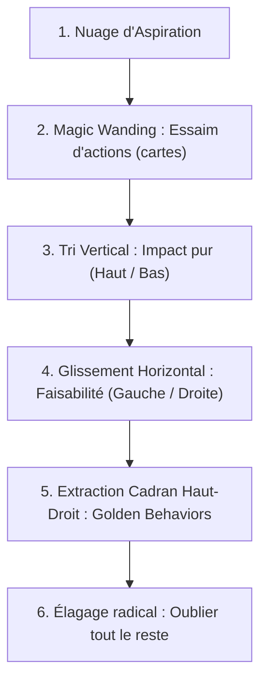

# Tiny Habits
**Formateur :** BJ Fogg | **ID :** `bj-fogg-tiny-habits` | **Tranches :** 20

## Synthèse Architecturale du Cours : *Tiny Habits* (BJ Fogg)

---

### 1. Thèse Centrale & Philosophie du Cours

#### Vision spécifique de BJ Fogg vs Approche standard
L'approche conventionnelle du changement repose sur une triple illusion : 
1. **L'illusion du volontarisme moral :** postuler que l'échec comportemental découle d'un déficit de caractère, de paresse ou de discipline personnelle (*Personal Flaw*).
2. **L'illusion de l'information (*Information-Action Fallacy*) :** postuler que saturer le cortex préfrontal en données sémantiques (« fumer tue », « le sucre est toxique ») modifie les automatismes procéduraux des ganglions de la base.
3. **L'illusion du pic motivationnel (*Burst and Bust*) :** concevoir des routines basées sur l'état d'éveil d'un individu idéalisé (*Fantasy-You*), condamnant le système à l'effondrement dès la marée basse neuro-affective.

À l'opposé, BJ Fogg aborde le comportement humain comme une **physique déterministe et une ingénierie de design** :
* **Dé-moralisation & Dissociation Identité/Comportement :** Le modèle $B = MAP$ n'a aucun « axe de paresse » (*No lazy axis*). Tout comportement est une recette de cuisine ou une culture dans une boîte de Pétri : si la réaction ne prend pas, c'est un **défaut de design (*Design Flaw*)**, jamais une faillite ontologique.
* **Primat de la valence émotionnelle immédiate :** *« People change best by feeling good, not by feeling bad. »* La plasticité synaptique et la myélinisation d'un automatisme ne s'opèrent pas par la coercition ou la punition, mais par un shoot dopaminergique endogène injecté à la milliseconde exacte de l'action via la célébration.
* **Pré-alignement dopaminergique (*Fogg Maxim #1*) :** *« Help people do what they already want to do. »* L'ingénierie comportementale refuse de greffer artificiellement de la motivation sur un devoir moral (*should*), pour canaliser exclusivement les désirs préexistants (*want*).

#### Fil rouge méthodologique
Le fil conducteur unifiant chaque intervention est la **réduction chirurgicale de l'énergie d'activation sous le seuil d'alarme du système nerveux** :
$$\text{Aspiration floue} \xrightarrow{\text{Swarm of Behaviors}} \text{Focus Mapping (Golden Behaviors)} \xrightarrow{\text{Sub-scaling radical}} \text{Triade Ancre } \to \text{ Micro-action } \to \text{ Célébration neurochimique}$$

---

### 2. Carte des Concepts & Leviers Émergents

```
                    ┌─────────────────────────────────────────────────────┐
                    │                   MODÈLE B = MAP                    │
                    │   Comportement = Motivation × Capacité × Prompt     │
                    └──────────────────────────┬──────────────────────────┘
                                               │
         ┌─────────────────────────────────────┼─────────────────────────────────────┐
         ▼                                     ▼                                     ▼
┌──────────────────┐                 ┌──────────────────┐                 ┌──────────────────┐
│    MOTIVATION    │                 │     CAPACITÉ     │                 │      PROMPT      │
│  (Vecteur PAC)   │                 │ (Chaîne à 5 M.)  │                 │ (Commutateur 0/1)│
└────────┬─────────┘                 └────────┬─────────┘                 └────────┬─────────┘
         │                                    │                                    │
 ┌───────┴────────┐                   ┌───────┴────────┐                   ┌───────┴────────┐
 │ • PAC Model    │                   │ • Ability Chain│                   │ • Prompt First │
 │ • Waves        │                   │ • Sub-Scaling  │                   │ • Anchor Habit │
 │ • Competing vs │                   │ • Action Line  │                   │ • Contextual   │
 │   Conflicting  │                   │ • Real vs      │                   │   Triggers     │
 │ • Golden Beh.  │                   │   Fantasy You  │                   │ • Binary Reset │
 └────────────────┘                   └────────────────┘                   └────────────────┘
         │                                    │                                    │
         └────────────────────────────────────┼────────────────────────────────────┘
                                              ▼
                    ┌─────────────────────────────────────────────────────┐
                    │             ENCODAGE ET RENFORCEMENT                │
                    │   • Célébration immédiate (Dopamine Wiring)        │
                    │   • Sillon de neige (Inhibition compétitive)       │
                    │   • Design Flaw vs Personal Flaw                   │
                    └─────────────────────────────────────────────────────┘
```

#### Écosystème des mécanismes clés

1. **Le Modèle Comportemental Fogg ($B = MAP$) :**
   * *Rôle :* Loi physique de base. Un comportement émerge uniquement lorsque Motivation, Capacité et Prompt convergent simultanément au-dessus de la Ligne d'Action (*Action Line*).

2. **L'Algorithme Hiérarchique de Dépannage ($P \to A \to M$) :**
   * *Rôle :* Ordre de résolution invariable d'un échec. Toujours diagnostiquer d'abord le Déclencheur ($P$), puis défrictionner la Capacité ($A$), et ne toucher à la Motivation ($M$) qu'en tout dernier ressort.

3. **La Chaîne d'Aptitude (*The Ability Chain*) & Facteur Maillon Faible :**
   * *Rôle :* Diagnostic anatomique de la friction selon 5 facteurs limitants : Temps, Argent, Capacité physique, Charge mentale/créative, Routine existante. Le comportement casse toujours à son maillon le plus faible.

4. **Le Découplage *Fantasy-You* vs *Real-You* (Heuristique du Pire Jour) :**
   * *Rôle :* Calibrage de robustesse. Dimensionner l'amplitude d'une habitude non pas sur l'état optimal, mais sur le seuil fonctionnel du pire jour de la semaine (fatigue extrême, stress).

5. **Le Filtrage des *Golden Behaviors* :**
   * *Rôle :* Sélection stratégique à l'intersection exacte de 3 critères : Impact objectif élevé sur l'aspiration, Motivation naturelle intrinsèque (*want*), Faisabilité absolue (*can do*).

6. **Le *Sub-Scaling* Radical (*Starting Radically Tiny*) :**
   * *Rôle :* Réduction géométrique de l'effort ($M \to 0$). Permet au comportement de se situer en permanence à l'extrême droite de l'axe de simplicité, contournant la résistance amygdalienne.

7. **La Triade Ancre - Micro-Action - Célébration :**
   * *Rôle :* Moteur d'encodage synaptique. L'Ancre fournit le prompt somatique/contextuel, la Micro-Action abaisse la barrière motrice, la Célébration injecte le neurotransmetteur (dopamine) fixant la boucle d'habitude.

8. **L'Inhibition Réciproque par Sillon Neuf (*Sled in the Snow*) :**
   * *Rôle :* Extinction des habitudes parasites sans lutte frontale. Création d'une voie motrice concurrente gratifiante qui atrophie l'ancien réseau synaptique par désuétude.

9. **La Matrice de Motivation PAC (Person - Action - Context) :**
   * *Rôle :* Cartographie dynamique des forces motrices : désirs identitaires de la personne ($P$), gratifications directes inhérentes à l'action ($A$), pressions/incitations du contexte ($C$).

10. **La Réciprocité Relationnelle Somato-Comportementale :**
    * *Rôle :* Régulation comportementale interpersonnelle non-aversive. L'injection d'un don symbolique inconditionnel réoriente instantanément la motivation du tiers par dette relationnelle inconsciente.

---

### 3. Tableau Récapitulatif des Techniques & Démonstrations

| Technique / Exercice | Objectif Opératoire | Déclencheur / Indication | Séquence Résumée |
|---|---|---|---|
| **The Maui Habit** | Amorçage matinal de la valence positive, rupture de l'état d'anxiété/léthargie, entraînement au réflexe de célébration. | Poser les pieds par terre le matin en sortant du lit (Ancre physique). | 1. Pieds au sol.<br>2. Énoncer à voix haute ou intérieurement : *« It’s going to be a great day »* (ou ajouter *« …somehow »* en cas de scepticisme somatique).<br>3. Sourire / Microressenti d'ouverture thoracique. |
| **Focus Mapping** | Isoler chirurgicalement 1 à 3 *Golden Behaviors* à partir d'une aspiration abstraite, sans surcharge cognitive. | Aspiration floue (*« manger plus sain »*, *« réduire le stress »*) ou sentiment d'éparpillement. | 1. Génération divergente (*Swarm of Behaviors* / *Magic Wanding* sans filtre critique).<br>2. Cartographie 2D spatialisée : Axe vertical = Impact (Haut/Bas), Axe horizontal = Faisabilité (Peut/Ne peut pas faire).<br>3. Extraction exclusive des comportements situés dans le quadrant supérieur droit (*High Impact / High Feasibility*). |
| **Troubleshooting Hiérarchique ($P \to A \to M$)** | Restaurer l'exécution d'un comportement sans basculer dans l'autocritique ni forcer la volonté. | Échec d'exécution d'une habitude planifiée. | 1. **Prompt :** Y avait-il un déclencheur clair, contextuel et opportun ? Si non $\to$ installer une ancre fiable.<br>2. **Ability :** Le comportement est-il trop lourd ? Diagnostic du maillon faible de la chaîne (Temps, Argent, Physique, Mental, Routine) $\to$ *Sub-scaler* radicalement.<br>3. **Motivation :** L'action est-elle un *should* au lieu d'un *want* ? Réaligner sur le modèle PAC. |
| **Sub-Scaling Opératoire (Micro-Comportement)** | Abaisser l'énergie d'activation sous le seuil de résistance neurovégétatif ($M \to 0$). | Procrastination, résistance interne, surcharge mentale ou mauvaise journée (*Worst-day*). | 1. Prendre l'action cible (ex: 20 pompes, utiliser le fil dentaire).<br>2. Réduire à l'unité motrice incompressible (ex: 2 pompes contre le mur, 1 seule dent).<br>3. Exécuter l'action microscopique sans obligation de continuer, en validant le contrat d'accomplissement. |
| **Installation de l'Ancre d'Implémentation (Anchor Pairing)** | Remplacer les déclencheurs temporels faillibles (horloges, alarmes) par des signaux procéduraux déjà automatisés. | Habitude oubliée ou non initiée par manque de prompt clair. | 1. Identifier une routine motrice déjà 100% stable dans la journée (ex: allumer la cafetière, fermer la porte des toilettes).<br>2. Formuler l'équation d'ancrage : *« Après que je [routine établie], je vais [micro-action] »*.<br>3. Vérifier la contiguïté spatio-temporelle stricte de l'enchaînement. |
| **Neuro-Wiring par Célébration Immédiate** | Fixer la boucle synaptique par une décharge de dopamine/endorphine synchronisée avec la fin du geste moteur. | Exécution immédiate du micro-comportement (fenêtre temporelle < 1 seconde). | 1. À la dernière seconde du micro-geste, déclencher un signal gratifiant kinesthésique/auditif calibré pour soi (ex: poing serré *« Yes ! »*, large sourire, claquement de doigts, mot intérieur *« Good job »*).<br>2. Ressentir la sensation somatique de succès et de légèreté. |
| **Clarification & Démonstration Kinesthésique** | Dissoudre l'abstraction procédurale et lever la barrière de charge mentale chez un tiers ou soi-même. | Consigne vague générant friction, évitement ou rébellion passive (*« Nettoie la douche »*). | 1. Bannir les consignes sémantiques ou morales.<br>2. Exécuter une démonstration physique mimétique de 10 secondes (gestes moteurs exacts, outils précis, critères tangibles d'arrêt).<br>3. Faire reproduire immédiatement pour enregistrement proprioceptif direct. |
| **Réciprocité Préventive (Redirection Relationnelle)** | Pacifier un comportement perturbateur sans entrer dans l'escalade punitive ou coercitive. | Comportement parasite d'un tiers dans un contexte non modifiable (ex: enfant agité en avion). | 1. Suspendre le réflexe de réprimande (qui renforce l'attention sur le comportement).<br>2. Offrir immédiatement un don physique/symbolique inconditionnel valorisant (ex: un pin's, un objet d'affiliation).<br>3. Laisser la norme de réciprocité créer la dette sociale inconsciente et inhiber la perturbation. |

---

## Extractions Détaillées par Tranche (Opératoire & Verbatim)


## --- Tranche 1 / 20 ---

### 1. Mécanismes & Principes Actifs

#### Le Recadrage « Défaut de Conception vs Défaut Personnel »
- **Principe actif :** En psychologie cognitive et en PNL, l'échec répété d'une action engendre un glissement identitaire : le sujet passe de *"je n'ai pas réussi l'action"* à *"je suis incapable / défectueux"*. Ce mécanisme active le critique intérieur, génère de la honte somatique et installe une boucle d'impuissance acquise (*learned helplessness*). BJ Fogg neutralise immédiatement cette charge en dissociant l'identité (qui est intacte) du système d'ingénierie comportementale (qui présente une faille). Le comportement devient un problème de design mécanique extérieur au sujet. Le système nerveux quitte le mode défensif (menace sur le soi) pour entrer dans un état d'exploration orienté résolution de problème.
- **Tags libres émergents :** `#design_flaw_not_personal_flaw` `#dissociation_identite_comportement` `#neutralisation_critique_interne` `#deculpabilisation_operatoire`

#### Le « Sillon de Neige » et l'Inhibition Réciproque par Voie Neurologique Neuve
- **Principe actif :** Fogg utilise la dynamique d'inhibition compétitive : l'autocritique et la culpabilité sont des autoroutes neuronales sur-sollicitées (*"sled in the snow, slipping into a well-worn path"*). Tenter de "combattre" activement une boucle négative ne fait que réactiver son réseau synaptique. Le principe opératoire ici est de créer une trajectoire motrice et émotionnelle alternative ultra-réduite mais chargée de valence positive (*"feeling good, not feeling bad"*). Par effet d'inhibition latérale et de renforcement différentiel, la répétition d'un chemin gratifiant laisse s'estomper l'ancien sillon sans lutte frontale.
- **Tags libres émergents :** `#sillon_de_neige` `#inhibition_competitive` `#valence_affective_positive` `#plasticite_sans_friction`

#### La Triade Opératoire : Ancre, Micro-Comportement, Célébration Immédiate
- **Principe actif :** L'encodage d'une habitude repose sur la co-activation temporelle stricte de trois éléments :
  1. *L'Ancre (Prompt somato-environnemental) :* Réutilisation d'une synesthésie motrice déjà automatisée dans les ganglions de la base pour fournir le signal de déclenchement sans coût attentionnel.
  2. *Le Micro-Comportement (Tiny Behavior) :* Réduction drastique de la charge cognitive et motrice (< 30 secondes), ce qui contourne le réflexe amygdalien d'évitement lié à l'effort ou au risque perçu.
  3. *La Célébration Immédiate (Instant Celebration) :* Décharge dopaminergique endogène auto-induite dans la seconde qui suit l'action. Ce pic neurochimique consolide la potentialisation à long terme (LTP) entre le stimulus contextuel et la commande motrice.
- **Tags libres émergents :** `#triade_ancre_action_celebration` `#ancrage_neurochimique_immediat` `#bypass_amygdalien` `#dopamine_endogene`

#### L'Illusion de l'Information-Action (*Information-Action Fallacy*)
- **Principe actif :** Les interventions thérapeutiques ou éducatives échouent massivement en présupposant que l'intellectualisation d'un problème modifie le système nerveux autonome ou les automatismes moteurs. L'accès à une donnée sémantique ne modifie pas les circuits procéduraux des ganglions de la base. Pour induire un changement, il est inutile de surcharger le cortex préfrontal en faits ; l'intervention doit porter directement sur l'architecture physique de l'environnement ou sur la séquence motrice contextuelle.
- **Tags libres émergents :** `#information_action_fallacy` `#dissociation_semantique_procedurale` `#primat_du_comportement_incarne`

---

### 2. Protocoles, Techniques & Démonstrations (Étape par Étape)

#### Protocole 1 : « The Maui Habit » (Installation du Cadre d'Amorçage Quotidien)
* **Intention / Indication :** Rupture de l'état d'anxiété ou de léthargie matinale, réamorçage de l'optimisme opérationnel et entraînement au réflexe de célébration dès la sortie du sommeil.
* **Mise en place & Pré-framing :** Cadrer l'exercice comme une expérience sans risque de 3 secondes qui ne demande aucune croyance préalable ni force de volonté.
* **Séquence d'actions pas à pas :**
  1. *Déclencheur somato-spatial :* Sortir du lit et poser la plante des pieds à plat sur le sol (contact proprioceptif direct).
  2. *Émission motrice verbale :* Prononcer immédiatement à voix haute la formule : *"It’s going to be a great day."*
  3. *Pause kinesthésique d'intégration :* Maintenir un silence de 2 à 3 secondes pour laisser la résonance proprioceptive et auditive s'ancrer dans le corps.
  4. *Branche conditionnelle (gestion de la résistance interne) :* Si l'état interne est marqué par l'anxiété, la fatigue ou le scepticisme, réajuster l'intonation avec une légère modulation interrogative/ouverte : *"It’s going to be a great day—somehow."*
  5. *Célébration somatique :* Laisser émerger un micro-sentiment de soulagement ou de réussite.
* **Signes de calibration :** Détente des muscles faciaux, ouverture de la cage thoracique (soupir de décharge), baisse du tonus d'alarme au moment où le mot *"somehow"* ouvre une possibilité cognitive.

#### Protocole 2 : L'Ingénierie du Micro-Pas (Formule d'Écriture d'une Recette Tiny Habit)
* **Intention / Indication :** Implanter un nouveau comportement sans mobiliser la volonté ni risquer le rejet par découragement.
* **Mise en place & Pré-framing :** Interdire formellement au sujet de formuler un objectif de volume ou de résultat. Réduire l'action jusqu'à ce qu'elle paraisse ridiculement facile et exempte de tout sentiment d'échec potentiel.
* **Séquence d'actions pas à pas :**
  1. *Sélection de l'Ancre :* Identifier une action motrice automatique, quotidienne et stable (ex: *"Après avoir tiré la chasse d'eau"*, *"Après avoir allumé la cafetière"*).
  2. *Calibrage de la Micro-Action :* Définir une unité motrice exécutable en moins de 30 secondes (ex: faire deux pompes, passer le fil dentaire sur une seule dent, écrire une seule ligne).
  3. *Greffe séquentielle :* Rédiger la formule sous la syntaxe stricte : *"Après que [Ancre], je vais [Micro-Action]."*
  4. *Génération de l'émotion de réussite :* Exécuter immédiatement après l'action un geste ou un mot de validation interne (sourire, dire *"C'est bien !"*, geste du poing victorieux).
* **Signes de calibration :** Absence totale de friction ou d'hésitation motrice lors du passage à l'acte ; sensation d'amusement plutôt que de contrainte chez le praticien ou le sujet.

#### Protocole 3 : La Décontamination par Élimination du Risque Émotionnel (Étude de cas Amy)
* **Intention / Indication :** Sortir de la paralysie décisionnelle, de la procrastination anxieuse et du piège *"Go big or go home"*.
* **Mise en place & Pré-framing :** Reconnaître que la taille de l'éléphant/baleine déclenche l'inhibition motrice. Poser le postulat que le succès engendre le succès par accumulation de vélocité.
* **Séquence d'actions pas à pas :**
  1. *Isolement temporel et spatial :* Choisir un point d'arrêt dans la routine existante (ex: garer la voiture sur le bas-côté après avoir déposé les enfants à l'école).
  2. *Réduction à l'unité atomique :* Prendre un Post-it et y écrire une seule et unique tâche, immédiatement exécutable (ex: rédiger une phrase d'introduction, envoyer un seul courriel).
  3. *Exposition kinesthésique :* Poser le Post-it sous les yeux (sur le tableau de bord) pendant le trajet.
  4. *Exécution et clôture :* Rentrer et exécuter cette unique action sans toucher au reste.
  5. *Enregistrement somatique du succès :* Valider l'achèvement avant d'envisager toute autre séquence.
* **Signes de calibration :** Passage immédiat de l'inhibition motrice (procrastination) à l'initiation de l'action ; disparition des signaux de tension céphalique.

---

### 3. Heuristiques, Subtilités & "Sagesse du Praticien"

#### Règles Conditionnelles & Arbres de Décision
* **Si** le sujet verbalise de la culpabilité ou de la honte face à un comportement non tenu, **alors** requalifier immédiatement la situation en erreur d'ingénierie mécanique (*"design flaw"*) et non en tare morale, **parce que** le système nerveux sous l'emprise de la honte recrute ses ressources pour se défendre au lieu d'explorer.
* **Si** le sujet se sent épuisé, incrédule ou anxieux au réveil lors du Maui Habit, **alors** lui faire prononcer la phrase en ajoutant *"somehow"* avec une inflexion montante, **parce que** forcer une fausse certitude positive crée une congruence brisée (rejet de l'inconscient), tandis que *"somehow"* introduit une présupposition de possibilité sans contraindre le mental.
* **Si** le sujet commence une nouvelle habitude avec de l'ambition (ex: 30 minutes d'exercice par jour), **alors** exiger une réduction immédiate à une fraction minuscule (< 30 secondes), **parce que** la motivation est fluctuante et que toute habitude dimensionnée pour les jours de haute énergie échouera dès la première baisse de charge biologique.
* **Si** un comportement indésirable survient (rechute), **alors** le traiter comme une donnée expérimentale pure (découverte scientifique), **parce que** l'apprentissage nécessite un cycle itératif exempt de jugement émotionnel.

#### Pièges Classiques & Erreurs de Débutant
* **Le piège de la motivation :** Croire que pour changer, il faut augmenter la volonté. La motivation est un "ami par beau temps" (*fair-weather friend*), un métamorphe instable sur lequel aucun système fiable ne peut reposer.
* **Le sophisme informationnel :** Croire qu'expliquer le problème (faits, santé, dangers) suffit à changer l'individu. L'information modifie la cognition sémantique, jamais le réflexe contextuel direct.
* **La célébration différée :** Attendre d'avoir accompli quelque chose de grand pour se féliciter. Si la récompense neurochimique n'est pas immédiate (dans les microsecondes qui suivent l'acte), l'encodage synaptique de l'habitude est nul.

---

### 4. Pépites Verbatim & Patterns Linguistiques (MOT À MOT EN V.O.)

#### Découplage de la Faute et Métaphore de la Notice Défectueuse
> *"It isn’t your fault. And creating positive change isn’t as hard as you think. [...] If you tried putting together a chest of drawers with faulty instructions and parts missing, you would feel frustrated. But you probably wouldn’t blame yourself for this, would you? You would blame the manufacturer instead. When it comes to failed attempts at change, we almost never blame the 'manufacturer.' We blame ourselves."*
* **[Analyse du Pattern] :**
  - **Recadrage analogique & métaphore isomorphique :** Transfert de la situation émotionnellement chargée (l'échec personnel) vers une situation neutre et mécanique (le meuble en kit mal conçu). 
  - **Question suggestive avec présupposition d'évidence :** *"you probably wouldn’t blame yourself for this, would you?"* (force une réponse interne négative et désamorce le réflexe d'auto-blâme).
  - **Rupture de pattern identitaire :** Déplacement de la cause vers "le fabricant" (la méthode), libérant instantanément le sujet du poids de l'auto-dévalorisation.

#### L'Isolat Tranchant : Rupture d'Attente et Démenti Catégorique
> *"We just need to get our act together and pull ourselves up by our bootstraps and do better. Right? Nope. Sorry. Not right. We are not the problem. Our approach to change is. It’s a design flaw—not a personal flaw."*
* **[Analyse du Pattern] :**
  - **Ironie conversationnelle & pacing de la voix interne :** Formulation du cliché culturel d'effort (*"pull ourselves up by our bootstraps"*), suivi d'une fausse validation (*"Right?"*).
  - **Rupture brutale (pattern interrupt) :** Utilisation de termes monosyllabiques percutants (*"Nope. Sorry. Not right."*) qui coupent net la transe culturelle de la culpabilité.
  - **Recadrage par antithèse stricte :** Opposition binaurale/conceptuelle entre *"design flaw"* et *"personal flaw"*, ancrant la dissociation entre l'être et le système.

#### Suggestion Permissive & Installation du Doute Bénéfique (Le "Somehow")
> *"If you do the Maui Habit and feel that it won’t be a great day, I advise you to still say this phrase. [...] But if this feels phony, then I adjust the phrase and my intonation as I say, 'It’s going to be a great day—somehow.' I find this oddly helpful even on my worst days. When I’m worried about the day ahead, this statement—even when I say it with a question in my voice—seems to open the door just a crack to actually having a good day."*
* **[Analyse du Pattern] :**
  - **Pacing de l'état interne résistant :** Reconnaissance explicite du sentiment d'incongruence (*"if this feels phony"*), empêchant le rejet critique du sujet.
  - **Adverbe d'ouverture quantique :** L'ajout de *"somehow"* introduit une présupposition d'accomplissement tout en laissant les modalités indéterminées pour l'esprit conscient, contournant ainsi le facteur critique.
  - **Métaphore kinesthésique spatiale :** *"open the door just a crack"* abaisse le seuil de tolérance requis : il ne s'agit pas d'ouvrir grand la porte (effort trop grand), mais de laisser un infime interstice, suffisant pour que le système nerveux bascule vers la recherche active d'opportunités.

#### La Transe d'Énumération et Induction de l'Omniprésence du Modèle
> *"With the answer I discovered, you can decode behavior. All behavior. Putting your toothbrush in a new place. Unloading the dishwasher every morning before breakfast. Watering the garden in the evening. Doing two squats while your morning coffee brews. Taking the trash out on Wednesday. Smoking. Not smoking. Checking your watch for the time. Checking your phone for the time. Instagramming at three a.m. Kissing your husband when you get home from work. Making the bed. Not making the bed. Eating chocolate. Not eating chocolate. Reading this book. Not reading this book."*
* **[Analyse du Pattern] :**
  - **Empilement de truismes (truism stacking / sensory grounding) :** Évocation rapide d'actions concrètes, observables, universelles et kinesthésiquement ancrées dans le quotidien, saturant le canal perceptif conscient.
  - **Structures d'opposition binaire (polarités) :** L'alternance répétée (*"Smoking. Not smoking."*, *"Making the bed. Not making the bed."*, *"Eating chocolate. Not eating chocolate."*) neutralise le jugement moral sur les actions et crée un état de confusion légère et de ratissage exhaustif.
  - **Présupposition d'universalité :** En englobant à la fois le comportement et son absence, Fogg présuppose irréfutablement que son modèle décrypte la totalité absolue de l'expérience humaine.


## --- Tranche 2 / 20 ---

### 1. Mécanismes & Principes Actifs

*   **Le Modèle Comportemental Fogg (B = MAP) : Convergence Tripartite Synchrone**
    *   *Principe actif :* Un comportement ($B$) n'émerge jamais d'une variable isolée, mais de la collision temporelle exacte de trois facteurs : la Motivation ($M$, désir/énergie orientée), la Capacité ($A$, faisabilité/simplicité opérationnelle) et l'Élément déclencheur ($P$, signal perceptif ou somatique). Si l'un des trois est nul ou sous le seuil d'activation au moment $T$, le comportement est neurologiquement impossible. Ce modèle désamorce l'illusion psychologisante de la « force de volonté » ou de l'« identité défaillante » en réduisant l'action humaine à un calcul de physique comportementale.
    *   *Tags :* `#Modele_Fogg_BMAP` `#PhysiqueComportementale` `#ConvergenceSynchrone` `#DesactivationCulpabilite`

*   **Ligne d'Action (Action Line) & Loi de Compensation Dynamique**
    *   *Principe actif :* La relation entre Motivation et Capacité est non-linéaire et compensatoire, figurée par une courbe concave ascendante (« Action Line »). Une motivation extrême compense une tâche d'une complexité herculéenne (ex: sauver un enfant sous une rame de métro), tandis qu'une tâche dotée d'une friction quasi nulle ($A$ maximal) s'exécute même avec une motivation résiduelle ou proche de zéro. La pérennité d'une habitude repose sur son ancrage à droite de la courbe (zone de haute simplicité) : plus une action exige de motivation pour franchir la ligne, plus elle est fragile face aux fluctuations émotionnelles et homéostatiques de l'individu.
    *   *Tags :* `#LigneDAction` `#CompensationDynamique` `#ZoneDeFaisabilite` `#GradientDEffort`

*   **L'Élément Déclencheur comme Commutateur Binaire Instantané (Prompt As Lightning)**
    *   *Principe actif :* Alors que la motivation et la capacité sont des variables analogiques continues (toujours présentes en toile de fond à des degrés divers), le Prompt opère comme un signal binaire discret ($0$ ou $1$). Sans déclencheur perceptible, aucune action ne franchit la ligne d'action, quel que soit le réservoir de motivation disponible. Neurologiquement, le prompt focalise l'attention sélective et ouvre une boucle sensorimotrice. Supprimer le prompt constitue donc le levier d'extinction comportementale le plus rapide et le moins coûteux cognitivement (« low-hanging fruit »), car il neutralise le circuit avant même l'amorce de la délibération.
    *   *Tags :* `#PromptBinaire` `#CommutateurAttentionnel` `#ExtinctionSansVolonte` `#DesignEnvironnemental`

*   **Défrictionnement Radical & Plasticité par Répétition (Ability Streamlining)**
    *   *Principe actif :* Plus un comportement est répété, plus il migre horizontalement vers la droite du modèle ($A$ augmente par encodage synaptique et fluidification procédurale). Réduire le comportement initial à une version microscopique (« Tiny Behavior », ex: un seul fil dentaire, deux squats) contourne l'amygdale et le cortex préfrontal en abaissant l'énergie d'activation sous le seuil de résistance ou de procrastination.
    *   *Tags :* `#DefrictionnementRadical` `#EnergieActivationMinimale` `#MicroPratique` `#AutomatisationProcedurale`

*   **Boucle de Célébration Immédiate (Neurochimie du Renforcement Positif)**
    *   *Principe actif :* « *People change best by feeling good, not by feeling bad.* » Le cerveau humain n'ancre pas les habitudes par la simple répétition mécanique, mais par le pic de dopamine/endorphine généré immédiatement après ou pendant l'exécution. En associant un geste valorisant, un sourire dans le miroir ou une auto-suggestion gratifiante (« I did a good job! ») dans la fraction de seconde suivant l'action microscopique, le système de récompense étiquette la boucle neuronale comme prioritaire et plaisante, accélérant la myélinisation du pattern.
    *   *Tags :* `#CelebrationImmediate` `#DopamineWiring` `#ConditionnementAffectif` `#ValidationIdentitaire`

*   **Neutralisation par Réciprocité Préventive (Reciprocity Redirection)**
    *   *Principe actif :* Lorsqu'un comportement parasite provient d'un tiers sans possibilité d'en altérer le prompt ni la capacité physique (ex: un enfant donnant des coups de pied dans le siège d'avion), l'injection d'un don socialement valorisé crée une dette psychologique inconsciente (norme de réciprocité universelle). Cette manœuvre réoriente instantanément la motivation du sujet : la pulsion d'agitation motrice est supplantée par le désir d'honorer le lien d'affiliation et le statut conféré par le symbole offert.
    *   *Tags :* `#ReciprocitePreventive` `#ManipulationMotivationnelleDouce` `#InjonctionRelationnelle`

---

### 2. Protocoles, Techniques & Démonstrations (Étape par Étape)

#### Protocole A : La Recette Fondamentale Tiny Habits (The Habit Recipe)
*   **Intention / Indication :** Coder une nouvelle habitude pérenne dans le système nerveux sans épuiser les réserves de volonté, pour tout comportement d'hygiène, de santé ou de productivité (ex: fil dentaire, hydratation, exercices).
*   **Mise en place & Pré-framing :** Cadrer le sujet dans la posture du « Habiteer » : curiosité, jeu, zéro perfectionnisme, flexibilité. Interdiction d'évaluer la valeur de l'habitude à sa taille extérieure : seule compte l'automaticité de l'ancrage.
*   **Séquence d'actions pas à pas :**
    1.  *Design de la Friction Matérielle :* Trouver l'outil le plus agréable tactilement (ex: type de fil dentaire favori) et le placer dans le champ visuel direct, adjacent au déclencheur (sur le lavabo, collé à la brosse à dents).
    2.  *Ancrage sur Routine Existante (Anchor Moment) :* Définir un événement stable et déjà câblé comme déclencheur formel via la syntaxe : `« Après avoir [Routine établie], je vais [Micro-Action] »` (ex: *« Après avoir posé ma brosse à dents... »*).
    3.  *Exécution Microscopique (Tiny Behavior) :* Réaliser immédiatement l'action réduite à son unité atomique indivisible (ex: passer le fil sur *une seule* dent). Tout geste supplémentaire est strictement cadré comme un « bonus/crédit supplémentaire », jamais comme une attente minimale.
    4.  *Célébration Instantanée (Wiring) :* Dans la seconde qui suit, générer un feedback somatique et émotionnel de succès : se regarder dans le miroir, sourire physiquement, prononcer mentalement ou à voix haute une formule de triomphe personnel (*« I did a good job! »*).
*   **Signes de calibration :** Absence de soupir ou de tension musculaire avant l'action (signe que $A$ est suffisant) ; sourire spontané, relâchement du diaphragme ou étincelle oculaire lors de la célébration (validation du shoot dopaminergique).

#### Protocole B : Extinction Comportementale par Diagnostic & Élimination MAP (Behavior Disruption)
*   **Intention / Indication :** Enrayer une habitude automatique compulsive ou néfaste (ex: scrolling matinal au lit, grignotage nocturne).
*   **Mise en place & Pré-framing :** Suspendre tout jugement moral, auto-flagellation ou culpabilisation relative à un « manque de caractère ». Traiter le problème comme une équation de design défectueuse où le comportement indésirable se situe trop haut au-dessus de la Ligne d'Action.
*   **Séquence d'actions pas à pas :**
    1.  *Cartographie MAP du Comportement Indésirable :*
        *   Évaluer la Motivation ($M$) : Pourquoi le cerveau cherche-t-il ce stimulus ? (ex: feedback social, shoot dopaminergique, soulagement de l'ennui).
        *   Évaluer la Capacité ($A$) : À quel point est-ce facile d'accès physique et temporel ? (ex: téléphone déjà en main, snacks visibles sur la commode).
        *   Identifier le Prompt ($P$) exact : Quel est le stimulus déclencheur précis ? (ex: sonnerie d'alarme du téléphone à 4h30, panier de chips dans l'axe visuel).
    2.  *Coupure Prioritaire du Prompt (Niveau 1 - Low-Hanging Fruit) :*
        *   Faire disparaître le signal du champ sensoriel. Remplacer l'outil hybride (téléphone servant d'alarme) par un outil dédié sans fonctionnalités distractives (réveil classique).
        *   Déplacer les déclencheurs visuels hors de la ligne de mire (enfermer le panier de snacks dans un placard fermé, poser le téléphone dans la cuisine).
    3.  *Augmentation de la Friction (Niveau 2 - Altération de la Capacité) :*
        *   Si le prompt ne peut être éradiqué, rendre le comportement pénible, lent ou physiquement coûteux (éloigner le stimulus à l'autre bout de la pièce, supprimer l'application, exiger un déplacement physique).
    4.  *Test & Itération :* Observer sur 24 à 72 heures si l'extinction opère sans conflit interne. Si la compulsion persiste, remonter d'un cran la friction matérielle.
*   **Signes de calibration :** Le sujet s'endort ou démarre sa journée sans avoir eu à « lutter » ; oubli pur et simple de l'existence du stimulus (comme le panier de friandises oublié jusqu'au lendemain matin).

#### Protocole C : Désamorçage Relationnel par Réciprocité Focalisée
*   **Intention / Indication :** Interrompre un comportement irritant ou perturbateur chez un tiers (enfant, collègue, partenaire) sur lequel l'opérateur n'a aucune autorité coercitive ni prise sur ses prompts environnementaux.
*   **Mise en place & Pré-framing :** Adopter une attitude non-agressive, chaleureuse et décontractée (« style Mister Rogers »). Éviter la confrontation directe ou la plainte victimaire qui génère de la réactance.
*   **Séquence d'actions pas à pas :**
    1.  *Identification de l'Impasse :* Constater l'impossibilité d'agir sur le Prompt (impulsions internes de l'autre) et sur sa Capacité (proximité physique incontournable).
    2.  *Création de la Dette Positive (Le Don Imprévu) :* Offrir un objet symbolique positif, ludique ou inattendu (ex: badge smiley, compliment authentique, friandise).
    3.  *Enchâssement de la Demande d'Alliance :* Lier verbalement le cadeau à une suggestion positive de coopération, formulée sous forme d'aide mnémotechnique bienveillante : *« I want to give you this [objet]. I’m hoping this will help you remember not to [comportement indésirable]. »*
    4.  *Verrouillage de l'Engagement :* Obtenir un assentiment verbal ou un sourire franc du sujet et de ses figures d'attachement/accompagnateurs.
*   **Signes de calibration :** Validation enthousiaste immédiate (« Yes! »), sourires authentiques (activation orbiculaire des yeux), cessation nette de l'activité motrice perturbatrice.

---

### 3. Heuristiques, Subtilités & "Sagesse du Praticien"

*   **Règle d'or de l'extinction comportementale :**
    *   *Si* tu souhaites stopper un comportement indésirable, *alors* commence TOUJOURS par tenter d'éliminer le **Prompt**. N'essaie pas de démotiver le sujet ni de lui demander un effort surhumain de volonté. Si le prompt est absent, la motivation reste latente sans jamais s'actualiser.
*   **Règle de traitement de la récidive et de l'échec :**
    *   *Si* le sujet échoue à tenir sa nouvelle habitude, *alors* ne cherche JAMAIS la cause dans sa psychologie, sa discipline ou sa force morale. Analyse l'équation mécanique : le comportement était-il trop grand ($A$ insuffisant) ? Le prompt était-il vague ou mal placé ? Réduis la taille de l'action jusqu'à ce qu'elle devienne ridiculement facile (« bonsai habit »).
*   **Règle de calibration des sensations contrastées :**
    *   *Si* deux comportements génèrent des affects diamétralement opposés (ex: fierté ordonnée du bureau vs culpabilité destructrice du scroll au lit), *alors* rappelle au praticien que la mécanique sous-jacente est rigoureusement identique ($B = MAP$). La différence émotionnelle ne reflète pas une différence structurelle. Traite le scrolling avec la même neutralité technique qu'un coup de pédale de bicyclette.
*   **Règle du surcroît d'effort (« Extra Credit ») :**
    *   *Si* le sujet se sent inspiré et fait plus que l'action minuscule prescrite (ex: passer le fil sur toutes les dents, faire 15 pompes au lieu de 2), *alors* recadre immédiatement ce surplus comme un bonus luxueux (« extra credit ») et non comme la nouvelle norme exigible. Le contrat d'automaticité de base doit impérativement rester microscopique pour les jours de basse énergie.
*   **Règle d'arbitrage de couple / dynamique de groupe :**
    *   *Si* un blocage surgit sur une tâche partagée (ex: nettoyage de la douche), *alors* commence par valider l'alignement sur la Motivation commune (*« We both want X »*), puis audite immédiatement le composant Capacité ($A$) : qu'est-ce qui rend la tâche perçue comme complexe ou ambiguë dans la motricité de l'autre ?
*   **Postulat philosophique de BJ Fogg :**
    *   *« People change best by feeling good, not by feeling bad. »* La honte, la culpabilité et la coercition interne sont des inhibiteurs neurologiques de l'apprentissage ; l'émotion positive immédiate est l'unique colle synaptique de l'habitude durable.

---

### 4. Pépites Verbatim & Patterns Linguistiques (MOT À MOT EN V.O.)

*   **Citation 1 :**
    > « Some mysteries are like riddles. When you don’t know the answers, riddles seem hard to solve. But once you see the answer, the solution seems obvious. With the answer I discovered, you can decode behavior. All behavior. »
    *   **[Analyse du Pattern]** : Recadrage métaphorique (« mystère » transformé en simple « devinette »). Utilisation d'un présupposé de contraste temporel (*« When you don't know... But once you see... »*) qui installe inévitablement la bascule cognitive vers l'évidence. Clôture par une assertion d'omniscience catégorique (*« All behavior »*) martelée en phrase isolée pour briser toute exceptionnalité perçue par le sujet.

*   **Citation 2 :**
    > « Behaviors are like bicycles. They can look different, but the core mechanisms are the same. Wheels. Brakes. Pedals. »
    *   **[Analyse du Pattern]** : Analogie de démystification et réductionnisme structurel. En fragmentant un objet complexe en composants mécaniques élémentaires et familiers (*« Wheels. Brakes. Pedals. »*), l'opérateur induit une rupture de pattern face à l'angoisse de la complexité psychologique. L'inconscient transfère la simplicité de réparation d'un vélo à la modification d'un comportement humain.

*   **Citation 3 :**
    > « Which means there is no feeling stuck. Which means you can be the person you want to be. If this sounds awesome and crazy and a little overwhelming, don’t worry. I’ll be right there with you, sharing what I’ve learned from helping thousands of people change their lives. »
    *   **[Analyse du Pattern]** : Pacing & Leading émotionnel avec empilement d'équivalences complexes (*« Which means... Which means... »*). Calibration et ratification anticipée des résistances internes (*« awesome and crazy and a little overwhelming »*), suivie immédiatement d'une suggestion d'hypo-alerte et d'un ancrage d'accompagnement sécurisant (*« don’t worry. I’ll be right there with you »*), validé par la preuve sociale d'autorité (*« thousands of people »*).

*   **Citation 4 :**
    > « You already know how to floss your teeth—all of them. But if you’re like most people, you don’t make a habit of flossing. It’s not automatic in your life. This exercise can help you change that by focusing on the automaticity of the habit, not the size. »
    *   **[Analyse du Pattern]** : Validation de la compétence existante pour éliminer le sentiment d'incompétence (*« You already know... »*), normalisation universelle du problème via un truisme sociologique (*« like most people »*), suivie d'une dissociation linguistique stratégique entre l'**automaticité** (processus neurologique valorisé) et la **taille** (critère superficiel disqualifié).

*   **Citation 5 :**
    > « I had a yellow smiley-face button in my computer bag. [...] I got it out of my bag and showed it to the little passenger and his parents. “Hey,” I said. “I want to give you this smiley-face button. I’m hoping this will help you remember not to kick my seat during the flight.” »
    *   **[Analyse du Pattern]** : Ancrage spatial/matériel et commande enchâssée sous couverture d'amabilité. Le don du badge opère un pattern interrupt radical sur l'agitation de l'enfant. L'expression *« help you remember not to kick »* présuppose que l'enfant a déjà l'intention coopérative et qu'il s'agit uniquement d'une fonction de rappel mnésique bienveillante, contournant toute opposition frontale ou réactance psychologique.

*   **Citation 6 :**
    > « One day Denny invited me to look at the shower with him, and he put Behavior Design into action. “We both want a clean shower,” he said. I agreed. He saw that I had some level of motivation. Then he asked me about ability. »
    *   **[Analyse du Pattern]** : Yes-set conversationnel et synchronisation d'objectif supérieur (*« We both want a clean shower »*). En établissant un accord d'identité et de motivation partagée, l'interlocuteur désamorce le conflit relationnel et déplace le cadre de négociation vers un audit neutre et objectif de la Capacité ($A$), transformant une dispute domestique en un problème d'ingénierie ergonomique.


## --- Tranche 3 / 20 ---

### 1. Mécanismes & Principes Actifs

- **Réciprocité Relationnelle Somato-Comportementale (The Rule of Reciprocity)**
  *Principe actif :* L'activation du biais de réciprocité par le don inconditionnel d'un objet physique symbolique (le pin's smiley) crée une dette sociale implicite dans le système nerveux de l'autre (l'enfant et ses parents). Au lieu de punir ou de menacer (stratégie aversive), l'émetteur modifie la valence émotionnelle de la relation. L'inconscient du sujet réoriente son énergie motrice pour préserver l'alliance sociale nouvellement créée, réduisant drastiquement le comportement indésirable sans coercition.
  *Tags :* #regle_reciprocite #dette_relationnelle #don_symbolique #pacification_comportementale

- **Dissolution de l'Abstraction Procédurale (Clarification & Démonstration Kinesthésique)**
  *Principe actif :* Lorsqu'une consigne est formulée de manière abstraite (« nettoie la douche »), le cerveau du récepteur fait face à une charge cognitive élevée liée à l'ambiguïté des critères d'achèvement (quel outil ? quelle surface ?). Cette ambiguïté est perçue par le système nerveux comme une résistance ou un coût d'aptitude insurmontable (Ability Barrier). La démonstration physique mimétique (l'autre mime les gestes exacts en 10 secondes) court-circuite le cortex préfrontal analytique et s'ancre directement dans les neurones miroirs et la mémoire procédurale motrice. La tâche passe instantanément de « difficile/confuse » à « évidente/enfantine », propulsant le comportement au-dessus de la Ligne d'Action.
  *Tags :* #clarification_mimetique #reduction_friction_motrice #desambiguisation #neurones_miroirs #action_line

- **Algorithme Hiérarchique de Dépannage (Troubleshooting Order: P -> A -> M)**
  *Principe actif :* En cas d'échec comportemental, l'erreur par défaut du cerveau humain est d'attribuer l'échec à un manque de volonté (erreur fondamentale d'attribution / fixation sur la motivation). L'algorithme impose une descente logique rigide et contre-intuitive :
  1. *Prompt (Déclencheur)* : Y a-t-il eu un signal perceptif non ambigu dans l'environnement sensoriel ? Si non, le comportement ne peut pas exister, quelle que soit la motivation.
  2. *Ability (Aptitude/Simplicité)* : Le sujet a-t-il la capacité matérielle, temporelle ou cognitive immédiate de l'exécuter ?
  3. *Motivation (Moteur affectif)* : N'est traitée qu'en tout dernier recours.
  Ce protocole désamorce l'escalade émotionnelle, le reproche, la culpabilité et la fatigue décisionnelle en traitant le comportement comme un problème mécanique de design.
  *Tags :* #algorithme_depannage #troubleshooting_order #prompt_first #desescalade_attributionnelle

- **Dé-fusion Identitaire du Comportement (The Petri Dish Mindset / Recipe Reframing)**
  *Principe actif :* Rupture radicale du pattern de jugement de valeur moral (« je suis paresseux », « je suis nul », « je manque de volonté »). Le modèle FBM n'a aucun axe de personnalité ou de caractère (« no lazy axis »). Le comportement est extrait de l'identité du sujet et relocalisé dans l'environnement objectif sous forme de « recette » ou d'expérience biologique dans une boîte de Pétri. Cette dissociation V/K (visuelle/kinesthésique) neutralise le système de honte/culpabilité (self-trash talk), arrêtant la boucle de compensation négative (ex: boire un verre de vin pour anesthésier la dévalorisation) et restaurant la curiosité expérimentale.
  *Tags :* #dissociation_identite_comportement #recette_comportementale #boite_de_petri #neutralisation_honte #de-blaming

- **Triade des Sources de Motivation : Modèle PAC (Person - Action - Context)**
  *Principe actif :* Remplacement de la dichotomie classique intrinsèque/extrinsèque par trois vecteurs opérationnels observables :
  1. *Person* : Désirs, pulsions et valeurs déjà câblés biologiquement ou identitairement chez l'individu.
  2. *Action* : Carotte et bâton directement couplés au geste (bénéfice immédiat ou punition évitée).
  3. *Context* : Pression sociale, dynamique de groupe, environnement spatial et temporel conçu pour orienter l'énergie.
  Le comportement est la résultante vectorielle de ces forces.
  *Tags :* #modele_PAC #person_action_context #vecteurs_motivationnels #forces_de_contexte

- **Conflits Vectoriels Intra-Psychiques (Competing vs Conflicting Motivations)**
  *Principe actif :*
  - *Competing Motivations (Motivations Concurrentes)* : Deux comportements distincts entrent en compétition pour la même fenêtre spatio-temporelle (ex: se reposer dans le salon propre vs s'épuiser à désherber le jardin).
  - *Conflicting Motivations (Motivations Conflictuelles)* : Deux pulsions opposées s'appliquent au *même* comportement (ex: vouloir le plaisir gustatif du cupcake vs vouloir éviter le sucre raffiné).
  Comprendre ces forces vectorielles permet de cesser de forcer la volonté et d'ajuster plutôt l'environnement et l'accessibilité des déclencheurs.
  *Tags :* #motivations_concurrentes #motivations_conflictuelles #dilemme_vectoriel #friction_decisionnelle

- **Dynamique de l'Onde de Motivation & Surestimation Temporelle (The Motivation Wave)**
  *Principe actif :* La motivation opère sous forme de crêtes émotionnelles temporaires et non durables (pics d'adrénaline, d'excitation ou de peur).
  - *Le piège du pic :* Durant la crête, le sujet rationalise a posteriori son état émotionnel et accepte d'engager des tâches colossales (acheter un extracteur de jus, s'inscrire à une formation en ligne, planifier un chantier herculéen). Le cerveau surestime systématiquement son niveau de motivation futur.
  - *La redescente inévitable :* Lorsque l'onde redescend, l'action complexe requiert un niveau d'aptitude ou d'effort devenu inaccessible, entraînant abandon et auto-dévalorisation. L'onde de motivation ne doit servir qu'à concevoir des systèmes ou faire des gestes radicaux uniques (One-Time Behaviors), jamais à soutenir une habitude répétée.
  *Tags :* #motivation_wave #surestimation_future #rationalisation_emotionnelle #one_time_behavior #epuisement_volitif

- **Fluctuations Chronobiologiques et Cycliques (Motivation Fluctuation)**
  *Principe actif :* La motivation oscille selon des cycles prévisibles (diminution de la volonté du matin au soir, décompression du vendredi soir, saisonnalité culturelle post-fêtes ou rentrée) et des chocs imprévisibles (annulation par un pair, satiété immédiate). Concevoir une habitude dépendante de la motivation revient à bâtir sur un sol mouvant.
  *Tags :* #fluctuation_circadienne #saisonnalite_comportementale #volonte_epuisable

---

### 2. Protocoles, Techniques & Démonstrations (Étape par Étape)

#### Protocole 1 : Dépannage Algorithmique d'un Comportement Défaillant (Troubleshooting a Behavior)
* **Intention / Indication :** Lorsqu'un comportement attendu (chez soi-même, un collaborateur, un conjoint ou un enfant) ne se produit pas, pour stopper immédiatement le réflexe inefficace de pression, de menace, de reproche moral ou d'appel à la volonté.
* **Mise en place & Pré-framing :** Cadrer l'interaction comme une analyse technique d'ingénierie et non un procès moral. Postulat : « Si le comportement n'a pas lieu, c'est un problème de conception, pas un problème d'attitude. »
* **Séquence d'actions pas à pas :**
  - **Étape 1 : Diagnostic du Déclencheur (Prompt Check)**
    * Poser la question : *« Y avait-il un rappel ou un signal concret pour faire l'action au moment précis ? »*
    * Si NON : Concevoir et ancrer un déclencheur fiable (notification, post-it, point de passage physique, habitude d'ancrage existante). Arrêter le diagnostic ici et tester.
    * Si OUI : Passer à l'étape 2.
  - **Étape 2 : Diagnostic de l'Aptitude (Ability Check)**
    * Poser la question : *« Qu'est-ce qui a rendu cette action difficile, confuse ou impossible à réaliser sur le moment ? »*
    * Identifier le goulet d'étranglement (manque de temps, chevauchement d'agendas, flou de la consigne, manque d'outils matériels).
    * Réduire drastiquement la friction : découper l'action, montrer physiquement comment faire, ou lever l'obstacle matériel/temporel.
    * Si le comportement reste bloqué malgré un prompt clair et une facilité absolue : Passer à l'étape 3.
  - **Étape 3 : Ajustement de la Motivation (Motivation Fine-Tuning)**
    * Traiter la motivation uniquement en dernier recours.
    * Identifier les sources PAC (désir intrinsèque, incitation/bénéfice, levier relationnel/réciprocité ou contrainte contextuelle).
* **Signes de calibration :**
  - Chez l'autre : Disparition de la posture défensive, relâchement des épaules, micro-sourire ou acquiescement spontané (« Ah oui, j'ai juste oublié / je ne savais pas par où commencer »).
  - Chez le praticien : Absence de frustration ou d'agacement ; bascule immédiate en mode « ingénieur curieux ».

#### Protocole 2 : Désambiguïsation Motrice et Démonstration Kinesthésique (The Denny Shower Maneuver)
* **Intention / Indication :** Quand une demande répétée au sein d'une équipe ou d'un couple se heurte à de la procrastination passive due à une consigne trop générale ou abstraite.
* **Mise en place & Pré-framing :**
  - Inviter physiquement l'autre sur le lieu exact de l'action.
  - Établir une intention commune partagée en ouverture : *« Nous voulons tous les deux [Résultat X]. »*
* **Séquence d'actions pas à pas :**
  - **Étape 1 : Valider l'intention commune.** Calibrer l'accord verbal et non-verbal sur le résultat désiré.
  - **Étape 2 : Questionner l'obstacle d'aptitude.** Demander : *« Qu'est-ce qui paraît compliqué ou flou dans le fait de [Action] ? »*
  - **Étape 3 : Écouter les sous-modalités du flou.** Repérer les questions non résolues dans l'esprit du sujet (outils, étapes, définition du "terminé").
  - **Étape 4 : Démonstration physique théâtrale ultra-courte (10 secondes max).**
    * Nommer le Prompt : *« Dès que tu coupes l'eau... »*
    * Exécuter le geste sous les yeux du sujet en direct : attraper la serviette, la jeter au sol, frotter avec les pieds en marchant dessus, jeter dans le panier de linge sale.
    * Clôturer : *« ...et c'est terminé. »*
  - **Étape 5 : Calibration de la simplification.** Valider que le coût subjectif de la tâche s'est effondré.
* **Signes de calibration :** Rire ou sourire gêné du sujet (*« C'est tellement bête, ça prend dix secondes »*), soulagement visible, exécution autonome et systématique dès la prochaine itération.

#### Protocole 3 : Extinction Comportementale par Ingénierie Inverse (Exercise #1: Explore Ways to Stop a Habit)
* **Intention / Indication :** Interrompre ou démanteler une habitude indésirable sans lutter contre elle par la seule force de volonté.
* **Mise en place & Pré-framing :** Noter par écrit les comportements cibles sous une forme ultra-spécifique (exclure toute formulation vague comme "boire moins de soda" au profit de "cesser d'acheter du soda au déjeuner").
* **Séquence d'actions pas à pas :**
  - **Étape 1 : Spécification chirurgicale.** Rédiger 3 comportements indésirables précis.
  - **Étape 2 : Élimination du Déclencheur (Remove Prompt).** Identifier comment retirer, masquer ou éviter le stimulus déclencheur dans l'environnement.
  - **Étape 3 : Dégradation de l'Aptitude (Increase Friction / Make it harder).** Ajouter des étapes, de la distance, du coût ou du temps pour rendre l'action difficile à exécuter.
  - **Étape 4 : Réduction de la Motivation (Reduce Motivation).** Modifier la perception ou le contexte pour rendre l'action déplaisante ou sans attrait.
  - **Étape 5 : Sélection de l'intervention optimale.** Choisir la solution la plus simple parmi les étapes 2, 3 et 4, et l'implémenter immédiatement.
* **Signes de calibration :** L'action indésirable ne se déclenche plus par défaut car le chemin de moindre résistance physique et perceptive a été brisé.

---

### 3. Heuristiques, Subtilités & "Sagesse du Praticien"

- **L'Heuristique Anti-Blâme (The No-Moral Rule) :**
  *« Si un comportement ne se produit pas, ne cherche jamais une faille morale, un déficit de caractère ou un manque de volonté : cherche l'élément manquant parmi Déclencheur, Aptitude, Motivation. »* Le modèle FBM est dénué d'axe « paresseux » ou « faible ».

- **L'Heuristique du Déclencheur Prioritaire :**
  *« Si tu veux qu'un comportement arrive ou change, commence TOUJOURS par vérifier le déclencheur (Prompt). Si le déclencheur est absent ou flou, toute tentative de motiver ou de menacer est une pure perte d'énergie. »*

- **L'Heuristique de l'Onde de Motivation :**
  *« Utilise les crêtes de l'Onde de Motivation EXCLUSIVEMENT pour accomplir des actes difficiles uniques (jeter la malbouffe, installer un automatisme, s'engager) ou pour structurer l'environnement matériel, JAMAIS comme fondation d'une habitude quotidienne. »*

- **L'Heuristique de Spock (Navigation sous l'Onde) :**
  *« Lorsque l'enthousiasme d'un projet te submerge au point de vouloir tout restructurer, fais comme Spock : plonge sous l'onde. Anticipe la redescente émotionnelle et dimensionne la tâche au niveau de motivation le plus bas possible de ta semaine. »*

- **L'Heuristique d'Élimination du Flou par la Demande d'Exemple :**
  *« Face à toute attente floue venant d'autrui ou de toi-même sur une corvée ou un livrable : stoppe la réflexion interne et dis : "Montre-moi exactement ce que tu veux que je fasse". La vue directe d'une séquence motrice augmente instantanément l'aptitude perçue. »*

- **L'Heuristique de Correspondance Motivationnelle (Motivation Matching) :**
  *« Si tu n'arrives pas à tenir une habitude saine (ex: sport), ne t'obstine pas à la faire sous une modalité qui heurte ton profil PAC. Si l'exercice solitaire draine ta motivation, bascule immédiatement sur du sport collectif. Adapte la forme du comportement à tes désirs réels existants au lieu de forcer une discipline contre nature. »*

- **Piège classique du débutant :**
  Croire que la récompense ("carotte") ou la punition ("bâton") suffisent à créer une habitude pérenne. BJ Fogg souligne que l'incitation extérieure n'est qu'un fragment mineur et précaire de la motivation, qui masque l'absence de déclencheur ou la complexité excessive de la tâche.

---

### 4. Pépites Verbatim & Patterns Linguistiques (MOT À MOT EN V.O.)

* **Citation 1 :**
  > “Hey,” I said. “I want to give you this smiley-face button. I’m hoping this will help you remember not to kick my seat during the flight.”
  * **[Analyse du Pattern] :**
    - *Don d'amorçage inconditionnel :* La phrase débute par un cadeau sans condition préalable (*“I want to give you...”*), ce qui désamorce toute réactivité défensive de l'enfant et de ses parents.
    - *Présupposition d'intention bienveillante :* L'expression *“help you remember not to kick”* présuppose que l'enfant ne donne pas des coups par méchanceté mais par simple oubli, le positionnant d'emblée dans l'identité d'un allié coopératif.
    - *Ancrage spatial et temporel :* L'objet physique (le pin's jaune) devient une ancre kinesthésique et visuelle persistante active pendant toute la durée du vol (*“during the flight”*).

* **Citation 2 :**
  > “We both want a clean shower,” he said.
  * **[Analyse du Pattern] :**
    - *Pacing d'alliance (Truisme indiscutable) :* Utilisation du pronom unificateur *“We both”* créant un cadre d'accord instantané (Agree Frame). Il est impossible de contester la proposition sans passer pour quelqu'un qui désire la saleté.
    - *Évacuation du reproche :* La phrase contourne totalement l'historique d'évitement ou de négligence passée pour focaliser l'attention sur un objectif d'identité commune.

* **Citation 3 :**
  > “Okay, when you turn off the shower, you grab the shower towel off the rack like this, then you put it on the floor and shuffle around on it like this. Then you throw the towel in the dirty laundry and you’re done.”
  * **[Analyse du Pattern] :**
    - *Syntaxe d'ancrage séquentielle (When... You...) :* Structure temporelle rigoureuse liant le déclencheur naturel (*“when you turn off the shower”*) directement à l'action motrice immédiate (*“you grab...”*).
    - *Démonstratifs kinesthésiques déictiques (*“like this... like this”*) :* Focalisation de l'attention visuelle et motrice sur le modèle physique, court-circuitant le doute analytique.
    - *Fermeture hypnotique de boucle d'action :* La formule finale *“and you’re done”* installe un sentiment net d'achèvement et de soulagement cognitif, signalant au système nerveux que l'effort requis est minimal et circonscrit.

* **Citation 4 :**
  > “Lucky for Jennifer (and the rest of us), the Behavior Model doesn’t have a ‘lazy’ axis or a ‘weak’ axis. It didn’t fit her blame narrative. It’s a model, not a referendum on character. Once Jennifer realized that she was not her behavior, everything changed. She started to think about her habits as if they were recipes.”
  * **[Analyse du Pattern] :**
    - *Recadrage par redéfinition catégorielle :* Dissociation tranchante entre l'identité (*“character”*) et le résultat mécanique d'un système (*“recipes”*, *“model”*).
    - *Rupture de pattern du dialogue interne culpabilisant :* La négation explicite d'un axe moral (*“doesn’t have a ‘lazy’ axis”*) invalide d'un coup le monologue de dépréciation (*“blame narrative”*).
    - *Métaphore d'ingénierie culinaire :* La métaphore de la « recette » réoriente la cognition vers un ajustement neutre de dosages (ingrédients, ratios) au lieu d'une autoflagellation émotionnelle.

* **Citation 5 :**
  > “From now on, I want you to look at your behavior the way a scientist looks at what’s growing in a petri dish—with curiosity and objective distance. This is going to be a different mindset than the ones in many of the change books you might have read. I’m not dwelling on willpower or rigidly prescribing something that is going to set you up for feeling bad. I want you to treat your life as your own personal ‘change lab’—a place to experiment with the person you want to be.”
  * **[Analyse du Pattern] :**
    - *Induction d'un état ressource de dissociation sécurisée :* L'injonction temporelle *“From now on”* marque une transition hypnotique nette vers un nouvel état d'apprentissage.
    - *Métaphore spatiale de laboratoire (Petri dish / Change lab) :* Déplace le locus d'évaluation hors de la sphère émotionnelle pour l'installer dans une curiosité scientifique dépassionnée (*“curiosity and objective distance”*).
    - *Double lien libérateur et pré-framing de sécurité :* Contraste délibéré avec les approches culpabilisantes de la volonté (*“willpower”*), créant un cadre d'expérimentation où l'échec est requalifié en simple donnée d'ajustement (*“a place where you not only feel safe but also feel like anything is possible”*).


## --- Tranche 4 / 20 ---

### 1. Mécanismes & Principes Actifs

- **La Fluctuation Naturelle des Vagues Motivationnelles (Motivation Waves)**
  - *Principe actif* : La motivation n'est pas un trait de caractère ni une ressource stable ; c'est un état neuro-affectif transitoire soumis à des marées prévisibles (saisons, cycles sociaux, post-repas) ou imprévisibles (ruptures sociales, annulations tierces). Vouloir fonder une habitude sur la crête d'une vague condamne le système à l'effondrement dès que la vague se retire (la marée basse de novembre/décembre ou le rassasiement post-prandial).
  - *Tags* : #motivation_waves #homeostasie_affective #ephemerite_dopaminergique #piege_de_la_maree_haute

- **Le Piège de l'Abstraction Inopérante (Abstract Motivation Fallacy)**
  - *Principe actif* : Le cerveau ne peut pas exécuter une intention formulée sous forme d'abstraction ou d'état interne ("manger plus sain", "avoir de la patience"). Face à un slogan abstrait ("Eat the rainbow"), le système exécutif entre en surcharge cognitive : faute d'instruction motrice précise, il se perd en conjectures ("combien de rouge ?"), échoue à initier l'action, et retourne la faute contre l'ego sous forme d'auto-blâme et de frustration.
  - *Tags* : #abstraction_vs_action #surcharge_executive #culpabilisation_systemique #eat_the_rainbow_paradox

- **La Dissociation Trinitaire : Aspiration vs Outcome vs Comportement**
  - *Principe actif* : Clarification catégorielle indispensable en ingénierie comportementale :
    1. *Aspiration* : Désir abstrait, directionnel et endurant (ex. "mieux dormir", "réduire mon stress").
    2. *Outcome (Résultat)* : Métrique mesurable résultant d'une accumulation d'actions dans le temps (ex. "perdre 12 % de masse grasse", "obtenir des A").
    3. *Comportement (Behavior)* : Commande motrice discrète, localisée dans le temps et l'espace, exécutable sur-le-champ (ex. "manger une carotte", "fermer l'écran du téléphone").
    Un résultat ou une aspiration ne s'exécutent jamais directement dans le présent ; seuls les comportements sont actionnables.
  - *Tags* : #triade_aspiration_outcome_behavior #granularite_operatoire #ancrage_temporel_present

- **Fogg Maxim #1 & Pré-alignement Dopaminergique : "Help people do what they already want to do"**
  - *Principe actif* : Greffer de la motivation artificielle ("bolting on motivation") sur un comportement perçu comme un devoir ("should") génère une friction neuromusculaire et un épuisement volitif immédiat. Le design efficace consiste à identifier ce que le sujet désire déjà intrinsèquement ("want") et à abaisser la barrière de l'effort pour canaliser cette impulsion vers l'aspiration visée.
  - *Tags* : #fogg_maxim_1 #want_vs_should #friction_volitive #ecologie_du_desir

- **Découplage Délibéré : Divergence Magique vs Tri Analytique (Magic Wanding)**
  - *Principe actif* : La créativité comportementale est étouffée si le cerveau évalue la faisabilité en même temps qu'il génère des idées. En suspendant temporairement le principe de réalité par l'artifice du "pouvoir magique" (#magic_wand), le système nerveux contourne la voix critique et ouvre un répertoire exhaustif de leviers. Le tri rationnel (faisabilité) n'intervient que dans une phase ultérieure strictement étanche.
  - *Tags* : #magic_wanding #suspension_du_critique #exploration_divergente #essaim_comportemental

- **Le Filtrage des "Comportements Dorés" (Golden Behaviors)**
  - *Principe actif* : Un comportement pérenne se situe à l'intersection exacte de 3 vecteurs indépendants :
    1. *Impact* : Efficacité réelle à produire l'aspiration.
    2. *Motivation* : Le sujet a envie de le faire.
    3. *Capacité (Ability)* : Le sujet peut l'exécuter même dans ses pires conditions réelles.
    Isoler ces composantes évite l'illusion des comportements héroïques mais insoutenables.
  - *Tags* : #golden_behavior #triade_impact_motivation_ability #alignement_systemique

- **Le Test du "Real-You vs Fantasy-You" (Calibration sur le pire jour)**
  - *Principe actif* : L'esprit planifie souvent pour un avatar idéalisé ("Fantasy-You" qui se lève à 5h avec enthousiasme). L'ingénierie comportementale calibre le comportement sur le "Real-You" fatigué, pressé, démotivé, au pire jour de la semaine. Si le comportement passe ce crash-test somatique, il est biologiquement viable pour devenir une habitude.
  - *Tags* : #fantasy_you_vs_real_you #calibration_du_pire_jour #robustesse_comportementale #anti_perfectionnisme

---

### 2. Protocoles, Techniques & Démonstrations (Étape par Étape)

#### PROTOCOLE 1 : L'Essaim de Comportements par la Baguette Magique (Magic Wanding & Swarm of Behaviors)
* **Intention / Indication** : Sortir d'un blocage d'aspiration abstraite ou d'un objectif de résultat stérile pour générer une profusion d'options comportementales concrètes sans autocensure.
* **Mise en place & Pré-framing** :
  - Poser une feuille avec un nuage central ("l'Aspiration") entouré de cases vierges (minimum 10).
  - Installer un cadre permissif d'illusion omnipotente : suspendre toutes les lois de la physique, du temps et de l'argent.
* **Séquence d'actions pas à pas** :
  1. *Écriture de l'aspiration* : Inscrire au centre l'aspiration clarifiée (ex. "Réduire mon stress").
  2. *Induction du pouvoir magique* : Poser la question directive : *"Si tu avais une baguette magique et que tu pouvais t'amener à faire n'importe quel comportement pour [Aspiration], que ferais-tu ?"*
  3. *Boucle de relance rapide (Rapid-Fire Pacing)* : À chaque réponse (ex. "Un massage par semaine"), valider immédiatement sans analyser et enchaîner sans pause : *"Super. Quoi d'autre ?"* (*"Great. What else?"*).
  4. *Exploration catégorielle tripartite* : Si le sujet sèche, le guider avec les 3 sous-catégories :
     - Comportements ponctuels (one-time behavior) : ex. télécharger une application, annuler un abonnement.
     - Nouvelles habitudes répétées : ex. s'étirer 2 minutes après un appel.
     - Habitudes à cesser : ex. ne plus regarder les emails après 19h.
  5. *Phase de "Crisping" (Raffinement chirurgical)* : Reprendre chaque souhait et le rendre ultra-spécifique ("crispy"), ancré dans un contexte sensoriel précis (transformer "jouer avec mon chien" en "jouer à la balle avec mon chien chaque soir à la maison").
* **Signes de calibration** :
  - Étape 2-3 : Présence de sourires, rires ou propositions décalées (signe de levée de l'inhibition critique).
  - Étape 5 : Absence totale de termes vagues ou d'adverbes flous ; présence de coordonnées spatio-temporelles tangibles.

---

#### PROTOCOLE 2 : La Cartographie de Focus (Focus Mapping)
* **Intention / Indication** : Extraire chirurgicalement 2 à 3 "Golden Behaviors" d'un vivier d'idées en moins de 10 minutes, sans faire de compromis entre impact et faisabilité.
* **Mise en place & Pré-framing** :
  - Transcrire chaque comportement issu du "Swarm" sur une fiche bristol séparée (index card).
  - Tracer au sol ou sur une table un repère orthonormé à deux axes :
    - Axe vertical (Y) : Impact (Haut = Fort impact / Bas = Faible impact).
    - Axe horizontal (X) : Faisabilité (Gauche = Difficile/Non / Droite = Facile/Oui).
* **Séquence d'actions pas à pas** :
  - **ROUND 1 : Évaluation Exclusive de l'Impact (Déplacement vertical pur)**
    1. Prendre les fiches une à une.
    2. Poser la question isolée : *"À quel point ce comportement est-il efficace pour m'aider à réaliser mon aspiration ?"*
    3. Interdiction formelle de considérer la faisabilité dans ce round. Positionner la fiche uniquement en hauteur (axe vertical). Si doute, estimer rapidement et passer à la suivante.
  - **ROUND 2 : Évaluation de la Faisabilité (Glissement horizontal pur)**
    1. Prendre les cartes déjà positionnées en hauteur, SANS modifier leur position verticale.
    2. Pour chaque carte, poser la question double : *"Est-ce que je peux m'amener à faire ça ?"* (*"Can I get myself to do this?"*).
    3. Scanner les deux composantes sous-jacentes :
       - *Sous-test Motivationnel* : Évaluer la sensation corporelle face à l'action. Est-ce un "want" (élan spontané, envie) ou un "should" (obligation morale, crispation, "dread") ?
       - *Sous-test de Capacité* : Tester le comportement contre la réalité du "Real-You" au jour le plus stressant/chargé de la semaine.
    4. Faire glisser la carte latéralement : vers la droite si oui franc, vers la gauche si résistance, hésitation ou impossibilité matérielle.
  - **SÉLECTION FINALE : L'Extraction Dorée**
    1. Regarder le quadrant supérieur droit (High Impact + Can Do).
    2. Extraire les 2 ou 3 comportements qui émergent à la cime de ce quadrant. Ce sont les *Golden Behaviors*. Écarter temporairement tout le reste.
* **Signes de calibration** :
  - Calibration au Round 2 : Surveiller les micro-expressions du visage lors de l'énoncé de l'action. Une grimace, un soupir, un haussement d'épaules ou un dialogue interne qui démarre ("Je pourrais si...") indique un "should" -> glissement immédiat vers la gauche. Un visage détendu ou illuminé indique un "want" -> maintien à droite.

---

### 3. Heuristiques, Subtilités & "Sagesse du Praticien"

- **L'Épreuve du Chèque Immédiat (The Immediate Execution Test)** :
  * *Règle* : Si vous demandez au sujet d'exécuter son intention là, maintenant, dans la seconde, et qu'il rit ou en est incapable neurologiquement/physiquement, ce n'est PAS un comportement. C'est un outcome ou une aspiration.
  * *Exemple BJ Fogg* : Dire à une équipe bancaire : *"Chacun de vous, économisez 500 dollars là, tout de suite."* Le rire consécutif marque la rupture de transe et la prise de conscience immédiate de la nature abstraite de la demande.

- **Le Bannissement Lexical du mot "Goal" (Objectif)** :
  * *Heuristique* : Ne jamais employer le terme "goal" en Behavior Design car il crée un flou sémantique toxique en mélangeant aspiration et résultat. Forcer la précision linguistique : exiger soit "Aspiration", soit "Outcome", soit "Behavior".

- **La Calibration "Want" vs "Should" (Le Pop de Dégoût)** :
  * *Règle* : Si l'évocation de l'habitude génère un *"little pop of dread"* (un micro-sursaut d'appréhension ou de corvée), éliminer le comportement. Si l'on doit inventer des stratagèmes de motivation pour le maintenir, le design a échoué.
  * *Heuristique praticien* : Si le sujet hésite ou tergiverse mentalement ("hem and haw"), classer immédiatement en "Can't do". Le doute cognitif est la signature d'un échec d'adhésion neuromusculaire.

- **Le Piège du Transfert Mimétique (Wrong Ways #1, #2, #3)** :
  * *Attention* : Ne jamais adopter un comportement basé sur :
    1. Le hasard impulsif du moment (le cycliste aperçu depuis le bus).
    2. La fascination pour un tiers exceptionnel (le moine bouddhiste et ses scans cérébraux).
    3. Le prosélytisme des pairs (l'ami qui vante le réveil à 4h30 ou le hot yoga).
  * Ce qui a transformé un autre individu est fonction de sa neurobiologie, de son contexte et de ses capacités, pas des vôtres.

- **Le Principe de l'Échelle Évolutive (Laddering Up)** :
  * *Heuristique* : Toujours verrouiller d'abord le comportement le plus facile et le plus spontanément désiré. La réussite sans friction installe un sentiment de compétence qui permet ensuite d'évoluer organiquement vers des comportements plus exigeants (ex. commencer par mettre une pomme dans son sac avant d'envisager de cuisiner des myrtilles dans du porridge au réveil).

---

### 4. Pépites Verbatim & Patterns Linguistiques (MOT À MOT EN V.O.)

#### PÉPITE 1 : Le Découplage Brutal Motivation vs Capacité
> "Let’s say someone offers you a million dollars if you can immediately reduce your blood glucose to normal levels. A million dollars is pretty darn motivating, right? But can you reach this outcome immediately? Probably not. Motivation alone doesn’t get you there."

* **[Analyse du Pattern]** :
  * *Rupture de pattern par reductio ad absurdum* : Fogg pousse la motivation à un niveau hyperbolique (un million de dollars) pour créer un contraste saisissant avec l'impossibilité physiologique de l'action.
  * *Déconnexion logique* : Cette métaphore détruit instantanément la croyance limitante universelle ("si je n'y arrive pas, c'est par manque de volonté"). Elle isole la composante *Ability* de manière irréfutable et déculpabilise le système nerveux du sujet.

---

#### PÉPITE 2 : L'Intervention Somatique de Rupture de Transe
> "“So what behavior are you asking your customer to do?” I asked.  
> “Save five hundred dollars for emergencies,” the project leader said.  
> [...] I wanted to make this point, so I challenged the team in a playful way:  
> “Each of you, save five hundred dollars right now.”  
> They laughed. And they got my point."

* **[Analyse du Pattern]** :
  * *Injonction paradoxale en présent direct* : L'ordre "save five hundred dollars right now" confronte brutalement la carte mentale du groupe avec la réalité sensorielle et motrice de l'instant présent.
  * *Décharge somatique (Le rire)* : Le rire marque l'effondrement de l'illusion cognitive (la confusion entre résultat et comportement). L'apprentissage n'est pas intellectuel, il est incarné et instantané.

---

#### PÉPITE 3 : L'Induction Éricksonienne de Baguette Magique (Magic Wanding)
> "Mark, if you could wave a magic wand and get yourself to do any behavior that would reduce your stress, what would it be? [...] Great. What else? [...] We don’t stop and we don’t explore his idea in depth. Mark continues to write things down and I continue to say, “Great. What else?”"

* **[Analyse du Pattern]** :
  * *Présupposition de toute-puissance (Magic Frame)* : La clause hypothétique "if you could wave a magic wand" contourne le facteur critique de l'hémisphère gauche (jugement, limites financières, temporelles ou pratiques).
  * *Boucle hypnotique ouverte ("Great. What else?")* : L'association de l'approbation inconditionnelle ("Great") et du marqueur de continuation immédiat ("What else?") fonctionne comme un pacing-and-leading rythmique. L'absence délibérée d'analyse empêche le sujet de redescendre en phase critique et maintient un débit d'idées en transe de divergence pure.

---

#### PÉPITE 4 : La Définition Sensorielle du "Crispy"
> "Once you’ve exhausted the powers of your magic wand, look over your behavior wishes and try to make each one more specific. If you’ve written down “play with my dog” as a way to reduce stress, you could make that wish more specific by revising it to this: “Play fetch with my dog each evening at home.”"

* **[Analyse du Pattern]** :
  * *Passage du transderivationnel au calibré sensoriel VAKOG* : "Play with my dog" requiert une recherche interne floue ; "Play fetch with my dog each evening at home" fournit au système moteur un script comportemental non ambigu (Action : *play fetch* / Objet : *dog* / Moment : *each evening* / Lieu : *at home*). Le cerveau moteur sait exactement quel programme neural charger.

---

#### PÉPITE 5 : L'Évocation Somatique du Tri (Want vs Should)
> "As you slide the cards side to side, remember that there’s no judgment here. Imagine yourself doing the behavior. Do you feel a little pop of dread? Or do you feel excited about doing the behavior? There is plenty of room in between these feelings, but the important distinction here is between “want” and “should.”"

* **[Analyse du Pattern]** :
  * *Sonde somatosensorielle directe* : Fogg ancre le tri dans le corps plutôt que dans l'analyse intellectuelle. L'expression onomatopéique *"a little pop of dread"* donne une étiquette kinesthésique viscérale et immédiate à la micro-résistance du "should".
  * *Double lien de permission* : En pré-cadrant *"there is no judgment here"*, il court-circuite la culpabilité morale et permet au sujet d'éliminer impitoyablement les comportements toxiques sans honte.

---

#### PÉPITE 6 : L'Axiome Fogg #1 et l'Écologie du Changement
> "Fogg Maxim #1: Help people do what they already want to do.  
> [...] In Behavior Design, motivation is already embedded in the new habit. In other approaches you will struggle to maintain a habit you think you should do. And that doesn’t work very well."

* **[Analyse du Pattern]** :
  * *Recadrage structurel fondamental* : Renversement de la causalité classique. La motivation n'est plus un carburant que l'on injecte de force dans une tâche ingrate, mais une propriété intrinsèque qui doit être pré-existante dans le choix du comportement.
  * *Présupposition d'échec des approches rivales* : L'expression *"you will struggle [...] and that doesn't work very well"* disqualifie toute pratique coercitive d'auto-discipline en l'opposant à l'alignement naturel du désir.


## --- Tranche 5 / 20 ---

### 1. Mécanismes & Principes Actifs

*   **Le Découplage Fantasy-You vs. Real-You (Calibrage sur le Pire État)**
    *   *Principe actif :* L'erreur cognitive classique de l'auto-changement réside dans le biais de projection idéalisée (*Fantasy-You*), où le sujet conçoit des comportements adaptés à un état de ressources optimales (haute énergie, temps infini, motivation maximale). Lorsque les neurotransmetteurs de stress augmentent ou que l'énergie s'effondre (*Real-You*), le coût d'activation cognitif dépasse le seuil disponible, déclenchant l'inhibition de l'action et la honte. Le calibrage sur le « pire jour de la semaine » abaisse le seuil d'activation en dessous de la ligne critique de survie somatique, garantissant la plasticité par la régularité sans dépendre de l'éveil affectif.
    *   *Tags :* `#FantasyYouVsRealYou` `#worst_day_heuristic` `#action_line_threshold` `#neurocognitive_friction`

*   **La Matrice d'Alignement Dimensionnel (Focus Mapping)**
    *   *Principe actif :* Le cerveau humain sature lorsqu'il tente d'évaluer simultanément l'efficacité d'une solution et son coût de mise en œuvre. En forçant un tri séquentiel spatialisé orthogonal (Axe vertical : Impact / Axe horizontal : Faisabilité), BJ Fogg désenchevêtre l'espérance de résultat (*outcome expectancy*) de l'auto-efficacité perçue (*self-efficacy*). Cela neutralise l'illusion de contrôle et isole immédiatement les comportements à haut rendement énergétique : les *Golden Behaviors*.
    *   *Tags :* `#focus_mapping` `#golden_behavior` `#spatial_sorting` `#decoupled_evaluation`

*   **L'Effondrement par Sub-Scaling (Starting Radically Tiny)**
    *   *Principe actif :* La résistance psychologique et l'inhibition motrice sont proportionnelles à l'effort anticipé par le striatum. En réduisant drastiquement l'amplitude physique ou temporelle du comportement (passer de 20 pompes à 2 pompes contre un mur, ou de toute la dentition à une seule dent), l'exigence en motivation tend vers zéro ($M \to 0$). Le comportement glisse vers l'extrême droite de l'axe de la capacité ($A$), restant systématiquement au-dessus de la ligne d'action du modèle Fogg ($B = MAP$), même en cas de creux motivationnel profond.
    *   *Tags :* `#sub_scaling` `#ability_dial` `#micro_activation` `#behavior_model_bmap`

*   **La Rupture du Cycle « Burst and Bust »**
    *   *Principe actif :* Dépendre de la *Motivation Wave* (vague motivationnelle) produit une dynamique d'hyper-activation suivie d'épuisement somatique et de culpabilité (*bust*). L'entraînement à bas seuil physique évite d'activer le système de détection de menace ou de surcharge neuro-végétative. La régularité génère un bio-feedback somatique stable servant de repère kinesthésique d'auto-évaluation (comme Sarika évaluant son état psychologique via l'arrosage de sa plante), immunisant le sujet contre la spirale d'échec identitaire.
    *   *Tags :* `#burst_and_bust_cycle` `#motivation_wave_bypass` `#somatic_baseline` `#shame_spiral_interruption`

*   **La Chaîne d'Aptitude et le Facteur Maillon Faible (The Ability Chain)**
    *   *Principe actif :* L'inhibition d'un comportement n'est presque jamais globale mais causée par un goulet d'étranglement unique parmi cinq facteurs limitants : Temps, Argent, Capacité physique, Énergie mentale/créative, ou Incompatibilité avec la routine. La non-exécution résulte mécaniquement de la rupture du maillon le plus faible. Identifier la friction spécifique évite les recadrages psychologiques inutiles en apportant une correction purement instrumentale ou structurelle.
    *   *Tags :* `#ability_chain` `#weakest_link_factor` `#discovery_question` `#friction_point_targeting`

---

### 2. Protocoles, Techniques & Démonstrations (Étape par Étape)

#### Protocole 1 : Le Focus Mapping Opératoire (Extraction des Golden Behaviors)
*   **Intention / Indication :** Transitionner d'une aspiration vague, anxiogène ou bloquante à 1 à 3 actions motrices directes, hautement réalisables et immédiatement stabilisables.
*   **Mise en place & Pré-framing :** Munir le sujet d'un feutre noir et de fiches cartonnées vierges (index cards). Présupposition fondamentale : « Nous ne cherchons pas des idées créatives ou héroïques, mais ce que le vrai vous (*Real-You*) est certain de faire son pire jour de fatigue. »



*   **Séquence d'actions pas à pas :**
    1.  *Ancrage de l'Aspiration :* Dessiner un nuage sur une feuille et y inscrire l'aspiration nominale au centre (ex: « Mieux dormir »).
    2.  *Essaim de Comportements (Magic Wand) :* Poser un minuteur sur 5 minutes. Rédiger sans filtre 10 à 25 comportements spécifiques distincts (un par fiche), orientés vers le nuage.
    3.  *Tri 1 - L'Axe d'Impact (Dimension Verticale) :* Placer les fiches du haut vers le bas selon leur efficacité objective présumée. Règle stricte : *Interdiction de penser à la faisabilité ou à la motivation durant cette étape.*
    4.  *Tri 2 - L'Axe de Faisabilité (Dimension Horizontale) :* Sans modifier la hauteur verticale, glisser latéralement chaque fiche : à droite si le sujet est certain de pouvoir se faire faire l'action le pire jour de sa semaine ; à gauche si l'action demande trop d'efforts, de pas ou de volonté.
    5.  *Sélection du Cadran Haut-Droit :* Prélever uniquement les fiches situées dans l'angle supérieur droit.
    6.  *Amputation Stratégique :* Bannir explicitement et immédiatement toutes les autres fiches de la zone de travail mentale.

*   **Signes de calibration :**
    *   Passage d'un affaissement postural (visage crispé, tête lourde face à l'aspiration complexe) à un redressement avec expiration de soulagement.
    *   Émergence du signal kinesthésique d'« Aha moment » : sourire franc, micro-hochement de tête, et verbalisation spontanée de reconnaissance : *"Of course I can do that, why didn't I think of that before?"*.

---

#### Protocole 2 : L'Algorithme de Réduction Drastique (Sub-Scaling à Une Seule Unité)
*   **Intention / Indication :** Contourner l'inhibition motrice face à un comportement médical, sportif, professionnel ou thérapeutique abandonné de manière répétée.
*   **Mise en place & Pré-framing :** Cadrer l'exercice comme une expérience comportementale non négociable mais minimaliste à l'extrême, où toute ambition quantitative initiale est suspendue.
*   **Séquence d'actions pas à pas :**
    1.  *Identification du point d'inhibition :* Poser la Question de Découverte : *"What is making this behavior hard to do?"*.
    2.  *Tronçonnage dimensionnel :* Réduire l'action à sa plus petite unité motrice indivisible :
        *   Méditation de 20 min $\to$ 3 respirations assises sur le coussin.
        *   Cuisiner un repas complet $\to$ Tourner le bouton de la cuisinière en entrant dans la cuisine.
        *   Rééducation de 30 min $\to$ 30 secondes d'étirement sur le tapis.
        *   Fil dentaire sur toute la bouche $\to$ Passer le fil sur **une seule dent**.
    3.  *Encapsulation dans la Recette Formelle :*
        *   « Après avoir [Ancre / Comportement automatique existant], je vais [Comportement minuscule à une unité]. »
    4.  *Installation de la règle du "Crédit Supplémentaire" :* Établir que l'obligation neuro-comportementale s'arrête à l'unité minimale. Si le sujet en fait plus, c'est du bonus pur ; si le sujet s'arrête à l'unité minimale, le succès est total.
*   **Signes de calibration :**
    *   Disparition de la contraction défensive des épaules.
    *   Rire d'incrédulité ou détente musculaire immédiate du visage (« C'est tellement simple que c'est ridicule »).

---

### 3. Heuristiques, Subtilités & "Sagesse du Praticien"

*   **Heuristique du Comportement Modifiable (The Millie Clause) :**
    *   *Si* une habitude nouvellement installée génère un conflit de valeurs, un inconfort moral ou un sentiment de culpabilité résiduel (*ex: enfermer sa chienne Millie la nuit*), *alors* révoquer ou modifier le comportement immédiatement sans culpabilité, *parce que* l'écologie interne prime sur l'exécution mécanique. Une habitude qui heurte une valeur identitaire finit toujours par faire exploser le système.
*   **Heuristique de la Friction d'Étapes Invisibles :**
    *   *Si* un comportement miniature semble simple mais qu'il exige une séquence de micro-décisions motrices intermédiaires (*ex: Mode avion = allumer l'écran $\to$ déverrouiller $\to$ swiper $\to$ cliquer*), *alors* reformuler l'action pour éliminer les sous-étapes (*ex: passer en mode silencieux d'un geste mécanique*), *parce que* chaque friction motrice supplémentaire fragmente la chaîne d'action sur l'axe de la capacité.
*   **Heuristique de la Pente d'Ascension (Laddering Up) :**
    *   *Si* un sujet veut atteindre un comportement ambitieux (*Fantasy-You* mangeant des myrtilles dans son gruau à l'aube), *alors* commencer par un comportement de substitution sans friction (*mettre une pomme dans son sac*), *parce que* la capacité s'auto-renforce par l'accumulation de succès vécus, augmentant la motivation endogène par effet cliquet somatique.
*   **Heuristique de l'Action Unique Débloquante (One-Time Behavior) :**
    *   *Si* une habitude récurrente est difficile à maintenir par un acte répété, *alors* vérifier si une action unique sous-traitée ou automatisée peut la remplacer (*ex: payer quelqu'un pour installer des stores occultants plutôt que s'efforcer d'aménager l'obscurité chaque soir*), *parce que* l'ingénierie environnementale permanente annule le besoin de régulation volitionnelle.
*   **Piège classique du Praticien :**
    *   Confondre l'aspiration et le comportement. Tenter de concevoir une habitude autour d'un résultat (« Mieux dormir ») au lieu de sélectionner des leviers moteurs discrets (« Appuyer sur l'interrupteur du bruit blanc »).

---

### 4. Pépites Verbatim & Patterns Linguistiques (MOT À MOT EN V.O.)

#### Pépite 1 : La Désillusion Bienveillante (Recadrage Identitaire)
> *"Daily blueberries in oatmeal is probably not realistic. How about putting an apple in your purse instead? [...] In Behavior Design we match ourselves with new habits we can do even when we are at our most hurried, unmotivated, and beautifully imperfect."*

*   **[Analyse du Pattern] :**
    *   *Rupture de pattern et Recadrage de contraste :* Casse net l'idéalisation perfectionniste avec une alternative terre-à-terre (*apple in your purse*).
    *   *Présupposition de faillibilité intégrée :* L'expression d'hypnose conversationnelle *« beautifully imperfect »* normalise l'échec potentiel et désamorce par avance la résistance du surmoi critique. Le mot *« match »* opère un déplacement d'attribution causale : si l'habitude échoue, ce n'est pas le sujet qui est incompétent, c'est l'appariement technique (*matching*) qui était mal calibré.

---

#### Pépite 2 : La Truisme de Simplicité comme Commande Enchâssée
> *"When you start with the easiest, most motivating thing, you can ladder up naturally to bigger behaviors—perhaps eventually eating blueberries in your oatmeal."*

*   **[Analyse du Pattern] :**
    *   *Double lien et Présupposition temporelle :* L'adverbe *« naturally »* installe une dynamique inconsciente où la progression n'exige aucun effort volontaire ; elle découle organiquement du point de départ.
    *   *Appât temporel (Pacing and Leading) :* Utilisation de *« perhaps eventually »* qui réduit la pression de performance à court terme tout en réintroduisant la récompense fantasmée d'origine (*blueberries in your oatmeal*) comme conséquence inévitable de l'empilement micro-comportemental.

---

#### Pépite 3 : La Déconstruction du Mythe Héroïque
> *"Applying go big or go home to everything you do is a recipe for self-criticism and disappointment. We already know that the Motivation Monkey loves to help us make big moves, then slips away from us when the going gets tough. And doing big things can be painful."*

*   **[Analyse du Pattern] :**
    *   *Métaphore externalisatrice dissociative :* Nominaliser la motivation sous la forme d'un primate farceur et volatil (*« Motivation Monkey »*) sépare la responsabilité de l'individu de son état neurochimique fluctuant. Le sujet cesse de s'auto-flageller : le désengagement n'est plus un déficit moral de « volonté », mais la nature prévisible d'un animal intérieur fugueur.
    *   *Empilement de truismes kinesthésiques :* L'association de *« painful »* et *« slips away »* crée une aversion implicite contre les changements brutaux, préparant l'acceptation somatique du minimalisme comportemental.

---

#### Pépite 4 : L'Induction de l'Auto-Autorisation Radicale
> *"I decided to floss just one tooth. Seriously. After I brushed my teeth in the morning, I would floss one tooth. [...] That’s it. Despite how silly this might seem, it worked. For the first few days I flossed only one tooth just to keep things simple. But I made a rule: I got extra credit for flossing more teeth even though one tooth was all I had to do."*

*   **[Analyse du Pattern] :**
    *   *Utilisation de la rupture d'anticipation (Absurdité stratégique) :* L'interjection *« Seriously »* et le truisme d'auto-dérision *« Despite how silly this might seem »* désamorcent l'incrédulité intellectuelle de l'interlocuteur avant même qu'elle ne soit formulée.
    *   *Boucle de récompense asymétrique (Extra credit framing) :* En plaçant l'exigence formelle à une dent et le reste en *« extra credit »*, Fogg inverse la charge dopaminergique. Faire deux dents n'est plus perçu comme « insuffisant par rapport à 32 », mais comme un gain exceptionnel de 100 % au-dessus du contrat, inondant le cerveau d'un sentiment d'auto-efficacité immédiat.


## --- Tranche 6 / 20 ---

### 1. Mécanismes & Principes Actifs

#### Chaîne de Capacité & Principe du Maillon Faible (The Ability Chain)
* **Principe actif :** Dans l'équation comportementale $B=MAP$, la capacité (*Ability*) n'est pas une variable monolithique mais une structure composite séquentielle régie par le principe de la chaîne : la résistance globale du comportement équivaut à la résistance de son facteur le plus faible. Dès qu'un seul paramètre excède le seuil de tolérance du sujet (temps, coût, effort physique, charge cognitive, rupture de routine), le comportement bascule sous la Ligne d'Action (*Action Line*), rendant l'exécution impossible dès que la motivation baisse. Travailler sur les maillons déjà forts est inutile ; l'intervention doit porter chirurgicalement sur le maillon défaillant.
* **Tags émergents :** `#ability_chain` `#maillon_faible` `#facteurs_de_capacite` `#seuil_de_rupture` `#optimisation_chirurgicale`

#### Les 5 Facteurs de Capacité (The 5 Ability Factors)
* **Principe actif :** Décomposition cartésienne de la friction en cinq dimensions distinctes et mesurables :
  1. *Temps* : durée requise vs disponibilité immédiate.
  2. *Argent* : coût financier direct ou indirect.
  3. *Effort physique* : dépense biomécanique ou inconfort sensoriel.
  4. *Énergie créative / mentale* : charge cognitive, décisionnelle ou flou exécutif.
  5. *Routine courante* : degré de déviation ou d'ajustement requis par rapport aux patterns existants.
* **Tags émergents :** `#5_ability_factors` `#audit_de_friction` `#taxonomie_obstacle` `#charge_cognitive` `#alignement_routine`

#### Métaphore Somato-Écologique de l'Enracinement (Plant Roots & Storm Resilience)
* **Principe actif :** Un comportement massif et complexe possède une surface de prise au vent disproportionnée par rapport à son ancrage neurologique initial (grand arbre à racines peu profondes). Lors d'une perturbation systémique (fatigue, maladie, crise), ce comportement s'effondre. À l'inverse, une micro-habitude agit comme une pousse flexible : sa dépense énergétique étant proche de zéro, elle résiste aux tempêtes et maintient le sillon synaptique ouvert, permettant à l'arborescence comportementale de grandir organiquement sans rupture d'identité.
* **Tags émergents :** `#enracinement_neurologique` `#resilience_comportementale` `#flexibilite_adaptative` `#maintien_du_sillon`

#### Les Deux Voies du Micro-Format : Pas d'Amorçage vs Réduction d'Échelle (Starter Step vs Scaling Back)
* **Principe actif :**
  - **Starter Step (Pas d'amorçage) :** Segmentation cinématique isolant le tout premier micro-mouvement physique indispensable à l'action globale (ex. enfiler ses chaussures, allumer le feu). Ce geste déclenche un "jujitsu mental" : il contourne la résistance limbique par trivialité, brise l'inertie et génère un élan moteur (*momentum*) qui active spontanément la suite de la séquence d'action sans effort de volonté.
  - **Scaling Back (Réduction d'échelle) :** Compression quantitative du comportement cible jusqu'à son unité atomique irréductible (ex. nettoyer une seule dent, lire un seul paragraphe, faire une seule pompe au mur). Le focus porte sur la validation de la forme pure du geste, libérée de toute exigence de résultat ou de performance.
* **Tags émergents :** `#starter_step` `#scaling_back` `#jujitsu_mental` `#momentum_cinetique` `#reduction_atomique`

#### Découplage Identitaire de la Volonté (Attribution Externe de l'Échec)
* **Principe actif :** Reconfiguration cognitive radicale : l'incapacité à maintenir une habitude n'est plus traitée comme un déficit moral, un manque de volonté ou une faille de caractère, mais comme un simple problème de design technique (*Behavior Design problem*). Ce recadrage élimine la honte, la culpabilité et la fatigue décisionnelle, libérant les ressources attentionnelles pour une posture d'expérimentation pragmatique.
* **Tags émergents :** `#depathologisation` `#recadrage_systemique` `#zero_culpabilite` `#posture_laboratoire`

#### Principe de Préservation du Seuil Bas (Never Raise the Bar Prematurely)
* **Principe actif :** Règle de sécurité neuro-comportementale absolue interdisant de relever formellement le seuil d'exigence minimal après une série de succès. Même si le sujet réalise régulièrement plus que la micro-action requise (effet de bonus / *extra credit*), la référence contractuelle doit rester le micro-geste initial. Cela préserve la possibilité de valider le comportement même en situation de ressources motivationnelles nulles (*Keep the habit alive*).
* **Tags émergents :** `#seuil_invariable` `#protection_du_sillon` `#extra_credit_gratuit` `#antifragilite`

---

### 2. Protocoles, Techniques & Démonstrations (Étape par Étape)

#### Protocole 1 : Diagnostic & Réparation de la Chaîne de Capacité (The Discovery Sequence)

* **Intention / Indication :** À utiliser face à toute habitude désirée mais constamment évitée, repoussée ou abandonnée (procrastination, friction interne, échec itératif).
* **Mise en place & Pré-framing :** Interdire toute auto-flagellation ou discours sur la motivation. Cadrer l'exploration comme une inspection d'ingénierie mécanique.
* **Séquence d'actions pas à pas :**
  1. **Formuler la Question de Découverte (*The Discovery Question*) :**
     Poser la question exacte : *"What is making this behavior hard to do?"* (Qu'est-ce qui rend ce comportement difficile à exécuter ?). Préciser que "difficile" englobe la moindre micro-friction perceptible.
  2. **Audit des 5 Maillons de Capacité :**
     Passer au crible les 5 facteurs :
     - *Temps :* Est-ce trop long ?
     - *Argent :* Est-ce trop coûteux ou inaccessible ?
     - *Effort physique :* Y a-t-il une tension, une douleur, une lourdeur biomécanique ou sensorielle ?
     - *Effort mental :* Le protocole est-il flou ? Y a-t-il une surcharge de choix ou une fatigue décisionnelle ?
     - *Routine :* Cela entre-t-il en collision avec les automatismes spatio-temporels existants ?
  3. **Isolation du Maillon Faible :**
     Identifier le facteur unique responsable du décrochage comportemental.
  4. **Formuler la Question de Percée (*The Breakthrough Question*) :**
     Poser : *"How can I make this behavior easier to do?"* (Comment puis-je rendre ce comportement plus facile à faire ?).
* **Signes de calibration :**
  - Passage d'un état somatique d'affaissement/culpabilité à un soulagement visible (détente faciale, rire, redressement postural).
  - Réponse factuelle et chirurgicale (ex. : *"Ce n'est pas le sport, c'est de chercher mes chaussettes le matin"* ou *"Le fil dentaire se déchire"*).

---

#### Protocole 2 : L'Entonnoir de Simplification Comportementale (Design Flow)

* **Intention / Indication :** Concevoir une version opérationnelle et indestructible d'un comportement désiré en exploitant la dynamique de motivation du moment.
* **Mise en place & Pré-framing :** Évaluer le niveau de motivation présent comme on vérifie la pression d'un pneu : une motivation élevée sert aux actions uniques d'infrastructure ; une motivation basse impose la miniaturisation.
* **Séquence d'actions pas à pas :**
  1. **Branche Compétence (*Skills*) :**
     - *Question :* Le sujet est-il motivé pour acquérir un savoir-faire immédiat ?
     - *Si Oui :* Effectuer une action ponctuelle d'apprentissage (regarder une vidéo tutorielle, prendre un cours de gestuelle) tant que la vague de motivation est haute. Passer à l'étape suivante.
     - *Si Non :* Passer directement à l'étape 2.
  2. **Branche Outils & Ressources (*Tools & Resources*) :**
     - *Question :* Le sujet est-il prêt à acquérir un équipement, modifier son matériel ou mobiliser un tiers ?
     - *Si Oui :* Se procurer l'outil supprimant l'effort physique/le temps (ex. mandoline de cuisine, fil dentaire ultrafin, contenants adaptés) ou s'appuyer sur un modèle externe. Passer à l'étape suivante.
     - *Si Non :* Passer directement à l'étape 3.
  3. **Branche Miniaturisation (*Make it Tiny*) :**
     - **Option A : Réduction d'échelle (*Scaling Back*) :**
       Réduire le comportement à son quantum élémentaire :
       *Lire 1 livre/mois $\rightarrow$ Lire un paragraphe.*
       *Faire 20 pompes $\rightarrow$ Faire 1 pompe contre le mur.*
       *Passer le fil dentaire partout $\rightarrow$ Nettoyer une seule dent.*
     - **Option B : Pas d'Amorçage (*Starter Step*) :**
       Isoler le micro-mouvement d'initiation physique :
       *Marcher 3 km $\rightarrow$ Enfiler ses baskets.*
       *Cuisiner le petit-déjeuner $\rightarrow$ Allumer la plaque de cuisson 3 secondes.*
       *Méditer 10 minutes $\rightarrow$ Sortir le coussin du placard.*
  4. **Contrat du Seuil Bas & Célébration Immédiate :**
     Le sujet s'engage à valider son succès dès que le micro-geste est accompli. Tout extra est optionnel et gratifiant, mais jamais exigé.
* **Signes de calibration :**
  - Sentiment d'évidence déconcertante ("C'est tellement simple que c'en est presque ridicule").
  - Disparition complète de l'hésitation pré-motrice.

---

### 3. Heuristiques, Subtilités & "Sagesse du Praticien"

#### Heuristiques Conditionnelles (If / Then Rules)
* **Si** le sujet se sent submergé, anxieux ou coupable face à une tâche, **alors** cesser toute recherche de motivation et isoler immédiatement le maillon faible de la capacité via la *Discovery Question*, **parce que** l'obstacle est un défaut de design matériel ou cognitif, non une déficience morale.
* **Si** la motivation est ponctuellement très élevée (*Motivation Wave*), **alors** l'investir exclusivement dans des actions uniques structurantes (achat d'outils adaptés, formation technique rapide), **parce que** cette énergie va inévitablement refluer et que seuls les outils et compétences resteront pour faciliter le geste quotidien.
* **Si** le comportement cible demande un effort cognitif élevé ou génère de la *fatigue décisionnelle*, **alors** imposer un *Starter Step* physique sans réflexion (ex. poser une casserole sur le feu, coller un post-it sur le téléphone), **parce que** l'action cinématique court-circuite les boucles de ruminations mentales.
* **Si** le sujet réalise avec succès plus que le micro-comportement prévu (ex. il fait 15 pompes au lieu de la pompe au mur convenue), **alors** lui interdire de remonter son objectif officiel pour le lendemain, **parce que** relever la barre détruit la résilience de l'habitude lors des jours de crise ou de fatigue.
* **Si** le sujet est malade, débordé ou en voyage, **alors** maintenir impérativement l'exécution de la micro-version atomique (ex. une seule dent), **parce que** l'objectif n'est pas le résultat physique du jour, mais la continuité du câblage neural (*keep the habit alive*).

#### Pièges Classiques & Erreurs de Débutant
* **Le piège de la complexité initiale :** Vouloir installer l'habitude complète dès le premier jour (ex. 7 minutes d'entraînement haute intensité). Erreur : le système n'a pas encore de racines et s'effondre à la première baisse d'énergie.
* **La confusion entre "facile" et "trivial" :** Croire qu'une habitude de 7 minutes est facile parce qu'elle est courte. BJ Fogg démontre que si l'effort physique exigé est intense, le maillon reste trop faible pour résister à une motivation basse.
* **L'illusion de la volonté salvatrice :** Penser que s'efforcer davantage (*pushing through*) résoudra le problème. Réponse de Fogg : si l'action frotte, changez de fil dentaire ou achetez une mandoline ; modifiez le contexte matériel au lieu de forcer le système nerveux.

#### Postulats Opératoires de BJ Fogg
* *"Simplicity changes behavior."* La simplicité est le levier comportemental le plus prévisible et fiable qui soit.
* *"Big things start small."* Tout système complexe pérenne a commencé par une boucle d'action minuscule et focalisée.
* *"The perception of difficulty is as paralyzing as actual difficulty."* La représentation mentale de l'effort pèse plus lourd sur le système nerveux que l'effort biomécanique réel ; réduire la tâche à un micro-geste détruit cette distorsion perceptive.

---

### 4. Pépites Verbatim & Patterns Linguistiques (MOT À MOT EN V.O.)

#### Pépite 1 : La Prescription de Simplicité Absurde
> **« I decided to floss just one tooth. Seriously. After I brushed my teeth in the morning, I would floss one tooth. »**

* **[Analyse du Pattern]** : 
  - **Rupture de pattern par incongruité radicale :** L'annonce de l'action minuscule crée un choc par rapport aux attentes socioculturelles habituelles d'effort et de discipline.
  - **Marqueur d'autorité conversationnelle (« Seriously ») :** Interrompt l'incrédulité réflexe de l'interlocuteur et ancre la proposition dans un pragmatisme littéral.
  - **Structure d'ancrage séquentielle classique (*Recipe*) :** Formule temporelle présupposée (*« After I... I would... »*) qui installe une liaison neurologique causale directe entre un automatisme solidifié (*brushed teeth*) et la nouvelle impulsion.

---

#### Pépite 2 : Recadrage Diagnostic Libérateur
> **« What is making this behavior hard to do? By asking what I call the Discovery Question [...] we are lasering in on which factor is likely to cause us the most trouble. And when I say “hard to do,” keep in mind that I don’t just mean very hard. I mean any amount of hard to do that would keep you from doing the behavior. »**

* **[Analyse du Pattern]** :
  - **Présupposition linguistique de causalité externe :** La tournure syntaxique ne demande pas *"Why can't you do it?"* (qui induirait une internalisation culpabilisante), mais *"What is making this behavior hard..."*, extériorisant immédiatement l'obstacle sous forme d'entité manipulable.
  - **Redéfinition sémantique du seuil critique :** Élargissement du terme *"hard"* à la moindre micro-friction. Ce recadrage valide rétrospectivement tous les échecs passés du sujet comme des anomalies techniques légitimes et non des faiblesses morales.

---

#### Pépite 3 : Métaphore Isomorphique de l'Enracinement
> **« Imagine a big plant with small roots. When a powerful wind kicks up, the big plant might topple over because it’s not held firmly in place. And that’s how habit formation works. If you start with a big behavior that’s hard to do, the design is unstable; it’s like a large plant with shallow roots. When a storm comes into your life, your big habit is at risk. However, a habit that is easy to do can weather a storm like flexible sprouts, and it can then grow deeper and stronger roots. »**

* **[Analyse du Pattern]** :
  - **Métaphore ericksonienne emboîtée :** Utilisation d'un modèle naturel organique (racines, vent, tempête) pour implanter inconsciemment la nécessité de la petitesse.
  - **Contraste kinesthésique d'instabilité vs flexibilité :** Oppose la rigidité fragile d'une structure lourde (*topple over*, *unstable*) à la résilience souple de jeunes pousses (*weather a storm*, *flexible sprouts*). Le sujet intègre sensoriellement que la vulnérabilité provient de la taille excessive et non du manque de force.

---

#### Pépite 4 : Double Lien Thérapeutique sur la Liberté d'Action
> **« Do not raise the bar prematurely. Don’t rush to make the behavior bigger. It’s always okay to not walk after putting on your shoes if that’s all you want to do for the day. By keeping the bar low, you keep the habit alive. »**

* **[Analyse du Pattern]** :
  - **Injonction paradoxale permissive :** Autoriser formellement l'inaction au-delà du déclencheur physique (*« It's always okay to not walk »*) neutralise immédiatement toute anxiété de performance ou résistance réactante.
  - **Présupposition d'action par momentum :** En autorisant le sujet à s'arrêter après avoir mis ses chaussures, le praticien sait pertinemment que le système moteur, une fois équipé, préférera statistiquement continuer. La contrainte est levée, le mouvement se produit par liberté perçue.

---

#### Pépite 5 : La Transe d'Amorçage Mental (Jujitsu Éxécutif)
> **« The Starter Step is a kind of mental jujitsu—it has a surprising impact for such a small move because the momentum it creates often propels you to the next steps with less friction. The key is not to raise the bar. Doing the Starter Step is success. Every time you do it, you are keeping that habit alive and cultivating the possibility of growth. »**

* **[Analyse du Pattern]** :
  - **Recadrage d'équivalence complexe :** *"Doing the Starter Step is success."* Cette équation redéfinit l'identité de l'action : le succès n'est plus l'atteinte d'un résultat lointain, mais la complétion du rituel d'amorce.
  - **Nominalisations cinétiques (*momentum*, *growth*, *impact*) :** Évoque des forces physiques dynamiques autonomes qui prennent le relais de la volonté consciente, allégeant la dépense énergétique perçue par le sujet.


## --- Tranche 7 / 20 ---

### 1. Mécanismes & Principes Actifs

#### A. Le Levier du Pas de Démarrage et la Déflation de la Difficulté Perçue
* **Terme exact de BJ Fogg** : *Starter Step* / *Perception of difficulty*.
* **Tags émergents** : `#starter_step` `#perceived_difficulty_inflation` `#momentum_neurologique` `#micro_engagement` `#reduction_charge_mentale`.
* **Principe actif (Cognition, Système Nerveux & Inconscient)** : 
  - La procrastination ne découle pas uniquement de la difficulté objective, mais d'une amplification cognitive interne (*mental escalation*) : chaque jour d'évitement nourrit une boucle de menace imaginaire où la tâche « grossit dans la tête » (*grows in your head*).
  - En définissant un *Starter Step* (un geste si minuscule qu'il neutralise toute perception d'effort ou de menace), le praticien court-circuite l'inhibition de l'amygdale. Le système nerveux perçoit le geste comme non intimidant (*not intimidating*).
  - L'accomplissement du micro-geste déclenche une libération précoce de dopamine, créant un phénomène d'élan psychologique et moteur (*momentum*). L'action physique franchit la ligne d'action sans coût cognitif, convertissant instantanément l'énergie d'évitement en énergie cinétique.

#### B. La Dynamique Binaire du Déclencheur
* **Terme exact de BJ Fogg** : *Prompt* / *Invisible drivers*.
* **Tags émergents** : `#prompt_binarite` `#etincelle_neurologique` `#seuil_detection` `#driver_invisible`.
* **Principe actif** : 
  - Contrairement à la motivation et à la capacité d'action qui sont des variables analogiques continues (fluctuant sur un gradient), le déclencheur est strictement binaire (*black-and-white*) : perçu ou non perçu.
  - Sans signal déclencheur au moment opportun, le comportement est physiologiquement impossible, même si la motivation et l'aptitude sont à leur niveau maximal. Le prompt opère comme l'étincelle neurologique activant le pattern moteur en mémoire procédurale.

#### C. La Taxonomie Tripartite PAC des Déclencheurs
* **Terme exact de BJ Fogg** : *PAC Person model (Person Prompts, Context Prompts, Action Prompts)*.
* **Tags émergents** : `#modele_pac` `#person_prompt_amnesie` `#context_prompt_saturation` `#action_prompt_ancrage`.
* **Principe actif** :
  1. *Person Prompts* (Déclencheurs internes / physiologiques) : Urgences corporelles (vessie, faim). Très fiables sur la survie biologique, ils sont catastrophiques pour les habitudes acquises en raison des failles structurelles de la mémoire prospective (l'intention de se souvenir sans point d'appui externe échoue dès que l'attention est captée par une autre tâche).
  2. *Context Prompts* (Déclencheurs environnementaux) : Signaux externes (post-it, alarmes, notifications). Efficaces pour des actions ponctuelles, ils induisent rapidement une accoutumance sensorielle (*habituation/desensitization*). Trop d'indices visuels ou sonores engendrent une saturation cognitive où le système nerveux filtre le signal comme un bruit de fond (métaphore du train qui passe).
  3. *Action Prompts / Anchors* (Déclencheurs comportementaux séquentiels) : Utilisation d'un comportement déjà automatisé et solidement installé en mémoire procédurale pour servir d'amorce au suivant.

#### D. L'Algorithme Séquentiel et la Syntaxe Comportementale (« Le Pouvoir du Après »)
* **Terme exact de BJ Fogg** : *The Power of After* / *Behavior sequencing* / *Anchors*.
* **Tags émergents** : `#pouvoir_du_apres` `#syntaxe_comportementale` `#chainage_procedural` `#slot_temporel` `#algorithme_humain`.
* **Principe actif** :
  - Le cerveau humain encode naturellement la vie quotidienne sous forme de chaînes procédurales : action A → action B → action C.
  - L'action existante possède déjà sa bande passante neurologique, son réseau synaptique stabilisé et son contexte spatial. Greffer un micro-comportement immédiatement *après* (*After*) la fin somatosensorielle d'une action stabilisée élimine le besoin de décision consciente. Le retour proprioceptif ou kinesthésique clôturant l'action A devient l'influx déclencheur direct de l'action B.

---

### 2. Protocoles, Techniques & Démonstrations (Étape par Étape)

#### Protocole 1 : Diagnostic et Recodage de l'Aptitude d'une Habitude Difficile
* **Intention / Indication** : À utiliser lorsqu'un sujet a échoué à installer un comportement par le passé, accuse un manque de volonté, ou se sent submergé par l'exécution d'une routine.
* **Mise en place & Pré-framing** : Prévenir le sujet qu'on ne cherche pas à augmenter sa discipline, mais à repérer la rupture mécanique dans sa chaîne de capacité (*Ability Chain*).

```
[Phase A : Analyse d'une habitude difficile]
Étape 1 : Identifier et consigner par écrit l'habitude difficile abandonnée.
           (Exemple de secours : "Manger plus de légumes chaque jour").
Étape 2 : Poser la Question de Découverte (Discovery Question) :
           « Qu'est-ce qui a rendu cette habitude difficile pour toi ? »
           Passer au crible les maillons de l'Ability Chain :
           - Temps excessif ?
           - Argent trop élevé ?
           - Effort mental trop intense ?
           - Effort physique trop rude ?
           - Rupture brutale avec la routine actuelle ?

[Phase B : Conception & Recodage de Facilité]
Étape 3 : Pour chaque maillon faible identifié, poser la Question de Rupture (Breakthrough Question) :
           « Comment rendre cette habitude plus facile à exécuter ? »
           (Divergence : générer une pluralité d'options de simplification).
Étape 4 : Sélectionner les 3 meilleures idées concrètes.
Étape 5 : Révision mentale / Pont vers le futur :
           Faire répéter mentalement et explorer en détail l'exécution concrète de ces 3 solutions.
Étape bonus : Passer immédiatement à l'action concrète dans le réel pour calibrer le retour sensoriel.
```
* **Signes de calibration** : Passage d'un état de tension faciale/intellectuelle à un soupir de soulagement ou un sourire lors de l'application de la Question de Rupture ; diminution immédiate de la posture d'hésitation.

---

#### Protocole 2 : Conception et Intégration d'un "Starter Step" Anti-Procrastination
* **Intention / Indication** : Tâche redoutée, esquivée depuis des jours, générant une paralysie par surcharge mentale.
* **Mise en place & Pré-framing** : Neutraliser tout engagement sur l'exécution complète. Fixer la règle : « Tu n'as PAS à accomplir la tâche, uniquement son seuil zéro ».
* **Séquence d'actions pas à pas** :
  1. *Extraction du micro-geste physique* : Découper le premier geste moteur requis (ex: écrire le numéro sur un Post-it et le coller sur le téléphone ; ouvrir le fichier sans rien taper).
  2. *Verrouillage d'exonération* : Formuler la suggestion d'allègement : « Tout ce que tu as à faire, c'est ce geste et rien d'autre. Tu as l'autorisation absolue de t'arrêter là ».
  3. *Exécution immédiate* : Réaliser le geste (franchissement de la ligne d'action).
  4. *Exploitation du momentum* : Constater la chute instantanée de l'inhibition. Si l'impulsion motrice est présente, laisser le comportement se dérouler naturellement sans forcer.
* **Signes de calibration** : Rythme respiratoire débloqué, vitesse motrice d'exécution accrue, micro-mimique de satisfaction (« C'était si bête, je peux le faire »).

---

#### Protocole 3 : La Formulation de Recette Tiny Habit (L'Algorithme d'Ancrage)
* **Intention / Indication** : Ancrer définitivement un nouveau comportement sans rappel artificiel (ni alarme, ni to-do list).
* **Mise en place & Pré-framing** : Repérer dans la journée du sujet les routines automatiques rigides qui se produisent déjà à 100% de fiabilité.
* **Séquence d'actions pas à pas** :
  1. *Sélection du Moment Ancre (Anchor Moment)* : Identifier l'action automatique existante (se lever, tirer la chasse d'eau, fermer la portière de la voiture, allumer la bouilloire).
  2. *Calibration du Point de Rupture Sensoriel* : Fixer le signal physique précis marquant la fin de l'ancre (ex: le claquement sec de la portière, le bruit de la chasse).
  3. *Injection du Comportement Minuscule (Tiny Behavior)* : Réduire l'action visée à son format microscopique (2 pompes, noter 1 mot-clé, passer le fil dentaire sur 1 dent).
  4. *Encodage Syntactique Formel* : Formuler la commande verbale interne standardisée :
     $$\text{« Après avoir [ANCRE], je vais [MICRO-COMPORTEMENT]. »}$$
  5. *Test d'Amorçage & Célébration Somatique* : Exécuter la séquence et clore immédiatement par un geste de validation neurochimique (ex: claquement de main, « Fini ! », poing serré).
* **Signes de calibration** : Le sujet n'a plus besoin d'un temps de réflexion entre les deux gestes ; fluidité mécanique du passage de l'Ancre à l'Action.

---

### 3. Heuristiques, Subtilités & "Sagesse du Praticien"

#### Heuristiques Conditionnelles (Si -> Alors)
* **Si** le sujet reporte sans cesse une tâche administrative ou un appel sous prétexte que « ce n'est pas difficile », **alors** ne le confronte pas sur sa paresse : applique un *Starter Step* physique immédiat, **parce que** l'évitement fait gonfler la difficulté perçue de façon exponentielle au fil des jours.
* **Si** un comportement cible échoue de manière répétée, **alors** interdiction formelle d'incriminer la motivation ou la volonté : requalifie immédiatement le problème en défaut de prompt (*« Redesign the prompt instead »*), **parce que** l'absence de comportement découle mathématiquement d'un déclencheur mal calibré ou inaudible.
* **Si** tu conçois un déclencheur pour une habitude récurrente, **alors** élimine les *Person Prompts* (la mémoire) et les *Context Prompts* (post-it, alertes), **alors** privilégie impérativement un *Action Prompt* (Ancre séquentielle), **parce que** le système nerveux s'habitue et filtre les contextes, tandis que la mémoire prospective s'effondre sous le stress ou la concentration.
* **Si** tu choisis un *Context Prompt* pour une tâche unique, **alors** assure-toi que l'accès à la capacité (*Ability*) est maximal au moment précis où le signal se déclenche (ne mets pas une alarme à 10h pour arroser les plantes si le sujet est au supermarché à 10h).
* **Si** l'espace de travail est saturé de rappels visuels (tableau blanc, multiples post-it), **alors** crée une occlusion physique/spatiale des signaux inactifs (système de rideau ou déplacement de stickers), **parce que** la sur-stimulation de déclencheurs désensibilise le sujet et active une détresse d'inhibition.

#### Pièges et Erreurs Classiques
* *L'illusion du « Je m'en souviendrai »* : Erreur fatale consistant à se reposer sur la décision interne (Person Prompt). BJ Fogg illustre sa propre faillite avec le dîner de ses voisins.
* *L'inflation du geste minuscule* : Vouloir faire 20 pompes au lieu de 2, ou rédiger le rapport au lieu d'écrire l'en-tête sur le post-it. Dès que l'ambition grimpe, la perception de difficulté resurgit et le déclencheur est ignoré.
* *Le placement chronologique erratique* : Placer l'action à un moment où le contexte mental n'est pas prêt. L'ancre doit s'insérer au point exact de transition cognitive (ex: la portière fermée qui bascule l'esprit en mode pro).

---

### 4. Pépites Verbatim & Patterns Linguistiques (MOT À MOT EN V.O.)

#### Pépite 1 : La Suggestion d'Allègement Hypnotique du Starter Step
> « Before I sank too deeply into the hole, I came up with a Starter Step: Write the doctor’s number on a Post-it and put it on my phone. I told myself that writing down the number was all I had to do, so I did it. By lowering the bar, I was able to hack my brain. Writing the number down wasn’t intimidating—I felt I could do it. Once I did, I had already taken a step toward completing the full behavior, so I picked up the phone and dialed. »

* **[Analyse du Pattern]** :
  - Métaphore kinesthésique d'enfoncement (*« sank too deeply into the hole »*) créant un contraste aversif avec la légèreté du pas suivant.
  - *Truisme réducteur & Suggestion restrictive d'exonération* : La clause restrictive (*« was all I had to do »*) lève immédiatement l'inhibition motrice en réduisant le cadre perceptif à une tâche infime.
  - *Présupposition temporelle et transition séquentielle inévitable* : *« Once I did, I had already taken a step... so I picked up the phone »*. L'emploi de *« Once I did »* couplé à *« already »* présuppose que l'action globale est déjà engagée par résonance kinesthésique, transformant l'appel téléphonique en un simple prolongement inertiel du mouvement précédent.

---

#### Pépite 2 : La Commande Injonctive de l'Environnement et l'Axiome Binaire
> « Whether natural or designed, a prompt says, “Do this behavior now.” But this is the crucial nugget: No behavior happens without a prompt. »

* **[Analyse du Pattern]** :
  - *Prosopopée et commande directe enchâssée* : Fogg personnifie le stimulus externe qui prend une voix impérative directe : *« Do this behavior now »*. La commande est délivrée à la deuxième personne du singulier au présent impératif temporellement verrouillé (*now*).
  - *Généralisation universelle absolue & Pré-supposition causale* : *« No behavior happens without a prompt »*. Utilisation d'un quantificateur universel négatif (*No behavior*) créant un postulat absolu indépassable qui réorganise totalement le focus diagnostique de l'auditeur.

---

#### Pépite 3 : Le Recadrage de Dépénalisation Identitaire
> « If you’ve created a Context Prompt and it’s not working, you are not doing anything wrong. You probably don’t lack motivation or willpower. Do yourself a favor—don’t blame yourself. Redesign the prompt instead. Find what prompt works for you. »

* **[Analyse du Pattern]** :
  - *Négation de culpabilité identitaire & Déconstruction de croyance limitante* : Clivage net entre l'identité du sujet et le mécanisme (*« you are not doing anything wrong »* / *« don’t lack motivation or willpower »*). Fogg retire la faute du niveau logique de l'identité et de la capacité interne.
  - *Double impératif de recadrage technique* : *« Redesign the prompt instead. Find what prompt works for you »*. La déviation syntaxique par *« instead »* transmute une charge émotionnelle d'échec moral en un problème d'ingénierie neutre et expérimental.

---

#### Pépite 4 : L'Insight Eurêka et la Révélation de la Syntaxe Séquentielle
> « As I was opening my underwear drawer, the insight hit me. The key is “after.” I suppose my brain was noticing this pattern: After a shower, I always dry off. After I dry off, I always walk into the bedroom. After I walk to the bedroom, I always open my underwear drawer. And so—aha!—to create a new habit, you need to find what behavior it should come after. »

* **[Analyse du Pattern]** :
  - *Empilement d'isomorphismes et truismes temporels rythmés* : Répétition anaphorique hypnotique de la structure syntaxique temporelle *« After X, I always Y »*.
  - *Pacing somatique et transe d'évidence* : L'ancrage de la chaîne sensorielle évidente crée une ratification interne indiscutable chez l'auditeur.
  - *Interjection de rupture et cristallisation* : L'irruption de *« And so—aha! »* marque le point de bascule cognitif où la loi générale s'impose comme une illumination naturelle, installant le mot *« after »* comme l'opérateur causal pivot du reconditionnement sous-jacent.


## --- Tranche 8 / 20 ---

### 1. Mécanismes & Principes Actifs

* **Le Principe d'Arrimage Neurologique par Chronologie Stricte (*The Power of After*)**
  * *Principe actif* : Le cerveau n'automatise pas une action à partir d'une intention abstraite ou d'un horaire (« à 14h »), mais par contiguïté séquentielle immédiate avec un pattern moteur ou sensoriel déjà myélinisé. En utilisant la formule « Après que [Comportement A], je vais [Comportement B] », le système nerveux greffe la nouvelle boucle comportementale à la terminaison synaptique d'une boucle réflexe existante. C'est une réaction de catalyse comportementale : la fin du premier geste libère l'amorce motrice du second sans friction exécutive ni sollicitation du cortex préfrontal.
  * *Tags libres émergents* : `#power_of_after` `#behavioral_chemistry` `#synaptic_piggybacking` `#anchor_moment` `#chronological_prompt`

* **La Frontière Terminale Sensorielle (*The Trailing Edge*)**
  * *Principe actif* : Une ancre comportementale floue (« après le petit-déjeuner », « après le travail ») maintient le système nerveux dans une indécision temporelle qui épuise l'attention et empêche le déclenchement réflexe. Le *Trailing Edge* consiste à zoomer au microscope sur la micro-action terminale et kinesthésique/auditive qui clôture la séquence précédente (ex: le claquement du robinet qu'on ferme, le clic du chargeur de brosse à dents, le contact du sac sur le banc). Ce signal sensoriel précis et discret sert de coupe-circuit kinesthésique/auditif, fournissant au système nerveux un stimulus binaire (0 ou 1) instantanément reconnaissable.
  * *Tags libres émergents* : `#trailing_edge` `#sensory_cutoff` `#micro_terminal_action` `#boundary_precision` `#binary_prompt`

* **La Triade d'Appariement Écologique (*Anchor-Behavior Fit*)**
  * *Principe actif* : Pour qu'un comportement greffé s'intègre sans résistance, il doit respecter trois lois de cohérence systémique :
    1. *Localisation physique (Location)* : Le corps ne doit pas avoir à changer d'espace géographique ou de pièce entre l'ancre et l'action. Tout déplacement spatial induit une rupture de pattern et réactive la délibération cognitive.
    2. *Fréquence (Frequency)* : Le rythme d'apparition de l'ancre doit coïncider rigoureusement avec la dose souhaitée du nouveau comportement (ex: miction répétée = micro-exercices répétés).
    3. *Thème / Intention somatique (Theme/Purpose)* : L'état neuro-émotionnel ou la métaphore interne de l'ancre doit résonner avec l'action (ex: arroser une plante / s'hydrater = nourrir le vivant). Une discordance d'état (ex: café = détente vs to-do list = pression) génère un conflit de sous-personnalités/parties.
  * *Tags libres émergents* : `#ecological_matching` `#spatial_continuity` `#frequency_lock` `#thematic_resonance` `#frictionless_fit`

* **L'Opportunisme Interstitiel (*Meanwhile Habits*)**
  * *Principe actif* : Utilisation des temps de latence incompressibles du quotidien (attente de l'eau chaude, feu rouge, file d'attente) comme amorces d'états internes. Au lieu de laisser le réseau du mode par défaut (*Default Mode Network*) dériver vers la frustration, l'anxiété ou la dispersion numérique, ce temps mort spatial et temporel est converti en réceptacle d'un micro-état (gratitude corporelle, respiration, écoute).
  * *Tags libres émergents* : `#meanwhile_habits` `#latency_repurposing` `#gap_utilization` `#automatic_interstitial`

* **La Transmutation d'Irritant en Ressource (*Pearl Habits*)**
  * *Principe actif* : Équivalent direct du recadrage somatosensoriel et de l'utilisation ericksonienne pure : prendre un stimulus aversif inévitable (le clic irritant d'un climatiseur la nuit, une agression verbale répétée d'un ex-conjoint) et le convertir délibérément en prompt pour un état ressource ou un comportement d'auto-préservation (relâchement musculaire, geste de bienveillance pour soi). Au niveau neurologique, cela inverse la réponse d'alarme amygdalienne : le déclencheur d'irritation devient le signal de libération de dopamine et d'apaisement vagal. La réaction de l'entourage change ensuite mécaniquement par effet systémique (désamorçage des dynamiques relationnelles conflictuelles).
  * *Tags libres émergents* : `#pearl_habits` `#ericksonian_utilization` `#aversive_transmutation` `#amygdala_hijack_reversal` `#interpersonal_pacification`

* **La Primauté du Prompt d'Action sur le Prompt de Contexte (*Action Prompts vs Context Prompts*)**
  * *Principe actif* : Les stimuli environnementaux artificiels (notifications, alarmes, post-it) saturent l'attention et subissent une habituation neurologique rapide (le cerveau apprend à les filtrer et à les ignorer). En revanche, l'action physique déjà intégrée (*Action Prompt*) génère une transition proprioceptive que le cerveau ne peut pas filtrer, car elle mobilise directement le corps en action.
  * *Tags libres émergents* : `#action_prompt` `#context_blindness` `#somatic_cueing` `#habituation_bypass`

---

### 2. Protocoles, Techniques & Démonstrations (Étape par Étape)

#### Protocole 1 : Conception d'une Recette "Tiny Habit" & Verrouillage par le Trailing Edge
* **Intention / Indication** : Greffer une nouvelle habitude chez le sujet sans mobiliser la volonté ni risquer l'abandon après quelques jours.
* **Mise en place & Pré-framing** : Cadrer l'exercice comme une expérience de "chimie comportementale" et de bricolage (*tinkering*), non comme un test de discipline. Le comportement doit être préalablement miniaturisé (*super tiny, super easy*).
* **Séquence d'actions pas à pas** :
  * *Étape 1 : Cartographie des ancres stables* : Identifier les routines déjà exécutées de manière automatique et infaillible (le matin étant le terreau le plus fertile).
  * *Étape 2 : Filtrage de cohérence spatio-temporelle* :
    * Vérifier que le lieu de l'ancre et le lieu du comportement sont strictement identiques.
    * Vérifier que la fréquence de l'ancre correspond à la fréquence voulue.
    * Vérifier que le thème ou l'état interne de l'ancre résonne avec l'action.
  * *Étape 3 : Isolation de la Frontière Terminale (Trailing Edge)* :
    * Examiner l'ancre sous microscope.
    * Poser la question : *"Quelle est la toute dernière micro-action physique ou sensorielle marquant la fin de ce comportement ?"* (ex: pas "après avoir lavé le bol", mais "dès que je coupe l'eau du robinet").
  * *Étape 4 : Formulation de la formule d'arrimage* :
    * Inscrire sur une fiche : `Après que [Micro-action terminale précise], je vais [Comportement minuscule].`
  * *Étape 5 : Câblage immédiat par célébration* :
    * Déclencher instantanément après l'action le sentiment de *Shine* (victoire interne) pour encoder la boucle dopaminergique.
* **Signes de calibration** : Clarté kinesthésique immédiate chez le sujet (absence de froncement de sourcil ou d'hésitation sur "quand" commencer), soulagement corporel (baisse des épaules validant que l'action paraît ridicule de facilité).

#### Protocole 2 : Inversion Top-Down / Bottom-Up (*The Power Move: Start with Anchors*)
* **Intention / Indication** : Quand le sujet bloque pour trouver une place à un comportement, ou lorsqu'il souhaite optimiser sa journée sans ajouter de charge mentale.
* **Mise en place & Pré-framing** : Inverser le paradigme classique "Quel comportement je veux ?" vers "Où sont les rails déjà posés ?".
* **Séquence d'actions pas à pas** :
  * *Étape 1* : Lister les 3 à 5 routines motrices les plus solides de la journée (ex: vider le lave-vaisselle, attacher sa ceinture en voiture, poser le mug sur le bureau).
  * *Étape 2* : Pour chaque routine, poser la question d'opportunité : *"Quel micro-geste ou micro-état bénéfique pourrait s'insérer exactement dans le sillage de cette action ?"*
  * *Étape 3* : Sélectionner un comportement minuscule qui s'emboîte naturellement dans la posture corporelle finale de l'ancre.
* **Signes de calibration** : Sensation de découverte ou de jeu, absence d'effort d'anticipation.

#### Protocole 3 : Création d'une "Pearl Habit" (Alchimie de l'Irritant)
* **Intention / Indication** : Transformer un stresseur répétitif, incontrôlable ou toxique (bruit ambiant, comportement agressif ou passif-agressif d'un tiers) en catalyseur de bien-être ou d'alignement.
* **Mise en place & Pré-framing** : Poser comme postulat : *"Vous ne pouvez pas contrôler la météo extérieure ni le comportement d'autrui, mais vous pouvez décider de ce que leur comportement déclenche dans votre propre système nerveux."*
* **Séquence d'actions pas à pas** :
  * *Étape 1 : Identification du déclencheur inévitable* : Isoler le stimulus exact (auditif, visuel ou émotionnel) qui produit l'irritation récurrente (ex: le clic de la clim, l'insulte ou la remarque acerbe).
  * *Étape 2 : Définition de la contre-mesure d'auto-préservation* : Définir une micro-action tournée à 100 % vers soi et son propre plaisir/relâchement (détendre les muscles du visage, s'accorder un thé réconfortant, écouter un morceau de musique, se faire un cadeau symbolique).
  * *Étape 3 : Recadrage linguistique du stimulus* :
    * Formuler le dialogue interne d'accueil : *"Tiens, voilà le rappel / le cadeau involontaire qui me signale de prendre soin de moi."*
  * *Étape 4 : Exécution de la formule* :
    * `Dès que [Stimulus toxique / désagréable survient], je vais [Micro-action de soin/relâchement immédiat].`
  * *Étape 5 : Rupture du pattern relationnel externe* : Ne pas réagir au stimulus d'origine, couper court calmement et exécuter l'action de bienveillance envers soi.
* **Signes de calibration** : Disparition de la rumination mentale post-interaction, sourire intérieur ou détachement amusé face au stimulus qui provoquait auparavant une contraction viscérale.

---

### 3. Heuristiques, Subtilités & "Sagesse du Praticien"

* **Règles conditionnelles (If/Then) :**
  * *Si* une habitude ne s'installe pas malgré sa petite taille, *alors* inspecter l'ancre au microscope pour trouver le *Trailing Edge* (la dernière composante sensorielle motrice), *parce que* l'ambiguïté temporelle dissout l'impulsion motrice.
  * *Si* une ancre et une nouvelle habitude se situent dans deux pièces ou lieux différents, *alors* rejeter immédiatement la recette, *parce que* la friction spatiale casse l'enchaînement neurologique dans 95 % des cas.
  * *Si* le sujet ressent une culpabilité ou une dévalorisation face à un échec d'habitude, *alors* recadrer l'échec en "défaut de conception" (*design flaw*) et activer la curiosité ludique (*tinkering*), *parce que* l'auto-jugement active le système de menace et bloque la plasticité neuronale.
  * *Si* une habitude interstitielle (*Meanwhile Habit*) est envisagée, *alors* limiter strictement sa durée à la fenêtre d'attente incompressible (ex: 20 secondes d'eau froide), *parce que* si l'habitude dépasse le temps mort, elle entre en concurrence avec l'action suivante.
  * *Si* un tiers maintient une hostilité verbale récurrente, *alors* utiliser ses attaques comme invite pour un rituel d'auto-compassion sans chercher à le changer, *parce que* désarmer la réactivité interne finit par dégonfler le ballon d'agressivité de l'autre par rupture de la boucle de rétroaction relationnelle.

* **Pièges classiques & Erreurs de débutant :**
  * *L'ancre floue (Fuzzy Anchor)* : Utiliser des concepts vagues comme "quand je stresse", "après le dîner", "quand j'arrive au travail". Une ancre doit être un point de bascule physique observable en vidéo.
  * *La surcharge de contexte (Context Prompt Overload)* : Penser que multiplier les alarmes de téléphone ou les post-it va aider. Les alarmes finissent ignorées ou rejetées par saturation attentionnelle. Seul l'ancrage sur une action corporelle (*Action Prompt*) est pérenne.
  * *Le décalage thématique* : Tenter d'arrimer une tâche productive stressante (to-do list) à un moment ancré de détente (première gorgée de café relaxante). Cela corrompt la routine existante sans installer la nouvelle.

* **Postulats philosophiques opératoires de BJ Fogg :**
  * *"The power of after is not magic, it’s closer to chemistry."* Le comportement humain obéit à des lois de composition séquentielle précises.
  * *"People change best by feeling good, not by feeling bad."* L'émotion positive (le *Shine*, le plaisir, l'auto-gratification) est le seul agent fixateur de la myélinisation synaptique.

---

### 4. Pépites Verbatim & Patterns Linguistiques (MOT À MOT EN V.O.)

* **Citation 1 :**
  > "The power of after is not magic, it’s closer to chemistry. Combine the right behaviors with the right chronology, and, poof, a new habit is created."
  * **[Analyse du Pattern]** : *Recadrage par déplacement de domaine et métaphore scientifique*. Fogg démythifie le changement comportemental (retrait du champ "magie / motivation mystique") pour le transposer dans le cadre de la chimie rigoureuse et reproductible. L'onomatopée finale *"poof"* agit comme une suggestion post-hypnotique de soudaineté et d'évidence sans effort, neutralisant la croyance populaire que "changer prend du temps et de la souffrance".

* **Citation 2 :**
  > "Instead of getting down on myself, I got curious. What else could go there? [...] When I did it the first time, I got a happy little zing in my brain that told me I had found the right spot."
  * **[Analyse du Pattern]** : *Rupture de pattern émotionnel et marquage somato-sensoriel*. Il substitue la rumination auto-critique (*"getting down on myself"*) par un état de ressource d'investigation (*"I got curious"*). L'expression kinesthésique/auditive interne *"happy little zing in my brain"* installe une calibration interne sous forme d'ancre somatique de succès, apprenant au sujet à valider l'adéquation d'une habitude par le biofeedback émotionnel plutôt que par une injonction morale.

* **Citation 3 :**
  > "After the server offers bread, I will say, 'No bread for me, thank you.' And this tiny statement gave me the results I wanted right away."
  * **[Analyse du Pattern]** : *Scripting linguistique prédictif et commande enchâssée d'inhibition motrice*. En codant à l'avance la phrase exacte mot à mot (*verbatim script*), Fogg supprime le temps de calcul cognitif au moment de la tentation. L'offre du serveur (stimulus externe attractif) est détournée en stimulus déclencheur de l'inhibition verbale automatique.

* **Citation 4 :**
  > "Instead of insulting him back or feeling attacked, she would say to herself, Oh, look, another insult. Guess it’s time to watch that movie I’ve been wanting to see."
  * **[Analyse du Pattern]** : *Dissociation ericksonienne et rupture de pattern par décalage cognitif absurde*. Le dialogue interne *"Oh, look, another insult"* induit une position méta et un détachement émotionnel immédiat (l'insulte devient un simple objet curieux observé au microscope). La transition illogique immédiate vers le film convoité court-circuite le réflexe combat/fuite en liant une agression extérieure à une récompense personnelle.

* **Citation 5 :**
  > "It was as if she’d taken the air out of his anger balloon. [...] He would still make the occasional cutting remark, but his heart didn’t seem in it anymore."
  * **[Analyse du Pattern]** : *Métaphore analogique de dépressurisation systémique*. L'image du ballon d'air dégonflé présuppose que la colère d'autrui n'a de force que si elle rencontre une résistance ou une réactivité. La suppression de la prise relationnelle éteint le comportement d'agression de manière passive et homéostatique.


## --- Tranche 9 / 20 ---

### 1. Mécanismes & Principes Actifs

#### A. Le Principe de l'Encodage Émotionnel Immédiat vs Mythologie de la Répétition
* **Mécanisme neurologique :** La formation d'une habitude n'est pas une fonction linéaire du nombre de répétitions physiques ou temporelles (invalidation du mythe des 21/66 jours), mais un événement neurochimique instantané déclenché par une émotion positive concomitante ou consécutive à l'action. Le cerveau reptilien et limbique associe la séquence motrice au pic neurochimique via les voies dopaminergiques mésolimbiques.
* **Effet opératoire :** Une seule occurrence couplée à une décharge émotionnelle intense suffit à câbler définitivement un pattern d'automatisation (*instant habit*), rendant la délibération cognitive superflue dès l'itération suivante.
* **Tags :** `#emotions_create_habits` `#neurochimie_du_cablage` `#invalidation_repetition` `#instant_habit` `#dopamine_encoding`

#### B. L'Erreur de Prédiction de Récompense (*Reward Prediction Error - RPE*)
* **Mécanisme neurobiologique :** Le système nerveux génère en permanence des prédictions sur les résultats sensoriels de chaque acte. Lorsque l'expérience sensorielle ou affective dépasse la prédiction interne (ex: une calligraphie sublimée par une encre violette inattendue, le mot « Victory ! » associé à un fil dentaire minimaliste), le cerveau enregistre un écart positif. Ce différentiel libère une salve dopaminergique qui marque l'événement comme hautement adaptatif.
* **Effet opératoire :** En induisant un contraste d'agrément imprévu sur une action minuscule, on force l'appareil neurologique à réviser ses priorités d'encodage comportemental.
* **Tags :** `#reward_prediction_error` `#dopamine_surge` `#contraste_perceptif` `#hack_du_circuit_de_recompense`

#### C. Le Biais d'Auto-Dépréciation Somato-Cognitif (*Deficit Rumination Loop*)
* **Mécanisme cognitivo-émotionnel :** L'adulte moderne est conditionné pour empiler des prédicats négatifs (« *I should have...* »), transformant des écarts logistiques minimes en diagnostics identitaires globaux d'insuffisance (*« didn't measure up as a human being »*). Ce filtrage attentionnel asymétrique noie le système dans le découragement et le cortisol, inhibant les ressources de prise de recul et de compassion.
* **Effet opératoire :** L'inversion par la micro-victoire désamorce l'escalade négative avant le coucher en réinjectant du triomphe localisé dans la physiologie.
* **Tags :** `#deficit_rumination` `#asymetrie_attentionnelle` `#boucle_de_culpabilite` `#decharge_de_cortisol`

#### D. Le Soulagement comme Renforçateur Positif Par Réduction de Tension (*Relief-Driven Conditioning*)
* **Mécanisme de renforcement :** L'élimination d'une tension physique, mentale ou psychologique (peur du blocage professionnel à 3h du matin vérifiée par l'inbox) agit neurobiologiquement comme un renforçateur d'une puissance équivalente au plaisir direct. La chute brutale du stress active le circuit de récompense.
* **Effet opératoire :** Explique la fixation des addictions et habitudes compulsives involontaires; permet d'analyser les comportements d'échappement pour les requalifier ou les désamorcer.
* **Tags :** `#relief_conditioning` `#renforcement_negatif_converti` `#boucle_apaisement_compulsif`

#### E. Le Spectre d'Automaticité (*Spectrum of Automaticity*)
* **Mécanisme cognitif :** Continuum neuro-fonctionnel opposant la Délibération (consommation élevée d'énergie préfrontale, pesée analytique du pour et du contre) à l'Habitude (déclenchement sous-cortical en pilote automatique). 
* **Effet opératoire :** Chaque injection d'émotion positive déplace instantanément un comportement du pôle « Choix délibéré » vers le pôle « Automatisme pur ».
* **Tags :** `#spectrum_of_automaticity` `#economie_prefrontale` `#court_circuit_deliberatif` `#autopilote`

#### F. La Transmutation de l'Irritant en Déclencheur Génératif (*Pearl Habit*)
* **Mécanisme symbolique et somatique :** À l'image de l'huître transformant le grain de sable irritant en perle via la sécrétion de nacre, ce levier convertit un événement aversif de l'environnement (chien qui aboie, file d'attente, comportement toxique d'autrui) en une ancre motrice immédiate pour un comportement d'auto-régulation ou de soin.
* **Effet opératoire :** Inverse la valence de l'irritant : le déclencheur de colère devient le signal somatique d'une pratique d'élévation, neutralisant le cortisol au profit de la compassion ou du recentrage.
* **Tags :** `#pearl_habits` `#transmutation_aversive` `#reframing_somatique` `#alchimie_comportementale`

---

### 2. Protocoles, Techniques & Démonstrations (Étape par Étape)

#### PROTOCOLE 1 : Cartographie des Ancres du Quotidien (*Anchor Inventory Mapping*)
* **Intention / Indication :** Détecter les routines ultra-stables du sujet pour y greffer de nouvelles micro-actions sans solliciter la mémoire de travail ni la volonté.
* **Mise en place & Pré-framing :** Cadrer la journée de travail non comme une suite de tâches chaotiques, mais comme une architecture d'ancres somato-temporelles fiables préexistantes.
* **Séquence d'actions pas à pas :**
  1. **Segment Matin :** Énumérer toutes les actions et routines exécutées invariablement avant l'arrivée sur le lieu de travail.
  2. **Segment Pré-Méridien :** Noter les routines stables précédant le déjeuner.
  3. **Segment Déjeuner :** Isoler les rituels précis ayant lieu pendant la pause méridienne.
  4. **Segment Post-Méridien :** Identifier l'action immédiate succédant au déjeuner (même si la phase après-midi est pauvre en rituels réguliers).
  5. **Segment Clôture Professionnelle :** Identifier les rares gestes de fin de journée de travail (extinction de l'ordinateur, rangement d'un carnet).
  6. **Segment Retour au Foyer :** Lister les comportements post-travail et domestiques systématiques.
  7. **Segment Extinction / Coucher :** Relever les micro-gestes immédiatement antérieurs au sommeil.
  8. **Archivage Opératoire :** Consigner cette matrice pour le greffage de recettes.
* **Signes de calibration :** Le sujet ne doit pas nommer des « intentions », mais des actes moteurs sensoriellement mesurables déjà automatisés.

#### PROTOCOLE 2 : Recette de Greffage d'Habitude (*Tiny Habit Recipe Execution*)
* **Intention / Indication :** Installer un nouveau comportement désiré sans friction psychologique.
* **Mise en place & Pré-framing :** « Déstressez l'enjeu, plongez dedans en vous amusant, ne soyez pas trop sérieux. » Travailler par grappe de 3 recettes simultanées pour stimuler l'apprentissage contrasté.
* **Séquence d'actions pas à pas :**
  1. **Sélection de l'Ancre :** Choisir dans la matrice une habitude si fiable qu'elle n'est jamais oubliée.
  2. **Divergence Écologique :** Brainstormer plusieurs comportements bénéfiques pouvant découler naturellement et logiquement du geste d'ancrage.
  3. **Formulation Canonique :** Sélectionner l'action préférée, la réduire à son échelle minimale (*tiny*), et sceller la formule syntaxique stricte :
     $$\text{« After I } [\text{Routine Ancre}], \text{ I will } [\text{Micro-Comportement}] \text{ »}$$
  4. **Multiplication :** Répéter les étapes 1 à 3 pour bâtir 3 recettes parallèles.
  5. **Mise en Pratique Ludique :** Exécuter immédiatement l'enchaînement dans un état d'esprit expérimental.
* **Signes de calibration :** Absence d'effort préfrontal ressenti ; fluidité du passage cinétique entre l'ancre et la nouvelle micro-action.

#### PROTOCOLE 3 : Fabrication d'une Habitude Perle (*Pearl Habit Creation*)
* **Intention / Indication :** Neutraliser un agent stresseur ou irritant chronique environnemental/relationnel et l'utiliser comme tremplin d'auto-régulation.
* **Mise en place & Pré-framing :** Cadrer l'agression extérieure non plus comme une source de victimisation, mais comme un rappel automatique gratuit offert par l'environnement.
* **Séquence d'actions pas à pas :**
  1. **Inventaire des Frictions :** Lister au minimum 10 stresseurs environnementaux récurrents (ex: motard bruyant, queue au guichet, aboiement).
  2. **Priorisation par Intensité :** Isoler l'irritant le plus fréquent et le plus agaçant de la liste.
  3. **Exploration de Réponses Constructives :** Générer 5 comportements compensatoires, apaisants ou bénéfiques immédiatement exécutables dès que l'irritant apparaît.
  4. **Encodage de la Recette Perle :** Rédiger sous le format : 
     $$\text{« Dès que je constate } [\text{Irritant/Stresseur}], \text{ je fais } [\text{Micro-Action Bienfaisante}] \text{ »}$$
     *(Exemple : « Dès que je réalise que je dois faire la queue, je m'exerce à tenir en équilibre sur un pied, puis sur l'autre »).*
  5. **Pratique et Recalibration Interne :** Tester in situ et calibrer la chute du niveau d'irritation somatique.
* **Signes de calibration :** Disparition des micro-tensions musculaires (mâchoires serrées, soupirs) lors de l'apparition du stresseur habituel, remplacées par un sourire intérieur ou un recentrage proprioceptif.

#### PROTOCOLE 4 : La Célébration Somato-Émotionnelle (*The "Shine" Generator*)
* **Intention / Indication :** Encodage dopaminergique immédiat d'une micro-action pour forcer son automaticité.
* **Mise en place & Pré-framing :** Se défaire de la pudeur ou de la sensation de ridicule (« *hokey* »). Cadrer la célébration comme un hack neurochimique vital et non une récompense cognitive différée.
* **Séquence d'actions pas à pas :**
  1. **Exécution du Micro-Geste :** Accomplir la micro-action minimale (ex: nettoyer une seule dent au fil dentaire).
  2. **Connexion Sensorielle Immédiate (Latence < 1 sec) :** Sans délai réflexif, déclencher un signal kinesthésique, vocal ou proprioceptif :
     - *Voie Expressive :* Pouce levé, poing serré vers le bas (*fist pump*), sourire franc face au miroir, cri du cœur audible (« *Victory !* », « *Awesome !* »).
     - *Voie Furtive :* Micro-sourire interne, activation d'une sous-modalité auditive interne chaleureuse prononçant « *Yay!* » dans la boîte crânienne.
  3. **Localisation Somatique du « Shine » :** Détecter l'ouverture physique et chaleureuse dans la poitrine remplaçant la constriction ou la froideur.
  4. **Répétition d'Ancrage :** Réitérer la synchronicité action-célébration jusqu'à ressentir l'attente impatiente de célébrer à chaque répétition.
* **Signes de calibration :** Élargissement de la cage thoracique, modification du tonus musculaire, apparition d'un sourire spontané, sensation somatique de chaleur au niveau du sternum.

---

### 3. Heuristiques, Subtilités & "Sagesse du Praticien"

#### Heuristiques Conditionnelles
* **RÈGLE DU CONTRASTE INTENTIONNEL :** *Si* le sujet est pris dans une crise de vie majeure (deuil, faillite) et ressent une paralysie d'action, *alors* réduire l'action à une unité tellement dérisoire (passer le fil sur 1 dent) qu'elle garantit l'impossibilité de l'échec, créant un espace de succès non contaminé par le drame environnant.
* **RÈGLE DU RETOUR DU FEEDBACK ENVERS LE PERSÉCUTEUR :** *Si* le sujet subit le comportement toxique récurrent d'un tiers (ex: ex-conjoint agressif), *alors* convertir ce comportement d'agression en déclencheur systématique d'une pratique d'auto-soin. Cela déplace le sujet hors de la honte/peur vers la clarté et la compassion, ce qui modifie inconsciemment les retours relationnels de l'autre (*« As human beings, we have instincts that tell us how someone feels about us even if they’re not being explicit »*).
* **RÈGLE DE LATENCE DOPAMINERGIQUE :** *Si* la célébration intervient plusieurs minutes ou heures après l'acte (ex: « Je me ferai un restau ce week-end »), *alors* l'effet neurologique sur l'habitude est **strictement nul** car la dopamine doit marquer la trace synaptique dans la seconde où le comportement s'achève.
* **RÈGLE DU BAROMÈTRE D'ADHÉSION :** *Si* le sujet commence à anticiper avec impatience l'exécution de la micro-habitude *uniquement pour le plaisir de se célébrer*, *alors* la boucle d'assuétude neurologique saine est officiellement validée.

#### Pièges Classiques & Réponses de Fogg
* **Le Piège du Ridicule (« Hokey ») :** Les débutants et les professionnels sur-intellectualisés méprisent la célébration, la jugeant infantile ou superflue. *Correction du praticien :* Recadrer la célébration non comme une tape dans le dos psychologisante, mais comme un protocole d'ingénierie neurochimique rigoureux qui pirate le système limbique.
* **Le Piège de l'Évaluation Asymétrique Nocturne :** Se coucher en inventoriant ce qui n'a pas été accompli. *Correction :* Rétablir l'équilibre perceptif entre le déficit imaginaire et le surplus concret (ex: car non aspirée, mais enfants nourris et conduits à l'heure).

#### Postulats Fondamentaux de BJ Fogg
1. **L'Axiome Fondateur :** *« People change best by feeling good, not by feeling bad. »* Toute tentative de conditionnement par la honte, la culpabilité ou la contrainte génère de l'inhibition préfrontale et sabote la plasticité comportementale.
2. **Primauté de la Neurochimie sur la Volonté :** Le cerveau est agnostique à la morale sociale : il encode indistinctement ce qui procure du plaisir ou du soulagement, qu'il s'agisse de manger du gâteau à 2h du matin ou de trier des déchets au rire d'Homer Simpson.

---

### 4. Pépites Verbatim & Patterns Linguistiques (MOT À MOT EN V.O.)

#### Pépite 1 : La Bascule de l'Identité Naufragée au Triomphe Somatique
> *« Well, even if everything else goes wrong today, I’m not a total failure. At least I flossed one tooth. I smiled in the mirror and said one word to myself: Victory! Then I felt it. Something changed. It was like a warm space had opened up in my chest where there had been a dark tightness. »*
* **[Analyse du Pattern]** : Recadrage de contexte par réduction drastique de l'échelle d'évaluation (*« at least one tooth »*). Rupture de pattern kinesthésique par ancrage multimodal simultané (visuel : miroir/sourire, auditif interne/externe : « Victory! », kinesthésique : dilatation thoracique). Présupposition d'identité : le prédicat binaire « total failure » est réfuté par l'existence d'une unique exception motrice incontestable.

#### Pépite 2 : La Réfutation de la Mythologie du Dogme
> *« For too long people have believed the old myth that repetition creates habits, focusing on the number of days it requires. Some of today’s popular habit bloggers still talk about repetition or frequency as the key. Just know this: They are recycling old ideas. They have not done groundbreaking research. When I teach people about human behavior, I boil it down to three words to make the point crystal clear: Emotions create habits. Not repetition. Not frequency. Not fairy dust. Emotions. »*
* **[Analyse du Pattern]** : Élimination d'autorité par contraste direct (« recycling old ideas » vs « groundbreaking research »). Utilisation d'un rythme ternaire de négation pour démolir les présupposés du client (« Not repetition. Not frequency. Not fairy dust »), suivi d'une commande d'impact isolée d'un mot unique répété (« Emotions »), agissant comme une rupture linguistique nette fixant la nouvelle croyance opératoire.

#### Pépite 3 : La Métaphore de la Dissolution du Choix
> *« The first time I used Uber, I was delighted. I pushed a few buttons, and it seemed like a magic carpet had pulled up to whisk me away in luxury. Wow. It exceeded my expectations, that’s for sure. The next time I needed a ride, I barely thought about how I’d get to my destination. I didn’t even consider a regular taxi. No decision needed. I just fired up the Uber app and pushed some buttons. Yes, the habit formed that fast: one and done. »*
* **[Analyse du Pattern]** : Métaphore hypnotique régressive d'aisance absolue (« *magic carpet* ») couplée à une amnésie délibérative induite (« *barely thought* », « *didn’t even consider* »). Établissement d'un truisme opératoire percutant scellé par une allitération rythmée (« *one and done* »), installant la possibilité de l'apprentissage instantané dans la structure de référence du sujet.

#### Pépite 4 : L'Aspiration Empêchée et le Clivage Logico-Affectif
> *« It represented an attitude of self-acceptance that she badly wanted but felt was too difficult to adopt. The idea that you could feel satisfied with what you were doing for your kids made sense to her logically, but it was totally inaccessible emotionally. Which is why she put the postcard on her fridge. »*
* **[Analyse du Pattern]** : Diagnostic conversationnel précis d'une double dissociation dissociante : clivage entre acceptation cognitive (« *made sense logically* ») et congruence kinesthésique viscérale (« *totally inaccessible emotionally* »). L'objet physique (la carte postale) est analysé comme une ancre compensatoire externe matérialisant l'impuissance de l'état interne.

#### Pépite 5 : L'Enchaînement de Culpabilisation par Présupposition Régressive
> *« Cheerios littering the backseat of her car (I should have vacuumed it); piles of unfolded laundry (I should have put it away); her son’s face falling after she snapped at him for pushing his sister (I should be more patient with him); the dirty plates piling up in her sink (I should have done all the dishes; my mom would never have left them like that). What had started out as small deficits on her to-do list ended up amounting to something much worse. Every undone task that paraded through Linda’s mind at night morphed into a rumination on all the ways she didn’t measure up as a mom or a partner or a human being. »*
* **[Analyse du Pattern]** : Description clinique d'un glissement d'index de référence et de niveaux logiques : empilement de micro-faits environnementaux sensoriels bruts (Cheerios, linge, assiettes) mutés en injonctions culpabilisantes (« *I should have...* »), avec invocation d'une figure d'autorité introjectée (« *my mom would never* »), culminant en une surgénéralisation identitaire terminale destructrice (« *didn't measure up as a human being* »). Matériel idéal pour démontrer à un client comment son propre cinéma mental fabrique de l'effondrement somatique.


## --- Tranche 10 / 20 ---

### 1. Mécanismes & Principes Actifs

*   **Différenciation Neurochimique Récompense vs Incitation (Dopaminergic Timing Window)** :
    *   *Principe actif* : La dopamine n'encode une séquence comportementale que si le stimulus gratifiant se produit *pendant* l'action ou dans les quelques millisecondes qui suivent immédiatement. Une gratification différée (massage dans deux semaines, film le soir pour trois squats le matin) est une incitation cognitive (*incentive*) qui alimente la délibération consciente, mais elle est neurochimiquement incapable de consolider la boucle synaptique motrice. La célébration immédiate comble le fossé temporel (*bridge*) et pirate le système ancestral de conditionnement opérant.
    *   *Tags* : #timing_dopaminergique #recompense_vs_incitation #encodage_synaptique_immediat

*   **Le Sentiment de « Shine » (Neuro-Affective Encoding)** :
    *   *Principe actif* : État somato-émotionnel spécifique d'auto-validation et de fierté authentique (*authentic pride*). Le cerveau ne structure pas une habitude par simple répétition mécanique, mais par l'intensité de l'émotion positive vécue à l'instant T. Le « Shine » agit comme un fixateur chimique qui signale aux circuits des ganglions de la base que ce schéma moteur mérite d'être automatisé.
    *   *Tags* : #shine #fierte_authentique #intensite_affective #fixateur_dopaminergique

*   **La Célébration comme Biofeedback Auto-Généré (One-Two Punch)** :
    *   *Principe actif* : Combine deux vecteurs stricts : l'*immédiateté* (fenêtre sub-seconde) et l'*authenticité/intensité* (résonance somatique non factice). Si le sujet feint ou ressent de la gêne/incongruence, le système nerveux encode un signal aversif (*awkwardness*), produisant un contre-conditionnement d'évitement.
    *   *Tags* : #one_two_punch #immediacy_intensity #congruence_somatique

*   **Effet Fertilisant Transversal (Habit Soil Conditioning)** :
    *   *Principe actif* : Chaque célébration renforce l'ancre locale du comportement cible, mais l'accumulation globale de micro-réussites modifie l'identité et le sentiment d'auto-efficacité (*self-efficacy*). Cet enrichissement du « sol » neural diminue le seuil d'inhibition à l'adoption de nouvelles habitudes ultérieures.
    *   *Tags* : #fertilisation_identitaire #auto_efficacite #effet_cumulatif_positif

*   **Pontage de Sens et Recadrage Téléologique (Meaning Reframing)** :
    *   *Principe actif* : Face à un micro-geste jugé ridicule ou indigne de célébration (passer une éponge, faire deux pompes), relier l'action microscopique à une valeur identitaire ou systémique supérieure (l'harmonie du couple, l'atmosphère familiale) réinjecte la charge affective nécessaire pour déclencher un « Shine » authentique.
    *   *Tags* : #recadrage_teleologique #alignement_sur_valeur #amplificateur_de_sens

---

### 2. Protocoles, Techniques & Démonstrations (Étape par Étape)

#### Protocole A : Élicitation de la Célébration Naturelle (Natural Celebration Elicitation)
*   **Intention / Indication** : À utiliser dès le premier contact avec le sujet ou lorsqu'il affirme être « incapable de célébrer » ou trouve le concept niais/gênant.
*   **Mise en place & Pré-framing** : Neutraliser l'intellectualisation par l'instruction : *« Ne réfléchis pas, ne tente pas d'analyser, laisse ton corps réagir spontanément. »*
*   **Séquence d'actions pas à pas** :
    1.  *Test du Triomphe Professionnel (Dream Job)* : Guider le sujet dans la lecture d'un scénario immersif où il ouvre un email décisif contenant le mot « Congratulations! ».
    2.  *Test de Précision Motrice (Office Trick-Shot)* : Imaginer une boulette de papier jetée de loin qui atterrit parfaitement au fond de la corbeille.
    3.  *Test de Victoire Par Procuration (Championship Win)* : Visualiser son équipe préférée marquant le point décisif à la dernière seconde du match.
    4.  *Calibration Immédiate* : Interrompre le scénario à l'instant d'impact et interroger : *« Que fais-tu à cet instant précis ? »*
    5.  *Ancrage du Micro-Geste* : Identifier la réponse motrice spontanée (ex: le doigt levé « Bingo! » de l'oncle Brent, poing serré, hochement sec, sourire intérieur, soupir victorieux) et la valider comme l'ancre officielle de célébration du sujet.
*   **Signes de calibration** : Sourire non forcé (Duchenne), redressement postural, impulsion vocale ou motrice réflexe, modification du regard.

#### Protocole B : La Célébration de Puissance (Power Celebration)
*   **Intention / Indication** : À réserver exclusivement pour encoder en urgence une habitude critique, difficile ou à fort enjeu.
*   **Mise en place & Pré-framing** : Expliquer qu'il s'agit d'une ancre d'autorité affective à ne pas banaliser afin d'en préserver la saturation dopaminergique.
*   **Séquence d'actions pas à pas** :
    1.  Identifier une figure d'autorité bienveillante et exigeante du passé (ex: l'enseignante stricte d'enfance).
    2.  Revivre en VAKOG kinesthésique et auditif direct le contact spécifique : la main posée sur l'épaule, le contact visuel soutenu.
    3.  Entendre le feedback court, chaud et percutant dans sa voix d'origine : *« Good job! »*.
    4.  Associer cet état de Shine intense immédiatement après l'exécution du comportement cible.
*   **Signes de calibration** : Micro-frisson, immobilité tonique, respiration bloquée puis relâchement profond, dilatation pupillaire.

#### Protocole C : Le Drill de Répétition Accélérée (Behavior Sequence Rehearsal Drill)
*   **Intention / Indication** : Pour implanter une habitude immédiatement sans attendre les jours suivants, ou lorsqu'un oubli répété crée une friction systémique (ex: la télécommande oubliée).
*   **Mise en place & Pré-framing** : Prévenir le sujet que la méthode va lui paraître absurde (« wacky »), mais qu'il s'agit d'un entraînement neuromusculaire pur, comparable au drill d'un tir de basket ou d'une répétition de danse.
*   **Séquence d'actions pas à pas** :
    1.  Prendre la posture exacte du contexte réel (s'asseoir dans le fauteuil, tenir la télécommande).
    2.  Exécuter l'Ancre (presser le bouton Off).
    3.  Exécuter le Micro-Comportement (se lever, poser la télécommande sur la cheminée).
    4.  Déclencher la Célébration immédiate (mouvement physique ou auditif interne) et ressentir le Shine pendant 2 à 3 secondes.
    5.  Réinitialiser la position de départ.
    6.  Répéter la boucle 7 à 10 fois consécutives sans rupture de rythme.
*   **Signes de calibration** : Fluidité motrice croissante, disparition du temps de latence entre la fin du geste et la célébration, congruence dans l'expression du Shine aux répétitions 5 à 10.

#### Protocole D : La Triangulation Temporelle de Célébration (Three Times to Celebrate)
*   **Intention / Indication** : Dissocier et renforcer les différentes composantes de l'habitude : le repérage du déclencheur, l'exécution kinesthésique, et la clôture motrice.
*   **Séquence d'actions pas à pas** :
    1.  *Temps 1 : Célébrer l'Émergence du Souvenir (Wiring in Remembering)* : À la seconde exacte où l'instruction interne ou le déclencheur surgit à la conscience (*« Ah, c'est le moment d'accrocher mes clés »*), célébrer immédiatement. Principes : encodage de la mémoire prospective.
    2.  *Temps 2 : Célébrer Durant l'Action (Wiring in Execution)* : Célébrer pendant le mouvement lui-même (ex: sourire ou chantonner en essuyant la table). Principes : fusion somato-affective entre l'effort moteur et la gratification.
    3.  *Temps 3 : Célébrer la Clôture (Wiring in Completion)* : Célébrer millisecondes après l'achèvement du geste. Principes : scellage de la séquence motrice.

---

### 3. Heuristiques, Subtilités & "Sagesse du Praticien"

*   **Règle d'ajustement culturel et caractériel** :
    *   *Si* le sujet est de culture auto-dépréciative (ex: britannique, japonaise) ou de structure pessimiste/critique, *alors* bannir les grandes célébrations corporelles extraverties (fist pump, cris) et calibrer vers des formes internes discrètes : rictus de satisfaction, hochement de tête imperceptible, dessin d'un smiley, affirmation silencieuse (*« I got this »*).
*   **Règle du piège perfectionniste (Go-big-or-go-home trap)** :
    *   *Si* le sujet dit : *« C'est ridicule de célébrer une seule pompe ou une dent brossée, je ne l'ai pas mérité »*, *alors* recadrer immédiatement : le cerveau ne célèbre pas le volume de travail accompli, il célèbre *l'exactitude du design comportemental respecté*.
*   **Règle de désengagement de la célébration** :
    *   *Dès que* l'habitude est automatisée (se déclenche d'elle-même sans effort volontaire), la célébration devient facultative. Elle a rempli son rôle de colle dopaminergique.
*   **Règle de métaphore du téléviseur** :
    *   *Si* un sujet bloque sur la logique rationnelle de l'astuce, lui rappeler que l'on tape sur le côté d'une vieille télévision parce que cela fonctionne pour ramener l'image, même sans en comprendre tous les circuits électroniques internes. Le comportement est un système mécanique ; exploiter la dopamine relève de l'ingénierie, non de la morale.
*   **Postulats de BJ Fogg extraits du texte** :
    *   *« Emotions create habits, not repetition. »* (Ce ne sont pas les répétitions qui créent l'habitude, c'est l'émotion associée).
    *   *« Fogg Maxim #2: Help people feel successful. »* (Aider les gens à *se sentir* performants/réussir, et non à « être » objectivement parfaits).
    *   *« Lower your expectations. »* (Abaisser drastiquement les exigences de volume pour permettre l'accès immédiat au sentiment de succès).

---

### 4. Pépites Verbatim & Patterns Linguistiques (MOT À MOT EN V.O.)

> "Your brain doesn’t care if society has declared that eating cake at two a.m. is an unhealthy behavior. It still wants the pleasure that comes from eating that cake."
*   **[Analyse du Pattern]** : Recadrage de déculpabilisation par dissociation systémique. Fogg sépare le « cerveau » (mécanique neutre de recherche du plaisir) de la morale sociale (« ce que la société déclare »), neutralisant la honte pour basculer sur un modèle d'ingénierie comportementale neutre.

> "The squats and the good feelings you get from the movie are too far apart for dopamine to build a bridge between the two."
*   **[Analyse du Pattern]** : Métaphore spatio-temporelle (« dopamine building a bridge »). Cette analogie matérialise l'écart temporel, rendant intuitive la faillite neurochimique des récompenses différées face à l'exigence de contiguïté immédiate.

> "Help people feel successful. Just four words. But so important. Note that this maxim doesn’t say, 'Help people be successful.' It’s about feeling successful instead."
*   **[Analyse du Pattern]** : Distinction linguistique par contraste de modalité (Être factuel vs Sentir phénoménologique). Présupposition que l'action extérieure est secondaire par rapport à l'état interne : le sentiment de réussite est la cause qui génère l'habitude, et non la conséquence d'une performance externe.

> "If you feel awkward or phony when celebrating, your attempts will backfire. Your brain doesn’t want to feel awkward—it wants to feel good."
*   **[Analyse du Pattern]** : Double lien implicite et avertissement de congruence. Fogg valide la résistance interne du sujet pour mieux verrouiller la prescription : l'obligation de trouver une expression émotionnelle 100% syntone pour éviter un ancrage négatif d'inconfort.

> "I asked Uncle Brent what he did when he realized he’d found his winning arguments. With a grin, Uncle Brent jabbed a finger in the air, and said, 'Bingo!' ... I said, 'There! Saying bingo is your natural celebration.' So, reader, I’m here to say that if my salty dog of an uncle has a celebration so do you."
*   **[Analyse du Pattern]** : Élicitation conversationnelle par régression en mémoire épisodique, suivie d'une généralisation par métaphore familiale (« pacing and leading » universel). En montrant que même l'archétype du sceptique coriace possède un pattern somatique de triomphe, il détruit d'avance l'objection du lecteur par un exemple d'autorité affective.

> "Why do we clap for a baby when she is taking her first step? Not because she is doing it perfectly, or because she 'earned it,' or because she did it bigger and better than the baby next door. We clap because we know it is the first small step that she is taking toward a lifetime of walking and running—and that is hugely important."
*   **[Analyse du Pattern]** : Empilement de négations réfutatives suivi d'un truisme universel (archétype du premier pas d'enfant). Ce recadrage sémantique déplace le critère de valeur : on ne célèbre pas la qualité de l'exécution motrice, mais l'inauguration d'une trajectoire de développement.

> "Think about all those times you could have changed but didn’t, and here you are, two squats in—changing."
*   **[Analyse du Pattern]** : Recadrage de polarité temporelle par contraste temporel passé/présent. Utilisation du participe présent continu (« changing ») qui installe immédiatement une identité d'action en cours de réalisation, conférant au micro-geste (deux squats) la dignité d'une rupture ontologique majeure.

> "When you celebrate remembering to do a Tiny Habit, you wire in that moment of remembering. And that’s important. If you don’t remember to do a habit, you won’t do it."
*   **[Analyse du Pattern]** : Décomposition logique tautologique à haute autorité conversationnelle. En dissociant la remémoration de l'action physique, il crée une boucle de renforcement pour une métacognition (célébrer la mémoire prospective), résolvant le problème n°1 de l'amnésie des débuts.


## --- Tranche 11 / 20 ---

Voici l'analyse opératoire intégrale de la tranche 11/20 du cours *Tiny Habits* de BJ Fogg, modélisée selon les règles d'ingénierie comportementale, de PNL et d'hypnose.

---

### 1. Mécanismes & Principes Actifs

#### A. Le Triple Point d'Ancrage Dopaminergique (Three Moments of Celebration)
* **Principe actif :** Dans la plupart des approches comportementales, la récompense n'intervient qu'en terminaison d'action (*post-behavior*). BJ Fogg déconstruit l'arc temporel du comportement en trois cibles d'encodage neurologique distinctes :
  1. *L'instant de la remémoration (The moment you remember)* : Renforce le réseau de saillance attentionnelle et le déclencheur prospectif. Célébrer à ce moment précis encode non pas l'action physique, mais l'acte mnésique de se souvenir de l'intention.
  2. *Pendant l'exécution (While doing it)* : Associe directement l'effort kinesthésique à une décharge affective positive (*Shine*), neutralisant la friction motrice ou cognitive.
  3. *Immédiatement après (Immediately after)* : Scelle la boucle de complétion et déclenche l'effet de fermeture gestaltique gratifiante.
* **Tags :** `#triple_encodage_temporel` `#prospective_memory_wiring` `#in_vivo_reinforcement` `#timing_neurochimique`

#### B. La Neutralisation de l'Aversion à l'Effort (Offsetting Pain & Effort Scaling)
* **Principe actif :** Le cerveau primitif encode toute surcharge physique ou émotionnelle (douleur, inconfort, maladresse) comme un signal de danger ou un coût prohibitif, provoquant l'atrophie de l'automaticité (*shrivel the roots*). Lorsqu'un sujet augmente l'intensité d'une habitude (ex: passer de 2 à 30 pompes), l'inconfort somatique menace d'effacer le pattern. L'injection délibérée et amplifiée de célébration (*celebrating extra hard*) agit comme un contre-conditionnement pavlovien immédiat : la vague dopaminergique/endorphinique sature le signal nociceptif et préserve la valence positive de l'ancrage.
* **Tags :** `#contre_conditionnement_somatique` `#effort_offsetting` `#inhibition_de_l_aversion` `#préservation_racinaire`

#### C. L'Auto-Concept Émergent par Célébration Opportuniste (Unscripted Celebration & Self-Conception Shift)
* **Principe actif :** Contrairement au dogme de la répétition mécanique basée sur un déclencheur rigide, une célébration isolée mais chargée d'émotion (*Shine*) sur une action spontanée suffit à modifier l'identité du sujet. En liant le geste à un narratif interne réattributif (*"Je suis le genre de personne qui..."*), le sujet bascule de l'observance comportementale à l'incorporation identitaire. Le comportement n'a pas besoin de recette formelle (*Recipe*) : l'émotion positive réécrit rétroactivement le concept de soi (*self-concept*).
* **Tags :** `#glissement_identitaire_spontané` `#self_concept_recoding` `#boucle_retroactive_positive` `#identité_agissante`

#### D. La Dépolarisation d'État par le Blitz (Sensory-Motor State Breaking)
* **Principe actif :** Lors d'un effondrement dépressif ou d'une paralysie cognitive (ruminations, deuil, surcharge mentale), l'accès aux représentations internes positives est bloqué. Le *Celebration Blitz* court-circuite le cortex préfrontal analytique par une cadence sensorimotrice rapide : micro-action externe (jeter un papier, plier un tissu) couplée instantanément à un marqueur d'ancrage kinesthésique/verbal (fist pump, "Yes!"). La répétition en rafale pendant 180 secondes force une rupture de pattern somatique et sature le système nerveux en victoires irréfutables, forçant une bascule d'état interne (*state-break*).
* **Tags :** `#blitz_dopaminergique` `#rupture_de_pattern_somatique` `#cadence_sensorimotrice` `#court_circuit_ruminatoire`

#### E. La Loi de Ramification Biologique : Croissance vs Multiplication (Growth vs Multiplication)
* **Principe actif :** Le scaling comportemental ne suit pas une trajectoire linéaire uniforme. Fogg dégage deux dynamiques structurelles :
  1. *L'Habitude de Croissance (Growth Habit)* : Expansion quantitative de la même unité comportementale jusqu'à sa frontière homéostatique/somatique naturelle (*boundary of natural growth*).
  2. *L'Habitude de Multiplication (Multiplication Habit / Ripple Effect)* : Diffusion systémique où une micro-action à forte valence affective (ex: *The Maui Habit*) sert de germe écologique. L'élévation de l'état émotionnel matinal réduit le seuil de déclenchement (*activation energy*) pour d'autres comportements annexes.
* **Tags :** `#écologie_comportementale` `#croissance_endogène` `#effet_ricochet_systémique` `#seuil_d_activation`

---

### 2. Protocoles, Techniques & Démonstrations (Étape par Étape)

#### Protocole 1 : Le Triple Encodage Temporel de l'Habitude (The Three-Point Celebration)
* **Intention / Indication :** Accélérer drastiquement la vitesse d'automatisation d'une nouvelle habitude ou débloquer un comportement où le client oublie régulièrement d'agir.
* **Mise en place & Pré-framing :** Cadrer auprès du sujet que "se souvenir" est un comportement neurologique en soi, complètement distinct de l'action physique finale.
* **Séquence d'actions pas à pas :**
  1. *Étape 1 (Détection de l'impulsion mnésique) :* Dès que l'idée ou l'image de l'habitude surgit à la conscience ("Ah, je dois suspendre mes clés"), figer le moment.
  2. *Étape 2 (Célébration du Déclencheur) :* Célébrer immédiatement l'acte de s'être souvenu (sourire intérieur, mot de validation, soulagement somatique).
  3. *Étape 3 (Célébration In-Vivo) :* Pendant l'exécution motrice (ex: essuyer le comptoir), activer une imagerie mentale à haute valeur affective (ex: l'approbation d'un proche, le confort sensoriel d'un espace propre).
  4. *Étape 4 (Célébration de Clôture) :* Immédiatement le geste terminé, exécuter l'ancrage somatique/vocal habituel (*fist pump*, "Boom!", etc.).
* **Signes de calibration :** Regard qui s'éclaire au moment du rappel mnésique (dilatation pupillaire, micro-sourire) ; absence de soupir ou de tension musculaire pendant l'effort ; fluidité motrice sans hésitation.

---

#### Protocole 2 : L'Étalonnage de Préservation sur Effort Accu (Effort-Offset Reinforcement)
* **Intention / Indication :** À utiliser impérativement lorsqu'un client augmente l'intensité, la durée ou la charge d'une habitude existante, ou reprend une habitude après une rupture de contexte (vacances, maladie).
* **Mise en place & Pré-framing :** *"La douleur et l'inconfort envoient à ton cerveau le signal de détruire l'habitude. Si l'effort double, la célébration doit tripler."*
* **Séquence d'actions pas à pas :**
  1. *Étape 1 (Reconnaissance du seuil de friction) :* Identifier l'instant précis où l'inconfort physique ou la sensation de pénibilité apparaît (ex: 25ᵉ pompe, fatigue musculaire).
  2. *Étape 2 (Arrêt sur charge) :* Ne pas pousser jusqu'à l'écœurement neurologique ; marquer la fin de la série.
  3. *Étape 3 (Injection Hyper-Dopaminergique) :* Déclencher une célébration d'une intensité disproportionnée par rapport à la routine de base (exclamation vocale intense, amplification posturale, imagerie de victoire héroïque).
  4. *Étape 4 (Scellement somatique) :* Respirer profondément en associant l'inconfort résiduel à la fierté du résultat.
* **Signes de calibration :** Respiration qui passe du blocage d'effort à une expiration de triomphe ; redressement postural immédiat malgré l'épuisement localisé ; disparition du réflexe d'évitement au cycle suivant.

---

#### Protocole 3 : Le "Celebration Blitz" (Choc Dopaminergique 180 Secondes)
* **Intention / Indication :** Sortie immédiate d'un état de prostration, de rumination dépressive (*pity party*), de surcharge mentale ou d'impuissance acquise.
* **Mise en place & Pré-framing :** Cadrer l'exercice comme une manipulation neurochimique pure. La sincérité affective n'est pas requise au départ (*"fake it until it wires"*).
* **Séquence d'actions pas à pas :**
  1. *Étape 1 (Ciblage spatial) :* Se rendre dans la pièce la plus encombrée ou le recoin le plus chaotique de l'environnement immédiat.
  2. *Étape 2 (Borne temporelle stricte) :* Enclencher un minuteur sur exactement 3 minutes (ou 5 minutes en cas de charge émotionnelle lourde).
  3. *Étape 3 (Boucle Micro-Action -> Micro-Célébration) :*
     - Ramasser un papier -> Célébrer ("Bien joué !").
     - Poser un objet à sa place -> Célébrer (*Fist pump*).
     - Ranger une serviette -> Célébrer ("Regarde ça, c'est propre !").
     - *Règle :* Ne pas attendre d'avoir fini de ranger pour célébrer ; célébrer chaque micro-contact avec la matière.
  4. *Étape 4 (Arrêt et Calibration Intéroceptive) :* À la sonnerie, cesser immédiatement toute action. Fermer les yeux, scanner les sensations somatiques (thorax, gorge, posture) et mesurer le niveau de *Shine*.
* **Signes de calibration :** Rupture du regard fixe/vide ; accélération du rythme moteur au fil des minutes ; bascule de l'expression faciale (du masque dépressif au sourire amusé ou énergique) ; redressement du buste.

---

#### Protocole 4 : L'Inventaire Poly-Modal des Célébrations Naturelles (Finding Authentic Shine)
* **Intention / Indication :** Pour les sujets analytiques, sceptiques ou réfractaires à l'extériorisation expressive qui déclarent : *"Je ne sais pas célébrer"*.
* **Mise en place & Pré-framing :** Explorer le système de représentation préférentiel du sujet pour trouver son canal d'amplification interne le plus fluide.
* **Séquence d'actions pas à pas :**
  1. *Canal Auditif / Musical :* Identifier un fragment de refrain ou une mélodie qui induit instantanément une pulsation d'énergie. Fredonner 2 secondes post-action.
  2. *Canal Kinesthésique / Moteur :* Tester des micro-gestes discrets (hochement de tête affirmatif, poing serré sous la table, relâchement des épaules).
  3. *Canal Digital / Verbal :* Sélectionner une formule auto-déclarative congruente (du simple *"Yes"* au soulagement *"Good for you"*).
  4. *Canal Auditif Externe / Bruitages :* Activer l'évocation d'un son de victoire archétypal (clameur d'un stade, fanfare, jingle de machine à sous).
  5. *Canal Visuel / Imagerie :* Évoquer une image fixe ou mobile à haute intensité d'amour ou d'accomplissement (visage d'un proche souriant, sensation de sable chaud).
* **Signes de calibration :** Micro-déglutition de détente ; détente des traits faciaux ; relâchement des trapèzes ; tonalité de la voix qui s'arrondit ou gagne en brillance.

---

### 3. Heuristiques, Subtilités & "Sagesse du Praticien"

#### Règles Conditionnelles Opératoires
* **Si** le sujet oublie chroniquement son habitude bien qu'il affirme en avoir l'envie, **alors** déplacer la célébration sur l'instant où l'idée lui traverse l'esprit, **parce que** c'est le circuit de rappel mnésique qui a besoin d'être myélinisé, et non l'action motrice.
* **Si** le sujet ressent de la douleur, de la gêne ou de la contrainte en augmentant la difficulté d'un comportement, **alors** sur-amplifier immédiatement la célébration, **parce que** le système nerveux enregistre l'inconfort comme un ordre d'extinction réflexe de l'habitude.
* **Si** une habitude est devenue parfaitement automatique, **alors** cesser la célébration systématique mais maintenir un "arrosage" (*spritz*) intermittent, **parce que** l'automaticité subit une dérive entropique lors des changements d'environnement (voyages, stress).
* **Si** le sujet bloque sur l'idée de célébrer par "inconfort intellectuel" ou rationalisation analytique (cas Linda), **alors** lui prescrire le protocole comportemental sous contrainte de temps (Blitz de 3 minutes), **parce que** le changement neurochimique ressenti dans le corps démantèle les résistances cognitives bien plus vite que l'argumentation verbale.
* **Si** une habitude atteint un plateau spatial ou physiologique (ex: 5 minutes de planche), **alors** ne pas forcer l'expansion quantitative de cette habitude mais greffer de nouveaux comportements en amont ou en aval, **parce que** forcer au-delà de la frontière homéostatique réintroduit de la friction toxique.

#### Pièges Classiques & Erreurs Corrigées
* *Le mythe des 21/60 jours :* Erreur de débutant consistant à promettre un nombre fixe de répétitions calendaires pour l'ancrage. Fogg martèle que l'automaticité dépend de l'interaction à trois composantes : *la personne*, *l'action*, et *le contexte*, médiée par l'intensité de l'émotion positive (*Shine*).
* *La confusion entre pensée positive et hacking dopaminergique :* L'erreur consiste à plaquer une couche cognitive ("il faut voir le verre à moitié plein"). Fogg distingue catégoriquement la méthode de la pensée magique : il s'agit d'un conditionnement opérant neurochimique précis, testé empiriquement.
* *L'attente d'une recette pour chaque bon comportement :* Piège du perfectionniste qui refuse d'agir s'il n'a pas conçu de "carte Tiny Habit". Tout acte aligné avec l'identité désirée, s'il est célébré sur le champ, reprogramme le système sans protocole formel préalable.

---

### 4. Pépites Verbatim & Patterns Linguistiques (MOT À MOT EN V.O.)

#### Pépite 1 : La Suggestion Post-Hypnotique du Déclencheur Mnésique
> "Now watch what happens later. I predict that when you hit the off button on the TV the next evening, your brain will likely say, Hey, don’t forget to put the remote on the mantel. You will remember to do it at the right moment because you’ve trained for it. Swoosh!"
* **[Analyse du Pattern] :**
  - *Commande d'attention orientée vers le futur :* L'amorce *"Now watch what happens later"* place le sujet en position d'observateur passif et curieux de ses propres automatismes inconscients.
  - *Présupposition temporelle & Pseudo-prédiction :* *"I predict that when you hit..."* utilise un marqueur temporel inévitable (*"when"*) qui présuppose l'action comme acquise.
  - *Prosopopée neurologique & Voix interne :* Fogg installe directement le script auditif interne en l'attribuant au cerveau du sujet (*"your brain will likely say, Hey..."*), ce qui désamorce toute résistance du moi conscient.
  - *Onomatopée d'ancrage somatosensoriel :* Le *"Swoosh!"* final agit comme un swish-pattern auditif/kinesthésique instantané, marquant la vitesse et la fluidité de la trajectoire comportementale.

#### Pépite 2 : La Métaphore de la Dénutrition Végétale face à la Douleur
> "If I do a habit and it’s painful or awkward or unpleasant in any way, then my brain is going to rewire and lead me to avoid the habit. Negative emotions seem to shrivel the roots of automaticity. So I keep my habit healthy and alive by celebrating extra hard to offset the pain of doing thirty push-ups. And that injection of Shine keeps the habit alive."
* **[Analyse du Pattern] :**
  - *Équivalence complexe logique :* Il pose une causalité directe et indiscutable entre sensation d'inconfort et instruction de recâblage d'évitement (*"my brain is going to rewire and lead me to avoid"*).
  - *Métaphore organique viscérale :* L'expression *"shrivel the roots of automaticity"* crée une représentation visuelle et somatique de flétrissement, mobilisant l'instinct de préservation du sujet.
  - *Nominalisation thérapeutique :* L'utilisation du terme *"injection of Shine"* transforme une émotion abstraite en une substance concrète, presque médicale, administrable à volonté pour restaurer la vitalité du comportement.

#### Pépite 3 : La Réattribution Identitaire en Écho Rétroactif
> "Good for you, Sarah. You washed your freaking face! You’re the kind of woman who takes care of herself. She took a moment to feel good about herself instead of bad."
* **[Analyse du Pattern] :**
  - *Rupture de registre et intensif émotionnel :* L'adverbe d'insistance familier *"freaking"* valide la réalité brute et non édulcorée du vécu du sujet (épuisement maternel).
  - *Saut logique du comportement vers l'identité :* Du constat factuel ("tu t'es lavé le visage"), la suggestion bascule immédiatement au niveau logique de l'identité : *"You’re the kind of woman who..."*.
  - *Contraste d'affect :* Le choix délibéré de *"feel good about herself instead of bad"* recadre l'estime de soi non pas comme une récompense méritée après effort herculéen, mais comme une permission neurologique immédiate.

#### Pépite 4 : L'Élévation Prophétique et la Promesse de Salut
> "Celebration will one day be ranked alongside mindfulness and gratitude as daily practices that contribute most to our overall happiness and well-being. If you learn just one thing from my entire book, I hope it’s this: Celebrate your tiny successes. This one small shift in your life can have a massive impact even when you feel there is no way up or out of your situation. Celebration can be your lifeline."
* **[Analyse du Pattern] :**
  - *Association d'autorité et pré-cadrage sociétal :* Associer la célébration au *mindfulness* et à la *gratitude* positionne l'outil dans un champ de respectabilité transcendant le simple "conseil pratique".
  - *Structure de focalisation extrême :* *"If you learn just one thing..."* est une commande de tri mnésique qui induit un état d'alerte et de focalisation sélective sur la consigne qui suit.
  - *Métaphore de survie / Sauvetage archétypal :* Le terme *"lifeline"* (bouée de sauvetage / ligne de vie) ancre l'outil non plus comme une astuce de productivité, mais comme un agrès vital capable d'opérer dans les contextes de détresse psychologique extrême (*"no way up or out"*).

#### Pépite 5 : L'Enchaînement Anaphorique de Morphing Identitaire
> "You have discovered that you have morphed into a different type of person, the type of person you never thought you’d be. The type of person who gets up before his kids to exercise and scares the postman with his Rocky impersonation. The type of person who brushes off the daily losses and actively celebrates the daily wins. The type of person who knows she can make almost any kind of change she wants."
* **[Analyse du Pattern] :**
  - *Présupposition d'accomplissement déjà présent :* *"You have discovered that you have morphed..."* postule que la métamorphose a déjà eu lieu sous le seuil conscient et qu'il ne reste plus qu'à en constater l'évidence.
  - *Anaphore hypnotique hypnotisante :* La quadruple répétition rythmée de *"The type of person who..."* crée une cadence incantatoire qui empile les identités de succès (physique, résilience affective, sentiment de compétence généralisée).
  - *Humour somatique de défocalisation :* L'image de Rocky effrayant le facteur court-circuite la gravité solennelle et ancre l'identité nouvelle dans une corporéité vivante, ludique et sans prétention.


## --- Tranche 12 / 20 ---

### 1. Mécanismes & Principes Actifs

#### 1. Le Changement d'Échelle par Multiplication vs Croissance
* **Principe actif :** Fogg formalise deux modes de mise à l'échelle (*scaling*) d'une habitude. La *Croissance* (*Growth*) correspond à l'augmentation quantitative ou d'intensité d'une même boucle motrice (ex. passer de 2 pompes à 50). La *Multiplication* opère par essaimage écologique : une micro-action stable et très circonscrite dans le temps/l'espace sert d'amorce (*seed*) pour propager d'autres comportements distincts dans un même biotope comportemental. Sur le plan neurologique et cognitif, la micro-action injecte un ressenti de compétence et de clarté dès les premières secondes de la journée, initiant une trajectoire ascendante (*upward trajectory*) qui contourne l'épuisement volitionnel.
* **Tags :** `#multiplication_vs_growth` `#habit_scaling` `#maui_habit` `#behavioral_ecosystem` `#ripple_effects`

#### 2. Momentum de Réussite & Neurochimie de la Fréquence
* **Principe actif :** Le cerveau humain encode le sentiment d'efficacité personnelle non pas en fonction de la taille métrique du succès, mais de sa **fréquence d'apparition**. Une succession dense de micro-succès instantanés déclenche des décharges dopaminergiques répétées qui reconfigurent l'identité de l'opérateur. Ce *success momentum* élève le niveau global de motivation et abaisse drastiquement la résistance perçue, permettant à l'individu de franchir sans heurt psychologique le fossé vers des comportements de grande amplitude (*big leap breakthroughs*).
* **Tags :** `#success_momentum` `#frequency_over_magnitude` `#neurochimie_du_succès` `#self_efficacy_cascade` `#big_leap`

#### 3. Dynamique Vectorielle Motivationnelle (Vecteurs Antagonistes Espoir vs Peur)
* **Principe actif :** La motivation à accomplir une action n'est pas une valeur scalaire unitaire mais la **somme vectorielle** de forces opposées :
  $$\vec{M}_{totale} = \vec{M}_{espoir} + \vec{M}_{peur}$$
  L'Espoir (*anticipation d'un résultat positif*) tire vers le haut ; la Peur (*anticipation d'un résultat dommageable / démotovateur*) tire vers le bas. Au lieu d'injecter artificiellement de la contrainte ou de la motivation externe (ce qui génère de la tension neurovégétative et du stress), la stratégie de design la plus écologique consiste à affaiblir ou supprimer le vecteur résistant (la peur/le démotivateur). Dès que le frein est levé, l'énergie intrinsèque (l'espoir) suffit spontanément à propulser le comportement au-dessus de la Ligne d'Action (*Action Line*).
* **Tags :** `#motivation_vectors` `#hope_vs_fear` `#demotivator_removal` `#action_line` `#ecologie_motivationnelle`

#### 4. Le Statut Critique de la Première Itération (*First-Run Criticality*)
* **Principe actif :** Le système nerveux attribue une charge pondérale disproportionnée à la valence émotionnelle de la toute première exécution d'un comportement nouveau. Si la première occurrence génère de la honte, de la maladresse ou un sentiment d'échec, le vecteur de peur s'ancre profondément, neutralisant les passages à l'acte ultérieurs. À l'inverse, si cette première exécution produit une sensation immédiate de succès, le démotivateur s'éteint et la Ligne d'Action est franchie durablement, ouvrant la voie à des comportements plus énergivores et complexes.
* **Tags :** `#first_run_criticality` `#imprinting_emotionnel` `#extinction_du_demotivateur` `#action_line_shift`

#### 5. Compétence d'Identité & Ancrage par le Sens Résonant (*Mighty in Meaning*)
* **Principe actif :** Une micro-action ne s'implante de manière pérenne que si elle est branchée sur une composante de l'identité que le sujet désire incarner. En PNL, cela correspond à l'alignement entre le niveau des Comportements et le niveau de l'Identité (Niveaux Logiques de Dilts). Un geste apparemment dérisoire (jeter un gobelet, remplir une gourde, essuyer un comptoir) devient invincible face à la démotivation s'il sert de preuve agie de : *"Je suis ce genre de personne"*. Ce recadrage convertit un "il faut" (*should*) en un "je veux" (*want*).
* **Tags :** `#mighty_in_meaning` `#identity_affirmation` `#alignement_dilts` `#should_to_want_shift`

#### 6. Lisière de Confort Oscillatoire (*Oscillating Comfort Edge*)
* **Principe actif :** La capacité d'expansion d'une habitude n'est pas une progression linéaire continue, mais une courbe dynamique oscillante (comparable à un graphique boursier). Le seuil de confort varie au jour le jour selon les ressources physiologiques et contextuelles. La maîtrise réside dans la flexibilité : savoir pousser jusqu'à la sensation corporelle de limite sans la franchir violemment (pour ne pas générer de marquage aversif), tout en s'autorisant à redescendre immédiatement au niveau "miniature" sans culpabilité cognitive.
* **Tags :** `#comfort_edge` `#charge_somatique` `#flexibilite_homeostatique` `#baseline_safety`

#### 7. Architecture Spatiale Contextuelle & Friction de l'Environnement
* **Principe actif :** L'action humaine suit les gradients de moindre résistance physique et spatiale offerts par le décor. Le manque de persistance d'une habitude n'est que très rarement une défaillance de volonté ; c'est presque toujours un frottement matériel (*friction*) dans le contexte (objet hors de vue, étapes préparatoires non anticipées, encombrement). Traiter l'environnement par des actions ponctuelles (*one-and-done*) modifie la topologie du champ d'action pour rendre le comportement désiré inévitable.
* **Tags :** `#context_redesign` `#friction_reduction` `#environmental_scaffolding` `#one_and_done_action`

---

### 2. Protocoles, Techniques & Démonstrations (Étape par Étape)

#### Protocole 1 : L'Habitude de Maui (*The Maui Habit*) — Amorçage d'Écosystème Matinal
* **Intention / Indication :** Déclencher une multiplication systémique d'habitudes et installer un momentum émotionnel positif dès la sortie du sommeil, sans coût cognitif ni risque d'échec.
* **Mise en place & Pré-framing :** Cadrer l'exercice non comme une formule magique de pensée positive, mais comme une graine comportementale (*seed*) à déclenchement sensoriel immédiat qui se diffuse par capillarité.
* **Séquence d'actions pas à pas :**
  1. **Attendre le déclencheur d'ancrage somatique :** Poser les pieds sur le sol en sortant du lit. Le contact tactile plante/sol constitue le *Prompt*.
  2. **Émettre l'énoncé verbal/interne :** Prononcer à voix haute (ou intérieurement avec conviction) : *"It’s going to be a great day."*
  3. **Ressentir le flash émotionnel :** Laisser émerger le micro-ressenti positif associé sans forcer une performance d'humeur.
  4. **Autoriser l'essaimage spontané :** Observer quelle micro-action subséquente se présente naturellement (faire le lit, ranger une assiette, penser à une gratitude pendant le brossage des dents) et la valider sans contrainte.
* **Signes de calibration :** Détente posturale immédiate au lever du lit, absence de friction mentale pour démarrer la journée, apparition spontanée et non planifiée de micro-actions de soin de l'espace de vie (cuisine, lit).

---

#### Protocole 2 : Neutralisation Vectorielle du Démotivateur (Levée de Peur Sociale / Tâche Complexe)
* **Intention / Indication :** Rendre possible un comportement bloqué par l'anxiété, la peur du ridicule ou l'évaluation sociale (ex. prise de parole, animation de réunion, danse en public).
* **Mise en place & Pré-framing :** Expliciter que chercher à sur-motiver le sujet par la pression ou les récompenses génère un stress contre-productif. L'unique levier efficace est d'effacer les variables contextuelles qui nourrissent la peur.
* **Séquence d'actions pas à pas :**
  1. **Cartographier les deux vecteurs :**
     * Identifier la composante d'Espoir (*"Quel bénéfice potentiel m'attire ?"*).
     * Identifier précisément la composante de Peur (*"Quelle anticipation de catastrophe nourrit mon évitement ?"*).
  2. **Modifier l'environnement pour abaisser la visibilité / l'évaluation :**
     * Réduire la stimulation évaluative directe (ex. baisser l'éclairage de la pièce, distribuer des lunettes de soleil, opter pour un format de réunion hybride/assis).
  3. **Réduire l'asymétrie sociale :**
     * Introduire une synchronie de groupe à pas simples (chorégraphie basique où personne ne ressort, tour de table standardisé en réunion).
  4. **Exécuter la première itération sous protection :**
     * Accomplir l'action sur une durée très courte avec filet de sécurité (ex. animer une seule réunion avec promesse de déjeuner commun).
  5. **Ancrer le succès immédiat :**
     * Conclure dès l'apparition d'un micro-retour positif pour écraser le souvenir de peur et relever durablement la motivation globale au-dessus de la ligne d'action.
* **Signes de calibration :** Respiration qui passe de haute/bloquée à abdominale, posture qui s'ouvre, disparition des comportements d'évitement oculaire ou physique, passage spontané du refus à l'engagement fluide.

---

#### Protocole 3 : Calibration de la Lisière de Confort & Modulation Oscillatoire (*Finding the Comfort Edge*)
* **Intention / Indication :** Faire progresser quantitativement une habitude physique ou mentale sans heurter le mur de l'épuisement ou de la lassitude.
* **Mise en place & Pré-framing :** Poser le postulat que la progression n'est jamais linéaire. La référence de sécurité reste l'habitude miniature de base (*baseline*).
* **Séquence d'actions pas à pas :**
  1. **Partir de la ligne de base invariable :** Exécuter la version minuscule (ex. 2 pompes après le brossage des dents).
  2. **Sonder la qualité d'exécution somatique :** Vérifier si la forme, la respiration et la charge musculaire sont parfaitement stables.
  3. **Tester un micro-pas au-delà du seuil :** Si l'élan est présent, ajouter une unité minimale (ex. 3e pompe) pour toucher la lisière de l'effort sans atteindre la rupture mécanique.
  4. **Surveiller les balises émotionnelles :**
     * Si *évitement, douleur, irritation* -> Alerte de surcharge. Régression immédiate autorisée vers la micro-base.
     * Si *ennui* -> Signal clair de disponibilité pour une montée en difficulté.
  5. **Gestion du dépassement accidentel :** Si le sujet s'est trop poussé et ressent de la frustration, appliquer immédiatement une *célébration extra-puissante* pour compenser chimiquement l'empreinte négative.
* **Signes de calibration :** Absence de soupirs d'accablement avant d'initier la routine ; maintien de l'exécution même les jours de fatigue extrême grâce au recours déculpabilisé à la ligne de base.

---

#### Protocole 4 : Diagnostic et Remodelage Contextuel Éco-Spatial (*Context Redesign*)
* **Intention / Indication :** Remédier à une habitude défaillante ou récurrente dont le sujet attribue à tort l'échec à un "manque de volonté".
* **Mise en place & Pré-framing :** Postuler que l'environnement dicte le comportement. Déplacer l'attention du sujet depuis sa psychologie interne vers la topologie de son espace matériel.
* **Séquence d'actions pas à pas :**
  1. **Poser la question de diagnostic de friction :** *"What is making this new habit hard to do?"* (Qu'est-ce qui rend cette habitude difficile dans les faits ?).
  2. **Traquer les micro-frictions chronométrées :** Isoler les délais d'hésitation dans l'espace (ex. 15-20 secondes à fouiller dans un réfrigérateur en désordre, fil dentaire enfermé derrière un miroir).
  3. **Formuler les contre-mesures contextuelles :**
     * **Action One-and-Done :** Déplacer définitivement l'objet déclencheur sur le trajet visuel/moteur obligatoire (poser le fil dentaire à côté de la brosse à dents).
     * **Habitude de préparation en amont (Scaffolding) :** Créer une habitude auxiliaire la veille pour que le produit soit prêt à la consommation directe (laver et découper les concombres la veille).
     * **Pacte d'écologie relationnelle :** Poser une consigne claire aux cohabitants pour sanctuariser l'environnement matériel.
  4. **Poser la question d'optimisation d'accès :** *"How can I make this new habit easier to do through what surrounds me?"*
* **Signes de calibration :** Disparition des jurons intérieurs ou des soupirs d'agacement au moment de l'accès à la tâche ; fluidité motrice sans temps mort dans l'exécution de la boucle.

---

### 3. Heuristiques, Subtilités & "Sagesse du Praticien"

#### Règles Conditionnelles d'Intervention
* **Si** le sujet stagne ou exprime une baisse de motivation sur une habitude pourtant simple, **alors** interroger le niveau identitaire (*"Quelle part de la personne que tu veux devenir cette micro-action affirme-t-elle ?"*) **parce que** si l'action n'est pas *mighty in meaning*, elle bascule dans le camp stérile du "je devrais" (*should*).
* **Si** une habitude est motivationnellement floue (tiraillement entre devoir et envie) et qu'aucun sens profond n'émerge après recherche, **alors** ordonner l'abandon pur et simple du comportement **parce qu'**insister consomme du carburant décisionnel au détriment d'habitudes alignées.
* **Si** le sujet se sent fatigué, malade ou démotivé un jour donné, **alors** interdire formellement l'extension de l'habitude et forcer le retour strict à la version minuscule (*tiny baseline*) **parce que** préserver la continuité de la trace mnésique prime sur la performance volumétrique.
* **Si** le sujet s'est involontairement poussé au-delà de sa lisière de confort au point de ressentir de la douleur ou du dégoût, **alors** amplifier démesurément la célébration somatique de clôture **parce que** le shoot émotionnel positif doit écraser la trace aversive avant qu'elle ne s'encode comme démotivateur.
* **Si** un comportement est bloqué par la peur d'un regard extérieur, **alors** ne jamais chercher à gonfler artificiellement la motivation par des primes ou des ultimatums **parce que** l'augmentation de la pression vectorielle sans évacuation de la peur produit un état neurovégétatif de détresse (*tense compliance*).

#### Pièges Classiques & Erreurs Corrigées
* **Le piège du morceau de bravoure initial :** L'illusion du débutant consiste à vouloir maîtriser d'emblée la *Fantaisie-Impromptu de Chopin* comportementale au lieu d'accumuler des dizaines de comptines enfantines (*Itsy Bitsy Spider*). La compétence d'auto-transformation se bâtit sur la multiplicité des victoires faciles, jamais sur l'exploit héroïque isolé.
* **Le piège de la rigidité programmatique :** Construire une liste figée d'habitudes à long terme est une erreur d'ingénierie. Les désirs et les besoins dérivent organiquement. Le praticien doit inculquer la flexibilité : pouvoir abandonner un projet d'habitude sans sentiment de défaite dès qu'il cesse de faire sens.
* **La confusion entre volonté et contexte :** Croire qu'on échoue par paresse alors qu'on échoue parce que le concombre n'est pas épluché ou que le fil dentaire est au fond d'un placard. Le design environnemental précède toujours le redressement moral.

#### Postulats de BJ Fogg
1. Le changement n'est ni mystique ni magique ; c'est un ensemble séquentiel de compétences techniques (*Skills of Change*) qui s'entraînent comme le piano ou la conduite.
2. La taille du succès est sans importance pour le cerveau ; seule compte sa répétition rapide dans le temps.
3. On ne change durablement les gens qu'en les faisant se sentir performants et couronnés de succès, jamais en les accablant.

---

### 4. Pépites Verbatim & Patterns Linguistiques (MOT À MOT EN V.O.)

#### Pépite 1 : La Métaphore Botanique de l'Essaimage
> **Verbatim :**
> *"As people report the positive ripple effects of the Maui Habit, what seems clear is that the Maui Habit doesn’t grow so much as it multiplies in the same way a flower’s seeds are picked up by the wind and beautiful things get planted in other places. The Maui Habit, and other tiny changes like it, can be easy to create, and they accumulate naturally until your day has transformed (and you don’t struggle getting out of bed)."*

* **[Analyse du Pattern]** : 
  * **Métaphore isomorphe naturelle :** L'analogie des graines emportées par le vent désamorce l'effort conscient et déplace l'agentivité vers un phénomène naturel organique et passif.
  * **Présupposition d'automaticité et d'aisance :** Utilisation de verbes d'évolution sans frottement (*accumulate naturally*, *easy to create*).
  * **Cadre temporel implicite :** La conjonction *until your day has transformed* installe la transformation complète de la journée comme une certitude temporelle inéluctable.
  * **Commande enchâssée en incise parentétique :** *(and you don’t struggle getting out of bed)* dépose directement dans l'inconscient la suppression du symptôme de résistance au lever, sans le confronter directement.

---

#### Pépite 2 : La Présupposition d'Élévation par le Momentum de Réussite
> **Verbatim :**
> *"Surprisingly enough, this gets created by the frequency of your successes, not by the size. So with Tiny Habits you are shooting for a bunch of tiny successes done quickly. Not a big one that takes a long time. The data from my Tiny Habits research show a surprising number of people who tackled big behaviors as a result of succeeding at tiny things."*

* **[Analyse du Pattern]** :
  * **Rupture de pattern cognitive :** Inversion du truisme populaire (*frequency vs size*), créant un état de réceptivité accrue (*confused attention*).
  * **Prescription d'action à faible enjeu :** L'expression imagée *a bunch of tiny successes done quickly* abaisse le seuil d'exigence critique et invite à l'accumulation ludique.
  * **Autorité par la preuve statistique implicite :** *"The data from my Tiny Habits research show..."* valide scientifiquement l'effet de contagion vers les *big behaviors*, suggérant à l'inconscient du lecteur que sa propre réussite sur de grands défis est l'issue inévitable de ses micro-pas.

---

#### Pépite 3 : La Séquence de Cause à Effet du Franchissement de Ligne
> **Verbatim :**
> *"If you feel successful in running the meeting, the demotivator of fear will get weaker or it might vanish entirely. Your overall motivation level will increase. Now that you are consistently above the Action Line, you say yes to your great new habit of directing more meetings. But that’s not all. When a demotivator goes away, you open the door to a bigger and harder behavior."*

* **[Analyse du Pattern]** :
  * **Double lien causal conditionnel :** *"If you feel... the demotivator of fear will get weaker or it might vanish entirely"*. Le choix offert n'est pas entre échec et succès, mais entre une peur affaiblie et une peur disparue (illusion de choix).
  * **Présupposition temporelle d'évidence :** *"Now that you are consistently above the Action Line"* postule que l'état d'efficacité est déjà acquis et stable dans le temps présent.
  * **Commande d'adhésion comportementale :** *"you say yes to your great new habit..."* formule l'acceptation de la tâche comme un consentement naturel et gratifiant.
  * **Ouverture de boucle d'amplification :** *"But that’s not all... you open the door to a bigger and harder behavior"* utilise la métaphore spatiale de la porte ouverte pour associer la difficulté croissante à une opportunité désirable plutôt qu'à une corvée.

---

#### Pépite 4 : L'Induction Identitaire "Mighty in Meaning"
> **Verbatim :**
> *"What you’re aiming for is to create new habits that start small in size but are mighty in meaning... The new habit affirms a piece of the identity that you want to cultivate... Being wasteful was not the kind of person I wanted to be. And I didn’t want to be the type of person my students saw as uncaring about the earth’s future. My identity was at stake."*

* **[Analyse du Pattern]** :
  * **Antithèse frappante (Formule d'ancrage phonétique/sémantique) :** *small in size but mighty in meaning* crée une résonance mémorable qui rehausse immédiatement la valeur subjective des gestes minuscules.
  * **Recadrage de niveau logique (Comportement -> Identité) :** L'action pratique (remplir une gourde d'eau) est réindexée non comme une tâche logistique, mais comme un garant moral de son intégrité identitaire (*My identity was at stake*).
  * **Pression congruente de conformité sociale internalisée :** La référence au regard des étudiants installe un levier d'engagement externe qui transforme le refus du déchet en une obligation ontologique incontournable.

---

#### Pépite 5 : La Transe de Fluidité par le Courant Naturel
> **Verbatim :**
> *"You know you’re doing the right thing if you feel optimistic and see forward movement. Sarika said that the experience was like swimming with the current. After years of waking up to a messy kitchen, skipping breakfast, and starting the day on a disappointing note, she couldn’t believe how easy the process was. She said it felt like something was lifting her up and propelling her along, so all she had to do was keep doing what she wanted to do."*

* **[Analyse du Pattern]** :
  * **Induction métaphorique somato-sensorielle :** *swimming with the current* induit une sensation physique kinesthésique d'absence totale d'effort et d'abandon confiant à une force supérieure.
  * **Empilement de contrastes temporels (Before / After) :** Énumération rythmée des souffrances passées (*waking up to a messy kitchen, skipping breakfast, starting the day on a disappointing note*) pour amplifier par contraste la libération actuelle.
  * **Suggestion de passivité agissante :** *something was lifting her up and propelling her along* installe une dissociation où l'action n'est plus portée par la volonté musculaire mais par une propulsion extérieure soutenante, concluant sur une tautologie permissive libératrice : *all she had to do was keep doing what she wanted to do*.


## --- Tranche 13 / 20 ---

### 1. Mécanismes & Principes Actifs

- **Architecture d'Effacement de Friction par Pré-conditionnement Spatial & Logistique**
  - *Principe actif :* Le système nerveux choisit systématiquement le chemin de moindre dépense cognitive et d'énergie cinétique lorsque l'énergie est basse (état d'épuisement vespéral). Le comportement "manger des concombres" échoue dès qu'apparaît un micro-délai de 15 à 20 secondes de recherche visuelle ou une friction de préparation (laver, éplucher, couper). L'action de replacement physique (sortir le fil dentaire du meuble pour l'ancrer à côté de la brosse à dents) ou le pré-découpage la veille déplace le coût d'effort dans un état ressource antérieur. L'objet sain devient immédiatement disponible dans l'environnement sensoriel direct, abaissant le seuil d'Habileté (*Ability*) sous la Ligne d'Action.
  - *Tags :* `#friction_reduction` `#environmental_redesign` `#micro_obstacles` `#preloading_action`

- **Le Dispositif "SuperFridge" : Surcharge de Saillance Visuelle & Élimination du Conflit Motivationnel**
  - *Principe actif :* La volonté s'épuise sous l'effet des « vecteurs de motivation concurrents » (*conflicting Motivation Vectors*). En restructurant le champ visuel interne du réfrigérateur avec des contenants transparents pré-remplis d'aliments prêts à la mastication immédiate, le système perceptif enregistre une abondance sans restriction cognitive (*no deprivation*). Le signal visuel direct déclenche le comportement d'ingestion sans négociation interne. L'absence totale d'aliments dissonants dans cet espace élimine le besoin d'inhibition préfrontale (contrôle inhibiteur/volonté).
  - *Tags :* `#superfridge_architecture` `#visual_salience` `#zero_willpower_design` `#frictionless_nutrition`

- **Rupture des Rôles Environnementaux Traditionnels (Désacralisation Topographique)**
  - *Principe actif :* Les conventions socioculturelles (« le fil dentaire va dans la salle de bain », « les vitamines dans la cuisine ») créent des barrières spatiales arbitraires déconnectées des séquences naturelles d'activation motrice. Déplacer l'objet déclencheur au contact exact de l'environnement d'usage réel (vitamines près de l'ordinateur, fil dentaire à côté de la télécommande) court-circuite la distance psychomotrice et exploite un point d'ancrage contextuel déjà sur-investi.
  - *Tags :* `#context_hacking` `#topographic_anchoring` `#habit_ninja`

- **Morphogénèse Identitaire par Ré-assignation Linguistique & Homéostasie Sociale**
  - *Principe actif :* L'être humain possède un impératif évolutionnaire de prédictibilité et de cohérence comportementale avec l'image de soi (*self-concept*), afin de prévenir l'ostracisme du groupe. Les phrases de verrouillage ("*I'm not an exercise guy*") agissent comme des croyances identitaires stables figeant les réponses motrices. En installant une micro-action réussie (deux pompes), le cerveau reçoit une preuve empirique invalidant l'ancien modèle de soi. L'ancrage de la formule syntonique *"I'm the kind of person who..."* déclenche une cascade homéostatique : le système nerveux recherche désormais la cohérence cognitive globale, générant spontanément des grappes comportementales dérivées (*constellations of behavior*) sans effort direct.
  - *Tags :* `#identity_shift` `#self_concept_recode` `#constellations_of_behavior` `#evolutionary_consistency` `#linguistic_self_relabeling`

- **L'Attaque Rétrograde du Pattern Compulsif ("Attacking the Monster from Behind")**
  - *Principe actif :* Tenter de détruire frontalement une compulsion (ex: addiction au sucre) active une friction psychologique majeure et un état de manque. En créant d'abord des habitudes positives satellites périphériques (activité physique minime, hydratation, gestion du deuil par l'écriture et le lien social), la valence dopaminergique de la compulsion s'effondre d'elle-même. La compulsion perd sa fonction adaptative de soulagement homéostatique sans confrontation directe.
  - *Tags :* `#indirect_extinction` `#backdoor_habit_collapse` `#ripple_effect`

- **Taxonomie Énergétique des Habitudes : Uphill, Downhill, Freefall**
  - *Principe actif :* Classification fonctionnelle basée sur le différentiel d'énergie d'activation et de maintien :
    - *Uphill Habits* : requièrent une régulation intentionnelle continue pour rester actives, cessent immédiatement par inertie naturelle (ex: méditer, sport).
    - *Downhill Habits* : auto-renforçatrices, coût d'entrée nul, fort potentiel de récompense rapide, difficiles à interrompre par simple volonté (ex: réseaux sociaux, sucre).
    - *Freefall Habits* : spirales compulsives/addictions cliniques nécessitant un filet de sécurité institutionnel ou thérapeutique externe.
  - *Tags :* `#habit_gravity_typology` `#uphill_downhill_freefall` `#energy_gradient`

---

### 2. Protocoles, Techniques & Démonstrations (Étape par Étape)

#### Protocole A : Diagnostic et Résolution des Frictions Environnementales (Troubleshooting par Rétro-Ingénierie Spatiale)
* **Intention / Indication :** Quand une nouvelle habitude saute après 2 ou 3 jours de succès initial, ou lorsqu'un comportement par défaut indésirable réapparaît au même endroit.
* **Mise en place & Pré-framing :** Cadrer la défaillance non pas comme un manque de volonté, mais comme un défaut de design d'infrastructure spatiale/logistique (*design flaw*).
* **Séquence d'actions pas à pas :**
  1. *Repérer la rupture :* Identifier le moment exact où le comportement a été évité ou remplacé par une alternative à basse friction (ex: prendre des chips au lieu du concombre).
  2. *Éliciter le micro-obstacle temporel et physique :* Détecter les 10 à 30 secondes de friction parasite (recherche dans un frigo encombré, ustensile non lavé, ingrédient non découpé).
  3. *Empiler 3 couches correctives (*Layering*) :*
     - Action unique définitive (*One-time action*) : Assainir l'espace ou poser une limite claire (ex: demander aux proches de ne pas toucher au stock ; déplacer l'objet sur le plan de travail).
     - Habitude d'infrastructure (*Ongoing habit*) : Préparer l'objet ou l'aliment la veille à froid (ex: laver et découper la veille).
     - Habitude de maintenance périodique (*Weekly habit*) : Ranger et réaligner l'espace une fois par semaine pour que le temps de prise en main soit inférieur à 3 secondes.
* **Signes de calibration :** L'objet désiré est visible dès l'ouverture du champ visuel ; aucun geste de préparation intermédiaire n'est requis au moment de la réalisation de l'habitude.

---

#### Protocole B : Implémentation du "SuperFridge" (Contrôle Stimulogène Alimentaire)
* **Intention / Indication :** Réduction de masse grasse, régulation de l'apport nutritionnel sans épuisement du self-control ni sentiment de privation.
* **Mise en place & Pré-framing :** Remplacer le concept de régime restrictif par la saturation d'options saines instantanées en récipients transparents.
* **Séquence d'actions pas à pas :**
  1. *Purge sélective :* Retirer du champ spatial direct tout aliment entrant en conflit avec l'objectif de santé.
  2. *Session de rafraîchissement hebdomadaire (Ex: Dimanche) :* Achat en gros, lavage intégral, découpe complète et cuisson préalable des végétaux et protéines.
  3. *Conditionnement visuel haute-définition :* Stocker exclusivement dans des contenants en verre transparents immédiatement accessibles et ordonnés (esthétique valorisante déclenchant un ancrage visuel d'abondance).
  4. *Règle de permission inconditionnelle :* Autorisation neuro-émotionnelle totale : manger autant que désiré, à toute heure, sans aucune mesure de portion, tant que l'aliment provient de cet espace.
  5. *Phase de consommation active :* Vider les récipients au fil de la semaine sans retenir le geste pour ne pas "gâcher la beauté" de l'agencement.
* **Signes de calibration :** Préparation des repas en moins de 5 minutes ; disparition du sentiment de culpabilité ou de privation lors des fringales nocturnes ou impromptues.

---

#### Protocole C : Consolidation Neurologique par Répétition Flash d'Ancrage (Rehearsing & Celebrating Loop)
* **Intention / Indication :** Graver immédiatement le circuit neuronal d'une nouvelle habitude sans attendre les déclencheurs naturels étalés sur plusieurs jours.
* **Mise en place & Pré-framing :** Cadrer l'exercice comme une répétition de geste sportif de haut niveau : la théâtralisation motrice accélère l'encodage procédural.
* **Séquence d'actions pas à pas :**
  1. Isoler la recette de comportement : Ancre précise (ex: poser sa brosse à dents) + Micro-comportement (ex: passer le fil sur une seule dent).
  2. Exécuter physiquement la fin exacte de l'Ancre (*Trailing Edge*).
  3. Exécuter immédiatement le comportement minuscule.
  4. Déclencher instantanément la célébration neuro-chimique (ressenti de succès interne ou expression somatique de triomphe) *pendant* ou *immédiatement après* (délai < 1 seconde).
  5. Répéter cette boucle séquentielle 7 à 10 fois d'affilée en session dédiée.
* **Signes de calibration :** Fluidité cinématique du geste ; sourire réflexe ou redressement postural spontané lors de la célébration.

---

#### Protocole D : Désamorçage de l'Auto-Sabotage par le "Mindset de Sous-Performance Délibérée"
* **Intention / Indication :** Éliminer le perfectionnisme, la culpabilité et l'abandon face à la baisse de motivation.
* **Mise en place & Pré-framing :** « Sous-performer sur le volume pour sur-performer sur la consistance. »
* **Séquence d'actions pas à pas :**
  1. Choisir l'habitude en cours (ex: pompes, lecture, écriture).
  2. Réduire l'action à son unité atomique (ex: faire exactement 2 pompes ou lire 1 phrase).
  3. Résister délibérément à la pulsion d'en faire plus, même si l'énergie est abondante.
  4. S'auto-féliciter précisément pour s'être arrêté au seuil minuscule et avoir respecté la consigne de petitesse.
  5. Maintenir cette sous-performance volontaire pendant 3 jours consécutifs.
* **Signes de calibration :** Disparition de la résistance mentale avant de commencer ; soulagement somatique face à l'absence de dette de performance.

---

### 3. Heuristiques, Subtilités & "Sagesse du Praticien"

- **Règles Conditionnelles d'Intervention :**
  - *Si* le sujet saute son habitude saine au profit d'une mauvaise habitude à portée de main, *alors* ne cherche pas à augmenter sa motivation ; cherche l'obstacle qui a demandé plus de 10 secondes d'effort physique ou visuel et détruis-le.
  - *Si* un objet d'ancrage n'est pas utilisé dans une pièce spécifique, *alors* brise les conventions sociales et déplace-le là où le corps passe naturellement du temps (ex: vitamines devant l'écran, fil dentaire près de la zappette).
  - *Si* une habitude implique de la résistance liée aux éléments extérieurs (froid, pluie), *alors* investis immédiatement dans l'équipement protecteur pour éliminer le dé-motivateur physique.
  - *Si* le sujet formule une limite identitaire ("*I am not that kind of person*"), *alors* fais-lui exécuter une micro-action physique irréfutable (2 pompes) pour fissurer le modèle mental sans passer par le débat logique.
  - *Si* une habitude négative sert d'exutoire émotionnel à un deuil ou une souffrance (cas de Juni), *alors* ne tente jamais de supprimer directement le comportement d'anesthésie ; installe d'abord des canaux d'expression saine (journaling, lien social) pour traiter le déclencheur interne à sa racine.

- **Pièges & Erreurs Classiques :**
  - *Le piège de la contemplation esthétique :* Préparer un espace magnifique (ex: SuperFridge) mais refuser d'y puiser de peur d'abîmer l'agencement parfait. Règle : le succès réside dans le vide progressif des boîtes durant la semaine.
  - *L'illusion de la volonté alimentaire :* Tenter de réguler la prise calorique dans un environnement toxique en faisant appel au self-control. C'est mathématiquement voué à l'échec face aux vecteurs de motivation antagonistes.
  - *Le piège du perfectionniste sur-performant :* Profiter d'une vague de motivation pour faire 50 pompes au lieu de 2, puis abandonner dès que la motivation retombe car le seuil de tolérance perçu a été artificiellement relevé.

- **Postulats Fondamentaux de BJ Fogg :**
  - Changer de comportement n'est pas un trait de caractère ou une question de moralité, c'est une **compétence technique** (*skill*) qui s'apprend et se répète au même titre que la natation ou la conduite.
  - L'action minuscule n'est pas une fin en soi : c'est un coin enfoncé dans la structure de l'identité pour déclencher un basculement systémique (*tiny to transformative*).

---

### 4. Pépites Verbatim & Patterns Linguistiques (MOT À MOT EN V.O.)

> "I usually kept the floss tucked away in a cabinet behind the mirror. I wondered: How can I make this habit easier? The answer was pretty clear. I took the floss out of the cabinet and put it next to my toothbrush on the counter. That would be its new home."
- **[Analyse du Pattern]** : Questionnement interne auto-induit focalisé exclusivement sur la facilité (*How can I make this habit easier?*), excluant d'emblée toute culpabilisation sur l'effort. Personnification affective de l'objet (*That would be its new home*), ancrant une stabilité spatiale permanente dans l'inconscient.

---

> "Question tradition. Who says you have to keep your vitamins in the kitchen or floss in the bathroom? Maybe your vitamins need to be next to your computer. Or maybe flossing works best when you keep floss next to your TV remote. You’re a Habit Ninja, not a conformist. Find what works for you."
- **[Analyse du Pattern]** : Recadrage de désacralisation culturelle par questions rhétoriques brisant les conventions. Utilisation d'une métaphore identitaire valorisante et ludique (*Habit Ninja* versus *conformist*) conférant au sujet la pleine autorité sur la restructuration subversive de son environnement.

---

> "Dennny and I have changed a lot of habits together, but SuperFridge may be our best household shift yet. Thanks in part to our fridge redesign, we have each lost more than 15 percent of our body weight, and we’ve stayed at our ideal weight for years. And the whole process—even keeping the weight off—has felt easy."
- **[Analyse du Pattern]** : Présupposition d'effortless success (*felt easy*), couplée à un ancrage de preuve sociale et temporelle d'extrême stabilité (*stayed at our ideal weight for years*). Le nominalisme (*SuperFridge*) transforme un simple réfrigérateur en une technologie externe responsable de la réussite.

---

> "This phrase—I’m the kind of person who—kept coming up, so I decided to bake it into the Tiny Habits evaluation process by asking people at the end of my free five-day program to complete this phrase: 'After doing Tiny Habits, I now see myself as the kind of person who . . .'"
- **[Analyse du Pattern]** : Utilisation d'une structure linguistique de complétion projective (*sentence stem completion*). La formule enchâsse le présupposé temporel de changement effectif (*After doing... I now see myself as...*), forçant le système cognitif du sujet à formuler son identité dans le présent de l'indicatif sans filtre critique.

---

> "If you ask Sukumar, the push-up king from Chennai, identity was the key part of his puzzle. Before he started, he was thinking, I’m not an exercise guy. I’m not into eating healthy food. I’m the type of person who has trouble sleeping. To him, these were immutable personality traits—they were simply who he was. But when he dropped down and did his first two push-ups, he took the first step toward hacking the psychology of self."
- **[Analyse du Pattern]** : Contraste narratif puissant entre étiquette limitante figée (*immutable personality traits*) et bascule somatique minime (*dropped down and did his first two push-ups*). Métaphore technologique (*hacking the psychology of self*) transformant la psyché rigide en un système programmable malléable.

---

> "If you start eating like a person who goes to the farmers’ market, your brain begins guiding you in the direction of a coherent identity, and adding pumpkin seeds to your salad doesn’t sound like such a crazy thing anymore; it sounds natural."
- **[Analyse du Pattern]** : Présupposition de guidage inconscient autonome (*your brain begins guiding you*). Glissement de la perception de l'étrange vers la syntonie identitaire fluide (*doesn’t sound crazy... sounds natural*), normalisant le comportement d'alignement sans friction volontaire.

---

> "You want to feel good about underperforming on the size of a habit because that is how you overachieve in doing habits consistently."
- **[Analyse du Pattern]** : Recadrage paradoxal puissant associant deux polarités opposées (*underperforming* / *overachieve*). Rupture de pattern sur la performance : le succès n'est plus mesuré par l'amplitude du geste, mais par le respect strict de sa miniaturisation délibérée.

---

> "What ultimately worked for Juni was addressing her grief prompt at its root. She first created a handful of positive habits—journaling and reaching out to friends through social media—which helped her mourn her mother in a way that processed the grief instead of suppressing it... Juni had beaten sugar."
- **[Analyse du Pattern]** : Révélation de la fonction adaptative sous-jacente du symptôme compulsif (sucre = anesthésiant du deuil non métabolisé). L'installation préalable de comportements d'accueil émotionnel supprime le besoin fonctionnel de la compulsion, permettant le dénouement sans lutte d'inhibition.


## --- Tranche 14 / 20 ---

### 1. Mécanismes & Principes Actifs

#### Taxonomie Tripartite des Habitudes (Pente Gravitationnelle du Comportement)
- **Principe actif** : BJ Fogg classe l'ensemble des habitudes selon l'énergie d'activation requise pour leur maintien face à la résistance de l'extinction :
  1. *Uphill Habits* (Habitudes en montée) : Requiert une attention et une charge cognitive soutenues pour être maintenues ; seuil d'extinction spontanée très bas (ex: réveil à 5h, sport quotidien, méditation).
  2. *Downhill Habits* (Habitudes en descente) : Requiert un effort nul de maintien et offre une gratification neurochimique immédiate (dopamine/soulagement) ; très haute résistance à l'extinction (ex: snooze, réseaux sociaux, jurons).
  3. *Freefall Habits* (Habitudes en chute libre) : Dépendance physique ou compulsive sévère où le système d'inhibition préfrontal est court-circuité par l'addiction, nécessitant une structure médicale/thérapeutique externe.
- **Tags** : `#uphill_habits` `#downhill_habits` `#freefall_habits` `#gradient_gravitationnel` `#seuil_extinction`

#### Rétro-Ingénierie du Modèle Comportemental ($B=MAP$)
- **Principe actif** : L'extinction d'un comportement indésirable obéit exactement aux mêmes lois mathématiques que son installation : faire passer le comportement sous la *Ligne d'Action* (*Action Line*). Pour éteindre $B$, il suffit d'annuler ou de dégrader un seul des trois vecteurs :
  - Supprimer ou esquiver le déclencheur ($P = 0$).
  - Diminuer la capacité en augmentant les frictions ($A \searrow$).
  - Abaisser la motivation ou éliminer le besoin sous-jacent ($M \searrow$).
- **Tags** : `#reverse_engineering_B_MAP` `#action_line_depression` `#vector_nullification`

#### Métaphore Opératoire du Câble Noué (*Tangled Rope vs. Break*)
- **Principe actif** : Remplacement de l'isomorphisme de la « rupture » (*break a habit*) par le « dénouement » (*untangle knots*). La rupture présuppose une application massive et ponctuelle de force (volonté), ce qui déclenche une réactivité paradoxale du système nerveux et du dégoût de soi lors du rebond. Le nœud impose une approche progressive, séquentielle, s'attaquant au brin périphérique le plus lâche, ce qui contourne l'inhibition défensive de l'amygdale.
- **Tags** : `#tangled_rope_metaphor` `#deconstruction_volitive` `#isomorphisme_systemique` `#neuro_reframing`

#### Immunisation Émotionnelle Préalable (*Skill-Up on Safe Habits*)
- **Principe actif** : Phase 1 du *Behavior Change Masterplan*. Apprendre la grammaire du changement (*Skills of Change*) sur des territoires neutres, sans charge émotionnelle ni traumatique (ex: rangement, hydratation), avant d'attaquer la zone toxique (poids, addiction au sucre). Cela installe la neuro-plasticité de la réussite, calibre le sentiment d'efficacité personnelle (*self-efficacy*) et évite l'activation des circuits de honte/culpabilité.
- **Tags** : `#skill_up_preliminaire` `#safe_domain_learning` `#decontamination_affective` `#auto_efficacite`

#### Éviction Identitaire Spontanée (*Crowding Out by Identity Shift*)
- **Principe actif** : En accumulant des micro-comportements positifs alignés sur une identité émergente valorisée, le paysage comportemental global et l'agenda spatio-temporel s'en trouvent saturés. Les comportements parasites s'éteignent par manque d'espace physique, temporel et dissonance identitaire (ex: l'identité de « surfeur matinal » rend l'habitude de « veiller sur les écrans » mécaniquement intenable).
- **Tags** : `#crowding_out` `#identity_shift` `#saturation_spatiotemporelle` `#dissonance_identitaire`

#### Défraction de la Généralité en Nuée de Comportements (*General Habit Chunking*)
- **Principe actif** : Découpage (*chunking down*) d'une étiquette abstraite globale (*General Habit*, ex: « trop grignoter », « stresser au travail ») en comportements élémentaires distincts via le *Swarm of Behaviors*. L'abstraction active l'impuissance apprise et l'évitement ; la décomposition granulaire permet d'isoler un comportement précis hautement modifiable sans heurter le système global.
- **Tags** : `#general_habit_chunking` `#swarm_of_behaviors` `#defraction_de_la_plainte` `#reduction_d_angoisse`

#### Fragmentation Systémique de la Chaîne d'Aptitude (*Ability Chain Sabotage*)
- **Principe actif** : Utiliser la paresse évolutive du cerveau (loi du moindre effort) en introduisant des barrières ciblées sur l'un des 5 maillons de l'*Ability Chain* :
  1. *Time* (Temps) : Rallonger le délai entre l'impulsion et l'acte (ex: aller au supermarché pour avoir de la glace).
  2. *Money* (Argent) : Pénaliser financièrement l'acte (taxes, amendes contextuelles).
  3. *Physical Effort* (Effort physique) : Exiger une dépense motrice lourde (ex: stocker la TV au placard, ôter la chaise de bureau, vélo d'appartement relié au circuit électrique).
  4. *Mental Effort* (Effort mental) : Forcer la charge cognitive préfrontale sur un acte automatique (mots de passe complexes sans mémorisation, comptage de calories).
  5. *Routine Conflict* (Conflit de routine) : Installer une routine matinale hyper-valorisée dont la réussite entre en conflit direct avec le vice du soir.
- **Tags** : `#ability_chain_sabotage` `#friction_engineering` `#deliberate_inconvenience` `#cognitive_interruption`

---

### 2. Protocoles, Techniques & Démonstrations (Étape par Étape)

#### Protocole 1 : Le Plan Directeur de Déprogrammation Comportementale (*Behavior Change Masterplan*)
* **Intention / Indication** : Extinction systématique d'une habitude négative de type *Downhill Habit*.
* **Mise en place & Pré-framing** : Dédouaner le sujet de tout échec passé (*« Ce n'est pas un manque de caractère, c'est une faille de design »*). Définir la séquence algorithmique obligatoire : Phase 1 (Nouveaux comportements) $\rightarrow$ Phase 2 (Cesser les comportements existants) $\rightarrow$ Phase 3 (Remplacer si l'arrêt pur échoue).
* **Séquence d'actions pas à pas** :
  - **Étape 1 : Phase de préparation (Compétences & Identité)** : Installer 3 à 5 micro-habitudes faciles dans des domaines sûrs, sans enjeu émotionnel. Célébrer systématiquement chaque exécution pour muscler la compétence de changement et amorcer le shift identitaire.
  - **Étape 2 : Cartographie granulaire (*Swarm of Behaviors*)** : Inscrire l'habitude globale au centre d'un nuage (ex: « Manger de la malbouffe »). Tracer autour les micro-comportements spécifiques observables qui la composent (10 à 15 déclinaisons).
  - **Étape 3 : Sélection du nœud le plus lâche** : Évaluer la liste et isoler le comportement spécifique qui semble le plus facile, évident et sans enjeu affectif à éteindre.
  - **Étape 4 : Hiérarchie de Neutralisation $P \rightarrow A \rightarrow M$** :
    1. *Priorité 1 : Le Déclencheur ($P$)* : Tenter de Supprimer (*Remove*), Éviter (*Avoid*), ou en dernier recours Ignorer (*Ignore*).
    2. *Priorité 2 : L'Aptitude ($A$)* : Si $P$ est inaltérable, saboter au moins un maillon de l'*Ability Chain* (Temps, Argent, Effort physique, Effort mental, Conflit de routine).
    3. *Priorité 3 : La Motivation ($M$)* : Si $A$ ne suffit pas, altérer l'état interne en amont (apaiser le stress en amont pour tarir l'envie de vin/sucre).
  - **Étape 5 : Itération incrémentale** : Une fois le premier micro-comportement neutralisé avec succès, revenir au nuage et choisir le suivant par ordre d'accessibilité.
* **Signes de calibration** : Passage de la sidération/culpabilité (« Je suis nul ») à un soulagement d'agentivité (« C'est gérable »). Diminution de l'anxiété associée au changement.

#### Protocole 2 : Neutralisation du Déclencheur Contextuel en 3 Niveaux (*Prompt Intervention*)
* **Intention / Indication** : Éteindre un comportement en coupant son amorce sensorielle ou temporelle.
* **Mise en place & Pré-framing** : Identifier précisément la nature du prompt : contextuel (externe) ou interne (état somatique/envie).
* **Séquence d'actions pas à pas** :
  - **Option A : Supprimer le Déclencheur (*Remove*)** (Niveau optimal) :
    - *Action ponctuelle irréversible* : Désinstaller l'application du téléphone, bannir l'objet de l'espace de vie.
    - *Micro-recette de désactivation* : « Après que [Action d'ancrage : je m'assois à mon bureau], je vais [Micro-comportement : couper les notifications des réseaux sociaux], et je célèbre immédiatement ».
  - **Option B : Éviter le Déclencheur (*Avoid*)** :
    - Modifier son trajet pour ne pas croiser la source (ex: faire son café chez soi plutôt que passer devant la boulangerie).
    - Poser un cadre relationnel d'esquive préventive (ex: dire au serveur dès l'arrivée au restaurant « Pas de corbeille de pain pour moi, s'il vous plaît »).
  - **Option C : Ignorer le Déclencheur (*Ignore*)** (Solution temporaire sous tension) :
    - N'utiliser que si A et B sont impossibles.
    - Reconnaitre la dépense de volonté préfrontale. En cas de succès d'inhibition, ancrer immédiatement la victoire par une célébration active pour recharger l'auto-efficacité.
* **Signes de calibration** : Absence d'effort conscient nécessaire (si le déclencheur n'est plus perçu, aucune tension physique de résistance n'apparaît).

#### Protocole 3 : Sabotage de l'Aptitude par Frictions Délibérées (*Ability Sabotage*)
* **Intention / Indication** : Neutraliser une habitude déclenchée par un prompt interne (pulsion, craving, dialogue interne) impossible à éliminer.
* **Mise en place & Pré-framing** : Exploiter un moment où la motivation est neutre ou haute pour verrouiller l'environnement physique contre soi-même.
* **Séquence d'actions pas à pas** :
  - **Étape 1 : Audit de la friction actuelle** : Mesurer la distance physique et le nombre d'actions motrices requises pour consommer l'habitude (ex: ouvrir le congélateur, attraper la cuillère = 2 gestes).
  - **Étape 2 : Rupture du maillon d'effort physique / temporel** :
    - Instaurer une « politique environnementale absolue » (ex: zéro glace dans le congélateur).
    - Augmenter les étapes de déploiement (ex: ranger l'écran TV au placard démonté, câbles débranchés, ou relier l'alimentation à un vélo d'appartement).
  - **Étape 3 : Injection de friction mentale préfrontale** :
    - Changer un mot de passe en chaîne complexe non-mémorisée (oblige à un calcul conscient).
    - Imposer un logging intermédiaire obligatoire (noter ce qu'on mange avant de manger).
  - **Étape 4 : Test de rupture au moment du déclenchement** :
    - Quand l'envie surgit, le cerveau évalue le coût métabolique ($A$) face à la récompense ($M$). Le coût excessif provoque un renoncement spontané sans conflit interne violent (*« Trop de bordel, laisse tomber »*).
* **Signes de calibration** : Hausse de l'agacement vis-à-vis de l'obstacle mécanique suivie d'un basculement vers une posture de relâchement corporel et d'abandon du craving.

---

### 3. Heuristiques, Subtilités & "Sagesse du Praticien"

#### Règles Conditionnelles & Algorithmes Décisionnels
- **Règle de sélection du premier front** : *Si le sujet est face à une nuée de comportements négatifs $\rightarrow$ alors lui imposer formellement de choisir le comportement le plus facile, le plus ridicule et sans charge affective $\rightarrow$ parce que démarrer par le cœur du nœud active la résistance, l'échec et la honte.*
- **Règle de séquençage vectoriel** : *Toujours tenter d'agir sur le Déclencheur ($P$) d'abord ; si impossible, agir sur la Capacité ($A$) ; n'intervenir sur la Motivation ($M$) qu'en tout dernier recours $\rightarrow$ parce que manipuler $M$ est instable, énergivore et soumis à l'épuisement.*
- **Règle du timing d'intervention sur l'environnement** : *Effectuer le réaménagement de l'environnement (ôter la chaise, cacher la TV, vider le frigo) à froid, quand la motivation est haute et que l'objet de tentation est absent $\rightarrow$ pour que l'architecture physique protège le système nerveux à chaud.*
- **Règle de traitement de l'émotion sombre transitoire** : *Si le sujet ressent une baisse de moral brutale lors du listage exhaustif de ses mauvaises habitudes $\rightarrow$ alors normaliser immédiatement ce ressenti comme un signal universel de confrontation à la réalité, puis basculer son attention sur le micro-gain le plus facile pour rétablir instantanément le sentiment de contrôle.*

#### Pièges Classiques & Erreurs Corrigées
- **Le piège du remplacement violent (L'illusion du céleri vs donut)** : Vouloir substituer un aliment hautement dopaminergique par un aliment sans valeur de plaisir sans désir préalable. Résultat : non-inscription neurologique de la nouvelle habitude et sentiment d'échec cuisant.
- **Le piège de la métaphore de la rupture (*Breaking*)** : Croire que l'habitude s'élimine par une décharge massive de volonté. Cela engendre le cycle culpabilité $\rightarrow$ stress $\rightarrow$ rechute dans l'habitude pour calmer le stress.
- **L'erreur du partenaire de responsabilité mal utilisé** : Réduire le partenaire de responsabilité à un levier de culpabilité ou de motivation pure, alors que son rôle le plus puissant est d'agir sur la capacité ($A$) en suggérant ou imposant des barrières concrètes (ex: couper le Wi-Fi à 20h).

#### Postulats Fondamentaux de BJ Fogg
- *« Un comportement est un comportement »* : Il n'y a aucune différence d'architecture neurologique entre une bonne et une mauvaise habitude ; toutes répondent à la formule $B=MAP$.
- *« La volonté brute est une ressource épuisable »* : Fonder un protocole sur « résister au déclencheur » (*Ignore the prompt*) garantit la rechute à la première baisse de vigilance ou poussée d'anxiété.
- *« La défaite face à une habitude n'est jamais une faiblesse de caractère »* : C'est le résultat prévisible d'un design dysfonctionnel hérité de modèles sociétaux erronés.

---

### 4. Pépites Verbatim & Patterns Linguistiques (MOT À MOT EN V.O.)

#### Pépite 1 : Rupture du Mythe Volitif et Recadrage de la Rupture
> « I specifically hope we will stop using this phrase: “break a bad habit.” This language misguides people. The word “break” sets the wrong expectation for how you get rid of a bad habit. This word implies that if you input a lot of force in one moment, the habit will be gone. However, that rarely works, because you usually cannot get rid of an unwanted habit by applying force one time. Instead of “break,” I suggest a different word and a different analogy. Picture a tangled rope that’s full of knots. »
* **[Analyse du Pattern]** : Déconstruction linguistique d'un présupposé culturel toxique. Fogg démonte la métaphore motrice du « bris » (qui implique une décharge cinétique brutale et unitaire) pour lui substituer une métaphore spatiale et haptique d'enchevêtrement (*tangled rope*). Ce recadrage réorganise instantanément les sous-modalités internes : passer d'une tension musculaire de combat à un geste fin de dénouage méthodique.

#### Pépite 2 : Déculpabilisation Systémique et Restauration de l'Agentivité
> « The first thing to remember is this: If you’ve followed some misguided advice on breaking habits and failed, I’m here to say it’s not your fault. You have inherited a flawed way of thinking and approaching the problem that has led to a cycle of frustration and dysfunction. The second thing to remember is that you can design for the change you want in a smarter, better way. »
* **[Analyse du Pattern]** : Utilisation d'un dédoublement d'ancrage conversationnel (*The first thing... The second thing...*). La première assertion opère une défusion totale entre l'identité du sujet et ses échecs passés par attribution externe (*« not your fault »*, *« inherited a flawed way of thinking »*), ce qui dissout instantanément l'inhibition liée à la honte. La seconde assertion enchaîne par un présupposé de compétence et d'ingénierie active (*« you can design »*), restaurant le locus de contrôle interne.

#### Pépite 3 : Suggestion Temporelle de l'Émotion Sombre et Clôture d'Espoir
> « Let me warn you here: After listing so many specific habits of being untidy at home, I felt kinda bad about myself. [...] When you apply this method, I don’t want this temporary dark feeling to surprise you. It seems to happen with most people who follow this process because they are facing the reality of their bad habit. However, that dark feeling can soon turn around. [...] With this plan, I felt in control. In fact, I started feeling quite optimistic. And that’s what you can expect as well. »
* **[Analyse du Pattern]** : Pré-cadrage paradoxal et induction de truisme par anticipation kinesthésique. Fogg utilise son propre contre-exemple pour normaliser la dysphorie (*« temporary dark feeling »*). En qualifiant l'émotion de *« temporary »*, il pose une présupposition temporelle d'évanescence. La transition syntaxique opère un pont vers le futur direct (*« that’s what you can expect as well »*), transférant son propre état somatique de contrôle et d'optimisme directement dans le système nerveux du lecteur.

#### Pépite 4 : Règle de Troie (Trigramme de Renforcement Suggestif)
> « The answer is so important, I’ll say it three times in different ways: Pick the easiest one. Pick the one you are most sure you can do. Pick the one that feels like no big deal. »
* **[Analyse du Pattern]** : Anaphore impérative et empilement de truismes par déclinaison synonymique. Fogg prévient consciemment de la répétition pour désarmer l'esprit critique, puis martèle trois commandes comportementales identiques dont le gradient d'exigence décroît (*the easiest* $\rightarrow$ *most sure* $\rightarrow$ *no big deal*). L'expression finale *« no big deal »* désactive le seuil d'alarme de l'amygdale en minimisant l'effort perçu à zéro.


## --- Tranche 15 / 20 ---

### 1. Mécanismes & Principes Actifs

- **Régulation Amont du Signal Dopaminergique (Motivation Mitigation)**  
  *Principe actif :* Plutôt que de tenter d'écraser une pulsion active par la volonté au moment critique (lutte frontale vouée à l'échec face à une habitude en pente descendante ou en chute libre), le système intervient sur les conditions physiologiques, sensorielles ou contextuelles qui précèdent le déclenchement du comportement. En atténuant le stimulus visuel (passage de l'écran en nuances de gris pour éteindre le système de récompense visuelle) ou l'état de manque somatique (manger avant une fête, patch de nicotine, apaisement de l'axe HPA en fin de journée de travail), le potentiel d'action du comportement indésirable chute sous le seuil d'activation requis.  
  *Terme exact BJ Fogg :* *Reduce Motivation to Stop a Habit*  
  *Tags :* #attenuation_amont #dopamine_sensory_downregulation #downhill_habit_mitigation #craving_preemption

- **Toxicité du Conflit Motivationnel Inhibiteur (Demotivator Paradox)**  
  *Principe actif :* L'ajout d'un agent démotivant (menace financière, punition sociale, auto-blâme, visualisation anxiogène de la ruine) ne résout pas la cause neuro-comportementale sous-jacente. Il introduit un conflit intrapsychique majeur opposant deux circuits antagonistes : le système de récompense (désir de l'habitude) et le système d'évitement/peur (peur du châtiment). Cette tension élève le cortisol, déclenche une boucle de culpabilité et fragilise l'identité. Le système nerveux finit par rejeter la régulation comportementale pour échapper à la douleur de l'auto-agression morale.  
  *Terme exact BJ Fogg :* *Add a Demotivator*  
  *Tags :* #demotivator_backfire #conflit_intrapsychique #guilt_trip_inhibition #shrapnel_effect

- **Homéostasie et Décompression de la Résistance Interne (Scaling Back / Pacing the Change)**  
  *Principe actif :* La tentative d'éradication totale d'un comportement (ex. « arrêter pour toujours ») alerte les parties inconscientes ou les circuits de survie qui trouvent un bénéfice secondaire dans cette habitude (préservation du lien social, anesthésie émotionnelle). En calibrant la modification sur une échelle microscopique (réduire la durée, limiter le nombre d'occurrences, réduire l'intensité ou poser une fenêtre temporelle fermée de 3 jours), la résistance homéostatique n'est pas déclenchée. L'individu accumule une preuve somatique de non-danger (*safety evidence*) qui abaisse le seuil de bascule vers un changement permanent.  
  *Terme exact BJ Fogg :* *Scaling Back the Change*  
  *Tags :* #scaling_back #pacing_resistance #homeostatic_bypass #neuro_safety_framing

- **Remappage Vectoriel du Prompt sur un Golden Behavior (Prompt Remapping & Behavior Swapping)**  
  *Principe actif :* L'inhibition pure et simple d'un prompt existant nécessite un contrôle exécutif frontal très coûteux en glucose cérébral. Le remappage détourne l'énergie kinésique et attentionnelle générée par le prompt vers un comportement de substitution immédiat. Ce comportement de remplacement doit obligatoirement respecter l'intersection du *Golden Behavior* : être plus motivant et plus facile à exécuter que l'ancien comportement. Le basculement est ancré par une induction immédiate de neuro-récompense endogène (*Shine*) pour myéliniser la nouvelle synapse.  
  *Terme exact BJ Fogg :* *Remapping prompts to swap a habit*  
  *Tags :* #prompt_remapping #behavior_swapping #golden_behavior_matching #shine_wiring

- **Déconstruction Moléculaire de l'Exécutable Comportemental (Fractionnement d'Aptitude)**  
  *Principe actif :* Lorsqu'un comportement cible génère de l'évitement, du conflit ou un échec systématique chez autrui ou chez soi-même, l'erreur consiste à attribuer le blocage à un manque de motivation, de respect ou de volonté. La déconstruction isole la première micro-action physique de la chaîne cinématique globale (ex: poser le filtre sur le plan de travail au lieu de nettoyer et ranger toute la cafetière). En ramenant la tâche à un effort cognitif et moteur quasi nul, le seuil d'aptitude (*Ability*) franchit la ligne d'action indépendamment du niveau fluctuant de motivation.  
  *Terme exact BJ Fogg :* *Make this easier to do / Breakthrough Question*  
  *Tags :* #fractionnement_aptitude #first_step_kinematics #breakthrough_question #ability_over_motivation

---

### 2. Protocoles, Techniques & Démonstrations (Étape par Étape)

#### Protocole 1 : Le Décrochage Temporaire Homéostatique (*The 3-Day Abstinence Experiment*)
* **Intention / Indication :** Quand le sujet est figé face à un arrêt définitif d'une habitude envahissante (ex. réseaux sociaux, grignotage, tabac) en raison d'une polarisation interne (peur de manquer, anxiété de rupture).
* **Mise en place & Pré-framing :** Cadrer l'exercice non comme une décision irrévocable, mais comme une sonde d'observation scientifique temporaire et sans danger.
* **Séquence d'actions :**
  1. *Étape 1 - Sélection de la variable de réduction :* Choisir l'un des 4 leviers de réduction :
     - Durée de rétention (ex. 3 jours d'arrêt au lieu de « pour toujours »).
     - Durée d'exposition (ex. 30 minutes au lieu de 4 heures).
     - Fréquence (ex. 1 fois par jour au lieu de 10).
     - Intensité (ex. espacer les verres au lieu d'enchaîner des shots).
  2. *Étape 2 - Contrat de non-jugement :* Poser l'instruction intérieure : « J'observe simplement ce qui se passe pendant cette fenêtre ».
  3. *Étape 3 - Évaluation somatique et cognitive au terme de la fenêtre :*
     - Le manque était-il aussi insupportable que prévu ?
     - Cette absence a-t-elle généré un sentiment de bien-être ?
     - L'importance perçue de l'habitude a-t-elle chuté d'elle-même ?
  4. *Étape 4 - Décision d'ajustement :* Conserver le recul acquis, étendre la fenêtre ou stabiliser le comportement sous sa nouvelle intensité réduite.
* **Signes de calibration :** Détente posturale immédiate à l'annonce du format court (chute des épaules, expiration profonde), disparition du regard figé/défensif lié à l'injonction d'abandon total.

#### Protocole 2 : Substitution Comportementale et Ancrage par Répétition Kinésique (*Swap & Shine Drill*)
* **Intention / Indication :** Remplacer une réaction automatique réflexe (ex. agacement verbal, geste compulsif d'évacuation) par un comportement constructif dès la survenue du stimulus déclencheur.
* **Mise en place & Pré-framing :** Utiliser un contexte d'entraînement délibéré et sécurisé avant de l'appliquer en situation de crise.
* **Séquence d'actions :**
  1. *Étape 1 - Identification du Prompt Précis :* Isoler le signal interne (ex. montée d'agacement dans la poitrine) ou externe (ex. déchet à jeter, porte laissée ouverte).
  2. *Étape 2 - Sélection du Golden Behavior de remplacement :* Valider que le nouveau comportement est immédiatement faisable, simple et gratifiant (ex. verbaliser un compliment sincère au lieu d'un reproche ; utiliser la nouvelle poubelle déportée).
  3. *Étape 3 - Répétition Active Simulée (7 à 10 répétitions) :* Sans attendre la situation réelle, simuler physiquement ou mentalement le déclencheur et exécuter immédiatement l'action de substitution.
  4. *Étape 4 - Tir Somatique du Shine :* À la milliseconde précise où le comportement est complété, déclencher une auto-célébration émotionnelle interne intense (fierté, validation d'identité, soulagement).
  5. *Étape 5 - Déploiement In Situ & Calibrage :* Observer la réaction du milieu lors de la première application réelle. Si le sujet oublie d'exécuter le swap, relancer immédiatement un bloc de répétition kinésique de 7 à 10 passes.
* **Signes de calibration :** Fluidité du geste sans temps d'hésitation cognitif, sourire spontané ou micro-expression de fierté lors du *Shine*, relâchement des traits faciaux.

#### Protocole 3 : Désescalade Relationnelle par Découpage d'Aptitude (*The Systemic Micro-Step*)
* **Intention / Indication :** Conflit bloqué ou dynamique d'opposition passive entre deux individus (parent/enfant, collègues, partenaires) autour d'une tâche non réalisée.
* **Mise en place & Pré-framing :** Cesser toute argumentation sur les valeurs, le respect ou la motivation. Accepter que la motivation est instable et inopérante. Poser l'unique question : *« Comment puis-je rendre cela plus facile à faire ? »*.
* **Séquence d'actions :**
  1. *Étape 1 - Déconstruction de la macro-tâche :* Décomposer le comportement souhaité en étapes physiques distinctes (ex. 1. Retirer le filtre de la machine ; 2. Le vider et le rincer ; 3. Le remettre en place).
  2. *Étape 2 - Extraction du Premier Maillon Moteur :* Isoler l'action initiale pure, dénuée de toute charge morale ou pénibilité physique.
  3. *Étape 3 - Formulation de la Demande d'Aptitude Minimale :* Formuler une requête contenant le prompt contextuel précis et l'unique micro-geste demandé :  
     *« La prochaine fois que tu [Prompt], pourrais-tu simplement [Micro-action] ? »*
  4. *Étape 4 - Validation & Renforcement :* Sécuriser la réussite de ce premier maillon avant d'envisager la moindre extension de la chaîne.
* **Signes de calibration :** Absence de réaction de rejet ou de sarcasme chez l'interlocuteur ; acceptation verbale neutre sans tension laryngée ; exécution effective du premier geste.

---

### 3. Heuristiques, Subtilités & "Sagesse du Praticien"

- **Hiérarchie d'Intervention Inviolable :**  
  *Règle :* Ne JAMAIS intervenir sur la motivation tant que le Prompt (signal) et l'Ability (facilité d'exécution) n'ont pas été complètement optimisés ou testés. La motivation est un sable mouvant ; restructurer l'accès physique et l'environnement sensoriel apporte des résultats stables et mesurables.
- **Règle du Contre-Exemple Motivationnel :**  
  *Si* une tentative de réduction d'une mauvaise habitude s'appuie sur la punition, la menace ou l'humiliation (ex. affichage public, perte d'argent, critique corporelle),  
  *Alors* stopper immédiatement l'intervention,  
  *Parce que* la douleur psychologique engendre une charge de culpabilité qui pousse le sujet à rechercher à nouveau l'habitude pour s'anesthésier (*Demotivators morph into guilt trips*).
- **Heuristique du Comportement Fantôme (Habitudes par Omission) :**  
  *Si* l'habitude indésirable est un comportement par omission ou évitement (retards chroniques, procrastination),  
  *Alors* ne pas chercher à « arrêter » l'inhibition, mais basculer intégralement sur la Phase 1 (création active de nouveaux comportements moteurs),  
  *Parce qu'on* ne peut pas éliminer l'absence d'une action ; on ne peut que la saturer par une action positive concurrente.
- **Principe de l'Équivalence d'Effort dans le Swap :**  
  *Si* l'habitude de remplacement exige un effort cognitif ou physique supérieur à l'ancienne habitude (ex. trier des papiers administratifs au lieu de regarder les actualités),  
  *Alors* le swap échouera à 100 %,  
  *Parce que* le système nerveux choisit toujours la trajectoire d'énergie minimale au-dessus de la ligne d'action. Le nouveau comportement doit être plus simple ET plus attractif.
- **Métaphore Clinique de l'Ajustement :**  
  L'échec d'un protocole ne remet jamais en cause la compétence du sujet. Changer d'habitude équivaut à essayer des chaussures dans un magasin : si la pointure ne convient pas, on ne blâme pas ses pieds, on teste simplement une autre paire sans culpabilité.

---

### 4. Pépites Verbatim & Patterns Linguistiques (MOT À MOT EN V.O.)

#### Pépite 1 : La rupture de l'illusion motivationnelle
> « Many people start with trying to influence motivation when they want to stop a habit. In most cases, this is a mistake. Why? Because adjusting motivation levels for Downhill Habits can be difficult (and almost impossible for Freefall Habits). That’s why you don’t want to mess around with motivation if you can solve the problem by focusing on prompt or ability. You try to adjust motivation only if these previous steps didn’t resolve your bad habit. »

* **[Analyse du Pattern]** :  
  *Rupture de croyance et présupposition hiérarchique.* Fogg utilise une question rhétorique immédiate (*« Why? »*) suivie d'une qualification catégorique d'erreur cognitive (*« this is a mistake »*). L'introduction de métaphores spatiales et physiques (*« Downhill Habits »*, *« Freefall Habits »*) crée une perception somatosensorielle de gravité contre laquelle la volonté consciente ne peut lutter. L'injonction négative conversationnelle (*« you don’t want to mess around with motivation »*) induit un recadrage d'incompétence de la volonté au profit d'un protocole d'ingénierie ordonné par exclusion séquentielle.

#### Pépite 2 : Recadrage de la neutralisation sensorielle amont
> « When you don’t see vivid colors on your screen, his hypothesis goes, those Internet memes and social media posts become much less exciting and less motivating to your brain. »

* **[Analyse du Pattern]** :  
  *Décrochage sous-modal et dissociation neuro-linguistique.* En intervenant sur la modalité visuelle pure (passage en niveaux de gris / *grayscale*), la suggestion présuppose une réponse physiologique automatique et mécanique du système nerveux : la désactivation des circuits de la saillance dopaminergique (*« less exciting and less motivating to your brain »*). Remarquez l'objectivation externe de l'organe (*« to your brain »* au lieu de *« to you »*), qui déculpabilise l'individu et place le levier au niveau d'un réglage technique.

#### Pépite 3 : La prescription d'antagonisme nocif
> « Motivation versus demotivation is a battle, and this tension creates stress and leads to frequent failures, making you look bad on Facebook, leaving you $1,000 short, or vividly burning into your brain how miserable your future is likely to be. And demotivators can push us into self-criticism... We change best by feeling good, not by feeling bad, so make sure your attempts at demotivating behavior don’t morph into guilt trips. »

* **[Analyse du Pattern]** :  
  *Empilement de truismes catastrophiques et truisme axiologique central.* Fogg déroule une projection visuelle et émotionnelle négative d'une précision sensorielle aiguë (*« vividly burning into your brain »*) pour saturer l'inconscient du danger inhérent aux démotivateurs aversifs. Il conclut par une formule axiologique rythmée en balance binaire antithétique (*« We change best by feeling good, not by feeling bad »*), agissant comme une commande maîtresse qui désamorce les conditionnements culturels punitifs.

#### Pépite 4 : La validation de l'ambivalence et le contournement de la peur
> « People are often conflicted about stopping a habit. Part of them wants to stop but another part doesn’t. By scaling back, you won’t freak out that part of yourself that wants to keep the habit. Let’s say you want to quit using Facebook but you’re scared of missing out on opportunities to connect with friends. Work with that tension by scaling back. Tell yourself that you’re going to stop using Facebook for only three days. »

* **[Analyse du Pattern]** :  
  *Modèle des parties (Part-work) et suggestion temporelle fractionnée.* Fogg normalise explicitement la fragmentation de la psyché (*« Part of them... another part »*), dissipant la résistance interne en validant l'écologie protectrice de la partie dissidente. L'expression familière et somatique *« you won’t freak out that part »* apaise le système d'alarme limbique (amygdale). La commande interne auto-suggérée en citation enchâssée (*« Tell yourself that you’re going to stop... for only three days »*) utilise le modalisateur réducteur *« only »* pour neutraliser la perception d'irréversibilité.

#### Pépite 5 : L'ancrage de la nouvelle identité et le Shine émotionnel
> « As you do this new habit, don’t forget to celebrate and feel intense Shine. This is a new habit you’re creating, so you’ve got to wire it in. After you praise her choice of a snack, you’ve got to feel that you just did something good for your daughter. Congratulate yourself for supporting her and being the kind of parent that you want to be. »

* **[Analyse du Pattern]** :  
  *Double contrainte positive et ancrage d'identité somato-émotionnel.* L'utilisation de la négation inversée (*« don’t forget to celebrate »*) force l'accès à la ressource émotionnelle. Fogg associe la biochimie du renforcement synaptique (*« wire it in »*) à une mise à niveau identitaire directe (*« being the kind of parent that you want to be »*). L'action comportementale extérieure est instantanément convertie en preuve de congruité identitaire interne, verrouillée par un feedback kinesthésique d'auto-admiration (*« intense Shine »*).

#### Pépite 6 : Le déverrouillage systémique d'aptitude
> « When he thought about it, what he wanted Chris to do was a three-step process. Take the coffee filter out, clean it, then put it back. Asking Chris to do all of this at once clearly wasn’t working, so Mike decided to make the task easier by breaking it down and asking his son to do only the first specific step. “Hey, Chris, next time you use the coffee maker, could you take the filter out and put it on the counter?” »

* **[Analyse du Pattern]** :  
  *Commande temporelle contingente enchâssée dans une demande minimale.* La structure linguistique de la phrase d'intervention couple un ancrage temporel automatique sur un événement futur inévitable (*« next time you use the coffee maker »*, présupposant que l'action d'utiliser la machine aura lieu) avec une requête motrice microscopique bornée par un marqueur spatial tangible (*« take the filter out and put it on the counter »*). La syntaxe évacue toute trace d'injonction morale, de reproche temporel passé ou d'obligation globale, neutralisant toute réactivité d'opposition chez l'interlocuteur.


## --- Tranche 16 / 20 ---

### 1. Mécanismes & Principes Actifs

* **Déconstruction en Micro-Composant Initial (Toehold Behavior)**
  * **Principe actif :** Face à une séquence perçue comme lourde ou saturante (ex. : retirer, rincer, replacer un filtre), le cortex préfrontal anticipe un coût cognitif et énergétique élevé, déclenchant évitement, réactivité ou blocage. En isolant exclusivement le premier maillon gestuel ultra-basique (sortir le filtre et le poser), le niveau d'exigence tombe bien en dessous du seuil de friction. Le sujet s'engage sans résistance car l'effort perçu est nul. Une fois le geste ancré, la dissonance cognitive diminue et la plasticité comportementale s'ouvre naturellement à l'étape suivante par extension spontanée du pattern.
  * **Tags :** `#toehold_behavior` `#chunking_down` `#abaissement_seuil_friction` `#amorce_gestuelle`

* **Extinction du Cycle Récrimination/Contre-Attaque par Réévaluation Écologique**
  * **Principe actif :** Les rappels agressifs et le harcèlement verbal (*nagging*) déclenchent une boucle défensive limbique (roulement d'yeux, sarcasme, honte, évitement). En recadrant l'opposition de l'autre non pas comme un manque de respect délibéré mais comme l'expression somatique d'un état de submersion (*overwhelmed*), le prescripteur neutralise sa propre réactivité émotionnelle. Le changement de tonalité interne désarme le schéma conflictuel relationnel et supprime le signal d'alarme relationnel chez l'autre.
  * **Tags :** `#recadrage_submersion_vs_malveillance` `#desescalade_limbique` `#rupture_boucle_reactive`

* **Maxim #1 : Effet d'Entraînement par Alignement d'Aspiration ("Change Leads to Change")**
  * **Principe actif :** Tenter de forcer un individu à adopter un comportement sur lequel il n'a aucune motivation intrinsèque directe active des mécanismes de défense identitaire. En alignant l'intervention sur ce que la personne ou le groupe désire *déjà* accomplir (même sur un domaine périphérique comme le rangement plutôt que la nutrition), on déclenche un succès somatique immédiat. Ce premier ancrage de réussite modifie la perception d'efficacité personnelle (*self-efficacy*), ce qui rend le sujet spontanément réceptif à d'autres modifications d'habitudes ultérieures.
  * **Tags :** `#maxim_1` `#help_people_do_what_they_already_want` `#vecteur_aspirationnel` `#momentum_d_efficacite`

* **Maxim #2 : Rétroaction Réticulaire Positive ("Help People Feel Successful")**
  * **Principe actif :** Le cerveau encode et stabilise les circuits comportementaux via la libération de dopamine liée au sentiment subjectif de réussite immédiate. Célébrer explicitement une fraction de comportement valide la boucle, active la récompense sociale et court-circuite le sentiment d'incompétence acquis. L'approbation authentique abaisse l'hypervigilance et stabilise la trace mnésique de l'action accomplie.
  * **Tags :** `#maxim_2` `#help_people_feel_successful` `#dopamine_sociale` `#validation_somatique`

* **Dualité Stratégique d'Intervention : "The Ringleader" vs "The Ninja"**
  * **Principe actif :** L'approche *Ringleader* opère en méta-cadre explicite et collaboratif (consensus conscient, accord de groupe, utilisation d'outils visuels partagés). L'approche *Ninja* utilise le design comportemental de manière conversationnelle et furtive (questions de recadrage, questions d'habilité dissimulées, aménagement discret de l'environnement), contournant l'inertie de groupe ou la résistance au changement sans susciter de méta-débat stérile.
  * **Tags :** `#ringleader_vs_ninja` `#contournement_resistance` `#intervention_furtive` `#meta_cadrage_vs_dissimule`

* **Triangulation Focus Map par Découplage Analytique (Impact vs Faisabilité)**
  * **Principe actif :** Dans les dynamiques de groupe, les débats s'enlisent lorsque l'évaluation de la valeur d'une action se heurte simultanément aux doutes sur son exécution. En scindant le tri en deux phases spatiales distinctes et séquentielles (Axe vertical : Impact pur ; Axe horizontal : Faisabilité pure) et en interdisant toute justification verbale lors des déplacements, le processus court-circuite les joutes argumentatives et l'attachement de l'ego aux idées. Les comportements d'or (*Golden Behaviors*) émergent visuellement à l'intersection haute droite.
  * **Tags :** `#focus_mapping_groupe` `#decouplage_impact_faisabilite` `#spatialisation_d_accord` `#neutralisation_ego`

* **Diagnostic par la Chaîne d'Habilité (Ability Chain Weak-Link Analysis)**
  * **Principe actif :** Lorsqu'un comportement échoue de manière répétée, le réflexe ordinaire est d'invoquer un défaut de motivation ou de bonne volonté. L'analyse par la chaîne d'habilité postule que le comportement casse toujours au maillon le plus faible (temps, argent, capacité physique, effort mental/cognitif, routine concurrente). En identifiant que le blocage provient par exemple d'une charge mentale (ne pas savoir catégoriser un obstacle) et non d'un manque de temps, le praticien substitue un outil d'assistance cognitive (checklist) à l'injonction morale.
  * **Tags :** `#chaine_d_habilite` `#ability_chain` `#maillon_faible` `#allegement_effort_mental`

* **Clonage de Routines Émergentes (Success Modeling & Scaling)**
  * **Principe actif :** Plutôt que d'imposer un ancrage théorique abstrait ("pensez-y chaque jour"), le leader observe les sujets qui réussissent déjà naturellement au sein du collectif, extrait leur ancre contextuelle réelle (ex. : poser la fiche sur le clavier avant d'aller déjeuner) et formalise cette micro-stratégie pour la diffuser au reste du groupe.
  * **Tags :** `#modelisation_d_excellence_interne` `#extraction_d_ancre` `#mise_a_l_echelle`

---

### 2. Protocoles, Techniques & Démonstrations (Étape par Étape)

#### Protocole A : La Technique du Ninja / Amorce Gestuelle (Toehold Step Protocol)
* **Intention / Indication :** À utiliser en cas de blocage relationnel répété, procrastination d'un proche/collaborateur, ou conflit récurrent autour d'une tâche ménagère/professionnelle vue comme ingrate ou envahissante.
* **Mise en place & Pré-framing :**
  - Cesser immédiatement tout commentaire critique, reproche ou rappel agressif.
  - Formuler intérieurement la question de percée (*Breakthrough Question*) : *"Comment puis-je rendre cela plus facile à faire ?"*
  - Réduire l'aspiration générale à un comportement isolé, puis décomposer ce comportement pour n'en garder que la toute première action mécanique.
* **Séquence d'actions pas à pas :**
  1. **Requête minimale déchargée de reproche :** Formuler une demande directe, chaleureuse et limitée strictement au premier geste physique (ex. : *"La prochaine fois que tu te sers de la machine, pourrais-tu juste sortir le filtre et le poser sur le plan de travail ?"*).
  2. **Tolérance de l'imperfection :** Lorsque le premier geste est fait (même mal fait, renversé, sale), valider l'exécution sans corriger les détails résiduels.
  3. **Renforcement immédiat de la réussite :** Adresser un remerciement bref, axé sur l'impact relationnel positif (*"Merci d'avoir posé le filtre. Ça compte beaucoup pour moi"*).
  4. **Stabilisation par répétition :** Laisser la boucle s'exécuter plusieurs jours sans ajouter d'exigence supplémentaire, en maintenant une reconnaissance simple.
  5. **Incrémentation successive du maillon suivant :** Une fois le premier maillon devenu automatique et sans friction ("a breeze"), greffer l'étape suivante (ex. : rincer avant de poser).
  6. **Autonomisation spontanée :** Attendre que le sujet complète de lui-même la séquence complète sans sollicitation.
* **Signes de calibration :**
  - Disparition de la posture corporelle fermée ou défensive (roulement d'yeux, tension de la mâchoire).
  - Présence physique répétée du micro-résultat sans rappel préalable.
  - Extension d'initiative non sollicitée du sujet (le geste complet est réalisé spontanément).

---

#### Protocole B : Focus Mapping Collaboratif de Groupe (Mode Ringleader)
* **Intention / Indication :** Aligner une équipe ou une famille sur les actions prioritaires sans débat d'opinion stérile ni réunion interminable.
* **Mise en place & Pré-framing :**
  - Rédiger les comportements envisagés sur des fiches individuelles (issues d'un *Swarm of Behaviors* ou d'un remue-méninges de Baguette Magique).
  - Tracer au tableau ou sur une table deux axes perpendiculaires : Vertical = Impact (Haut = Fort impact, Bas = Aucun impact) ; Horizontal = Faisabilité (Gauche = Difficile/Inaccessible, Droite = Facile/Réaliste).
  - Annoncer la règle d'or du premier tour : **Interdiction totale de verbaliser ou d'expliquer pourquoi on déplace une carte.**
* **Séquence d'actions pas à pas :**
  1. **Tour 1 - Tri Spatial d'Impact (Axe Vertical) :**
     - À tour de rôle, chaque membre prend une carte et la positionne verticalement.
     - Les participants continuent de déplacer les cartes vers le haut ou vers le bas selon leur estimation, en silence ou sans débat justificatif, jusqu'à stabilisation visuelle de l'ensemble.
  2. **Tour 2 - Tri Spatial de Faisabilité (Axe Horizontal) :**
     - Sans modifier la position verticale (hauteur d'impact), chaque participant fait glisser une carte vers la gauche ou vers la droite selon l'estimation de faisabilité par le groupe.
     - Ajustements successifs jusqu'à accord visuel complet.
  3. **Extraction des Comportements d'Or (*Golden Behaviors*) :**
     - Identifier le groupe de fiches situées dans le quadrant supérieur droit (Fort Impact + Haute Faisabilité).
  4. **Sélection et Engagement Restreint :**
     - Sélectionner un nombre très limité de comportements (1 à 2 priorités, maximum 5 absolu).
* **Signes de calibration :**
  - Rythme fluide et rapide de manipulation des cartes sans interruptions verbales défensives.
  - Soulagement visible du groupe face à l'élimination naturelle des idées irréalistes.
  - Clôture de l'alignement en moins de 30 minutes.

---

#### Protocole C : Dépannage par la Chaîne d'Habilité (Diagnostic & Résolution de Blocage)
* **Intention / Indication :** Utilisé lorsqu'un comportement validé par le groupe ou un individu n'est pas exécuté au bout de plusieurs jours malgré une motivation apparente.
* **Mise en place & Pré-framing :**
  - Éviter absolument le blâme ou le discours sur le "manque d'engagement".
  - Poser la question de découverte (*Discovery Question*) de façon neutre.
* **Séquence d'actions pas à pas :**
  1. **Activation de la question de découverte :** Poser : *"Qu'est-ce qui rend cette routine quotidienne difficile à faire ?"*
  2. **Scan systématique des 5 maillons d'habilité :**
     - Temps disponible ?
     - Ressources matérielles / financières ?
     - Capacité physique / fatigue ?
     - Charge mentale / clarté cognitive ?
     - Conflit avec des routines existantes ?
  3. **Isolation du maillon déficient :** Détecter la source réelle (ex. : le sujet déclare "manquer de temps", mais révèle une incapacité à structurer mentalement la tâche).
  4. **Prothèse comportementale immédiate :** Remplacer l'effort demandé par une simplification environnementale ou cognitive (ex. : fournir une checklist standardisée pour guider la réflexion ; placer un tapis de yoga la veille au soir).
* **Signes de calibration :**
  - Transition du discours du sujet : de l'auto-culpabilisation ("je devrais le faire") au soulagement pragmatique ("ah, c'est juste ça").
  - Passage à l'acte immédiat dès que l'aide cognitive ou environnementale est installée.

---

### 3. Heuristiques, Subtilités & "Sagesse du Praticien"

* **Si l'autre s'oppose, soupire ou réagit avec agressivité**, ALORS *ne pas diagnostiquer un manque de respect ou de volonté, mais un état de submersion interne (*overwhelmed*)*, PARCE QUE *la réactivité est la réponse somatique normale d'un système qui ne sait pas par quel bout aborder une tâche trop vaste*.
* **Si une consigne à étapes multiples échoue de manière répétée**, ALORS *réduire l'exigence au premier sous-geste mécanique sans exiger le reste*, PARCE QUE *l'initiation motrice brise la résistance d'inertie et rend les étapes suivantes écologiquement acceptables par la suite*.
* **Si une personne ou un groupe refuse un changement d'habitude sur le domaine visé**, ALORS *chercher quelle autre aspiration ils souhaitent déjà accomplir dans un tout autre domaine et les aider à y réussir*, PARCE QUE *le succès sur une aspiration existante restaure la confiance comportementale et génère une ouverture spontanée aux autres changements ("Change leads to change")*.
* **Si vous animez un Focus Mapping en groupe**, ALORS *interdire formellement aux participants d'expliquer pourquoi ils montent ou descendent une carte*, PARCE QUE *l'obligation d'expliquer active la rationalisation, le débat d'ego et paralyse la fluidité du consensus visuel spatialisé*.
* **Si vous travaillez en mode Ninja (sans déclarer la méthode)**, ALORS *utiliser la question de synthèse motivation/habilité : "Quelle option pouvons-nous réalistement nous amener à faire ?"*, PARCE QUE *cette formulation isole immédiatement les Comportements d'Or sans passer par un formalisme théorique*.
* **Si un individu prétend manquer de temps pour exécuter une habitude**, ALORS *tester l'hypothèse de l'effort physique ou mental en proposant une version de 10 minutes ou un geste symbolique unique (ex. : une seule salutation au soleil)*, PARCE QUE *l'argument du "temps" masque quasi systématiquement une friction d'effort somatique ou d'énergie disponible*.
* **Si une partie de l'équipe réussit une nouvelle routine et l'autre échoue**, ALORS *interroger ceux qui réussissent pour extraire leur ancre physique/spatiale contextuelle réelle et la proposer comme standard aux autres*, PARCE QUE *l'ancrage contextuel spontané est toujours plus robuste et réaliste que des rappels administratifs ou des alertes électroniques*.

---

### 4. Pépites Verbatim & Patterns Linguistiques (MOT À MOT EN V.O.)

* **Citation 1 :**
  > "Hey, Chris, next time you use the coffee maker, could you take the filter out and put it on the counter?"
  * **[Analyse du Pattern]** : Présupposition temporelle d'inévitabilité (*"next time you use..."* prend pour acquis l'action future sans la questionner) combinée à une réduction drastique de la charge d'action par un comportement ultra-spécifique spatialisé (*"take the filter out and put it on the counter"*). L'utilisation de l'adoucisseur interrogatif (*"could you..."*) préserve l'illusion du libre arbitre et court-circuite la posture d'affrontement parental.

* **Citation 2 :**
  > "Hey, Chris, thanks for putting the filter on the counter. That means a lot to me."
  * **[Analyse du Pattern]** : Présupposition d'action accomplie suivie d'un ancrage relationnel valorisant (*"That means a lot to me"*). Au lieu d'évaluer la qualité technique du geste (qui était mal fait, le marc ayant coulé à côté), le feedback récompense uniquement la conformité au micro-comportement, installant un renforcement dopaminergique sans critique résiduelle.

* **Citation 3 :**
  > "Help people do what they already want to do."
  * **[Analyse du Pattern]** : Truisme impératif à résonance éthique. La formulation agit comme une commande de recadrage direct : elle déplace le foyer d'attention de la manipulation ou du forçage vers la facilitation coopérative, neutralisant d'un coup les scrupules et l'anxiété liés à l'influence d'autrui.

* **Citation 4 :**
  > "Help people feel successful."
  * **[Analyse du Pattern]** : Suggestion nominalisée fonctionnant comme une règle cybernétique fondamentale. L'accent est mis sur le ressenti somatique interne (*"feel successful"*) plutôt que sur la validation objective d'un résultat externe, reprogrammant le praticien à agir sur la biochimie émotionnelle du sujet plutôt que sur son obéissance formelle.

* **Citation 5 :**
  > "Just to clarify, we’re designing for X, right?"
  * **[Analyse du Pattern]** : Pattern de clarification faussement naïf en hypnose conversationnelle (*Ninja move*). La particule d'accord finale (*"right?"*) agit comme un *tag question* de validation hypnotique, verrouillant l'accord du groupe sur un objectif précis sans donner l'impression d'imposer un cadre d'autorité.

* **Citation 6 :**
  > "What do you want to happen? If we had magical powers, who would do what?"
  * **[Analyse du Pattern]** : Induction de dissociation créative et rupture de cadre de contrainte (*Magic Wanding*). Le présupposé imaginaire contrefactuel (*"If we had magical powers..."*) suspend momentanément les limitations rationnelles et les filtres de faisabilité du cortex préfrontal, permettant au sujet d'accéder directement aux représentations idéales du comportement cible.

* **Citation 7 :**
  > "Which option can we realistically get ourselves to do?"
  * **[Analyse du Pattern]** : Question à double lien intégratif (*double bind* pragmatique) fusionnant motivation et habilité. L'usage du pronom inclusif réflexif (*"can we... get ourselves to do"*) présuppose l'agentivité collective et oriente la recherche inconsciente vers les solutions dont le coût psychologique et physique est déjà pré-accepté par le système nerveux.

* **Citation 8 :**
  > "What is making this daily routine hard to do?"
  * **[Analyse du Pattern]** : Présupposition causale de déculpabilisation (*Discovery Question*). En demandant *"What is making..."*, le formateur externalise la cause de l'échec dans des facteurs mécaniques ou environnementaux neutres (*"What"*) plutôt que d'attaquer l'identité du sujet (*"Why didn't you..."*), ce qui prévient l'activation des défenses de l'ego et ouvre la voie à l'analyse objective.

* **Citation 9 :**
  > "If you could find a way to exercise with me just ten minutes each day, do you think you could do it?"
  * **[Analyse du Pattern]** : Empilement de conditions hypothétiques à seuil minimal (*"If you could find a way... just ten minutes... do you think you could..."*). La structure modale met le sujet au défi d'évaluer sa propre capacité sur un engagement si dérisoire que le refus devient logiquement et socialement incohérent, créant un verrouillage d'engagement préparatoire.

* **Citation 10 :**
  > "After I return from my lunch break, I will get out my checklist on roadblocks and write a quick e-mail."
  * **[Analyse du Pattern]** : Formule syntaxique d'implantation d'ancrage séquentiel (*Tiny Habit Recipe* : "After [Anchor], I will [Tiny Behavior]"). La syntaxe conditionnelle fixe l'action dans une séquence spatio-temporelle existante pré-encodée neurologiquement (*"After I return from my lunch break"*), transformant un événement automatique de la journée en déclencheur synaptique direct pour la nouvelle habitude.


## --- Tranche 17 / 20 ---

### 1. Mécanismes & Principes Actifs

#### 1. Le Principe du Renforcement par Résonance d’Autorité & Boucle d'Émulation Croisée
- **Mécanisme & Effet Nerveux/Inconscient** : Le système nerveux humain attribue une charge pondérale disproportionnée aux retours émanant des figures perçues comme détentrices de statut ou d'autorité (parents, leaders, soignants, pairs admirés). L'approbation délivrée au moment exact (concomitance temporelle stricte) déclenche une libération endogène de dopamine couplée à un soulagement limbique. Dans un collectif, ce phénomène s'étend par contamination mimétique : dès lors que les pairs (ou les enfants envers les parents) commencent à célébrer mutuellement les micro-actes, la norme de groupe se restructure sans friction ni contrainte descendante. Le comportement n'est plus maintenu par une surveillance externe, mais par une gratification relationnelle immédiate.
- **Tags** : `#autorite_dopaminergique` `#boucle_emulation_croisee` `#retroaction_concomitante` `#shine_distribue`

#### 2. L'Extraction et Modélisation du Déclencheur Organique Émergent (Scaling Emergent Prompts)
- **Mécanisme & Effet Nerveux/Inconscient** : Au sein d'un groupe soumis à une consigne, une fraction des individus réussit naturellement sans effort conscient supérieur, non pas par « motivation », mais parce qu'elle a adossé inconsciemment l'action à un déclencheur physique environnemental préexistant (ex. poser la fiche sur le clavier avant de partir déjeuner). Au lieu d'imposer un déclencheur théorique abstrait, le praticien extrait l'heuristique comportementale fonctionnelle déjà intégrée par les réussites statistiques, la formalise en recette standardisée, et la clone sur le reste du collectif. Cela contourne les résistances cognitives en exploitant un sillon neuronal déjà validé en contexte réel.
- **Tags** : `#modelisation_du_signal_naturel` `#extraction_d_ancre_organique` `#clonage_comportemental` `#recette_standardisee`

#### 3. La Zone de Puissance du Feedback (The Feedback Power Zone)
- **Mécanisme & Effet Nerveux/Inconscient** : L'impact émotionnel et neurologique d'un stimulus verbal externe atteint son intensité maximale à l'intersection de deux coordonnées psychologiques : **un domaine d'investissement identitaire fort** (l'individu y attache sa valeur personnelle) et **une incertitude quant à sa propre compétence** (vulnérabilité, manque de repères, statut de novice). Dans cette zone, les filtres critiques sont abaissés. Un feedback valorisant synchronisé provoque un ancrage identitaire puissant (*Shine massif*), tandis qu'un feedback invalidant ou maladroit, même déguisé en sollicitude, s'imprime comme une blessure narcissique profonde et un traumatisme d'incompétence.
- **Tags** : `#power_zone_feedback` `#intersection_vulnerabilite_valeur` `#ancrage_identitaire_amplifie` `#sensibilite_limbique_maximale`

#### 4. Le Recadrage de la Réussite Procédurale vs Résultat Terminal
- **Mécanisme & Effet Nerveux/Inconscient** : L'inhibition de l'action provient souvent d'un décalage temporel entre l'effort consenti et le feedback du monde physique (ex. boire de l'eau ne modifie pas immédiatement le chiffre sur la balance ; s'asseoir ne calme pas instantanément l'esprit agité). En dissociant la validation neurologique du résultat macroscopique pour la recoller immédiatement sur le simple respect de la micro-procédure (ex. « s'asseoir en silence est déjà la victoire »), le système nerveux reçoit sa récompense dopaminergique sans délai de latence. La résistance à l'effort s'éteint car l'auto-jugement critique est neutralisé.
- **Tags** : `#dissociation_effort_resultat` `#recompense_sur_la_micro_procedure` `#extinction_du_jugement_critique` `#boucle_courte_dopamine`

#### 5. La Matrice de Segmentation Éthologique (Dolphins, Turtles, Crabs, Clams)
- **Mécanisme & Effet Nerveux/Inconscient** : Cartographie des sujets selon la double variable *Motivation x Capacité* face à un déclencheur :
  - **Dauphins (Dolphins)** : Forte motivation, forte capacité -> L'action s'exécute immédiatement.
  - **Tortues (Turtles)** : Forte motivation, faible capacité -> L'intention est là, mais la charge cognitive ou physique dépasse le seuil d'activation.
  - **Crabes (Crabs)** : Faible motivation, forte capacité -> Aucune envie d'exécuter l'action bien qu'elle soit facile.
  - **Palourdes (Clams)** : Faible motivation, faible capacité -> Rejet total et inertie structurelle.
  L'erreur systémique consiste à s'épuiser sur les profils à basse motivation. L'efficacité maximale consiste à canaliser l'énergie exclusivement sur les Tortues en réduisant la chaîne de capacité (*Ability Chain*), contournant le piège du forcing motivationnel.
- **Tags** : `#segmentation_ethologique` `#matrice_motivation_capacite` `#focus_tortues` `#economie_d_energie_d_influence`

#### 6. L'Alignement par la Solution « Reine des Abeilles » (The Queen B Solution)
- **Mécanisme & Effet Nerveux/Inconscient** : Lorsqu'un comportement est un invariant non négociable imposé par la réalité extérieure (ex. devoirs scolaires, protocole de sécurité, vaccination), il est impossible d'appliquer le principe de substitution comportementale libre. La stratégie consiste alors à maintenir le comportement cible rigide, mais à modifier son raccordement sémantique : on connecte l'action requise à une aspiration préexistante et viscérale du sujet (ex. ne pas redoubler et rester avec ses amis), et non aux valeurs du praticien ou de l'autorité (ex. avoir des bonnes notes, être studieux).
- **Tags** : `#queen_b_solution` `#invariant_comportemental` `#pont_aspirationnel` `#recadrage_finalite_viscerale`

#### 7. L'Outil « Recipe Maker » sous Charge Mentale Extrême
- **Mécanisme & Effet Nerveux/Inconscient** : En situation d'épuisement opérationnel ou de stress chronique sévère (milieu hospitalier, burn-out), les fonctions exécutives préfrontales sont sidérées ; le sujet est neurologiquement incapable d'apprendre des systèmes complexes ou de concevoir de grands changements. Le *Recipe Maker* agit comme un prothèse cognitive : une table de mixage spatiale à deux colonnes réduisant la prise de décision à un simple couplage visuel et mécanique (une ancre environnementale automatique préexistante + une micro-action physique de quelques secondes sans friction).
- **Tags** : `#prothese_cognitive` `#table_de_mixage_comportementale` `#compensation_prefrontale` `#reponse_au_burnout`

---

### 2. Protocoles, Techniques & Démonstrations (Étape par Étape)

#### Protocole 1 : Dépannage Comportemental Collectif par Segmentation Éthologique (Ninja Troubleshooting)
* **Intention / Indication** : À utiliser lorsqu'une consigne, un défi d'équipe ou un comportement cible de groupe rencontre un échec massif d'adoption (ex. taux de conversion < 2%).
* **Mise en place & Pré-framing** : Cadrer d'emblée l'échec comme un défaut de design d'ingénierie et non comme un manque de volonté des participants (*« Si la chaussure ne va pas, on change de pointure, on ne blâme pas le pied »*).
* **Séquence d'actions pas à pas** :
  1. **Audit Chirurgical du Déclencheur (Prompt)** :
     - Vérifier l'accès sensoriel direct : Le message parvient-il physiquement au récepteur au bon moment ?
     - Si non, changer le canal de diffusion (passer d'un email générique à un signal tactile ou visuel direct : mot manuscrit, appel individuel).
  2. **Vérification du Seuil d'Activation** :
     - Si le déclencheur est garanti à 100% et que le comportement ne se produit toujours pas, interdiction absolue de forcer la motivation.
  3. **Cartographie de la Matrice** :
     - Isoler les **Dauphins** (ceux qui ont déjà agi) et célébrer leur réussite.
     - Identifier les **Tortues** (ceux qui voulaient agir mais ont buté sur un obstacle opérationnel).
     - Isoler et ignorer délibérément les **Crabes** et les **Palourdes**.
  4. **Intervention sur l'Ability Chain des Tortues** :
     - Raccourcir le geste : Réduire le temps requis, l'effort physique ou l'effort mental pour franchir le seuil d'action.
  5. **Traitement d'Exception des Crabes (Cas d'impératif absolu / Queen B)** :
     - Si et seulement si l'action est obligatoire, sonder les motivations réelles des Crabes et arrimer le comportement à une récompense ou aspiration externe résonnante (accès exclusif, statut, matériel).
* **Signes de calibration** : Passage immédiat des Tortues à l'action dès que le point de friction physique est supprimé ; absence d'épuisement du praticien à vouloir convaincre les profils réfractaires.

---

#### Protocole 2 : L'Intervention en « Power Zone » (Ancrage ou Préservation)
* **Intention / Indication** : Tout moment où un sujet entreprend une action dans un domaine hautement valorisé pour son identité, mais où il expérimente un doute critique sur sa compétence.
* **Mise en place & Pré-framing** : Observer en silence la posture du sujet sans intervenir prématurément. Se positionner comme allié inconditionnel.
* **Séquence d'actions pas à pas** :
  1. **Repérage des Coordonnées de la Power Zone** :
     - Valider que le sujet accorde une valeur capitale au rôle (ex. mère avec son nourrisson, collaborateur lors de sa première présentation, étudiant en reprise d'études).
     - Calibrer les micro-signaux somatiques d'incertitude (hésitation gestuelle, regard flottant, posture tendue, respiration haute).
  2. **Interdiction Formelle d'Assistance Descendante** :
     - Ne jamais poser de questions sous-entendant l'incompétence (ex. proscrire formellement : *« Tu veux que j'essaie ? »*, *« Tu n'as pas l'impression que... ? »*).
  3. **Injection d'Affirmation Transférentielle (Sincère & Immédiate)** :
     - Valider la technique employée en la reliant à une figure de référence absolue ou à une norme d'excellence : *« C'est une excellente technique, c'est exactement ce que faisait [Référence d'excellence] »*.
     - Délivrer un message parmi les 32 types d'affirmation (record personnel, progrès comparatif, constance).
  4. **Scellement du Shine** :
     - Laisser le soulagement s'intégrer dans le tonus musculaire du sujet sans ajouter de bavardage.
* **Signes de calibration** : Détente instantanée des épaules, dilatation pupillaire, sourire franc (*beaming*), redressement postural spontané, ancrage immédiat d'un sentiment de compétence.

---

#### Protocole 3 : Conception de Micro-Habitudes Anti-Burnout par « Recipe Maker »
* **Intention / Indication** : Environnements saturés de stress chronique et de manque de temps aigu, où les sujets n'ont aucune disponibilité cognitive pour des changements substantiels.
* **Mise en place & Pré-framing** : Expliquer que la survie et l'efficacité de soignant/aidant dépendent de micro-restaurations physiologiques invisibles, ne demandant aucun temps additionnel sur la journée de travail.
* **Séquence d'actions pas à pas** :
  1. **Cartographie Exhaustive des Ancres Neutres (Colonne Gauche)** :
     - Lister les micro-actions automatiques, obligatoires et répétitives déjà présentes dans la routine quotidienne :
       * *Après avoir garé ma voiture...*
       * *Après avoir badgé / m'être connecté à l'ordinateur...*
       * *Après avoir lavé mes mains...*
       * *Après avoir vu un patient / client...*
  2. **Inventaire des Micro-Restaurations Somatiques (Colonne Droite)** :
     - Définir des gestes réduits à une échelle infime (< 5 à 10 secondes) :
       * *Prendre une inspiration complète et relâcher.*
       * *Boire une seule gorgée d'eau.*
       * *Adresser un micro-sourire ou un regard bienveillant.*
       * *Émettre une pensée ressource définie à l'avance.*
  3. **Couplage & Recette Formelle** :
     - Établir la formule : *« Après [Ancre X], je vais [Micro-Action Y] »*.
  4. **Scellement par la Micro-Célébration Somatique** :
     - Immédiatement après la micro-action, générer une étincelle de Shine interne (hochement de tête affirmatif, auto-remerciement, sensation de satisfaction physique) ou croisée (high-five, hochement approbateur d'un collègue).
* **Signes de calibration** : Facilité d'exécution sans interruption de flux de travail ; maintien de l'hydratation et baisse des céphalées de fin de journée ; émergence spontanée de célébrations complices au sein de l'équipe.

---

### 3. Heuristiques, Subtilités & "Sagesse du Praticien"

#### Règles Conditionnelles d'Arbitrage Opératoire
- **Règle d'ajustement du déclencheur** : *Si* un comportement de groupe échoue, *alors* auditer et modifier le déclencheur (*Prompt*) en priorité absolue, *parce que* l'absence d'action est presque toujours un problème d'invisibilité du signal et non un défaut de motivation.
- **Règle de traitement de l'échec récurrent** : *Si* le prompt fonctionne et que l'action est miniaturisée au maximum sans résultat, *alors* changer de comportement plutôt que d'essayer d'augmenter la volonté, *parce que* s'appuyer sur la volonté signifie que le design comportemental est déficient.
- **Règle de priorisation éthologique** : *Si* vous cherchez à diffuser un comportement dans un groupe, *alors* investissez 100% de votre temps sur les Tortues (motivées mais bloquées par la difficulté) et oubliez totalement les Crabes et les Palourdes, *parce que* vouloir convertir des individus non motivés consomme une énergie disproportionnée pour un rendement proche de zéro.
- **Règle de l'exigence incontournable (Queen B)** : *Si* un sujet est contraint à un comportement obligatoire (ex. devoirs scolaires, soins) qu'il refuse d'exécuter, *alors* cherchez l'aspiration identitaire viscérale qui est la sienne et montrez en quoi l'inaction bloque directement cette aspiration, *parce que* l'on ne peut pas motiver quelqu'un avec nos propres critères de valeur.
- **Règle d'or de la vulnérabilité (Power Zone)** : *Si* une personne agit dans un domaine qui compte pour elle tout en se sentant inexpérimentée ou incertaine, *alors* éliminez impérativement toute remarque critique ou suggestion d'aide maladroite, *parce que* toute intervention négative dans cette zone amplifie le sentiment d'incompétence de manière indélébile.

#### Pièges Classiques & Erreurs de Débutant
- **Le piège de l'attente du grand jalon** : Attendre qu'un sujet réussisse une étape majeure pour lui adresser des félicitations. Conséquence : privation de dopamine tout au long du chemin et abandon en cours de route. La célébration doit être chirurgicale, immédiate et indexée sur les micro-actes.
- **Le piège de la projection aspirationnelle** : Croire que l'autre partage nos définitions de la réussite (ex. la mère croyant que sa fille veut avoir de bonnes notes, alors qu'elle veut simplement ne pas être séparée de ses camarades).
- **L'illusion de la volonté chez les sujets en crise** : Tenter d'imposer un plan de transformation ambitieux à une personne en état d'épuisement ou de stress aigu. Un système nerveux saturé ne tolère que des gestes infinitésimaux greffés sur des automatismes déjà actifs.

---

### 4. Pépites Verbatim & Patterns Linguistiques (MOT À MOT EN V.O.)

#### Pépite 1 : La rupture de l'attribution de culpabilité & Métaphore vestimentaire
> « Explain that creating lasting change is like buying shoes. The first pair you try on might not be an ideal fit. This analogy sets the proper expectations, and you won’t lose credibility if your first designs as Ringleader don’t pan out. Expect to correct your course along the way. Explain the troubleshooting order based on the Behavior Model. If our attempts to create this habit don’t work, we will troubleshoot, starting with the prompt. And we won’t blame ourselves for lack of motivation or willpower. What we are doing is all about design—and redesign. If we need to tap into willpower, we are doing it wrong. »

* **[Analyse du Pattern]** :
  - **Métaphore de dédramatisation sensorielle** (*« buying shoes »*) : Réduit instantanément l'enjeu identitaire de l'échec à un simple problème mécanique d'ajustement de taille.
  - **Déliaison de responsabilité (Désancrage de culpabilité)** (*« we won’t blame ourselves for lack of motivation or willpower »*) : Neutralise préventivement le réflexe culturel judéo-chrétien de faute morale face à l'inaction.
  - **Redéfinition par truisme d'ingénierie** (*« If we need to tap into willpower, we are doing it wrong »*) : Établit un postulat d'autorité selon lequel la volonté n'est pas une vertu, mais le symptôme formel d'une erreur d'ingénierie.

---

#### Pépite 2 : L'ancrage de Shine subreptice par question d'accès somatique
> « When someone does a good behavior, you can help wire in the habit by saying, “Wow. That’s great. How did tidying up your desk make you feel?” With this question, you help your colleague access Shine more readily the next time they tidy their desk. »

* **[Analyse du Pattern]** :
  - **Validation interjective immédiate** (*« Wow. That's great »*) : Signal socio-émotionnel bref, sans emphase professorale, déclenchant l'ouverture réceptive.
  - **Transdévrivation kinesthésique guidée** (*« How did [X] make you feel? »*) : Question d'orientation de l'attention qui force l'inconscient du sujet à scanner son état somatique interne pour y localiser la sensation de bien-être (le *Shine*). Le souvenir de l'acte est désormais encodé avec sa trace proprioceptive positive.

---

#### Pépite 3 : La suggestion toxique déguisée dans la Power Zone
> « On the other hand, think of the impact of saying, Do you want me to try? It looks like your baby is pretty upset. Oops. To a new mom, the implication underlying this interaction is crystal clear—you’re doing it wrong. This statement is in the Power Zone, but it’s negative and will probably be extra hurtful. »

* **[Analyse du Pattern]** :
  - **Présupposition d'incapacité radicale** (*« Do you want me to try? »*) : La proposition d'aide apparemment bienveillante porte en réalité l'instruction implicite : *« Tu échoues, tu es incompétente pour calmer ton propre enfant »*.
  - **Empilement de causalité dépréciative** (*« It looks like your baby is pretty upset »*) : Valide l'échec en pointant l'état de détresse comme preuve flagrante de la maladresse de la cible dans un domaine d'hyper-vulnérabilité identitaire.

---

#### Pépite 4 : L'amorce de la Queen B par cadrage temporel inversé
> « “I know doing homework is a struggle, but what do you think will happen if you don’t learn to tackle it?”
> “Well, I guess I’ll have more free time,” Rachel said.
> “True. But how would you feel if it was time to finish fourth grade, and everybody else went to fifth grade and you didn’t?”
> Rachel’s eyes widened. “What?”
> “And what if you’re still in fourth grade, and they’ve gone to sixth?”
> The wheels turned in her daughter’s mind—this was a new concept. “I wouldn’t like that.”
> “Okay, so it sounds like what you want is to finish fourth grade and keep pace with your classmates. That’s good—now we know what you want and where you want to go, so we can find good ways to make it happen.” »

* **[Analyse du Pattern]** :
  - **Validation et Pacing initial** (*« True. But... »*) : Ne contredit pas l'argument de l'enfant (avoir du temps libre), évitant le mur d'opposition.
  - **Projection temporelle disruptive (Futurisation de crise)** (*« what if... everybody else went to fifth grade and you didn't? »*) : Court-circuite la myopie du présent propre aux profils TDAH en confrontant violemment le sujet à l'exclusion sociale et au décrochage statutaire par rapport aux pairs.
  - **Reformulation d'alignement identitaire (Élicitation de l'aspiration brute)** (*« Okay, so it sounds like what you want is to finish fourth grade and keep pace with your classmates »*) : Récupère la réaction aversive de l'enfant pour la convertir immédiatement en une aspiration positive choisie, transformant la corvée extérieure imposée en un outil au service de son désir profond.


## --- Tranche 18 / 20 ---

### 1. Mécanismes & Principes Actifs

- **Micro-célébrations d'autrui et contagion dopaminergique somatique** (`#peer_celebration`, `#vicarious_shine`, `#interpersonal_reinforcement`)
  * **Principe actif** : Lorsque des pairs s'échangent des micro-validations immédiates (tapotement sur l'épaule, high five, simple « Good for you! »), le cerveau active les neurones miroirs et déclenche un afflux phasique de dopamine chez l'exécutant sans friction cognitive. L'acte n'est plus seulement encodé comme une corvée de santé ou de travail, mais immédiatement ressenti comme une réussite sociale validée, neutralisant l'usure émotionnelle en milieu hostile (urgences, soins intensifs).

- **Incapacité au grand saut sous saturation allostatique** (`#allostatic_load_barrier`, `#bandwidth_scarcity_constraint`)
  * **Principe actif** : En état de surcharge de travail, d'épuisement ou de stress aigu, les ressources exécutives du cortex préfrontal sont entièrement mobilisées par la survie immédiate et la gestion de la crise. Le système nerveux refuse activement tout changement exigeant un effort de volonté ou d'organisation volumineux (principe de conservation d'énergie). Les micromouvements comportementaux deviennent ainsi le seul vecteur physiologiquement viable : sous le seuil d'alerte de l'amygdale, ils s'exécutent sans requérir de réserve motivationnelle.

- **Désamorçage de l'impuissance acquise par rétro-action ascendante** (`#spirale_concentric_identity`, `#bottom_up_agency`)
  * **Principe actif** : L'accumulation de micro-réussites célébrées altère l'auto-modélisation identitaire du sujet (« je suis quelqu'un qui réussit des changements »). Ce shift identitaire modifie la perception d'auto-efficacité (*self-efficacy* de Bandura), créant un effet d'entraînement qui désamorce les croyances d'impuissance acquise (*learned helplessness*) à l'échelle individuelle, puis systémique (famille, équipe).

- **Double filtre de viabilité comportementale : Motivation intrinsèque + Sentiment de succès** (`#two_maxims_filter`, `#cognitive_heuristic_evaluation`)
  * **Principe actif** : L'économie attentionnelle et comportementale repose sur deux axiomes : aider les gens à faire ce qu'ils *veulent déjà faire* et les aider à *se sentir compétents*. Lorsque ces deux conditions sont testées comme grille de lecture cognitive (« *Will it help you do what you already want to do? Will it help you feel successful?* »), le sujet élimine instantanément le bruit mental, la culpabilité et le surcoût décisionnel généré par les injonctions extérieures contradictoires.

---

### 2. Protocoles, Techniques & Démonstrations (Étape par Étape)

#### Protocole 1 : Partager les Bases du Behavior Design en Groupe (Swarm of Behaviors)
* **Intention / Indication** : Introduire une équipe ou une famille à la conception de comportement sans susciter de résistance au changement, afin d'extraire les comportements à fort impact et forte faisabilité.
* **Mise en place & Pré-framing** : Prévoir une session courte de 30 minutes. Cadrer l'exercice sous l'autorité distanciée et ludique : *« Apprendre quelque chose de nouveau inventé par un chercheur de Stanford »*.
* **Séquence d'actions pas à pas** :
  1. *Formulation de l'Aspiration* : Distribuer ou faire dessiner la matrice *Swarm of Behaviors*. Demander à chacun d'écrire son aspiration globale au centre du nuage.
  2. *Génération libre de comportements (Magic Wand)* : Demander de lister au moins 10 comportements spécifiques menant à cette aspiration en 5 minutes (intervenir pour clarifier si les comportements sont trop vagues).
  3. *Filtrage d'Efficacité* : Placer une étoile (★) devant les 5 comportements les plus efficaces pour atteindre l'aspiration.
  4. *Filtrage de Faisabilité (Ability/Feasibility)* : Entourer d'un cercle (O) les comportements que l'individu est certain de pouvoir s'amener à faire concrètement.
  5. *Extraction des Comportements d'Or (Golden Behaviors)* : Identifier les items comportant simultanément une étoile ET un cercle. Expliciter la règle : impact maximal + exécution sans résistance.
  6. *Discussion & Ancrage* : Partager les *Golden Behaviors* en groupe et concevoir leur déclinaison selon la méthode *Tiny Habits*.
* **Signes de calibration** : S'assurer que les comportements choisis sont ultraspécifiques (actions physiques concrètes) et que le visage du participant manifeste de la détente (absence de tension liée au doute ou à l'effort excessif).

---

#### Protocole 2 : Résolution Collective de Problème (Group Behavior Alignment)
* **Intention / Indication** : Aligner une équipe de travail ou une famille sur la résolution d'une friction commune (ex: réunions improductives, manque de temps de qualité en soirée).
* **Mise en place & Pré-framing** : Session de 30 minutes. Le groupe doit converger sur une seule aspiration collective préalablement définie.
* **Séquence d'actions pas à pas** :
  1. *Définition de l'Aspiration Commune* : Éliciter un désir partagé par l'ensemble du groupe.
  2. *Clarification sémantique* : Valider que chaque membre a exactement la même représentation sensorielle et opérationnelle du résultat attendu.
  3. *Nuage de comportements individuel* : Chaque membre applique le protocole d'extraction (10 idées -> 5 étoiles d'efficacité -> cercles de faisabilité).
  4. *Mise en commun visuelle* : Chaque participant cite 1 ou 2 *Golden Behaviors* ; l'animateur les consigne sur un support visible de tous.
  5. *Plan d'Action collectif* : Passer la liste en revue en posant la question directrice : *« Comment le groupe peut-il concrétiser ce comportement spécifique dès maintenant ? »*.
* **Signes de calibration** : Passage d'un débat abstrait/conflictuel à un consensus technique focalisé sur la réduction des frictions d'accès au comportement.

---

#### Protocole 3 : Focus Mapping d'Alignement d'Équipe sur Cartes Index
* **Intention / Indication** : Déterminer le comportement prioritaire absolu d'un groupe lorsqu'il existe un flou stratégique ou un désaccord sur les priorités.
* **Mise en place & Pré-framing** : Le facilitateur prépare l'aspiration et les options comportementales en amont.
* **Séquence d'actions pas à pas** :
  1. *Pré-génération hors groupe* : Définir l'aspiration de l'équipe et générer en amont un ensemble d'actions concrètes (par brainstorming ou consultation).
  2. *Étalonnage des supports* : Valider que chaque action est formulée sous forme comportementale spécifique, puis l'inscrire sur une fiche bristol (format 4x6).
  3. *Partage et distribution* : Réunir l'équipe, expliquer l'aspiration, distribuer un nombre égal de cartes à chaque membre.
  4. *Session de Focus Mapping* : Conduire le positionnement sur la matrice 2D (Axe Y : Efficacité perçue / Axe X : Faisabilité concrète).
  5. *Isolation du Quadrant Supérieur Droit* : Sélectionner uniquement les fiches situées dans le coin supérieur droit (*Golden Behaviors* consensuels).
  6. *Plan d'implémentation* : Ouvrir la discussion sur la concrétisation immédiate du petit lot de comportements retenus.
* **Signes de calibration** : Disparition des conflits d'opinion au profit de l'arbitrage visuel spatialisé sur la matrice.

---

### 3. Heuristiques, Subtilités & "Sagesse du Praticien"

- **Heuristique de Surcharge Cognitive & Émotionnelle** :
  * *Règle* : Si le client/sujet est submergé par le stress, écrasé par le manque de temps ou en surcharge allostatique, ALORS interdis-lui tout projet de transformation radicale ou globale ; utilise EXCLUSIVEMENT des micro-habitudes.
  * *Raison opératoire* : La menace d'échec d'un grand objectif réactive immédiatement la honte et le dégoût de soi, détruisant le peu d'auto-efficacité restante.

- **Heuristique du Filtre d'Écologie Décisionnelle** :
  * *Règle* : Si une proposition d'accompagnement, un nouveau régime ou un programme d'action ne répond pas affirmativement à la fois à :
    1. *« Cela m'aide-t-il à faire ce que je veux DÉJÀ faire ? »*
    2. *« Cela m'aide-t-il à me SENTIR en réussite/efficace ? »*
    ... ALORS élimine-le immédiatement sans remords.

- **Métaphores Thérapeutiques Structurantes (À transposer au client)** :
  * *Le Jardinier vs L'Ingénieur brutal* : Nos comportements constituent un paysage vivant. On ne force pas une graine à pousser en tirant sur la tige ; on plante une minuscule graine au bon endroit (le bon ancrage) et on arrose par la célébration. L'ajustement relève de l'agronomie bienveillante, non du blâme moral.
  * *Le Nœud Serré vs L'Échec Moral* : Se défaire d'une mauvaise habitude s'apparente à démêler un gros nœud de corde emmêlée. Tirer fort bloque le nœud ; il faut desserrer un brin à la fois avec patience, éliminant toute honte ou jugement rétrospectif.

---

### 4. Pépites Verbatim & Patterns Linguistiques (MOT À MOT EN V.O.)

```text
"If someone is stressed out, if they are pressed for time, if they feel overwhelmed, they cannot make big changes. And they aren’t likely to even try. I saw that Tiny Habits was the only realistic path that would work for people in that situation."
```
* **[Analyse du Pattern]** : **Empilement de truismes et truisme conditionnel (Pacing and Leading)**. Triple présupposition de fait sur l'état d'épuisement (*stressed out*, *pressed for time*, *overwhelmed*) qui force l'accord kinesthésique du lecteur/patient, suivi d'une déduction à double verrouillage excluant toute autre alternative (*only realistic path*) pour imposer le cadre Tiny Habits comme l'unique issue cognitive viable.

---

```text
"One person starts one habit that builds to two habits that builds to three habits that changes an identity that inspires a loved one who influences their peer group and changes their mindset, which spreads like wildfire and disrupts a culture of helplessness, empowering everyone and slowly changing the world."
```
* **[Analyse du Pattern]** : **Polysyndète en cascade & Glissement métonymique d'échelle (Transderivational Search)**. L'enchaînement ininterrompu de conjonctions (*that builds to... that changes... that inspires...*) propulse le système nerveux d'une micro-action mécanique (1 puis 2 habitudes) jusqu'à un basculement systémique global (l'identité, la culture, le monde), contournant les objections d'insignifiance par effet domino hypnotique.

---

```text
"Help people do what they already want to do.
Help people feel successful.
To make it more personal, you can adapt the two maxims this way.
Help yourself do what you already want to do.
Help yourself feel successful."
```
* **[Analyse du Pattern]** : **Injonctions parallèles et bascule de position de perception (Reflexive Reframe)**. Utilisation d'un parallélisme syntaxique strict (*Help X do... / Help X feel...*). La répétition commence en position 2/3 (orientée vers autrui), puis applique un recadrage réflexif immédiat vers la position 1 (*Help yourself*), transformant un précepte d'intervention relationnelle en une commande interne d'auto-compassion et d'allègement de la charge surmoïque.

---

```text
"From suffering to less suffering. From fear to hope. From being overwhelmed to feeling empowered."
```
* **[Analyse du Pattern]** : **Isomorphisme de transition d'état (Syntactic Pacing of State Shifts)**. Structure elliptique ternaire utilisant la préposition directionnelle *From... to...*. Fogg commence par une réduction de charge négative (*suffering to less suffering* — calibrée pour être immédiatement crédible sans saut euphorique irréaliste), ce qui valide l'état somatique présent, avant d'induire la bascule vers des états génératifs d'action (*empowered*).


## --- Tranche 19 / 20 ---

### 1. Mécanismes & Principes Actifs

- **Conditionnement Neuro-Chimique Instantané par la Célébration (L'Émotion Crée l'Habitude)**
  * **Principe actif** : Le système nerveux central n'ancre pas les comportements par la répétition mécanique ou la contrainte cognitive, mais par la décharge neuro-chimique (dopamine, endorphines) concomitante à l'action. L'expérience somato-émotionnelle positive et immédiate baptisée *Shine* par BJ Fogg agit comme un scellement synaptique direct (*neuro-wiring*). En déclenchant intentionnellement une micro-célébration somatosensorielle (kinesthésique, auditive interne ou visuelle) dans la seconde qui suit l'exécution du micro-comportement, le sujet bypass le circuit du doute, éteint la réponse d'inhibition amygdalienne et crée une boucle de renforcement intrinsèque.
  * **Tags** : `#neuro_wiring` `#shine_effect` `#dopamine_anchoring` `#somatosensory_reinforcement` `#instant_neurochemical_encoding`

- **Architecture Spatio-Temporelle B = MAP et Seuil d'Activation (Action Line)**
  * **Principe actif** : L'émergence d'un comportement $B$ exige la conjonction temporelle exacte de trois facteurs : la Motivation ($M$), l'Aptitude ($A$, décomposée en simplicité d'exécution) et le Déclencheur ($P$, Prompt). Sur un plan cartésien $(A \times M)$, la *Ligne d'Action* sépare la zone d'inertie de la zone d'activation. Si l'action est complexe ou la motivation basse, le prompt échoue. En réduisant l'amplitude de l'action à une échelle microscopique (*Starter Step / Scale Back*), on déplace artificiellement le point de fonctionnement à l'extrême droite de l'axe des abscisses (« super easy to do »), garantissant que le comportement franchit la ligne d'action quel que soit le niveau résiduel de motivation.
  * **Tags** : `#fogg_behavior_model` `#action_line` `#threshold_dynamics` `#effort_reduction_heuristic` `#b_map_convergence`

- **Greffe Synaptique par Routine Préexistante (Anchor Moment)**
  * **Principe actif** : Au lieu de solliciter la mémoire prospective ou la volonté consciente — ressources hautement faillibles et coûteuses pour le cortex préfrontal —, le protocole exploite une chaîne d'automatismes neuronaux déjà solidement câblée dans les ganglions de la base (ex: poser les pieds au sol, allumer la cafetière, fermer une porte). La fin physique et sensorielle de cette routine établie sert de borne réceptrice pour greffer immédiatement le nouveau micro-schéma moteur sans friction exécutive.
  * **Tags** : `#anchor_moment` `#neural_piggybacking` `#basal_ganglia_chaining` `#habit_scaffolding`

- **Matrice des 32 Cadres de Validation Somato-Identitaire (Success Reframing Matrix)**
  * **Principe actif** : L'identité et le sentiment d'auto-efficacité s'érodent lorsque le sujet compare sa performance brute à un idéal inatteignable. En croisant 4 cibles d'attribution (Performance personnelle, Comparaison sociale, Dynamique collaborative, Recadrage résilient malgré l'échec) avec 8 modalités temporelles et qualitatives (Ponctuelle, Record historique, Évolution comparative, Jalon franchi, Tendance dynamique, Constance de l'effort, Évitement du pire, Résilience face à l'adversité), le praticien dispose de 32 leviers d'ancrage verbal pour forcer l'induction de réussite chez n'importe quel profil méta-programme (interne vs externe, tri sur soi vs tri sur l'autre).
  * **Tags** : `#success_framing_matrix` `#meta_program_alignment` `#efficacy_anchoring` `#cognitive_resilience_grid`

---

### 2. Protocoles, Techniques & Démonstrations (Étape par Étape)

#### Protocole 1 : Le Script Pédagogique et Inductif de Deux Minutes (Teaching the FBM)
* **Intention / Indication** : À utiliser dès le pré-cadrage pour déculpabiliser le sujet, neutraliser les croyances limitantes du type « je n'ai pas de volonté » et installer le cadre mécaniste du changement comportemental.
* **Mise en place & Pré-framing** : Le praticien prend une feuille ou un tableau, se place en position latérale d'accompagnement (deux dimensions visuelles partagées) et annonce un cadre temporel strict et ultra-court : *« This will take about two minutes »*.
* **Séquence d'actions pas à pas** :
  1. **Énonciation du postulat ternaire** : Poser la règle absolue : un comportement ne se produit que lorsque Motivation, Aptitude et Déclencheur convergent au même instant.
  2. **Tracé spatial du repère cartésien** :
     - Tracer l'axe vertical : Motivation (de *Low* en bas à *High* en haut).
     - Tracer l'axe horizontal : Aptitude / Facilité (de *Hard to do* à gauche à *Easy to do* à droite).
  3. **Calibration par les extrêmes (Contraste cognitif)** :
     - Placer le scénario A en haut à droite : haute motivation + action facile $\rightarrow$ le prompt déclenche l'acte à 100%.
     - Placer le scénario B en bas à gauche : basse motivation + action difficile $\rightarrow$ le prompt échoue systématiquement.
  4. **Tracé de la Ligne d'Action (Action Line)** :
     - Tracer une courbe descendante convexe reliant le cadran supérieur gauche au cadran inférieur droit.
     - Poser la règle d'action : tout point au-dessus de la ligne bascule dans l'exécution lors du prompt ; tout point en dessous reste inertiel.
  5. **Boucle de diagnostic et d'intervention (P-A-M)** :
     - Enseigner la séquence de dépannage systématique : si le comportement n'a pas lieu sous prompt, ne pas chercher à forcer la motivation ; rendre immédiatement le comportement plus facile (*Make it easier to do*) pour traverser la ligne vers la droite.
* **Signes de calibration** :
  - Relâchement des épaules et expiration de soulagement chez le sujet (délestage du sentiment de culpabilité morale liée à la motivation).
  - Validation kinesthésique par hochement de tête lors du tracé de l'Action Line.

---

#### Protocole 2 : L'Alchimie de la Recette Comportementale (Recipe Formulation & Wiring)
* **Intention / Indication** : Transformer un désir abstrait de changement en une unité neuro-comportementale concrète, auto-déclenchée et auto-renforcée.
* **Mise en place & Pré-framing** : Présenter une fiche cartonnée d'index (*index card*). Définir la structure comme une formule mathématique rigide mais ajustable : « Après [Ancre existante], je vais [Micro-comportement], et pour câbler l'habitude, immédiatement je [Célébration] ».
* **Séquence d'actions pas à pas** :
  1. **Sélection et calibration de l'Ancre (Anchor Moment)** :
     - Identifier une action quotidienne, ultra-solide, déjà automatisée (ex : « Poser le pied au sol au réveil », « Démarrer la cafetière »).
     - Fixer la borne de fin sensorielle précise de cette ancre.
  2. **Micro-dimensionnement du Comportement (Scale Back)** :
     - Réduire le comportement cible à son seuil minimal d'effort (ex : lire 1 verset, faire 2 pompes, utiliser le fil dentaire sur 1 seule dent).
     - Valider que l'exécution demande moins de 30 secondes et un effort perçu proche de zéro.
  3. **Attribution d'une Célébration Dédiée (Shine Induction)** :
     - Sélectionner un geste ou une auto-suggestion immédiate parmi les 100 déclencheurs somatiques (fist pump, grand sourire, hochement de tête, phrase interne : « Yes ! »).
     - La célébration doit survenir dans la milliseconde qui suit la fin du micro-comportement pour agir sur la plasticité synaptique.
  4. **Répétition / Répétition Mentale (Rehearsal)** :
     - Simuler à vide la chaîne complète : Déclencheur $\rightarrow$ Micro-action $\rightarrow$ Célébration (3 à 5 fois d'affilée pour amorcer la trace motrice).
* **Signes de calibration** :
  - Absence totale d'hésitation ou de micro-grimace traduisant un frottement cognitif lors de l'énonciation du micro-geste.
  - Manifestation congruente et spontanée de *Shine* (étincelle dans le regard, sourire authentique de Duchenne) lors de la célébration.

---

### 3. Heuristiques, Subtilités & "Sagesse du Praticien"

- **Heuristique de Dépannage P-A-M (Prompt -> Ability -> Motivation)** :
  * *Règle* : Si un comportement planifié n'est pas exécuté, ne jamais tenter d'augmenter la motivation en premier. Vérifier d'abord si le déclencheur (*Prompt*) a réellement été perçu. S'il a été perçu, rendre le comportement plus facile (*Ability* / *Make it easier*). Ne solliciter la motivation (*Motivation*) qu'en dernier recours absolu.

- **Heuristique du "Good Enough" chez les Profils Surchargés (Caregivers & Working Moms)** :
  * *Règle* : Si le sujet évolue dans un contexte d'épuisement mental ou de charge émotionnelle aiguë (aidants familiaux, mères actives), calibrer systématiquement le critère de réussite sur l'achèvement du geste minimal et interdire formellement l'extension perfectionniste spontanée. L'expression de clôture verbale doit être verrouillée : *« ...and call it good enough »*.

- **Heuristique du Recadrage d'Attribution Face au Conflit Émotionnel** :
  * *Règle* : Si le sujet reçoit une agression verbale ou un reproche invalidant de la part d'un proche dont il a la charge (ex: critique d'un parent dépendant), ne pas engager la justification ni le retrait silencieux passif-agressif. Poser une frontière linguistique neutre et unilatérale avec zéro justification : *« Mom, you are entitled to your opinion »*, puis couper net la boucle verbale (*« and nothing more »*).

- **Pièges Classiques et Erreurs de Débutant** :
  * *Le piège de la surenchère prématurée* : Vouloir faire 20 pompes sous prétexte qu'on en a la capacité le premier jour. Règle d'or : s'en tenir strictement au micro-contrat (2 pompes) et célébrer le respect du protocole, non la performance brute.
  * *La célébration intellectualisée ou différée* : Attendre la fin de journée ou s'offrir une récompense matérielle tardive. La récompense différée renforce l'anticipation cognitive mais n'encode pas le circuit d'habitude ; seul l'impact somatique immédiat (dans les 2 secondes) active l'encodage dopaminergique des ganglions de la base.

- **Postulats Philosophiques de BJ Fogg** :
  * Maxim #1 : *« Help people do what they already want to do »* (Aligner l'intervention sur l'écologie du désir préexistant ; ne jamais tenter d'implanter un comportement contre la volonté inconsciente).
  * Maxim #2 : *« Help people feel successful »* (Le moteur de la transformation durable n'est pas la discipline, la honte ou la contrainte, mais l'expérience vécue et ressentie du succès).

---

### 4. Pépites Verbatim & Patterns Linguistiques (MOT À MOT EN V.O.)

#### Pépite 1 : La Déclaration de Compétence par Ancrage Temporel Immédiat
> *« After I put my feet on the floor in the morning, I will say, “It’s going to be a great day!” »*
* **[Analyse du Pattern]** : 
  - **Structure d'ancrage séquentiel temporel** (*« After I... I will... »*) : lie une action inévitable (poser les pieds au sol) à un état interne projeté.
  - **Présupposition d'orientation attentionnelle positive** (*« It’s going to be a great day! »*) : commande autosuggestive au présent/futur immédiat opérant comme une suggestion post-hypnotique d'éveil dès le franchissement du seuil somatique du lit.

---

#### Pépite 2 : La Rupture de Pattern Face à la Rumination Nocturne
> *« After I start to worry about a problem at night, I will say, “That can wait until tomorrow.” »*
* **[Analyse du Pattern]** : 
  - **Utilisation du symptôme comme déclencheur (Utilisation ericksonienne)** : l'angoisse naissante (*« start to worry »*) cesse d'être un état subi pour devenir le signal opératoire d'une réponse de disjonction.
  - **Recadrage d'amnistie temporelle** (*« That can wait until tomorrow »*) : injonction paradoxale douce qui ne combat pas le problème mais reporte la charge d'élaboration cognitive, désactivant instantanément l'hyper-vigilance sympathique.

---

#### Pépite 3 : Le Cadrage Délimitant et Cloisonnant face à l'Injonction Critique
> *« After I hear my mom criticize my care or cooking, I will say exactly this: “Mom, you are entitled to your opinion,” and nothing more. »*
* **[Analyse du Pattern]** : 
  - **Double contrainte de neutralisation relationnelle** : validation de surface du droit de l'autre (*« you are entitled »*) conjointe à une dévaluation implicite de la portée du propos, réduit à une simple perception subjective (*« to your opinion »*) sans valeur de fait.
  - **Clôture métacommunicative stricte** (*« and nothing more »*) : interruption chirurgicale de la boucle d'escalade symétrique de l'analyse transactionnelle.

---

#### Pépite 4 : L'Induction Express de Présence et Réenchantement Somato-Environnemental
> *« After I open the garden gate, I will pause and say, “Every day is a gift.” »*
* **[Analyse du Pattern]** : 
  - **Rupture motrice kinesthésique** (*« pause »*) : suspension du flux moteur automatisé pour ouvrir un canal réceptif sensoriel.
  - **Truisme universel à visée hypnotique** (*« Every day is a gift »*) : nominalisation et métaphore de réévaluation globale qui induit un état d'expansion affective et de gratitude somatique immédiate.

---

#### Pépite 5 : L'Injonction de Clôture Déculpabilisante
> *« After I get Mom in bed for the night, I will tidy one item in the kitchen or den—and call it good enough. »*
* **[Analyse du Pattern]** : 
  - **Fractionnement minimaliste de l'effort** (*« tidy one item »*) : court-circuite le sentiment de submersion de la tâche ménagère globale.
  - **Commande de recadrage d'autosuffisance** (*« and call it good enough »*) : ancre sémantique d'acceptation inconditionnelle et de complétude, suspendant le jugement du surmoi perfectionniste.

---

#### Pépite 6 : L'Auto-Ancrage d'Auto-Efficacité Identitaire
> *« Say this to yourself: “Yes, I’m good at creating habits” »*
* **[Analyse du Pattern]** : 
  - **Commande enchâssée au niveau logique de l'identité** : ne valide pas seulement l'action ponctuelle, mais reconstruit directement le Self-Concept (*« I'm good at creating habits »*).
  - **Particule d'accord assertif initial** (*« Yes »*) : installe un état récepteur affirmatif avant l'énonciation du postulat identitaire.


## --- Tranche 20 / 20 ---

Voici l'extraction et l'analyse modélisatrice intégrale de la tranche 20/20 du cours et ouvrage *Tiny Habits* de BJ Fogg.

---

### 1. Mécanismes & Principes Actifs

#### 1. Le Verrouillage Synaptique par Ancrage Séquentiel (*Anchor-Behavior Chaining*)
* **Principe actif** : Le cerveau humain dépense une énergie métabolique et attentionnelle considérable lorsqu'il doit décider *quand* exécuter une action. En greffant un comportement cible minuscule immédiatement après un comportement déjà automatisé et neurobiologiquement stabilisé (*After I [X], I will [Y]*), BJ Fogg court-circuite le cortex préfrontal et la dépendance à la mémoire prospective. L'achèvement du comportement X libère un pattern somato-moteur qui sert de signal déclencheur direct (cue physique ou proprioceptif), transformant la séquence en un arc réflexe fluide.
* **Tags émergents** : `#ancrage_sequentiel` `#arc_reflexe_comportemental` `#suppression_charge_decisionnelle` `#chaine_d_habitudes`

#### 2. L'Altération Radicale de l'Accès Stimulus-Réponse (*Friction Engineering & Stimulus Scuttling*)
* **Principe actif** : Pour éliminer un comportement compulsif ou indésirable (grignotage, tabac, téléphone, écrans), le formateur ne s'appuie jamais sur la force de volonté (vouée à l'épuisement). Il applique une rupture physique irréversible sur le stimulus :
  1. *Augmentation drastique de la friction* : mettre le téléphone dans le coffre de la voiture (`phone in the trunk`), brancher le téléphone dans une autre pièce, éteindre le routeur Wi-Fi le soir.
  2. *Sabotage direct de la récompense somato-gustative / kinesthésique* : appliquer du vernis amer sur un ongle, verser du liquide vaisselle dans le verre de vin (`dish soap in the glass`), noyer de poivre les frites restantes (`pour pepper over the remaining fries`).
  Sur le plan neurologique, l'empoisonnement immédiat de la valeur hédonique de l'objet détruit la boucle dopaminergique d'anticipation et éteint le conditionnement opérant.
* **Tags émergents** : `#ingerierie_de_la_friction` `#sabotage_du_stimulus` `#destruction_valeur_hedonique` `#extinction_dopaminergique`

#### 3. Le Micro-Contrat Verbal Étanche (*Conversational Micro-Boundary Scripts*)
* **Principe actif** : Face à des stimuli relationnels stressants (critique d'un proche, demande abusive, sollicitation intempestive), l'inconscient panique par manque d'option prête à l'emploi et bascule en mode combat/fuite ou sur-justification. Fogg encode des scripts verbaux rigides d'une seule phrase ("*Mom, you are entitled to your opinion*", "*What do you think is the best way forward?*", "*Got it. Thank you.*"). En figeant la réponse verbale en amont, la cognition sociale n'a plus à improviser sous charge émotionnelle. La phrase pose une frontière nette sans agressivité et clôt immédiatement l'interaction conflictuelle.
* **Tags émergents** : `#script_verbal_etanche` `#frontiere_relationnelle_minimale` `#desamorcage_d_improvisation` `#cloture_interactionnelle`

#### 4. Le Bouclage par Rétro-Interrogation Identitaire (*Presuppositional Self-Questioning*)
* **Principe actif** : L'utilisation de questions fermées ou négatives pousse le cerveau à chercher des justifications d'échec. En posant la question au format présuppositionnel ("*Why am I so incredibly productive?*", "*Why am I so good at staying focused?*"), Fogg exploite le mécanisme de recherche transdérivationnelle : l'inconscient est forcé d'accepter comme un fait acquis qu'il *est* incroyablement productif ou concentré pour pouvoir répondre au "pourquoi". Cela installe une validation identitaire somatique avant le sommeil ou en fin de journée.
* **Tags émergents** : `#recherche_transderivationnelle` `#presupposition_identitaire` `#ancrage_de_brillance` `#reencodage_de_fin_de_cycle`

#### 5. Les Deux Maximes Fondamentales du Design Comportemental (*Behavior Design Maxims*)
* **Principe actif** :
  * *Maxim #1 : Help people do what they already want to do.* L'alignement écologique absolu. Vouloir forcer un comportement contre la motivation intrinsèque crée de la friction neuro-musculaire et de la résistance interne.
  * *Maxim #2 : Help people feel successful.* La dopamine ne récompense pas l'effort en tant que tel, mais le sentiment perçu de réussite et d'avancement. L'émotion encode l'habitude (*Emotions create habits*).
* **Tags émergents** : `#alignement_ecologique_intrinseque` `#biofeedback_de_succes` `#maximes_fogg` `#moteur_dopaminergique`

---

### 2. Protocoles, Techniques & Démonstrations (Étape par Étape)

#### Protocole 1 : Sabotage Immédiat de Récompense (Arrêt d'Habitude Récréative / Compulsive)
* **Intention / Indication** : Utilisé pour casser net les automatismes de surconsommation alimentaire, tabagique, d'écrans ou de jeu dès la fin de la première portion acceptable.
* **Mise en place & Pré-framing** : Préparer l'agent destructeur (poivre, liquide vaisselle, vernis amer, boîte de rangement) *avant* le début de l'action pour que son exécution demande zéro effort de décision.
* **Séquence d'actions pas à pas** :
  * **Étape 1 (Ancre physique terminale)** : Poser la fourchette du plat principal, finir la dernière gorgée du premier verre, ou se lever de la machine.
  * **Étape 2 (Destruction instantanée du stimulus)** :
    * *Option A (Alimentation)* : Verser abondamment du poivre sur le restant du plat ou déposer immédiatement les miettes de la table au centre de l'assiette.
    * *Option B (Alcool/Boisson)* : Verser une goutte de liquide vaisselle directement dans le verre vide avant même de quitter la table.
    * *Option C (Jeu d'argent)* : Donner immédiatement la monnaie restante à un tiers en verbalisant : *"Don’t let me gamble again, okay?"*.
  * **Étape 3 (Scellement spatial)** : Sortir le stimulus du champ visuel et de l'espace physique immédiat (ranger la boîte, mettre le téléphone dans le coffre de la voiture ou dans une autre pièce).
* **Signes de calibration** :
  * Rupture instantanée de la salivation ou de l'impulsion motrice vers l'objet.
  * Soupir de soulagement ou léger rictus : le sujet constate que l'option n'existe plus physiquement, relâchant la tension du conflit intérieur.

---

#### Protocole 2 : Le Rituel d'Hyper-Focus en Cascade (Chaining Protocol)
* **Intention / Indication** : Pour démarrer une session de travail intense sans dispersion cognitive ni procrastination.
* **Mise en place & Pré-framing** : L'environnement doit être préparé pour qu'une micro-action déclenche mécaniquement la suivante sans temps mort.
* **Séquence d'actions pas à pas** :
  * **Étape 1 (Isolement du réseau)** : *After I walk in the door at work, I will switch my phone to airplane mode and store it in my backpack.*
  * **Étape 2 (Sélection unitaire)** : *After I set my backpack down at work, I will pick an important task that I want to do immediately.*
  * **Étape 3 (Purge de l'espace visuel)** : *After I pick my important task, I will clear my desk of all distractions.*
  * **Étape 4 (Bornage temporel)** : *After I clear my desk, I will set a timer for forty-five minutes.*
  * **Étape 5 (Signalisation sociale de non-disponibilité)** : *After I set my timer, I will put on my headphones to signal to others that I shouldn’t be disturbed.*
  * **Étape 6 (Purge de l'espace numérique)** : *After I put on my headphones, I will close all the unnecessary windows on my computer.*
  * **Étape 7 (Pont d'atterrissage)** : *After my timer goes off, I will list what my next task should be and take a break.*
* **Signes de calibration** :
  * Absence de dispersion oculaire lors de l'installation.
  * Respiration ralentie et recentrage proprioceptif dès que le casque audio est posé.

---

#### Protocole 3 : Désescalade et Cadre de Protection Relationnelle pour Aidant / Manager
* **Intention / Indication** : Face à une critique injuste, agressive ou plaintive d'un proche ou d'un collaborateur.
* **Mise en place & Pré-framing** : Pré-décider d'une formule fixe et s'interdire rigoureusement d'argumenter, de justifier ou d'ajouter le moindre mot après la formule.
* **Séquence d'actions pas à pas** :
  * **Étape 1 (Écoute complète sans interruption)** : Laisser l'interlocuteur achever sa phrase critique.
  * **Étape 2 (Verbalisation du script étanche)** :
    * *Cas critique personnelle (ex: aidant)* : Prononcer avec neutralité tonale : *"Mom, you are entitled to your opinion."*
    * *Cas plainte client* : *"Thank you for the valuable feedback. I will share that with my team."*
    * *Cas déchargement de problème par un collaborateur* : Renvoyer immédiatement l'agentivité : *"What do you think is the best way forward?"*
  * **Étape 3 (Silence total et maintien postural)** : Ne rien ajouter. Maintenir un contact visuel neutre ou reprendre sa tâche.
* **Signes de calibration** :
  * Suspension de l'escalade chez l'interlocuteur (court-circuit du pattern d'agressivité).
  * Rythme cardiaque de l'intervenant stable, absence de serrement de mâchoire ou de justification défensive.

---

### 3. Heuristiques, Subtilités & "Sagesse du Praticien"

#### Règles Conditionnelles d'Exécution
1. **Règle du "Good Enough" après saturation** :
   * *Si* la journée a été épuisante (ex: après avoir mis un parent dépendant au lit), *alors* ranger un seul et unique objet dans la pièce (`tidy one item`) *et* verbaliser explicitement *"call it good enough"*, *parce que* chercher à tout ranger déclenche le perfectionnisme toxique et sabote l'observance du lendemain.
2. **Règle de la réponse asynchrone ultra-courte** :
   * *Si* un message arrive (e-mail d'un professeur, demande urgente), *alors* répondre immédiatement avec un script binaire minimaliste (`"Got it. Thank you."` ou `"Got it. I will review in detail and get back in touch soon."`), *parce que* cela décharge la boucle ouverte mentale sans engager de temps d'analyse immédiat.
3. **Règle du retournement d'autonomie (Managers)** :
   * *Si* un membre de l'équipe apporte un problème à résoudre, *alors* ne jamais donner de solution mais demander systématiquement : *"What do you think is the best way forward?"*, *parce que* donner une réponse conditionne la dépendance passive du collaborateur.
4. **Règle de l'évitement géographique préventif** :
   * *Si* un stimulus toxique est présent sur une route habituelle (fast-food, friandises), *alors* modifier physiquement la trajectoire spatiale en amont plutôt que de résister sur place (`drive a route to work that avoids fast food restaurants`, `turn away from the candy corner`).
5. **Règle de la question de clôture temporelle en communication** :
   * *Si* un appel s'éternise, *alors* annoncer la fin tout en offrant une ouverture focale ciblée : *"It’s been great to talk, but I need to wrap up. What haven’t we covered yet that’s important?"*, *parce que* cela force l'interlocuteur à trier instantanément le prioritaire du superflu.

#### Postulats Fondamentaux de BJ Fogg
* **L'émotion grave le circuit, pas la répétition seule** : Ce n'est pas le nombre de répétitions qui crée l'habitude, c'est l'intensité du ressenti de succès immédiat lors de l'exécution.
* **La volonté est un mauvais outil de design** : Si une habitude échoue, ce n'est jamais la faute de la personne, c'est une faille dans le design de l'ancre, de la taille du comportement ou de la friction de l'environnement.

---

### 4. Pépites Verbatim & Patterns Linguistiques (MOT À MOT EN V.O.)

#### Pépite 1 : Le Script de Désamorçage Inconditionnel
> "Mom, you are entitled to your opinion," and nothing more.
* **[Analyse du Pattern]** : Truisme linguistique absolu couplé à une coupure nette. Le prédicat "*you are entitled to your opinion*" valide le droit de l'autre à penser sans valider le contenu de sa critique. L'instruction méta-comportementale intégrée (*"and nothing more"*) agit comme un verrou conversationnel interdisant la surenchère ou la justification, empêchant l'activation de la boucle conflictuelle.

---

#### Pépite 2 : La Présupposition d'Identité et de Compétence
> After I start the shower at night, I will think, Why am I so incredibly productive?
* **[Analyse du Pattern]** : Question rhétorique présuppositionnelle orientée sur l'identité (recherche transdérivationnelle). Le mot interrogatif "*Why*" force la recherche causale interne tout en acceptant comme fait avéré l'affirmation principale : *"I am incredibly productive"*. L'adverbe intensifieur (*"incredibly"*) ancre un état interne d'auto-admiration et de plénitude somatique juste avant le sommeil.

---

#### Pépite 3 : Le Recadrage de Clôture avec Focus Sélectif
> "It’s been great to talk, but I need to wrap up. What haven’t we covered yet that’s important?"
* **[Analyse du Pattern]** : Structure de rupture polie et recadrage d'opportunité. La conjonction adversative "*but*" efface la première partie pour imposer la contrainte temporelle, immédiatement enchaînée sans pause avec une question ouverte directive contenant une présupposition d'exclusion sélective : le mot "*important*" force l'inconscient de l'interlocuteur à abandonner le bavardage périphérique pour nommer l'essentiel.

---

#### Pépite 4 : La Formulation d'Arrêt Bienveillante et Non Négociable
> "Sorry I can’t help this time around, but please ask me again in the future."
* **[Analyse du Pattern]** : Refus temporellement délimité avec projection dans le futur. L'expression "*this time around*" isole le refus dans un instant ponctuel (évitant de passer pour non coopératif), tandis que l'injonction positive d'invitation future (*"please ask me again in the future"*) préserve le lien social et l'écologie relationnelle tout en fermant hermétiquement la porte à la sollicitation présente.

---

#### Pépite 5 : La Question de Récupération d'Agentivité
> "What do you think is the best way forward?"
* **[Analyse du Pattern]** : Commande cachée de responsabilisation cognitive. La question refuse implicitement de prendre en charge le fardeau émotionnel du problème apporté et force le sujet à se projeter dans l'avenir ("*forward*") et dans l'excellence comparative ("*the best way*"), réorientant instantanément la physiologie d'un état de plainte vers un état de résolution.

---

#### Pépite 6 : Les Deux Maximes Fondamentales (Énoncé Dogmatique)
> Fogg Maxim #1: Help people do what they already want to do.  
> Fogg Maxim #2: Help people feel successful.
* **[Analyse du Pattern]** : Énoncés axiomatiques à double impératif parallèle. La structure syntaxique identique (*"Help people [X]"*) crée une règle de design universelle et mémorable. La première maxime pose le respect de l'alignement téléologique du sujet, la seconde installe le biofeedback dopaminergique immédiat comme condition sine qua non de la persistance comportementale.
