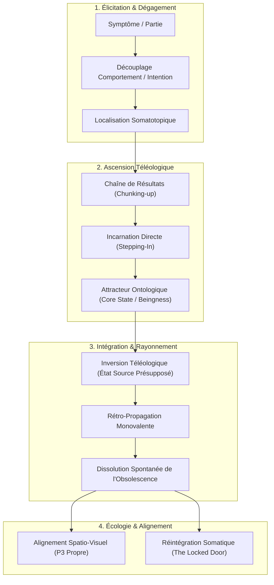
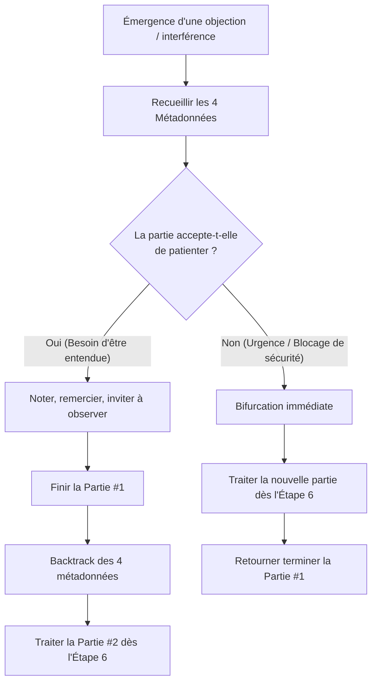

# Core Transformation - 3 Days Training - Transcripts
**Formateur :** Connirae Andreas | **ID :** `connirae-andreas-core-transformation-3-days-training-transcripts` | **Tranches :** 13

## Synthèse Architecturale du Cours : Core Transformation (Connirae Andreas)

---

### 1. Thèse Centrale & Philosophie du Cours

#### Vision spécifique de Connirae Andreas vs Approche standard
Dans l'approche conventionnelle de la PNL et du changement cognitivo-comportemental, le problème est généralement abordé comme un dysfonctionnement à corriger, un conflit de parties à arbitrer, ou un état désiré à atteindre par acquisition de ressources externes (*doing* ou *having*). La posture standard reste téléologique et instrumentale : négocier, recadrer, installer des ancrages, combler des manques.

Connirae Andreas opère une rupture paradigmatique radicale : **l'inversion ontologique complète**. 
* **Toute structure psychique, même la plus aliénante, est en quête d'un état fondamental d'Être (*Core State*).** Il n'y a rien à corriger, à détruire ou à contraindre. Les symptômes (addictions, colères, auto-sabotages, dissociation) ne sont pas des pannes, mais des tentatives motrices maladroites d'actualiser des besoins existentiels majeurs (Paix, Êtreté, Amour, Présence, Unité).
* **Du « Faire/Avoir » vers l'« Être » (Beingness) :** L'approche standard fait miroiter l'état ressource comme une récompense terminale conditionnée par des comportements adaptés. Connirae Andreas démontre que lorsque cet état d'être est incarné immédiatement comme prémisse (*a priori* somatique permanent), l'écologie du système se réorganise spontanément sans recours à la volonté ou au forcing de l'ego.
* **Posture du praticien : Non-ingérence et neutralité sacrée :** Le praticien n'est ni un expert qui interprète, ni un guide qui suggère le contenu. Il est un garant de structure rigoureux. Il s'efface derrière le verbatim du sujet, n'injecte aucun symbole personnel et maintient un espace d'accueil inconditionnel sans agenda de performance.

#### Le fil rouge méthodologique : La dynamique en U (Ascension Téléologique & Rétro-Propagation Ontologique)
Toutes les interventions du cours reposent sur une mécanique invariable à double mouvement :
1. **Dégagement & Dé-stratification ascendante (*Chunking-Up*) :** Partir du symptôme somatisé, découpler le comportement de l'intention, puis épuiser la chaîne des moyens/fins par saturation kinesthésique successive (*stepping in*) jusqu'à heurter l'attracteur non conditionnel : l'État Source (*Core State*).
2. **Inversion téléologique & Rétro-propagation descendante (*Reverse Radiation*) :** Une fois le Core State touché, l'installer comme fondation permanente et faire redescendre cette onde d'êtreté à travers toute la hiérarchie des intentions intermédiaires. Les anciens comportements adaptatifs deviennent instantanément obsolètes dès lors que leur but ultime est déjà pleinement vécu dans la physiologie.
3. **Nettoyage perceptuel et chronologique :** Aligner rigoureusement les positions d'observation (Positions Perceptuelles) et intégrer temporellement la ressource dans l'histoire développementale (Ligne du temps / Re-imprinting).

---

### 2. Carte des Concepts & Leviers Émergents

#### A. Leviers d'Accès et de Cartographie
* **Découplage Comportement / Intention Positive :** Scission neurologique séparant l'acte problématique de surface de sa fonction adaptative vitale, neutralisant instantanément les boucles d'auto-critique et le système d'alarme amygdalien.
* **Localisation Somatotopique et Biofeedback Haptique :** Matérialisation kinesthésique de la partie dans l'espace corporel ou péri-personnel avec contact tactile direct (main posée), bypassant l'intellectualisation discursive du cortex préfrontal.
* **Partie Analytique Intégrée (*Intellectual Vacation*) :** Traitement de l'observateur critique intérieur non comme une résistance à briser, mais comme une sous-partie protectrice légitime invitée soit à « prendre des vacances », soit à entrer dans le protocole.

#### B. Leviers Téléologiques et Ontologiques
* **Saturation d'Étape (*Stepping-In*) :** Exigence d'incarnation sensorielle totale du résultat intermédiaire avant d'interroger le niveau supérieur. L'esprit ne spécule pas : la physiologie valide la plénitude de l'étape pour libérer le palier suivant.
* **Le Critère Ontologique d'Êtreté (*Beingness vs Having/Doing*) :** Reconnaissance du basculement logique où le désir cesse de dépendre d'un objet extérieur, d'un statut ou d'une transaction pour devenir un état d'existence intrinsèque et autosuffisant.
* **Effet de Détachement Paradoxal (*Could Care Less*) :** Effondrement de la préhension (*grasping*) et du besoin compulsif de résultat extérieur dès lors que le Core State est ressenti comme une assise interne préexistante.

#### C. Leviers de Recâblage et de Rétro-Propagation
* **Rétro-Propagation Monovalente (*Pure Core State Radiance*) :** Infusion unilatérale et exclusive de l'État Source dans chaque intention positive intermédiaire sans empilement ni hybridation des bénéfices secondaires, garantissant la pureté du signal neurophysiologique.
* **Sillon Neurologique Progressif (*Sledding Hill Effect*) :** Loi de plasticité par répétition : chaque itération dans la chaîne d'accès approfondit la trace synaptique, permettant au système d'accéder au Core State avec de moins en moins de friction volontaire.
* **Endiguement de la Contagion Associative :** Accord explicite avec l'inconscient pour compartimenter l'excitation d'expansion lors de la découverte du Core State, protégeant la linéarité stricte du protocole avant toute généralisation contextuelle.

#### D. Leviers Neuro-Spatiaux et Relationnels
* **Encodage Neuro-Spatial de l'Objectivité Méta (P3 Propre) :** Géométrie sous-modale de l'observateur neutre : équidistance métrique stricte, symétrie latérale (gauche/droite) et alignssement horizontal strict au niveau des yeux pour désactiver tout biais limbique de partialité, d'infériorité ou de condescendance.
* **Déconnexion Somatique Protectrice (*The Locked Door*) :** Identification des enkystements dissociatifs de survie (anesthésie corporelle suite à un trauma ou harcèlement) et guidage sécurisé vers la ré-association proprioceptive complète.
* **Ergonomie Relationnelle du Praticien (Assise à 45°, Isopraxie Respiratoire, Résonance Régulée) :** Calibration de l'environnement physique et verbal pour éliminer la menace sociale (regard indirect), entraîner le tonus vagal (parler en fin d'expiration) et offrir un résonateur stable au système nerveux du client.

---

### 3. Tableau Récapitulatif des Techniques & Démonstrations

| Technique / Exercice | Objectif Opératoire | Déclencheur / Indication | Séquence Résumée |
|---|---|---|---|
| **Cadre de Calibration à 3 Paliers** *(Pacing Pédagogique)* | Titrer la charge émotionnelle pour installer la plasticité sans sidération neurovégétative. | En début d'apprentissage ou face à un système nerveux à forte réactivité / hypervigilance. | 1. Lister 3 problèmes (doux/trivial, moyen, intense). 2. Sélectionner impérativement le niveau 1 ou 2 pour le premier passage. 3. Valider l'écologie somatique avant toute incursion sur le niveau intense. |
| **Protocole Fondamental de Core Transformation** *(Outcome Chain & Core State)* | Découvrir l'état d'être fondamental d'une partie et réorganiser l'ensemble de la chaîne motivationnelle. | Comportements compulsifs, conflits internes, auto-sabotage, états émotionnels limitants récurrents. | 1. Identifier et localiser somatiquement la partie. 2. Éliciter l'intention positive (« Que veux-tu à travers cela ? »). 3. Saturation kinesthésique (*Step into it*). 4. Itération verticale jusqu'au *Core State* (Êtreté/Présence). 5. Inversion téléologique : faire rayonner l'état source dans chaque intention intermédiaire jusqu'au contexte d'origine. |
| **Mise en Vacances du Cortex** *(Partie Analytique / Meta-Part)* | Désamorcer l'hyper-intellectualisation et le contrôle sans entrer en confrontation avec l'ego. | Le sujet intellectualise, commente la séance en direct ou reste bloqué dans l'analyse sémantique. | 1. Valider l'utilité protectrice et stratégique de l'intellect. 2. Demander la permission à l'analyste de « prendre des vacances » le temps du protocole. 3. En cas de refus, extraire l'analyste et le traiter immédiatement comme la partie cible du processus de Core Transformation. |
| **Protocole de Réintégration Somatique** *(The Locked Door / Retour chez Soi)* | Mettre fin à une anesthésie corporelle post-traumatique et réassocier l'individu à sa physiologie. | Sujet dissocié de son corps, sensation d'engourdissement chronique, sentiment de flotter « hors de soi ». | 1. Repérer le lieu et l'âge du gel développemental/dissociatif. 2. Valider la fonction de survie de la mise à distance. 3. Ouvrir la « porte verrouillée » avec la ressource de l'adulte présent. 4. Réinviter la conscience dans la matière somatique avec accompagnement thermique et proprioceptif. |
| **Alignement Spatio-Visuel des Positions Perceptuelles** *(P3 Purification)* | Éliminer les contaminations affectives dans la position d'observateur pour restaurer une méta-neutralité absolue. | Jugement, colère, larmes ou condescendance ressentis en position d'observateur lors d'un conflit relationnel. | 1. Sortir physiquement de la position 1 et 2. 2. Calibrer la position 3 : contraindre les représentations de Soi et de l'Autre à égale distance (mains comme repères). 3. Aligner au niveau exact des yeux (supprimer plongée/contre-plongée). 4. Vérifier la neutralité somatique pure avant d'extraire les apprentissages. |
| **Intégration Temporelle Développementale** *(Parental Timeline Reimprinting)* | Nettoyer les carences identificatoires transgénérationnelles et réencoder l'histoire d'attachement. | Sentiment de manque structurel fondamental d'amour/sécurité hérité des figures parentales. | 1. Faire accéder le sujet à son Core State. 2. Remonter la ligne du temps jusqu'à la petite enfance. 3. Guider la projection du Core State vers les représentations des parents au même âge avant leurs propres blessures. 4. Ré-expérimenter la naissance et la croissance nourrie par cette matrice relationnelle reconfigurée. |

---

## Extractions Détaillées par Tranche (Opératoire & Verbatim)

## --- Tranche 1 / 13 ---

### 1. Mécanismes & Principes Actifs

*   **Le Levier de Présence et d'Êtreté (Beingness / Presence)**
    *   *Principe actif* : Au-delà de la résolution symptomatique (comportements, émotions), l'accès à un état central d'« êtreté » réorganise le système nerveux en profondeur. L'inconscient n'est plus en tension pour "obtenir" un état de sécurité, de lien ou d'amour à travers des stratégies dysfonctionnelles extérieures ; l'état est déjà présent comme fondation somatique et psychologique.
    *   *Tags libres* : #beingness #presence_fondamentale #resolution_par_l_etre #etat_source

*   **Défusion de l'Agenda / Détachement Paradoxal du Résultat (Effet "Could Care Less")**
    *   *Principe actif* : Lorsqu'une partie cesse de chercher la validation, la sécurité ou la complétion à travers un résultat extérieur contraignant (ex: forcer une vente, performer au golf), la pression interne s'effondre. Le praticien/sujet bascule d'une dynamique de saisie (« grasping ») à une dynamique de relation et de service congruente, augmentant paradoxalement l'efficacité objective.
    *   *Tags libres* : #chute_de_l_incongruence #detachement_paradoxal #cessation_du_forcing

*   **Généralisation Holographique des États Noyaux (Core States)**
    *   *Principe actif* : Le travail sur un symptôme trivial ou délimité ne reste pas localisé : l'atteinte d'un Core State modifie la baseline affective du système tout entier. Le contenu déclencheur initial devient souvent inaccessible ou sans importance mnésique (« I can't even remember what the subject was »), preuve d'une réorganisation structurelle de la mémoire émotionnelle et d'une amnésie de source par saturation d'intégration.
    *   *Tags libres* : #amnesie_du_probleme #generalisation_systemique #reencodage_affectif_global

*   **Démantèlement de l'Étiquette d'Ombre (The "Evil Part" Reframe)**
    *   *Principe actif* : Les parties refoulées, jugées néfastes ou perçues comme extérieures (« evil part ») sont simplement des vecteurs maladroits tentant d'actualiser des besoins existentiels majeurs. L'accueil inconditionnel permet de dissoudre la scission interne (clivage du moi) et de réintégrer l'énergie psychique sans conflit d'autorité.
    *   *Tags libres* : #reintegration_de_l_ombre #intention_positive_ontologique #dissolution_du_clivage

*   **Sécurité Écologique par Dégradation d'Enjeu (Pacing Pédagogique Graduel)**
    *   *Principe actif* : Le système nerveux résiste lorsqu'il anticipe une effraction ou une submersion émotionnelle dès la première tentative. L'étalonnage en trois niveaux de difficulté (doux/trivial, moyen, intense) désamorce le système d'alarme de l'amygdale et engage le réseau de l'apprentissage implicite en toute sécurité.
    *   *Tags libres* : #titration_de_l_intensite #securisation_neurovegetative #dosage_ecologique

---

### 2. Protocoles, Techniques & Démonstrations (Étape par Étape)

#### Protocole de Sélection et de Calibration Préparatoire des Objectifs (Cadre 3 Paliers)

*   **Intention / Indication** :
    *   Calibrer la charge émotionnelle avant d'engager le travail intérieur pour éviter l'inhibition, la sidération ou l'hyper-réactivité défensive lors des premiers pas dans le processus.
*   **Mise en place & Pré-framing** :
    *   Décharger le besoin de "perfection" ou de "résolution immédiate des grands traumatismes". Expliquer que le cerveau apprend d'abord la grammaire du protocole avant de traiter les charges lourdes.
*   **Séquence d'actions pas à pas** :
    *   *Étape 1 : Cartographie rapide par balayage visuel*
        Inviter le sujet à feuilleter le questionnaire ou sa liste de problématiques sans tout lire de manière analytique, simplement pour repérer ce qui émerge intuitivement (« notice what pops out at you »).
    *   *Étape 2 : Sélection du Palier 1 (Doux / Trivial - Jour 1)*
        Choisir un problème léger, bénin ou anodin (ex: tension motrice mineure, légère contrariété). Condition sine qua non : le sujet s'en fiche si cela ne change pas immédiatement (« not a big deal to you whether this changes immediately or not »).
    *   *Étape 3 : Sélection du Palier 2 (Moyen - Jour 2)*
        Identifier une thématique d'importance réelle mais sans complexité tentaculaire ni pic d'intensité aigu.
    *   *Étape 4 : Sélection conditionnelle du Palier 3 (Intense ou Fragment d'Intense - Jour 3)*
        Envisager un enjeu profond, ou uniquement un segment spécifique d'un enjeu majeur, avec validation obligatoire de l'écologie auprès du praticien/coach.
    *   *Étape 5 : Ancrage Relationnel*
        Noter en parallèle une relation interpersonnelle précise que le sujet désire fluidifier ou faire évoluer.
*   **Signes de calibration** :
    *   Tonus musculaire détendu, micro-sourire ou rire d'autodérision lors du choix du palier 1 (signe que l'enjeu ne met pas le sujet en alerte). Absence de crispation de la mâchoire ou d'apnée.

---

### 3. Heuristiques, Subtilités & "Sagesse du Praticien"

*   **Heuristiques d'intervention directes :**
    *   *Si le sujet arrive avec un bagage technique lourd en PNL standard* $\rightarrow$ lui demander explicitement de mettre de côté ses réflexes intellectuels et d'appliquer le protocole au mot à mot, car l'excès d'analyse cognitive empêche le contact phénoménologique direct avec les parties.
    *   *Si le sujet est novice total* $\rightarrow$ valoriser son absence de conditionnement : suivre le script verbatim à la lettre est un avantage structurel majeur.
    *   *Si le sujet commence par un symptôme extrême ou complexe au Jour 1* $\rightarrow$ réorienter immédiatement vers un comportement mineur ou une tension circonscrite pour roder le système neurologique sans déclencher de mécanismes de défense.
    *   *Si un participant hésite sur la légitimité d'un sujet lourd* $\rightarrow$ lui proposer de ne travailler que sur une *tranche délimitée* (« a piece of something ») plutôt que sur la totalité de l'histoire de vie.

*   **Pièges classiques relevés & corrigés :**
    *   *Le piège de la fausse perfection / façade d'invulnérabilité* : Prétendre que tout va bien ou masquer ses aspérités bloque la transformation. La condition de profondeur est l'acceptation explicite d'amener ses failles (« it's safe to be here even with our flaws »).
    *   *Le piège du bavardage relationnel stérile (Over-sharing)* : Confondre thérapie par la parole/venting et transformation de structure. Poser une frontière stricte : partager juste assez de vécu pour valider le sentiment de sécurité, puis couper les narratifs pour rentrer dans le processus opératoire.
    *   *L'illusion de télépathie du praticien* : Attendre que le guide devienne devin. Établir comme règle clinique le micro-ajustement spatial, postural et vocal continu (distance, volume, débit).

*   **Postulats philosophiques :**
    *   *L'intention ontologique inconditionnelle* : Même les parties étiquetées comme « maléfiques » (« evil part ») poursuivent en réalité un état d'être fondamental qui s'aligne exactement avec l'aspiration la plus haute du sujet.
    *   *L'amnistie du contenu* : Le processus est axé sur la structure interne, non sur le détail historique ou l'analyse intellectuelle des causes.
    *   *La transformation incarnée (Somatic Truth)* : La transformation psychique s'ancre dans le confort physiologique. Ce qui n'est pas permis au corps ne peut s'intégrer au niveau inconscient.

---

### 4. Pépites Verbatim & Patterns Linguistiques (MOT À MOT EN V.O.)

#### Verbatim 1 : Autorisation du non-savoir et levée du filtre d'expertise
> "People with NLP experience have this extra challenge of forgetting everything else they've already learned and focusing on this. So there's no requirement whatsoever for any previous background or training."
*   **[Analyse du Pattern]** : *Rupture de pattern et nivellement paradoxal*. Elle utilise une inversion de statut : les experts ont un "défi supplémentaire" (légère entrave cognitive), tandis que les débutants sont valorisés dans leur pureté réceptive. Cela désamorce l'ego des praticiens expérimentés tout en installant un sentiment de compétence et de sécurité immédiat chez les néophytes.

#### Verbatim 2 : Métaphore structurale de la triangulation stabilisatrice
> "Because it's just like if you were nailing two boards together. If you put in one nail from one direction, well, that could keep them together, but it might be a little bit wobbly. But if you use three nails from three different directions, then that's very secure."
*   **[Analyse du Pattern]** : *Analogie kinesthésique d'encrage spatial*. Utilisation d'un isomorphisme physique très simple (planche, clous) pour implanter la présupposition que les trois protocoles du séminaire ne sont pas des exercices disparates mais des vecteurs d'ancrage structurel croisé qui verrouillent la stabilité de la transformation.

#### Verbatim 3 : Permission implicite et légitimation de la vulnérabilité
> "It's okay to be here. It's okay to be here and not be perfect already. You know, it's safe to be here even with our flaws. And if we spent the whole time pretending we were already perfect, well, we might feel really good about ourselves and how perfect we are, but we wouldn't have a lot of transformation doing that."
*   **[Analyse du Pattern]** : *Empilement de truismes et double lien déguisé*. La répétition anaphorique (« It's okay... it's safe... ») induit une détente du système nerveux parasympathique. Le recadrage disqualifie la posture défensive en la liant à l'échec de la transformation, rendant l'ouverture et la vulnérabilité fonctionnellement obligatoires pour réussir.

#### Verbatim 4 : Métaphore kinesthésique de titration de l'engagement
> "So, you know, sometimes a person will, on an unconscious level, choose to just kind of dip a toe in at first. And then later, okay, well, that was kind of nice. And then later might step in a whole leg and then maybe dive in on the third day. Or some people are ready to dive in right off the bat."
*   **[Analyse du Pattern]** : *Pacing et Leading à choix multiple / Suggestion permissée*. Utilisation de sous-modalités physiques (tremper un orteil, une jambe, plonger) qui valident tous les rythmes de résistance ou d'ouverture sans jugement. L'attribution du choix au « niveau inconscient » ôte toute pression de performance volontaire.

#### Verbatim 5 : Inversion de l'intention de la partie réputée hostile
> "I had a part that just didn't really fit in somewhere. In fact, I even called it the evil part of me... But after going through the process and understanding that core state that this part of me was trying to accomplish was actually something that I was always trying to accomplish as it was. It allowed me to really bring this part into me and honor this part and take its rightful place."
*   **[Analyse du Pattern]** : *Recadrage ontologique d'identité et boucle d'intégration*. Passage de l'exclusion (« evil part », aliénation interne) à la réunification (« honor this part and take its rightful place ») via le pont de l'état noyau. Les présuppositions linguistiques font de la partie non plus un ennemi à dompter mais une instance fondamentale cherchant l'état source que l'individu poursuivait lui-même.

## --- Tranche 2 / 13 ---

Voici l'analyse opératoire intégrale de la tranche 2/13 du séminaire *Core Transformation* de Connirae Andreas, modélisée selon les principes stricts d'ingénierie PNL, hypnose ericksonienne et modélisation symbolique.

---

### 1. Mécanismes & Principes Actifs

#### A. Le Découplage Comportement / Intention Positive (Reframing de Prémisse)
- **Principe actif :** Dans la cognition ordinaire, l'individu fusionne le comportement problématique (ex. se ronger les ongles, culpabilité, suralimentation) et l'identité ou l'intention de la structure interne. Connirae Andreas instaure une scission neurologique nette : le comportement de surface est souvent inefficace ou toxique, mais le moteur inconscient sous-jacent est guidé par une fonction adaptative saine. Ce mécanisme désactive le circuit d'auto-critique et le conflit interne (inhibition réciproque de la culpabilité), permettant au système nerveux de cesser de résister et de coopérer.
- **Tags libres :** `#decouplage_intention_comportement` `#scission_neurologique` `#neutralisation_autocritique` `#intention_positive_fondamentale`

#### B. La Localisation Somatotopique et Spatiale des Parties
- **Principe actif :** Demander « Où se trouve cette partie (dans le corps ou autour) ? » ancre le processus dans la proprioception et la kinesthésie directe, bypassant l'intellectualisation discursive du cortex préfrontal. Poser la main sur la zone (ex. le centre du cœur chez Ricardo) agit comme un bio-feedback haptique, matérialisant l'interlocuteur inconscient et créant un canal somatique d'écoute et d'intégration.
- **Tags libres :** `#somatotopie_inconsciente` `#ancrage_proprioceptif` `#biofeedback_haptique` `#spatialisation_de_partie`

#### C. L'Induction par Chaîne de Résultats (Outcome Chain Chunking-Up)
- **Principe actif :** L'esprit conscient fonctionne par moyens/fins séquentiels horizontaux. La question itérative de la chaîne de résultats force un *chunking up* vertical : chaque résultat obtenu est immédiatement posé comme acquis (*presupposition of fulfillment*) et sert de tremplin vers un niveau logique supérieur. Ce passage répété vide progressivement les critères matériels et contextuels (faire, obtenir, se protéger) pour aboutir à des états d'être purs (ontologiques), saturant l'esprit logique et induisant une transe d'absorption profonde.
- **Tags libres :** `#chaine_de_resultats` `#chunking_up_ontologique` `#transcendance_des_moyens` `#saturation_analytique`

#### D. L'Éprouvé Prélable (Stepping-In as a Prerequisite)
- **Principe actif :** Connirae ne demande pas : « *Si* tu avais cela théoriquement, que voudrais-tu ? », elle enjoint la partie à *entrer* somatiquement dans l'état (« step fully into what it is like to already have... »). Le système nerveux fait l'expérience kinesthésique et neurochimique directe de la satisfaction du besoin intermédiaire avant de pouvoir formuler le niveau suivant. Sans cette incarnation, la réponse reste une spéculation intellectuelle stérile.
- **Tags libres :** `#incarnation_somatique_directe` `#stepping_in` `#presupposition_de_realisation` `#biochimie_de_satisfaction`

#### E. L'Inversion Téléologique (From Means to Source)
- **Principe actif :** Révélation que la partie tentait d'atteindre un état d'être fondamental (l'unité, la présence, l'être) à travers une chaîne complexe et maladroite de comportements externes. En amenant l'état d'être au premier plan, on inverse la causalité : l'état n'est plus la récompense lointaine d'un comportement d'évitement ou d'attaque, il devient le point d'origine à partir duquel le système opère.
- **Tags libres :** `#inversion_teleologique` `#etat_source_vs_moyen` `#ontologie_premiere`

---

### 2. Protocoles, Techniques & Démonstrations (Étape par Étape)

#### Protocole 1 : L'Élicitation Initiale et la Descente dans la Chaîne de Résultats (Exercice Fondamental du Core State)

* **Intention / Indication :** Dépasser le symptôme de surface (comportement compulsif, émotion récurrente, voix critique, culpabilité) pour remonter jusqu'à l'état source (*Core State*).
* **Mise en place & Pré-framing :**
  1. Choisir un problème léger (*mild*) pour l'apprentissage.
  2. Prévenir le sujet : lâcher toute idée préconçue de la réponse et simplement accueillir ce qui émerge.
  3. Expliquer que la surprise face à la réponse est le critère absolu d'une communication avec l'inconscient.

* **Séquence d'actions pas à pas :**
  - **Étape 1 : Évocation Contextualisée & Associée**
    Faire revivre un exemple spécifique et récent de la situation problématique : « *Vois ce que tu vois, entends ce que tu entends, ressens ce que tu ressens.* » Laisser le comportement ou l'émotion commencer à émerger.
  - **Étape 2 : Identification et Localisation Spatiale de la Partie**
    Poser la question : « *Où se trouve cette partie de toi ? Dans ton corps ou dans l'espace autour de toi ?* » (Si doute : deviner). Inviter le sujet à poser sa main à cet endroit si approprié.
  - **Étape 3 : Accueil et Gratitude Inconditionnelle**
    Faire remercier la partie pour sa présence (non pour le comportement, mais pour son existence et son intention positive postulée). Établir une relation de sécurité et de non-jugement.
  - **Étape 4 : Élicitation de l'Intention Initiale**
    Demander intérieurement à la partie : « *Que veux-tu vraiment ? Qu'est-ce que tu cherches à obtenir pour moi à travers cela ?* » Faire le vide mental conscient et attendre la réponse (mot, image, son ou sensation). Remercier pour la réponse.
  - **Étape 5 : Boucle d'Itération Verticale (Outcome Chain)**
    1. Inviter la partie à **entrer pleinement** dans l'expérience d'avoir déjà ce résultat de manière totale, complète et parfaite (*Stepping in*).
    2. Valider l'accord conscient : « *Es-tu d'accord avec cet objectif ?* » (Si oui, le confirmer à la partie).
    3. Poser la question de transition : « *Maintenant que tu as ceci pleinement et complètement, que veux-tu vivre à travers cela qui soit encore plus important, ou à un niveau plus profond ?* »
    4. Réceptionner la réponse, remercier la partie.
    5. Répéter la boucle jusqu'à ce que la réponse ne soit plus une action, une possession ou un résultat relationnel, mais un pur état ontologique (ex: Être, Présence, Unité, Paix).
  - **Étape 6 : Test de Saturation du Core State**
    Demander : « *Lorsque tu es pleinement dans cet état [ex: Unité / Être], y a-t-il quelque chose que tu veux à travers cela qui soit encore plus profond ou plus important ?* » Si la question ne fait qu'approfondir l'état sans produire de nouveau palier verbal, le *Core State* est atteint.

* **Signes de calibration observés par le formateur :**
  - Changement de rythme respiratoire (ralentissement, respiration diaphragmatique ou abdominale).
  - Relâchement du tonus musculaire (épaules qui descendent, traits du visage qui se lissent).
  - Pauses plus longues avant de répondre (le sujet ne consulte plus son dialogue interne conscient mais attend la remontée somatosensorielle).
  - Micro-mouvements oculaires d'accès interne (défocalisation ou yeux fermés stables).
  - Émergence spontanée de métaphores posturales ou d'ajustements subtils de vocabulaire (ex: passage de "connectedness" à "unity").

---

### 3. Heuristiques, Subtilités & "Sagesse du Praticien"

#### Règles Conditionnelles d'Action :
- **SI** la première réponse de la partie semble négative ou agressive (ex: « Je veux creuser en toi », « Il n'y en a jamais assez ») :
  - **ALORS** ne pas s'alarmer ni corriger le sujet ; faire valider la réception, remercier et enchaîner directement sur l'étape suivante : « *Et quand tu as cela pleinement, que veux-tu à travers cela qui soit encore plus important ?* » Car les couches superficielles reflètent souvent la stratégie défensive brute avant que l'intention s'épure.
- **SI** le sujet anticipe intellectuellement la réponse ou bloque :
  - **ALORS** lui intimer explicitement de lâcher ses attentes conscientes : « *Let go of any conscious ideas... just pay attention and welcome whatever response comes.* »
- **SI** le sujet reçoit une sensation pure sans mot précis :
  - **ALORS** l'inviter d'abord à s'immerger dans la kinesthésie, puis à tester un label verbal avec la partie : « *Est-ce que ce mot te convient ?* » Si le mot glisse (ex. de *connectedness* à *unity*), adopter instantanément le label affiné de la partie.
- **SI** deux personnes sont très proches dans la vie (conjoints, amis intimes) :
  - **ALORS** les séparer impérativement dans des sous-groupes différents les premiers jours, car la présence du partenaire réactive les structures relationnelles automatiques et bride la vulnérabilité inconsciente.

#### Pièges Classiques & Réponses de Connirae Andreas :
1. **Le Piège du Contenu vs la Structure :** Croire que parce que le comportement produit l'inverse du résultat souhaité (ex: dire oui pour avoir du temps libre, ce qui finit par surcharger son planning), la partie ment ou se trompe. *Postulat de Connirae :* C'est la nature même des parties limitantes d'employer des stratégies inefficaces ; la thérapie ne consiste pas à corriger la stratégie au niveau de surface, mais à satisfaire le besoin fondamental à sa source.
2. **L'Urgence de Tout Guérir Immédiatement :** Vouloir commencer par son traumatisme le plus lourd. *Correction :* Commencer toujours par du "mild/trivial" le jour 1. La maîtrise de la syntaxe du processus doit précéder la confrontation à la haute charge émotionnelle.
3. **La Confusion entre l'Expérience et le Mot :** S'accrocher au mot exact prononcé. *Postulat :* Les mots ne sont que des étiquettes imparfaites ; ce qui transforme, c'est l'expérience neuro-somatique vécue par la partie lors du *stepping in*.

---

### 4. Pépites Verbatim & Patterns Linguistiques (MOT À MOT EN V.O.)

#### Pépite 1 : La Présupposition de la Stratification Verticale
> **« Now, if you've got to have this safety and protection fully, just the way that you want, just completely there, so that's totally taken care of and handled, then what do you really want to experience through already having safety and protection that's even at a deeper level or even more important, however you might express that, that's at a more core level? »**

* **[Analyse du Pattern]** :
  - **Empilement de truismes et saturation d'assurance :** L'accumulation d'adverbes (« *fully* », « *completely* », « *totally taken care of and handled* ») crée une saturation cognitive qui court-circuite tout doute sur la faisabilité : la condition de sécurité est présupposée absolue.
  - **Présupposition temporelle & corporelle :** « *through already having* » installe le sujet dans le futur antérieur psychologique où le besoin est déjà comblé.
  - **Double contrainte permissive :** « *however you might express that* » autorise toutes les formes de traitement inconscient (visuel, auditif, kinesthésique) tout en maintenant la direction vectorielle stricte (« *at a more core level* »).

---

#### Pépite 2 : L'Induction d'Association Somatique et Temporelle
> **« Now, go ahead and put yourself into the experience as though it were happening right now. So seeing what you see through your eyes, hearing what you hear through your ears, feeling the feelings of being there, noticing as any behaviors involved start to emerge, and as you're in the experience now, notice that you can consider it to be a part of yourself... »**

* **[Analyse du Pattern]** :
  - **Indexation référentielle primaire VAKOG associée :** Utilisation systématique du temps présent et des marqueurs d'association (« *through your eyes* », « *through your ears* ») empêchant la dissociation spectatorielle.
  - **Commande enchâssée temporelle :** Utilisation répétée du mot « *now* » agissant comme marqueur de bascule en transe d'évocation.
  - **Recadrage ontologique doux / Glissement de prémisse :** La conjonction de coordination « *and as you're in the experience now, notice that you can consider it to be a part of yourself* » lie de manière fluide le vécu émotionnel direct à l'acceptation de la métaphore de la "partie", naturalisant le concept sans résistance théorique.

---

#### Pépite 3 : Le Postulat de Gratitude Paradoxale
> **« Now you're not thanking it for the behavior or the emotional experience or whatever that is. You're thanking it for being there, just on the faith or trust that there could be some positive purpose there behind that. And if you find that it's difficult for you to sincerely thank this part for being there, then just do your best and let this part know that you'd like to discover what might be positive about it. »**

* **[Analyse du Pattern]** :
  - **Scission linguistique protectrice :** Utilisation d'une négation contrastée (« *not thanking it for the behavior... thanking it for being there* ») qui lève le conflit moral du sujet (qui refuse de valider son symptôme) tout en validant l'entité sous-jacente.
  - **Pacing de la résistance (Ratification & Utilisation) :** Préemption de l'objection interne par une structure conditionnelle permissive (« *And if you find that it's difficult... then just do your best* »).
  - **Changement de cadre (Frame Shift) vers la curiosité :** « *let this part know that you'd like to discover* » transforme l'hostilité ou la peur du sujet envers son symptôme en une posture d'investigation bienveillante.

---

#### Pépite 4 : La Validation de l'Inconscient par l'Effet de Surprise
> **« Well, I have to say, you get big kudos for letting go of what you thought it would be and just letting it emerge. That's terrific. And when it is a surprise, when it's something you just totally didn't expect, that's a confirmation, isn't it, that it was from your unconscious part and it wasn't something you would have come up with. »**

* **[Analyse du Pattern]** :
  - **Renforcement opérant immédiat :** Félicitation pour l'abandon du contrôle conscient (« *letting go of what you thought it would be* »).
  - **Tag Question hypnotique (Question d'accordage) :** L'insertion de « *isn't it* » force le système de croyance du sujet à ratifier l'hypothèse : *la surprise égale l'authenticité inconsciente*.
  - **Installation de critère de calibrage :** Ce recadrage supprime l'insécurité du sujet face à l'imprévu en transformant l'anomalie ou l'étrangeté de la réponse en preuve irréfutable du succès de la communication intérieure.

---

#### Pépite 5 : La Dissolution du Signifiant au Profit du Vécu
> **« It's changing. Similar, but more of unity. Okay. All right. So unity. Let's leave connectedness on there for now. Let's just add unity right below it. So thank this part of you. And invite this part now to step fully into the sense of unity, just the way it wants. And of course, it's the experience that the part wants that's important, regardless of what word we use for it, really. »**

* **[Analyse du Pattern]** :
  - **Flexibilité sémantique et non-attachement nominal :** « *Let's leave connectedness... just add unity right below it* » évite d'invalider le pas précédent tout en épousant le raffinement de l'inconscient.
  - **Truisme d'effacement linguistique :** « *regardless of what word we use for it, really* » dévalue l'étiquette cognitive rationnelle pour recentrer toute l'attention sur l'expérience somato-sensorielle directe.
  - **Suggestion d'autonomie bienveillante :** « *just the way it wants* » redonne la totalité du contrôle directionnel à la partie inconsciente, augmentant le rapport et la profondeur du relâchement.

## --- Tranche 3 / 13 ---

Voici l'analyse modélisatrice et opératoire intégrale de la tranche 3/13 du cours de Connirae Andreas.

---

### 1. Mécanismes & Principes Actifs

- **Découplage Étiquette-Expérience et Primauté Somatique** :
  *Principe actif* : Le système verbal conscient a tendance à projeter des étiquettes cognitives abstraites (*« connectedness »*, *« unity »*) sur des activations neurovégétatives et proprioceptives. En invitant le sujet à vérifier si le mot « fitte » avec l'expérience directe et en validant la primauté du ressenti (*« heat in heart center »*), Connirae court-circuite le bavardage de l'hémisphère gauche. La transformation ne s'opère pas au niveau sémantique, mais par une reconfiguration de la charge somatique sous-corticale et viscérale.
  *Tags* : #somatic_primacy #label_vs_experience #felt_sense_validation #bottom_up_processing

- **Saturation d'Étape (Stepping Fully Into) comme Tremplin Neurophysiologique** :
  *Principe actif* : Une partie inconsciente ne peut révéler son intention de niveau supérieur tant que le besoin immédiat est perçu comme insatisfait ou virtuel. Faire « entrer pleinement » (*step fully into*) la partie dans l'expérience actuelle sature les récepteurs de ce niveau logique. Cette plénitude libère le système nerveux du mode survie/défense, permettant au gradient téléologique de faire émerger spontanément l'état d'être sous-jacent.
  *Tags* : #state_saturation #stepping_in #outcome_exhaustion #teleological_unfolding

- **Critère Ontologique d'un État Source (Beingness vs Having/Doing)** :
  *Principe actif* : Tant qu'un résultat nécessite un objet, une personne, une action ou une transaction avec l'environnement (*« having or doing »* : être respecté par autrui, obtenir la sécurité, faire une tâche), le système est piégé dans un cadre conditionnel et adaptatif. L'état source (*Core State*) est un attracteur neuro-identitaire pur : un état d'existence inconditionnel (*« state of being, it just is »*) qui n'a besoin d'aucune justification contextuelle pour subsister.
  *Tags* : #beingness_attractor #non_conditional_state #core_state_ontology #intrinsic_wholeness

- **Test d'Expansion et de Concurrence Somatique (Centrage vs Sensation)** :
  *Principe actif* : Lorsque deux phénomènes corporels coexistent (ex: chaleur au cœur/sacrum et sensation d'alourdissement/centrage), le praticien teste les relations de cause à effet internes. En demandant si l'un est la conséquence de l'autre ou s'il s'agit d'une couche plus profonde, le praticien empêche le sujet de confondre un effet secondaire d'ancrage somatique (*grounding*) avec l'état source lui-même.
  *Tags* : #somatic_differentiation #cause_consequence_testing #deepest_driver_isolation

- **Rétro-Propagation Téléologique / Inversion de la Chaîne de Résultats** :
  *Principe actif* : Dans la structure névrotique ou symptomatique classique, l'individu croit devoir produire des comportements de surface et des résultats intermédiaires pour « mériter » ou « atteindre » enfin l'état source. L'inversion de la chaîne (*reversing the outcome chain*) installe l'état source comme fondation a priori et permanente (*« already having it in an ongoing way »*). Dès lors que le besoin fondamental est présupposé déjà comblé, l'effet de cascade neurochimique et cognitif descend tout le système, dissolvant instantanément l'obsolescence des anciens comportements compensatoires (culpabilité, harcèlement, contrôle).
  *Tags* : #outcome_chain_reversal #retro_propagation #radiating_core_state #spontaneous_behavioral_reorganization

- **Partie Analytique Intégrée comme Ressource du Processus** :
  *Principe actif* : Lorsque le sujet « reste dans sa tête » et observe le processus sans le vivre au niveau viscéral, tenter de le forcer à ressentir crée une scission et une boucle d'échec. En recadrant l'intellectualisation comme une autre partie autonome avec son intention positive propre, l'analyste intérieur cesse d'être une résistance et devient la cible légitime du protocole.
  *Tags* : #meta_part_utilization #bypassing_intellectualization #part_within_part

---

### 2. Protocoles, Techniques & Démonstrations (Étape par Étape)

#### Protocole : Découverte de l'État Source et Rétro-Propagation (Core State & Outcome Chain Reversal)

* **Intention / Indication** :
  Résolution d'un comportement indésirable, d'un conflit interne ou d'une tension relationnelle/émotionnelle (dans la démonstration : sentiment de culpabilité, harcèlement intérieur et tentative de forcer un résultat avec une personne spécifique).

* **Mise en place & Pré-framing** :
  - Isoler le comportement, le contexte temporel, spatial et relationnel (Où, quand, avec qui).
  - Établir le contact interne : relaxation, orientation vers l'intérieur, localisation corporelle de la partie responsable.
  - Pré-frame fondamental : Toute manifestation de la partie, même agaçante ou négative au départ, est sous-tendue par une intention positive essentielle.

* **Séquence d'actions pas à pas** :

  1. **Élicitation du Premier Objectif Déclaré** :
     - Demander à la partie : *« Que veux-tu à travers ce comportement ? »*
     - Noter la réponse brute sur la fiche. Remercier la partie (*Rapport avec l'inconscient*).

  2. **Chaînage Ascendant par Saturation et Transcendance (Répéter en boucle)** :
     - Inviter la partie à entrer pleinement dans l'état/l'expérience de cette réponse (*« step fully into... »*).
     - Tester la modalité : vérifier si le mot choisi correspond bien à l'expérience interne (ressenti somatique, image ou mot). Si l'expérience mute (ex: de *connectedness* à *unity*), adopter le nouveau terme.
     - Poser la question de transcendance : *« Quand tu as [X] pleinement et complètement, que veux-tu à travers cela qui soit encore plus profond et encore plus important ? »*
     - Répéter jusqu'à émergence d'un état sans objet, sans action, purement ontologique (ex: sensation de chaleur/chaleur intense au sacrum).

  3. **Vérification et Consolidation de l'État Source (Core State Check)** :
     - Même en présence d'un état d'être évident, vérifier systématiquement : *« Est-ce que cette expérience mène à autre chose de plus important, ou est-ce la chose la plus profonde ? »*
     - Tester l'ontologie d'être : *« Est-ce un état au niveau de l'être que tu pourrais expérimenter en toi de manière continue tout au long de ta vie ? »*
     - Observer l'ancrage somatique (ex: descente du cœur au sacrum, sensation de poids, respiration basse).

  4. **Phase Générale de Rétro-Diffusion (General Ripple)** :
     - Poser la présupposition d'antériorité : *« Comment serait ta vie si tu avais déjà cet état source présent en toi de façon continue au fur et à mesure que tu traverses l'existence ? »*
     - Laisser l'inconscient déployer les transformations globales sans forcer de structure rigide.

  5. **Rétro-Propagation Chirurgicale le Long de la Chaîne d'Objectifs (Outcome Chain Reversal)** :
     - Prendre l'état source et le faire irradier dans le dernier objectif intermédiaire : *« Comment le fait d'avoir DÉJÀ cette sensation de chaleur en toi de manière continue rayonne, infuse et transforme ton expérience de [Unité] ? »*
     - Descendre successivement vers chaque maillon précédent :
       * -> Transforme *Connectedness*
       * -> Transforme et enrichit *Respect* (Calibration : *« It's clearer »*)
       * -> Transforme et enrichit *Understanding & Tolerance*
       * -> Transforme *Compassion*
     - À chaque maillon, laisser le temps au sujet d'expérimenter la réorganisation interne avant de nommer le niveau inférieur.

  6. **Rétro-Propagation dans le Contexte Source et Émergence Comportementale** :
     - Amener l'état source au niveau de la situation déclenchante : *« Comment cette chaleur transforme-t-elle le contexte où tu pensais à cette personne spécifique ? Comment transforme-t-elle ce qui était autrefois de la culpabilité et du harcèlement intérieur ? »*
     - Suggérer l'émergence congruente : le comportement qui s'aligne naturellement sur l'état source émerge spontanément (capacité à allier compassion et limites fermes).
     - Intégration future et réorientation dans l'ici et maintenant.

* **Signes de calibration observés par le formateur** :
  - Déplacement et stabilisation des micro-sensations somatiques (la chaleur qui descend du centre cardiaque au sacrum).
  - Changement tonique et postural : sensation de lourdeur physique accrue (*« body weighing more »*), ralentissement respiratoire, relâchement des traits faciaux.
  - Silence cognitif spontané : apaisement du mental sans effort de suppression (*« mind quieted down »*).
  - Réponse différée aux questions : temps d'accès inconscient nécessaire avant la verbalisation (le sujet « goûte » avant de parler).

---

### 3. Heuristiques, Subtilités & "Sagesse du Praticien"

- **Heuristique de Vérification Redondante de l'État Source** :
  *Règle* : Si le sujet atteint un état qui ressemble à 95% à un état source (état d'être pur), **alors** poser quand même la question de transcendance supérieure, **parce que** certaines parties inconscientes logent un état encore plus fondamental sous une apparence d'état d'être, ou requièrent d'explorer les limites ultimes pour abandonner toute tension.

- **Heuristique du Vocable Piège : Le cas de l'Amour ("Love")** :
  *Règle* : Si le sujet répond *« Love »*, **alors** investiguer : *« Est-ce un amour qui 'est' tout simplement, ou un amour basé sur le fait de donner et recevoir dans le monde ? »*, **parce que** l'amour transactionnel (avoir/faire) est un résultat intermédiaire conditionnel, tandis que l'amour ontologique est un état source.

- **Heuristique de la Sécurité Faussement Finale ("Safety")** :
  *Règle* : Si la partie affirme que *« Safety »* est l'état ultime et qu'il n'y a rien au-delà, **alors** ne pas clore le chaînage mais réinviter la partie à *entrer plus complètement dans l'expérience d'être déjà en sécurité absolue*, **parce que** 99% du temps, la partie regarde la sécurité depuis l'extérieur (posture défensive de manque) au lieu de l'expérimenter de l'intérieur. Une fois la sécurité réellement saturée, le besoin d'être sous-jacent peut enfin se révéler.

- **Heuristique de la Déconnexion Somatique / Sur-Intellectualisation** :
  *Règle* : Si le sujet reste coincé dans l'intellect, analyse le processus et ne ressent rien physiquement, **alors** prendre la partie qui a besoin d'analyser comme sujet de travail immédiat, **parce que** lutter contre l'analyse crée une résistance polaire, alors qu'accueillir la partie intellectuelle la désactive et fluidifie le travail.

- **Heuristique de la Persévérance Face aux Objectifs Négatifs** :
  *Règle* : Si la partie énonce un objectif qui semble négatif, destructeur ou désagréable au sujet, **alors** l'accueillir, le noter et poursuivre le protocole sans chercher à le corriger, **parce que** toute partie a une intention positive profonde ; en montant d'un cran via *« Qu'est-ce que tu veux de plus profond à travers cela ? »*, le processus bascule automatiquement et infailliblement vers le positif.

- **Différence Fondamentale avec le Recadrage en 6 Pas (Six-Step Reframing)** :
  *Philosophie de Connirae Andreas* : Dans le recadrage en 6 pas classique, on négocie avec la partie pour fabriquer consciemment 3 comportements alternatifs répondant à l'intention. Dans la Transformation Essentielle, on ne génère *aucun* comportement de substitution par l'effort mental : en rétro-propageant l'état source dans le contexte, les comportements congruents émergent de manière organique sans sélection délibérée.

---

### 4. Pépites Verbatim & Patterns Linguistiques (MOT À MOT EN V.O.)

* **Saturation et Question de Transcendance Supérieure** :
  > « And ask this part of you, when you have this understanding and tolerance fully, now, what do you want to experience through this that's even deeper yet and even more important? »
  * [Analyse du Pattern] : Présupposition temporelle d'achèvement (*« when you have... fully »*) combinée à un comparatif d'approfondissement cumulatif (*« even deeper yet and even more important »*). L'esprit inconscient est obligé de valider l'atteinte totale du stade actuel pour pouvoir focaliser son attention sur le vide qui se situe au-delà.

* **Permissivité Sensorielle et Dé-nominalisation** :
  > « Now, invite this part to step fully into this respect, fully and completely, whatever that means to this part of you. »
  * [Analyse du Pattern] : Commande enchâssée d'incarnation (*« step fully into »*) sécurisée par une clause de liberté totale (*« whatever that means to this part of you »*). Cette formulation empêche l'esprit critique conscient d'imposer sa définition intellectuelle du respect, déléguant l'attribution de sens aux couches inconscientes.

* **Calibration du Code de Communication Interne** :
  > « Did you get, like, the word, or did you get a feeling of it, or an image, or how did you receive this response? [...] So now when you do that, you might also check with this part of you and say, is this word that I chose a good word for you? Does this a good fit for you, this part of me? »
  * [Analyse du Pattern] : Questionnement métacognitif sur le canal sensoriel (VAKOG) dissociant le symbole linguistique conscient de l'expérience brute. La question installe un dialogue écologique d'humilité entre le moi conscient et la partie (*« is this word that I chose a good word for you »*).

* **Test d'Épuisement de l'Attracteur Somatique** :
  > « Does this experience, as it gets full and complete, does it lead to something else? Or is this the most important thing that this part wants, the most profound thing? »
  * [Analyse du Pattern] : Double lien d'orientation ontologique. La syntaxe pousse l'expérience sensorielle à son point critique de saturation (*« as it gets full and complete »*) pour tester si elle conserve une dynamique vectorielle (mène à autre chose) ou si elle s'effondre dans un attracteur stationnaire (l'état source ultime).

* **Test de Durabilité Ontologique (Beingness Check)** :
  > « Is this a feeling that you're experiencing at a beingness level that you could experience within you in an ongoing manner as you go through your experience of life? »
  * [Analyse du Pattern] : Présupposition d'indépendance contextuelle. L'expression *« beingness level »* court-circuite la dimension temporelle et situationnelle, tandis que *« in an ongoing manner »* programme une présence sous-jacente continue, non dépendante d'actions extérieures.

* **Inversion Téléologique et Présupposition d'Origine** :
  > « How does already having this warm feeling within you in an ongoing way radiate through and ripple through and transform that whole sense of unity? »
  * [Analyse du Pattern] : Emploi du participe présent marquant l'antériorité acquise (*« already having »*), couplé à des verbes métaphoriques de propagation fluide continue (*« radiate through and ripple through and transform »*). Cette formulation impose au cerveau de traiter l'état source non plus comme une récompense future lointaine, mais comme le point d'émission immédiat qui altère rétrospectivement les strates psychologiques.

* **Recadrage Comportemental d'Émergence Congruente** :
  > « In that context of thinking of that person, now that this part already has this warm feeling within, notice how this evolves into your behavior in that situation so that you're expressing this sense of this warm feeling in the most congruent manner in that situation. Noticing, of course, that expressing this sense of warmth... room for both compassion and limits. »
  * [Analyse du Pattern] : Pont temporel contextuel combinant présupposition d'état acquis (*« now that this part already has »*) et truisme d'évolution naturelle (*« notice how this evolves into your behavior »*). Connirae dissout la polarité rigide compassion/fermeté en insérant un cadre intégrateur fluide (*« room for both compassion and limits »*), réconciliant bienveillance et protection sans conflit interne.

## --- Tranche 4 / 13 ---

Voici l'analyse opératoire intégrale de la tranche 4/13 de la formation *Core Transformation* de Connirae Andreas.

---

### 1. Mécanismes & Principes Actifs

#### A. Le Sillon Neurologique Progressif (*The Sledding Hill Effect*)
- **Principe actif :** Chaque itération dans l'état ressource ou dans la chaîne d'objectifs (*outcome chain*) creuse une trace physique/synaptique dans la neurologie. Le système nerveux fonctionne par frayage : une première tentative peut s'arrêter à mi-chemin (blocage, surcharge cognitive, neige mouillée), mais la répétition sans jugement approfondit le sillon, permettant à l'influx de descendre spontanément jusqu'à l'état fondamental (*Core State*) sans friction volontaire.
- **Tags libres :** `#frayage_synaptique #loi_de_progression_neurologique #effet_piste_de_luge #descente_spontanee #plasticite_par_repetition`

#### B. La Précision Verbatim et l'Ancrage Idiolectal (*Clean Language Echoing*)
- **Principe actif :** Le cerveau inconscient code ses états à travers des étiquettes sémantiques précises (ex: "inner peace" vs "tranquil"). Substituer le mot du sujet par un quasi-synonyme conscient du praticien brise le couplage neuro-sémantique : le sujet décroche de son expérience kinesthésique interne pour comparer cognitivement les deux termes. Réinjecter rigoureusement le mot exact du sujet valide la partie et maintient l'accès somatosensoriel direct sans surcharge analytique.
- **Tags libres :** `#bio_echo_linguistique #isomorphisme_semantique #preservation_idiolectale #verbatim_clef #couplage_neuro_semantique`

#### C. La Géométrie Spatiale Non-Confrontante (*The Perceptual Angle / 45° Seating*)
- **Principe actif :** La disposition des corps en face-à-face active le circuit de vigilance sociale (verrouillage du contact visuel, lecture des micro-expressions de l'interlocuteur, hyper-vigilance de l'ego). S'asseoir à un angle semi-parallèle (genoux légèrement orientés vers l'intérieur sans se faire face directement) retire la pression du regard : l'attention visuelle externe s'efface, libérant les mouvements oculaires automatiques nécessaires à la recherche transdérivationnelle et à l'accès intéroceptif inconscient.
- **Tags libres :** `#geometrie_interpersonnelle #defocalisation_oculaire #leviere_non_confrontant #acces_interioceptif #ergonomie_spatiale_transe`

#### D. L'Isopraxie Respiratoire et le Rythme Vocal Descendant (*Respiratory Pacing & Somatic Entrainment*)
- **Principe actif :** Parler sur le tempo de l'expiration du sujet et ralentir la prosodie crée un entraînement autonome parasympathique (*somatic entrainment*). L'inconscient reçoit la suggestion au moment exact où le tonus musculaire se relâche naturellement (fin d'expiration), neutralisant la résistance critique et induisant une transe légère sans induction formelle.
- **Tags libres :** `#isopraxie_respiratoire #accordage_prosodique #ancrage_parasympathique #synchronisation_autonome`

#### E. Résonance Sympathique et Contagion d'État Régulée (*Somatic Mirroring Calibration*)
- **Principe actif :** Si le praticien plonge complètement dans l'état problème (frustration, panique), il perd la méta-position régulatrice et la flexibilité cognitive nécessaire pour tenir la structure. S'il n'y entre pas du tout, le rapport s'effondre. Le principe actif consiste à n'entrer dans l'état aversif qu'au strict minimum pour établir le pont somatique, puis à plonger à 100 % dans les états positifs et le *Core State* pour saturer le champ relationnel par effet miroir/entraînement neuronal.
- **Tags libres :** `#empathie_fractionnee #meta_ancrage_praticien #contagion_d_etat_selective #entrainement_miroir`

#### F. Recontextualisation de la Surcharge Analytique en "Partie Ressource" (*Intellectual Vacation Induction*)
- **Principe actif :** Combattre l'intellectualisation ("Arrêtez d'analyser !") crée une polarisation interne. Valider la compulsion d'analyse comme une compétence cognitive majeure, puis lui proposer une "permission de prendre des vacances", supprime la menace pour l'ego. Si la résistance persiste, la compulsion d'analyser est extraite et traitée elle-même comme une partie ayant une intention positive.
- **Tags libres :** `#recadrage_d_utilisation #mise_en_vacances_du_cortex #pacification_de_l_ego_analytique #dissociation_de_la_fonction_critique`

---

### 2. Protocoles, Techniques & Démonstrations (Étape par Étape)

#### Protocole 1 : Core Transformation sur une Partie Déjà Ressource (*Enhancing a Resourceful Part*)

* **Intention / Indication :** Développer, enrichir ou transcender une capacité, un comportement ou un talent que le sujet possède déjà (ex: skier, danser, prise de parole en public). Utiliser la structure de CT non pas pour résoudre un problème, mais comme amplificateur d'excellence.
* **Mise en place & Pré-framing :**
  - Choisir une compétence positive et automatique.
  - Pré-framer que même une ressource consciente cache une intention positive inconsciente encore plus profonde.
  - S'asseoir à angle ouvert (environ 45°/90° doux, non face-à-face).
* **Séquence d'actions pas à pas :**
  1. **Étape 1 - Identification & Éveil :** Demander au sujet : *"Quel sentiment, comportement ou pensée souhaites-tu amplifier / enrichir ?"* (Remplacement du mot *"changer"* par *"enrichir"*).
  2. **Étape 2 - Localisation de la partie ressource :** Demander au sujet de penser à un moment précis où il déploie cette compétence, fermer les yeux, tourner son attention vers l'intérieur, et ressentir où loge cette partie dans son corps.
  3. **Étape 3 - Chaîne des objectifs (*Outcome Chain*) :**
     - Demander à la partie : *"Quand tu fais [action ressource], que veux-tu à travers cela ?"*
     - Noter le mot exact (verbatim).
     - Guider le sujet à faire un saut ontologique : *"Invite cette partie à entrer pleinement dans l'état où elle a déjà [objectif 1], totalement et complètement."*
     - Enchaîner avec la question de transcendance : *"Quand tu as déjà [objectif 1], que veux-tu à travers le fait de l'avoir déjà, qui soit encore plus important ?"*
     - Répéter jusqu'à émergence d'un état d'Être absolu (*Core State* : Paix, Amour, Divinité, Présence).
  4. **Étape 4 - Inversion de la Chaîne (*Reversing the Outcome Chain*) :**
     - Laisser le sujet irradier le *Core State* dans tout son corps.
     - Redescendre chaque barreau de la chaîne en vérifiant comment le *Core State* transforme et enrichit chaque palier intermédiaire.
     - **Étape finale modifiée :** Demander : *"Comment le fait d'avoir déjà ce [Core State] comme manière d'être transforme-t-il ou enrichit-il les situations dans lesquelles tu [skies / fais ce comportement] ?"* (Suppression absolue des mots *"avais l'habitude de"* / *"used to"*).
* **Signes de calibration :**
  - Respiration ventrale plus ample et spontanée.
  - Éclat du visage ("glow"), micromouvements de détente faciale, flush vasomoteur.
  - Débit verbal qui ralentit, voix plus grave ou plus douce.
  - Les réponses émergent spontanément sans hochement de tête préalable d'effort intellectuel.

---

#### Protocole 2 : Calibration et Traitement d'une Réponse Intellectuelle vs Inconsciente

* **Intention / Indication :** Quand le sujet répond trop vite, théorise ("c'est mon problème de perfectionnisme"), intellectualise ou hésite sur le choix conceptuel d'un terme.
* **Mise en place & Pré-framing :** Cadrage bienveillant sur la puissance des facultés logiques du sujet, préservation totale du rapport.
* **Séquence d'actions pas à pas :**
  1. **Étape 1 - Le Méta-Questionnement Épistémique :** Le praticien demande avec douceur : *"Comment as-tu obtenu cette réponse ?"*
  2. **Étape 2 - Diagnostic de la source :**
     - *Scénario Inconscient authentique :* Le sujet décrit une modalité sensorielle (*"J'ai demandé, puis j'ai senti une chaleur dans la poitrine, et le mot 'paix' est monté"*). -> Valider et poursuivre avec le mot exact.
     - *Scénario Intellectuel / Analytique :* Le sujet bafouille, rationalise ou dit *"Je ne sais pas trop, c'est logique"* -> Passer à l'étape 3.
  3. **Étape 3 - Recadrage par focalisation somatique stricte :**
     - Pointer spatialement la zone du corps identifiée à l'origine : *"Demande directement là où réside cette partie [pointer la zone], et ignore tout le reste de ton esprit. Que répond cette partie précisément ?"*
  4. **Étape 4 - Si blocage persistant (Permission / Vacances du Cortex) :**
     - Reconnaître le travail colossal de son esprit conscient analytique.
     - Proposer formellement : *"Est-ce que cette partie qui analyse si bien accepterait de prendre une pause/des vacances de quelques minutes pendant que l'inconscient s'exprime ?"*
     - Si la compulsion reste active : en faire immédiatement la cible du processus (*"Travaillons avec la partie qui se sent obligée de tout analyser"*).
* **Signes de calibration :**
  - Rupture du contact visuel fixe : le regard part en accès transdérivationnel (haut/bas ou flou).
  - Présence de surprise chez le sujet ("C'est bizarre, ce n'est pas un mot que j'utilise habituellement").
  - Diminution des rationalisations verbales en "parce que" ou "c'est lié à mon enfance".

---

### 3. Heuristiques, Subtilités & "Sagesse du Praticien"

#### Heuristiques Conditionnelles (Si [X] -> Alors [Y] parce que [Z])

1. **Règle du Contenu Survenant en Cours de Descente (Couleurs / Chaleur) :**
   - *Si* le sujet voit apparaître une nouvelle sensation ou image (ex: couleur rouge, sensation de chaleur) pendant qu'il redescend la chaîne d'objectifs (*reversing the chain*),
   - *Alors* le praticien la laisse simplement évoluer sans l'intégrer artificiellement au *Core State*,
   - *Parce que* ce phénomène appartient à la dynamique de transformation du niveau intermédiaire et non à la signature structurelle du *Core State* lui-même. Si le phénomène était apparu au moment exact de la découverte du *Core State*, il aurait fait partie intégrante de sa signature.

2. **Règle de l'Écho Verbatim contre la Synonymie Conscientisée :**
   - *Si* le sujet dit *"Inner peace"* et que le praticien est tenté de dire *"Tranquility"*,
   - *Alors* le praticien doit impérativement se taire et répéter *"Inner peace"*,
   - *Parce que* même si pour le praticien la signification conceptuelle est identique, pour la neuro-sémantique du sujet, le mot exact est l'unique clé d'accès kinesthésique à l'état de la partie.

3. **Règle du Rapport Émotionnel Équilibré :**
   - *Si* le sujet contacte un état problème négatif intense (frustration, peur),
   - *Alors* le praticien n'entre dans cet état que partiellement (le strict minimum pour maintenir le rapport somatique),
   - *Parce que* sur-synchroniser la détresse détruit la méta-position de ressource du praticien et compromet la tenue sécurisée de la structure. En revanche, dans les états positifs, le praticien s'autorise une synchronisation à 100 %.

4. **Règle de l'Émergence vs Logique Consciente :**
   - *Si* les réponses du sujet semblent trop logiques, linéaires et attendues,
   - *Alors* le praticien doit suspecter une construction consciente de l'ego et tester par *"Comment as-tu obtenu cette réponse ?"*,
   - *Parce que* les véritables intentions inconscientes et les *Core States* surgissent presque toujours avec un élément de surprise, d'incongruité apparente ou d'émerveillement non calculé.

5. **Règle de Généralisation Spontanée (Désorientation) :**
   - *Si* pendant l'inversion de la chaîne, l'esprit du sujet se met à sauter spontanément vers 3 ou 4 autres contextes/problèmes de vie complètement différents,
   - *Alors* le praticien normalise le phénomène comme une preuve que le système nerveux commence à généraliser la ressource, mais le ramène doucement à la ligne temporelle présente pour éviter la confusion cognitive.

#### Pièges Classiques & Postulats Fondamentaux
- **Le piège de la créativité prématurée :** Vouloir modifier les questions du protocole ("What do you like about that?" au lieu de la formulation testée). Connirae souligne que les praticiens formés en PNL échouent souvent plus que les novices car ils improvisent au lieu de faire confiance au calibrage millimétré du script.
- **La négociation temporelle des parties :** Pour les sujets complexes impliquant plusieurs parties, il est inutile de forcer une résolution globale immédiate. L'inconscient accepte volontiers qu'une seule partie travaille aujourd'hui si l'on assure aux autres qu'elles auront leur créneau dédié lors des sessions suivantes.

---

### 4. Pépites Verbatim & Patterns Linguistiques (MOT À MOT EN V.O.)

#### Pépite 1 : La question d'extraction fondamentale vs l'erreur d'improvisation
> **Connirae Andreas :** "When you have relaxation, what do you want through having relaxation that's even more important?"

* **[Analyse du Pattern] :**
  - **Présupposition d'accomplissement déjà acquis :** La subordonnée temporelle *"When you have relaxation"* présuppose comme un fait accompli et indéniable que la relaxation est pleinement possédée dans le présent.
  - **Saut ontologique médiatisé :** L'expression *"through having relaxation"* crée une dynamique de vecteur : la relaxation n'est pas une fin en soi mais un véhicule transitoire.
  - **Présupposition comparative ascendante :** *"that's even more important"* contraint le système nerveux à rechercher obligatoirement une valeur ou un état de niveau logique supérieur, bloquant toute régression vers des bénéfices secondaires horizontaux.

---

#### Pépite 2 : La négociation d'apaisement avec l'ego analytique
> **Connirae Andreas :** "And so at the same time, what we want to do now is to allow that part of your mind that's really good at figuring things out to take a little vacation. Because, you know, it's not fair that it has to work all the time after all."

* **[Analyse du Pattern] :**
  - **Rapport et validation identitaire :** *"part of your mind that's really good at figuring things out"* valorise la fonction critique au lieu de la rejeter, neutralisant immédiatement les résistances défensives.
  - **Métaphore de décharge (Déframing de l'effort) :** *"to take a little vacation"* recadre l'inhibition du contrôle conscient non pas comme une perte de pouvoir, mais comme un repos mérité et bienfaisant.
  - **Présupposition d'équité morale / Truisme empathique :** *"Because, you know, it's not fair that it has to work all the time after all"* utilise une pseudo-logique émotionnelle déculpabilisante qui engage l'adhésion immédiate de la partie contrôlante.

---

#### Pépite 3 : La métaphore du frayage neurologique
> **Connirae Andreas :** "Each experience that we have with this process just kind of digs those grooves a little deeper for our neurology to more easily step into it and go a little bit farther the next time."

* **[Analyse du Pattern] :**
  - **Métaphore somatique d'ancrage matériel :** *"digs those grooves a little deeper"* implante une sous-modalité kinesthésique et spatiale concrète du fonctionnement synaptique.
  - **Normalisation bienveillante du fractionnement :** En éliminant l'exigence d'un succès immédiat spectaculaire, la phrase installe une présupposition d'inévitabilité de la réussite par simple accumulation (*"more easily step into it and go a little bit farther"*).
  - **Suggestion post-hypnotique d'automatisation :** Le système nerveux est programmé pour anticiper que la session suivante sera naturellement plus profonde et plus fluide sans effort conscient.

---

#### Pépite 4 : La modification chirurgicale pour l'amplification de ressources
> **Connirae Andreas :** "Ask the part how does already having the core state, whatever it is, how does already having love or peace or whatever it is, as a way of being transform or enrich situations in which you ski or in which you do the behavior..."

* **[Analyse du Pattern] :**
  - **Ancrage du niveau d'identité :** *"as a way of being"* élève le *Core State* d'un simple état émotionnel passager au rang de matrice identitaire globale.
  - **Suppression du présupposé de défaillance :** L'omission délibérée de *"used to"* (qui présupposait un comportement problématique révolu) remplace la notion de correction par celle d'expansion pure (*"transform or enrich"*).
  - **Double contrainte permissive :** Que la situation soit *"transformée"* ou *"enrichie"*, le changement génératif est inévitablement validé par la grammaire de la phrase.

## --- Tranche 5 / 13 ---

Voici l'extraction opératoire intégrale de la **Tranche 5/13** du séminaire *Core Transformation - 3 Days Training* (Connirae Andreas / Tamara Andreas).

---

### 1. Mécanismes & Principes Actifs

#### 1. Endiguement de la contagion associative par compartimentation temporelle
* **Principe actif :** Lorsqu'un État Source (*Core State*) est atteint, le système nerveux expérimente une expansion neuro-affective intense. L'architecture associative du cerveau cherche immédiatement à généraliser cette ressource vers d'autres contextes, déclenchant des boucles de pensées divergentes en plein protocole (dispersion cognitive, surcharge attentionnelle). Plutôt que de réprimer cette impulsion — ce qui créerait une friction interne —, le praticien conclut un accord explicite avec l'inconscient en reportant cette exploration à l'issue de l'intégration verticale. La charge motivationnelle est préservée sans compromettre la linéarité du recâblage.
* **Tags :** `#endiguement_associatif #accord_inconscient #integration_sequentielle #protection_du_focus`

#### 2. Pureté monovalente de la rétro-propagation (Core State Re-integration)
* **Principe actif :** Lors de la remontée de la chaîne des intentions positives (Étape 3), empiler ou fusionner les bénéfices secondaires intermédiaires (effet boule de neige/compounding) surcharge le canal proprioceptif et dilue la signature somatique pure de l'État Source. Le mécanisme repose sur une **réécriture unilatérale** : seul l'État Source est infusé de manière invariable dans chaque palier précédent. Le contenu contextuel du palier s'efface spontanément face à la qualité fondamentale de l'Être.
* **Tags :** `#retropropagation_monovalente #purete_somatique #transmutation_des_outcomes #non_cumul`

#### 3. Déconnexion somatique protectrice et verrouillage amnésique (The Locked Door)
* **Principe actif :** Face à des agressions environnementales (ex. moqueries infantiles, harcèlement), le système nerveux met en place un mécanisme d'adaptation dissociative : l'individu s'extirpe de sa physiologie de base pour anesthésier la douleur. Si ce retrait garantit la survie émotionnelle à court terme, le pattern s'enkyste sur le plan développemental. Le sujet s'installe durablement dans un « no man's land » proprioceptif : il n'est ni pleinement associé à lui-même, ni en position méta propre. La réintégration complète (« rentrer chez soi ») libère une décharge thermique et sensorielle massive par reconnexion du système nerveux autonome.
* **Tags :** `#dissociation_protectrice #desensibilisation_enkystee #reconnexion_soma #retour_chez_soi`

#### 4. Contamination croisée des Positions Perceptuelles (Cross-Contamination)
* **Principe actif :** Les limites psychiques des positions perceptuelles peuvent s'effondrer : le sujet en Position 3 (Observateur) ressent une charge émotionnelle ou un parti pris (ex. pleurs, jugement, colère), ou en Position 1 (Soi), il s'observe de l'extérieur. Cette hybridation pathologique crée un état instable (« un pied sur le quai, un pied dans le bateau »). L'alignement consiste à purifier chaque position de tout résidu affectif ou cognitif appartenant aux autres positions.
* **Tags :** `#contamination_perceptuelle #purification_spatiale #stabilite_frontiere #dissociation_propre`

#### 5. Encodage neuro-spatial de l'objectivité méta (Spatial Submodalities of P3)
* **Principe actif :** La neutralité cognitive n'est pas un concept verbal abstrait, mais une conséquence directe de la géométrie sous-modale du champ visuel interne. 
  - **Distance relative :** Une asymétrie de proximité crée un biais d'empathie automatique envers la figure la plus proche. L'équidistance physique/mentale force la symétrie relationnelle.
  - **Latéralité (Gauche/Droite vs Face) :** Placer une personne en face crée une dynamique d'affrontement frontal ; l'équilibrage bilatéral (gauche/droite) active l'évaluation comparative équitable.
  - **Niveau des yeux :** Une position surélevée induit un mépris/condescendance méta ; une position basse place l'observateur en posture d'infériorité/soumission. L'égalité de niveau des yeux garantit une neutralité et un ancrage perceptif équilibré.
* **Tags :** `#geometrie_mentale #sous_modalites_spatiales #calibration_distance_hauteur #symetrie_relationnelle`

---

### 2. Protocoles, Techniques & Démonstrations (Étape par Étape)

#### Protocole 1 : Recadrage de dispersion associative pendant la rétro-propagation
* **Intention / Indication :** Lorsque le client, en train de faire remonter son État Source dans ses intentions antérieures, commence à bifurquer vers d'autres problèmes, s'excite sur de nouvelles applications contextuelles et devient confus ou désorienté.
* **Mise en place & Pré-framing :** Valider la créativité naturelle de l'inconscient sans autoriser la dérive attentionnelle.
* **Séquence d'actions pas à pas :**
  1. *Cartographie spatiale immédiate :* Matérialiser l'axe vertical pour le sujet (Comportement en haut -> Résultats intermédiaires -> État Source en bas).
  2. *Validation du pattern :* Normaliser le réflexe neurologique (« C'est un processus naturel du cerveau lorsqu'il découvre une ressource »).
  3. *Contractualisation avec l'inconscient :* Guider le sujet à s'adresser intérieurement à son esprit inconscient :
     - Remercier l'inconscient pour son enthousiasme et la détection d'opportunités.
     - Demander formellement : *« Est-ce d'accord de planifier cela pour la fin du processus ? »*
     - Poser la condition : Dès que l'intégration du comportement de départ est achevée, accorder quelques minutes dédiées pour projeter la ressource dans ces autres contextes.
  4. *Reprise du tracé linéaire :* Revenir exactement au point de rupture dans la chaîne et reprendre la réintégration palier par palier.
* **Signes de calibration :** Apaisement immédiat du regard (fin du papillonnage oculaire), respiration qui redescend dans l'abdomen, disparition de l'agitation motrice.

---

#### Protocole 2 : Exploration comparative des 3 Positions Perceptuelles (Base de calibrage)
* **Intention / Indication :** Débloquer une impasse relationnelle ou un conflit récurrent (intensité 3-4/10 sur l'échelle de Richter interne), ou servir de test diagnostics des filtres de communication du client.
* **Mise en place & Pré-framing :** Choisir une interaction relationnelle modérément difficile, de préférence une dispute où le sujet est intimement convaincu « d'avoir raison ».
* **Séquence d'actions pas à pas :**
  1. **Position 1 (Self / Soi) :**
     - S'associer pleinement dans son propre corps au moment de l'événement.
     - Voir à travers ses propres yeux, entendre par ses propres oreilles, ressentir les sensations kinesthésiques, accéder à ses croyances et à sa vérité personnelle.
     - *Calibration/Test :* Ressentir ce que produit cette position. Laisser aller.
  2. **Position 3 (Observer / Observateur neutre) :**
     - Sortir de la scène et adopter une position extérieure équidistante.
     - Utiliser la métaphore du plateau tournant (*Lazy Susan*) : faire pivoter la scène pour voir Soi-même d'un côté et l'Autre en face.
     - Remplacer l'image de soi par celle d'un « acteur jouant son rôle ». 
     - Adopter un regard analytique, libre d'affect, pour extraire la boucle interactive (« endless loop »).
  3. **Position 2 (Other / Autre) :**
     - Se glisser physiquement et mentalement dans la peau de l'autre personne.
     - Calibrer sa posture corporelle, regarder Soi-même à travers ses yeux, entendre avec ses oreilles.
     - Accéder à ses besoins, à ses contraintes, à ses croyances (avec la précaution : « c'est ma perception de son vécu, non une télépathie absolue »).
  4. **Rupture d'état somatique obligatoire (Break State) :**
     - Sortir impérativement de la peau de l'autre.
     - *Geste physique :* Secouer vigoureusement le corps, bouger dans l'espace pour dissiper les traces kinesthésiques de l'autre.
  5. **Réintégration et Pont vers le Futur (P1 transformé) :**
     - Réintégrer sa Position 1 en emportant la sagesse systémique acquise en P3 et l'empathie de P2.
     - Établir une action concrète d'interruption de pattern (ex. stopper la conversation avant l'embrasement, changer de pièce, différer l'échange).
* **Signes de calibration :** Changement de ton de voix (abandon de la tonalité vindicative ou défensive pour un ton posé), baisse du rythme respiratoire, micro-mouvements corporels de relâchement au niveau des trapèzes et de la mâchoire.

---

#### Protocole 3 : Diagnostic kinesthésique & Alignement spatial de la Position Observateur (P3)
* **Intention / Indication :** Purifier la position observateur lorsque le client présente un biais cognitif, de l'agressivité ou une contamination émotionnelle en P3.
* **Mise en place :** Le sujet est assis, installé mentalement en position d'observateur face à son conflit.
* **Séquence d'actions pas à pas :**
  1. *Projection proprioceptive externe :* Demander au client de lever les bras et de matérialiser dans l'espace avec ses mains l'emplacement exact de son « Soi » et de « l'Autre ».
  2. *Calibration des écarts spatiaux spontanés :* Observer les asymétries (distance, latéralité, hauteur).
  3. *Variation de la distance relative :*
     - Avancer une figure très près de soi, éloigner l'autre -> calibrer l'impact affectif.
     - Inverser les distances.
     - Ajuster manuellement les deux mains pour établir une **distance rigoureusement égale** par rapport à l'observateur.
  4. *Variation de la latéralité :*
     - Placer une figure plein champ (droit devant) et l'autre en périphérie latérale -> calibrer l'effet de confrontation.
     - Aligner les deux mains pour obtenir un **axe symétrique gauche-droite**, centré dans l'axe de vision de l'observateur.
  5. *Variation de l'altitude / Niveau des yeux :*
     - Monter les deux figures au-dessus de la ligne d'horizon des yeux de l'observateur -> constater le sentiment d'écrasement ou d'infériorité.
     - Descendre les figures nettement sous la ligne d'horizon -> constater l'apparition d'un jugement condescendant ou détaché.
     - Positionner les deux représentations à **hauteur exacte du niveau des yeux** de l'observateur.
  6. *Vérification du shift phénoménologique :* Calibrer l'installation immédiate d'une neutralité émotionnelle paisible, d'une objectivité clinique et d'une lucidité systémique.
* **Signes de calibration :** Regard qui s'élargit en vision panoramique, respiration régulière et détendue, neutralisation des micro-tensions faciales.

---

### 3. Heuristiques, Subtilités & "Sagesse du Praticien"

#### Règles conditionnelles ("Si -> Alors")
* **Si** le sujet commence à empiler ou fusionner les sous-résultats lors de la remontée (*compounding*) :
  * **Alors** refuser poliment le cumul et maintenir strictement la formule : `[État Source] infusé dans [Résultat Intermédiaire X]` indépendamment à chaque étape.
  * **Parce que** la structure formelle doit rester immaculée ; le cumul automatique s'effectue spontanément à un niveau inconscient plus profond sans qu'il soit utile de complexifier la syntaxe consciente.
* **Si** le client se dissocie en Position Observateur et fond en larmes (ou manifeste une charge émotionnelle intense) :
  * **Alors** poser immédiatement le diagnostic de **contamination de P3 par P1** (le sujet a emporté sa kinesthésie blessée en dehors de son corps).
  * **Parce qu'une** Position 3 non alignée n'est pas une dissociation ressource mais une fragmentation identitaire instable.
* **Si** le client doit entrer en Position 2 face à une personne toxique, violente ou en détresse extrême :
  * **Alors** pré-cadrer la permission explicite de ne s'y associer que partiellement (« to whatever degree you want »), voire d'interrompre l'association si l'écologie interne est menacée.
  * **Parce que** l'écologie somatique prime sur la complétude de l'exercice.
* **Si** le client sort d'une Position 2 :
  * **Alors** exiger impérativement une rupture d'état motrice (*« physically move your body around to shake it off »*).
  * **Parce que** la physiologie retient les micro-tensions de l'autre ; ne pas secouer le corps expose le sujet à ramener la névrose de l'autre dans son propre Soi (P1).
* **Si** le client rapporte une révélation majeure vécue en Position 2 sur les pensées/motivations de son interlocuteur :
  * **Alors** injecter immédiatement l'heuristique de prudence épistémique : *« Prendre cette information avec un grain de sel. C'est votre perception de son expérience, non la réalité absolue. »* Inviter à tester/valider avec douceur dans le réel.

#### Pièges classiques & Erreurs de débutant
* **Le piège du thérapeute coincé en P1 :** Ramener la souffrance du client à ses propres anecdotes personnelles (*« Tu crois que tu as des problèmes ? Mon bus était en retard ce matin... »*). Rupture totale du rapport et perte de calibration.
* **Le piège du thérapeute aspiré en P2 :** Plonger dans la même détresse kinesthésique que le client. Deux noyés ne peuvent pas se sauver mutuellement ; l'hyper-empathie non régulée est une faillite opératoire.
* **Le piège du thérapeute gelé en P3 :** Adopter une posture clinique hautaine, glaciale, intellectuelle et insensible (*« Dans un million d'années, personne ne s'en souciera »*).
* **L'illusion de la P1 naturelle :** Postulat philosophique de Connirae : *Personne n'est aligné à 100% en Soi au départ*. Presque tous les individus ont développé des patterns précoces de retrait somatique partiel (laisser la clé à l'intérieur et s'enfermer dehors) pour se prémunir d'agressions extérieures.

---

### 4. Pépites Verbatim & Patterns Linguistiques (MOT À MOT EN V.O.)

#### 1. Triple choix hypnotique d'ouverture (Pseudo-choix d'intégration)
> *"So those of you who are already familiar with it have some options. One is that you could allow yourself to go into a pleasant altered state and suggest that your unconscious integrate the material of the day in whatever way it desires. Another option is... You can just pay attention to the review of the material... And then the third option, I have a task for you, which is to discover specific ways in which your experience of each perceptual position has changed since the time that you first learned this material."*

* **[Analyse du Pattern] :** Structure de triple lien (*triple bind*) éricksonien masquant une injonction d'apprentissage total sous l'apparence de la liberté de choix. L'option 1 propose une induction hypnotique ouverte avec régression/intégration inconsciente passive ; l'option 2 mobilise l'attention consciente vigile ; l'option 3 active une recherche transdérivationnelle orientée vers l'évolution des compétences. Quel que soit le choix du stagiaire, la résistance consciente est contournée et le système s'engage dans le traitement du matériel.

#### 2. Recadrage de la dispersion par permission différée
> *"If it's disorienting for you, however, I'd suggest maybe having a little talk with your unconscious mind and just asking if it would be okay to schedule that for the end of the process. Because it's great that your unconscious mind gets so excited about the possibilities and where else it can be useful. Just suggest how about if we do that after we've gotten all the way up to the beginning and we've completed with this part, then take a few more minutes to take it into other situations too."*

* **[Analyse du Pattern] :** Utilisation d'un recadrage d'intention positive (*« it's great that your unconscious mind gets so excited »*) couplé à une négociation temporelle douce. La suggestion utilise un langage permissif flou (*« maybe having a little talk... »*, *« just asking if it would be okay... »*) qui désactive toute réactance psychologique. L'inclusion de la boucle temporelle conditionnelle (*« after we've gotten all the way up... then take a few more minutes »*) préserve la promesse de gratification tout en restaurant la structure séquentielle stricte du protocole.

#### 3. Métaphore somato-spatiale de l'enfermement dissociatif
> *"It worked great for the purpose of not responding to their teasing. But the problem was it was a little bit like he left his home and he locked the door and then later on he didn't know where the key was. He didn't know how to get back. So he was just kind of stuck there, you know, kind of one foot in the door but the other foot out on the porch and he couldn't quite get fully home."*

* **[Analyse du Pattern] :** Isomorphisme métaphorique de l'exil corporel (*« left his home and locked the door »*). L'analogie du seuil (*« one foot in the door but the other foot out on the porch »*) matérialise spatialement la split-dissociation chez le sujet. L'utilisation du mot *« home »* (foyer/chez-soi) active un ancrage archétypal profond lié à la sécurité, à la chaleur somatique et à l'appartenance à sa propre corporéité, rendant l'objectif d'alignement viscéralement désirable.

#### 4. Rupture kinesthésique d'excorporation
> *"Pretend to be this other person as you look and listen to yourself over there... Experiencing how this person sees and hears and feels the situation. And then step back out of that and literally shake it off. It really is useful to move one's body now and then. And back to a neutral position and then take everything that you've learned back into self again."*

* **[Analyse du Pattern] :** Commande de feinte cognitive délibérée (*« Pretend to be... »*) qui contourne l'effort conscient pour induire l'hallucination d'identité en Position 2. Elle est suivie immédiatement d'une commande d'action directe et concrète (*« literally shake it off »*). L'adverbe *« literally »* force le passage de la pensée à l'acte neuromusculaire, interrompant net la rémanence du schéma moteur et émotionnel de l'interlocuteur avant la réassociation en Soi.

## --- Tranche 6 / 13 ---

### 1. Mécanismes & Principes Actifs

* **Alignement Spatio-Visuel de la Position Méta (Observateur Neutre)**
  * *Principe actif :* Le système nerveux encode les biais d'affiliation, de dominance et d'importance relationnelle par des sous-modalités spatiales précises. Lorsqu'un sujet observe deux protagonistes (soi-même et l'autre) avec une asymétrie de distance, un décalage angulaire (l'un centré, l'autre décalé) ou une dénivellation de la hauteur des yeux (plongée/contre-plongée), le cerveau active automatiquement des réponses limbiques de jugement, d'infériorité, de supériorité ou de partialité. En contraignant kinesthésiquement (via les mains) et visuellement les deux représentations à être strictement à égale distance, au même niveau oculaire que l'observateur et symétriques gauche/droite, on désamorce le biais évaluatif et on force le cortex préfrontal à traiter la scène sur un mode purement descriptif et objectif.
  * *Tags :* `#alignement_spatial` `#sous_modalites_visuelles` `#position_observateur` `#neutralisation_de_biais` `#isometrie_perceptive`

* **Réintégration Somatique du Point de Vue (*Viewpoint Re-centering*)**
  * *Principe actif :* Très souvent, les sujets pensent être "associés" en position d'observateur ou en position de soi, alors que leur centre perceptif effectif est décalé de quelques millimètres à plusieurs mètres (en arrière du crâne, au-dessus, décalé latéralement, ou en retrait au fond des globes oculaires). Ce micro-décentrement spatial constitue une micro-dissociation défensive : il allège la charge émotionnelle mais appauvrit la présence somatique, la concentration et la sensation de complétude. En ramenant explicitement le foyer visuel au sein des yeux physiques réels, le système rétino-cortical et proprioceptif se recalibre, restaurant immédiatement un état de centrage somatique, de clarté et de présence unifiée.
  * *Tags :* `#point_de_vue_spatial` `#recadrage_somatique` `#dissociation_subtile` `#foyer_oculaire_reel` `#presence_corporelle`

* **Localisation Source/Récepteur dans l'Espace Auditif (*Listening Point vs. Sound Origin*)**
  * *Principe actif :* L'encodage neurologique du son ne comprend pas seulement la tonie ou le volume, mais le locus spatial de provenance (d'où émet la voix) et le point d'impact récepteur (où le son frappe dans le corps). Lorsque la voix d'un protagoniste extérieur flotte hors de son corps (ex: au-dessus de sa tête) et est reçue dans les yeux ou la poitrine de l'observateur au lieu des oreilles physiques, le stimulus auditif court-circuite le traitement perceptif auditif standard pour stimuler directement des réactions kinesthésiques de tension somatique ou de surcharge visuelle. Aligner l'origine du son sur la gorge de l'émetteur et le point de réception dans les canaux auditifs physiques rétablit la frontière sensorielle saine entre soi et l'autre.
  * *Tags :* `#spatialisation_auditive` `#point_de_reception_auditif` `#delimitation_frontiere_soi` `#cartographie_sensorielle`

* **Encodage Syntaxique des Pronoms dans le Commentaire Interne (*Pronominal Neutralization*)**
  * *Principe actif :* La voix de commentaire interne révèle immédiatement le niveau d'implication affective de l'observateur. Si l'observateur commente la scène en disant « Tu » à son propre double (« Donne-lui une leçon ! ») et « Il » à l'autre, il opère en tant qu'allié partial ou coach partisan, et non en tant qu'observateur neutre. L'imposition syntaxique du tiers neutre (« Il » pour son double et « Il » pour l'autre personne : *He & He*), combinée à la relocalisation de la voix intérieure dans l'appareil vocal physique (la gorge) plutôt que dans la poitrine ou le haut du crâne, dissout la réactivité émotionnelle partisane et produit spontanément une évaluation sage et équilibrée.
  * *Tags :* `#encodage_pronominal` `#voix_de_commentaire` `#troisieme_personne_objective` `#relocalisation_vocale`

* **Restitution Kinesthésique et Réallocation de Ressources (*Feeling Restitution & Resource Refill*)**
  * *Principe actif :* L'implication émotionnelle inadéquate de l'observateur provient souvent de la captation de sentiments appartenant aux protagonistes (sympathie partisane, colère projetée, animosité). Le système nerveux interprète le vidage de ces sentiments comme un vide anxiogène s'il n'est pas guidé précisément. En ordonnant de rendre magnétiquement tous les sentiments aux protagonistes externes, puis en réinvestissant immédiatement l'espace somatique disponible par des ressources d'observateur pures (chaleur, bienveillance, calme, compassion méta), le sujet bascule d'une contagion kinesthésique à une posture d'accueil clairvoyante.
  * *Tags :* `#restitution_kinesthesique` `#clarification_empathique` `#compassion_observateur` `#remplissage_de_ressources`

---

### 2. Protocoles, Techniques & Démonstrations (Étape par Étape)

#### Protocole d'Alignement de la Position d'Observateur (Aligning Perceptual Positions - Position 3)

* **Intention / Indication :**
  * À utiliser lorsque la position d'observateur (méta-position / Position 3) n'est pas « propre » (*not clean*), c'est-à-dire polluée par du parti-pris, du mépris, de la rancœur, de la sur-identification avec soi-même ou de la réactivité émotionnelle.
  * Déclencheur : Dans l'analyse d'une relation difficile ou d'un conflit, l'observateur prend parti, ressent des tensions physiques, commente agressivement la scène ou présente un regard distordu.

* **Mise en place & Pré-framing :**
  * Contenu libre / aveugle (*content-free*) : Préciser au sujet qu'aucun détail de l'histoire n'a besoin d'être révélé (« *it's easier if you don't really* »).
  * Phase de calibrage préliminaire en deux temps : d'abord explorer/recueillir l'information sans rien changer, puis exécuter les modifications une par une.

* **Séquence d'actions pas à pas :**

  * **Phase 1 : Audit et Cartographie Sensorielle de l'Observateur (Sans Modification)**
    1. *Spatialisation des figures :* Demander au sujet de faire pivoter la scène devant lui et de pointer avec les mains l'emplacement exact de soi-même et de l'autre personne. Vérifier :
       - La hauteur du regard (les yeux des protagonistes sont-ils plus hauts, plus bas ou au niveau de l'observateur ?).
       - Le centrage gauche/droite (l'un est-il dans l'axe direct et l'autre sur le côté ?).
       - La distance relative (l'un est-il plus proche que l'autre ?).
    2. *Localisation du point de vue visuel (*Viewpoint*) :* Demander : « D'où regardes-tu exactement ? » (dans les yeux physiques, en retrait, au-dessus, depuis l'arrière de la tête ?).
    3. *Audit du canal auditif externe :*
       - Les voix des deux personnes sont-elles audibles ?
       - D'où émanent les voix (gorge, tête, flottantes dans l'espace) ?
       - Où est situé le *Listening Point* (point de réception) de l'observateur (oreilles, yeux, plexus, poitrine) ?
    4. *Audit de la voix de commentaire interne :*
       - Existe-t-il une voix qui commente la scène ?
       - Où est-elle située dans le corps (poitrine, gorge, cerveau) ?
       - Quels pronoms utilise-t-elle pour s'adresser au double de soi et à l'autre (ex: « Tu » vs « Il ») ?
    5. *Audit kinesthésique & Centre de gravité :*
       - Quels sentiments sont présents chez l'observateur (sympathie, animosité, détachement froid) ?
       - Où ces sentiments sont-ils logés corporellement ?
       - Où se situe le centre de gravité ressenti (Dan Tian/nombril, poitrine, genoux) ?

  * **Phase 2 : Réalignement Méthodique par Sous-Modalités**
    1. *Ajustement spatial visuel externe :* Inviter le sujet à utiliser ses mains pour déplacer les représentations des deux personnes afin qu'elles soient :
       - À égale distance de lui.
       - Strictement à la hauteur de ses yeux.
       - Parfaitement équilibrées et centrées à gauche et à droite.
    2. *Recadrage du point de vue oculaire :*
       - Guider le sujet pour qu'il glisse son point de vue visuel précisément dans ses deux yeux physiques réels (*both eyes*).
       - *Ajustement :* Si la vision se brouille ou vacille, ajuster la convergence (rapprocher légèrement les deux protagonistes l'un de l'autre comme dans des jumelles) et laisser le système nerveux s'habituer au focus.
    3. *Recadrage des sources et récepteurs auditifs :*
       - Faire émettre la voix de chaque protagoniste directement depuis sa propre zone vocale (gorge).
       - Déplacer le point de réception auditif de l'observateur (s'il était logé dans la poitrine ou les yeux) pour le ramener directement dans les oreilles physiques.
    4. *Normalisation pronominale et relocalisation de la voix interne :*
       - Déplacer la voix de commentaire interne depuis la poitrine ou l'arrière du crâne jusque dans l'appareil vocal anatomique (la zone de la voix).
       - Imposer la structure syntaxique « Il » et « Il » (*He & He*) pour décrire les deux individus.
    5. *Restitution des sentiments et ancrage de la ressource observateur :*
       - Demander au sujet de renvoyer tous les sentiments appartenant à son soi externe (et à l'autre) à leurs propriétaires légitimes (utiliser des gestes et métaphores magnétiques).
       - Remplir le corps de l'observateur d'un état ressource propre (chaleur, neutralité bienveillante, compassion objective).
       - Vérifier et réaligner le centre de gravité au niveau du centre naturel du corps (Dan Tian, sous le nombril).

* **Signes de calibration :**
  * Modulation vocale : La prosodie de la voix interne du sujet s'adoucit, ralentit et prend une intonation mesurée et compréhensive.
  * Micro-expressions faciales : Disparition des asymétries de tension autour des sourcils et de la mâchoire ; détente musculaire généralisée.
  * Clarté du rapport verbal : Le sujet verbalise spontanément la disparition du parti-pris (« *I have less of a bias to automatically go to Ernie's side* ») et passe de la réactivité conflictuelle à l'observation compréhensive (« *He should try to listen more / He's really having a problem* »).

---

### 3. Heuristiques, Subtilités & "Sagesse du Praticien"

* **Heuristique de Détection des Voix Clivées (Citation = Voix) :**
  * *Règle :* Dès que le sujet formule une phrase entre guillemets pour justifier une difficulté (« *It's like : "oh look, there's other stuff"* »), le praticien ne traite pas cela comme une opinion intellectuelle mais comme une voix auditive localisée dans l'espace.
  * *Action :* Demander immédiatement : « *Where is this voice located?* ».

* **Heuristique du Déplacement Prémature vs. Prise d'Information :**
  * *Règle :* Ne jamais modifier une sous-modalité tant que l'inventaire complet de la scène n'est pas cartographié.
  * *Raison :* Tenter de changer un paramètre alors que les autres maintiennent la gestalt pathologique crée de la confusion et de la résistance. Cartographier à blanc permet au sujet de développer la métacognition de sa propre structure.

* **Heuristique de la Perte de Fonction cognitive par Déplacement Somatique :**
  * *Règle :* Si le déplacement d'une fonction interne (ex: une voix de commentaire ramenée du cerveau vers la gorge) entraîne une plainte de perte d'intelligence ou de blocage (« *Moving it takes away its ability to think, like moving it from the processor* »), ne pas forcer la descente brute.
  * *Action :* Installer une connexion explicite (un lien neurologique ou une métaphore de « bus de données ») entre le nouvel emplacement somatique et les centres visuels/de traitement originels, pour préserver la fonction tout en changeant la position.

* **Heuristique du Sevrage de Stimulation / Reframing du "TDAH" (ADD) :**
  * *Règle :* Lorsque le silence ou le ralentissement intérieur crée un sentiment de vide (« *I felt kind of uncomfortable and empty* » ou « *there's nothing quite going on yet* »), recadrer immédiatement l'absence de bruit comme l'émergence d'une ressource de calme et de focus plutôt que comme un dysfonctionnement.
  * *Action :* Rappeler que l'esprit habitué à l'hyper-distraction interprète le repos comme un déficit ; inviter le processus à découvrir la permission de se détendre et le choix du silence.

* **Heuristique de la Compassion Observateur vs. Contagion Émotionnelle :**
  * *Règle :* Si le sujet nomme un sentiment de « compassion » en position d'observateur, vérifier s'il s'agit d'une compassion objective ou d'une absorption des souffrances d'autrui.
  * *Action :* Poser le test de validation : cette compassion provient-elle d'un observateur disponible et séparé (« *willing to listen now* ») ou d'une ré-incorporation des émotions du protagoniste ?

---

### 4. Pépites Verbatim & Patterns Linguistiques (MOT À MOT EN V.O.)

* **Pépite 1 : Induction de la Flexibilité Perceptive par la Feinte Hypnotique**
  > « *And even if you can't really do it, you could pretend as if you could do it. That's what I have to do, just pretend. What it would be like to see yourself from the corner of the room.* »
  * **[Analyse du Pattern]** : Utilisation du contournement des résistances par le cadre du « comme si » (*As-if frame*). L'association d'un truisme permissif (« *even if you can't* ») et d'une auto-révélation modélisante du formateur (« *That's what I have to do, just pretend* ») dédramatise la tâche cognitive, neutralise le censeur critique et induit une dissociation spatiale fluide sans effort conscient.

* **Pépite 2 : Dé-nominalisation et Présupposition d'Apprentissage Sensoriel**
  > « *So it's something also that can take a little bit of experience sometimes to sensitize ourselves to where we really are looking from. Because if I'm always viewing the world in the same way or in a similar way, then it's going to feel normal to me.* »
  * **[Analyse du Pattern]** : Recadrage normalisant par empilement de truismes. Connirae Andreas utilise une causalité implicite reliant l'habitude perceptive à l'illusion de normalité. L'expression « *sensitize ourselves to where we really are looking from* » présuppose temporellement et spatialement qu'il existe un emplacement physique exact d'où s'origine la perception, ouvrant la voie à une calibration somatique plus fine.

* **Pépite 3 : Élicitation Hypnotique d'une Modalité Inexistante**
  > « *And just let yourself take another moment and discover, I know that you don't really hear anything from him and that it's meaningless. And just notice, just if something really weird were to happen and you were to hear it just for a tiny moment, where would it come from? If you were to pretend as though you heard it, where does it come from then when you were pretending?* »
  * **[Analyse du Pattern]** : Saupoudrage et double contrainte permissive. Elle valide d'abord complètement la négation consciente du sujet (« *I know that you don't really hear anything* »), puis introduit une conditionnelle extrême et ludique (« *if something really weird were to happen* ») combinée au « comme si » (« *pretend as though* »). Cela permet d'extraire la sous-modalité auditive inconsciente masquée sous la rationalisation du sujet.

* **Pépite 4 : Commande Syntaxique de Rétablissement Pronominal Neutre**
  > « *What if you allow your commentary voice to shift right into your own voice area and describe the situation in terms of he and he? What happens as you allow this shift to happen, letting your commentary voice just naturally go where your natural voice is?* »
  * **[Analyse du Pattern]** : Question ouverte avec commande enchâssée d'alignement anatomique (« *letting your commentary voice just naturally go where your natural voice is* »). L'adverbe « *naturally* » présuppose que la gorge est le réceptacle physiologique sain et évident. L'injonction fonctionnelle « *in terms of he and he* » structure algorithmiquement la syntaxe cognitive pour détruire l'alliance égocentrée (« tu » vs « il »).

* **Pépite 5 : Déconstruction Hypnotique du Diagnostique TDAH en Composants Sensoriels**
  > « *Now, you might also consider that what you're calling the ADD processor could be a really a combination of voices, sounds, and feelings... allow this aspect of your inner processing and thinking to begin discovering the resource that comes also from focus.* »
  * **[Analyse du Pattern]** : Dénominalisation radicale d'une étiquette médicale/identitaire (« *what you're calling the ADD processor* ») fragmentée en variables de sous-modalités simples et malléables (« *voices, sounds, and feelings* »). La formulation « *discovering the resource that comes also from focus* » utilise le verbe de découverte et l'adverbe inclusif « *also* » pour contourner l'objection de privation d'excitation et installer le focus non comme une contrainte, mais comme une nouvelle ressource disponible.

## --- Tranche 7 / 13 ---

### 1. Mécanismes & Principes Actifs

*   **Réintégration Somatotopique de la Voix Interne**
    *   *Principe actif* : La voix critique interne ou le flot mental chaotique (étiqueté ici "processeur TDAH" ou commentaire dépréciatif) se loge fréquemment dans le centre crânien ou en périphérie externe. En invitant la voix à descendre physiquement dans la zone physiologique de phonation (*voice production area* : gorge, larynx, haut du thorax), le système nerveux cesse de subir une surcharge corticale d'idées intrusives. Dès que la voix habite le tractus vocal physique, elle adopte naturellement les freins et la régulation neuromusculaire de la parole réelle, ce qui élimine la composante de jugement hostile ("You moron" devient "I can see you're having problems with my request") et réduit la vélocité mentale.
    *   *Tags* : #somatotopic_voice_relocation #voice_production_area #desactivation_critique_interne #deceleration_mentale

*   **Calibration Linguistique des Pronoms selon la Position Perceptive**
    *   *Principe actif* : La grammaire inconsciente reflète et pilote directement l'enchevêtrement ou l'alignement perceptif. En position Observateur (3e position), l'utilisation des pronoms de tierce personne (*he, she, they*) impose un découplage affectif et une neutralité systémique. L'intrusion de *I* ou *you* en 3e position trahit une contamination émotionnelle. Inversement, en 1re position (Soi), la voix interne doit impérativement s'exprimer via l'axe *I - You* pour garantir une agentivité saine, sans dilution identitaire.
    *   *Tags* : #pronominal_syntax_alignment #pronom_de_position #decontamination_perceptive #grammaire_de_l_observateur

*   **Diffraction Somatique et Dilution des Micro-Noyaux de Tension**
    *   *Principe actif* : La sensation de réactivité émotionnelle aiguë (défensive, frustration, colère) se maintient neurologiquement par une crispation focale localisée (ex. plexus solaire, estomac). Quand le sujet dilate et étend cette sensation à travers l'ensemble du volume corporel (*centered and through your whole body*), le ratio intensité/surface s'effondre. Le système proprioceptif réintègre les ressources globales de l'organisme, transformant la panique ou la rigidité focale en une "force détendue" (*relaxed strength*).
    *   *Tags* : #somatic_expansion #diffusion_kinesthésique #decongestion_viscerale #relaxed_strength

*   **Restitution Trans-Générationnelle et Extériorisation des Voix Intrusives**
    *   *Principe actif* : De nombreux dialogues internes ne sont pas des productions propres au sujet mais des introjections (ex. voix parentales, voix de rivaux, "nuage de 100 voix"). Le système nerveux dépense une énergie considérable à traiter ces introjections comme s'il s'agissait de sa propre identité. L'acte de projeter visuellement la figure externe (ex. la mère) devant soi et de scinder la voix (*ce qui lui appartient lui revient, ce qui est à moi redescend dans ma gorge*) désamorce l'injonction surmoïque et libère le canal de pensée propre.
    *   *Tags* : #introjection_sorting #restitution_vocale #frontiere_du_soi #tri_des_voix_fantomes

*   **Recadrage Opératoire de la Pseudo-Dissociation vs Pleine Association Ressource**
    *   *Principe actif* : Le sujet confond fréquemment "intensité de la détresse somatique" et "association". Quand l'alignement corporel supprime l'état de panique, le sujet croit à tort qu'il est "moins associé". Connirae Andreas recadre ce phénomène : l'intensité de combat n'est pas une association saine mais une tétanie réactive. La véritable pleine association à Soi ouvre l'accès à l'ensemble du système nerveux autonome parasympathique et aux ressources motrices, produisant calme et clarté.
    *   *Tags* : #reframe_full_association #pseudo_dissociation #acces_ressources_globales

---

### 2. Protocoles, Techniques & Démonstrations (Étape par Étape)

#### A. Protocole d'Alignement de la Position Observateur (3e Position)
*   **Intention / Indication** : À utiliser avant d'entrer dans une situation conflictuelle intense ; permet d'établir une base neutre, ressourcée et sécure pour observer les dynamiques relationnelles sans réactivité limbique.
*   **Mise en place & Pré-framing** : Le praticien se place côte à côte avec le sujet, légèrement orienté vers l'avant (jamais face à face pour ne pas occuper l'espace scénique). Le sujet projette la scène devant lui (*swing out in front*).
*   **Séquence d'actions pas à pas** :
    1.  *Vue (V)* : Vérifier que le regard passe strictement par les yeux physiques. Corriger les décalages (distance égale, hauteur des yeux, équilibre gauche/droite).
    2.  *Sons Externes (Ae)* : Identifier d'où partent les voix des protagonistes (leurs bouches respectives/appareils vocaux) et vérifier qu'elles pénètrent directement par les oreilles physiques du sujet (et non dans le cœur ou le plexus).
    3.  *Voix Interne / Commentaire (Ai)* :
        - Localiser la voix interne. Si elle est dans la tête ou en périphérie, l'inviter à descendre dans la zone de phonation (gorge/haut du thorax).
        - Calibrer l'identité de la voix : est-ce celle du sujet ou une introjection ? Si introjection, projeter la personne dehors et faire le tri (*ce qui lui appartient va à elle, ce qui est au sujet vient dans sa gorge*).
        - Imposer les pronoms de neutralité : la voix doit commenter uniquement en utilisant *he, she, they* (interdiction d'*I* et *you*).
        - Donner explicitement à la voix la double option : s'exprimer ou choisir le silence.
    4.  *Sensations / Kinesthésie (K)* :
        - Vérifier si des émotions appartiennent aux protagonistes de la scène ; si oui, les laisser à leur place.
        - Centrer le centre de gravité corporel. Laisser les sensations de l'observateur neutre et ressourcé emplir la totalité du corps.
    5.  *Généralisation Inconsciente* : Inviter l'inconscient à mémoriser ce calibrage spatial/sensoriel pour l'appliquer à des centaines ou milliers de contextes similaires.
*   **Signes de calibration** : Traits du visage qui se détendent, disparition du regard fixe ou fuyant, posture symétrique, respiration qui descend dans le bas de l'abdomen, voix du sujet qui devient posée et neutre ("*Kind of seems like a real neutral look*").

#### B. Protocole d'Alignement de la Position Soi (1re Position)
*   **Intention / Indication** : Permettre au sujet d'incarner sa propre perspective dans un conflit sans basculer dans l'agressivité aveugle, la soumission ou la sidération.
*   **Mise en place & Pré-framing** : Faire pivoter la scène sur un plateau tournant imaginaire (*lazy Susan*) pour que le sujet glisse directement dans sa propre peau au sein de l'interaction.
*   **Séquence d'actions pas à pas** :
    1.  *Vue (V)* : Vérifier que la vision sort directement des yeux physiques, dirigée vers l'autre.
    2.  *Sons Externes (Ae)* : Régler l'émission sonore : la voix de l'autre sort de son appareil vocal global ; sa propre voix sort de son propre appareil vocal. Réception directe par les oreilles physiques.
    3.  *Voix Interne (Ai)* :
        - Déplacer la voix de la tête vers la zone de production vocale (gorge/poitrine).
        - Maintenir le pont neuronal avec les processus de pensée (*maintain a link to thought processes*).
        - Calibrer les pronoms : la voix utilise obligatoirement *I* pour soi et *You* pour l'interlocuteur.
        - Noter la modification immédiate du contenu verbal (passage du mépris/jugement à la description factuelle des besoins et limites).
    4.  *Sensations (K)* :
        - Identifier la localisation des émotions (ex. plexus/estomac).
        - Inviter ces sensations à se détendre et à s'étendre pour emplir tout le corps (*expand to encompass your body*).
        - Aligner le centre de gravité juste sous le nombril (axe central).
    5.  *Vérification & Intégration* : Comparer le ressenti global avant/après. S'assurer de la présence d'une "force détendue".
    6.  *Généralisation Spécifique* : Ancrage verbal sans contact tactile (pour ne pas figer les émotions de la scène spécifique) et transfert inconscient aux situations futures.
*   **Signes de calibration** : Dépliement physique des mains (ouverture des poings crispés), décontraction de la cage thoracique, modification du timbre vocal (perte de la composante aiguë/métallique d'agressivité), alignement vertical de la colonne.

---

### 3. Heuristiques, Subtilités & "Sagesse du Praticien"

*   **L'heuristique du contournement de résistance :**
    *   *Règle* : Si un élément sensoriel (visuel, auditif ou kinesthésique) résiste au déplacement ou à l'alignement, ne force pas. Contourne-le, aligne tous les autres composants faciles d'abord, puis reviens à l'élément bloqué.
    *   *Raison* : Souvent, un point de blocage visuel (ex. impossibilité de voir la scène à niveau) est maintenu par une tension kinesthésique (émotions appartenant à l'autre non restituées). Une fois les autres canaux clarifiés, la résistance s'effondre d'elle-même.

*   **L'heuristique de l'illusion de clarté visuelle :**
    *   *Règle* : Si le sujet panique ou bute parce qu'il ne "visualise pas nettement" ou a des images transparentes/fugaces, pose la question : *"Si tu savais ce que tu voyais, ce serait quoi ?"* ou *"Si tu savais où ils se trouvent, où seraient-ils ?"*.
    *   *Raison* : La cognition rapide opère en amont de la prise de conscience optique nette. Attendre une image HD photoréaliste ralentit le traitement et déclenche une analyse consciente stérile. L'inconscient traite l'information spatiale sans nécessiter d'affichage conscient détaillé.

*   **L'heuristique de l'abstention d'ancrage tactile en Position Soi :**
    *   *Règle* : En généralisation de l'Observateur, une touche physique peut servir d'ancre. En généralisation de la Position Soi, **ne jamais utiliser d'ancre tactile**.
    *   *Raison* : Le risque d'ancrer par mégarde le contenu émotionnel résiduel ou la tonalité conflictuelle spécifique de la scène dans le corps du sujet est trop élevé. L'alignement de Soi doit rester une structure neurologique pure, adaptable à n'importe quelle émotion future.

*   **L'heuristique des voix multiples et du "Processeur TDAH" :**
    *   *Règle* : Si le sujet rapporte un esprit surchargé, une dispersion de type TDAH ou un nuage de voix, traite cela comme une dispersion spatiale de sous-modalités (voix et points de vue éparpillés hors du corps).
    *   *Raison* : Le déficit d'attention perçu n'est souvent qu'un défaut de centrage somatique des circuits de phonation et d'écoute. En rapatriant les voix dans l'appareil vocal physique et en réinjectant le silence comme choix délibéré, le système nerveux passe du "mode avance rapide permanent" à une relaxation focalisée.

*   **L'heuristique du positionnement spatial du Praticien :**
    *   *Règle* : Tiens-toi toujours côte à côte, légèrement orienté en biais vers le client, jamais directement en face de lui.
    *   *Raison* : Si tu te tiens devant lui pendant qu'il projette sa scène relationnelle conflictuelle, tu te retrouves physiquement et symboliquement en plein milieu de son drame, polluant son écologie et devenant l'écran de projection de ses affects réactifs.

---

### 4. Pépites Verbatim & Patterns Linguistiques (MOT À MOT EN V.O.)

#### Pépite 1 : Recadrage de la baisse d'activité mentale & Introduction du silence
> "So just allow this aspect of your processing that's now exploring being in your voice area to discover how it can be even more of a resource for you as it's there available to speak your say. And at the same time, it also has the choice of being silent at times. It has both of these choices."

*   **[Analyse du Pattern]** :
    *   *Présupposition de processus en cours* : "*that's now exploring being in your voice area*" présuppose que le mouvement s'accomplit déjà naturellement sans effort volontaire.
    *   *Double lien permissif & Présupposition de ressource* : En reliant la capacité de parler ("*speak your say*") à l'option symétrique du silence ("*choice of being silent*"), la praticienne installe le silence non pas comme un manque ou une répression, mais comme une compétence et une ressource active, désamorçant l'anxiété du vide chez le sujet à tendance hyperactive.

#### Pépite 2 : Dé-nominalisation du TDAH en sous-modalités sensorielles manipulables
> "Now, you might also consider that what you're calling the ADD processor could be a really a combination of voices, sounds, and feelings. [...] what happens if you kind of take some of those voices and put them here and viewpoints and put them here and feelings and put them centered and balanced through your body over time."

*   **[Analyse du Pattern]** :
    *   *Dé-nominalisation radicale* : L'étiquette médicale/psychologique figée ("*the ADD processor*") est immédiatement déconstruite en composantes sensorielles pures du modèle VAK (*voices, sounds, and feelings*).
    *   *Ancrage spatial et commande ouverte* : Les déictiques spatiaux ("*put them here... and put them here*") accompagnés du geste vers le corps réassignent à l'inconscient la charge logistique de réorganiser l'espace mental, neutralisant l'impuissance apprise liée au diagnostic.

#### Pépite 3 : Généralisation Inconsciente Holographique (1 = 1000)
> "And at the same time, for every incident that you're aware of at a conscious level, that can represent or stand for numerous hundreds or thousands of incidents at an unconscious level that can be processed at the same time. You can just have a sense of allowing this to happen even more fully at an unconscious level."

*   **[Analyse du Pattern]** :
    *   *Fractionnement Conscient/Inconscient & Effet de levier exponentiel* : Connirae Andreas utilise une dissociation classique ericksonienne : l'esprit conscient s'occupe d'un seul échantillon ("*every incident that you're aware of*"), tandis que l'inconscient reçoit la suggestion post-hypnotique de traiter simultanément l'ensemble de la classe d'équivalence ("*numerous hundreds or thousands of incidents*").
    *   *Pression permissive* : L'expression "*just have a sense of allowing this to happen*" court-circuite la résistance par une injonction de simple lâcher-prise somatique.

#### Pépite 4 : Désamorçage de l'agressivité par le replacement anatomique de la voix de Soi
> "Now, this inner voice that has been in the middle of your head, what I'd like to invite you to do is to let it shift to right here, your voice area. Voice production area. [...] So as it comes down, again, let it maintain a link to your thought processes. [...] So it just can express itself from here. And I'm curious, in doing so, did this shift at all what it's expressing, what this voice is expressing?"

*   **[Analyse du Pattern]** :
    *   *Changement de substrat proprioceptif* : L'invitation à descendre du crâne vers le larynx/thorax préserve le lien cognitif ("*maintain a link to your thought processes*") tout en forçant l'écologie biologique du son parlé.
    *   *Question d'évocation ouverte* : Au lieu de suggérer "la voix va devenir plus gentille", Connirae pose une question de calibration pure ("*did this shift at all what it's expressing*"), permettant au sujet de constater par lui-même la disparition spontanée de l'agressivité ("*I can see you're having problems with my request*").

#### Pépite 5 : Recadrage de la vraie association vs rigidité réactive
> "Because we didn't ask him to step out of anything of it, did we? So we didn't have him dissociate from it. But a funny thing happens when I get fully associated into something is that often rather than being less resourceful, I'm actually more resourceful. So what he's calling less associated, I would call more resourceful and more centered and more balanced in the situation. And it's not that he set aside or pushed aside any of his emotions. It's actually that he fully stepped into them so that they no longer are all tight inside of him..."

*   **[Analyse du Pattern]** :
    *   *Question rhétorique de validation factuelle* : "*did we?*" force l'assentiment du groupe et du sujet sur le fait qu'aucune technique de dissociation n'a été employée.
    *   *Redéfinition de l'état interne* : Connirae démonte le piège conceptuel courant en PNL où l'association est assimilée au débordement émotionnel. Par l'antithèse "*not that he pushed aside... actually that he fully stepped into them*", elle redéfinit la pleine association comme un élargissement somatique permettant la fluidité et l'accès aux ressources, plutôt qu'une contraction défensive.

## --- Tranche 8 / 13 ---

Voici l'analyse opératoire intégrale de la tranche 8/13 de la transcription du séminaire *Core Transformation* dispensé par Connirae Andreas.

---

### 1. Mécanismes & Principes Actifs

- **Le paradoxe de l'association totale (Ressourcement par immersion)**
  * **Principe actif :** Contrairement à la croyance répandue selon laquelle s'associer intensément à une émotion submerge le sujet, la dissociation partielle (ou la rétraction corporelle) maintient une tension de résistance neuromusculaire. L'alignement et l'association complète dans la position « Soi » dénouent la crispation somatique interne (*"they no longer are all tight inside of him"*). L'accès aux ressources cognitives et affectives devient fluide dès lors que l'énergie n'est plus mobilisée pour contenir ou maintenir à distance l'émotion.
  * **Tags libres émergents :** `#association_ressource` `#relachement_somatique` `#dissolution_resistance` `#fluidite_affective`

- **Généralisation sans contamination somatique (Ancrage structurel vs Ancrage contextuel)**
  * **Principe actif :** Pour généraliser une *façon d'être* (la forme structurelle de l'alignement somato-spatial : yeux dans les yeux, voix dans la gorge, centre de gravité bas) sans transvaser les émotions contextuelles ou les contenus dramatiques d'une scène spécifique, Connirae retire délibérément l'ancrage kinesthésique ponctuel (*"touch"*). L'inconscient reçoit la commande d'exporter la géométrie interne de la posture tout en laissant le contenu émotionnel propre à chaque future situation émerger librement.
  * **Tags libres émergents :** `#generalisation_structurelle` `#decontamination_kinesique` `#ancrage_de_forme` `#ecologie_contextuelle`

- **Intention positive et coût adaptatif des désalignements perceptuels**
  * **Principe actif :** Tout désalignement sensoriel (ex. point de vue déplacé au plafond, observation depuis l'arrière de la tête, voix délocalisée) est une solution adaptative archaïque mise en place par le système nerveux durant l'enfance face à une surcharge émotionnelle. Cette défense par dissociation atténue l'intensité affective mais opère à un coût neurologique précis : amputation de l'information sensorielle fine (perte des micro-expressions du visage adverse, perte du contact somatique avec son propre hara).
  * **Tags libres émergents :** `#desalignement_adaptatif` `#cout_de_la_dissociation` `#solution_archaïque` `#amputation_informationnelle`

- **Écologie de l'exploration en 2e Position (Position Autre non alignée)**
  * **Principe actif :** Lors du passage en 2e position perceptuelle (Autre), il est formellement contre-indiqué d'« aligner » la perception de l'autre sujet. La 2e position sert exclusivement à recueillir de l'information brute (calibrations somatiques, schéma postural, schémas respiratoires, tensions). Si le praticien imposait un alignement géométrique et sensoriel à la 2e position, l'explorateur récolterait une fiction réparée au lieu de la véritable réalité subjective de son interlocuteur.
  * **Tags libres émergents :** `#deuxieme_position_pure` `#epistemologie_empathique` `#collecte_informationnelle_brute` `#non_rectification_systemique`

- **Inertie du schéma corporel et phase de rééquilibrage homéostatique**
  * **Principe actif :** Modifier les coordonnées proprioceptives, auditives et visuelles fondamentales perturbe brutalement l'auto-modèle neuronal (*"I felt kind of lost for 15-20 minutes... like I'm not the same guy"*). Ce sentiment temporaire de dépersonnalisation ou de flottement reflète le temps de latence nécessaire au cortex pour réactualiser l'homéostasie et réancrer le sentiment d'identité dans les nouvelles coordonnées sensorielles.
  * **Tags libres émergents :** `#reactualisation_homeostatique` `#latence_d_integration` `#recalibrage_proprioceptif` `#stabilite_identitaire`

- **Effets systémiques et transferts trans-contextuels (Cognition incarnée)**
  * **Principe actif :** Lorsque les vecteurs visuels et auditifs convergent fidèlement avec les organes sensoriels récepteurs physiques (yeux, oreilles, gorge), le bruit de fond perceptuel chute drastiquement. Cela décharge la bande passante cognitive, produisant des répercussions spontanées hors contexte d'intervention : lecture et compréhension de textes complexes débloquées, acuité sensorielle accrue, fluidité visuo-motrice en temps réel (ex. réflexes au tennis de table).
  * **Tags libres émergents :** `#cognition_incarnee` `#decharge_cognitive` `#reduction_du_bruit_perceptuel` `#fluidite_visuomotrice`

---

### 2. Protocoles, Techniques & Démonstrations (Étape par Étape)

#### A. Généralisation de la Position de Soi Alignée (Self-Position)
* **Intention / Indication :** À utiliser immédiatement après avoir nettoyé et stabilisé la position Soi (1re position). Permet d'exporter la structure de présence incarnée à travers l'ensemble des contextes de vie sans réinjecter les émotions de l'incident traité.
* **Mise en place & Pré-framing :** Cadrage strict : on n'ancre pas les émotions de l'événement, on installe la matrice posturale et sensorielle.
* **Séquence d'actions pas à pas :**
  1. **Validation du pattern :** Vérifier que l'état en Soi est perçu comme une *force détendue* (*"relaxed strength"*).
  2. **Interdiction d'ancrage kinesthésique d'état :** Éviter tout contact physique qui risquerait de lier l'émotion locale de la scène à la structure générale.
  3. **Autorisation inconsciente d'exportation :** Inviter l'inconscient à prendre cette façon d'être et à la rendre disponible pour toutes sortes de contextes passés et futurs.
  4. **Révision des paramètres sensoriels incarnés :**
     - Regard : strictement orienté à travers les pupilles physiques.
     - Ouïe : réception des sons entrant directement par les conduits auditifs physiques.
     - Voix : voix intérieure logée dans l'appareil phonatoire physique, conjuguant en « Je » et « Tu ».
     - Kinesthésie : sentiments centrés, remplissant l'intégralité du corps.
  5. **Dédoublement d'apprentissage :** Activer la conscience sur quelques situations clés tout en confiant au traitement inconscient la transformation massive en arrière-plan.
* **Signes de calibration :** Respiration abdominale basse, décompression visible des épaules, équilibre stable de la posture sans hyper-vigilance.

#### B. Protocole de Navigation Perceptuelle Intégrée (La Boucle Complète des Positions)
* **Intention / Indication :** Phase finale d'intégration du travail sur les positions perceptuelles (exercice guidé de groupe). Connecte le Soi aligné, l'Observateur neutre et l'Autre incarné pour extraire la sagesse relationnelle.
* **Mise en place & Pré-framing :** Les sujets se lèvent ou restent assis, posent leurs affaires au sol pour libérer le corps de tout obstacle physique.
* **Séquence d'actions pas à pas :**
  1. **Phase 1 : Enracinement en Soi (1re Position) :**
     - Vérifier la vision à travers les yeux, l'écoute par les oreilles, la voix intérieure dans la gorge parlant en « Je / Tu », et les ressentis propres remplissant le corps (restitution de tout affect étranger).
  2. **Phase 2 : Décrochage vers l'Observateur (3e Position) :**
     - Faire reculer physiquement le sujet ou faire pivoter la scène mentalement devant lui.
     - Calibrer les paramètres de l'Observateur neutre : les deux protagonistes sont au niveau des yeux, à égale distance, équilibrés à gauche et à droite.
     - Voix de l'observateur dans la gorge utilisant « Il / Elle / Ils ». Sentiments neutres et ressources centrés dans le corps.
  3. **Phase 3 : Immersion en Autre (2e Position) sans alignement :**
     - Basculer ou faire pivoter le scénario pour se glisser dans le corps de l'autre personne.
     - *Règle critique :* Ne rien corriger. Adopter la physiologie exacte : même posture, même respiration, mêmes tensions musculaires.
     - Entendre à travers ses oreilles, parler avec ses mots, sonder son expérience subjective brute.
  4. **Phase 4 : Désengagement et purge en Observateur :**
     - Ressortir de la 2e position. Secouer physiquement le corps pour casser l'état (*"physically shake it off"*).
     - Replacer la scène devant soi en Observateur.
     - Renvoyer symboliquement à l'autre personne toutes les tensions ou émotions résiduelles qui lui appartiennent.
     - Constater l'enrichissement de l'Observateur, enrichi par la traversée des deux vécus intérieurs.
  5. **Phase 5 : Réintégration en Soi (1re Position enrichie) :**
     - Réintégrer le corps de Soi avec toutes les compréhensions, apprentissages et sagesses acquis.
     - Ajuster le centre de gravité. Laisser émerger de nouveaux choix d'action et d'interaction basés sur cette vision panoramique.
  6. **Phase 6 : Pont vers le Futur & Automatisation inconsciente :**
     - Faire voyager l'inconscient à travers une variété de contextes pour faire tourner la boucle perceptuelle de manière fluide et automatique.
* **Signes de calibration :** Rupture nette de physiologie lors de la sortie de la 2e position (secouement physique) ; détente faciale et clarté du regard lors du retour final en 1re position.

---

### 3. Heuristiques, Subtilités & "Sagesse du Praticien"

- **L'Heuristique de la Rotation Spatiale (Contournement de la perspective bloquée) :**
  * *Règle :* Si le client observe la scène depuis un angle architecturalement déformé (ex. depuis le haut d'un escalier ou de dos) rendant l'alignement « à niveau des yeux » impossible ou incongru, **alors** faire pivoter l'ensemble de la scène mentale de 90° ou 180° dans l'espace, **parce que** cela permet d'accéder aux visages et aux yeux de face tout en maintenant la cohérence du décor sans forcer une distorsion biomécanique absurde.
- **L'Heuristique de l'Écologie Adaptative (Respect de la stratégie défensive) :**
  * *Règle :* Si une modalité sensorielle résiste obstinément à l'alignement, **alors** suspendre la contrainte technique, reconnaître explicitement que l'inconscient a créé ce désalignement comme une solution protectrice dans l'enfance, et lui proposer de tester l'alignement uniquement à titre d'expérimentation réversible (*"you can always change it back"*), **parce que** l'inconscient refuse de lâcher une protection s'il craint de perdre un moyen de défense sans alternative éprouvée.
- **L'Heuristique de Détection du Transfert Émotionnel :**
  * *Règle :* Si l'on s'apprête à généraliser une position corporelle ressource issue d'un événement traumatique ou chargé, **alors** s'interdire rigoureusement d'utiliser un ancrage kinesthésique digital/manuel, **parce que** l'ancrage kinesthésique capture l'état affectif local de la scène plutôt que la méta-structure de l'alignement.
- **L'Heuristique de l'Autonomie de l'Explorateur en Formation :**
  * *Règle :* Si l'explorateur s'étend en longues explications narratives lors des exercices pratiques, **alors** le guider pour qu'il donne des réponses minimales et télégraphiques, **parce que** le bavardage narratif surcharge le processeur cognitif du guide débutant et détourne l'attention de la calibration sensorielle fine.
- **L'Heuristique des 5 Voies d'Intégration Quotidienne :**
  1. *Revue vespérale :* 2 minutes en fin de journée pour corriger 3 ou 4 sous-modalités d'un incident précis.
  2. *Micro-alignement temps réel :* Flash de 15 secondes au cœur de l'action (yeux dans les yeux, oreilles dans les oreilles, centre de gravité au hara, voix dans la gorge).
  3. *Ancrage d'un élément unique :* Réaligner un seul vecteur (le plus impactant) 3 fois par jour, indexé sur un déclencheur contextuel (ex. à chaque repas).
  4. *Expansion par cercles concentriques :* Répéter le protocole sur des intensités émotionnelles croissantes et des limitations variées.
  5. *Assainissement relationnel :* Passer systématiquement le protocole complet en revue sur chaque relation cardinale de la vie du sujet (conjoint, parents, enfants, amis intimes).

---

### 4. Pépites Verbatim & Patterns Linguistiques (MOT À MOT EN V.O.)

#### Pépite 1 : La distinction fondamentale entre Ressourcement et Détachement
> *"So what he's calling less associated, I would call more resourceful and more centered and more balanced in the situation. And it's not that he set aside or pushed aside any of his emotions. It's actually that he fully stepped into them so that they no longer are all tight inside of him and they're more fully available to all of his resources."*
* **[Analyse du Pattern] :** **Recadrage de définition et présupposition somatique.** Connirae opère une redéfinition sémantique majeure (*"what he's calling... I would call"*). Elle désamorce la croyance limitante selon laquelle le calme provient de l'évitement affectif en utilisant une négation préparatoire (*"it's not that he set aside or pushed aside..."*) immédiatement suivie d'une métaphore spatiale d'immersion libératrice (*"fully stepped into them so that they no longer are all tight..."*). La conjonction consécutive (*"so that"*) lie automatiquement l'immersion complète à la dissolution des tensions et à la libération des ressources.

#### Pépite 2 : L'autorisation de Généralisation Inconsciente Décontaminée
> *"So go ahead now and let your unconscious take this way of being in self, making it available to all different kinds of situations. And again, you might be aware of some consciously and allow others to be transformed unconsciously. As you see exactly through your eyes, hear the sounds coming from your voice and their voice, and letting the sounds come right in through your ears."*
* **[Analyse du Pattern] :** **Double lien de transe et dissociation conscient/inconscient.** Utilisation du pattern ericksonien classique de distribution de tâches : le conscient observe certaines situations pendant que l'inconscient en traite d'autres en profondeur (*"aware of some consciously and allow others to be transformed unconsciously"*). L'embrayeur temporel (*"As you see..."*) crée un pont de Miller où l'acceptation de truismes sensoriels immédiats (regarder par ses yeux, entendre par ses oreilles) ratifie et verrouille la commande de reprogrammation inconsciente invisible.

#### Pépite 3 : La suggestion d'inoffensivité par la Réversibilité Totale
> *"And what your unconscious might want to discover is, will this alignment process be a better solution? That's the question is, will the alignment process be a better solution? Because again, it's possible to just try it out and change it all, and then if you don't like it better, you can always change it back. You know how to do what you've always done, right? So no problem there."*
* **[Analyse du Pattern] :** **Désarmement des défenses par permission de non-changement et validation d'habileté.** Formulation d'une question ouverte orientée curiosité (*"might want to discover"*). En accordant explicitement la liberté de régresser à tout moment vers l'ancien dysfonctionnement (*"you can always change it back"*), elle neutralise la résistance homéostatique du système nerveux. La suggestion d'autorité déguisée en truisme (*"You know how to do what you've always done, right?"*) valide l'expertise inconsciente du client tout en réduisant le risque perçu à zéro.

#### Pépite 4 : L'Induction Éclair du Micro-Alignement de 15 Secondes
> *"Let's all move our viewpoint into our physical eyes. Just say from wherever it is, just let it go right into our eyes even more fully. Let our listening point from wherever it is, let it go right into our physical ears. Let our feelings be centered in our body and let our inner voice go right here from wherever it might be. Now, how long did that take? 15 seconds, right?"*
* **[Analyse du Pattern] :** **Commandes enchâssées séquentielles et effacement d'effort.** Enchaînement de quatre directives kinésiques et proprioceptives directes utilisant le permissif engageant (*"Let our... let it go..."*). L'incise itérative (*"from wherever it is"*) présuppose qu'aucun diagnostic préalable n'est requis : l'inconscient rapatrie instantanément la sous-modalité quel que soit son point de départ. La question finale de ratification temporelle ancre la facilité cognitive du geste dans la physiologie du groupe.

## --- Tranche 9 / 13 ---

Voici l'analyse opératoire intégrale de la tranche 9/13 du séminaire *Core Transformation* de Connirae Andreas, modélisée selon les règles d'ingénierie demandées.

---

### 1. Mécanismes & Principes Actifs

#### 1. Différenciation Fonctionnelle des Positions Perceptuelles : Calibration vs Harmonisation
- **Principe actif :** L'alignement interne en position 1 (*Self-position*) a pour fonction de restaurer la présence somatique et la proprioception fine. En revanche, aligner la position d'autrui (*Other-position*) est formellement contre-productif lorsque le but est le diagnostic ou la récolte d'informations écologiques. Aligner l'autre revient à projeter un état interne idéalisé et lisse, détruisant l'accès à la dynamique relationnelle brute (la façon dont le sujet expérimente réellement autrui dans le problème). L'alignement modifie le système perceptuel ; la calibration nécessite un système non altéré.
- **Tags libres :** `#position_perceptuelle` `#alignement_vs_calibration` `#preservation_ecologique` `#purete_perceptive`

#### 2. Découplage Systémique des Polarités Intérieures : La Métaphore du Double Nœud
- **Principe actif :** Face à un conflit interne structuré en boucle cybernétique (ex. : compulsion perfectionniste versus résistance/procrastination), traiter les deux parties simultanément sature la bande passante consciente et déclenche une interférence défensive. En demandant à l'inconscient d'identifier quelle partie se situe « au-dessus » (la boucle externe la plus accessible), le praticien transforme une guerre civile interne en une file d'attente collaborative. La partie qui attend reçoit le rôle valorisant et sécure d'« observatrice participante », réduisant sa résistance à zéro.
- **Tags libres :** `#decouplage_de_polarites` `#metaphore_du_double_noeud` `#negociation_inconsciente` `#sequencage_d_intervention`

#### 3. Régressions Développementales Spontanées et Fixation Temporelle
- **Principe actif :** Les limitations émotionnelles chroniques trouvent quasi systématiquement leur ancrage dans les premiers stades de développement (0-7 ans). Une partie est une sous-structure neurologique scindée qui tente de gérer des contextes adultes complexes avec un répertoire comportemental, cognitif et somatique d'enfant en bas âge. Le fait que l'âge apparaisse par surprise démontre l'accès direct aux mémoires implicites sous-corticales sans filtrage rationnel.
- **Tags libres :** `#scission_developpementale` `#fixation_temporelle` `#age_inconscient` `#immaturite_ressources`

#### 4. Le Grandir d'une Partie (*Growing Up a Part*) par Imprégnation Rétroactive
- **Principe actif :** Ce protocole ne consiste pas à « réparer le passé » par analyse, mais à doter la partie régressée de son État Source (*Core State*) dès son stade d'origine (ex. : 4 ans), puis à la faire progresser à travers chaque strate d'âge. Le système nerveux réencode l'histoire développementale : chaque apprentissage, crise ou transition est réexpérimenté sous l'égide de cet état ressource. Les compétences d'adulte s'ajoutent sans supprimer la spontanéité originelle de l'enfance.
- **Tags libres :** `#growing_up_a_part` `#recapitulation_developpementale` `#actualisation_temporelle` `#reencodage_biographique`

#### 5. Somatisation Cellulaire et Postulat de Latence Holographique
- **Principe actif :** L'intégration physique de la partie grandie opère une diffusion descendante le long des réseaux sensoriels, vasculaires, musculaires et osseux. Le saut quantique s'opère quand Connirae modifie la prémisse linguistique : il ne s'agit pas d'injecter la paix dans les cellules, mais de *rappeler* aux cellules que la paix y est déjà inscrite (métaphore de l'ADN). Cela lève la résistance de pénétration somatique en activant un schéma de résonance et de réveil cellulaire endogène.
- **Tags libres :** `#integration_somatique` `#impregnation_cellulaire` `#latence_holographique` `#postulat_adn`

#### 6. Neutralisation Automatique des Distorsions Cognitives Futures
- **Principe actif :** La compulsion perfectionniste repose sur une projection catastrophiste microscopique dans le futur (hallucination de liens de cause à effet disproportionnés). Lorsque l'État Source est intégré temporellement et somatiquement, cette distorsion s'effondre spontanément : le sujet passe d'une recherche anxieuse de certitude procédurale (« tout contrôler pour survivre ») à une confiance ontologique fondamentale (« pas de doute », acceptation de l'erreur).
- **Tags libres :** `#effondrement_catastrophisme` `#reassurance_ontologique` `#tolerance_a_l_erreur`

---

### 2. Protocoles, Techniques & Démonstrations (Étape par Étape)

#### Protocole : Découplage de Polarité par Consentement Inconscient
* **Intention / Indication :** Présence immédiate d'un conflit binaire (ex. : impulsion versus résistance, perfectionnisme versus sabotage).
* **Mise en place & Pré-framing :** Recadrer la situation non comme un blocage, mais comme la coexistence normale de deux parties complémentaires. Poser la métaphore du nœud.
* **Séquence d'actions pas à pas :**
  1. *Validation des deux instances :* Remercier simultanément les deux parties pour leur présence et leur fonction protectrice.
  2. *Vérification écologique d'unitarité :* Demander à l'inconscient s'il accepte de ne travailler qu'avec une seule partie dans un premier temps.
  3. *Arbitrage métaphorique :* Introduire la métaphore du double nœud (on dénoue d'abord le nœud extérieur/du dessus sans que l'un soit plus important que l'autre).
  4. *Attribution des rôles :* Demander laquelle bénéficiera le plus de passer en premier, et laquelle bénéficiera d'observer pour apprendre avant son tour.
  5. *Verrouillage du consensus :* Vérifier la calibration corporelle et le double accord explicite à 100 %.
* **Signes de calibration :** Dissolution des micro-tensions faciales asymétriques, respiration unifiée, acquiescement franc.

---

#### Protocole : *Growing Up a Part* (Faire Grandir une Partie)
* **Intention / Indication :** Après avoir atteint l'État Source et fait la première inversion des résultats (*Outcome Reversal*), pour consolider une partie dont les ressources d'action restent immatures ou limitées par un ancrage développemental précoce.
* **Mise en place & Pré-framing :** Cadrer que la partie est souvent très jeune et a fait un travail remarquable avec les moyens d'un enfant en bas âge. Expliquer qu'elle ne perdra aucun choix, mais accumulera les ressources de chaque année vécue.
* **Séquence d'actions pas à pas :**
  1. *Sondage de l'âge originel :* Demander à la partie : « Quel âge as-tu ? » (ou : « Quel âge avais-je quand tu t'es formée ? »). Recueillir la réponse brute (chiffre, sensation, image fœtale).
  2. *Gratification & Recadrage d'appréciation :* Valider le travail phénoménal accompli par la partie avec les seules ressources de cet âge précoce.
  3. *Proposition d'évolution temporelle :* Demander à la partie si elle souhaite bénéficier de l'avancée dans le temps, en conservant tous ses choix initiaux et en ajoutant ceux des âges suivants.
  4. *Imprégnation de l'âge de départ :* Inviter la partie à transformer d'abord intégralement son âge d'origine avec l'État Source (ex. : vivre pleinement la paix intérieure à 4 ans).
  5. *Progression développementale continue :* Guider la partie année par année (ou de façon fluide) à travers la ligne du temps jusqu'à l'âge adulte actuel, en la laissant absorber les apprentissages et surprises à son propre rythme.
  6. *Réintégration spatiale corporelle :* Si la partie était perçue à l'extérieur, l'inviter à réintégrer le corps physique (« Bienvenue à la maison »).
  7. *Diffusion somatique globale :* Guider la propagation de l'État Source dans l'ensemble de la biologie : tête, nuque, épaules, bras, mains, dos, torse, organes internes, bassin, jambes, pieds, circulation sanguine, système nerveux, os, moelle osseuse, et enfin au niveau de l'ADN de chaque cellule, puis au-delà de la peau.
  8. *Répétition consolidée de l'Inversion des Résultats :* Faire re-traverser rapidement par l'État Source (porté par la partie adulte et intégrée) chacun des résultats intermédiaires de la chaîne originelle.
  9. *Pont vers le Futur (Pacing) :* Connecter ce nouvel état aux situations concrètes à venir et calibrer la transformation du modèle du monde.
* **Signes de calibration :** Déglutition automatique, relâchement musculaire visible, modification du teint, respiration abdominale profonde, disparition de l'urgence verbale, changement spontané de posture.

---

### 3. Heuristiques, Subtilités & "Sagesse du Praticien"

- **Règle de suspension du contenu biographique :**
  * *Si* le sujet commence à raconter l'histoire infantile de son problème (« Quand j'étais enfant... »),
  * *Alors* l'interrompre immédiatement avec douceur mais fermeté (« Commençons par ce que tu remarques aujourd'hui »),
  * *Parce que* ramener prématurément le narratif cognitif de l'enfance active les rationalisations et verrouille l'exploration phénoménologique du moment présent. L'âge réel de la partie doit émerger spontanément de l'inconscient au moment opportun, non depuis la mémoire consciente.
- **Règle du non-étiquetage identitaire :**
  * *Si* une partie a été initiée par un symptôme limitant (ex. : perfectionnisme),
  * *Alors* ne JAMAIS continuer à la nommer par ce symptôme (« la partie perfectionniste »),
  * *Parce que* le symptôme n'était que sa stratégie archaïque. L'essence de la partie est la porteuse de l'État Source ; figer son identité dans le comportement passé réactiverait la limitation.
- **Règle d'ajustement en cas de refus (« Non » à grandir) :**
  * *Si* la partie répond « non » à la proposition d'avancer dans le temps,
  * *Alors* clarifier la présupposition de cumul : s'assurer qu'elle a compris qu'elle ne va *pas* abandonner ses privilèges d'enfant de 2 ans, mais *ajouter* des ressources d'adulte.
- **Règle de circularité des états sources :**
  * *Si* lors de la remontée de la chaîne, le sujet boucle entre deux états très purs (ex. : de la Paix à la Liberté, puis de la Liberté à la Paix),
  * *Alors* tester si l'un est la conséquence directe de l'autre, valider que l'État Source suprême est atteint, et entamer la descente.
- **Règle de brièveté de la seconde inversion :**
  * *Si* la partie a maintenant grandi et s'est intégrée au corps,
  * *Alors* ne pas refaire une exploration exhaustive et lente de chaque chaîne de résultats comme au premier passage : énumérer les états avec de légères pauses pour laisser l'inconscient actualiser la cascade neurologique de manière synthétique.

---

### 4. Pépites Verbatim & Patterns Linguistiques (V.O. & Analyse)

#### 1. La Métaphore Structurante du Double Nœud
> "If you had a string that was tied in a knot and then was tied in another knot, if we wanted to untie it, we would need to untie first the one that was on top and then the one that was underneath. That doesn't mean that one is more important than the other. It's just easier to do it that way. So go ahead and ask these parts if they have a sense as to which would benefit most from going first and which would benefit most from observing the first time and then going second."
- **[Analyse du Pattern] :**
  * *Isomorphisme opératoire :* Désamorce la rivalité interne en transférant le problème psychologique vers une réalité mécanique évidente (dénouer une ficelle).
  * *Recadrage d'égalisation :* Neutralise toute hiérarchie de valeur (« That doesn't mean that one is more important »).
  * *Double lien positif d'engagement :* Que la partie passe en premier ou en second, son bénéfice est garanti (« benefit most from going first » vs « benefit most from observing »). L'inaction ou le blocage sont exclus du champ des possibles.

#### 2. Gratification Paradoxale et Décontextualisation de la Ressource
> "So first I want you to just thank this part of you for doing such a phenomenal job of taking care of this area of your life, even with the resources of a four-year-old. This part of you has really done a remarkable effort, hasn't it, to do its best to accomplish great things for you."
- **[Analyse du Pattern] :**
  * *Rupture de pattern cognitive :* Le sujet venait pour éliminer un comportement toxique (le perfectionnisme étouffant) ; Connirae le requalifie en un exploit monumental (« phenomenal job », « remarkable effort »).
  * *Prise de perspective de compassion :* La juxtaposition « grand comportement d'adulte » et « enfant de 4 ans » désarme instantanément toute hostilité du conscient envers la partie.
  * *Tag question d'alignement hypnotique :* « hasn't it » force l'assentiment kinesthésique et émotionnel du sujet.

#### 3. Présupposition d'Évolution Cumulative
> "I'd like for you now to ask this part of you if it would like to have the benefits that come from going forward through time so that in addition to all of the resources and choices that it has as a four-year-old, it gets to join, it gets to gain choices from the five-year-old age and being six years old and seven years old. So it gets to add new skills and resources from every age along the way."
- **[Analyse du Pattern] :**
  * *Présupposition de non-perte :* Utilisation de structures additives protectrices (« in addition to all of the resources », « add new skills ») empêchant l'angoisse de dissolution identitaire.
  * *Progression temporelle rythmée :* L'énumération saccadée (« five... six... seven... ») installe une transe d'accélération développementale sécurisée.

#### 4. Recadrage Holographique Cellulaire (Latence Somatique)
> "Although... It may not be so much that the inner peace is going into every cell. It may be more that the inner peace is already there. That as this part of you is spreading through and integrating with your whole body, it's reminding every cell of your body of the inner peace that's already there within each cell. Like the DNA is already there."
- **[Analyse du Pattern] :**
  * *Suspension et bascule épistémologique :* L'amorce hésitante « Although... It may not be so much... It may be more... » contourne le facteur critique par une suggestion permissive et non intrusive.
  * *Élimination de l'effort :* Faire « entrer » la paix demande une action somatique ; postuler qu'elle « y est déjà » et qu'on ne fait que la « rappeler » transforme l'intervention en une reconnaissance biologique passive et inévitable.
  * *Ancrage biologique métaphorique puissant :* L'évocation de l'ADN lie l'état émotionnel à la matrice fondamentale, intemporelle et inaltérable du corps physique.

#### 5. Bouclage Paradoxal sur le Perfectionnisme
> "And you did it perfectly. Isn't it wonderful that even if there were imperfections, it's still perfect?"
- **[Analyse du Pattern] :**
  * *Sleight of Mouth / Redéfinition du critère :* Utilise le mot-piège du sujet (« perfectly ») pour valider sa réussite, puis opère une fusion d'opposés (« even if there were imperfections, it's still perfect »).
  * *Démantèlement du piège binaire :* Brise la structure cognitive rigide du perfectionnisme (qui oppose perfection et imperfection) en logeant la perfection à un méta-niveau englobant l'imperfection.

## --- Tranche 10 / 13 ---

### 1. Mécanismes & Principes Actifs

- **Découplage Identitaire Comportement vs Essence de la Partie**
  - *Principe actif :* En refusant d'étiqueter une partie par son symptôme (ex. « la partie perfectionniste »), Connirae prévient le verrouillage identitaire et la résistance du système. Le symptôme n'est que la tentative comportementale initiale ; l'essence de la partie est une impulsion positive vers un *Core State*. Dissocier l'essence de son incarnation comportementale permet au système de conserver la fonction utile sans figer la pathologie.
  - *Tags :* `#decouplage_identitaire` `#essence_vs_comportement` `#desidentification_du_symptome`

- **Polarités en Miroir (Parts in Pairs)**
  - *Principe actif :* L'homéostasie psychologique produit souvent des structures bipolaires extrêmes (ex. pulsion de gavage vs ascétisme orthorexique). Dès qu'une partie pousse de manière disproportionnée dans une direction, le système génère ou renforce une partie antagoniste d'intensité égale pour tenter de maintenir l'équilibre. Traiter l'une sans reconnaître l'autre garantit la rechute ou le sabotage.
  - *Tags :* `#polarites_systemiques` `#parties_en_miroir` `#equilibre_homeostatique`

- **Métacognition d'Interférence comme Clé Maîtresse (Interfering Patterns)**
  - *Principe actif :* Une objection ou une « interférence » survenant durant le travail (ex. « est-ce légitime d'accéder au bien-être sans lutter ? » ou un besoin de contrôle compulsif) n'est jamais un bug méthodologique : c'est la méta-structure opératoire du sujet qui se révèle en temps réel. En transformant la partie qui interfère, on déverrouille non seulement la séance, mais la matrice cognitive générale qui bloquait la vie du client.
  - *Tags :* `#meta_partie` `#croyance_limitante_processuelle` `#interference_revelatrice` `#effet_de_levier_majeur`

- **Arborescence Réductrice Inconsciente (Le Tronc Commun)**
  - *Principe actif :* L'esprit conscient segmente les problèmes en myriades de symptômes disparates perçus comme indépendants. En réalité, le système nerveux organise ses réponses autour de clusters ou de structures nodales profondes. En guidant l'inconscient à remonter des « branches » (comportements) jusqu'au « tronc » (partie racine génératrice), on traite l'ensemble du système d'un seul coup, rendant obsolètes les symptômes dérivés.
  - *Tags :* `#arborescence_symptomatique` `#partie_tronc_commun` `#effondrement_de_grappe`

- **Imprégnation Rétroactive de la Ligne du Temps (Timeline Core State Generalization)**
  - *Principe actif :* Réécrire la trame expérientielle en injectant le *Core State* dès l'origine biologique (conception, stade unicellulaire) et en « surfant » jusqu'au présent et au futur. Cela sature la mémoire épisodique et procédurale d'une ressource fondamentale, dissolvant les blessures passées par contraste neurologique sans avoir besoin de régresser analytiquement dans chaque trauma.
  - *Tags :* `#generalisation_temporelle` `#impregnation_conception` `#reencodage_neurologique_passe`

---

### 2. Protocoles, Techniques & Démonstrations (Étape par Étape)

#### Protocole A : Gestion des Parties Émergentes, Objectantes ou Interférentes
* **Intention / Indication :** Quand une réaction corporelle (tension dans la nuque), kinesthésique (brouillard/mur visuel), auditive (voix critique « c'est ridicule ») ou un doute méta-processuel (« est-ce permis d'avoir ça sans souffrir ? ») émerge pendant le travail avec une partie source.
* **Mise en place & Pré-framing :** Cadrer l'interférence comme une opportunité majeure qui apporte des bénéfices encore plus profonds.

* **Séquence d'actions pas à pas :**
  1. **Recueillir les 4 Métadonnées Clés :**
     - *Comportement :* Ce que fait la partie (voix, image, tension musculaire).
     - *Contexte :* Ce qui se passait exactement à l'instant où elle s'est manifestée (ex. « à l'approche de l'état source »).
     - *Localisation spatiale/somatique :* Où se situe-t-elle précisément dans ou hors du corps.
     - *Intention première :* Ce qu'elle veut ou redoute dans l'immédiat.
  2. **Négociation de Priorité (Routing) :**
     - Demander à l'inconscient et à la partie si elle est prête à « prendre un ticket / attendre son tour » maintenant qu'elle a été reconnue et notée.
     - *Option 1 (Attente acceptée) :* Laisser la partie observer, finir l'intégration de la partie initiale, puis faire un *backtrack* complet de la localisation/intention de la nouvelle partie pour l'amener à l'Étape 6 (*Core Transformation* direct).
     - *Option 2 (Urgence / Sécurité) :* Basculer immédiatement sur cette nouvelle partie, la remercier d'être là pour la sécurité (Étape 6), remonter sa chaîne de résultats jusqu'au *Core State*, puis revenir à la partie précédente.

* **Signes de calibration :** Relâchement des traits du visage dès que l'interférence est reconnue par écrit ; arrêt des tics ou des tensions du cou ; assentiment spontané (soupir ou signe de tête du sujet).

---

#### Protocole B : Réduction Arborescente vers la Partie Racine (La Métaphore du Tronc)
* **Intention / Indication :** Quand le sujet présente une multitude de comportements/réactions complexes et désordonnés et se sent submergé (« je ne sais pas par quoi commencer »).
* **Mise en place :** Guider l'attention de l'analytique vers le somato-métaphorique.
* **Séquence d'actions pas à pas :**
  1. Demander au client de prendre conscience de l'ensemble disparate de ses comportements et réponses.
  2. Introduire la métaphore : les comportements sont les petites branches d'un arbre.
  3. Guider la remontée attentionnelle : les petites branches rejoignent des branches maîtresses, qui convergent toutes vers un seul **tronc d'arbre**.
  4. Interroger l'inconscient : *« Quel est ce tronc ? Quelle est la partie centrale qui soutient tout cet ensemble de réactions ? Et que veut-elle ? »*
  5. Effectuer le protocole complet sur cette partie racine.
  6. Dérouler le *Core State* en cascade dans tout le tronc, puis dans chacune des branches, brindilles et feuilles.

---

#### Protocole C : Généralisation Temporelle Unifiée du Core State (Timeline Generalization)
* **Intention / Indication :** Consolider l'accès continu et permanent aux *Core States* découverts au cours des exercices précédents.
* **Mise en place :** Demander au sujet de déposer ses affaires au sol, posture assise détendue, yeux prêts à se fermer.
* **Séquence d'actions pas à pas :**
  1. **Élicitation de la Ligne du Temps :**
     - Localiser le passé (pointer du doigt). Si orienté pile en face, recadrer à l'oblique ou sur le côté.
     - Localiser le futur (pointer du doigt). En cas d'hésitation, installer la convention par défaut (passé derrière, futur devant).
  2. **Amplification du Core State :** Réveiller sensoriellement l'état source (paix, complétude, présence, unité) jusqu'à plénitude corporelle.
  3. **Lévitation et Régression :** Inviter le sujet à flotter au-dessus de sa ligne du temps, avec son état source, jusqu'au point de conception.
  4. **Incarnation à la Conception :** Redescendre dans la ligne, dans l'état unicellulaire initial, entièrement baigné du *Core State*.
  5. **Traversée en Onde Fluide :** Traverser le passé à toute vitesse, « comme sur une vague », en infusant chaque instant jusqu'au présent, puis prolonger indéfiniment dans le futur.
  6. **Boucle de Répétition & Ancrage :** Répéter le voyage rétroactif et prospectif 2 à 3 fois pour automatiser le trajet neurologique.
  7. **Réintégration au Présent :** Noter comment cette saturation de toute la vie intensifie la présence ici et maintenant.

---

### 3. Heuristiques, Subtilités & "Sagesse du Praticien"

- **L'heuristique du renommage prématuré :** Ne jamais appeler une partie par son problème (« la partie perfectionniste »). Si vous la nommez par le problème, vous renforcez le cadre que vous cherchez à transformer. Identifiez-la par sa présence, sa localisation corporelle ou son impulsion d'origine.
- **La règle d'or de l'interférence :** *Si le processus coince, ralentit ou génère un doute métaphysique (« a-t-on le droit de vivre ça ? »), cette interférence EST le véritable travail.* Ce pattern n'a pas été inventé pour la séance ; c'est le goulot d'étranglement de l'existence entière du client.
- **Heuristique de négociation avec une partie montante :** Une partie qui surgit a presque toujours juste peur d'être oubliée. Valider explicitement son existence, noter ses caractéristiques sur papier devant le sujet suffit dans 80 % des cas à calmer son anxiété et lui permet d'attendre son tour.
- **Heuristique de saturation par les parties :** Pour garantir la pérennité d'un *Core State*, la solution la plus robuste consiste à transformer davantage de parties. Moins il reste de parties en déficit d'état source dans le système, moins le client risque de subir des bascules d'état limitantes.
- **Le piège de la complexité consciente :** Ne jamais se fier à la cartographie mentale que le client se fait de ses problèmes (ex. la cliente qui avait listé 4 problèmes alimentaires majeurs). En traitant l'émotion émergente brute (la rage de ne pas avoir été soi-même), les 3 autres problèmes déclarés se sont évaporés d'eux-mêmes. L'inconscient est souvent beaucoup plus simple et ramifié que l'intellect ne le suppose.

---

### 4. Pépites Verbatim & Patterns Linguistiques (MOT À MOT EN V.O.)

#### 1. Inoculation de la fluidité à rebours
> « You can notice how already having this inner peace as a way of being changes your experience with freedom and with relaxation and with confidence. »
- **[Analyse du Pattern]** : Présupposition temporelle et d'état (`already having this inner peace as a way of being`). L'utilisation du verbe de perception passive (`notice how`) neutralise la volonté critique et force le cerveau à scanner la réalité post-changement comme un fait déjà accompli.

#### 2. Normalisation et re-cadrage des interférences
> « When there's another part involved, all that means is that there are even more benefits possible. »
- **[Analyse du Pattern]** : Équivalence complexe directe (`A = B`). Connirae redéfinit un signal d'échec ou d'obstacle potentiel (« une partie objecte ») en une preuve mathématique de bénéfice accru, éradiquant l'anxiété de performance chez le praticien comme chez le sujet.

#### 3. Dérivation métaphorique du tronc commun
> « Notice that these behaviors and responses are kind of like branches of a tree. And if you follow the branches back, you notice the smaller branches kind of combine into larger branches and limbs. And it all comes down to a tree trunk. And I want you to just ask your unconscious mind, what is this tree trunk? »
- **[Analyse du Pattern]** : Isomorphisme spatial et métaphore structurelle descendante. Le langage force une dissociation kinesthésique des multiples micro-problèmes pour réorienter l'attention vers un pôle intégrateur unique (`tree trunk`), sollicitant directement l'inconscient par une question ouverte ciblée.

#### 4. Induction de la lévitation sur la Ligne du Temps
> « Pretend as though you can float with these core states up over your timeline and back. All the way back above your timeline, all the way back to the moment of your conception. At the moment of your conception, just let yourself drop down into your timeline, into the moment, as you are one cell in this moment, filled with your core states. And then just let yourself move forward through time, and we're going to allow this to go quickly, so just let yourself go like you're riding a wave... »
- **[Analyse du Pattern]** : Commande par le faux-semblant permissif (`Pretend as though`), réduisant toute résistance rationnelle. Suivie d'un empilement de suggestions kinesthésiques (`float`, `drop down`, `one cell`, `riding a wave`) qui court-circuitent l'analyse cognitive pour engager une reprogrammation somatique et symbolique au stade embryonnaire.

#### 5. Bouclage rétroactif d'efficacité présente
> « And then just allow yourself to notice how having your core states fill your whole lifetime supports your having them even more fully right here and now in this moment in time, sitting in this room. »
- **[Analyse du Pattern]** : Boucle de rétroaction positive reliant l'imaginaire temporel le plus vaste à l'ancrage sensoriel immédiat (`sitting in this room`). La syntaxe lie causalement l'expérience de transe passée à la solidité de l'état présent (`supports your having them even more fully right here and now`).

## --- Tranche 11 / 13 ---

### 1. Mécanismes & Principes Actifs

- **Généralisation itérative accélérée par vague temporelle (Timeline Wave Loop)**
  - *Principe actif :* En faisant rejouer la traversée de la ligne du temps depuis la conception jusqu’au futur à très haute vitesse et de manière répétée (« loop »), le système nerveux sature la mémoire épisodique autobiographique d'un état ressource (*Core State*). Cette compression temporelle et ce lissage effacent les aspérités traumatiques résiduelles en créant une continuité d’être ininterrompue.
  - *Tags libres émergents :* `#timeline_wave` `#iterative_generalization` `#rapid_temporal_reimprinting` `#temporal_smoothing`

- **Intensification proprioceptive par amplification de sous-modalités (Submodality Overdrive)**
  - *Principe actif :* Lorsqu'un sujet (notamment avec un profil à haute vitesse cognitive ou TDAH/ADD) manipule délibérément les sous-modalités analogiques (ex. tourner un bouton de volume/intensité interne), le système d’activation réticulaire et les voies somato-sensorielles augmentent massivement l'ancrage kinesthésique de l'état fondamental.
  - *Tags libres émergents :* `#submodality_tuning` `#cognitive_saturation` `#kinesic_amplification` `#add_pacing`

- **Atténuation de menace par registre vocal maternel/pédolinguistique (Soft Voice Vocal Tone)**
  - *Principe actif :* Les parties inconscientes génératrices de comportements limitants sont presque toujours fixées neuro-développementalement entre la conception et l'âge de sept ans (régression d'âge inconsciente). L'abaissement de l'intensité vocale, la décélération du tempo et l'adoucissement prosodique réduisent immédiatement l'hyper-réactivité de l'amygdale, signalant au système nerveux limbique une sécurité relationnelle totale.
  - *Tags libres émergents :* `#child_pacing_voice` `#neuroceptive_safety` `#developmental_attunement` `#prosodic_downregulation`

- **Recyclage de l'ombre projective (Shadow Gold Retrieval)**
  - *Principe actif :* Le dégoût viscéral ou l'intolérance disproportionnée envers un trait extérieur (avidité, perfectionnisme, etc.) est une projection classique d'une partie désavouée (*disowned part*). En réintégrant cette part refoulée au lieu de la supprimer, le système récupère l'énergie psychique investie dans le refoulement et accède au *Core State* sous-jacent.
  - *Tags libres émergents :* `#disowned_part_integration` `#projection_reclamation` `#shadow_gold` `#ego_dystonic_reclaiming`

- **Dissociation fonctionnelle des croyances massives (Belief as a Part Framing)**
  - *Principe actif :* Lorsqu'une croyance paraît monolithique, intimidante et structurante comme un « bâtiment », la considérer comme un fait objectif bloque tout levier. Le cadrage transforme l'objet d'identité en sujet partiel : « la partie de soi qui croit cela ». Cela rétablit instantanément la plasticité cognitive et permet d'explorer la chaîne de résultats sous cette structure.
  - *Tags libres émergents :* `#belief_to_part_depressurization` `#nominalization_fracturing` `#subsystem_entity`

- **Synchronisation transdérivationnelle collective (All-Parts Transformation / Collective Trance)**
  - *Principe actif :* Le cerveau humain est capable d'exécuter un protocole matriciel en parallèle. Dès lors que l'algorithme de la Transformation Essentielle (*Outcome Chain* -> *Core State* -> *Ripple Effect* -> *Timeline Reimprinting*) a été gravé séquentiellement par quelques itérations, l'inconscient peut traiter simultanément des dizaines ou centaines de parties périphériques en cluster ouvert au sein d'un cadre spatialisé (la « fête » / l'espace ressource).
  - *Tags libres émergents :* `#parallel_processing` `#all_parts_integration` `#gestalt_homogenization` `#unconscious_batching`

- **Ancrage haptique d'écriture (Scripted Stabilization)**
  - *Principe actif :* En auto-guidance, noter physiquement chaque maillon de la chaîne de résultats (*outcome chain*) n'interrompt pas la transe : cela fournit un ancrage extéroceptif et proprioceptif qui stabilise la mémoire de travail et empêche l'échappement vers la rumination mentale.
  - *Tags libres émergents :* `#somatic_anchor_writing` `#cognitive_scaffolding` `#outcome_stabilization`

- **Résonance linguistique originelle (Native Tongue Processing)**
  - *Principe actif :* Les parties créées dans la petite enfance encodent leurs blessures, besoins et représentations dans la langue parlée au moment de leur cristallisation. Traduire intérieurement les invitations de guidance dans la langue maternelle d'enfance réactive directement les réseaux mnésiques primaires sans passer par le filtre du cortex préfrontal lié à une langue secondaire adulte.
  - *Tags libres émergents :* `#native_language_resonance` `#primary_encoding_access` `#early_imprint_language`

---

### 2. Protocoles, Techniques & Démonstrations (Étape par Étape)

#### Protocole A : Intégration Collective des Parties (« All-Parts Gathering / Core Transformation Party »)

* **Intention / Indication :** À utiliser lorsque le sujet a déjà intégré 1 ou 2 parties majeures et que de multiples autres parties périphériques s'activent, réclament l'accès à l'état ressource (« me too! »), ou lorsqu'un sentiment d'incomplétude persiste avec de multiples micro-bruits de fond internes.
* **Mise en place & Pré-framing :** 
  - Déposer tout objet physique encombrant au sol.
  - Décharger l'effort conscient : inviter l'esprit conscient à se reposer et autoriser l'inconscient à traiter le processus en arrière-plan à son propre rythme.
  - Établir un cadre intérieur sécurisant et vaste (paysage naturel ouvert).

* **Séquence d'actions pas à pas :**
  1. *Remerciement liminaire :* Remercier l'inconscient dans son ensemble pour sa présence et pour la richesse des *Core States* déjà disponibles.
  2. *Évocation du lieu d'accueil :* Guider la visualisation d'un cadre pacifique, vaste et naturel (prairie, plage) capable d'accueillir un grand rassemblement intérieur.
  3. *Appel général des parties :* Lancer l'invitation à toutes les parties désireuses de vivre cette transformation de s'assembler, qu'elles soient perçues consciemment (images, sons, sensations corporelles) ou qu'elles opèrent de façon 100 % inconsciente.
  4. *Élicitation simultanée de l'intention primaire :*
     - Accueillir et remercier chaque partie présente.
     - Poser la question collective : *« Qu'est-ce que vous voulez vraiment ? »*
     - Les inviter à entrer immédiatement et simultanément dans la pleine possession de ce résultat.
  5. *Ascension de la chaîne de résultats en cluster :*
     - Poser itérativement : *« Quand vous avez cela pleinement et complètement, que voulez-vous expérimenter à travers cela qui soit encore plus profond et plus important ? »*
     - Répéter la boucle en cascade sans s'attarder sur le contenu spécifique de chaque partie, jusqu'à faire basculer l'ensemble des parties dans le niveau d'Être (*Core State* : paix, plénitude, unité, présence au-delà des mots et des croyances).
  6. *Onde de propagation transformatrice (Ripple Effect) :*
     - Demander aux parties : *« Si vous avez simplement cet état fondamental de façon continue en vous, comment cela rend-il les choses différentes ? »*
     - Laisser l'état rayonner à rebours à travers toute la chaîne de résultats : les résultats positifs s'enrichissent, les résultats obsolètes deviennent optionnels ou disparaissent, les priorités se réalignent organiquement.
  7. *Projection comportementale et incarnée :*
     - Inviter les parties à découvrir comment exprimer cet état fondamental dans le monde concret : comportements réels, ressentis émotionnels, nouveaux modèles cognitifs et croyances aidantes.
  8. *Imprégnation sur la ligne du temps (Timeline Reimprinting) :*
     - Déterminer collectivement l'âge d'origine de ces parties (ou les inviter à se placer directement à l'âge où elles ont débuté sur la ligne du temps).
     - Remplir cet âge originel avec le *Core State*.
     - Faire remonter les parties le long de la ligne du temps jusqu'au présent, en transformant et ré-enrichissant chaque expérience de vie au passage.
  9. *Rapatriement somatique et fusion holistique :*
     - Si des parties sont encore perçues hors du corps, leur dire intérieurement : *« Bienvenue à la maison »* et les réintégrer dans le corps physique.
     - Inviter les parties à s'étendre, se fondre et fusionner ensemble et avec l'essence profonde du sujet : elles cessent d'être des entités fragmentées pour redevenir de simples facettes d'un ensemble complet (*wholeness*).
  10. *Vague de généralisation Conception-Futur :*
      - Flotter au-dessus de sa ligne du temps, descendre au moment exact de la conception.
      - Remonter à toute vitesse à travers toute la vie jusqu'au présent, puis se projeter loin dans le futur, en imprégnant chaque seconde de vie des *Core States*.
      - Laisser l'inconscient répéter ce passage en boucle rapide autant de fois que nécessaire.
  11. *Réorientation et ancrage dans l'ici et maintenant :*
      - Constater l'effet de présence renforcée dans le corps physique, assis dans la pièce, avant de rouvrir les yeux.

* **Signes de calibration :**
  - Ralentissement et approfondissement du rythme respiratoire chez le sujet.
  - Détonification musculaire faciale symétrique.
  - Micro-mouvements oculaires rapides (REM) sous les paupières fermées indiquant un traitement inconscient intensif.
  - Changement de coloration cutanée et posture de relâchement postural global.

---

#### Protocole B : Récupération de l'Or de l'Ombre (Shadow Exploration Protocol)

* **Intention / Indication :** Lorsqu'un sujet ressent une irritation, un mépris viscéral ou un dégoût récurrent face à un comportement ou défaut chez autrui (ex: avidité, arrogance, paresse, perfectionnisme).
* **Mise en place & Pré-framing :** Cadrer que ce qui déclenche une réaction émotionnelle disproportionnée chez autrui n'est pas un défaut éliminé, mais une partie de soi rejetée aux périphéries du système, immobilisant une quantité précieuse d'énergie psychique.

* **Séquence d'actions pas à pas :**
  1. *Identification du déclencheur externe :* Isoler le trait ou le comportement précis chez une personne qui « appuie sur les boutons » (*pushes your buttons*) de manière intolérable.
  2. *Suspension du déni identitaire :* Dépasser la résistance consciente (*« Moi, je ne suis absolument pas comme ça »*) via une hypothèse permissive : *« Et s'il y avait une partie de moi qui était exactement comme cela ? »*
  3. *Balayage périphérique :* Tourner l'attention vers l'intérieur, spécifiquement vers les marges ou la périphérie du champ de conscience corporel/spatial, et attendre patiemment l'émergence d'une forme, d'une voix ou d'une sensation.
  4. *Accueil sans jugement :* Dès que la partie émerge, suspendre toute réprobation morale et la remercier d'être présente.
  5. *Application de la Transformation Essentielle :* Traiter cette part comme n'importe quelle autre en déroulant la chaîne des résultats pour découvrir son intention positive ultime et son *Core State*.
  6. *Réintégration :* Ramener cette part et son énergie dans le corps, restaurant la complétude du soi (*adding of my own energy, my own strength*).

---

### 3. Heuristiques, Subtilités & "Sagesse du Praticien"

#### Règles conditionnelles directes
- **Si** une partie surgit sous la forme d'une croyance rigide, immense ou intimidante (« comme une maison »), **alors** ne tentez pas de débattre avec le contenu intellectuel ; recadrez-la immédiatement en : *« la partie de toi qui a cette croyance »* et travaillez-la comme une entité relationnelle ordinaire.
- **Si** une partie parasite intervient bruyamment pendant que le sujet travaille avec une autre partie (ex: sur une mission/un but), **alors** appliquez l'heuristique de négociation temporaire : demandez-lui poliment si elle accepte de patienter le temps de terminer cette étape, avec la promesse explicite de s'occuper d'elle juste après.
- **Si** le sujet a une structure cognitive hyperactive (type TDAH/ADD) qui s'impatiente du rythme de guidance, **alors** autorisez-le explicitement à engager ses « cycles processeur » excédentaires en modulant les sous-modalités (augmenter l'intensité sensorielle, ajouter de la luminosité ou tourner un potentiomètre kinesthésique).
- **Si** le praticien s'adresse à une partie inconsciente, **alors** il doit impérativement adoucir son timbre de voix et adopter le ton réservé à un jeune enfant, car plus de 95 % des parties sources sont fixées entre 0 et 7 ans (jusqu'à la conception).
- **Si** plusieurs parties issues d'un même problème aboutissent au même *Core State*, **alors** ne présumez jamais que l'effet de transformation (*ripple effect*) sera identique pour chacune : laissez chaque partie appliquer ce même état fondamental de manière unique et distincte à sa propre écologie.
- **Si** le sujet n'est pas anglophone natif (ou a une langue maternelle différente de la langue de guidance), **alors** invitez-le à traduire intérieurement les questions dans sa langue d'origine pour interroger directement la partie dans le lexique émotionnel de sa prime enfance.

#### Erreurs de débutant & Pièges corrigés
- *Le piège de la précipitation analytique :* Croire que l'auto-guidance doit être un voyage méditatif continu les yeux fermés. Ouvrir les yeux pour noter son *outcome chain* sur papier sert d'ancre kinesthésique stabilisatrice qui empêche la dérive attentionnelle.
- *L'illusion du dépassement de l'ego :* Croire que parce qu'on a développé des vertus d'acceptation et d'amour, on n'a plus de parts perfectionnistes ou hostiles. Découvrir que l'on corrige intérieurement tout le monde en secret est le signal typique d'une partie déguisée à réintégrer.
- *L'obligation de clarté consciente :* Forcer le sujet à visualiser distinctement chaque partie lors d'une intégration de masse. L'inconscient opère de manière holistique ; la transe fonctionne parfaitement même en l'absence de perception visuelle ou auditive consciente.

#### Postulats philosophiques opératoires de Connirae Andreas
- **L'or dans les rebuts :** Ce qui est détesté, dissimulé, honteux ou repoussé hors du champ de conscience contient exactement la charge vitale et le *Core State* dont le système a besoin pour retrouver sa force globale.
- **La bienveillance développementale :** Les parties ne sont pas des dysfonctionnements à réparer, mais des enfants figés dans le temps demandant à grandir et à rentrer à la maison.

---

### 4. Pépites Verbatim & Patterns Linguistiques (MOT À MOT EN V.O.)

#### 1. La métaphore de la vague temporelle et l'autorisation permissive
> « ...going to allow this to go quickly, so just let yourself go like you're riding a wave, all the way up to the present. And then again, on out into the future, letting your core states fill each moment in time along the way at an unconscious level. »

* **[Analyse du Pattern]** : Utilisation d'une métaphore kinesthésique fluide (*« riding a wave »*) couplée à un marqueur permissif (*« allow »*, *« let yourself go »*). La suggestion enchâssée associe le mouvement physique de chevaucher une vague à une diffusion temporelle entièrement déléguée à l'inconscient (*« at an unconscious level »*), court-circuitant l'effort volontaire conscient.

---

#### 2. La boucle de facilitation par renforcement itératif
> « And having done that already once, you can just allow yourself even more easily to do so a second time. »

* **[Analyse du Pattern]** : Truisme logique doublé d'un postulat de facilité croissante (*« even more easily »*). La clause temporelle subordonnée (*« having done that already once »*) pose comme un fait indiscutable et accompli la première étape pour introduire une suggestion de moindre résistance lors de la seconde itération.

---

#### 3. Le fractionnement autoréférentiel temporel
> « And then just allow yourself to notice how having your core states fill your whole lifetime supports your having them even more fully right here and now in this moment in time, sitting in this room. »

* **[Analyse du Pattern]** : Présupposition enchâssée derrière le verbe de perception (*« notice how... »*). Ce pattern relie une généralisation temporelle globale (*« your whole lifetime »*) à un ancrage extéroceptif et kinesthésique immédiat (*« right here and now... sitting in this room »*), refermant la boucle hypnotique par un pont temporel vers le corps présent.

---

#### 4. Recadrage de la croyance monumentale en sous-système relationnel
> « You can work with a belief as a part by working with the part of you that believes this. »

* **[Analyse du Pattern]** : Dénominalisation et fractionnement d'entité. En transformant la « croyance » (considérée par le sujet comme un bloc monolithique rigide) en « la partie de vous qui croit cela », Connirae Andreas brise l'adhérence identitaire et réinjecte de la relationnalité manipulable dans l'espace thérapeutique.

---

#### 5. Validation bienveillante de la capacité enfantine
> « If you think about that when we work with unconscious parts, chances are really good that they're going to be really young, seven or less. I would say 95 or more percent of the parts that I work with are age seven, between there and conception somewhere. So if you think about that you're really talking to a child, that can be a useful frame to soften your voice. »

* **[Analyse du Pattern]** : Recadrage de posture opératoire par induction d'analogie relationnelle. L'utilisation du cadre de l'enfant (*« really talking to a child »*) modifie instantanément la sous-modalité vocale de l'intervenant sans injonction autoritaire, en déclenchant naturellement les circuits prosodiques innés de réconfort et de maternage bienveillant.

---

#### 6. Double dissociation et élicitation du déni projectif
> « ...take a look at what is something that you really detest in other people that really bothers you about somebody else. And then to say, what if there were a part of myself that is like that? And work with it. »

* **[Analyse du Pattern]** : Utilisation du recadrage de projection sous forme conditionnelle permissive (*« what if there were a part... »*). La forme interrogative hypothétique contourne les défenses du Moi en introduisant la possibilité de l'ombre sans accusation frontale, transformant l'aversion en curiosité d'exploration.

---

#### 7. Le double lien d'indépendance de traitement
> « And of course, as I go along, since you know the process, you might find your unconscious mind at times zooming ahead of my words or staying back and staying with a step longer than I do. And that's fine too. »

* **[Analyse du Pattern]** : Double lien thérapeutique ericksonien parfait couvrant toutes les possibilités d'échappement : aller plus vite que la voix ou aller plus lentement que la voix. Quelle que soit la trajectoire temporelle choisie par le sujet, elle est validée d'avance comme une réussite du processus (*« that's fine too »*), neutralisant toute anxiété de performance.

---

#### 8. La question d'élicitation ontologique en cascade
> « What do you want through that that's even deeper? And when you have that, what do you want? And when you have that, what do you want? When you have that, what do you want? »

* **[Analyse du Pattern]** : Répétition syntaxique rythmée et dépouillée d'adjectifs descriptifs. Cette structure incantatoire force le sujet à lâcher les contenus sémantiques ou contextuels pour forer directement dans les niveaux d'abstraction logique supérieurs jusqu'à atteindre l'effondrement dans l'Être pur.

---

#### 9. Suggestion d'évolution autonome des critères secondaires
> « Some outcomes that were already positive will become even more positive and perhaps easier. Some outcomes might become less necessary. Some outcomes might transform altogether. Some outcomes that you thought were essential might become more optional. »

* **[Analyse du Pattern]** : Utilisation d'un empilement de truismes à variables graduées (*« even more positive »*, *« less necessary »*, *« transform altogether »*, *« more optional »*). Cette énumération polysémique couvre l'ensemble des réorganisations écologiques possibles, permettant au système du sujet d'abandonner spontanément ses anciens mécanismes de défense sans confrontation directe.

---

#### 10. La commande de rapatriement et de fusion somatique
> « And then in the present, if any of these parts are still outside of your body, welcome them back in and say, welcome home. And within your body, invite these parts of you to begin expanding through your body and mingling and merging together. »

* **[Analyse du Pattern]** : Commande conversationnelle émotionnellement chargée (*« welcome home »*) marquant la fin de l'exil psychique. L'injonction kinesthésique d'expansion et de fusion (*« mingling and merging together »*) dissout la frontière séparatrice des parties pour réinstaller la Gestalt unifiée de l'identité somatique.

## --- Tranche 12 / 13 ---

### 1. Mécanismes & Principes Actifs

- **Apprentissage Mimétique et Osmose Développementale**  
  Le système nerveux humain intègre précocement les patterns émotionnels, posturaux et linguistiques par résonance directe (système des neurones miroirs) au contact des figures parentales. Si l'environnement primaire a modélisé des états de manque, de conflit ou d'impuissance, le sujet a encodé ces manques comme normes ontologiques. Le réempreinte permet de réécrire cette transmission développementale en injectant rétroactivement les *Core States* dès le point d'origine.  
  *Tags :* #osmose_developpementale #imprégnation_mimétique #encodage_neurobiologique_precoce #mirroring_parental

- **Spatialisation Somatosensorielle de la Ligne du Temps (*In-Time Somatic Anchoring*)**  
  Projeter physiquement la ligne du temps sur le plancher transforme une représentation visuelle ou conceptuelle abstraite en un parcours kinesthésique réel. Le corps s'oriente dans l'espace physique, ce qui ancre neurologiquement la chronologie (passé, conception, naissance, développement, présent, futur) et active les circuits sensorimoteurs nécessaires à une réévaluation expérientielle profonde.  
  *Tags :* #spatialisation_somatique #ligne_du_temps_plancher #ancrage_locomoteur #embodied_cognition

- **Préservation de la Non-Finitude des Ressources (*Abundance Sparking vs. Depletion Fear*)**  
  Face à la peur névrotique de "perdre" ou "donner" un état ressource conquis (peur de la perte de substance/déplétion), le mécanisme consiste à refuser le modèle d'un transfert quantitatif à somme nulle. On utilise la métaphore optique d'une flamme ou d'un faisceau lumineux qui allume une bougie sans diminuer sa propre intensité, déclenchant chez le sujet l'autorisation neurologique de diffuser la ressource.  
  *Tags :* #non_finitude_de_la_ressource #diffusion_optique #depletion_reframing #allumage_par_resonance

- **Remontée Généalogique à Recul Variable (*Ancestral Regression to Safety*)**  
  Lorsque le sujet perçoit ses parents ou grands-parents comme des figures toxiques, abusives ou intrinsèquement dépourvues d'amour, le système bloque sur l'impossibilité d'imaginer la ressource en eux. Le principe consiste à dépasser le blocage mémoriel autobiographique en remontant les générations ("jusqu'à Adam et Ève" ou des ancêtres mythiques/lointains) pour trouver un maillon où la ressource universelle est recevable, puis à laisser la ressource redescendre en cascade à travers l'arbre phylogénétique.  
  *Tags :* #cascade_transgenerationnelle #archetype_ancestral #contournement_du_blocage_biographique #safe_ancestor_anchor

- **Bascule Perceptive Émetteur / Récepteur (*Polarity Integration : Giving vs. Receiving*)**  
  Le sujet peut contourner l'accès au soin parental en projetant son propre amour d'adulte ou celui de son propre enfant sur ses ancêtres (inversion de rôle transgénérationnelle / parentification). Le travail exige de calibrer cette compensation pour rétablir la polarité développementale correcte : l'adulte régresse au stade infantile pour *recevoir* passivement et viscéralement la sécurité et l'amour d'une figure d'attachement mature.  
  *Tags :* #polarite_donner_recevoir #inversion_de_parentification #receptivite_somatique #reparation_d_attachement

- **Multi-Temporalité & Rythmes d'Intégration Inconsciente (*Dual-Tempo Generalization*)**  
  Le premier passage sur la ligne du temps se fait lentement, de manière granulaire, pour cartographier et éprouver chaque étape du développement cellulaire et corporel. Le second passage s'exécute à un tempo rapide (*zhump*), ce qui empêche l'analyse discursive du néocortex et force l'inconscient à généraliser le pattern sous forme de gestalt globale.  
  *Tags :* #tempo_dual #generalisation_gestaltique #court_circuitage_cortical #compression_temporelle

- **Immunisation Contextuelle par Confrontation Réelle (*Dual-Track Resilience*)**  
  Une réempreinte qui ne ferait que remplacer l'histoire réelle par un conte de fées rendrait le sujet psychologiquement dépendant d'un environnement externe parfait ("pour ressentir mon état de base, mon entourage doit être parfait"). La phase finale réintroduit les parents réels avec leurs limites, tandis que le sujet traverse son histoire en maintenant son *Core State* généré de l'intérieur. Cela scelle l'autonomie et l'antifragilité psychique.  
  *Tags :* #antifragilite_interieure #autonomie_ontologique #immunisation_contextuelle #desensibilisation_historique

---

### 2. Protocoles, Techniques & Démonstrations (Étape par Étape)

#### Protocole : *Parental Timeline Reimprinting with Core States*

* **Intention / Indication** :  
  Permettre l'intégration corporelle et inconsciente des *Core States* découverts lors du processus de Core Transformation, en réécrivant la matrice d'apprentissage précoce et en dissolvant les loyautés, traumatismes et blocages transgénérationnels liés aux figures parentales. Indiqué particulièrement pour ancrer les états d'Être au niveau du plan physique et de l'incarnation.

* **Mise en place & Pré-framing** :  
  * Poser le cadre de l'apprentissage par osmose : l'enfant absorbe naturellement les manières d'être de ses parents.  
  * Expliquer que le but n'est pas de changer l'histoire factuelle objective, mais d'offrir au système nerveux une seconde histoire développementale où les parents rayonnent déjà du *Core State*.  
  * Cadrer la spatialisation : la ligne du temps est matérialisée au sol. Prévoir de l'espace pour marcher du passé lointain jusqu'au présent, en laissant le futur se projeter librement à travers les murs.

* **Séquence d'actions pas à pas** :

  1. **Sélection du/des Core State(s)** :  
     * Identifier l'état source le plus structurant atteint durant le travail (ex: *Power*, *Love*, *Beingness*).  
     * Valider l'étiquette verbale du sujet sans chercher à la disséquer intellectuellement.

  2. **Tracé de la Ligne du Temps Spatiale** :  
     * Déterminer l'emplacement du Présent sur le sol.  
     * Localiser la direction du Passé. Ajuster si nécessaire l'espace physique (condenser la ligne ou la faire tourner si la pièce manque de recul).  
     * Fixer le point de Conception à environ 60-90 cm (2 à 3 pieds) du mur ou du début praticable de la ligne.  
     * Projeter le Futur vers l'infini (autoriser mentalement le franchissement des obstacles physiques/murs).  
     * Faire sortir le sujet de la ligne (*Step off*).

  3. **Cartographie des Branches Parentales & Grands-Parents** :  
     * Amener le sujet juste avant le point de conception.  
     * Déployer deux branches rétrospectives distinctes : la ligne du Père et la ligne de la Mère.  
     * Faire regarder le sujet le long de la ligne du Père jusqu'au moment précédant sa conception par les grands-parents paternels (noter leur âge approximatif, ex: début de trentaine).

  4. **Allumage Ressource des Ascendants (Branche Paternelle puis Maternelle)** :  
     * Éprouver pleinement le *Core State* dans son corps ici et maintenant.  
     * Projeter ce *Core State* sous forme d'un faisceau lumineux vers les grands-parents, non pas en se dépouillant, mais en allumant leur propre étincelle intérieure.  
     * Calibrer que les grands-parents paternels saturent de cette ressource (débordent d'énergie/lumière).  
     * Laisser le temps s'écouler : le père est conçu, naît et grandit en absorbant par osmose cette plénitude jusqu'à l'âge de concevoir le sujet.  
     * Répéter l'exacte séquence sur la branche maternelle (grands-parents maternels -> conception et maturation de la mère).

  5. **Traversée Expérientielle en Développement Cellulaire (Vitesse Lente)** :  
     * Revenir face à la ligne personnelle, juste avant la conception.  
     * Faire irradier l'énergie des deux parents dans le point de conception.  
     * *Step-in* : Le sujet fait un demi-pas en avant et entre dans sa conception.  
     * Guider la mitose cellulaire kinesthésique : 1 cellule absorbant la ressource -> 2 cellules (le ressenti double) -> 4 cellules (double à nouveau) -> 8 cellules...  
     * Avancer pas à pas : naissance, petite enfance, âge scolaire, adolescence, en marchant physiquement et en calibrant l'absorption de la ressource.  
     * Si l'espace physique est limité, utiliser la technique du tapis roulant (*conveyor belt*) : le sujet marche sur place en maintenant l'intégration somatique.  
     * Arriver au Présent, puis orienter le regard et les sensations vers le Futur infini.

  6. **Traversée d'Intégration Rapide (Vitesse Accélérée)** :  
     * Sortir de la ligne. Revenir au point avant conception.  
     * Englober les quatre grands-parents simultanément dans le faisceau ressource.  
     * Enclenchement ultra-rapide (*zhump*) de la maturation des parents jusqu'à la conception.  
     * Entrée dans la conception et marche rapide le long de la vie jusqu'au présent et projection dans le futur.

  7. **Phase d'Antifragilité & d'Autonomie Interne (Test Réel)** :  
     * Sortir de la ligne. Expliquer le cadrage de résilience (éviter la dépendance à la validation externe).  
     * Revenir avant la conception. Cette fois-ci, ne pas modifier les parents : ils restent tels que la mémoire réelle s'en souvient (avec leurs manques, leurs imperfections ou leur froideur).  
     * Le sujet active son *Core State* de manière purement autogène, sans rien attendre de l'extérieur.  
     * Entrée dans la conception et traversée rapide de son histoire réelle : le sujet constate qu'il conserve son intégrité et son état d'Être, même au milieu d'un environnement non réceptif ou hostile.  
     * Ancrage de la certitude : *"Qu'ils l'aient ou non autour de moi, je l'ai en moi."*

* **Signes de calibration** :  
  * Changement de posture, relâchement des micro-tensions faciales et des épaules lors de l'absorption.  
  * Respiration qui s'amplifie et descend dans l'abdomen lors du dédoublement cellulaire (1, 2, 4, 8 cellules).  
  * Vérification verbale et non verbale des tentatives de substitution (ex: vérifier si le sujet *reçoit* réellement ou s'il *projette* son propre rôle protecteur).  
  * Regard qui s'adoucit et se défocalise (transe légère à moyenne) pendant la marche locomotrice.

---

### 3. Heuristiques, Subtilités & "Sagesse du Praticien"

- **L'heuristique du contenant verbal libre** :  
  *Si* le sujet a du mal à conceptualiser ou verbaliser son état de base (*"I don't know how to describe that to you"*),  
  *Alors* ne force jamais une définition intellectuelle ou un terme académique. Utilise mot pour mot son label approximatif (*"your power"*), car les *Core States* se situent au-delà du système lexical.

- **L'heuristique de l'espace physique modulable (*Conveyor Belt*)** :  
  *Si* la pièce est trop étroite pour accueillir la longueur matérielle de la ligne de vie ou si le sujet avance trop vite vers un mur physique,  
  *Alors* ordonne au système nerveux d'enrouler la ligne ou d'adopter un pas sur place en mode "tapis roulant" (*conveyor belt*), tout en laissant le vecteur mental s'étendre sans entrave à travers les cloisons.

- **L'heuristique de désamorçage de la peur du don (*The Candle Principle*)** :  
  *Si* le sujet résiste à donner la ressource à ses ascendants par peur d'en être dépossédé (*"I'm not clear I'd get it back"*),  
  *Alors* recadre immédiatement la ressource : ce n'est pas un volume matériel fini, mais une onde lumineuse ou une flamme qui éveille l'étincelle dormante de l'autre sans jamais s'affaiblir.

- **L'heuristique de la régression ancestrale récursive** :  
  *Si* le sujet bloque viscéralement face à ses ascendants immédiats car son souvenir d'eux est totalement verrouillé dans le traumatisme ou l'absence d'amour (*"I don't see any love present"*),  
  *Alors* ne lutte pas contre sa mémoire biographique. Renvoyez l'origine de la ressource plusieurs générations en arrière (arrière-arrière-grands-parents ou ancêtres primitifs mythiques), là où aucune trace traumatique concrète n'interfère. Laissez ces ancêtres archétypiques faire ricocher l'amour vers l'avant.

- **L'heuristique de l'inversion d'attachement (Détection du leurre filio-parental)** :  
  *Si* le sujet utilise l'image ou l'amour de son propre enfant pour "sauver" ou illuminer ses ascendants,  
  *Alors* interromps le processus délicatement. C'est un mécanisme de compensation où le sujet s'interdit d'être un enfant nourri par ses parents en se réfugiant dans son identité parentale. Réaligne la posture : recevoir l'amour d'un parent est une opération psychique fondamentalement différente de recevoir l'amour d'un enfant.

- **L'heuristique du double tempo pédagogique** :  
  *Si* un apprentissage inconscient a été réalisé au ralenti avec une grande intensité émotionnelle,  
  *Alors* fais-le toujours rejouer une seconde fois à grande vitesse (*fast-tempo*) pour consolider la plasticité neuronale et empêcher le conscient de figer le protocole dans un rituel rigide.

- **L'heuristique de l'indépendance ontologique finale** :  
  *Ne termine JAMAIS* un processus de réempreinte uniquement sur l'illusion de parents parfaits.  
  *Car* cela programmerait l'inconscient à croire que le bien-être dépend de la perfection des autres. Toujours sceller le protocole par une traversée où le sujet traverse l'imperfection réelle de son histoire tout en gardant son *Core State* intact depuis l'intérieur.

---

### 4. Pépites Verbatim & Patterns Linguistiques (MOT À MOT EN V.O.)

#### Pattern 1 : Le Recadrage de la Lumière Inépuisable (Dissolution de la Pénurie)
> **"Okay, so yeah, the clarification that I'd like to make then is that you're not giving it to them in the sense that here is a finite amount of power and I have it and then I give it to you so I don't have it anymore. But rather, it's like if what I have within me is similar to a light and by beaming that light at somebody else, I allow that to spark a light within them."**
* **[Analyse du Pattern]** :  
  *Recadrage par dissociation de modèle mental et métaphore isomorphe.* L'intervenant commence par déconstruire la présupposition implicite du sujet (la ressource vue comme une matière quantifiable soumise à l'entropie et à la perte) par une négation explicite (*"not giving it to them in the sense that here is a finite amount..."*). Il introduit ensuite une analogie optique (*"similar to a light"*) qui transforme l'action de donner en un phénomène d'induction ou de résonance (*"spark a light within them"*). Ce glissement linguistique lève instantanément le réflexe de défense égoïque sans confrontation directe.

---

#### Pattern 2 : L'Empilement Somatique de la Mitose Cellulaire (Fractionnement Expérientiel)
> **"And as you are now a single cell, you can really enjoy the experience of absorbing the sense of your mother's power and your father's power from each of them and have a sense of your own power being activated, you could say, within yourself, being supported by the power that you are experiencing around you. And of course, when you become two cells, the sense of your power can double. And then you become four cells and it gets to double again. And eight cells. That's right."**
* **[Analyse du Pattern]** :  
  *Boucle de rétroaction exponentielle couplée à un ancrage biologique somatique.* L'intervenant utilise la présupposition temporelle et ontologique d'identité (*"as you are now a single cell"*), induisant une transe régressive profonde. La formule *"And of course..."* agit comme un truisme conversationnel ericksonien qui rend inévitable la conséquence psychophysiologique qui suit. La progression arithmétique de la mitose cellulaire (1 -> 2 -> 4 -> 8) est verbalement calibrée sur le renforcement du sentiment interne (*"double... double again"*), créant une surcharge kinesthésique positive validée par le ratificateur universel *"That's right"*.

---

#### Pattern 3 : La Distinction Subtile d'Attachement (Double Cadre Relationnel)
> **"Receiving love from a child and receiving love from a parent are two different things. Just like when you give love to your child, it's different than your child giving love to you. So you have experienced receiving this sense of power and along with love and nurturing from your child. However, I don't think you've let yourself experience receiving that from your parents, have you?"**
* **[Analyse du Pattern]** :  
  *Rupture de patron de fuite par distinction catégorielle et question à double lien inversé.* L'intervenant pose une évidence structurelle indiscutable (*"are two different things"*) pour empêcher le sujet de noyer son manque filial dans sa réussite parentale. L'utilisation du marqueur de contraste *"However"* isole le point aveugle névrotique (*"I don't think you've let yourself..."*). La terminaison par un tag question hypnotique (*"...have you?"*) force le système conscient et inconscient du sujet à s'arrêter sur l'incomplétude du circuit d'attachement, déclenchant l'ouverture immédiate à l'étape thérapeutique suivante.

---

#### Pattern 4 : Le Pont Temporel d'Immunisation Réelle (Sceau d'Antifragilité)
> **"So what this is, is it's giving you the experience of having your core states within you even when those around you are not reflecting them back and not supportive of them. You know what I'm saying? So it's even stronger to now also experience your sense of power within you fully even when your parents are the way that you remember them being."**
* **[Analyse du Pattern]** :  
  *Recadrage de la dissonance et suggestion post-hypnotique de robustesse.* Utilisation de subordonnées concessives d'opposition (*"even when those around you are not reflecting them back... even when your parents are the way that you remember them being"*). L'adverbe comparatif *"even stronger"* transforme la toxicité ou l'inadéquation du contexte passé en un catalyseur de puissance interne. Ce pattern empêche l'évasion psychique dans le déni et ancre la permanence ontologique du *Core State*, le découplant définitivement de toute validation contextuelle externe.

## --- Tranche 13 / 13 ---

### 1. Mécanismes & Principes Actifs

- **Régénération Épigénétique/Généalogique Subjetive (Parental Timeline Reimprinting)**  
  *Principe actif :* Le système nerveux traite les représentations internes des figures d'attachement comme des matrices de régulation émotionnelle. En modifiant la charge neuro-affective de la ligne ancestrale avant la conception, le sujet cesse d'encoder ses blessures d'attachement comme des héritages inéluctables. L'inconscient reçoit une empreinte somato-émotionnelle alternative où les lignées parentales transmettent directement les états essentiels (*Core States*).  
  *Tags :* #ParentalTimelineReimprinting #imprégnation_généalogique #encodage_d_attachement #reprogrammation_matricielle

- **Double-Vitesse d'Intégration Neurologique (Biphasic Velocity Integration)**  
  *Principe actif :* La première traversée lente permet l'encodage kinesthésique, l'orientation cognitive et la vérification écologique explicite (l'inconscient cartographie le chemin). La seconde traversée rapide (défilement accéléré / *zhump*) contourne l'analyse de l'hémisphère gauche et active les processus de généralisation globale et non verbale du système nerveux. L'alternance des vitesses stabilise l'apprentissage à deux niveaux de traitement neurologique distincts.  
  *Tags :* #DifferentSpeedsDifferentLearning #compression_temporelle #vitesse_d_apprentissage #saturation_neurologique

- **Immunisation à l'Extrinsèque & Souveraineté de l'État Interne (Antidote à la Dépendance d'Attachement)**  
  *Principe actif :* Si le protocole s'arrêtait à des figures parentales idéalisées, le cerveau déduirait que le *Core State* est conditionné par la conformité bienveillante de l'environnement extérieur (« pour que je sois en paix, il faut que l'autre soit aligné »). La dernière phase réintroduit le stimulus originel (les parents tels qu'ils étaient réellement, avec leurs failles) tout en ancrant le *Core State* de manière autogène et inconditionnelle. Cela détruit le déclencheur réactionnel externe et découple l'accès aux ressources identitaires de l'état émotionnel d'autrui.  
  *Tags :* #autonomie_inconditionnelle #découplage_stimulus_réponse #immunisation_identitaire #locus_of_control_interne

- **Spatialisation et Clôture Somato-Temporelle (Timeline Somatic Reintegration)**  
  *Principe actif :* Poser physiquement la ligne du temps sur le sol dissocie le sujet de son histoire et active la modalité spatiale/proprioceptive. L'acte symbolique et corporel de « ramasser sa ligne du temps » pour la réintégrer à la fin évite la dispersion cognitive, réassocie les apprentissages dans le corps présent et scelle le sentiment de continuité du soi (*Ego-integrity*).  
  *Tags :* #somatisation_spatiale #réintégration_proprioceptive #clôture_écologique #embodied_timeline

- **Placeholder Spatial & Principe du « As-If » (Gestion des Lacunes Mémorielles)**  
  *Principe actif :* Pour les figures parentales ou ancestrales inconnues, le système nerveux n'a pas besoin de contenu épisodique véridique pour traiter l'information. Un simple réceptacle spatial (*placeholder* / emplacement vide) ou l'action de faire « comme si » active les mêmes boucles neuronales d'attribution et de transmission de ressources qu'une représentation photographique précise.  
  *Tags :* #placeholder_spatial #cadre_comme_si #as_if_frame #neutralisation_de_l_amnésie_généalogique

---

### 2. Protocoles, Techniques & Démonstrations (Étape par Étape)

#### Protocole : Intégration Temporelle des Ressources Parentales (Phase Terminale & Autonomie)

* **Intention / Indication :**  
  Clôturer la réempreinte de la ligne du temps parentale (après avoir transmis les états essentiels aux ancêtres/parents) pour enraciner l'expérience, puis vacciner le sujet contre la dépendance aux conditions extérieures.
* **Mise en place & Pré-framing :**  
  Avoir la ligne du temps déroulée au sol. Vérifier que les parents/ancêtres ont reçu et rayonnent les *Core States*. Rappeler que le vocabulaire des notes sert de guide verbal et que la variété des vitesses transforme l'apprentissage.

* **Séquence d'actions pas à pas :**
  1. **Phase 1 : Traversée Lente de Réception (Empreinte Réparatrice)**
     - Faire rayonner les *Core States* des parents vers le moment de la conception par anticipation.
     - Inviter le sujet à entrer physiquement dans le moment de sa conception pour absorber cette énergie.
     - Guider le sujet pas à pas, à rythme lent, le long de sa ligne de vie jusqu'au présent, en expérimentant ce que cela fait de grandir avec des parents rayonnant ces *Core States*.
     - Projeter cette expérience visuellement, auditivement et kinesthésiquement (V-A-K) vers le futur.
  2. **Phase 2 : Traversée Rapide d'Intégration Inconsciente (Compression Neuro-Spatiale)**
     - Réactiver les *Core States* chez les parents en un éclair (*beam them over... zhump*).
     - Entrer immédiatement dans la conception (*step on, absorb it*).
     - Parcourir la ligne de vie à très haute vitesse (*zhump*) jusqu'au présent et vers le futur, en confiant à l'inconscient l'intégration sur un niveau plus profond.
  3. **Phase 3 : Boucle de Souveraineté & Découplage Environnemental (Le Réalisme Intégré)**
     - Permettre aux parents de reprendre leur apparence et leurs comportements historiques réels du passé (perte de patience, failles, etc.).
     - Avant d'entrer dans la conception, le sujet s'établit *lui-même* pleinement et préalablement dans ses propres *Core States*.
     - Pénétrer dans la conception avec cette plénitude interne autonome.
     - Parcourir la ligne rapidement jusqu'au présent : faire l'expérience directe que le *Core State* demeure stable et intouchable, même au contact d'un entourage qui ne le partage pas.
     - Pont vers le futur : voir et ressentir le futur avec cette certitude somato-émotionnelle d'autonomie.
  4. **Phase 4 : Réintégration Somatique de la Ligne**
     - Le sujet sort de la ligne, se tourne vers elle, et réalise le geste physique/interne de ramasser la ligne posée au sol pour la réincorporer en lui.

* **Signes de calibration :**  
  - Relâchement musculaire au moment du pas dans la conception.  
  - Alignement postural (épaules, port de tête) lors de la traversée autonome (Phase 3).  
  - Respiration ventrale stable et continue malgré l'évocation des comportements parentaux historiques imparfaits.

---

### 3. Heuristiques, Subtilités & "Sagesse du Praticien"

- **Règle de l'Autonomie Inconditionnelle :**  
  *Si* le sujet ne fait l'exercice qu'avec des parents parfaits, *alors* son inconscient apprendra que son bien-être dépend de la perfection d'autrui. *Donc*, il est impératif d'exécuter la phase avec les parents « historiques » réels pour forcer le système nerveux à trouver sa source en interne.
- **Règle de la Variation des Vitesses d'Intégration :**  
  *Si* le sujet fait une première passe analytique et lente, *alors* prescris immédiatement une seconde passe ultra-rapide (*« zhump »*) *parce que* « Different speeds allow for different kinds of learning » (la vitesse désactive le monitoring critique conscient et engage l'encodage procédural inconscient).
- **Heuristique de la Figure Manquante (Amnésie ou Absence de Données Généalogiques) :**  
  *Si* le sujet bloque parce qu'il n'a pas connu un parent ou un ancêtre (absence d'image mentale), *alors* instruis-le de créer un simple « espace vide » (*placeholder*) et d'agir « comme si » la personne était là, *parce que* l'architecture systémique interne réagit à la relation spatiale et à l'intention, non à la fidélité photographique.
- **Posture Thérapeutique face aux Phénomènes Systémiques :**  
  *Si* le sujet interroge l'impact du travail sur ses enfants ou les appels impromptus de proches après coup, *alors* valide la possibilité sans t'enfermer dans une théorisation ésotérique ou scientifique (*« I'm not going to begin to launch into any kind of explanation for this, but my own opinion is that whatever work I do certainly has a possibility of having an effect... »*). Maintenir une neutralité phénoménologique opérationnelle.
- **Principe de Clôture Matérielle :**  
  *Si* une ressource ou une ligne a été externalisée dans l'espace physique, *alors* elle doit être formellement et explicitement réincorporée avant de clore la session (*« Since we put it on the floor, we're going to pick it back up again »*).

---

### 4. Pépites Verbatim & Patterns Linguistiques (MOT À MOT EN V.O.)

#### Verbatim 1 : L'Anticipation et l'Inondation de la Matrice
> « And then you're ready to step into the moment of your conception to receive all of that back. So I like to have a sense of allowing those core states to radiate and flow into this moment ahead of time and then step into it. »

- **[Analyse du Pattern]** : Présupposition temporelle double (*« And then you're ready »* + *« ahead of time and then step into it »*). L'emploi de prédicats sensoriels fluides (*« radiate and flow »*) prépare kinesthésiquement le terrain avant l'action motrice (*« step into »*), bypassant toute hésitation réflexive lors de l'immersion dans la conception.

---

#### Verbatim 2 : L'Empilement Sensoriel et Temporel
> « ...experiencing what it's like to have parents who are radiant with core states, with the same core states that you want to experience more fully and easily. And so on up to the present and then have a sense of it also, see it, hear it, feel it going on into the future also. »

- **[Analyse du Pattern]** : Utilisation du calibrage d'isomorphisme (*« with the same core states that you want to experience... »*), connectant le désir du sujet à la physiologie parentale. Finition par un truisme sensoriel complet VAK (*« see it, hear it, feel it »*) couplé à une projection temporelle continue vers le futur (*« going on into the future »*), opérant une généralisation neuro-linguistique instantanée.

---

#### Verbatim 3 : L'Onomatopée Hypnotique et le Déplacement Subconscient
> « So, you know, beam the core states over when they have them, they go zhump, then beam them over, zhump, and then you're ready to absorb it, step on, absorb it, and then zhump, just, you know, walk on through your lifetime, letting your unconscious mind absorb it on another level. Different speeds allow for different kinds of learning. »

- **[Analyse du Pattern]** : Rapprochement phonétique et rupture de pattern par l'onomatopée (*« zhump »*). Ce son subit brise le traitement sémantique formel pour imprimer une commande de vélocité somatique. La suggestion enchâssée finale (*« letting your unconscious mind absorb it on another level »*) réattribue le contrôle du traitement à l'inconscient, validée par un truisme pédagogique irréfutable (*« Different speeds allow for different kinds of learning »*).

---

#### Verbatim 4 : Le Recadrage d'Immunisation et Souveraineté
> « What we want is then to also have the experience of we can have our core states within us even when those around us do not share them. The last time through, we let our parents turn the way that we remember them being in the past, and then we fully step into our core states ahead of time, and then step into conception, and then walk forward. »

- **[Analyse du Pattern]** : Recadrage de contraste et de résilience identitaire. L'utilisation du connecteur d'opposition conjointe (*« even when »*) désamorce l'attente névrotique de validation extérieure. L'ancrage proactif (*« ahead of time »*) installe une commande post-hypnotique : la ressource interne précède et prédomine sur le contexte externe.

---

#### Verbatim 5 : La Permissivité Totale face à l'Inconnu
> « And if you're consciously aware of a specific image, that's fine and wonderful. And if you're not consciously aware of a specific image, that's also fine and wonderful. Yeah, have the space there for the person. »

- **[Analyse du Pattern]** : Double lien permissif classique de l'hypnose éricksonienne (*« If X, that's fine... and if not X, that's also fine »*). Cette structure symétrique détruit l'anxiété de performance du sujet, tout en introduisant la solution spatiale opératoire (*« have the space there »*) qui maintient la fonctionnalité du protocole sans nécessiter de rappel mnésique explicite.
