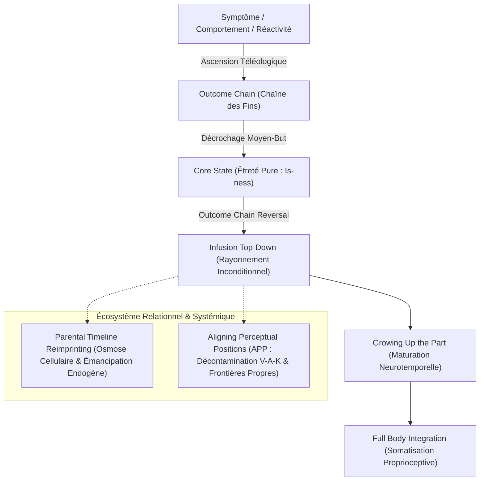

# Core Transformation - Foundation Participant Manual 2023
**Formateur :** Connirae Andreas | **ID :** `connirae-andreas-core-transformation-foundation-participant-manual-2023` | **Tranches :** 4

# Synthèse Architecturale du Cours : Core Transformation – Foundation Participant Manual (Connirae Andreas)

---

### 1. Thèse Centrale & Philosophie du Cours

#### Posture et Déviation par Rapport à la PNL Standard
La modélisation de Connirae Andreas opère une rupture paradigmatique majeure avec l'ingénierie comportementale classique de la PNL :
* **Dépasser la négociation instrumentale :** Là où la PNL orthodoxe traite les parties comme des agents transactionnels (recadrage en 6 pas, négociation entre parties, recherche d'un comportement alternatif répondant à une intention positive fixe), Connirae Andreas postule que **toute partie psychique, même la plus destructrice ou archaïque, cherche fondamentalement un état d'êtreté pur (*Core State*)**. L'intention positive n'est pas un palier fixe, mais le premier maillon d'une chaîne téléologique ascendante.
* **Non-conditionnalité vs Équivalence complexe :** La souffrance et la compulsion naissent d'une illusion structurelle : croire qu'un état d'être fondamental (Paix, Amour, Unicité, Présence) doit être conquis, mérité ou sécurisé par des manœuvres contextuelles (argent, contrôle, perfectionnisme, validation d'autrui). La posture de Connirae Andreas consiste à cesser de corriger le comportement pour révéler que l'état fondamental sous-jacent est déjà accessible *inconditionnellement*, sans aucun prérequis comportemental ou extérieur.
* **Accueil sans force :** Le symptôme ou la distorsion perceptive (y compris les dissociations ou réactions disproportionnées) n'est jamais traité comme une dysfonction ou une résistance à vaincre, mais comme une **solution tentée** par une partie restée bloquée dans une étape développementale antérieure.

#### Le Fil Rouge Méthodologique
L'intégralité des protocoles et interventions du manuel repose sur un principe unique : **l'Inversion Vectorielle de l'Illusion Psychique (*Vectorial Inversion*)** :
1. **Remontée téléologique (*Outcome Chain*) :** Décrocher la stratégie symptomatique de son intention profonde en escaladant la hiérarchie des finalités jusqu'à toucher le plan ontologique (*Core State*).
2. **Infusion descendante (*Top-Down Inundation*) :** Inverser le flux psychologique. Au lieu de faire dépendre l'Être du Faire/Avoir ($Comportement \to IO \to Core\ State$), faire vivre au système nerveux l'expérience d'avoir *déjà* cet état d'être comme point de départ inconditionnel, irradiant de haut en bas ($Core\ State \to IO \to Contexte/Comportement$).
3. **Réencodage temporel et spatial :** Maturation chronologique de la partie jusqu'au présent (*Growing Up the Part*), réimprégnation transgénérationnelle somatique (*Parental Timeline Reimprinting*), et décontamination sensorielle chirurgicale des frontières intérieures (*Aligning Perceptual Positions*).

---

### 2. Carte des Concepts & Leviers Émergents

#### Liste Structurée des Concepts & Rôles Écosystémiques

1. **La Chaîne de Résultats Inattendus (*The Outcome Chain / Intended Outcome*)**
   * *Rôle dans l'écosystème :* Moteur de transcendance récursive. Permet de traverser les couches d'intentions instrumentales intermédiaires sans s'y arrêter, en posant systématiquement la question de passage : *« Quand tu as [résultat], pleinement et complètement, que veux-tu à travers cela de plus important encore ? »*.
2. **L'État Fondamental (*Core State / Beingness / Is-ness*)**
   * *Rôle dans l'écosystème :* Attracteur ontologique central (Paix, Présence, Amour, Unicité, Être). Désactive le système dopaminergique de quête et de manque. Il s'oppose aux émotions conditionnelles, aux réalisations sociales ou aux retombées projectives dans le futur.
3. **Frontière de l'État Fondamental (*Boundary of Core State vs Consequence*)**
   * *Rôle dans l'écosystème :* Discernement métacognitif évitant la régression infinie. Distingue l'état d'être pur (*beingness*) de ses retombées contextuelles projetées (« Si j'ai cela, toute ma vie changera » = conséquence, non un état plus profond).
4. **Renversement de la Chaîne (*Outcome Chain Reversal*)**
   * *Rôle dans l'écosystème :* Le pivot thérapeutique. Réinitialise la direction du flux psychique : l'état fondamental ne dépend plus de la chaîne d'actions, il devient la source continue qui transforme et comble rétroactivement chaque étape intermédiaire.
5. **Inclusion Floue Découplée (*Whole Domain of IO*)**
   * *Rôle dans l'écosystème :* Immunisation contre la dépendance externe. Englobe linguistiquement la présence ET l'absence de réaction de l'autre (*« this whole domain of recognition/love »*), permettant à la ressource d'émaner même dans un environnement défavorable.
6. **Réétalonnage de la Sécurité Somatique (*Physical Safety Retuning*)**
   * *Rôle dans l'écosystème :* Négociation avec les centres de survie (amygdale/tronc cérébral). Garantit que le lâcher-prise dans le Core State ne réduit pas l'acuité face aux dangers réels, mais affine au contraire la détection des indices sensoriels (*cues*) et l'agilité motrice.
7. **Maturation Chronologique de la Partie (*Growing Up the Part*)**
   * *Rôle dans l'écosystème :* Résolution du retard développemental neuro-affectif. Permet à une sous-personnalité figée à l'âge du trauma/apprentissage d'évoluer à travers toute la biographie en intégrant les ressources adultes sous le bain du Core State.
8. **Intégration Somatocorporelle Totale (*Full Body Integration*)**
   * *Rôle dans l'écosystème :* Ancrage neuromusculaire et viscéral. Force la réincorporation de la partie dans l'espace physique du corps, dissolvant les clivages dissociatifs en une unité proprioceptive vécue.
9. **Ré-imprégnation Transgénérationnelle Osmotique & Endogène (*Parental Timeline Reimprinting*)**
   * *Rôle dans l'écosystème :* Restructuration profonde des schémas d'attachement. Phase 1 : bain cellulaire transgénérationnel avant conception. Phase 2 : émancipation et immunité autonome du sujet face aux défaillances réelles de la lignée.
10. **Alignement et Décontamination Perceptuelle (*Aligning Perceptual Positions - APP*)**
    * *Rôle dans l'écosystème :* Assainissement des frontières du soi. Isole chirurgicalement les canaux V-A-K de la Position 3 (Observateur neutre/consultant), de la Position 1 (Soi souverain dans ses yeux anatomiques) et de la Position 2 (Autre temporaire).
11. **Restitution Somatique et Réassignation Vocale (*Giving Back & Voice Realignment*)**
    * *Rôle dans l'écosystème :* Éjection des introjections kinesthésiques/auditives toxiques (émotions/voix des autres hébergées dans le corps) et relocalisation anatomique de la voix interne dans la zone gorge/haut du thorax.

---

### 3. Tableau Récapitulatif des Techniques & Démonstrations

| Technique / Exercice | Objectif Opératoire | Déclencheur / Indication | Séquence Résumée |
|---|---|---|---|
| **Core Transformation : Protocole Complet (Outcome Chain & Reversal)** | Transformer un symptôme névrotique en porte d'accès à l'êtreté pure et réaligner toute la hiérarchie motivationnelle. | Comportement compulsif, réaction émotionnelle parasite, dialogue interne critique obsédant, auto-sabotage. | 1. Identifier et contextualiser le comportement/sentiment. 2. Localiser la partie somatiquement et accueillir son intention positive. 3. Gravir l'*Outcome Chain* jusqu'au *Core State*. 4. Éprouver le *Core State* comme source inconditionnelle. 5. Inverser la chaîne (*Outcome Chain Reversal*) pour infuser chaque palier intermédiaire. 6. Faire grandir la partie (*Growing Up the Part*) baignée dans le Core State. 7. Intégration somatique corporelle complète et pont vers le futur. |
| **Recadrage du « Domaine Global » (*Whole Domain Reframing*)** | Émanciper le sujet de la recherche compulsive de validation, respect ou amour extérieur. | Blocage sur une intention dépendante d'autrui dans l'Outcome Chain (*« Qu'ils me respectent »*). | 1. Identifier l'intention dépendante externe. 2. Élargir le cadre sémantique à « tout ce domaine de [X] ». 3. Vérifier que la ressource irradie que l'extérieur réponde favorablement ou non. 4. Reconnecter au palier téléologique suivant. |
| **Réaccordage de Survie Amygdalienne (*Physical Safety Retuning*)** | Lever la réactance biologique face aux Core States perçus à tort comme une baisse de vigilance. | Parties protectrices bloquant le processus par peur de vulnérabilité physique ou d'agression. | 1. Valider l'intention de survie biologique. 2. Démontrer que le Core State n'est pas une anesthésie mais une présence sensorielle accrue. 3. Calibrer la détection des signaux de danger réels depuis le calme neurologique. |
| **Parental Timeline Reimprinting — Phase 1 (Nourrissement Transgénérationnel)** | Réencoder la matrice d'attachement pré-verbale et cellulaire sans dépendre des limites des parents réels. | Schémas d'abandon, carences affectives précoces, sentiment d'illégitimité ou d'insécurité fondamentale. | 1. Découvrir les Core States nécessaires aux parents et grands-parents. 2. Remonter sur la ligne du temps avant la conception parentale et abreuver les générations antérieures. 3. Descendre la ligne du temps en observant la conception, gestation et naissance dans un bain d'osmose cellulaire de ressources. |
| **Parental Timeline Reimprinting — Phase 2 (Émancipation & Immunité Endogène)** | Construire une résilience autonome et couper la dépendance au comportement parental réel. | Ressentiment persistant envers les figures d'attachement réelles, vulnérabilité relationnelle réactive. | 1. Revenir sur la ligne du temps réelle avec les parents historiques imparfaits. 2. Activer la génération endogène du Core State depuis l'intérieur de son propre système. 3. Traverser sa propre biographie en maintenant sa complétude ontologique malgré les manques ou hostilités de l'environnement. |
| **Aligning Perceptual Positions (APP) — Position Observateur (Pos. 3)** | Établir une méta-position propre, neutre, bienveillante et dénuée de distorsions émotionnelles. | Conflits interpersonnels, réactivité émotionnelle, perte d'objectivité, sur-implication anxieuse. | 1. Auditer le canal visuel : point d'observation équidistant, niveau des yeux, vue d'ensemble. 2. Auditer l'auditif : voix descriptive neutre à la 3e personne (*he/she/they*). 3. Auditer le kinesthésique : neutralité physiologique, respiration calme, curiosité sans parti pris. |
| **Aligning Perceptual Positions (APP) — Position Soi (Pos. 1)** | Restaurer la souveraineté somatique et l'incarnation sensorielle pleine dans le moi corporel. | Dissociation du corps, tendance à s'oublier pour faire plaisir aux autres, difficulté à affirmer ses besoins. | 1. Aligner le regard strictement à l'intérieur des yeux physiques. 2. Auditer la voix interne : relocalisée dans la gorge/thorax, pronom « Je » affirmé. 3. Vérifier le kinesthésique : ressentir son propre corps de l'intérieur, limites cutanées étanches. |
| **Restitution Somatique & Décontamination (*Giving Back Feelings/Voices*)** | Purger le corps et l'esprit des empreintes émotionnelles et des jugements introjectés appartenant à autrui. | Culpabilité réactive, surcharge empathique, sensations d'oppression ou d'invasion psychique liées à un tiers. | 1. Identifier dans le corps la sensation ou voix qui n'appartient pas à Soi. 2. Matérialiser kinesthésiquement l'introjection (forme, poids, texture). 3. Renvoyer activement l'élément à l'autre (geste physique / *whoosh*). 4. Récupérer et réintégrer sa propre énergie et son espace interne propre. |
| **Dynamique Circulaire des Positions (*Dynamic Swinging*)** | Intégrer une fluidité cognitive multiperspective sans risque d'emmêlement ou de contamination. | Négociations complexes, médiation de conflits, déblocage de relations bloquées. | 1. S'ancrer en Position Soi alignée (clarifier ses besoins). 2. Passer en Observateur (Pos. 3) pour valider la neutralité. 3. Glisser en Position Autre (Pos. 2) pour prélever des données perceptuelles pures. 4. Retour obligatoire par l'Observateur (Pos. 3) pour décontaminer les affects. 5. Réintégration finale en Position Soi (Pos. 1) enrichie des perspectives. |

---

---

## 0. Sommaire Sémantique & Index des Lignes

- **Tranche 1 [Lignes 99-292]** : Fondamental : Transformation Essentielle (Phases 1 à 4) — *Protocole :* Fondamental : Transformation Essentielle (Phases 1 à 4) | *Mécanisme :* Chaîne de Résultats Inattendus (Outcome Chain) et Téléologie Récursive | *Verbatim :* Découverte de la Partie et Présupposition d'Autonomie Inconsciente
- **Tranche 2 [Lignes 294-455]** : Options Avancées de Renversement de la Chaîne des Résultats (Outcome Chain Reversal - Phase 2) — *Protocole :* Options Avancées de Renversement de la Chaîne des Résultats (Outcome Chain Reversal - Phase 2) | *Verbatim :* Détection et Recadrage du Dépassement d'État Fondamental
- **Tranche 3 [Lignes 457-598]** : APP Exercice 1 — Alignement de la Position Observateur (Observer Position) — *Protocole :* APP Exercice 1 — Alignement de la Position Observateur (Observer Position) | *Mécanisme :* L'Alignement Spatial Perceptuel (Optimum Alignment)
- **Tranche 4 [Lignes 600-712]** : A : Structuration & Traçage de la Chaîne des Fins (Outcome Chain Worksheet) — *Protocole :* A : Structuration & Traçage de la Chaîne des Fins (Outcome Chain Worksheet) | *Mécanisme :* La Matrice de Dépliage Téléologique (Outcome Chain)

---

## Extractions Détaillées par Tranche (Opératoire & Verbatim)

## Tranche 1 / 4 : Fondamental : Transformation Essentielle (Phases 1 à 4)

### 1. Mécanismes & Principes Actifs

#### Chaîne de Résultats Inattendus (Outcome Chain) et Téléologie Récursive
* **Terme exact employé par Connirae Andreas :** *The Outcome Chain / Intended Outcome (IO)*.
* **Tags émergents :** `#teleologie_recursive` `#ascension_intention_positive` `#decouplage_moyen_but` `#moteur_aspirationnel`.
* **Principe actif :** En PNL classique, l'intention positive est souvent traitée comme un palier fixe. Connirae Andreas modélise l'architecture psychique sous forme d'une chaîne téléologique récursive : chaque réponse obtenue n'est pas le but ultime, mais un moyen transitoire vers une finalité supérieure. En demandant systématiquement ce que la partie veut *à travers* l'obtention de ce résultat (« *through having this* »), le système nerveux est forcé de relâcher les fixations comportementales et instrumentales (argent, contrôle, validation) pour monter en abstraction jusqu'à la source motivationnelle pure. Cela désarme immédiatement la réactance interne : la partie n'est jamais jugée pour son comportement initial (symptôme), mais validée dans son moteur aspirationnel le plus profond.

#### L'État Fondamental (Core State) : Êtreté vs Émotion/Action Conditionnelle
* **Terme exact employé par Connirae Andreas :** *Core State (CS)*.
* **Tags émergents :** `#ontologie_de_letrete` `#is_ness` `#non_conditionnalite` `#arret_de_la_quete_egoique`.
* **Principe actif :** Un *Core State* (Paix, Présence, Unicité/Oneness, Beingness, « Is-ness », Amour absolu) n'est ni une émotion réactionnelle, ni une compétence, ni un accomplissement social ou relationnel, ni un acte auto-réflexif (« self-love »). Sur le plan neurologique et cognitif, il correspond à la désactivation du mode de recherche active (système dopaminergique de quête et de manque). L'accès au Core State fait basculer le sujet d'un état de manque (« je dois faire X pour obtenir Y ») à un état d'êtreté pure (« *something that just is* ») qui transcende le temps. La partie découvre qu'elle cherchait à atteindre par des moyens complexes et dysfonctionnels un état fondamental qui est en réalité déjà disponible sans prérequis.

#### Renversement de la Chaîne de Résultats (Outcome Chain Reversal)
* **Terme exact employé par Connirae Andreas :** *Reversing the Outcome Chain with the Core State*.
* **Tags émergents :** `#inversion_vectorielle` `#infusion_ontologique` `#reprogrammation_top_down` `#recontextualisation_de_base`.
* **Principe actif :** L'illusion structurelle fondamentale de l'inconscient est de croire : *Comportement $\to$ Résultat intermédiaire $\to$ Core State*. Le protocole inverse ce vecteur psychique : *Core State $\to$ Résultat intermédiaire $\to$ Comportement*. En faisant vivre à la partie l'expérience de posséder *déjà* le Core State de manière continue (« *as a way of being* »), le besoin névrotique de générer le symptôme pour combler un vide s'effondre. Le Core State « irradie » de haut en bas (*top-down*), transformant chaque intention intermédiaire non plus en condition d'accès, mais en une expression naturelle de cet état d'être.

#### Évolution Temporelle et Maturation de la Partie (Growing Up the Part)
* **Terme exact employé par Connirae Andreas :** *Growing Up the Part*.
* **Tags émergents :** `#actualisation_ontogenique` `#comblement_du_gap_developpemental` `#reencodage_neurotemporel`.
* **Principe actif :** Les parties responsables de blocages ou de symptômes sont fréquemment figées à l'âge du traumatisme ou de l'apprentissage initial (souvent la petite enfance), opérant avec les ressources cognitives et perceptuelles limitées de cet âge. En fournissant d'abord le Core State à la partie à son âge d'origine, puis en la laissant grandir à travers le temps jusqu'à l'âge présent, l'intervention comble le retard développemental. La partie apprend et réévalue l'ensemble des expériences biographiques à travers le prisme du Core State, intégrant ainsi la sagesse de l'adulte sans perdre son énergie vitale.

#### Réintégration Spatiale et Dissolution de la Séparation (Somatic Integration)
* **Terme exact employé par Connirae Andreas :** *Integrating with the whole of your being*.
* **Tags émergents :** `#effondrement_de_la_fragmentation` `#repolarisation_cellulaire` `#spatialisation_somatique`.
* **Principe actif :** Tant qu'une partie est localisée à l'extérieur ou isolée dans une zone corporelle étroite sous forme de tension, la fragmentation de l'ego persiste. La faire entrer dans le corps et laisser le Core State saturer chaque cellule et brin d'ADN dissout la frontière illusoire entre la « partie » et « l'essence intérieure » (*whole inner essence*). La dissociation s'effondre naturellement sans conflit, restaurant l'homéostasie somatosensorielle.

#### Balayage Panoramique de la Ligne du Temps (Timeline Generalization)
* **Terme exact employé par Connirae Andreas :** *Timeline Generalization*.
* **Tags émergents :** `#reencodage_retroactif` `#generalisation_biographique` `#securisation_ontologique`.
* **Principe actif :** En remontant au moment de la conception avec le Core State et en ré-évoluant vers le présent puis vers le futur, le cerveau réécrit l'ancrage émotionnel global de sa trajectoire de vie. Cela crée une empreinte matricielle continue où le système nerveux n'a plus de point aveugle de vulnérabilité existentielle, éliminant les réactivations par flash-backs ou stimuli déclencheurs résiduels.

---

### 2. Protocoles, Techniques & Démonstrations (Étape par Étape)

#### Protocole Fondamental : Transformation Essentielle (Phases 1 à 4)

##### A. Intention / Indication
Applicable à tout sentiment, comportement ou pensée indésirable (FBoT : *Feeling, Behavior or Thought*) : compulsions alimentaires, addictions, anxiété, perfectionnisme, sabotage, conflits internes, honte, traumatismes ou déficits d'estime de soi.

##### B. Mise en place & Pré-framing
* Identifier la cible précise : un comportement, ressenti ou pensée spécifique [FBoT] ainsi que son contexte précis (où, quand, avec qui).
* Posture physique du guide : assis en biais par rapport à l'explorateur (chaises formant un léger angle), laissant un espace ouvert devant lui, proximité suffisante pour parler à voix douce près de l'oreille sans être intrusif.
* Pré-framing clé : « *Même si tu ne connais pas l'intention positive de cette partie, nous pouvons savoir qu'elle a un but positif.* »

##### C. Séquence d'actions pas à pas

###### Phase 1 : Découvrir ce que veut la Partie (Chaîne de Résultats)
1. **Élicitation du contexte :** Identifier le FBoT et son contexte précis (où, quand, avec qui).
2. **Accès sensoriel interne (Reviviscence) :** Inviter le sujet à entrer mentalement dans une situation spécifique, à voir ce qu'il a vu, entendre ce qu'il a entendu, ressentir ce qu'il a ressenti. Poser la présupposition : « *Comme tu n'as pas généré cela consciemment, c'est comme si une partie de toi l'avait généré.* »
3. **Localisation spatiale :** Déterminer précisément où se trouve cette partie (dans le corps ou autour).
4. **Gratitude inconditionnelle :** Remercier la partie d'être là pour son intention positive inconnue.
5. **Première question téléologique :** Adresser la question directement à l'emplacement spatial : « *Que veux-tu ?* » Noter la réponse sensorielle (sensation, son, mot ou image) = Premier Résultat Visé (*Intended Outcome 1 - IO1*).
6. **Remerciement :** Remercier la partie pour cette réponse.
7. **Itération ascendante récursive :**
   * **7.A.** Inviter la partie à entrer pleinement (ou respirer) dans l'expérience d'avoir *déjà* complètement cet IO.
   * **7.B.** Question de transcendance : « *Et lorsque tu as [IO], que veux-tu, à travers le fait d'avoir cela, qui soit encore plus profond ou plus important ?* » Noter la réponse (= IO suivant).
8. **Remerciement et répétition :** Remercier la partie et répéter l'étape 7 jusqu'à atteindre un état d'être pur.
9. **Validation du Core State :**
   * **9.A.** Inviter la partie à respirer/entrer dans ce Core State potentiel.
   * **9.B.** Vérification ultime : « *Y a-t-il quelque chose d'encore plus profond ou plus fondamental que tu veux à travers le fait d'avoir [CS] ?* »
   * Si rien de plus profond n'émerge et que la réponse correspond à une qualité d'êtreté (paix, oneness, presence), le Core State est validé.

###### Phase 2 : Renversement de la Chaîne de Résultats
1. **Recadrage de la fausse prémisse :** Expliquer à la partie qu'elle a cru à tort devoir faire/obtenir des choses pour vivre le CS, alors que la seule manière de le vivre est de s'y installer directement.
2. **Installation de la permanence :** Inviter la partie à entrer dans le CS et à observer comment le fait de l'avoir déjà, de façon continue, permet naturellement aux choses d'être différentes.
3. **Descente récursive (Infusion des IOs) :** Prendre chaque IO en sens inverse (du plus proche du CS jusqu'au premier). Demander : « *Comment le fait d'avoir déjà [CS], comme manière d'être, irradie, transforme ou enrichit [IO] ?* » Valider chaque étape (verbale ou hochement de tête).
4. **Transformation du symptôme initial :**
   * **4.A.** « *Comment le fait d'avoir déjà [CS] transforme ou enrichit ton expérience de la situation de départ ?* »
   * **4.B.** « *Comment cela transforme ou enrichit ton expérience dans d'autres situations où tu avais l'habitude de [FBoT] ?* »
5. **Pont vers le futur (si fin d'exercice 1) :** Inviter la partie remplie du CS à traverser les situations futures et observer les nouvelles réponses qui émergent spontanément.

###### Phase 3 : Faire Grandir la Partie (Maturation & Intégration)
1. **Normalisation de l'âge :** Expliquer que les parties sont souvent plus jeunes et privées des apprentissages acquis.
2. **Élicitation de l'âge & Accord :** Demander son âge à la partie. Lui demander si elle souhaite faciliter sa tâche en bénéficiant de l'évolution jusqu'à l'âge présent.
3. **Maturation temporelle imprégnée :** Inviter la partie à avoir le CS pleinement présent à son âge initial, puis à grandir à travers le temps jusqu'au présent, en laissant le CS transformer, enrichir et réencoder chaque expérience de vie.
4. **Relocalisation somatique :** Demander où se situe la partie. Si elle est hors du corps, l'inviter à entrer à l'intérieur.
5. **Fusion identitaire :** Faire dissoudre l'étiquette de « partie » : la partie *est* le CS. Faire circuler le CS dans tout le corps, chaque cellule, brin d'ADN, et au-delà de la peau, en fusion avec l'essence intérieure.
6. **Re-vérification flash :** Re-parcourir brièvement les IOs et le contexte initial enrichis de cette intégration adulte.
7. **Pont vers le futur enrichi :** Observer les nouveaux comportements disponibles dans l'avenir.

###### Phase 4 : Écologie de Système & Généralisation Temporelle
1. **Vérification des parties associées/opposées :** Traiter toutes les parties liées à l'enjeu via les phases 1 à 3.
2. **Sondage des parties concernées :** « *Y a-t-il une autre partie de moi concernée par ce sujet ?* » (Si oui, appliquer Phases 1 à 3).
3. **Vérification d'objection :** « *Y a-t-il une partie qui s'oppose à ce que j'aie [CS] de manière continue ?* »
4. **Ligne du Temps (Conception au Présent/Futur) :**
   * Déployer la ligne temporelle (passé derrière, futur devant).
   * Flotter au-dessus de la ligne avec le(s) CS jusqu'à la conception.
   * Descendre dans l'instant de conception, imprégné du CS.
   * Évoluer vers l'avant à travers la naissance et toutes les expériences jusqu'au présent, puis laisser couler le CS dans le futur.
5. **Consolidation :** Répéter le balayage mentalement autant de fois que désiré, puis ouvrir les yeux pleinement présent ici et maintenant.

##### D. Signes de calibration
* **Respiration :** Ralentissement visible et passage d'une respiration haute/thoracique à une respiration abdominale profonde lors de l'accès au Core State.
* **Tonus musculaire :** Relâchement des traits faciaux, déglutition spontanée, épaules qui s'affaissent doucement lors de l'intégration.
* **Micro-mouvements :** Hochements de tête involontaires ou légers tressaillements des paupières (signes d'un traitement inconscient actif pendant la maturation temporelle).
* **Qualité de la voix :** Voix du sujet qui devient plus lente, plus grave ou plus douce lorsqu'il verbalise le Core State.

---

### 3. Heuristiques, Subtilités & "Sagesse du Praticien"

#### Règles Conditionnelles Opératoires (Si X $\to$ Alors Y parce que Z)
* **Si la partie donne une réponse qui ressemble à une conséquence (« ma vie sera différente ») au lieu d'un état profond :**
  * *Alors :* Recadrer en distinguant état ontologique et conséquence : demander à la partie si cette réponse est un but encore plus profond ou une merveilleuse conséquence du Core State déjà atteint.
  * *Parce que :* Le mental a tendance à glisser prématurément dans l'Outcome Chain Reversal (Phase 2) avant d'avoir verrouillé la stabilisation pure du Core State en Phase 1.
* **Si la partie stagne sur un palier sans approfondir (bloquée avant le Core State) :**
  * *Alors :* Ré-ancrer la partie plus intensément dans l'expérience somatosensorielle du dernier IO atteint (« *step or breathe into what it's like to already have [IO]* ») avant de reposer la question 7.B.
  * *Parce que :* La question ne doit pas être traitée par l'intellect analytique, mais vécue depuis l'état somatique incarné.
* **Si une partie objecte (sensation inconfortable, image de mur, voix disant « Attends ! ») en plein milieu du guidage :**
  * *Alors :* Stopper immédiatement la progression, remercier la partie objectrice d'être là, noter son signal comme un nouveau comportement/symptôme, localiser cette nouvelle partie, et choisir soit de la traiter immédiatement (Phases 1-3), soit de lui demander avec respect d'attendre son tour.
  * *Parce que :* Toute résistance non honorée agit comme un frein neurologique qui verrouille l'accès durable au Core State et sabote l'écologie du système.
* **Si une partie parasite intervient (analyse intellectuelle, impatience, doute, peur de l'inconscient) :**
  * *Alors :* Traiter ce pattern comme une partie à part entière. Faire la Chaîne de Résultats avec cette « partie analytique » ou « impatiente » en premier.
  * *Parce que :* L'attitude métacognitive envers l'inconscient conditionne l'accès aux signaux non-conscients.
* **Si le sujet fait un choix ou vit un conflit interne binaire (partie qui veut X vs partie qui veut Y) :**
  * *Alors :* Ne pas chercher un symptôme indésirable, mais calibrer l'entrée sur « *Ce qu'une partie veut* » (Partie A veut X, Partie B veut Y) et mener les phases 1 à 3 successivement sur chaque pôle.
  * *Parce que :* Les polarités partagent souvent des Core States complémentaires ou identiques à leur niveau le plus profond.
* **Si le temps manque et que de multiples parties émergent :**
  * *Alors :* Remercier les parties restantes, leur promettre une séance dédiée future, et faire la ligne du temps (Phase 4) avec les Core States déjà acquis.
  * *Parce que :* L'imprégnation d'un premier Core State transforme déjà par contagion systémique les autres parties présentes dans le champ de conscience.

#### Erreurs de Débutant & Pièges Identifiés
* **Confondre une émotion contextuelle avec un Core State :** Valider la confiance, le courage, la fierté ou la satisfaction comme des Core States. Ce sont des états émotionnels transitoires ou orientés vers l'action, non des états d'êtreté pure (« *Is-ness* »).
* **Accepter un besoin relationnel comme un Core State :** Prendre « être aimé des autres » ou « avoir de l'impact sur autrui » pour un Core State. Un Core State ne dépend jamais de l'extérieur ni de la réciprocité.
* **Parler trop vite ou trop fort :** Empêcher le sujet d'accéder au traitement transdérivationnel. Le guide doit ralentir son débit, baisser le volume et caler son phrasé sur l'expiration du sujet.
* **Vouloir intellectualiser le processus :** Demander au sujet « Que penses-tu que cette partie veut ? » au lieu d'adresser la question directement à la localisation somatique de la partie.

#### Postulats Philosophiques de Connirae Andreas
* **Bonté Fondamentale Inhérente :** Chaque recoin de la psyché, y compris la pulsion la plus destructrice ou la peur la plus archaïque, est animé par une trajectoire ascendante vers un état spirituel d'harmonie et d'être.
* **Non-Violence Intérieure :** Aucune partie n'est jamais éliminée, reformatée de force ou soumise à la volonté de l'ego. La transformation se fait exclusivement par satisfaction et saturation de son aspiration la plus haute.
* **L'Êtreté Précède l'Action :** Tout conflit psychologique naît de l'illusion que l'état d'être est la récompense d'une action réussie, alors que l'action juste n'est que le rayonnement spontané de l'état d'être déjà présent.

---

### 4. Pépites Verbatim & Patterns Linguistiques (MOT À MOT EN V.O.)

#### Découverte de la Partie et Présupposition d'Autonomie Inconsciente
> « Mentally step into the situation, seeing what you saw, hearing what you heard, feeling what you felt at the time…. As you relive this experience, notice any internal images, sounds, or feelings…. Since you didn’t consciously generate [FBoT], it’s as if some part of you generated it. »

* **[Analyse du Pattern] :**
  * *Fractionnement VAKOG en temps réel :* Séquence d'accès sensoriel direct (« seeing... hearing... feeling ») forçant la reviviscence associée.
  * *Truisme causal irréfutable :* « *Since you didn't consciously generate...* » établit un fait d'évidence que l'esprit critique ne peut contester.
  * *Rupture de pattern et externalisation douce :* L'utilisation de la structure conditionnelle métaphorique « *it's as if some part of you generated it* » découple l'identité de l'individu du comportement pathologique sans créer de culpabilité, initiant une dissociation bienveillante et opératoire.

#### Gratitude Préalable et Postulat Téléologique
> « Even though you don’t know what the positive intention of this part is, you can begin thanking this part for being there, because we can know it has a positive purpose–it wants something positive.… »

* **[Analyse du Pattern] :**
  * *Liaison paradoxale (Double bind adouci) :* « *Even though you don't know... you can begin thanking...* » contourne le scepticisme conscient en découplant l'action de gratitude de la compréhension intellectuelle.
  * *Présupposition d'inévitabilité :* La formulation modale « *because we can know it has a positive purpose* » injecte l'intention positive non comme une hypothèse à vérifier, mais comme un axiome ontologique incontournable.
  * *Commande enchâssée d'ouverture :* « *begin thanking this part* » installe immédiatement un rapport de collaboration interne avant toute négociation.

#### Question Récursive d'Ascension Téléologique
> « Invite this part to step (or breathe) into what it’s like to already have [IO]... fully and completely. And as this part is experiencing [IO], ask this part, ‘When you have [IO], what do you want, through having this, that’s even deeper or more important?’ »

* **[Analyse du Pattern] :**
  * *Hypothèse d'accomplissement incarné (Somato-sensorielle) :* « *step (or breathe) into what it's like to already have [IO]... fully and completely* » oblige le système nerveux à simuler l'état de complétion, court-circuitant le schéma habituel de frustration ou de manque.
  * *Structure temporelle de présupposition :* La proposition subordonnée « *When you have [IO]* » prend l'état désiré comme acquis et déjà réalisé dans le présent subjectif.
  * *Pointeur de transcendance :* Le syntagme « *through having this, that's even deeper or more important* » crée une rupture de niveau logique, forçant la cognition à abandonner l'objet de fixation pour sonder une couche d'abstraction supérieure.

#### Effondrement de l'Illusion Conditionnelle (Recadrage Opératoire)
> « Somehow our inner parts get the idea that in order to experience Core States such as [CS], we have to first do certain things and get certain things. Unfortunately, this doesn’t work very well. We don’t get to experience our Core States very often when we go about it that way. The way to experience a Core State is just to step into it and have it. »

* **[Analyse du Pattern] :**
  * *Normalisation universelle et déculpabilisation :* « *Somehow our inner parts get the idea...* » attribue l'erreur de stratégie à une naïveté structurelle des parties sans condamner la personne.
  * *Désillusionnement stratégique :* L'affirmation sobre « *Unfortunately, this doesn't work very well* » résonne avec l'expérience d'échec répétée du sujet, validant son vécu d'impasse.
  * *Rupture logique et commande directe :* La dernière phrase (« *The way to experience a Core State is just to step into it and have it* ») effondre l'échafaudage de conditions préalables et pose l'accès à l'état comme un acte d'autorégulation directe et immédiate.

#### Induction de Maturation Temporelle
> « That’s right,… growing up through time, … with [CS] fully present, all the way up to your current age…. Transforming, enriching every experience with [CS], and learning from each experience as this part grows up to present…. »

* **[Analyse du Pattern] :**
  * *Ratification ericksonienne :* « *That's right...* » valide le processus interne en cours et abaisse le facteur critique.
  * *Saupoudrage rythmique et pauses calculées :* L'insertion de silences (« *…* ») calés sur le rythme respiratoire induit une transe de traitement inconscient profond.
  * *Verbes au participe présent (Processus continu) :* « *growing... transforming... enriching... learning...* » génèrent une dynamique cinétique inarrêtable qui réencode l'intégralité de la mémoire épisodique sans exiger l'analyse consciente de chaque souvenir individuel.

#### Dissolution des Frontières et Intégration Cellulaire
> « And so in whatever way is natural, this [CS] can flow into and through the space of your whole body.… filling every cell of your being, through every strand of DNA… perhaps even radiating beyond your skin, through all of consciousness,… integrating with the core of your being and enriching your experience of your inner essence…. »

* **[Analyse du Pattern] :**
  * *Formulation permissive ericksonienne :* « *in whatever way is natural* » élimine toute résistance ou sentiment d'effort conscient.
  * *Généralisation somatique descendante puis expansive :* La trajectoire linguistique guide l'attention du microscopique (« *every cell... every strand of DNA* ») vers le macroscopique/transpersonnel (« *beyond your skin, through all of consciousness* »), saturant la proprioception.
  * *Dissolution nominale :* L'expression « *what we used to call a "part", is now fully integrating* » détruit le statut d'entité séparée pour ne laisser subsister qu'une gestalt unifiée (« *inner essence* »).

#### Recadrage de la Pseudo-Profondeur (Distinction État vs Conséquence)
> « Thank the part for its response of ‘My whole life being different,’ and ask the part, “Is ‘my whole life being different,’ something that’s wanted at an even deeper level? Or, is it a wonderful consequence of already having Oneness, without being deeper?” »

* **[Analyse du Pattern] :**
  * *Double lien orienté vers la précision :* L'alternative proposée (« *Is it something wanted at an even deeper level? Or, is it a wonderful consequence...?* ») offre un cadre fermé où la seconde option est fortement valorisée linguistiquement (« *wonderful consequence* »).
  * *Clarté ontologique immédiate :* Cette formulation oblige l'inconscient à distinguer une projection temporelle (le futur qui change) de l'ancrage atemporel de l'être (*Oneness*), empêchant le processus de dériver vers une simple planification mentale.

## Tranche 2 / 4 : Options Avancées de Renversement de la Chaîne des Résultats (Outcome Chain Reversal - Phase 2)

### 1. Mécanismes & Principes Actifs

- **Rupture de la régression vs Conséquence projective (Boundary of Core State)**
  *Principe actif :* Lorsqu'une partie affirme qu'après avoir atteint un état fondamental (ex. *Oneness*), « toute ma vie sera différente », elle ne nomme pas un état d'être plus profond, mais projette les retombées temporelles et contextuelles de l'état d'être. Un état fondamental (*Core State*) réside sur le plan ontologique pur (*beingness* : ce qui « est » simplement, sans condition ni action). Confondre une conséquence systémique avec une intention motrice plus profonde entraîne une régression infinie ou un piège mental. En posant la distinction entre « être » et « conséquence », le système nerveux cesse de chercher à l'extérieur ou dans le futur ce qui est déjà pleinement là.
  *Tags :* `#beingness_vs_consequence #core_state_boundary #ontological_level #outcome_chain_reversal`

- **Découplage de la dépendance externe par inclusion floue (*Whole domain of IO*)**
  *Principe actif :* Les intentions dépendant d'autrui (ex. reconnaissance, respect, appréciation) créent une vulnérabilité biologique et relationnelle, car le système nerveux lie son homéostasie au comportement de tiers. En utilisant le cadrage linguistique « tout ce domaine de [IO] » (*this whole domain of*), on introduit une ambiguïté sémantique délibérée qui englobe simultanément la présence ET l'absence de la réponse de l'autre. Le système neurologique apprend ainsi à faire rayonner l'état fondamental de manière inconditionnelle, que l'autre fournisse ou non la validation.
  *Tags :* `#whole_domain_reframing #external_dependence_decoupling #semantic_ambiguity #unconditional_resource`

- **Préservation de la vigilance de survie (*Physical Safety Retuning*)**
  *Principe actif :* Lorsqu'une intention touche à la sécurité physique, le cerveau reptilien et l'amygdale peuvent bloquer la transe s'ils interprètent l'état fondamental comme une baisse de vigilance ou une anesthésie face au danger réel. L'intervention recadre l'état fondamental non pas comme une perte de contact avec le réel, mais comme un amplificateur d'acuité sensorielle qui affine la perception des indices de danger (*cues*) et optimise la vitesse de décision motrice protectrice.
  *Tags :* `#threat_detection_optimization #somatic_safety_retuning #amygdala_calibration`

- **Ré-imprégnation transgénérationnelle somatosensorielle (Parental Timeline Reimprinting - Phase 1)**
  *Principe actif :* Le modèle interne d'attachement repose sur l'intériorisation des états affectifs des figures parentales lors des phases précoces de développement. En remontant sur la ligne du temps *avant* la conception des parents pour abreuver les grands-parents d'états fondamentaux, l'inconscient reconstruit une épigénétique psychologique imaginaire exempte de traumas transgénérationnels. Le fœtus puis l'enfant se développent dans un bain d'absorption cellulaire (« osmose »), encodant la ressource comme un droit de naissance pré-cognitif.
  *Tags :* `#transgenerational_recoding #cellular_osmosis_imprinting #attachment_repatterning #timeline_regression`

- **Dynamique d'émancipation et d'immunité endogène (Parental Timeline Reimprinting - Phase 2)**
  *Principe actif :* Recevoir la ressource de l'environnement parental idéal (Phase 1) crée le sentiment d'être nourri, mais maintient une dépendance fonctionnelle à un milieu parfait. La Phase 2 expose le sujet à la réalité brute de son histoire (parents réels avec leurs défaillances) tout en activant la génération de l'état fondamental *de l'intérieur*. Cela développe la résilience biologique et psychologique : le système nerveux apprend à maintenir son intégrité et sa plénitude ontologique indépendamment de l'incompétence affective ou de l'hostilité de l'environnement extérieur.
  *Tags :* `#endogenous_resource_generation #resilience_inoculation #contextual_immunity #inner_source`

- **Alignement Perceptuel et Décontamination Frontalière (APP Fundamentals)**
  *Principe actif :* Les perturbations relationnelles et les échecs de transformation interne proviennent fréquemment d'une contamination spatiale et sensorielle entre les positions perceptuelles (mélange entre soi, l'autre et l'observateur). L'alignement perceptuel isole chirurgicalement chaque perspective pour rétablir une séparation nette « moi vs non-moi » (*clean boundaries*). Il permet au cortex préfrontal d'accéder à une position métacognitive propre (Observateur = consultant intérieur) et sécurise l'ancrage somatique en 1re position (Soi).
  *Tags :* `#clean_perceptual_positions #boundary_restoration #observer_consultant #perceptual_decontamination`

---

### 2. Protocoles, Techniques & Démonstrations (Étape par Étape)

#### Protocole 1 : Options Avancées de Renversement de la Chaîne des Résultats (Outcome Chain Reversal - Phase 2)

* **Intention / Indication :** À utiliser après l'émergence du Core State, pour rétro-propager l'état fondamental à travers chaque résultat intermédiaire de la chaîne, selon la nature sémantique de l'intention.
* **Mise en place & Pré-framing :** Identifier la catégorie du résultat intermédiaire (IO) : Intrinsèque/Valeureux, Dépendant d'autrui, Non-ressource/Dysfonctionnel, ou Sécurité physique.

* **Séquence d'actions pas à pas :**
  1. **Cas A : IO intrinsèque et valeureux en soi** (ex. motivation, estime de soi) :
     - Demander à la partie : comment le fait d'avoir déjà [CS] rend [IO] plus facile, l'enrichit et l'amplifie ?
  2. **Cas B : IO dépendant d'autrui** (ex. reconnaissance, respect) :
     - Étape 1 : Inviter la partie à remarquer comment avoir déjà [CS] comme manière d'être rayonne, transforme et enrichit « tout ce domaine de [IO] ». Attendre validation somatique/nod.
     - Étape 2 (Scénario d'accueil) : Expérimenter comment [CS] transforme l'expérience de *recevoir* l'IO.
     - Étape 3 (Cadrage d'autonomie) : Cadrer que [CS] est pleinement présent, quoi que fassent ou ne fassent pas les autres.
     - Étape 4 (Scénario de privation) : Expérimenter comment [CS] enrichit et transforme les moments où l'autre *n'est pas capable d'offrir* l'IO.
  3. **Cas C : IO dysfonctionnel ou délétère** (ex. vengeance, perfectionnisme) :
     - Demander à la partie : comment le fait d'avoir déjà [CS] transforme tout ce domaine, ou transforme « ce qui était autrefois un désir de [IO] » ?
  4. **Cas D : IO impliquant la sécurité physique** (danger tangible, non anxiété émotionnelle) :
     - Demander : comment avoir déjà [CS] aide à rester plus en sécurité physiquement, à percevoir avec acuité les indices réels et à agir si nécessaire ?

* **Signes de calibration :** Relâchement de la tension musculaire faciale (décrispation de la mâchoire, paupières lourdes), respiration abdominale lente dès que l'ambiguïté est intégrée, micro-hochements de tête validant le basculement d'une quête externe à une complétude interne.

---

#### Protocole 2 : Parental Timeline Reimprinting (PTR) – Version Assise & Debout

* **Intention / Indication :** Approfondir et amplifier les Core States à travers toute l'histoire de vie ; reprogrammer le modèle d'attachement familial ; installer l'indépendance de la ressource.
* **Mise en place & Pré-framing :**
  - Noter par écrit les [CS] précis du sujet.
  - Cadrer comme un processus doux d'apprentissage et de re-codage.
  - Déployer la ligne du temps imaginaire (en version assise : yeux fermés, passé derrière, futur devant ; en version marchée : ligne au sol spatialisée, marche latérale).
  - En cas d'antécédents d'enfance très lourds : fractionner l'exercice (faire les étapes 1 à 9 ou 1 à 14 lors de la première séance).

* **Séquence d'actions pas à pas :**

  **Phase 1 : Réception des Core States par les parents (Flux externe)**
  1. *Régression pré-conception :* Flotter au-dessus de la ligne du temps, remonter jusqu'à l'instant juste avant sa conception. Se poser face à sa vie future, puis pivoter de 180° pour regarder vers le passé lointain.
  2. *Bifurcation des lignées :* Visualiser les deux lignes du temps (père et mère) remontant dans le passé. Choisir un parent en premier.
  3. *Pré-conception du parent :* Remonter la ligne du parent choisi jusqu'à l'instant avant sa conception et voir les grands-parents.
  4. *Transmission aux grands-parents :* Inonder les grands-parents de [CS] (transmis par le sujet, reçus de l'univers, ou émergés de l'intérieur) jusqu'à saturation complète et transformation de leur état d'être.
  5. *Conception & Croissance parentale sous [CS] :* Le parent est conçu dans ce bain de [CS], grandit par osmose, baigné et nourri par ces états jusqu'à l'âge de concevoir le sujet.
  6. *Itération :* Répéter les étapes 3 à 5 pour le second parent.
  7. *Auto-conception sous [CS] :* Vérifier que les deux parents sont pleins de [CS]. Se retourner vers sa propre conception, y faire couler le [CS], puis entrer dedans.
  8. *Amplification cellulaire & Naissance :* En tant que cellule unique saturée de [CS], dédoubler l'état au fur et à mesure des divisions cellulaires (2 cellules = double [CS], 4 cellules = quadruple [CS]...). Avancer jusqu'à la naissance, accueilli par des parents pleins de [CS].
  9. *Progression chronologique & Futurisation :* Remonter le passé jusqu'au présent, en laissant [CS] transformer chaque événement vécu. Puis faire déferler [CS] dans le futur.
  10. *Répétitions accélérées :* Répéter cette boucle (étapes 1 à 9) idéalement 3 fois en augmentant drastiquement la vitesse (format « Brief Repeat » avec ancrage auditif « Whoosh! »).

  **Phase 2 : La ressource issue de l'intérieur (Immunité et résilience endogène)**
  11. *Recadrage de résilience :* Expliquer au sujet que les personnes les plus fortes sont celles qui traversent l'adversité avec leurs ressources intérieures, et non celles qui ont eu une vie parfaite.
  12. *Régression & Configuration :* Flotter à nouveau avant la conception. Poser l'instruction : plonger dans la conception avec [CS] émanant à 100% *de l'intérieur de soi*, tandis que les parents se comportent *exactement tels qu'ils étaient dans la réalité*.
  13. *Traversée ultra-rapide :* Plonger dans la conception et remonter toute la ligne temporelle à haute vitesse (« Whoosh! ») jusqu'au présent, en laissant l'inconscient opérer les réorganisations profondes.
  14. *Futurisation endogène :* Projeter [CS] dans le futur comme une source interne constante, indépendante de l'état émotionnel d'autrui. Répéter 3 fois.

* **Signes de calibration :** Changements de coloration cutanée (pâleur/rougeur marquant l'intégration du système nerveux autonome), respiration profonde involontaire au moment de la conception, hochements de tête nets sans hésitation verbale, posture physique qui se redresse spontanément lors de la Phase 2.

---

### 3. Heuristiques, Subtilités & "Sagesse du Praticien"

- **Règle du dépassement de l'état fondamental (*Overshooting the Core State*) :**
  *Si* le sujet dit « La partie dit que maintenant que j'ai l'Unité, toute ma vie sera différente »,
  *Alors* ne validez PAS « toute ma vie sera différente » comme un état plus profond.
  *Parce que* c'est une conséquence temporelle/comportementale et non un état d'être. Remerciez la partie, distinguez l'état d'être de sa conséquence, et demandez à la partie si cette perspective est une conséquence merveilleuse d'avoir déjà l'Unité.

- **Règle de l'ambiguïté protectrice sur les désirs de validation :**
  *Si* l'intention implique l'approbation ou l'amour d'autrui,
  *Alors* utilisez impérativement le syntagme flou « tout ce domaine de [IO] » avant de tester spécifiquement le cas où l'autre ne donne rien.
  *Parce que* plonger immédiatement un sujet fragile dans la confrontation avec le rejet (« même si l'autre ne te respecte pas ») peut déclencher une décompensation ou une résistance de la partie. L'ambiguïté prépare le système nerveux en douceur.

- **Règle du calibrage de l'intensité d'apprentissage (APP / Débutants) :**
  *Si* un sujet choisit un traumatisme majeur ou une situation relationnelle explosive pour démarrer l'exercice d'Alignement des Positions Perceptuelles (APP),
  *Alors* recadrez-le immédiatement pour lui faire choisir un conflit léger ou modéré (voire une situation amusante).
  *Parce que* l'inconscient a besoin d'intégrer la chorégraphie neuromusculaire et cognitive de la séparation des positions sans être inondé par une charge émotionnelle toxique. L'intensité bloque l'assimilation du pattern.

- **Règle de l'indifférence à l'exactitude historique (PTR) :**
  *Si* le sujet affirme ne pas connaître ses grands-parents ou ne pas avoir d'informations sur un parent biologique/adoptif,
  *Alors* donnez-lui la permission absolue d'inventer (« pretend/make it up ») et d'estimer un âge au hasard.
  *Parce que* le système nerveux répond aux représentations symboliques et spatiales internes ; la réalité neuro-affective n'exige pas d'exactitude factuelle ou généalogique.

- **Règle d'intégration des figures d'attachement élargies :**
  *Si* le sujet a été élevé par des beaux-parents, tuteurs ou parents adoptifs,
  *Alors* incluez-les systématiquement sur la ligne du temps avec les parents biologiques.
  *Parce que* tout système familial ayant exercé une empreinte éducative précoce participe à l'architecture du réseau neuronal de l'attachement.

- **Règle du non-démarrage au milieu d'un protocole interrompu :**
  *Si* un sujet a déjà fait une portion de l'exercice PTR lors d'une session précédente et souhaite continuer,
  *Alors* ne reprenez JAMAIS au milieu du processus : recommencez impérativement depuis l'étape 1.
  *Parce que* la boucle neuro-émotionnelle doit être réamorcée dans sa continuité complète pour garantir la cohérence du recodage.

---

### 4. Pépites Verbatim & Patterns Linguistiques (MOT À MOT EN V.O.)

#### Détection et Recadrage du Dépassement d'État Fondamental
> “Thank the part for its response. I have a sense that Oneness is at a very deep level, meaning it’s a state of being, a state that just is. So thank the part for its response of ‘My whole life being different,’ and ask the part, ‘Is “my whole life being different,” something that’s wanted at an even deeper level? Or, is it a wonderful consequence of already having Oneness, without being deeper?’”
- **[Analyse du Pattern]** : Utilisation d'une dissociation linguistique par double alternative orientée (*illusion of choice*). Connirae Andreas pose d'abord un truisme ontologique (« a state that just is ») pour saturer le cadre sémantique de l'Être, puis utilise la conjonction de coordination « Or » pour proposer la reformulation salvatrice (« a wonderful consequence... without being deeper »). La formulation installe une commande de clôture encadrée d'une appréciation positive (« wonderful consequence ») qui satisfait la partie tout en stoppant la fuite en avant.

---

#### Levier d'Ambiguïté et Découplage de la Validation Externe
> “Ask the part, ‘How does already having [CS], as a way of being, radiate through, transform, or enrich this whole domain of [IO]’….”
- **[Analyse du Pattern]** : Présupposition d'antériorité et d'acquisition (« already having [CS] ») couplée à un marqueur d'état ontologique (« as a way of being »). L'emploi d'un triplet de verbes kinesthésiques/métaphoriques expansifs (« radiate through, transform, or enrich ») disperse les défenses critiques de l'ego. Le syntagme nominal « this whole domain of [IO] » opère une nominalisation floue créant une transe de recherche transdérivationnelle, permettant d'englober tous les contextes passés et futurs sans heurter de résistance frontale.

---

#### Installation de l'Inconditionnalité face à Autrui
> “And what’s even more wonderful is that this [CS] can be fully present, no matter what other people do or don’t do. This part’s [CS] isn’t dependent on other people.”
- **[Analyse du Pattern]** : Utilisation d'un cadre d'accroissement d'intérêt (« And what’s even more wonderful is that... ») qui capte le système d'attention/récompense. Suivi d'un double lien exhaustif (« do or don’t do ») qui élimine toute échappatoire logique ou dépendance relationnelle. L'affirmation finale « isn’t dependent » ancre la souveraineté psychologique en désactivant le réflexe de soumission aux contingences sociales.

---

#### Neutralisation de la Menace sur la Survie Physique
> “Ask the part, ‘How does already having [CS] actually help you keep yourself physically safer?’ and/or ‘How does already having [CS] make it easier for you be more fully aware of the situation as it is, and to notice any cues that can let you know whether you are safe, or whether you need to take some kind of action?’”
- **[Analyse du Pattern]** : Présupposition enchâssée (« already having [CS] actually help you... ») qui contourne le doute analytique. Recadrage de la détente intérieure non comme une vulnérabilité, mais comme un catalyseur d'attention sensorielle périphérique pure (« aware of the situation as it is »). La structure bifurquée finale (« whether you are safe, or whether you need to take some kind of action ») offre un choix comportemental binaire rassurant qui garantit à la part protectrice que ses capacités d'action et d'évitement restent intactes.

---

#### Métaphore de l'Amplification Cellulaire par Osmose (PTR)
> “You are now just a single cell, in a universe that’s filled with [CS]. And you can completely absorb [CS] just by osmosis. When you become two cells, of course, this [CS] can double. When you become four cells, the [CS] can quadruple. You can continue developing, as the [CS] develops with you, and you continue absorbing even more from what’s all around you….”
- **[Analyse du Pattern]** : Empilement de truismes biologiques irréfutables (le développement embryologique) couplé à une équivalence complexe et un truisme d'évidence (« of course »). La suggestion synchronise la multiplication biologique indiscutable (1 -> 2 -> 4 cellules) avec la croissance exponentielle de la ressource interne (« double », « quadruple »). L'utilisation du mot « osmosis » contourne tout effort cognitif ou volontaire : l'absorption est posée comme une loi physique passive et inéluctable.

---

#### Cadrage de Résilience et Inversion Émancipatrice (Phase 2 PTR)
> “However, you probably have noticed, the very most resourceful people aren’t the ones for whom everything has gone perfectly. The most resourceful people have gone through times of difficulty, and they’ve come through it with even more strength and resilience. And that’s what happens when we go through difficulties with our Core States fully present: it makes us more resourceful, more resilient.”
- **[Analyse du Pattern]** : Utilisation d'un accord d'expérience universelle (« you probably have noticed ») agissant comme une amorce hypnotique de truisme. Recadrage d'adversité : la perfection environnementale est disqualifiée au profit de l'acquisition de force interne. Ce pattern prépare le système nerveux du sujet à réentrer dans ses mémoires biographiques douloureuses non plus en position de victime sans ressources, mais sous l'identité d'un explorateur résilient transformant l'épreuve en acier trempé.

---

#### Commande d'Accélération Inconsciente (« Whoosh! »)
> “Now don’t do this yet, but in a moment, you’ll drop down into your conception, with these core states of [CS] fully filling your being from the inside. And then, when you’re ready, you can just move forward through your past with [CS] coming from inside of you, while your parents behave the way you remember them. You’ll do this round quickly, allowing the new connections and transformations to take place on an unconscious level, all the way up to the present. Are you ready? … OK, with [CS] fully filling your being, let yourself drop down into the moment of your conception, and move quickly forward through time, whooosh!...”
- **[Analyse du Pattern]** : Inhibition temporaire par suggestion négative paradoxale (« Now don’t do this yet, but in a moment... »), ce qui a pour effet de charger le potentiel d'action du système nerveux tout en bloquant l'impulsivité. Injection de la condition permissive d'autonomie (« when you’re ready »), suivie de la scission temporelle entre la permanence de la ressource interne et le comportement inchangé d'autrui (« with [CS] coming from inside of you, while your parents behave the way you remember them »). Enfin, l'onomatopée prosodique (« whooosh!... ») agit comme une rupture kinesthésique et un ancrage analogique de vitesse, empêchant le cortex conscient d'analyser ou de re-traumatiser les scènes passées pour forcer un encodage global et inconscient.

## Tranche 3 / 4 : APP Exercice 1 — Alignement de la Position Observateur (Observer Position)

### 1. Mécanismes & Principes Actifs

* **L'Alignement Spatial Perceptuel (Optimum Alignment)**
  * **Principe actif :** En neuro-sémantique et modélisation sensorielle avancée, la cognition spatiale et le traitement sensoriel sont intrinsèquement liés aux circuits d'évaluation limbiques et à la régulation du système nerveux autonome. Lorsque les représentations internes sont désaxées (par exemple : un point de vue visuel flottant 20 cm au-dessus des yeux physiques, un point d'écoute déporté, ou une asymétrie de distance visuelle entre Soi et l'Autre), le cerveau dépense une énergie constante pour maintenir un système d'alarme ou de dissociation partielle. En ramenant le point d'observation précisément au niveau des récepteurs sensoriels anatomiques (les yeux physiques, les oreilles physiques) et en équilibrant la géométrie relationnelle (équidistance, niveau des yeux), le cortex visuel et auditif cesse de produire des artéfacts de stress. L'observateur acquiert une neutralité physiologique réelle : non partisane, objective, curieuse et compatissante.
  * **Tags libres émergents :** `#alignement_sensoriel_somatique` `#geometrie_interne_relationnelle` `#realignement_oculaire_et_auriculaire` `#neutralite_neurovegetative`

* **La Restitution Somatique et Vocale d'Appartenance (Giving Back Feelings / Voices)**
  * **Principe actif :** Les phénomènes de codépendance, de surcharge empathique ou d'anxiété relationnelle reposent sur une invasion kinesthésique et auditive : le système nerveux héberge des sensations et des voix introjectées qui ne lui appartiennent pas (la peur de l'autre, le jugement d'un parent, la colère du conjoint). Le protocole utilise l'ancrage spatial et somatotopique pour faire circuler ces données : les émotions et voix intrusives sont renvoyées à leur émetteur d'origine par le mouvement kinesthésique et l'extériorisation submodale (*"whoosh"*, gestes des mains). En vidant les récepteurs somatosensoriels des empreintes d'autrui, le sujet réinstalle son centre de gravité somatique propre et réintègre ses propres ressources abandonnées.
  * **Tags libres émergents :** `#frontieres_kinesthiques` `#expulsion_introjection` `#relocalisation_somatotopique` `#souverainete_corporelle`

* **L'Alignement de la Voix Interne sur l'Organe Émetteur Réel (Voice Area Alignment)**
  * **Principe actif :** Une voix interne localisée derrière la tête, au-dessus de l'épaule ou dans le ventre crée un court-circuit cognitif (souvent associé à une structure de surmoi critique ou de dissociation auditive). En réassignant la voix interne à l'aire anatomique de phonation réelle (haut de la poitrine / gorge) et en adaptant la structure pronominale selon la position (pronoms neutres *"he, she, they"* en Observateur ; *"I, you"* et affirmation de ses besoins en Soi), l'inconscient reconnecte la parole à l'agentivité somatique directe (*agency*).
  * **Tags libres émergents :** `#reconnexion_laryngo_thoracique` `#pronominalisation_perceptuelle` `#voix_interne_incarnée`

* **Le Recadrage de la Dissociation comme "Solution Tentée" (Attempted Solution Frame)**
  * **Principe actif :** Au lieu d'aborder une résistance ou un désalignement comme un dysfonctionnement, le praticien pose que la distorsion perceptive (ex: regarder depuis l'extérieur de ses yeux physiques) a été mise en place par le système nerveux comme une stratégie de sécurité adaptative pour atténuer un affect intolérable. En validant l'intention protectrice de la distorsion, l'inconscient lève le spasme défensif, acceptant de tester une alternative plus efficiente : l'Alignement des Positions Perceptuelles (APP) permet d'obtenir la sécurité ET la clarté perceptive sans le coût de l'anesthésie ou de la confusion.
  * **Tags libres émergents :** `#intention_protectrice_du_symptome` `#solution_tentee_homeostasique` `#changement_sans_force`

* **La Dynamique Circulaire des 3 Positions Perceptuelles (Dynamic Swinging)**
  * **Principe actif :** La fluidité mentale s'obtient non pas en restant figé dans une position, mais par la capacité du système nerveux à basculer sans friction entre Soi (ressources et besoins propres), Observateur (méta-position neutre dénuée de distorsion projective) et Autre (empathie pure temporaire pour extraire de la data). Le passage ordonné — Soi réaligné $\rightarrow$ Observateur $\rightarrow$ Autre $\rightarrow$ Observateur (décontamination) $\rightarrow$ Soi (intégration) — permet d'enrichir la cartographie mentale tout en préservant des limites psychiques étanches.
  * **Tags libres émergents :** `#cinematique_perceptuelle` `#decontamination_post_empathie` `#integration_multiperspective`

---

### 2. Protocoles, Techniques & Démonstrations (Étape par Étape)

#### PROTOCOLE 1 : APP Exercice 1 — Alignement de la Position Observateur (Observer Position)

* **Intention / Indication :** À utiliser en cas de conflit, réactivité émotionnelle, perte d'objectivité ou confusion dans une relation. Le déclencheur idéal pour l'apprentissage est une situation d'intensité légère à modérée.
* **Mise en place & Pré-framing :** Cadrer que le travail sur une intensité modérée permet à l'inconscient d'intégrer le processus sans déclencher de sidération ou d'inondation émotionnelle. Expliquer le système de calibrage par signe de tête (*nod*).
* **Séquence d'actions pas à pas :**
  1. **Calibration de départ :** Identifier la situation avec l'autre personne. Rejouer la scène intérieurement et noter la réponse avant changement.
  2. **Exploration Visuelle (V) :**
     * Vérifier si le sujet voit à la fois Soi et l'Autre (si dissocié uniquement de l'autre, faire reculer pour voir les deux).
     * Gestualiser l'emplacement dans l'espace mental : distance respective par rapport à l'Observateur, équilibre gauche/droite, hauteur relative des deux figures, hauteur de l'Observateur par rapport à eux (plongeante, contre-plongée, niveau des yeux).
     * Localiser le point de vue exact : sort-il exactement des yeux physiques ou est-il décalé ? Évaluer la netteté visuelle.
  3. **Exploration Auditive (A) :**
     * Sons externes : repérer d'où viennent les voix parlées de Soi et de l'Autre. Où se situe le point d'écoute (dans les oreilles physiques ou déporté ?).
     * Voix internes : présence d'un commentaire interne ? D'où parle-t-il dans l'espace ? Que dit-il (noter les pronoms) ? Est-ce la voix de l'Observateur ou une voix empruntée ? Y a-t-il d'autres voix parasites ?
  4. **Exploration Kinesthésique (K) :**
     * Description des ressentis de l'Observateur et localisation dans le corps.
     * Sont-ils centrés ou décentrés ? Sont-ils neutres ? Si non, demander intérieurement à qui appartiennent ces sensations (à Soi dans la scène, à l'Autre, ou à un tiers absent ?).
     * Localiser le centre de gravité somatique.
  5. **Alignement Sensoriel (Phase d'intervention) :**
     * *Visuel :* Ramener le point de vue exactement à l'intérieur des yeux physiques $\rightarrow$ Ajuster Soi et l'Autre à égale distance $\rightarrow$ Les disposer symétriquement (l'un à gauche, l'autre à droite devant soi) $\rightarrow$ Les amener au niveau des yeux de l'Observateur et au même niveau entre eux.
     * *Auditif :* Ramener le point d'écoute dans les oreilles physiques $\rightarrow$ Faire couler la voix de Soi dans la zone de la voix (gorge/haut de la poitrine) de la projection de Soi $\rightarrow$ Faire couler la voix de l'Autre dans la zone de la voix de l'Autre $\rightarrow$ Aligner la voix de commentaire interne de l'Observateur dans la zone de la gorge/poitrine de l'Observateur physique, en employant les pronoms neutres (*"il"*, *"elle"*, *"ils"* ou les prénoms). Rendre les voix étrangères à leurs propriétaires respectifs.
     * *Kinesthésique :* Inviter l'inconscient à rassembler les émotions appartenant à Soi, à l'Autre ou à des tiers et les faire refluer vers leur propriétaire légitime (avec gestes et bruitage *"whoosh..."*). Laisser les sensations neutres de l'Observateur remplir le corps, centrées, et réaligner le centre de gravité au centre du corps.
  6. **Généralisation temporelle :** Vérifier l'accord écologique pour rendre cette position disponible. Mémorisation par l'inconscient dans le passé (encodage mnésique rétroactif) et projection future (pont vers le futur).
* **Signes de calibration :** Mouvements de tête nets (*nods*), déglutition au recentrage de la voix, abaissement des épaules et respiration diaphragmatique lors de la purge kinesthésique (*"whoosh"*), alignement de la tête et de l'axe postural sur le centre de gravité.

---

#### PROTOCOLE 2 : APP Exercice 2 — Alignement de la Position Soi (Self Position)

* **Intention / Indication :** Se reconnecter à ses propres besoins, sortir de la codépendance ou de la complaisance, affirmer ses limites personnelles avec clarté et sans agressivité réactive.
* **Mise en place & Pré-framing :** Avertir le sujet que suite à l'alignement de l'Observateur, la situation a déjà pu commencer à muter. Il rentre dans la situation telle qu'elle se présente maintenant.
* **Séquence d'actions pas à pas :**
  1. **Exploration Sensorielle en Position Soi :**
     * Entrer dans son corps (vue associée : on ne voit que l'Autre).
     * Gestualiser l'emplacement de l'Autre. Vérifier si le regard sort exactement des yeux physiques.
     * Localiser la source de la voix parlée de Soi et de l'Autre. Vérifier le point d'écoute (dans les oreilles ?).
     * Voix interne : localisation, propos, pronoms, propriétaire.
     * Sensations : sont-elles centrées ? Sont-elles 100% à Soi ou empruntées à autrui ? Y a-t-il des ressentis personnels donnés à l'autre ou mis hors du corps ? Localiser le centre de gravité.
  2. **Alignement Sensoriel :**
     * *Visuel :* Point de vue réintégré pile dans les yeux physiques $\rightarrow$ Percevoir l'autre au niveau des yeux (d'égal à égal, *"eye-to-eye"*).
     * *Auditif :* Point d'écoute dans les oreilles physiques $\rightarrow$ Voix parlée de Soi réancrée dans la gorge/haut de la poitrine $\rightarrow$ Voix de l'Autre replacée dans la gorge/poitrine de l'Autre $\rightarrow$ Voix interne ramenée dans la gorge/poitrine de Soi, s'exprimant en *"Je"* et *"Tu"* (*"Je ressens...", "Je veux...", "J'ai besoin..."* / verbalisation de sa vérité). Restitution des voix parasites.
     * *Kinesthésique :* Renvoyer les sentiments d'autrui par l'inconscient (*"whoosh..."*) $\rightarrow$ Centrer les sentiments dans le corps $\rightarrow$ Respirer au travers de ses propres sentiments en les laissant circuler librement au lieu de les comprimer $\rightarrow$ Récupérer les sentiments personnels donnés ou mis à distance $\rightarrow$ Recentrer le centre de gravité somatique.
  3. **Généralisation :** Encodage mnésique dans le passé sur des souvenirs pertinents (expérimenter le souvenir avec cette configuration sensorielle propre) et programmation automatique sur les situations futures.
* **Signes de calibration :** Posture assise ou debout redressée, symétrique ; résonance vocale plus grave et posée (liée à la phonation gorge/poitrine) ; alignement du regard à l'horizontale.

---

#### PROTOCOLE 3 : APP Exercice 3 — Circulation Dynamique entre les Trois Positions

* **Intention / Indication :** Clôturer l'intervention relationnelle, intégrer les perspectives croisées et générer une écologie comportementale avant le retour en interaction réelle.
* **Mise en place & Pré-framing :** Guider les transitions fluides comme des rotations scéniques dans l'espace mental.
* **Séquence d'actions pas à pas :**
  1. **Ancrage Soi Aligné :** Partir de Soi aligné (yeux, oreilles, voix gorge, sensations centrées).
  2. **Bascule en Observateur :** Faire basculer la scène en avant. Constater l'enrichissement de l'Observateur suite à l'alignement de Soi.
  3. **Plongée en Position Autre :** Faire pivoter la scène jusqu'à ce que l'Autre s'approche et que le sujet glisse à l'intérieur de l'Autre. **Règle capitale :** ne pas chercher à aligner l'Autre ; position d'extraction de données pure. Expérimenter les pensées, croyances, intentions, ressentis de l'autre, et percevoir comment "Soi" apparaît vu et entendu depuis cette place.
  4. **Retour Observateur (Sas de décontamination) :** Rebasculer en Observateur. **Impératif :** s'assurer que toute sensation ou perception empruntée à l'Autre est entièrement restituée. Évaluer le gain de sagesse méta.
  5. **Retour Soi Enrichi :** Réintégrer la position Soi en important la sagesse de l'Observateur et de l'Autre. Décider de clore en Soi (recommandé si ressourçant) ou en Observateur.
  6. **Généralisation & Débriefing :** Balayage du passé, projection dans les rencontres futures avec la personne concernée, impact par ondulation systémique (*rippling out*).
* **Signes de calibration :** Fluidité des micro-mouvements corporels lors des bascules de perspective ; disparition de l'agacement ou de la tension faciale lors de l'évocation de l'Autre ; ton de voix apaisé et assertif lors du débriefing.

---

### 3. Heuristiques, Subtilités & "Sagesse du Praticien"

* **Gestion de l'Intensité Initiale (Règle d'or pour débuter)** :
  * *Règle :* **SI** le sujet veut travailler sur un conflit traumatique ou d'intensité émotionnelle extrême pour sa première fois, **ALORS** le praticien refuse et oriente vers une situation à intensité légère ou modérée (voire une situation plaisante).
  * *Raison :* Une charge limbique excessive empêche l'inconscient d'assimiler la structure fine de l'alignement submodal. Le système a besoin de maîtriser la mécanique spatiale sans être submergé par la survie émotionnelle.

* **La Règle du Relâchement face à l'Effort (L'effort est dans le dysfonctionnement)** :
  * *Règle :* **SI** une étape d'alignement résiste ou paraît difficile au sujet, **ALORS** ne jamais appliquer de force cognitive mais inviter à se détendre dans la position.
  * *Raison :* *"In actuality, it takes effort to keep our perceptions out of Alignment."* Le désalignement est une tension maintenue activement par le système nerveux ; l'alignement est un retour à l'état de moindre dépense énergétique.

* **Phénomène de l'Élastique Spatial (Viewpoint Jumping Out)** :
  * *Règle :* **SI** le point de vue réintégré dans les yeux physiques ressaut immédiatement à l'extérieur après une fraction de seconde, **ALORS** autoriser l'échappée, puis réinviter le point de vue à revenir pour une fraction de seconde légèrement plus longue, en va-et-vient.
  * *Raison :* Le système nerveux apprend par oscillation progressive et titration de la tolérance à la présence sensorielle.

* **Flexibilité de la Séquence d'Alignement** :
  * *Règle :* **SI** un canal sensoriel bloque (ex: l'image refuse de s'équilibrer), **ALORS** changer l'ordre du protocole, aligner d'abord les sons et les ressentis, puis revenir au visuel.
  * *Raison :* L'ajustement proprioceptif et auditif déverrouille souvent les blocages de la représentation visuelle en cascade.

* **Distinction entre "Désagréable" et "Non-Ressourçant" en Position Soi** :
  * *Règle :* **SI** le sujet ressent des émotions inconfortables en Position Soi alignée, **ALORS** ne pas chercher à les anesthésier.
  * *Raison :* Un sentiment déplaisant peut être hautement ressourçant : il informe des besoins réels et guide l'action écologique. L'alignement épure l'émotion de ses surcouches critiques ou codépendantes.
  * *Exception clinique :* **SI et seulement SI** la Position Soi demeure non-ressourçante (écrasante, toxique), **ALORS** ramener le sujet en Position Observateur pour clore l'exercice et prévoir ultérieurement une séance de *Core Transformation* sur la partie en détresse.

* **Interdiction d'Aligner la Position Autre (Other Position)** :
  * *Règle :* **SI** le sujet entre dans la position de l'Autre, **ALORS** interdiction stricte de tenter d'aligner l'Autre.
  * *Raison :* Le sujet est dans l'Autre uniquement en touriste/anthropologue pour cueillir de l'information (*gather data*). On ne modélise pas la santé mentale de l'autre, on lit son modèle du monde brut.

* **Le Principe Directeur Suprême de Connirae Andreas** :
  * *Axiome :* *"The Guiding Principle is to respect your experience more than any map."* La carte de l'Optimum Alignment est une généralisation empirique hautement fiable, mais l'expérience phénoménologique vécue du sujet prime toujours sur le dogme technique.

---

### 4. Pépites Verbatim & Patterns Linguistiques (MOT À MOT EN V.O.)

* **Citation 1 : Cadrage de l'effort inversé**
  > *"If a step of the Alignment is difficult, instead of applying more effort, explore relaxing into it. In actuality, it takes effort to keep our perceptions out of Alignment. So, try on the frame of letting go of the effort of keeping things out of Alignment."*
  * **[Analyse du Pattern]** : Recadrage radical de prémisse doublé d'une présupposition de non-effort. L'emploi de *"explore relaxing into it"* contourne l'injonction autoritaire. En affirmant *"it takes effort to keep our perceptions out of Alignment"*, Connirae redéfinit la résistance non pas comme un blocage, mais comme un travail musculaire/cognitif épuisant et inutile, ce qui rend l'alignement naturel, organique et soulageant par simple relâchement (*"letting go of the effort"*).

* **Citation 2 : Recadrage de la solution tentée et valorisation du choix**
  > *"Usually, when we find out what the objection is, we learn that the misalignment has been an attempt to solve a problem or keep us safe in a situation... Since you already know how to do things the way you’ve been doing them, you will always have that choice. We’re offering another choice. You can try out the Alignment and find out if you like it. If you don’t, you can go back to the way you’ve done it in the past. So we’re adding a choice, not taking anything away."*
  * **[Analyse du Pattern]** : Neutralisation de la réactance psychologique par un double cadre d'addition et de validation de la sécurité (*"attempt to keep us safe"*). L'utilisation répétée du cadre *"adding a choice, not taking anything away"* désactive l'angoisse de perte de contrôle du sujet. La suggestion implicite est permissive : la permission absolue de revenir à l'ancien comportement réduit à zéro la menace perçue de l'état présent, ouvrant la porte à l'expérimentation sans défense.

* **Citation 3 : Évacuation kinesthésique et induction submodale permissive**
  > *"Invite your unconscious to gather up any feelings that belong to Self, Other, or to someone else. You can allow these feelings to naturally flow back to where they belong. Use gestures and sound effects if it’s helpful… ‘Whoosh…’ And notice what resourceful Observer feelings automatically fill your body."*
  * **[Analyse du Pattern]** : Commande multiniveau combinant métaphore spatiale et onomatopée somatique ancrante (*"Whoosh..."*). L'association du verbe permissif *"allow"* et de l'adverbe présuppositionnel *"naturally"* élimine le contrôle conscient volontaire au profit de l'inconscient. L'enchaînement avec la commande cachée *"notice what resourceful Observer feelings automatically fill your body"* pose comme inéluctable le fait que des ressources vont combler le vide créé par l'évacuation, de manière automatique (*"automatically"*).

* **Citation 4 : Réincorporation du regard dans les yeux physiques**
  > *"Notice again where your Observer viewpoint is located… Let your Observer viewpoint move into your physical eyes as the Observer, until it’s exactly in your physical eyes… and you’re watching the two of them exactly from your own eyes."*
  * **[Analyse du Pattern]** : Réduction progressive de la dissociation par répétition sémantique hypnotique et bouclage spatial (*"physical eyes"*, *"exactly in your physical eyes"*, *"from your own eyes"*). La répétition du mot *"exactement"* ancre la calibration fine du cortex visuel sur la proprioception oculaire, synchronisant la vue imaginaire avec les globes oculaires réels.

* **Citation 5 : Alignement de la voix sur le haut de la poitrine et pronominalisation**
  > *"Let the voice of Self flow into the voice area of Self. It may begin to fill the upper chest and throat area of Self. So that it comes from there, where it belongs… Let your inner voice speak using ‘I’ and ‘you.’ For example, ‘I feel …, I want …, I need ….’ (speaking your truth.)"*
  * **[Analyse du Pattern]** : Prédicat spatial fluide (*"flow into"*, *"fill"*) couplé à une formule de truisme écologique (*"where it belongs"*). L'introduction des modélisateurs de désir et de besoin (*"I feel, I want, I need"*) sous le syntagme d'autorité bienveillante *"speaking your truth"* induit une congruence somatique et phonatoire immédiate : le sujet passe d'une dynamique de rumination mentale périphérique à une affirmation incarnée viscérale.

## Tranche 4 / 4 : A : Structuration & Traçage de la Chaîne des Fins (Outcome Chain Worksheet)

### 1. Mécanismes & Principes Actifs

* **La Matrice de Dépliage Téléologique (Outcome Chain)**
  * *Principe actif :* L'inconscient organise les comportements compulsifs, défensifs ou dysfonctionnels selon une hiérarchie d'intentions positives en cascade. En contraignant le système à traverser successivement la manifestation de surface (comportement, émotion, pensée contextualisée dans l'espace/temps/relation), le premier bénéfice secondaire (*1st Purpose*), puis les bénéfices de niveau logique supérieur (*Deeper purposes*), la structure sépare l'intention de la stratégie. Le passage d'un but instrumental (obtenir la sécurité, le contrôle, l'approbation) à un état de base ontologique non-conditionnel (*Core State*) court-circuite le mécanisme de compensation neurologique. L'accès au *Core State* génère un état unifié où l'objet du désir n'a plus besoin d'être chassé dans le monde extérieur.
  * *Tags libres émergents :* #chaine_des_fins #outcome_chain #decrochage_strategie_intention #etat_coeur_ontologique #dissolution_du_manque

* **La Récapitulation Temporelle Intégrative (Growing Up the Part & Full Body Integration)**
  * *Principe actif :* Les parties dissociées responsables de réactions disproportionnées sont figées à un âge développemental spécifique (*Age of the Part*), moment où la stratégie de survie a été encodée. Faire vieillir la partie (*Growing Up the Part*) baignée dans l'état-cœur réinitialise son empreinte temporelle : elle traverse toute la ligne du temps jusqu'au présent avec la ressource ontologique déjà disponible. L'intégration corporelle totale (*Full Body Integration*) force la somatisation de cette réorganisation : l'information ne reste pas un concept cognitif dissocié, elle doit saturer la proprioception, la neuromusculature et les voies viscérales, actant la réassimilation de la partie au sein du moi corporel global.
  * *Tags libres émergents :* #maturation_chronologique_ressourcee #growing_up_the_part #somatisation_proprioceptive #reintegration_organique #full_body_integration

* **La Ségrégation Sensorielle Phénoménologique des Positions Perceptuelles (Aligning Perceptual Positions)**
  * *Principe actif :* Les conflits relationnels et les brouillages émotionnels résultent d'une contamination sensorielle entre positions perceptuelles (par exemple, observer une scène tout en ressentant physiquement les blessures de l'un des protagonistes, ou être en position 1 en se jugeant avec la voix interne de l'autre). En auditant rigoureusement le canal visuel (V), auditif externe/interne (A/Ad) et kinesthésique (K) pour la Position Observateur (Position 3) puis la Position Soi (Position 1), le praticien désenchevêtre les sous-modalités. 
  * *Tags libres émergents :* #purification_des_positions_perceptuelles #aligning_perceptual_positions #depollution_sensorielle #audit_submodalite_spatialise #stabilisation_meta

---

### 2. Protocoles, Techniques & Démonstrations (Étape par Étape)

#### Protocole A : Structuration & Traçage de la Chaîne des Fins (Outcome Chain Worksheet)

* **Intention / Indication :** À utiliser systématiquement pour guider ou auto-guider le processus de Core Transformation sur un symptôme précis (émotion parasite, compulsion comportementale, boucle cognitive obsédante). Empêche la dispersion du sujet et cadre le passage des désirs instrumentaux à l'état d'être pur.
* **Mise en place & Pré-framing :** Disposer la feuille de travail (Worksheet). Cadrer auprès du sujet que chaque réponse n'est pas un but final en soi, mais un pont vers un niveau plus fondamental.
* **Séquence d'actions pas à pas :**
  1. **Ancrage du niveau de surface (Surface Level) :**
     * Identifier précisément le comportement, l'émotion ou la pensée à transformer (*Step 1A*).
     * Contextualiser : spécifier précisément le contexte d'apparition : *Où ? Quand ? Avec qui ?* (*Step 1B*).
  2. **Extraction de la première intention positive (1st Purpose) :**
     * Interroger la partie responsable : *« Quand tu fais/ressens cela, que veux-tu pour moi de positif ? »* (*Step 5*).
  3. **Ascension de la chaîne des fins (Deeper Purposes) :**
     * Pour chaque réponse obtenue, itérer la question de transition : *« Et quand tu as [résultat précédent], pleinement et complètement, qu'est-ce que cela t'apporte de plus important encore ? »* (*Step 7*).
     * Répéter jusqu'à ce que la réponse bascule d'une action/possession/relation vers un état d'être fondamental (paix, complétude, présence, être).
  4. **Validation et Verrouillage de l'État-Cœur (Core State) :**
     * Poser la question de confirmation (*Step 9*) : *« Y a-t-il quelque chose de plus profond ou de plus important que cet état ? »*.
     * Dès que la réponse est un « non » spontané et somatique, entourer l'État-Cœur sur la fiche.
  5. **Maturation Chronologique (Growing Up the Part) :**
     * Demander à la partie quel âge elle a dans l'espace intérieur (*Phase 3, Step 2*).
     * La faire grandir le long de la ligne du temps, imprégnée de l'État-Cœur, jusqu'au présent biologique (*Phase 3, Step 3*). Cocher la case une fois la transition achevée.
  6. **Intégration Corporelle Totale (Full Body Integration) :**
     * Laisser la partie et son État-Cœur diffuser dans chaque cellule, tissu et espace corporel (*Phase 3, Step 5*). Cocher la case après stabilisation somatique.
* **Signes de calibration :**
  * *Vers l'État-Cœur :* Ralentissement respiratoire, chute du tonus musculaire des épaules et de la mâchoire, défocalisation du regard, voix plus lente et plus grave, silence réflexif avant la réponse.
  * *Validation du « non » (Step 9) :* Micro-hochement de tête spontané, sensation d'évidence, absence totale de tension de recherche mentale.

---

#### Protocole B : Décontamination & Alignement de la Position Observateur (Exercise 1: Observer Position)

* **Intention / Indication :** Encombrement émotionnel, sur-réactivité, incapacité à évaluer une situation relationnelle avec neutralité, contamination du méta-espace par des jugements internes ou des sensations viscérales.
* **Mise en place & Pré-framing :** Le sujet se place physiquement ou mentalement à un endroit neutre, à distance de la scène interactionnelle (souvent en triangle par rapport à Soi et l'Autre).
* **Séquence d'actions pas à pas :**
  1. **Exploration Visuelle en Position Observateur (*Exploring What You See*) :**
     * Auditer le champ visuel : noter ce qui est perçu. Vérifier la présence simultanée de soi et de l'autre dans le cadre. Vérifier la clarté, la distance, l'éclairage, l'absence de filtres colorés émotionnels.
  2. **Exploration Auditive en Position Observateur (*Exploring What You Hear*) :**
     * *Sons externes (Outer Sounds) :* Écouter les bruits de l'environnement, le ton et le volume des voix des protagonistes dans la scène observée.
     * *Voix internes (Inner Voices) :* Identifier s'il subsiste un dialogue interne, un commentaire critique, un jugement ou une voix surajoutée. Purger le canal interne pour ne laisser qu'une écoute factuelle des sons externes.
  3. **Exploration Kinesthésique en Position Observateur (*Exploring What You Feel*) :**
     * Scanner le corps de l'observateur. Relever les sensations physiques. Éliminer les charges émotionnelles (colère, tristesse, peur) qui appartiennent aux positions 1 ou 2. L'état ressenti en Observateur pur doit être la curiosité bienveillante, le calme, la neutralité physiologique et la stabilité corporelle.
* **Signes de calibration :** Posture droite mais détendue, respiration diaphragmatique stable, symétrie du visage, regard panoramique sans tension oculaire.

---

#### Protocole C : Centrage & Alignement de la Position Soi (Exercise 2: Self Position)

* **Intention / Indication :** Perte de repères identitaires, tendance à se faire envahir par les besoins d'autrui, codépendance, ou incapacité à ressentir ses propres désirs et limites dans une interaction.
* **Mise en place & Pré-framing :** Le sujet s'associe complètement dans son propre corps physique dans la situation donnée, regardant à travers ses propres yeux.
* **Séquence d'actions pas à pas :**
  1. **Exploration Visuelle en Position Soi (*Exploring What You See*) :**
     * Vérifier l'association stricte en 1ère personne : *« Vois-tu la pièce et l'autre à travers tes propres yeux ? Est-ce que tu ne te vois PAS toi-même dans le champ de vision ? »*
     * Noter les détails visuels de l'environnement et l'expression faciale de l'interlocuteur.
  2. **Exploration Auditive en Position Soi (*Exploring What You Hear*) :**
     * *Sons externes (Outer Sounds) :* Calibrer la réception des bruits ambiants et des paroles de l'autre telles qu'elles frappent les tympans du sujet.
     * *Voix internes (Inner Voices) :* Identifier la localisation, le timbre et le contenu de la voix intérieure du sujet. S'assurer que ce n'est pas la voix introjectée d'un parent ou de l'interlocuteur.
  3. **Exploration Kinesthésique en Position Soi (*Exploring What You Feel*) :**
     * Scanner le ressenti proprioceptif complet : contact des pieds au sol, poids du corps, tensions ou ouvertures thoraciques, sensations viscérales propres aux besoins du sujet, alignement vertébral, ressenti des limites de sa propre enveloppe corporelle.
* **Signes de calibration :** Regard direct et dirigé vers l'avant (fovéal), modulation de la voix congruente avec son état émotionnel propre, ancrage physique visible dans le bassin et les appuis au sol.

---

### 3. Heuristiques, Subtilités & "Sagesse du Praticien"

* **L'Heuristique du "Non" de l'Inconscient (Core State Threshold) :**
  * *Règle :* *SI* à la question du Step 9 (*« Quand tu as [X], est-ce que tu veux quelque chose d'autre, ou est-ce que c'est tout simplement là ? »*), le sujet répond par une nouvelle action ou un concept relationnel (ex: « Je veux que les autres me respectent »), *ALORS* ce n'est PAS un État-Cœur, *PARCE QUE* l'État-Cœur ne dépend jamais de l'extérieur, d'une action ou d'une validation.
  * *Action :* Continuer à dérouler la chaîne des fins (*Deeper Purposes*) jusqu'à ce que la question produise un arrêt du système analytique avec une réponse purement ontologique (« C'est juste là », « La Paix », « L'Être ») suivie d'un « non » franc à tout objectif ultérieur.

* **Le Piège de la Dissociation Cognitive dans l'Alignement Perceptuel :**
  * *Erreur fréquente :* Le débutant pense être en « Observateur » (Position 3) alors qu'il est en train de *juger* ou d'éprouver de l'agacement vis-à-vis d'une personne dans la scène.
  * *Heuristique corrective :* *SI* en explorant *« What you Feel in Observer Position »*, le sujet rapporte de la frustration, de l'anxiété ou de la colère, *ALORS* il n'est pas en Observateur neutre, il est dans une Position 1 déguisée ou une contamination croisée.
  * *Correction :* Vider le canal kinesthésique de l'observateur en le ramenant à une curiosité purement physique (température de la pièce, poids du corps sur la chaise) avant de lui faire réexaminer la dynamique.

* **L'Heuristique de l'Âge Réel de la Partie (Chronological Lock) :**
  * *Règle :* Ne jamais suggérer ni forcer un âge symbolique. *SI* la réponse à l'âge de la partie est « un bébé », « 4 ans » ou « je ne sais pas, très jeune », *ALORS* accepter immédiatement la donnée brute du système nerveux sans rationalisation, *PARCE QUE* c'est précisément le jalon développemental où la maturation a été suspendue. La phase de *Growing Up* doit débuter rigoureusement à partir de cet âge perçu.

---

### 4. Pépites Verbatim & Patterns Linguistiques (MOT À MOT EN V.O.)

* **Formulation du Verrouillage de l'État-Cœur :**
  > « Circle the Core State after you get a “no” response to Step 9 »
  * [Analyse du Pattern] : **Conditionnelle restrictive & ancrage physique d'achèvement.** L'instruction syntaxique structure une barrière cognitive stricte (*after you get...*). Elle présuppose qu'un État-Cœur ne peut pas être décrété intellectuellement par le sujet ; il est validé uniquement par l'extinction du désir instrumental objectivée par un signal négatif (*“no” response*). L'acte kinesthésique d'encercler (*Circle*) ancre graphiquement et spatialement le point de bascule entre l'ascension téléologique et la descente intégratrice.

* **Audit Structural de l'Observateur :**
  > « Exploring What You See in Observer Position »
  > « Exploring What You Hear in Observer Position / Outer Sounds / Inner Voices »
  > « Exploring What you Feel in Observer Position »
  * [Analyse du Pattern] : **Nominalisation processuelle & dissociation sensorielle méthodique.** L'emploi du participe présent en ouverture (*Exploring...*) maintient le sujet dans un méta-processus continu et non-menaçant d'investigation phénoménologique. La distinction explicite et binaire dans le canal auditif entre *Outer Sounds* et *Inner Voices* opère une séparation clinique fondamentale : elle force le système nerveux à discriminer la perception sensorielle directe de la projection cognitive interne, neutralisant instantanément les hallucinations auditives ou les boucles d'auto-critique qui parasitent la position méta.

* **Centrage dans le Référentiel Soi :**
  > « Exploring What You See in Self Position »
  > « Exploring What You Hear in Self Position / Outer Sounds / Inner Voices »
  > « Exploring What you Feel in Self Position »
  * [Analyse du Pattern] : **Symétrie syntaxique à réfraction sémantique (Pattern de Contraste Déictique).** En reprenant rigoureusement la même trame linguistique que pour la Position Observateur, le protocole élimine les biais de formulation. L'inconscient utilise l'isomorphisme de la structure syntaxique pour mesurer exclusivement le déplacement des sous-modalités d'un espace spatial à un autre. La bascule de *Observer Position* à *Self Position* contraint le sujet à réassocier les signaux kinesthésiques internes à l'intérieur de la frontière cutanée du Moi, réalignant l'agence personnelle et l'autorité interne.

