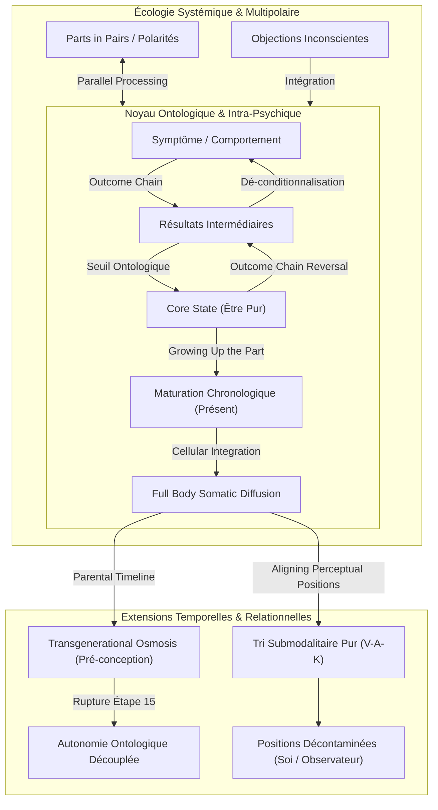

# Core Transformation - Participant Manual
**Formateur :** Connirae Andreas | **ID :** `connirae-andreas-core-transformation-participant-manual` | **Tranches :** 3

## Synthèse Architecturale du Cours : *Core Transformation - Participant Manual* (Connirae Andreas)

---

### 1. Thèse Centrale & Philosophie du Cours

#### La vision spécifique de Connirae Andreas vs l'approche standard
* **Dépassement du paradigme guerrier et correctif :** Là où la PNL classique, la thérapie cognitivo-comportementale et l'hypnose traditionnelle abordent le symptôme comme un dysfonctionnement à reprogrammer, recadrer, interrompre ou contourner (*pattern interrupt*, ancrage compétitif, dissociation), Connirae Andreas pose un axiome de **téléologie ontologique radicale** : *toute manifestation symptomatique (compulsion, anxiété, sabotage, colère) est l'expression d'une tentative adaptative archaïque visant un état d'être fondamental (Core State : Paix, Présence, Amour, Complétude).*
* **Inversion ontologique (du "Faire/Avoir" vers l'"Être") :** La névrose humaine repose sur l'illusion d'une causalité linéaire externe (*« Si j'obtiens X [contrôle, approbation, argent], alors je pourrai ressentir Y [sécurité], et enfin expérimenter Z [paix d'être] »*). L'approche standard aide souvent le sujet à mieux obtenir X ou Y. La posture de Connirae court-circuite complètement la négociation : le système est invité à contacter immédiatement l'état terminal Z comme une réalité déjà donnée (*already having*), dissolvant la nécessité biologique et psychique du comportement initial.
* **Posture du praticien :** L'accompagnant n'est ni un réparateur ni un stratège persuasif ; il agit comme un **facilitateur d'écoute écologique non-directive**. Les résistances ou objections ne sont jamais contestées : elles sont immédiatement accueillies comme d'autres parties réclamant leur propre accès à leur État Essentiel.

#### Le fil rouge méthodologique unificateur
Le fil conducteur absolu qui traverse l'intégralité du manuel (du protocole de base en 4 phases jusqu'au *Parental Timeline Reimprinting* et à l'*Aligning Perceptual Positions*) est **le principe de saturation de la structure par l'état source, suivi de son déploiement spatio-temporel et relationnel** :
1. **Élicitation ascendante (Outcome Chain) :** Remonter la hiérarchie des intentions positives jusqu'à l'effondrement dans l'État Essentiel.
2. **Inversion & Inondation descendante (Outcome Chain Reversal) :** Réinjecter cet état d'être dans chaque maillon intermédiaire pour déconditionnaliser le système.
3. **Mise à niveau neuro-développementale (Growing Up the Part) :** Faire mûrir la partie dissociée de son âge de fixation jusqu'à l'âge présent, baignée dans la ressource.
4. **Intégration holographique et transgénérationnelle :** Diffuser la ressource dans le soma cellulaire, réimprimer la lignée ancestrale avant la conception, et purifier le système perceptuel (Moi / Autre / Observateur) pour éliminer toute contamination cognitive et sensorielle.

---

### 2. Carte des Concepts & Leviers Émergents

#### A. Architecture Intra-Psychique & Somatique
* **Outcome Chain (Chaîne de Résultats) :** Vecteur téléologique vertical permettant d'extraire, par questionnement itératif en miroir (*« Si tu as déjà pleinement [résultat N], que veux-tu de plus profond à travers cela ? »*), la hiérarchie motivationnelle jusqu'au point d'arrêt ontologique (*Core State*).
* **Core State (État Essentiel) :** État d'être pur, intemporel, auto-suffisant et non-duel (*Peace, Beingness, Wholeness, Love, Presence*). Rôle : attracteur étrange du système nerveux qui neutralise instantanément la neuro-ception de manque ou de menace.
* **Outcome Chain Reversal (Inversion de Chaîne) :** Rétroaction descendante saturant chaque intention intermédiaire avec la signature somatosensorielle du Core State. Rôle : dé-conditionnalisation et effondrement de l'illusion de causalité externe.
* **Growing Up the Part (Maturation Rétroactive de la Partie) :** Processus de ré-encodage neuro-développemental faisant traverser le temps à la partie enkystée (de son âge de fixation traumatique jusqu'à l'âge présent) tout en la maintenant imprégnée de son Core State. Rôle : résorption des fixations régressives et réassignation des ressources adultes.
* **Full Body Cellular Integration (Intégration Cellulaire Holographique) :** Rapatriement de la partie de son espace projectif externe/local vers l'ensemble du soma, distribuant le Core State à chaque cellule, tissu et terminaison nerveuse. Rôle : décompartimentation définitive et encrage proprioceptif global.

#### B. Écologie Systémique & Polarités
* **Parts in Pairs & Parallel Processing (Paires de Parties & Traitement Parallèle) :** Cartographie et alignement simultané des polarités psychiques conflictuelles (ex. la partie compulsive et la partie juge/restrictive). Rôle : désactivation des boucles homéostatiques d'oscillation névrotique.
* **Objection Utilization (Utilisation Écologique des Objections) :** Accueil inconditionnel de toute résistance ou sursaut critique comme une partie alliée requérant son propre protocole. Rôle : garantie de fluidité sans forçage psychique.

#### C. Lignée Transgénérationnelle & Modélisation Relationnelle
* **Transgenerational Osmosis (Osmose Transgénérationnelle) :** Projection temporelle en amont de la conception des parents (lignée des grands-parents) saturée d'États Essentiels, descendant à travers le stade zygote unicellulaire. Rôle : reprogrammation pré-verbale et épigénétique de la matrice d'attachement précoce.
* **Environmental Decoupling (Découplage Environnemental / Autonomie Ontologique) :** Mécanisme d'immunisation psychique où le sujet affronte les parents historiques avec leurs manquements réels tout en conservant le jaillissement autonome de son Core State. Rôle : fin de la dépendance affective et de la réactivité au milieu.
* **Submodal Sorting & Perceptual Decontamination (Tri Submodalitaire et Décontamination Perceptive) :** Audit et alignement chirurgical des canaux V-A-K dans chaque position relationnelle (Soi, Autre, Observateur). Rôle : abolition des introjections projectives, restauration des frontières somatiques saines et neutralité méta-cognitive absolue.

---

### 3. Tableau Récapitulatif des Techniques & Démonstrations

| Technique / Exercice | Objectif Opératoire | Déclencheur / Indication | Séquence Résumée |
|---|---|---|---|
| **Core Transformation (Phases 1 à 4 : Protocole Racine)** | Dissoudre les symptômes réactifs et actualiser le sous-système psychique au présent via un état d'être pur. | Compulsions, conflits internes, autosabotage, anxiété réactionnelle, blocages émotionnels circonscrits. | **1.** Localisation somatique de la partie & accueil bienveillant. **2.** *Outcome Chain* ascendante jusqu'à l'émergence du *Core State*. **3.** *Outcome Chain Reversal* (descente et inondation des résultats intermédiaires). **4.** *Growing Up the Part* (maturation chronologique jusqu'au présent avec le Core State). **5.** Rapatriement corporel et diffusion cellulaire holographique (*Full Body*). **6.** Pont vers le futur dans le contexte déclencheur initial. |
| **All Parts Parallel Processing (Alignement Matriciel Multipartite)** | Résoudre les conflits de réseau ou les oscillations de polarité entre plusieurs parties en lutte. | Blocages persistants avec boucles d'auto-punition, polarités symptomatiques (ex. anorexie/boulimie, proactivité/procrastination). | **1.** Identification et cartographie des sous-parties en jeu (Part 1, Part 2, Part 3...). **2.** Déroulement de la chaîne d'intentions positives en parallèle sur la grille (*All Parts Worksheet*). **3.** Identification des *Core States* respectifs. **4.** Maturation et intégration temporelle conjointe de toutes les parties. **5.** Effondrement de la polarité par convergence et harmonisation systémique globale. |
| **Objection Integration Flow (Assimilation Écologique des Résistances)** | Intégrer une objection inconsciente surgissant au cours d'un protocole sans interrompre la dynamique. | Sensation de blocage, doute interne, voix critique ou tension somatique survenant pendant le guidage. | **1.** Arrêt immédiat de la progression sur la partie en cours. **2.** Reconnaissance et validation directe de la partie qui objecte (*« Merci d'être là pour veiller à la sécurité »*). **3.** Guidage express de la partie objectante via l'*Outcome Chain* jusqu'à son propre *Core State*. **4.** Vérification de son accord pour reprendre le travail initial enrichi de cette ressource. **5.** Reprise fluide du protocole initial. |
| **Parental Timeline Reimprinting (Phase 5 de Core Transformation)** | Guérir les blessures de développement précoces, les carences d'attachement et les loyautés familiales inconscientes. | Problématiques identitaires profondes, sentiment de vide fondamental, rejet parental intériorisé, schémas transgénérationnels répétitifs. | **1.** Élicitation des *Core States* nécessaires pour chaque parent. **2.** Régression sur la ligne temporelle ancestrale jusqu'avant la conception parentale (grands-parents). **3.** Imprégnation des parents avec leurs *Core States* dès leur conception. **4.** Ré-expérimentation de sa propre conception, gestation et naissance par osmose cellulaire. **5.** Répétition avec l'autre parent, puis avec les deux parents réunis. **6.** *Étape 15 (Rupture/Découplage)* : confrontation finale aux parents d'origine avec leurs comportements réels imparfaits, pendant que le *Core State* jaillit de façon 100% autonome depuis l'intérieur du sujet. |
| **Aligning Perceptual Positions (APP : Tri et Calibrage Sensoriel)** | Éliminer la codépendance, la fusion émotionnelle et les distorsions projectives dans les interactions interpersonnelles. | Conflits de couple/professionnels chroniques, anxiété sociale, culpabilité excessive, incapacité à poser des limites ou perte de centrage en présence d'autrui. | **1.** Délimitation spatiale physique au sol de 3 positions : Soi (1), Autre (2), Observateur (3). **2.** *Audit de l'Observateur (3)* : séparation stricte V-A-K (hauteur équidistante, voix neutre à la 3e personne, kinesthésique neutre sans émotion viscérale). **3.** *Audit et Nettoyage de la Position Autre (2)* : exploration temporaire des critères de l'autre sans introjection. **4.** *Restauration et Centrage en Position Soi (1)* : association totale dans les yeux réels, oreilles orientées depuis son propre centre, voix interne en gorge/poitrine au « Je », restitution somatique de ce qui appartient à autrui. **5.** Test kinesthésique de congruence et écologie relationnelle stabilisée. |

---

## Extractions Détaillées par Tranche (Opératoire & Verbatim)

## --- Tranche 1 / 3 ---

### 1. Mécanismes & Principes Actifs

#### A. Le Principe de Téléologie Ontologique et l'Intention Positive Radicale
* **Nom du levier :** *The Positive Intention Hierarchy & Core State Emergence*
* **Tags :** `#teleologie_inconsciente #intention_positive_radicale #etats_detre #outcome_chain #shift_ontologique`
* **Principe actif :** Dans la vision de Connirae Andreas, aucune partie du système psychologique n'est défaillante, malveillante ou à éliminer. Même les compulsions, sabotages ou émotions invalidantes constituent des stratégies comportementales archaïques visant un état d'être fondamental (*Core State*). Le système nerveux organise ses apprentissages sous forme d'une chaîne causale descendante : un comportement indésirable cherche un résultat intermédiaire superficiel (ex. approbation, contrôle), qui lui-même cherche un résultat plus profond (sécurité), jusqu'à déboucher sur un état d'être pur (*Beingness, Inner Peace, Wholeness, Love*). Tant que la partie croit que cet état dépend d'une condition extérieure, elle génère des boucles de tension. Dès que l'état d'être est contacté directement sans condition préalable, la dynamique symptomatique s'effondre d'elle-même.

#### B. La Dé-conditionnalisation Éprouvée (Outcome Chain Reversal)
* **Nom du levier :** *Outcome Chain Reversal*
* **Tags :** `#retroaction_ontologique #deconditionnalisation #rayonnement_somatique #effondrement_d_ancrage #saturation_de_ressource`
* **Principe actif :** La névrose repose sur l'illusion d'une causalité linéaire : *"Je dois obtenir X pour ressentir enfin Y"*. Le renversement de la chaîne consiste à installer immédiatement le sujet dans le *Core State* en tant que réalité présente (« already having »), puis à faire descendre cette plénitude à travers chaque maillon intermédiaire jusqu'au symptôme initial. Sur le plan neurologique, cela sature le réseau associatif du problème avec la signature somatosensorielle de la ressource ultime, dissolvant l'illusion de carence qui alimentait le comportement réactionnel.

#### C. L'Évolution Temporelle Somato-Développementale (Growing Up the Part)
* **Nom du levier :** *Growing Up the Part & Cellular Integration*
* **Tags :** `#reencodage_neurodeveloppemental #actualisation_chronologique #integration_cellulaire #recodage_somatique`
* **Principe actif :** Une part symptomatique est presque toujours dissociée et fixée à l'âge du traumatisme ou de l'apprentissage initial (souvent l'enfance). Elle opère donc avec les ressources cognitives et perceptuelles limitées de cet âge. En lui faisant d'abord goûter au *Core State* à son âge d'origine, puis en la faisant traverser le temps jusqu'au présent tout en intégrant les apprentissages accumulés, le praticien permet une maturation accélérée du sous-système neural. Le rapatriement spatial de la partie (de l'extérieur vers l'intérieur du corps) et sa diffusion cellulaire complètent la réintégration dans le schéma corporel global.

#### D. L'Écologie Systémique des Parties En Conflit et Oppositions
* **Nom du levier :** *Parts in Pairs & Objection Utilization*
* **Tags :** `#polarites_systemiques #utilisation_des_objections #homéostasie_psychique #parts_in_pairs #securite_ecologique`
* **Principe actif :** Toute tentative de transformer une partie sans écouter son opposée polaire (ex. compulsion alimentaire vs rigidité diététique) ou sans intégrer une objection inconsciente déclenche un contre-sabotage homéostatique. Connirae Andreas postule que l'objection n'est pas une résistance, mais simplement une autre partie qui demande à vivre son propre processus de Transformation Essentielle. Le protocole traite chaque composante avec la même dignité opératoire.

---

### 2. Protocoles, Techniques & Démonstrations (Étape par Étape)

#### PROTOCOLE COMPLET : CORE TRANSFORMATION (PHASES 1 À 4)

##### Intention / Indication
Transformer tout comportement indésirable, dépendance, conflit intérieur, blocage émotionnel, distorsion de l'image de soi ou trouble relationnel en remontant jusqu'à sa source spirituelle/ontologique (*Core State*), puis réencoder le vécu passé et futur.

##### Mise en place & Pré-framing
* **Exploration ciblée :** Le sujet identifie un comportement, sentiment ou pensée spécifique via le questionnaire ou la feuille de travail.
* **Posture du guide :** Rythme lent, intonation neutre et bienveillante, accueil absolu de toutes les manifestations inconscientes. Pré-cadrer que la partie a une intention positive, même si elle est encore inconnue.

---

##### Séquence d'actions pas à pas

###### PHASE 1 : Élicitation de la Chaîne d'Objectifs (Outcome Chain)
1. **Identification du symptôme et du contexte :**  
   Demander : *« Quel sentiment, comportement ou pensée veux-tu changer ? Où, quand et avec qui as-tu ce [____] ? »* Noter les mots exacts.
2. **Accessing / Régression sensorielle :**  
   Inviter le sujet à fermer les yeux, à se relaxer et à revivre un événement spécifique où la réponse s'est produite (voir ce qu'il voyait, entendre ce qu'il entendait, ressentir ce qu'il ressentait). Préciser que puisqu'il ne l'a pas générée consciemment, c'est comme si une partie de lui l'avait créée.
3. **Localisation somatosensorielle / spatiale :**  
   Demander où cette partie semble « vivre » (dans le corps ou autour du corps). Noter l'emplacement précis.
4. **Gratitude & Alliance inconsciente :**  
   Remercier la partie d'être là, en se basant sur la confiance qu'elle possède une intention positive pour le sujet.
5. **Élicitation du 1er résultat intermédiaire :**  
   Demander à la partie : *« Que veux-tu ? »* Se détendre et attendre la réponse spontanée. Noter le premier objectif voulu (*Intended Outcome 1*). Remercier la partie.
6. **Montée dans la chaîne (Itération) :**  
   Inviter la partie à entrer/respirer dans l'expérience d'avoir déjà pleinement cet objectif.  
   Puis poser la question levier : *« Quand tu as déjà [Objectif N], que veux-tu, à travers le fait d'avoir [Objectif N], qui soit encore plus profond ou plus important ? »*  
   Remercier la partie et répéter jusqu'à émergence d'un état d'être pur.
7. **Validation du Core State :**  
   Demander : *« Y a-t-il quelque chose d'encore plus profond ou plus essentiel que tu veux à travers le fait d'avoir [Core State présumé] ? »*  
   *Si le sujet ne peut pas aller plus loin ou décrit uniquement des conséquences sur sa vie, le Core State est atteint.*

###### PHASE 2 : Renversement de la Chaîne d'Objectifs (Outcome Chain Reversal)
1. **Recadrage fondamental :**  
   Expliquer à la partie que chercher à obtenir des choses extérieures pour ressentir un *Core State* fonctionne mal, et que la seule façon de le vivre est simplement d'y entrer et de l'avoir maintenant.
2. **Accès global :**  
   Inviter la partie à entrer pleinement dans son *Core State* de manière continue, et observer comment cela change les choses de manière globale.
3. **Descente récursive :**  
   Prendre la liste des objectifs intermédiaires en partant du plus proche du *Core State* jusqu'au premier, et demander pour chacun :  
   *« Comment le fait d'avoir déjà [Core State] comme manière d'être rayonne, transforme ou enrichit [Objectif intermédiaire N] ? »*
4. **Transformation du contexte déclencheur :**  
   Demander : *« Comment le fait d'avoir déjà [Core State] transforme ou enrichit les situations où tu avais l'habitude de [Comportement initial] ? »*
5. **Pont vers le futur :**  
   Inviter la partie à emmener le *Core State* dans les situations futures.

###### PHASE 3 : Évolution Temporelle de la Partie (Growing Up the Part)
1. **Détection de l'âge :**  
   Expliquer que les parties sont souvent plus jeunes et n'ont pas bénéficié de l'expérience accumulée. Demander à la partie : *« Quel âge as-tu ? »* Noter l'âge.
2. **Accord d'évolution :**  
   Demander à la partie si elle veut rendre son rôle plus facile en bénéficiant de son évolution dans le temps. Attendre un "Oui" franc.
3. **Actualisation chronologique :**  
   Inviter la partie à avoir son *Core State* pleinement présent à son âge d'origine, puis à évoluer vers le présent le long de la ligne du temps en laissant le *Core State* rayonner à travers chaque expérience de vie, en apprenant et en transformant tout sur son passage. Demander un signal idéomoteur (hochement de tête) une fois arrivée à l'âge actuel.
4. **Réintégration spatiale et corporelle :**  
   Vérifier où se situe la partie. Si elle est à l'extérieur, l'inviter à entrer dans le corps avec son *Core State*.
5. **Diffusion cellulaire :**  
   Laisser la sensation du *Core State* se diffuser dans chaque cellule du corps, s'inscrire dans le codage émotionnel et fusionner avec le cœur de l'être.
6. **Répétition du renversement avec la partie actualisée :**  
   Remarquer ce que cela change d'avoir le *Core State* incarné dans tout le corps par rapport à chaque objectif intermédiaire.
7. **Génération de comportements nouveaux :**  
   Projeter le *Core State* dans le futur et identifier les nouveaux comportements spontanés qui en découlent.

###### PHASE 4 : Intégration Systémique & Ligne du Temps Globale
1. **Traitement de toutes les parties impliquées :**  
   Répéter les phases 1 à 3 pour les parties en polarité (*Parts in Pairs*), les parties objectrices (*Objecting Parts*) ou interférentes (*Interfering Parts*).
2. **Check écologique final :**  
   Demander à l'intérieur : *« Y a-t-il une autre partie concernée par ce thème ? »* puis *« Y a-t-il une partie qui s'oppose à ce que j'aie [Core State] de façon continue ? »* Traiter immédiatement toute émergence.
3. **Flottement sur la ligne du temps (Timeline Integration) :**  
   Visualiser le passé derrière soi et le futur devant soi. Flotter au-dessus de sa ligne du temps avec les *Core States* de toutes les parties. Retourner à la conception. Faire descendre les *Core States* dans la conception, la naissance, toute l'enfance jusqu'au présent, puis projeter cette intégration dans tout le futur avant de réorienter au présent.

---

##### Signes de calibration
* **Atteinte d'un véritable Core State :** Déplacement radical de la physiologie : relâchement musculaire massif, décoloration ou flushing de la peau, respiration profonde abdominale, ralentissement du débit vocal, yeux fixes ou mouvements oculaires de transe profonde, expression faciale de plénitude ou d'immobilité sereine.
* **Résistance ou Blocage :** Tensions oculaires, accélération du débit verbal, réponses intellectualisées (« je pense que... »), sensation corporelle d'obstruction, refus d'évoluer en âge.

---

### 3. Heuristiques, Subtilités & "Sagesse du Praticien"

#### Règles Opératoires Conditionnelles (If / Then)

* **SI** la réponse à l'étape 7 est une émotion spécifique (ex. *confiance*, *fierté*, *espoir*), une relation avec autrui (*« être aimé des autres »*), ou une action (*« réussir »*),  
  **ALORS** ce n'est **PAS** un *Core State*.  
  **PARCE QUE** un *Core State* est un état d'être ontologique absolu, autonome et non-réflexif (ex. *Peace*, *Beingness*, *OK-ness*). Continuer à monter dans la chaîne : *« Quand tu as pleinement cela, que veux-tu de plus profond ? »*

* **SI** l'objectif intermédiaire est précieux en lui-même (ex. *motivation*, *estime de soi*),  
  **ALORS** adapter l'injonction de renversement : *« Comment le fait d'avoir déjà [Core State] rend-il plus facile d'avoir [Objectif] ? / l'enrichit-il ? »*

* **SI** l'objectif intermédiaire dépend d'autrui (ex. *approbation des autres*),  
  **ALORS** poser le double ancrage : *« Comment le fait d'avoir déjà [Core State] change ton expérience quand tu reçois cette approbation ? ... Et comment cela change ton expérience quand tu ne la reçois PAS ? »*  
  **PARCE QUE** le sujet doit réaliser que son état fondamental ne dépend plus de la validation extérieure.

* **SI** l'objectif intermédiaire est inadapté ou néfaste (ex. *se venger*, *être parfait*),  
  **ALORS** demander : *« Comment le fait d'avoir déjà [Core State] transforme-t-il tout ce domaine de [Objectif néfaste] ? »*  
  **PARCE QUE** confronter directement l'objectif génère une résistance ; le dissoudre dans l'état d'être supérieur le rend obsolète.

* **SI** l'objectif intermédiaire touche à la sécurité physique réelle,  
  **ALORS** demander : *« Comment le fait d'avoir déjà [Core State] t'aide-t-il réellement à te maintenir physiquement plus en sécurité ? »*  
  **PARCE QUE** le cerveau reptilien a besoin de valider que la détente intérieure ne compromet pas sa vigilance vitale.

* **SI** le sujet tente de mentaliser ou d'anticiper logiquement les réponses de la partie (*« Je me demande si c'est... »*),  
  **ALORS** interrompre l'exercice principal et traiter immédiatement la partie intellectualisante (*The part that wants to figure it out*).  
  **PARCE QUE** l'ego conscient ne peut pas fabriquer l'émergence inconsciente d'un *Core State*.

* **SI** une objection émerge (inconfort physique, blocage de la diffusion, voix intérieure critique),  
  **ALORS** stopper la progression, remercier chaleureusement l'objection, et demander à l'inconscient quelle partie il est plus facile de traiter en premier.

---

### 4. Pépites Verbatim & Patterns Linguistiques (MOT À MOT EN V.O.)

#### Pépite 1 : La Présupposition d'Autonomie de la Partie
> **Verbatim :**  
> *"Take a moment to relax and turn inward… Think about a specific time that [____] occurred… Mentally step into the situation, seeing what you saw, hearing what you heard, feeling what you felt at the time… As you relive this experience, notice your internal images, sounds and/or feelings… Since you didn’t consciously generate [____], it’s as if some part of you generated it. You may begin to sense this part of you, in your body or around you. Where do you sense this part ‘lives’?"*

* **[Analyse du Pattern]** :  
  * **Fractionnement et induction sensorielle VAK :** L'empilement des prédicats sensoriels (*seeing what you saw, hearing what you heard, feeling what you felt*) réactive instantanément l'engramme somatique de la scène.
  * **Dissociation logique par truisme :** La formule *"Since you didn’t consciously generate [____], it’s as if some part of you generated it"* agit comme un piège logique imparable. L'intellect conscient est obligé d'admettre qu'il n'a pas voulu consciemment le symptôme, ce qui valide immédiatement l'existence d'une sous-partie inconsciente.
  * **Présupposition d'existence spatiale :** En demandant directement *"Where do you sense this part 'lives'?"*, la question présuppose que la partie existe déjà et qu'elle a déjà une coordonnée spatiale définie, forçant l'esprit à localiser somatiquement la structure du problème.

---

#### Pépite 2 : L'Élicitation Téléologique du Core State
> **Verbatim :**  
> *"Invite this part to step (or breathe) into what it is like to already have [____]… fully and completely. Ask this part of you, ‘When you have [____], what do you want, through having [____], that’s even deeper or more important?’"*

* **[Analyse du Pattern]** :  
  * **Ancrage somato-respiratoire :** L'utilisation conjointe de *"step (or breathe) into"* court-circuite la conceptualisation abstraite en liant l'accès à la ressource à un geste kinesthésique ou respiratoire direct.
  * **Présupposition temporelle d'accomplissement :** La formulation *"to already have [____]… fully and completely"* installe le sujet dans un futur antérieur où le désir est déjà assouvi, libérant le système nerveux de la tension de manque.
  * **Levier de transcendance (« through having ») :** La structure syntaxique *"When you have X, what do you want, through having X, that's even deeper or more important?"* utilise le premier objectif non comme une fin, mais comme un pont transitoire. Les adjectifs comparatifs de profondeur (*deeper*, *more important*) réorientent l'attention de l'inconscient vers des niveaux logiques supérieurs (passage des comportements/capacités aux valeurs et à l'identité).

---

#### Pépite 3 : Le Recadrage Métacognitif de l'Accès Direct
> **Verbatim :**  
> *"Somehow our inner parts get the idea that in order to experience Core States such as [____], we have to first do certain things and get certain things. Unfortunately, this doesn’t work very well. We don’t get to experience our Core States very often when we go about it that way. The way to experience a Core State is just to step into it and have it."*

* **[Analyse du Pattern]** :  
  * **Défocalisation déculpabilisante (*Depersonalized Normalization*) :** L'usage de *"Somehow our inner parts get the idea"* déresponsabilise le sujet conscient et normalise l'erreur cognitive sans jugement moral.
  * **Rupture de conditionnalité (*Double Bind Dissolution*) :** Connirae Andreas brise l'équation névrotique moderne (Faire -> Avoir -> Être) en affirmant qu'elle ne fonctionne pas.
  * **Suggestion directe autoréférentielle :** *"The way to experience a Core State is just to step into it and have it."* L'emploi du mot *"just"* réduit drastiquement la complexité psychologique perçue. C'est une commande directe déguisée en truisme, ordonnant au système nerveux d'accéder à l'état sans passer par une justification comportementale préalable.

---

#### Pépite 4 : L'Actualisation Chronologique et Somatique
> **Verbatim :**  
> *"So now invite this part of you to begin by having [____] fully present at its age, … and then invite this part to evolve forward through time letting [____] radiate through all your experience, all the way up to your current age. As it does this, it will learn from each of your experiences, and each of your experiences will be transformed and enriched with [____]… Now, just let the sense of [____] spread into every cell of your body, becoming a part of your emotional coding. This [____] is now available to all of you."*

* **[Analyse du Pattern]** :  
  * **Liaison temporelle continue (*Temporal Flow Pacing*) :** L'utilisation de participes présents (*letting radiate, evolving forward*) induit une cinétique fluide et ininterrompue de transformation sur la ligne du temps.
  * **Double boucle d'enrichissement :** L'imbrication syntaxique *"It will learn from each of your experiences, and each of your experiences will be transformed and enriched with [Core State]"* crée un enrichissement mutuel bidirectionnel : le passé nourrit la maturité de la partie, tandis que le *Core State* nettoie les charges émotionnelles des événements vécus.
  * **Suggestion d'intégration somato-génétique :** L'expression *"spread into every cell of your body, becoming a part of your emotional coding"* déplace le travail du champ purement mental vers le plan biologique et cellulaire, créant une incorporation neurologique irréversible (*embodiment*).

## --- Tranche 2 / 3 ---

Voici l'extraction et la modélisation intégrale de la substance opératoire de cette tranche 2/3 du *Participant Manual* de Connirae Andreas.

---

### 1. Mécanismes & Principes Actifs

#### A. Ré-imprégnation Transgénérationnelle par Osmose Épigénétique et Écologique
- **Principe actif** : Le cerveau humain encode les modèles relationnels précoces, les croyances identitaires et le sentiment fondamental de sécurité à partir de la matrice familiale. En remontant sur la ligne du temps *avant la conception* des parents (jusqu'aux grands-parents) pour saturer cet espace source avec les *Core States* (États Essentiels), le protocole désamorce les fidélités inconscientes et les blessures de développement transmises de génération en génération. L'inconscient n'ayant pas besoin de vérité historique mais de cohérence symbolique, l'absorption « par osmose » à l'état unicellulaire (stade zygote, 2 cellules, 4 cellules) réinitialise la neuro-ception de sécurité avant même la différenciation des organes et du cortex.
- **Tags libres** : `#parental_timeline_reimprinting` `#transgenerational_osmosis` `#cellular_imprinting` `#epigenetic_somatic_anchor` `#pre_conception_clearing`

#### B. Découplage de la Ressource et Internalisation Radicale (Autonomie Ontologique)
- **Principe actif** : Lors de la première passe, le sujet fait l'expérience de parents ressources qui « soutiennent » son État Essentiel. Lors de la boucle d'ancrage finale (Étape 15), Connirae impose une rupture neuro-fonctionnelle critique : les parents réapparaissent avec leurs comportements limitants historiques d'origine, mais l'État Essentiel jaillit désormais de l'intérieur du sujet. Ce mécanisme immunise le système nerveux contre la dépendance à l'environnement extérieur : la ressource cesse d'être une réaction à la validation parentale pour devenir une propriété constitutive du Soi.
- **Tags libres** : `#autonomous_core_state` `#environmental_decoupling` `#immune_self_regulation` `#retroactive_resilience`

#### C. Tri Submodalitaire Pur et Alignement des Positions Perceptuelles (APP)
- **Principe actif** : La majorité des conflits interpersonnels, du stress relationnel et de la codépendance provient d'une « contamination » des positions perceptuelles (ex. : être physiquement en Soi mais regarder à travers les yeux de l'Autre, ou être en Observateur tout en ressentant physiquement les émotions viscérales de l'une des deux parties). En nettoyant strictement chaque modalité (V-A-K) :
  - **Visuel** : point de vue exactement situé à l'intérieur des globes oculaires physiques ; hauteur des yeux ; équidistance de l'Observateur.
  - **Auditif** : point d'écoute localisé dans les conduits auditifs réels ; voix interne prenant naissance dans la gorge/poitrine et employant la grammaire pronominale exacte (« Je / Tu » en Soi ; « Il / Elle / Ils » en Observateur).
  - **Kinesthésique** : restitution des sensations/émotions projetées ou introjectées (« renvoyer ce qui appartient à l'autre ») et centrage somatique du centre de gravité.
  Ce tri submodalitaire rétablit la proprioception, la neutralité du système nerveux autonome (vague ventral) et l'intégrité des frontières du Moi.
- **Tags libres** : `#aligning_perceptual_positions` `#submodal_sorting` `#pronominal_syntax_alignment` `#somatic_center_of_gravity` `#somatic_boundary_restoration`

---

### 2. Protocoles, Techniques & Démonstrations (Étape par Étape)

---

#### PROTOCOLE 1 : Parental Timeline Reimprinting (Phase 5 de Core Transformation)

* **Intention / Indication** :
  À utiliser systématiquement après avoir identifié les *Core States* d'une ou plusieurs parties dans le processus de *Core Transformation*. Indiqué pour guérir les traumatismes d'attachement, les manques fondamentaux de l'enfance, les dynamiques transgénérationnelles et pour saturer l'identité corporelle globale de la ressource.
* **Mise en place & Pré-framing** :
  - Noter par écrit les *Core States* obtenus lors de la chaîne de résultats.
  - S'assurer d'un espace physique suffisant au sol pour marcher le long de la ligne du temps (possibilité de la condenser spatialement).
  - Le praticien marche **À CÔTÉ** de la ligne du temps, jamais dessus, et laisse l'explorateur localiser lui-même le point de conception.
* **Séquence d'actions pas à pas** :
  1. *Élicitation des États Essentiels & Déploiement spatial* :
     - Demander les *Core States*. Inviter le sujet à repérer son passé, présent et futur et à poser sa ligne au sol. Attendre le signe de tête (nod).
  2. *Marche jusqu'à l'avant-conception* :
     - Marcher à côté de la ligne jusqu'au point précédant immédiatement la conception. Faire entrer le sujet dans cet instant, tourné vers son passé.
  3. *Cartographie parentale* :
     - Identifier deux lignes du temps (mère et père) s'étendant dans le passé. Déterminer quel côté est la mère, quel côté est le père, et choisir à qui envoyer les États Essentiels en premier.
  4. *Régression aux grands-parents* :
     - Regarder la ligne du parent choisi jusqu'à l'instant précédant sa conception. Voir les grands-parents. Estimer leur âge (invention libre acceptée par l'inconscient).
  5. *Saturation des grands-parents* :
     - Envoyer les *Core States* aux grands-parents jusqu'à ce qu'ils en soient intégralement remplis.
  6. *Conception et croissance du parent par osmose* :
     - Imaginer le parent conçu dans cet environnement d'amour et de soutien, absorbant les *Core States* par simple osmose. Le voir grandir jusqu'à l'âge de concevoir l'explorateur.
  7. *Répétition pour le second parent* :
     - Répéter les étapes 4 à 6 pour l'autre parent. Vérifier que les deux parents sont pleins de l'État Essentiel.
  8. *Conception de l'explorateur* :
     - Faire pivoter le sujet pour qu'il entre dans le moment de sa propre conception, baigné dans les *Core States*.
  9. *Division cellulaire et amplification somatique* :
     - Le sujet est une cellule unique absorbant l'état par osmose. À 2 cellules, l'état double. À 4 cellules, il quadruple. La ressource se développe au rythme de la morphogenèse.
  10. *Naissance et ligne de vie* :
      - Faire un demi-pas en avant vers la naissance. Être accueilli par des parents remplis de l'état.
      - Remonter la ligne du temps jusqu'au présent, à son propre rythme (lent ou rapide), en marchant à côté du sujet. L'état transforme chaque expérience passée.
  11. *Pont vers le futur* :
      - Au présent, observer le futur qui s'illumine et s'intègre avec ces états pleinement accessibles.
  12. *Boucle de verrouillage (Lock-in) en autonomie interne (Étape 15)* :
      - Sortir de la ligne, revenir à pied à côté jusqu'à l'avant-conception.
      - Ré-entrer dans la conception et remonter rapidement toute la ligne jusqu'au présent : **cette fois-ci, l'État Essentiel émane de l'intérieur de soi**, tandis que les parents réadoptent leurs comportements réels historiques.
      - Projeter cette autonomie inconditionnelle dans le futur.
* **Signes de calibration** :
  - Ralentissement et approfondissement du rythme respiratoire pendant l'absorption cellulaire.
  - Déglutition spontanée, lissage des traits du visage et décoloration/recoloration cutanée (activation parasympathique).
  - Vitesse de marche le long de la ligne : ne pas forcer le rythme, respecter les pauses d'intégration inconsciente.

---

#### PROTOCOLE 2 : Alignement de la Position Observateur (APP - Exercice 1)

* **Intention / Indication** :
  Situation de difficulté interpersonnelle modérée. Nettoyer la contamination de l'Observateur (jugements partiaux, émotions parasites, vision biaisée) pour accéder à une méta-position de sagesse, neutralité et compassion.
* **Mise en place & Pré-framing** :
  - Sélectionner une situation conflictuelle impliquant deux personnes (Soi et l'Autre). Rejouer la scène brièvement.
  - Établir le rapport. Consigner les réponses sur la feuille de travail.
* **Séquence d'actions pas à pas** :
  1. *Exploration submodalitaire de l'Observateur* :
     - **V** : Vérifier si le sujet voit les deux protagonistes de l'extérieur. Calibrer la symétrie, l'équidistance, le niveau des yeux (plongée/contre-plongée) et la netteté. Vérifier si le regard part bien des yeux physiques.
     - **A (Externe)** : D'où proviennent les voix ? Où se situe le « point d'écoute » ?
     - **A (Interne)** : Présence d'une voix de commentaire ? Emplacement ? Quels pronoms sont utilisés (« il », « elle », « je », « tu ») ? Est-ce la voix du sujet ou celle d'un tiers ?
     - **K** : Nature des émotions, localisation, centrage ou décentrage corporel. Identifier si des sensations appartiennent aux protagonistes observés. Localiser le centre de gravité somatique.
  2. *Alignement visuel* :
     - Replacer Soi et l'Autre à égale distance devant l'Observateur (utiliser des gestes si nécessaire).
     - Aligner Soi et l'Autre symétriquement (l'un à gauche, l'autre à droite) et au même niveau des yeux que l'Observateur.
     - Réintégrer le point de vue exactement à l'intérieur des yeux physiques.
  3. *Alignement auditif* :
     - Faire entendre les voix provenant précisément de Soi et de l'Autre.
     - Ramener le point d'écoute directement dans les oreilles physiques.
     - Voix interne : Si c'est sa propre voix, la ramener dans la zone de la voix (gorge/poitrine) et ajuster la grammaire avec les pronoms « il », « elle », « ils » ou les prénoms (ton neutre). Si la voix appartient à quelqu'un d'autre, réclamer ce qui appartient au sujet et renvoyer le reste à son propriétaire.
  4. *Alignement kinesthésique* :
     - Inviter l'inconscient à collecter les émotions appartenant à Soi ou à l'Autre et les renvoyer à leur source (gestes et bruitage d'ancrage somatique : « Woosh ----- »).
     - Laisser les sensations ressources neutres et bienveillantes remplir le corps.
     - Recentrer les sensations et le centre de gravité au milieu du corps.
  5. *Généralisation* :
     - Mémorisation inconsciente de l'état Observateur aligné ; propagation dans le passé et repérage des déclencheurs futurs.
* **Signes de calibration** :
  - Tonus musculaire relâché mais redressé (posture neutre, non engagée défensivement).
  - Tonalité de la voix interne rapportée : disparition de l'agressivité ou de l'anxiété, passage à une intonation calme et descriptive.

---

#### PROTOCOLE 3 : Alignement de la Position Soi (APP - Exercice 2)

* **Intention / Indication** :
  Rétablir la présence incarnée, l'affirmation saine de soi, l'accès direct à ses propres besoins et la fin de l'absorption empathique toxique ou du sentiment d'impuissance.
* **Mise en place & Pré-framing** :
  - Faire entrer l'explorateur dans son propre corps (associé en 1ère position) face à l'autre personne.
* **Séquence d'actions pas à pas** :
  1. *Exploration submodalitaire de Soi* :
     - **V** : Vérifier que le sujet ne voit QUE l'autre personne. Vérifier l'alignement du regard avec les yeux physiques et la hauteur relative.
     - **A** : Vérifier la provenance des voix externes et l'emplacement du point d'écoute. Éliciter la voix interne/commentaire, sa provenance somatique, et ses pronoms. Identifier si la voix est celle du sujet ou une introjection.
     - **K** : Décrire les sensations, vérifier le centrage, identifier si des émotions appartiennent à l'autre ou si le sujet a « cédé » ses propres ressentis. Localiser le centre de gravité.
  2. *Alignement visuel* :
     - Ancrer le regard exactement depuis l'intérieur des yeux physiques.
     - Voir l'autre personne au niveau des yeux (même si la taille réelle diffère, adopter un contact visuel d'égal à égal).
  3. *Alignement auditif* :
     - Entendre la voix de l'autre émaner de l'autre.
     - Entendre sa propre voix sortir de sa gorge et de sa poitrine.
     - Ramener le point d'écoute dans ses propres oreilles.
     - Réaligner la voix interne dans la gorge : formuler la vérité personnelle en utilisant impérativement « Je » et « Tu » (*« Je ressens, Je veux, J'ai besoin... »*). Renvoyer les voix introjectées à leurs émetteurs.
  4. *Alignement kinesthésique* :
     - Évacuation des émotions étrangères : renvoyer à l'autre ce qui lui appartient.
     - Récupération des sensations données/perdues : faire refluer ses propres ressentis dans son corps.
     - Centrage complet des sensations et du centre de gravité dans le corps physique.
  5. *Généralisation* :
     - Ancrage et projection dans le passé et le futur de la présence « Soi Propre ».
* **Signes de calibration** :
  - Voix plus grave, ancrée dans la poitrine lors des verbalisations.
  - Alignement de la colonne vertébrale, redressement de la tête, contact visuel stable et horizontal.

---

#### PROTOCOLE 4 : Intégration Dynamique des 3 Positions & Bouclage (APP - Exercice 3)

* **Intention / Indication** :
  Obtenir la fluidité perceptive totale, la flexibilité comportementale et une sagesse relationnelle complète avant de retourner dans la situation réelle.
* **Séquence d'actions pas à pas** :
  1. *Retour en Observateur* : Valider l'enrichissement de l'observation après le passage en Soi Alignée.
  2. *Passage en Position Autre (2ème position)* :
     - Glisser dans les chaussures de l'autre personne sans chercher à l'aligner.
     - Collecter l'information brute : intentions positives, croyances, peurs, vision du « vous » depuis ses yeux et ses oreilles.
  3. *Retour en Observateur* : Intégrer les données des deux parties en position méta enrichie.
  4. *Retour final en Soi (1ère position)* :
     - Importer toute la sagesse, les données et la compassion récoltées.
     - Choisir de stabiliser la position finale en Soi (ou en Observateur selon le besoin de ressource).
  5. *Généralisation & Débriefing* :
     - Parcourir le passé avec cette fluidité automatique.
     - Pont vers le futur : tester la prochaine rencontre avec la personne cible.
     - Valider les 3 questions de débriefing (différences ressenties, clarté/assertivité/compassion, effet domino sur la vie globale).

---

### 3. Heuristiques, Subtilités & "Sagesse du Praticien"

#### Heuristiques Opératoires Directes :
- **Règle de l'Âge des Grands-Parents** : *Si* le sujet ignore l'âge de ses grands-parents au moment de la conception de ses parents, *alors* autoriser l'inconscient à inventer un âge arbitraire (*« It’s OK to make up their ages »*), *parce que* l'effet neurologique d'ancrage repose sur la configuration de l'image interne et non sur l'exactitude historique.
- **Règle de Saturation Parentale** : *Si* les parents ne sont pas totalement remplis de l'État Essentiel à l'étape 9, *alors* interdiction formelle de passer à sa propre conception ; réitérer les boucles de saturation générationnelle *parce que* le fœtus ne peut absorber par osmose que ce qui déborde déjà de l'environnement d'accueil.
- **Règle d'Alignement du Regard en Présence de Différences de Taille** : *Si* dans la réalité physique l'autre personne est beaucoup plus grande ou plus petite, *alors* ne pas modifier magiquement sa taille mais ajuster le plan perceptuel interne pour ressentir le contact « d'égal à égal » (eye level), *parce que* regarder vers le haut installe une régression infantile et regarder vers le bas installe une posture de domination méprisante.
- **Règle de Correction Pronominale de la Voix Interne** :
  - *Si* la voix de commentaire en Observateur utilise « Je » ou « Tu », *alors* forcer immédiatement le recadrage vers la 3ème personne (« Il », « Elle », « Ils »), *parce que* l'usage de la 1ère personne crée une contamination kinesthésique qui détruit l'objectivité.
  - *Si* la voix interne en Soi utilise « On », « Il » ou « Tu » pour parler de ses propres besoins, *alors* exiger une reformulation stricte en *« Je ressens, Je veux, J'ai besoin »*, *parce que* l'externalisation linguistique empêche l'incarnation somatique du Moi.
- **Règle de Résistance à la Généralisation** : *Si* à la question de généralisation le sujet répond « Non » (refus d'avoir cette position disponible), *alors* cela signale impérativement que l'alignement est incomplet ou qu'une partie écologique a été heurtée ; arrêter et faire intervenir un superviseur/coach.
- **Règle d'Or de Connirae Andreas** : *« Respect your experience more than any map »* (Respecter l'expérience vécue du client plus que n'importe quelle carte théorique). Si une configuration optimale standard s'avère moins aidante pour un système particulier, revenir immédiatement à la configuration propre qui maximise sa ressource.

---

### 4. Pépites Verbatim & Patterns Linguistiques (MOT À MOT EN V.O.)

#### Pépite 1 : La Métaphore de la Multiplication Cellulaire
> “You are now just a single cell, in a universe that is filled with [____]. You can completely absorb [____] just by osmosis. When you become two cells, of course that [____] can double. When you become four cells, the [____] can quadruple. You can continue developing, as the [____] develops with you, and you continue absorbing even more from what’s all around you…”

* **[Analyse du Pattern]** :
  - **Présupposition d'évidence mathématique** (*« of course that can double »*) : l'usage de *« of course »* contourne toute analyse critique en présentant la prolifération de la ressource comme une loi biologique indiscutable.
  - **Isomorphisme somatique** : association de la division mitotique (stade zygote) à l'expansion exponentielle de l'État Essentiel, créant une réinitialisation neuro-développementale pré-verbale.
  - **Empilement de truismes et continuité temporelle** (*« as the... develops with you, and you continue... »*) : lien de cause à effet lissant la transe d'absorption somatique.

---

#### Pépite 2 : La Rupture d'Immunité et d'Autonomie Interne
> “Step off your timeline and let’s walk back beside your timeline again to the point just before your conception. … In a moment, you can step back into your conception and up through your past again, and this time, with [____] coming from inside of you, and your parents behaving the way you remember them. Do this round quickly, allowing the new connections and transformations to take place on an unconscious level, all the way up to the present.”

* **[Analyse du Pattern]** :
  - **Rupture de béquille externe et recadrage paradoxal** : réinjecter les parents dans leurs comportements pathologiques historiques tout en maintenant l'état venant de *l'intérieur*. Cela casse l'illusion que le bien-être dépend de la perfection du monde extérieur.
  - **Pression temporelle / Vitesse d'exécution** (*« Do this round quickly »*) : la rapidité sature la mémoire de travail et empêche le néocortex d'activer les schémas habituels de rumination ou de reproche, forçant le traitement direct au niveau sous-cortical et inconscient (*« on an unconscious level »*).

---

#### Pépite 3 : Décontamination Somato-Linguistique de la Voix Interne
> “Let all within this voice that is truly yours flow back into your voice area as Observer, and let whatever aspect of this voice that belongs to Self, Other, or someone else flow back to them.”

* **[Analyse du Pattern]** :
  - **Séparation spatio-acoustique et dissociation active** : utilisation du verbe d'écoulement (*« flow back »*) pour matérialiser la voix sous forme de fluide énergétique/somatique.
  - **Démêlage des introjections parentales/sociétales** : l'instruction linguistique rétablit une frontière nette entre la propriété psychique légitime (*« truly yours »*) et les impuretés projectives (*« belongs to someone else »*), coupant court aux phénomènes d'auto-critique introjectée.

---

#### Pépite 4 : L'Exorcisme Kinesthésique par Ancrage Phonétique et Gestuel
> “Invite your unconscious to gather up any feelings that belong to Self, Other, or to someone else. Invite your unconscious to let them go back to where they belong. Use gestures and sound effects if it is helpful. … ‘Woosh - - - - - -’”

* **[Analyse du Pattern]** :
  - **Double sollicitation permissive** (*« Invite your unconscious... »*) : délègue la tâche au traitement primaire sans effort conscient.
  - **Onomatopée et ancrage multimodal** (*« Woosh - - - - - - »*) : rupture du cadre rationnel par le son et le geste kinesthésique, facilitant une décharge motrice immédiate (défense somatique orientée vers l'extérieur pour évacuer les sensations parasitaires).

---

#### Pépite 5 : La Définition Opératoire du Changement Structurel
> “What you are generalizing is this way of perceiving and being present. Notice what it is like to experience the memory this way, seeing exactly from your eyes, hearing exactly through your ears, having your own voice from your voice area, having your feelings centered within your body.”

* **[Analyse du Pattern]** :
  - **Recadrage de contenu vers le processus** : Connirae rappelle que le but n'est pas d'effacer le contenu émotionnel spécifique de chaque souvenir (*« different memories will have different feelings »*), mais de stabiliser la structure de présence.
  - **Bouclage sensoriel complet (VAK)** : énumération stricte des repères proprioceptifs (*« exactly from your eyes, exactly through your ears... »*) scellant l'intégration neurologique de l'identité unifiée.

## --- Tranche 3 / 3 ---

### 1. Mécanismes & Principes Actifs

*   **Maturation Chronologique Rétroactive de la Partie (*Growing Up the Part*)**
    *   *Principe actif* : Une partie dissociée ou conflictuelle s'est généralement enkystée à un stade précis du développement neurologique et émotionnel (fixation développementale), souvent durant l'enfance ou l'adolescence, suite à une impasse adaptative. Lorsqu'une partie tente de résoudre un problème d'adulte avec les ressources, la vision du monde et la neurochimie d'un enfant de 5 ans, elle génère des comportements inadaptés ou réactifs. En faisant évoluer la partie jusqu'à l'âge chronologique actuel du sujet *tout en maintenant l'accès à son État Essentiel (Core State)*, le système nerveux reconfigure les circuits de réponse : la partie ne grandit pas dans le traumatisme, mais grandit « baignée » dans son État Essentiel. Cela libère la plasticité synaptique et met à niveau les schémas cognitivo-comportementaux face au présent.
    *   *Terme exact* : `Growing up the Part` (Phase 3, Step 2 / Step 3).
    *   *Tags libres émergents* : `#maturation_neuro_emotionnelle` `#mise_a_jour_chronologique` `#resorption_de_fixation` `#infusion_ontologique_developpementale`.

*   **Diffusion Somato-Spatiale Holographique (*Full Body Integration*)**
    *   *Principe actif* : Initialement, les parties sont localisées dans des régions spatiales ou corporelles circonscrites (gorge, poitrine, épaule gauche, hors du corps). Cette restriction spatiale maintient la compartimentation psychologique. L'étape de diffusion corporelle complète force l'intégration kinesthésique : le ressenti de l'État Essentiel et la structure mature de la partie sont étendus à chaque cellule, nerf et segment du corps. Cela empêche le système de re-compartimenter l'expérience sous forme de tension locale ou de complexe autonome.
    *   *Terme exact* : `Full Body` (Phase 3, Step 6).
    *   *Tags libres émergents* : `#expansion_somato_sensorielle` `#decompartimentation_holographique` `#ancrage_proprioceptif_global` `#integration_tissulaire`.

*   **Écologie Matricielle Multipartite (*All Parts Parallel Processing*)**
    *   *Principe actif* : Les blocages persistants ne reposent presque jamais sur une structure unilatérale, mais sur des réseaux de coalitions, d'oppositions polaires ou de dépendances mutuelles entre plusieurs sous-personnalités (ex: la partie qui procrastine, celle qui culpabilise, celle qui panique). Traiter les parties en parallèle (Part 1, Part 2, Part 3) via une grille d'alignement identique harmonise le champ relationnel intra-psychique. Dès lors que plusieurs parties convergent vers des États Essentiels respectifs et atteignent l'âge présent, les boucles de rétroaction conflictuelles s'annulent d'elles-mêmes par effondrement de la polarité.
    *   *Terme exact* : `All Parts Worksheet` (Part 1, Part 2, Part 3).
    *   *Tags libres émergents* : `#homogeneisation_systemique` `#desactivation_de_boucles_polaires` `#alignement_matriciel_interne`.

*   **Décontamination et Calibrage Sensoriel des Positions Perceptuelles (*Aligning Perceptual Positions*)**
    *   *Principe actif* : Les distorsions relationnelles et les charges émotionnelles résultent presque systématiquement d'un "mélange" ou d'une contamination des positions perceptuelles (être dans l'Observateur tout en ressentant la colère du Soi, ou être dans le Soi tout en voyant son propre corps de l'extérieur, ou entendre la voix d'un tiers dans sa propre tête). La méthode d'alignement de Connirae Andreas isole et audite rigoureusement les sous-modalités sensorielles (V-A-K externe et interne) dans chaque position (`Observer Position`, `Self Position`). 
        *   Dans l'**Observateur** : l'audit sépare les stimuli externes réels, les voix internes (tonalité, distance) et les sensations corporelles pour garantir une méta-position pure, non contaminée, équanime et kinesthésiquement neutre.
        *   Dans le **Soi** : l'audit ré-associe l'individu dans ses propres yeux (vision 100% associée), ses propres oreilles (bruits extérieurs perçus depuis le centre de gravité sensoriel, dialogue interne aligné) et son propre corps proprioceptif complet.
    *   *Terme exact* : `Aligning Perceptual Positions` (`Observer Position`, `Self Position`).
    *   *Tags libres émergents* : `#depollution_perceptive` `#recadrage_sous_modal` `#dissociation_propre` `#reassociation_organique` `#centrage_auditif_interne`.

---

### 2. Protocoles, Techniques & Démonstrations (Étape par Étape)

#### Protocole A : Maturation et Intégration Corporelle de la Partie (*Growing Up the Part & Full Body Integration*)

*   **Intention / Indication** : À utiliser impérativement après avoir atteint l'État Essentiel (Core State) et transformé la chaîne des résultats (Outcome Chain). Indiqué lorsque la partie est bloquée dans une immaturité comportementale, des réactions puériles, ou reste localisée comme un "corps étranger" dans une zone étroite du corps.
*   **Mise en place & Pré-framing** : S'assurer que le sujet a bien reçu une réponse « non » à l'étape 9 (aucune objection, l'État Essentiel est plein et autonome). Le praticien invite le sujet à rester immergé dans le rayonnement de cet État Essentiel.
*   **Séquence d'actions pas à pas** :
    *   **Étape 1 : Diagnostic de l'âge de la partie**
        *   Demander à la partie : *"Quel âge as-tu ?"* ou inviter le sujet à observer spontanément l'âge kinesthésique/visuel de la partie (`# Age of part (Phase 3, Step 2)`).
        *   Noter l'âge exact perçu (ex: 3 ans, 8 ans, 14 ans).
    *   **Étape 2 : Maturation sous imprégnation de l'État Essentiel**
        *   Faire grandir la partie chronologiquement d'année en année jusqu'à l'âge actuel du sujet (`Current age (Phase 3, Step 3)`).
        *   La partie traverse chaque année de vie en emportant avec elle la plénitude de son État Essentiel, transformant rétroactivement la manière dont elle aurait vécu chaque étape de sa croissance.
        *   Cocher la validation dès que la partie a atteint l'âge chronologique actuel.
    *   **Étape 3 : Expansion corporelle totale (*Full Body Integration*)**
        *   Inviter la partie (désormais adulte et porteuse du Core State) à se diffuser depuis son emplacement d'origine (`Location of part`) dans l'ensemble de la physiologie (`Full Body (Phase 3, Step 6)`).
        *   Laisser l'énergie, la présence ou la sensation occuper chaque cellule, des orteils jusqu'au sommet du crâne.
        *   Cocher la validation une fois l'intégration somatique achevée.
*   **Signes de calibration** :
    *   Changement du tonus postural (passage d'une attitude corporelle infantile/affalée ou crispée à une posture d'adulte alignée).
    *   Respiration qui s'amplifie et devient abdominale et fluide.
    *   Détente des micro-muscles du visage (orbiculaires, mâchoire).
    *   Synchronisation proprioceptive (le sujet ressent son corps comme un tout unifié, disparition des douleurs ou tensions localisées au site d'origine de la partie).

---

#### Protocole B : Alignement Sensoriel des Positions Perceptuelles (*Aligning Perceptual Positions*)

*   **Intention / Indication** : Confusion relationnelle, projections affectives, conflits interpersonnels chroniques, dialogue interne critique envahissant, impossibilité de prendre du recul émotionnel sain ou dissociation involontaire.
*   **Mise en place & Pré-framing** : Le travail s'effectue dans l'espace physique (marquage au sol recommandé : position Soi vs position Observateur/Méta). Découper l'expérience de manière chirurgicale selon les 3 registres V-A-K.

##### Sous-protocole 1 : Audit & Alignement de la Position Observateur (`Observer Position`)
1. **Exploration Visuelle (`Exploring What You See`)** :
   - Vérifier si la vision est panoramique ou focalisée.
   - Voir à la fois le Soi et l'Autre dans l'interaction (dissociation visuelle double propre).
   - Calibrer les distances : le Soi et l'Autre sont-ils à égale distance de l'Observateur ?
   - Neutralité de la lumière, de la saturation et de l'angle de vue.
2. **Exploration Auditive (`Exploring What You Hear`)** :
   - *Sons externes (`Outer Sounds`)* : Entendre les paroles et les bruits venant de l'interaction à distance égale, sans distorsion.
   - *Voix internes (`Inner Voices`)* : Localiser d'où vient la voix intérieure. Est-elle neutre, descriptive, factuelle ? Si la voix commente avec mépris, colère ou panique, ce n'est pas l'Observateur : la repositionner au centre ou la désamorcer jusqu'à obtenir un ton purement informatif.
3. **Exploration Kinesthésique (`Exploring What You Feel`)** :
   - Neutralité somatique.
   - Sensation de recul, de calme, absence de réactivité viscérale (ni tachycardie, ni contraction d'estomac).
   - Température corporelle équilibrée, respiration calme et régulière.

##### Sous-protocole 2 : Audit & Alignement de la Position Soi (`Self Position`)
1. **Exploration Visuelle (`Exploring What You See in Self Position`)** :
   - Regarder à 100% à travers ses propres yeux (1ère position stricte, pas d'auto-observation externe).
   - Voir l'autre personne en face, à sa taille réelle, avec les détails réels de son visage.
2. **Exploration Auditive (`Exploring What You Hear in Self Position`)** :
   - *Sons externes (`Outer Sounds`)* : Entendre la voix de l'autre depuis l'extérieur (oreilles réceptives à la spatialisation naturelle du son).
   - *Voix internes (`Inner Voices`)* : Identifier si une voix interne parasite s'exprime. Aligner la voix interne : elle doit venir de l'intérieur de sa propre boîte crânienne, parler avec sa propre voix actuelle, avec un ton congru et soutenant.
3. **Exploration Kinesthésique (`Exploring What You Feel in Self Position`)** :
   - Présence pleine et entière dans le bassin, les jambes, les pieds sur terre.
   - Sensation de ses propres limites corporelles (frontières du corps nettes).
   - Ressenti viscéral de congruence, de dignité personnelle et de connexion à ses propres besoins.

*   **Signes de calibration** :
    *   *En position Observateur* : Regard défocalisé, ton de voix plat/neutre, absence de micro-mouvements réactifs des mains ou des pieds.
    *   *En position Soi* : Regard direct, respiration basse et puissante, voix timbrée et connectée au thorax/abdomen, alignement de l'axe tête-colonne vertébrale.

---

### 3. Heuristiques, Subtilités & "Sagesse du Praticien"

*   **Heuristique de Détection de l'Âge Réel de la Partie :**
    *   *Si* le sujet dit intellectuellement *"Je pense qu'elle a 25 ans"* mais que sa posture régresse (épaules enroulées, voix fluette, tête inclinée), *alors* intervenir immédiatement : *"Laisse ton corps te donner l'âge exact... quel âge a-t-elle quand tu ressens cette posture ?"*. La réponse analytique masque la régression kinesthésique d'origine.
*   **Heuristique de Maturation :**
    *   *Si* la partie refuse de grandir ou a peur de vieillir, *alors* rappeler que la partie ne grandit pas seule face aux menaces du monde, mais qu'elle emporte son État Essentiel avec elle à chaque seconde de son évolution. L'État Essentiel dissout la vulnérabilité de la croissance.
*   **Heuristique de l'Alignement des Positions :**
    *   *Si* dans la position d'Observateur le sujet utilise des adjectifs chargés d'émotion (*"Je le vois qui fait n'importe quoi, c'est insupportable"*), *alors* le sujet n'est pas dans l'Observateur mais dans une position Soi projetée ou une sous-partie critique. Interrompre : *"Reviens à une position purement factuelle. Qu'est-ce qu'une caméra enregistrerait précisément ?"*.
    *   *Si* la voix interne en position Soi utilise la deuxième personne (*"Tu devrais faire attention"*, *"Tu es nul"*), *alors* ce n'est pas la voix du Soi mais une voix parentale introjectée ou une partie périphérique. Recadrer pour rétablir une voix à la première personne (*"Je..."*) localisée au centre de la tête.
*   **Piège classique du débutant :**
    *   Passer à la phase d'expansion corporelle (`Full Body`) alors que la partie n'a pas fini de grandir. Une partie qui garde un âge immature et qu'on diffuse dans tout le corps amplifie un pattern d'infantilisation somatique (crise d'angoisse ou sidération). Toujours valider l'âge actuel *avant* d'engager la diffusion cellulaire.

---

### 4. Pépites Verbatim & Patterns Linguistiques (MOT À MOT EN V.O.)

#### Pépite 1 : La Maturation Séquentielle Ancrée dans la Structure
> *"Age of part (Phase 3, Step 2):_________ Check 3 when part is current age (Phase 3, Step 3):_________ Check 3 when part is done with Phase 3, Step 6:_________ "*

*   **[Analyse du Pattern]** : 
    *   **Présupposition de complétion inéluctable** : L'utilisation structurelle de la formule syntaxique temporelle `"when part is current age"` et `"when part is done"` (plutôt que *"if"* ou *"to verify whether"*) présuppose de façon absolue et indiscutable que le processus de maturation et d'intégration somatique *va* s'accomplir jusqu'à son terme.
    *   **Ancrage kinesthésique d'engagement graphique** : Le geste de cocher (`Check 3`) opère comme un verrouillage somato-moteur d'intégration, validant inconsciemment le passage de seuil développemental.

#### Pépite 2 : L'Enquête Systémique en Triptyque
> *"CT Exercise 3: All Parts Worksheet. Part 1, Part 2, Part 3... Surface Level... Outcome Chain... Core State (circle)... Growing Up the Part... Full Body"*

*   **[Analyse du Pattern]** : 
    *   **Isochronisme structurel et spatialisation de l'équivalence** : En disposant les parties en colonnes symétriques strictement parallèles, le pattern graphique désamorce la hiérarchie conflictuelle ou pathologisante. 
    *   **Égalisation ontologique** : Chaque partie, quelle que soit la monstruosité ou la banalité apparente de son symptôme en surface (`Surface Level`), obéit à la même loi universelle : elle abrite une intention positive ultime qui débouche sur un État Essentiel (`Core State`), exige la même maturation temporelle (`Growing Up`) et la même dignité d'incarnation (`Full Body`).

#### Pépite 3 : L'Audit Épurateur de la Position Perceptuelle
> *"Aligning Perceptual Positions... Exploring What You See... Exploring What You Hear: Outer Sounds... Inner Voices... Exploring What You Feel"*

*   **[Analyse du Pattern]** : 
    *   **Ségrégation sensorielle chirurgicale (Cartésianisme phénoménologique)** : La distinction explicite et tranchée entre `Outer Sounds` et `Inner Voices` brise la fusion hallucinatoire fréquente dans les états de stress relationnel (où les voix internes sont confondues avec la réalité extérieure ou vice-versa).
    *   **Tri sur critères de réalité** : L'empilement ordonné V -> A (externe/interne) -> K force l'inconscient à passer d'un schéma réactif globalisé et confus à une microstructure sensorielle vérifiable, dépouillant instantanément l'expérience de sa charge traumatique résiduelle.
