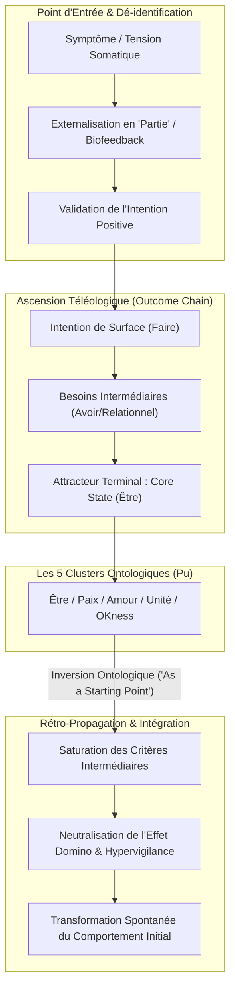
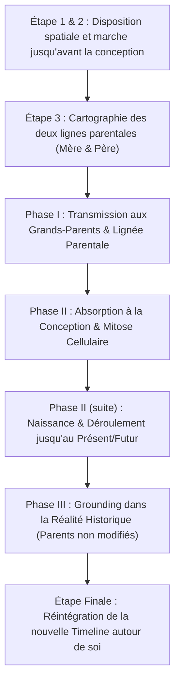

# Core Transformation - Reaching the Wellspring Within (Book)
**Formateur :** Connirae Andreas | **ID :** `connirae-andreas-core-transformation-reaching-the-wellspring-within-book` | **Tranches :** 20

## Synthèse Architecturale du Cours

### 1. Thèse Centrale & Philosophie du Cours

#### Vision spécifique de Connirae Andreas & Rupture avec l’approche standard
Dans les approches classiques du changement (TCC, thérapies comportementales, PNL orthodoxe ou modèles basés sur la volonté/le recadrage intellectuel), le symptôme, la compulsion ou la part d'ombre est implicitement traité comme une anomalie, un bug cognitif à corriger, ou un ennemi interne à soumettre. Cette dynamique perpétue une scission interne : le cortex préfrontal tente de mater ou de contraindre les réactions limbiques et sous-corticales, déclenchant des boucles de résistance et d'usure biologique (*« When we fight ourselves, some part of us always loses »*).

La posture de Connirae Andreas opère un basculement radical :
1. **Le symptôme comme portail ontologique direct (*Symptom as Gateway*) :** Les réactions indésirables, les laideurs intérieures (*Ugliness Within*) et les compulsions ne sont ni des dysfonctionnements ni des erreurs à gommer, mais le matériau brut le plus fidèle pour atteindre le noyau de l'identité.
2. **L'analogie du *Pu* (le bloc brut non sculpté) :** Contrairement aux thérapies qui cherchent à « installer » des ressources ou à surajouter des compétences, la *Core Transformation* postule que le noyau du système nerveux (*Core Self*) est déjà intact, pré-existant à tout trauma ou conditionnement. Il s'agit d'un déconditionnement par dépouillement, et non d'une réparation ou d'un colmatage de façade.
3. **L'échec de la compréhension causale narrative :** Comprendre le « pourquoi » maintient le sujet dans le réseau sémantique de l'hémisphère gauche et du cortex préfrontal, laissant intacts les schémas procéduraux sous-corticaux. Le travail bascule donc d'une analyse intellectuelle à une navigation structurelle et somatosensorielle directe.

#### Le fil rouge méthodologique : L'Inversion Téléologique (Faire $\rightarrow$ Être vs Être $\rightarrow$ Faire)
Toutes les interventions du cours reposent sur un unique principe cybernétique : **corriger l'erreur de catégorie fondamentale commise par l'inconscient dans l'enfance**.
L'enfant s'est structuré sur l'illusion d'un accès conditionnel linéaire :  
$$\text{Symptôme} \longrightarrow \text{Action/Faire} \longrightarrow \text{Validation/Avoir} \longrightarrow \text{État d'Être/Core State}$$

Le fil rouge consiste à :
1. Remonter récursivement la hiérarchie des intentions (*Outcome Chain*) par un chunk-up somato-guidé jusqu'à l'état irréductible (*Core State*).
2. **Inverser la flèche causale (*The Reversal*)** : faire vivre à la partie l'expérience de posséder déjà cet État Fondamental comme **point de départ permanent** (*a priori ontologique*).
3. **Rétro-propager** cet état à travers chaque maillon intermédiaire de la chaîne, transformant une motivation par manque et survie (*lack-based drive*) en une pure expression par plénitude et rayonnement (*wholeness-based expression*).

---

### 2. Carte des Concepts & Leviers Émergents



#### Concepts & Mécanismes Clés

* **Le Postulat du Symptôme comme Portail Somato-Psychique (*Symptom as Gateway*) :** Utilisation de l'interception corporelle et des sensations brutes (tensions, blocages respiratoires) sans résistance pour amorcer la dépolarisation.
* **Le Modèle des Parties & Désidentification Cybernétique :** Segmentation fonctionnelle des réseaux neuronaux d'adaptation permettant au sujet de découpler son Soi conscient de la réaction automatique.
* **Intention Positive & Adaptation Développementale Précipitée :** Postulat d'écologie systémique selon lequel tout automatisme a été encodé comme la meilleure option adaptative de survie disponible lors de son émergence.
* **Bande Passante Consciente vs Traitement Parallèle Inconscient :** Respect de l'empan attentionnel conscient limité (Miller) ; contournement de l'inhibition volontaire au profit d'une communication directe avec les sous-systèmes procéduraux.
* **L'Ontologie du *Pu* (Bloc Non Taillé) :** Reconnaissance que l'état d'intégrité, de clarté et d'alignement préexiste aux adaptations de surface ; démarche de dépouillement soustractif.
* **Les 5 Agrégats d'États Fondamentaux (*Core States Clusters*) :** *Être (Beingness)*, *Paix Intérieure*, *Amour*, *Unité (Oneness)*, *OKness/Complétude*. États pré-verbaux, irréductibles, non-relationnels et non-conditionnels.
* **L'Illusion de l'Accès Conditionnel (*The Conditional Access Fallacy*) :** Croyance enfantine que l'Être est le résultat final d'une chaîne ininterrompue d'efforts, de mérites ou de validations extérieures.
* **La Chaîne de Résultats (*Outcome Chain / Chunking-Up*) :** Séquençage ascendant dégageant le système de la stratégie de surface vers l'état ontologique terminal.
* **L'Inversion Ontologique & Rétro-Propagation (*Reversing the Outcome Chain*) :** Réinjection du Core State du sommet vers la base de la chaîne, saturant chaque besoin par la plénitude et neutralisant la charge anxiogène de manque.
* **Dissolution des Présuppositions de Séparation :** Effondrement de la polarité « soi contre le monde » dès lors que le Core State unitaire annule la nécessité des blindages défensifs.
* **Commutation Attentionnelle Fluide (*Switching Gears*) :** Restauration de la flexibilité cognitive, désenchevêtrement des rôles identitaires et cessation de l'hypervigilance.
* **Tolérance Cybernétique à l'Erreur :** Neutralisation du perfectionnisme persécuteur et de l'effet domino de l'autocritique au profit d'un dialogue pragmatique orienté présent.

---

### 3. Tableau Récapitulatif des Techniques & Démonstrations

| Technique / Exercice | Objectif Opératoire | Déclencheur / Indication | Séquence Résumée |
|---|---|---|---|
| **Macro-Processus de Core Transformation** *(The Core State Exercise)* | Déconstruire la boucle compulsive d'un comportement, d'une émotion ou d'un auto-sabotage en accédant au Core State sous-jacent et en opérant l'inversion téléologique complète. | Échec récurrent de la volonté, des affirmations ou de l'analyse intellectuelle ; compulsions (boulimie, tabac), rages soudaines, honte structurelle, procrastination tenace. | 1. Sélectionner le comportement/émotion cible.<br>2. Localiser la partie somatiquement (proprioception, forme, sensation).<br>3. Accueillir la partie et solliciter son intention positive : *« Qu'est-ce que tu veux à travers cela ? »*<br>4. Remonter l'Outcome Chain par déductions successives : *« Quand tu as [X], que veux-tu d'encore plus important ? »* jusqu'au Core State.<br>5. Faire l'expérience pure du Core State dans le corps.<br>6. Inverser la chaîne : *« En ayant déjà ce Core State comme point de départ, comment cela transforme-t-il [besoin N, puis N-1] ? »* jusqu'au comportement d'origine. |
| **Localisation Somato-Spatiale & Réification de la Partie** | Désamorcer la lutte intrapsychique, valider phénoménologiquement le sous-système et créer une boucle de biofeedback tactile. | Sujet dissocié, en lutte contre son symptôme (« je déteste cette angoisse ») ou bloqué dans l'intellectualisation narrative. | 1. Inviter le sujet à fermer les yeux et à repérer où se loge la sensation dans le corps ou l'espace péripersonnel.<br>2. Poser délicatement la main sur la zone somatique (sternum, ventre, gorge, épaules).<br>3. Décrire les qualités brutes (poids, température, texture, mouvement).<br>4. Ouvrir un canal de bienveillance inconditionnelle envers cet espace. |
| **Inoculation Fonctionnelle en Double Polarité** *(Bipolar Inoculation for Dependent Outcomes)* | Dissoudre la dépendance relationnelle de survie encapsulée dans un résultat intermédiaire (« être aimé », « être validé »). | La chaîne d'objectifs contient un maillon conditionné par autrui ou le monde extérieur (« Si les autres me rejettent, je perds tout »). | 1. Identifier le maillon dépendant d'autrui dans la chaîne.<br>2. Réinjecter le Core State sur le versant positif : *« Quand autrui t'apporte de l'amour en ayant déjà ce Core State comme point de départ, comment le vis-tu ? »*<br>3. Réinjecter le Core State sur le versant négatif : *« Et quand autrui ne t'apporte PAS cet amour, en ayant déjà ce Core State comme point de départ de toute façon, comment le vis-tu ? »*<br>4. Vérifier la stabilité ontologique autonome indépendamment du comportement d'autrui. |
| **Descente Somatique au Centre de Gravité** *(Du Mental au Hara)* | Transmuter l'anxiété ou l'hypervigilance logée dans le haut du corps en présence ontologique incarnée. | Agitation mentale, gorge nouée, tensions céphaliques, oppression pectorale ou dissociation « hors du corps ». | 1. Accueillir la tension somatique haute sans chercher à la relaxer artificiellement.<br>2. Valider l'intention protectrice de cette contraction.<br>3. Inviter l'énergie contractée à « couler » le long de l'axe vertical vers l'abdomen / sous le nombril (*Dan Tian*).<br>4. Stabiliser la respiration ventrale tonique et laisser émerger l'état d'Être ou de Paix sous-jacent. |
| **Recadrage Temporel & Écologique des Rôles** *(« That was then, this is now »)* | Rompre l'hypervigilance multi-contextuelle et permettre une commutation attentionnelle immédiate sans résidu émotionnel. | Saturation de la mémoire de travail, incapacité à déconnecter d'un contexte de crise ou d'exigence professionnelle, dispersion. | 1. Éliciter la partie responsable de l'anticipation anxieuse permanente.<br>2. Remonter à son Core State (sécurité / complétude).<br>3. Réaligner la ligne temporelle : ancrer la distinction nette entre le contexte d'origine de la menace (passé/enfance) et l'instant présent.<br>4. Installer la liberté de déposer un « rôle » pour être 100% disponible dans le contexte actuel. |

---

---

## 0. Sommaire Sémantique & Index des Lignes

- **Tranche 1 [Lignes 112-220]** : Architecture Globale du Macro-Processus de Core Transformation — *Protocole :* Architecture Globale du Macro-Processus de Core Transformation | *Mécanisme :* Le Postulat du Symptôme comme Vecteur d'Accès Somatique et Psychologique direct | *Verbatim :* La métaphore du voyage et de la carte
- **Tranche 2 [Lignes 222-376]** : Exploration de l'Intention Positive (Positive Purpose Exploration) — *Protocole :* Exploration de l'Intention Positive (Positive Purpose Exploration) | *Verbatim :* La rupture de l'illusion de la volonté
- **Tranche 3 [Lignes 378-531]** : L'Exercice de l'État Fondamental (Core State Exercise - Démonstration Cathy) — *Protocole :* L'Exercice de l'État Fondamental (Core State Exercise - Démonstration Cathy) | *Mécanisme :* Les 5 agrégats d'États Fondamentaux (Core States Clusters) comme états d'être pré-verbaux | *Verbatim :* La Présupposition de l'Intention Positive et l'Ancrage de Gratitude
- **Tranche 4 [Lignes 533-673]** : The Core State Exercise (Étapes 1 à 5) — *Protocole :* The Core State Exercise (Étapes 1 à 5) | *Verbatim :* Verbatim 1 : Transposition dans le contexte original
- **Tranche 5 [Lignes 675-825]** : Fondamental : Inversion de la Chaîne des Résultats (Reversing the Outcome Chain - Étapes 3 à 5) — *Protocole :* Fondamental : Inversion de la Chaîne des Résultats (Reversing the Outcome Chain - Étapes 3 à 5) | *Verbatim :* L'Élévation Systémique de Critère (Étape 3a)
- **Tranche 6 [Lignes 827-945]** : Maturation d'une Partie et Incarnation Somatique Complète (Growing Up a Part & Bringing it F... — *Protocole :* Maturation d'une Partie et Incarnation Somatique Complète (Growing Up a Part & Bringing it Fully Into the Body) | *Mécanisme :* metaphoredusoldatjaponais isolationtemporelledesparties loyauteinconsciente | *Verbatim :* Le Pré-cadrage de Séparation et Réconciliation
- **Tranche 7 [Lignes 947-1098]** : "Growing Up a Part" (Étape 6 du processus complet) — *Protocole :* "Growing Up a Part" (Étape 6 du processus complet)
- **Tranche 8 [Lignes 1100-1245]** : COMPLET CORE TRANSFORMATION (PHASES 5 À 10) & Le Paradoxe de la Conditionnalité vs l'Accès D... — *Protocole :* COMPLET CORE TRANSFORMATION (PHASES 5 À 10) | *Mécanisme :* Le Paradoxe de la Conditionnalité vs l'Accès Direct (Having vs. Working for) | *Verbatim :* Rupture du Lien Conditionnel et Présupposition d'Antériorité
- **Tranche 9 [Lignes 1247-1359]** : Détection et Intégration des Paires Polaires Opposées — *Protocole :* Détection et Intégration des Paires Polaires Opposées | *Mécanisme :* Recadrage Radical de la « Résistance » en « Allié d'Interférence » | *Verbatim :* La Formule Maîtresse d'Élicitation de l'Objection Écologique
- **Tranche 10 [Lignes 1361-1525]** : Le Protocole Intégral de Transformation Essentielle (Core Transformation Complete Outline) — *Protocole :* Le Protocole Intégral de Transformation Essentielle (Core Transformation Complete Outline) | *Verbatim :* Le Recadrage Métaphorique de la Disponibilité Ontologique
- **Tranche 11 [Lignes 1527-1666]** : Parental Timeline Reimprinting (Réimpression Parentale sur la Ligne du Temps) — *Protocole :* Parental Timeline Reimprinting (Réimpression Parentale sur la Ligne du Temps) | *Mécanisme :* Contournement de la rigidité mnésique par saut générationnel récursif | *Verbatim :* Présupposition d'imprégnation inévitable et hypothèque cellulaire
- **Tranche 12 [Lignes 1668-1840]** : COMPLET : L'EMPREINTE PARENTALE TEMPORELLE (PARENTAL TIMELINE REIMPRINTING) — *Protocole :* COMPLET : L'EMPREINTE PARENTALE TEMPORELLE (PARENTAL TIMELINE REIMPRINTING) | *Mécanisme :* Inoculation & Écologie Référentielle Réelle vs Idéalisée (Phase III) | *Verbatim :* L'Imprégnation Mitotique à la Conception
- **Tranche 13 [Lignes 1842-1965]** : A : La Triade d'Intégration du Jugement et de la Critique — *Protocole :* A : La Triade d'Intégration du Jugement et de la Critique
- **Tranche 14 [Lignes 1967-2095]** : Parental d'Intégration : "Setting Limits Without Judgment" (Pose de Limites sans Clivage) — *Protocole :* Parental d'Intégration : "Setting Limits Without Judgment" (Pose de Limites sans Clivage) | *Mécanisme :* Le Clivage Dissociatif Précoce et la Fixation Temporelle | *Verbatim :* Le Clivage Dissociatif et la Fixation Temporelle
- **Tranche 15 [Lignes 2097-2217]** : d'Émergence et de Cartographie des Parties Liées à une Maladie Physique (Transforming Illnes... — *Protocole :* d'Émergence et de Cartographie des Parties Liées à une Maladie Physique (Transforming Illness Framework) | *Verbatim :* Verbatim : Recadrage de la crise existentielle comme signal biologique d'évolution
- **Tranche 16 [Lignes 2219-2378]** : Enquête Systémique sur les Parties Liées à la Santé & Somatisation — *Protocole :* Enquête Systémique sur les Parties Liées à la Santé & Somatisation | *Mécanisme :* Le Conflit Somato-Psychologique & la Maladie comme Appel au Réveil (Wake-up Call) | *Verbatim :* Verbatim 1 : L'appel neutre à la partie pathogène
- **Tranche 17 [Lignes 2380-2492]** : Ré-infusion Somatique Directe d'un État Fondamental (Adaptation Corporelle du Partenaire de... — *Protocole :* Ré-infusion Somatique Directe d'un État Fondamental (Adaptation Corporelle du Partenaire de Tracy) | *Mécanisme :* Effondrement Spontané des Filtres Conditionnels Hyper-Sélectifs | *Verbatim :* La Bascule Radicale de Perception Identitaire dans le Choix du Partenaire
- **Tranche 18 [Lignes 2494-2603]** : A : Décomposition et Pacification d'une Somatisation Complexe ou Psychotique (Cas Lance) — *Protocole :* A : Décomposition et Pacification d'une Somatisation Complexe ou Psychotique (Cas Lance) | *Verbatim :* La neutralisation perceptive du stimulus addictif
- **Tranche 19 [Lignes 2605-2722]** : Pratique Quotidienne d'Intégration Systémique du Core Transformation — *Protocole :* Pratique Quotidienne d'Intégration Systémique du Core Transformation | *Mécanisme :* Le piège de la scission spirituelle vs intégration par les failles | *Verbatim :* Verbatim 1 : La redéfinition du jugement comme révélateur de compassion
- **Tranche 20 [Lignes 2724-2800]** : d'Attestation Écologique et d'Installation de Légitimité de la Démarche (Méta-Cadrage Thérap... — *Protocole :* d'Attestation Écologique et d'Installation de Légitimité de la Démarche (Méta-Cadrage Thérapeutique) | *Mécanisme :* Le Pont Psychopathologie-Transcendance (Symptom-to-Enlightenment Bridge) | *Verbatim :* Verbatim 1 : La métaphore structurelle du pont psyché-éveil

---

## Extractions Détaillées par Tranche (Opératoire & Verbatim)

## Tranche 1 / 20 : Architecture Globale du Macro-Processus de Core Transformation

### 1. Mécanismes & Principes Actifs

* **Le Postulat du Symptôme comme Vecteur d'Accès Somatique et Psychologique direct**
  * *Principe actif :* Le modèle de Connirae Andreas postule que les comportements, émotions ou réactions indésirables ne sont ni des dysfonctionnements à éradiquer, ni des erreurs cognitives à corriger par la force intellectuelle. Ils constituent la porte d'entrée la plus directe et la plus fidèle vers le noyau de l'identité. Au niveau neurobiologique et cognitif, tenter de supprimer un pattern par la volonté (« willpower ») ou la restructuration de surface (pensée positive) crée une scission et un conflit inhibiteur (antagonisme cortical vs limbique/sous-cortical), ce qui renforce la charge de la boucle réactive. En accueillant la limitation comme matériau brut, le système nerveux cesse la lutte d'inhibition réciproque, permettant à la structure neurologique sous-jacente de livrer son intention adaptative profonde jusqu'à atteindre un état de conscience transcendant ou ontologique (*Core State*).
  * *Tags émergents :* #symptom_as_gateway #non_resistance_dynamique #emergence_ontologique #transmutation_des_limites

* **Le Paradoxe de la Compréhension Analytique (L'impasse de l'explication causale)**
  * *Principe actif :* L'analyse intellectuelle d'un problème (« comprendre pourquoi je fonctionne ainsi », explorer l'histoire étiologique du trouble) engage principalement l'hémisphère gauche et les réseaux sémantico-narratifs du cortex préfrontal. Cette verbalisation intellectualisée laisse intacts les programmes procéduraux, les déclencheurs sensoriels et les activations sous-corticales (amygdale, insula) qui encodent la réponse émotionnelle ou comportementale automatique. La transformation nécessite une technologie d'orientation de l'attention qui déplace le traitement de l'information du contenu narratif (« pourquoi ») vers la structure de l'expérience vécue (« comment » et « vers quel état d'être »).
  * *Tags émergents :* #echec_de_lintellectualisation #court_circuit_cognitif #orientation_processuelle #dissolution_narrative

* **L'Ontologie du "Pu" ou la Réduction à l'Essence Non-Sculptée**
  * *Principe actif :* En reprenant le concept taoïste du *Pu* (le bloc de bois brut non taillé), Connirae Andreas pose que l'état fondamental du système humain (*Core Self*) préexiste à toute adaptation, tout conditionnement et tout trauma. Le travail de transformation sous-consciente n'ajoute aucune ressource extérieure, n'installe pas d'injonction normative (« ce qu'une personne éveillée devrait faire ») et ne cherche pas à polir le symptôme. Le principe actif réside dans la dé-construction des couches de compensations superficielles pour révéler la matière première déjà intacte du système nerveux : un état de plénitude, d'alignement somatique et de clarté perceptive.
  * *Tags émergents :* #concept_du_pu #essence_preexistante #depouillement_egoique #auto_organisation_inconsciente

* **L'Auto-Organisation des États Fondamentaux (*Core States*)**
  * *Principe actif :* Lorsque l'on remonte la chaîne des bénéfices secondaires et des intentions positives d'une partie sans bloquer sur les moyens matériels ou comportementaux, le système cognitivo-émotionnel converge spontanément vers des états d'être fondamentaux (Présence, Paix, Amour, Plénitude, Être). Ces états ne sont pas des émotions réactives (qui dépendent d'un stimulus externe et fluctuent), mais des modes de fonctionnement intégrés du système nerveux autonome et de la conscience globale, procurant une stabilité homéostatique indépendante des aléas contextuels.
  * *Tags émergents :* #core_states #etats_ontologiques #stabilite_homeostatique #transcendance_spontanee

---

### 2. Protocoles, Techniques & Démonstrations (Étape par Étape)

Dans cette tranche d'ouverture (Introduction et Chapitre 1), Connirae Andreas pose l'architecture d'ensemble du processus de Transformation Essentielle (*Core Transformation*) et détaille les composantes structurales qui guident les protocoles à venir.

#### Architecture Globale du Macro-Processus de Core Transformation
* **Intention / Indication :**
  * Résolution des schémas récurrents majeurs invétérés : comportements d'auto-sabotage, addictions/habitudes compulsives, douleurs chroniques sans substrat organique exclusif, états émotionnels submergeants (rage, boulimie, dépendance affective, honte, sentiment d'incompétence structurelle).
  * Déclencheur clinique : Dès lors que le sujet tente sans succès de modifier un trait par la volonté, les affirmations ou l'analyse réflexive depuis des mois ou des années.

* **Mise en place & Pré-framing :**
  * Posture de bienveillance inconditionnelle envers toutes les manifestations internes : abandon de toute tentative de combat, de rejet ou d'imposition extérieure de devoirs-être.
  * Recadrage du problème : le comportement ou ressenti indésirable est explicitement redéfini comme le meilleur allié potentiel, détenteur d'un accès direct au noyau de plénitude (*Wellspring Within*).
  * Pré-cadrage de l'expérience : aucune croyance spirituelle préalable n'est nécessaire ; l'expérience est purement phénoménologique et somatique.

* **Séquence opératoire globale (Macro-Structure du parcours) :**
  * **Étape 1 : Cartographie et Préparation de l'Inconscient (*Mapping out the Territory*)**
    * Établir l'alliance de travail avec l'inconscient en contournant l'analyse intellectuelle.
    * Identifier la structure des intentions positives sous-jacentes.
  * **Étape 2 : L'Exercice de l'État Essentiel (*The Core State Exercise*)**
    * Identifier le comportement, ressenti ou réaction automatique indésirable.
    * Découvrir la partie responsable et remonter la chaîne des intentions positives jusqu'à l'émergence spontanée de l'État Essentiel (*Core State*).
  * **Étape 3 : Maturation Somatique et Temporelle de la Partie (*Growing Up a Part & Bringing it into the Body*)**
    * Évaluer l'âge psychologique/développemental de la partie inconsciente.
    * Lui permettre d'évoluer chronologiquement en intégrant la plénitude de l'État Essentiel, puis l'incarner spatialement et somatiquement dans le corps physique du présent.
  * **Étape 4 : Intégration Holistique de Toutes les Parties (*Completing the Process with All Parts*)**
    * Vérifier l'écologie globale et inclure les polarités, résistances ou sous-parties subsidiaires associées à la problématique.
  * **Étape 5 : Réimpression de la Ligne du Temps Parentale (*Parental Timeline Reimprinting*)**
    * Prendre l'État Essentiel et le faire rétroagir sur les générations antérieures (lignée paternelle et maternelle).
    * Réencoder les mémoires de développement infantile à la lumière de cette ressource trans-générationnelle.
  * **Étape 6 : Généralisation et Enracinement Quotidien (*Enhancing and Integrating*)**
    * Pont vers le futur et ancrage dans les contextes de vie courante (santé, relations, identité de fond).

* **Signes de calibration (Indicateurs d'accès et d'intégration) :**
  * *Modifications neuro-végétatives :* Changement de coloration cutanée du visage, ralentissement et approfondissement du rythme respiratoire (passage d'une respiration haute et bloquée à une respiration ventrale).
  * *Modifications du tonus musculaire :* Relâchement visible des micro-tensions faciales (orbiculaires des yeux, mâchoire, front), décristallisation des postures de défense corporelle.
  * *Phénoménologie du regard :* Dilatation pupillaire, regard défocalisé traduisant un traitement d'accès trans-dérivatif interne intense.
  * *Traitement temporel :* Présence de pauses prolongées (notées `...` dans les scripts) où le sujet suspend toute réponse verbale pour laisser opérer la réorganisation inconsciente.

---

### 3. Heuristiques, Subtilités & "Sagesse du Praticien"

* **Gestion du Rythme et Respect des Pauses d'Intégration :**
  * *Règle :* **SI** le sujet s'arrête de parler, que son regard se fige ou se défocalise et que sa respiration ralentit, **ALORS** le praticien garde un silence absolu et maintient l'espace sans intervenir (de quelques secondes à plusieurs minutes), **PARCE QUE** le cerveau procède à une réindexation sous-corticale et à une intégration inconsciente de la structure de l'information. Interrompre ce silence briserait la transe de traitement interne pour ramener le sujet dans l'intellect analytique de surface.

* **Calibration Non-Verbale vs Déclaration Verbale :**
  * *Règle :* **SI** le praticien doit décider d'avancer à l'étape suivante, **ALORS** il calibre la motricité oculaire, la coloration du teint et le souffle, plutôt que d'attendre un signalement rationnel, **PARCE QUE** l'intégration somatique précède toujours la formulation consciente.

* **Posture envers le Matériau Négatif (Accueillir sans combattre) :**
  * *Règle :* **SI** le sujet exprime du dégoût, de la honte ou de la rage envers une de ses réactions, **ALORS** le praticien refuse catégoriquement d'alimenter cette tentative d'éviction et recadre immédiatement ce trait indésirable comme une ressource fondamentale déguisée, **PARCE QUE** toute tentative de forcer ou d'opposer de la volonté (« willpower ») déclenche une résistance homéostatique qui solidifie le symptôme.

* **Fidélité au Langage Structurant :**
  * *Règle :* **SI** le praticien applique le protocole (surtout lors des premières pratiques), **ALORS** il doit utiliser mot à mot les formulations linguistiques spécifiques établies par Andreas sans improviser, **PARCE QUE** ces tournures syntaxiques ont été épurées pour saturer les bifurcations analytiques de l'ego et guider directement l'attention vers l'état ontologique sans déclencher de piège mental.

* **Neutralité Conceptuelle et Respect du Cadre de Référence du Sujet :**
  * *Règle :* **SI** le sujet décrit son vécu en termes laïques, biologiques ou mécaniques, ou à l'inverse en termes spirituels ou transcendants, **ALORS** le praticien adopte strictement le métamodèle et le lexique du sujet sans imposer de grille théologique ou métaphysique, **PARCE QUE** l'État Essentiel est une expérience neuro-phénoménologique universelle, indépendante de tout système de croyances doctrinal.

---

### 4. Pépites Verbatim & Patterns Linguistiques (MOT À MOT EN V.O.)

#### Pépite 1 : La métaphore du voyage et de la carte
> « If you want to get somewhere, a good map can make the difference between arriving at your destination with ease and getting hopelessly lost. Let's say a friend raves about a restaurant with wonderful food, friendly people and reasonable prices, and you decide to go eat there. You ask your friend where the restaurant is.
> Your friend says, “Just visualize the restaurant clearly. Post a sign on your refrigerator door that says, ‘I can easily and joyfully find any restaurant I want!’ That’s all you need to do.”
> This idea may seem silly but what if my destination is “self-acceptance?” What if I want to reach a state of inner wholeness that I have never experienced before? Like the restaurant in the above example, I have heard wonderful things about it but haven’t been there and don’t know how to get there. Many of us have been told, “Just do it. Just accept yourself.” This is a little like being told to ‘Just go to the restaurant,” without being given any directions.
> Or what if you ask how to get to the restaurant and your friend says, “Before you can find this restaurant you need to spend several months, or even years, thinking about how bad your own cooking is. You need to explore the reasons why you aren’t happy with your own cooking and why you have this need to go to the restaurant. You also have to really understand how you became such a bad cook.” This seems even sillier than the previous example. All you need is directions to the restaurant! »
* **[Analyse du Pattern] :** 
  * *Recadrage par réduction à l'absurde et métaphore isomorphe :* Connirae Andreas utilise une analogie pragmatique et triviale (chercher un restaurant) pour court-circuiter simultanément deux écoles thérapeutiques majeures : la pensée positive/loi de l'attraction d'un côté (visualiser sans processus opératoire) et la psychanalyse/psychothérapie archéologique de l'autre (analyser indéfiniment la cause du problème). 
  * *Pacing and Leading cognitif :* Le lecteur est amené à valider l'absurdité évidente des deux réponses imaginaires dans le contexte culinaire (« This idea may seem silly », « This seems even sillier »), ce qui installe par transfert direct le postulat de la futilité de l'intellectualisation dans le domaine du changement psychologique, validant le besoin impérieux d'un protocole purement directionnel (« All you need is directions »).

#### Pépite 2 : Recadrage de la limitation comme véhicule d'accès
> « All of us have personal limitations we have struggled to overcome. With some of them it can seem that no matter what we do, they won’t go away. Most of us turn away from those parts of ourselves that we don’t like. We try to shove aside feelings we don’t want to have. We try to “think positively” and push away negative thoughts. These approaches don’t tend to create natural, lasting change. The way to our inner wellspring is through our limitations. »
* **[Analyse du Pattern] :**
  * *Truismes universels et empilement de validations (« Yes-Set ») :* Les quatre premières phrases décrivent avec une précision clinique la stratégie d'évitement habituelle du sujet humain (« struggle », « turn away », « shove aside », « push away »).
  * *Rupture de pattern et inversion paradoxale :* La dernière phrase (« The way to our inner wellspring is through our limitations ») opère un renversement spatial et directionnel radical. Le problème n'est plus un obstacle bloquant l'accès à la source, il devient le tunnel géométrique même par lequel le sujet doit passer. Cette formulation désactive instantanément le réflexe de fuite et réoriente le focus vers l'exploration interne du symptôme.

#### Pépite 3 : Définition phénoménologique de l'état source (Pu)
> « Don’t let all the external things blind you so that you lose the uncarved block within. Every time we begin, we must find that uncarved original wood, that basic sense of what the human body is, that sense of being all together. We usually keep telling ourselves what we are, instead of just letting the pu emerge. »
* **[Analyse du Pattern] :**
  * *Structure d'inhibition de la boucle interne :* Opposition entre le dialogue interne discursif (« keep telling ourselves what we are ») et le processus passif d'émergence somatique (« just letting the pu emerge »).
  * *Présupposition d'existence et ancrage somatique :* L'essence originelle n'est pas une idée philosophique abstraite mais est rattachée immédiatement à une expérience proprioceptive et kinesthésique globale (« that basic sense of what the human body is, that sense of being all together »), préparant neurologiquement le sujet à une expérience incarnée plutôt que mentale.

#### Pépite 4 : Cadrage hypnotique des pauses d'intégration
> « You may notice as you read the demonstrations that we use unique language patterns, and have very specific ways of wording things. In these demonstrations we indicate a pause with three periods (...). This indicates that we are allowing time for the person we are working with to process information and integrate changes unconsciously. These pauses usually last a few seconds, but can last as long as a few minutes. We are guided in knowing when to go on by watching facial expressions and color, breathing patterns, gestures, and by being deeply “tuned in” to the client’s state. »
* **[Analyse du Pattern] :**
  * *Saupoudrage et commande cachée d'apprentissage inconscient :* En décrivant la notation typographique des trois points (`...`), Connirae installe chez le lecteur/praticien la présupposition que le changement réel s'effectue hors de la conscience vigile (« to process information and integrate changes unconsciously »).
  * *Calibration multi-sensorielle :* Elle nominalise et détaille les canaux d'observation somatiques indispensables (teint, respiration, micromouvements), cadrant l'accompagnement non pas comme une récitation verbale, mais comme une danse cybernétique régulée par les bio-feedbacks du client.

## Tranche 2 / 20 : Exploration de l'Intention Positive (Positive Purpose Exploration)

### 1. Mécanismes & Principes Actifs

- **Limitation de la bande passante consciente vs Traitement massif inconscient**
  - *Principe actif* : L'esprit conscient est limité à un empan attentionnel de 5 à 9 unités d'information (Miller). Toute tentative de modifier un comportement automatique par la seule volonté ou compréhension intellectuelle surcharge cette bande passante étroite et échoue. L'inconscient gère en continu la proprioception, les filtres sensoriels périphériques, les fonctions végétatives et les programmes comportementaux appris (automatismes moteurs et linguistiques). Tenter de supprimer un comportement par la volonté revient à opposer un canal à très faible débit à un système massivement parallèle.
  - *Tags* : #bande_passante_consciente #surcharge_cognitive #empan_miller #automatisation_comportementale

- **Hypothèse fonctionnelle des « Parties » (Parts Psychology)**
  - *Principe actif* : Bien que le cerveau ne contienne pas d'entités autonomes physiques scindées, l'organisation neuronale segmente des réseaux émotionnels, perceptifs et moteurs stabilisés autour d'objectifs de survie ou d'adaptation (souvent cristallisés dans l'enfance). L'externalisation métaphorique en « parties » permet au sujet de désidentifier le Soi conscient du symptôme, stoppant l'auto-jugement et ouvrant un canal de communication cybernétique avec le sous-système responsable de l'automatisme.
  - *Tags* : #modele_des_parties #desidentification #reseaux_neuronaux_dedies #cybernetique_interieure

- **Intention Positive & Adaptation Développementale Primitrice**
  - *Principe actif* : Tout comportement, pensée intrusive ou émotion perturbatrice a été encodé à l'origine comme la meilleure option adaptative disponible pour protéger l'intégrité de l'organisme (ex: anesthésie émotionnelle face à des conflits parentaux, repli face à la menace). Le système nerveux continue d'exécuter la solution archaïque sans réévaluation contextuelle. L'accès au changement exige de valider la fonction biologique/psychologique de préservation avant de modifier le comportement qui la sert.
  - *Tags* : #intention_positive #decision_archaïque #cristallisation_developpementale #homeostasie_protectrice

- **Rupture de la Polarisation Interne (Écologie du Système)**
  - *Principe actif* : Combattre un comportement indésirable génère une double contrainte neurobiologique : la partie répressive (volonté/surmoi) dépense de l'énergie pour écraser la partie motrice, activant en retour une résistance compensatoire accrue (effet rebond). Quand un sous-système gagne contre un autre au sein du même organisme, l'organisme global est affaibli (« When we fight ourselves, some part of us always loses »). L'accueil inconditionnel annule l'activation de l'axe de stress lié au conflit intrapsychique.
  - *Tags* : #anti_polarisation #ecologie_systemique #non_violence_interieure #reduction_conflit_intrapsychique

- **Séquençage Ascendant de l'Outcome Chain (Chaîne des Résultats)**
  - *Principe actif* : L'interrogation récursive par « Qu'est-ce que tu veux à travers cela ? » opère un chunk-up graduel qui décolle la partie de la stratégie comportementale de surface (manger, fumer, critiquer), traverse les besoins sociaux/externes (approbation, statut, sécurité), pour atteindre les états d'être fondamentaux (Core States). Ce passage translate le système d'une dynamique de manque (orientée objet extérieur) vers un état ontologique d'autorégulation interne autonome.
  - *Tags* : #chaine_des_resultats #outcome_chain #chunking_up #translation_ontologique

- **Ontologie des « Core States » (États Fondamentaux)**
  - *Principe actif* : Les états fondamentaux (*Beingness*, *Peace*, *Oneness*, *Love*, *OKness*) constituent l'attracteur étrange terminal de tout sous-système névrotique. L'inconscient commet l'erreur de catégorie de croire que l'état d'être est la *conséquence* d'une action extérieure réussie (ex: « Je dois fumer -> pour être inclus -> pour être en sécurité -> pour ressentir la paix »), alors que l'état fondamental peut être accédé directement au niveau somato-neurologique sans condition préalable.
  - *Tags* : #core_states #erreur_de_categorie #attracteur_ontologique #reconnexion_wellspring

---

### 2. Protocoles, Techniques & Démonstrations (Étape par Étape)

#### Protocole : Exploration de l'Intention Positive (Positive Purpose Exploration)

* **Intention / Indication** :
  - Destiné à initier la communication avec un automatisme inconscient indésirable (pensée, émotion réactive, voix critique, compulsion motrice) d'intensité faible à modérée.
  - Utilisé pour stopper l'hostilité interne et isoler le premier maillon de la chaîne des intentions.

* **Mise en place & Pré-framing** :
  - Cadrer l'inconscient non pas comme un adversaire à soumettre par la volonté, mais comme un allié biologique maladroit exécutant de vieux programmes.
  - Faire formaliser le symptôme par une phrase de désidentification structurée : *« Une partie de moi me fait [faire / ressentir / penser] X, et j'aimerais arrêter »*.
  - Demander d'adopter une voix douce, lente, avec des pauses généreuses pour laisser l'inconscient répondre.

* **Séquence d'actions pas à pas** :

  * **Étape 1 : Sélection & Formalisation**
    - Choisir un comportement, ressenti ou voix interne d'intensité légère à modérée.
    - Écrire la phrase de désidentification : *« Une partie de moi me fait... »*.

  * **Étape 2 : Circonscription Spatio-Temporelle (Où, Quand, Qui)**
    - Définir le contexte précis d'apparition : lieux, déclencheurs temporels, personnes présentes.

  * **Étape 3 : Instanciation d'un Incident Spécifique**
    - Isoler un événement unique récent (ex: mercredi dernier).
    - Amorcer la mémoire épisodique sous forme de film mental ou d'image fixe.

  * **Étape 4 : Induction du Retournement d'Attention**
    - Fermer les yeux, relâcher les tensions musculaires, orienter l'attention vers l'espace interne (intéroception).

  * **Étape 5 : Revécu VAK Associé**
    - Entrer pleinement dans l'incident spécifique : voir à travers ses propres yeux (associé V), entendre par ses propres oreilles (A), ressentir les sensations kinesthésiques (K).

  * **Étape 6 : Capture de l'Amorçage Neuro-Sensoriel**
    - Observer la milliseconde précise où le réflexe démarre : noter les micro-images internes, le ton de la voix intérieure, la localisation des sensations physiques initiales.

  * **Étape 7 : Localisation Spatiale & Accueil Somatique**
    - Détecter la localisation de la partie :
      - *Si kinesthésique* : repérer la région du corps où la tension réside. Poser physiquement la main dessus pour valider l'existence de la partie.
      - *Si auditif* : repérer la provenance spatiale de la voix (dedans, dehors, gauche, droite).
      - *Si visuel* : localiser l'image dans l'espace péripersonnel.
    - Inviter avec douceur la partie dans le champ de la conscience vigile.

  * **Étape 8 : Gratitude Préemptive & Inconditionnelle**
    - Remercier la partie d'être présente et de faire de son mieux au service du sujet, même si son intention consciente n'est pas encore connue. La baigner d'appréciation.

  * **Étape 9 : Élicitation de l'Intention de Premier Niveau**
    - Poser intérieurement la question directe : *« Que veux-tu pour moi à travers [ce comportement X] ? »*.
    - Se placer en posture d'attente réceptive passive. Laisser émerger une image, un son, un mot ou une sensation, sans intellectualiser.

  * **Étape 10 : Accusé de Réception & Validation**
    - Remercier la partie dès la réception du signal ou de la réponse verbale.
    - Si l'intention est perçue comme positive par le conscient, remercier pour cette intention spécifique.

  * **Étape 11 : Récursion Ascendante (si réponse négative de surface)**
    - Si la réponse obtenue paraît encore négative ou superficielle, demander : *« Si tu as cet objectif [réponse obtenue], que veux-tu pour moi de plus important encore à travers cela ? »*.
    - Remercier à chaque itération jusqu'à obtenir un but clairement positif et accepté par le sujet.

* **Signes de calibration** :
  - *Accès à la partie* : Décélération du rythme respiratoire, changement de tonus postural (épaules qui descendent), micro-mouvements des yeux vers le bas (dialogue interne ou kinesthésique).
  - *Connexion établie* : Déglutition, lissage des traits du visage, apparition d'un sentiment viscéral de chaleur ou de décompression dans la zone du corps touchée.
  - *Stagnation / Résistance* : Sourcils froncés, yeux qui bougent rapidement (intellectualisation consciente), voix tendue, sensation de vide -> calibrer le besoin de renforcer la gratitude préemptive.

---

### 3. Heuristiques, Subtilités & "Sagesse du Praticien"

- **Règle de non-forçage en début d'apprentissage** :
  - *Condition* : Si le sujet débute avec le processus -> *Action* : Toujours choisir une cible d'intensité faible à modérée.
  - *Raison* : Le canal de confiance conscient-inconscient doit être rodé sur des matériaux peu menaçants avant d'aborder des charges traumatiques ou de fortes compulsions.

- **Règle de la localisation physique directe** :
  - *Condition* : Si le sujet a du mal à sentir ou contacter sa partie -> *Action* : Lui faire poser physiquement sa main sur la zone somatique où l'émotion se manifeste.
  - *Raison* : L'ancrage proprioceptif direct court-circuite le cortex préfrontal et focalise l'attention du système nerveux sur le réseau somatosensoriel activé.

- **Règle du silence réceptif après la question** :
  - *Condition* : Si le praticien vient de poser la question d'intention à la partie -> *Action* : Suspendre toute stimulation verbale et ordonner au conscient de ne faire qu'attendre (« simply wait for a response »).
  - *Raison* : La réponse de la partie provient de voies sous-corticales plus lentes ; toute intervention prématurée du mental conscient injectera une réponse fabriquée (une rationalisation au lieu d'une émergence).

- **Règle face au mutisme ou à la résistance de la partie** :
  - *Condition* : Si la partie ne répond pas ou semble hostile -> *Action* : Augmenter massivement le dosage de gratitude préemptive et d'appréciation sans rien exiger en retour.
  - *Raison* : Les parties bloquantes ont souvent été réprimées, insultées ou muselées par la volonté pendant des années. Comme une personne rejetée, elles nécessitent une désescalade relationnelle avant d'ouvrir la communication.

- **Postulat philosophique fondamental d'Andreas** :
  - *« Even if I do manage to defeat this so-called "enemy within", then I will be left with a "loser within" »*. Aucun sous-système de soi ne doit perdre. Le modèle de la force de volonté crée une scission pathologique ; l'intégration n'advient que par l'alliance inconditionnelle.

---

### 4. Pépites Verbatim & Patterns Linguistiques (MOT À MOT EN V.O.)

#### Pépite 1 : La rupture de l'illusion de la volonté
> "How often have you heard people describe their problems with great clarity and intellectual understanding, and yet you notice that they still have the problems? Have you ever made a conscious decision that you were going to change a behavior, feeling or response, only to find yourself doing it again? That's because in most cases our conscious mind alone is practically helpless to permanently change behaviors, feelings and responses that are automatic and unconscious."

* **[Analyse du Pattern]** :
  - Empilement de questions rhétoriques à calibration universelle (truismes éricksoniens) forçant une réponse interne positive (« Yes set »).
  - Présupposition de séparation fonctionnelle entre la cognition analytique et les commandes neuro-comportementales.
  - Normalisation déculpabilisante : le terme « helpless » détruit l'illusion d'échec moral ou de manque de volonté pour recadrer le problème en une simple incompatibilité d'interface cybernétique.

---

#### Pépite 2 : L'équivalence métaphorique des « Parties »
> "It is as if there is an unconscious part of us that is in charge of doing those things. Because the conscious, thinking part of our mind does not run the behavior, feeling, or response we don't want, the first step in changing that behavior is learning to access the part of ourselves that does run it. Then we learn how these parts can become inner friends."

* **[Analyse du Pattern]** :
  - Utilisation du marqueur modal doux « It is as if » (forme comme si) qui installe le modèle des parties sans imposer d'ontologie rigide ou dogmatique.
  - Recadrage relationnel de l'automatisme sous-cortical en agent intentionnel autonome capable de devenir un « inner friend » (ami intérieur).
  - Présupposition séquentielle inéluctable : accéder d'abord (« first step »), collaborer ensuite (« Then we learn »).

---

#### Pépite 3 : La réassurance et la dissociation somatique
> "Gently invite the part into your awareness. If the part is in your body, you may want to put your hand on the area where you sense the part most strongly. This can help you welcome and acknowledge the part. Even though you do not yet know, consciously, what this part of you wants for you, you can assume that it has some positive purpose. Begin thanking this part of you for being there, doing its best to accomplish something on your behalf."

* **[Analyse du Pattern]** :
  - Commande permissive et invitation non-coercitive (« Gently invite », « you may want to ») réduisant immédiatement l'hyper-réactivité défensive du système nerveux.
  - Biais de dissociation temporelle et cognitive enchâssée : « Even though you do not yet know, consciously... » qui présuppose que l'inconscient sait déjà et que le conscient finira inévitablement par l'apprendre.
  - Recadrage d'intention préemptif : attribuer l'étiquette « doing its best on your behalf » installe une alliance bienveillante avant même la découverte du contenu.

---

#### Pépite 4 : La relativité linguistique face à l'indicible
> "Words are only labels for experience. If we haven’t had the experience, these words can sound hollow. Frequently when people get to the Core State they hesitate and struggle, because no word seems “enough” to describe what they are experiencing... Communication, after all, builds upon common ground. You might describe purple to someone who knows red and blue, but you cannot describe red to someone who has never seen it. Red is elemental and irreducible."

* **[Analyse du Pattern]** :
  - Recadrage épistémologique fondamental (la carte n'est pas le territoire) couplé à une métaphore sensorielle puissante (la couleur rouge primaire/irréductible).
  - Suggestion post-hypnotique anticipée : normaliser l'hésitation et le bégaiement futur du sujet (« hesitate and struggle ») lorsqu'il atteindra le Core State, le requalifiant non pas comme un blocage, mais comme la preuve somatosensorielle directe de l'accès à un état d'être pur au-delà du langage digital.

## Tranche 3 / 20 : L'Exercice de l'État Fondamental (Core State Exercise - Démonstration Cathy)

Voici l'extraction et l'analyse opératoire intégrale de la tranche 3/20 du cours *Core Transformation* de Connirae Andreas.

---

### 1. Mécanismes & Principes Actifs

#### A. Les 5 agrégats d'États Fondamentaux (Core States Clusters) comme états d'être pré-verbaux
* **Terme exact d'Andreas** : *Core States Clusters* (Être / Paix Intérieure / Amour / OKness / Unité).
* **Principe actif** : Le système nerveux génère des symptômes ou des comportements limitants parce qu'une partie inconsciente poursuit une chaîne d'objectifs (chaîne de résultats) conçue dans l'enfance. À la racine de toute chaîne se trouve un état d'être irréductible et non-conditionnel. Ces états ne dépendent d'aucune action, d'aucune possession et d'aucun jugement externe. Sur le plan cognitif et neurologique, ces états correspondent à une désactivation du réseau du mode par défaut (DMN) focalisé sur l'auto-évaluation et la défense de l'ego, pour basculer dans une régulation autonome profonde. Les mots ne sont que des étiquettes imparfaites (*"Words are only labels for experience"*). L'expérience précède le langage.
* **Tags libres émergents** : #core_states_clusters #etats_de_base_universels #experience_irreductible_preverbale #desactivation_evaluation_ego #ontologie_de_letre

#### B. La distorsion instrumentale de l'enfance : La recherche de l'Être par le Faire
* **Terme exact d'Andreas** : *Striving for a Core State through unwanted behaviors*.
* **Principe actif** : L'enfant structure son modèle du monde sur une équation linéaire erronée : *"Je dois performer / sur-manger / m'angoisser -> pour faire un bon travail -> pour me détendre -> pour enfin avoir le droit de ressentir l'Unité/la Paix"*. Le comportement indésirable est le premier maillon d'une chaîne causale épuisante. L'inconscient tente d'atteindre un état statique d'être (l'absolu) par une accumulation d'actions dynamiques (le relatif), ce qui produit une boucle névrotique sans fin.
* **Tags libres émergents** : #erreur_logique_de_linconscient #linearite_faire_vers_etre #stratification_teleologique #boucle_compensatoire

#### C. L'inversion ontologique (The Reversal / "Having it as a Starting Point")
* **Terme exact d'Andreas** : *Having it as a starting point / Way of being in the world in an ongoing way*.
* **Principe actif** : Plutôt que de conditionner l'État Fondamental à la réussite de tous les maillons intermédiaires, le praticien invite la partie à adopter cet État Fondamental comme **point de départ permanent** (*a priori* ontologique). En réinjectant l'État Fondamental du sommet de la chaîne vers la base (rétro-propagation), chaque résultat intermédiaire perd sa charge de survie/d'obligation anxieuse. La créativité, le travail bien fait et les relations deviennent des expressions naturelles de l'état, et non plus des péages obligatoires pour y accéder.
* **Tags libres émergents** : #inversion_ontologique #retropropagation_somatique #changement_de_statut_existentiel #deconditionnement_du_resultat

#### D. L'accueil des "Laideurs Intérieures" comme portail somato-psychique
* **Terme exact d'Andreas** : *Embracing Our "Ugliness Within"*.
* **Principe actif** : La répression ou la volonté d'éliminer une pensée/réaction indésirable renforce la scission interne (polarisation et résistance du système). En abordant la tension musculaire (ex: nœud à l'épaule), la respiration bloquée ou l'anxiété comme la porte d'entrée légitime d'une intention positive transcendante, le système bascule de la défense à l'intégration. La transmutation s'opère par le corps : l'anxiété dans la tête/les épaules "coule" vers le centre abdominal sous le nombril (*Dan Tian* / centre de gravité somatique) pour devenir l'État Fondamental.
* **Tags libres émergents** : #transmutation_de_lombre #non_dualite_somatique #descente_du_mental_au_hara #neutralisation_des_scissions_internes

---

### 2. Protocoles, Techniques & Démonstrations (Étape par Étape)

#### Protocole : L'Exercice de l'État Fondamental (Core State Exercise - Démonstration Cathy)

* **Intention / Indication** :
  * Déconstruire une réponse émotionnelle/comportementale limitante (stress post-formation, anxiété de performance, angoisse du retour au travail, contraction musculaire).
  * Conduire le sujet des 5 premières étapes du processus de Core Transformation : de l'identification du symptôme jusqu'à l'ancrage de l'État Fondamental comme point de départ et son intégration rétrograde (*Outcome Reversing*).

* **Mise en place & Pré-framing** :
  * Cadrer le symptôme comme une production inconsciente n'ayant pas été choisie consciemment : *"You aren't consciously trying to get nervous in that situation, right?"*.
  * Postuler l'intention positive absolue : la partie veut quelque chose de merveilleux pour le sujet, même si son comportement actuel est désagréable.
  * Valider et remercier la partie dès le départ avant toute investigation.

* **Séquence d'actions pas à pas** :

  * **Étape 1 : Évocation sensorielle & Localisation somatique**
    * Inviter le sujet à se projeter mentalement dans la situation déclenchante précise (ex: retour de formation, perspective des rendez-vous).
    * Calibrer les sous-modalités physiques : blocage respiratoire (inspiration courte, rétention), tension musculaire spécifique (nœud à l'épaule gauche).
    * Remercier la partie responsable de ces sensations pour sa présence et son intention bienveillante.

  * **Étape 2 : L'Ascension de la Chaîne de Résultats (Outcome Chain)**
    * Poser la question de base : *"What do you want, through [symptôme : getting tense and nervous]?"*.
    * Attendre la réponse de l'inconscient (mots, images ou sensations).
      * *Réponse 1 : Doing a good job.*
    * Remercier la partie, puis appliquer la formule récursive d'élévation :
      *"If you have the experience of [Résultat X], fully and completely, what do you want through [Résultat X] that’s even more important?"*.
      * *Réponse 2 : Relax.*
      * *Réponse 3 : Be more creative.*
      * *Réponse 4 : Do really good work.*
      * *Réponse 5 (changement sensoriel / spatial) : A sense of freedom (sortie d'un tunnel, vue panoramique, liberté de mouvement corporel).*
      * *Réponse 6 : Connect with lots of different people on lots of different levels.*
      * *Réponse 7 : Loving oneness.*

  * **Étape 3 : Le Test de Clôture / Saturation de l'État Fondamental**
    * Vérifier si l'état atteint est l'ultime profondeur de la chaîne :
      *"If you get to have [Loving Oneness], fully and completely, and you’re just filled with [Loving Oneness], is there anything you want to experience through [Loving Oneness], that’s even more important and even deeper?"*.
    * Calibration : Pause, orientation interne, réponse négative confirmant qu'il n'y a rien de plus profond (seulement des conséquences secondaires positives).

  * **Étape 4 : L'Inversion Opératoire (The Reversal)**
    * Exposer à la partie l'inefficacité de sa stratégie séquentielle d'origine.
    * Proposer le nouveau postulat opératoire :
      *"What’s more effective in actually getting the experience of [Loving Oneness] is to simply have it as a starting point—as a way of being in the world in an ongoing way. Would you like to have that [Loving Oneness], as a starting point, in an ongoing way?"*.
    * Calibrer l'adhésion totale de la partie (ex: soulagement, rire, *"Yes, a thousand times yes!"*).

  * **Étape 5 : Rétro-propagation et Transformation de la Chaîne (Outcome Transforming)**
    * Faire descendre l'État Fondamental à travers chaque maillon intermédiaire de la chaîne, du plus haut vers le plus bas, en posant à chaque fois la question transformatrice :
      1. *Sur la connexion humaine* : *"When you already have loving oneness as a way of being, how does it affect your experience of connecting with people?"* (Tester aussi le cas difficile : personne belligérante -> la belligérance "rebondit").
      2. *Sur la liberté* : *"How does your already having that loving oneness enhance or enrich your sense of freedom?"* (Ralentissement, descente dans le centre, abandon).
      3. *Sur la créativité* : *"As you start with loving oneness, how does that make it even easier to be more creative?"* (Canaux ouverts, prise de temps).
      4. *Sur la relaxation* : *"How does already having loving oneness enhance your sense of relaxing?"* (Fusion de l'état : aimer les autres et s'aimer soi-même ne font qu'un).
      5. *Sur le travail bien fait* : *"How does starting with loving oneness transform the Intended Outcome of doing a good job?"* (Tester l'erreur/l'échec : capacité à se réajuster tranquillement, soulagement du fardeau de responsabilité).
      6. *Sur la situation initiale (Le déclencheur d'origine)* : *"How does just starting with loving oneness transform the original situation? How does it change your experience when you are just coming home from a four-day training?"*.

  * **Étape 6 : Pont vers le Futur (Pacing into the Future)**
    * Projeter l'État Fondamental dans les jours et semaines à venir (demain, les rendez-vous, le prochain stage, le travail régulier).
    * Observer la nouvelle écologie comportementale spontanée (ex: décider de prendre son mardi de congé, délimiter la responsabilité personnelle vs celle du client).

* **Signes de calibration** :
  * *Au départ (symptôme)* : Respiration haute et bloquée en apnée, sourcils froncés, mâchoire serrée, rigidité de l'épaule gauche.
  * *Pendant la montée* : Ralentissement du tempo verbal, voix plus douce et basse, relâchement des traits, pauses d'intégration interne plus longues.
  * *À l'accès à l'État Fondamental* : Déplacement somatique spontané (la charge quitte les épaules et la tête et descend sous le nombril), soupir de soulagement, sourire détendu spontané, dilatation spatio-visuelle (élargissement du champ de vision, sensation de sortir d'un tunnel).
  * *Pendant l'inversion* : Éclat de rire libérateur, fluidité posturale, tonus musculaire rééquilibré, réévaluation cognitive instantanée des erreurs passées.

---

### 3. Heuristiques, Subtilités & "Sagesse du Praticien"

#### Règles Conditionnelles & Arbres de Décision
1. **Si le sujet ne trouve pas de mot pour décrire son état**,  
   *-> Alors* valider immédiatement l'absence de mot et s'appuyer exclusivement sur la sensation somatique ou l'image (*"We don’t really need words from this part—the important thing is that this part experiences the answer"*),  
   *-> Parce que* les États Fondamentaux sont pré-verbaux et irréductibles ; forcer une étiquette verbale ferait remonter le sujet dans l'intellect et réactiverait l'hémisphère gauche analytique.
2. **Si la partie exprime un État Fondamental qui entre en conflit avec l'identité ou les croyances conscientes du sujet (ex: un athée dont la partie demande "l'union avec Dieu")**,  
   *-> Alors* rassurer le sujet en normalisant le contenu, lui indiquer qu'il n'a pas besoin de modifier ses croyances ni même de nommer l'état à voix haute pour continuer le processus,  
   *-> Parce que* le contenu sémantique est une métaphore de l'inconscient ; l'efficacité repose sur l'expérience phénoménologique et non sur l'adhésion idéologique.
3. **Si le sujet formule un résultat intermédiaire sous forme de pensée ou de concept**,  
   *-> Alors* toujours insérer dans la question de relance la clause d'expérience pleine et entière : *"If you have the experience of [X], fully and completely..."*,  
   *-> Parce que* cela force le système nerveux à faire l'expérience somatique du résultat au lieu de simplement théoriser dessus.
4. **Lors de la rétro-propagation (Outcome Transforming), si le sujet dit que tout va bien dans les situations idéales**,  
   *-> Alors* tester immédiatement une situation dégradée ou conflictuelle (ex: *"Et avec quelqu'un d'agressif / avec qui le contact ne passe pas ?"* ou *"Et si tu fais une erreur dans ton travail ?"*),  
   *-> Parce que* l'écologie d'un État Fondamental se valide par sa résilience dans l'adversité et l'imperfection, garantissant que le sujet n'est pas simplement dans un état euphorique fragile.

#### Pièges & Postulats de Connirae Andreas
* **Le piège de la catégorisation forcée** : Ne jamais contraindre le sujet à choisir parmi les 5 noms d'États Fondamentaux (Être, Paix, Amour, OKness, Unité). Utiliser rigoureusement le mot exact généré par la partie, même s'il semble bizarre ou composé (ex: *"loving oneness"*).
* **Le piège de la lutte contre le symptôme** : Toute tentative de supprimer une pensée négative ou un comportement problématique engendre de la fragmentation. La porte d'accès vers le divin/l'être le plus pur passe précisément par ce que nous qualifions de "laideur intérieure" (*"The doorway to our Core States leads us through our 'ugliness within'"*).
* **Postulat de la temporalité de l'enfance** : La décision d'utiliser un comportement indésirable pour satisfaire un besoin ontologique a presque toujours été prise inconsciemment durant l'enfance, avec la logique immature d'un enfant qui croit devoir "mériter" son existence.
* **Différence entre Self-Concept et Core State** : Le concept de soi est une structure cognitive (ce que je crois/pense être). L'État Fondamental est une présence expérientielle brute indépendante de toute pensée sur soi.

---

### 4. Pépites Verbatim & Patterns Linguistiques (MOT À MOT EN V.O.)

#### Pépite 1 : La Présupposition de l'Intention Positive et l'Ancrage de Gratitude
> « As you know, whenever we feel, think or do something we don't like, the part of us that creates that experience has a positive purpose. That part of us wants something really wonderful for us. So, I'd like you to go back inside, back to the time when you notice the nervousness, the shallow breathing, and the tension. Notice where in your body you have those feelings, and thank this part of you for being there and having some positive purpose for you. It's doing its best to accomplish something really positive for you through this response of nervousness. So you can give it lots of appreciation for having some positive purpose, even though we don't know what that purpose is yet. »

* **[Analyse du Pattern]** :
  * *Truisme et accord universel* : L'amorce *"As you know..."* présuppose que le sujet détient déjà cette vérité, neutralisant tout scepticisme conscient.
  * *Recadrage d'alliance* : Transformation immédiate d'un symptôme perçu comme ennemi en un allié maladroit (*"doing its best"*).
  * *Double dissociation somatique* : L'invitation à observer *"where in your body you have those feelings"* sépare le "Moi" observateur des sensations physiques de nervosité.
  * *Liaison paradoxale bénéfique* : Associer le sentiment de gratitude (*"give it lots of appreciation"*) directement aux sensations physiques d'inconfort avant même que l'intention ne soit révélée (*"even though we don't know what that purpose is yet"*).

#### Pépite 2 : La Formule Récursive de Transmutation Téléologique
> « Now, ask the part, “If you have the experience of doing a good job, fully and completely, what do you want through doing a good job that’s even more important?” »

* **[Analyse du Pattern]** :
  * *Présupposition temporelle et kinesthésique d'accomplissement* : L'expression conditionnelle *"If you have the experience of... fully and completely"* force l'inconscient à halluciner et saturer l'état désiré pour pouvoir répondre.
  * *Dépassement de critère (Up-framing)* : Le comparatif *"that's even more important"* agit comme un levier vertical, forçant le traitement cognitif à transcender le niveau logique actuel pour accéder à un méta-niveau.
  * *Répétition en boucle récursive* : L'itération systématique de ce pattern linguistique transforme la conscience du sujet en un ascenseur vertical vers l'Être.

#### Pépite 3 : La Rupture de Stratégie et la Suggestion de l'Inversion Ontologique
> « Now invite this part of you to consider this idea. It’s as though this part of you got the idea that it had to go through this whole series of steps in order to get to its Core State of loving oneness. Unfortunately, this doesn’t work very well. Usually, parts don’t get to experience their Core State very often when they go about it in this way. What’s more effective in actually getting the experience of loving oneness is to simply have it as a starting point—as a way of being in the world in an ongoing way. So ask this part, “Would you like to have that loving oneness, as a starting point, in an ongoing way?” »

* **[Analyse du Pattern]** :
  * *Recadrage métaphorique doux* : *"It’s as though this part got the idea..."* déculpabilise la partie en traitant sa stratégie passée comme un simple malentendu technique d'apprentissage.
  * *Désillusionnement stratégique contrôlé* : *"Unfortunately, this doesn't work very well"* casse le pattern de recherche compulsive d'objectifs extérieurs.
  * *Présupposition d'évidence et suggestion d'accès direct* : *"simply have it as a starting point—as a way of being in the world in an ongoing way"*. L'adverbe *"simply"* minimise l'effort d'accès, tandis que *"ongoing way"* efface la temporalité saccadée au profit d'un état continu.
  * *Double lien libérateur (Closed Question)* : La question finale offre un choix binaire où le "Non" est psychologiquement impossible pour la partie, scellant ainsi l'acceptation immédiate de l'État Fondamental.

#### Pépite 4 : La Rétro-propagation du Core State dans l'Adversité
> « Great. So thank that part of you, and now ask this part of you, “How does just having that loving oneness with you in an ongoing way transform your experience even when you’re with someone that you don’t feel as connected with?” »

* **[Analyse du Pattern]** :
  * *Présupposition de possession active* : *"just having that loving oneness with you in an ongoing way"* traite l'état non plus comme un but lointain, mais comme un actif permanent déjà intégré dans le système.
  * *Verbe de changement obligatoire* : Le verbe *"transform"* présuppose qu'un changement aura obligatoirement lieu ; la seule variable ouverte laissée au sujet est le *comment* (*"How does..."*).
  * *Inoculation sous stress relationnel* : L'introduction délibérée du déclencheur d'inconfort (*"even when you’re with someone that you don’t feel as connected with"*) force le système nerveux à tester la robustesse de l'État Fondamental face aux ruptures de rapport du monde réel.

## Tranche 4 / 20 : The Core State Exercise (Étapes 1 à 5)

Voici l'analyse modélisatrice intégrale et chirurgicale de la tranche 4/20 du cours et livre *Core Transformation - Reaching the Wellspring Within* de Connirae Andreas.

---

### 1. Mécanismes & Principes Actifs

- **Inversion Téléologique / Inversion de la Chaîne d'Objectifs (Outcome Chain Reversal)**
  - *Principe actif* : Dans la structure névrotique ou dysfonctionnelle standard, le système nerveux opère sous une logique d'effort conditionnel : *Comportement Problème $\rightarrow$ Intention $1 \rightarrow$ Intention $2 \dots \rightarrow$ État d'Être (Core State)*. L'accès à l'état fondamental est perçu comme une récompense terminale conditionnée par une action externe ou un perfectionnisme interne. L'inversion inverse la flèche causale : le sujet fait l'expérience de l'état d'être immédiatement, sans condition préalable ni mérite. Le système passe d'une motivation par manque/déficit (*scarcity/lack-based drive*) à une motivation par plénitude/rayonnement (*fullness/wholeness-based expression*).
  - *Tags libres émergents* : `#inversion_teleologique` `#motivation_par_plenitude` `#court_circuit_conditionnel` `#desolidarisation_du_merite`

- **Nature Ontologique de l'État Fondamental vs États Émotionnels Réactifs**
  - *Principe actif* : Connirae Andreas distingue rigoureusement les états de « faire », « d'avoir » ou les émotions réactives (ex: joie conditionnelle « parce que... ») des *Core States* (Présence, Paix, Complétude, Êtreté, Amour unitaire). L'état fondamental est non-relationnel : il ne dépend ni d'autrui, ni du contexte temporel, ni d'un résultat. Sur le plan neurologique, cela correspond à une désactivation du réseau du mode par défaut centré sur la menace sociale/la comparaison, au profit d'un état somato-sensoriel stable et intégré capable de traverser n'importe quel contenu cognitivo-émotionnel (y compris la colère ou la tristesse).
  - *Tags libres émergents* : `#ontologie_de_l_etrete` `#etat_non_relationnel` `#invariance_spatio_temporelle` `#decouplage_stimulus_reponse`

- **Localisation Somato-Spatiale & Réification de la Partie**
  - *Principe actif* : Pour transformer un comportement compulsif ou indésirable sans clivage ni dissociation défensive, le praticien invite le système cognitif à projeter l'entité inconsciente responsable dans l'espace péripersonnel ou somatique (coordonnées kinesthésiques ou auditives précises). Poser la main sur la zone somatique mobilise la proprioception et l'interoception, créant une boucle de biofeedback qui valide la réalité phénoménologique de la partie tout en désamorçant le conflit interne par l'accueil tactile.
  - *Tags libres émergents* : `#ancrage_somato_spatial` `#cartographie_proprioceptive` `#biofeedback_tactile` `#reification_pacifiante`

- **Écologie des Rôles & Commutation Contextuelle Fluide ("Switching Gears")**
  - *Principe actif* : Le témoignage post-processus met en lumière l'effondrement de l'hyper-vigilance et du chevauchement de contextes. Avant le processus, les « chapeaux » identitaires (rôles d'affaires, administratif, créativité, vie privée) étaient portés simultanément dans le cabinet, créant une saturation de la mémoire de travail et une contraction respiratoire/musculaire chronique. L'accès au Core State réinitialise la flexibilité attentionnelle : le sujet accède à une compartimentation saine et un désengagement instantané (« *That was then, this is now* »).
  - *Tags libres émergents* : `#commutation_attentionnelle` `#effondrement_hypervigilance` `#desenchevêtrement_des_roles` `#respiration_tonique_restauree`

- **Désensibilisation et Rupture de l'Effet Domino Face à l'Erreur**
  - *Principe actif* : Dans la structure pathologique du perfectionnisme, une erreur déclenche une cascade auto-critique menant à la sidération ou à l'instabilité motrice/cognitive continue. En ancrant le Core State en amont, l'erreur perd son statut de menace identitaire pour redevenir une pure information cybernétique. Le dialogue interne bascule d'une attaque persécutrice à une orientation pragmatique vers l'action présente (« *Oh OK, where do we go from here?* »).
  - *Tags libres émergents* : `#neutralisation_effet_domino` `#dialogue_interne_pragmatique` `#tolerance_cybernetique_a_l_erreur`

---

### 2. Protocoles, Techniques & Démonstrations (Étape par Étape)

#### Protocole : The Core State Exercise (Étapes 1 à 5)

##### Intention / Indication
- Indiqué pour tout comportement, réaction émotionnelle, dialogue interne obsessionnel, habitude nerveuse ou somatisation que le sujet rejette ou subit (intensité initiale recommandée : $\le 5/10$ sur l'échelle de blocage).

##### Mise en place & Pré-framing
- **Rôles** : Explorer (sujet) et Guide (praticien).
- **Consignes pour le guide** : Ralentir le débit de parole, adopter un ton vocal doux et bas, respecter des pauses nettes après chaque question, noter par écrit les verbatims exacts de chaque intention de la chaîne.
- **Consignes pour l'explorer** : S'installer confortablement, fermer les yeux, tourner l'attention vers l'intérieur, différer l'analyse rationnelle et accueillir les images, voix/sons et sensations physiques émergentes.

##### Séquence d'actions pas à pas

1. **Étape 1 : Choix et Accueil de la Partie (Choosing and Welcoming the Part)**
   - *1.1 Identification* : Nommer en un mot ou deux le sentiment, la pensée ou le comportement indésirable ($X$).
   - *1.2 Contextualisation* : Préciser quand, où et envers qui $X$ se manifeste.
   - *1.3 Revécu kinesthésique* : Fermer les yeux, entrer mentalement dans un incident spécifique où $X$ s'est produit. Revivre la scène en observant les images, sons et sensations associés.
   - *1.4 Localisation somato-spatiale* : Déterminer où « vit » cette partie (zone du corps où la sensation est la plus forte, emplacement spatial de la voix interne ou position des images dans l'espace personnel). Inviter doucement la partie dans le champ de conscience. Poser physiquement la main sur la zone corporelle correspondante pour l'accueillir.
   - *1.5 Gratitude et cadrage bienveillant* : Remercier la partie d'être là, en posant comme certitude qu'elle détient une intention positive profonde, même si celle-ci est encore inconnue.

2. **Étape 2 : Découverte du Premier Objectif / Intention (Discovering the First Intended Outcome)**
   - *2.1 Élicitation* : Demander intérieurement à la partie : *"What do you want through [X]?"*
   - *2.2 Écoute passive* : Attendre sans forcer l'émergence d'une réponse sous forme verbale, visuelle, auditive ou d'une sensation.
   - *2.3 Enregistrement et validation* : Noter l'Intention 1 (*Intended Outcome 1*). Remercier la partie de s'exprimer. Si l'intention paraît négative ou destructive, l'accueillir et la valider sans jugement.

3. **Étape 3 : Découverte de la Chaîne d'Objectifs (Discovering the Outcome Chain)**
   - *3.1 Itération verticale ascendante* : Poser la question de liaison : *"If you have [Intended Outcome précédent], fully and completely, what do you want through having that, that’s even more important?"*
   - *3.2 Attente & Notations* : Marquer une pause profonde. Noter le nouveau terme exact. Remercier la partie.
   - *3.3 Boucle récursive* : Répéter cette question pour chaque nouvel objectif jusqu'à ce que les critères de l'État Fondamental soient atteints (généralement entre 4 et 6 itérations).

4. **Étape 4 : Atteinte et Immersion dans l'État Fondamental (Reaching the Core State)**
   - *4.1 Validation des critères d'arrêt* : Valider que l'état obtenu est un état d'être pur (qualité d'êtreté, non conditionné, présent à travers tout le temps).
   - *4.2 Immersion sensorielle* : Inviter la partie et l'ensemble du système à savourer, habiter et ressentir pleinement cet état fondamental dans tout le corps avant toute tentative de changement.

5. **Étape 5 : Inversion de la Chaîne par l'État Fondamental (Reversing the Outcome Chain)**
   - *5.1 Recadrage psycho-éducatif* : Constater que chercher à obtenir un état d'être par l'accumulation d'actions ou d'objectifs ne fonctionne pas ; un état fondamental s'expérimente en y entrant directement.
   - *5.2 Descente globale* : Demander à la partie : *"When you just have [Core State] as a beginning, as a way of being in the world, how does already having [Core State] make things different?"*
   - *5.3 Transformation des maillons intermédiaires* : Pour chaque intention de la chaîne (en partant de la plus haute vers la première), demander : *"How does already having [Core State] as a way of being transform or enrich [Intended Outcome]?"*
   - *5.4 Transformation du contexte déclencheur initial* : Transposer dans la situation d'origine : *"How does just starting with [Core State] transform the original situation? How does it change your experience when you are [contexte initial]?"*
   - *5.5 Pont vers le futur (Future Pacing)* : Orienter la conscience vers les situations futures (lendemain, semaine suivante, mois à venir) pour calibrer la nouvelle réponse écologique automatique.

##### Signes de calibration
- **Accès au Core State** : Ralentissement brusque du rythme respiratoire, abaissement des épaules, lissage des micro-tensions faciales (lignes du front, mâchoire desserrée), larmes d'émotion/soulagement spontanées, frissons / chair de poule (*chills/goose bumps*), sensation d'immobilité ou de plénitude somatique.
- **Réponse à la question d'approfondissement** : La partie indique qu'il n'y a « rien d'autre » au-delà (*"There is no more"*), ou se met spontanément à décrire des conséquences fonctionnelles d'action dans le monde.

---

### 3. Heuristiques, Subtilités & "Sagesse du Praticien"

- **Règles Conditionnelles Explicites & Implicites**
  - *Règle sur les objectifs initiaux négatifs* : **SI** la partie répond au départ par un désir socialement ou moralement condamnable (ex: dominer, détruire, faire échouer l'autre, punir), **ALORS** le praticien l'accueille avec la même neutralité respectueuse et continue la chaîne (*"What do you want through that?"*), **PARCE QUE** toute intention négative n'est qu'un moyen intermédiaire maladroit qui bascule inévitablement vers un besoin d'être universel et constructif au fil des itérations.
  - *Règle de distinction entre Core State et Émotion Contextuelle* : **SI** la réponse obtenue est conditionnée par un "parce que" ou liée à une circonstance externe (ex: "le succès", "l'appréciation des autres", "le bonheur d'avoir réussi"), **ALORS** ce n'est PAS un Core State ; continuer l'ascension. Un Core State doit pouvoir être ressenti continuellement à travers le temps, même au sein de la tristesse ou de la colère.
  - *Règle sur le concept de « Liberté »* : **SI** le sujet répond « La liberté », **ALORS** le praticien ne s'arrête généralement pas là, **PARCE QUE** la liberté est presque toujours relative (« liberté *de* » ou « liberté *pour* ») et constitue une passerelle vers un état d'êtreté plus pur.
  - *Règle de persistance de l'état émotionnel après inversion* : **SI** après le processus le sentiment d'origine ne disparaît pas complètement (ex: la colère demeure présente), **ALORS** ne pas forcer le changement, **PARCE QUE** la colère informée par le Core State devient « propre », lucide, sans projection de blâme ni perte de contrôle : le sujet reconnaît simplement ses limites sans dévaloriser l'autre.
  - *Règle d'incertitude du sujet* : **SI** le sujet perçoit une impression floue mais n'est pas sûr de la réponse de sa partie, **ALORS** lui faire demander à la partie : *"Is your response this? Or is it something else?"*

- **Pièges Classiques & Erreurs de Débutant**
  - *Vouloir deviner ou suggérer le Core State* : Projeter sur le sujet ce que son état fondamental « devrait » être court-circuiterait l'auto-organisation du système nerveux du client.
  - *Confondre faire/avoir et être* : Confondre des accomplissements relationnels (ex: être reconnu, aider son prochain, comprendre) avec des états d'êtreté intrinsèques (ex: paix, complétude, présence).
  - *Attaquer un problème de niveau 8 à 10 dès la première séance en solo* : Risque de submersion cognitive et de dispersion ; calibrer impérativement sur des thématiques d'intensité $\le 5/10$ lors des premiers entraînements.

- **Postulats Fondamentaux de Connirae Andreas**
  - Toute manifestation psychopathologique, compulsion, anxiété ou réaction défensive est la tentative la plus intelligente du système inconscient pour atteindre une dimension d'êtreté spirituelle/fondamentale.
  - La plénitude ne s'acquiert pas par l'effort : elle est le point de départ naturel une fois le malentendu téléologique levé.

---

### 4. Pépites Verbatim & Patterns Linguistiques (MOT À MOT EN V.O.)

#### Verbatim 1 : Transposition dans le contexte original
> « How does just starting with loving oneness transform the original situation? How does it change your experience when you are just coming home from a four-day training? »
- **[Analyse du Pattern]** : 
  - *Présupposition temporelle et ontologique* : L'adverbe « *just* » couplé au gérondif « *starting with* » présuppose que l'état fondamental est déjà là au début de la séquence, sans effort d'obtention.
  - *Question ouverte d'intégration somatique* : L'utilisation de verbes de processus actif (« *transform* », « *change* ») oriente la recherche inconsciente non pas sur la possibilité du changement, mais exclusivement sur *la façon dont* ce changement opère déjà.
  - *Désenchevêtrement contextuel* : Réactivation immédiate de l'ancrage problématique précis (« *coming home from a four-day training* ») pour forcer le recodage synaptique du souvenir traumatique/épuisant par la nouvelle ressource.

---

#### Verbatim 2 : Projection temporelle expansive (Future Pacing multidimensionnel)
> « Thank this part of you, again, for bringing you this state of loving oneness. Now, what is it like to think about the times in the future when this loving oneness will make a difference? »
- **[Analyse du Pattern]** : 
  - *Ancrage de gratitude comme clôture de boucle* : Remercier la partie consolide l'alliance systémique interne et prévient les résistances homéostatiques.
  - *Marqueur transitionnel de transe (« Now »)* : Provoque une rupture attentionnelle douce vers l'avenir.
  - *Question hypnotique à présupposition de fait* : « *What is it like to think about...* » induit une dissociation légère où le sujet observe sa trajectoire future tout en présupposant comme inéluctable que l'état « *will make a difference* ».

---

#### Verbatim 3 : Induction de focalisation somatique interne
> « Since you did not consciously choose [behavior, feeling or response X], it is as if a part of you did. You can begin to sense where that part of you “lives.” Do you feel the feelings most strongly in a certain part of your body? If you hear an inner voice, where is the voice located? If you see inner pictures, where in your personal space do you see them? Gently invite the part into your awareness. »
- **[Analyse du Pattern]** : 
  - *Déréférencement de culpabilité par double dissociation* : La proposition « *Since you did not consciously choose...* » absout le moi conscient de toute responsabilité négative et justifie le fractionnement fonctionnel (« *it is as if a part of you did* »).
  - *Truisme et saupoudrage sous-modal* : L'exploration méthodique des canaux sensoriels VAK (sensations corporelles, coordonnées de la voix, projection spatiale des images) force le sujet à convertir un problème abstrait en données phénoménologiques mesurables.
  - *Suggestion permissive de rythme* : « *You can begin to sense...* » utilise un prédicat modal de capacité (« *can* ») combiné à un marqueur de processus débutant (« *begin* »), rendant toute résistance impossible.

---

#### Verbatim 4 : L'élicitation verticale de la chaîne d'objectifs
> « If you have [Intended Outcome from previous step], fully and completely, what do you want through having that, that’s even more important? »
- **[Analyse du Pattern]** : 
  - *Conditionnel de complétude absolue (Saturation)* : L'empilement d'adverbes « *fully and completely* » sature la fonction critique en invitant le système à vivre l'état désiré comme déjà totalement accompli.
  - *Chunky-up / Métaposition ascensionnelle* : La formule « *what do you want through having that, that’s even more important?* » impose au système nerveux de hiérarchiser ses critères de valeur, délogeant les attaches comportementales pour forcer l'accès au niveau méta (ontologique).

---

#### Verbatim 5 : Recadrage ontologique et descente de l'état fondamental
> « When you just have [Core State] as a beginning, as a way of being in the world, how does already having [Core State] make things different? »
- **[Analyse du Pattern]** : 
  - *Double présupposition d'antériorité* : « *as a beginning* » et « *already having* » verrouillent la perspective temporelle dans laquelle le manque est déjà dissous avant même que l'action ne démarre.
  - *Recadrage identitaire majeur* : La locution « *as a way of being in the world* » élève l'expérience du statut d'état interne passager au statut d'axe d'intégration existentielle globale (Dasein / posture dans le monde).
  - *Effacement de l'effort* : L'adverbe « *just* » déprogramme les stratégies névrotiques de lutte ou de justification par la performance.

## Tranche 5 / 20 : Fondamental : Inversion de la Chaîne des Résultats (Reversing the Outcome Chain - Étapes 3 à 5)

### 1. Mécanismes & Principes Actifs

- **L'Illusion de l'Accès Conditionnel (The Conditional Access Fallacy)** :
  * *Principe actif* : Les parties inconscientes opèrent sous le postulat erroné qu'un état d'être fondamental (*Core State*) est le produit terminal d'une séquence linéaire d'actions ou de validations externes (Faire $\rightarrow$ Avoir $\rightarrow$ Être). Sur le plan neurologique et cognitif, cette boucle crée une tension permanente : l'accès au calme ou à la complétude est sans cesse repoussé à l'étape suivante. La rupture de pattern opérée par Connirae Andreas consiste à dissocier l'état d'être de toute causalité comportementale ou relationnelle.
  * *Tags* : `#illusion_dacces_conditionnel` `#deconditionnement_ontologique` `#court_circuit_causal` `#etre_vs_faire`

- **L'Ontologie Non-Duplicable de l'Être Pur (Beingness vs. Emotional/Relational States)** :
  * *Principe actif* : Un véritable *Core State* ne relève ni d'une émotion circonstancielle (joie, confiance, fierté), ni d'un flux relationnel dépendant d'autrui (« être aimé », « respecté »), ni d'une relation réflexive du moi sur lui-même (« s'aimer soi-même »). C'est un état de présence pure (*oneness, beingness, peace, OKness*). Dès que l'état dépend d'un objet externe ou d'une validation, le système nerveux reste en hypervigilance de maintien du signal. Lorsqu'il bascule dans l'état d'être, la boucle de menace s'éteint car l'état ne peut être ni perdu ni retiré.
  * *Tags* : `#core_state_ontologique` `#beingness` `#extinction_hypervigilance` `#non_dualite_operatoire`

- **La Rétro-Propagation Intégrative (Reversing the Outcome Chain)** :
  * *Principe actif* : En demandant à la partie d'expérimenter la situation en « ayant déjà » le Core State comme point de départ (*as a beginning, as a way of being*), le praticien inverse le gradient de tension. Au lieu d'utiliser l'énergie du manque (l'inconfort de départ générant une quête compensatoire), l'ensemble de la hiérarchie des critères (*Outcome Chain*) est saturé par la plénitude de l'état source. Les objectifs intermédiaires perdent leur charge compulsive de survie et deviennent de simples modulations d'un état déjà présent.
  * *Tags* : `#reversing_outcome_chain` `#retro_propagation` `#saturation_de_criteres` `#effondrement_compensatoire`

- **Dissolution des Présuppositions de Séparation (Dissolution of Separateness)** :
  * *Principe actif* : Les croyances limitantes sont encapsulées structurellement à l'intérieur des résultats voulus intermédiaires (*Intended Outcomes*, ex: « besoin de contrôle », « besoin de sécurité »). Ces croyances reposent toutes sur la présupposition implicite que l'individu est séparé de son environnement ou d'autrui. Lorsque le Core State (souvent teinté d'unité ou de paix fondamentale) s'installe, la polarité « soi contre l'autre » ou « soi en danger face au monde » s'effondre logiquement : il n'y a plus rien contre quoi se protéger ni personne à manipuler pour obtenir ce dont on est déjà constitué.
  * *Tags* : `#dissolution_de_separation` `#ecroulement_des_blindages` `#realignement_perceptif`

- **Inoculation Fonctionnelle en Double Polarité (Bipolar Inoculation for Dependent Outcomes)** :
  * *Principe actif* : Lorsqu'un résultat intermédiaire dépendait d'autrui (« recevoir de l'amour / être apprécié »), le protocole applique le Core State sur les deux versants de la réalité : quand autrui donne la ressource, ET quand autrui est incapable de la donner. Cela immunise le système nerveux contre la dépendance contextuelle en installant une équanimité structurelle.
  * *Tags* : `#inoculation_bipolaire` `#deconditionnement_relationnel` `#immunisation_affective`

- **L'Archétype du « Soldat Japonais » (The Anachronistic Protector)** :
  * *Principe actif* : Une partie protectrice bloquée dans un comportement réactif (comme la colère ou le retrait) agit exactement comme un soldat oublié sur une île après la fin de la guerre : elle applique avec zèle un mandat défensif devenu obsolète, coupée des ressources et de la maturité actuelle de l'organisme. Le travail ne consiste pas à désarmer la partie de force, mais à lui faire réaliser que la guerre est finie et qu'elle peut désormais habiter la maturité et les ressources du temps présent.
  * *Tags* : `#soldat_japonais` `#partie_anachronique` `#mandat_obsolete` `#actualisation_temporelle`

---

### 2. Protocoles, Techniques & Démonstrations (Étape par Étape)

#### Protocole Fondamental : Inversion de la Chaîne des Résultats (Reversing the Outcome Chain - Étapes 3 à 5)

* **Intention / Indication** :
  À utiliser dès qu'une partie inconsciente a révélé son intention positive ultime et atteint un véritable *Core State* (Paix, Être, Amour, Complétude, Unité).
* **Mise en place & Pré-framing** :
  Valider que l'état atteint répond aux 6 critères d'un Core State (voir Heuristiques). Préparer de quoi noter chaque maillon de la chaîne par écrit pour éviter la dispersion mentale (*spacing out*) lors de la plongée dans les états non-verbaux.

* **Séquence d'actions pas à pas** :

  * **Étape 3 : Découverte de la Chaîne des Résultats (Outcome Chain)**
    1. Formuler la question d'élévation de critère : poser à la partie la question pivot (voir verbatim 1).
    2. Marquer une pause complète. Attendre la réponse kinesthésique/verbale émergente de la partie.
    3. Remercier explicitement la partie pour cette intention.
    4. Noter le nouvel *Intended Outcome*.
    5. Réitérer la question d'élévation sur ce nouveau résultat jusqu'à ce que la partie atteigne le palier ultime (impossibilité d'aller plus haut ou passage spontané à la description des retombées globales).

  * **Étape 4 : L'État Source (Reaching the Wellspring Within)**
    1. Inviter le sujet/la partie à entrer pleinement dans le Core State, à le goûter et l'amplifier somatiquement. Ne poser aucune question d'action ; stabiliser l'expérience.

  * **Étape 5 : Inversion de la Chaîne avec le Core State**
    1. *Général* : Inviter la partie à entrer dans le Core State *dès le départ* comme manière d'être au monde. Poser la question de transformation générale (verbatim 2). Laisser intégrer.
    2. *Spécifique (Rétro-propagation maillon par maillon)* : En partant du maillon immédiatement antérieur au Core State et en redescendant la chaîne jusqu'au premier résultat voulu, poser pour chaque maillon la question de métamorphose :
       - *Cas standard* : « Comment le fait d'avoir déjà [Core State] transforme et enrichit [Résultat Voulu] ? »
       - *Cas d'un résultat négatif/destructeur (Contrôle, Vengeance, Perfectionnisme)* : Utiliser la variante de recadrage d'espace (verbatim 5).
       - *Cas d'un résultat dépendant d'autrui (Reconnaissance, Amour des autres)* : Appliquer la double interrogation (Présence de validation ET Absence de validation, verbatims 3 & 4).
    3. *Transformation du Contexte Initial* : Redescendre enfin jusqu'au symptôme ou déclencheur d'origine. Poser la question d'actualisation du contexte initial (verbatim 6).

* **Signes de calibration** :
  * Relâchement musculaire profond, particulièrement au niveau du visage, de la mâchoire et des épaules.
  * Changement de la coloration cutanée (souvent rougissement ou pâleur de transe).
  * Ralentissement et approfondissement du rythme respiratoire (passage en dominante parasympathique).
  * Ralentissement marqué du tempo vocal et pauses d'intégration allongées.
  * Phénomènes spontanés de micro-mouvements ondulatoires, sensations d'expansion spatiale (ondes, liquide, lumière dorée) ou rire libérateur non intellectuel.

---

### 3. Heuristiques, Subtilités & "Sagesse du Praticien"

#### Règles Conditionnelles d'Arbitrage

* **Si** le premier résultat voulu énoncé par la partie semble négatif ou destructeur (ex: blesser, punir, se cacher) :
  $\rightarrow$ **Alors** inclure et valider sans réserve cette réponse (*acknowledge any negative outcomes*), sans moralisme ni tentative de correction prématurée,
  $\rightarrow$ **Parce que** les intentions positives profondes émergent toujours en continuant à remonter la chaîne, et que le résultat négatif sera transmuté automatiquement lors de l'étape d'inversion.

* **Si** lors de l'application de la question d'élévation (Étape 3a), la partie ne peut plus monter plus haut OU commence à décrire les conséquences globales de cet état sur l'ensemble de sa vie (ex: « toute ma vie sera différente ») :
  $\rightarrow$ **Alors** arrêter l'ascension immédiatement : le *Core State* est atteint.

* **Si** l'état obtenu est dépendant de l'extérieur (*« que les gens m'aiment »*) ou réflexif (*« m'aimer moi-même »*) :
  $\rightarrow$ **Alors** ce n'est PAS un Core State ; continuer l'ascension en demandant ce que cela procure d'encore plus important.

* **Si** un résultat intermédiaire implique autrui (*Dependent Intended Outcome*) :
  $\rightarrow$ **Alors** le faire saturer par le Core State dans les DEUX polarités (quand l'autre répond au besoin ET quand l'autre en est totalement incapable),
  $\rightarrow$ **Parce que** si l'on ne teste que le cas favorable, la partie reste dépendante d'une validation environnementale fragile.

* **Si** un résultat intermédiaire était toxique (*Revenge, Control, Perfection*) :
  $\rightarrow$ **Alors** ne jamais demander « comment avoir une meilleure vengeance », mais demander comment le Core State transforme *« toute cette zone qui servait autrefois à [résultat négatif] »*,
  $\rightarrow$ **Parce qu'**on défocalise la partie de l'objet de fixation pour requalifier la zone neurologique comme un espace libre d'accueil du Core State.

* **Si** à la fin de l'inversion du contexte d'origine, le comportement indésirable ou la tension émotionnelle ne s'est pas fluidifié de manière satisfaisante :
  $\rightarrow$ **Alors** ne pas forcer le recadrage cognitif ; calibrer que la partie est dissociée de l'âge biologique actuel ou du corps physique, nécessitant les protocoles d'évolution de la partie (*Growing Up a Part*) et d'incarnation corporelle (*Bringing it into the Body* - Sections III et IV).

* **Si** le sujet pratique en solo et commence à planer ou à se disperser dans la béatitude de l'état (*spaced out*) :
  $\rightarrow$ **Alors** ancrer la chaîne par l'écriture manuscrite rigoureuse de chaque résultat au fur et à mesure, pour forcer le système nerveux à maintenir le fil structurel.

#### Pièges Classiques & Postulats de Connirae Andreas

* *Erreur de l'arrêt prématuré ou tardif* : Confondre une émotion agréable (satisfaction, fierté, confiance) avec un Core State d'être pur. S'arrêter trop tôt prive le processus de son levier transcendant ; continuer trop tard après avoir atteint la plénitude dilue le processus dans des commentaires mentaux.
* *Le paradoxe de l'acquisition* : On ne peut pas « mériter », « gagner » ou atteindre un Core State par une action. Le postulat fondamental de Connirae Andreas est que le Core State est **déjà là**, accessible instantanément par simple invitation à y entrer directement (*just step into it and have it*).
* *L'effortless change* : Le changement profond ne requiert aucune catharsis douloureuse ni confrontation traumatique (souligné par Russell : *« I didn’t have to go through hell »*). Il opère par dépolarisation naturelle des croyances limitantes de séparation dès que la lumière de l'état source inonde le circuit.

---

### 4. Pépites Verbatim & Patterns Linguistiques (MOT À MOT EN V.O.)

#### 1. L'Élévation Systémique de Critère (Étape 3a)

> « If you have [Intended Outcome from previous step], fully and completely, what do you want through having that, that’s even more important? »

* **[Analyse du Pattern]** : Présupposition totale d'accomplissement (« *If you have... fully and completely* ») qui sature le besoin actuel et libère l'attention cognitive. L'utilisation du comparatif d'élévation enchâssé (« *even more important* ») agit comme une redirection vectorielle de l'inconscient vers un niveau logique supérieur, forçant le désengagement du contenu comportemental au profit d'un critère ontologique.

---

#### 2. L'Invitation à l'Être Pur comme Origine (Étape 5b - Général)

> « When you just have [Core State] as a beginning, as a way of being in the world, how does already having [Core State] make things different? »

* **[Analyse du Pattern]** : Recadrage temporel et spatial radical. Le mot « *just* » allège la charge d'effort ; « *as a beginning, as a way of being in the world* » déplace l'état de la position d'aboutissement (fin) à la position d'axiome (départ). L'adverbe temporel « *already having* » présuppose que l'état est un fait accompli dans le présent, forçant l'esprit à chercher des conséquences perceptives nouvelles plutôt qu'à élaborer des stratégies d'accès.

---

#### 3. Inoculation Bipolaire : Réception du Don d'Autrui (Dépendance Positive)

> « How does already having [Core State] as a way of being radiate through your experience of receiving love? »

* **[Analyse du Pattern]** : Métaphore physique et spatiale (« *radiate through* ») couplée à la présupposition temporelle (« *already having* »). Cette structure transmute un acte réceptif passif (« recevoir de l'amour ») en une résonance active où le sujet ne reçoit plus pour combler un vide, mais pour enrichir une vibration déjà omniprésente.

---

#### 4. Inoculation Bipolaire : Défaut d'Émission d'Autrui (Dépassement du Manque)

> « How does already having Peace as a way of being transform situations when another person is not able to give the love that they have inside? »

* **[Analyse du Pattern]** : Recadrage bienveillant par présupposition existentielle (« *the love that they have inside* ») : l'absence d'amour perçue n'est plus qualifiée de rejet ou de malveillance, mais d'une simple incapacité temporaire d'émission. L'ancrage de paix préalable permet au sujet de maintenir son homéostasie interne sans entrer dans le réflexe d'attaque ou de dévalorisation.

---

#### 5. Transmutation d'un Maillon Négatif ou Destructeur

> « How does already having Beingness radiate through and transform this whole area that used to be revenge? »

* **[Analyse du Pattern]** : Spatialisation et nominalisation dépersonnalisante (« *this whole area* »). L'emploi du marqueur temporel révolu (« *that used to be revenge* ») rétrograde la vengeance au statut de vestige passé et de simple région spatiale à éclairer, éliminant toute culpabilité chez le sujet tout en permettant à l'état d'être de dissoudre la charge agressive sans affrontement direct.

---

#### 6. Ré-encodage du Contexte Symptomatique Initial

> « How does already having [Core State] as a way of being in the world transform your experience [in the context where you used to X]? »

* **[Analyse du Pattern]** : Double contrainte temporelle. Le Core State est acté comme fondement pérenne (« *as a way of being in the world* ») tandis que le comportement pathologique ou douloureux de départ est linguistiquement relégué dans un passé révolu (« *where you used to X* »). La question ne demande pas *si* cela change la situation, mais *comment* cela la transforme déjà inévitablement.

## Tranche 6 / 20 : Maturation d'une Partie et Incarnation Somatique Complète (Growing Up a Part & Bringing it F...

### 1. Mécanismes & Principes Actifs

* **#metaphore_du_soldat_japonais #isolation_temporelle_des_parties #loyaute_inconsciente**
  * **Principe actif :** Une sous-personnalité ou partie responsable d'un comportement dysfonctionnel s'est généralement formée lors d'un stress, trauma ou défi d'adaptation précoce (souvent dans la petite enfance). À cet instant précis, elle a adopté la meilleure stratégie disponible compte tenu de son âge et de ses ressources. Tout comme le soldat japonais isolé dans la jungle continuant la guerre 30 ans après l'armistice, la partie reste coupée de l'évolution temporelle globale du système nerveux et de la conscience adulte. Elle continue d'exécuter son programme archaïque par pure loyauté envers sa mission originelle, ignorant que le contexte a radicalement changé. Combattre ou rejeter cette partie réactive son protocole de défense ; seul un accueil respectueux reconnaissant son dévouement permet de lever l'état de guerre intérieure.

* **#maturation_temporelle #growing_up_a_part #transfert_ressources_ontogenetique**
  * **Principe actif :** L'obtention de l'État Fondamental (*Core State*) ne suffit pas toujours si la partie reste figée à un âge immature (ex. 2 ans). Laisser une partie infantile gérer un état ontologique majeur (*Being One with God*) crée une dissociation développementale : un enfant de 2 ans n'a ni le lexique, ni l'expérience, ni l'appareil cognitif pour traduire cet état dans la complexité relationnelle adulte. En faisant traverser à la partie toute la ligne temporelle personnelle jusqu'à l'âge actuel *tout en maintenant la présence continue de l'État Fondamental à chaque seconde vécue*, le système nerveux procède à un réencodage mnésique massif. La partie accumule rétrospectivement les apprentissages et la sagesse de l'adulte, dissolvant les réponses de panique ou d'opposition enfantine face à l'autorité.

* **#incarnation_somatique_integrale #bringing_part_into_body #reconnexion_proprioceptive**
  * **Principe actif :** Tant qu'une partie ou un État Fondamental est perçu à l'extérieur du schéma corporel ou localisé de manière hyperspécifique et isolée (ex. un serrement localisé dans la gorge), l'intégration neurobiologique reste incomplète. Faire diffuser l'État Fondamental à travers chaque composante physique (neurones, système nerveux, vaisseaux, os, moelle, organes) transforme une idée ou une transe métacognitive en une réalité proprioceptive et cellulaire. La physiologie viscérale est réalignée, inhibant le déclenchement autonome de la réponse orthosympathique (gorge serrée, tachycardie, hyperventilation).

* **#inversion_de_chaine_double #support_enrich_vs_transform #recontextualisation_ontologique**
  * **Principe actif :** Lors du rétro-déploiement de l'État Fondamental le long de la chaîne des intentions (*Reversing the Outcome Chain*), deux dynamiques neurocognitives distinctes se produisent :
    1. *Support & Enrichissement :* Pour les résultats proches de l'être (ex. *Amour*, *Illumination*), l'État Fondamental amplifie et stabilise naturellement l'expérience sans rupture.
    2. *Transformation / Dissolution :* Pour les étapes initiales purement défensives ou compensatoires (ex. *Se défendre / Stand up for myself*), le besoin névrotique s'évapore. Si l'on est ontologiquement Un avec la Source/Dieu, la menace identitaire disparaît ; le comportement de défense devient caduc ou s'exécute de façon fluide sans charge émotionnelle.

---

### 2. Protocoles, Techniques & Démonstrations (Étape par Étape)

#### Protocole : Maturation d'une Partie et Incarnation Somatique Complète (*Growing Up a Part & Bringing it Fully Into the Body*)

* **Intention / Indication :**
  * Lorsque le sujet a atteint l'État Fondamental mais se sent encore séparé des résultats, ou quand le comportement/réaction problématique possède une tonalité infantile, réactive face à l'autorité (ex. sentiment d'être dirigé par un parent, blocage dans la gorge, rébellion ou impuissance).
* **Mise en place & Pré-framing :**
  * Orienter l'attention vers l'intérieur (*turn within*). Cadrer la partie non pas comme un défaut, mais comme une entité protectrice loyale. Valider le fait que le comportement problématique n'est pas "délicieux" (*not delightful*), mais légitime dans sa racine.

* **Séquence d'actions pas à pas :**

  * **Étape 1 : Accès et localisation sensorielle**
    * Identifier la réponse corporelle exacte liée à la situation déclenchante (ex. sensation dans la gorge, altération respiratoire).
    * Accueillir la partie avec gratitude pour suspendre le conflit interne.

  * **Étape 2 : Élucidation de la Chaîne des Intentions & État Fondamental**
    * Faire émerger la cascade des bénéfices par la question itérative : *"Si tu obtiens [résultat X], que veux-tu de plus important encore à travers cela ?"*
    * En cas de répétition d'une même réponse (ex. *Amour* puis *Amour*), accueillir et faire calibrer la nuance sensorielle plus profonde.
    * Atteindre l'état d'être pur (*Core State*), ici : *Being One with God*.

  * **Étape 3 : Première Rétro-propagation (*Reversing the Chain*)**
    * Faire vivre l'État Fondamental comme une modalité continue d'existence (*a way of being in the world*).
    * Redescendre la chaîne palier par palier en observant comment l'État Fondamental enrichit les états élevés et dissout/transforme les réactions défensives initiales.
    * Diffuser l'état dans le contexte d'origine pour modifier la perception relationnelle de l'interlocuteur.

  * **Étape 4 : Détermination de l'âge de la partie (*Growing Up the Part*)**
    * Demander à la partie : *"Quel âge as-tu ?"*.
    * *Règle :* Si plusieurs âges émergent successivement, sélectionner systématiquement l'âge le plus précoce.
    * Déterminer le genre de la partie (*il, elle, ou neutre/it*).
    * Demander l'accord de la partie : *"Aimerais-tu évoluer dans le temps pour avoir accès à toute la gamme d'expérience et de sagesse accumulée ?"*
    * Guider la maturation inconsciente : laisser la partie grandir en avançant sur la ligne du temps jusqu'à l'âge adulte actuel, *en conservant l'accès permanent à l'État Fondamental à chaque moment de sa vie*.
    * Attendre le signal non-verbal ou verbal d'arrivée à l'âge adulte.

  * **Étape 5 : Intégration et Expansion Corporelle Somatique**
    * Localiser la partie dans l'espace : *"Est-elle à l'intérieur ou à l'extérieur de toi ?"*
    * Faire circuler l'État Fondamental et la partie devenue adulte à travers la totalité de la structure biologique : baigner chaque cellule, le système nerveux, les neurones, les vaisseaux sanguins, la moelle osseuse, les organes, de la tête aux pieds, d'avant en arrière, puis rayonner au-delà de la peau.

  * **Étape 6 : Seconde Rétro-propagation avec la Partie Adulte et Incarnée**
    * Répéter la traversée descendante de la chaîne des intentions (de l'État Fondamental vers le symptôme d'origine) avec la partie désormais adulte et pleinement intégrée dans la chair.
    * Calibrer la profondeur émotionnelle et somatique décuplée.

* **Signes de calibration observés par Connirae :**
  * Approfondissement et ralentissement immédiats de la respiration (passage d'une respiration haute et saccadée à une respiration ventrale pleine).
  * Relâchement visible du tonus musculaire (épaules, mâchoire, déglutition fluide).
  * Éclat du visage (*radiance* / sujet qui "rayonne").
  * Yeux humides, signes d'émotion unitive et d'apaisement profond.
  * Ralentissement ou arrêt de la verbalisation : le sujet communique par hochements de tête subtils et sourires, attestant d'une transe profonde où le langage verbal devient secondaire.

---

### 3. Heuristiques, Subtilités & "Sagesse du Praticien"

* **Règle de sélection d'âge :**
  * *Si* le sujet perçoit plusieurs âges en demandant l'âge de la partie (ex: 4 ans, puis d'autres âges, puis 2 ans), *alors* retenir toujours l'âge le plus précoce (*take the earlier age*), car c'est le point d'ancrage ontogénétique initial où la scission/stratégie s'est cristallisée.
* **Synchronisation physiologique du praticien (*Isomorphisme d'état*) :**
  * Le praticien doit lui-même faire l'expérience interne de l'État Fondamental et traverser chaque étape en même temps que le sujet. *Pourquoi :* Cela calibre la prosodie, la tonalité de voix, le rythme d'élocution et assure une résonance synchrone sans forcer l'induction.
* **Respect du silence en état de grâce (*Trance Etiquette*) :**
  * *Si* le sujet est immergé dans une transe d'État Fondamental intense et communique par micro-signaux non-verbaux (hochements, respiration), *alors* cesser de parler et marquer de longs silences. Parler inutilement est une intrusion grossière (*it would be rude to keep talking*) qui perturbe l'intégration neuro-affective.
* **Distinction fonctionnelle sur la chaîne inversée :**
  * *Certaines étapes sont enrichies, d'autres sont dissoutes.* Le praticien ne doit pas s'attendre à ce que la partie veuille encore "se battre" ou "se défendre" ; quand l'État Fondamental est présent, le combat perd toute pertinence ("*What is this thing about standing up for yourself? What more do you need!*").
* **Délégation à l'inconscient du voyage temporel :**
  * Ne jamais forcer le sujet à imaginer consciemment chaque jour ou année de sa croissance. Donner la directive d'évolution à l'inconscient, qui opère le balayage mnésique à un niveau synthétique bien plus puissant et exhaustif.
* **Recadrage relationnel de l'autorité :**
  * Quand on est ancré dans l'unité ontologique, l'attitude agressive, infantile ou intrusive des autres (qu'ils agissent comme un "Père autoritaire" ou comme un "moustique") n'atteint plus l'identité : on perçoit leur propre humanité/divinité derrière leur jeu névrotique.

---

### 4. Pépites Verbatim & Patterns Linguistiques (MOT À MOT EN V.O.)

#### 1. Le Pré-cadrage de Séparation et Réconciliation
> **Connirae :** *"What I want you to do, Lisa, is let your attention turn within, so you can begin to welcome this part. Before, you may have been in conflict with this part, and wanted to shove it aside."*
* **[Analyse du Pattern] :** 
  * **Rupture de pattern et recadrage temporel :** L'usage de *"Before, you may have been..."* repousse immédiatement l'antagonisme avec la partie dans un passé révolu.
  * **Commande enchâssée d'orientation :** *"let your attention turn within"* induit l'intériorisation proprioceptive sans effort conscient direct, enchaînée par le présupposé d'apaisement *"so you can begin to welcome this part"*.

#### 2. L'Acceptation de l'Écho Sémantique
> **Connirae :** *"That’s fine. Some of the rest of you may find this to be true, also-that you get the same answer twice. Almost always, however, there will be something unique about the second answer that’s significant. So it needs individual attention. Usually the feeling quality is deeper or fuller the second time. So you can tell me what it is."*
* **[Analyse du Pattern] :**
  * **Normalisation et sauvetage de boucle :** Valide l'émergence redondante d'un mot pour éviter l'impasse cognitive ou le sentiment d'erreur chez le sujet.
  * **Suggestion de profondeur croissante :** Utilise un truisme lié à une présupposition (*"Usually the feeling quality is deeper or fuller the second time"*) qui prépare neurologiquement le système à franchir le palier vers l'État Fondamental.

#### 3. Induction de la Maturation Temporelle Inconsciente
> **Connirae :** *"Let your unconscious allow that to happen now, having this Core State fully available, while this part evolves forward through time, all the way to your current age, letting you know whenever this part has arrived at the age you are now... And as it evolves through time, it has that Core State already there. Through each moment of its life more resources are collected, more experience is accessible, to bring to manifesting that Core State even more fully as a way of being, with no need to realize just how that’s happening or what else is also transformed and colored by it as it evolves forward through time ..."*
* **[Analyse du Pattern] :**
  * **Double dissociation et décharge cognitive :** *"with no need to realize just how that's happening"* court-circuite le contrôle de l'hémisphère gauche et autorise l'intégration implicite.
  * **Présupposition de présence continue :** *"having this Core State fully available, while this part evolves"* et *"it has that Core State already there"* lient l'avancée temporelle à la ressource, assurant que chaque micro-souvenir traversé est rétroactivement baigné et nettoyé par l'État Fondamental.
  * **Pont temporel ouvert :** *"letting you know whenever this part has arrived"* établit une boucle idéomotrice de terminaison autonome.

#### 4. Saturation Somatique et Cellulaire
> **Connirae :** *"Now you can allow this Core State to flow through your body even more, radiating through your whole being, through every cell, through your entire nervous system, through all of your neurons, muscles, blood vessels, bones, all of your organs, bathing every cell, permeating every cell from the inside out, from top to bottom so that being one with God is there, deeply throughout your being. You may also have a sense of it radiating beyond your skin."*
* **[Analyse du Pattern] :**
  * **Empilement de truismes anatomiques et saturation sensorielle :** La citation exhaustive des composantes physiques (cellules, neurones, muscles, vaisseaux, os, organes) force l'attention proprioceptive à cartographier tout le volume biologique.
  * **Marquage spatial omnidirectionnel :** *"from the inside out, from top to bottom"*, puis franchissement de la frontière corporelle *"radiating beyond your skin"*, transformant l'expérience en une gestalt somato-spatiale continue.

#### 5. Dissolution de l'Enjeu Névrotique (Recadrage d'Unité)
> **Connirae :** *"When you already have oneness with God, what is this thing about standing up for yourself? I mean what more do you need! It’s just not that big a deal. Standing up for yourself has already happened in a deeper way. In a different sort of way, you already are stood up for."*
* **[Analyse du Pattern] :**
  * **Défocalisation / Érosion de la valeur du symptôme :** *"It's just not that big a deal"* opère une désescalade radicale de la charge de combat.
  * **Présupposition ontologique accomplie :** En basculant la grammaire à la voix passive au présent parfait (*"Standing up for yourself has already happened"*, *"you already are stood up for"*), Connirae transmute une action volontaire épuisante (lutter pour se faire respecter) en un état de fait immuable et déjà réalisé dans la structure même de l'Être.

## Tranche 7 / 20 : "Growing Up a Part" (Étape 6 du processus complet)

### 1. Mécanismes & Principes Actifs

- **La Trinité de l'Intégration Personnelle (Accès, Âge, Corps)**
  *Principe actif :* L'intégration psychologique et neurologique durable nécessite la convergence simultanée de trois facteurs : la disponibilité de l'état ressource fondamental (*Core State*), la synchronisation chronologique de la partie avec l'âge adulte actuel, et l'incarnation somatique complète (*embodiment*) dans la totalité du schéma corporel. Si une partie reste fixée à un âge développemental précoce ou localisée à l'extérieur/dans une région restreinte du corps, elle fonctionne comme un sous-système dissocié incapable d'appliquer la ressource aux réalités adultes complexes.
  *Tags libres :* #trinité_integration #embodiment_somatique #synchronisation_chronologique #resorption_dissociation

- **L'Évolution Temporelle Sous Respiration Ressource (*Growing Up A Part*)**
  *Principe actif :* Faire grandir une partie clivée (*split-off part*) sans état ressource déclenche une résistance défensive : la partie refuse de revivre les traumatismes ou blessures d'origine qui ont motivé son clivage initial. En revanche, lorsque la partie baigne *préalablement* dans son *Core State* (sentiment d'unité, d'amour, de paix), la valence affective des souvenirs historiques est neutralisée. L'inconscient peut alors faire glisser la partie le long de la ligne du temps jusqu'au présent sans revécu traumatique conscient : l'état ressource sert de baume intégratif immédiat.
  *Tags libres :* #growing_up_part #mise_a_niveau_temporelle #impregnation_ressource #pont_temporel_inconscient

- **La Préservation Cumulative des Capacités Enfance (*Cumulative Choice Preservation*)**
  *Principe actif :* La peur de mûrir provient d'une fausse équivalence cognitive entre grandir et perdre la spontanéité, le jeu et la liberté. En faisant maturer la partie avec son *Core State*, le système n'efface pas les compétences enfantines : il les conserve et y empile cumulativement les choix et ressources des âges ultérieurs (capacité d'amusement de 2 ans + de 3 ans + de 4 ans... + pouvoir d'action adulte).
  *Tags libres :* #cumul_des_choix #preservation_spontaneite #enrichissement_identitaire #antidote_rigidification

- **La Spatialisation et Radiance Somatique Cellulaire**
  *Principe actif :* Les parties clivées sont fréquemment projetées dans l'espace péripersonnel ou circonscrites à une zone corporelle spécifique (ex. gorge, estomac). Réintégrer la partie dans le soma et inviter l'état à diffuser dans « chaque cellule » recodifie le schéma corporel et le tonus vagal. Le feedback proprioceptif renforce l'état : plus la radiance s'étend à la périphérie corporelle, plus le foyer d'origine s'intensifie (boucle de rétroaction positive somatosensorielle).
  *Tags libres :* #espace_peripersonnel #radiance_cellulaire #retroaction_somatosensorielle #recodage_schema_corporel

- **Résolution Spontanée d'Addiction/Habitude par Réorganisation Métaphorique et Somatosensorielle**
  *Principe actif :* Les comportements compulsifs (ex. tabac) sont souvent des prothèses régulatrices d'un filtre perceptif défaillant ou d'une dissociation corps/soi. Dès lors que l'identité réintègre le corps comme un filtre énergétique clair, la fonction homéostatique de la fumée (créer un brouillard protecteur ou tamponner les entrées) devient obsolète. Le désir s'éteint sans effort volontaire, sans lutte et sans syndrome de sevrage, par simple suppression du gain fonctionnel archaïque.
  *Tags libres :* #extinction_compulsion_sans_volition #reconfiguration_filtre_somatique #obsolescence_du_symptome

- **Désamorçage de l'Injonction Volontaire Contre-Productive (Patience/Tolérance)**
  *Principe actif :* La tentative d'imposer consciemment des vertus inhibitrices (ex. "être patient", "être tolérant") crée une scission interne : le sujet lutte contre son inclinaison affective spontanée, ce qui épuise l'énergie cognitive et accroît l'irritation. Recadrer ces injonctions permet d'abandonner l'effort volontaire et d'aller chercher la motivation sous-jacente inconsciente (souvent liée au contrôle ou à la sécurité).
  *Tags libres :* #inhibition_volontaire_toxique #rupture_injonction_morale #ecologie_volitionnelle

- **Validation Épistémique du Surgissement Incongru (*Gut Logic*)**
  *Principe actif :* Quand une réponse interne émerge spontanément et paraît absurde ou illogique à l'intellect conscient du client (ex. « féliciter mon beau-fils me ferait perdre le contrôle »), elle signe précisément l'accès au réseau associatif inconscient non censuré. Valider cette incongruité consolide la transe et sécurise l'alliance avec la partie.
  *Tags libres :* #gut_logic #rupture_censure_consciente #signal_inconscient_authentique

---

### 2. Protocoles, Techniques & Démonstrations (Étape par Étape)

#### Protocole 1 : "Growing Up a Part" (Étape 6 du processus complet)
* **Intention / Indication :** Quand une partie a accédé à son *Core State* mais reste fixée à un stade développemental précoce (souvent un enfant en bas âge), ce qui limite sa capacité opérationnelle dans la vie adulte présente.
* **Mise en place & Pré-framing :**
  - Confirmer que la partie est déjà pleinement installée dans son *Core State* (ne jamais exécuter cette étape sur une partie sans *Core State*).
  - Posture assise confortable, fermeture des yeux, intériorisation, voix lente et posée de l'accompagnant.
* **Séquence d'actions pas à pas :**
  1. *Réactivation de l'état :* Réinviter la partie et revivre brièvement la montée de la chaîne des intentions jusqu'au [Core State] (film rapide).
  2. *Détermination de l'âge :* Demander intérieurement à la partie : *"How old are you?"* Noter l'âge qui émerge sans forcer la précision intellectuelle. Si elle a déjà l'âge actuel, passer directement à l'intégration corporelle.
  3. *Proposition des bénéfices :* Expliquer à la partie qu'en restant jeune, elle est séparée du reste de la vie et ne peut offrir pleinement son [Core State]. Lui demander si elle souhaite bénéficier de toute la sagesse acquise en avançant dans le temps jusqu'à l'âge actuel, *avec* le [Core State] présent à chaque seconde.
  4. *Résolution d'objection éventuelle :* Si réponse négative ou hésitation, élucider la peur (ex. peur de perdre la joie de jouer) et clarifier qu'elle conserve tous ses apprentissages passés tout en gagnant de nouveaux choix.
  5. *Traversée temporelle inconsciente :* Inviter l'inconscient à laisser la partie glisser en avant à travers le temps jusqu'à l'âge présent, imprégnée du [Core State] à chaque instant. Attendre le signal (hochement de tête, souffle) confirmant son arrivée au temps présent.
* **Signes de calibration :**
  - Changement de tonus musculaire (détente faciale, relâchement des épaules).
  - Respiration plus ample et régulière.
  - Micro-mouvements ou bascules de la tête au moment de l'atterrissage dans le temps présent.

#### Protocole 2 : "Bringing the Part Fully Into Your Body" (Étape 7 du processus complet)
* **Intention / Indication :** Réassocier somatiquement une partie qui se trouve dans l'espace extérieur (dissociée spatialement) ou confinée à une région étroite de l'organisme (ex. gorge, sternum, ventre).
* **Mise en place & Pré-framing :** Guidage en focalisation somatosensorielle interne directe.
* **Séquence d'actions pas à pas :**
  1. *Cartographie spatiale :* Poser la question de localisation : *"Où spécifiquement se trouve la partie ? À l'intérieur ou à l'extérieur du corps ?"*
  2. *Réintégration somatique :* Si elle est à l'extérieur, l'inviter à s'écouler naturellement à l'intérieur du corps physique, en observant par quelle porte d'entrée corporelle elle pénètre.
  3. *Diffusion cellulaire intégrale :* Inviter cette présence et ce [Core State] à irradier et saturer chaque cellule du corps, en observant que plus elle rayonne vers la périphérie, plus elle s'intensifie dans son point d'origine.
  4. *Ancrage identitaire de base :* Suggérer que cette sensation devient le « socle d'être » (*the ground of your being*) et s'inscrit dans le codage émotionnel.
* **Signes de calibration :**
  - Flush cutané (afflux sanguin, rougissement léger ou réchauffement visible).
  - Déglutition spontanée, expiration profonde.
  - Disparition des asymétries posturales.

#### Protocole 3 : Élucidation et Déploiement de la Chaîne d'Intentions sur une Entrée Relationnelle (Cas Greg)
* **Intention / Indication :** Résoudre un blocage émotionnel où le sujet réagit avec colère/rétention face à un proche et échoue par la volonté à appliquer la « tolérance ».
* **Mise en place & Pré-framing :**
  - Extraire l'objectif direct du client sans valider les solutions de surface ("être patient").
  - Désamorcer le jugement : normaliser le mécanisme de montée en colère (remémoration en boucle des torts passés).
  - Proposer le choix entre les parties actives et laisser l'inconscient désigner la porte d'entrée prioritaire.
* **Séquence d'actions pas à pas :**
  1. *Focalisation sur l'inhibition :* Identifier le comportement paradoxal (ex. ne pas féliciter son beau-fils pour un acte positif).
  2. *Accès somato-perceptif :* Fermer les yeux, retrouver la scène exacte, localiser la tension dans le corps (ex. main posée sur le ventre).
  3. *Accueil sans condition :* Remercier la partie pour son intention protectrice positive, même inconnue.
  4. *Élucidation de l'Intention 1 :* *"Que veux-tu pour moi en m'empêchant de... ?"* -> Réponse brute : *Contrôle*.
  5. *Validation du non-sens conscient :* Confirmer que la réponse viscérale n'a pas à obéir à la logique consciente.
  6. *Chaînage ascendant :*
     - *"En ayant le contrôle pleinement, que veux-tu de plus important ?"* -> *Respect*.
     - *"En obtenant le respect, que veux-tu d'encore plus grand ?"* -> *Confort / Réconfort (Comforting)*.
     - *"En recevant ce réconfort, que veux-tu d'essentiel et de vraiment fondamental ?"* -> *Paix intérieure (Inner Peace)*.
  7. *Vérification du Core State :* Demander s'il y a quelque chose au-delà de la paix intérieure. Silence / Rien -> Le *Core State* est atteint.
* **Signes de calibration :**
  - Pause réflexive prolongée avant l'émergence des mots univoques.
  - Décrochage du regard (*defocusing*), froncement de sourcils puis lissage des traits.
  - Réponse corporelle directe (main sur l'estomac).

---

### 3. Heuristiques, Subtilités & "Sagesse du Praticien"

- **Heuristique de l'objection au mûrissement temporel :**
  *Si* une partie refuse ou hésite à grandir dans le temps,
  *Alors* considérer en priorité que le *Core State* atteint n'est pas le véritable état source (il reste un palier plus profond à découvrir) OU que la partie craint de perdre un bénéfice enfantin (ex. spontanéité/amusement).
  *Parce que* un authentique *Core State* dissout instantanément l'appréhension des blessures passées.

- **Heuristique de la fausse vertu consciente :**
  *Si* le client formule sa demande en termes de "je veux devenir plus patient / plus tolérant",
  *Alors* rejeter immédiatement ce cadre de travail et recadrer : *"Patience et tolérance sont des choses qu'on essaie de s'imposer contre ses propres inclinations, et cela échoue presque toujours. Nous allons donc réussir autre chose."*
  *Parce que* la patience volontaire est une lutte de surface qui masque le conflit systémique entre deux parties.

- **Heuristique de l'irrationalité apparente (*The Nonsense Criterion*) :**
  *Si* le sujet dit d'une réponse spontanée : *"Ça n'a aucun sens, c'est absurde, mais c'est ce qui a surgi de mes tripes"*,
  *Alors* renforcer immédiatement cette réponse comme étant hautement valide et exacte : *"Le fait que cela surgisse sans avoir de sens pour ton mental conscient prouve que c'est parfaitement juste."*
  *Parce que* la logique de survie de l'inconscient obéit à une architecture associative pré-rationnelle.

- **Heuristique de sélection de la première partie :**
  *Si* plusieurs dynamiques contradictoires émergent lors de l'anamnèse (ex. la partie qui se met en rage vs la partie qui retient les compliments),
  *Alors* déléguer formellement le choix à l'inconscient : *"Demande à ton inconscient quelle partie est la plus clé pour commencer aujourd'hui."*
  *Parce que* l'intellect choisit souvent le symptôme le plus bruyant (la colère), tandis que l'inconscient privilégie le verrou structural de rétention.

- **Heuristique du travail systémique en présence d'un tiers (Écologie du couple) :**
  *Si* le conjoint ou un proche intervient dans la séance en exprimant de l'incompréhension ou de la détresse face aux rechutes potentielles du client,
  *Alors* interrompre immédiatement l'interrogatoire du client pour poser un cadre d'immunisation au tiers : *"Voulez-vous que, même s'il rechute temporairement, vous ne soyez plus déchirée par cela ?"*
  *Parce que* cela décharge le sujet de la pression de perfection immédiate et crée un espace thérapeutique sécurisé.

---

### 4. Pépites Verbatim & Patterns Linguistiques (MOT À MOT EN V.O.)

```text
"There is only one problem with those two words. Very few people can actually carry them out. Very few people who are described on the outside as being patient feel like they are being patient on the inside. They don’t feel patient at all, because usually patience and tolerance are things that you have to try to make yourself have against your inclinations. It is usually very hard to have success at that. So we will have success at something else."
```
* **[Analyse du Pattern]** : Déconstruction d'injonction morale par scission intérieur/extérieur. Connirae crée un contraste brutal entre l'apparence sociale ("described on the outside") et l'expérience somatosensorielle ("on the inside"). Elle utilise le verbe d'effort "try to make yourself have against your inclinations" pour présupposer l'échec inévitable de la volonté pure, avant d'enchaîner sur une commande de direction irréversible : "So we will have success at something else", orientant l'énergie du sujet loin du contrôle conscient vers le processus inconscient.

---

```text
"Now let me ask you something else. Once Greg has shifted so that this behavior is not a hot button, he may still decide that he is not available to pick up Eric some night without flipping out about it. Or there may be several relapses, so to speak. Would you like to have it so that even if he has a relapse, you don’t have to be pulled apart by it?"
```
* **[Analyse du Pattern]** : Pré-cadrage de rechute et dissociation du comportement et de la charge affective. La formulation "Once Greg has shifted..." pose le succès du changement comme un fait temporel accompli (présupposition temporelle avec "Once"). Simultanément, elle inocule la possibilité de faux pas ("relapses, so to speak") pour détruire les attentes de perfection du conjoint. Elle offre ensuite un double lien libérateur à l'épouse : transformer son impuissance en objectif d'autonomie émotionnelle ("not to be pulled apart by it").

---

```text
"That’s good. That makes it more valid. The fact that it popped up and doesn’t quite make sense to you makes me think that it is right on. It has a definite logic but it is not conscious mind logic."
```
* **[Analyse du Pattern]** : Recadrage de non-sens en critère de vérité épistémique. Utilisation de la nominalisation et d'un lien de causalité implicite : le surgissement spontané ("popped up") associé à l'incompréhension rationnelle ("doesn't quite make sense") devient la preuve même de la justesse ("makes it more valid / right on"). Elle trace une frontière nette entre la logique formelle et la logique inconsciente ("not conscious mind logic"), neutralisant l'auto-censure analytique du client.

---

```text
"You can close your eyes and simply be receptive to whatever response you get from your inner wisdom. It may be the part that feels outraged at your stepson. ... Or the part that stops you from acknowledging your stepson when he does positive things. ... Or some other part that we’re not aware of yet."
```
* **[Analyse du Pattern]** : Truisme d'évocation, suggestion permissive et choix illusoire couvert. L'utilisation du modal "You can" installe une entrée en transe non directive. L'empilement des trois possibilités ("It may be... Or the part that... Or some other part...") couvre l'ensemble des réponses concevables, rendant toute résistance impossible : peu importe ce qui surgit, la réponse valide la suggestion du praticien tout en postulant l'existence d'une "inner wisdom" bienveillante.

---

```text
"You may notice how, as this [Core State] radiates from the place it began, throughout your whole body, the more it radiates through your body the stronger it becomes in the place where it began. And as [Core State] fills every cell, you may already sense how it is as if this is now a part of your emotional coding-the ground of your being."
```
* **[Analyse du Pattern]** : Boucle de rétroaction somatique amplificatrice et présupposition d'encodage ontologique. Utilisation d'un connecteur temporel et comparatif ("as... the more... the stronger...") qui lie mécaniquement l'extension spatiale de la sensation à l'intensité de sa source. La transition vers "fills every cell" prépare la métaphore identitaire "emotional coding" et "the ground of your being", déplaçant l'expérience d'un simple état passager vers un socle structurel permanent de l'identité.

## Tranche 8 / 20 : COMPLET CORE TRANSFORMATION (PHASES 5 À 10) & Le Paradoxe de la Conditionnalité vs l'Accès D...

Voici l'analyse opératoire intégrale de la tranche 8/20 du livre *Core Transformation - Reaching the Wellspring Within* de Connirae Andreas.

---

### 1. Mécanismes & Principes Actifs

#### A. Le Paradoxe de la Conditionnalité vs l'Accès Direct (Having vs. Working for)
- **Principe actif :** L'inconscient commet fréquemment une erreur de catégorie logique : il transforme un état d'être fondamental (*Core State*) en une récompense conditionnelle accessible uniquement au terme d'une chaîne d'actions instrumentales éreintantes (ex. : *Faire des efforts -> Obtenir le contrôle -> Obtenir le respect des autres -> Paix intérieure*). Ce piège neuro-cognitif condamne le sujet à la lutte permanente, car la validation externe est volatile. En invitant la partie à « commencer directement par avoir l'état », on découple l'état ontologique du comportement environnemental. Le système nerveux sort instantanément du mode de menace et de survie pour entrer dans un état d'autorégulation homéostatique.
- **Tags libres émergents :** `#erreur_de_categorie_logique` `#acces_ontologique_direct` `#desamorcage_conditionnel` `#having_vs_working`

#### B. La Dé-focalisation et Dissolution de l'Objection par Convergence des Core States
- **Principe actif :** Lorsqu'une partie secondaire proteste (ex. : peur de perdre le contrôle), son objection n'est qu'un attachement aux moyens de surface (les premiers résultats intermédiaires). Lorsqu'on déroule sa chaîne de résultats jusqu'à sa source, l'objection partage presque systématiquement le même état fondamental que la partie initiale (ex. : *Inner Peace*). En réalignant la partie objectante sur sa propre intention source, le conflit inter-parties s'évapore : l'objection n'a plus d'objet neurologique, car la finalité est déjà atteinte.
- **Tags libres émergents :** `#convergence_intentionnelle_source` `#dissolution_objection_sommet` `#isomorphisme_des_core_states`

#### C. L'Imprégnation Rétrograde et Rétro-propagation (Reversing the Outcome Chain)
- **Principe actif :** Une fois le *Core State* pleinement éprouvé, le faire redescendre à travers chaque maillon intermédiaire (du plus abstrait au comportement déclencheur) opère un recodage sémantique et somatique. L'état d'être supérieur modifie la valence des besoins subordonnés : le besoin de contrôle et de respect n'est plus une nécessité vitale de survie, mais un simple canal d'expression optionnel. Le comportement réactif d'origine perd sa fonction compensatoire.
- **Tags libres émergents :** `#retropropagation_somatique` `#recodage_de_valence` `#desactivation_besoin_compensatoire`

#### D. Généralisation Temporelle Pan-Biographique (Timeline Generalization)
- **Principe actif :** En dissociant le sujet au-dessus de sa ligne du temps, en le ramenant avant la conception, puis en réassociant le *Core State* dès le moment zéro de son existence physique, on réorganise l'ensemble de la mémoire autobiographique et du schéma corporel. La réitération rapide (effet « *sshooop* ») agit comme une syntaxe de *Swish* ou de compression temporelle : elle crée un automatisme neurologique qui projette l'état ressource dans toutes les branches prédictives futures.
- **Tags libres émergents :** `#impregnation_preconception` `#reorganisation_pan_biographique` `#compression_temporelle_sshooop` `#amorce_predictive_future`

#### E. Réintégration Somatique et Intégration Cellulaire
- **Principe actif :** Les parties dissociées ou projetées hors du corps maintiennent une scission dans l'image corporelle et l'agentivité. Faire couler la partie et son état dans « chaque cellule du corps » et fusionner les flux énergétiques/kinesthésiques des différentes parties unifie la commande neuro-végétative et scelle la fin de la dissociation psychique.
- **Tags libres émergents :** `#incorporation_somatotopique` `#fusion_des_flux` `#resorption_dissociative`

---

### 2. Protocoles, Techniques & Démonstrations (Étape par Étape)

#### PROTOCOLE COMPLET CORE TRANSFORMATION (PHASES 5 À 10)
*Démontré avec Greg : Transformation de la rétention d'appréciation envers son beau-fils.*

##### 1. Inversion de la Chaîne avec le Core State (Étape 5)
* **Intention / Indication :** Quand le *Core State* est identifié (ici : *Inner Peace*) et qu'il n'y a plus rien au-delà.
* **Mise en place :** Valider verbalement la découverte et normaliser l'effort passé de la partie.
* **Séquence d'actions pas à pas :**
  1. Recadrer l'illusion d'effort : expliquer à la partie qu'elle pensait devoir travailler dur pour l'obtenir, alors qu'elle peut simplement l'avoir dès le départ.
  2. Inviter la partie à entrer dans l'expérience du *Core State* comme une modalité d'être au monde (*a way of being in the world*).
  3. Redescendre la chaîne maillon par maillon :
     - *« Comment le fait d'avoir déjà la Paix Intérieure transforme-t-il le fait de se sentir à l'aise (Comfortable) ? »*
     - *« Comment cela rayonne-t-il à travers l'expérience du respect (Respect) ? »*
     - *« Comment cela transforme-t-il l'expérience du contrôle (Control) ? »*
  4. Réinjecter l'état dans le contexte de déclenchement initial : *« Comment le fait d'avoir déjà la paix transforme la situation avec Eric quand il fait quelque chose que tu aimes ? »*
* **Signes de calibration :** Ralentissement respiratoire, détente musculaire faciale, hochements de tête francs, émergence spontanée de sentiments d'ouverture (*« warmth toward him »*).

##### 2. Faire Grandir la Partie (Étape 6)
* **Intention :** Intégrer les parties figées dans le passé développemental.
* **Séquence pas à pas :**
  1. Demander à la partie : *« Quel âge as-tu ? »*
  2. Si la partie est du même âge que le sujet mais a évolué séparée et sans son *Core State* (ou si elle s'est figée à un âge donné) : lui demander si elle souhaite faire l'expérience d'avoir le *Core State* présent à travers tout le temps.
  3. Inviter l'inconscient à la ramener avant sa formation initiale, imprégnée du *Core State*.
  4. La faire évoluer vers l'avant à travers le temps jusqu'à l'âge présent, en profitant du *Core State*.
* **Signes de calibration :** Immobilité du sujet pendant le traitement interne, hochement final signifiant l'achèvement.

##### 3. Amener la Partie Entièrement dans le Corps (Étape 7)
* **Intention :** Éliminer la dissociation spatiale et unifier l'énergie de la partie.
* **Séquence pas à pas :**
  1. Vérifier la localisation spatiale de la partie (ex. : devant soi, dedans/dehors).
  2. Proposer à la partie d'entrer et de se diffuser : laisser le *Core State* se répandre dans chaque cellule du corps.
  3. Suggérer l'accessibilité de cet état à toutes les autres parties du système.
* **Signes de calibration :** Posture qui s'enfonce dans le siège, sensation de flux (*flow*), respiration abdominale pleine.

##### 4. Ré-inversion de la Chaîne avec la Partie Grandie et Incorporée (Étape 8)
* **Intention :** Consolider l'effet somatique et vérifier l'écologie même en cas de non-satisfaction externe (ex. : face à l'irrespect ou la perte de contrôle).
* **Séquence pas à pas :**
  1. Repasser en revue les maillons (Aise -> Respect -> Contrôle -> Contexte initial).
  2. Introduire les tests d'immunité : *« Comment le fait d'avoir déjà la paix transforme ton expérience même quand tu ne reçois pas de respect ? Même quand tu ne te sens pas en contrôle ? »*
* **Signes de calibration :** Sourires spontanés, sensation d'évidence et d'inutilité de la lutte.

##### 5. Détection et Traitement des Parties Objectantes (Étape 9)
* **Intention :** Assurer l'écologie totale et débloquer les freins inconscients.
* **Séquence pas à pas :**
  1. Poser la question directe d'écologie : *« Y a-t-il une quelconque partie de moi qui objecte à ce que j'aie simplement [Core State] maintenant comme façon d'être dans le monde ? »*
  2. Si objection (ex. : peur de perdre le contrôle) :
     - Accueillir et remercier l'objection comme une alliée future.
     - Calibrer sa localisation VAKOG (ex. : entendue devant, ressentie physiquement).
     - Dérouler son Outcome Chain spécifique : *« En ayant X, que veux-tu de plus important ? »* -> jusqu'à son *Core State*.
     - Appliquer les étapes 5, 6, 7 à cette partie objectante.
     - Intégrer et fusionner son état avec celui de la première partie dans le corps.
  3. Re-vérifier : *« Y a-t-il une autre partie qui objecte ? »* jusqu'à obtenir un silence/accord limpide.

##### 6. Généralisation sur la Ligne du Temps (Timeline Generalization - Étape 10)
* **Intention :** Automatiser et rendre omniprésente la disponibilité du *Core State* sur tout le continuum temporel.
* **Séquence pas à pas :**
  1. Spatialiser la ligne du temps : passé derrière, futur devant, présent ici.
  2. Flotter au-dessus de la ligne du temps.
  3. Régresser au-dessus du passé, de plus en plus jeune, jusqu'à juste avant la conception.
  4. Descendre dans la ligne du temps au moment exact de la conception, avec le *Core State* pleinement présent comme modalité d'être.
  5. Remonter le temps jusqu'au présent à l'intérieur de l'expérience, en laissant le *Core State* colorer et transformer chaque instant.
  6. Arrivé au présent, continuer sur la même trajectoire vers le futur.
  7. Réitérer le cycle une deuxième fois pour amplifier la complétude, puis une troisième fois très rapidement (avec ancrage phonétique : *« sshooop »*).
* **Signes de calibration :** Micro-mouvements oculaires rapides (REM-like), respiration synchronisée avec le balayage temporel, état de transe somnambulique légère, immobilité post-exercice.

##### 7. Vérification des Résultats & Tests Écologiques
* **Intention :** Évaluer la disparition des déclencheurs (*hot buttons*) et l'alignement parental/relationnel.
* **Séquence pas à pas :**
  1. Test du contexte d'origine positif : *« Que se passe-t-il quand tu penses à Eric faisant quelque chose que tu aimes ? »*
  2. Test du déclencheur réactif négatif : *« Que se passe-t-il quand tu penses à lui faisant une des choses qui te faisaient disjoncter ? »*
  3. Regard rétrospectif sur soi : *« Quel effet cela fait-il de regarder la façon dont tu agissais avant ? Étrangeté ou compassion ? »*
  4. Réévaluation de la responsabilité : Vérifier la posture de pression/tension vs relation authentique.

---

### 3. Heuristiques, Subtilités & "Sagesse du Praticien"

#### Règles Conditionnelles
- **SI** le sujet donne une réponse intermédiaire dont il pense consciemment disposer déjà (ex. : *"respect of others, mais j'ai déjà ça"*), **ALORS** ignorer l'évaluation consciente et poursuivre l'investigation sans débattre, **PARCE QUE** la chaîne représente la logique archaïque de la partie et non l'analyse de l'adulte rationnel.
- **SI** le sujet commence à intégrer spontanément le *Core State* à travers tous les niveaux sans guidage explicite, **ALORS** maintenir néanmoins le guidage verbal de chaque étape intermédiaire, **PARCE QUE** l'explicitation garantit la neuro-intégration exhaustive et évite qu'un sous-programme inconscient ne reste non imprégné.
- **SI** une partie s'est formée à un âge précis mais prétend avoir grandi avec le sujet, **ALORS** la ramener avant sa genèse pour la faire grandir *avec* le *Core State*, **PARCE QUE** même si elle a l'âge biologique du sujet, elle a vieilli isolée, en carence d'état ressource.
- **SI** une partie objectante émerge après l'état de grâce du premier travail, **ALORS** célébrer son apparition plutôt que de la voir comme un recul, **PARCE QUE** l'objection contient une charge d'énergie vitale indispensable à la solidité pérenne du changement.

#### Subtilités Opératoires de Connirae Andreas
- **Le Postulat Fondamental :** Les *Core States* ne s'acquièrent pas par l'effort, l'action ou le mérite ; ils existent par accès direct inconscient (*« Work doesn’t bring about Core States. Just stepping into those states brings about Core States »*).
- **L'Accordage Vocal Isomorphique :** Pour guider l'intégration du *Core State*, la voix du praticien doit s'épaissir, s'adoucir et incarner kinesthésiquement l'état (*« Connirae’s voice becomes full and soft. She shifts into letting a state of inner peace fill her »*). La résonance vocale sert de guide d'entraînement neuro-physiologique pour le sujet.
- **La Dé-responsabilisation Saine :** La guérison d'une dynamique relationnelle toxique ou tendue (ex. : parent/enfant) passe par la mutation du contrôle/responsabilité en simple qualité de présence relationnelle (*« Now the issue isn’t being responsible for him, it’s how I relate to other people »*).

---

### 4. Pépites Verbatim & Patterns Linguistiques (MOT À MOT EN V.O.)

#### Pépite 1 : Rupture du Lien Conditionnel et Présupposition d'Antériorité
> **Connirae:** « Now, it sounds like this part has made the assumption that you have to do and get certain things-to have control and get respect-in order to have inner peace. So this part has probably been working very hard to get something that is very important to you. Ask this part of you, “What is it like to just begin by having inner peace rather than working to have it? ... This way you aren’t leaving something that important up to other people. It’s a lot nicer than going to all that effort and work to get others to respect you first. Inner peace is something worth just having at the beginning.” »
* **[Analyse du Pattern]** : Recadrage de sens par rupture de pattern causale (*« rather than working to have it »*). Connirae utilise la validation de l'effort passé (*« working very hard »*) pour supprimer toute culpabilité de la partie, puis introduit la présupposition temporelle libératrice *« to just begin by having »*. L'argument pragmatique d'autonomie (*« not leaving something that important up to other people »*) désamorce la dépendance relationnelle tout en valorisant l'état fondamental.

#### Pépite 2 : Commande Enchâssée d'Imprégnation Sub-modale
> **Connirae:** « And you can invite this part to notice how already having inner peace, as a way of being, radiates through the experience of respect, transforming it even more fully. »
* **[Analyse du Pattern]** : Présupposition enchâssée (*« already having inner peace »*) qui tient l'état pour un fait déjà accompli. Utilisation du prédicat kinesthésique/énergétique métaphorique *« radiates through »* qui ordonne au système nerveux une diffusion spatiale et sub-modale, couplée au comparatif d'amplification continue *« even more fully »*.

#### Pépite 3 : Double Lien d'Immunisation Écologique
> **Connirae:** « ...and you can experience how that now radiates through your new awareness of respect, and how already having inner peace transforms your experience even when you are not getting respect. ... and even when you are not feeling in control, how already having inner peace as a way of being in the world transforms that experience. »
* **[Analyse du Pattern]** : Double lien d'émancipation contextuelle (*« even when you are not getting respect / even when you are not feeling in control »*). Cette formulation détruit l'équivalence complexe entre « comportement extérieur d'autrui » et « état émotionnel intérieur ». Le système nerveux apprend que l'état ressource est inconditionnel et indépendant des stimuli environnementaux.

#### Pépite 4 : Induction de Régression Temporelle et Ré-encodage Pan-Biographique
> **Connirae:** « Having inner peace fully throughout your being, let yourself float up over your timeline. When you’ve done that, you can float back over your timeline, floating past younger and younger times in your life, back to just before you were conceived... Now you can let yourself drop back down into time, into the moment of your conception, having inner peace already there as a way of being... As soon as you are there, you can allow yourself to move forward through time, letting inner peace color and transform and radiate through every moment of your experience... »
* **[Analyse du Pattern]** : Dissociation spatio-temporelle par lévitation (*« float up over »*), suppression des repères traumatiques par régression absolue antérieure à la matière biologique (*« just before you were conceived »*). La commande *« drop back down into time »* force une réassociation kinesthésique totale, suivie de suggestions de processus continu (*« letting inner peace color and transform and radiate »*) qui traitent la mémoire comme un continuum holographique recodé à la racine.

#### Pépite 5 : Ancrage Analogique et Compression Temporelle Accélérée
> **Connirae:** « ...dropping into time, and then letting yourself go (Connirae makes a “sshooop” sound.) all the way to the present... And on into the future. (sschooop) ... If you want to, you can do it at least once more, very quickly this time. »
* **[Analyse du Pattern]** : Utilisation d'une onomatopée kinesthésique/auditive (*« sshooop »*) agissant comme une rupture de transe rationnelle et un accélérateur synaptique. L'extrême rapidité demandée court-circuite tout traitement conscient ou analytique, forçant les réseaux neuronaux à consolider l'apprentissage sous forme de réflexe inconscient instantané.

#### Pépite 6 : Calibrage Intégratif et Test de Compassion Rétroactive
> **Connirae:** « Now, from this state of beginning with inner peace in an ongoing way, what does it feel like to look back on the way that you did things before? Is that something that seems really strange to you, or do you have a sense of compassion for your past self? »
* **[Analyse du Pattern]** : Double lien thérapeutique orienté vers la guérison identitaire. Quel que soit le choix du sujet (*étrangeté* ou *compassion*), l'ancien comportement problématique est présupposé définitivement détaché du soi présent. La présence de la compassion valide formellement la réconciliation des parties et la fin de la dissociation intérieure.

## Tranche 9 / 20 : Détection et Intégration des Paires Polaires Opposées

Voici l'analyse opératoire intégrale de la tranche 9/20 du cours et ouvrage de Connirae Andreas (*Core Transformation - Reaching the Wellspring Within*).

---

### 1. Mécanismes & Principes Actifs

#### A. Principe de Polarité Homéostatique & Couplage Symétrique des Parties
* **Mécanisme psychologique et neurologique :** Lorsqu'une partie adopte un comportement extrême (ex. boulimie, sur-service, désir d'exposition), le système nerveux génère ou active mécaniquement une partie opposée tout aussi extrême pour tenter de maintenir un équilibre homéostatique (ex. jeûne punitif, isolement égoïste, effacement total). Tenter d'intégrer ou d'apaiser une seule polarité laisse le système déséquilibré, car la partie opposée interprète le changement comme une menace existentielle.
* **Effet sur l'inconscient :** L'illusion de conflit interne ("soit l'un, soit l'autre") se dissout dès que les deux pôles découvrent que leur *Core State* ultime est souvent identique (ex. la paix intérieure, l'amour inconditionnel). La congruence décisionnelle émerge de la complétude du système unifié, et non du sacrifice d'un pôle au profit de l'autre.
* **Tags émergents :** `#polarite_homeostatique` `#couplage_symetrique` `#congruence_par_unification` `#resolution_de_dilemme`

#### B. Recadrage Radical de la « Résistance » en « Allié d'Interférence »
* **Mécanisme cognitif et relationnel interne :** Dans les approches traditionnelles, toute interférence (voix critique, blocage somatique, distraction) est vue comme une résistance à écraser ou négocier. En *Core Transformation*, chaque interférence est traitée comme une *partie émergente prioritaire* qui signale un besoin non satisfait.
* **Effet neurologique :** Stopper l'effort d'évitement ou de lutte réduit immédiatement l'activation du système limbique et de l'amygdale. En basculant instantanément l'attention et le respect vers la partie qui interrompt, le sentiment de menace disparaît et la coopération s'installe.
* **Tags émergents :** `#interférence_comme_ressource` `#dissolution_de_la_resistance` `#priorite_a_la_rupture` `#accueil_inconditionnel`

#### C. Les Méta-Parties d'Interférence Cognitive & Processuelle
L'extrait isole trois manifestations cognitives automatiques qui bloquent l'accès à l'inconscient :
1. **Le Bavardage Mental (*Mind Chatter*) :** Dérive attentionnelle (pensées parasites, logistique, ruminations). Principe actif : c'est une tentative de l'inconscient d'assurer la sécurité en scannant l'environnement extérieur.
2. **L'Urgence de Calcul / Mentalisation (*Wanting to Figure Things Out*) :** Tendance culturelle à intellectualiser, déduire et calculer ce que la partie « devrait » vouloir au lieu d'attendre passivement le signal sensoriel (image, son, sensation). Principe actif : mécanisme de contrôle et de protection qui s'interpose par peur de l'imprévu ou de la vulnérabilité.
3. **Le Jugement / Méta-Émotion (*Judging Ourselves*) :** Juger négativement l'expérience interne (colère contre la colère, impatience que la partie ne réponde pas). Principe actif : une surcouche de contrôle moral qui génère une boucle de rétroaction négative bloquant la boucle de feed-forward de la partie d'origine.
* **Tags émergents :** `#meta_parties_de_controle` `#mentalisation_compulsive` `#meta_jugement` `#desamorçage_cognitif`

#### D. La Cartographie Somato-Spatiale de la Non-Intégration
* **Mécanisme somatique :** Le système nerveux somatise les limites de l'intégration sous forme d'asymétries perceptuelles : une moitié du corps qui n'absorbe pas l'état ressource, une zone bloquée (poitrine, tête), ou des localisations auditives précises (voix dans l'oreille gauche vs oreille droite).
* **Principe actif :** Une zone corporelle qui refuse le *Core State* n'est pas un échec technique, mais un marqueur spatial d'une autre partie non encore consultée. Le corps sert de bio-feedback holographique direct de la complétude du système.
* **Tags émergents :** `#biofeedback_somatique` `#asymetrie_corporelle` `#ancrage_spatial_interne` `#indicateur_d_incompletude`

#### E. Croyance de Conditionnalité de l'Être (*The Struggle/Earn Part*)
* **Mécanisme ontologique :** La croyance inconsciente qu'un état d'être fondamental (*Core State*) doit obligatoirement être « mérité » par l'effort, la souffrance ou la lutte pour être légitime et permanent. 
* **Principe actif :** En faisant remonter cette partie jusqu'à son propre état ressource (qui s'avère souvent être l'« État d'Être » pur), la conditionnalité s'effondre : la partie réalise que commencer *directement* par l'État d'Être rend l'effort obsolète et protège naturellement l'intégrité de la personne.
* **Tags émergents :** `#deconditionnement_de_l_effort` `#etat_d_etre_source` `#legitimite_inconditionnelle`

---

### 2. Protocoles, Techniques & Démonstrations (Étape par Étape)

#### Protocole 1 : Détection et Intégration des Paires Polaires Opposées
* **Intention / Indication :** Dilemme insoluble, indécision chronique (partir ou rester), habitude compulsive suivie de punition sévère (boulimie/jeûne, surmenage/procrastination).
* **Mise en place & Pré-framing :** Cadrer que le système cherche l'équilibre via deux extrêmes, et qu'aucune des deux parties ne sera éliminée ni sacrifiée.
* **Séquence pas à pas :**
  1. *Identifier la partie explicite (P1)* : Travailler avec la partie qui pousse à l'action ou au problème initial.
  2. *Éliciter la partie polaire inverse (P2)* : Poser la question de recherche : « Y a-t-il une autre partie de moi qui tente d'arrêter cela, de compenser, ou de faire exactement le contraire ? »
  3. *Dérouler la Chaîne des Résultats jusqu'au Core State de P1.*
  4. *Dérouler la Chaîne des Résultats jusqu'au Core State de P2.*
  5. *Inverser la chaîne pour les deux parties* : Faire expérimenter à chacune comment avoir son *Core State* comme point de départ transforme sa fonction.
  6. *Intégration simultanée* : Inviter les deux parties à fusionner ou à s'harmoniser dans le corps à partir de la complétude retrouvée.
* **Signes de calibration :** Résolution de la tension faciale asymétrique, posture qui cesse de basculer d'un côté à l'autre, discours de décision non conflictuel (« Je pars sans colère et avec clarté » au lieu de « Je plaque tout sur un coup de tête »).

#### Protocole 2 : Gestion Immédiate d'une Interférence ou Objection Émergente (*The Pivot Protocol*)
* **Intention / Indication :** Une voix crie « Arrête ! », un mur visuel apparaît, le sujet ressent un mal de tête soudain, devient confus/« spacey », ou se met à intellectualiser.
* **Mise en place & Pré-framing :** Interrompre net le processus en cours sans forcer. Valider la survenue de l'interruption comme un allié majeur.
* **Séquence pas à pas :**
  1. *Marquer une pause avec la partie en cours (P1)* : La rassurer intérieurement : « Fais savoir à cette première partie que tu vas revenir vers elle dès que possible pour terminer le travail. »
  2. *Accueillir l'interférence (P2)* : Localiser sensoriellement la nouvelle partie (où se trouve la voix, l'image, la sensation de brouillard ou la tension).
  3. *Valider l'intention positive de P2* : Lui signifier verbalement qu'elle est la bienvenue et qu'on reconnaît son importance pour le bien-être du sujet.
  4. *Tester la disponibilité de P2* :
     - Demander à P2 : « Es-tu d'accord d'attendre un instant que l'on termine avec la première partie, ou devons-nous basculer immédiatement sur toi ? »
     - *Si P2 insiste ou si l'intensité est trop forte* : Basculer immédiatement sur P2.
  5. *Guider P2 à travers tout le processus* : Chaîne des résultats -> *Core State* -> Inversion de la chaîne -> Grandir la partie -> Diffuser dans le corps.
  6. *Retourner à P1* : Reprendre le processus là où il s'était arrêté, avec P2 désormais alignée en tant qu'alliée intérieure.
* **Signes de calibration :** Relâchement respiratoire instantané au moment où l'interférence est accueillie ; disparition spontanée des obstacles somatiques ou visuels (ex. le mur de briques s'effondre, la sensation de flotter s'ancre à nouveau).

#### Protocole 3 : Traitement Somato-Spatial en Fin d'Exercice (Complétion Corporelle)
* **Intention / Indication :** En fin d'exercice, le sujet rapporte que le *Core State* remplit une moitié du corps, mais pas l'autre, ou contourne un organe spécifique (le cœur, la tête).
* **Séquence pas à pas :**
  1. *Repérer la zone d'exclusion* : Identifier la frontière précise où l'énergie ou la sensation du *Core State* s'arrête (ex. « tout le corps sauf le cœur »).
  2. *Interrogation directe* : Inviter le sujet à tourner son attention vers cette zone vide et demander intérieurement : « Quelle partie de moi s'oppose à ce que cet État Source pénètre dans cette zone ? »
  3. *Éliciter la réponse sensorielle de la zone silencieuse.*
  4. *Faire traverser le processus de Core Transformation à cette partie spécifique.*
  5. *Ré-invitation corporelle* : Ré-inviter le *Core State* unifié à couler dans l'ensemble de l'organisme.
* **Signes de calibration :** Disparition des gestes unilatéraux (gesticuler uniquement avec la main droite, inclinaison de la tête isolée) au profit d'une micro-motricité bilatérale et synchrone de tout le corps.

---

### 3. Heuristiques, Subtilités & "Sagesse du Praticien"

#### Règles Conditionnelles d'Intervention
* **Si** le sujet met du temps à répondre et commence ses phrases par « Je pense que la partie veut… parce que… », **alors** interrompre immédiatement l'analyse mentale et identifier « la partie qui calcule/veut comprendre », **parce que** l'inconscient ne calcule pas, il transmet une donnée phénoménologique brute (image, voix, kinesthésie).
* **Si** après avoir travaillé une partie qui calcule (ex. au niveau du front), le besoin d'analyser persiste, **alors** vérifier la présence d'une seconde partie de même fonction (souvent située ailleurs, ex. à l'arrière du crâne), **parce que** plusieurs parties peuvent partager une même stratégie de surface.
* **Si** une partie refuse d'entrer dans son *Core State* d'emblée, **alors** sonder la croyance sous-jacente d'effort (« Y a-t-il une partie qui croit que tout doit être une lutte / mérité ? »), **parce que** le système refuse les états gratuits s'il craint qu'ils ne soient fragiles ou volés.
* **Si** après une ou deux séances réussies le comportement initial refait surface dans la vie quotidienne, **alors** postuler sans jugement l'existence d'une sous-partie ou d'une composante contextuelle restante (ex. voix dans l'oreille droite après avoir traité l'oreille gauche), **parce que** les limitations complexes opèrent souvent en constellations ou en grappes (*clusters*).
* **Si** le sujet ressent une émotion secondaire négative (agacement, impatience, honte) envers une partie qui ne répond pas, **alors** pivoter immédiatement vers cette partie impatiente, **parce que** le méta-jugement crée une barrière relationnelle interne qui fige les parties plus vulnérables.

#### Erreurs de Débutant & Pièges Déjoués
* **Piège de l'élimination / rejet :** Vouloir « faire taire » le bavardage mental ou « passer en force » à travers une voix qui crie « Arrête ! ». *Correction :* Chaque interruption est une opportunité d'intégration d'un levier vital supérieur.
* **Confusion entre compréhension intellectuelle et congruence kinesthésique :** Tamara comprenait intellectuellement qu'il fallait accepter la colère de son partenaire, mais réagissait avec colère. La congruence n'est atteinte que lorsque la partie de contrôle a trouvé son *Core State* somatique (« Être »).
* **Peur de la multiplicité :** Être découragé quand 3, 4 ou 5 parties émergent. *Règle :* Noter les parties sur papier, les rassurer qu'elles passeront chacune leur tour, et avancer une par une.

---

### 4. Pépites Verbatim & Patterns Linguistiques (MOT À MOT EN V.O.)

#### Pépite 1 : La Formule Maîtresse d'Élicitation de l'Objection Écologique
> "Is there any part of me that objects to my just having inner peace now as a way of being in the world?"
* **[Analyse du Pattern]** : Présupposition d'immédiateté et de facilité via l'usage de *"just having [...] now"*. Le recadrage ontologique passe par *"as a way of being in the world"*, qui déplace la paix intérieure d'un état émotionnel passager vers une modalité d'existence structurelle. La question agit comme un filet écologique qui force l'inconscient à présenter toute réserve systémique résiduelle avant la clôture.

#### Pépite 2 : L'Élicitation Dissociative face au Brouillard Mental
> Kevin: “feeling spacey” [...]
> Connirae: “I explained to him that feeling spacey was just another part that needed to be included, and asked him to notice where and how he felt spacey.”
> Kevin: “He asked that part, ‘What do you want by floating away?’”
* **[Analyse du Pattern]** : Recadrage de nominalisation (« feeling spacey ») en entité relationnelle (« just another part »). Utilisation de questions spatiales et somatosensorielles (« where and how ») qui forcent la localisation neurologique d'un état jusqu'alors diffus. La question adressée à la partie présuppose une intentionnalité positive (« by floating away » transforme un symptôme subi en une action délibérée à but protecteur).

#### Pépite 3 : Le Protocole de Pacification et de Temporisation d'une Partie Surgissante
> "Welcome this new part of you and let it know that we are glad it is here, and that we know it also has important purposes for you. Let it know that we want to include it also, to help it get whatever it truly wants for you. Ask it, ‘Are you willing to wait while we finish with the first part, or do we need to switch now and work with you instead?’"
* **[Analyse du Pattern]** : Empilement de suggestions d'inclusion inconditionnelle et de réassurance (« glad it is here », « important purposes », « include it »). Double lien thérapeutique respectueux (*therapeutic double bind*) : l'alternative offerte (« attendre » ou « basculer sur elle maintenant ») présuppose dans les deux cas que la partie sera entendue, honorée et menée à son accomplissement suprême, annihilant tout réflexe défensif.

#### Pépite 4 : Désamorçage de la Croyance de Conditionnalité de l'Effort
> "Is there a part of me that believes that everything has to be a struggle?" [...]
> "How does having that ‘sense of being’ as a starting point enhance your experience?"
* **[Analyse du Pattern]** : La première interrogation procède à une extraction chirurgicale d'une croyance limitante fondamentale (*life theme*) en la réifiant sous forme de partie distincte. La seconde question utilise un pont temporel et une présupposition d'amplification (« enhance your experience ») basée sur le renversement de prémisse (« as a starting point ») : elle contourne le conditionnement culturel de l'effort méritoire en installant l'État d'Être non plus comme une récompense finale inaccessible, mais comme l'origine opératoire de l'action.

## Tranche 10 / 20 : Le Protocole Intégral de Transformation Essentielle (Core Transformation Complete Outline)

### 1. Mécanismes & Principes Actifs

- **Leurre Téléologique et Déconditionnement de l'Être :**
  - *Principe actif :* Le système psychique s'organise historiquement sous forme de stratégies instrumentales linéaires conditionnelles : « Pour ressentir la paix/l'amour/la plénitude, je dois d'abord obtenir l'approbation, la sécurité ou la perfection ». Cette structure piège le sujet dans un effort perpétuel, car l'état d'être fondamental (*Core State*) est par nature non-contingent : il ne peut ni se mériter, ni se fabriquer par l'action extérieure. L'inversion de la chaîne (*Reversing the Outcome Chain*) court-circuite ce leurre en installant l'état d'être comme point de départ ontologique (*ground of being*), reconfigurant rétroactivement tous les critères intermédiaires.
  - *Tags :* #leurre_teleologique #ontologie_non_contingente #reversing_outcome_chain #ground_of_being

- **Régression Temporelle Dissociée et Évolution Intégrative de la Partie (*Growing Up the Part*) :**
  - *Principe actif :* Les parties responsables de patterns non-ressources sont fréquemment enkystées dans un âge développemental précoce (traumatisme d'arrêt ou fixation pré-verbale/infantile). En amenant l'état fondamental *au sein même de la partie* avant de la faire voyager à travers le temps jusqu'à l'âge chronologique actuel, le praticien permet une maturation expérientielle accélérée sous imprégnation de ressource. La partie réapprend neuro-affectivement chaque stade de vie avec l'état déjà acquis.
  - *Tags :* #maturation_neuro_affective #fixation_developpementale #growing_up_part #mise_a_jour_chronologique

- **Imprégnation Somatotopique et Rétroaction Amplificatrice Cellulaire :**
  - *Principe actif :* Une ressource purement cognitive reste volatile si elle n'est pas incarnée. L'invitation à faire couler la partie et l'état dans l'enveloppe corporelle (« jusqu'au niveau cellulaire ») exploite l'interception et la proprioception. L'ancrage somatique utilise une boucle de rétroaction cybernétique positive : plus l'état diffuse à travers le corps, plus le foyer d'origine s'intensifie. Cela transforme l'information en encodage somato-affectif pérenne (*emotional coding*).
  - *Tags :* #somatisation_ressource #retroaction_cybernetique #encodage_somatique #permeation_cellulaire

- **Généralisation Pan-Temporelle Épogénétique (*Timeline Generalization*) :**
  - *Principe actif :* En survolant la ligne du temps depuis un point dissocié méta-chronologique (avant la conception) et en la redescendant en association cinétique continue jusqu'au présent et vers le futur, le cerveau réécrit les associations mnésiques autobiographiques. Le réseau neuronal mémoriel est recalibré : chaque trace de mémoire implicite est recouverte par le filtre de l'état fondamental (*coloring and radiating*). La répétition accélérée (*cycling*) stabilise le transfert au niveau sous-cortical / inconscient.
  - *Tags :* #recodage_mnesique #timeline_dissociee #plasticite_pan_temporelle #boucle_acceleration_inconsciente

- **Réorganisation Spatiale Méta-Générationnelle (*Parental Timeline Spatial Anchoring*) :**
  - *Principe actif :* Les schémas relationnels et les injonctions toxiques transmises par les figures parentales sont encodés sous forme d'introjects (« parents internes »). En cartographiant physiquement au sol la ligne du sujet, l'emplacement pré-conception, et les lignes temporelles parallèles des lignées maternelle et paternelle, le praticien externalise la matrice épigénétique et systémique. La transmission de l'état de base aux ancêtres ne modifie pas les parents réels externes, mais transforme radicalement l'introject parental et les patterns de transmission automatique (*automatic learning transfer*).
  - *Tags :* #introject_parental #ancrage_spatial_systemique #reimprinting_transgenerationnel #epigenetique_psychologique

---

### 2. Protocoles, Techniques & Démonstrations (Étape par Étape)

#### A. Le Protocole Intégral de Transformation Essentielle (*Core Transformation Complete Outline*)
* **Intention / Indication :** Résolution définitive d'un comportement, d'une émotion, d'une compulsion ou d'un conflit interne récurrent via l'accès aux états d'être fondamentaux.
* **Mise en place & Pré-framing :** Espace calme, sans perturbation. Le guide s'établit d'abord lui-même dans son propre *Core State*. Avoir papier et stylo pour matérialiser visuellement la chaîne de résultats (*Outcome Chain*).

* **Séquence d'actions pas à pas :**
  1. **Étape 1 : Choix et Accueil de la Partie**
     - Identifier le comportement/ressenti $X$, le contexte (Quand, où, envers qui ?).
     - Entrer dans l'expérience : revivre un incident spécifique en fermant les yeux.
     - Localisation somato-spatiale : localiser où la partie réside dans le corps ou l'espace personnel (voix, image, sensation). Poser une main sur la zone corporelle.
     - Accueil inconditionnel : remercier la partie pour sa présence et sa fonction positive profonde encore inconnue.
  2. **Étape 2 : Premier Résultat Souhaité (*First Intended Outcome*)**
     - Demander à la partie : *« Que veux-tu ? »*.
     - Noter la réponse (V/A/K). Remercier la partie pour ce résultat.
  3. **Étape 3 : Élucidation de la Chaîne de Résultats (*Outcome Chain*)**
     - Demander : *« Si tu as [Résultat précédent] pleinement et complètement, que veux-tu à travers cela, qui soit encore plus important ? »*.
     - Noter, remercier, et répéter jusqu'à émergence d'un état d'être pur (*Core State* : Être, Paix, Présence, Amour, etc.).
  4. **Étape 4 : Immersion dans l'État Fondamental**
     - Marquer une pause d'assimilation sensorielle et somatique de l'état.
  5. **Étape 5 : Inversion de la Chaîne (*Reversing the Outcome Chain*)**
     - *Inversion générale :* Inviter la partie à entrer dans l'état fondamental comme base d'existence : *« En ayant déjà cet état comme point de départ, comment cela change-t-il les choses ? »*.
     - *Inversion spécifique (du haut vers le bas) :* Traverser chaque résultat intermédiaire en descendant :
       - *Si résultat intrinsèquement valable :* *« Comment le fait d'avoir déjà [État] transforme, enrichit ou irradie à travers [Résultat intermédiaire] ? »*.
       - *Si résultat dépendant d'autrui :* Tester les deux branches : *« Quand tu l'obtiens ? »* ET *« Quand tu ne l'obtiens pas ? »*.
       - *Si résultat dysfonctionnel / négatif :* *« Comment le fait d'avoir déjà [État] transforme tout ce domaine qui était auparavant [Résultat négatif] ? »*.
     - *Transformation du contexte d'origine :* Appliquer l'état au contexte déclencheur initial.
  6. **Étape 6 : Maturation de la Partie (*Growing Up the Part*)**
     - Demander l'âge de la partie.
     - Demander si elle désire évoluer dans le temps jusqu'à l'âge actuel avec l'état fondamental présent en continu. Valider l'écologie / lever les objections.
     - Laisser l'inconscient faire défiler le temps, intégrant l'état à chaque seconde de vie, jusqu'à l'âge actuel.
  7. **Étape 7 : Intégration Corporelle Totale**
     - Observer l'emplacement actuel de la partie.
     - L'inviter à pénétrer à l'intérieur du corps si elle était à l'extérieur.
     - Laisser l'état irradier et saturer chaque cellule, activant la boucle d'amplification réciproque somatique.
  8. **Étape 8 : Seconde Inversion avec la Partie Adulte et Incarnée**
     - Re-parcourir brièvement l'inversion de la chaîne (générale, spécifique, contexte initial) depuis la partie adulte logée dans le corps.
  9. **Étape 9 : Vérification Écologique des Parties Opposantes**
     - Demander : *« Y a-t-il une quelconque partie de moi qui objecte à ce que j'aie simplement [État fondamental] maintenant comme manière d'être au monde ? »*.
     - Si oui : traiter la partie objectrice de l'étape 1 à 8.
  10. **Étape 10 : Généralisation Temporelle (*Timeline Generalization*)**
      - Visualiser la ligne du temps (passé derrière, futur devant).
      - Flotter au-dessus de la ligne en arrière jusqu'à l'instant situé juste avant la conception.
      - Redescendre dans l'instant de conception imprégné du Core State.
      - Remonter la ligne du temps jusqu'au présent, en laissant l'état teinter chaque souvenir.
      - Projeter le flux vers le futur.
      - Réitérer l'aller-retour plusieurs fois, de plus en plus vite.

* **Signes de calibration :**
  - Alignement postural, décélération du rythme respiratoire et abaissement du tonus musculaire lors de l'accès au Core State.
  - Absence de micro-tensions faciales lors de la vérification écologique à l'étape 9.
  - Fluidité du balayage oculaire et du débit verbal lors des passages d'inversion.

---

#### B. Installation Spatiale de la Réimpression Parentale (*Parental Timeline Reimprinting*) - Démonstration avec Dave
* **Intention / Indication :** Libération des traumas transgénérationnels, modification des apprentissages implicites familiaux (« dans la famille on est comme ça »), pacification des figures parentales et réconciliation avec l'héritage d'origine.
* **Mise en place & Pré-framing :** Le sujet a déjà complété le processus intégral et dispose d'au moins un Core State validé. Installation physique debout dans l'espace.
* **Séquence d'actions pas à pas :**
  1. **Spatialisation de la ligne du sujet :**
     - Délimiter la ligne au sol par balayage gestuel.
     - Calibrer l'orientation subjective du sujet (Dave : passé à gauche, futur à droite, présent sous ses pieds).
     - Remplir la ligne : faire affluer l'ensemble des expériences conscientes et inconscientes sur cette ligne.
  2. **Extraction méta et positionnement pré-conception :**
     - Faire sortir physiquement le sujet de sa ligne temporelle.
     - Le déplacer physiquement juste en amont de son point de conception, le regard orienté vers l'avant le long de sa propre ligne (vue plongeante sur son futur incarné).
  3. **Spatialisation des lignes parentales :**
     - Inviter le sujet à placer les lignes temporelles de ses parents derrière lui, de part et d'autre (Dave : mère à gauche, père à droite).
     - Délimiter physiquement les deux couloirs temporels ancestraux.
  4. **Préparation de la transmission aux aïeux :**
     - Réactiver les Core States validés du sujet (ici : *beingness* et *enlighteningness*).
     - Choisir la branche généalogique à traiter en premier (Dave choisit la branche paternelle).
     - Induire la fermeture des yeux et orienter l'attention rétroactive : percevoir l'espace temporel en amont de la conception du parent (avant la conception du père).

---

### 3. Heuristiques, Subtilités & "Sagesse du Praticien"

- **Heuristique de l'Accompagnateur Résonnant :**
  * *Règle :* Ne guide jamais un sujet vers un état fondamental depuis un état d'analyse cognitive ordinaire.
  * *Mécanisme :* Le praticien doit lui-même s'immerger dans l'un de ses propres *Core States* pour créer le champ relationnel, le rythme prosodique et l'environnement sensoriel permettant au sujet d'y accéder par contagion inconsciente.

- **Heuristique de Matérialisation Graphique :**
  * *Règle :* Écris impérativement chaque maillon de l'Outcome Chain sur papier au fur et à mesure.
  * *Pourquoi :* Dès que le système nerveux explore des couches d'abstraction élevées, la mémoire de travail sature. La trace écrite empêche l'inconscient d'omettre une étape lors de la phase cruciale de redescente (*Reversal*).

- **Heuristique du Présupposé Ontologique Fondamental :**
  * *Règle :* Si une partie résiste ou déploie un symptôme agressif ou autodestructeur, pose comme axiome absolu qu'elle vise un état transcendantal universel et qu'elle ignore simplement qu'elle peut y accéder directement.
  * *Correction :* Ne jamais négocier avec une partie sur le plan comportemental ; remonter systématiquement au niveau de l'intention fondamentale jusqu'à l'état d'être.

- **Heuristique de l'Introject versus l'Individu Réel (Cas de George) :**
  * *Si :* Le sujet refuse catégoriquement d'accorder une ressource ou de pardonner à un parent agresseur/défaillant (*« Ils ne le méritent pas »*).
  * *Alors :* Recadrer immédiatement l'opération : ce n'est pas au parent physique extérieur que l'on donne l'état, mais à la part de soi-même qui porte l'image intériorisée du parent (*inner parent*).
  * *Raison :* Ce que le sujet retient par rancœur empoisonne sa propre architecture interne. En nourrissant l'introject, il libère son propre système nerveux de l'injonction réactive.

- **Heuristique d'Inversion Conditionnelle (Étape 5) :**
  * *Si le résultat intermédiaire dépend d'autrui :* Traiter obligatoirement les deux versants (présence ET absence de validation/réponse d'autrui).
  * *Si le résultat intermédiaire est dysfonctionnel (ex: culpabilité, anxiété, agressivité) :* Ne pas demander d'enrichir ce résultat ; demander comment l'état transforme *tout le domaine d'expérience* qui était auparavant occupé par ce comportement.

---

### 4. Pépites Verbatim & Patterns Linguistiques (MOT À MOT EN V.O.)

#### A. Le Recadrage Métaphorique de la Disponibilité Ontologique
> **Verbatim :**  
> *"Somehow our inner parts get the idea that in order to experience core states of being, they first have to go through a whole series of Intended Outcomes. Unfortunately, this doesn't work very well. We don't experience our Core States very often when we go about it that way, because a Core State of beingness is not something that it is possible to earn or to get through actions. The way to experience a Core State is just to step into it and have it."*
* **[Analyse du Pattern] :**  
  - **Déréification et déculpabilisation :** Utilisation de l'adverbe indéfini *"Somehow"* et de la nominalisation partitive *"our inner parts"* qui dédouane le sujet conscient de l'erreur stratégique.
  - **Rupture de présupposition transactionnelle :** L'affirmation *"is not something that it is possible to earn or to get through actions"* démantèle le méta-programme occidental de la valeur au mérite.
  - **Commande enchâssée d'accès direct par identité d'état :** *"just to step into it and have it"* agit comme une injonction ericksonienne directe, dépouillée de tout obstacle technique, incitant à un basculement immédiat de positionnement perceptuel.

---

#### B. La Formulation d'Inversion Temporelle d'un Foyer Source
> **Verbatim :**  
> *"When you just have [Core State] as a beginning, as a way of being in the world, how does already having [Core State] make things different?"*
* **[Analyse du Pattern] :**  
  - **Présupposition temporelle rétrograde :** L'usage conjoint de *"as a beginning"* et du participe présent combiné à l'adverbe *"already having"* contraint la cognition à se situer temporellement *après* l'installation de la ressource. Le sujet ne peut pas répondre à la question sans avoir préalablement simulé neurologiquement la possession pleine et entière de l'état.
  - **Question ouverte orientée solution :** *"how does [...] make things different"* postule inévitablement la différence qualitative sans donner prise à une contestation binaire (oui/non).

---

#### C. L'Amplification Somato-Cybernetique Réciproque
> **Verbatim :**  
> *"You may notice how, as this [Core State] radiates from the place it began through your whole body, that the more it radiates through your body the stronger it becomes in the place where it began. And as the sense of [Core State] fills every cell, you may already sense how it is as if this is now a part of your emotional coding-the ground of your being."*
* **[Analyse du Pattern] :**  
  - **Structure en double lien expansif / boucle cybernétique en miroir :** *"the more it radiates [...] the stronger it becomes in the place where it began"*. L'esprit inconscient est enfermé dans un cercle vertueux d'amplification : l'expansion périphérique nourrit le centre, qui en retour intensifie l'expansion.
  - **Fractionnement et truisme physiologique :** L'association entre le verbe d'attention *"notice"*, la diffusion somatique *"fills every cell"* et l'assimilation identitaire profonde (*"emotional coding-the ground of your being"*) convertit une expérience subjective en restructuration neuro-émotionnelle organique irréversible.

---

#### D. La Neutralisation de la Résistance Transgénérationnelle
> **Verbatim :**  
> *"Connirae: Now we are going to give your Core States from the Core Transformation Process to your grandparents.*  
> *Dave: OK.*  
> *Connirae: They will appreciate it.*  
> *Dave: I am sure they will!"*
* **[Analyse du Pattern] :**  
  - **Attribution d'intention relationnelle positive par présupposition bienveillante :** *"They will appreciate it"*. Connirae pose une réalité relationnelle future sous forme de truisme indiscutable. Cela neutralise à l'avance toute émergence de doute, de résistance ou de loyauté familiale dysfonctionnelle chez Dave, tout en créant une alliance hypnotique par anticipation de gratitude filiale.

## Tranche 11 / 20 : Parental Timeline Reimprinting (Réimpression Parentale sur la Ligne du Temps)

Voici l'analyse d'ingénierie modélisatrice complète de la tranche 11/20 de *Core Transformation - Reaching the Wellspring Within* (Connirae Andreas).

---

### 1. Mécanismes & Principes Actifs

#### A. Contournement de la rigidité mnésique par saut générationnel récursif
- **Principe actif** : L'empreinte mnésique parentale directe est souvent figée, hautement défendue par l'affect et chargée d'injonctions ou de blessures infantiles. Tenter d'injecter directement un état ressource à la figure parentale provoque fréquemment un rejet ou un conflit de cohérence cognitive. En déplaçant l'intervention d'une génération en amont (grands-parents, voire arrière-grands-parents ou ancêtres archétypaux), le système nerveux rencontre une représentation plastique, moins investie émotionnellement et sans résistance directe. Les ressources coulent ensuite en cascade descendante (amont vers aval), permettant au sujet d'observer le parent être nourri dès sa propre conception, sans forcer la réévaluation du comportement du parent adulte.
- **Tags libres** : #saut_generationnel_ancestral #contournement_resistance_males #cascade_transgenerationnelle #defigeage_malleabilite_mnesique

#### B. Imprégnation ontogénétique cellulaire pré-verbale
- **Principe actif** : Le protocole rétrograde la conscience jusqu'à l'état unicellulaire (le zygote à la conception) puis accompagne la mitose successive (1, 2, 4, 8, 16 cellules...). Ce mécanisme spatialise et incarne la ressource au niveau somatique le plus élémentaire, bien en deçà du langage, des jugements ou des traumatismes biographiques. En synchronisant la multiplication biologique avec l'amplification exponentielle du *Core State*, la ressource est neurologiquement codée comme consubstantielle au corps et au développement tissulaire, et non comme un simple outil de gestion émotionnelle.
- **Tags libres** : #mitose_ressource #ontogenese_somatique #impregnation_preverbale #croissance_cellulaire_amplificatrice

#### C. Itérations à tempo différentiel (Reconsolidation multi-fréquence)
- **Principe actif** : La répétition du trajet temporel à des vitesses variables (lenteur méditative, puis accélération, puis rythme fluide ou rapide) empêche le cortex préfrontal de s'accrocher à l'analyse analytique séquentielle. L'accélération force le cerveau à traiter l'information de manière holistique et synesthésique, activant différents sous-réseaux neuronaux et couches de traitement mnésique (*"transforms a different portion of our neurology"*). Chaque boucle prend pour point de départ la consolidation de la boucle précédente, créant un *baseline* ascendant.
- **Tags libres** : #reprogrammation_multi_tempo #elevation_du_baseline #traitement_holistique_accelere #recursivite_ascendante

#### D. Boucle autoréférentielle d'irradiation et effondrement de la flèche du temps
- **Principe actif** : Initialement, le sujet perçoit une lumière ressource extérieure située dans le futur qui l'attire (motivation téléologique dépendante). Au fil de l'intégration, la sous-modalité lumineuse s'inverse : le sujet devient la source de radiation, la ligne temporelle devient un miroir et le futur n'est plus un réceptacle distant mais le reflet synchrone de son être interne. Cela produit un effondrement de la séparation sujet/objet et de la linéarité temporelle, basculant la cognition dans une unité atemporelle caractéristique des états fondamentaux d'intégration complète.
- **Tags libres** : #inversion_source_radiation #miroir_temporel_atemporel #effondrement_teleologique #auto_luminescence_identitaire

#### E. Double-codage écologique : Dé-idéalisation et forge du caractère (Phase III)
- **Principe actif** : Une réimpression qui se contente de générer des « parents parfaits » (*super deluxe parents*) crée une vulnérabilité adaptative : confronté à des figures réelles agressives ou déficientes, le sujet s'effondre. La Phase III réalise une opération de *stress inoculation* : le sujet réintègre sa vraie chronologie factuelle (avec les manques et maladresses des figures réelles), mais armé du *Core State* pleinement incorporé. L'adversité passée cesse d'être un traumatisme structurant pour devenir une meule d'affûtage qui durcit la résilience somatique et donne du « caractère » (*character*).
- **Tags libres** : #double_encodage_protecteur #antifragilite_mnesique #transmutation_de_l_adversite #ancrage_de_realite_écologique

---

### 2. Protocoles, Techniques & Démonstrations (Étape par Étape)

#### Protocole : Parental Timeline Reimprinting (Réimpression Parentale sur la Ligne du Temps)

* **Intention / Indication** :
  - Blessures développementales, sentiment d'insécurité originelle, croyances limitantes identitaires héritées de la lignée.
  - Nécessité de généraliser les *Core States* découverts lors d'un processus de *Core Transformation* à toute l'histoire de vie et aux couches pré-verbales du développement.

* **Mise en place & Pré-framing** :
  - Le sujet a extrait ses *Core States* (ici : *beingness*, *enlighteningness*).
  - Disposition spatiale au sol : la ligne du temps du sujet s'étend devant lui (passé à gauche, futur à droite, ou devant selon sa disposition).
  - Le sujet sort physiquement de sa ligne temporelle et se place face à elle, juste avant l'instant de sa propre conception.
  - Derrière le sujet, création de l'espace pour les lignes temporelles des deux parents (ex. mère à gauche, père à droite).

* **Séquence d'actions pas à pas** :

  * **Phase I : Transmission aux grands-parents et maturation parentale**
    1. *Orientation vers les aïeux* : Inviter le sujet à fermer les yeux et à se tourner intérieurement vers les grands-parents (commencer par une lignée, ex. paternelle), avant la conception du parent.
    2. *Injection des Core States* : Laisser les états ressources (*Core States*) couler dans les grands-parents jusqu'à ce que leur mode d'être dans le monde soit transformé.
    3. *Bain de conception parentale* : Guider la conception du parent au sein de cet environnement ressourcé. Le parent absorbe ces états dès sa première cellule.
    4. *Déroulement temporel du parent* : Laisser la vie du parent avancer, baignée de ces ressources, jusqu'à l'instant précis précédant la conception du sujet.
    5. *Itération sur la seconde lignée* : Répéter exactement l'opération pour l'autre côté (lignée maternelle).
    6. *Boucles d'approfondissement (2 à 3 cycles minimum)* : Relancer le processus générationnel en augmentant la cadence/tempo et en autorisant l'inconscient à injecter des qualités émergentes spontanées (paix, grâce, amour, dignité).

  * **Phase II : Absorption à la conception et déploiement chronologique somatique**
    1. *Pas physique dans la conception* : Les deux parents étant désormais porteurs des *Core States*, le sujet fait un pas physique en avant sur sa ligne de vie, à l'instant de sa conception.
    2. *Mitose cellulaire guidée* : Faire ressentir somatiquement l'état ressource présent dans le zygote, puis doubler la ressource à 2 cellules, la quadrupler à 4 cellules, 8, 16, etc.
    3. *Marche physique vers le présent* : Le sujet marche lentement ou au tempo dicté par son inconscient le long de sa ligne de vie jusqu'au présent, absorbant les ressources à chaque étape.
    4. *Calibration et vérification sous-modalitaire du passé* : À hauteur du présent, calibrer les yeux dans le dos : vérifier l'éclaircissement spontané des zones sombres du passé.
    5. *Projection future* : Laisser la trajectoire ressourcée ré-encoder, recolorer et élargir spontanément l'espace futur.
    6. *Réitération avec baseline rehaussé* : Revenir physiquement avant la conception et refaire la marche temporelle (souvent 3 fois au total) à des tempos plus élevés jusqu'à saturation ou bascule d'intégration (ex. sensation de boucle temporelle, chaleur, clarté totale).

  * **Phase III : Enracinement et confrontation à l'histoire factuelle (*Grounding*)**
    1. *Pré-cadrage de la résilience* : Expliquer au sujet que la profondeur de caractère naît de la rencontre entre les ressources fondamentales et les défis réels de l'existence.
    2. *Positionnement initial* : Retourner physiquement avant la conception, porteur en soi des *Core States* pleinement incarnés.
    3. *Marche temporelle avec parents « réels »* : Le sujet avance le long de sa biographie en conservant ses *Core States*, tandis que les parents extérieurs agissent exactement comme dans ses souvenirs historiques réels.
    4. *Transmutation de l'expérience* : L'adversité factuelle n'est plus une blessure déstructurante mais une opportunité qui ancre et densifie la ressource interne.
    5. *Arrêt au présent et projection* : Stabilisation au présent, respiration profonde, déploiement dans le futur, retour conscient et intégration post-séance.

* **Signes de calibration** :
  - Respiration qui s'amplifie et dont l'amplitude mécanique se propage dans les membres (bras, jambes).
  - Vasodilatation visible : rougissement de la peau (*flush* cutané).
  - Déclenchement de sudation thermique (ex. transpiration au front, sensation de fièvre détoxifiante).
  - Modification spontanée des sous-modalités visuelles rapportées (éclaircissement des zones sombres, élargissement panoramique, horizon temporel qui s'ouvre).
  - Larmes d'intégration (larmes d'apaisement, non de détresse), sourires involontaires.

---

### 3. Heuristiques, Subtilités & "Sagesse du Praticien"

#### Règles Conditionnelles Opératoires
- **Si** le sujet ressent une résistance ou une rigidité à transmettre les états ressources à ses parents, **alors** remonter d'une génération (grands-parents), et si nécessaire encore plus haut (arrière-grands-parents ou métaphore des ancêtres originels / Adam et Ève), **parce que** la malléabilité des représentations mnésiques augmente avec la distance généalogique.
- **Si** le sujet a eu des parents adoptifs, **alors** faire le protocole avec les deux lignées (adoptive et biologique), **parce que** c'est la structure interne de l'idée parentale qui opère dans le système nerveux, et non l'exactitude historique.
- **Si** le sujet demande d'accélérer le rythme ou de réduire les paroles de guidage, **alors** se taire immédiatement et laisser le traitement se faire en silence avec de simples balises de clôture, **parce que** le débit verbal conscient devient un obstacle quand le système bascule en traitement automatique à haute vitesse.
- **Si** une manifestation émotionnelle intense émerge pendant la marche (larmes, tension faciale), **alors** calibrer immédiatement la polarité affective (*"Is there something you want me to know about?"*) pour s'assurer qu'il s'agit d'une sédimentation d'états ressources et non d'une reviviscence traumatique dissociée.
- **Si** une boucle temporelle produit encore des changements sous-modalitaires (plus de lumière, élargissement du champ, décalage thermique), **alors** relancer un cycle de marche supplémentaire (généralement 3 cycles, parfois jusqu'à 7), **parce que** le traitement neuronal s'effectue par couches successives jusqu'au plateau de saturation.
- **Si** le sujet a vécu le parcours avec des parents transformés (*super deluxe parents*), **alors** imposer impérativement la Phase III (parcours avec l'histoire factuelle non modifiée), **parce que** le sujet doit être écologiquement câblé pour maintenir son état fondamental face à des personnes réelles dysfonctionnelles sans se dissocier ni s'effondrer.

#### Pièges d'Exécution & Postulats de Connirae Andreas
- **Le piège de la passivité du client** : Ne pas imposer son rythme verbal. Laisser le sujet calibrer le tempo, le nombre de mots et le déclenchement de la marche.
- **L'illusion de la perfection historique** : Le but de la PNL n'est pas de falsifier l'histoire pour créer un monde naïf sans heurts (ce qui produit des personnalités creuses et fragiles), mais de donner au système nerveux la ressource suffisante pour que l'épreuve forge la robustesse psychologique.
- **Le postulat de primauté du non-verbal** : Les modifications physiologiques observables (sudation, rythme ventilatoire, couleur de peau, tonus postural) ont infiniment plus de valeur prédictive de changement réel que le récit verbal du client.

---

### 4. Pépites Verbatim & Patterns Linguistiques (MOT À MOT EN V.O.)

#### Pépite 1 : Présupposition d'imprégnation inévitable et hypothèque cellulaire
> *"With those resources present, you can begin to experience, at the unconscious level, what it is like for your father to be conceived in that nourishing environment. He can absorb those states, even when he is a single cell, because he is right there being bathed in them."*

- **[Analyse du Pattern]** : 
  - **Présupposition temporelle & causale** : L'utilisation de *"With those resources present"* présuppose comme un fait accompli indiscutable que la ressource est déjà là.
  - **Empilement de truismes métaphoriques** : Le saut conceptuel vers *"even when he is a single cell"* associe une réalité biologique concrète (la mitose/zygote) à une absorption psychologique passive (*"bathed in them"*), rendant la résistance logique impossible pour l'esprit conscient.

---

#### Pépite 2 : La double négation permissive et l'ambiguïté phonétique du don
> *"There is a nice ambiguity to the word 'present' because it really is a gift... (...) feeling what it is like to be bathed in these states just because they are there in your parents, and you couldn't not take these states in also, in an even deeper, fuller, more complete way, because it is so easy to absorb what is surrounding us."*

- **[Analyse du Pattern]** :
  - **Jeu de polysémie / Ambiguïté lexicale** : Connirae Andreas utilise délibérément le mot *"present"* à la fois comme localisation temporelle/spatiale (être ici et maintenant) et comme substantif signifiant un cadeau (*gift*).
  - **Double négation contraignante** : L'expression *"you couldn't not take these states in"* neutralise toute velléité d'opposition consciente en imposant l'absorption comme une fatalité physique naturelle.
  - **Truisme d'évidence** : La justification finale (*"because it is so easy to absorb what is surrounding us"*) normalise l'assimilation passive par osmose.

---

#### Pépite 3 : Liaison exponentielle somatique par mitose guidée
> *"And as a single cell, already, you have that beingness and that enlighteningness, and then, as you double in size and you become two cells, of course, those states double, and as you become four cells, of course, those states double again, and you know what happens as you become eight cells, and sixteen cells, and continue to develop your physical being as these Core States intensify..."*

- **[Analyse du Pattern]** :
  - **Association logique forcée (*Cause-Effet*)** : Enchaînement mécanique où la division cellulaire entraîne mathématiquement la multiplication de l'état émotionnel (*"as you double... of course, those states double"*).
  - **Truisme d'accès automatique (*Mind Read*)** : *"and you know what happens..."* force l'inconscient à compléter lui-même l'arithmétique exponentielle (32, 64, 128...) sans surcharge verbale, créant un crescendo somatique auto-entretenu.

---

#### Pépite 4 : Recadrage de robustesse et désactivation du victimisme
> *"When you already have these Core States in you, a challenge in life doesn’t take away from the Core State at all; it is actually the experience that deepens these states within us. Then when we are in a situation that is challenging, it becomes not a difficulty but a deepening of the inner resourcefulness that is already there."*

- **[Analyse du Pattern]** :
  - **Recadrage de signification (*Redéfinition*)** : Transformation sémantique directe de la « difficulté » en un vecteur d'« approfondissement ».
  - **Présupposition de permanence** : L'affirmation *"doesn't take away from the Core State at all"* ancre le *Core State* comme un invariant absolu, imperméable aux circonstances externes, inversant la charge causale habituelle du traumatisme (l'environnement n'altère plus l'état, l'état transfigure l'impact de l'environnement).

---

#### Pépite 5 : Clôture permissive avec boucle d'intégration post-hypnotique
> *"The integration can continue in whatever ways are appropriate and right and fitting, and natural and automatic, even after we finish, because this kind of shift and integration often does continue and it is a nice thing to acknowledge that happening. So whenever you are ready you can just let yourself consciously return to us in this room, as the integration continues unconsciously."*

- **[Analyse du Pattern]** :
  - **Empilement de prédicats de validation** : Alignement de synonymes permissifs (*"appropriate and right and fitting, and natural and automatic"*) saturant l'esprit critique.
  - **Double lien temporel & dissociation conscient/inconscient** : Connirae scinde les deux niveaux de traitement (*"consciously return... as the integration continues unconsciously"*), garantissant que le travail de reconsolidation synaptique se poursuit en arrière-plan bien après la fin de la séance formelle.

## Tranche 12 / 20 : COMPLET : L'EMPREINTE PARENTALE TEMPORELLE (PARENTAL TIMELINE REIMPRINTING)

# Analyse d'Ingénierie PNL & Modélisation Avancée — Tranche 12/20
**Source :** *Core Transformation - Reaching the Wellspring Within*, Connirae Andreas  
**Contenu analysé :** Fin du Chapitre 22 (Parental Timeline Reimprinting), Chapitre 23 (*Doing It! The Exercise*), Chapitre 24 (*Victoria's Story*), Section VII (Introduction & Chapitre 26 : *Finding More Parts to Transform / Working with Anger*).

---

### 1. Mécanismes & Principes Actifs

#### 1. Inoculation & Écologie Référentielle Réelle vs Idéalisée (Phase III)
- **Principe actif :** L'esprit humain ne peut pas simplement remplacer un passé dysfonctionnel par une chimère idéale (« parents super deluxe ») sans risquer un effondrement écologique lorsqu'il se heurte au monde physique ou aux parents réels. La Phase III ne cherche pas à effacer l'événement historique, mais fait traverser la ligne temporelle avec les parents réels non ressourcés en ayant *déjà* l'État Source auto-généré à l'intérieur.
- **Effet neuro-cognitif :** Dissociation de la dépendance contextuelle. Le système nerveux apprend qu'il n'a pas besoin que l'environnement parental extérieur soit bienveillant ou équilibré pour que l'organisme baigne dans l'État Source. Le trauma se métabolise : de stimuli aversifs déclencheurs de panique, les souvenirs deviennent des points d'appui démontrant la résilience et l'immunité affective.
- **Tags libres :** `#double_reencodage_temporel` `#immunisation_contextuelle` `#ecologie_post_chimere` `#transmutation_du_trauma_en_ressource`

#### 2. Re-parentage Psychogénétique Holographique & Systémique
- **Principe actif :** Le sujet ne modifie pas les parents historiques externes mais la *représentation encodée* des lignées parentales portée dans sa propre neurologie. En remontant aux grands-parents (voire au-delà, jusqu'à un ancêtre archétypal tel qu'Adam et Ève si la chaîne est trop corrompue), le praticien court-circuite la rancœur ou l'impossibilité cognitive d'accorder du pardon direct aux parents.
- **Effet neuro-cognitif :** Résolution par transitivité générative : si les grands-parents reçoivent l'État Source avant la conception, les parents sont conçus et élevés dans ce bain d'États Sources. Le sujet devient alors le récepteur naturel d'un champ d'abondance transgénérationnel virtuel, réparant les manques d'attachement précoce sans négociation frontale.
- **Tags libres :** `#reparentage_systemique` `#amont_archetypal` `#resorption_transgenerationnelle` `#reencodage_imago`

#### 3. Amplification Fractale & Mitotique de l'État Ressource
- **Principe actif :** En ancrant l'État Source au stade du zygote (cellule unique) et en suggérant que chaque division cellulaire double exponentiellement la concentration et la masse de l'État Source (1 cellule $\to$ 2 cellules $\to$ 4 cellules), l'intervention sature le schéma corporel proprioceptif au niveau somatique le plus élémentaire.
- **Effet neuro-cognitif :** Empilement kinesthésique exponentiel. L'État Source cesse d'être une émotion psychologique cognitive localisée pour devenir la structure matricielle de l'organisme tout entier.
- **Tags libres :** `#ancrage_mitotique` `#saturation_embryonnaire` `#croissance_fractale_kinesique`

#### 4. Compression Temporelle à Fréquence Variable (Cycling Accelerando)
- **Principe actif :** Faire parcourir la timeline plusieurs fois de la conception au futur, en réduisant la durée de parcours (d'une minute à quelques secondes).
- **Effet neuro-cognitif :** La vitesse empêche le néocortex analytique d'activer le dialogue interne et les mécanismes de défense (rationalisation, doute, souvenir douloureux focalisé). Le recodage bascule sur un traitement automatique sous-cortical/inconscient. Cela produit souvent un effondrement synesthésique de la ligne (« pop » temporel vers une réalité simultanée / état d'unité).
- **Tags libres :** `#cycling_temporel_accelere` `#bypass_analytique` `#collapse_temporel_simultane` `#traitement_sous_cortical`

#### 5. Désactivation Sympathique & Régulation Neuro-Végétale Métabolique (Témoignage Victoria)
- **Principe actif :** Les ancrages auditifs précoces (tonalités de voix parentales) maintenaient le système nerveux autonome en décharge adrénergique permanente (boucle *fight-or-flight* continue), perturbant l'axe hypothalamo-hypophyso-surrénalien et le contrôle glycémique du pancréas.
- **Effet neuro-somatique :** Le réencodage spatial transforme les « trous noirs » kinesthésiques/visuels de la timeline en « points scintillants » (submodalités visuelles lumineuses et stables). La tonalité vocale déclenchante est découplée de la menace existentielle : le signal devient attribué à l'autre (« Ce n'est pas à propos de moi »), ramenant l'homéostasie parasympathique et la régulation métabolique du glucose.
- **Tags libres :** `#stabilisation_neurovegetative` `#recadrage_d_attribution_auditive` `#effondrement_des_ancrages_sympathiques` `#submodalite_trou_noir_vers_lumiere`

#### 6. Transmutation de la Colère : Du Pointeur Accusateur (« You ») au Locus Interne Propre (« I »)
- **Principe actif :** La colère dysfonctionnelle externalise le pouvoir en projetant l'obligation éthique sur l'objet extérieur (*« You shouldn't have... »*). La colère nettoyée par l'accès aux niveaux profonds réintègre l'expérience dans la sensorialité immédiate et l'affirmation de soi (*« I am angry at... »*).
- **Tags libres :** `#locus_de_controle_linguistique` `#colere_propre_vs_projective` `#decontamination_de_partie`

---

### 2. Protocoles, Techniques & Démonstrations (Étape par Étape)

#### PROTOCOLE COMPLET : L'EMPREINTE PARENTALE TEMPORELLE (PARENTAL TIMELINE REIMPRINTING)

##### 1. Intention / Indication
- **Indication :** Approfondir, stabiliser et généraliser un État Source obtenu lors du Core Transformation classique. Traitement des blessures d'attachement, abandons, hontes toxiques d'origine familiale, antécédents d'abus ou croyances identitaires limitantes (« je viens d'une famille dysfonctionnelle donc je suis brisé »).
- **Prérequis obligatoire :** Avoir fait grandir la partie jusqu'à l'âge présent, l'avoir intégrée dans le corps et avoir déjà testé la généralisation sur la ligne temporelle personnelle.

##### 2. Mise en place & Pré-framing
- Matérialiser la ligne temporelle au sol par un vecteur spatial continu (Passé $\to$ Présent $\to$ Futur).
- Si l'espace physique est trop réduit, donner l'instruction de « condenser » la ligne spatialement.
- Guider avec une voix lente, posée, douce, en incarnant soi-même un État Source (effet miroir de résonance).

##### 3. Séquence d'Actions Pas à Pas



- **Étape 1 : Cartographie Spatiale**
  Déployer la timeline au sol (passé, présent, futur).
- **Étape 2 : Positionnement Pré-Conception**
  Marcher à côté de la timeline jusqu'au point situé juste avant sa propre conception. Se retourner face à sa ligne de vie.
- **Étape 3 : Bifurcation Parentale**
  Visualiser deux lignes arrivant vers ce point de conception : la ligne de la mère et celle du père. Déterminer spatialement laquelle est à gauche et laquelle est à droite. Choisir par quel parent débuter.
- **Étape 4 : Détection des Grands-Parents (Phase I - Génération Amont)**
  Regarder la timeline du parent choisi, jusqu'avant la conception de ce parent. Voir les grands-parents debout à cet endroit (leur attribuer un âge intuitif ou imaginaire).
- **Étape 5 : Inondation de l'État Source chez les Grands-Parents**
  Projeter et faire couler l'État Source [Nom de l'État Source] dans les grands-parents jusqu'à ce qu'ils en soient complètement saturés et rayonnants.
- **Étape 6 : Conception & Croissance du Parent Enrichi**
  Visualiser la conception du parent dans cet environnement saturé de ressources. Laisser le parent grandir le long de sa timeline en absorbant continuellement cet État Source, jusqu'au moment précédant la conception du sujet.
- **Étape 7 : Répétition pour le Second Parent**
  Répéter les étapes 4 à 6 pour l'autre parent. *(Note : si le parent a des parents adoptifs et biologiques, répéter pour les 4 figures parentales).*
- **Étape 8 : Absorption à la Conception & Division Cellulaire (Phase II)**
  Le sujet avance d'un pas et s'installe physiquement sur sa timeline au moment exact de sa propre conception.
  - S'expérimenter comme une cellule unique immergée dans un océan d'État Source.
  - Expérimenter la première mitose : 1 cellule devient 2 cellules $\to$ l'État Source double.
  - 2 cellules deviennent 4 cellules $\to$ l'État Source double à nouveau.
  - Continuer la division et l'embryogenèse en absorbant toujours plus de ressources.
- **Étape 9 : Naissance, Déroulement & Expansion Futur**
  - Faire un demi-pas en avant vers la naissance : être accueilli et tenu par des parents porteurs de l'État Source.
  - Avancer le long de la timeline jusqu'au présent, à son propre rythme, en observant comment chaque événement passé est métamorphosé.
  - Continuer sans s'arrêter à travers le présent et s'avancer dans le futur, en sentant l'État Source grandir encore.
  - **Cycling :** Recommencer la boucle (conception $\to$ naissance $\to$ présent $\to$ futur) plusieurs fois en accélérant la cadence (de 2 minutes à quelques secondes).
- **Étape 10 : Ancrage Terrestre / Grounding avec la Réalité Vécue (Phase III)**
  - Revenir physiquement au point de conception.
  - Parcourir à nouveau toute la ligne de vie jusqu'au présent, mais cette fois **avec les parents agissant exactement comme dans les souvenirs réels**.
  - La différence majeure : le sujet a *déjà* l'État Source actif et rayonnant à l'intérieur de lui de manière inaltérable.
  - Parcourir l'ensemble des scènes douloureuses ou difficiles à vitesse rapide. Constater comment la présence interne préalable de l'État Source guérit et neutralise ces expériences.
  - Poursuivre la marche dans le présent et faire rayonner l'État Source dans le futur.
- **Étape 11 : Réintégration Sensorielle Globale**
  Laisser la nouvelle ligne temporelle se réorganiser de manière fluide et s'enrouler autour de soi pour être disponible en permanence ici et maintenant.

##### 4. Signes de Calibration
- **Validation Étape 5 & 6 (Grands-parents/Parents saturés) :** Modification du tonus facial du sujet, respiration plus lente et abdominale, micro-hochements de tête validant l'intégration.
- **Validation Étape 8 (Division cellulaire) :** Immobilité kinesthésique profonde, modification de la coloration de la peau, signaux d'absorption transe-somatique.
- **Validation Étape 10 (Phase III Grounding) :** Absence de spasmes défensifs ou de rétraction corporelle face aux souvenirs difficiles historiques ; fluidité du pas ; maintien du tonus postural d'aisance.

---

### 3. Heuristiques, Subtilités & "Sagesse du Praticien"

| Condition Détectée (Si...) | Décision Opératoire (Alors...) | Justification Systémique & Neurologique (Parce que...) |
| :--- | :--- | :--- |
| **Le sujet bloque : ses grands-parents ont été toxiques ou violents.** | Remonter encore plus loin dans le temps (arrière-grands-parents, voire Adam & Ève / ancêtres archétypiques). | Plus on s'éloigne de la charge émotionnelle directe, plus l'esprit accepte d'octroyer des ressources sans résistance morale. |
| **Le sujet a été adopté et ne connaît pas ses parents biologiques.** | Appliquer le protocole aux parents adoptifs **ET** aux parents biologiques (même imaginés). | La neurologie encode une imago inconsciente des géniteurs biologiques. C'est l'idée interne des parents qui gouverne l'identité, pas leur existence physique. |
| **Le sujet a peur d'avancer ou de reculer dans sa ligne de vie (Trous noirs).** | Lui suggérer d'entrer à reculons dans le passé (*backing up into it*), comme suggéré pour Victoria. | Le recul corporel modifie la perspective kinesthésique et visuelle, diminuant la sidération frontale face aux traumas refoulés. |
| **Objection 1 : *"Ce n'est pas réel, mes parents n'avaient pas ces ressources."*** | Valider le constat (*"That's right, they didn't"*), recadrer : on enrichit les parents *internes*, pas les personnes extérieures. | Reconnaître la vérité évite le clivage psychologique ; l'inconscient a besoin de savoir que la mémoire des faits réels reste intacte. |
| **Objection 2 : *"Je les déteste, ils ne méritent pas d'avoir ces ressources."*** | Expliquer que donner aux parents intérieurs, c'est se donner à soi-même. Puis inviter à voir les parents bébés. | Il est impossible de haïr un nourrisson vulnérable. Cela réinitialise le schéma d'empathie à la racine de la chaîne d'apprentissage parental. |
| **Objection 3 : *"J'ai peur que ces changements ne durent pas."*** | Interroger directement la partie sceptique avec la quadruple question d'écologie (autorisation, curiosité, sentinelle, alerte). | Cette partie veut que le changement perdure ; en lui confiant le rôle de gardienne ou d'arbitre du test, son opposition devient une alliance. |
| **Malaise ou ambivalence persistante (Cas Reed : *"Strong Sense of Self"*).** | Suspecter immédiatement un faux État Source (simple résultat intermédiaire). Reprendre le chaînage d'intentions. | Un état d'ego ou d'affirmation de soi (« Sense of self ») contient encore une dualité. Seul un État Source pur (ex: Oneness, Être) permet une réorganisation sans friction. |

#### Postulats Fondamentaux de Connirae Andreas
1. **Misery is Optional :** La souffrance dépend de la façon dont le passé est encodé et contextualisé dans la neurologie, non de la nature factuelle des événements vécus.
2. **Le Pardon comme Conséquence Émergente :** Le pardon ne se commande ni ne s'impose moralement ; c'est un effet secondaire mécanique de la saturation d'un système par un État Source.
3. **L'Approche Sculpture Multi-Perspectives :** Traiter un État Source sous un seul angle (ex: méditation statique) ne suffit pas ; il faut le faire traverser la ligne temporelle, le corps, les ancêtres, les traumas réels et le futur pour qu'il s'inscrive dans la totalité du système nerveux.

---

### 4. Pépites Verbatim & Patterns Linguistiques (MOT À MOT EN V.O.)

#### 1. L'Imprégnation Mitotique à la Conception
> **« You are now just a single cell, in a universe that is filled with [Core States]. You can completely absorb [Core States] because that is what you are immersed in. When you divide into two cells, [Core States] can double. When you divide into four cells, [Core States] double again. You can continue developing, as [Core States] develop with you, and you continue absorbing even more from what’s around you. »**
>
> - **[Analyse du Pattern] :**
>   - *Présupposition de cause à effet :* « because that is what you are immersed in » normalise l'absorption automatique sans effort conscient.
>   - *Liaison temporelle contingente (Ratification somatique) :* « When you divide... double ». Associe un fait biologique inévitable à l'amplification exponentielle de la ressource.
>   - *Commande cachée de synchronisation :* « as [Core States] develop with you » imbrique l'identité biologique et l'état transcendant en une seule et même réalité physique.

---

#### 2. La Suggestion d'Accélération Inconsciente
> **« At your own speed, slowly or quickly, allow yourself to move forward through time, allowing [Core States] to grow within you as you continue to absorb them, until you have reached the present. Your unconscious can notice how having [Core States] in each of your experiences transforms everything in powerfully resourceful ways. »**
>
> - **[Analyse du Pattern] :**
>   - *Double lien permissif :* « slowly or quickly » neutralise la résistance en donnant l'illusion du contrôle du rythme au sujet.
>   - *Délégation inconsciente :* « Your unconscious can notice... » décharge l'intellect conscient de l'obligation de comprendre la transformation scène par scène.
>   - *Verbe de processus non-spécifique :* « transforms everything in powerfully resourceful ways » invite l'inconscient à projeter ses propres solutions optimales sans interférence du praticien.

---

#### 3. Le Recadrage de la Réalité des Parents Internes (Traitement d'Objection)
> **« That’s right, they didn’t. You aren’t adding these Core States to your real parents, you are adding them to the parents you carry around inside of you. You aren’t really changing the past; you are giving yourself the chance to experience what it is like to have had parents with those resources, so that you can benefit from that here and now. »**
>
> - **[Analyse du Pattern] :**
>   - *Pacing radical (Rupture du débat) :* « That’s right, they didn’t » valide immédiatement l'objection du client au lieu de la contrer, désamorçant toute posture conflictuelle.
>   - *Distinction de Catégorie & Portée (Scope/Category) :* Dissocie nettement l'objet externe (« real parents ») de la structure cognitive introjectée (« parents you carry around inside of you »).
>   - *Ancrage temporel présent :* « benefit from that here and now » ramène l'enjeu du protocole à son utilité pragmatique immédiate dans le présent.

---

#### 4. La Négociation Écologique avec la Partie Sceptique
> **« Is it OK with you if the changes do last? Are you interested in doing the process to find out if they last? Do you want to be a part that helps make sure the changes last? Do you want to be a part that alerts us if the changes don’t last? »**
>
> - **[Analyse du Pattern] :**
>   - *Empilement d'entonnoir ericksonien (Yes-set orienté tâche) :* La séquence commence par une permission écologique d'évidence, progresse vers une invitation à l'expérimentation (« find out »), et se conclut par l'attribution d'un rôle d'expert/gardien (« helps make sure », « alerts us »).
>   - *Recadrage fonctionnel de la peur :* La résistance (« j'ai peur que ça ne tienne pas ») est convertie en mission de surveillance bienveillante, transformant un sabotage potentiel en sentinelle d'intégrité.

---

#### 5. Le Découplage Acoustico-Identitaire (Témoignage Victoria)
> **« Now, when someone uses that tonality, I have this sweet little voice in my ear that tells me, “This is not about you!” I no longer have adrenaline constantly flowing through my system. I used to judge everything someone said as meaning something about me, when in fact it usually has nothing to do with me, and everything to do with them! »**
>
> - **[Analyse du Pattern] :**
>   - *Substitution de dialogue interne :* Remplacement d'une boucle kinesthésique d'alarme (décharge adrénergique) par une sous-modalité auditive douce (« sweet little voice ») délivrant une contre-suggestion apaisante.
>   - *Inversion sémantique d'équivalence complexe :* Démonte la croyance limitante [Tonalité agressive d'autrui = Menace sur ma propre valeur] pour réassigner la responsabilité de l'état émotionnel à l'émetteur extérieur.

## Tranche 13 / 20 : A : La Triade d'Intégration du Jugement et de la Critique

### 1. Mécanismes & Principes Actifs

- **Colère Propre vs Colère Manipulatrice / Réactive**
  - *Principe actif* : La colère fonctionnelle (« propre ») est une pure expression somato-cognitive d'un état interne (« Je »), bornant ce qui est acceptable ou non sans chercher à asservir autrui. La colère toxique (« non-propre ») utilise le mécanisme de projection et de contrainte relationnelle (« Tu ») pour imposer sa volonté, contraindre, culpabiliser ou masquer une blessure primaire perçue comme de la faiblesse. La rage extrême trahit une dérive temporelle : le système nerveux ne réagit pas à la situation présente, mais exécute la réactivité traumatique d'une partie régressive figée dans l'enfance.
  - *Tags libres* : #colere_propre_vs_manipulatrice #actualisation_temporelle_rage #desamorcage_coercitif #propriete_linguistique_je

- **Émotions Secondaires par Dissociation de l'État Ressource (Core State)**
  - *Principe actif* : Les émotions secondaires (rage, jalousie, vengeance, rancune, culpabilité) ne sont pas des données de base de l'expérience humaine, mais des artefacts homéostatiques nés de la déconnexion d'avec un *Core State* (État Source). Lorsque la partie accède et s'abreuve de son *Core State*, la charge de l'émotion secondaire s'évapore instantanément (dissolution du substrat défensif). Les émotions primaires (tristesse, joie, douleur, colère saine, gratitude) subsistent quant à elles, débarrassées de distorsion névrotique, rééquilibrées et intégrées au flux présent.
  - *Tags libres* : #emotions_secondaires_deconnectees #dissolution_par_core_state #purete_emotionnelle_primaire

- **L'Effet Miroir de la Projection et les Tranches de Jugement**
  - *Principe actif* : Tout jugement violent porté sur autrui signale une triade systémique inconsciente : (1) la partie critique/jugeante, (2) la partie qui réagit de façon vulnérable/démunie face au comportement d'autrui, et (3) la partie interne refoulée possédant exactement la même caractéristique que celle réprouvée à l'extérieur. Le refoulement d'un trait le rend garroché, monstrueux et extrême dans l'ombre psychique (*distortion through disowning*). Réintégrer le trait refoulé dissout la séparation psychologique et transforme le jugement moralisateur en compassion neutre.
  - *Tags libres* : #triade_du_jugement_miroir #reappropriation_ombre_interne #polarisation_compensatoire #desensibilisation_jugement

- **Dépistage Somato-Sensoriel par Scan Corporel (Body Scan Elicitation)**
  - *Principe actif* : Les blocages, reliquats émotionnels et micro-parties non conceptualisés logent sous forme de marqueurs somatiques (tensions, picotements, chaleurs localisées, douleurs sourdes). Le système n'a pas besoin de décoder le récit biographique ou l'origine traumatique pour initier la chaîne des résultats : interroger directement la sensation somatique brute (« Que veux-tu ? ») connecte immédiatement le dialogue avec la structure cybernétique de la partie.
  - *Tags libres* : #ancrage_somatique_direct #transduction_sensation_intention #agnosticisme_biographique

- **Désamorçage des Attachements Positifs et des « Faut / Devrait » (Shoulds)**
  - *Principe actif* : L'attachement obsessionnel à un résultat positif (réussite, intelligence, gentillesse, guérison rapide) provient d'un sentiment inconscient de manque fondamental (absence d'entièreté interne). Le « besoin que l'autre ou moi-même soit d'une certaine façon » signale une partie insécurisée attachée à un vecteur externe. Reconnecter cette partie à son État Source détache l'action de la compulsion : le praticien ou le sujet continue d'agir avec discernement, mais libéré de la tension d'exigence.
  - *Tags libres* : #attachement_aux_qualites_positives #desamorçage_des_shoulds #liberation_de_l_exigence #plenitude_intrinsique

- **Libération de l'Impulsion Destructrice sans Passage à l'Acte (Impulse Reclamation)**
  - *Principe actif* : Tenter de réprimer une impulsion hostile, haineuse ou destructrice (ex: désir de meurtre, soif de vengeance) polarise le système et amplifie le symptôme. En autorisant la partie à faire semblant dans l'espace imaginaire subjectif d'obtenir à 100 % ce qu'elle veut, l'énergie neuromusculaire se décharge et le système franchit le verrou protecteur pour révéler le niveau d'intention supérieur, qui bascule immanquablement vers un État Source positif.
  - *Tags libres* : #liberation_de_l_impulsion #jeu_systemique_complet #bascule_negative_positive #immunite_passage_a_l_acte

- **Modèle Holographique de la Psyché**
  - *Principe actif* : À l'instar d'un hologramme où chaque fragment contient l'information intégrale de la matrice globale, chaque individu porte en potentiel la totalité des facettes de l'humanité. Rejeter une impulsion ou un trait d'autrui comme « n'étant pas moi » tronque l'énergie du système ; l'accueillir restaure l'intégrité de la matrice psychologique.
  - *Tags libres* : #psyché_holographique #exhaustivite_du_potentiel_humain #reintegration_totale

- **Gel Temporel Précipité par Rupture de Sécurité (Frozen in Time)**
  - *Principe actif* : Lors d'une interruption précoce du lien nourricier ou sécurisant (abandon perçu, séparation médicale, cris), l'esprit crée une scission (*splitting off*). La sous-personnalité reste figée à l'âge chronologique exact du choc, conservant des conclusions cognitives immatures (« Je ne mérite pas », « Je ne dois pas demander ») qui parasitent l'adulte jusqu'à réactualisation.
  - *Tags libres* : #partie_figee_dans_le_temps #scission_developpementale #mise_a_jour_temporelle

---

### 2. Protocoles, Techniques & Démonstrations (Étape par Étape)

#### Protocole A : La Triade d'Intégration du Jugement et de la Critique
* **Intention / Indication** : À activer dès que le sujet se plaint d'un comportement chez un tiers, critique violemment une personne (« Il est arrogant / irresponsable / égoïste ») ou se juge lui-même.
* **Mise en place & Pré-framing** : Cadrer que ce qui nous agace chez l'autre est un indicateur précieux révélant des parties de nous-mêmes prêtes à être intégrées pour atteindre une plus grande entièreté. Bypasser la question de savoir si la critique est objectivement vraie.
* **Séquence d'actions pas à pas** :
  - *Étape 1 : Cartographie de la Triade*
    1. Identifier la **Partie 1 (Le Juge)** : La partie qui émet la critique ou le jugement moral (« C'est mal d'être arrogant / irresponsable »).
    2. Identifier la **Partie 2 (La Réactive)** : La partie vulnérable qui s'effondre, se ratatine ou s'énerve lorsque l'autre manifeste ce comportement.
    3. Identifier la **Partie 3 (Le Miroir Refoulé)** : La partie à l'intérieur de soi qui possède ou convoite secrètement ce trait réprouvé (ou son versant opposé refoulé).
  - *Étape 2 : Processus de Core Transformation successif*
    - Passer chaque partie, l'une après l'autre, dans la chaîne des résultats jusqu'à l'obtention de l'État Source (*Core State*).
  - *Étape 3 : Réintégration & Écologie*
    - Laisser l'État Source de chaque partie infuser l'ensemble du système nerveux et transformer la perception de la situation initiale.
* **Signes de calibration** : Disparition de l'agacement réactif, passage d'une posture défensive ou de supériorité mentale à une posture d'alignement physique détendu, regard compatissant et neutre.

#### Protocole B : Traque et Conversion de la Colère Non-Propre
* **Intention / Indication** : Colère coercive, explosive, culpabilisante (« C'est de ta faute ! ») ou masquant une autre émotion (peur, tristesse, sentiment de rejet).
* **Mise en place & Pré-framing** : Expliquer que le but n'est pas de supprimer la colère (émotion humaine naturelle et saine), mais de la nettoyer pour qu'elle devienne un vecteur d'affirmation souverain (« Je ») sans manipulation ni intimidation.
* **Séquence d'actions pas à pas** :
  - *Étape 1 : Détection du marqueur de manipulation ou de masquage*
    - Éliciter la phrase interne/externe : est-ce une formulation accusatrice (« You shouldn't... ») ou coercitive (« Je veux qu'il fasse à ma façon ») ?
  - *Étape 2 : Isolation des parties empilées*
    - Isoler la partie colérique/coercitive.
    - Si la colère masque une blessure : isoler également la partie blessée/vulnérable et la partie censeure qui juge la vulnérabilité comme de la « faiblesse ».
  - *Étape 3 : Montée en chaîne des résultats vers l'État Source*
    - Demander à la partie colérique : « En voulant contraindre l'autre / crier, que veux-tu de plus profond ? » -> Remonter la chaîne jusqu'au *Core State*.
  - *Étape 4 : Déploiement de la Colère Propre*
    - Faire rayonner l'État Source à travers le corps et réévaluer la situation. Reformuler l'expression en position « Je » : clarté absolue sur ses limites, sans besoin d'écraser autrui.
* **Signes de calibration** : Baisse du tonus musculaire forcé, décélération du débit verbal, disparition des pointages de doigt ou de tête accusateurs, posture stable, voix posée et ferme.

#### Protocole C : Élicitation par Scan Corporel (Somatique Pure)
* **Intention / Indication** : Lorsque le sujet a du mal à conceptualiser une problématique mentale ou présente des sensations physiques diffuses non résolues.
* **Mise en place & Pré-framing** : Poser le principe que le corps stocke des émotions orphelines sous forme de sensations brutes et qu'il est inutile de connaître l'histoire passée pour opérer la transformation.
* **Séquence d'actions pas à pas** :
  - *Étape 1 : Scan intérieur*
    - Inviter le sujet à fermer les yeux et à balayer son corps : picotements, chaleur anormale, lourdeur, douleur sourde, zone de tension.
  - *Étape 2 : Focalisation et accueil*
    - Fixer l'attention sur la sensation identifiée sans chercher à la modifier.
  - *Étape 3 : Questionnement direct de la sensation somatique*
    - Demander directement à la zone corporelle : « Que veux-tu ? » (Exemple de Connirae : picotement dans l'estomac -> réponse immédiate : « Je veux de l'amour »).
  - *Étape 4 : Déroulement de la chaîne*
    - Enchaîner sur la séquence standard de Core Transformation sans chercher l'analyse biographique.
* **Signes de calibration** : Respiration abdominale spontanée, micro-mouvements de relâchement au niveau de la zone ciblée, vascularisation visible (décoloration/rosissement des téguments).

---

### 3. Heuristiques, Subtilités & "Sagesse du Praticien"

- **Règle du Biais d'Attachement Positif** :
  * *Règle* : Si le sujet s'enorgueillit d'une qualité morale majeure (« Je suis profondément gentil / généreux / humble / responsable »), alors chercher immédiatement la partie polarisée inverse refoulée (« la partie avare / méchante / fière / fuyant les responsabilités ») et la partie attachée à cette étiquette positive.
  * *Pourquoi* : Toute sur-identification rigide à une qualité vertueuse mutile l'espace d'action interne et projette dans l'ombre une partie non intégrée qui finit par agir sous forme de névrose ou de fatigue chronique.

- **Règle de l'Impulsion Sombre Extrême** :
  * *Règle* : Si le sujet découvre une impulsion effrayante (ex: désir de meurtre, envie de tout détruire, désir de vengeance pure), ne jamais freiner ni recadrer moralement. Lui faire imaginer *pleinement* que l'impulsion s'exécute dans l'espace imaginaire, pour laisser jouer l'énergie neuromusculaire, puis demander : « À travers cela, que veux-tu de plus profond ? ».
  * *Pourquoi* : L'impulsion destructrice n'est qu'un véhicule déformé. Dès que l'esprit se sent autorisé à traverser la charge symbolique, la chaîne bascule systématiquement vers un État Source pacifié. Rejeter la pulsion la rend plus toxique et incontrôlable.

- **Règle des Émotions Secondaires vs Primaires** :
  * *Règle* : Si une émotion (rage, culpabilité, ressentiment, jalousie) disparaît totalement après l'accès au Core State, la catégoriser comme secondaire (artificielle, issue du manque). Si une émotion (tristesse saine, colère nette, douleur) demeure mais devient limpide, c'est une émotion primaire intégrée.
  * *Pourquoi* : Le praticien ne doit pas chercher à supprimer la réactivité humaine normale, mais à évacuer les sous-produits de la déconnexion d'avec l'Être.

- **Règle de la Résistance à la Guérison ou à l'Objectif (Attachement au Résultat)** :
  * *Règle* : Si le sujet (ou le praticien) s'impatiente face à un symptôme qui ne répond pas (ex: la grippe de Tamara), suspendre le travail sur le symptôme primaire et travailler immédiatement sur la partie qui exige impérativement d'aller mieux.
  * *Pourquoi* : L'attachement anxieux au résultat génère une métaposition de contraction qui bloque l'écoute inconsciente.

---

### 4. Pépites Verbatim & Patterns Linguistiques (MOT À MOT EN V.O.)

> **"You shouldn't... You shouldn't have ever... It was very wrong for you to..."** vs **"I am angry at... I feel frustrated about..."**
- [Analyse du Pattern] : **Marquage contrastif de position de perception et transfert de locus de contrôle**. Dans le premier bloc, l'utilisation du pronom de deuxième personne associé aux modaux déontiques négatifs (« *shouldn't* », « *wrong* ») trahit une position d'agression externe et de déni de responsabilité affective. Dans le second bloc, l'ancrage dans la première personne (« *I am* », « *I feel* ») restaure la souveraineté somatique et neutralise la projection accusatrice.

> **"When we do the Core Transformation Process with intense emotional parts, our emotions tend to come into greater balance and be less intense. When we first notice an unpleasant emotion we tend to want to get rid of it in some way so we don't feel it. If, instead, we acknowledge and work with these parts, each pain or discomfort will lead to a deeper connection with ourselves."**
- [Analyse du Pattern] : **Pacing and Leading avec recadrage de cause à effet**. Connirae commence par synchroniser une expérience universelle (« *we tend to want to get rid of it* ») pour ensuite introduire une suggestion de transmutation inévitable liée par un connecteur conditionnel (« *If, instead... each pain or discomfort will lead to...* »). La douleur somatique n'est plus un dysfonctionnement à éradiquer, mais un pont mécanique vers la reconnexion à soi.

> **"I'm realizing that there is nothing I can find in myself that is really awful."**
- [Analyse du Pattern] : **Généralisation positive par double négation et quantification universelle inversée**. L'expression « *nothing... really awful* » agit comme une rupture du cadre critique antérieur. La découverte itérative que chaque partie refoulée recèle un *Core State* détruit la prémisse fondamentale de la honte névrotique.

> **"What are the things I'm sure are not true of me? What do I most not want to work with? What don't I want to be true of myself?"**
- [Analyse du Pattern] : **Présupposition négative réflexive et questionnement par rupture de pattern d'évitement**. Ces questions forcent l'attention consciente à faire un balayage dans la zone aveugle (l'ombre). La présupposition est qu'il existe indubitablement des éléments rejetés (« *What don't I want...* »), forçant le système d'autocensure à céder des indices par contraste cognitif immédiat.

> **"By allowing the part to pretend fully that it gets what it wants-revenge, destruction, or whatever it may be-that impulse gets to play through our system. It is this reclaiming of the impulse that we need, not doing the behavior."**
- [Analyse du Pattern] : **Dissociation opératoire entre impulsion neurologique et comportement moteur**. La commande « *pretend fully* » utilise la permission hypnotique pour contourner le surmoi moral sans violer l'écologie du sujet (« *not doing the behavior* »). L'utilisation de la métaphore « *play through our system* » invite à une décharge sensorimotrice sûre au sein du système nerveux central.

> **"No matter what I find within myself, no matter how awful it seems, it has something tremendously wonderful within it. As we experience this within ourselves we begin to know this about others also."**
- [Analyse du Pattern] : **Empilement de truismes expansifs avec présupposition de transfert analogique**. La séquence « *No matter what... no matter how...* » crée une saturation permissive totale. Le passage du niveau intrapersonnel (« *within ourselves* ») au niveau interpersonnel (« *about others also* ») installe une congruence relationnelle par projection d'empathie pure.

## Tranche 14 / 20 : Parental d'Intégration : "Setting Limits Without Judgment" (Pose de Limites sans Clivage)

Voici l'analyse opératoire intégrale de la tranche 14/20 du cours et ouvrage *Core Transformation* de Connirae Andreas.

---

### 1. Mécanismes & Principes Actifs

#### A. Le Clivage Dissociatif Précoce et la Fixation Temporelle
* **Principe actif** : Face à une détresse développementale, un manque de ressources ou un choc relationnel, l'enfant ne dispose pas des cadres cognitifs pour métaboliser l'expérience. Le système nerveux isole l'affect intolérable en scindant l'appareil psychique : une partie se détache (*split off*) pour porter la charge ou trouver une stratégie de survie. 
* **Fixation temporelle (*Frozen in time*)** : Une fois dissociée, la partie n'a plus accès au flux d'apprentissage de la personnalité globale qui continue de grandir. Elle reste figée à l'âge neurologique du traumatisme ou de l'injonction, continuant d'opérer avec la logique, les peurs et les comportements d'un nourrisson ou d'un jeune enfant (ex. hurler, s'effondrer, exiger une prise en charge totale), même à l'âge adulte.
* **Tags émergents** : #clivage_dissociatif #partie_figee_dans_le_temps #age_neurologique_isole #amnesie_structurelle #perte_acces_ressources_adultes

#### B. Somatisation Sensorielle et Anesthésie Défensive
* **Principe actif** : Lorsque l'expression émotionnelle ou la douleur somatique est systématiquement invalidée, punie ou rejetée par les figures d'attachement, le système nerveux installe des mécanismes d'inhibition afférente. La partie protectrice altère directement les sous-modalités sensorielles (flou visuel, anesthésie tactile/nociceptive, amnésie lacunaire).
* **Conséquence homéostatique** : En émoussant la vision (nécessité de lunettes post-choc) ou en coupant la nociception (ne plus sentir les blessures physiques), la partie évite au système la surcharge émotionnelle, mais crée un déficit global de vitalité et d'accès au plaisir à l'âge adulte.
* **Tags émergents** : #defense_perceptive #anesthesie_inconsciente #flou_sensoriel_dissociatif #somatisation_oculaire #evitement_surcharge_afferente

#### C. L'Introjection du Juge et la Double Dissociation
* **Principe actif** : En réponse à la désapprobation parentale, la psyché ne crée pas seulement une partie rejetée (qui souffre ou craint), elle crée également une partie répressive (un censeur interne ou *juge*). Ce juge adopte le comportement critique du parent afin de surveiller et neutraliser la partie inacceptable avant que l'environnement extérieur ne la punisse.
* **Dynamique projective** : À l'âge adulte, ce juge interne continue de persécuter le soi, mais se projette aussi à l'extérieur : le sujet devient intolérant chez autrui envers les comportements mêmes qu'il a refoulés en lui (ex. mépriser ceux qui expriment de la peur ou de la colère).
* **Tags émergents** : #introjection_du_juge #censeur_interne #projection_defensive #polarisation_interne #auto_repression_preventive

#### D. L'État Conduit / Forcé (*Driven State*) vs L'Action depuis l'État Source (*Core State*)
* **Principe actif** : Un état conduit (*Driven State*) naît de la confusion entre l'**Intended Outcome** (l'objectif intermédiaire : succès, amour, contrôle, argent) et le **Core State** d'être. L'individu croit inconsciemment que son être n'a de valeur qu'à condition d'obtenir l'objet extérieur. L'action est alors vécue sur le mode de la contrainte compulsive ("je dois"), marquée par une teinte de désespoir ou de vide sous-jacent.
* **Différenciation neurologique et phénoménologique** :
  * *Driven State (avec attachement)* : Poussé par un manque (*scarcity*). Dès que l'action s'arrête, un vide existentiel angoissant réapparaît. L'atteinte de l'objectif ne rassasie jamais durablement.
  * *Core State (sans attachement)* : L'action découle d'une plénitude déjà présente. L'atteinte ou la non-atteinte de l'objectif n'affecte en rien le sentiment d'intégrité et de complétude de l'individu.
* **Tags émergents** : #driven_state #attachement_outcome_intermediaire #action_par_manque_vs_plenitude #compulsion_compensatoire #illusion_identitaire

#### E. Polarité Électrique des États Conduits : Vers (*Toward*) vs Loin de (*Away-From*)
* **Principe actif** : Dans chaque catégorie motivationnelle (succès, approbation, émotions), le pattern peut s'exprimer sous deux formes de polarité symétriques mais structurellement identiques dans leur asservissement :
  * *Poussé vers (*Toward*)* : Accumulation compulsive (sur-travail pour le succès, plaire à tout le monde pour l'amour, addiction au shopping/objets, sur-émotivité dramatique pour se sentir vivant).
  * *Poussé loin de (*Away-from*)* : Évitement phobique (auto-sabotage par peur de réussir, isolement social pour éviter le rejet, anesthésie émotionnelle totale). Dans les deux cas, le sujet n'a aucun choix : l'objet convoité ou fui définit entièrement son état interne.
* **Tags émergents** : #polarite_toward_away #compulsion_d_evitement #surcompensation_par_accumulation #absence_de_choix_comportemental

---

### 2. Protocoles, Techniques & Démonstrations (Étape par Étape)

#### Protocole Parental d'Intégration : "Setting Limits Without Judgment" (Pose de Limites sans Clivage)

* **Intention / Indication** :
  * Éviter chez l'enfant la scission traumatique d'une partie lorsqu'un comportement inadapté doit être interrompu ou un refus exprimé.
  * Utilisable également en re-parentage intérieur ou en recadrage de croyances identitaires limitantes chez l'adulte.
* **Mise en place & Pré-framing** :
  * Le parent ou praticien doit adopter la présupposition fondamentale que l'expérience émotionnelle et le désir de l'enfant sont 100 % valides, sains et entiers dans le cadre global.
  * Séparer strictement l'**acceptation de l'être / de l'émotion** (illimitée) et la **régulation du comportement / de la situation** (strictement délimitée).

* **Séquence d'actions pas à pas** :
  1. **Accueillir et Calibrer l'Émotion Brute** :
     * Ne jamais minimiser l'impact ("Ce n'est rien", "Ne sois pas triste", "Un grand garçon ne pleure pas").
     * Valider explicitement l'état interne par un calibrage verbal et postural empathique : refléter l'expérience vécue par le sujet sans la juger.
  2. **Nommer l'Intention / Le Désir du Sujet** :
     * Mettre des mots clairs sur ce que la partie/l'enfant veut vivre : *"Tu t'amuses tellement bien ici, n'est-ce pas ?"* ou *"Tu aimerais vraiment pouvoir jouer plus longtemps, n'est-ce pas ?"*
  3. **Poser la Limite Opératoire Externe sans Charge Morale** :
     * Énoncer la réalité situationnelle sans traiter le désir de "mauvais" ou d'"inacceptable" : *"Nous devons partir maintenant."* / *"Il est temps de rentrer pour préparer le dîner."*
  4. **Offrir une Transition Orientée Futur / Choix Subsidiaire** :
     * Maintenir le lien et rediriger l'action : *"Tu pourras revenir jouer demain"* ou *"Veux-tu dire au revoir à ton ami ?"*, tout en effectuant l'action physique ferme mais bienveillante (prendre l'enfant dans ses bras).

* **Signes de calibration** :
  * Relâchement musculaire au niveau des épaules et de la cage thoracique (fin du réflexe de sidération ou de combat).
  * Absence de dissociation du regard (l'enfant reste connecté visuellement et sensoriellement sans fuite ni regard vide).
  * Pleurs d'évacuation sains et courts plutôt que pleurs d'impuissance, de rage ou retrait mutique.

---

### 3. Heuristiques, Subtilités & "Sagesse du Praticien"

#### Règles Conditionnelles Opératoires
* **Règle de Non-Régression Nécessaire** :
  * *Si* le sujet ne sait pas comment ni quand sa partie s'est formée, *alors* ne forcez JAMAIS la régression à la cause première. Le protocole Core Transformation opère dans le présent (*"All you need is a feeling, behavior, or thought pattern you want to change. Your beginning point for this work is always your experience now."*). La guérison n'exige pas la mémoire historique de l'événement causal.
* **Règle du Pattern d'Âge Émergent** :
  * *Si* une réponse d'âge spontanée apparaît (ex. 3 mois, 6 mois, 4 ans) lors du travail avec la partie, *alors* calibrez immédiatement les réponses physiologiques et comportementales : elles correspondront trait pour trait aux capacités motrices, cognitives et de survie de ce stade de développement (pleurs d'impuissance, sidération, besoin de contact cutané absolu).
* **Règle de la Constellation de Parties Similaires** :
  * *Si* après avoir transformé une partie racine, le changement n'est que partiel et que le sujet perçoit une série d'images de lui-même à différents âges, *alors* ne traitez pas chaque souvenir un par un : appliquez le processus de Core Transformation simultanément à l'ensemble du groupe de parties (Généralisation).
* **Règle du Diagnostic de l'État Conduit (*Driven State*)** :
  * *Si* un sujet décrit un vide intérieur profond, un désespoir ou une perte d'identité dès qu'il cesse de produire, d'acheter, de plaire ou de dramatiser, *alors* l'objectif poursuivi (succès, amour, possessions, émotions) n'est pas un objectif libre mais un substitut compensatoire à un Core State absent au niveau conscient.

#### Pièges Classiques & Erreurs Corrigées
* **Erreur du "Forced Positivity" (Rassurance invalidante)** :
  * Tenter de consoler en disant *"Ce n'est pas grave"* ou en forçant un sourire face à une détresse. Cela programme directement la partie à considérer son ressenti comme anormal et dangereux, précipitant son clivage.
* **Erreur de confusion entre "Driven" et "Désir Sain"** :
  * Croire que le travail sur les états conduits vise à supprimer le désir de succès, d'argent ou d'amour. La différence réside uniquement dans l'**attachement** : dans l'état conduit, le succès conditionne l'autorisation d'exister ; dans le Core State, le succès est un jeu ou une expression de soi menée sans tension existentielle.

---

### 4. Pépites Verbatim & Patterns Linguistiques (MOT À MOT EN V.O.)

#### A. Le Clivage Dissociatif et la Fixation Temporelle

> "Once a part has split off it tends to persist in the behaviors it chose as a young child. Since it is separate from us the part doesn’t have access to other information and choices we learn as we grow up. In a sense this part remains frozen in time."

* **[Analyse du Pattern]** : Présupposition causale (*"Since it is separate..."*) qui justifie logiquement l'incongruence du comportement adulte sans aucune culpabilité pour le sujet. La métaphore spatio-temporelle (*"frozen in time"*) recadre le symptôme : ce n'est pas une pathologie mais une suspension de maturation par rupture de communication synaptique et expérientielle.

---

#### B. La Métaphore de l'Élément Invisible

> "Often we’re not even aware of the ways we’re driven to do or to get, because they fall within our day-to-day experience. We have no experience that things could be different. Just as the fish is the last to notice water, we take our most basic patterns for granted, as 'the way things are.'"

* **[Analyse du Pattern]** : Utilisation d'une analogie archétypale (*"the fish is the last to notice water"*) pour induire une prise de recul métacognitive. L'égalisation entre le vécu quotidien banalisé et l'environnement imperceptible brise le réflexe de normalisation ("je suis fait comme ça") pour ouvrir un espace d'auto-observation dissociée.

---

#### C. Distinction Structurale : Vouloir vs Être Contraint

> "There is a tremendous difference between doing something because you want to and doing something because you have to. When we act because we have to we are in a state that can be called 'driven.'"

* **[Analyse du Pattern]** : Contraste binaire net créant une rupture de pattern linguistique (*"want to"* vs *"have to"*). L'étiquetage nominalisant (*"driven"*) permet d'objectiver l'automatisme sous-jacent, extrayant le sujet de la fusion avec son comportement pour en faire un objet d'observation clinique.

---

#### D. La Neutralisation de l'Attachement Émotionnel

> "In contrast to being driven, when we are moving toward our goals from a Core State, without attachment, then we have a sense of wellbeing and wholeness whether or not we achieve our goals."

* **[Analyse du Pattern]** : Double lien thérapeutique libérateur (*"whether or not we achieve our goals"*). En introduisant la complétude indépendamment du résultat matériel externe, le pattern dissout l'urgence neurologique liée au manque, effondrant la dynamique compulsive à sa source.

---

#### E. L'Injonction Parentale Intégratrice

> "You’re having lots of fun here, aren’t you? We do need to go now, Andy. You can come back and play tomorrow."

* **[Analyse du Pattern]** : Pacing & Leading conversationnel chirurgical. 
  1. *Pacing* somatique et émotionnel absolu sous forme de truisme vérifiable avec question rhétorique d'accord (*"You're having lots of fun here, aren't you?"*).
  2. Transition d'autorité douce mais inaltérable (*"We do need to go now"*).
  3. Futurisation positive réconfortante (*"You can come back and play tomorrow"*), court-circuitant le sentiment de privation définitive qui engendre habituellement le clivage traumatique.

## Tranche 15 / 20 : d'Émergence et de Cartographie des Parties Liées à une Maladie Physique (Transforming Illnes...

### 1. Mécanismes & Principes Actifs

- **La polarité d'évitement versus la quête compulsive (*Counter-Driven State / Inverse Compulsion*)** :
  - *Principe actif* : Dans un état conduit/poussé par un besoin compensatoire (*Driven State*), le système nerveux répond à un manque fondamental d'État Source (*Core State*) soit par la quête effrénée d'un stimulus externe (argent, contrôle, validation), soit par son rejet symétrique et tout aussi rigide (austérité, fuite de l'autorité, évitement émotionnel). L'énergie psychologique investie dans l'évitement ou le jugement moral (ex. Felicia jugeant les riches, Doug fuyant l'impact) est la signature de la même dépendance inversée à l'objet. L'inconscient continue d'organiser la réalité autour de l'axe binaire présence/absence de l'objet ou du pouvoir, au lieu de s'enraciner dans une complétude autonome.
  - *Tags* : `#driven_state` `#counter_compulsion` `#polarite_inconsciente` `#dependance_symetrique`

- **Substitution d'objet et anesthésie somatique de la vacuité (*Material Object as Self-Extension*)** :
  - *Principe actif* : Lorsque le sentiment d'être (*Sense of Being*) n'est pas stabilisé au centre du soi, le système identitaire investit les possessions matérielles comme des extensions physiques et neurobiologiques de l'ego. La perte d'un objet est alors traitée par les circuits somatosensoriels comme une amputation corporelle (« *a piece of herself being cut out of her* »). Le recours à l'achat impulsif active un soulagement dopaminergique transitoire qui anesthésie la sensation viscérale de vide (« *empty feeling inside* »), créant une boucle de rétroaction négative à court terme et un effondrement homéostatique à long terme.
  - *Tags* : `#amputation_identitaire` `#compensation_somatique` `#vide_interne` `#boucle_dopaminergique`

- **Attribution externe versus ontologie immanente (*From Outcome-Dependent to Self-Sourced State*)** :
  - *Principe actif* : Chez l'individu dans un État Conduit, l'état émotionnel est dépendant de variables extérieures incontrôlables (résultats des subordonnés, conformité des proches, avis d'autrui). À l'inverse, l'individu opérant depuis un *Core State* (Darren, Melanie) possède un état interne source pré-existant à l'action. L'information négative ou les perturbations environnementales cessent d'être des menaces pour l'intégrité du Moi ; elles sont immédiatement réencodées comme du feedback neutre (« *problem-solving mode* », curiosité envers la perspective de l'autre). L'action appropriée et calme émerge de l'intérieur de manière organique sans nécessiter d'inhibition cognitive volontaire.
  - *Tags* : `#ontologie_immanente` `#reencodage_feedback` `#stabilite_neurologique` `#dissociation_ego_evenement`

- **La somatisation comme ultime stratégie d'écologie systémique (*Somatic Ultimatum / Illness as Part's Best Effort*)** :
  - *Principe actif* : Lorsqu'une injonction identitaire ou une pression environnementale force l'individu à refouler chroniquement des signaux internes essentiels (limites physiologiques, désirs profonds, désaccord existentiel), le système inconscient épuise ses canaux d'expression psychiques normaux. Pour préserver l'organisme ou forcer un arrêt obligatoire que la volonté consciente refuse, une partie prend le contrôle des axes neuro-endocriniens ou immunitaires pour générer un symptôme somatique (migraine, tumeur). La maladie n'est pas une défaillance aléatoire mais une manœuvre protectrice de dernier recours (*protective emergency brake*).
  - *Tags* : `#somatisation_ecologique` `#frein_d_urgence_symptomatique` `#intention_positive_somatique` `#message_du_corps`

- **Différenciation structurelle : Création vs Maintien du symptôme (*Etiological Part vs Secondary Gain Cluster*)** :
  - *Principe actif* : Un état pathologique chronique n'est que rarement unitaire au niveau inconscient. Une première sous-personnalité déclenche la crise biologique pour résoudre une impasse intolérable (ex. surcharge de travail ou capitulation relationnelle), mais dès lors que la maladie existe, d'autres sous-systèmes s'y greffent pour exploiter les bénéfices secondaires (attention, repos légitime, évitement de responsabilités, soins affectifs). La résolution exige de dénouer séparément la partie génératrice et le réseau de parties régisseuses/bénéficiaires.
  - *Tags* : `#anatomie_du_symptome` `#partie_creatrice` `#parties_de_maintien` `#reseau_de_parties`

---

### 2. Protocoles, Techniques & Démonstrations (Étape par Étape)

#### Protocole d'Émergence et de Cartographie des Parties Liées à une Maladie Physique (*Transforming Illness Framework*)

* **Intention / Indication** :
  - Affections somatiques aiguës, chroniques, maladies auto-immunes, tumeurs ou crises de santé où des facteurs mentaux, émotionnels ou de stress agissent en déclencheurs ou catalyseurs.

* **Mise en place & Pré-framing** :
  - *Désamorçage absolu de la culpabilité* : Cadrer que la responsabilité inconsciente n'est en aucun cas une « faute » consciente (*Self-Healing vs. Self-Blame*). L'apparition de la maladie démontre jusqu'où les parties intérieures sont prêtes à aller pour protéger l'individu ou délivrer un message vital.
  - *Complémentarité médicale stricte* : Pré-cadrer le travail émotionnel comme un terrain d'appui à la guérison biologique, en incitant le sujet à utiliser parallèlement toutes les ressources médicales conventionnelles.
  - *Règle du non-savoir cognitif* : Demander au patient de déposer toutes ses théories intellectuelles préalables sur la « cause » de sa maladie.

* **Séquence d'actions pas à pas** :

  - **Étape 1 : Invocation neutre de la Partie Créatrice**
    - Guider le sujet pour tourner son attention vers l'intérieur.
    - Émettre la suggestion / question ouverte sans guidage forcé : *« Est-ce que la partie de moi responsable de [cette maladie / ce symptôme] peut émerger maintenant ? »*
    - Attendre l'émergence spontanée sous forme d'une localisation corporelle, d'une voix, d'une sensation ou d'une image visuelle.

  - **Étape 2 : Accueil inconditionnel et détection de l'impasse historique**
    - Dès que la sensation ou le signal se manifeste, inviter le sujet à le remercier intérieurement d'être là.
    - Vérifier le contexte d'apparition : retracer le moment critique où le symptôme s'est manifesté pour la première fois (la situation de vie où le sujet s'était « mis de côté » ou n'avait « aucune issue »).
    - Valider le rôle protecteur primitif du symptôme (ex. stopper une frénésie de travail, refuser un rôle destructeur).

  - **Étape 3 : Chaîne d'Intention et Récupération de l'État Source (*Core State*)**
    - Enchaîner avec le questionnement ascendant classique :
      1. *« Que veux-tu à travers ce symptôme ? »*
      2. *« Quand tu as [Résultat voulu], que veux-tu de plus profond encore ? »*
    - Remonter la chaîne jusqu'à l'effondrement de l'intention dans un état pur d'Être (*Being, Wholeness, Peace, Oneness*).

  - **Étape 4 : Déploiement descendant du Core State à travers le corps et le temps**
    - Inviter la partie à laisser cet État Source imprégner l'ensemble de la physiologie, le système nerveux et les cellules.
    - Demander à la partie de revisiter mentalement l'histoire du symptôme depuis cet état déjà pleinement présent : réaliser que si l'Être/la Plénitude avait déjà été là, la maladie physique n'aurait pas été nécessaire comme alarme d'urgence.

  - **Étape 5 : Enquête et dissociation des Parties de Maintien (*Maintaining Parts*)**
    - Poser la question au système : *« Y a-t-il une autre partie qui trouve un avantage, un confort ou une utilité à ce que cette maladie reste présente ? »*
    - Si une partie répond (ex. recherche de douceur, droit d'être vulnérable, évitement d'obligations extérieures) : la prendre immédiatement en charge comme une cible distincte pour un cycle de Transformation Essentielle.

* **Signes de calibration** :
  - *Relâchement du tonus musculaire respiratoire* : Le passage d'une hyperventilation thoracique (liée à l'urgence/stress) à une respiration diaphragmatique profonde au moment où la partie est reconnue.
  - *Micro-mouvements faciaux d'acceptation* : Disparition de la crispation mandibulaire et des plissements péri-orbitaires associés au combat contre la maladie.
  - *Coloration et chaleur cutanée* : Rétablissement de la microcirculation périphérique (mains, visage) témoignant de la bascule du système orthosympathique vers le parasympathique.

---

### 3. Heuristiques, Subtilités & "Sagesse du Praticien"

- **L'Heuristique du "Miroir de la projection critique"** :
  - *Règle* : Si le client critique ou condamne férocement des individus extérieurs qui poursuivent le pouvoir, l'argent ou le contrôle, chercher immédiatement la partie du client qui désire secrètement cette même ressource mais l'interdit au conscient.
  - *Formulation opératoire* : *« Si le sujet juge X comme mauvais/superficiel -> alors investiguer la partie refoulée qui compense en négatif pour le même besoin de base. »*

- **L'Heuristique du "Scepticisme de la certitude étiologique"** :
  - *Règle* : Si le client arrive en affirmant avec certitude « je sais exactement d'où vient ma maladie / ce qui l'a créée », considérer cette certitude comme une construction de l'intellect conscient (*the facade*) qui masque la véritable partie inconsciente.
  - *Action* : Inviter le sujet à poser cette certitude de côté et à s'adresser au vide intérieur pour laisser monter l'inattendu.

- **L'Heuristique de fragmentation de la charge pathologique (*Dosing the Parts*)** :
  - *Règle* : Dans les cas de maladies graves ou de crises existentielles majeures, ne jamais chercher à « tout nettoyer » en une seule intervention massive sous peine d'épuiser le système écologique du patient.
  - *Action* : Traiter 1 ou 2 parties par séance, consolider somatiquement, observer la régulation corporelle sur plusieurs jours, puis reprendre. Laisser le système s'ajuster en strates successives.

- **La distinction fondamentale : « Agir avec bienveillance » vs « Être dans l'amour »** :
  - *Piège de débutant* : Croire que l'adulte mature se construit en s'imposant des conduites rationnelles ou des attitudes morales (« aller au travers des mouvements » / *going through the motions*).
  - *Vérité clinique* : Tant qu'un comportement est le fruit d'un effort volontaire, le sujet est sous la coupe d'un *Driven State* (souvent une partie qui compense pour obtenir l'approbation). L'action écologique authentique émane sans effort (*bubbles up*) dès lors que l'accès au *Core State* est stabilisé.

- **La désescalade immédiate face à l'agression (Calibrage de Darren)** :
  - *Règle* : Face à une projection agressive directe (ex. l'élève criant « Je te déteste ! »), si le praticien/sujet est ancré dans son *Core State*, il n'active aucun mécanisme de défense de l'ego.
  - *Action* : Calibrer l'état somatique de l'interlocuteur (frustration, confusion, détresse masquée) et basculer instantanément en curiosité d'investigation : poser des questions sur ce dont l'autre a besoin.

---

### 4. Pépites Verbatim & Patterns Linguistiques (MOT À MOT EN V.O.)

#### 1. Verbatim : Recadrage de la crise existentielle comme signal biologique d'évolution
> « Our illness may be an indication that “life loves us” enough to give us a major nudge. A health crisis, or any major crisis, may be the opportunity we need to go beyond the limits we’ve placed on ourselves. A crisis often makes it impossible to continue our old life or old routine as we’ve known it. This gives us the chance to allow a new life to emerge from a deeper level of inner health and wellbeing. »

* **[Analyse du Pattern]** :
  - *Présupposition de bienveillance systémique* : L'usage de « *life loves us enough to give us a major nudge* » transforme une menace létale ou handicapante en une démonstration d'amour et de feedback de l'univers, contournant le réflexe de panique et la victimisation.
  - *Rupture de pattern de la résistance* : « *makes it impossible to continue* » cadre l'effondrement des stratégies conscientes non pas comme un échec, mais comme une condition préalable indispensable qui libère l'espace pour une émergence (« *allow a new life to emerge* »).
  - *Nominalisation thérapeutique floue* : « *deeper level of inner health and wellbeing* » invite l'inconscient du sujet à chercher sa propre définition somatosensorielle de la guérison sans imposer de critère extérieur.

#### 2. Verbatim : Invocation ouverte de l'agent somatosensoriel
> « Will the part of me that is responsible for my disease please emerge now. »

* **[Analyse du Pattern]** :
  - *Commande directe sous couvert de politesse conventionnelle* : La formule interrogative « *Will... please emerge now* » atténue la directivité tout en fixant un repère temporel immédiat (« *now* »).
  - *Assignation de compétence fonctionnelle* : En nommant la partie « *responsible for my disease* », la syntaxe présuppose formellement qu'une entité cohérente et identifiable détient les clés mécaniques de l'affection, ce qui présuppose symétriquement qu'elle possède également l'autorité neurologique pour l'éteindre ou la réorienter.
  - *Postulat d'émergence passive* : Le verbe « *emerge* » suggère un mouvement doux de la profondeur vers la surface sans que la volonté consciente n'ait besoin de forcer ou d'analyser.

#### 3. Verbatim : Neutralisation de la compulsion concurrentielle (Tanya)
> « Even when I rode my bike, if someone passed me my inner voice said, “You’re not good enough, how can you let this person pass you, you’re a nobody.”
> I did the Core Transformation Process with that voice and discovered that part wanted to be noticed, loved, and praised. More than that, it wanted love from me. Its Core State was being one with my spirit. [...]
> When I ride my bike and someone passes me, that harsh, critical voice is no longer there. It’s like, “So what?” »

* **[Analyse du Pattern]** :
  - *Révélation de la boucle de projection autoréférentielle* : « *More than that, it wanted love from me* ». Le pattern met en lumière la bascule majeure : la quête de validation externe (vaincre l'autre pour être loué) était en réalité une tentative maladroite de réclamer la présence et l'acceptation de son propre Soi conscient.
  - *Désactivation somatique spontanée (« So what? »)* : La disparition de la réactivité physiologique n'est pas le fruit d'un contre-discours rationnel ou d'une affirmation positive, mais d'une extinction pure du signal auditif interne. Le déclencheur externe (se faire dépasser à vélo) a perdu sa charge signifiante parce que le besoin sous-jacent d'union spirituelle est comblé à la source.

## Tranche 16 / 20 : Enquête Systémique sur les Parties Liées à la Santé & Somatisation

Voici l'analyse modélisatrice et opératoire intégrale de la **tranche 16/20** de l'ouvrage *Core Transformation - Reaching the Wellspring Within* par Connirae Andreas (et Tamara Andreas).

---

### 1. Mécanismes & Principes Actifs

#### A. Le Conflit Somato-Psychologique & la Maladie comme Appel au Réveil (*Wake-up Call*)
- **Principe actif :** Lorsqu'une partie essentielle de l'expérience intérieure (besoin d'expression, refus d'un statut social non désiré, désaccord de couple) est violemment réprimée au nom du devoir ou de la morale ("faire ce qui est bien pour la famille"), le système nerveux et immunitaire subit une fuite d'énergie massive liée à l'inhibition de l'action. La somatisation (ici, tumeur, migraine, asthme) apparaît comme un dispositif adaptatif ultime : forcer physiologiquement le système à s'arrêter ou matérialiser dans le soma l'incongruence non reconnue.
- **Tags libres :** `#somatic_wake_up_call` `#part_suppression_somatic_cost` `#pathology_as_boundary`

#### B. La Scission Étiologique vs Maintien (*Disease Creator vs Disease Maintainer*)
- **Principe actif :** Une partie génère initialement un désordre somatique en réaction à une crise ou un conflit. Cependant, une fois le symptôme installé, d'autres parties du système s'approprient la maladie en raison de **bénéfices secondaires majeurs** (ex. recevoir de l'attention, des soins, du repos forcé, échapper à des responsabilités). Traiter uniquement la cause originelle échoue si les "parties de maintien" ont un intérêt fonctionnel à conserver la pathologie.
- **Tags libres :** `#secondary_gain_maintenance` `#multi_part_pathology` `#ecological_maintenance_loop`

#### C. L'Économie Énergétique du Guérisseur Intérieur (*Energy Freeing through Congruence*)
- **Principe actif :** La régulation immunitaire et homéostatique requiert une réserve d'énergie biologique et psychique disponible. Toute émotion réactive non résolue (rage, culpabilité intense, ressentiment) ou conflit périphérique agit comme un siphon métabolique. Nettoyer l'écologie globale du sujet — même sur des aspects sans lien direct avec le symptôme médical — restitue au corps le carburant nécessaire à son autoréparation.
- **Tags libres :** `#energetic_drain_reclamation` `#systemic_balance_for_healing` `#neuro_immunology_clearing`

#### D. Le Piège de l'Attachement à la Guérison (*Outcome Attachment Neutralization*)
- **Principe actif :** Vouloir désespérément guérir ou poser la guérison physique comme condition sine qua non de sa valeur personnelle maintient le système nerveux dans un état d'alerte, de manque et de menace ("Je ne suis pas OK tant que je suis malade"). Cela génère un double lien toxique. En dérivant l'objectif vers l'intégrité intérieure, la paix et l'état de complétude (*Core State*) accessible *immédiatement*, le système s'apaise en profondeur. Paradoxalement, c'est cette désactivation du stress d'issue (*outcome independence*) qui crée le terrain biologique favorable à la rémission.
- **Tags libres :** `#outcome_attachment_detachment` `#wellbeing_as_foundation` `#paradoxical_healing_ground`

#### E. L'Enjeu de Mort comme Raccourci vers la Paix (*Suicidal/Dying Parts Calibration*)
- **Principe actif :** Une partie qui exprime le désir de mourir n'est pas un ennemi autodestructeur, mais une partie submergée par le vacarme et la douleur, qui hallucine que la fin biologique est la seule issue pour obtenir un état fondamental de repos ou de paix. En sondant la chaîne des résultats (*Outcome Chain*), le désir de mort s'effondre pour révéler une aspiration à la paix absolue (*Peace/Serenity*).
- **Tags libres :** `#death_as_proxy_for_peace` `#extreme_parts_reframing` `#benevolent_teleology`

#### F. Émotions Primaires vs Secondaires et le Filtre Moral des "Shoulds"
- **Principe actif :** Les impératifs d'interdiction ("Je ne devrais pas ressentir de colère") agissent comme des mécanismes de déni qui s'enkystent. Les émotions secondaires (jalousie, vengeance, amertume, rage aveugle) sont des constructions défensives nées de l'inhibition des émotions primaires (colère saine, tristesse, douleur, amour, gratitude). En accueillant la partie refoulée via le Core Transformation, les distorsions secondaires se dissolvent d'elles-mêmes, restaurant la fluidité des émotions primaires.
- **Tags libres :** `#should_syntax_tracer` `#primary_vs_secondary_emotions` `#affective_restoration`

#### G. La Généralisation Systémique en Parallèle (*Mass Core Transformation*)
- **Principe actif :** Dès lors que le système neurologique et inconscient a encodé l'algorithme complet de transformation sur quelques parties (2 à 5 répétitions), il possède un pattern généralisable. Il devient possible de convoquer simultanément une multitude de parties (même inconscientes ou dissociées de longue date) pour exécuter le protocole en mode parallèle non verbalisé, déclenchant une réorganisation globale de la personnalité vers la complétude.
- **Tags libres :** `#mass_parts_integration` `#unconscious_parallel_processing` `#system_wide_congruence`

---

### 2. Protocoles, Techniques & Démonstrations (Étape par Étape)

#### Protocole 1 : Enquête Systémique sur les Parties Liées à la Santé & Somatisation

* **Intention / Indication :** Présence d'un symptôme physique, maladie chronique, tumeur, migraine ou fatigue inexpliquée, ou blocage dans le processus de rétablissement.
* **Mise en place & Pré-framing :**
  - Mettre de côté toute théorie causale mentale ("Je sais pourquoi je suis malade"). Partir du principe d'ignorance humble : l'inconscient détient la cartographie somatosensorielle.
  - Cadrer la maladie non comme une faute ou une malédiction, mais comme un signal précieux demandant attention et écoute.
* **Séquence d'actions pas à pas :**
  1. **Appel à la partie créatrice :** Tourner son attention vers l'intérieur et poser l'invitation neutre : *"Est-ce que la partie de moi responsable de cette maladie accepterait d'émerger maintenant ?"* Accueillir sans filtrer (images, bruits, sensations kinesthésiques).
  2. **Audit des parties de maintien :** Vérifier les bénéfices écologiques : *"Qu'est-ce que j'apprécie dans le fait d'être malade ?"* (Attention, repos forcé, décharge de responsabilités). Traiter ces parties de maintien avec le processus standard de Core Transformation.
  3. **Audit de l'attachement au résultat :** Sonder l'urgence de guérison : *"Y a-t-il une partie de moi qui a absolument besoin d'aller bien pour se sentir 'OK' ou valable ?"* Si oui, appliquer le processus à cette partie pour atteindre l'état fondamental de complétude indépendamment de l'état somatique immédiat.
  4. **Nettoyage des siphons énergétiques ("Off-balance parts") :** Identifier et traiter les sources de stress périphérique (culpabilité, rages, ressentiments du quotidien) pour rapatrier l'énergie vers le processus de guérison.
  5. **Désactivation de la culpabilité et de la posture défensive :** Traiter la partie qui se blâme (*"C'est de ma faute"*) ou celle qui est en hyper-défense contre l'accusation psychologique (*"C'est purement physique, arrêtez de me blâmer"*).
* **Signes de calibration :**
  - Diminution des micro-tensions au visage et aux épaules lors de l'évocation de la maladie.
  - Passage d'un discours vindicatif ou coupable à un discours de curiosité et d'acceptation du message sous-jacent.
  - Respiration ventrale plus ample et plus lente.

---

#### Protocole 2 : Le Processus de Transformation Fondamentale Généralisé (*Mass / Grouped Core Transformation*)

* **Intention / Indication :** Intégration globale, sensation d'avoir des parties fragmentées ou dispersées au fil des années, rituel méditatif quotidien d'alignement, après avoir déjà traité individuellement 2 à 5 parties avec le protocole classique.
* **Mise en place & Pré-framing :**
  - Posture assise ou allongée très confortable.
  - Ton vocal du praticien (ou voix intérieure) lent, doux, enveloppant.
  - Établissement d'une communication idéo-motrice ou sensorielle (signal inconscient visuel, auditif ou kinesthésique).
* **Séquence d'actions pas à pas :**
  1. **Induction & Centrage :** Fermer les yeux, relâcher les tensions musculaires, focaliser sur l'obscurité ou la lumière sous les paupières, les sons, le souffle.
  2. **Annonce générale au système :** Émettre intérieurement l'invitation : *"Toutes les parties de moi qui aimeraient vivre ce processus peuvent maintenant manifester leur présence."* Inclure explicitement les parties inconnues ou oubliées.
  3. **Identification des intentions positives (Outcome 1) :** Inviter toutes les parties à identifier ce qu'elles veulent pour le sujet : *"J'invite maintenant toutes les parties en moi à remarquer ce qu'elles veulent pour moi."*
  4. **Validation par signal :** Demander à l'inconscient un signal (image, son ou sensation) certifiant que *toutes* les parties participantes ont formulé leur intention positive. Attendre le signal.
  5. **Ascension de la chaîne des résultats en masse :**
     - Suggérer : *"J'invite toutes les parties à entrer dans le fait d'avoir leur intention pleinement satisfaite, et à remarquer ce qu'elles veulent, à travers cela, qui est encore plus important."*
     - Laisser répéter l'ascension jusqu'à l'accès aux États Fondamentaux (*Core States*).
     - Solliciter un signal inconscient de complétion attestant que chaque partie est immergée dans son État Fondamental.
  6. **Rétro-imprégnation de la chaîne :**
     - Inviter toutes les parties à faire l'expérience d'avoir déjà cet État Fondamental comme manière d'être au monde de façon continue.
     - Observer comment cet état transforme rétroactivement toutes les intentions antérieures de la chaîne. Signal inconscient de validation.
  7. **Évolution en âge (*Growing up the parts*) :**
     - Demander à chaque partie d'identifier son âge actuel perçu.
     - Proposer : *"Voulez-vous bénéficier de toutes les expériences, connaissances et sagesses accumulées au fil des années et évoluer jusqu'à mon âge actuel ?"* Attendre le signal d'accord unanime.
     - Faire avancer les parties à travers le temps, depuis leur âge d'origine jusqu'à l'âge présent, en transportant l'État Fondamental à travers chaque étape.
  8. **Intégration somatique :** Réintégrer dans le corps physique les parties qui étaient encore localisées à l'extérieur. Faire rayonner les États Fondamentaux à travers chaque cellule.
  9. **Généralisation sur la ligne du temps (*Timeline Generalization*) :**
     - Disposer le passé derrière soi et le futur devant soi.
     - Flotter au-dessus de sa ligne du temps, remonter jusqu'à la conception.
     - Descendre dans le temps et laisser les États Fondamentaux irriguer la conception, la gestation, la naissance et chaque événement de vie jusqu'au présent.
     - Regarder vers le futur et projeter ces États Fondamentaux dans toutes les expériences à venir.
     - Effectuer un second cycle si nécessaire pour parfaire l'intégration, puis réorienter l'attention vers l'ici et maintenant.
* **Signes de calibration :**
  - Signaux involontaires clairs (déglutition, respiration profonde spontanée, tremblement des paupières / REM, micro-mouvements des doigts).
  - Détente musculaire visible et profonde du fascia facial.

---

### 3. Heuristiques, Subtilités & "Sagesse du Praticien"

#### Règles Conditionnelles d'Action

* **Sur la présomption de savoir :**
  * *Si* le sujet affirme savoir avec certitude quelle cause psychologique a créé son problème physique,
  * *Alors* l'inviter à suspendre immédiatement cette certitude mentale et à adopter une posture d'incertitude neutre,
  * *Parce que* le mental rationnel sélectionne des explications logiques superficielles qui masquent la véritable partie somatique à l'œuvre.

* **Sur la partie qui veut mourir :**
  * *Si* une partie émerge en disant qu'elle veut mourir,
  * *Alors* ne montrer aucune panique, accueillir l'énoncé avec calme et demander immédiatement : *"Et si tu meurs et que ce résultat est complètement atteint, que veux-tu à travers la mort qui soit encore plus important ?"*,
  * *Parce que* la pulsion de mort n'est jamais un état fondamental en soi, mais une tentative d'échapper à une souffrance intolérable pour atteindre la paix ou le repos absolu.

* **Sur l'échec perçu post-séance :**
  * *Si* le sujet exprime de la déception ou se sent en échec parce que le symptôme physique persiste après le travail,
  * *Alors* prendre immédiatement cette déception comme une nouvelle porte d'entrée : travailler sur la "partie qui se sent en échec",
  * *Parce que* cette partie est un pattern transitoire récurrent présent dans d'autres pans de sa vie, qui bloque la neutralité nécessaire à la guérison.

* **Sur l'attitude du praticien face aux résultats du client :**
  * *Si* le praticien ressent le besoin impératif que le client guérisse ou aille mieux,
  * *Alors* le praticien doit impérativement faire le Core Transformation sur sa propre partie attachée au résultat,
  * *Parce que* l'anxiété de performance du praticien pollue le champ relationnel, empêche l'acceptation inconditionnelle du client dans son état présent, et nourrit la résistance systémique.

* **Sur les critères relationnels hyper-spécifiques (ex: cas Max) :**
  * *Si* un sujet accumule une liste rigide et infinie de critères perfectionnistes pour choisir un partenaire ou une voie professionnelle,
  * *Alors* travailler avec la partie perfectionniste / sélective,
  * *Parce que* l'excès de critères n'est qu'une stratégie de protection contre l'intimité ou l'inconfort de l'engagement. Une fois l'État Fondamental intégré, les critères s'élargissent et deviennent plus génériques et souples, rendant la rencontre possible.

* **Sur la rémanence du symptôme (ex: cas Samantha) :**
  * *Si* un état anxieux ou une peur réapparaît après une première séance rapide de Core Transformation,
  * *Alors* réappliquer immédiatement le protocole plusieurs fois d'affilée sans se décourager,
  * *Parce que* plusieurs couches ou parties intriquées peuvent avoir besoin de faire l'expérience de la transformation avant que le basculement neurologique global ne devienne stable et permanent.

---

### 4. Pépites Verbatim & Patterns Linguistiques (MOT À MOT EN V.O.)

#### Verbatim 1 : L'appel neutre à la partie pathogène
> "Will the part of me that is responsible for my disease please emerge now."
- **[Analyse du Pattern] :** Formulation interrogative directe intégrant une politesse hypnotique douce (*"please"*), combinée au prédicat spatial d'apparition spontanée (*"emerge now"*). L'utilisation de *"the part of me that is responsible"* présuppose l'existence indiscutable de cette partie, tout en évacuant la faute morale au profit d'une responsabilité fonctionnelle interne.

#### Verbatim 2 : Désamorçage de l'intention suicidaire
> "And if you get that Intended Outcome, so you die, what do you want through dying, that is even more important?"
- **[Analyse du Pattern] :** Acceptation radicale du pire scénario ("pacing" hypnotique absolu sans jugement ni effroi). La conjonction *"And if you get that Intended Outcome, so you die..."* ratifie pleinement le cadre de la partie, avant d'opérer un re-cadrage téléologique avec le pivot *"what do you want through dying, that is even more important?"*. Cette question force le système à transcender le comportement létal (qui n'était qu'un moyen) pour accéder au méta-état recherché (généralement la paix).

#### Verbatim 3 : L'invitation systémique sans exclusion
> "Any parts of me that would like to go through this process can make their presence known to me."
- **[Analyse du Pattern] :** Structure permissive ericksonienne (*"Any parts... that would like... can..."*). Elle élimine toute résistance en offrant le libre arbitre au système intérieur. L'expression sensoriellement ouverte (*"make their presence known"*) autorise toutes les modalités VAKOG sans imposer une voie visuelle, auditive ou kinesthésique exclusive.

#### Verbatim 4 : L'inclusion des parties dissociées et inconscientes
> "You can also invite parts of you to participate that are so separate from you, you aren’t even aware yet of their existence."
- **[Analyse du Pattern] :** Suggestion indirecte d'inclusion totale intégrant l'adverbe temporel de présupposition *"yet"* (*"not aware yet"*). Ce mot présuppose qu'à l'avenir, une prise de conscience ou une réunification aura lieu, tout en normalisant la dissociation passée comme un fait temporaire sécurisant.

#### Verbatim 5 : L'enchaînement de truisme et de dissociation temporelle
> "Any concerns you may have had about the past or the future can fade and disappear, as you become more and more aware of the present moment."
- **[Analyse du Pattern] :** Double lien temporel couplé à une liaison de cause à effet (*"as you become..."*). Le verbe modal *"can fade and disappear"* offre une permissivité hypnotique, tandis que la répétition rythmique *"more and more aware"* induit une focalisation kinesthésique et attentionnelle immédiate sur le canal présent.

#### Verbatim 6 : Transposition de l'État Fondamental comme manière d'être
> "What is it like to just have your Core State as a way of being in the world in an ongoing way? How are things different when you already have your Core State as a way of being?"
- **[Analyse du Pattern] :** Double questionnement orienté vers le futur et la modalité ontologique. Le marqueur temporel *"already have"* présuppose que l'état n'est plus un objectif lointain à acquérir, mais une condition fondamentale préexistante. La locution *"as a way of being in the world"* élève le changement au niveau identitaire et existentiel (au-delà du comportemental).

#### Verbatim 7 : Évolution en âge et transfert de sagesse
> "Would you now like to benefit from all of the experiences, knowledge and wisdom that I have gained over the years? Would you like to manifest your Core State more fully by evolving to my current age?"
- **[Analyse du Pattern] :** Questionnement en double accord orienté vers le gain (*benefit*). L'association sémantique lie l'accès complet à l'État Fondamental à la croissance chronologique (*"by evolving to my current age"*), éliminant l'obsolescence fonctionnelle de la partie sans invalider son identité.

## Tranche 17 / 20 : Ré-infusion Somatique Directe d'un État Fondamental (Adaptation Corporelle du Partenaire de...

Voici l'analyse d'ingénierie et de modélisation opératoire de la tranche 17/20 du cours et ouvrage *Core Transformation - Reaching the Wellspring Within* par Connirae Andreas.

---

### 1. Mécanismes & Principes Actifs

#### A. Effondrement Spontané des Filtres Conditionnels Hyper-Sélectifs
* **Principe actif :** Dans la première étude de cas, le sujet passe d'une focalisation obsessionnelle sur des critères esthétiques externes et rigides (« *how they looked to other people* ») à un alignement interne profond. Lorsque l'état fondamental (*Core State*) est intégré, les critères de surface ne servent plus de boucliers de validation narcissique ou de réassurance. Le système nerveux désactive l'hypervigilance évaluative externe. Paradoxalement, l'adéquation aux critères initiaux se réalise naturellement, mais sans contrainte ni fixation anxieuse.
* **Tags émergents :** `#relâchement_critériel` `#désactivation_vigilance_sociale` `#auto_référence_sécure`

#### B. La Dissolution de l'Agression Passive Réactive
* **Principe actif :** Chez Mindy, l'irritation causée par le non-respect supposé des règles par un tiers (la collègue de clinique) déclenchait un comportement d'agression passive (« *subtle dig* », sarcasme imperceptible). Ce comportement servait de soupape à une colère refoulée et entraînait une boucle secondaire d'auto-jugement (« *got mad at myself* »). L'accès à l'état fondamental « *done / harmony and balance* » éteint la réactivité du système d'alerte limbique face aux déclencheurs d'équité ou d'injustice perçue. La charge émotionnelle disparaît (« *thorn taken out of my foot* »), permettant soit le détachement complet, soit une métacommunication calme et directe, exempte d'affect vicié.
* **Tags émergents :** `#extinction_agressivité_passive` `#apaisement_charge_limbique` `#méta_communication_congruente` `#rupture_boucle_auto_jugement`

#### C. Somatisation Mandibulaire & Décharge Tensive (Symptom Shift TMJ)
* **Principe actif :** Le cas de Tracy (syndrome de l'articulation temporo-mandibulaire / SADAM / TMJ) démontre comment une défense caractérielle liée au contrôle et à l'intrusion (histoire de violation précoce d'autonomie avec la mère, puis mariage abusif) s'est enkystée dans les fascias et la musculature masséter/temporale. Le blocage d'écriture et la contracture mandibulaire partageaient le même substrat neuro-somatique : le serrage comme réponse au danger perçu. En atteignant le *Core State* (« *calm centeredness / still-point* ») et en réinjectant ce signal proprioceptif et kinesthésique directement dans la zone cible (la mâchoire), le tonus musculaire involontaire se normalise instantanément par sidération du circuit gamma des fuseaux neuromusculaires.
* **Tags émergents :** `#rétro_injection_somatique` `#décharge_myofasciale` `#neutralisation_blindage_caractériel` `#still_point_neurologique`

#### D. La Déconnexion Dissociative Traumatique ("Defocusing")
* **Principe actif :** Chez Heather, le schéma de « départ mental » (*spacing out / defocusing*) s'est mis en place suite à une immobilité forcée (polio) couplée à un abus sexuel précoce. En situation d'impuissance motrice absolue, la dissociation péri-traumatique est la seule voie de fuite du système nerveux. Ce réflexe de conservation s'est généralisé à toute proximité affective. Le protocole Core Transformation permet de remonter la chaîne des intentions positives jusqu'à reconnaître la fonction protectrice sacrée de cette coupure, puis d'amener l'état de complétude dans le schéma, rendant la dissociation obsolète et restaurant la capacité neuroceptive de sécurité et de présence relationnelle.
* **Tags émergents :** `#réintégration_dissociation_traumatique` `#neuroception_sécurité` `#présence_somatique_intime` `#itérations_en_couches_doignon`

#### E. Double Effet Systémique : Ciblé vs Pervasif (*Pervasive Shift*)
* **Principe actif :** Connirae Andreas explicite la structure des bénéfices du processus :
  1. Le changement local/spécifique (le comportement ou symptôme cible).
  2. Le glissement pervasif global vers l'intégrité et le bien-être (*pervasive wholeness*).
  Dans le cas de Barbara (sclérose en plaques), le dommage organique peut ne pas céder instantanément, mais l'axe identitaire et émotionnel se réorganise totalement (« *solid sense of who I am* »), stoppant l'épuisement nerveux et la rumination, créant un terrain neuro-endocrinien propice à la résilience et à l'action.
* **Tags émergents :** `#décalage_structurel_pervasif` `#guérison_identitaire_vs_lésionnelle` `#fondation_systémique`

---

### 2. Protocoles, Techniques & Démonstrations (Étape par Étape)

#### Protocole 1 : Ré-infusion Somatique Directe d'un État Fondamental (Adaptation Corporelle du Partenaire de Tracy)
* **Intention / Indication :** Présence d'un symptôme physique chronique (tension mandibulaire, blocage postural, contracture) repéré visuellement pendant qu'un travail sur un autre thème (ex: blocage d'écriture) atteint son apogée.
* **Mise en place & Pré-framing :** Ne pas interrompre le sujet pendant qu'il accède à son état source. Calibrer l'absence totale de dialogue interne et les signes d'apaisement autonome.
* **Séquence opératoire :**
  1. **Accès et Stabilisation de l'État Fondamental :** Guider le sujet jusqu'au *Core State* (ex: « *calm centeredness* »). Laisser le sujet baigner dans cet état sans le presser (jusqu'à 10 minutes si nécessaire pour installer le « *still-point* »).
  2. **Rétro-propagation (*Outcome Chain*) :** Faire redescendre l'état fondamental à travers tous les résultats intermédiaires de la chaîne d'objectifs jusqu'au contexte d'origine.
  3. **Ancrage Somato-Spatial Guidé :** Inviter le sujet à focaliser son attention sur la localisation physique de l'état fondamental, puis lui donner l'instruction de déplacer ou faire couler cette onde/énergie kinesthésique dans la région corporelle tendue/symptomatique.
  4. **Absorption Tissulaire sans Attente :** Laisser le flux imprégner la mâchoire/le visage sans forcer un résultat cognitif (« *without really expecting anything to happen* »).
  5. **Vérification Fonctionnelle / Test :** Demander au sujet de mobiliser la zone (ouvrir la bouche en grand, déglutir, bouger le cou) et vérifier la disparition du blocage mécanique/bruit articulaire.
* **Signes de calibration :** Lissage des traits du visage, desserrement visible des masséters, respiration ventrale profonde, arrêt des micro-mouvements oculaires rapides de rumination, absence de bruits de claquement articulaire lors des mouvements.

---

#### Protocole 2 : Traitement des Schémas Dissociatifs Traumatiques Multi-Couches (Approche Répétée d'Heather)
* **Intention / Indication :** Sujets ayant des antécédents d'abus, d'immobilisation ou de traumatismes complexes présentant un réflexe involontaire de décrochage attentionnel/dissociation (« *spacing out / defocusing* ») en situation relationnelle ou intime.
* **Mise en place & Pré-framing :** Cadrer le travail comme une progression itérative (« *peeling the layers of an onion* »). Prévenir que plusieurs séances étalées dans le temps sont la norme saine pour respecter l'écologie du système.
* **Séquence opératoire :**
  1. **Identification de la Déclinaison Résiduelle :** Identifier le micro-comportement où le « départ » se produit encore (ex: moment d'intimité ou interaction avec les enfants).
  2. **Accueil de la Partie Dissociative :** Valider explicitement l'intention de sauvegarde absolue de la partie qui fait partir l'esprit (« *escape was the only way to survive* »).
  3. **Chaîne d'Intention Positive :** Explorer la chaîne : Fuir la situation -> Se protéger -> Être en sécurité -> Trouver la complétude/l'Être.
  4. **Imprégnation de la Présence Sécure :** Transformer le sens de la sécurité : la sécurité n'est plus dans l'absence du corps, mais rayonne depuis l'état fondamental dans le corps ici et présent.
  5. **Pont Vers le Futur Somatique :** Projeter le sujet dans une situation relationnelle future. S'assurer qu'il calibre en temps réel la frontière contact/intimité sans perte de contact avec lui-même.
  6. **Recyclage Itératif :** Répéter le cycle complet (jusqu'à 3 sessions ou plus sur plusieurs mois) dès qu'un niveau sous-jacent d'amnésie ou de mémoire traumatique émerge à la conscience.
* **Signes de calibration :** Fixité du regard qui redevient mobile et présent ; reprise du tonus postural sans affaissement ; capacité à maintenir le contact visuel soutenu avec le praticien sans sursaut ni fuite ; voix qui s'ancre dans le thorax.

---

### 3. Heuristiques, Subtilités & "Sagesse du Praticien"

* **Heuristique du Décrochage Temporel au Still-Point :**
  * *Règle :* Si le sujet touche un état d'arrêt du dialogue interne (« *infernal dialogue / foaming at the mind* ») et entre dans le silence de l'état fondamental -> **alors** suspendre immédiatement tout guidage verbal, laisser le sujet s'y abreuver pendant plusieurs minutes (jusqu'à 10 min) sans intervenir.
  * *Raison :* Tout mot du praticien à ce moment réactiverait le réseau du mode par défaut (*Default Mode Network*) et interromprait la réorganisation neurobiologique spontanée.

* **Heuristique des Résultats Dissociés (Symptôme Spécifique vs Bien-Être Pervasif) :**
  * *Règle :* Si un sujet travaille sur une pathologie organique lourde (ex: sclérose en plaques) et que le symptôme physique persiste après la séance -> **alors** valider et ancrer massivement le gain pervasif identitaire (« *solid sense of who I am* ») plutôt que de conclure à un échec.
  * *Raison :* L'écologie corporelle peut requérir l'intégration d'un réseau étendu de parties associées (voir travail sur la maladie), ou le gain d'intégrité sert de socle indispensable avant tout processus de remédiation somatique.

* **Heuristique de la Rechute Addictive / Sevrage Volontariste :**
  * *Règle :* Si un sujet maintient une abstinence par effort conscient (ex: 3 mois de sobriété post-cure) mais rapporte que son esprit est obsédé (« *my mind was still consumed with drinking* ») -> **alors** considérer l'abstinence comme instable et superficielle.
  * *Raison :* La partie n'a pas été transformée ; tant que le comportement est réprimé sans que son intention ultime (*Core State*) soit nourrie, le système reste sous tension et la rechute est inévitable.

* **Heuristique de l'Auto-Jugement Post-Comportemental :**
  * *Règle :* Si le sujet se punit lui-même pour avoir été mesquin, agressif passif ou imparfait -> **alors** cibler prioritairement la partie qui génère l'agression, et utiliser l'apaisement pour installer la bienveillance envers ses propres imperfections.
  * *Raison :* S'en vouloir (« *got mad at myself* ») crée une méta-partie réactive qui alimente la tension nerveuse et renforce le besoin de déclencher des piques ou des comportements d'échappement.

---

### 4. Pépites Verbatim & Patterns Linguistiques (MOT À MOT EN V.O.)

#### Pépite 1 : La Bascule Radicale de Perception Identitaire dans le Choix du Partenaire
> "The feeling that 'this is not right' that I had with every other woman never came with Katelyn. The feeling that came instead was, 'This is the right person!' It was 180-degrees different."
* **[Analyse du Pattern] :**
  * **Inversion de polarité kinesthésique :** Passage d'un filtre d'exclusion systématique (recherche du défaut qui justifie le rejet) à un ancrage d'évidence interne.
  * **Disparition de la double contrainte :** L'esprit cesse de comparer l'objet réel à un idéal fantasmé ; la congruence interne produit une certitude somatique immédiate (« *180-degrees different* »).

#### Pépite 2 : La Définition de l'Harmonie Intérieure (*Core State* "Done")
> "I called one of my Core States 'done,' which means being in harmony and balance within myself. Now that co-worker doesn't bother me. When I see her coming back after taking an hour-and-a-half lunch break, I say to myself, 'Oh, she’s just done it again,' and I go about my business. It’s as if a thorn was taken out of my foot—there is no charge around it anymore."
* **[Analyse du Pattern] :**
  * **Métaphore de l'extraction de corps étranger :** « *thorn was taken out of my foot* » agit comme une suggestion post-hypnotique somatique d'éradication de la source de l'irritation, et non un simple effort de tolérance.
  * **Neutralisation de la submodalité d'évaluation :** La phrase interne « *Oh, she’s just done it again* » remplace une commande de colère par un simple constat sensoriel descriptif, dénué d'inférence morale (« *no charge around it anymore* »).

#### Pépite 3 : Le "Still-Point" et l'Arrêt du Sabotage Mental
> "I was able to achieve an inner state that I have read about in meditation books. They call it the still-point. [...] Those conflicting parts were trying so hard to protect me, or whatever they were trying to do, that there was an incredible cacophony in there. Most people who try to meditate talk about how difficult it is to get that dialogue shut off. I call it infernal dialogue or foaming at the mind."
* **[Analyse du Pattern] :**
  * **Recadrage de la résistance méditative :** La cacophonie interne n'est pas un manque de discipline mais l'activité protectrice frénétique de parties désynchronisées (« *trying so hard to protect me* »).
  * **Nominalisation évocatrice :** L'expression « *foaming at the mind* » capture l'ébullition neuro-cognitive incontrôlée, servant de contraste saisissant pour amplifier la profondeur du « *still-point* » atteint sans force de volonté, mais par résolution de l'intention des parties.

#### Pépite 4 : La Double Structure du Résultat Thérapeutique
> "When we do the Core Transformation Process there are two kinds of results we typically get. One is the specific change we are going for. The other is a pervasive shift toward greater wholeness and wellbeing, which has a positive impact on many areas of life."
* **[Analyse du Pattern] :**
  * **Présupposition d'inévitabilité à deux niveaux :** La formulation « *there are two kinds of results we typically get* » élimine la notion d'échec total. Même si le résultat spécifique tarde, le résultat pervasif global est présupposé déjà en cours d'intégration.
  * **Enchâssement d'attente positive :** Prépare le système du client à valider et amplifier les micro-changements latéraux imprévus, contournant l'obsession de contrôle du symptôme cible.

#### Pépite 5 : L'Impasse du Sevrage Cognitif vs la Résolution Subconsciente
> "There was one point after I went to a rehab center when I lasted for three months without drinking. [...] But it was just a hassle. I still wanted to drink; it was still a part of me. It was miserable because my mind was still consumed with drinking. Even though I wasn’t drinking, I still felt like I wanted to."
* **[Analyse du Pattern] :**
  * **Mise en évidence du conflit de parties non résolu :** « *it was still a part of me* » met en lumière l'échec des méthodes comportementales pures qui suppriment l'action sans réintégrer la partie identitaire porteuse de la charge.
  * **Double réalité contradictoire :** La scission entre l'abstinence comportementale externe et l'obsession kinesthésique interne (« *mind was still consumed* ») démontre que la dépendance subsiste tant que l'intention positive de la partie n'a pas été conduite jusqu'à son *Core State*.

## Tranche 18 / 20 : A : Décomposition et Pacification d'une Somatisation Complexe ou Psychotique (Cas Lance)

### 1. Mécanismes & Principes Actifs

- **Neutralisation de la saillance addictive par saturation de l'état d'être**
  *Principe actif :* L'addiction fonctionne neurologiquement comme une fixation attentionnelle compulsive (saillance motivationnelle exacerbée) sur un stimulus externe perçu comme l'unique moyen d'apaiser un déficit d'homéostasie interne. En guidant la partie responsable vers son *Core State* (l'état d'être fondamental : paix intérieure, plénitude), le stimulus autrefois obsédant perd instantanément sa charge d'attraction. Le système nerveux n'est plus en manque car l'intention la plus profonde (être soi-même, la paix) est directement incarnée. L'objet addictif (la bière) subit une désensibilisation sémantique et perceptive : il redevient un objet ordinaire et neutre.
  *Tags :* #saturation_de_l_etat_d_etre #desensibilisation_de_saillance #extinction_addictive #realignement_homeostasique

- **Désagrégation des agrégats pathologiques et défusion somatosensorielle**
  *Principe actif :* Dans les cas cliniques lourds (schizophrénie, hallucinations, délires somatiques comme « une boule noire de mal »), la psychopathologie est encodée sous la forme d'un gestalt compact et menaçant. En invitant le sujet à porter une attention phénoménologique neutre à cette sensation corporelle globale, le système nerveux central commence à trier et à segmenter l'information sensorielle. L'entité hostile se scinde en sous-systèmes distincts et autonomes, chacun porteur d'une intention positive de survie ou de régulation. L'hallucination ou le délire perd sa charge terrifiante et redevient une constellation de fonctions protectrices dissociées.
  *Tags :* #defusion_somatosensorielle #tri_des_agregats_internes #differenciation_fonctionnelle #pacification_psychotique

- **Conduite aveugle de processus sans divulgation de contenu (Content-Free Guidance)**
  *Principe actif :* L'activation neurologique et l'accès aux niveaux logiques supérieurs de l'inconscient (de la stratégie comportementale à l'état de présence) ne nécessitent pas que le praticien décode ou entende le contenu verbal ou symbolique. Le traitement s'opère dans la boucle sensorimotrice et kinesthésique du sujet lui-même. En calibrant exclusivement les micro-mouvements (hochements, tonus musculaire, micro-sourires, lissage des traits), le praticien soutient le saut ontologique vers l'état source tout en préservant une écologie et une autonomie absolues pour le sujet (cas des patients en fin de vie ou grabataires).
  *Tags :* #guidage_content_free #boucle_neuro_kinesthique #autonomie_ontologique #calibration_somatique_pure

- **Démantèlement de la scission spirituelle et désamorçage de l'évitement par la sainteté (Spiritual Bypassing)**
  *Principe actif :* La tentative d'atteindre un idéal spirituel en réprimant ou en jugeant les parts dites « négatives » (colère, jalousie, pulsions) engendre une polarisation psychique et un clivage défensif. Plus l'ego compense par une façade d'amour ou de bonté (« driven to be nice »), plus les parties refoulées accumulent une charge énergétique qui s'évacue en décompensations violentes (accès de rage incontrôlés). Le principe actif du Core Transformation repose sur l'inclusion radicale : chaque part « non spirituelle » ou destructrice héberge, au sommet de sa chaîne d'intentions, un état d'essence pure. En traversant la part au lieu de la combattre, la scission s'effondre et libère l'énergie psychique bloquée.
  *Tags :* #collapsus_de_clivage #dissolution_du_spiritual_bypassing #inclusion_radicale #non_dualite_operationnelle

- **Bascule de l'hyperactivité de recherche vers la présence statique ("Just Being")**
  *Principe actif :* La quête spirituelle ou personnelle classique maintient le sujet dans un mode de « poursuite de but » (doing mode / dopamine loop) où l'éveil ou la guérison sont projetés à l'extérieur (dans un enseignant, un état altéré ou un futur idéal). Lorsque la chaîne des intentions atteint le niveau de l'état d'être pur (« Just Being »), le réseau du mode par défaut (DMN) cesse la simulation temporelle et la recherche d'issue. Le sujet expérimente la fin de la quête : l'état source est reconnu comme préexistant, non phénoménologique et disponible sans effort.
  *Tags :* #extinction_du_mode_recherche #etat_d_etre #is_ness #presence_non_duale

---

### 2. Protocoles, Techniques & Démonstrations (Étape par Étape)

#### Protocole A : Décomposition et Pacification d'une Somatisation Complexe ou Psychotique (Cas Lance)

* **Intention / Indication :** Présence d'une sensation kinesthésique interne menaçante, compacte ou délirante (ex. « boule noire de mal », « démons intérieurs », tensions explosives) couplée à une anxiété sévère ou des diagnostics dissociatifs/psychotiques.
* **Mise en place & Pré-framing :** Cadrer la sensation non pas comme une entité hostile ou une maladie à détruire, mais comme un regroupement de parts protectrices dont la voix n'a pas encore été différenciée.
* **Séquence d'actions pas à pas :**
  1. *Localisation somatique et accueil phénoménologique :* Faire fermer les yeux au sujet et lui demander d'observer précisément où la sensation se manifeste dans son corps (ventre, poitrine, tête) sans chercher à la modifier.
  2. *Tri et différenciation des parties (Sorting the Complex) :* Inviter l'inconscient à distinguer les différentes fonctions ou composantes à l'intérieur de cette structure globale :
     - « Y a-t-il plusieurs parts à l'intérieur de cette sensation ? »
     - Isoler chaque fonction spécifique (ex. : une part voulant la solitude, une voulant le contrôle/l'affirmation, une voulant gérer le conflit, une part agressive voulant neutraliser les autres).
  3. *Ascension de la chaîne des intentions pour chaque part identifiée :*
     - Isoler la première part et poser la question : *« Qu'est-ce que tu veux ? »*
     - Remonter chaque résultat voulu : *« Et quand tu as [résultat X], qu'est-ce que tu veux à travers cela qui soit encore plus important ? »*
     - Poursuivre jusqu'à l'accès au *Core State* (ex. : Paix de l'esprit, Plénitude/Richesse intérieure, Unité).
  4. *Répétition sur l'ensemble des composantes isolées :* Traverser la chaîne pour chaque part de l'agrégat jusqu'à ce que chacune atteigne son propre état d'être fondamental.
  5. *Intégration systémique et alliance interne :* Permettre aux parties, maintenant baignées dans leurs Core States respectifs, de se percevoir mutuellement et de réaliser qu'elles partagent la même essence fondamentale de paix et de sécurité. Les inviter à coopérer.
  6. *Parental Timeline Reimprinting (Réimpression de la ligne temporelle parentale) :* Faire circuler ces Core States dans la généalogie et la ligne de vie du sujet pour consolider la reconnexion à l'attachement primaire et dissiper les tics somatiques résiduels.
* **Signes de calibration :** Lissage des tics faciaux, cessation des mouvements involontaires ou myoclonies des membres (bras et jambes), ralentissement du rythme respiratoire, disparition de l'hypertonie musculaire, passage d'un regard fuyant ou halluciné à un regard posé et détendu.

#### Protocole B : Guidage Aveugle de Fin de Vie / Présence Silencieuse (Cas Martha)

* **Intention / Indication :** Sujet affaibli, hospitalisé, grabataire, ou manifestant le désir de mourir et l'incompréhension de son maintien en vie, ne pouvant ou ne voulant pas verbaliser ses processus internes.
* **Mise en place & Pré-framing :** Cadrer que le travail se fait entièrement à l'intérieur du sujet. Aucune obligation de parole, de justification intellectuelle ou d'explication.
* **Séquence d'actions pas à pas :**
  1. *Accueil de la part souffrante :* Établir le contact avec la part qui porte le comportement ou le désir critique (ex. : la part qui veut mourir).
  2. *Sollicitation ouverte de l'Intended Outcome :* Demander doucement au sujet d'interroger cette part sur ce qu'elle désire vraiment à travers cela.
  3. *Attente du traitement interne (Downtime sensoriel) :* Laisser le silence s'installer aussi longtemps que nécessaire. Ne pas combler le vide.
  4. *Itération ascendante guidée par la calibration :* Dès qu'un micro-signal d'apaisement ou de réponse interne est calibré (hochement imperceptible, changement de respiration, micro-sourire), inviter intérieurement la part à demander : *« Et quand tu as cela, qu'est-ce que tu veux d'encore plus profond / plus grand ? »*
  5. *Stabilisation dans le Core State :* Répéter les relances jusqu'à ce qu'une irradiation de plénitude somatique soit visible. Cesser alors toute suggestion verbale pour laisser le sujet saturer dans l'état de présence.
* **Signes de calibration :** Déglutition spontanée, lissage complet des rides du front, apparition d'un sourire calme et continu, rayonnement du visage (éclat du teint), relâchement des mâchoires, acceptation paisible du moment présent.

---

### 3. Heuristiques, Subtilités & "Sagesse du Praticien"

- **Heuristique de la déconnexion addictive :**
  *Règle :* *« Si le sujet compense une addiction par le contrôle cognitif, l'évitement des déclencheurs ou la privation ("blanc de sevrage"), la structure de manque reste intacte. Si la part accède à son Core State, l'objet addictif perd sa charge émotionnelle et devient un objet banal (comme un pot de moutarde au frigo). »*
  *Sagesse :* L'addiction n'est pas le problème en soi ; c'est une tentative erronée et désespérée du système pour restaurer l'intégrité de l'être. Enlever la substance sans donner l'état source maintient le sujet dans une souffrance chronique.

- **Heuristique du guidage Content-Free :**
  *Règle :* *« Si le sujet cesse de verbaliser ses réponses au cours de la chaîne des intentions, alors ne force jamais la révélation du contenu. Contente-toi de maintenir la cadence des questions de remontée en calibrant les micro-réponses kinesthésiques. »*
  *Piège :* Le besoin narcissique ou sécuritaire du praticien de comprendre le scénario intellectuel du patient nuit au traitement inconscient pur.

- **Heuristique du démantèlement de l'illusion spirituelle (Transcend vs Include) :**
  *Règle :* *« Si un sujet en quête spirituelle projette l'état recherché à l'extérieur (dans un gourou, une énergie subtile ou un état perché "ga-ga"), alors ramène l'exploration à la sensation d'être ordinaire, incarnée et neutre ("Just Being"). »*
  *Sagesse :* Les états d'extase non intégrés provoquent des hauts artificiels suivis de redescentes dépressives. La véritable spiritualité issue du Core State ne monte ni ne descend : elle est une neutralité stable (« uttter stillness », « is-ness »), accessible immédiatement sans artifice.

- **Heuristique de la tyrannie du "Nice Guy / Good Girl" :**
  *Règle :* *« Si le sujet s'efforce d'être systématiquement bienveillant, calme ou conforme à un idéal religieux en réprimant ses parts colériques ou destructrices, alors anticipe une rupture explosive (rage, violence, effondrement somatique). »*
  *Sagesse :* Forcer la bonté au détriment de l'écologie émotionnelle crée un clivage toxique. Une part jugée « mauvaise » doit être traitée avec le même respect absolu qu'une part noble : elle détient elle aussi un accès direct à un Core State spirituel.

- **Heuristique du diagnostic lourd comme fragmentation :**
  *Règle :* *« Si un patient arrive étiqueté comme incurable, psychotique ou schizophrène avec des délires de persécution ou de possession, considère ses symptômes non comme un déficit neurologique irréversible, mais comme une cascade de parts dissociées terrorisées par leur propre isolement. »*
  *Sagesse :* Réduire la charge de stress en amenant chaque sous-partie à son Core State permet au système neurochimique de rétablir son propre équilibre homéostatique.

---

### 4. Pépites Verbatim & Patterns Linguistiques (MOT À MOT EN V.O.)

#### Pépite 1 : La neutralisation perceptive du stimulus addictif

> « I have one beer in my refrigerator right now, and looking at it is like looking at a jar of mustard. I don’t know why I don’t just throw the beer away, but it’s like I don’t need to. It doesn’t matter. Before, if I had a beer in the refrigerator it would be in my stomach. »
* **[Analyse du Pattern]** : Recadrage submodal et métaphore kinesthésique d'aplatissement de la valeur d'attraction. La juxtaposition analogique (« like looking at a jar of mustard ») signale un basculement complet de la sous-modalité d'attraction vers une neutralité cognitive absolue. L'expression « it doesn't matter » démontre la cessation de la charge polarisée (ni attraction compulsive, ni rejet phobique militant).

#### Pépite 2 : La découverte de l'Être au-delà des états phénoménologiques

> « My first Intended Outcome for this devoted part was “being happy.” After that the Outcome Chain was, “complete calm,” “to be with God,” and then to “merge with my soul,” which at first I thought was my Core State because it was so wonderful. But when I asked what that part wanted that was even more than that, the response was an experience that I call “Just being.” It’s almost impossible to put it into words because it was a state of utter stillness, a kind of “is-ness.” »
* **[Analyse du Pattern]** : Déconstruction des mirages d'états ressource par dépassement récursif. L'analyste observe ici une rupture de pattern face aux concepts spirituels classiques (« merge with my soul »). La question récursive de remontée (« what that part wanted that was even more than that ») force le système nerveux à épuiser toutes les représentations verbales ou sensorielles pour s'effondrer dans la tautologie pure de l'essence (« Just being », « is-ness »), marquant l'atteinte d'un véritable Core State non-duel.

#### Pépite 3 : La dépolarisation et la transcendance de l'espace-temps

> « Now when I feel myself starting to go outside myself looking for spirit or God, I go instead to that place of just being, which isn’t inside or outside, it just is. […] because I don’t have to go anywhere, it’s already always there. »
* **[Analyse du Pattern]** : Dissolution de la spatialisation et présupposition d'immanence continue. L'effacement des coordonnées spatiales (« isn’t inside or outside ») désamorce la structure de projection métaphorique habituelle. La double affirmation temporelle condensée (« already always there ») agit comme une commande enchâssée d'arrêt de l'effort : l'état d'être n'est plus un résultat à acquérir dans le futur, mais la toile de fond immuable de la perception présente.

#### Pépite 4 : La réunification des parties aliénées dans une identité émergente

> « All the inner parts decided to work together, to help me and them feel better, and find new ways to get to where we want to go without anxiety. »
* **[Analyse du Pattern]** : Réintégration systémique par reconfiguration pronominale. Le glissement pronominal « to help me and them » suivi immédiatement du pronom inclusif unifié « to where we want to go » marque le passage linguistique d'une fragmentation schizophrénique (parties aliénées persécutrices) à une alliance symbiotique intégrée sous une même gouvernance identitaire.

#### Pépite 5 : La transmutation spontanée par congruence interne

> « With this process I’m being healed from the inside and these things that are destructive just sort of drop off. It’s not natural for a person to drink excessively. This is allowing me to be who I was meant to be, born to be, and the more me I become, the less destructive things I do to myself. »
* **[Analyse du Pattern]** : Équivalence complexe et lien de cause à effet proportionnel inversé. L'assertion structure un cadre où la guérison n'est pas une lutte active mais un phénomène d'érosion naturelle (« just sort of drop off »). La construction comparative progressive (« the more me I become, the less destructive things I do ») ancre au niveau de l'identité la cessation automatique du symptôme comme une conséquence neurologique naturelle du retour à son essence propre.

## Tranche 19 / 20 : Pratique Quotidienne d'Intégration Systémique du Core Transformation

Voici l'analyse opératoire intégrale de la tranche 19/20 du livre et cours de Connirae Andreas (*Core Transformation - Reaching the Wellspring Within*).

---

### 1. Mécanismes & Principes Actifs

#### A. Le piège de la scission spirituelle vs intégration par les failles
- **Principe actif** : La recherche spirituelle conventionnelle s'appuie sur le renforcement des états « vertueux » et la répression des parties jugées « non spirituelles » (colère, jalousie, impatience). En termes systémiques et neurologiques, réprimer ou désavouer une partie (« ce n'est pas moi ») consomme une énergie tonique continue pour maintenir la barrière d'inhibition, isole cette partie de la maturation développementale et réduit la vitalité globale du sujet.
- Dans le *Core Transformation Process*, la transformation opère à l'inverse : on utilise les défauts les plus inacceptables comme **point d'entrée** direct. Dès lors que l'intention positive fondamentale d'une partie déviante ou douloureuse est reconnue comme étant un *Core State* (état d'être fondamental, divin/transpersonnel), la scission cesse. L'état d'être n'est plus une bulle théorique déconnectée du quotidien, mais vient irriguer les contextes concrets de crise.
- **Tags libres** : `#spiritual_splitting #disowning_vitality_drain #shadow_as_doorway #inclusive_transcendence #unconscious_spiritual_reclaiming`

#### B. Les trois vérités spirituelles opératoires : Unité, Acceptation, Reddition (*Surrender*)
- **Principe actif neurologique et sémantique** :
  1. **Unité (*Oneness*)** : Postulat de non-séparation. Si l'observateur et l'observé ne font qu'un, la structure du jugement (qui présuppose une séparation sujet/objet) s'effondre logiquement et somatiquement.
  2. **Acceptation (*Acceptance*)** : Le jugement produit une contraction musculaire et une hypertonie du système nerveux autonome sympathique. L'acceptation n'est ni résignation ni approbation morale (« *not liking or condoning* »), mais une reconnaissance brute de ce qui est présent (*attunement*). Cela désamorce le réflexe de lutte/fuite et libère la bande passante attentionnelle.
  3. **Reddition (*Surrender*) vs Soumission (*Submission*)** : La soumission implique l'écrasement de la volonté personnelle par une force extérieure (générant rancœur ou effondrement). La reddition opératoire est un *alignement congruent* où la volonté locale s'accorde dynamiquement avec un ensemble plus vaste. L'action devient fluide, non forcée, issue de la globalité plutôt que de la tension du contrôle égoïque.
- **Tags libres** : `#oneness_deconstruction_of_judgment #somatic_cost_of_judging #attunement_to_what_is #dynamic_surrender_vs_submission #ego_will_realignment`

#### C. L'imposition coercive vs l'émergence organique des États Fondamentaux
- **Principe actif** : Plaquer un état de paix ou de lumière déjà connu sur une partie en souffrance constitue une tentative de contrôle coercitif (« *slightly coerced quality* »). Chaque partie possède sa signature somatosensorielle propre et son besoin spécifique au sein de sa ligne d'évolution. Forcer un état "spirituel" standardisé empêche l'intégration réelle. L'inconscient doit trouver *son* terme et sa qualité exacte (même banale en apparence) pour ouvrir la porte au niveau suivant.
- **Tags libres** : `#non_coercive_emergence #part_specific_core_state #organic_unfolding #respecting_mundane_states`

#### D. Automatisation et raccourci subconscient (*State Popping*)
- **Principe actif** : Par la répétition quotidienne du processus (15 minutes par jour pendant quelques mois), les boucles de rétroaction du modèle créent des autoroutes synaptiques entre le déclencheur problématique (ex. : agitation au volant) et l'accès au *Core State*. Dès que l'inconfort apparaît, le système nerveux « saute » (*pops through*) instantanément à travers la chaîne des résultats escomptés pour atterrir directement dans l'état ressource, puis rétro-injecte l'énergie dans la situation présente.
- **Tags libres** : `#state_popping #unconscious_chaining_automation #rapid_access_shortcut #habituation_of_wholeness`

#### E. Efficacité des itérations partielles et clarification contextuelle
- **Principe actif** : Même lorsqu'une séance ne permet pas d'atteindre l'état fondamental ultime, le simple fait de dérouler les premiers maillons (nommer la partie, accueillir l'émotion sans lutte, chercher le premier ou second niveau d'intention positive) brise la cascade d'alarme émotionnelle. La surcharge cognitive s'éteint, laissant place au discernement opérationnel (*clarity*).
- **Tags libres** : `#partial_process_efficacy #allostatic_relief #unconscious_permission_holding #spontaneous_pruning_of_trivia`

---

### 2. Protocoles, Techniques & Démonstrations (Étape par Étape)

#### Protocole 1 : Pratique Quotidienne d'Intégration Systémique du Core Transformation
- **Intention / Indication** : Transformer le processus d'un outil ponctuel de crise en une hygiène neuro-émotionnelle quotidienne ; intégrer progressivement toutes les micro-scissions identitaires.
- **Mise en place & Pré-framing** :
  - Définir un ancrage temporel fixe (au réveil, avant le sommeil, ou en intégration d'une pratique de méditation existante).
  - Durée cible : 15 minutes une fois la séquence assimilée.
  - Engagement sur plusieurs mois pour stabiliser la structure neurale.
- **Séquence pas à pas** :
  1. *Étalonnage du point d'entrée* : Détecter l'irritation, la tension ou la réaction indésirable la plus récente ou la plus « non spirituelle » de la journée.
  2. *Élicitation de la partie* : Accueillir la partie responsable sans jugement moral ni tentative d'embellissement.
  3. *Montée de la chaîne des intentions positives* : Demander successivement : « *Quand tu obtiens X pleinement, que désires-tu d'encore plus profond/important ?* » jusqu'à atteindre l'état fondamental d'être (*Core State*).
  4. *Re-descente et infusion* : Laisser l'état fondamental imprégner en cascade chaque maillon de la chaîne, jusqu'à transformer la réaction d'origine.
  5. *Intégration écologique dans l'environnement* : Projeter et relier sensoriellement le Core State aux activités ordinaires (repas, douche, marche, conversations) pour dissoudre le clivage "sacré vs profane".
- **Signes de calibration** :
  - Détente musculaire faciale et relâchement global de la posture.
  - Respiration abdominale spontanée, ample et non forcée.
  - Disparition de la fébrilité mentale au profit d'un état de présence silencieuse.

#### Protocole 2 : Gestion de Crise Multi-Parties & Clôture Incomplète Autorisée (Modèle Lindsay)
- **Intention / Indication** : Surcharge émotionnelle aiguë lors de négociations tendues, conflits d'ego ou risques professionnels élevés, empêchant le sommeil ou provoquant des ruminations intenses.
- **Mise en place & Pré-framing** : Cadrer que le processus n'exige pas d'être mené à terme à 100% pour produire un soulagement neurologique décisif.
- **Séquence pas à pas** :
  1. *Cartographie rapide des parties activées* : Lister sans filtrer chaque voix/réaction active (ex. : la partie frustrée, la partie effrayée par l'échec, la partie blessée par le comportement d'autrui).
  2. *Micro-enchaînements d'accueil* : Consacrer quelques minutes à chaque partie pour valider sa présence et initier l'ascension de sa chaîne de résultats.
  3. *Délégation à l'inconscient en cas de blocage/fatigue* : Si le Core State complet n'est pas accessible sur le moment, formuler la commande permissive :
     > Inviter l'esprit inconscient à poursuivre le processus en arrière-plan d'une manière qui honore pleinement l'intégrité de l'être.
  4. *Vérification du basculement somatique* : Noter l'onde de détente physique globale signalant la fin de la boucle de stress.
  5. *Test au réveil / Réévaluation stratégique* : Observer la clarification spontanée des enjeux. Les éléments périphériques polluants tombent, ne laissant que les critères non négociables et une posture de décision claire (trouver un accord écologique ou renoncer sans regret).
- **Signes de calibration** :
  - Basculement parasympathique immédiat (« *relaxation literally washed over me* »).
  - Sommeil réparateur, transition des cauchemars vers des rêves paisibles.
  - Émergence d'une neutralité émotionnelle vis-à-vis des options de négociation (absence d'anxiété de perte).

#### Protocole 3 : La Métaphore Topographique des Paliers de Conscience (*Pike’s Peak Navigation*)
- **Intention / Indication** : Prévenir la frustration, le sentiment de stagnation ou l'arrogance d'un sujet qui s'imagine avoir atteint un "terme" absolu du développement personnel.
- **Séquence pas à pas** :
  1. *Attribution de valeur au sommet actuel* : Faire valider et honorer l'avancée réalisée au palier présent sans chercher immédiatement la suite.
  2. *Élargissement du champ perceptif* : Observer qu'en atteignant ce premier sommet, la perspective change et dévoile un sommet supérieur jusqu'alors invisible depuis la base.
  3. *Normalisation des cycles* : Intégrer que l'accès à un état très élevé peut être suivi par l'apparition d'une partie réclamant un résultat très banal ou matériel, nécessaire pour asseoir la marche suivante.
  4. *Suppression de l'horizon final* : Installer le présupposé que l'évolution est un processus sans pic ultime figé, transformant la quête de perfection en un chemin d'exploration infini.
- **Signes de calibration** :
  - Diminution de l'urgence de performance spirituelle.
  - Capacité du sujet à accueillir les parties régressives ou triviales avec le même sourire bienveillant que les états d'extase.

---

### 3. Heuristiques, Subtilités & "Sagesse du Praticien"

#### Règles conditionnelles directes :
- **Si** le sujet juge, critique ou condamne une personne (ou lui-même), **alors** calibrer immédiatement la tension physique associée et recadrer le jugement comme l'indicateur précis de l'endroit exact où une opportunité de compassion et d'intégration existe.
- **Si** le sujet s'efforce volontairement de "ne pas juger" ou de "s'obliger à accepter", **alors** stopper l'injonction : l'obligation mentale d'acceptation crée une nouvelle règle rigide qui augmente la tension nerveuse au lieu de la libérer.
- **Si** une partie intérieure réclame un résultat qui semble plat, matériel ou trivial (ex. : argent, reconnaissance, repos), **alors** interdiction absolue de la forcer à adopter un terme "spirituel" ; honorer pleinement l'état ordinaire demandé car il constitue l'ancrage indispensable pour ouvrir l'étage suivant.
- **Si** le praticien observe une polarité nette entre des états méditatifs profonds et un quotidien chaotique/réactif chez le client, **alors** orienter le travail sur les défauts quotidiens les plus bruts pour amener la ressource spirituelle là où le clivage a lieu.
- **Si** le client s'épuise en séance sans parvenir au Core State final, **alors** suspendre la séquence descendante et donner l'instruction à l'inconscient de poursuivre l'intégration de manière écologique en toile de fond.

#### Pièges classiques & rectifications :
- *Le piège de la spiritualisation défensive* : Croire que devenir spirituel consiste à éliminer sa part sombre. Rectification : toute tentative de rejeter un trait « non spirituel » amoindrit la force vitale et crée une fracture psychique.
- *La confusion entre Acceptation et Passivité / Approbation* : Accepter ne signifie ni aimer, ni cautionner les injustices, ni devenir inerte face aux événements du monde, mais cesser la guerre intérieure contre ce qui est factuellement là pour pouvoir agir avec justesse.
- *L'analogie de l'adulte et de l'enfant* : L'univers peut nous bousculer rudement (comme un parent tirant brutalement un enfant de la trajectoire d'une voiture) sans que l'ego en comprenne immédiatement le bienfait protecteur.

---

### 4. Pépites Verbatim & Patterns Linguistiques (MOT À MOT EN V.O.)

#### Verbatim 1 : La redéfinition du jugement comme révélateur de compassion
> "Any time we find ourselves judging ourselves or someone else it means we have discovered a place within ourselves where we have the potential for greater compassion."
- **[Analyse du Pattern]** : Recadrage de sens (*Reframing*) via une équivalence complexe implicite ("X signifie Y"). La structure syntaxique déplace instantanément le jugement d'un échec moral vers un marqueur géographique interne de croissance potentielle. Le prédicat « *discovered a place* » spatialise l'inconfort et présuppose l'existence préalable d'une réserve de compassion prête à être activée.

#### Verbatim 2 : La distinction opératoire entre soumission et reddition
> "In contrast to submission, which is giving up my own will, this kind of surrender is a congruent alignment of myself and my will, with something much larger than me. My actions, my movement, my thoughts, all increasingly arise out of this alignment with the greater whole, rather than out of a separate personal willing."
- **[Analyse du Pattern]** : Définition par contraste et distinction chirurgicale de concepts (*Criterion shift*). L'utilisation de l'adjectif « *congruent* » élimine la notion de sacrifice ou de défaite inhérente à la soumission. L'accumulation (« *actions, movement, thoughts* ») suivie du marqueur temporel progressif (« *all increasingly arise* ») crée une suggestion d'évidence naturelle qui court-circuite le contrôle anxieux de l'ego.

#### Verbatim 3 : L'impossibilité logique du jugement dans la non-dualité
> "Judgment presupposes separation between the judge, and that which is judged. If in some deeper, spiritually true way I am really one with everything, then judgment makes no sense."
- **[Analyse du Pattern]** : Déconstruction épistémologique par mise au jour du présupposé (*Uncovering presupposition*). En formalisant que le jugement requiert une partition binaire (juge / jugé), l'argument pose une implication conditionnelle stricte (« If... then... ») qui rend l'acte de juger structurellement incohérent avec l'état d'unité, dissolvant la culpabilité par la simple rigueur de la structure cognitive.

#### Verbatim 4 : Le recadrage de l'ombre comme porte d'accès directe
> "Every annoying trait, every 'unspiritual' action, thought or emotion actually becomes a direct doorway into experiencing our spiritual essence."
- **[Analyse du Pattern]** : Métaphore spatiale transformationnelle (« *direct doorway* ») combinée à un quantificateur universel (« *Every... every...* »). L'adverbe « *actually* » opère comme une rupture d'illusion, invalidant la croyance que les défauts sont des obstacles et les convertissant instantanément en véhicules d'accès à l'essence.

#### Verbatim 5 : La suggestion d'auto-transformation inconsciente
> "The process teaches the unconscious how to allow this spiritual core within every part to automatically transform us."
- **[Analyse du Pattern]** : Commande enchâssée et délégation hypnotique à l'inconscient. L'emploi du verbe « *allow* » (permettre) au lieu d'un verbe d'effort volontaire, couplé à l'adverbe « *automatically* », installe une présupposition d'action spontanée sans intervention de la volonté consciente, allégeant toute charge mentale chez le sujet.

## Tranche 20 / 20 : d'Attestation Écologique et d'Installation de Légitimité de la Démarche (Méta-Cadrage Thérap...

### 1. Mécanismes & Principes Actifs

Bien que cette 20ᵉ et dernière tranche contienne la bibliographie finale de référence et les témoignages de validation clinique/institutionnelle de l'ouvrage, elle révèle l'architecture épistémologique et méta-thérapeutique sur laquelle repose tout le modèle de Connirae Andreas.

#### A. Le Pont Psychopathologie-Transcendance (*Symptom-to-Enlightenment Bridge*)
* **Principe actif** : La psychiatrie et la psychothérapie traditionnelles traitent le symptôme (l'angoisse, la colère, l'addiction, la honte) comme un dysfonctionnement à réparer, supprimer ou gérer. À l'inverse, les traditions contemplatives recherchent les états d'éveil ou d'unité (*Core States*) par l'ascèse, la méditation ou la transcendance, en ignorant souvent les blocages névrotiques quotidiens. Le modèle de Connirae Andreas utilise la dynamique même de la souffrance et de la scission psychique (la « partie » responsable du symptôme) comme rampe de lancement directe vers l'état d'Être pur.
* **Fonctionnement neuro-cognitif** : Le système nerveux s'organise en boucles téléologiques (boucles TOTE / hiérarchies de critères). En demandant à chaque palier : « Qu'est-ce que tu veux à travers cela qui soit encore plus important ? », le praticien défait les fixations sur les moyens comportementaux pour remonter la chaîne des intentions positives jusqu'au point de saturation existentielle (Paix, Présence, Amour inconditionnel). Le symptôme n'est plus combattu : son énergie est convertie en vecteur direct d'intégration.
* **Tags émergents** : `#pont_psychopathologie_transcendance #vectorisation_du_symptome #teleologie_profonde #saturation_existentielle`

#### B. La Filiation Trans-Disciplinaire de la Matrice Intérieure (*Core Selves Lineage*)
* **Principe actif** : La bibliographie met en lumière la triangulation méthodologique unique de Core Transformation :
  1. *L'ingénierie cybernétique et linguistique de la PNL canonique* (Bandler, Grinder, Satir) : utilisation précise des sous-modalités, du recadrage en 6 pas, de l'écologie systémique et du méta-modèle.
  2. *La psychologie des profondeurs et la mythologie archétypale* (Jung, Frankl, Robert Bly, Clarissa Pinkola Estés) : reconnaissance que les parties dissociées ne sont pas des anomalies, mais des constellations psychiques autonomes cherchant à s'individualiser et à réintégrer le Soi (*Core Self*).
  3. *Les traditions de non-dualité et de sagesse pérenne* (Tao Te Ching, Rumi, Thich Nhat Hanh, Sogyal Rinpoche) : l'état ultime visé n'est pas un sentiment contextuel produit par le faire, mais un substrat ontologique fondamental préexistant à toute action.
* **Tags émergents** : `#triangulation_epistemologique #ontologie_non_duelle #archetypes_et_parties #ecologie_systemique`

---

### 2. Protocoles, Techniques & Démonstrations (Étape par Étape)

#### Protocole d'Attestation Écologique et d'Installation de Légitimité de la Démarche (Méta-Cadrage Thérapeutique)
*Dans cette section finale, le matériel opérationnel se concentre sur la validation externe et l'installation d'une posture de permission absolue chez le client/praticien.*

* **Intention / Indication** : À utiliser en pré-séance ou en conclusion pour lever les résistances rationnelles, philosophiques ou académiques d'un sujet (ex. thérapeute, scientifique, cadre d'entreprise ou personne religieuse) craignant que le travail sur les états fondamentaux ne soit une dérive ésotérique ou une perte de contact avec la réalité.
* **Mise en place & Pré-framing** : Cadrer le processus non pas comme une doctrine, mais comme une technologie empirique élégante et structurée reliant rigueur procédurale et profondeur humaine.
* **Séquence d'actions pas à pas** :
  * **Étape 1 : Neutralisation du clivage thérapeutique classique** : Poser que le problème psychologique n'est ni une défaillance morale ni une tare neurologique irrémédiable, mais une tentative bloquée d'atteindre un état de plénitude.
  * **Étape 2 : Normalisation universelle** : Établir que la recherche de sécurité, d'amour, de paix ou d'être est commune à tous les contextes humains (famille, entreprise, clinique, relations).
  * **Étape 3 : Définition du cadre opératoire strict** : Insister sur l'équilibre entre « l'idée » (la philosophie bienveillante des parties) et la « procédure » (l'application algorithmique millimétrée des questions de chaîne d'objectifs et d'inversion des flèches temporelles).
* **Signes de calibration** :
  * Relâchement de la posture défensive / intellectuelle (soupir autonome, baisse de la tension faciale).
  * Validation verbale du sujet reconnaissant que son problème quotidien peut être abordé sans jugement pathologisant.

---

### 3. Heuristiques, Subtilités & "Sagesse du Praticien"

1. **L'heuristique de l'équilibre entre concept et procédure (*Idea & Procedure Balance*) :**
   - *Règle* : Si le praticien se perd dans l'explication philosophique ou spirituelle du *Core State*, la séance devient discursive et perd son impact somatique. Si le praticien applique les étapes de façon robotique et mécanique sans chaleur ni accueil inconditionnel de la partie, le système se bloque.
   - *Action* : Maintenir une rigueur technique absolue sur l'enchaînement syntaxique, tout en incarnant une présence compassionnelle totale.

2. **L'heuristique de l'inversion de perspective (*Turning Limitations Inside Out*) :**
   - *Règle conditionnelle* : Si un client se sent "desséché, cassant aux entournures" (*dry and brittle at the edges*) ou submergé par un comportement destructeur, ne jamais attaquer directement la surface.
   - *Action* : Considérer la rigidité périphérique comme la croûte protectrice d'une ressource vitale sous-jacente. Utiliser la tension même de la limitation comme guide d'accès au puits intérieur.

3. **L'heuristique de l'accessibilité démystifiée (*Simple Magic, No Degrees Required*) :**
   - *Règle* : Le processus de transformation profonde ne doit jamais être réservé à une élite d'initiés ou de cliniciens diplômés. La structure du cerveau humain est déjà câblée pour réintégrer ses états fondamentaux si les instructions sont formulées avec une clarté enfantine.

---

### 4. Pépites Verbatim & Patterns Linguistiques (MOT À MOT EN V.O.)

#### Verbatim 1 : La métaphore structurelle du pont psyché-éveil
> “Suddenly we have a bridge from psychopathology (or plain human problems) to enlightenment. There it stands, every beam in place and traffic already passing over it.”
> — *Wilson Van Dusen, Ph.D.*

* **[Analyse du Pattern]** : 
  - **Métaphore architecturale d'ingénierie lourde** (*bridge, every beam in place*) : installe une présupposition de solidité, de structure fiable et d'infaillibilité technique, contrastant radicalement avec l'abstraction floue habituellement associée à l'« éveil » (*enlightenment*).
  - **Présupposition de fluidité continue** (*traffic already passing over it*) : normalise l'accès bidirectionnel entre le quotidien souffrant et la transcendance, effaçant le gouffre ontologique habituel entre pathologie et réalisation de soi.

#### Verbatim 2 : Le renversement topologique de la limitation
> “Core Transformation will help you turn your limitations inside out, enabling you to experience yourself in a way you never dreamed possible.”
> — *Michele Weiner-Davis*

* **[Analyse du Pattern]** :
  - **Métaphore somato-spatiale kinesthésique** (*turn your limitations inside out*) : mobilise un schéma corporel de retournement spatial (inversion de la surface et du fond), préparant l'esprit à découvrir que le centre de la limitation contient précisément sa libération.
  - **Présupposition d'expansion au-delà du modèle du monde actuel** (*in a way you never dreamed possible*) : contourne les limitations imaginatives de l'hémisphère dominant en postulant que l'expérience future dépassera les représentations actuelles du conscient.

#### Verbatim 3 : L'accès direct à la source sans condition préalable
> “Core Transformation is simple magic. No degrees required. If your life feels dry and brittle at the edges, if you are struggling toward health that wholeness brings, this book is gift and guide.”
> — *Susan Berry*

* **[Analyse du Pattern]** :
  - **Contraste d'états sensoriels (Kinesthésique négatif vers Kinesthésique holistique)** : transition de textures somatiques rugueuses (*dry and brittle at the edges*) vers un ressenti de plénitude intégrée (*health that wholeness brings*).
  - **Élimination des filtres d'incompétence acquise** (*No degrees required*) : désamorce le syndrome de l'imposteur ou l'auto-dévalorisation intellectuelle du sujet, validant la capacité immédiate de son inconscient à opérer la transformation.

