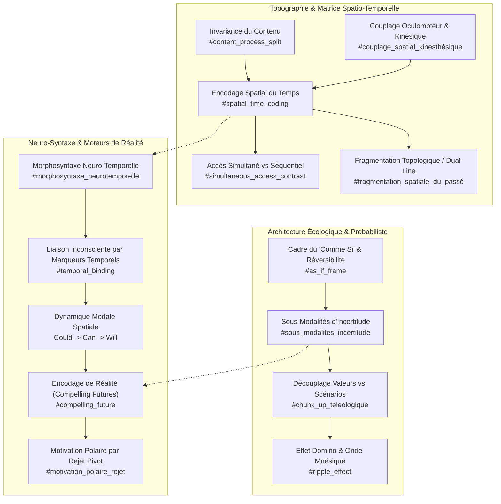
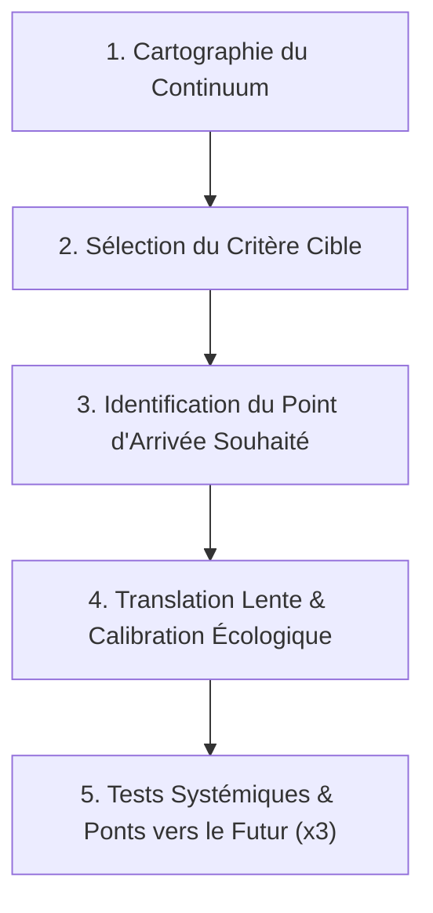

# Change Your Mind And Keep The Change
**Formateur :** Connirae Andreas & Steve Andreas | **ID :** `connirae-andreas-steve-andreas-change-your-mind-and-keep-the-change` | **Tranches :** 20

## Synthèse Architecturale du Cours

### 1. Thèse Centrale & Philosophie du Cours

#### Vision spécifique de Connirae Andreas & Steve Andreas vs Approche standard
L'approche standard en PNL et en coaching s'enlise quasi-systématiquement dans le **contenu** : l'histoire biographique, les justifications narratives, l'analyse rétrospective des causes ou la gestion superficielle des affects. Même lorsqu'elle manipule les sous-modalités, l'approche conventionnelle a tendance à appliquer des recettes standardisées (ex. agrandir l'image ressource, rapetisser l'image limitante) sans vérifier l'écologie globale du système nerveux.

La posture de Connirae et Steve Andreas repose sur une révolution épistémologique stricte : **la primauté absolue de la structure et du méta-cadre sur le contenu.**
- **Le système nerveux est une machine topologique analogique :** Il ne traite pas le temps comme un concept mathématique ou chronologique abstrait, mais comme une matrice spatiale tridimensionnelle péripersonnelle (coordonnées $X, Y, Z$, distance, luminosité, transparence, orientation angulaire). 
- **La neutralité radicale du contenu :** Les Andreas isolent la structure pure en maintenant le contenu invariant (ex. se brosser les dents ou manger son petit-déjeuner à différentes époques). En retirant l'affect et le contexte, le format brut d'encodage de la réalité apparaît sans distorsion.
- **L'écologie probabiliste contre le dogme de la "clarté totale" :** Contrairement à l'injonction populaire de visualiser un avenir net, hyper-détaillé et figé, les Andreas démontrent qu'un futur trop rigide est pathogène (déception garantie dès que le réel diverge). Un système sain code l'avenir avec des sous-modalités d'incertitude analogique (flou, branches arborisées, bulles modulables, transparence) et ancre les critères/valeurs plutôt que les scénarios factuels.
- **Le non-affrontement des défenses :** Utilisation systématique de la réversibilité absolue (*"try this out, you can always go back"*), du jeu (*as-if frame*) et de la synchronisation minutieuse des structures causales préexistantes pour contourner l'inhibition de l'amygdale et le contrôle néocortical.

#### Le fil rouge méthodologique unificateur
Le fil conducteur unifiant l'ensemble des interventions est **l'isomorphisme entre la géométrie spatio-temporelle, la neuro-syntaxe linguistique et la physiologie motrice :**
1. **Éliciter par contraste simultané :** Dépasser le traitement séquentiel en tenant plusieurs points temporels simultanément dans l'espace attentionnel pour faire jaillir les gradients sous-modaux.
2. **Calibrer le corps avant les mots :** Lire les micro-gestes involontaires et l'orientation oculomotrice qui trahissent la localisation réelle des représentations avant toute intellectualisation consciente.
3. **Piloter l'encodage par le verbe :** Utiliser la morphosyntaxe (aspects progressifs, temps verbaux complexes comme le *future perfect* ou le *past perfect*, opérateurs modaux *could $\to$ can $\to$ will*, et subordonnées temporelles présupposées) comme un levier direct de téléportation spatiale et d'association/dissociation.
4. **Restructurer le méta-programme spatial plutôt que le trauma isolé :** Déplacer une trajectoire, résoudre une boucle fermée, corriger une fragmentation sélective ou insérer une alternative sur la ligne du temps future engendre un effet domino automatique rétrograde et antérograde sur l'ensemble de l'expérience humaine.

---

### 2. Carte des Concepts & Leviers Émergents



#### Liste structurée des leviers et rôles dans l'écosystème :

1. **Encodage Spatial du Temps (`#spatial_time_coding` / `#tri_temporel`)**
   - *Rôle :* Infrastructure de base de la cognition. Coordonne le tri chronologique via des repères tridimensionnels ($X, Y, Z$). Détermine instantanément le sens affectif et l'urgence comportementale sans calcul digital.
2. **Invariance du Contenu pour Isolation Sous-Modale (`#content_process_split` / `#invariance_du_contenu`)**
   - *Rôle :* Outil diagnostique de précision. En figeant un contenu anodin répété (ex. le petit-déjeuner), il extrait le code pur de la temporalité sans interférence émotionnelle.
3. **Accès Simultané vs Accès Séquentiel (`#simultaneous_access_contrast`)**
   - *Rôle :* Révélateur de gradients. Brise la réinitialisation perceptive propre au traitement séquentiel pour faire apparaître les discontinuités, ruptures, et anomalies de relief.
4. **Couplage Spatio-Kinésique & Oculomoteur (`#couplage_spatial_kinesthésique` / `#calibrage_accès_oculaire_timeline`)**
   - *Rôle :* Interface corps-esprit. Aligne ou désaligne les représentations avec les zones d'accès oculaires automatiques. Permet d'éteindre une douleur somatique en réorientant spatialement une portion de ligne temporelle hors du quadrant kinesthésique.
5. **Topologie Temporelle : Continuum Analogique vs Découpage Digital (`#analog_continuum` / `#digital_discontinuity`)**
   - *Rôle :* Modélisation de la flexibilité biographique. Distingue les lignes fluides à haute causalité des systèmes fragmentés en « bulles » amnésiques facilitant le recadrage rapide d'histoire de vie.
6. **Cadre du « Comme Si » et Réversibilité Écologique (`#as_if_frame` / `#reversibilite_ecologique`)**
   - *Rôle :* Anesthésiant de résistance. Désactive l'alerte amygdalienne et la défensive des parties protectrices en garantissant l'accès expérimental sans contrainte d'engagement définitif.
7. **Modulation Sous-Modale de l'Incertitude (`#sous_modalites_incertitude` / `#arborisation_predictive`)**
   - *Rôle :* Pare-choc psychologique contre la rigidité. Intègre le flou, la transparence et les embranchements multiples pour prémunir le sujet contre la désillusion face aux aléas réels.
8. **Découplage Critères/Valeurs vs Moyens/Scénarios (`#chunk_up_teleologique` / `#symbolisme_des_valeurs`)**
   - *Rôle :* Orientation motivationnelle méta. Encode des directions abstraites et des critères d'apprentissage plutôt que des scripts comportementaux figés.
9. **Fragmentation Topologique Sélective / Tri Double (`#fragmentation_spatiale_du_passé` / `#cécité_aux_contre_exemples`)**
   - *Rôle :* Diagnostic d'écologie identitaire. Identifie les scissions pathologiques où les échecs sont relégués en zone aveugle, créant une confiance factice dénuée d'apprentissage par l'erreur.
10. **Morphosyntaxe Neuro-Temporelle (`#morphosyntaxe_neurotemporelle`)**
    - *Rôle :* Opérateur linguistique d'association/dissociation. Manipule la distance temporelle subjective et l'ancrage somatique par les temps verbaux (*aspect en -ing*, *past perfect*, *future perfect*).
11. **Liaison Inconsciente par Marqueurs Temporels (`#temporal_binding` / `#subordinate_clauses_of_time`)**
    - *Rôle :* Vecteur de contournement du facteur critique. Glisse des présuppositions d'action dans des subordonnées de temps pour automatiser l'enchaînement neurologique sans débat logique.
12. **Dynamique Modale Spatio-Temporelle (`Could` $\to$ `Can` $\to$ `Will`)**
    - *Rôle :* Traducteur spatial d'engagement. Rapproche physiquement l'image interne depuis l'espace flottant des possibles jusqu'à l'ancrage direct sur la trajectoire future.
13. **Encodage de Réalité & Traction Future (`#compelling_future` / `#reality_coding`)**
    - *Rôle :* Déclencheur d'action motrice. Différencie la fantaisie cognitive sans effet de l'attracteur futur crédible, ancré sur la timeline et soutenu par des traces somatosensorielles.
14. **Motivation Polaire par Rejet Pivot (`#motivation_polaire_rejet`)**
    - *Rôle :* Écologie de propulsion. Utilise un choc aversif ("Non, je refuse cela") non pour s'y complaire, mais pour basculer instantanément sur la génération d'une alternative attractive.
15. **Effet Domino Rétrograde et Antérograde (`#ripple_effect` / `#re-filtrage_chaine_causale`)**
    - *Rôle :* Outil d'actualisation systémique. Propage la transformation d'une ressource racine à travers l'ensemble des nœuds de la mémoire jusqu'au présent et vers l'avenir.

---

### 3. Tableau Récapitulatif des Techniques & Démonstrations

| Technique / Exercice | Objectif Opératoire | Déclencheur / Indication | Séquence Résumée |
|---|---|---|---|
| **Élicitation Standard de la Ligne du Temps** | Mettre à jour la cartographie spatiale inconsciente ($X, Y, Z$) du passé, présent et futur. | Début de toute intervention structurelle ; désorientation temporelle ; confusion objectifs/souvenirs. | 1. Isoler un comportement invariant (ex. se brosser les dents).<br>2. Projeter l'action dans le passé (-5 ans, -1 an), présent, et futur (+1 an, +5 ans).<br>3. Calibrer les micro-gestes involontaires des mains et l'accès oculaire.<br>4. Éliciter les sous-modalités différentielles (distance, direction, luminosité, taille). |
| **Contraste Simultané Spatial** | Détecter les ruptures, courbures pathologiques, boucles ou télescopages structurels invisibles en mode séquentiel. | Le sujet intellectualise sa chronologie ou ne perçoit pas les disparités sous-modales de ses souvenirs. | 1. Demander au sujet de tenir simultanément dans son champ visuel interne 3 à 5 représentations temporelles.<br>2. Évaluer les écarts relatifs d'échelle, d'angle, de netteté et de plan.<br>3. Identifier les anomalies (ex. futur superposé au passé, rupture d'axe, zones aveugles). |
| **Déplacement Spatio-Kinésique de Portion Temporelle** | Neutraliser la réactivation somato-émotionnelle douloureuse systématique lors de l'évocation des souvenirs passés. | Passé situé en bas à droite (quadrant kinesthésique $K_i$), provoquant un effondrement affectif à chaque rappel mnésique. | 1. Calibrer l'ancrage spatial de la portion douloureuse descendante.<br>2. Installer le cadre du « comme si » et de la réversibilité temporaire.<br>3. Guider physiquement et visuellement le déplacement du segment temporel vers le haut et la gauche ($V^r$).<br>4. Vérifier la bascule instantanée en mode visuel panoramique/dissocié et calibrer le relâchement somatique. |
| **Recadrage Temporel Écologique d'Incertitude** | Rétablir la souplesse adaptative et éliminer l'anxiété de contrôle ou la déception prévisible face au futur. | Futur codé de façon rigide, hyper-détaillée et déterministe (format similaire à un souvenir passé fixe). | 1. Identifier l'encodage déterministe d'un objectif futur (net, fixe, saturé).<br>2. Introduire analogiquement des sous-modalités d'incertitude (flou, transparence, brume).<br>3. Remplacer le scénario unique par une arborescence de branches divergentes ou des bulles permutables.<br>4. Chunker up au niveau des critères/valeurs fondamentaux plutôt que des moyens factuels. |
| **Réintégration Topologique des Contre-Exemples** | Restaurer la capacité biologique d'apprentissage par l'erreur et l'évaluation des risques. | Fragmentation en double ligne temporelle : succès alignés au centre, échecs/erreurs jetés en périphérie aveugle (fausse confiance sans profondeur). | 1. Localiser la banque périphérique cachée des échecs et des contre-exemples.<br>2. Dissocier les souvenirs d'erreurs (passage en Noir & Blanc, recul spatial).<br>3. Extraire le gain d'apprentissage et la compétence sécuritaire acquise.<br>4. Réinsérer ces apprentissages sur la ligne temporelle principale sous forme de balises d'expertise. |
| **Désactivation de Boucle Rotative / Collision Temporelle** | Casser la récurrence automatique de schémas névrotiques cycliques générés par une géométrie fermée. | Ligne temporelle en carrousel fermé circulaire ou en forme de "Y" provoquant la collision récurrente du passé sur le futur. | 1. Tracer la topologie défectueuse dans l'espace péripersonnel.<br>2. Ouvrir la boucle fermée à l'aide d'une métaphore spatiale réversible (ex. redresser un ruban).<br>3. Séparer l'axe passé de l'axe futur afin d'empêcher le télescopage frontal.<br>4. Re-synchroniser les flux temporels en deux directions distinctes et test écologique. |
| **Propulsion Neuro-Syntaxique par Marqueurs & Temps Verbaux** | Téléporter la perception du sujet dans un état de résolution dissocié et ancrer l'obligation neurologique d'action. | Sujet bloqué dans l'affect présent du problème, ou incapable de s'engager concrètement vers un but. | 1. Synchroniser au présent ou passé simple.<br>2. Ériger une barrière temporelle via le *Past Perfect* ("Après que vous aviez surmonté cela...").<br>3. Utiliser des subordonnées temporelles présupposées ("Dès que vous réaliserez...").<br>4. Projeter au *Future Perfect* ("Vous aurez complété...") pour encoder la réussite comme un fait historique révolu.<br>5. Faire glisser les opérateurs modaux : *"Could"* $\to$ *"Can"* $\to$ *"Will"*. |
| **Pivot Motivationnel par Rejet Polaire** | Transformer un choc répulsif futur en traction motrice vers un comportement alternatif désirable. | Paralysie par anticipation anxieuse d'un échec ou complaisance stérile dans des conséquences négatives. | 1. Éliciter la représentation de la conséquence future indésirable.<br>2. Amplifier la réaction viscérale de refus catégorique (*"Non, hors de question"*).<br>3. Pivoter immédiatement l'attention à 180° vers la question : *"Alors que veux-tu à la place ?"*.<br>4. Encoder la nouvelle alternative sous format d'image de réalité attractive directement ancrée sur la timeline future. |
| **Effet Domino Mnésique Rétrograde-Antérograde** | Réécrire l'impact émotionnel de toute une série causale d'expériences sans traiter chaque souvenir un à un. | Traumatisme racine ou prémisse de cause à effet faussée influençant négativement toute la biographie. | 1. Identifier l'événement source / racine sur la ligne temporelle.<br>2. Dissocier le sujet, saturer la source de ressources cognitives et affectives adultes.<br>3. Réinsérer le souvenir modifié à sa coordonnée spatiale d'origine.<br>4. Guider une onde de propagation automatique traversant séquentiellement chaque événement de la chaîne jusqu'au présent et propulsant la ressource dans le futur. |

---

---

## 0. Sommaire Sémantique & Index des Lignes

- **Tranche 1 [Lignes 151-254]** : d'Élicitation de la Ligne du Temps Standard (Timeline Elicitation Protocol) — *Protocole :* d'Élicitation de la Ligne du Temps Standard (Timeline Elicitation Protocol) | *Mécanisme :* Encodage Submodal du Temps (Ligne du Temps / Timeline Coding) | *Verbatim :* Le Cadre du "Faire Semblant" pour lever l'amnésie factuelle
- **Tranche 2 [Lignes 256-393]** : Élicitation de la Ligne Temporelle Naturelle (Baseline Elicitation) — *Protocole :* Élicitation de la Ligne Temporelle Naturelle (Baseline Elicitation) | *Mécanisme :* Encodage Spatial du Temps (Spatial Sorting of Time) | *Verbatim :* Utilisation du Cadre "Comme si" pour Contourner le Blocage Visuel
- **Tranche 3 [Lignes 395-552]** : Installation et Test Écologique d'une Nouvelle Ligne du Temps — *Protocole :* Installation et Test Écologique d'une Nouvelle Ligne du Temps | *Mécanisme :* Le cadre du « comme si » et l'expérience d'essai temporaire | *Verbatim :* Le Pré-framing de Réversibilité Totale
- **Tranche 4 [Lignes 554-685]** : Recalibrage Spatial d'une Ligne Temporelle Kinesthésique Douloureuse — *Protocole :* Recalibrage Spatial d'une Ligne Temporelle Kinesthésique Douloureuse | *Mécanisme :* Couplage Spatial Submodalité-Système de Représentation (Ancrage Kinesthésique par Localisation) | *Verbatim :* La Désorientation Neuro-Temporelle Délibérée
- **Tranche 5 [Lignes 687-858]** : Encodage de Futur Irrésistible (Compelling Future) — *Protocole :* Encodage de Futur Irrésistible (Compelling Future) | *Verbatim :* Pattern 1 : Subordination Temporelle & Enchaînement Automatique
- **Tranche 6 [Lignes 860-1045]** : A : Construction et Calibration de l'Image de Soi Désirée (Resource Packing & Reality Tuning) — *Protocole :* A : Construction et Calibration de l'Image de Soi Désirée (Resource Packing & Reality Tuning) | *Verbatim :* Verbatim 1 : Injection Subtile de Ressources & Recadrage de Perspective
- **Tranche 7 [Lignes 1047-1167]** : Le Designer Swish (Protocole Maître) & Le Swish Auditif Isomodal & l'Inversion Analogique — *Protocole :* Le Designer Swish (Protocole Maître) | *Mécanisme :* Le Swish Auditif Isomodal & l'Inversion Analogique | *Verbatim :* L'Accomplishment Frame pour le Déclencheur
- **Tranche 8 [Lignes 1169-1285]** : d'Élicitation d'une Hiérarchie de Critères par Contexte Cumulatif — *Protocole :* d'Élicitation d'une Hiérarchie de Critères par Contexte Cumulatif | *Mécanisme :* Le Codage Neurologique Hiérarchique de l'Importance | *Verbatim :* Verbatim 1 : Recadrage de la question de justification vers l'accomplissement positif
- **Tranche 9 [Lignes 1287-1421]** : Changement de la Hiérarchie des Critères (Criteria Shift) — *Protocole :* Changement de la Hiérarchie des Critères (Criteria Shift) | *Verbatim :* Suggestion de Processus par Présupposition & Effet de "Plunk"
- **Tranche 10 [Lignes 1423-1603]** : A : Ajustement Opératoire d'un Critère sur son Continuum — *Protocole :* A : Ajustement Opératoire d'un Critère sur son Continuum | *Mécanisme :* Le Continuum Analogique des Critères et Réajustement Écologique Lent | *Verbatim :* Le Double-Lien d'Élicitation Positive et Déstabilisation de Pattern
- **Tranche 11 [Lignes 1605-1712]** : The Compulsion Blowout (Élimination par Rupture de Seuil) — *Protocole :* The Compulsion Blowout (Élimination par Rupture de Seuil) | *Verbatim :* Extrait 1 : Induction de résonance kinesthésique et amplification du désir
- **Tranche 12 [Lignes 1714-1860]** : A : Le Compulsion Blowout (Désamorçage de Compulsion par Saturation du Seuil) — *Protocole :* A : Le Compulsion Blowout (Désamorçage de Compulsion par Saturation du Seuil) | *Verbatim :* La métaphore structurelle de l'irréversibilité
- **Tranche 13 [Lignes 1862-1988]** : Elicitation et Rupture de Seuil (« The Last Straw » Pattern) — *Protocole :* Elicitation et Rupture de Seuil (« The Last Straw » Pattern) | *Mécanisme :* Seuil d'importance durable vs Évanescence | *Verbatim :* Suggestion conversationnelle de compulsion par prédicats et spatialisation congruente (Richard Bandler cité par Steve Andreas)
- **Tranche 14 [Lignes 1990-2170]** : Le Patron de Seuil « La Goutte d'Eau » (The Last Straw Threshold Pattern) — *Protocole :* Le Patron de Seuil « La Goutte d'Eau » (The Last Straw Threshold Pattern) | *Mécanisme :* Transition Analogue vers Rupture Digitale du Seuil (Threshold Pattern) | *Verbatim :* La modélisation de la volonté par la structure interne
- **Tranche 15 [Lignes 2172-2368]** : A : Exploration et Calibration Expérientielle des Sous-Modalités de Référence (Exercice de G... — *Protocole :* A : Exploration et Calibration Expérientielle des Sous-Modalités de Référence (Exercice de Groupe) | *Verbatim :* La Prescription de Méfiance et le Double-Lien d'Alliance
- **Tranche 16 [Lignes 2370-2515]** : d'Installation de la Stratégie de Réponse à la Critique (Par Double Dissociation) — *Protocole :* d'Installation de la Stratégie de Réponse à la Critique (Par Double Dissociation) | *Mécanisme :* 1 Le Paradoxe de la Mégalomanie / Pacing Paradoxal des États Psychotiques | *Verbatim :* 1 Injonction Paradoxale de Défiance
- **Tranche 17 [Lignes 2517-2692]** : A : Stratégie de Réponse à la Critique (Installation Complète) — *Protocole :* A : Stratégie de Réponse à la Critique (Installation Complète) | *Mécanisme :* La Double Dissociation d'Installation et Méta-Position d'Apprentissage | *Verbatim :* Verbatim : Induction de la Dissociation et Délimitation Pronuptiale
- **Tranche 18 [Lignes 2694-2827]** : Modélisation, Accès et Redesign d'un État Kinesthésique / Psychoactif (Accessing & Redesigni... — *Protocole :* Modélisation, Accès et Redesign d'un État Kinesthésique / Psychoactif (Accessing & Redesigning Kinesthetic Drug States)
- **Tranche 19 [Lignes 2829-3033]** : Protocole d'Accès Volontaire à un État de Substance & Élimination d'Effets Secondaires (Drug... — *Protocole :* Protocole d'Accès Volontaire à un État de Substance & Élimination d'Effets Secondaires (Drug State Access) | *Verbatim :* Le Pacing Total du Toxicomane (Déconnexion du Dealer)
- **Tranche 20 [Lignes 3035-3226]** : Séparation Soi vs Contexte (Désynchronisation Temporelle) — *Protocole :* Séparation Soi vs Contexte (Désynchronisation Temporelle)

---

## Extractions Détaillées par Tranche (Opératoire & Verbatim)

## Tranche 1 / 20 : d'Élicitation de la Ligne du Temps Standard (Timeline Elicitation Protocol)

Voici l'extraction opératoire intégrale de la **tranche 1/20** du cours *Change Your Mind And Keep The Change* de Connirae Andreas & Steve Andreas.

---

### 1. Mécanismes & Principes Actifs

#### A. Encodage Submodal du Temps (Ligne du Temps / *Timeline Coding*)
* **Principe actif :** Le cerveau humain ne traite pas le temps comme une abstraction mathématique, mais comme une matrice analogique de sous-modalités sensorielles (principalement visuelles et spatiales). L'inconscient code la distance temporelle (passé lointain, passé proche, présent, futur proche, futur lointain) et le statut épistémique (vécu vs projeté, certain vs incertain) par des variables précises : localisation spatiale (gauche, droite, devant, derrière), taille de l'image, degré de luminosité, netteté/détail, et niveau de transparence. Modifier cette structure modifie instantanément la relation subjective de l'individu à son histoire et à ses projections.
* **Tags :** `#spatial_time_coding` `#submodality_distance_marker` `#analog_temporal_matrix` `#epistemic_certainty_coding`

#### B. Séparation Contenu vs Processus / Structure (*Content vs. Process Distinction*)
* **Principe actif :** Le système conscient s'accroche naturellement au *contenu* (le décor, l'âge qu'on avait, le lieu de vie différent) pour justifier la temporalité. Or, le cerveau reptilien et limbique s'oriente via le *processus* (la structure sous-modale). Isoler un comportement invariable (ex. se brosser les dents) force le système nerveux à neutraliser le biais de contenu et rend manifestes les paramètres structurels purs (emplacement, luminosité, échelle).
* **Tags :** `#content_process_split` `#invariant_behavior_probe` `#submodality_isolation`

#### C. Accès Simultané vs Accès Séquentiel (*Simultaneous vs. Sequential Processing*)
* **Principe actif :** Lorsqu'un sujet accède à ses souvenirs de manière séquentielle (l'un après l'autre), le système de référence s'efface à chaque transition, masquant les écarts structurels. L'activation *simultanée* (tenir 3 à 5 représentations dans le champ d'attention conscient en même temps) génère une comparaison différentielle immédiate, révélant la trajectoire, la géométrie spatiale et le gradient sous-modal de la ligne du temps.
* **Tags :** `#simultaneous_access_contrast` `#spatial_array_mapping` `#differential_calibration`

#### D. Le Cadre du "Faire Semblant" (*The "As-If" Frame*)
* **Principe actif :** Lorsqu'un sujet bloque sur l'impossibilité d'accéder à un souvenir précis ("je ne m'en rappelle pas"), le cortex frontal applique un filtre de censure ou de recherche infructueuse. L'instruction de "faire semblant" contourne l'inhibition cognitive : le cerveau utilise obligatoirement les mêmes circuits neurologiques et la même syntaxe sous-modale pour imaginer un fait passé que pour s'en souvenir.
* **Tags :** `#as_if_frame` `#bypass_search_failure` `#neurological_syntax_activation`

#### E. Micro-gestuelle et Révélation Involontaire (*Involuntary Spatial Gesturing*)
* **Principe actif :** Bien avant que le sujet n'intellectualise consciemment la localisation de ses représentations temporelles, son cortex moteur projette physiquement les coordonnées spatiales de ses images internes à travers des micro-gestes (mouvements spontanés des mains pointant vers la gauche, la droite ou en profondeur). Le corps révèle le code avant que l'esprit conscient n'en prenne la mesure.
* **Tags :** `#somatic_projection` `#spatial_leakage` `#motor_calibration_primacy`

---

### 2. Protocoles, Techniques & Démonstrations (Étape par Étape)

#### Protocole d'Élicitation de la Ligne du Temps Standard (*Timeline Elicitation Protocol*)

* **Intention / Indication :**
  * Diagnostic structurel de base préalable à tout travail de changement profond (anxiété du futur, dépression liée au passé, absence d'objectifs, procrastination, manque d'ancrage dans le présent).
  * Nécessaire dès qu'un sujet dit "mettre le passé derrière lui", "avoir un avenir sombre" ou être incapable de planifier.

* **Mise en place & Pré-framing :**
  * Choisir un comportement simple, répétitif, émotionnellement neutre et invariable, accompli dans le passé lointain, le passé récent, le présent, le futur proche et le futur lointain (ex. : *se brosser les dents, faire la vaisselle, conduire pour aller au travail, prendre une douche*).
  * Exclure les contenus affectifs pour éviter le parasitage émotionnel.

* **Séquence d'actions pas à pas :**
  1. **Sélection du comportement invariable :** Demander au sujet de fixer une action neutre et récurrente.
  2. **Accès passé lointain (ex. 5 ans) :** Demander de penser à ce comportement accompli il y a 5 ans. Si blocage amnésique, injecter le cadre du "comme si" (*pretend you are remembering*).
  3. **Accès passé récent (ex. 1 semaine) :** Penser à l'accomplissement du même acte il y a une semaine.
  4. **Accès présent (maintenant) :** Penser à l'accomplissement de cet acte dans le présent.
  5. **Accès futur immédiat/proche (ex. 1 semaine) :** Visualiser l'acte accompli dans une semaine.
  6. **Accès futur lointain (ex. 5 ans) :** Visualiser l'acte accompli dans cinq ans.
  7. **Superposition / Accès simultané :** Donner la consigne de maintenir toutes ces images présentes à l'esprit en même temps dans le champ perceptif.
  8. **Détection de la différence spatiale (Localisation) :** Calibrer les gestes moteurs inconscients et demander : *"Où se trouvent ces différentes scènes dans l'espace autour de toi ?"*
  9. **Extraction des sous-modalités analogiques différentielles :**
     - Comparer passé lointain vs passé récent : taille, luminosité, netteté, distance, angle.
     - Comparer passé vs futur : niveau de détail, transparence, saturation, focus.

* **Signes de calibration observés par le formateur :**
  * **Mouvements des mains / Gestuelle inconsciente :** Regarder où la main pointe spontanément lorsque le sujet prononce les marqueurs temporels (ex. Linda déplaçant la main à 60 cm sur sa gauche pour 5 ans, puis tout près sur sa gauche pour 1 semaine).
  * **Accès oculaires :** Mouvements saccadés des yeux vers des points précis de l'espace lors de l'accès à chaque époque.
  * **Pauses de traitement interne :** Délais de réponse pendant lesquels le sujet scanne son champ visuel interne.

---

### 3. Heuristiques, Subtilités & "Sagesse du Praticien"

#### Règles Conditionnelles ("Si X -> Alors Y parce que Z")
* **Règle 1 :** *Si le sujet répond en décrivant un changement de contenu (ex. "Je le sais parce que j'habitais dans une autre maison") -> Alors refuser immédiatement le contenu et réorienter vers les sous-modalités pures, au besoin en appliquant le cadre "imagine que tu habitais dans la même maison" -> Parce que le cerveau conscient masque le code structurel par la narration factuelle.*
* **Règle 2 :** *Si le sujet bloque en disant "Je ne me souviens d'aucun moment précis il y a 5 ans" -> Alors lui donner l'instruction de "faire semblant qu'il s'en souvient" -> Parce que l'imagination utilise la même syntaxe spatiale et sous-modale que la mémoire épisodique réelle.*
* **Règle 3 :** *Si le sujet n'arrive pas à voir les différences en pensant aux événements un par un -> Alors le forcer à les convoquer simultanément dans son champ visuel -> Parce que le contraste perceptif immédiat court-circuite le reset de la mémoire de travail séquentielle.*
* **Règle 4 :** *Si le sujet affirme verbalement "Pour moi il n'y a aucune différence" mais fait des gestes distincts dans l'espace -> Alors pointer verbalement ses propres gestes devant le groupe pour porter son comportement inconscient à sa conscience -> Parce que le système moteur périphérique réagit à l'encodage submodal avant le cortex verbal.*

#### Pièges Classiques & Erreurs de Débutant
* **Le piège du contenu émotionnel :** Choisir un souvenir fort (ex. vacances, disputes) au lieu d'un acte trivial. Résultat : les émotions et les décors dissimulent les paramètres fins de la ligne du temps.
* **L'évaluation séquentielle :** Laisser le client explorer le passé, puis fermer les yeux, puis explorer le futur. Il réinitialise son repère et ne perçoit pas la trajectoire continue.
* **Croire le client sur parole :** Écouter le client qui dit "je vois tout au même endroit" sans calibrer ses mains et ses micro-mouvements oculaires qui indiquent exactement le contraire.

#### Postulats Opératoires (Steve & Connirae Andreas)
* **La structure prime sur l'histoire :** Ce n'est pas ce qui s'est passé dans le passé qui crée la limitation, c'est la façon dont le passé est spatialisé et rétroéclairé dans l'espace mental du sujet.
* **L'utilité pédagogique de l'échec :** Le succès ne fait que confirmer ce qu'on sait déjà ; seuls les échecs et les anomalies révèlent les règles sous-jacentes de la variabilité subjective.
* **La technologie au service du respect :** Une méthode froide, précise et technique appliquée avec rapidité (ex. corriger une phobie en 30 minutes) est infiniment plus humaine et respectueuse que des mois d'empathie passive impuissante.

---

### 4. Pépites Verbatim & Patterns Linguistiques (MOT À MOT EN V.O.)

#### Pépite 1 : Le Cadre du "Faire Semblant" pour lever l'amnésie factuelle
> **Steve / Connirae Andreas :** "That’s fine. You know that you brushed your teeth five years ago, right? So you can just pretend that you are remembering having done it five years ago."
* **[Analyse du Pattern] :** 
  * *Truisme d'accord préalable :* "You know that you brushed your teeth five years ago, right?" force un accord cognitif indiscutable (question orientée/tag question fermant la contestation).
  * *Présupposition d'action :* L'adverbe "just" minimise l'effort mental nécessaire ("just pretend"), dissolvant la tension liée au fait de ne pas "trouver" un souvenir réel.
  * *Bypass de la recherche mémorielle :* En ordonnant de feindre l'accès ("pretend that you are remembering"), le praticien active la circuiterie neurologique de représentation sans déclencher le signal d'erreur de la mémoire épisodique.

#### Pépite 2 : L'Induction à l'Accès Simultané et à la Différenciation Structurelle
> **Steve / Connirae Andreas :** "We’d like to have you get a sense that you are representing all these experiences at the same time, so that you can begin to notice what differences there are in the way you see this same event. . . . What lets you know that one is in the past and one is in the future? What differences in submodalities let you know one happened a long time ago, and one happened only a week ago?"
* **[Analyse du Pattern] :**
  * *Suggestion de processus inconscient :* "get a sense that you are representing..." utilise un prédicat kinesthésique flou ("get a sense") qui contourne l'analyse rigide et invite à l'immersion corporelle.
  * *Présupposition temporelle & verbale :* "so that you can begin to notice" présuppose de façon inévitable que le sujet *va* remarquer les différences, la seule variable étant le moment où cela commence ("begin to").
  * *Focalisation sur le critère de discrimination :* "What lets you know..." (au lieu de "Is there a difference?") présuppose formellement que la distinction existe déjà dans le système nerveux et qu'il s'agit uniquement de décoder le mécanisme d'information interne.

#### Pépite 3 : Neutralisation active du Biais de Contenu
> **Steve / Connirae Andreas :** "This is a typical response. People tend to notice content differences first, but that’s not what we want. We want the process differences that are coded in submodalities. Linda, what other differences do you notice between the long ago past and the recent past? If you need to, you can even pretend you lived in the same house five years ago, so you can notice only the submodality differences."
* **[Analyse du Pattern] :**
  * *Normalisation par recadrage de groupe :* "This is a typical response. People tend to notice content differences first" valide le sujet, évite le sentiment d'échec et pose le praticien en autorité normative.
  * *Scission explicite Contenu / Processus :* "not what we want / We want the process differences" trace une frontière opératoire stricte dans l'esprit du sujet.
  * *Contrainte par double contrefactuel :* "pretend you lived in the same house five years ago, so you can notice only..." impose une variable de contrôle cognitive artificielle pour obliger le cortex visuel à éteindre le canal du décor et à focaliser l'attention sur les métriques pures (luminosité, taille, angle).

## Tranche 2 / 20 : Élicitation de la Ligne Temporelle Naturelle (Baseline Elicitation)

### 1. Mécanismes & Principes Actifs

* **Encodage Spatial du Temps (Spatial Sorting of Time)**
  * **Principe actif :** Le cortex visuel traite des configurations spatiales en parallèle de manière instantanée, contrairement au traitement auditif/digital qui est strictement séquentiel. L'inconscient projette la chronologie sur des coordonnées tridimensionnelles (gauche/droite, avant/arrière, haut/bas, distance) pour évaluer la temporalité d'un événement sans avoir à calculer de dates. La localisation relative agit comme un déclencheur direct de la réponse émotionnelle et comportementale.
  * **Tags libres :** #encodage_spatial #tri_temporel #topographie_mentale #traitement_visuel_simultane

* **Isolement du Contenu vs Encodage Structurel (Content Invariance for Submodality Isolation)**
  * **Principe actif :** Pour extraire la structure pure du tri temporel sans interférence émotionnelle ou contextuelle, le sujet maintient un événement identique (manger son petit-déjeuner) à différents moments (il y a 5 ans vs dans 5 ans). La neutralisation de la variable "contenu" force le système nerveux à révéler uniquement la variable "format" (sous-modalités temporelles pures).
  * **Tags libres :** #invariance_du_contenu #isolation_sous_modale #discrimination_structurelle

* **Accès Simultané vs Accès Séquentiel (Simultaneous vs Sequential Access)**
  * **Principe actif :** Lorsque les représentations sont accédées une par une (séquentiellement), l'esprit réinitialise son cadre perceptif et occulte les disparités d'encodage. En forçant la visualisation simultanée de deux points temporels, le système nerveux produit un contraste immédiat révélant les écarts de distance, luminosité, taille et transparence.
  * **Tags libres :** #acces_simultane #contraste_perceptif #superposition_temporelle

* **Alignement Neuro-Moteur avec les Clés d'Accès Oculaires (Eye Accessing Cues Congruence)**
  * **Principe actif :** La ligne temporelle est généralement en corrélation directe avec les mouvements oculaires automatiques : le côté mémoire visuelle (habituellement en haut à gauche pour un droitier) héberge le passé, tandis que le côté construction visuelle (en haut à droite) héberge le futur. Quand ce pattern est inversé par rapport aux accès oculaires, le futur est traité comme de la mémoire (rigide, immuable) et le passé comme une construction (malléable), ce qui induit une rigidité existentielle face à l'avenir.
  * **Tags libres :** #couplage_oculomoteur #neurologie_d_acces #isomorphisme_spatial #flexibilite_constructive

* **Impact Attentionnel par Salience Sous-Modale (Proximity / Luminosity Attentional Driver)**
  * **Principe actif :** Le cerveau humain priorise l'action selon les paramètres d'urgence biologique : ce qui est grand, lumineux, net et placé directement dans l'axe médian devant le visage monopolise le système réticulaire activateur. Ce qui est petit, sombre, flou ou repoussé sur les côtés périphériques est ignoré cognitivement. La distance perçue régule la motivation motrice (ex. : une échéance trop lointaine dans l'espace réduit la pression d'accomplissement ; une échéance rapprochée physiquement active la boucle de réalisation).
  * **Tags libres :** #salience_sous_modale #vecteur_attentionnel #proximite_motrice #drive_comportemental

* **Topologie Temporelle Analytique vs Catégorique (Analogue Continuum vs Digital Discontinuity)**
  * **Principe actif :** 
    - *Continuum analogique :* Progression continue sans rupture spatiale, permettant une évaluation fluide des transitions de cause à effet et de temporalité.
    - *Découpage digital / discontinu :* Ruptures marquées (pics formant barrière visuelle masquant le futur lointain, bulles isolées, sauts tranchés). Dans un système en "bulles" (ex. blocs de 6 mois sans chronologie interne), les souvenirs flottent sans ancrage chronologique strict, ce qui rend l'intervention de recadrage biographique (Change Personal History) instantanée car aucune chronologie séquentielle rigide ne résiste à l'insertion d'un nouveau souvenir ressource.
  * **Tags libres :** #continuum_analogique #discontinuite_digitale #frontieres_temporelles #permeabilite_mnemonique

* **Codage de Réalité et Risque Écologique (Reality Coding Boundary)**
  * **Principe actif :** Les sous-modalités du passé codent la certitude ("c'est arrivé, c'est réel"), tandis que celles du futur codent la potentialité ("ce n'est pas encore arrivé, ce n'est pas figé"). Altérer radicalement ou inverser sans précaution ces paramètres peut déstabiliser le test de réalité du sujet, générant désorientation somatique, nausée ou rejet phobique de la modification.
  * **Tags libres :** #codage_de_realite #ecologie_identitaire #test_de_realite #homeostasie_cognitive

---

### 2. Protocoles, Techniques & Démonstrations (Étape par Étape)

#### Protocole 1 : Élicitation de la Ligne Temporelle Naturelle (Baseline Elicitation)
* **Intention / Indication :** Découvrir la structure topographique et sous-modale inconsciente utilisée par le sujet pour coder le passé, le présent et le futur.
* **Mise en place & Pré-framing :** Utiliser une tâche neutre et répétitive à contenu constant (ex. : "manger son petit-déjeuner"). Présenter l'instruction en cadrage "Comme si" si le sujet peine à visualiser simultanément.
* **Séquence d'actions pas à pas :**
  1. *Fixation du contenu :* Demander au sujet d'imaginer le fait de prendre son petit-déjeuner il y a 5 ans, et hier matin.
  2. *Accès simultané :* Demander d'observer ces deux images en même temps.
  3. *Repérage de la localisation :* Calibrer les gestes spontanés du sujet et lui demander où se situent ces représentations dans l'espace autour de lui.
  4. *Extension vers le futur :* Demander d'accéder, simultanément au reste, à la même scène projetée dans 1 semaine, puis dans 5 ans.
  5. *Audit complet des sous-modalités :* Relever l'orientation (gauche/droite/centre), la distance, la taille, l'élévation, la transparence, la luminosité, la netteté, le focus, la couleur (ou N&B), et l'association (vu par ses propres yeux) vs dissociation (se voir dans l'image).
* **Signes de calibration :**
  - Mouvements involontaires des mains et pointages spatiaux (micro-gestes de direction, d'écartement ou de profondeur).
  - Trajectoires oculaires lors de l'accès au passé vs futur.
  - Pauses cognitives signalant la recherche interne de repères spatiaux.

#### Protocole 2 : Test d'Ajustement Sous-Modal et Essayage de Lignes Étrangères (Submodality Shifting & Timeline Try-On)
* **Intention / Indication :** Éprouver la flexibilité cognitive, tester de nouvelles capacités fonctionnelles (planification, réduction de l'anxiété) et vérifier la solidité écologique de l'encodage.
* **Mise en place & Pré-framing :** Cadrer impérativement l'exercice comme temporaire : *"C'est une expérience provisoire, vous pourrez tout remettre en place immédiatement si cela ne vous convient pas."*
* **Séquence d'actions pas à pas :**
  1. *Variation d'un paramètre propre :* Modifier une sous-modalité dominante (ex. : incliner une ligne ascendante vers le bas, espacer un futur trop serré, inverser la taille passé/futur).
  2. *Vérification kinesthésique immédiate :* Noter le ressenti corporel (soulagement, anxiété, étrangeté). Si désorientation somatique majeure -> retour arrière immédiat.
  3. *Emprunt de sous-modalité externe :* Tester un paramètre rapporté par un pair (ex. : rendre le futur transparent au lieu d'opaque).
  4. *Essayage d'une ligne complète opposée :* Adopter intégralement la configuration spatiale d'une personne radicalement différente (ex. : futur en ligne droite devant soi très proche pour un sujet orienté passé).
  5. *Évaluation fonctionnelle :* *"Qu'est-ce que cette organisation vous permet de faire que votre ligne habituelle interdit ? Dans quel contexte précis est-elle un atout ?"*
  6. *Rétablissement écologique obligatoire :* Rétablir la ligne d'origine, sauf décision consciente et écologiquement validée d'ancrer un aménagement pour un contexte spécifique.
* **Signes de calibration :**
  - Modification du tonus musculaire, chute ou élévation de la tension perçue au visage.
  - Respiration (ample vs bloquée).
  - Plaintes d'effort oculaire (signe que le sujet force au lieu d'utiliser l'illusion passive du "comme si").

#### Protocole 3 : Compression / Extension Temporelle pour la Gestion des Deadlines et du Stress
* **Intention / Indication :** 
  - *Cas A (Procrastination / dispersion) :* Échéance vécue comme trop lointaine, dispersion dans des projets parasites.
  - *Cas B (Oppression temporelle / anxiété) :* Futur perçu comme un mur compact qui écrase le présent, incapacité à planifier sereinement.
* **Séquence d'actions pas à pas :**
  - *Pour le Cas A (Compression / Rapprochement) :*
    1. Localiser l'échéance dans l'espace lointain.
    2. Réduire la distance ("mouliner" / rapprocher la date butoir) jusqu'à ce qu'elle soit immédiatement accessible visuellement.
    3. Constater l'élimination de l'espace interstitiel : aucun projet parasite ne peut s'intercaler entre aujourd'hui et la deadline.
  - *Pour le Cas B (Extension / Étalement) :*
    1. Localiser le paquet compact d'images futures comprimées devant le visage.
    2. Espacer physiquement les représentations le long de l'axe temporel (éloigner demain, déployer la semaine prochaine, ouvrir les intervalles).
    3. Calibrer la décompression physique et respiratoire.
  - *Pont vers le futur & Écologie :* Projeter le sujet dans les jours à venir avec cette nouvelle configuration spatiale pour vérifier qu'il conserve sa capacité d'exécution sans dérive vers la léthargie.
* **Signes de calibration :**
  - Cas A : Posture qui se redresse, focalisation du regard, mise en tension motrice.
  - Cas B : Baisse immédiate des épaules, soupir respiratoire, décongestion des traits faciaux.

---

### 3. Heuristiques, Subtilités & "Sagesse du Praticien"

* **La règle de non-contradiction du geste (Gestural Priority Rule) :**
  * *Heuristique :* Si le sujet dit verbalement *"Je n'ai pas de ligne temporelle, pour moi tout est pareil"*, mais que ses mains bougent vers l'arrière, puis à 30 cm du visage, puis vers l'avant : **ignorer le verbal, cartographier le geste**. Le geste spatial traduit le calcul de l'hémisphère droit/inconscient ; la déclaration verbale traduit uniquement l'aveuglement conscient de l'hémisphère gauche.

* **Heuristiques d'orientation temporelle :**
  * *Si* la représentation du présent est opaque, géante et placée droit devant les yeux, masquant le futur -> *alors* le sujet est coincé dans l'immédiateté radicale ("ici et maintenant" à la seconde près), incapable d'anticiper les conséquences.
  * *Si* le futur s'élève, grossit et devient plus lumineux au loin -> *alors* le sujet vit pour des idéaux à long terme et néglige les gratifications et responsabilités du présent.
  * *Si* le passé est projeté directement devant les yeux sur la ligne médiane -> *alors* le sujet revit constamment ses souvenirs ; le travail de recadrage d'histoire personnelle (*Change Personal History*) y aura un impact neurologique décuplé.
  * *Si* le futur présente un "pic" (montagne visuelle) qui masque ce qui suit -> *alors* l'attention est bloquée sur l'échéance immédiate ; aplanir la trajectoire rétablit automatiquement la vision à long terme.

* **Heuristique d'installation écologique (Ecology & Reality Safeguard) :**
  * Ne jamais forcer un réarrangement spatial. Si un sujet ressent de la fatigue physique ou de la tension oculaire (ex. cas de Joe et Mark), c'est qu'il "lutte" contre sa propre structure neurologique. 
  * *Solution opératoire :* Substituer la commande de force par le cadre du laisser-faire : *"Let the timeline do you"* (Laisse la timeline s'arranger d'elle-même) ou employer le cadre "comme si".
  * *Règle absolue :* Le sentiment d'étrangeté est normal lors d'un test, mais une sensation de désorientation profonde indique une atteinte au codage de réalité. Vérifier les contextes de vie clés (travail, famille, loisirs) avant d'envisager une quelconque fixation durable.

* **Heuristique sur la nature des transitions (Analogue vs Digital) :**
  * *Mouvements continus et fluides de la main* = Continuum analogique. Le sujet nuance les durées de façon progressive.
  * *Gestes staccato, hachés, tranchants (coupes verticales/horizontales) ou main pivotant comme une pièce de monnaie* = Frontières digitales/catégorielles étanches. Traiter les blocs temporels comme des compartiments isolés.

---

### 4. Pépites Verbatim & Patterns Linguistiques (MOT À MOT EN V.O.)

#### Pépite 1 : Utilisation du Cadre "Comme si" pour Contourner le Blocage Visuel
> "Even if you had lived in the same house, you could probably tell the difference between five years ago and yesterday. [...] If you have trouble seeing all these pictures at the same time, use the 'as if' frame: just pretend you can do it."

* **[Analyse du Pattern]** :
  - **Empilement de truismes et présupposition temporelle :** *"you could probably tell the difference"* installe l'inévitabilité de la distinction neurologique via un modaliseur de probabilité qui contourne la résistance analytique.
  - **Cadre "As if" (Comme si) :** Autorise le système nerveux à suspendre le critère de performance ("je n'y arrive pas") en le requalifiant en jeu d'imagination ("just pretend"), ce qui libère instantanément l'accès aux représentations visuelles inconscientes.

#### Pépite 2 : Recadrage de la Fatigue Somatique et Dé-volition
> "I notice that you use the phrase 'to take on' a new timeline; it sounds as if you're dealing with an opponent or a burden. [...] rather than putting a lot of effort into it—by straining to force my pictures into new places—I just let the timeline do me. The images simply appear in new positions. Does that make sense?"

* **[Analyse du Pattern]** :
  - **Recadrage métaphorique par extraction du prédicat :** Steve Andreas isole le verbe utilisé par le client (*"to take on"*) et explicite la métaphore sous-jacente de lutte/fardeau (*"an opponent or a burden"*).
  - **Inversion agent/patient (Dé-volition hypnotique) :** La formulation transgressive *"I just let the timeline do me"* inverse la polarité du contrôle. Elle retire la volonté consciente de l'équation pour transférer l'action à un processus inconscient autonome, supprimant la fatigue neuro-musculaire ("straining to force") au profit d'une émergence passive (*"The images simply appear"*).

#### Pépite 3 : Dé-dogmatisation et Relativisme Opératoire
> "Saying 'this is the right timeline' is like saying 'this is the right way to be, and there are no other useful ways to live in the world.' A person's timeline can make him unique. But if it gets him into trouble in certain situations, or if a different timeline would allow him to do things that he can't now do with his own, then it might be appropriate to explore alternatives, at least for specific contexts."

* **[Analyse du Pattern]** :
  - **Analogie de réduction à l'absurde :** Équivalence complexe réfutant l'existence d'une structure temporelle normative universelle.
  - **Cadrage contextualisé et préservation des gains secondaires :** Utilisation d'un conditionnel adoucisseur (*"it might be appropriate"*) combiné à une restriction contextuelle stricte (*"at least for specific contexts"*). Ce pattern neutralise l'angoisse de perdre son identité tout en ouvrant l'écologie du choix.

#### Pépite 4 : Suggestion Indirecte Liée à la Survie Somatique
> "We've also noticed that for some people, having a long-range future that is filled with big bright goals literally gives them 'something to live for' and they're more apt to stay alive! One study on cancer patients found that survivors are apt to be future-oriented, whereas non-survivors are past-oriented."

* **[Analyse du Pattern]** :
  - **Truisme d'autorité avec enjeu vital :** L'évocation d'une étude clinique sur le cancer introduit un enjeu de survie biologique sous forme de simple constatation conversationnelle.
  - **Commande cachée de réorientation temporelle :** En associant implicitement "survie" à "orientation futuriste lumineuse" et "décès" à "orientation passé", la structure sémantique génère une motivation inconsciente d'évitement majeur, poussant le système nerveux du sujet à ouvrir et éclaircir son horizon temporel futur sans injonction directe.

## Tranche 3 / 20 : Installation et Test Écologique d'une Nouvelle Ligne du Temps

Voici l'analyse modélisatrice et opératoire intégrale de la tranche 3/20 du séminaire *« Change Your Mind And Keep The Change »* de Connirae & Steve Andreas.

---

### 1. Mécanismes & Principes Actifs

#### A. Le cadre du « comme si » et l'expérience d'essai temporaire
- **Principe actif :** Réduction radicale de l'alerte du système immunitaire psychologique et des objections de parties. Si le changement est présenté comme définitif, les parties protectrices mobilisent des résistances immédiates (#rightful_fight). En posant la réversibilité absolue (*"try this out, you can always go back"*), l'amygdale et le néocortex inhibent le réflexe défensif. L'accès à la nouvelle ligne temporelle s'opère par le jeu mental imaginaire (*fantasy experience*), court-circuitant le contrôle conscient et la fatigue oculomotrice (#submodal_strain_reduction).
- **Tags libres émergents :** `#cadre_comme_si` `#reversibilite_ecologique` `#baisse_inhibition_protectrice` `#as_if_frame` `#defusion_contrainte`

#### B. La modulation sous-modale de l'incertitude dans le futur
- **Principe actif :** Protection contre la rigidité et la déception future. Un futur codé avec des sous-modalités identiques à un souvenir passé (détaillé, net, saturé en couleurs, fixe) impose au système nerveux une attente déterministe. Dès que la réalité diverge de la représentation interne, le sujet subit un choc d'incongruence (#perceptual_disappointment). Pour qu'un futur soit fonctionnel, il doit comporter des sous-modalités analogiques de probabilité : flou (*foggy*), hors-focalisation (*out of focus*), transparence, arborisation (*branches* / *water spray*) ou bulles permutables (#floating_bubbles).
- **Tags libres émergents :** `#sous_modalites_incertitude` `#arborisation_predictive` `#anti_determinisme_visuel` `#codage_probabiliste` `#souplesse_teleologique`

#### C. L'encodage des valeurs et méta-objectifs versus le contenu spécifique
- **Principe actif :** Séparation du niveau logique des critères/valeurs et de celui des comportements/scénarios. Projeter des scénarios d'action rigides paralyse le sujet ignorant le déroulement exact des événements. En encodant le futur sous forme de symboles de valeurs (direction, apprentissage, capacité, lien relationnel), le système nerveux oriente sa boussole attentionnelle (Réticulée Activatrice Ascendante) vers des états désirés sans figer les moyens d'exécution (#outcome_flexibility).
- **Tags libres émergents :** `#boussole_axiologique` `#symbolisme_des_valeurs` `#decouplage_critere_moyen` `#chunk_up_teleologique`

#### D. Structure temporelle vs Contenu d'expérience (Niveaux de Changement)
- **Principe actif :** Une intervention sur le contenu (ex: Histoire de Vie / *Change History* sur un souvenir isolé) modifie la réponse affective à une classe d'événements. À l'opposé, la géométrie spatiale de la ligne du temps gouverne le méta-programme de traitement de *tous* les contenus. Si une ligne temporelle présente une boucle fermée rotative (#slide_carousel_loop) ou un chevauchement passé/futur (#y_shape_collision), aucun travail sur le contenu ne stabilise le sujet car la structure recrée la pathologie à l'infini.
- **Tags libres émergents :** `#meta_structure_vs_contenu` `#boucle_spatiale_perpetuelle` `#collision_temporelle_isomorphe` `#geometrie_perceptive`

#### E. Tri spatial Plaisir / Déplaisir et dissociation protectrice
- **Principe actif :** La spatialisation différentielle (arrière/invisible vs avant/visible) et le codage sous-modal (Noir & Blanc vs Couleur). Reléguer les souvenirs douloureux derrière soi retire l'accès visuel direct et protège de la charge émotionnelle, mais présente le risque d'amnésie fonctionnelle ou d'incapacité à extraire des apprentissages. La solution opératoire consiste à dissocier systématiquement l'émotion (*over there*), passer en Noir & Blanc, extraire l'apprentissage, transférer cet apprentissage dans le futur, puis réassocier et recolorer une fois la ressource installée.
- **Tags libres émergents :** `#tri_spatial_plaisir_deplaisir` `#dissociation_nb_couleur` `#extraction_apprentissage_amont` `#ecologie_de_l_oubli`

#### F. L'effet Domino rétrograde et antérograde
- **Principe actif :** Recadrage de la chaîne de causalité mnésique. Un souvenir encodé agit comme un filtre perceptif actif qui biaise rétroactivement et prospectivement toutes les expériences subséquentes. En modifiant la représentation source (racine) et en la replaçant dans sa coordonnée spatio-temporelle, la suggestion de propagation d'onde (#ripple_effect #domino_effect) re-traite automatiquement toute la série séquentielle jusqu'au présent et vers le futur.
- **Tags libres émergents :** `#effet_domino_temporel` `#propagation_donde_mnesique` `#re-filtrage_chaine_causale` `#ripple_effect`

#### G. Isomorphisme entre Ligne du Temps et Accès Visuels/Kinesthésiques
- **Principe actif :** Alignement synesthésique neuro-spatial. Si une ligne du passé plonge en bas à droite (champ du kinesthésique interne/émotions), l'évocation d'un passé douloureux déclenche instantanément une plongée viscérale intense (#visceral_overload). Si le passé et le futur sont derrière, le sujet est hyper-associé au présent (*present-oriented*), incapable de prospective. Si le sujet n'accède qu'aux réussites (passé négatif hors-champ), il développe une assurance de façade sans ancrage critique (#shallow_congruence).
- **Tags libres émergents :** `#isomorphisme_cues_espace` `#piege_kinesthesique_bas_droite` `#hyper_congruence_sans_fond` `#calibrage_postural_temporel`

---

### 2. Protocoles, Techniques & Démonstrations (Étape par Étape)

---

#### PROTOCOLE 1 : Installation et Test Écologique d'une Nouvelle Ligne du Temps
* **Intention / Indication :** Quand le sujet souhaite adopter une nouvelle organisation spatiale du temps mais ressent de la crispation, de la tension oculaire ou une crainte inconsciente de perte de contrôle.
* **Mise en place & Pré-framing :** Poser le cadre du « comme si » et de la réversibilité totale. Valider la part de sécurité.
* **Séquence d'actions pas à pas :**
  1. **Désamorçage de l'engagement définitif :** Poser que l'exercice est un essai temporaire et réversible (*"You can try this out; if you don't like it... you can always go back"*).
  2. **Induction du cadre « comme si » (fantaisie passive) :** Inviter le sujet à faire semblant que la ligne est déjà là, sans forcer visuellement afin d'éviter la fatigue oculaire (*"Pretend as if you already have the new timeline, but you don't necessarily have to see it clearly"*).
  3. **Vérification écologique multi-contextuelle :** Demander au sujet d'observer intérieurement ce que produit cette ligne dans tous ses contextes de vie : identifier les gains et les limitations éventuelles.
  4. **Pont vers le futur spécifique (*Future-Pace*) :** Identifier les contextes exacts où de nouveaux choix sont désirés. Faire projeter le sujet avec sa nouvelle ligne dans plusieurs situations futures distinctes.
  5. **Test de généralisation :** Demander d'évoquer 1 ou 2 situations imprévues pour observer la réponse spontanée.
  6. **Double critère de validation :** Vérifier à la fois :
     - Si le tri temporel s'opère bien selon la nouvelle modalité spatiale.
     - Si le comportement opérationnel désiré est débloqué.
* **Signes de calibration :** Absence de crispation des muscles périorbitaires (détente du regard), respiration fluide, absence de sursaut défensif, acquiescement postural congruent.

---

#### PROTOCOLE 2 : Génération et Implantation d'un Futur Absent
* **Intention / Indication :** Sujets chez qui la ligne temporelle s'arrête brusquement dans le présent ou à proximité immédiate (ex: Betty, ou personnes post-traumatiques/scripts de mort programmée). Incapacité à planifier, impulsivité, dépression ou panique à l'idée du futur.
* **Mise en place & Pré-framing :** Valider l'écologie du blocage : expliquer qu'un futur vide est souvent une tentative saine d'éviter la déception causée par un futur trop précis et rigide.
* **Séquence d'actions pas à pas :**
  1. **Recadrage de la nature du futur :** Poser la distinction entre fait certain (passé) et potentiel ouvert (futur).
  2. **Choix du mode d'encodage de l'incertitude :** Présenter les sous-modalités adaptées (lignes en éventail/arborisation, transparence, léger flou, ou bulles mobiles).
  3. **Chunking-down des valeurs fondamentales (Alternative symbolique) :**
     - Demander : *"Qu'est-ce qui est réellement important pour toi dans ton futur ?"* (ex: apprendre, monter en compétences, relations).
     - Inviter l'inconscient à produire des symboles pour ces valeurs directrices sans figer les détails factuels.
  4. **Extension progressive par micro-pas (*Gradual Chunking-down*) :**
     - Si le blocage persiste : *"Que feras-tu dans 5 minutes ?"*
     - Étape suivante : *"Et la semaine prochaine ?"*
     - Étendre pas à pas la trajectoire spatiale vers la droite ou l'avant.
  5. **Vérification somato-écologique :**
     - *"Remarque comment cela s'ajuste pour toi... Est-ce que cela te permet d'être davantage qui tu veux être ?"*
* **Signes de calibration :** Élargissement du champ gestuel (la main qui s'arrêtait à 30 cm s'étend plus loin), soupir de soulagement, bascule de l'attention immédiate vers une posture de projection équilibrée (*"This seems more balanced"*).

---

#### PROTOCOLE 3 : Décontamination et Tri d'un Passé Traumatique Massif
* **Intention / Indication :** Sujets ayant vécu des horreurs massives (guerre, accidents) ayant totalement occulté/amputé leur passé pour ne pas souffrir, provoquant confusion, absence d'ancrage et amnésie dissociative.
* **Mise en place & Pré-framing :** Présupposer que l'inconscient sait trier et que toutes les expériences (bonnes ou mauvaises) contiennent des ressources d'apprentissage vitales qu'il ne faut pas détruire mais reconfigurer.
* **Séquence d'actions pas à pas :**
  1. **Instruction directe à l'inconscient :** Demander à l'inconscient de balayer l'intégralité de l'histoire de vie pour séparer le matériau plaisant du matériau déplaisant.
  2. **Dissociation et retrait de couleur sur le déplaisant :**
     - Faire basculer l'ensemble des souvenirs douloureux en dissociation totale (*feelings over there*).
     - Passer ces représentations en Noir et Blanc (conserver le format film pour garder l'information séquentielle).
  3. **Saturation sensorielle du plaisant :**
     - Vérifier que tous les souvenirs agréables et ressources sont pleinement associés et éclatants en couleur.
  4. **Extraction d'apprentissage :**
     - Extraire explicitement les apprentissages utiles du passé douloureux et les implanter en amont dans le futur.
  5. **Révision & Réassociation conditionnelle (Optionnelle) :**
     - Appliquer un Changement d'Histoire (*Change History*) ou recadrage sur les événements critiques.
     - Une fois la ressource intégrée : autoriser la réassociation et le retour de la couleur.
* **Signes de calibration :** Disparition des absences/états de sidération (*spacing out*), repérage postural stable de la ligne du passé, récupération de la clarté cognitive lors des questions présupposant l'antériorité.

---

#### PROTOCOLE 4 : Correction d'une Déformation Structurelle (Cas de la Boucle ou du Conflit Passé/Futur)
* **Intention / Indication :** Symptôme persistant réfractaire aux techniques de contenu (ex: énurésie/parurésie avec boucle rotative d'humiliations, ou dépression systématique de 6 mois post-crise due à une ligne en "Y" superposant passé et futur).
* **Mise en place & Pré-framing :** Faire cartographier précisément la topologie tridimensionnelle de la ligne dans l'espace.
* **Séquence d'actions pas à pas :**
  1. **Diagnostic spatial de l'anomalie :**
     - Identifier les boucles (*carousels*), les angles vifs (forme en "W" inversé) ou les chevauchements (forme en "Y").
  2. **Restructuration géométrique directe :**
     - Inviter le sujet à dérouler, étirer ou redresser la structure spatiale déformée (transformer la boucle en ligne droite finie ; scinder la tige du "Y" pour séparer passé immédiat et futur immédiat).
  3. **Manœuvre de rotation somatique (Cas du sujet "retourné") :**
     - Si le sujet a inversé l'orientation sans pouvoir bouger ses images mentalement : faire pivoter physiquement le corps du sujet sur lui-même à 180° à l'intérieur de sa pièce, laissant la ligne fixée dans l'espace physique.
  4. **Intégration et Future-Pace :**
     - Vérifier la fluidité attentionnelle et la disparition des interférences immédiates.
* **Signes de calibration :** Respiration débloquée, orientation oculaire cohérente avec le tri passé/futur conventionnel, sensation d'avoir *"du temps devant soi"*, baisse instantanée de l'anxiété.

---

### 3. Heuristiques, Subtilités & "Sagesse du Praticien"

#### Règles conditionnelles ("Si... Alors...")
- **Si** une partie du sujet craint d'être piégée définitivement par une nouvelle ligne temporelle, **alors** elle combattra le processus de toutes ses forces, **parce que** son rôle écologique primaire est de préserver les modes d'adaptation existants. Le recadrage de réversibilité est obligatoire.
- **Si** le sujet verbalise une désorientation lors de l'essai d'une ligne, **alors** distinguer s'il s'agit d'un simple manque d'habitude (*unfamiliar*) ou d'un signal biologique d'inadéquation écologique (*not quite right*).
- **Si** le sujet présente un arrêt brutal de sa ligne dans le futur proche, **alors** investiguer immédiatement un "script de mort" (*death script* / AT) ou l'anticipation d'une issue fatale consécutive à un événement critique (ex: accident, croyance liée au poids).
- **Si** le sujet "n'a pas de futur", **alors** il est rigoureusement impossible d'exécuter un *Swish* ou un *Change History*, **parce que** ces techniques requièrent un espace projectif vierge où loger le soi transformé.
- **Si** le sujet dit "Non !" catégorique à un exercice de timeline, **alors** s'arrêter immédiatement, respecter la résistance et investiguer la fonction écologique supérieure (ex: protection de la spontanéité), **parce que** forcer l'exercice violerait l'intégrité systémique du sujet.
- **Si** le sujet trie les souvenirs pénibles en les mettant "derrière" lui, **alors** exiger l'extraction préalable de tous les apprentissages utiles pour les injecter dans le futur **avant** de clore l'accès, **parce que** jeter le passé sans en tirer la substantifique moelle appauvrit l'appareil décisionnel.
- **Si** vous appliquez un *Change History* sur un souvenir passé, **alors** activez la métaphore du filtre et de l'effet domino pour verbaliser la recoloration automatique de toute la chaîne d'événements jusqu'au présent et au-delà.
- **Si** une personne a son passé situé en bas à droite (direction d'accès kinesthésique), **alors** elle revivra ses souvenirs douloureux avec une intensité émotionnelle viscérale incontrôlable. Remontez sa ligne en haut à gauche pour introduire de la distance visuelle cognitive.

#### Pièges classiques & Erreurs de débutant
1. **L'illusion du "futur en haute définition" :** Construire un futur aussi net, précis et fixe que des souvenirs passés. C'est l'erreur type qui programme des déceptions dépressives inévitables.
2. **La destruction par amnésie sauvage (*Black hole / Ashes*) :** Envoyer des souvenirs dans un trou noir ou les brûler. Bien que techniquement possible, Steve & Connirae le déconseillent formellement car cela prive le sujet de données d'apprentissage adaptatives.
3. **L'acharnement sur le contenu :** Multiplier les protocoles de *Change History* sur des dizaines de traumatismes sans s'apercevoir que la ligne temporelle elle-même boucle en rond (*slide carousel*).
4. **La rotation mentale forcée :** Tenter d'obliger un sujet kinesthésique/présent-orienté à déplacer mentalement des axes spatiaux invisibles. La solution consiste à lui faire effectuer une rotation physique du corps (*spin around physically*).

---

### 4. Pépites Verbatim & Patterns Linguistiques (MOT À MOT EN V.O.)

#### Pépite 1 : Le Pré-framing de Réversibilité Totale
> *"You can try this out; if you don't like it, or if it's not appropriate in some way, you can always go back to the way you did it before."*
- **[Analyse du Pattern]** : 
  - **Permission permissive & double condition d'échappement** (*"if you don't like it, or if it's not appropriate"*).
  - **Présupposition temporelle d'autonomie absolue** (*"you can always go back"*), neutralisant instantanément la réactance psychologique et rassurant les parties dissidentes.

---

#### Pépite 2 : L'Évocation Guidée du Futur par les Valeurs
> *"So think about what's really important to you in your future. What do you want more of in your life? Do you want to do things that will allow you to learn . . . ? To become more and more capable . . . ? To have good relationships with those around you . . . ? Let your unconscious assist you in generating representations of what you are sure you want to have in the future. . . ."*
- **[Analyse du Pattern]** :
  - **Empilement de truismes nominatifs et méta-valeurs universelles** (*learn*, *capable*, *good relationships*), impossibles à refuser par l'inconscient.
  - **Rythme hypnotique suspensif avec ellipses sonores** (`. . .`), induisant un état de recherche transderivationnelle.
  - **Délégation d'agentivité à l'inconscient** (*"Let your unconscious assist you..."*) combinée à une commande de certitude (*"what you are sure you want"*), créant une assise solide sur laquelle construire les images spatiales sans forcer le conscient.

---

#### Pépite 3 : La Suggestion de l'Effet Domino Temporel
> *"That old experience was like a filter that made you respond to later events in a particular way, coloring them in ways you couldn't ignore or change. Now the same will be true of this new way of experiencing that past event. As you place this memory back in its place on your timeline, I want you to notice how it will alter and recolor all the events between then and now, in a 'domino' effect, so that you will enjoy the benefits of that change now, as well as at all intermediate times in the past."*
- **[Analyse du Pattern]** :
  - **Isomorphisme métaphorique** : Le souvenir originel est redéfini comme un simple *"filtre"* optique.
  - **Équivalence complexe et pont logique** : *"Now the same will be true of this new way..."*.
  - **Subordonnée temporelle de liaison inévitable** (*"As you place this memory back... I want you to notice how it will alter..."*). Le geste spatial manuel/visuel déclenche automatiquement la cascade de transformations.
  - **Généralisation tritemporelle totale** : Connecte le passé révisé (*intermediate times*), le présent somatique (*enjoy now*) et le futur projeté, créant une reconfiguration neuronale complète sans effort analytique.

## Tranche 4 / 20 : Recalibrage Spatial d'une Ligne Temporelle Kinesthésique Douloureuse

### 1. Mécanismes & Principes Actifs

*   **Couplage Spatial Submodalité-Système de Représentation (Ancrage Kinesthésique par Localisation)** :
    *   *Principe actif* : La trajectoire spatiale de la ligne du temps dicte l'accès sensoriel automatique. Lorsqu'une portion de la ligne temporelle (ex. le passé) descend vers le bas et la droite du champ perceptif du sujet, le système nerveux déclenche systématiquement le repérage oculaire et l'accès kinesthésique interne (*feelings*). Les souvenirs y sont revécus avec une charge somatique/émotionnelle intense et non filtrée. Déplacer spatialement cette portion vers le haut et la gauche force un basculement vers le traitement visuel mémorisé (V^r), désactivant la boucle kinesthésique douloureuse au profit d'un encodage dissocié ou panoramique.
    *   *Tags libres émergents* : `#couplage_spatial_kinesthésique` `#repositionnement_spatial_de_ligne` `#extinction_émotionnelle_par_déplacement` `#calibrage_accès_oculaire_timeline`

*   **Fragmentation Topologique Sélective de la Ligne Temporelle (Dual-Line Sorting & Filtrage d'Exceptions)** :
    *   *Principe actif* : La ligne temporelle n'est pas obligatoirement continue ou unitaire ; le système nerveux peut segmenter les souvenirs selon des critères affectifs ou évaluatifs en créant deux banques distinctes dans l'espace péripersonnel. Si les échecs et souvenirs douloureux sont projetés en périphérie aveugle (ex. loin à gauche, hors du champ de vision) tandis que les réussites sont alignées dans l'axe visuel frontal montant, le sujet développe une « congruence sans profondeur » (*Mister Confidence*). L'absence d'accès perceptif simultané aux contre-exemples supprime la fonction biologique d'apprentissage par l'erreur et désactive l'évaluation du risque écologique.
    *   *Tags libres émergents* : `#fragmentation_spatiale_du_passé` `#cécité_aux_contre_exemples` `#fausse_congruence_sans_profondeur` `#asymétrie_perceptive_succès_échecs`

*   **Indexation Temporelle Linguistique (Changement de Temps Verbal & Glissement Submodal)** :
    *   *Principe actif* : La morphosyntaxe verbale agit comme un opérateur direct de programmation submodale et d'association/dissociation dans l'espace subjectif interne :
        *   *Passé simple ("I talked")* : Positionne le sujet associé au présent, observant une image fixe dissociée de lui-même dans son passé.
        *   *Présent simple ("I talk")* : Positionne le sujet totalement associé dans l'action, observant son interlocuteur ou son environnement direct.
        *   *Futur simple ("I will talk")* : Positionne le sujet associé au présent, regardant son double dissocié dans le futur.
        *   *Aspect progressif en -ing ("I was / am / will be talking")* : Transforme les représentations statiques en films continus, agrandit et rapproche l'image, et force l'association somatosensorielle directe dans l'action.
        *   *Passé composé / Present Perfect ("I have talked")* : Introduit une ambiguïté temporelle volontaire entre le passé et le présent, créant un sas de transition pour glisser un état présent vers un statut de relique révolue sans heurter le rapport.
        *   *Plus-que-parfait / Past Perfect ("I had talked")* : Génère trois points de référence temporels simultanés (présent du locuteur -> événement passé intermédiaire -> événement source lointain). L'interposition d'un événement antérieur révolu érige une barrière temporelle qui démultiplie la dissociation cognitive vis-à-vis du problème.
        *   *Futur antérieur / Future Perfect ("I will have talked")* : Téléporte la conscience dans un futur lointain et la retourne pour contempler la résolution comme un fait historique déjà accompli. Ce shift confère neurologiquement le statut de « réalité encodée » à un objectif encore imaginaire.
    *   *Tags libres émergents* : `#morphosyntaxe_neurotemporelle` `#aspect_progressif_générateur_de_film` `#dissociation_par_le_plus_que_parfait` `#installation_de_réalité_par_le_futur_antérieur` `#sas_d_ambiguïté_temporelle`

*   **Dépendance Temporelle des Représentations de Cause à Effet (Cause-Effect Submodality Architectures)** :
    *   *Principe actif* : Toute croyance de cause à effet s'appuie neurologiquement sur une séquence ordonnée dans le temps : la cause précède impérativement l'effet (sous forme de film continu, de bande cinématographique segmentée ou d'images reliées par un vecteur/flèche). Attaquer de front une croyance de cause à effet détruit la cohérence du monde du sujet et déclenche une résistance défensive massive. Le principe actif consiste à synchroniser (pacer) fidèlement la structure de causalité mémorisée, puis à saturer cette même chaîne causale avec un recadrage de sens qui transforme la prémisse douloureuse en un signal d'alerte, de protection et d'expertise discriminative supérieure.
    *   *Tags libres émergents* : `#architecture_submodale_cause_effet` `#synchronisation_de_causalité` `#recadrage_de_sens_par_inversion_de_prémisse` `#conversion_trauma_en_expertise_sécuritaire`

*   **Liaison Inconsciente par Présupposition Temporelle (Syntactic Time Binding)** :
    *   *Principe actif* : Les propositions subordonnées temporelles (*before, after, during, as, while, when, prior to*) court-circuitent l'analyse consciente en traitant l'action principale ou seconde comme un fait acquis non contestable. La syntaxe oblige le cerveau à relier deux représentations distinctes en une séquence neuro-fonctionnelle continue sans délibération critique.
    *   *Tags libres émergents* : `#liaison_syntaxique_inconsciente` `#court_circuit_analytique_par_subordonnée` `#enchaînement_présuppositionnel`

---

### 2. Protocoles, Techniques & Démonstrations (Étape par Étape)

#### Protocole 1 : Recalibrage Spatial d'une Ligne Temporelle Kinesthésique Douloureuse
*   **Intention / Indication** : Sujet submergé d'émotions négatives intenses (*great feeling*) dès qu'il repense à son passé, évitant l'introspection ou fuyant en avant dans le futur.
*   **Mise en place & Pré-framing** : Calibrer la direction des accès oculaires et le tracé spatial du passé. Identifier si la trajectoire descend dans le secteur kinesthésique (bas/droite). Cadrer le changement non comme une suppression des souvenirs, mais comme une modification de l'accès sensoriel pour pouvoir traiter l'information froidement.
*   **Séquence d'actions pas à pas** :
    1.  *Élicitation de la ligne actuelle* : Faire pointer ou décrire l'emplacement exact du passé négatif dans l'espace subjectif (ex. ligne descendante vers le bas à droite).
    2.  *Déplacement spatial guidé* : Inviter le sujet à translater physiquement ou visuellement la ligne du passé douloureux vers le haut et la gauche (zone de remémoration visuelle standard).
    3.  *Test immédiat des submodalités* : Demander d'accéder à nouveau au souvenir douloureux depuis cette nouvelle position. Valider la disparition de la charge kinesthésique intense.
    4.  *Conservation sélective (Écologie)* : Donner l'instruction explicite de préserver l'ancienne ligne (en bas à droite) comme canal d'accès spécifique réservé aux seuls souvenirs agréables et ressources hédoniques.
*   **Signes de calibration** :
    *   Relâchement de la tension corporelle et musculaire au rappel du passé.
    *   Stabilité du regard (qui ne plonge plus en bas à droite).
    *   Débit verbal plus neutre, disparition des micro-apnées associées aux émotions négatives.

---

#### Protocole 2 : Effondrement Temporel de Résolution ("Torpedo Therapy" de Bandler)
*   **Intention / Indication** : Débloquer un sujet identifié et associé dans un état-problème présent, incapable d'envisager une issue ou d'accéder à ses ressources.
*   **Mise en place & Pré-framing** : Établir un rapport profond. Calibrer l'emplacement de sa ligne du temps (pour aligner la gestuelle). Ne pas débattre du contenu du problème.
*   **Séquence d'actions pas à pas** :
    1.  *Étape 1 : Constat de l'association au problème (Présent)* : Le praticien valide l'état présent bloqué sans s'y enliser.
    2.  *Étape 2 : Projection dissociée de la ressource (Futur)* : Amener le sujet à voir son double agissant avec ressources dans le futur (dissociation visuelle).
    3.  *Étape 3 : Dissociation de l'état-problème et association dans le futur* : Guider le sujet à s'extraire de l'état-problème actuel pour glisser et s'associer pleinement dans son double futur compétent (le sujet est maintenant projeté dans le futur, associé aux ressources).
    4.  *Étape 4 : Rétrospection depuis le futur (Passé accompli)* : Depuis cette posture future, faire regarder en arrière vers l'ancien problème pour le percevoir comme un fait définitivement clos et achevé dans le passé révolu.
    5.  *Étape 5 : Effondrement du futur dans le présent* : Ramener la conscience au moment présent ("ici et maintenant") en fusionnant l'état de ressource futur avec le présent, ancrant la certitude que l'ancien comportement appartient définitivement au passé.
*   **Signes de calibration** :
    *   Changement postural marqué lors de l'association dans le futur (redressement du buste, respiration plus ample).
    *   Orientation de la tête et des yeux vers l'arrière lors de l'observation de l'ancien problème (marquage spatial de la ligne du temps).
    *   Emploi spontané par le sujet de temps du passé pour décrire son problème lors du retour au présent.

---

#### Protocole 3 : Recadrage de Sens de Causalité par Synchronisation et Extension Séquentielle
*   **Intention / Indication** : Croyance limitante rigide de cause à effet verrouillant l'identité (ex. : *"Mon enfance abusive rend impossible le fait de me sentir en sécurité dans une relation"*).
*   **Mise en place & Pré-framing** : Ne JAMAIS confronter ou invalider directement la causalité déclarée du sujet (ce qui détruirait son modèle de cohérence du monde).
*   **Séquence d'actions pas à pas** :
    1.  *Synchronisation totale de la chaîne causale (Pacing)* : Valider l'historique et la précision des faits mémorisés :
        *   *"You have had a miserable childhood, which you can recall in minute detail. You know from personal experience the kind of things that crazy mixed-up people will do, and you know well the warning signals that indicate when this is about to happen."*
    2.  *Contraste par l'absurde (Dévaluation de l'alternative idéalisée)* : Redéfinir l'opposé (l'enfance heureuse) non comme un avantage, mais comme une faiblesse dangereuse (vivre dans un *"fool's paradise"*, vulnérable aux prédateurs comme des enfants dans la jungle).
    3.  *Inversion de la prémisse (Leading)* : Relier la cause d'origine (l'enfance traumatique) à un effet nouveau supérieur : l'expertise de détection précoce du danger et la capacité de sécurité réelle.
        *   *"Because you know what can happen and can be on the lookout for it, you can know far better when you are truly safe. Because of your childhood you can actually be much safer than others who just feel safe because they don't know any better."*
*   **Signes de calibration** :
    *   Rupture de pattern (sursaut ou fixité du regard) lors de la comparaison avec la jungle.
    *   Baisse du tonus défensif, déglutition, soupir de soulagement traduisant l'intégration d'un nouveau cadre de sens sans perte de cohérence logique.

---

### 3. Heuristiques, Subtilités & "Sagesse du Praticien"

*   **Heuristique de Détection de Problème Structurel vs Simple Stimulus-Réponse** :
    *   *Si* le client n'arrive pas à fonctionner comme il le souhaite et qu'aucun ancrage, recadrage classique ou swish ne prend,
    *   *Alors* investiguer immédiatement la ligne du temps et ses sous-modalités structurelles profondes (plutôt que de persister dans le contenu de surface).
*   **Heuristique d'Écologie Face aux Demandes de Vitesse d'Exécution** :
    *   *Si* un sujet demande à *"manifester le futur encore plus vite"* en tirant des images du futur pour s'y associer en force,
    *   *Alors* ne jamais exécuter la demande sans vérifier au préalable :
        1. S'il a la capacité submodale de voir distinctement les détails de ce futur avant d'y entrer.
        2. S'il a la compétence et la flexibilité de sortir (*step out*) immédiatement d'un futur inadapté.
        3. S'il a accès à une banque de contre-exemples et d'échecs passés pour pondérer la faisabilité.
*   **Heuristique de Non-Pollution Élicitative (Questions Ouvertes Multiples)** :
    *   *Si* le praticien doit proposer des options pour aider le sujet à préciser un repérage submodal temporel,
    *   *Alors* offrir obligatoirement deux ou trois alternatives simultanées (*"Is the picture bigger? Is it closer? Is it in a different location?"*),
    *   *Parce que* poser une question fermée unique (*"Is it closer?"*) installe accidentellement la sous-modalité par suggestion hypnotique non vérifiée.
*   **Heuristique de Test de Sortie par le Temps Verbal Spontané** :
    *   *Si* à l'évaluation, le sujet parle spontanément de son problème au passé (*"I'm amazed at how much trouble that caused me"*), l'intervention a restructuré l'encodage temporel interne.
    *   *Si* le sujet utilise le présent ou le futur (*"how much trouble this causes me"*), le travail n'est pas terminé ; procéder à un future-pace comportemental serré.
*   **Heuristique Thématique de l'Orientation Temporelle** :
    *   Comportements compulsifs, boulimie, abus de substances -> Indication forte d'une ligne ultra-centrée sur le *présent* sans accès au futur.
    *   Ruminations dépressives, blocages à passer à l'action -> Passé placé directement devant les yeux dans l'axe visuel frontal.
    *   Impossibilité de jouir de l'instant présent -> Futur omni-absorbant sans ancrage dans le présent.

---

### 4. Pépites Verbatim & Patterns Linguistiques (MOT À MOT EN V.O.)

#### Pépite 1 : La Désorientation Neuro-Temporelle Délibérée
> "I'd like you to look forward with anticipation to what you're doing now, reminiscing about what you will have accomplished at the conclusion of your life, while noticing what you are experiencing on your fifth birthday."
*   **[Analyse du Pattern]** : Violation délibérée des règles syntaxiques d'orientation temporelle causant une rupture de pattern et une surcharge cognitive immédiate. L'énoncé force le système à faire des projections contradictoires (regarder vers l'avant depuis le passé vers le présent, regarder en arrière depuis la mort vers le futur inaccompli, tout en s'associant à l'âge de cinq ans), induisant une transe par confusion temporelle instantanée.

#### Pépite 2 : La Rétrogradation Insidieuse du Problème par le Plus-que-Parfait
> "So you're telling me that you got jealous every time your wife spoke to another man? Is that what you had done?"
> [...] "Is that what you have been doing? So that's what you had been doing."
*   **[Analyse du Pattern]** : Glissement graduel des temps verbaux. En substituant le passé composé/progressif (*"have been doing"*) par le plus-que-parfait (*"had been doing"* / *"had done"*), le praticien présuppose que l'action est un comportement révolu qui a pris fin avant un autre événement passé, insérant une distance psychologique et temporelle infranchissable entre le présent du sujet et son symptôme.

#### Pépite 3 : Installation de la Certitude par le Futur Antérieur
> "So after you have solved this problem, will you have noticed the positive results that you got from changing?"
*   **[Analyse du Pattern]** : Utilisation du futur antérieur (*"will you have noticed"*) couplée à une subordonnée de temps (*"after you have solved"*). La résolution du problème n'est pas mise en doute (elle est présupposée accomplie) ; l'attention consciente du sujet est détournée sur la détection des effets positifs secondaires, forçant le cerveau à créer l'expérience de la réussite comme un antécédent acquis.

#### Pépite 4 : Commande Enchâssée de Dissolution Temporelle (Bandler "Torpedo Therapy")
> "What will it be like when you have made those changes . . . now . . . in the future . . . as you look back and see what it was like to have had that problem . . . as you think about it now, here, sitting in this room?"
*   **[Analyse du Pattern]** : Empilement hypnotique de marqueurs de temps créant un pont temporel complet. Présupposition d'achèvement (*"when you have made those changes"*), saupoudrage de l'adverbe *"now"* intercalé entre le futur et le passé pour déclencher l'association immédiate des ressources, double dissociation par le parfait infinitif (*"to have had that problem"* reléguant le problème dans un passé achevé), et reconnexion au contexte somatosensoriel présent (*"now, here, sitting in this room"*).

#### Pépite 5 : Enchaînement Présupposé d'Émancipation Comportementale
> "If you could make this change for yourself . . . so that you could stop that old behavior you used to do . . . having already made that change, and see yourself as you are . . . now . . . do you like what you see?"
*   **[Analyse du Pattern]** : Emploi de *"used to do"* (rejetant le symptôme dans une habitude archaïque révolue), suivi du participe passé composé *"having already made that change"* qui présuppose la transformation comme un état de fait préalable indiscutable. L'attention est dirigée vers l'évaluation kinesthésique positive de soi (*"do you like what you see?"*), verrouillant le changement par auto-validation.

#### Pépite 6 : Liaison Inconsciente par Subordonnée Temporelle
> "Let's eat dinner at a restaurant before discussing a proposal."
*   **[Analyse du Pattern]** : Présupposition par clause subordonnée temporelle (*before*). L'acte de discuter la proposition est introduit comme une certitude automatique qui se produira après le dîner, éliminant toute négociation sur le fait même de discuter la proposition et liant l'état agréable du dîner à la tâche suivante.

## Tranche 5 / 20 : Encodage de Futur Irrésistible (Compelling Future)

### 1. Mécanismes & Principes Actifs

- **Liaison Neuro-Syntaxique Inconsciente par Marqueurs Temporels**
  - **Principe actif** : L'utilisation de conjonctions et adverbes de temps subordonnés force le cerveau à lier deux représentations internes distinctes de manière fluide et automatique, sans passer par l'évaluation critique de la relation de cause à effet. Le cerveau accepte la proposition temporelle comme un cadre contextuel non négociable (présupposition), déplaçant la représentation subordonnée en périphérie de la conscience ou l'amalgamant dans la même fenêtre temporelle que la représentation principale.
  - **Tags** : #temporal_binding #presupposed_sequence #subordinate_clauses_of_time #unconscious_chaining #spatial_peripheral_displacement

- **Submodalités de Réalité et Encodage sur la Ligne du Temps (Compelling Futures)**
  - **Principe actif** : L'intensité brute des sous-modalités (taille, luminosité, proximité) amplifie la charge affective, mais est insuffisante pour orienter l'action si la représentation n'est pas codée comme *réelle* et positionnée spatialement sur la *timeline* future du sujet. Une représentation hors de la ligne du temps est traitée par le système nerveux comme une pure fantaisie cognitive ("intéressant mais non applicable à ma vie"). De plus, l'encodage modal dépend de l'expérience corporelle directe préalable : en l'absence de trace somatosensorielle vécue, les conséquences extrêmes sont codées sous forme de caricatures (ex. dessin animé) et n'exercent aucune traction sur le comportement présent.
  - **Tags** : #compelling_future #timeline_location #reality_coding #contrastive_analysis #experiential_basis #caricature_breakdown

- **Dynamique Modale Verbe-Espace de l'Engagement ("Could" -> "Can" -> "Will")**
  - **Principe actif** : La transition linguistique entre les opérateurs modaux modifie spontanément la localisation spatiale de l'image interne par rapport au corps :
    - *"Could"* maintient l'image dans l'espace des possibles déconnecté de la ligne temporelle.
    - *"Can"* rapproche l'image de la trajectoire future.
    - *"Will"* ancre physiquement la représentation directement sur la ligne du temps future, déclenchant l'affect d'engagement.
  - **Tags** : #modal_operators_spatialization #timeline_shift #linguistic_kinesthetic_movement #commitment_encoding

- **Motivation Polaire Écologique par Rejet ("No / I Don't Want That")**
  - **Principe actif** : Face à une conséquence future désagréable, le cerveau efficace ne se programme pas directement sur la douleur (ce qui créerait un pontage anxiogène stérile). Il active un réflexe polaire de rejet immédiat (*"Non, je refuse cela"*) qui pivote instantanément vers la création d'une alternative comportementale désirable. Ce n'est pas la punition qui est programmée sur la ligne du temps, mais l'alternative générative née du refus.
  - **Tags** : #polarity_response #away_from_to_towards #generative_avoidance #ecological_pivot

- **Chaining Directionnel par Contraste de Sous-Modalités (Swish Pattern)**
  - **Principe actif** : Le pattern de Swish opère un reconditionnement neurologique ultra-rapide par basculement d'attention : l'image déclencheuse (indice) perd instantanément sa valence en s'amenuisant et en s'assombrissant, tandis que l'image de soi désirée surgit en grandissant et en s'éclairant. Ce différentiel cinétique crée un vecteur neurologique automatisé reliant l'état-problème au nouvel état attractif.
  - **Tags** : #swish_mechanism #size_brightness_ratio #attention_chaining #directional_vector #submodality_switch

- **Attraction par Dissociation vs Consommation par Association**
  - **Principe actif** : L'image de soi désirée dans un Swish **doit être dissociée** (le sujet se voit de l'extérieur). La dissociation crée un gradient de tension psychologique et une motivation kinesthésique d'attraction ("je tends vers ce modèle"). Si le sujet s'associe dans l'image dès le départ, le système nerveux perçoit l'état comme déjà atteint : la motivation s'effondre et le processus retombe au niveau d'un simple ancrage ponctuel sans pouvoir d'évolution.
  - **Tags** : #dissociated_pull #motivational_tension #generative_self_image #association_depletion

- **Auto-Image Générative vs Solution Spécifique (Écologie Inconsciente)**
  - **Principe actif** : Installer un comportement comportemental rigide (ex. "arrêter de fumer en buvant de l'eau") expose à des conflits écologiques majeurs et à des échecs d'adaptation en situation imprévue. À l'inverse, installer une image de soi dotée de *qualités d'adaptation et de choix* mobilise l'autonomie des processus inconscients. L'inconscient génère spontanément et en temps réel le comportement adéquat au contexte extérieur sans calcul conscient préalable.
  - **Tags** : #qualities_vs_behaviors #unconscious_autonomy #ecological_protection #generative_identity

---

### 2. Protocoles, Techniques & Démonstrations (Étape par Étape)

#### Protocole 1 : Encodage de Futur Irrésistible (Compelling Future)
* **Intention / Indication** : Transformer une conséquence future rationnellement souhaitée (bénéfice à atteindre ou risque à éviter) mais actuellement impuissante à orienter les choix du sujet dans le présent (ex. hygiène dentaire, entretien de routine, projets à long terme).
* **Mise en place & Pré-framing** :
  - Poser la règle de symétrie de valence : si la conséquence cible (Y) est négative/évitante, la référence (X) doit être négative/évitante. Si (Y) est positive, (X) doit être positive.
* **Séquence d'actions pas à pas** :
  1. **Élicitation du futur moteur (X)** : Demander au sujet une conséquence future réelle qui contraint déjà fermement son comportement présent (ex. image d'un accident de voiture obligeant au port de la ceinture).
  2. **Élicitation du futur non-moteur (Y)** : Choisir une conséquence du même type émotionnel que le sujet sait valable mais qui ne produit aucune action présente (ex. maladie des gencives n'amenant pas à utiliser le fil dentaire).
  3. **Analyse Contrastive** : Comparer systématiquement les paramètres de sous-modalités entre (X) et (Y) (distance, luminosité, localisation spatiale, présence sur la ligne du temps, caractère caricatural ou réaliste). Identifier les sous-modalités critiques de réalité et de temporalité.
  4. **Contrôle d'Écologie** : Interroger le système : *"Y a-t-il une partie en vous qui s'oppose à ce que (Y) devienne une conséquence qui contraint impérativement votre comportement dès maintenant ?"* Traiter et intégrer chaque objection avant de poursuivre.
  5. **Mapping Across (Transposition)** : Ajuster les sous-modalités de (Y) pour qu'elles épousent rigoureusement les paramètres déterminants de (X), en s'assurant que (Y) soit inséré directement sur la ligne temporelle future.
  6. **Test & Vérification somatique** : Vérifier si la représentation interne de (Y) génère désormais une pulsion motrice ou une décision immédiate dans le présent.
* **Signes de calibration** :
  - Changement de posture, tension musculaire orientée vers l'action, respiration congruente à l'engagement lorsque (Y) est évoqué.
  - Validation de la crédibilité (disparition du ton détaché ou ironique provoqué par les images caricaturales).

---

#### Protocole 2 : Sélection Chirurgicale du Déclencheur (Cue) pour le Swish
* **Intention / Indication** : Déterminer l'image exacte qui servira de point de départ au Swish afin d'éviter les rechutes contextuelles ou les contournements comportementaux inconscients.
* **Mise en place & Pré-framing** :
  - Traquer l'instant précis précédant la compulsion : l'indice doit être inévitablement présent *juste avant* l'apparition du comportement indésirable.
* **Séquence d'actions pas à pas** :
  1. **Détection de la nature du déclencheur** :
     - *Si le stimulus déclencheur est externe* : Configurer l'image obligatoirement en mode **associé** (vu à travers les yeux du sujet, ex. voir sa propre main tenant une cigarette).
     - *Si les stimuli externes sont multiples et diffus* (multiples contextes provoquant un état interne identique) : Identifier l'image interne intermédiaire (ex. visualisation de panique ou image d'incompétence) et l'utiliser comme indice déclencheur, même si elle est dissociée.
  2. **Vérification du niveau de généralisation** :
     - Tester la description verbale et visuelle du cue : s'assurer qu'elle n'est pas trop étroite (ex. main droite vs main gauche ; cigarette sortie de son paquet vs cigarette offerte par un tiers). Élargir le cadre perceptif du cue (ex. "voir une cigarette dans ma main, quelle qu'elle soit").
  3. **Validation de fiabilité** :
     - Confirmer que cet indice se manifeste systématiquement avant l'effondrement de l'état ou le départ de l'habitude.
* **Signes de calibration** :
  - Micro-réaction kinésique automatique d'amorce du schéma problématique dès l'évocation de l'indice visuel exact.

---

#### Protocole 3 : Construction & Calibration de l'Auto-Image Désirée (Desired Self-Image)
* **Intention / Indication** : Construire la représentation terminale attractive du Swish sans figer le sujet dans une solution rigide ou non écologique.
* **Mise en place & Pré-framing** :
  - Définir l'image comme *"le vous avec plus de choix, pour qui ce problème n'en est plus un"*. Interdire la visualisation de l'action de substitution précise.
* **Séquence d'actions pas à pas** :
  1. **Visualisation dissociée** : Faire voir au sujet une image de lui-même à distance, possédant les qualités et capacités requises.
  2. **Gestion de l'incompréhension conceptuelle (Qualités vs Comportements)** :
     - Utiliser les analogies de validation (le skieur sur photo qui n'est pas en train de skier ; la posture prête à attraper un stylo selon la trajectoire ; la commande au restaurant selon l'appétit du jour).
  3. **Procédure d'échantillonnage somatique (si l'attraction est absente)** :
     - *Si le sujet n'arrive pas à concevoir ou désirer cette image* : Le faire s'associer temporairement à l'intérieur pour ressentir physiquement ce que cela fait d'incarner ces ressources.
     - *Sortie immédiate* : Dès que le ressenti kinesthésique est validé, le faire ressortir et repasser en vision **dissociée** pour réactiver le vecteur d'attraction.
  4. **Procédure de Chunk-Down des ressources (si blocage d'imagination)** :
     - Demander au sujet de voir une version de lui-même avec simplement *un peu plus de créativité*.
     - Faire s'associer le sujet dans cette image intermédiaire.
     - Depuis cet état enrichi, lui faire concevoir l'image finale plus évoluée, puis se redissocier.
  5. **Écologie autonome** :
     - Tester la stabilité inconsciente de l'image : demander au sujet de modifier volontairement l'image ; observer si celle-ci revient spontanément à sa forme d'origine dès que l'effort conscient cesse.
* **Signes de calibration** :
  - Dilatation pupillaire, alignement postural spontaneous, respiration ample, sourire asymétrique ou expression faciale de congruence face à l'image dissociée.

---

### 3. Heuristiques, Subtilités & "Sagesse du Praticien"

- **Heuristique de Granularité du Cue (Erreur de Généralisation)** :
  * *Si* après un Swish réussi, le comportement-problème réapparaît sous une variante légère (ex. fumer avec la main gauche, se ronger les ongles de la même main, fumer les cigarettes des autres),
  * *Alors* ne supposez jamais que le cerveau du client a opéré une généralisation conceptuelle automatique.
  * *Parce que* le système nerveux répond à l'encodage perceptif exact. Si le cue initial a été encodé comme *"ma main droite avec une cigarette"*, la main gauche est un stimulus neurologiquement vierge. Reformulez et recadrez l'indice visuel à un niveau logique juste au-dessus (ex. *"voir une cigarette dans ma main"*).

- **Heuristique de Traitement des Phobies / Paniques Diffuses** :
  * *Si* un client subit des déclencheurs externes trop nombreux et variables pour être isolés,
  * *Alors* cherchez le méta-stimulus interne (l'image intérieure ou le dialogue interne intermédiaire qui précède immédiatement l'effondrement, ex. zoomer sur un ami blessé, ou se voir agir de façon incompétente).
  * *Parce que* c'est cette représentation interne stable qui constitue le véritable déclencheur fiable (reverse swish interne) sur lequel ancrer le départ du Swish.

- **Heuristique de Positionnement Temporel ("Could vs Will")** :
  * *Si* un objectif formulé par le client semble distant, abstrait ou non motivant,
  * *Alors* faites-lui verbaliser et calibrer la transition modale *"I could do it"* -> *"I can do it"* -> *"I will do it"*.
  * *Parce que* le cerveau déplace physiquement l'image dans l'espace mental : l'opérateur modal de certitude (*"I will"*) force l'image à atterrir directement sur la ligne du temps future active, condition sine qua non de l'engagement comportemental.

- **Heuristique du Dessin Animé et de l'Expérience Directe** :
  * *Si* une conséquence négative extrême échoue à motiver un client (ex. peur du cancer chez le fumeur, faillite chez l'entrepreneur),
  * *Alors* vérifiez si la représentation interne n'est pas codée sous forme de caricature ou de dessin animé irréaliste.
  * *Parce que* sans base expérientielle concrète vécue dans le passé, l'inconscient fabrique des abstractions visuelles invraisemblables que le cerveau refuse de traiter comme des avertissements opérationnels réels.

- **Heuristique de la Demande d'un Comportement Spécifique par le Conscient** :
  * *Si* le client insiste pour installer une action mécanique précise dans son auto-image désirée du Swish (ex. "dans l'image je veux me voir manger une pomme"),
  * *Alors* refusez fermement et réorientez vers des **qualités d'adaptation et des capacités de choix**.
  * *Parce que* la solution spécifique demandée est une production du conscient. Si elle était écologiquement viable, le client l'aurait déjà mise en œuvre. Programmer un comportement rigide supprime la flexibilité inconsciente et mène droit à l'échec d'écologie face aux imprévus de l'environnement.

---

### 4. Pépites Verbatim & Patterns Linguistiques (MOT À MOT EN V.O.)

#### Pattern 1 : Subordination Temporelle & Enchaînement Automatique
> "Let's eat dinner at a restaurant before discussing a proposal."
>
> "Before we discuss a proposal, let's eat dinner at a restaurant."
>
> "As we discuss the proposal, let's eat dinner at a restaurant."
- **[Analyse du Pattern]** : 
  - La première phrase utilise la subordonnée temporelle `before` : elle présuppose que la discussion de la proposition aura lieu de toute façon, focalisant l'esprit conscient sur le dîner tout en liant inconsciemment les deux événements.
  - La deuxième phrase inverse l'ordre : la clause temporelle initiale `Before we discuss...` force l'esprit à créer la représentation de la proposition pour la reléguer immédiatement en vision périphérique floue afin de faire place au dîner.
  - La troisième phrase utilise le marqueur de simultanéité `As` en tête : elle alerte immédiatement le système nerveux qu'il doit fusionner les deux représentations dans un même cadre temporel continu, fluidifiant le traitement cognitif sans résistance critique.

#### Pattern 2 : Présuppositions Temporelles et Verbes de Changement
> "If Frodo wears his old ring, I'll be blown away."
- **[Analyse du Pattern]** : Présupposition par adjectif complexe (`old`) enchâssée dans une structure conditionnelle (`If... then`). L'esprit critique s'accroche à la condition (l'état de stupeur), tandis que l'inconscient intègre comme un fait établi que Frodo possède un nouvel anneau.

> "If you can find a third clue in this letter, I'll make you a mosquito pie."
- **[Analyse du Pattern]** : Présupposition par numéral ordinal (`third`). La validité des deux premiers indices est totalement soustraite au doute et installée dans la réalité subjective du sujet par simple décompte syntaxique.

> "If she tells me that again, I'll kiss her."
- **[Analyse du Pattern]** : Présupposition par adverbe répétitif (`again`). L'acte antérieur de parole est acté comme indiscutable, projetant l'enjeu uniquement sur la conséquence affective future.

> "If Sam has left home, he is lost."
- **[Analyse du Pattern]** : Présupposition par verbe de changement de lieu (`left`). L'état de départ (Sam était à la maison) est verrouillé hors d'atteinte de la contestation.

> "My bet is that Harry will continue to smile."
- **[Analyse du Pattern]** : Présupposition par verbe de continuité temporelle (`continue`). Verrouille l'existence passée et présente du sourire de Harry ; la négociation consciente ne porte que sur le pari.

> "If Mae turns into a hippie, I'll be surprised."
- **[Analyse du Pattern]** : Présupposition par verbe de changement d'état (`turns into`). Présuppose formellement que Mae n'est pas une hippie actuellement, orientant l'attention sur la surprise potentielle.

> "If you had listened to me and your father, you wouldn't be in the wonderful position you're in now."
- **[Analyse du Pattern]** : Clause conditionnelle contre-factuelle au subjonctif passé (`If you had listened...`). Présupposition absolue du fait que l'interlocuteur n'a pas écouté les parents, combinée à une antiphrase ironique (*"wonderful position"*) intensifiant le recadrage somatosensoriel.

#### Pattern 3 : Déplacement Spatial par Calibration Modale
> "Now say to yourself, 'I could do Z.' ... Then say, 'I can do Z' and notice what changes. . . . Next say with conviction, 'I will do Z' and again notice what changes."
- **[Analyse du Pattern]** : Enchaînement d'instructions à rétroaction kinesthésique et spatiale. L'alternance des verbes modaux de modalité (`could` -> `can` -> `will`) opère une translation phénoménologique directe de la représentation mentale : elle fait migrer l'image depuis l'espace vague des hypothèses vers la proximité corporelle, pour la planter définitivement sur la ligne temporelle d'action.

#### Pattern 4 : Élicitation et Installation de l'Auto-Image Générative
> "See the you for whom this isn't a problem."
- **[Analyse du Pattern]** : Suggestion d'identité générative basée sur une négation fonctionnelle contextualisée. Elle n'ordonne pas de comportement, mais présuppose l'existence d'une version évoluée du sujet déjà disponible dans son espace interne, forçant l'inconscient à configurer une Gestalt de ressources sans passer par la délibération analytique.

> "Think of something that you do well, such as skiing. If you were looking at a snapshot of yourself, you would know by looking at it that this person knew how to ski, even though you are not actually skiing in the picture."
- **[Analyse du Pattern]** : Métaphore de dissociation structurelle. Elle sépare radicalement la *capacité incarnée* de l'exécution d'un *comportement en cours*. Elle installe la distinction entre avoir des qualités (posture, regard, organisation interne visible sur un instantané) et faire une action spécifique, contournant le besoin de contrôle conscient du client.

> "When you make a picture of yourself able to catch the pen, you don't know exactly how you will catch the pen—reaching up, down, or to the side, etc.—because that will depend on how I throw it. You know that you will be able to catch it, even though you don't know exactly how you'll do it."
- **[Analyse du Pattern]** : Double truisme expérientiel associé à une présupposition de compétence future adaptable. Utilise un exemple sensoriel immédiat (attraper un stylo) pour prouver au système nerveux que l'efficacité repose précisément sur l'incertitude du geste exact couplée à la certitude absolue de la capacité. Élimine la rigidité cognitive du conscient en valorisant l'indétermination comportementale.

## Tranche 6 / 20 : A : Construction et Calibration de l'Image de Soi Désirée (Resource Packing & Reality Tuning)

### 1. Mécanismes & Principes Actifs

- **Empilement de Ressources dans l'Auto-Image Générative (Resource Packing)**
  *Principe actif :* L'inconscient n'a pas besoin de connaître à l'avance la procédure comportementale exacte pour générer un changement ; il a besoin d'une représentation identitaire globale dotée de choix, d'équilibre et de flexibilité. En intégrant dans l'image de soi désirée des attributs tels que la compassion, la flexibilité émotionnelle (pouvoir être en colère si nécessaire), la décentration perceptive et la capacité d'apprendre de ses erreurs, le système nerveux crée un pôle d'attraction neurologique. Ce pôle oriente spontanément la physiologie et la prise de décision vers des réponses contextuellement adaptées plutôt que vers un comportement rigide prédéterminé.
  *Tags :* #resource_packing #auto_image_generative #flexibilite_comportementale #attracteur_neurologique

- **Satisfaction de l'Intention Positive et Écologie Systémique**
  *Principe actif :* Un changement n'est stable dans le système nerveux que si la fonction adaptative primaire de l'ancien comportement (ex. fumer pour se détendre et faire une pause) est préservée et enrichie. L'image de soi désirée doit incarner une multiplicité de choix capables d'accomplir cette intention avec une efficacité supérieure. L'absence de résistance interne dépend directement de cette équivalence fonctionnelle : la nouvelle identité rend l'ancien symptôme structurellement sans objet (*irrelevant*).
  *Tags :* #intention_positive #ecologie_systemique #redondance_adaptative #desactivation_de_symptome

- **Contrainte de Réalité et Calibration des Critères de Plausibilité**
  *Principe actif :* Si une représentation interne viole les critères de réalité du sujet (ex. s'imaginer médecin urgentiste sans diplôme pour faire face à un accident), le système nerveux refuse l'investissement émotionnel et moteur, classant l'image comme une fantaisie inaccessible. Le recadrage vers un sentiment d'auto-efficacité réaliste (agir au mieux avec les compétences actuelles, évaluer posément, apprendre de ses erreurs) réaligne les sous-modalités sur le sous-système de croyance/certitude du sujet, levant l'inhibition et débloquant l'attraction.
  *Tags :* #contrainte_de_realite #criteres_de_plausibilite #auto_efficacite #inhibition_cognitive

- **Décontextualisation Générative vs Restriction Spécifique**
  *Principe actif :* Le degré de généralisation neurologique d'un apprentissage est directement conditionné par la présence ou l'absence d'indices environnementaux dans l'image cible. Une image de soi située dans un décor précis ancre le nouveau comportement à ce seul contexte spatio-temporel. À l'inverse, une image non contextualisée (sujet sur fond neutre ou vague) agit comme un opérateur abstrait de niveau identitaire, permettant au système nerveux de transférer les nouvelles ressources à l'ensemble des domaines de vie. Pour éviter les débordements inappropriés, la capacité de discrimination contextuelle est directement injectée sous forme d'habileté interne dans l'image de soi.
  *Tags :* #decontextualisation #generalisation_neurologique #ancrage_spatial #discrimination_contextuelle

- **Condition de Simultanéité et Dynamique d'Échange Submodalitaire**
  *Principe actif :* Le chaînage neurologique entre le déclencheur (cue) et l'état ressource nécessite une synchronisation temporelle stricte. Si la réduction de la réponse au stimulus initial et l'activation de la réponse à l'auto-image se produisent séquentiellement, le lien synaptique reste fragile. En faisant décroître la valence du signal problème au moment précis où croît l'intensité du signal cible, le système nerveux fusionne les deux traces mnésiques en un réflexe de redirection instantané.
  *Tags :* #simultaneite_submodalitaire #chainage_synaptique #redirection_reflexe #inhibition_reciproque

- **Unidirectionnalité Vectorielle et Rupture de Pattern (Interrupteur de Transe)**
  *Principe actif :* Le conditionnement associatif du cerveau exige une asymétrie stricte de navigation mnésique : du problème vers la ressource. Autoriser le regard interne à revenir directement de la ressource vers le problème installerait un Swish bidirectionnel ou inverse (ancrant le découragement et le doute). L'interruption systématique en fin de boucle (effacement de l'écran mental, ouverture des yeux) purge la mémoire de travail visuelle et garantit que le réseau neuronal n'encode qu'une transition à sens unique.
  *Tags :* #unidirectionnalite #vecteur_neurologique #rupture_de_pattern #purge_memoire_travail

- **Vitesse de Transition et Automatisation Sous-Corticale**
  *Principe actif :* Les processus conscients sont lents et séquentiels, tandis que les réflexes submodalitaires efficaces opèrent en deçà d'une seconde. L'accélération progressive de la transition pousse le traitement hors des boucles de contrôle corticales conscientes pour le transférer aux structures sous-corticales et limbiques automatisées, installant une réponse instinctive immédiate face au déclencheur.
  *Tags :* #vitesse_d_execution #automatisation_sous_corticale #court_circuit_cortical

- **Iso-fonctionnalité Transmodale (Swish Auditif et Analogies Physiques)**
  *Principe actif :* Le formalisme du Swish n'est pas inféodé au canal visuel. Lorsque le stimulus déclencheur réside dans le système auditif (tonalité, volume, proximité spatiale), son traitement au sein du même canal sensoriel offre une congruence neurologique maximale. De même, l'activation d'expériences de référence physiques (huile sur l'eau, poulie, aquarelle délavée) mobilise des réseaux sensorimoteurs préexistants pour exécuter des manipulations submodalitaires complexes sans effort cognitif délibéré.
  *Tags :* #swish_auditif #transmodalite #isomorphisme_cognitif #experiences_de_reference

---

### 2. Protocoles, Techniques & Démonstrations (Étape par Étape)

#### Protocole A : Construction et Calibration de l'Image de Soi Désirée (Resource Packing & Reality Tuning)

* **Intention / Indication :** Développer une image de soi puissamment attractive, réaliste et écologique avant de procéder à la liaison par le Swish. Indiqué lorsque le sujet crée une image "trop parfaite", rigide, irréaliste, ou lorsqu'il ne parvient pas à concevoir de nouvelles alternatives comportementales.
* **Mise en place & Pré-framing :** Cadrer l'exercice non comme la recherche d'une solution technique rigide, mais comme la visualisation d'une version de soi qui possède l'aisance, les choix et la flexibilité nécessaires pour que le problème ne se pose plus.
* **Séquence d'actions pas à pas :**
  1. *Évocation initiale de l'identité ressource :* Inviter le sujet à voir "le soi pour qui cela n'est plus un problème". Si le sujet bloque, lui faire calibrer une personne admirée ou un modèle externe pour extraire la physiologie du choix et de la compétence.
  2. *Empilement de ressources (Resource Packing) :*
     - Suggérer des habiletés d'arrière-plan : compassion, anticipation des erreurs d'autrui, changement de perspective perceptive, sens de l'humour face à ses propres imperfections.
     - Vérifier la présence de l'intention positive de l'ancien comportement (ex. détente, prise de recul) intégrée sous forme de choix multiples.
  3. *Équilibrage et Modération :*
     - Si l'image est excessivement rigide ou angélique (ex. "calme en tout temps"), injecter du contraste comportemental : capacité de s'affirmer, de manifester de la colère tactique si nécessaire, d'évaluer les situations d'urgence.
  4. *Ajustement aux Contraintes de Réalité (Reality Constraint Check) :*
     - Calibrer l'attirance du sujet envers l'image. Si l'image paraît "irréelle" (ex. attente irréaliste d'expertise médicale), recadrer : l'image n'est pas omnisciente, elle utilise au mieux ses connaissances réelles du moment présent, s'adapte et tire les leçons de ses erreurs.
  5. *Décontextualisation et Capacité de Discrimination :*
     - Dépouiller l'image de tout arrière-plan spécifique (fond flou ou surface neutre).
     - Incorporer explicitement la métacompétence de discrimination : la faculté de discerner spontanément quand appliquer les nouveaux choix et quand réutiliser d'anciens comportements si pertinent.
  6. *Vérification Écologique Globale :*
     - Scanner l'impact de cette nouvelle identité dans les contextes clés (famille, travail, loisirs) à travers tous les canaux sensoriels (V-A-K).
* **Signes de calibration :** Détente des traits du visage, asymétries musculaires qui s'harmonisent, micro-sourires, hochements de tête d'attraction spontanée, respiration qui s'amplifie au fur et à mesure que les suggestions d'habiletés font écho au sujet.

---

#### Protocole B : Exécution et Installation du Swish Pattern Visuel

* **Intention / Indication :** Remplacer automatiquement une impulsion, compulsion, phobie ou réaction émotionnelle limitante dès l'apparition du signal déclencheur (cue image).
* **Mise en place & Pré-framing :** Avoir sélectionné l'image déclencheur (vue associée du point de rupture) et l'image de soi désirée (vue dissociée, attrayante, non contextualisée). Assurer la synchronisation et la vectorisation à sens unique.
* **Séquence d'actions pas à pas :**
  1. *Positionnement Spatial Initial :*
     - Installer la grande image claire du déclencheur au centre du champ visuel.
     - Placer la petite image sombre de l'auto-image (en bas à gauche, en bas à droite, ou émergeant d'un point focal sombre au centre tel qu'un bouton ou une ombre).
  2. *Appariement Mécanique (Analogies & Expériences de Référence) :*
     - Proposer une métaphore fonctionnelle si la coordination pose problème : goutte d'huile s'étalant sur l'eau, aquarelle délavée par une averse révélant une peinture à l'huile, système de corde et poulie reliant les deux images.
  3. *Phase d'Apprentissage Délibéré :*
     - Faire exécuter la transition lentement une première fois pour s'assurer de la compréhension cognitive du mouvement simultané (l'image déclencheur rétrécit/s'assombrit pendant que l'auto-image grandit/s'illumine).
  4. *Rupture d'État Immédiate :*
     - À l'instant exact où l'auto-image atteint son expansion maximale, faire effacer l'écran mental ou ouvrir les yeux. Interdiction de revenir en arrière visuellement.
  5. *Accélération et Passage à l'Inconscient :*
     - Relancer la séquence à vitesse croissante : *"Encore plus vite"*, jusqu'à ce que la transition dure moins d'une seconde.
     - Transférer la commande au traitement inconscient par présupposition verbale.
  6. *Répétition d'Installation :*
     - Répéter la transition unidirectionnelle 5 fois consécutives (rarement jusqu'à 10 fois).
  7. *Guidage Non-Verbal et Ancrage Spatial :*
     - Le praticien synchronise ses gestes en miroir (ou se place à côté du client, regard orienté dans la même direction) et utilise le son vocal "Swish" pour ancrer la vitesse et le rythme d'exécution.
* **Signes de calibration :** Mouvements de recul ou d'avancée de la tête, variations du diamètre pupillaire, micro-ajustements des muscles périorbitaires, modifications du tonus musculaire global correspondant aux variations de taille/distance des images.

---

#### Protocole C : Le Swish Auditif (Auditory Swish)

* **Intention / Indication :** Traitement de déclencheurs d'anxiété, de colère ou d'irritation dont la nature primaire est auditive (voix critique externe, son perturbateur, bruit environnemental).
* **Mise en place & Pré-framing :** Éviter la conversion visuelle si le canal auditif porte l'intensité du problème. Traiter le son directement par ses sous-modalités acoustiques et spatiales.
* **Séquence d'actions pas à pas :**
  1. *Élicitation des Sous-Modalités Critiques du Déclencheur :*
     - Identifier les paramètres qui gouvernent la détresse : volume, distance apparente, localisation spatiale, tonalité.
  2. *Création de la Voix Ressource Dissociée :*
     - Faire entendre au sujet le timbre et l'intonation de sa propre voix s'il disposait d'un répertoire infini de choix : voix entendue à distance, comme venant de l'extérieur.
  3. *Calibration Submodalitaire de la Voix Ressource :*
     - Tester la variation de volume et de distance sur cette voix désirée. Trouver le point optimal (généralement un volume modéré, un volume excessif générant un basculement aversif).
  4. *Synchronisation Simultanée Inversée :*
     - État initial : Le son déclencheur est à intensité maximale (fort et très proche). La voix ressource est à intensité minimale (très douce et éloignée).
     - Transition ultra-rapide (moins d'une seconde) : Simultanément, le son déclencheur s'éloigne et s'estompe, tandis que la voix de soi ressource se rapproche et monte en volume jusqu'à son niveau optimal.
  5. *Interruption de Fin de Cycle :*
     - Silence bref, coupure attentionnelle, retour à l'état neutre.
  6. *Conditionnement par Répétition :*
     - Effectuer 5 répétitions rapides dans un seul sens.
* **Signes de calibration :** Relâchement des tensions faciales et cervicales associées à l'écoute défensive, réalignement de l'axe de la tête, ralentissement du rythme respiratoire lors du passage à la voix ressource.

---

### 3. Heuristiques, Subtilités & "Sagesse du Praticien"

#### Règles Conditionnelles & Arbres de Décision
- **Si** le client ne parvient pas à imaginer de ressources pour son image désirée, **alors** proposer des hypothèses de ressources et observer attentivement la physiologie : amplifier immédiatement ce qui déclenche une réponse positive et abandonner instantanément ce qui ne produit aucune réaction somatique.
- **Si** l'image désirée semble "trop parfaite" ou irréaliste (ex. "parfaitement calme en toute circonstance"), **alors** y adjoindre l'autodérision, la capacité d'apprendre de ses erreurs et la flexibilité d'utiliser la fermeté ou la colère lorsque les objectifs l'exigent, **parce qu'une** représentation angélique n'est pas viable dans le monde réel et sera rejetée par l'inconscient.
- **Si** l'auto-image paraît "irréelle" au sujet (manque de crédibilité), **alors** démanteler le piège du "tout ou rien" (ex. croire qu'il faut être médecin urgentiste pour rester calme face à un accident) et recadrer l'image sur l'utilisation optimale de ses compétences actuelles et la gestion du calme sous contrainte.
- **Si** le changement ne se manifeste que dans un lieu unique (ex. le cabinet ou la salle de réunion), **alors** l'image désirée a été indûment contextualisée ; la dépouiller immédiatement de son environnement spatial pour la rendre abstraite et générative.
- **Si** l'on veut délibérément restreindre un comportement à un contexte exclusif, **alors** et seulement alors, encoder l'arrière-plan contextuel précis dans l'image de soi.
- **Si** après 10 répétitions rapides le Swish ne tient pas, **alors** cesser toute répétition mécanique : le blocage relève d'un problème d'écologie, d'un mauvais choix de sous-modalités motrices ou d'un manque d'attraction de l'image de soi.
- **Si** le praticien se tient face au client pour guider par le geste l'éloignement d'une image, **alors** il ne doit jamais reculer sa propre main vers lui (ce qui avancerait visuellement vers le client), mais faire le geste dans la perspective du client ou s'asseoir à ses côtés, orienté dans le même sens.

#### Erreurs de Débutant & Pièges Identifiés
- *Le Swish Bidirectionnel ou Inversé :* Laisser le client ramener son attention de l'état désiré vers l'image problème. Cela installe un ancrage négatif où l'évocation de ses capacités rappelle l'échec personnel. L'interruption d'état (écran blanc / ouvrir les yeux) est une exigence absolue de sécurité opératoire.
- *Le Piège du "Bon Conseiller" :* Chercher intellectuellement "les bonnes ressources" objectives plutôt que de tester expérimentalement des mots et d'observer le feedback non verbal du client. Le critère d'évaluation n'est pas la justesse théorique, mais l'augmentation visible de l'attraction pour l'image.
- *La Dérive Séquentielle :* Réduire l'image problème puis, dans un second temps séparé, faire grandir l'image ressource. Cette rupture temporelle affaiblit considérablement le couplage synaptique conditionné.
- *L'Hypertrophie du Volume Auditif :* Croire qu'augmenter le volume d'une voix ressource au maximum amplifie proportionnellement l'effet positif. Au-delà d'un seuil propre à chaque sujet, l'augmentation du volume bascule dans une sensation auditive intrusive ou aversive.

#### Postulats Opératoires de Steve & Connirae Andreas
- **L'Inconscient Génératif :** Le cerveau n'a pas besoin qu'on lui dicte le détail de chaque micro-comportement futur ; si l'image identitaire possède le choix, la flexibilité et la compassion, l'inconscient produira les comportements adaptés aux contextes imprévus.
- **L'Utilisation Primordiale de l'Existant :** Il est infiniment plus rapide et robuste d'utiliser les structures déjà présentes dans l'esprit du client (une ombre existante, une métaphore naturelle comme l'eau ou l'huile, une expérience de référence réelle) que d'imposer des structures artificielles.
- **Le Test comme Renforcement Thérapeutique :** Tester n'est pas seulement mesurer, c'est utiliser les présuppositions linguistiques (*"Essayez de retrouver la panique"*) pour verrouiller la certitude d'échec du symptôme et ancrer l'efficacité future.

---

### 4. Pépites Verbatim & Patterns Linguistiques (MOT À MOT EN V.O.)

#### Verbatim 1 : Injection Subtile de Ressources & Recadrage de Perspective
> "If it's appropriate, you can add in the ability to be compassionate toward other people, and expect ahead of time that they will sometimes make mistakes. Or, perhaps this you is better able to see things from the other person's point of view, and understand how that person acted the way she did. Maybe this you doesn't need to assign blame when something goes wrong, but instead just notices that someone else has a different perspective, and immediately starts to think about what might make the situation work for both of you."

* **[Analyse du Pattern]**
  - *Cadre permissif conditionnel :* `"If it's appropriate..."` désamorce toute réactance psychologique en confiant l'arbitrage à la partie inconsciente.
  - *Présupposition d'apprentissage temporel :* `"expect ahead of time"` installe une programmation temporelle préalable neutralisant la réaction réflexe d'agacement avant même que l'erreur d'autrui ne survienne.
  - *Dissociation identitaire nominale :* L'utilisation de `"this you"` (ce vous-là) crée une entité ressource externe observable, permettant l'attribution de compétences inédites sans conflit direct avec l'ego actuel.
  - *Reframing conversationnel et conjonction temporelle :* `"instead just notices... and immediately starts to think..."` opère une substitution d'opérateur cognitif (remplacement du jugement de blâme par une curiosité opérationnelle conjointe).

---

#### Verbatim 2 : Préservation de l'Intention Positive et Dissociation de Compétence
> "See the you for whom smoking is irrelevant. This is the you who has lots of choices about how to relax and take a break. You may not know exactly how he does these things, but you can see by looking at him that this is a person with lots of choices about how to relax."

* **[Analyse du Pattern]**
  - *Négation implicite et dépassement de symptôme :* `"for whom smoking is irrelevant"` ne combat pas la cigarette (ce qui la maintiendrait active en mémoire de travail), mais la déclare fonctionnellement obsolète et hors sujet.
  - *Double lien de compétence inconsciente :* `"You may not know exactly how he does these things, but you can see..."` valide et contourne l'ignorance consciente tout en ancrant l'évidence visuelle de la maîtrise au niveau inconscient.
  - *Changement de pronom :* Le passage subtil de la deuxième personne (`"you"`) à la troisième personne dissociée (`"how he does... looking at him"`) stabilise le sujet dans une posture d'observateur réceptif attiré par son propre potentiel évolué.

---

#### Verbatim 3 : Neutralisation de l'Exigence de Perfection et Recadrage de Réalité
> "The you who may not know any more about medicine than you do sitting here now, but she has the resources to deal with a difficult situation as best she can, given what she knows. Perhaps this is the Kate who can walk into an emergency and decide on the spot how she can be most useful. Panic is irrelevant to her, because she knows how to quickly and calmly assess what she can do, and not try to do anything she knows she can't do. What this Kate knows is not medicine, it's how to use whatever information and skills she has to act in the best way possible. She may make mistakes once in a while-as all people do-but she also has the resources to learn from them, and use the learning next time."

* **[Analyse du Pattern]**
  - *Pacing somatique et spatial strict :* `"than you do sitting here now"` ancre fermement le point de départ dans la réalité sensorielle présente pour éliminer les fantasmes d'incompétence.
  - *Raisonnement de cause à effet enchâssé :* `"Panic is irrelevant to her, because she knows how to quickly and calmly assess..."` lie syntaxiquement l'évacuation de la panique à une compétence méthodologique plutôt qu'à une connaissance encyclopédique.
  - *Normalisation de l'erreur par quantificateur universel :* `"-as all people do-"` inséré en incise hypnotique brise instantanément le pattern de perfectionnisme paralysant.
  - *Nomination à la troisième personne :* `"What this Kate knows..."` bâtit une identité future solide et distincte de l'état traumatisé passé.

---

#### Verbatim 4 : Transfert Métaphorique d'Action Submodalitaire (Poulie & Aquarelle)
> "Pretend there is a string that goes from that cue picture around a pulley behind your head, and back out to the other picture. As the first picture moves away, that string will automatically pull the second picture toward you at the same speed."
> "Imagine that the cue picture is a thin watercolor painting that is painted over an oil painting of yourself as you want to be. A downpour comes and quickly washes away the watercolor, revealing the oil painting underneath."

* **[Analyse du Pattern]**
  - *Isomorphisme mécanique :* L'analogie de la corde et de la poulie contourne les difficultés d'attention divisée en déléguant la simultanéité à une loi physique intuitive.
  - *Présupposition d'automaticité cinétique :* `"will automatically pull... at the same speed"` programme le système nerveux à coupler mécaniquement l'évacuation de la détresse à l'arrivée du soulagement.
  - *Métaphore de hiérarchie temporelle et ontologique :* L'aquarelle superficielle (problème temporaire, fragile) s'efface naturellement face à l'averse, révélant la peinture à l'huile durable (véritable identité pérenne et stable).

---

#### Verbatim 5 : Le Test Présuppositionnel de Richard Bandler (Verrouillage du Changement)
> "Try to get the panic back."
> "Try it one more time, to be sure."

* **[Analyse du Pattern]**
  - *Présupposition de l'échec inhérente au verbe d'effort :* Le prédicat `"Try"` porte la présupposition linguistique sous-jacente que l'action entreprise se heurtera à une impossibilité structurelle.
  - *Commande paradoxale avec tonalité détachée :* L'injonction de retrouver l'état négatif délivrée sur un ton désinvolte (*offhand*) crée une rupture de cadre ; le système nerveux tente d'exécuter la tâche mais constate l'absence du pattern problématique, validant ainsi la disparition du symptôme.
  - *Future-Pacing déguisé :* `"to be sure"` présuppose que la vérification confirme la solidité de la transformation acquise et projette l'inaccessibilité définitive de la panique dans le temps.

## Tranche 7 / 20 : Le Designer Swish (Protocole Maître) & Le Swish Auditif Isomodal & l'Inversion Analogique

Voici l'analyse d'ingénierie modélisatrice de la **tranche 7/20** de l'ouvrage et séminaire *"Change Your Mind And Keep The Change"* de Connirae et Steve Andreas.

---

### 1. Mécanismes & Principes Actifs

#### 1. Le Swish Auditif Isomodal & l'Inversion Analogique
- **Principe actif :** Bien qu'on puisse chevaucher (*overlap*) un déclencheur auditif vers le système visuel, créer un Swish directement dans la modalité auditive est infiniment plus élégant et direct neurologiquement. Le cerveau traite le volume sonore et la distance spatio-acoustique comme des amplificateurs/atténuateurs synaptiques. 
- **La règle de calibration critique :** Dans le système visuel (taille/luminosité), agrandir ou éclairer augmente généralement la réponse pour le stimulus et pour le soi désiré. En auditif, la dynamique est fréquemment **inverse** : un son problématique (critique, hurlement) monte en puissance avec le volume et la proximité, tandis que la voix ressource désirée (*desired self-voice*) perd souvent son impact positif si elle devient trop forte (effet agressif ou assourdissant) et atteint son intensité maximale à un volume modéré ou bas. Le protocole doit ajuster la cinématique en fonction : les deux peuvent partir fort (le déclencheur s'éloigne et faiblit, le soi ressource s'approche tout en diminuant vers son volume optimal).
- **Tags libres :** `#auditory_swish` `#analogue_submodalities` `#inverse_submodality_relationship` `#tonal_volume_calibration`

#### 2. Le Swish Kinesthésique Tactile vs Méta-Kinesthésique
- **Principe actif :** On ne peut pas effectuer un Swish kinesthésique sur des sensations méta-kinesthésiques (émotions secondaires de peur, culpabilité, dégoût). Le Swish nécessite impérativement des sous-modalités **tactiles / proprioceptives primaires** : pression, surface/étendue, localisation corporelle, texture, mouvement, température, fréquence.
- **Résolution du déficit somatique :** Dans les swishes visuel et auditif, on termine systématiquement dissocié. En kinesthésique pur dissocié, le sujet se retrouve souvent dans un vide somatique : *"Je n'ai rien pour remplacer la sensation à cet endroit du corps"*. Le principe actif consiste à enchaîner un swish tactile vers un soi dissocié (toucher son corps ressource devant soi), immédiatement suivi d'une association séquentielle où les sensations kinesthésiques ressources s'étendent sur tout le corps pour saturer et remplacer l'ancrage tactile d'origine.
- **Tags libres :** `#kinesthetic_swish` `#tactile_vs_meta_kinesthetic` `#somatic_replacement` `#dissociated_to_associated_sequence`

#### 3. Recadrage Structurel Qualitatif (2D vs 3D & Humanisation Perceptive)
- **Principe actif :** La plupart des swishes exploitent des sous-modalités d'intensité analogique pure. Cependant, certaines sous-modalités opèrent un saut qualitatif de sens (*change in quality*). Passer une image d'autrui de 2D (plate, semblable à un dessin animé ou à un monstre) à 3D (tridimensionnelle, chair et os) réactive les circuits d'empathie et de reconnaissance humaine complète. Il est neurologiquement difficile d'agresser physiquement ou d'écraser un être perçu dans sa pleine vulnérabilité tridimensionnelle.
- **Tags libres :** `#qualitative_submodality_shift` `#perceptual_humanization` `#3D_flattening_violence_mechanism` `#somatic_softening`

#### 4. Injection de Ressources Écologiques dans le Soi Futur
- **Principe actif :** Face à une objection de sécurité ou de survie (*"Si je change, je perds ma protection"*), le praticien ne supprime pas la barrière : il enrichit la représentation du soi désiré avec des méta-capacités flexibles (pouvoir être proche ET distant, pardonner sans oublier, modéliser la gestion de l'erreur pour ses proches). L'inconscient reçoit la commande de transférer la sensation somatique de sécurité directement dans la silhouette du soi ressource, sans avoir besoin d'inventer intellectuellement les solutions comportementales à l'avance.
- **Tags libres :** `#resource_enrichment` `#unconscious_safety_transfer` `#criteria_preservation` `#generative_self_image`

#### 5. Les Critères : Métaprogrammation Analogique vs Digitale
- **Principe actif :** Les critères sont des nominalisations d'évaluation (*"fun"*, *"succès"*, *"sécurité"*, *"être parfait"*) qui gouvernent ce pour quoi un individu agit. Contrairement aux croyances (qui se traitent souvent de façon digitale binaire : *croire / ne pas croire*), les critères ne s'inversent presque jamais à 180° : ils s'ajustent de manière **analogique** sur une échelle d'importance relative.
- **Hiérarchie d'action :** Les humains n'agissent que pour matcher leurs critères, sinon ils n'agissent pas. Lorsqu'un comportement dysfonctionnel persiste, c'est qu'il satisfait ou protège un critère placé trop haut dans la hiérarchie.
- **Tags libres :** `#criteria_hierarchy` `#analogue_vs_digital_shift` `#nominalization_unpacking` `#motivational_driver`

---

### 2. Protocoles, Techniques & Démonstrations (Étape par Étape)

#### A. Le Designer Swish (Protocole Maître)

* **Intention / Indication :** Comportement compulsif, réaction phobique, anxiété d'anticipation, colère réflexe ou auto-sabotage déclenché par un stimulus précis (visuel, auditif ou tactile).
* **Mise en place & Pré-framing :** Cadrage par l'incompétence fonctionnelle / transfert de rôle : *"Si je devais vous remplacer demain, apprenez-moi pas à pas comment faire exactement votre problème."*

**Séquence d'actions pas à pas :**
1. **Identifier la limitation :** Déterminer précisément ce que le client veut changer.
2. **Collecte d'information (Accomplishment Frame) :** Isoler le déclencheur (*cue*) exact et identifier les 2 sous-modalités analogiques qui font monter ou descendre la réactivité au stimulus.
3. **Test du stimulus par le praticien :** Le praticien teste la structure submodale sur son propre système nerveux. Si le praticien ne ressent pas le sens de la réaction, il manque de l'information sur l'organisation interne du client.
4. **Développement du Soi Désiré :** Construire une représentation de soi dissociée, dotée de choix infinis, **dans le même système sensoriel que le déclencheur**. Tester l'effet des mêmes 2 sous-modalités sur ce soi.
5. **Revue & Calibration :** Vérifier que les deux sous-modalités peuvent affaiblir le déclencheur et maximiser l'attraction pour le soi désiré.
6. **Planification de la dynamique :**
   - *Déclencheur :* Début à intensité maximale $\rightarrow$ réduction rapide vers zéro (ex: s'éloigne, baisse de volume, rétrécit).
   - *Soi désiré :* Début à intensité minimale $\rightarrow$ grossit / s'approche / monte jusqu'au seuil optimal.
   - *Cinématique synchrone :* Relier les deux représentations dans un basculement rapide (Swish), nettoyer l'écran interne / faire une pause neutre.
   - Répéter 5 fois rapidement avant tout test.

* **Signes de calibration :** Regarder l'apparition d'un sourire spontané, un relâchement postural complet (épaules qui tombent, respiration abdominale profonde), un temps de latence allongé lors de la tentative de retrouver l'ancien état, incapacité d'accéder à l'ancienne réactivité émotionnelle.

---

#### B. Protocole d'Intégration d'Objection Écologique sur le Soi Désiré (Cas Ron & Mary)

* **Intention / Indication :** Quand le client résiste au Swish avec un manque d'enthousiasme non-verbal ou une objection verbale directe (*"Je perds ma sécurité"*, *"Je me sens coupable"*).

**Séquence d'actions pas à pas :**
1. **Calibration de l'image de soi :** Si le client dit *"Oui, je la vois"* mais a le visage terne, suspendre le Swish. L'image manque de ressources magnétiques.
2. **Questionnement d'écologie & Gestuelle :** Demander ce qui manque (sécurité, pardon, choix). Si le client est incapable de le verbaliser (*"Je ne sais pas de quoi j'ai besoin pour être en sécurité"*), calibrer sa micro-gestuelle somatique spontanée.
3. **Transfert Inconscient de Ressource :** Ancrer la gestuelle du client et délivrer une transe conversationnelle permissive : inviter l'inconscient à injecter la qualité dans l'image de soi sans que le conscient ait besoin d'en connaître la mise en œuvre tactique.
4. **Validation de l'attractivité :** Vérifier que l'image devient tridimensionnelle, éclatante, attrayante (*glowing*).
5. **Exécution du Swish.**

---

#### C. Protocole d'Élicitation de la Hiérarchie des Critères (Début de la séquence)

* **Intention / Indication :** Cartographier la façon dont le système nerveux sait ce qui a de l'importance et préparer un ajustement analogique de critères.

**Séquence d'actions pas à pas :**
1. **Déterminer le plancher (Critère de bas niveau) :**
   - Demander une action triviale que la personne pourrait faire, mais qu'elle refuse de faire (*"Je pourrais le faire, mais je ne le ferais pas"*).
   - *Étalonnage du niveau :* Vérifier que l'exemple choisi ne touche pas accidentellement un critère vital élevé (ex: pour certains, boire du café viole le critère absolu de santé/toxicité). Réduire jusqu'à trouver un comportement anodin (ex: faire la vaisselle aujourd'hui).
2. **Extraire le critère derrière le refus d'agir :**
   - Poser la question directe : *"Qu'est-ce qui vous arrête dans le fait de faire X ?"*
   - Si le client donne une justification matérielle factuelle (*"Il n'y a pas assez de vaisselle"*), réorienter immédiatement vers l'accomplissement méta.
3. **Formulation de déverrouillage de la nominalisation :**
   - *"Qu'accomplissez-vous en ne faisant pas [le comportement] ?"*

---

### 3. Heuristiques, Subtilités & "Sagesse du Praticien"

- **Heuristique de la Modalité Mixte :** Si un déclencheur a des sous-modalités visuelles et auditives fortes, ne créez pas un swish hybride (1 visuelle + 1 auditive) sauf nécessité absolue. Choisissez le système sensoriel le plus puissant, opérez le Swish dedans, puis calibrez si le système secondaire a basculé automatiquement.
- **Règle de l'Isomorphisme d'Organisation (Cas George) :** Si le client organise son problème à travers une structure dynamique atypique (ex: deux images qui alternent en rotation comme un rolodex à haute vitesse), vous ne pouvez pas lui opposer une simple image ressource statique. Le soi désiré doit adopter la même syntaxe structurelle : deux images ressources tournant sur un rolodex, s'accélérant pendant que le rolodex du problème ralentit et s'éloigne.
- **Règle du Contenu Infini vs Clé de Voûte :** Lorsque le client arrive avec une montagne de récits traumatiques entremêlés (cas de Mary : fils maniaco-dépressif, menaces de suicide, culpabilité génétique, incertitude d'émigration, échecs de vie), ne vous perdez pas dans le contenu historique. Calibrez **quelle représentation précise déclenche le shift somatique le plus lourd** (ici : voir le visage de son fils au téléphone). C'est le déclencheur pivot qui commande tout l'effondrement de l'état.
- **Heuristique de l'Injonction de Conjecture (*"Well, guess"*) :** Quand un client dit *"Je ne sais pas pourquoi tout s'est effondré"*, s'il répond *"Je serais obligée de l'inventer"*, répondez instantanément : *"Parfait, inventez-le."* L'inconscient livre la cause exacte sous le masque de l'invention fictive.
- **Règle de Modélisation Éthique pour Enfants :** Pour débloquer la culpabilité profonde d'un parent, recadrez la gestion de l'erreur comme une démonstration pédagogique : *"Voulez-vous que votre fille se sente coupable pour toujours quand elle fera une erreur, ou préférez-vous être pour elle le modèle vivant de quelqu'un qui sait pardonner ses erreurs passées pour en tirer des apprentissages ?"*

---

### 4. Pépites Verbatim & Patterns Linguistiques (MOT À MOT EN V.O.)

#### Pépite 1 : L'Accomplishment Frame pour le Déclencheur
> *"Let's say I had to fill in for you for a day. To do a complete job, I would have to do your limitation. Teach me how to do it."*
* **[Analyse du Pattern] :** **Recadrage d'accomplissement & dé-pathologisation immédiate.** Transforme le symptôme passif (*"Je subis un blocage"*) en une compétence motrice précise que le sujet sait exécuter activement. La présupposition est que le problème est un processus ordonné, reproductible et donc totalement démontable par ingénierie inverse.

#### Pépite 2 : Transfert Inconscient de Sécurité face à l'Impossibilité Verbale
> *"You have a sense of what safety means to you, even though you can't put it into words (using Ron's gesture for safety). . . . Now close your eyes and let yourself unconsciously get a sense of what that safety is for you. . . . And let that unconscious knowledge transfer itself into the image of that Ron, who can be safe in other ways. You don't even need to know exactly how he's going to be safe; you don't need to know exactly which additional choices he has. But you can recognize, when you look at him, that he has the ability to have that kind of safety, . . . and not be satisfied until you can see in that picture that he is safe—as safe as any human can be. . . . And my guess is that he'll be far safer than the old Ron, because he'll be safe in a more solid, more real, more 3-dimensional sort of way. . . ."*
* **[Analyse du Pattern] :** 
  - **Milton Model / Dérivation transdérivationnelle :** Utilisation d'un nominalisation floue (*safety*) liée à l'utilisation somatique du propre geste d'ancrage du client.
  - **Déliaison de la surveillance consciente :** *"You don't even need to know exactly how..."* retire au cortex préfrontal le fardeau de concevoir les solutions comportementales, bypassant la résistance analytique.
  - **Double contrainte permissive & critère d'arrêt interne :** *"and not be satisfied until you can see..."* installe une commande hypnotique garantissant que le processus interne tournera jusqu'à atteindre un état de plénitude stable.
  - **Enchâssement submodal :** Clôture par l'utilisation de *"3-dimensional sort of way"* qui réinjecte la sous-modalité critique directement dans le vecteur identitaire.

#### Pépite 3 : Le Recadrage Génératif du Pardon et de la Pédagogie Parentale
> *"Your daughter will make mistakes too, and she's looking to you to see how to deal with them. Do you want her to feel bad forever about a mistake she made in her past? Perhaps this Mary can demonstrate to her daughter a better way to deal with mistakes—to forgive herself, but not to forget—to learn from them."*
* **[Analyse du Pattern] :**
  - **Recadrage par conséquence temporelle et hiérarchie de valeurs (Sleight of Mouth / Redéfinition) :** Déplace le focus de l'auto-flagellation narcissique stérile vers la responsabilité altruiste vis-à-vis de sa fille.
  - **Présupposition d'inévitabilité :** *"Your daughter will make mistakes too"* neutralise l'illusion de perfection.
  - **Double distinction analogique fine :** *"to forgive herself, but not to forget"* protège l'écologie en dissociant l'arrêt de la souffrance émotionnelle (pardon) de la préservation de la mémoire stratégique (apprentissage).

#### Pépite 4 : Forçage du Critère Inconscient par la Nominalisation Économique
> *"OK, we still don't have a criterion, so I'll ask the question differently. Chris, what are you accomplishing by not doing the dishes?"*
* **[Analyse du Pattern] :**
  - **Interruption de pattern & recadrage téléologique :** Lorsque le client donne une explication causale externe (*"Il n'y a pas assez de vaisselle"*), la question refuse d'entrer dans le contenu matériel.
  - **Présupposition d'action positive sous le non-agir :** *"What are you accomplishing by not doing..."* force le cerveau à scanner le gain secondaire inconscient et à révéler la nominalisation / le critère directeur sous-jacent (l'économie d'effort, l'optimisation du temps, ou la rébellion).

## Tranche 8 / 20 : d'Élicitation d'une Hiérarchie de Critères par Contexte Cumulatif

### 1. Mécanismes & Principes Actifs

#### 1. Le Codage Neurologique Hiérarchique de l'Importance
* **Principe actif** : Le cerveau humain ne traite pas les critères et les valeurs sous forme de concepts philosophiques abstraits lors de la prise de décision en temps réel ; il les évalue à travers des marqueurs sous-modaux analogiques (position spatiale, distance, luminosité, taille, ton vocal). Lorsqu'un comportement entre en compétition avec un autre, le système nerveux compare instantanément les représentations sensorielles de ces critères. Le critère codé avec la sous-modalité dominante (par exemple le plus haut dans l'espace, le plus proche ou le plus grand) emporte automatiquement la décision sans nécessiter de délibération consciente.
* **Tags émergents** : `#hierarchie_criteres #codage_sous_modal #continuum_analogique #arbitrage_inconscient #architecture_decisionnelle`

#### 2. L'Empilement Cumulatif de Contexte par Inversion Comportementale
* **Principe actif** : L'élicitation d'un critère ne peut pas s'effectuer efficacement par abstraction cognitive (« Qu'est-ce qui est important pour vous ? »), car le cortex préfrontal rationalise et produit des réponses socialement désirables ou théoriques. En fixant un comportement moteur trivial (« faire la vaisselle ») et en inversant alternativement sa polarité (faire / ne pas faire) tout en maintenant constants et cumulatifs les éléments contextuels précédents, le praticien sature la logique consciente et force le système nerveux à révéler les véritables seuils de rupture motivationnels (ce pour quoi le sujet est prêt à sacrifier le critère précédent).
* **Tags émergents** : `#contexte_cumulatif #inversion_de_polarite #test_de_sacrifice #saturation_contextuelle #elicitation_veridique`

#### 3. Le Biais d'Orientation Temporelle et Isomorphisme Critère-Timeline
* **Principe actif** : Les axes sous-modaux spatiaux utilisés par le cerveau pour encoder la ligne du temps (Passé $\rightarrow$ Présent $\rightarrow$ Futur) sont fréquemment réquisitionnés pour encoder l'échelle de valeur. Un individu qui encode ses critères les plus élevés dans le même espace spatial et sous-modal que son futur lointain organise toute sa physiologie vers la gratification différée et la planification. À l'inverse, l'individu qui superpose ses valeurs fondamentales sur son encodage du passé privilégie la préservation, les traditions et la nostalgie.
* **Tags émergents** : `#isomorphisme_spatial #timeline_criteria_coupling #orientation_future #topographie_mentale`

#### 4. L'Écologie de l'Orientation Positive (« Aller vers » vs « S'éloigner de »)
* **Principe actif** : Formuler un critère sous forme négative (« éviter de perdre du temps », « ne pas être malpropre ») contraint le système nerveux à fabriquer mentalement la représentation de ce qu'il fuit afin de s'en écarter, ce qui active la boucle d'anxiété et empêche la navigation vers une cible précise (« out of the frying pan and into the fire »). De plus, mélanger des critères de fuite (Away-from) et d'attraction (Toward) pollue le codage hiérarchique : la distance ou l'intensité perçue reflète alors la charge aversive et non le rang hiérarchique pur sur le continuum.
* **Tags émergents** : `#criteres_positifs #direction_motivationnelle #depollution_sous_modale #ecologie_attentionnelle`

---

### 2. Protocoles, Techniques & Démonstrations (Étape par Étape)

#### Protocole d'Élicitation d'une Hiérarchie de Critères par Contexte Cumulatif

* **Intention / Indication** : Cartographier précisément comment le cerveau d'un sujet classe ses valeurs par ordre d'importance, afin de trouver les sous-modalités analogiques critiques permettant ultérieurement de déplacer ou ajuster un critère problématique (ex. procrastiner, conflit de valeurs, perfectionnisme bloquant).
* **Mise en place & Pré-framing** :
  - Expliquer que le cerveau encode l'importance de manière automatique et que l'on va explorer ce mécanisme.
  - Définir le critère comme une nominalisation universelle (transcontextuelle) résumable en 1 ou 2 mots positifs (préservant/accomplissant quelque chose).
  - Poser un ancrage de départ : un comportement moteur totalement **trivial**, concret, que le sujet pourrait exécuter ici et maintenant, mais qu'il refuse de faire.

* **Séquence d'actions pas à pas** :

  1. **Ancrage du comportement trivial de base (-) :**
     - Inviter le sujet à choisir un comportement insignifiant qu'il pourrait faire mais ne fait pas (ex. : ne pas faire la vaisselle aujourd'hui).
     - *Calibration du niveau de départ* : Vérifier que ce n'est pas lié à la survie, l'identité ou la santé extrême.

  2. **Extraction du Critère 1 (Niveau Trivial) :**
     - Demander : *"What are you accomplishing / preserving by NOT doing [X]?"*
     - Rejeter les rationalisations contextuelles (« il n'y en a pas assez ») et ramener à l'accomplissement positif.
     - Valider et faire formuler en 1-2 mots positifs (ex. : *"Saving time"*).

  3. **Première Bascule & Ajout de Contexte (+) :**
     - Demander ce qui pousserait le sujet à faire le comportement MALGRÉ la perte du critère 1 : *"What would get you to do [X] today anyway, even though you would be violating [Critère 1]?"*
     - Le sujet donne un contexte additionnel (ex. : une visite inattendue).
     - Extraire le Critère 2 : *"What would you accomplish/preserve by doing [X] in this situation?"* (ex. : *"Start with neutral impression"*).

  4. **Deuxième Bascule & Contexte Cumulatif (-) :**
     - **Règle absolue** : Conserver tout le contexte précédent (vaisselle non faite + visite inattendue) sans RIEN retirer.
     - Demander : *"Given this context [éléments accumulés], what would get you to NOT do [X], even though by not doing it you violate [Critère 2]?"*
     - Identifier le nouveau contexte (ex. : cuisiner un bon repas) et extraire le Critère 3 (ex. : *"Excellence of cooking"*).

  5. **Itérations Cumulatives Successives (+ / -) :**
     - Alterner systématiquement la polarité (Faire vs Ne pas faire).
     - Empiler chaque variable contextuelle précédente.
     - Si le sujet « esquive » en neutralisant le contexte (ex. : *"la crise est hors de mon contrôle"*), recadrer immédiatement : le forcer à imaginer qu'il *peut* intervenir, pour obliger le système à trouver une valeur supérieure pour laquelle il sacrifierait la valeur actuelle.
     - Monter jusqu'à heurter des critères de sommet de hiérarchie (sécurité des proches, survie, intégrité physique, principes moraux).

  6. **Extraction des Sous-Modalités Analogiques :**
     - Sélectionner 3 critères verrouillés dans l'ordre : un trivial (bas), un intermédiaire (moyen), un fondamental (haut).
     - Isoler un seul système de représentation (garder impérativement les 3 critères en visuel ou les 3 en auditif).
     - Comparer les représentations sensorielles : repérer quelle sous-modalité varie de façon continue (ex. : hauteur spatiale de bas en haut, distance de près à loin, luminosité, taille de l'image, tempo/volume d'une voix interne).

* **Signes de calibration** :
  - *Micro-expressions de rejet/congruence* : Froncement de sourcils ou recul quand le praticien propose une reformulation inexacte du critère (ex. Chris rejetant l'idée de « créer une impression »).
  - *Temps de latence (accès inconscient)* : Pauses prolongées lorsque l'inconscient cherche un seuil de rupture dans les niveaux supérieurs de la hiérarchie.
  - *Physiologie de montée en intensité* : Respiration bloquée, dilatation pupillaire ou changements de tonus musculaire lorsque les critères de survie/sécurité sont touchés.

---

### 3. Heuristiques, Subtilités & "Sagesse du Praticien"

* **Règles conditionnelles du Praticien** :
  - *Si* le sujet propose un comportement de départ qui touche à la santé, la survie ou l'intégrité (ex. : prendre un auto-stoppeur après une prise d'otage, boire du café perçu comme du poison), *alors* réinitialiser immédiatement le contenu en demandant quelque chose de beaucoup plus insignifiant, *parce que* l'exercice nécessite un espace d'étalonnage allant du bas vers le haut.
  - *Si* le sujet répond par un fait ou une circonstance externe (« les assiettes vont s'accumuler »), *alors* refuser de valider cela comme un critère et relancer : *"What does that accomplish for you?"*, *parce qu*’un critère est toujours une valeur interne nominalisée.
  - *Si* le sujet tente d'échapper au sacrifice d'un critère en modifiant l'impact du contexte (« si la crise me dépasse, je n'interviens pas »), *alors* verrouiller le cadre en réaffirmant sa capacité d'action et reposer la question du sacrifice, *parce que* le sujet contourne l'arbitrage hiérarchique par rationalisation.
  - *Si* le sujet exprime un critère sous forme négative (« unhygienic », « not wasting time »), *alors* le faire basculer obligatoirement en positif (« preserving hygiene », « saving time ») avec son accord explicite, *parce que* la négation introduit une stratégie de fuite dont les sous-modalités parasites masquent l'axe hiérarchique pur.
  - *Si* les critères du sujet apparaissent dans des systèmes de représentation disparates (ex. : le bas en image fixe, le moyen en film couleur, le haut en son auditif pur), *alors* exiger que le sujet traduise les trois dans un canal sensoriel unique, *parce qu*’un continuum analogique de comparaison ne peut s'établir qu'au sein d'un même système de représentation.
  - *Si* le sujet mentionne « l'argent » comme critère, *alors* creuser impérativement par *"What does having money get for you?"*, *parce que* l'argent est une mesure d'échange nominalisée dont la valeur réelle réside dans ce qu'il procure (sécurité, pouvoir, liberté).

* **Erreurs de débutant & Pièges corrigés** :
  - *Erreur classique* : Demander directement *"Qu'est-ce qui est plus important que cela ?"*. Steve Andreas souligne que le sujet répondra *"Plein de choses !"* de manière intellectualisée. Sans scénario concret et comportemental, l'inconscient ne s'engage pas.
  - *Piège de projection du praticien* : Assumer que la hiérarchie du sujet ressemble à la sienne (ex. croire que la survie personnelle prime toujours sur la sécurité d'autrui ou que les principes moraux sont secondaires).
  - *Erreur de soustraction contextuelle* : Retirer des éléments du contexte au lieu de les additionner. Le contexte doit impérativement être cumulatif pour forcer le dilemme.

---

### 4. Pépites Verbatim & Patterns Linguistiques (MOT À MOT EN V.O.)

#### Verbatim 1 : Recadrage de la question de justification vers l'accomplissement positif
> "OK, we still don't have a criterion, so I'll ask the question differently. Chris, what are you accomplishing by not doing the dishes?"
* **[Analyse du Pattern]** : Recadrage téléologique immédiat. Au lieu de demander « pourquoi » (qui invite à la justification causale externe ou au blâme), la formulation présuppose que le non-agir est une action intentionnelle orientée vers un gain (« accomplishing »). Elle réoriente l'attention du sujet vers l'extraction de la structure de valeur interne.

---

#### Verbatim 2 : Forçage de dilemme hiérarchique par présupposition de sacrifice
> "Now we go to the next step. I want to find out what is more important to Chris than saving time. Chris, what would get you to do the dishes today anyway, even though you would be 'wasting time' if you did?"
* **[Analyse du Pattern]** : Utilisation d'un double lien contraignant et d'une clause de concession (« even though »). La structure linguistique verrouille la perte du premier critère acquis pour vérifier quelle valeur possède un pouvoir de levier supérieur capable de primer sur le coût assumé de « perdre son temps ».

---

#### Verbatim 3 : Calibration et vérification écologique du méta-modèle du sujet
> "Would it be accurate to say something like 'I would create a certain impression?' (Chris frowns.) How might you rephrase that so it's accurate for you? You can see he's not happy with how I put it. It doesn't fit for him."
* **[Analyse du Pattern]** : Calibration en temps réel d'un micro-signal non verbal (froncement de sourcils) suivi d'une rétrocession immédiate du pouvoir sémantique au client. Le formateur évite d'imposer son propre étiquetage linguistique (« create an impression ») et invite le sujet à trouver la nominalisation exacte qui résonne avec sa carte interne (« neutral impression »).

---

#### Verbatim 4 : Métaphore d'avertissement contre l'orientation négative (Away-From)
> "Every time you move away from something, you also have to move toward something else. If all your attention is on what you're moving away from, you won't notice what you're moving toward. 'Out of the frying pan and into the fire' aptly expresses this problem of not noticing what you're moving toward."
* **[Analyse du Pattern]** : Utilisation d'une vérité truistique spatiale et kinesthésique articulée à un idiome culturel (« de Charybde en Scylla / tomber de la poêle dans le feu »). Cette structure illustre le danger neurologique des objectifs d'évitement : l'attention étant saturée par la menace fuie, le système moteur avance en aveugle vers de nouveaux dangers.

---

#### Verbatim 5 : Recadrage d'un critère-moyen confondu avec un critère-fin (L'Argent)
> "Money is certainly convertible into many things. At the same time, money usually means something fairly specific to the person. You can ask, 'What does money get for you? What's important about having money?' ... Once in a while someone does seem to be going for money in and of itself, and has forgotten that he wants the money for something. Misers do that; they save money but never use it."
* **[Analyse du Pattern]** : Distinction de métamodèle entre instrument nominalisé (argent) et critère d'état interne (sécurité, liberté, pouvoir). L'utilisation de l'archétype de l'avare (« misers ») sert de recadrage métaphorique pour montrer la dégénérescence du processus lorsque le contenant devient la fin, justifiant la réorientation immédiate du praticien vers le résultat réel désiré.

## Tranche 9 / 20 : Changement de la Hiérarchie des Critères (Criteria Shift)

### 1. Mécanismes & Principes Actifs

- **Continuum Submodal Monosystémique (Pureté Représentationnelle)**
  * *Principe actif* : Le système nerveux organise une hiérarchie scalaire (continuum d'importance) au sein d'un seul système de représentation à la fois. Si un sujet fait sauter ses critères du visuel à l'auditif ou au kinesthésique, le système de comparaison analogique s'effondre dans la confusion computationnelle. Pour qu'une sous-modalité serve de variable d'échelle continue (ex. distance, hauteur, volume), toutes les représentations comparées doivent être encodées dans le même système sensoriel.
  * *Tags* : `#continuum_submodal` `#purete_representationnelle` `#encodage_scalaire`

- **Spatialisation Synesthésique Inconsciente (Location Sort & Eye Gaze)**
  * *Principe actif* : Même lorsque le sujet n'a pas conscience de sa hiérarchie de critères, le système nerveux décharge cette information dans l'espace physique via la direction du regard (*eye gaze*) et les micromouvements posturaux/gestuels (vers le haut, vers le bas, près du corps, au loin). Il existe une congruence neuro-somatique absolue entre la localisation spatiale interne d'un critère et le comportement non-verbal externe.
  * *Tags* : `#spatialisation_inconsciente` `#tri_spatial` `#eye_gaze_continuum` `#congruence_somatique`

- **Priorité Fonctionnelle de l'Horizon Temporel (Timeline vs Valeurs)**
  * *Principe actif* : La corrélation entre la ligne du temps (*timeline*) et la hiérarchie des valeurs montre que la motivation comportementale n'est pas asservie au critère temporellement présent. Chez un profil orienté vers le futur à long terme, l'évaluation corticale subordonne le confort immédiat au bénéfice différé, modifiant le poids relatif des critères sans casser l'organisation de la ligne du temps.
  * *Tags* : `#horizon_temporel` `#motivation_future` `#hierarchie_temporelle`

- **Désensibilisation Rétroactive par Shift Submodal Unilatéral ou Polarisé**
  * *Principe actif* : Lorsqu'un critère rigide ("être parfait/avoir raison") cause des comportements parasites compulsifs ("corrections automatiques"), le simple insight conscient échoue. En modifiant directement la sous-modalité critique (ex. baisser l'image, l'éloigner), le système nerveux cesse d'affecter le même signal d'alerte émotionnel. Si le critère est polarisé en opposition complémentaire (ex. plaire aux autres vs se faire plaisir), le mouvement doit être bilatéral et simultané pour préserver l'équilibre homéostatique.
  * *Tags* : `#shift_submodal` `#reconfiguration_scalaire` `#ajustement_polaire` `#extinction_compulsion`

- **Morphing Spontané de Contenu & Décompression du Chunking**
  * *Principe actif* : Lorsqu'une représentation submodale est déplacée le long de son continuum d'importance (rapprochée ou éloignée), le contenu interne subit souvent une restructuration automatique (ex. une image de doigt accusateur qui blanchit (*whited out*) et devient des figures qui dansent ; ou un écran qui s'élargit et révèle que "besoins personnels" contenait inconsciemment une multitude d'éléments ignorés au loin). Rapprocher une image décompresse les détails (*chunk down* visuel) et active de nouvelles kinesthésies.
  * *Tags* : `#morphing_spontane` `#decompression_chunking` `#resolution_automatique`

- **Ancrage Somato-Proprioceptif d'Ajustement : Le Phénomène de "Plunk"**
  * *Principe actif* : Le système nerveux signale la bonne position écologique d'un critère par une sensation kinesthésique d'enclenchement ou de stabilisation corporelle ("it plunks in"). Le sujet ressent physiquement que la représentation "s'installe à sa juste place".
  * *Tags* : `#phenomene_plunk` `#verrouillage_proprioceptif` `#calibration_somatique`

---

### 2. Protocoles, Techniques & Démonstrations (Étape par Étape)

#### Protocole : Changement de la Hiérarchie des Critères (*Criteria Shift*)

* **Intention / Indication** :
  * Indiqué lorsqu'un critère surinvesti génère des comportements compulsifs, nocifs ou sacrificiels (ex. perfectionnisme, besoin compulsif d'avoir raison, surmenage jusqu'à l'épuisement physique), ou lorsqu'un critère vital est relégué trop loin dans la hiérarchie inconsciente.
* **Mise en place & Pré-framing** :
  * Vérifier que la hiérarchie de critères actuelle a été élicitée et calibrée dans un système de représentation homogène.
  * Identifier la sous-modalité motrice continue qui code l'importance (ex. distance : plus c'est proche, plus c'est important ; ou hauteur : plus c'est haut, plus c'est important).
  * Poser le cadre de libre arbitre : les observations des tiers sont des données, mais la décision d'ajustement appartient strictement au client.

* **Séquence d'actions pas à pas** :
  1. **Identification du Critère Cible et de son Remplacement/Équilibre** :
     - Identifier le critère à monter ou à descendre (ex. "prendre soin de ses besoins personnels" vs "travailler jusqu'à la mort").
     - Déterminer s'il s'agit d'un ajustement simple ou d'une bascule simultanée (diminuer un critère tout en élevant son pendant écologique complémentaire).
  2. **Vérification Écologique Préalable (*Pre-Ecology Check*)** :
     - Faire simuler mentalement les conséquences : *"Si tu imagines que ce critère devient plus important que [autre critère], comment ta vie devient-elle différente ? Y a-t-il le moindre problème ?"*
     - Normaliser l'incertitude : le sujet peut réajuster plus tard s'il manque de données.
  3. **Localisation Actuelle et Repérage de Trajectoire** :
     - Faire pointer et localiser dans l'espace mental la position du critère à modifier (ex. loin, en haut au niveau du plafond) et celle du critère de référence (ex. le travail, en bas près de la télé).
     - Tester la variable directionnelle (ex. tester si monter l'image du travail la rend plus importante afin de confirmer l'axe de la sous-modalité motrice).
  4. **Translation Submodale Lente & Progressive (*Slow Pacing Move*)** :
     - Inviter le sujet à déplacer l'image **lentement** le long de l'axe vers son point de destination désiré (dépasser le critère de référence).
     - *Règle critique* : La vitesse doit être lente pour permettre au système nerveux d'intégrer l'impact somatique au fur et à mesure du déplacement.
  5. **Stabilisation par Effet de "Plunk"** :
     - Utiliser une suggestion de présupposition : laisser l'image s'ajuster, osciller légèrement d'avant en arrière jusqu'à ce qu'elle "s'enclenche" (*plunk in*) dans la fente idéale.
  6. **Décompression et Réaménagement du Contenu Interne** :
     - Une fois rapprochée, inviter le sujet à inspecter les détails de l'image devenus visibles (découverte de complexité inconsciente).
     - Laisser le sujet réorganiser, trier ou ajuster les sous-composantes qui émergent (redéploiement d'écran, sous-rectangles, etc.).
  7. **Discrimination Kinesthésique** :
     - Calibrer les réactions somatiques. Distinguer l'inconfort lié à l'étrangeté de la nouveauté ("*unfamiliar/strange*") du signal viscéral d'incongruence écologique ("*something is wrong*").
  8. **Test & Pont vers le Futur Tridimensionnel (Règle des 3 Contextes)** :
     - Si possible, tester immédiatement in vivo par un stimulus externe direct.
     - En imaginaire : tester dans **trois contextes distincts** du futur (ex. Contexte 1 : appel téléphonique professionnel demandant une urgence -> réponse automatique par un "Non" fluide ; Contexte 2 : proposition d'activité personnelle -> acceptation spontanée sans culpabilité ; Contexte 3 : planification d'agenda).
     - Vérifier les limites extrêmes (*test the limits*) pour s'assurer qu'il n'y a pas d'excès pathologique inverse (ex. arrêter tout travail et faire faillite).

* **Signes de calibration** :
  * Déplacement spontané et symétrique des mains (ex. mains ramenées vers le cœur pour les critères proches).
  * Trajectoire du regard (*eye gaze*) cohérente avec la ligne géométrique de l'espace mental.
  * Changement postural instantané : relâchement des épaules, adoucissement des traits du visage, larmes de réorganisation lors d'un morphing.
  * Verbalisations automatiques et non réfléchies lors des tests du futur : le "Non" qui jaillit instantanément sans effort de volonté (*"it just pops out"*).

---

### 3. Heuristiques, Subtilités & "Sagesse du Praticien"

- **Règle de l'Unité du Système Sensoriel** :
  * *SI* le sujet mélange visuel, auditif et kinesthésique lors de l'évaluation de ses critères,
  * *ALORS* le continuum submodal devient confus et inopérant ;
  * *PARCE QUE* le système nerveux ne peut pas comparer une intensité relative le long d'un axe analogique si le canal d'encodage diverge.

- **Règle de l'Indirection Hypnotique en Cas de Blocage Visuel** :
  * *SI* le sujet se bloque et ne trouve pas de sous-modalités visuelles nettes,
  * *ALORS* basculer immédiatement sur l'auditif avec un langage hypnotique flou (*"Get a sense of this experience"*), tout en continuant d'observer silencieusement ses mouvements oculaires et corporels ;
  * *PARCE QUE* les yeux et la voix manifesteront le continuum analogique (tempo, hauteur de regard) à l'insu de sa conscience.

- **Règle de la Translation Submodale Lente** :
  * *SI* l'on applique un *Criteria Shift*,
  * *ALORS* il est formellement interdit de faire claquer le changement rapidement (contrairement au Swish) ;
  * *PARCE QUE* la conscience kinesthésique a besoin de temps pour mesurer l'impact écologique progressif de la réorganisation hiérarchique au fur et à mesure du déplacement.

- **Règle du Respect de l'Objectif Client vs Imposition de Valeurs** :
  * *SI* le client choisit une substitution de critère qui semble au praticien peu noble ou inadéquate,
  * *ALORS* le praticien ne doit jamais imposer sa propre carte du monde ni prescrire le critère de remplacement, mais questionner l'écologie (*"Veux-tu vraiment être autant à la merci de la réaction d'autrui ?"*) ;
  * *PARCE QUE* la structure du changement n'est viable que si elle correspond au système du client et non à la morale du praticien.

- **Règle de Discrimination des Kinesthésies Émergentes** :
  * *SI* le sujet rapporte des sensations physiques bizarres (*"strange kinesthetics"*) après le déplacement,
  * *ALORS* vérifier immédiatement si c'est la bizarrerie du "nouveau/inhabituel" ou celle du "quelque chose ne va pas" ;
  * *PARCE QUE* le système nerveux confond fréquemment l'absence de repères passés avec un danger, alors qu'il s'agit simplement d'un état non encore intégré.

- **Règle de Test des Limites (*Limit Testing*)** :
  * *SI* un critère vital a été promu en priorité absolue (ex. santé personnelle > travail),
  * *ALORS* tester si le sujet ne va pas basculer dans l'extrême autodestructeur opposé (cesser de travailler, ne plus générer de revenus) ;
  * *PARCE QUE* l'écologie exige un équilibre fonctionnel dans le contexte de survie socio-économique globale.

---

### 4. Pépites Verbatim & Patterns Linguistiques (MOT À MOT EN V.O.)

#### Pépite 1 : Suggestion de Processus par Présupposition & Effet de "Plunk"
> « And one of the interesting phenomena that seems to happen as you do this is that when it gets in the right spot, it kind of plunks in... particularly if you tell people that it will. It just kind of settles in there, . . . gets in the right spot. The "plunk" technique. »
* **[Analyse du Pattern]** :
  * **Présupposition temporelle et d'existence** : *"when it gets in the right spot"* présuppose d'emblée qu'il existe un emplacement exact et parfait pour ce critère et qu'il va inévitablement l'atteindre.
  * **Onomatopée kinesthésique d'enclenchement** : Le terme *"plunks in"* associé au verbe *"settles"* offre au système nerveux une métaphore kinesthésique de stabilisation mécanique.
  * **Boucle méta-humoristique** : En déclarant en toute transparence que cela se produit *"particulièrement si vous dites aux gens que cela va se produire"*, Connirae désarme l'analyse critique consciente tout en implantant la commande hypnotique directe chez le sujet sur scène qui hoche la tête et exécute immédiatement le pattern.

#### Pépite 2 : Pacing Lourd et Présupposition d'Évidence Écologique
> « You can allow that image to come closer, and notice when it finds the right spot... That's a lot easier than saying, "Does it have a right spot?" because then they'll start wondering. »
* **[Analyse du Pattern]** :
  * **Verbe permissif (*Modal Operator of Possibility*)** : *"You can allow"* contourne toute résistance de l'ego en plaçant le contrôle sous le signe de la simple permission.
  * **Attribution d'agentivité inconsciente** : L'expression *"when it finds the right spot"* transfère l'action à l'image elle-même (qui cherche et trouve l'endroit), soulageant l'effort conscient du sujet.
  * **Évitement délibéré du doute cartésien** : Connirae explique la mécanique linguistique : poser une question ouverte binaire (*"Est-ce qu'il y a une bonne place ?"*) force le mental à douter, alors que la formule enchâssée *"notice when it finds..."* verrouille la réalité de l'opération.

#### Pépite 3 : Décomposition Temporelle pour Éviter le Conflit de Valeurs
> « I went inside and tried promising my body: "All right, I'll take a break as soon as I get back—I just need these four days to do this seminar. Leave me in peace and then I will rest." »
* **[Analyse du Pattern]** :
  * **Négociation sous condition temporelle** : Utilisation d'une structure conditionnelle séquentielle (*"as soon as... then..."*) pour tenter de dissocier les critères en conflit dans le temps.
  * **Personnification somatique** : Clivage communicatif avec le corps traité comme une entité relationnelle distincte dotée de volonté propre (*"Leave me in peace"*).
  * **Mise en lumière de l'échec de la négociation consciente** : Connirae démontre qu'une promesse verbale ne fonctionne pas si la hiérarchie submodale sous-jacente code inconsciemment la loyauté relationnelle au-dessus de la survie biologique.

#### Pépite 4 : Questionnement de Recadrage Écologique et d'Élicitation de Critère Supérieur
> « What does being right get for you? »
* **[Analyse du Pattern]** :
  * **Question de remontée de chaîne de résultats (*Outcome Chain Elicitation*)** : L'usage du verbe d'acquisition *"get for you"* extrait instantanément le critère de niveau supérieur (*meta-criterion*) sous-jacent au comportement névrotique. Au lieu d'attaquer la valeur de surface ("avoir raison"), la question force l'inconscient à révéler l'intention positive motrice (recherche de statut, sentiment de sécurité ou connexion), ouvrant le choix d'un substitut plus écologique.

## Tranche 10 / 20 : A : Ajustement Opératoire d'un Critère sur son Continuum

Voici l'analyse d'ingénierie modélisatrice de la tranche 10/20 de *Change Your Mind And Keep The Change* (Connirae & Steve Andreas).

---

### 1. Mécanismes & Principes Actifs

#### A. Le Continuum Analogique des Critères et Réajustement Écologique Lent
* **Terme des auteurs :** *Continuum for the hierarchy of criteria* / *Slow submodality adjustment*
* **Tags :** #continuum_analogique #hierarchie_criteres #proprioception_interne #homeostasie_ecologique #driver_spatial
* **Principe actif :** Le cerveau encode la valeur subjective et l'ordre de priorité (critères) non pas sous forme d'une liste textuelle binaire, mais via une disposition spatiale ou analogique continue (ex. : hauteur, distance, volume sonore, luminosité). 
  * *Régulation homéostatique somatique :* Lorsqu'un critère est déplacé trop brutalement ou trop haut/près, le système nerveux réagit instantanément par une discordance viscérale (kinesthésique négative), signalant une violation de l'écologie (ex. : *« être maniaque/ordonné »* qui deviendrait plus vital que *« rester en vie »*).
  * *Ajustement relatif :* Déplacer un critère altère automatiquement sa relation vectorielle avec tous les autres éléments du système. Laisser le mouvement se faire lentement permet au système proprioceptif et inconscient de tester en temps réel les tensions systémiques et de trouver le point d'équilibre exact (*« the right spot »*).

#### B. La Réorganisation Spontanée du Réseau Neurologique (Le Remaniement en Tâche de Fond)
* **Terme des auteurs :** *Continuing reshuffling and adjustment* / *Unconscious integration*
* **Tags :** #remaniement_inconscient #integration_post_intervention #alignement_timeline #rippling_effect
* **Principe actif :** Une modification structurelle au niveau d'un critère d'ordre supérieur déclenche une cascade de recalculs synaptiques non conscients (*reshuffling*). 
  * Le sujet observe que ses représentations temporelles (sa ligne du temps passé/futur et la structure de sa journée) se recalibrent d'elles-mêmes pour intégrer la nouvelle hiérarchie.
  * Si l'opérateur précipite le sujet vers une tâche cognitive externe exigeante sans laisser ce calcul s'achever (ou sans le déléguer explicitement aux processus autonomes inconscients), il crée un parasitage attentionnel et affaiblit la consolidation neurale.

#### C. L'Effet de Diffusion Systémique (*Rippling Effect*)
* **Terme des auteurs :** *Rippling through the whole system* / *Affecting the entire hierarchy*
* **Tags :** #diffusion_meta_critere #percolation_hierarchique #effet_de_champ
* **Principe actif :** Certains critères opèrent comme des méta-opérateurs formels (ex. : *« la flexibilité »*, *« l'humour »*, *« le plaisir »*). Quand la position d'un tel critère est rehaussée, il ne prend pas simplement la place d'un autre : il s'injecte et percole dans tous les critères subordonnés de la hiérarchie. Le sujet acquiert de la flexibilité ou du jeu dans l'application de chacun de ses autres critères.

#### D. Distanciation des Niveaux Logiques : Critère vs Comportement
* **Terme des auteurs :** *Behavior vs. Criterion* / *Level of generalization*
* **Tags :** #niveaux_logiques #critere_vs_comportement #decontextualisation #dissolution_du_devoir
* **Principe actif :** Appliquer une technique de hiérarchie des critères sur une action comportementale spécifique et contextualisée (ex. : *manger des carottes*) génère une contrainte surmoïque artificielle (*un « il faut / I should »*) accompagnée d'un kinesthésique de friction ou de résistance. 
  * Un comportement est un moyen d'exécution fermé, rigide. 
  * Un critère (ex. : *santé*, *vitalité*) est une classe d'évaluation d'ordre supérieur, transversale aux contextes (*cross-contextual*). Travailler sur le critère libère le système nerveux en lui offrant une multiplicité de choix comportementaux conformes à la valeur, sans sensation d'obligation coercitive.

#### E. Structuration Neuro-Visuelle des Critères d'Attraction (Vers) vs d'Évitement (Éloignement)
* **Terme des auteurs :** *Positive vs. Negative criteria* / *Towards vs. Away from* / *Black-and-white thinking*
* **Tags :** #direction_motivationnelle #critere_positif_negatif #codage_submodalitaire #pensee_binaire_de_survie
* **Principe actif :** 
  * *Critères vers (positifs) :* Encodés avec des sous-modalités riches, analogiques et modulables (couleurs vives, 3D, luminosité élevée, mouvement/film). Cela stimule le circuit dopaminergique de récompense et mobilise les ressources cognitives créatives.
  * *Critères d'évitement (négatifs) :* Encodés en représentations figées, sombres, plates et en noir et blanc strict, sans gradations analogiques.
  * *Biologie du stress :* Sous menace perçue ou encodage d'évitement, le système nerveux bascule en mode de survie limbique (combat/fuite). La cognition se rétrécit en une dichotomie binaire rigide (noir/blanc, danger/sécurité) ; l'accès aux continuums, aux nuances et aux alternatives est suspendu tant que l'écologie de sécurité n'est pas restaurée.

#### F. Détection et Révélation du « Driver » de Compulsion
* **Terme des auteurs :** *Submodality driver* / *Compulsion blowout prerequisite*
* **Tags :** #sous_modalite_driver #analyse_contrastive #compulsion #vecteur_directionnel #isomorphisme_repulsion_attraction
* **Principe actif :** Une compulsion n'est pas un défaut de volonté, mais une réponse neurologique réflexe déclenchée par un codage sous-modalitaire spécifique (ex. : l'objet se détache et bondit au premier plan).
  * *La sous-modalité conductrice (Driver) :* C'est la variable sous-modalitaire maîtresse qui entraîne toutes les autres (ex. : rapprocher l'image augmente spontanément sa luminosité et le halo). 
  * *Nature de la compulsion :* L'attraction compulsive et la répulsion compulsive partagent la même architecture sous-modalitaire d'intensité et de perte de choix ; seul le vecteur directionnel s'inverse (aller vers sous contrainte vs s'éloigner sous contrainte). L'analyse contrastive exige un état *neutre* (pouvoir prendre ou laisser) et non répulsif, sous peine de confronter deux compulsions miroirs.

---

### 2. Protocoles, Techniques & Démonstrations (Étape par Étape)

#### PROTOCOLE A : Ajustement Opératoire d'un Critère sur son Continuum
* **Intention / Indication :** Quand un individu exprime un pattern récurrent d'inconfort ou d'incongruence à travers plusieurs contextes de sa vie (ex. : néglige sa santé, besoin excessif de contrôle ou d'avoir raison, absence totale de vacances/détente).
* **Mise en place & Pré-framing :** S'assurer que le sujet a identifié un critère général et non un comportement spécifique. Prévenir le sujet de procéder lentement et de laisser son corps évaluer l'emplacement optimal.



* **Séquence d'actions pas à pas :**
  1. **Identification de la sous-modalité majeure du continuum :** Déterminer comment le système nerveux du client classe l'importance (ex. : hauteur verticale, distance par rapport aux yeux, volume sonore, taille de l'image).
  2. **Localisation du critère à modifier :** Repérer l'emplacement actuel de la représentation du critère sur cette échelle analogique.
  3. **Détermination de la position cible :** Clarifier la nouvelle hiérarchie relative (ex. : doit-il être plus important, aussi important ou moins important que tel autre critère identifié ?).
  4. **Ajustement progressif et sensoriel (Le geste opératoire) :** 
     - Guider le sujet pour modifier lentement la sous-modalité conductrice (ex. : laisser l'image monter doucement, grandir, ou se rapprocher).
     - Utiliser un guidage gestuel congruent des mains sans jamais devancer la vitesse d'intégration du sujet.
     - Donner l'instruction : *« Permets à la représentation de bouger lentement jusqu'à ce qu'elle trouve sa juste place »*.
  5. **Autorégulation écologique immédiate :** Si l'image va trop vite ou trop loin, le sujet ressent un décalage interne (kinesthésique d'alarme) ; lui faire reculer la position jusqu'au point de confort exact.
  6. **Triangulation du Test (Règle des 3 contextes) :**
     - *Test 1 (Rupture d'état / Accès direct) :* Changer de conversation quelques minutes, puis demander : *« Comment expérimentes-tu ce critère maintenant ? Est-il naturellement à sa place ? »*. Observer si la position stable s'est maintenue.
     - *Test 2 (Futurisation multiple - minimum 3 contextes différents) :* Projeter le sujet dans 3 contextes réels distincts où ce changement fait une différence. Observer les réactions involontaires.
     - *Test 3 (Test comportemental) :* Créer ou observer une situation réelle d'arbitrage.

* **Signes de calibration :**
  - Mouvements oculaires spontanés vers le nouvel emplacement spatial (ex. : tête qui bascule vers le haut/droite pour un accès futur).
  - Changement de coloration cutanée, déglutition, micro-expressions de surprise faciale congruente (*« Ce n'est pas normal pour moi d'accepter ça... c'est chouette »*).
  - Absence de tension musculaire au niveau du cou/mâchoire (preuve de non-conflit écologique).

---

#### PROTOCOLE B : Élicitation Contrastive et Détection du Driver de Compulsion (Phase 1 du Compulsion Blowout)
* **Intention / Indication :** Comportement irrépressible, automatique, dont le sujet se sent captif (ex. : manger du chocolat, ranger un cadre droit, vider le journal), mais pour lequel il n'y a pas d'enjeu de sécurité vitale immédiate ou d'écologie complexe lors de l'apprentissage.
* **Mise en place & Pré-framing :** Choisir une compulsion triviale (non violente, sans risque déstabilisant) dont la disparition ne laissera aucun manque dans l'écologie de vie. Trouver un élément miroir strictement *neutre* (auquel le sujet peut librement dire oui ou non).

* **Séquence d'actions pas à pas :**
  1. **Activation de l'expérience compulsive :** Faire penser au déclencheur de la compulsion (ex. : chocolats) et calibrer les sous-modalités visuelles, auditives et kinesthésiques.
  2. **Activation de l'expérience neutre :** Faire penser à un élément équivalent mais neutre (ex. : cookies).
  3. **Analyse contrastive :** Isoler les écarts sensoriels stricts entre les deux représentations :
     - *Visuel :* Distance relative ? Zoom ? L'objet se détache-t-il du fond (*leap off the plate*) ? Luminosité ? Halo lumineux ? Couleurs ? 2D/3D ?
     - *Auditif :* Sons, volume, tonalité, voix interne ?
     - *Kinesthésique primaire :* Attention, séparer la sensation d'attraction motrice (qui est la réponse) des sensations kinesthésiques déclenchantes préalables.
  4. **Test unitaire de la sous-modalité conductrice (*Driver Test*) :**
     - Prendre une sous-modalité divergente (ex. : la distance / le jaillissement en avant).
     - Faire varier cette variable dans le sens de l'accentuation : *« Fais bondir les chocolats un peu plus près... Cela augmente-t-il ou réduit-il la compulsion ? »*. Calibrer la réaction somatique.
     - Réinitialiser : ramener l'image en arrière pour vérifier que la compulsion chute.
     - Tester les autres sous-modalités divergentes (ex. : luminosité seule, halo seul). Observer si leur variation seule modifie la réponse ou si elles ne changent que par co-dépendance mécanique au driver primaire.
  5. **Validation du Driver :** La sous-modalité qui contrôle le niveau d'intensité et modifie simultanément les autres sous-modalités secondaires est formellement identifiée comme le *Driver*.

* **Signes de calibration :**
  - Vascularisation cutanée faciale (coloration immédiate du visage).
  - Mouvements involontaires oraux, salivation, léchage ou déglutition.
  - Dilatation pupillaire et bascule posturale vers l'avant (orientation réflexe d'approche).

---

### 3. Heuristiques, Subtilités & "Sagesse du Praticien"

#### Règles Conditionnelles d'Intervention :
* **SI** le sujet modifie un critère et signale un sentiment d'inconfort viscéral,  
  **ALORS** lui faire reculer immédiatement le curseur sous-modalitaire vers un niveau inférieur,  
  **PARCE QUE** le kinesthésique d'inconfort est le signal d'alarme homéostatique de l'écologie interne (risque d'absolutisme dysfonctionnel).

* **SI** le sujet prétend vouloir rendre plus important un *comportement spécifique* (ex. : *« manger des carottes »* ou *« faire mes devoirs »*),  
  **ALORS** refuser d'appliquer le protocole directement sur cette action et remonter au critère d'ordre supérieur (*« Qu'est-ce qui est important pour toi dans le fait de manger des carottes ? »* -> la santé),  
  **PARCE QUE** hisser une action contingente au rang de critère produit une contrainte surmoïque rigide (*« should »*) et une résistance psychologique, privant le système de flexibilité.

* **SI** le sujet ne parvient pas à verbaliser les différences de sous-modalités entre deux images,  
  **ALORS** court-circuiter l'interrogation descriptive et poser la question motrice directe : *« Que dois-tu faire à l'image pour que ton désir devienne encore plus fort ? »*,  
  **PARCE QUE** l'inconscient accède plus vite au driver par manipulation opérationnelle que par introspection analytique passive.

* **SI** un client présente des critères formulés négativement (ce qu'il fuit : ignorance, misère, danger),  
  **ALORS** s'attendre à observer un système de représentations sombres, statiques, plates et en noir et blanc strict,  
  **PARCE QUE** l'état de menace active une pensée de survie archaïque sans nuances analogiques. Pour restaurer le choix et l'accès aux continuums, il faut recadrer l'attention vers un état d'issue positive désirable (*Outcome Frame*).

* **SI** on teste un changement en transférant les sous-modalités de la compulsion sur un objet neutre,  
  **ALORS** opérer de manière infinitésimale et très lente,  
  **PARCE QU'**une manipulation sous-modalitaire rapide du driver sur un élément anodin risque d'installer iatrogéniquement une nouvelle compulsion réelle chez le sujet.

#### Erreurs de Débutant & Pièges Déjoués :
1. **Confondre la réponse et le déclencheur kinesthésique :** Quand le sujet dit *« Je ressens une attraction vers l'objet »*, le novice l'enregistre comme une sous-modalité d'entrée. C'est une erreur de niveau logique : l'attraction est la résultante motrice de la compulsion, non sa variable de codage sensoriel.
2. **Choisir un opposé répulsif au lieu d'un neutre :** Vouloir opposer le chocolat aux épinards ou aux détritus. La répulsion est une compulsion inversée (direction *away from*). Le calibrage contrastif s'effondre car les deux sont sous haute tension motrice. L'étalon doit être *neutre* (*« take it or leave it »*).
3. **Le piège du « Quick and Dirty » en phase d'apprentissage :** Steve et Connirae Andreas martèlent que court-circuiter l'élicitation rigoureuse des sous-modalités pour aller vite chez un novice conduit inévitablement à un travail flou, bâclé et inefficace. La rapidité réelle n'est que la condensation automatisée d'une précision sensorielle préalable extrême.
4. **La règle d'or du test : Le chiffre 3 :** Ne jamais valider un travail sur un seul test de futurisation. Valider sur un minimum de trois contextes radicalement différents pour s'assurer que la généralisation est solide et exempte d'effets secondaires pervers.

---

### 4. Pépites Verbatim & Patterns Linguistiques (MOT À MOT EN V.O.)

#### Pépite 1 : Le Double-Lien d'Élicitation Positive et Déstabilisation de Pattern
> **Verbatim :**
> *« Is it surprising and delightful, or. . . ? »*
>
> * **[Analyse du Pattern]** : Présupposition enchâssée et question orientée fermée/ouverte. En couplant l'état rapporté par David (*« Surprising »*) avec un prédicat émotionnel positif (*« delightful »*), le praticien amorce cognitivement une valence d'accueil agréable pour le changement inconscient, tout en laissant la fin de phrase en suspens (*« or... ? »*), ce qui crée un appel de vide que l'inconscient du sujet comble instantanément par la confirmation du recadrage.

---

#### Pépite 2 : La Cadence Hypnotique de Répétition pour l'Ancrage de Généralisation
> **Verbatim :**
> *« OK, try another context, I like to be thorough in my testing. (He closes his eyes. "OK. Another context.") Another context where having this new configuration will make a difference. . . . »*
>
> * **[Analyse du Pattern]** : Boucle de pacing et truisme d'autorité bienveillante. Le praticien utilise la nominalisation *« new configuration »* sans spécifier son contenu pour ne pas interférer avec le remaniement autonome du client. La répétition hypnotique en écho de l'amorce (*« Another context... Another context where... »*) agit comme une commande de recherche transdérivationnelle en tâche de fond, ratifiée par la fermeture des yeux du sujet.

---

#### Pépite 3 : La Suggestion Permissive de Calibration Intérieure
> **Verbatim :**
> *« ...take the representation of that criterion and allow it to rise slowly until it finds the right spot. »*
>
> * **[Analyse du Pattern]** : Utilisation du verbe permissif d'abandon de contrôle conscient (*« allow it to... »*) couplé à une métaphore spatiale analogique (*« rise slowly »*). L'opérateur s'abstient délibérément de définir ce qu'est *« the right spot »* : cet index de référence flou force le système nerveux du sujet à solliciter sa propre intéroception proprioceptive, confiant la régulation à l'homéostasie inconsciente.

---

#### Pépite 4 : La Présupposition d'Élimination Inévitable (Pré-framing d'Efficacité)
> **Verbatim :**
> *« Be sure to pick a compulsion that you won't mind losing, because after the exercise you probably won't have it anymore. You might ask yourself, "Would my life be missing anything without this compulsion?" Since you're going to be rid of it, we want to be sure you'll be better off. »*
>
> * **[Analyse du Pattern]** : Empilement massif de présuppositions temporelles et causales irréversibles. La phrase ne laisse aucune place au doute quant au succès de la technique : *« you won't mind losing »*, *« after the exercise you probably won't have it anymore »*, *« Since you're going to be rid of it »*. L'utilisation de questions d'écologie (*« Would my life be missing anything... »*) détourne l'esprit critique conscient sur la gestion des conséquences de la réussite, scellant ainsi l'inévitabilité de la disparition du symptôme au niveau inconscient.

---

#### Pépite 5 : La Question d'Accès Direct au Driver Opérationnel
> **Verbatim :**
> *« What do you have to do to the picture of the compulsion to make you want it more? »*
>
> * **[Analyse du Pattern]** : Présupposition causale motrice. Cette question opère un recadrage radical : elle transforme le sujet d'observateur passif d'une compulsion subie en agent actif/créateur de sa structure neurologique (*« What do you have to do... »*). Elle force le cerveau à manipuler immédiatement les paramètres d'interface graphique (l'image) et extrait sans filtre le driver sous-modalitaire sous-jacent.

## Tranche 11 / 20 : The Compulsion Blowout (Élimination par Rupture de Seuil)

### 1. Mécanismes & Principes Actifs

- **La Structure en 4 Éléments de la Compulsion**  
  Une compulsion ne constitue pas un bloc monolithique mais une séquence neurologique précise et automatisée :  
  1. *Représentation interne* : apparition de l'image, du son ou de la sensation liée à l'objet.  
  2. *Distorsion sous-modalitaire* : modification spécifique et analogique de la représentation qui intensifie la valeur d'attraction.  
  3. *Méta-sensation kinesthésique de contrainte* : bascule physiologique où le sujet ressent qu'il « doit » agir sans alternative perçue.  
  4. *Comportement moteur compulsif* : décharge comportementale automatique (manger, acheter, vérifier, ronger).  
  #sequence_compulsive #distorsion_sous_modalitaire #meta_kinesique

- **Sous-modalité Motrice Analogue vs Digitale (Analogue Driver)**  
  Le moteur d'une compulsion requiert une sous-modalité à variation continue (taille, distance, luminosité, volume, netteté), et non binaire/digitale (associé/dissocié, couleur/noir et blanc). Le système nerveux régule l'intensité de l'affect proportionnellement à l'amplitude de cette échelle analogique.  
  #analogue_driver #sous_modalite_motrice #gradient_d_intensite

- **Le Principe du Seuil Critique (Threshold Phenomenon / "Pop")**  
  Le cerveau classe les représentations sensorielles dans des catégories fonctionnelles via des seuils d'activation (inférieur et supérieur). En dessous d'un seuil minimal, l'objet est insignifiant ; entre les deux bornes, il déclenche l'appétence/contrainte. En saturant brutalement la sous-modalité au-delà de son seuil neurologique supérieur, le système nerveux opère une recatégorisation cognitive immédiate : l'objet passe du statut de « désirable/irrésistible » à « absurde », « monstrueux » ou « déconnecté de la réalité », détruisant irréversiblement l'attraction.  
  #seuil_neurologique #rupture_de_seuil #blowout_threshold #recategorisation_cognitive

- **Inertie Chimique et Somatique du Système Kinesthésique (Méthode du Cliquet / Ratchet)**  
  Tandis que les systèmes visuel et auditif peuvent réinitialiser une image ou un son en une fraction de seconde, le système kinesthésique possède une inertie neurochimique (libération hormonale, adrénaline, rythme cardiaque). En réinitialisant ultra-rapidement l'image à sa taille de base tout en réinjectant immédiatement l'amplification, le ressenti émotionnel n'a pas le temps de redescendre. Chaque cycle additionne sa charge à la précédente (effet cric hydraulique) jusqu'à forcer le dépassement du seuil maximal.  
  #inertie_kinesique #effet_cliquet #sommation_temporelle #saturation_neurochimique

- **Séparation Kinesthésique Tactile/Proprioceptive vs Méta-Sensation de Désir**  
  Les sujets confondent régulièrement le déclencheur interne et la réponse affective. Une sous-modalité kinesthésique motrice ne peut être la « sensation d'envie », mais doit être un stimulus somatosensoriel précis (une tension dans la gorge, une texture sur la langue, une onde de chaleur partant de la nuque). Confondre le signal déclencheur et la méta-sensation empêche tout calibrage de levier.  
  #kinesique_tactile #meta_sentiment #discrimination_somatique

---

### 2. Protocoles, Techniques & Démonstrations (Étape par Étape)

#### Protocole : The Compulsion Blowout (Élimination par Rupture de Seuil)

* **Intention / Indication :**  
  Neutraliser définitivement une compulsion comportementale ou une habitude automatique tenace (nourriture, tics, lectures compulsives) dont la force motrice repose sur une sous-modalité analogique.

* **Mise en place & Pré-framing :**  
  1. *Écologie et préservation du choix* : Cadrer explicitement que l'intervention retire la *contrainte*, jamais la *capacité* d'apprécier ou de consommer l'objet de manière délibérée.  
  2. *Contrat d'engagement irréversible* : Vérifier l'écologie future. Le franchissement de seuil détruit la forme d'encodage ; on ne peut pas simplement « repasser le film à l'envers ».  
  3. *Préparation au pic d'inconfort* : Avertir le sujet que la montée d'intensité sera abrupte et inconfortable, et que cet inconfort est précisément la preuve que la rupture est imminente.

* **Séquence d'actions pas à pas :**  
  * **Étape 1 : Élicitation et isolement du Driver Analogue**  
    - Faire évoquer l'expérience compulsive face à une expérience neutre similaire (ex: pistaches vs autre aliment neutre).  
    - Isoler la sous-modalité qui pilote toutes les autres (ex: zoom avant ultra-net, taille, grossissement).  
    - Vérifier que la réduction simple du driver ne résout pas le problème à long terme (si une simple réduction suffit, il s'agissait d'un simple désir, non d'une compulsion).  
  * **Étape 2 : Choix de la variante d'amplification**  
    - *Option A (Augmentation simple continue)* : Si la sous-modalité n'a pas de limite intrinsèque (ex: la taille dans l'espace mental), faire grandir l'image de manière exponentielle et ininterrompue jusqu'au "pop".  
    - *Option B (Méthode du Cliquet / Ratchet)* : Si la sous-modalité a une borne visuelle (ex: zoom/focalisation maximale), faire zoomer à vitesse maximale -> réinitialiser instantanément l'image au point de départ -> re-zoomer immédiatement encore plus vite.  
  * **Étape 3 : Exécution Ultra-Rapide (Vitesse Critique)**  
    - Guider le sujet à une cadence verbale accélérée et avec des ancres gestuelles directionnelles rapides.  
    - Répéter le cliquet unidirectionnel sans retour progressif (jamais de va-et-vient continu).  
    - Pousser le rythme jusqu'à l'effondrement : l'image devient grotesque, disproportionnée, s'évapore ou bascule dans un état non attractif.  
  * **Étape 4 : Rupture d'état & Pause d'intégration**  
    - Distraire le sujet, changer de sujet ou attendre quelques instants pour laisser le système neurochimique se rééquilibrer.  
  * **Étape 5 : Test in vivo & Calibration de la structure**  
    - Demander au sujet de repenser à l'objet ou de tenter délibérément de recréer la compulsion.  
    - Présenter l'objet réel si disponible.

* **Signes de calibration :**  
  - *Pendant la montée* : Salivation accrue, respiration haute ou bloquée, rougissement, micro-tensions musculaires traduisant l'effort d'accès au désir compulsif.  
  - *Au franchissement de seuil* : Arrêt soudain des micro-mouvements de recherche, relâchement postural brusque, soupir, changement spontané de la direction du regard (déplacement spatial de l'image interne).  
  - *Au test post-intervention* : Incapacité mécanique à réactiver le zoom/l'agrandissement ; regard attiré vers la zone spatiale des images neutres ; description de l'objet sous un format figé, plat ou dénué de relief ("je vois juste le bol entier, je ne peux plus zoomer").

---

### 3. Heuristiques, Subtilités & "Sagesse du Praticien"

- **Règle de résonance d'état chez le praticien :**  
  *Si le praticien adopte une attitude détachée ou blasée (« ho-hum »), le sujet se dissocie et n'accède pas à la charge compulsive réelle.* Le praticien doit incarner non-verbalement un état appétant/compulsif intense pour entraîner le sujet dans son expérience viscérale.
- **Heuristique de révélation par résistance :**  
  *Si le sujet ne parvient pas à identifier ses différences sous-modalitaires visuelles,* demandez-lui d'imaginer l'objet devant lui et de faire mine de faire demi-tour pour s'en éloigner. L'augmentation réflexe de la tension interne forcera la sous-modalité motrice à se manifester (grossissement, attraction magnétique, rapprochement).
- **Règle de précision du feed-back verbal :**  
  *Ne demandez jamais : « Qu'est-ce que ça te fait ? » ou « Est-ce que tu aimes mieux ? ».* Un sujet peut trouver une image plus « jolie » ou ressentir de la tristesse sans que cela n'active la contrainte motrice. La seule question valide est : *« Est-ce que cela te pousse davantage à consommer/agir ? Es-tu plus contraint ? »*.
- **Piège de la vitesse insuffisante :**  
  *Faire le blowout lentement n'effondre pas le pattern : cela installe et renforce la compulsion.* Si le timing est trop lent, le système nerveux s'habitue à l'intensité sans déborder le seuil et reste bloqué dans une pulsion décuplée.
- **Règle de l'unidirectionnalité du cliquet :**  
  *Si le sujet effectue un mouvement de va-et-vient (ex: grossir puis dé-grossir progressivement, adoucir puis ré-intensifier la voix), la tension se dissipe et le seuil ne sera jamais atteint.* Le mouvement d'amplification doit être répété toujours dans la même direction avec un reset instantané à l'état neutre à chaque itération.
- **L'illusion du "grand éclat" (Orgasme vs Relâchement silencieux) :**  
  Le franchissement de seuil ne s'accompagne pas nécessairement d'une déflagration dramatique ou d'un insight spectaculaire. Il prend souvent la forme d'un simple effondrement silencieux ou d'une impossibilité mécanique de réaccéder à l'ancienne dynamique cognitive.

---

### 4. Pépites Verbatim & Patterns Linguistiques (MOT À MOT EN V.O.)

#### Extrait 1 : Induction de résonance kinesthésique et amplification du désir
> "What do you need to do with that image to make you want it more, so that you're drooling over that luscious piece of chocolate?"
* **[Analyse du Pattern]** :  
  - *Présupposition de contrôle interne* : La structure *"What do you need to do with that image..."* présuppose que c'est le sujet qui manipule activement sa neurologie via ses sous-modalités, plutôt que de subir passivement la pulsion.  
  - *Prédicats somatiques directs & amorçage physiologique* : L'emploi de termes crus et viscéraux (*"drooling"*, *"luscious"*) active directement la salivation et le réseau gustatif/kinesthésique par contagion verbale.

#### Extrait 2 : Recadrage écologique de préservation du libre arbitre
> "Before we blow out your compulsion, I want you to know that you will still have the choice of eating and enjoying pistachios when you want to. You just won't be compelled. Given that, are you sure you want to eliminate your compulsion, or is it so much fun that you want to keep it forever?"
* **[Analyse du Pattern]** :  
  - *Distinction opératoire nette* : Séparation conceptuelle stricte entre le plaisir/choix (*"eating and enjoying... when you want to"*) et la contrainte pathologique (*"won't be compelled"*). Cela lève immédiatement l'objection inconsciente de privation.  
  - *Double lien et défi paradoxal (Reverse Psychology)* : En demandant si l'état est *"so much fun that you want to keep it forever"*, le praticien pousse le sujet à revendiquer activement son désir de libération, verrouillant ainsi l'alliance et la compliance.

#### Extrait 3 : Rythme d'entraînement et réencadrement de l'inconfort
> "I want to warn you that as you do this, it will increase your feeing of compulsion. If at some time you feel like it's getting so intense that you can't stand it, that means that you're doing the right thing, and you only have a little more to do."
* **[Analyse du Pattern]** :  
  - *Post-framing préventif (Inoculation psychologique)* : Prévient l'abandon prématuré en redéfinissant la souffrance ou l'inconfort à venir.  
  - *Recadrage d'équivalence complexe* : La sensation de panique/saturation (*"can't stand it"*) devient l'indice même du succès (*"means that you're doing the right thing"*), transformant un réflexe d'évitement en un moteur de franchissement du seuil.

#### Extrait 4 : Métaphore isomorphique de la rupture irréversible
> "Once it pops, you can't get the balloon back by taking out that last breath of air. In fact, you won't be able to get it back at all without a great deal of trouble! Another example of this is bending a piece of metal or wire back and forth until it breaks. Once it's broken, you can't get the piece of wire back by just unbending it."
* **[Analyse du Pattern]** :  
  - *Métaphores physiques de seuil d'élasticité et de rupture mécanique* : Utilisation d'analogies matérielles universelles (ballon qui éclate, fil de fer cassé) pour saturer l'inconscient d'une certitude physique : une fois le seuil de rupture franchi, la réversibilité spontanée est structurellement impossible.

## Tranche 12 / 20 : A : Le Compulsion Blowout (Désamorçage de Compulsion par Saturation du Seuil)

### 1. Mécanismes & Principes Actifs

- **Rupture irréversible du pont neuro-kinesthésique (*Threshold Break / Synesthesia Severing*)** :
  Le stimulus interne (image, son ou sensation motrice) est relié à une boucle kinesthésique d'attraction compulsive par une ancre synesthésique rigide. En forçant la sous-modalité conductrice (*driver*) à saturer les capacités de traitement neurologique au-delà du point de rupture critique (*over threshold*), la synesthésie se désagrège. L'image ou la représentation reste accessible pour le sujet, mais le déclencheur kinesthésique d'impulsion comportementale est purement et simplement déconnecté. La trajectoire n'est pas bidirectionnelle : une fois le seuil franchi par saturation, le retour en arrière par simple inversion cinématographique est mécaniquement impossible (analogie de l'arbre de Noël traîné à travers une porte étroite).
  *Tags :* #rupture_synesthesique #seuil_neurologique #deconnexion_stimulus_reponse #asymetrie_thermodynamique_submodalites

- **Inertie Kinesthésique & Latence de Dissipation (*Kinesthetic Hysteresis*)** :
  Le système kinesthésique possède une inertie physiologique nettement supérieure aux systèmes visuel et auditif. Lorsque le seuil neurologique saute, l'activation neuro-végétative et somatique (rythme cardiaque, tonus musculaire, afflux d'adrénaline) met 60 à 120 secondes à redescendre. Tester immédiatement expose à un faux négatif où le sujet ressent le résidu somatique de l'activation et croit que la compulsion est toujours là, alors que le circuit de commande a déjà été sectionné.
  *Tags :* #inertie_kinesthesique #latence_somatique #faux_positif_de_maintien #dissipation_kinesthésique

- **Séquençage Submodalitaire vs Thérapie d'Implosion par le Contenu (*Content-Free Saturation*)** :
  Contrairement à l'exposition prolongée ou à la thérapie par implosion comportementale (qui forcent l'immersion dans des scénarios anxiogènes de contenu réel, risquant de retraumatiser ou d'ancrer davantage l'état de panique), le *Blowout* opère exclusivement sur les paramètres structurels de codage (taille, distance, volume, tempo kinesthésique). Cela élimine le risque d'habituation tronquée et permet d'atteindre des vitesses de traitement et des amplitudes impossibles à générer par de simples scénarios narratifs réels.
  *Tags :* #structure_vs_contenu #saturation_submodalitaire #vitesse_de_traitement #echec_implosion_classique

- **Danger de la Généralisation Sémantique / Nominalisation d'un Critère Transversal (*Criterion Eradication*)** :
  Lorsqu'une compulsion est rattachée par le sujet à une étiquette de haut niveau d'abstraction ou à un critère identitaire global (ex. "l'ordre" au lieu de "la compulsion de laver les assiettes immédiatement"), appliquer le *Blowout* sans contextualisation compartimentée détruit la valeur opératoire du critère dans tous ses contextes fonctionnels (conduite automobile, sécurité, gestion financière).
  *Tags :* #nominalisation_critere #generalisation_toxique #tri_contextuel #ecologie_identitaire

- **Équilibre Dynamique des Polarités Complémentaires (*Polarity Release / Flip*)** :
  Dans des pathologies d'oscillation compulsive (ex. boulimie / anorexie, attraction / dégoût), le comportement visible n'est que l'un des deux pôles d'un système à bascule. Si l'attraction est neutralisée sans vérifier la contre-partie aversive, le pôle opposé prend le contrôle exclusif de la psyché du sujet sans régulation, déclenchant l'inversion spontanée du symptôme. L'intervention est valide uniquement si le résultat post-rupture est un état neutre de choix délibéré, et non de répulsion.
  *Tags :* #polarites_antagonistes #bascule_anorexie_boulimie #neutralite_du_choix #calibration_incongruence

- **Hiérarchie Intermodale des Drivers (*Cross-Modal Driver Dominance*)** :
  La persistance d'une compulsion après un *Blowout* visuel révèle souvent l'existence d'un *driver* auditif (ton, volume d'une voix interne) ou kinesthésique (tempo moteur, étendue tactile) sous-jacent. Lorsqu'un conducteur kinesthésique primaire (ex. cadence motrice) est saturé, la désactivation se répercute en cascade et neutralise simultanément les représentations visuelles et auditives satellites associées.
  *Tags :* #hierarchie_sensorielle #conducteur_kinesthesique_primaire #cascade_intermodale #tempo_moteur

---

### 2. Protocoles, Techniques & Démonstrations (Étape par Étape)

#### PROTOCOLE A : Le Compulsion Blowout (Désamorçage de Compulsion par Saturation du Seuil)

* **Intention / Indication :** Compulsions comportementales intenses (boulimie, tabac, achats compulsifs, attachement affectif toxique, colères incontrôlables) impossibles à réduire par simple volonté ou par des recadrages doux.
* **Mise en place & Pré-framing :**
  1. Avertir le sujet que la sensation va d'abord monter en flèche de façon extrêmement intense avant de lâcher brutalement (utiliser les métaphores du ballon que l'on gonfle jusqu'à l'explosion ou du fil de fer tordu jusqu'à la cassure).
  2. Établir le contrat d'écologie : expliciter qu'on provoque quelques secondes d'intensité pour acquérir le choix permanent de ne plus jamais être piloté par l'impulsion.
  3. Contextualiser strictement la cible (distinguer le comportement microscopique de la valeur globale).
* **Séquence d'actions pas à pas :**
  - **Étape 1 : Identification du Driver.** Éliciter la sous-modalité conductrice critique (ex. grossissement de l'image, rapprochement de la voix, accélération du tempo d'un tapotement kinesthésique).
  - **Étape 2 : Saturation en Cliquet (*Ratchet Method*) ou Accélération Continue.**
    - Faire augmenter la sous-modalité d'un cran rapide, puis la réinitialiser au point de départ tout en augmentant la vitesse et l'amplitude à chaque itération.
    - Accélérer le tempo jusqu'à une vitesse fulgurante (gestes vifs du praticien, sons d'impact : *"pfFft!"*, claquement de doigts).
    - En cas de blocage conceptuel (ex. *"C'est grand comme l'univers"*), forcer le dépassement verbal immédiat (*"Fais-le devenir encore plus grand que l'univers entier"*).
  - **Étape 3 : Pause d'Inertie Obligatoire.** Ne pas tester immédiatement. Faire un break, faire respirer le sujet pendant 1 à 2 minutes pleines pour laisser la rémanence kinesthésique redescendre.
  - **Étape 4 : Test de Neutralité & Polarité.**
    - Présenter le déclencheur d'origine.
    - Écouter et observer la réponse : la réaction somatique d'attraction doit être absente.
    - Calibrer : le sujet ressent-il du choix et de la neutralité, ou du dégoût/répulsion ? Si répulsion, traiter immédiatement la polarité aversive.
  - **Étape 5 : Installation Générative Immédiate (Swish Complémentaire).** Le *Blowout* laissant un vide écologique comportemental, enchaîner directement avec un *Swish Pattern* utilisant l'image déclencheuse d'origine comme signal d'amorce vers l'image du soi idéal doté de choix multiples.

* **Signes de calibration :**
  - Pendant la montée : tensions faciales, respiration bloquée, pupilles dilatées, signes de panique ou hésitation (le praticien doit alors commander de continuer sans ralentir).
  - Au moment du *Pop* : relâchement musculaire soudain, soupir involontaire, sensation auditive de cliquetis/explosion (*"Boom!"*), vacuité du regard.
  - Au test après latence : hésitation, désorientation, absence de mobilisation du tonus postural vers l'objet, expression de perplexité face au déclencheur.

---

#### PROTOCOLE B : Encodage et Création Délibérée d'une Compulsion (Pour Apprentissage & Découverte de Critères)

* **Intention / Indication :** Découvrir la syntaxe d'importance subjective du sujet, calibrer ses leviers de motivation profonde, et l'entraîner à maîtriser l'auto-déprogrammation sur commande.
* **Mise en place & Pré-framing :** Cadrer l'exercice comme une exploration temporaire en binôme ou solo, avec engagement absolu de désactiver la compulsion créée à la fin du processus.

* **Séquence d'actions pas à pas :**
  - **Étape 1 : Élicitation de l'Objet Hautement Désiré.** Demander au sujet de penser à un objet physique spécifique (non pas une activité) qu'il "doit absolument avoir" et pour lequel il bave d'envie (bijou, voiture, matériel informatique, tableau).
  - **Étape 2 : Élicitation de l'Objet Neutre.** Demander au sujet de penser à un objet trivial, immédiatement présent et totalement indifférent (gobelet en polystyrène, crayon ordinaire, magazine quelconque). *Attention : exclure tout objet aversif ou dégoûtant.*
  - **Étape 3 : Analyse Contrastive des Sous-Modalités.** Comparer rigoureusement les deux représentations internes. Isoler les variations submodalitaires (taille, luminosité, localisation spatiale, cadre, mouvement, reflets, dialogue interne associé).
  - **Étape 4 : Injection et Test de Durabilité.** Transférer une par une les sous-modalités motrices de l'objet désiré sur la représentation de l'objet neutre. Marquer une pause après chaque ajustement pour vérifier si l'impact émotionnel est fugace ou ancré durablement.
  - **Étape 5 : Test Provocatif Kinesthésique.** Simuler mentalement des obstacles de rareté ou de frustration : *"Imagine que quelqu'un refuse catégoriquement de te le donner, ou exige une somme colossale pour te le vendre"*. Observer si la frustration déclenche une soif viscérale de possession.
  - **Étape 6 : Désamorçage Obligatoire (*Blowout Reversal*).** Exécuter immédiatement le *Blowout* sur la sous-modalité qui a créé l'importance, jusqu'à explosion du seuil, afin de restituer la parfaite neutralité de l'objet.

* **Signes de calibration :**
  - Pour l'objet important : micro-hochements de tête, lueur dans le regard, salivation, avancée du buste, dilatation pupillaire, voix réchauffée et modulée.
  - Pour l'objet neutre : hypotonie faciale, voix plate, regard fixe ou atone, immobilité corporelle.

---

### 3. Heuristiques, Subtilités & "Sagesse du Praticien"

#### Arbres Décisionnels & Règles Conditionnelles

1. **Vitesse du Pattern vs Inertie du Système :**
   - *SI* le sujet applique le protocole trop lentement, *ALORS* le système nerveux s'adapte par habituation homéostatique au lieu de saturer, risquant d'amplifier durablement la compulsion sans la faire sauter.
   - *SI* le sujet applique le protocole à une vitesse instantanée et qu'aucun changement ne survient, *ALORS* ralentir légèrement le tempo pour laisser le temps à la réponse kinesthésique d'atteindre sa plénitude avant de la pousser au-delà du seuil.

2. **Résistance à la Saturation Mentale :**
   - *SI* le sujet pose une limite linguistique arbitraire (ex. *"Mon image est aussi grande que l'univers connu et ça ne saute pas"*), *ALORS* recadrer immédiatement par une consigne transgressant le cadre sémantique : *"Fais-la devenir plus grande que l'univers"*. L'inconscient obéit à la consigne littérale.

3. **Validation Post-Intervention :**
   - *SI* après le *Blowout*, le sujet répond *"Je crois que je la ressens encore"*, *ALORS* interdire tout retraitement immédiat. Attendre 120 secondes montre en main pour permettre l'extinction de l'hystérésis kinesthésique, puis réévaluer.

4. **Gestion des Rémanences Multimodales :**
   - *SI* le sujet neutralise la compulsion en visuel mais la récupère via une voix interne, *ALORS* faire exploser la sous-modalité auditive (ex. volume/vitesse de la voix).
   - *SI* le sujet peut réactiver la compulsion par un tempo kinesthésique (tapotement de pied, rythme respiratoire), *ALORS* saturer le tempo corporel jusqu'à dépassement du seuil moteur, ce qui éteindra l'ensemble des systèmes visuel et auditif liés.

5. **Écologie des Bénéfices Secondaires :**
   - *SI* le sujet hésite ou freine des quatre fers avant de saturer sa compulsion, *ALORS* interrompre le protocole technique : une part inconsciente protège un bénéfice secondaire (ex. grignoter pour rester éveillée avec son conjoint). Identifier et installer les substituts comportementaux en amont.
   - *SI* un symptôme réapparaît après plusieurs jours/semaines de succès, *ALORS* ne pas diagnostiquer un échec technique, mais calibrer l'émergence d'une fonction relationnelle ou systémique non résolue (gain secondaire conscientisé par le manque).

#### Pièges Classiques & Erreurs de Débutant Corrigées

* **Le piège de la non-générativité :** Le *Compulsion Blowout* n'est pas un outil d'apprentissage, c'est un sécateur neurologique. Il détruit une réponse mais laisse un vide comportemental. L'omission d'un *Swish* génératif consécutif expose le client à l'ennui, à l'anxiété de vacuité ou à l'adoption d'un symptôme compensatoire pire.
* **Le piège du recul somatique :** Lorsque l'intensité émotionnelle grimpe en flèche, le sujet non prévenu s'affole et tente de réprimer la sensation (*backing off*), ce qui crée un ancrage d'état de panique renforcé. Le pré-cadrage de saturation est obligatoire.
* **Le piège de l'élimination de polarité unique :** Supprimer l'attirance pour la nourriture chez un sujet aux prises avec des dynamiques de contrôle corporel sans vérifier le dégoût peut faire basculer instantanément une boulimie vers une anorexie mentale restrictive sévère.

---

### 4. Pépites Verbatim & Patterns Linguistiques (MOT À MOT EN V.O.)

#### Pépite 1 : La métaphore structurelle de l'irréversibilité

> "It's a little bit like dragging a large Christmas tree through a narrow door. If you decide you want to have the tree back where it was, you can't just push it back through the door. It's not that simple."

* **[Analyse du Pattern]** : Recadrage métaphorique isomorphique spatial et physique. L'analogie des branches de sapin orientées qui passent dans un sens mais s'écartèlent et bloquent dans l'autre installe une présupposition d'irréversibilité neurologique dans l'inconscient du praticien et du client. Elle détruit la croyance qu'un conditionnement mental est un simple curseur linéaire qu'on peut actionner d'avant en arrière sans conséquence structurelle.

---

#### Pépite 2 : Dépasser le blocage sémantique par saturation linguistique

> "Once someone told me, 'I've been making the picture as big as the known universe, and it's still not working.' 'As big as the known universe' implies some kind of stopping point, so I told him, 'Do it again, and this time let the picture continue to get bigger than the known universe.' He did that once, and his response was broken."

* **[Analyse du Pattern]** : Rupture de cadre logique par hyperbole littérale. L'expression "the known universe" pose une frontière linguistique fermée qui agit comme un point d'arrêt perceptif. En ordonnant de dépasser l'impossible conceptuel (*"bigger than the known universe"*), l'opérateur contourne la résistance cognitive de l'hémisphère gauche et force le système nerveux à saturer sa représentation sans trouver de point de butée protecteur.

---

#### Pépite 3 : Le recadrage paradoxal de la douleur thérapeutique

> "They won't want to do it unless they know that the reason you want them to feel intense anger now, is so that they'll never need to feel uncontrollably angry again. They will still have the choice of getting angry, but won't be driven uncontrollably by their own anger. The justification for them to experience a few seconds of anger now is so they can avoid being overwhelmed by anger many times in the future."

* **[Analyse du Pattern]** : Recadrage temporel par double lien et contraste asymétrique (*Pain vs Freedom Framing*). Steve Andreas utilise une juxtaposition temporelle (*"a few seconds now"* vs *"many times in the future"*) couplée à une distinction sémantique fondamentale entre "avoir le choix de se mettre en colère" et "être dirigé de manière incontrôlable par sa colère". Cette syntaxe désarme la résistance à l'expérience d'une émotion désagréable en transformant une épreuve aversive redoutée en un acte d'émancipation volontaire.

---

#### Pépite 4 : Écologie par fragmentation contextuelle d'une nominalisation

> "Make sure that he's blowing out only what he wants to blow out. If you have any doubts, talk to him about contextualizing it. 'In what situations do you still want to be orderly?' 'Well, when I'm driving my car.' 'Oh. OK, so it's only when you clean dishes that you want to be less orderly; you only want to blow out your compulsion to do the dishes, is that right?' 'Well, I also clean up the bathroom too often; I don't want to have to do that either.' This gets him to visualize two categories: one where he wants to eliminate his compulsion, and the other where he wants to keep it."

* **[Analyse du Pattern]** : Dé-nominalisation par questions de précision du méta-modèle et tri spatial en catégories polaires. En confrontant l'étiquette globale (*"orderliness"*) à des contextes vitaux critiques (*"when I'm driving my car"*), l'opérateur force le cortex du sujet à scinder une généralisation floue en deux compartiments cognitifs distincts (*"two categories"*). Cela empêche la diffusion indésirable de la rupture de seuil aux compétences fondamentales de l'individu.

---

#### Pépite 5 : Recadrage de la rechute comme amorce écologique du succès

> "This is the stage at which many people think they've failed with a client. We think of this as the beginning of success. This woman, and you, now have important information about secondary gain that needs to be handled before any intervention will work permanently."

* **[Analyse du Pattern]** : Recadrage de signification (*Reframing of Meaning / Sleight of Mouth*). L'association sémantique automatique [Réapparition du symptôme = Échec du praticien] est brisée net et redéfinie en [Signal d'accès à l'information écologique = Véritable début du succès]. Ce pattern linguistique neutralise l'anxiété de performance de l'opérateur, maintient la curiosité exploratoire et recadre le symptôme persistant non comme une résistance, mais comme un messager écologique intègre.

## Tranche 13 / 20 : Elicitation et Rupture de Seuil (« The Last Straw » Pattern)

### 1. Mécanismes & Principes Actifs

* **Seuil d'importance durable vs Évanescence** : Lorsqu'un stimulus franchit un seuil basal (*lower threshold*), la modification de sous-modalités s'ancre de façon permanente. Réduire simplement les sous-modalités ne suffit plus à ramener l'état à la neutralité. Pour désactiver la compulsion, il faut saturer ces mêmes sous-modalités au-delà d'un second seuil critique supérieur (*higher threshold*), provoquant l'effondrement du codage neurologique (*compulsion blowout*).
  * Tags : `#seuil_d_importance_durable` `#seuil_bi_directionnel` `#saturation_neurologique` `#compulsion_blowout`

* **Court-circuitage conversationnel des critères d'évaluation** : En guidant la personne à modifier directement ses sous-modalités critiques (ex. élever une image dans le champ visuel, augmenter la luminosité ou insérer un halo) par des prédicats et des gestes spatiaux congruents, l'opérateur contourne la vérification analytique des critères de valeur. Le système nerveux réagit au codage structurel comme si l'objet correspondait déjà intrinsèquement à ses critères d'importance.
  * Tags : `#court_circuitage_de_criteres` `#codage_neurofonctionnel` `#prédicats_amplificateurs` `#ancrage_spatial_congruent`

* **Architecture contextuelle de résistance aux compulsions (Modèle d'ancrage en réseau)** : Une compulsion simplifiée isole l'objet hors de tout contexte, ce qui la rend vulnérable aux manipulations externes. À l'inverse, lier l'objet à une matrice d'images périphériques illustrant son utilisation réelle et son utilité écologique immunise le système nerveux contre les désirs impulsifs arbitraires.
  * Tags : `#immunite_aux_compulsions` `#encadrement_contextuel` `#matrice_d_utilite` `#resistance_aux_ventes`

* **Seuil de rupture négative (« The Last Straw » / La goutte d'eau)** : À l'opposé du *compulsion blowout* (qui sature l'appétence jusqu'à explosion), le *pattern* du dernier fétu de paille sature le système nerveux par accumulation d'expériences désagréables jusqu'à l'interruption définitive du comportement (« *Never again!* »).
  * Tags : `#last_straw_pattern` `#seuil_de_rupture` `#saturation_aversive` `#point_de_non_retour`

* **Sommation séquentielle vs Saturation simultanée (Gestalt de rupture)** : Tant que les discordances ou ruptures d'accords sont traitées sélectivement (comparaison 1 à 1, occultation des occurrences passées), la tolérance persiste. La bascule irréversible vers le « Plus jamais » n'intervient que lorsque la totalité des représentations de trahison/défaillance est affichée simultanément dans le champ visuel (*all the pictures at once*), provoquant une bascule digitale qualitative.
  * Tags : `#sommation_simultanee` `#surcharge_du_champ_visuel` `#bascule_digitale` `#rupture_d_attachement`

* **Structure de seuils emboîtés (Nested Thresholds)** : Hiérarchie dynamique où un micro-seuil déclenche une réorganisation/confrontation interne (changement de niveau d'intensité), tandis que l'empilement vertical de ces niveaux déclenche le macro-seuil d'expulsion définitive du schéma relationnel.
  * Tags : `#seuils_emboites` `#reorganisation_hierarchique` `#rupture_systemique`

* **Désactivation d'attachement somato-visuel et Swish identitaire spontané** : La rupture de l'attachement se traduit par un débranchement physique/kinesthésique (ex. rupture d'un cordon ou filament d'énergie) entraînant l'extinction visuelle de l'objet (perte de luminosité, trou noir). Le système nerveux comble immédiatement le vide par l'apparition spontanée d'une image de soi future, rayonnante et ressourcée (mécanisme naturel du *Swish*), suivie des étapes d'action motrice.
  * Tags : `#cordon_kinesthésique` `#extinction_lumineuse` `#swish_identitaire_spontane` `#auto_direction`

---

### 2. Protocoles, Techniques & Démonstrations (Étape par Étape)

#### Protocole 1 : Elicitation et Rupture de Seuil (« The Last Straw » Pattern)
* **Intention / Indication** : Sortir définitivement d'un comportement indésirable chronique, d'une addiction, d'un emploi toxique ou d'une relation d'abus où le sujet se sent piégé et n'arrive pas à poser une limite définitive.
* **Mise en place & Pré-framing** :
  - Isoler la structure de la volonté sans se noyer dans l'histoire : diviser l'expérience en trois temps opératoires :
    1. Atteindre le seuil (rechutes, hésitations).
    2. Franchir le seuil (*crossing threshold* : point de bascule).
    3. Découverte de la nouvelle direction alternative.
  - Déposer un cadre de sécurité avant l'exploration régressive : poser l'instruction explicite que le sujet va revisiter l'expérience tout en sachant qu'il en est déjà sorti.

* **Séquence d'actions pas à pas** :
  1. *Activation de l'état initial* : Faire revivre le point de départ (ex. être encore amoureux, motivé par l'habitude).
  2. *Balayage temporel rapide* : Demander au sujet de faire défiler mentalement toute la séquence jusqu'au franchissement du seuil pour repérer la cinématique.
  3. *Cartographie spatiale des représentations en conflit* :
     - Calibrer les gestes : localiser où sont les promesses/attentes idéales (généralement à gauche ou au centre) et où sont les comportements réels non conformes (généralement à droite).
     - Vérifier la nature de la comparaison (aller-retour visuel, auditif ou kinesthésique).
  4. *Modélisation de l'accumulation (Micro-seuil)* :
     - Déterminer comment les décalages s'empilent (ex. images qui montent en hauteur dans le champ visuel, s'empilent verticalement).
     - Identifier le signal digital qui déclenche la première confrontation (ex. l'image du cadre initial qui se brise).
  5. *Élicitation de la bascule irréversible (Macro-seuil)* :
     - Déterminer la différence critique entre « rechuter/pardonner » et « c'est fini pour toujours ».
     - Passer d'un visionnage séquentiel (comparer seulement l'événement présent avec le précédent) à un affichage panoramique simultané de tous les manquements passés (*All the breaks simultaneously*).
  6. *Calibration du déclencheur kinesthésique et visuel de déconnexion* :
     - Noter le moment exact de rupture somatosensorielle (ex. le fil/cordon qui casse).
     - Observer la modification critique des sous-modalités de l'ancien objet (l'image devient noire, perd toute lumière, s'éteint).
  7. *Installation de l'Alternative (Swish Identitaire Naturel)* :
     - Calibrer l'apparition immédiate d'une image de soi dissociée, attractive, dotée de ressources adaptées (*Self-image* lumineuse et scintillante).
     - Faire descendre la séquence ordonnée des étapes comportementales concrètes menant à cette identité ressourcée.

* **Signes de calibration** :
  - Mouvements oculaires saccadés d'un pôle à l'autre (ex. gauche pour les mots, droite pour les actes réels).
  - Gestuelle spatiale spontanée illustrant l'empilement (mains qui montent d'un niveau à chaque conflit).
  - Changement postural brutal lors du franchissement (mouvements de cisaillement, tête relevée, relâchement kinesthésique franc).
  - Modification du tonus facial et décoloration/assombrissement interne de l'image au moment de la rupture du lien.
  - Éclat du regard et dilatation pupillaire lors de la vision de la nouvelle représentation de soi.

---

### 3. Heuristiques, Subtilités & "Sagesse du Praticien"

* **Règle du non-épuisement narratif** : *Si vous cherchez à obtenir chaque détail d'une stratégie qui s'est étalée sur plusieurs années -> Alors vous allez y passer des années (comme pour la procrastination). Limitez la collecte aux seules transitions critiques et aux modifications de sous-modalités.*
* **Règle du basculement séquentiel vs simultané** : *Si le sujet pardonne systématiquement ou tolère l'inacceptable -> C'est qu'il ne compare l'incident actuel qu'avec le précédent en occultant le passif. Pour provoquer le seuil de rupture, forcez l'affichage simultané de la totalité des infractions dans le même champ visuel.*
* **Distinction Compulsion Blowout vs Last Straw** :
  - Dans le *Compulsion Blowout*, on pousse l'intensité du désir d'accomplir le comportement jusqu'à ce que la réponse neuronale cède.
  - Dans le *Last Straw*, on accumule et amplifie le désir d'interrompre l'expérience indésirable jusqu'au déclenchement du « *Never again!* ».
* **Danger éthique du contournement des critères** : *Créer une compulsion conversationnelle en manipulant directement les sous-modalités d'évaluation (luminosité, élévation, halo) désactive l'écologie du sujet. Un bon praticien ne fabrique pas une compulsion aveugle pour un objet isolé (ce qui robotise le sujet), mais enrichit le choix, l'écologie globale et la satisfaction durable.*
* **Règle de l'alternative obligatoire** : *Franchir un seuil sans nouvelle direction génère un vide anxiogène. Une intervention de seuil réussie bascule instantanément sur une image de soi ressourcée et sur les étapes d'action concrètes.*

---

### 4. Pépites Verbatim & Patterns Linguistiques (MOT À MOT EN V.O.)

#### Pépite 1 : Suggestion conversationnelle de compulsion par prédicats et spatialisation congruente (Richard Bandler cité par Steve Andreas)

> « Ed, I'd like you to consider owning that yellow chair. I think it would be a bright idea to have that chair up in your office. It's highly interesting to reflect on how having that chair would let your clients see how you're coming up in the world. I wonder how the lights in your office would shine off that chair? What rises in your mind when you think of a yellow chair? »

* **[Analyse du Pattern]** :
  - Utilisation délibérée de prédicats visuels et spatiaux codant directement pour les sous-modalités cibles du sujet (*bright idea*, *up in your office*, *highly interesting*, *reflect*, *coming up in the world*, *lights shine off*, *rises in your mind*).
  - Empilement d'instructions spatiales couplées à des gestes congruents de l'opérateur (élévation de la main de 15 cm et tête basculée en arrière sur le mot *up*), forçant le système visuel interne à déplacer la représentation vers le haut et à en augmenter la luminance.
  - Question d'ancrage somato-visuel finale en boucle ouverte (*What rises in your mind...*) qui présuppose que l'élévation interne a déjà eu lieu.

---

#### Pépite 2 : Pré-cadrage de dissociation temporelle pour l'élicitation sécurisée (Connirae Andreas)

> « Go back to when you were still in love, and this is what you wanted, and very quickly let your experience go through reaching and crossing threshold, just for your own information. Notice what happens. . . . »

* **[Analyse du Pattern]** :
  - **Double cadrage protecteur** : la formulation ancre d'abord l'état ressource passé (« *still in love* ») tout en posant la commande de défilement accéléré (« *very quickly* »), empêchant l'abréaction émotionnelle lourde.
  - **Présupposition de franchissement inévitable** (« *reaching and crossing threshold* ») subordonnée à une finalité purement cognitive et détachée (« *just for your own information* »).
  - **Injonction de neutralité d'observation** (« *Notice what happens* ») suivie de points de suspension vocaux invitant à un état de transe d'auto-étalonnage sans pression d'analyse immédiate.

---

#### Pépite 3 : Identification du pivot simultané de rupture (Connirae & Steve Andreas avec Bobbi)

> **Connirae**: « Now how is this different from the time when you had the confrontation and you moved out but you came back again? »  
> **Bobbi**: « I never looked at all the pictures at once. »  
> **Connirae**: « What did you look at those times? »  
> **Bobbi**: « Well, I looked at each one, and only the one before it in the stack. I had the others stored, but I didn't look at them. I didn't really look and go, 'Oh, crap!' I would only look at the last one and go, 'Well . . .' »

* **[Analyse du Pattern]** :
  - Question de contraste différentiel pur posée par Connirae : isoler précisément la sous-modalité critique ou la syntaxe de configuration visuelle qui distingue un micro-seuil temporaire réversible d'un macro-seuil définitif.
  - Révélation de la structure cognitive de la tolérance dysfonctionnelle : le partitionnement séquentiel (regarder l'incident présent + un seul précédent) maintient la flexibilité au détriment de l'écologie personnelle, empêchant le système nerveux d'atteindre le seuil critique d'alarme.

---

#### Pépite 4 : Induction de découverte de l'alternative identitaire (Connirae & Steve Andreas)

> **Steve**: « What has she done? »  
> **Various people in the audience**: « A swish! »  
> **Connirae**: « Yes. In comes the picture of who she will be. »  
> **Bobbi**: « And then the picture becomes very light and sparkly-my favorite submodalities. »  
> **Connirae**: « Exactly! She sees a picture of herself with access to more resources, as a person who can successfully manage relationships. This picture serves to move her in a new direction. »

* **[Analyse du Pattern]** :
  - Validation conversationnelle du *Swish* naturel : formalisation du remplacement instantané de l'état vacant par une image de soi idéale projetée dans le futur.
  - Renforcement de l'ancrage des sous-modalités ressources du sujet (*light and sparkly*) pour aimanter le comportement moteur.
  - Nominalisation et recadrage d'identité ressource opératoire par Connirae (*access to more resources, as a person who can successfully manage relationships*), installant la certitude de la trajectoire post-rupture.

## Tranche 14 / 20 : Le Patron de Seuil « La Goutte d'Eau » (The Last Straw Threshold Pattern)

### 1. Mécanismes & Principes Actifs

#### 1. Transition Analogue vers Rupture Digitale du Seuil (*Threshold Pattern*)
- **Principe actif :** Le cerveau tolère les inconforts répétés tant qu'ils sont perçus comme des événements isolés ou tolérables. Atteindre le point de rupture nécessite une phase d'accumulation ou d'amplification progressive continue (**variation analogue**) : empilement de souvenirs déplaisants (*stacking*), projection continue d'images de dégradation corporelle, ou recul progressif de la caméra (*zooming out*). Lorsque cette intensité atteint une « masse critique » neurologique, le système bascule brutalement dans un état qualitatif binaire irréversible (**changement digital**) : bris de vitre, rupture d'un fil de lumière, noir total, ou commande auditive interne catégorique (*« Non ! »*, *« Plus jamais ça ! »*). Ce basculement réorganise la valence motivationnelle : l'attrait ou la tolérance passée s'effondre définitivement.
- **Tags :** `#analogue_to_digital_shift` `#threshold_pattern` `#critical_mass_collapse` `#last_straw_phenomenon`

#### 2. Réorganisation Chrono-Spatiale sur la Ligne du Temps (*Timeline Re-location*)
- **Principe actif :** Une compulsion ou un comportement actif est généralement localisé dans l'espace mental du sujet directement « devant lui » (au présent ou dans le futur immédiat). Lorsque le seuil critique est franchi, la représentation interne du comportement subit une translocation spatiale spontanée : elle glisse vers la zone assignée au passé sur la ligne du temps (ex. : en bas à gauche), réduit de taille et s'estompe. Neurologiquement, l'accès synaptique au comportement passe du mode « intention active / opportunité disponible » au mode « archive obsolète ».
- **Tags :** `#timeline_translocation` `#spatial_recoding` `#past_relegation`

#### 3. Inversion d'Association / Dissociation
- **Principe actif :** Le basculement du seuil déclenche une permutation d'état perceptif. Pour l'ancien comportement, le sujet se dissocie totalement (sensation que « c'était quelqu'un d'autre » ou sentiment d'absurdité en se voyant faire de loin). Pour la nouvelle alternative, le sujet s'associe kinesthésiquement (ex. : traverser une vitre pour entrer dans la nouvelle scène), ce qui ancre immédiatement le sentiment d'agentivité, de contrôle somatique et de choix réel.
- **Tags :** `#association_dissociation_inversion` `#perceptual_shift` `#agency_restoration`

#### 4. Nécessité Écologique du Remplacement de Représentation (Aspiration du Vide)
- **Principe actif :** Le patron de seuil (*Threshold*) détruit irréversiblement une option comportementale. Si le sujet passe le seuil sans avoir généré au préalable une représentation subjectivement réelle et attractive d'une vie alternative viable, le système nerveux se retrouve sans orientation directionnelle. Ce vide cognitif entraîne un effondrement dépressif ou des états de crise suicidaire. Le cerveau refuse le « Jamais plus » tant qu'il n'a pas accès à un « Quoi d'autre à la place ».
- **Tags :** `#ecological_vacuum` `#alternative_representation` `#future_viability` `#anti_depression_check`

#### 5. Projection Cumulative dans le Futur (*Future Stacking*)
- **Principe actif :** Chez les individus qui tolèrent indéfiniment des situations toxiques (relations abusives, inertie destructive), le balayage des expériences passées ne suffit pas, car l'illusion cognitive de « l'espoir futur » (*« Demain ira mieux »*) neutralise l'inconfort. La projection séquentielle du comportement problématique dans le futur (5 ans, 10 ans, jusqu'à la mort ou la tombe) confronte directement le sujet à l'accumulation inévitable des dommages, provoquant le dégoût viscéral et l'atteinte immédiate de la masse critique.
- **Tags :** `#future_stacking` `#illusion_disruption` `#inevitability_confrontation`

#### 6. Recadrage Digital du Contenu Cible (*Digital Outcome Framing*)
- **Principe actif :** Le patron de seuil fonctionne selon la logique absolue du « Jamais plus ». Il ne peut pas s'appliquer à un comportement analogue vital (manger, boire, s'affirmer), sous peine d'induire une interdiction absolue incompatible avec la survie. Le praticien doit transformer le contenu en une catégorie comportementale digitale discrète (ex. : non pas « arrêter de manger », mais « ne plus jamais me gaver au-delà de la satiété » / *overeating*).
- **Tags :** `#digital_reframing` `#category_boundary` `#nominal_boundary`

#### 7. Architecture Cognitive de la Référence Interne vs Externe
- **Principe actif :** La référence (interne vs externe) n'est pas une question de focalisation d'attention sensorielle (interne/externe), mais l'emplacement de l'arbitrage décisionnel.
  - **Référence Externe :** L'évaluation de valeur repose sur une source externe unique ou multiple. Sur le plan des sous-modalités, elle se manifeste souvent par une représentation visuelle ou auditive unique et figée dictant l'autorité.
  - **Référence Interne :** Le sujet s'approprie l'évaluation finale. Elle repose structurellement sur la génération de représentations multiples simultanées (comparer ce que l'autre propose avec des archives du passé et des projections futures) ou sur le déroulement d'un film associé testé via un dialogue intérieur d'évaluation critique.
- **Tags :** `#internal_external_reference` `#submodality_architecture` `#decision_locus` `#evaluative_multi_imaging`

---

### 2. Protocoles, Techniques & Démonstrations (Étape par Étape)

#### Protocole 1 : Le Patron de Seuil « La Goutte d'Eau » (*The Last Straw Threshold Pattern*)

* **Intention / Indication :** Briser une motivation établie devenue toxique ou destructrice (addictions, suralimentation compulsive, relations abusives, inertie dans un poste inutile). Technique d'ultime recours (*pattern of last resort*), généralement irréversible.
* **Mise en place & Pré-framing :** 
  - Vérifier impérativement l'écologie : la vie du sujet sera-t-elle indiscutablement meilleure une fois le seuil franchi ?
  - Cadrer l'objectif de manière **digitale** (ex. : ne plus jamais surconsommer / ne plus jamais tolérer ce comportement précis).
  - Construire et stabiliser au préalable une représentation détaillée, attractive et réaliste d'une alternative de vie sans ce comportement.

```
[Phase 1 : Élicitation de la Structure Source]
    │
    ├── Reconnecter un souvenir où le seuil a été franchi définitivement (voiture en panne, trahison).
    ├── Identifier les variations ANALOGUES (empilement, grossissement, zoom arrière, accumulation).
    ├── Identifier le basculement DIGITAL (rupture de câble, bris de vitre, écran noir, voix impérative "NON !").
    └── Identifier la réorganisation spatiotemporelle et l'état perceptif (passé sur la timeline, dissociation).
    │
[Phase 2 : Construction de l'Alternative (Écologie Critique)]
    │
    ├── Générer la représentation de la vie future SANS le comportement.
    └── Valider que le sujet sait quoi faire d'autre (comportements alternatifs viables et associés).
    │
[Phase 3 : Injection du Nouveau Contenu & Franchissement]
    │
    ├── Présenter le problème actuel sous sa forme digitale spécifique.
    ├── Appliquer rigoureusement la séquence analogue du sujet :
    │     - Si empilement passé : additionner les conséquences nocives.
    │     - Si empilement futur : projeter la dégradation répétée dans le temps jusqu'à l'inacceptable.
    │     - Si zoom/éloignement : reculer le film jusqu'au ridicule/absurde.
    ├── Enclencher le point de bascule digital (visuel/auditif/somatique).
    └── Reléguer l'ancienne image sur la ligne du temps (passé) et s'associer dans la nouvelle vie.
    │
[Phase 4 : Test & Vérification]
    │
    ├── Demander au sujet de penser au comportement problème.
    └── Calibrer : incapacité à retrouver l'attrait ou localisation spontanée dans le passé distant.
```

* **Signes de calibration :**
  - Pendant l'analogue : tension corporelle progressive, rougeur ou pâleur, respiration qui se bloque, micro-mouvements de rejet ou d'écœurement.
  - Au moment du digital : soupir profond de relâchement, hochement de tête net et catégorique, rupture d'état, regard qui bascule vers le quadrant temporel du passé (bas/gauche ou arrière).
  - Au test : regard perdu, hésitation prolongée, expression perplexe quand on demande d'accéder au plaisir de l'ancien comportement (*« Je n'arrive plus à le voir »*, *« C'est loin »*).

---

#### Protocole 2 : Installation Inconsciente du Seuil par Calibration Somatique & Ancrage Invisible

* **Intention / Indication :** Faire franchir le seuil à un sujet incapable d'identifier consciemment ses sous-modalités visuelles ou auditives, ou pour un travail conversationnel discret (*covert*).
* **Mise en place & Pré-framing :** Cadrer l'exercice comme une simple ré-évocation mnésique pour permettre au cerveau d'activer un apprentissage neurologique déjà possédé.

```
[Étape 1 : Répétition Somatique & Détection du Pattern]
    │
    ├── Demander au sujet de revivre une fois où il a franchi un seuil dans sa vie personnelle.
    └── Calibrer chirurgicalement la séquence non verbale : hochement de tête spécifique, micro-geste, respiration.
    │
[Étape 2 : Captation et Ancrage des Micro-Mouvements]
    │
    ├── Reproduire ("voler") discrètement le geste ou le mouvement du sujet lors de la phase d'entrée dans le processus.
    └── Répéter l'évocation une seconde fois pour consolider la trajectoire synaptique.
    │
[Étape 3 : Suggestion de Compétence Inconsciente]
    │
    └── Déclarer que le cerveau connaît parfaitement le chemin neurologique, même sans compréhension consciente.
    │
[Étape 4 : Injection du Nouveau Problème via l'Ancre]
    │
    ├── Demander d'introduire le comportement à cesser.
    ├── Déclencher l'ancre non-verbale pour engager le système nerveux sur le rail somatique.
    └── Laisser la boucle neurologique se dérouler jusqu'à l'observation des indicateurs de seuil.
```

* **Signes de calibration :** Synchronie parfaite des patterns micro-moteurs (mouvement de la main, inclinaison de la tête, déglutition) reproduits à l'identique entre le souvenir ressource et le nouveau contenu.

---

### 3. Heuristiques, Subtilités & "Sagesse du Praticien"

#### Règles Conditionnelles d'Intervention
* **Si** le sujet stagne dans l'empilement du passé sans ressentir le basculement (*« Oui c'est vrai, c'était pénible »*)  
  **Alors** empiler immédiatement dans le **futur** en projetant le comportement répété sur 1 an, 5 ans, 20 ans jusqu'à la déchéance ou la mort,  
  **Parce que** l'illusion passive que « le futur s'arrangera de lui-même » neutralise le seuil critique dans le présent.
* **Si** le sujet bloque, résiste ou refuse de dire « Plus jamais » au moment du basculement  
  **Alors** interrompre le protocole et explorer l'écologie pour vérifier ce que le comportement lui apporte de positif,  
  **Parce qu'**on ne peut pas éteindre le seul comportement disponible sans avoir d'abord installé des choix comportementaux alternatifs satisfaisants.
* **Si** la personne tente d'appliquer le protocole à une fonction biologique ou continue (manger, boire, relations humaines en bloc)  
  **Alors** refuser le contenu et le redéfinir en comportement spécifique digital (surmanger, tolérer un abus financier),  
  **Parce qu'**un seuil posé sur une catégorie globale détruit la fonction indispensable et place le système en détresse vitale.
* **Si** le client a tendance à se saboter après un seul écart accidentel (*« Tout est gâché »*)  
  **Alors** insérer dès la phase de conception des clauses d'exception explicites (possibilité de trébucher une fois, s'essuyer la bouche et reprendre),  
  **Parce qu'**une règle digitale rigide sans clause d'exception transforme le moindre dérapage mineur en échec total perçu.

#### Pièges Classiques & Erreurs de Débutant
* **Le piège de la copie conforme de sous-modalités :** Vouloir forcer le client à faire ce qu'a fait le démonstrateur (ex. : casser une vitre ou briser un câble). *Règle :* La structure de seuil est hautement idiosyncratique (certains empilent des images, d'autres zooment en arrière, d'autres grossissent une image unique). Éliciter la structure du client, ne jamais lui imposer la sienne.
* **Le piège du placage direct de l'état final :** Prendre les sous-modalités finales (ex. : image lointaine, petite, terne) et les transférer directement (*map across*) sur l'ancien comportement. *Conséquence :* Rejet et résistance massive du système. Le cerveau a impérativement besoin de vivre le processus d'accumulation pour justifier et valider le basculement.
* **La confusion de direction motivationnelle :** Tenter d'utiliser le *Threshold* pour motiver quelqu'un à débuter une habitude (faire du sport). *Règle :* Le *Threshold* sert exclusivement à **briser** une attraction existante toxique. Pour créer une motivation, utiliser le pont vers le futur ou l'alignement sur un futur attirant.
* **La fausse étiquette psychiatrique :** Diagnostiquer une personne passive ou tolérant l'inacceptable comme « passive-agressive » ou déficiente. *Postulat d'Andreas :* Cette personne n'a simplement pas appris la compétence cognitive d'empiler des exemples sur sa ligne du temps pour déclencher le seuil. C'est un déficit de compétence représentative, pas une pathologie.

---

### 4. Pépites Verbatim & Patterns Linguistiques (MOT À MOT EN V.O.)

#### Pépite 1 : La modélisation de la volonté par la structure interne
> **Verbatim :**  
> *"He called it 'willpower,' but in NLP we always ask, 'What is the structure of his willpower?' If it can work for him, it can work for someone else."*

* **[Analyse du Pattern]** :  
  Démystification nominale et recadrage d'opérabilité. Steve Andreas prend une nominalisation magique (*« willpower »* / la volonté) qui bloque l'action, et la déconstruit immédiatement en une question structurelle de sous-modalités cognitives (*« What is the structure... »*). La présupposition sous-jacente est un postulat fondamental de la PNL : si un comportement produit un résultat neurologique chez un humain, il est obligatoirement composé d'une séquence de représentations sensorielles reproductible et transférable à quiconque.

---

#### Pépite 2 : La métaphore du point de bascule somato-visuel
> **Verbatim :**  
> *"In the last picture he saw himself lying dead like a beached whale, with his little daughter standing next to him looking very sad. When he saw this final picture of himself, a loud voice said, 'No!' and he crossed threshold."*

* **[Analyse du Pattern]** :  
  Saturation sensorielle et rupture digitale. L'utilisation d'une analogie visuelle outrancière (*« lying dead like a beached whale »*) couplée à un ancrage émotionnel majeur d'écologie familiale (*« his little daughter standing next to him looking very sad »*) produit une intensité kinesthésique insoutenable. L'apparition soudaine du canal auditif digital (*« a loud voice said, 'No!' »*) agit comme une rupture brutale de schéma (*pattern interrupt*) qui scelle l'interdiction neurologique définitive.

---

#### Pépite 3 : La dissociation temporelle spontanée
> **Verbatim :**  
> *"Now smoking is so far in the past it's almost as if it was somebody else who smoked all those cigarettes. It's not even real."*

* **[Analyse du Pattern]** :  
  Dissociation d'identité par recadrage spatiotemporel. L'expression *« as if it was somebody else »* signale une déconnexion kinesthésique complète de l'identité passée avec le soi présent. L'énoncé *« It's not even real »* traduit la perte totale de critère de réalité dans les sous-modalités visuelles (perte de saturation, de clarté, distance extrême sur la ligne du temps). Le comportement n'est plus combattu : il a cessé d'avoir une consistance neurologique.

---

#### Pépite 4 : Suggestion de contournement de l'esprit critique par la compétence inconsciente
> **Verbatim :**  
> *"I mentioned that as she did this she was not only remembering, but her brain was learning the pathway that she already had for going over threshold... I told her that even if she didn't consciously know all the detailed steps, her brain knew what to do."*

* **[Analyse du Pattern]** :  
  Liaison présuppositionnelle (*conjunction/pacing*) et dissociation conscient/inconscient ericksonienne. L'amorce *« not only remembering, but... »* contourne la vigilance critique en validant ce que le sujet fait déjà, tout en y greffant une commande d'apprentissage neurologique automatique. La phrase *« even if she didn't consciously know... her brain knew »* scinde explicitement la conscience limitée de l'expertise implicite du système nerveux, autorisant le sujet à lâcher prise sur le contrôle analytique pour laisser le réflexe s'exécuter.

---

#### Pépite 5 : Distinction opératoire de l'arbitrage décisionnel (Interne vs Externe)
> **Verbatim :**  
> *"Reference doesn't necessarily have to do with where your attention is, it has to do with who decides. I can have an internal reference, and still listen to the opinions of others around me or gather lots of information from the outside. But if I have an internal reference, I am using my own judgement to decide about all these opinions and data."*

* **[Analyse du Pattern]** :  
  Clarification de catégorie par désimbrication conceptuelle. Andreas casse la confusion classique entre attention sensorielle (V/A/K interne vs externe) et autorité d'évaluation. Par l'utilisation de contrastes simples (*« listen to the opinions... gather information »* vs *« using my own judgement to decide »*), il définit la référence interne non pas comme un isolement autistique ou un rejet des données extérieures, mais comme un méta-cadre de traitement où le système nerveux conserve souverainement le pouvoir d'évaluation finale.

## Tranche 15 / 20 : A : Exploration et Calibration Expérientielle des Sous-Modalités de Référence (Exercice de G...

### 1. Mécanismes & Principes Actifs

- **La Structure Sous-Modale de la Référence Interne vs Externe** :
  La référence (qui évalue et décide) n'est pas un trait de personnalité figé ni une simple catégorie diagnostique, mais un encodage sous-modal précis dans le champ perceptif et auditif :
  - *Référence Externe* : Image unique, disproportionnée, très proche (*close*), lumineuse (*bright*), et surélevée (*higher up* / *elevated*). Ce gigantisme et cette proximité saturent l'espace de travail visuel de la mémoire de travail : il n'y a littéralement plus de place physique dans le champ visuel interne pour projeter des contre-exemples ou des options alternatives. Au niveau auditif, une seule voix prédomine (celle de l'autorité/expert ou sa répétition interne avec le tempo et le ton de l'autre). La posture somatique associée implique une projection vers l'avant (*leaning forward*), tête levée et yeux écarquillés (*wide-eyed look*).
  - *Référence Interne* : Présence obligatoire d'images multiples distantes (*further away*), plus petites ou d'un film associé testé en temps réel. Cette multiplicité crée un espace comparatif d'options alternatives (*alternative possible choices*). Au niveau auditif, présence d'un dialogue interne à plusieurs voix (confrontation d'opinions, voix critique ou interrogative protectrice). La posture corporelle implique un recul physique (*leaning back*), tête en retrait et paupières plus détendues/mi-closes.
  - Tags libres : #architecture_sous_modale_de_la_decision #saturation_du_champ_visuel #multiplexage_perceptif #physiologie_de_l_evaluation #espace_comparatif_interne

- **La Régression d'Âge et la Méta-Position dans l'Accès à l'Externe** :
  L'incapacité d'un sujet à adopter une référence externe provient souvent d'une méta-position réflexe (dissociation évaluative où l'image de l'autre reste petite, basse et sous observation). Pour que la référence externe devienne neurologiquement et affectivement opératoire chez un adulte ancré en interne, le système nerveux doit souvent régresser à un état de petite enfance (*age-regress*), réactivant les patrons où la figure d'autorité est physiquement géante, protectrice ou menaçante, et surplombante.
  - Tags libres : #meta_position_inhibitrice #regression_d_age_spontanee #surplomb_visuel_parental

- **L'Imbrication Contextualisée ("Nesting") : Externe dans l'Interne** :
  Le fonctionnement écologique optimal n'est pas une référence interne hermétique ni une référence externe soumise, mais l'enchâssement sélectif : la référence externe est nichée (*nested*) à l'intérieur d'un cadre méta de référence interne. Le sujet utilise son jugement interne pour décider *quand*, *auprès de qui* et *jusqu'à quelles limites* déléguer temporairement l'évaluation à un expert (médecin aux urgences, artisan spécialisé), tout en maintenant des critères d'alerte et de rupture en arrière-plan.
  - Tags libres : #nesting_externe_dans_interne #delegation_epistemique_controlee #flexibilite_contextuelle

- **Le Risque Polaire ("Polarité Réflexe") vs Flexibilité Évaluative** :
  Le rejet automatique d'une instruction perçue comme un ordre ("slamming the door") est une réponse de polarité destinée à protéger l'autonomie et le choix. Paradoxalement, ce mécanisme compulsif d'opposition détruit la liberté de choix : le sujet réagit au ton ou à la forme au lieu d'évaluer le contenu (ex. refuser d'évacuer un bâtiment en feu par esprit de contradiction). La véritable référence interne exige de pouvoir accueillir l'information, la regarder sans saturation, et l'évaluer souverainement.
  - Tags libres : #reponse_de_polarite #illusion_d_autonomie #rejet_forme_vs_contenu #filtrage_critique_flexible

- **Le Profil "Other-Responder" et le Burnout par Saturation Panoramique** :
  L'hyper-réactivité aux besoins d'autrui au détriment de soi-même (syndrome d'épuisement/burnout) repose sur une sous-modalité spatiale spécifique : la représentation des besoins de l'autre est projetée en panoramique, géante, proche et frontale (sans être surélevée comme dans l'intimidation). Le sujet n'a plus d'espace visuel disponible pour représenter ses propres besoins. La correction exige une réduction de taille, un encadrement (*framed picture*), un éloignement et la création d'un écran équivalent pour soi.
  - Tags libres : #other_responder #geometrie_du_burnout #saturation_panoramique #balance_attentionnelle_interne_externe

- **Paradoxe de l'Alliance avec la Rigidité Interne Fermée (Paranoïa / Absence de Feedback)** :
  Un individu en référence interne absolue rejette d'office tout apport externe car il "sait déjà qu'il a raison". Tenter de le convaincre, d'argumenter ou d'introduire directement du doute déclenche une rupture instantanée du rapport. L'unique levier opératoire consiste à suivre son modèle du monde à l'extrême (*pacing outré*) :
  1. Utiliser sa certitude comme levier (formuler l'écoute des autres non pas comme une concession, mais comme une preuve de supériorité ou un impératif de sécurité face à l'incompétence d'autrui).
  2. Prescrire la méfiance et son propre rejet en tant que thérapeute : ordonner au sujet de se méfier de nous valide son cadre de référence, élimine le rapport de force et rend le praticien paradoxalement digne de confiance.
  3. L'impasse logique paradoxale (technique de Don Jackson) : accorder symboliquement et totalement le statut revendiqué par le sujet (ex: la toute-puissance divine), puis poser un acte ou une déduction irréfutable qui heurte frontalement ce statut sans conflit direct, induisant une rupture de transe délirante (*"one of us is crazy"*).
  - Tags libres : #pacing_paradoxal #prescription_de_mefiance #utilisation_du_delire #double_lien_therapeutique #rupture_de_realite_don_jackson

---

### 2. Protocoles, Techniques & Démonstrations (Étape par Étape)

#### Protocole A : Exploration et Calibration Expérientielle des Sous-Modalités de Référence (Exercice de Groupe)
* **Intention / Indication** : Mettre en évidence chez le sujet la différence structurelle (visuelle, auditive, kinesthésique et posturale) entre décider par soi-même et se soumettre à une référence externe.
* **Mise en place & Pré-framing** : Cadrer l'exercice comme une exploration temporaire et sous contrôle. Poser explicitement la réversibilité avant d'induire l'extrême externe pour éviter les blocages de sécurité.
* **Séquence d'actions pas à pas** :
  1. *Activation de la Référence Interne* : 
     - Donner l'instruction : Vous êtes celui qui évalue et décide selon vos propres critères.
     - Injecter une proposition absurde : *"If you stand on your head facing north for one half hour each day, this will greatly improve the quality of your life."*
     - Guider l'observation : Observez ce que fait votre cerveau (images, voix, dialogue, distance, position).
  2. *Activation de la Référence Externe Extrême* :
     - Poser le cadre de sécurité : *"Keep in mind that this is only temporary; you will easily get back your own ability to decide as soon as you've tried this."*
     - Prendre la posture d'autorité absolue : *"For now, I'm your external reference. You know ahead of time that whatever I say is true."*
     - Injecter une seconde proposition absurde : *"If you hum middle C each morning for a minimum of five minutes, this will put you in greater harmony with the universe."*
     - Guider l'observation interne de la soumission du système.
  3. *Élicitation Contrastive des Sous-Modalités* :
     - Comparer le nombre d'images (1 image d'expert vs images multiples/alternatives).
     - Comparer la distance, luminosité, taille et hauteur spatiale de l'image.
     - Comparer le canal auditif (mono-voix péremptoire vs dialogue interne / voix interrogative).
     - Vérifier si une réponse de polarité ou une méta-position est intervenue (nécessitant une régression d'âge pour vivre l'externe).
* **Signes de calibration** :
  - En externe : buste projeté en avant (*leaning forward*), tête relevée vers le haut, yeux écarquillés, immobilité réceptive ou tension de lutte.
  - En interne : recul spontané du tronc (*leaning back*), tête en retrait, baisse des paupières, mouvements oculaires d'accès multiples (recherche interne).

---

#### Protocole B : Désactivation de l'Intimidation face aux Figures d'Autorité
* **Intention / Indication** : Traiter la sidération, l'anxiété de soumission ou la perte de moyens face à une figure perçue comme dominante (patron, expert, examinateur, figure parentale).
* **Mise en place & Pré-framing** : Cadrer que l'intimidation n'est pas causée par la personne en face, mais par l'affichage cinématographique interne que le sujet projette d'elle.
* **Séquence d'actions pas à pas** :
  1. *Élicitation de l'image intimidante* : Demander au sujet de penser à l'autorité. Calibrer la sous-modalité dominante (généralement : très grande, lumineuse, très proche, placée en hauteur au-dessus du niveau des yeux).
  2. *Shift Sous-Modal Progressif* :
     - Réduire la taille de l'image (la miniaturiser).
     - Repousser l'image en arrière (augmenter la distance).
     - Abaisser l'image pour l'amener strictement au niveau des yeux du sujet (ou légèrement en dessous).
     - Baisser la luminosité (*turn down the brightness*), atténuer les couleurs.
  3. *Ajustement Auditif & Installation d'une Voix Protectrice* :
     - Si la voix de l'autorité résonne fort, baisser son volume ou modifier son timbre.
     - Installer explicitement un dialogue interne critique protecteur (ex: le pattern de Carolyn) qui questionne méthodiquement : *"Est-ce que cela me sert ? Quels sont mes objectifs ? Quelles sont les conséquences réelles si je fais cela ? Quelles sont mes alternatives ?"*
  4. *Test Écologique & Traitement en Égal à Égal* :
     - Vérifier la réponse kinesthésique : le sentiment d'écrasement cède la place à une relation d'égal à égal (*peer instead of Big Brother*).
  5. *Pont vers le Futur (Future-Pace)* :
     - Projeter le sujet face à cette autorité dans une interaction à venir avec ce nouvel encodage visuel et auditif.
* **Signes de calibration** : Abaissement des épaules, respiration ventrale réamorcée, contact visuel direct et horizontal, disparition de la déglutition réflexe d'anxiété.

---

#### Protocole C : Neutralisation du Syndrome "Other-Responder" (Anti-Burnout & Rééquilibrage Soi / Autrui)
* **Intention / Indication** : Personnes hypersensibles aux besoins d'autrui, s'oubliant totalement pour satisfaire les demandes extérieures, épuisement par empathie compulsive.
* **Mise en place & Pré-framing** : Différencier l'intimidation (image haute) de la focalisation exclusive sur autrui (image panoramique/absorbante). L'objectif est d'atteindre une balance écologique entre ses désirs et ceux des autres.
* **Séquence d'actions pas à pas** :
  1. *Identification de la cible* : Identifier la personne ou le groupe envers lequel le sujet est en sur-réponse compulsive.
  2. *Diagnostic Sous-Modal* : Constater la taille géante, la proximité extrême ou le caractère panoramique de l'image des besoins de l'autre, ainsi que la tonalité auditive impérative.
  3. *Recadrage Spatial et Réduction* :
     - Reculer l'image de la personne/ses besoins.
     - Si l'image est panoramique, rompre la continuité pour la condenser dans un cadre fermé (*framed picture*) situé à bonne distance devant soi.
     - Estomper la luminosité et baisser le volume sonore jusqu'à disparition de la sensation de submersion.
  4. *Création de l'Écran de Soi* :
     - Générer un second écran visuel, rigoureusement de même taille, de même luminosité et à égale distance.
     - Orienter l'attention en interne par la question opératoire : *"Qu'est-ce que moi, je veux ?"* (*"What do I want?"*).
     - Projeter les réponses sous forme de représentations complètes dans ce nouveau cadre.
  5. *Intégration et Négociation Écologique Double-Écran* :
     - Observer simultanément les deux écrans côte à côte.
     - Poser la question générative : *"Qu'est-ce qui répondrait le mieux aux besoins/désirs à la fois de moi-même et de cette autre personne ?"*
     - Ajuster la balance selon le contexte (rendre ses propres besoins prioritaires ou équilibrés selon l'écologie de la situation).
  6. *Pont vers le Futur (Future-Pace)* :
     - Activer ce format double-écran dans les futures situations relationnelles à risque d'hyper-réactivité.
* **Signes de calibration** : Réalignement postural symétrique, voix plus posée et centrée sur soi, disparition de la focalisation visuelle exclusive en vision tunnel.

---

#### Protocole D : Contournement Stratégique et Pacing Paradoxal des Sujets Hermétiques au Feedback (Profils Rigides / Paranoïaques)
* **Intention / Indication** : Sujets sous contrainte (injonctions judiciaires, conjoints forcés), profils paranoïaques ou individus convaincus d'avoir absolument raison et sourds à toute intervention directe.
* **Mise en place & Pré-framing** : Renoncer totalement à la confrontation directe ou à la tentative de modifier leurs croyances. Adopter une posture de subordination stratégique et d'utilisation pure.
* **Séquence d'actions pas à pas** :
  1. *Pacing Radical de la Supériorité et de l'Omniscience du Sujet* :
     - Valider explicitement qu'il sait tout et que le praticien ne sait rien : lui attribuer d'emblée le statut d'expert absolu de sa situation.
  2. *Prescription de la Méfiance (Double-Lien de Confiance)* :
     - Ordonner formellement au sujet de ne pas faire confiance au thérapeute et d'exercer une vigilance totale à l'égard de chaque mot prononcé.
  3. *Enchâssement d'Idées Cadrées comme Émanant du Sujet* :
     - Proposer des pistes sous forme d'idées qu'il a *"certainement déjà eues"*, uniquement pour *"rendre ses plans encore plus complets"*.
  4. *Recadrage de la Prise en Compte d'Autrui par la Préservation de Soi* :
     - Utiliser son propre narcissisme ou sa paranoïa : puisque les autres sont limités ou incompétents, ils représentent un danger imprévisible. Il est donc indispensable d'étudier leurs pensées (feedback) pour manœuvrer sans être saboté par leur stupidité.
  5. *Intervention de Rupture par Contradiction Absolue (Option avancée Don Jackson)* :
     - Pacer le délire ou la rigidité jusqu'à l'extrême limite symbolique.
     - Poser un acte qui concrétise littéralement la croyance du sujet, immédiatement suivi d'une déduction logique irréfutable qui la rend impossible, créant un choc de confusion cognitive majeure (*percolation* -> rupture du pattern délirant).
* **Signes de calibration** : Silence soudain, arrêt des réponses automatiques d'opposition, phase d'agitation/percolation cognitive intense (*cognitive processing*), reconfiguration brutale du contact oculaire (recherche active de rapport réel).

---

### 3. Heuristiques, Subtilités & "Sagesse du Praticien"

- **Règle de l'Exception Apparente** :
  *Si* un sujet rapporte une configuration sous-modale inversée (ex. image externe petite, basse et terne), *alors* ne concluez pas à une faillite du modèle : cherchez l'opération mentale sous-jacente. L'inversion masque presque toujours une méta-position (le sujet évalue la commande au lieu de la vivre) ou une incapacité à accéder à l'état sans une régression temporelle préalable.
- **Heuristique de Traitement de la Référence Externe chez le Client Volontaire** :
  *Si* un client consulte volontairement et se montre totalement soumis en demandant quoi faire, *alors* utilisez sa référence externe pour installer son autonomie : ordonnez-lui catégoriquement de penser par lui-même. 
  - *S'il obéit* -> il commence à développer une référence interne.
  - *S'il refuse d'obéir* -> il acte immédiatement une référence interne en s'opposant. C'est un double-lien thérapeutique gagnant-gagnant.
- **Règle de l'Individu Fermé au Feedback (Court Referrals / Conjoints forcés)** :
  *Si* vous dites la moindre chose qui contredit la réalité d'un sujet ultra-interne, *alors* vous perdez le rapport instantanément et définitivement. Ne cherchez jamais à changer son système de croyances : utilisez sa certitude comme le levier exclusif pour diriger son comportement (*"Puisque vous êtes tellement plus intelligent que le reste de votre famille..."*).
- **Heuristique du Contenu vs Processus pour l'Ouverture au Feedback** :
  *Si* un sujet interne n'intègre pas les conséquences de ses actes sur son environnement, *alors* faites une intervention de contenu simple : demandez-lui d'insérer visuellement dans son image mentale les visages de son conjoint, de ses enfants ou de ses collaborateurs, et d'observer leurs micro-réactions avant d'arrêter sa décision.
- **Heuristique de Survie de la Structure Gourou / Culte** :
  Les leaders sectaires créent artificiellement une référence externe massive chez leurs adeptes en occupant physiquement l'espace en hauteur, en projetant des images gigantesques de leur visage et en interdisant toute génération d'alternatives par des menaces létales. Ce système étant circulaire et sans ancrage interne autonome, la perte du groupe d'adeptes dissout instantanément la réalité du leader.
- **Heuristique du Danger Clinique** :
  L'extrême externe produit l'épuisement ou la vulnérabilité aux manipulateurs ; l'extrême interne totalement hermétique au feedback produit la déconnexion paranoïaque et la dangerosité sociale. Traiter ce dernier requiert impérativement des manœuvres hypnotiques indirectes et des métaphores qui contournent le conscient.

---

### 4. Pépites Verbatim & Patterns Linguistiques (MOT À MOT EN V.O.)

#### Pépite 1 : La Prescription de Méfiance et le Double-Lien d'Alliance
> "Don't trust me! Even though I don't want to harm you, I might do so accidentally. I want you to be very vigilant, and carefully examine everything I say and do, to be sure that what we do here together is for your benefit."

* **[Analyse du Pattern]** : 
  - *Prescription du symptôme / Utilisation directe* : Ordonner au sujet ce qu'il fait déjà compulsivement ("Don't trust me!") désamorce immédiatement toute possibilité de réactance ou de lutte pour le contrôle.
  - *Présupposition d'intention bienveillante cadrée dans l'accidentel* : "Even though I don't want to harm you" ancre que le praticien ne poursuit aucune malveillance délibérée, tout en validant la paranoïa du client (le danger potentiel existe, donc la vigilance est saine).
  - *Attribution de rôle / Valorisation de la vigilance* : "I want you to be very vigilant..." transforme la méfiance pathologique en une tâche collaborative noble et requise.
  - *Présupposition temporelle d'alliance et d'issue positive* : "...to be sure that what we do here together is for your benefit" présuppose de manière incontournable que le travail se fait *ensemble* ("together") et qu'il aboutira à un *bénéfice personnel* pour le sujet, tout en laissant ce dernier seul juge de la conformité du cadre.

---

#### Pépite 2 : Le Recadrage Narcissique de la Tolérance Relationnelle
> "Since you're so much more intelligent than the rest of your family, it should be very simple and easy for you to be kind and gentle with them as they slowly learn what you already know."

* **[Analyse du Pattern]** :
  - *Subordonnée de cause présupposée ("Since...")* : Valide et entérine sans réserve la supériorité intellectuelle revendiquée par le patient ("Since you're so much more intelligent..."), capturant le rapport sans confrontation.
  - *Lien de congruence forcée* : Relie cette supériorité à une exigence d'aisance comportementale ("it should be very simple and easy for you..."). L'arrogance devient le motif même qui l'oblige à la modération : s'il s'énerve, il avouerait implicitement que la tâche n'est ni simple ni facile pour lui.
  - *Recadrage de la patience en condescendance bienveillante* : L'obligation d'être "kind and gentle" n'est plus présentée comme un compromis moral mais comme la posture naturelle d'un mentor patient envers des esprits lents ("as they slowly learn what you already know"), maintenant intacte son identité omnisciente tout en modifiant radicalement son écologie comportementale.

---

#### Pépite 3 : Le Piège de l'Égocentrisme Critique (Double-Lien d'Écoute)
> "Since you're so certain that you are right, there could be no harm in listening carefully to your wife's opinions and thoughtfully considering them as if they were as important as your own. Only someone who was insecure about his own views would be unwilling to do that."

* **[Analyse du Pattern]** :
  - *Présupposition de solidité* : "Since you're so certain that you are right" ancre la certitude du sujet comme un fait acquis et inébranlable.
  - *Formulation par négation d'obstacle* : "...there could be no harm in listening carefully..." élimine logiquement la menace que l'opinion de l'autre pourrait représenter pour son intégrité.
  - *Commande d'empathie simulée sous cadre hypothétique* : "...considering them as if they were as important as your own" introduit la prise en compte d'autrui sous le couvert d'un test mental étanche ("as if").
  - *Fermeture du piège par antithèse identitaire (Double-Lien de Maîtrise)* : "Only someone who was insecure about his own views would be unwilling to do that." Si le sujet refuse d'écouter, il valide publiquement son insécurité intérieure ; s'il veut prouver sa totale certitude, il est contraint d'écouter attentivement sa femme.

---

#### Pépite 4 : L'Insinuation d'Idées Sous Pacing de Propriété Intellectuelle
> "You have already told me how important this is to you. Here are a couple of other ideas for you to consider—which you have undoubtedly already thought of before—that might make your plans even more complete."

* **[Analyse du Pattern]** :
  - *Pacing des critères et valeurs du sujet* : "You have already told me how important this is to you" valide que le cadre reste sous l'autorité absolue de ses priorités.
  - *Parenthèse enchâssée d'effacement d'autorité (Pacing épistémique)* : "...which you have undoubtedly already thought of before..." désamorce par avance toute réactance d'opposition en lui attribuant rétroactivement la paternité des idées qui vont lui être suggérées.
  - *Présupposition de complétude* : "...that might make your plans even more complete" positionne l'apport extérieur non comme une correction ou une alternative rivale, mais comme un simple polissage de ses propres plans préexistants, préservant son système de référence interne hermétique.

---

#### Pépite 5 : L'Impasse Paradoxale de Don Jackson face au Délire de Toute-Puissance
> "Obviously you are God. Since you are God, only you deserve the keys to this hospital. . . . However, if you are God, you have no need for these keys."

* **[Analyse du Pattern]** :
  - *Calibration spatiale et pacing somatique préalable* : L'intervenant s'agenouille et s'incline, épousant physiquement et sans ironie le modèle du monde du patient.
  - *Truisme d'admission absolue* : "Obviously you are God" élimine toute possibilité de dispute ou d'opposition frontale (le cadre du sujet est validé à 100%).
  - *Déduction logique concrète* : "Since you are God, only you deserve the keys to this hospital" joint le geste physique (déposer les clés de l'asile sur ses genoux) à l'assertion verbale, concrétisant le délire dans le monde sensoriel réel.
  - *La Pause de Percolation Stratégique* : Le silence laisse le système nerveux du sujet s'engager kinesthésiquement dans la possession de l'objet.
  - *Rupture par Réfutation Ontologique Inhérente* : "However, if you are God, you have no need for these keys." Une divinité toute-puissante n'a nul besoin d'un instrument mécanique humain pour ouvrir des portes matérielles. Si le patient garde les clés, il admet qu'il n'est pas Dieu ; s'il les rend, il renonce au pouvoir matériel. L'impasse logique frappe le délire de l'intérieur, forçant une désorganisation cognitive immédiate et le rétablissement instantané d'une communication humaine authentique (*"Man, one of us is crazy!"*).

## Tranche 16 / 20 : d'Installation de la Stratégie de Réponse à la Critique (Par Double Dissociation)

Voici l'extraction exhaustive, chirurgicale et opératoire de la tranche 16/20 du cours *Change Your Mind And Keep The Change* de Connirae & Steve Andreas.

---

### 1. Mécanismes & Principes Actifs

#### 1.1 Le Paradoxe de la Mégalomanie / Pacing Paradoxal des États Psychotiques
* **Principe actif** : Un délire identitaire rigide (ex. « Je suis Dieu ») est un système en boucle fermée imperméable à la contradiction rationnelle directe. Tenter de le convaincre qu'il a tort renforce la polarité et la défense du délire. Le mécanisme de Don Jackson consiste à **pacer le cadre de manière absolue et congruente** (posture corporelle de soumission, prosternation verbale et non-verbale), lui conférer les attributs suprêmes de ce cadre (remise des clés de l'hôpital), puis **introduire une déduction logique inhérente au cadre lui-même qui crée une contradiction interne insurmontable** : un être omnipotent n'a aucun besoin d'instruments matériels de contrôle. Le système nerveux du sujet entre dans une surcharge cognitive immédiate (*percolating*), incapable d'assimiler l'incohérence sans remettre en question l'ensemble de la prémisse.
* **Tags émergents** : `#pacing_paradoxal` `#reductio_ad_absurdum` `#double_bind_therapeutique` `#rupture_delirante` `#epreuve_de_realite_injective`

#### 1.2 Le Contact Forcé Anti-Catatonique (Méthode de John Rosen)
* **Principe actif** : La dissociation catatonique ou le repli psychotique repose sur l'évitement sensoriel de la boucle de rétroaction avec l'environnement. En neutralisant physiquement la fuite motrice (plaquage au sol, poids sur la poitrine, maintien de la tête face au praticien, ouverture forcée des paupières), le praticien sature le système nerveux somatosensoriel et visuel d'entrées kinesthésiques externes impossibles à halluciner ou à effacer. L'injonction verbale de confrontation (*"Si tu es Dieu, détruis-nous"*) force une vérification de compétence dans le monde réel (TOTE), brisant la boucle hallucinatoire interne par épuisement des représentations déconnectées.
* **Tags émergents** : `#saturation_somatosensorielle` `#rupture_catatonique` `#confrontation_kinesthésique_directe` `#ancrage_de_realite_force`

#### 1.3 L'Intrication Référentielle des Gourous (Nesting of Reference)
* **Principe actif** : Structure paradoxale de l'auto-évaluation. En surface, le leader sectaire semble posséder une référence interne absolue (injonctions autoritaires, certitude dogmatique, diktats imposés aux disciples). Cependant, cette référence interne apparente est enchâssée (*nested*) au sein d'une référence externe viscérale et dépendante : la survie de sa croyance requiert la validation circulaire d'un groupe d'adhérents. Si les adeptes retirent leur adhésion, l'illusion s'effondre.
* **Tags émergents** : `#meta_programme_imbrique` `#reference_interne_enchassee` `#circularite_delirante` `#fragilite_dogmatique`

#### 1.4 La Stratégie d'Inoculation à la Critique : La Barrière de Dissociation Kinesthésique
* **Principe actif** : 70 % des individus réagissent à la critique par une association kinesthésique immédiate négative (le ressenti kinesthésique viscéral d'inadéquation ou d'attaque se produit *avant* tout traitement sémantique). 20 % rejettent tout en bloc pour se protéger, bloquant l'apprentissage. 
La stratégie modélisée des "experts" modifie la séquence de traitement sensoriel (TOTE) :
  1. **Entrée Auditive Externe ($A_e$)** : Réception du signal.
  2. **Interruption Somatique / Dissociation Spatiale ($V_d$)** : Les mots sont projetés visuellement à distance (sur un plexiglas ou imprimés en lettres dans l'espace à bout de bras). Le canal kinesthésique est court-circuité : l'évaluation sémantique se fait dans un écran visuel dissocié *avant* toute réaction viscérale ($K$).
  3. **Opération de Recueil d'Information & Comparaison Visuelle ($V_d \leftrightarrow V_d$)** : Le sujet crée un film dissocié du comportement reproché et le compare avec sa propre base de données factuelle pour tester la validité.
  4. **Réponse Opératoire** : Décision d'ajustement futur si l'information est valide (apprentissage/remerciement), ou rejet neutre/amusé sans coût émotionnel si l'information est non avenue.
* **Tags émergents** : `#dissociation_systemique` `#tampon_visuel_plexiglas` `#filtrage_de_la_critique` `#tote_des_experts` `#neutralisation_kinesique_reflexe`

#### 1.5 L'Installation en Double Dissociation (« Self-Metaphor Installation »)
* **Principe actif** : Pour contourner la méfiance consciente ou la résistance au changement (*"Ne touchez pas à mon cerveau"*), l'installation d'une nouvelle stratégie cognitive est réalisée en état de double dissociation (isomorphe au protocole de cure de phobie). Le sujet observe un avatar de lui-même à distance expérimenter la nouvelle séquence.
  * **Sécurité neurologique** : Si l'avatar échoue ou fait un mauvais choix, le système nerveux central du sujet ne subit aucun impact kinesthésique d'échec : il suffit de "rembobiner le film" et d'ajuster les sous-modalités.
  * **Apprentissage par métaphore de soi** (*learning by self-metaphor*) : L'inconscient intègre les nouveaux embranchements décisionnels par modélisation mimétique interne.
  * **Intégration somatique finale** : L'avatar perfectionné est physiquement réabsorbé dans la cage thoracique, provoquant une bascule neuro-végétative instantanée (respiration ventrale profonde, relâchement facial, larmes de réorganisation).
* **Tags émergents** : `#double_dissociation_operatoire` `#installation_furtive` `#apprentissage_par_soi_metaphorique` `#reintegration_kinesique_somatique`

---

### 2. Protocoles, Techniques & Démonstrations (Étape par Étape)

#### Protocole d'Installation de la Stratégie de Réponse à la Critique (Par Double Dissociation)

* **Intention / Indication** :
  * Réaction systématique à la critique par effondrement émotionnel, colère contre soi ou contre autrui, rumination, ou rejet défensif sans discernement.
  * Peur du client d'être manipulé ou de "perdre le contrôle" si l'on modifie sa façon de penser.

* **Mise en place & Pré-framing** :
  * Cadrer l'exercice comme une simple simulation extérieure sécurisée : *"On ne va rien installer en toi tant que ce n'est pas totalement validé là-bas. Tu es juste un observateur."*
  * Établir une métaphore d'interface physique de protection : écran de cinéma, vitre en plexiglas, distance spatiale réglable.

* **Séquence d'actions pas à pas** :

  * **Étape 1 : Mise en place de la dissociation spatiale**
    * Demander au sujet de voir un double de lui-même (« Carl là-bas ») à distance confortable, dans une situation contextuelle où une critique pourrait survenir.
    * Ajouter si nécessaire des barrières sous-modales : recul de l'image, séparation par une vitre en plexiglas blindée.

  * **Étape 2 : Encodage du filtre de dissociation sensorielle de l'entrée critique**
    * Quelqu'un s'approche de l'avatar et émet une critique verbale.
    * L'avatar intercepte les mots à bout de bras : il les projette soit en texte écrit dans l'espace à distance, soit sous forme auditive lointaine atténuée. **Règle absolue : les mots ne touchent pas le corps de l'avatar.**

  * **Étape 3 : Branche 1 — Critique Spécifique et Valide (Information Utile)**
    * L'avatar transforme la critique en film dissocié ($V_d$).
    * L'avatar projette à côté son propre film de référence de la situation ($V_d$) et compare les deux images : *"Est-ce que cela fait sens ?"*
    * Si la critique est factuelle et apporte une information manquante : l'avatar remercie l'interlocuteur de manière neutre et constructive (*"Merci d'avoir attiré mon attention là-dessus"*).
    * Futurisation interne ($V_d$) : L'avatar utilise le générateur de nouveau comportement pour modifier sa conduite future.

  * **Étape 4 : Branche 2 — Critique Floue / Insulte Nominale (Recherche d'Information)**
    * L'interlocuteur balance une étiquette vague (ex. *"Tu es un bon à rien"* ou *"You turkey"*).
    * L'avatar constate le non-match visuel entre l'étiquette et sa réalité.
    * Sans aucune réaction affective, l'avatar pose des questions de clarification méta-modèle calmes et neutres : *"Comment spécifiquement suis-je un dindon ?"*, *"De quoi parles-tu précisément ?"*
    * Dès que l'information concrète est obtenue, reprise de la comparaison visuelle (Étape 3). Si c'était de l'humour ou de la taquinerie, l'avatar répond sur le ton du badinage sans tension.

  * **Étape 5 : Branche 3 — Critique Délirante / Attaque Gratuite Invalide (Filtrage & Rejet Neutre)**
    * L'interlocuteur émet une critique incohérente, sans fondement ou issue uniquement de sa propre névrose/projection interne.
    * L'avatar questionne brièvement, constate l'absence d'information exploitable ("salade de mots").
    * Décision opérationnelle : Rejet poli et dénué d'affect (*"Merci, mais non merci"* ou *"Pardonnez-moi"*). L'information est classée comme inutile au progrès futur.

  * **Étape 6 : Contrôle Écologique depuis la Position Méta**
    * Le sujet réel (observateur) valide la totalité de ce qu'il a vu son avatar faire : *"Y a-t-il la moindre partie de cette stratégie qui pose problème ou demande un ajustement ?"*
    * S'il y a un défaut, rembobiner et ajuster le film de l'avatar jusqu'à ce que le sujet éprouve l'envie irrépressible d'intégrer ce comportement.

  * **Étape 7 : Réintégration Somatique Kinesthésique**
    * Inviter le sujet à tendre physiquement les bras vers l'avatar extérieur.
    * Ramener lentement, à son propre rythme, l'avatar contre sa poitrine pour le réintégrer totalement en lui.
    * Silence opérationnel : Laisser quelques minutes au système nerveux pour assimiler l'intégration neuro-physiologique.

  * **Étape 8 : Test In Vivo Immédiat (Provocation Calibrée)**
    * Tester immédiatement la solidité du nouveau filtre par une agression verbale directe du praticien envers le client pour vérifier la non-réactivité viscérale.

* **Signes de calibration** :
  * *Étape 1* : Recul spontané du buste du sujet, détente faciale, sourire lors de l'évocation du plexiglas.
  * *Étapes 3 à 5* : Disparition de la rougeur cutanée et de la tension pectorale ; émergence d'un sourire amusé ou curieux chez le sujet observant son avatar.
  * *Étape 7* : Modification drastique du rythme respiratoire (passage en respiration abdominale profonde), changement de coloration cutanée, relâchement des mâchoires, larmes de soulagement émotionnel.
  * *Étape 8* : Réponse du sujet face à l'insulte du formateur par un sourire calme, un clignement d'yeux de recul cognitif instantané, et absence totale de rougeur ou d'accélération respiratoire.

---

### 3. Heuristiques, Subtilités & "Sagesse du Praticien"

#### 3.1 Heuristiques Conditionnelles (If-Then)
* **Si** un client présente une polarité forte associée à une référence interne rigide, **alors** formuler la suggestion sous forme de défi d'incapacité négative (*"Évidemment, quelqu'un comme vous ne pourrait jamais apprendre à démontrer son intelligence en s'accommodant à autrui..."*) **parce que** sa structure de polarité le contraindra à prouver le contraire pour maintenir son sentiment d'autonomie.
* **Si** un client dit : *"Je veux être objectif face à la critique"*, **alors** comprenez immédiatement qu'il a besoin d'être dissocié visuellement ($V_d$), **parce que** l'objectivité au sens opératoire n'est rien d'autre que l'absence d'accès direct kinesthésique viscéral pendant le traitement d'une information.
* **Si** vous installez une stratégie cognitive complexe chez un sujet méfiant ou défensif, **alors** faites-lui installer la stratégie sur un double dissocié à l'extérieur avant toute réassociation, **parce que** l'inconscient contourne les résistances par métaphore de soi et apprend sans s'exposer à un risque perçu de violation d'intégrité.
* **Si** un sujet reçoit une critique floue ou une étiquette globale (ex. *"You turkey"*), **alors** l'avatar doit impérativement marquer une pause et poser des questions de clarification spécifiques méta-modèle **parce qu'**il est impossible de vérifier visuellement la conformité d'une nominalisation sans en extraire le comportement sensoriel sous-jacent.
* **Si** une critique ne contient aucune donnée comportementale valide après clarification, **alors** elle doit être classée comme un bruit interne propre à l'émetteur et écartée sans aucune colère, **parce qu'**une critique sans information utile n'a aucune valeur d'apprentissage pour le futur.

#### 3.2 Pièges Classiques & Erreurs Corrigées
* **Le piège de la cible extrême au démarrage (Erreur soulevée par Dee)** :
  * *Erreur* : Vouloir débuter l'apprentissage ou l'installation de la stratégie directement sur la critique la plus destructrice, vicieuse ou intime (conjoint, parents, patron).
  * *Correction d'Andreas* : Métaphore de l'apprentissage de la conduite. On n'apprend pas à conduire directement sur le circuit du Mans ou à Daytona ; on apprend sur un parking ou une piste en terre. Installez et fluidifiez d'abord la machinerie cognitive sur des contextes gérables avant de la tester sur des traumatismes relationnels majeurs, sous peine de voir le stress submerger la nouvelle séquence avant son ancrage.
* **Le piège de la rationalisation après-coup** :
  * Essayer de se sentir mieux ou d'être "objectif" *après* avoir ressenti la brûlure kinesthésique viscérale ($K$) est voué à l'échec. La régulation émotionnelle doit opérer *en amont*, au point d'entrée sensoriel, grâce à la dissociation visuelle ($V_d$).
* **La confusion entre "dissociation" et "rejet"** :
  * La stratégie des 20 % (rejeter d'emblée la critique) bloque tout apprentissage. La dissociation des experts n'est pas un déni : c'est un sas d'examen objectif permettant d'extraire la substantifique moelle d'un feedback avant de remercier son émetteur.

#### 3.3 Postulats Philosophiques de Steve & Connirae Andreas
* **L'inutilité pratique de la phrase magique** : Le postulat de la PNL *"Il n'y a pas d'échec, seulement du feedback"* n'est qu'un joli slogan stérile pour 90 % des individus tant que la stratégie micro-sensorielle inconsciente n'a pas été reprogrammée au niveau des sous-modalités et de la synesthésie $A \to V_d \to K$.
* **La protection absolue par le contrôle de l'avatar** : L'échec n'existe pas lors d'une installation en double dissociation : une erreur dans la simulation extérieure n'est qu'une donnée invitant à rembobiner le film pour modifier les paramètres.

---

### 4. Pépites Verbatim & Patterns Linguistiques (MOT À MOT EN V.O.)

#### 4.1 Injonction Paradoxale de Défiance
> **« I want you to be very vigilant, and carefully examine everything I say and do, to be sure that what we do here together is for your benefit. »**
* **[Analyse du Pattern]** : Utilisation magistrale du pacing de résistance par prescription du symptôme. En ordonnant explicitement au sujet méfiant de se méfier et d'examiner chaque geste sous le cadre d'un bénéfice pour lui-même, le praticien s'aligne sur le processus défensif du sujet. Par ce double lien, si le sujet obéit et examine avec vigilance, il collabore avec le thérapeute ; s'il cesse d'examiner, il abandonne sa méfiance. Dans les deux cas, le thérapeute prend le contrôle du cadre thérapeutique tout en paraissant digne de confiance.

#### 4.2 Confrontation Paradoxale du Délire (Don Jackson)
> **« Obviously you are God. Since you are God, only you deserve the keys to this hospital... However, if you are God, you have no need for these keys. »**
* **[Analyse du Pattern]** : Enchaînement d'un accordage non-critique (*"Obviously you are God"*) et d'une présupposition de causalité logique (*"Since you are God..."*), suivi d'un ancrage physique (dépôt solennel du trousseau de clés de l'asile sur les genoux du patient). Le pivot s'opère sur la conjonction de rupture temporelle et logique (*"However..."*), assénant une déduction irréfutable qui pose un double lien insoutenable : garder les clés prouve qu'il n'est pas Dieu (un dieu n'a pas besoin de serrures physiques), rendre les clés détruit son statut d'autorité suprême. L'incongruité fait disjoncter le pattern psychotique.

#### 4.3 Confrontation Kinesthésique Brute (John Rosen)
> **« If you're God, how come we ordinary mortals can pin you to the floor? You're totally helpless. If you're God, go ahead and destroy us. »**
* **[Analyse du Pattern]** : Défi linguistique direct couplé à une contrainte motrice maximale. La subordonnée conditionnelle (*"If you're God..."*) met en contraste violent la nominalisation divine et la réalité sensorielle kinesthésique d'impuissance (*"ordinary mortals pin you"*, *"totally helpless"*). L'impératif de défi (*"go ahead and destroy us"*) force l'inconscient du sujet à confronter l'absence totale de manifestation externe de son pouvoir halluciné, brisant net le monologue intérieur mégalomane.

#### 4.4 Utilisation de la Polarité chez le Référent Interne
> **« Well, of course someone like you could never learn to demonstrate your intelligence by accommodating to other people who are important to you. »**
* **[Analyse du Pattern]** : Utilisation chirurgicale de la polarité négative inversée. En déclarant *"someone like you could never learn..."*, le praticien active la résistance automatique du sujet rebelle. La subordination lie l'ego identitaire (*"demonstrate your intelligence"*) à l'action visée (*"accommodating to other people"*). Pour prouver au praticien qu'il a tort, le sujet est neurologiquement contraint de manifester de la flexibilité relationnelle.

#### 4.5 Cadrage de Protection et Déresponsabilisation par l'Avatar
> **« So you are just going to watch this. And another way of framing this for people is that we are just going to try it out, out here, and we are not going to install it in him until it is all done, and it is totally OK out here; we are not going to do anything to him in here. »**
* **[Analyse du Pattern]** : Séparation spatio-temporelle stricte (*"out here"* vs *"in here"*) pour désamorcer l'anxiété de perte d'intégrité ou d'emprise. L'utilisation du futur négatif contractuel (*"we are not going to install it... until it is all done"*) introduit une présupposition temporelle : l'installation aura lieu, mais seulement sous réserve d'un consentement absolu. L'apprentissage se déroule ainsi à couvert, dans une zone métaphorique totalement sécurisée pour l'inconscient.

#### 4.6 Calibrage Provocateur de Validation In Vivo
> **« I have taught this a lot of times, but you have really been the slowest. »**
* **[Analyse du Pattern]** : Test in vivo sous forme de rupture de pattern flatteur. Immédiatement après que le sujet a vécu une profonde expérience émotionnelle et se sent détendu, Steve Andreas décoche une critique directe, dénigrante et comparative (*"you have really been the slowest"*). Il n'attend pas un rapport verbal mais calibre instantanément la micro-physiologie du client : le sourire immédiat de Carl valide que l'interception dissociée fonctionne en temps réel sans contamination kinesthésique.

## Tranche 17 / 20 : A : Stratégie de Réponse à la Critique (Installation Complète)

Voici l'analyse opératoire intégrale de la tranche 17/20 du cours *Change Your Mind And Keep The Change* de Connirae & Steve Andreas.

---

### 1. Mécanismes & Principes Actifs

#### 1. La Double Dissociation d'Installation et Méta-Position d'Apprentissage
- **Principe actif :** Pour installer une compétence métacognitive sans déclencher l'abréaction ou le réflexe phobique habituel face à la critique, le sujet observe depuis sa position présente (Soi 1) une représentation de lui-même (Soi 2) en train d'apprendre la stratégie, laquelle observe à son tour un hologramme de la scène de critique (Soi 3 / film du contenu). Ce double découplage proprioceptif et visuel empêche les arcs réflexes kinesthésiques (kinesthésique négatif automatique $K^-$) de s'amorcer. Le néocortex reste pleinement mobilisé pour encoder la stratégie en tant qu'observateur pur.
- **Tags émergents :** `#double_dissociation_pedagogique` `#meta_position_securisee` `#decouplage_kinesique_critique`

#### 2. La Décomposition Épistémique : Séparation Contenu vs Processus d'Évaluation
- **Principe actif :** Les sujets vulnérables fusionnent immédiatement le stimulus critique avec le sentiment d'indignité personnelle ($V^e/A^e \rightarrow K^-$ direct). Le modèle Andreas force une étape intermédiaire de *buffer cognitif* : la critique est matérialisée comme un objet neutre (mots écrits dans l'espace, film distant). Avant d'éprouver quoi que ce soit, le sujet doit construire une représentation sensorielle complète ($V-A-K$) de ce que l'autre dit, puis la confronter à son propre registre mémoriel (matching/mismatching). Le sentiment négatif n'a plus lieu d'être, car l'énergie nerveuse est déviée vers une opération d'audit logique et factuel.
- **Tags émergents :** `#buffer_perceptuel` `#audit_epistemique` `#deconstruction_stimulus_reponse`

#### 3. Déplacement Spatial et Submodalités de Réduction Analogique
- **Principe actif :** Le système nerveux module l'intensité affective en fonction directe des paramètres analogiques de la perception : taille, distance, luminosité, localisation spatiale du son. Déplacer une voix critique interne du lobe temporal vers le « gros orteil gauche » rompt instantanément l'illusion de vérité autoritaire de la voix en exploitant la cartographie du cortex somatosensoriel (homoncule de Penfield) : un son provenant de l'extrémité inférieure du corps ne peut plus activer les circuits de l'inhibition sociale ou du stress dorsal.
- **Tags émergents :** `#translocation_spatiale_submodale` `#rupture_autorite_interne` `#homoncule_somatosensoriel`

#### 4. Le Micro-Chunking Somatosensoriel des États Kinesthésiques (Modèle Reese-Bandler)
- **Principe actif :** Un état modifié ou une transe induite par substance psychoactive n'est pas un bloc monolithique mais une séquence ultra-rapide de micro-stimulations sensorielles enchaînées (chaîne de Markov neurologique). En « saucissonnant » (chunking down) l'expérience en micro-sensations localisées (fraîcheur, micro-vibration, chaleur, diffusion cutanée), le praticien transforme une transition d'état perçue comme magique ou pharmacologique en une rampe d'accès neuromusculaire volontaire et reproductible, sans substance exogène.
- **Tags émergents :** `#micro_chunking_kinesique` `#synthese_d_etat_endogene` `#chaine_somatosensorielle`

#### 5. Référence Interne Soutenue par la Perméabilité Externe (Optimal Framing)
- **Principe actif :** Résoudre le dilemme métacognitif entre l'hypersensibilité dépendante du regard d'autrui (référence externe pure) et l'isolement autistique ou délirant (référence interne fermée). Le protocole installe un filtre sélectif : les données externes sont accueillies avec curiosité et ouverture, mais l'évaluation finale et la décision de changer de comportement relèvent exclusivement du centre d'évaluation interne.
- **Tags émergents :** `#reference_interne_permeable` `#filtrage_homeostatique` `#immunite_sociale`

---

### 2. Protocoles, Techniques & Démonstrations (Étape par Étape)

#### PROTOCOLE A : Stratégie de Réponse à la Critique (Installation Complète)

* **Intention / Indication :** Réactivité phobique, abattement, sidération, anxiété d'évaluation ou colère impulsive face aux remarques désobligeantes, reproches ou attaques verbales d'autrui.
* **Mise en place & Pré-framing :** Cadrer la critique comme une simple "information brute" qui peut être valide, partiellement valide, ou pure hallucination du critiqueur. Exiger l'installation en état dissocié pour court-circuiter l'accès au $K^-$ habituel.

* **Séquence d'actions pas à pas :**
  1. **Installation en état dissocié (Soi Apprenant) :**
     - Projeter un double de soi devant soi à distance confortable : *"See yourself out there in front of you. That [Name] is about to learn a new way to respond to criticism."*
     - Calibrer le maintien strict de la dissociation (recul des épaules, décoloration en noir et blanc, écran de plexiglas si nécessaire).
  2. **Dissociation face au stimulus critique :**
     - Le double voit venir la critique et applique instantanément un filtre de protection : il s'extrait de son propre corps ou projette les mots critiques écrits en l'air à bout de bras.
     - Ajustement submodal si nécessaire : réduire la taille de l'image, l'éloigner, la rendre transparente ou assombrie.
  3. **Représentation sensorielle complète du contenu :**
     - Le double construit un film objectif de ce que dit l'interlocuteur.
     - Si la critique est vague (ex: *"Tu es égoïste"*), calibrer un pacing d'ouverture suivi d'une collecte d'informations : *"I appreciate your honesty in telling me that... What specifically did I do that was inconsiderate?"*
  4. **Évaluation par Matching / Mismatching :**
     - Le double compare le film de la critique avec son propre film mémoriel des faits réels (double écran ou superposition).
     - Explorer depuis différentes positions perceptuelles (témoin neutre, interlocuteur).
     - *Cas Match (concordance) :* Reconnaitre le feedback comme une donnée utile.
     - *Cas Mismatch (désaccord absolu après clarification) :* Conclure que la critique renvoie à l'histoire, aux projections ou au délire interne du critiqueur, et non à soi.
  5. **Sélection et émission de la réponse :**
     - Le double choisit une réponse congruente alignée avec ses critères (excuse/réparation si match, recadrage neutre si malentendu : *"Ce n'est pas le message que je voulais transmettre, voici ce que j'ai voulu faire Y"*, ou rejet calme : *"Ce n'est absolument pas ainsi que je m'en souviens"*).
  6. **Ajustement du comportement futur (Future-Pacing comportemental) :**
     - Demander au double s'il désire adapter son comportement à l'avenir grâce à cette donnée. Si oui, imaginer les nouveaux comportements et les projeter dans le futur.
  7. **Répétitions génératives (2 à 3 contextes contrastés) :**
     - Réexécuter la boucle avec une critique floue nécessitant un méta-modèle, une critique totalement fausse, et une critique par canal non-verbal ou indirect.
  8. **Réassociation et incorporation :**
     - Remercier le double pour ses apprentissages.
     - Tendre physiquement les bras, étreindre le double et le réincorporer lentement dans son corps pour automatiser la compétence au niveau inconscient.

* **Signes de calibration :**
  - Étape 1 : Posture corporelle modifiée (épaules qui reculent, tête qui s'incline en observateur, respiration ralentie et haute/moyenne).
  - Étape 3 & 4 : Absence de micro-tensions musculaires ou de rougissement facial lors de l'évocation des mots critiques ; mouvement oculaire d'interrogation et de vérification factuelle ($V^c$, $V^r, A^d$).
  - Étape 8 : Respiration profonde d'intégration somatique, détente faciale globale.

---

#### PROTOCOLE B : Délocalisation Spatiale de la Voix Critique Interne

* **Intention / Indication :** Auto-critique corrosive, voix intérieure culpabilisante (*"Je suis nul"*, *"Quelle chose stupide"*).
* **Séquence d'actions pas à pas :**
  1. **Cartographie spatiale de la submodalité auditive :**
     - Demander au sujet de localiser avec précision géographique la provenance de la voix dans ou autour du crâne (ex: *"Côté gauche de la tête"*).
  2. **Évocation du stimulus étalon :**
     - Faire formuler la phrase critique type à cette position habituelle pour calibrer l'impact kinesthésique.
  3. **Translocation anatomique discordante :**
     - Donner l'instruction directe de projeter la source sonore dans un point distal improbable du corps : *"Now, hear that voice come out of your left big toe."*
  4. **Test & Calibrage :**
     - Observer la rupture immédiate de l'état (rire involontaire, soulagement instantané, impossibilité de prendre la phrase au sérieux).
  5. **Poursuite du processus :**
     - Appliquer ensuite le protocole d'évaluation neutre (matching/mismatching) sur cette voix ainsi externalisée.

---

#### PROTOCOLE C : Accès aux États Kinesthésiques par Micro-Chunking Séquentiel (États de Transe / Ressources Psychoactives)

* **Intention / Indication :** Récupération d'états d'expansion, de relaxation profonde, d'anesthésie ou d'états ressources chimiquement vécus dans le passé, sans consommation de substances, avec capacité de sortie instantanée à volonté.
* **Mise en place & Pré-framing :** Recadrer l'expérience pharmacologique comme un simple commutateur que le cerveau sait déjà produire endogènement.
* **Séquence d'actions pas à pas :**
  1. **Sélection de l'état cible :** Choisir n'importe quel état de transe ou d'altération sensorielle vécue.
  2. **Micro-séquençage temporel et spatial :**
     - Refuser les descriptions globales (*"un flash de chaleur m'a envahi"*).
     - Dé
Voici la suite et la finalisation intégrale de l'analyse opératoire de la tranche 17/20 :

---

#### PROTOCOLE C (Suite) : Accès aux États Kinesthésiques par Micro-Chunking Séquentiel (États de Transe / Ressources Psychoactives)

* **Séquence d'actions pas à pas (suite) :**
  2. **Micro-séquençage temporel et spatial :**
     - Refuser les descriptions globales (*"un flash de chaleur m'a envahi"*).
     - Découper en micro-instants : *Où précisément cela commence-t-il dans le corps ? Quelle micro-sensation apparaît en premier ?* (Exemple de Stan : légèreté en haut du tronc cérébral $\rightarrow$ puis tiédeur $\rightarrow$ puis vibration kinesthésique $\rightarrow$ puis masque de bandit/tension autour des yeux $\rightarrow$ puis picotement à l'intérieur de la lèvre supérieure).
  3. **Calibration active de la bascule d'état (Glaze Over) :**
     - Observer l'entrée progressive dans la transe somatique au fur et à mesure que le sujet détaille la chaîne de kinesthésies.
  4. **Ancrage de la séquence de transition :**
     - Stabiliser la rampe sensorielle : le réaccès à la micro-sensation initiale (légèreté au tronc cérébral) déclenche par résonance synaptique l'ensemble de la cascade kinesthésique sans nécessiter la substance externe.
  5. **Mise sous contrôle contextuel et sortie volontaire :**
     - Entraîner le sujet à entrer dans l'état et à en ressortir délibérément pour garantir l'autonomie et supprimer les effets résiduels ou l'inhibition motrice dans la vie quotidienne.

* **Signes de calibration :**
  - Ralentissement massif du débit de voix et baisse du tonus vocal.
  - Fixité ou vitrage du regard (*eyes glazing over*).
  - Détonification posturale (le sujet commence à pencher ou glisser de sa chaise).
  - Dilatation pupillaire et relâchement orofacial.

---

### 3. Heuristiques, Subtilités & "Sagesse du Praticien"

#### Règles Conditionnelles d'Action Immédiate ("If / Then") :
1. **Si** le sujet montre des micro-tensions musculaires ou un repli affectif lors de l'évocation de la critique, **alors** forcer immédiatement des reculs submodaux sur le film dissocié (éloigner l'image, la basculer en noir et blanc, ajouter un écran de plexiglas hermétique) **parce que** le système nerveux ne peut pas apprendre une stratégie d'analyse cognitive s'il est inondé par une réponse adrénergique réflexe.
2. **Si** la critique reçue est formulée avec des termes nominatifs flous ou des jugements sans faits (*"Tu es nul"*, *"Tu es irrespectueux"*), **alors** interdire formellement toute tentative d'évaluation immédiate et imposer un pacing verbal suivi d'un méta-modèle chirurgical (*"Que specifically ai-je fait qui a causé cela ?"*) **parce qu'on** ne peut pas évaluer la validité d'une hallucination linguistique sans ramener le prédicat à un film sensoriel $V-A-K$.
3. **Si** après récolte exhaustive d'informations, il y a un désaccord factuel total (mismatch absolu) entre les souvenirs du sujet et les allégations du critiqueur, **alors** faire conclure au sujet que le propos relève exclusivement du monde interne ou des antécédents traumatiques du critiqueur **parce que** continuer à chercher un compromis dans ce contexte produit des amnésies induites ou des soumissions névrotiques.
4. **Si** le sujet a du mal à visualiser une dissociation (non-visuel ou kynesthésique prédominant), **alors** utiliser la dissociation auditive (voix entendue sur un magnétophone distant dans la pièce) ou la dissociation kinesthésique spatiale (sentir son propre corps du bout des doigts à distance) **parce que** le principe opérant est la distance métacognitive, quel que soit le canal sensoriel de transposition.
5. **Si** le sujet s'absorbe trop profondément dans un état lors de l'élicitation kinesthésique (ex: perte d'équilibre sur la chaise), **alors** le rappeler brutalement à l'ordre cognitif verbal (*"What's next, Stan? You need to come back"*) **parce que** le praticien cartographie d'abord la séquence mécanique avant de permettre au sujet de s'y associer pleinement.

#### Pièges Classiques & Corrections des Andreas :
* **Le piège du test artificiel :** Tester une nouvelle compétence de gestion de la critique par des insultes gratuites lancées par des pairs en formation (*"You jerk"* en riant) est inopérant. Le système nerveux sait inconsciemment que c'est un jeu. Le véritable test est contextuel et involontaire (ex: Carl confronté à des clients furieux chez eux ou à sa mère inspectant sa coupe de cheveux).
* **Le piège de la flatterie non filtrée :** Être imperméable à la critique mais poreux aux compliments crée des illusions de soi déconnectées de la réalité (*"cloud nine running into a mountaintop"*). La même stratégie doit s'appliquer aux compliments : dissocier, analyser si c'est vrai/mérité (matching), puis seulement s'y associer pour en jouir pleinement.
* **Le mythe du "couteau déjà planté" (Bill) :** Les praticiens débutants croient qu'il faut être prévenu à l'avance pour ériger la barrière. En réalité, le système nerveux installe un "système d'alerte précoce" inconscient basé sur les indices non-verbaux de l'interlocuteur (ton, regard, respiration), déclenchant le recul dissociatif avant même la fin de la première phrase.

---

### 4. Pépites Verbatim & Patterns Linguistiques (MOT À MOT EN V.O.)

#### 1. Verbatim : Induction de la Dissociation et Délimitation Pronuptiale
> *"Ann, see yourself out there in front of you. That Ann is about to learn a new way to respond to criticism... You can see Ann as far away as you want to, or in black and white, and you can put up a plexiglass barrier in front of you if that helps you stay here as an observer."*

* **[Analyse du Pattern] :**
  - **Déréférencement pronominal systématique :** L'usage du prénom à la troisième personne (*"That Ann"*) et du démonstratif spatial (*"out there"*) opère une rupture syntaxique avec l'identité du sujet (*"you"*). Le formateur scinde la conscience en un "observateur statique ici" et un "soi expérimental là-bas".
  - **Empilement de suggestions permissives et ajustables :** *"as far away as you want to"*, *"if that helps you stay here"* utilise un cadrage souple (Milton Model) qui délègue le paramétrage submodal au système nerveux du client tout en verrouillant l'état d'observateur sans issue alternative.

---

#### 2. Verbatim : Pacing du Critiqueur et Métamodélisation Apaisée
> *"I'm concerned that you think I'm a skunk," "I appreciate your honesty in telling me that," "I'm sorry that I upset you," etc. Then you can ask, "What specifically did I do that was inconsiderate?"*

* **[Analyse du Pattern] :**
  - **Désamorçage par agrément de la forme (Aïkido verbal) :** Le sujet ne valide pas le contenu accusatoire (*"Je suis un salaud"*), il valide la perception de l'autre (*"Je suis touché que tu le penses"*). Cela annule immédiatement la surenchère de combat chez l'interlocuteur.
  - **Présupposition de précision factuelle :** L'adverbe *"specifically"* combiné au verbe d'action (*"did I do"*) convertit une assignation identitaire toxique (statut d'être : *"tu es un salaud"*) en une séquence de comportement observable évaluable dans le monde réel.

---

#### 3. Verbatim : Translocation Submodale de l'Auditoire Interne
> *"Sylvia: More in the left side of my head.*  
> *Can you hear that voice now? Imagine it saying something critical to you. What kind of thing might it say? 'You didn't do that very well,' or-*  
> *Sylvia: Yeah. 'What a stupid thing to do.'*  
> *'What a stupid thing to do.' Great. Now, hear that voice come out of your left big toe.... It is really different, isn't it?"*

* **[Analyse du Pattern] :**
  - **Ratification puis rupture brutale de congruence cognitive :** Steve commence par synchroniser le lexique exact du sujet (*"'What a stupid thing to do.' Great."*). 
  - **Commande enchâssée d'hérésie géographique :** *"hear that voice come out of your left big toe"*. En liant le message verbal punitif à une localisation anatomique absurde et ridicule, il impose une contradiction sémantique/spatiale insolubilisable. Le cerveau est forcé de découpler la composante émotionnelle de culpabilité via le rire, détruisant instantanément l'autorité de l'auto-critique.
  - **Tag question confirmatrice :** *"isn't it?"* force la recherche transdérivationnelle vers l'évidence de la différence perceptive.

---

#### 4. Verbatim : Intégration Kinesthésique et Présupposition Temporelle Somatique
> *"Now I want you to actually reach out with your hands and arms, embrace that Ann, and gently bring her back into you, taking all the time you need, so that all those learnings will be available to you immediately and unconsciously any time you find yourself being criticized in the future."*

* **[Analyse du Pattern] :**
  - **Liaison kinesthésico-motrice directe :** Le geste physique de tendre les bras et d'enserrer l'air ancre l'intégration symbolique dans les circuits moteurs du cervelet et du cortex prémoteur.
  - **Clause de temps à double contrainte permissive :** *"taking all the time you need"* (présuppose que l'intégration a lieu et retire toute anxiété de performance).
  - **Enchâssement d'adverbes d'automaticité neurologique :** *"immediately and unconsciously"* couplé à *"any time you find yourself..."* (présuppose que dans le futur, le sujet constatera l'opération du pattern sans effort conscient délibéré, comme un fait accompli).

## Tranche 18 / 20 : Modélisation, Accès et Redesign d'un État Kinesthésique / Psychoactif (Accessing & Redesigni...

### 1. Mécanismes & Principes Actifs

- **Le Cerveau comme Détecteur de Coïncidences (*The Brain as a Coincidence Detector*)**
  * **Principe actif :** Le système nerveux central encode l'apprentissage par contiguïté spatio-temporelle étroite. Dès que deux événements (internes ou externes) surviennent simultanément ou de manière immédiatement successive, le cerveau crée un couplage synaptique robuste (conditionnement opérant ou pavlovien). Les drogues psychoactives altèrent directement la biochimie (endorphines, récepteurs, système endocrinien), générant des signaux somatiques invariables. L'état mental altéré n'est pas séparé de cette cascade physiologique : il est intimement ancré à la séquence de perceptions corporelles qui l'accompagne.
  * **Tags libres émergents :** `#coincidence_detector #contiguite_spatio_temporelle #ancrage_physiologique_invariable #couplage_synaptique`

- **Séquençage Kinesthésique Primaire en Grain Fin (*Small-Chunk Kinesthetic Sequence*)**
  * **Principe actif :** Les macro-états ou les étiquettes évaluatives (« anxiété », « joie », « défonce ») sont des abstractions corticales secondaires impossibles à reproduire directement par la volonté. En revanche, le système nerveux réagit instantanément à la réactivation des sensations proprioceptives et intéroceptives primaires (température, micro-vibrations, pression, localisation, diffusion). En découpant la transition vers l'état en micro-étapes somatosensorielles séquentielles (petits morceaux / *small chunks*), le praticien reconstruit la « rampe d'accès » neurologique pas à pas. Le cerveau reconnaît la signature physiologique de la molécule et déploie de manière endogène l'état de conscience associé.
  * **Tags libres émergents :** `#small_chunk_kinesthetic #sensations_primaires_vs_evaluations #signature_somatosensorielle #rampe_dacces_neu
Voici la suite et la reprise intégrale et structurée de l'analyse opératoire de la tranche 18/20 selon vos règles strictes d'ingénierie.

---

### 1. Mécanismes & Principes Actifs

- **Le Cerveau comme Détecteur de Coïncidences (*The Brain as a Coincidence Detector*)**
  * **Principe actif :** Le système nerveux central encode l'apprentissage par contiguïté spatio-temporelle étroite. Dès que deux événements (internes ou externes) surviennent simultanément ou de manière immédiatement successive, le cerveau crée un couplage synaptique robuste (conditionnement pavlovien ou opérant). Les substances psychoactives et pharmacologiques impactent directement la physiologie (récepteurs, système endocrinien, tonus autonome) ; elles constituent donc des ancres physiologiques invariables et fiables. L'état mental ou l'effet subjectif est couplé à cette cascade de sensations corporelles : en reproduisant consciemment et précisément la séquence sensorielle témoin, le cerveau active de manière endogène l'état complet par effet d'entraînement neurovégétatif.
  * **Tags libres émergents :** `#coincidence_detector #contiguite_spatio_temporelle #ancrage_physiologique_invariable #couplage_synaptique #conditionnement_neurovegetatif`

- **Séquençage Kinesthésique Primaire en Grain Fin (*Small-Chunk Kinesthetic Sequence*)**
  * **Principe actif :** Les macro-états ou les étiquettes évaluatives (« anxiété », « excitation », « défonce ») sont des abstractions corticales secondaires impossibles à reproduire directement par la volonté. En revanche, le système nerveux réagit instantanément à la réactivation des sensations proprioceptives et intéroceptives primaires (température, micro-vibrations, pression, localisation, diffusion). En découpant la transition vers l'état en micro-étapes somatosensorielles séquentielles (petits morceaux / *small chunks*), le praticien reconstruit la « rampe d'accès » neurologique pas à pas. Le cerveau reconnaît la signature physiologique de la molécule et déploie de manière endogène l'état de conscience associé.
  * **Tags libres émergents :** `#small_chunk_kinesthetic #sensations_primaires_vs_evaluations #signature_somatosensorielle #rampe_dacces_neurologique #elicitacion_somatotopique`

- **Boucles de Rétroaction Réciproques et Amplification Synesthésique (*Synesthetic Feedback Loops*)**
  * **Principe actif :** Une altération d'état ne reste pas cantonnée à un seul système sensoriel. Dès qu'un seuil kinesthésique est franchi, il modifie les filtres d'acuité sensorielle (auditive : sélectivité des bruits de fond ; visuelle : détection de micro-mouvements, contraste, focalisation). En repérant les sous-modalités visuelles et auditives concomitantes et la façon dont elles rétroagissent sur la sensation initiale (par exemple, un picotement labial qui renforce la vibration cervicale), on stabilise une boucle de renforcement cybernétique (*cross-modal feedback loop*).
  * **Tags libres émergents :** `#synesthetic_feedback #boucle_retroactive_amplificatrice #calibrage_sous_modalitaire #entrainement_multimodal`

- **Ingénierie d'État Personnalisé / États Chimiques de Synthèse Intérieure (*Designer Drug States & Resequencing*)**
  * **Principe actif :** Une fois la séquence sensorielle extraite, le système n'est plus asservi à la molécule physique brute : il devient un code programmable. En modifiant les sous-modalités (ajouter de l'éclat/étincelles visuelles pour alléger une léthargie, changer la diffusion thermique) ou en inversant l'ordre d'activation de la chaîne (par exemple, placer la vibration ou le picotement avant la sensation cervicale), on isole les composantes bénéfiques de l'état (euphorie, analgésie, acuité) tout en éliminant les effets indésirables (nausée, lourdeur, sédation non voulue, perte de contrôle).
  * **Tags libres émergents :** `#designer_states #resequencing_sensoriel #filtrage_effets_secondaires #optimisation_endogene`

- **Compression Temporelle et Automatisation Synaptique (*Compression & Ballistic Running*)**
  * **Principe actif :** Alors qu'une substance métabolique met 10 à 20 minutes à diffuser par voie sanguine, l'équivalent neurologique neuronal fonctionne à la vitesse de l'influx nerveux (millisecondes). En répétant la séquence mentalement et en la compressant dans un intervalle de temps très court, l'activation devient balistique : le déclenchement de la première sensation entraîne l'ensemble du programme de manière automatique et inconsciente, sans effort conscient délibéré.
  * **Tags libres émergents :** `#compression_temporelle #declenchement_balistique #automatisation_inconsciente #flux_synaptique_accelere`

---

### 2. Protocoles, Techniques & Démonstrations (Étape par Étape)

#### Protocole : Modélisation, Accès et Redesign d'un État Kinesthésique / Psychoactif (*Accessing & Redesigning Kinesthetic Drug States*)

* **Intention / Indication :**
  - Contrôle autonome de la douleur et analgésie sans dépendance chimique (ex: soins dentaires, douleurs viscérales chroniques).
  - Récupération délibérée des états de ressources, d'ouverture cognitive, de créativité ou de relaxation profonde vécus sous substances ou médicaments, sans ingestion chimique.
  - Résolution des flashbacks traumatiques ou médicamenteux incontrôlés en redonnant au sujet le contrôle conscient de la porte d'entrée et de la porte de sortie de l'état.

* **Mise en place & Pré-framing :**
  - Cadrage sécurisant : le sujet n'a pas besoin de révéler le nom ni la nature de la drogue ou de la molécule (« *You don't need to say anything about the drug itself* »).
  - Présupposé de compétence mnésique : postuler que la mémoire physiologique de l'entrée dans l'état est présente et accessible dans le système nerveux, même si le sujet pense le contraire.
  - Sauvegarde écologique (optionnelle mais recommandée si fragilité psychique) : négocier avec une partie inconsciente « sentinelle » (*watchdog part*) via signal idéomoteur pour ramener instantanément le sujet en état ordinaire à la moindre amorce de danger ou d'incongruence.

* **Séquence d'actions pas à pas :**

  * **Phase A : Élicitation (Extraction de la Rampe d'Accès)**
    1. *Découpage Kinesthésique en Grain Fin :* Demander au sujet de retrouver le moment où la molécule commence à agir et de décomposer le passage en environ 4 à 6 micro-étapes sensorielles primaires pures (chaleur, vibration, picotement, légèreté, serrement, trajet anatomique). Refuser catégoriquement les mots d'évaluation abstraits (*« excitation »*, *« peur »*) et exiger des prédicats intéroceptifs bruts.
    2. *Vérification du Déroulé Séquentiel :* Faire répéter la séquence au sujet sur lui-même pour lisser la transition et vérifier l'exactitude chronologique (Étape 1 -> Étape 2 -> Étape 3...).
    3. *Cartographie des Échos Sous-modalitaires (Visuel & Auditif) :* À chaque jalon kinesthésique, identifier les variations associées dans les autres canaux (ex: acuité auditive accrue, sons de fond plus nets, détection de micro-mouvements visuels, motifs lumineux).
    4. *Repérage des Boucles d'Amplification :* Noter quelles sensations subséquentes renforcent ou réinjectent de l'intensité dans la sensation inaugurale.

  * **Phase B : Redesign (Optimisation & Ajustement)**
    5. *Modification Sous-modalitaire :* Expérimenter des réglages sous-modalitaires pour amplifier le bien-être ou supprimer les composantes pénibles (ex: ajouter du pétillement / de la brillance visuelle pour dissoudre une lourdeur/léthargie ; étaler la sensation de chaleur ; modifier l'épaisseur ou la frontière de la sensation).
    6. *Re-séquençage (Changement d'Ordre Chronologique) :* Tester la permutation de deux micro-sensations (ex: déplacer la vibration ou le picotement en amorce) pour constater l'impact sur l'intensité et la qualité de l'état.
    7. *Compression Temporelle :* Faire exécuter la séquence complète en accéléré jusqu'à ce que l'activation du premier signal corporel lance automatiquement le reste de la séquence comme une onde continue (« *riding a wave* »).

  * **Phase C : Sortie & Contrôle Délibéré**
    8. *Vérification du vecteur de sortie :* S'assurer que le sujet sait sortir de l'état soit en jouant la séquence à l'envers (*reverse running*), soit en brisant l'état par un stimulus kinesthésique/environnemental fort, soit par déclenchement d'une commande de retour établie avec la partie protectrice.

* **Signes de calibration observés par le formateur :**
  - Ralentissement marqué du débit vocal et de la prosodie chez le sujet.
  - Vasodilatation faciale (rougeur/flush cutané visible, confirmant l'accès neurovégétatif réel).
  - Fixité ou vitrosité du regard (*eyes glazing over*), tendance à la dissociation ou à la perte d'ancrage postural (sujet qui commence à pencher sur sa chaise).
  - Changements dans le rythme respiratoire et tonus musculaire (perte de tension périphérique, bascule dans le traitement interne).

---

### 3. Heuristiques, Subtilités & "Sagesse du Praticien"

- **Heuristique du Vocabulaire Primaire vs Évaluatif :**
  * *Règle :* Si le sujet nomme une émotion ou un concept secondarisé (*« J'ai senti de l'excitation »*, *« de la peur »*, *« de l'anxiété »*), alors l'interrompre et le rediriger immédiatement vers des termes de description sensorielle brute (*« chaleur »*, *« picotement »*, *« tension mécanique »*, *« légèreté »*, *« pulsation »*).
  * *Raison :* Le système nerveux ne possède pas de récepteur synaptique pour une « évaluation ». L'étiquette cognitive bloque l'accès physiologique ; seule la localisation spatiale et la qualité sensorielle intéroceptive permettent la recapture de l'état.

- **Heuristique du Découpage Optimal (~ 5 Chunks) :**
  * *Règle :* Ne pas chercher à sur-fragmenter à l'infini. Viser environ 5 jalons clés.
  * *Raison :* Un découpage trop macroscopique empêche de trouver le levier d'accès ; un découpage trop microscopique (20 micro-étapes) surcharge la mémoire de travail et dilue la dynamique de déclenchement. Le critère d'arrêt est la fluidité de la bascule dans l'état.

- **Heuristique de la Validation par Contraste Ordinal :**
  * *Règle :* En cas de doute du sujet sur l'ordre chronologique de deux perceptions (ex: masque de tension oculaire vs détails visuels), lui faire tester délibérément l'ordre A -> B, puis l'ordre B -> A, et calibrer la congruence somatique.
  * *Raison :* L'inconscient reconnaît immédiatement la séquence naturelle par un sentiment d'évidence et de confort physiologique, tandis qu'une fausse séquence atténue instantanément l'état.

- **Heuristique de Sécurité & Rupture d'État :**
  * *Règle :* En cas d'enfermement du sujet dans l'état ou de risque de perte de contact avec le réel, utiliser l'accès rétrograde (faire défiler la séquence kinesthésique de fin en début), solliciter la sentinelle inconsciente, ou appliquer un choc environnemental vigoureux (rupture kinesthésique thermique/auditive forte).
  * *Raison :* Contrairement à la drogue pharmacologique réelle, aucune molécule toxique n'est présente dans le sang : l'état est purement fonctionnel et peut être désactivé à tout instant par une rupture de schéma appropriée.

- **Heuristique de la Nausée et des Distorsions Visuelles :**
  * *Règle :* Si le sujet signale une nausée lors d'un état interne altéré, calibrer et intervenir immédiatement sur le mouvement de ses images internes (inclinaison, rotation, glissement, instabilité visuelle vestibulaire).
  * *Raison :* En l'absence de toxine gastrique réelle, la nausée est quasi systématiquement une réponse intéroceptive au mal des transports interne induit par un conflit visuo-vestibulaire (images mentales instables ou tournantes).

---

### 4. Pépites Verbatim & Patterns Linguistiques (MOT À MOT EN V.O.)

- **Extrait 1 :**
  > « Simply knowing that there was a state that is different is often not enough; you need to know how to get there. A lot of people build castles in the sky, and NLP's job has been to construct stairways. NLP is a technology that gets you there. »
  * **[Analyse du Pattern] :**
    - **Métaphore structurante d'ingénierie :** Opposition contrastée entre le fantasme abstrait non opératoire (*« castles in the sky »*) et la démarche pragmatique mécaniste (*« construct stairways »*).
    - **Nominalisation déconstruite :** L'état désiré n'est pas un lieu magique inaccessible mais une destination atteignable par une succession de marches mesurables et reproductibles (*« a technology that gets you there »*).

- **Extrait 2 :**
  > « As we are gathering information there is a strong tendency, of course, for him to begin to reaccess that state and "go away." That's why some of you are laughing; you noticed that his eyes are glazing over, and he's starting to tilt off his chair. What's next, Stan? You need to come back here now and then to communicate with us. »
  * **[Analyse du Pattern] :**
    - **Truisme d'observation et normalisation :** Utilisation de l'évidence (*« there is a strong tendency, of course... »*) pour valider publiquement la transe naissante du sujet et transformer un symptôme de dissociation en indicateur de succès.
    - **Calibrage en temps réel et fractionnement :** Le formateur verbalise les micro-signes non verbaux (*« eyes are glazing over »*, *« tilt off his chair »*) tout en créant une double contrainte de transe conversationnelle : il rappelle Stan à la réalité consciente (*« You need to come back here now and then »*) pour maintenir la communication, ce qui génère une alternance (fractionnement) qui approfondit l'état interne.

- **Extrait 3 :**
  > « "Excitement" and "fear" are evaluative labels for the sensation. Describe the sensation itself in terms of warmth, tingling, lightness, heaviness, tightness, or some word that is descriptive of the sensation, rather than evaluative. »
  * **[Analyse du Pattern] :**
    - **Recadrage méta-linguistique tranchant :** Distinction immédiate entre étiquette sémantique de second ordre (*evaluative labels*) et perception neurophysiologique primaire (*descriptive of the sensation*).
    - **Empilement de choix imposés (prédicats sensoriels) :** Prescription directe d'un vocabulaire opératoire (*« warmth, tingling, lightness, heaviness, tightness »*) agissant comme une induction somatosensorielle guidée.

- **Extrait 4 :**
  > « First you have the sensation in your brainstem of lightness, then warmth, and then vibration. As you feel those, you can hear little auditory changes. Then you feel the tightness around your eyes, the mask. And then you notice little movement details, whether you have your eyes open or not. And then you feel the tingling inside your upper lip, which reinforces those sensations in your brainstem. Then that midline warmth spreads from your esophagus to your solar plexus, which also reinforces those feelings in your brainstem. . . . As you go through this, do you have a sensation of entering that particular drug state? »
  * **[Analyse du Pattern] :**
    - **Conjonctions de liaison temporelle et synesthésique continue :** Utilisation séquentielle de conjonctions temporelles (*« First... then... As you feel those, you can hear... And then... »*) couplant mécaniquement les canaux K -> A -> K -> V.
    - **Bipolaire permissif / Injonction paradoxale :** La clause *« whether you have your eyes open or not »* supprime tout effort ou condition de réussite : la perception interne s'impose indépendamment du contexte oculaire externe.
    - **Boucle de rétroaction verbale auto-validante :** La formule *« which reinforces those sensations »* implémente directement la suggestion d'amplification systémique fermée, achevée par une question présupposant l'entrée dans l'état (*« do you have a sensation of entering that particular drug state? »*).

- **Extrait 5 :**
  > « Before you induce a drug state on your own, set up a part of you to be a "watchdog" to alert you and bring you out of the drug state if something dangerous or unexpected happens. You can do this with reframing: close your eyes, go inside, and say internally, "I am about to access a drug state. I'm doing it here in what I consider to be a safe environment. I would like some part or parts of me to remain alert to any danger that might occur, or any situation that could have possibilities of unpleasant consequences. The moment there is even a suggestion of danger or harm, please bring me right back out so that I can deal with it in my normal non-drug state, with all my resources available to me. Is there some part or parts that are willing to perform that function for me?" »
  * **[Analyse du Pattern] :**
    - **Scission identitaire fonctionnelle et hypothèque sécuritaire :** Délégation explicite d'une fonction de vigilance à une entité autonome inconsciente (*« watchdog part »*), désamorçant toute panique du conscient lors de la perte de contrôle vigile.
    - **Conditionnement d'urgence binaire immédiat :** Utilisation d'un ancrage temporel instantané (*« The moment there is even a suggestion of danger... please bring me right back out »*), garantissant une dissociation protectrice et un réveil automatique sans latence.
    - **Signal de confirmation inconsciente :** Clôture par une négociation respectueuse exigeant un signal involontaire clair avant de procéder, assurant une congruence psychologique totale.

## Tranche 19 / 20 : Protocole d'Accès Volontaire à un État de Substance & Élimination d'Effets Secondaires (Drug...

### 1. Mécanismes & Principes Actifs

- **Découplage séquentiel de l'état somatique (Submodality Step Elimination) :**
  *Principe actif :* Les états induits chimiquement ou émotionnellement ne sont pas des blocs monolithiques, mais des chaînes séquentielles de représentations internes (visuelles, kinesthésiques, auditives). En isolant la micropulse précédant immédiatement un effet secondaire indésirable (ex: nausée, vertige), il devient possible de court-circuiter l'étape pathogène sans altérer la composante thérapeutique ou agréable de l'état (ex: analgésie). Le système nerveux réapprend la séquence sans le maillon délétère.
  *Tags :* #decouplage_sequentiel #syntaxe_somatique #chaine_kinesthésique #elimination_effet_secondaire

- **Conditionnement et encodage auto-induit (Drug State Access via Perceptual Anchoring) :**
  *Principe actif :* Lorsqu'un produit psychoactif ou analgésique produit des altérations perceptuelles et physiologiques distinctes, le sujet peut cartographier les transitions en temps réel (via un magnétophone ou un encodage kinesthésique). Dès lors que les déclencheurs sensoriels internes sont identifiés, la réactivation volontaire de la séquence réplique la cascade neurochimique par réponse conditionnée, réduisant drastiquement la dépendance pharmacologique externe.
  *Tags :* #acces_etat_substance #reponse_immunitaire_conditionnee #pharmacologie_endogene #bio_feedback_perceptuel

- **Lead Kinesthésique pour Association Obligatoire (Kinesthetic Lead Anchoring) :**
  *Principe actif :* Commencer le rappel ou l'accès à un état par le système kinesthésique force le système nerveux à une association somatique directe, éliminant quasi instantanément le risque de dissociation qui survient fréquemment lorsque l'accès débute par le visuel ou l'auditif (où le sujet peut s'observer de l'extérieur). De plus, l'accès par le kinesthésique court-circuite le contrôle conscient rationnel en saturant les boucles proprioceptives.
  *Tags :* #lead_kinesthesique #association_forcee #saturation_proprioceptive #non_dissociation

- **Modèle de Réverbération / Barrière Kinesthésique (Kinesthetic Wave Reverberation) :**
  *Principe actif :* L'enveloppe cutanée agit comme une frontière somatosensorielle. En modélisant la peau soit comme une membrane étanche et élastique (effet caisse de résonance / onde amplificatrice), soit comme une surface poreuse perméable (effet valve d'échappement), le système nerveux module l'intensité des décharges sympathiques (colère, pression interne) ou parasympathiques/dopaminergiques (ondes de plaisir, orgasmes spontanés).
  *Tags :* #onde_kinesthesique #reverberation_somatique #permeabilite_cutanee #regulation_pression_interne

- **Transposition Trans-Contextuelle de Sous-Modalités (Mapping Across) :**
  *Principe actif :* Le cerveau code la signification, la valeur, la réponse allergique et le niveau de certitude à travers les sous-modalités critiques d'une représentation (distance, brillance, cadrage, localisation). En alignant la structure formelle d'un état problème sur celle d'un état ressource ou neutre (ex: passer de la structure de l'allergie au vin rouge à celle du vin blanc non allergisant), le système immunitaire et affectif réactualise sa réponse sans nécessiter d'analyse sémantique.
  *Tags :* #mapping_across #recodage_immunitaire #reassignation_de_valeur #structure_vs_contenu

- **Recadrage Visuel Littéral (Literal Spatial/Contextual Reframing) :**
  *Principe actif :* Contrairement au recadrage conversationnel auditif (qui passe par la logique propositionnelle), le fait d'imposer physiquement un cadre (cadre doré baroque, ovale ancien, acier inoxydable) autour d'une image problème déclenche une dissociation perceptuelle instantanée. L'image cesse d'être vécue comme le réel immédiat pour devenir un artefact exposé (« un tableau de musée »), transformant automatiquement la charge affective liée au sérieux en distance humoristique ou curiosité.
  *Tags :* #recadrage_litteral #cadre_baroque #dissociation_visuelle #rupture_du_serieux

- **Intrication de Valence par Irisation Dynamique (The Godiva Chocolate Pattern) :**
  *Principe actif :* Utilise le transfert de valence kinesthésique compulsive vers une tâche neutre ou rébarbative par superposition visuelle dynamique (effet d'iris photographique). L'ouverture et la fermeture rapide du champ visuel au centre de l'image de la tâche pour révéler l'image de compulsion conditionnent le système dopaminergique à lier le signal de départ de l'action à la sensation d'attraction irrépressible.
  *Tags :* #godiva_pattern #transfert_dopaminergique #irisation_visuelle #compulsion_artificielle

- **Disruption Structurelle et Amnésie Induite (Submodality Disruption / Crazing) :**
  *Principe actif :* Une représentation traumatique, intrusive ou obsédante persiste grâce à la stabilité de sa structure analogique. En fracassant cette structure par un impact virtuel (ex: éclatement en verre trempé / *crazing*, perforation par brûlure de lampe de projecteur, distorsion inversée « inside out »), on détruit l'intégrité du pattern neuronal. Le cerveau devient incapable de recalculer l'accès à la gestalt initiale, créant une amnésie fonctionnelle de l'impact affectif.
  *Tags :* #crazing #disruption_mnesique #amnesie_structurelle #fragmentation_visuelle #inside_out

- **Inversion Temporelle des Causes et Effets (Double Speed Temporal Disruption) :**
  *Principe actif :* La réponse émotionnelle traumatique ou réactive dépend d'un couplage temporel fixe (Déclencheur externe $\rightarrow$ Réponse interne). En forçant le déroulement du film à double vitesse ou en distordant le tempo, la réponse somatosensorielle s'active avant ou en décalage de la perception du déclencheur. Cette rupture de contingence chronologique rend le pattern neurologique absurde, "brouillant les circuits" (*scrambled brains*) et nettoyant l'ancrage relationnel.
  *Tags :* #double_speed #rupture_causalite #brouillage_temporel #desancrage_relationnel

---

### 2. Protocoles, Techniques & Démonstrations (Étape par Étape)

#### A. Protocole d'Accès Volontaire à un État de Substance & Élimination d'Effets Secondaires (Drug State Access)
* **Intention / Indication :** Gestion autonome de la douleur chronique, sédation chez le dentiste, diminution des doses pharmacologiques lourdes (antalgiques, sédatifs), suppression des nausées induites par les molécules chimiques, sevrage / accompagnement d'addictions.
* **Mise en place & Pré-framing :** Cadrer l'exercice comme l'apprentissage d'un bio-feedback endogène. Si la molécule a été prescrite, utiliser une première prise comme dose d'apprentissage pour enregistrer minutieusement les microséquences de transition perceptuelle.
* **Séquence d'actions pas à pas :**
  1. *Cartographie de la transition :* Lors de l'ingestion de la substance, le sujet s'installe avec un enregistreur vocal et décrit à voix haute chaque micro-changement somatique et perceptuel au fur et à mesure que l'état s'installe.
  2. *Écoute et mémorisation kinesthésique :* Réécouter la bande plusieurs fois jusqu'à connaître l'ordre exact et la syntaxe interne de la séquence (quel système sensoriel bascule en premier, comment la respiration change, où s'installe la lourdeur ou l'anesthésie).
  3. *Repérage de l'effet secondaire :* Si un effet indésirable apparaît (ex: nausée, vertige), identifier précisément ce qui se passe dans la séquence juste avant et juste après son déclenchement (ex: bascule, rotation ou glissement de l'image interne ; contraction diaphragmatique).
  4. *Saut d'étape (Bypassing) :* Relancer mentalement la séquence d'accès. En arrivant au point critique, omettre délibérément l'étape génératrice de l'effet secondaire (ex: stabiliser l'image interne pour empêcher la rotation) et enchaîner immédiatement sur l'étape suivante (ex: modification du rythme respiratoire et diffusion de l'analgésie).
  5. *Accès autonome sans molécule :* Entrer délibérément dans le premier maillon kinesthésique identifié, dérouler la séquence intérieurement sans substance chimique pour obtenir l'effet analgésique pur.
* **Signes de calibration :** Changement visible du rythme respiratoire, affaissement du tonus musculaire (épaules, mâchoire), lissage des traits du visage, analgésie au test de pincement ou insensibilité aux stimuli désagréables.

---

#### B. Protocole de la Vague Kinesthésique (The Kinesthetic Wave)
* **Intention / Indication :** Amplification d'un état kinesthésique plaisant (joie, extase, orgasme, relaxation profonde) ou au contraire évacuation d'une charge interne oppressive (colère explosive, anxiété aiguë).
* **Mise en place & Pré-framing :** Utiliser la métaphore proprioceptive de la peau comme frontière modulable (soit réverbérante et étanche, soit poreuse).
* **Séquence d'actions pas à pas :**
  1. *Activation de l'état source :* Penser à un état kinesthésique hautement désirable ou ressource déjà vécu.
  2. *Spécification somatique :* Observer la sensation physique dans ses moindres détails (point de départ corporel, température, densité, mouvement).
  3. *Amplification par réverbération (Reverberation) :* Imaginer que cette sensation se déploie comme une onde se propageant rapidement à travers tout le corps. Dès qu'elle atteint la surface interne de la peau, la peau agit comme une paroi élastique imperméable : l'onde rebondit vers l'intérieur avec une intensité accrue, continuant de ricocher et d'amplifier la charge kinesthésique en continu.
  4. *Alternative de dépressurisation (pour les états toxiques/colère) :* Si l'état est une surpression néfaste, visualiser et ressentir la peau comme devenue perméable, percée de milliers d'orifices microscopiques laissant s'échapper la vapeur/pression excédentaire jusqu'à retrouver le calme.
  5. *Pose d'un interrupteur de contrôle (Grounding Check) :* Créer un ancrage somatique d'intensité (ex: toucher le sol avec les mains ou un doigt pour dissiper la charge excessive si l'intensité devient écrasante ; lever les doigts pour libérer la pleine montée de l'état).
* **Signes de calibration :** Rougeur cutanée, soupirs involontaires, rire incontrôlable spontané, décharge motrice, décontraction de la mâchoire.

---

#### C. Protocole de Recadrage Littéral (Literal Reframing)
* **Intention / Indication :** Décoller un sujet de la submersion émotionnelle, traiter les problèmes pris avec un « sérieux » paralysant, mémoires toxiques figées.
* **Mise en place & Pré-framing :** Cadrer le processus comme une simple manipulation formelle de l'image mentale, sans chercher à comprendre ni analyser la cause du problème.
* **Séquence d'actions pas à pas :**
  1. *Évocation du stimulus :* Penser à une situation problématique, une vieille mémoire désagréable ou une limitation actuelle qui génère un ressenti négatif.
  2. *Dissociation visuelle :* Observer la composante visuelle de cette scène. Faire un pas en arrière mentalement pour sortir de l'image et se voir soi-même à l'intérieur de la scène (vue dissociée). Si le sujet ne visualise pas clairement, lui faire adopter le « sens » kinesthésique de ce recul spatial.
  3. *Application du cadre physique :* Apposer autour de cette image un cadre lourd et ostentatoire (ex: un large cadre baroque en or massif d'une quinzaine de centimètres d'épaisseur).
  4. *Variation d'encadrement & éclairage :* Tester d'autres matériaux selon la résonance du sujet : cadre ovale victorien pour portrait d'ancêtre, acier inoxydable moderne, bois brut ou plastique coloré. Ajouter des accessoires d'exposition : fixer au-dessus une réglette lumineuse de musée ou placer un cierge en dessous.
  5. *Décontextualisation muséale :* Visualiser le tableau ainsi encadré accroché au mur d'un grand musée au milieu d'autres peintures, ou dans le bureau d'un inconnu. Styliser si nécessaire la toile façon Monet ou Rembrandt.
* **Signes de calibration :** Rupture de posture, sourire spontané, respiration thoracique haute qui redescend vers l'abdomen, regard qui se défocalise, perte d'accès au sentiment de gravité.

---

#### D. Protocole « Tomber par Terre de Rire » (Fall Down Laughing)
* **Intention / Indication :** Détruire la rigidité dramatique d'un problème bloqué, induire une dissociation puissante par l'utilisation de l'humour extérieur, sortir de la sidération/impuissance.
* **Mise en place & Pré-framing :** Aucun pré-framing analytique : plonger le sujet directement dans le contraste émotionnel d'une figure d'autorité bienveillante.
* **Séquence d'actions pas à pas :**
  1. *Construction de la ressource extérieure :* Penser à (ou imaginer vivement) un ami ou un mentor profondément respecté, doté d'une immense sagesse et d'une vaste expérience de la vie.
  2. *Évocation du fou rire d'autorité :* Se rappeler ou imaginer cet ami trouvant une situation tellement hilarante qu'il en tombe littéralement par terre de rire, incapable de respirer, essuyant ses larmes pendant que des vagues de rire continuent de le submerger malgré ses efforts pour s'arrêter.
  3. *Évocation du problème :* Penser au problème ou à la limitation bloquante.
  4. *Collision des réalités :* Imaginer de façon vivide raconter l'essentiel de ce problème à cet ami sage. À la seconde où les faits de base sont exposés, l'ami s'effondre de rire par terre, pris d'un fou rire incontrôlable et incoercible face à la situation.
  5. *Test et recalibration :* Repenser au problème. Vérifier le changement de sentiment.
* **Signes de calibration :** Soit éclat de rire et incapacité physique à maintenir le visage grave (50% des cas) ; soit redressement pugnace et survenue d'une colère saine/affirmation de soi (50% des cas).

---

#### E. Le Protocole Godiva Chocolate (Godiva Chocolate Pattern)
* **Intention / Indication :** Installer une motivation irrésistible et instantanée pour des tâches utiles mais rébarbatives, procrastinées ou perçues comme fastidieuses (appels à froid en prospection commerciale, tâches administratives, études).
* **Mise en place & Pré-framing :** S'assurer que le sujet a *congruemment* décidé au préalable que la tâche était nécessaire et bonne pour lui.
* **Séquence d'actions pas à pas :**
  1. *Image de Motivation (Image 1) :* Obtenir une image associée (vue par ses propres yeux) d'un stimulus déclenchant une envie sauvage, viscérale et immédiate (ex: chocolat Godiva, passion irrésistible). Mettre cette image temporairement de côté.
  2. *Image de la Tâche (Image 2) :* Obtenir une image dissociée de soi-même en train d'accomplir la tâche choisie congruemment.
  3. *Vérification écologique :* Vérifier si une partie interne s'oppose au fait de prendre du plaisir à accomplir cette tâche indispensable.
  4. *Pattern de l'Iris :*
     a. Projeter l'Image 2 (la tâche) devant soi, avec l'Image 1 (la compulsion) placée juste derrière elle.
     b. Ouvrir rapidement un petit trou au centre de l'Image 2, de sorte que l'Image 1 apparaisse à travers cette ouverture. Agrandir ce trou à la vitesse d'un iris d'appareil photo jusqu'à ce que la réponse kinesthésique d'attraction de l'Image 1 se déclenche à 100%.
     c. Rétrécir le trou très rapidement pour refermer l'Image 2, mais uniquement à une vitesse qui permet de conserver intacte la sensation kinesthésique de plaisir/attraction liée à l'Image 1.
     d. Répéter cette cinétique d'irisation d'avant en arrière plusieurs fois le plus vite possible jusqu'à ce que le ressenti de l'Image 1 colle définitivement à l'Image 2.
  5. *Test :* Regarder l'Image 2 (la tâche seule). Vérifier si le sujet se sent spontanément attiré et prêt à l'action.
* **Signes de calibration :** Dilatation pupillaire à la vue de la tâche rébarbative, mouvement du buste vers l'avant (approche kinesthésique), déglutition, activation du sourire.

---

#### F. Protocole de Disruption / Fracassement de Représentations Toxiques (Disruption / Crazing)
* **Intention / Indication :** Amnésie et neutralisation d'images parasites, mémoires obsédantes de scènes d'horreur, images médiatiques traumatisantes ne possédant aucune valeur d'information utile.
* **Mise en place & Pré-framing :** *Avertissement écologique absolu :* Cette technique détruisant l'accès à la représentation interne, extraire obligatoirement tout apprentissage ou information sécuritaire utile sous forme d'une nouvelle image distincte AVANT la destruction.
* **Séquence d'actions pas à pas :**
  1. *Projection sur verre trempé (Crazing) :* Projeter l'image intrusive comme si elle était peinte sur la vitre latérale en verre trempé d'une voiture.
  2. *Frappe de disruption :* Visualiser un marteau frapper violemment la vitre. Regarder et entendre le verre s'éclater instantanément en milliers de minuscules granules cubiques et s'effondrer au sol. Répéter les coups si un élément persiste (ex: résidu de détail visuel).
  3. *Variations de disruption :*
     - *Incinération par projection :* Stopper le film mental et imaginer l'ampoule brûlante du projecteur faire cloquer, brûler et fondre le centre de la pellicule jusqu'à ce que l'image ne soit que cendres.
     - *Retournement « Inside Out » :* Faire exploser le centre de l'image vers la périphérie pendant que les bords extérieurs sont compressés au centre.
     - *Lessivage aquarelle :* Voir l'image comme une aquarelle sur un trottoir balayée et dissoute par un déluge de pluie.
* **Signes de calibration :** Regard vide, désorientation momentanée, vocalisation ralentie ou apaisée, incapacité à localiser l'image dans l'espace visuel lorsqu'on demande de la décrire.

---

#### G. Protocole de Rupture Causalité par Double Vitesse (Double Speed Cause-Effect Disruption)
* **Intention / Indication :** Déconnecter les ancrages relationnels réactifs (couples, familles où le déclencheur de l'autre entraîne instantanément une réaction défensive).
* **Mise en place & Pré-framing :** Cadrer l'intervention sur le tempo pour « vider l'ardoise » (*clear the slate*) des causalités passées.
* **Séquence d'actions pas à pas :**
  1. *Sélection du film réactif :* Prendre la boucle interactionnelle où le comportement de l'autre déclenche automatiquement l'état déplaisant.
  2. *Exécution à double vitesse :* Faire rejouer le film mental de la scène à une vitesse deux fois supérieure à la normale ($2\times$).
  3. *Inversion de contingence :* Constater que lorsque la vitesse est doublée, la réaction interne se produit avant que le stimulus externe n'ait eu le temps de survenir dans le film mental, cassant le lien logique cause-effet.
  4. *Amplification dissociée (si échec) :* Si le pattern persiste, recommencer l'exercice en position totalement dissociée et en augmentant sa propre taille dans l'image pour devenir bien plus grand que le contexte environnant.
* **Signes de calibration :** Rire nerveux, sensation d'avoir le « cerveau embrouillé » (*scrambled brains*), impossibilité de reproduire l'état d'énervement au test face au stimulus habituel.

---

### 3. Heuristiques, Subtilités & "Sagesse du Praticien"

- **Heuristique de l'Effet Perceptuel Minimal (The Pharmacological Submodality Rule) :**
  *Condition :* Si une substance produit des altérations perceptuelles (visuelles, somatiques, auditives) nettes $\rightarrow$ *Action :* Il est facile de cartographier la syntaxe pour un accès volontaire.
  *Condition inverse :* Si la molécule n'a aucun impact sensoriel direct (ex: antibiotiques ciblant purement des bactéries) $\rightarrow$ *Action :* Ne pas tenter l'accès par sous-modalités comme substitut direct, sauf cas d'urgence absolue/allergie majeure par conditionnement immunitaire olfactif expérimental.

- **Heuristique de Priorité du Lead Kinesthésique :**
  *Si* le client demande à commencer par le visuel parce que le shift lui semble visuel $\rightarrow$ *Alors* insister d'abord sur le système kinesthésique, *parce que* l'accès kinesthésique garantit une association somatique immédiate, empêche la dissociation intellectualisante et produit un impact subjectif saisissant. On ne réintègre les shifts visuels ou auditifs que dans un second temps.

- **Heuristique du Saut d'Étape pour l'Écologie (Side-Effect Bypassing) :**
  *Si* une drogue ou un état nécessaire induit un effet collatéral (nausée, vertige) $\rightarrow$ *Alors* faire repérer la micro-cinématique sous-modalitaire exacte (ex: image qui penche ou tourne) juste avant le haut-le-cœur et instruire le client de simplement « sauter cette étape » en modifiant la respiration, *parce que* l'effet secondaire n'est presque jamais nécessaire à l'effet thérapeutique central (ex: analgésie).

- **Heuristique du Recadrage pour Personnes Délinquantes ou Toxiques :**
  *Si* un sujet éprouve une haine viscérale envers des figures d'autorité (parents, éducateurs) $\rightarrow$ *Alors* cartographier les sous-modalités visuelles/auditives d'un ami très apprécié et les appliquer intégralement (*mapping across*) à l'image des parents, *parce que* le cerveau réagit à la forme de l'encodage et non à l'historique moral ou biographique.

- **Heuristique des Réponses Bimodales au Fou Rire d'Autorité :**
  *Si* l'intervention *Fall Down Laughing* est appliquée $\rightarrow$
  - Chez 50% des sujets : Rupture immédiate du sérieux par le rire libérateur.
  - Chez les 50% restants : Déclenchement d'une vive colère face à l'incompréhension.
  *Sagesse du Praticien :* La colère n'est pas un échec, c'est une transition d'état vers la ressource. L'impuissance passive est remplacée par une force motrice active. Utiliser immédiatement cette colère pour définir des objectifs clairs et passer à l'action constructive, en veillant à la distinguer formellement de la violence (signe d'impuissance).

- **Heuristique de Sécurité Écologique Pré-Disruption :**
  *Si* une image traumatique ou intrusive doit être fracassée (*crazing*) $\rightarrow$ *Alors* vérifier impérativement au préalable si elle contient une information critique sur la sécurité future ou des enseignements à tirer, *parce que* la disruption produit une véritable amnésie structurelle. Tout enseignement utile doit être extrait et transféré dans une image-ressource neuve AVANT la pulvérisation de l'ancienne.

- **Heuristique de Négociation avec les Polytoxicomanes :**
  *Ne jamais* moraliser sur l'arrêt de la substance. Pacer totalement leur réalité : leur proposer d'obtenir le même état d'euphorie ou d'apaisement immédiatement, sans dépendance financière, sans dealer, sans risque d'arrestation et avec la capacité absolue de redevenir sobre à la seconde où une urgence survient.

---

### 4. Pépites Verbatim & Patterns Linguistiques (MOT À MOT EN V.O.)

#### Pépite 1 : Le Pacing Total du Toxicomane (Déconnexion du Dealer)
> "How would you like to be able to get into that state any time you want to, without the expense and difficulty of obtaining the drug, without the problems associated with not being able to get out of that state if you need to, without the legal complications, and without the health problems?"

* **[Analyse du Pattern] :**
  - **Empilement de présuppositions d'évitement de contraintes :** La structure utilise une série de subordonnées négatives ("without the expense...", "without the problems...", "without the legal complications...", "without the health problems") qui désamorcent une par une toutes les objections rationnelles et sociétales.
  - **Présupposition de contrôle total :** L'expression "get into that state any time you want to" présuppose que l'état appartient au système nerveux du sujet et non au produit chimique, validant la fonction positive du comportement tout en redonnant la souveraineté à l'individu.
  - **Pacing de l'agenda du client :** En ne s'attaquant jamais au désir de défonce mais aux conséquences logistiques indésirables, l'intervenant crée une alliance thérapeutique indéboulonnable.

---

#### Pépite 2 : L'Induction de l'Onde Kinesthésique Réverbérante
> "First think of a pleasant state you have experienced, . . . and then notice the kinesthetic feeling in some detail. . . . Now imagine that those feelings are like a wave that spreads quickly through your body and bounces back with increased intensity whenever it reaches the surface of your skin, continuing to reverberate and intensify throughout your body. . . ."

* **[Analyse du Pattern] :**
  - **Pause temporelle et fractionnement :** Les points de suspension (". . .") marquent des arrêts obligatoires pour permettre au système somatosensoriel d'activer les représentations proprioceptives avant de passer à l'injonction suivante.
  - **Métaphore somatosensorielle continue :** La transition "feelings are like a wave" utilise une analogie physique fluide qui contourne le filtre verbal pour engager la plasticité kinesthésique.
  - **Boucle de feedback positive exponentielle :** L'instruction "bounces back with increased intensity... continuing to reverberate and intensify" programme une boucle d'amplification cybernétique interne où la frontière physique (la peau) devient le catalyseur même de la montée de l'état.

---

#### Pépite 3 : La Disruption par Ordre Paradoxal Incompréhensible
> "You can also tell someone to watch a movie 'inside out.' We don't know what that means, but people will do interesting and useful things in their heads in response to that instruction."

* **[Analyse du Pattern] :**
  - **Violation de sélection sémantique (Transderivational Search Force) :** L'injonction "watch a movie 'inside out'" viole la structure logique du traitement visuel habituel. Le néocortex conscient est saturé et incapable de traiter la commande de façon rationnelle.
  - **Hypothèse ericksonienne d'utilisation :** En admettant "We don't know what that means", le formateur s'efface pour forcer le système inconscient du sujet à générer sa propre stratégie idiosyncratique de réorganisation spatiale, provoquant généralement l'effondrement du pattern figé.

---

#### Pépite 4 : La Fragmentation du Verre Trempé (The Crazing Command)
> "Imagine that the visual image you want to get rid of is like a car window, or painted on one. Hit it really hard with a hammer and watch it shatter into thousands of tiny granules and fall apart."

* **[Analyse du Pattern] :**
  - **Métaphore isomorphique de fragilité soudaine :** L'analogie du verre trempé d'une vitre de voiture prédispose l'esprit à une rupture totale et irréversible en une seule fraction de seconde.
  - **Commandes motrices et kinesthésiques percutantes :** L'enchaînement verbal dynamique "Hit it really hard... watch it shatter... and fall apart" associe une impulsion kinesthésique active (le geste du marteau) à un résultat visuel d'effondrement gravitationnel, imposant une amnésie sensorielle immédiate de l'image précédente.

## Tranche 20 / 20 : Séparation Soi vs Contexte (Désynchronisation Temporelle)

### 1. Mécanismes & Principes Actifs

- **Rupture par Asymétrie Temporelle et Désynchronisation des Vitesses (Tempo-Disruption)**
  - *Principe actif* : Le cerveau encode les relations de cause à effet ("Quand X arrive, je ressens Y") sous la forme de séquences temporelles rigides. En manipulant la vitesse relative de deux composantes d'une même scène (par exemple le Soi en vitesse double $2\times$ et le Contexte en demi-vitesse $0.5\times$), le sujet arrive à la fin de la scène avant que le stimulus environnemental n'ait fini de se déployer. L'effet devançant la cause, le lien causal ancré s'effondre neurologiquement ("ça n'a plus de sens"). En inversant le film à rebours avec des vitesses croisées opposées, le système nerveux vit une incohérence séquentielle totale, produisant le phénomène typique de "scrambled brains" (court-circuitage cognitif).
  - *Tags* : `#disruption_cause_effet` `#asymetrie_cinetique` `#scrambled_brains` `#violation_causale_temporelle`

- **Différenciation Submodale & Découplage de Systèmes Intriqués**
  - *Principe actif* : De nombreux schémas limitants proviennent d'une fusion (syncinésie cognitive/somatique) entre des strates distinctes :
    1. *Soi vs Contexte* (se sentir envahi ou déterminé par l'environnement).
    2. *État Interne vs Comportement Externe* (geste automatique alimentant la boucle kinesthésique, ex. geste somatique ancrant la douleur chez Steve Lankton).
    3. *État Interne vs Calculs Internes / Pensée* (s'auto-déprimer par boucle de dialogue interne ou de scénarios mentaux sans stimulus extérieur).
    Introduire un contraste submodal drastique (couleur vs noir et blanc, proche vs lointain, grand vs petit, transparence) crée une frontière perceptive qui permet ensuite d'appliquer des vitesses différentes aux deux entités et de casser l'automatisme circulaire.
  - *Tags* : `#separation_soi_contexte` `#decouplage_etat_comportement` `#dissociation_calcul_etat` `#contraste_submodal`

- **Identification par Calquage Somatique et Rétro-Ingénierie Submodale (Deep Trance Identification & Modeling)**
  - *Principe actif* : Les représentations internes et les submodalités ne flottent pas dans le vide : elles s'incarnent directement dans la posture, le tonus musculaire, le rythme respiratoire et la prosodie. En effectuant un calquage kinesthésique externe rigoureux (*pacing* postural et physiologique complet), le système nerveux de l'observateur adopte spontanément l'architecture submodale du sujet modélisé ("walking in someone else's shoes" / *switch referential index*). L'étape critique de modélisation consiste ensuite à conscientiser la sous-modalité motrice ou spatiale pivot (ex: le panorama périphérique externe stable agissant comme une frontière corporelle contre le mal des transports).
  - *Tags* : `#identification_transe_profonde` `#calquage_somato_submodal` `#switch_referential_index` `#modelisation_excellence`

- **Stabilisation par Horizon Visuel Périphérique (Spatial Grounding)**
  - *Principe actif* : Dans le mal des transports ou la surcharge attentionnelle, fixer un simple point focal distant échoue souvent car le cadre spatial global reste mobile. En revanche, générer un panorama continu à $360^\circ$ ("cercle distant touchant le ciel") qui sert de frontière référentielle stable ("comme si ce cercle était ma peau") rend le mouvement local du véhicule ou du contexte immédiat négligeable par rapport à la masse de l'environnement stable. L'équilibre vestibulaire et kinesthésique s'aligne sur la macro-structure stable plutôt que sur la micro-oscillation.
  - *Tags* : `#panorama_spatial` `#ancrage_vestibulaire` `#frontiere_perceptive` `#stabilisation_optocinetique`

- **Métaphores Isomorphes de Réorganisation Visuelle (Surface Coalescente)**
  - *Principe actif* : Face à un état de panique par fragmentation visuelle (images multiples en rafale, sentiment d'éclatement), projeter les fragments sur la surface agitée d'un étang en tempête crée un isomorphisme. L'instruction d'apaisement du vent et de lissage progressif de l'eau contraint mécaniquement l'inconscient à fusionner et coalescer les images éparses en un tableau unifié sans effort analytique.
  - *Tags* : `#isomorphisme_submodal` `#coalescence_visuelle` `#apaisement_onde` `#reorganisation_spontanee`

---

### 2. Protocoles, Techniques & Démonstrations (Étape par Étape)

#### Protocole 1 : Séparation Soi vs Contexte (Désynchronisation Temporelle)

* **Intention / Indication** :
  * Réactions émotionnelles désagréables automatiques en réponse à des contextes, personnes ou stimuli récurrents (conflits de couple, dynamiques familiales, phobies situationnelles).
  * Nettoyer la table rase (*clear the slate*) d'anciennes relations cause-effet négatives avant d'installer des schémas aidants.
* **Mise en place & Pré-framing** :
  * Informer le sujet qu'on va dérégler le tempo normal de la mémoire pour faire buguer la chaîne causale habituelle.
* **Séquence d'actions pas à pas** :
  1. *Évocation & Baseline* :
     - Penser au souvenir désagréable.
     - Lancer un court film mental de la scène.
     - Étalonner la réponse émotionnelle présente face à ce souvenir.
  2. *Dissociation & Différenciation Submodale* :
     - Se voir dans l'image en dissociation complète.
     - Utiliser une sous-modalité contrastée pour séparer visuellement le Soi de l'Environnement (ex: Soi en couleur / décor en N&B ; Soi grand et net / décor flou et distant ; Soi opaque / décor semi-transparent).
  3. *Film Avant Asymétrique (Avance Différentielle)* :
     - Faire défiler le film vers l'avant.
     - **Soi dissocié à vitesse double ($2\times$)** / **Contexte à demi-vitesse ($0.5\times$)** (*Règle absolue : ne jamais inverser les vitesses !*).
     - Observer le Soi arriver au dénouement de la scène bien avant le contexte, devant s'arrêter et attendre que le décor le rattrape.
  4. *Film Arrière Asymétrique (Rembobinage Différentiel)* :
     - Rembobiner le film en arrière.
     - **Soi dissocié à demi-vitesse ($0.5\times$)** / **Contexte à vitesse double ($2\times$)** (*Règle absolue : ne jamais inverser les vitesses !*).
     - Observer le contexte arriver au début de la scène bien avant le Soi.
  5. *Test d'Écologie & Effet* :
     - Rejouer le film à vitesse normale de la manière habituelle.
     - Constater la modification ou l'absence des sensations désagréables.
  6. *Boucle de Renforcement / Variantes (si aucun changement ou résidu)* :
     - Répéter le cycle en s'associant à l'intérieur de soi-même cette fois-ci, tout en augmentant la taille relative pour devenir nettement plus grand que le contexte.
* **Signes de calibration** :
  * Regard vague, rire d'incompréhension, sensation typique rapportée de "cerveau embrouillé / remué" (*scrambled brains*).
  * Incapacité à réactiver l'angoisse ou la réactivité émotionnelle au test de l'étape 5.

---

#### Protocole 2 : Découplage État Interne vs Comportement Externe

* **Intention / Indication** :
  * Cas où le sujet auto-entretient un état négatif (ex: abattement, dépression, douleur) via un comportement moteur, postural ou tactile répétitif sans stimulus externe oppressant (ex. caresser machinalement une zone douloureuse, posture d'affaissement).
* **Mise en place & Pré-framing** :
  * Cadrer que le corps produit un geste qui boucle en circuit fermé avec le ressenti.
* **Séquence d'actions pas à pas** :
  1. *Distinction Submodale* :
     - Établir une distinction submodale nette entre la représentation du comportement externe (mouvements, gestes, posture) et la représentation de l'état interne (sensations kinesthésiques, localisation de l'affect).
  2. *Avance Rapide État / Lenteur Geste* :
     - Dérouler le film mental vers l'avant, **associé** :
     - **État interne à double vitesse ($2\times$)**.
     - **Comportement externe à demi-vitesse ($0.5\times$)**.
  3. *Rembobinage Croisé* :
     - Dérouler le film en arrière :
     - **État interne à demi-vitesse ($0.5\times$)**.
     - **Comportement externe à double vitesse ($2\times$)**.
  4. *Test* :
     - Tester l'exécution du comportement externe habituel : constater si l'état interne se déclenche encore ou s'il s'est dissocié du geste.
* **Signes de calibration** :
  * Rupture motrice, surprise (comme la patiente de Steve Lankton dont la main caresse l'air sans toucher la cuisse et qui constate avec stupeur l'évaporation de la douleur).

---

#### Protocole 3 : Découplage État Interne vs Calculs Internes (Pensée)

* **Intention / Indication** :
  * Auto-induction d'états d'anxiété, de déprime ou de panique par rumination pure, dialogue interne ou projection mentale interne ("getting into a bad state by your own thinking").
* **Mise en place & Pré-framing** :
  * Séparer la machinerie de computation cognitive (mots internes, calculs, scénarios) de l'impact somatique.
* **Séquence d'actions pas à pas** :
  1. *Contraste Submodal* :
     - Choisir une sous-modalité pour distinguer visuellement ou auditivement le processus de calcul/pensée (ex: voix, flux verbal, écrans de projection) de l'état interne (poids corporel, tension, température).
  2. *Course Avant Asymétrique* :
     - Lancer le film mental en avant :
     - **État interne à double vitesse ($2\times$)**.
     - **Calculs/Pensées internes à demi-vitesse ($0.5\times$)**.
  3. *Course Arrière Asymétrique* :
     - Dérouler le film mental en arrière :
     - **État interne à demi-vitesse ($0.5\times$)**.
     - **Calculs/Pensées internes à double vitesse ($2\times$)**.
  4. *Double Test de Perspective* :
     - Tester la procédure en mode **associé** puis en mode **dissocié** pour déterminer quelle position perceptive procure l'interruption la plus radicale pour ce sujet.
* **Signes de calibration** :
  * Ralentissement immédiat du débit respiratoire, incapacité à relancer la cadence de la rumination habituelle.

---

#### Protocole 4 : Modélisation Somato-Submodale par Transe d'Identification Profonde

* **Intention / Indication** :
  * Transférer une compétence d'excellence, une ressource physiologique ou une immunité somatique (ex: absence de nausée, aisance dans le chaos, calme sous pression) d'un tiers vers soi ou d'un expert vers un client.
* **Mise en place & Pré-framing** :
  * Suspendre l'analyse verbale préalable ; se focaliser exclusivement sur le bio-mimétisme.
* **Séquence d'actions pas à pas** :
  1. *Pacing Somatique Externe Intégral* :
     - Calquer avec une précision millimétrique la posture corporelle du modèle, sa micro-tension musculaire, l'inclinaison de sa tête, le rythme et le timbre de sa voix, son tempo et son patron respiratoire.
  2. *Bascule Référentielle (Deep Trance Identification)* :
     - Glisser totalement dans la peau du modèle ("become him/her"). Vivre l'expérience comme étant cette personne.
  3. *Évaluation Somatique Immédiate* :
     - Noter la bascule instantanée d'état interne (ex: disparition de la nausée chez Connirae en devenant Steve).
  4. *Élicitation des Drivers Submodaux Clés* :
     - Une fois l'état éprouvé, s'interroger : *"Quels changements submodaux internes se sont produits à mon insu au moment où je suis devenu cette personne ?"*
     - Identifier les axes cardinaux : champ de vision (focal vs panoramique à $360^\circ$), position des frontières corporelles, distance des repères spatiaux, luminosité, localisation du centre d'équilibre.
  5. *Stabilisation & Test Opératoire Autonome* :
     - Isoler la submodalité motrice principale (ex: installer le panorama à $360^\circ$ du cercle d'horizon).
     - Quitter l'identité du modèle en conservant la configuration submodale active.
     - Confronter au stimulus déclencheur (ex: route de montagne en lacet) et vérifier la stabilité du résultat.
* **Signes de calibration** :
  * Relâchement viscéral instantané, symétrie du tonus musculaire, regard élargi (défocalisation périphérique).

---

### 3. Heuristiques, Subtilités & "Sagesse du Praticien"

- **L'Inversion Chronologique de Causalité** :
  - *Règle* : Si vous voulez détruire un lien d'ancrage stimulus/réponse dans un film mental, faites toujours arriver la réaction **avant** le contexte. Lorsque l'effet précède la cause, l'architecture logique du symptôme perd sa cohérence neurologique.
  - *Contre-indication impérative* : Dans le film avant, le soi doit aller à double vitesse et le contexte à mi-vitesse ("*not the reverse!*"). Faire l'inverse renforcerait la vulnérabilité du sujet en le soumettant passivement à la vitesse de l'environnement.

- **Échec de la Focalisation vs Puissance du Panorama Global** :
  - *Règle* : Si un sujet a le mal des transports et que la consigne classique "fixe un point lointain" échoue, c'est parce qu'un point isolé ne modifie pas le cadre perceptif périphérique ; la vision périphérique continue de percevoir le défilement chaotique. Le levier actif n'est pas la focalisation ponctuelle, mais le **panorama d'ensemble stable** englobant tout l'environnement distant comme une bordure corporelle.

- **Le Calquage Corporel Précède l'Élicitation Submodale** :
  - *Règle* : Les personnes très compétentes sont souvent inconscientes de leurs propres sous-modalités motrices ("Initially this information was out of consciousness"). Ne perdez pas de temps à leur poser des questions abstraites. Prenez leur physiologie, vivez l'état somatiquement, puis remontez aux sous-modalités internes créées par cette physiologie.

- **Statut Épistémologique : Hypothèse vs Hallucination** :
  - *Règle d'or de Steve & Connirae Andreas* : L'information obtenue par identification en transe profonde n'est jamais une "vérité objective" sur l'autre, mais une **hypothèse opératoire à tester**.
  - *Critère de validation pragmatique* : L'hypothèse est-elle retenue ? Uniquement si elle répond à deux tests :
    1. Permet-elle de travailler plus efficacement avec le client ?
    2. Permet-elle de réussir immédiatement une compétence qui était auparavant hors de portée ?

- **Adaptabilité Environnementale vs Sensibilité Spatiale Individuelle** :
  - *Heuristique différentielle* : Les individus qui construisent en permanence un panorama mental global de leur géographie sont extrêmement sensibles au désordre contextuel et ont besoin d'espaces ouverts pour performer (ex. Steve Andreas). À l'inverse, les profils orientés vers l'humain ou le détail proximal peuvent travailler efficacement dans n'importe quel décor, mais sont déstabilisés par d'autres variables (ex. Connirae). Ne projetez jamais votre propre écologie spatiale sur le sujet.

- **Catalogue des Disrupteurs Visuels Analogiques** :
  - *Heuristique de recours* : Si l'inversion de vitesse ne suffit pas à fragmenter une image bloquée, utiliser les expériences de référence de perturbation suivantes :
    * La projection cinéma dont la pellicule s'arrête et la lampe brûle un trou dans chaque image.
    * L'image brûlée jusqu'aux cendres.
    * Le kaléidoscope qu'on tourne.
    * L'aquarelle sur un trottoir sous une pluie battante.
    * Le miroir qui se brise en mille éclats.
    * Le reflet troublé à la surface d'un plan d'eau.

---

### 4. Pépites Verbatim & Patterns Linguistiques (MOT À MOT EN V.O.)

* **Citation 1 : Métaphore Isomorphe de Reconstitution Visuelle**
  > "I asked her to imagine that she was seeing all this on the surface of a pond that had been disturbed by a windstorm, and that as the wind died down and the surface gradually smoothed, the fragmented images would gradually begin to coalesce and come back together into a single organized picture."
  - **[Analyse du Pattern]** :
    * *Isomorphisme somato-sensoriel* : Calquage parfait sur la plainte du sujet ("sentiment de fragmentation / jongler avec trop d'images").
    * *Présupposition temporelle et conjonction de liaison* ("*as the wind died down... the fragmented images would gradually begin to coalesce*") : Lie la physique naturelle et inévitable d'un plan d'eau qui s'apaise à la réunification cognitive des pensées du sujet.
    * *Empilement d'adverbes de tempo* ("*gradually... gradually*") : Réduit la tension psychique en induisant un ralentissement physiologique sans heurt, rendant la clarté finale inéluctable.

* **Citation 2 : Induction Spatiale du Panorama d'Horizon et Redéfinition de la Limite Corporelle**
  > "As I thought about it, I gradually noticed that as 'Steve,' I had acquired a panoramic awareness of the horizon around me; my focus of attention was on the distant circle of mountains touching the sky. It was almost as if that distant circle was my skin—my own boundary. Even when we drove in a narrow valley where I couldn't see very far, internally I had that stable panoramic distant circle of mountains in place all around me. With this in my mind, the movement of the car I was in seemed negligible in comparison."
  - **[Analyse du Pattern]** :
    * *Extension métaphorique de l'enveloppe corporelle* ("*that distant circle was my skin—my own boundary*") : Modifie radicalement l'échelle proprioceptive ; en absorbant l'horizon dans l'identité corporelle, le sujet cesse d'être une particule ballotée dans un véhicule pour devenir le cadre immobile qui contient la scène.
    * *Recadrage proportionnel* ("*negligible in comparison*") : Neutralise l'information kinesthésique perturbatrice (les virages) en la rendant quantitativement infinitésimale face à l'immensité de la structure d'arrière-plan.
    * *Permanence submodale interne indépendante du contexte externe* ("*Even when we drove in a narrow valley... internally I had that stable panoramic distant circle*") : Clé de l'autonomie neurologique ; l'image mentale interne prévaut sur le champ visuel physique restreint.

* **Citation 3 : L'Injonction Expérimentale et la Modélisation Débarrassée du Dogme de la Vérité**
  > "Since there's always the danger that you might be hallucinating, we suggest that you treat the information you get as a hypothesis to be tested, rather than truth. Does it allow you to work more effectively with your client? Does it enable you to succeed at a skill which previously had been beyond your grasp?"
  - **[Analyse du Pattern]** :
    * *Délivrance épistémologique par le double critère pragmatique* : Court-circuite les débats stériles sur la réalité objective de l'intuition ou du contre-transfert en posant deux questions fermées orientées résultats ("*Does it allow... ? Does it enable... ?*").
    * *Recadrage préventif contre l'illusion de certitude* ("*treat... as a hypothesis to be tested, rather than truth*") : Protège le praticien de ses propres projections tout en maintenant une posture d'acuité sensorielle et de calibration permanente.

