# Heart of the Mind
**Formateur :** Connirae Andreas & Steve Andreas | **ID :** `connirae-andreas-steve-andreas-heart-of-the-mind` | **Tranches :** 24

Voici la synthèse architecturale ultra-dense, structurée et opératoire du cours **« Heart of the Mind »** de Connirae Andreas & Steve Andreas, compilée d'après l'ensemble des mécanismes et protocoles extraits.

---

# Synthèse Architecturale du Cours : Heart of the Mind (Connirae & Steve Andreas)

---

### 1. Thèse Centrale & Philosophie du Cours

#### A. Posture & Vision Spécifique des Andreas vs PNL Standard / Thérapie Traditionnelle
* **L’erreur d’apprentissage plutôt que le déficit ontologique :** Qu’il s’agisse d’un blocage de prise de parole, d’une défaillance orthographique, d’un attachement toxique, d’un trauma infantile ou même d’une allergie somatique, le système nerveux et immunitaire ne souffre d’aucune tare fonctionnelle. Il s'agit strictement d'une **erreur d'apprentissage cybernétique** (mauvaise sous-modalité d'accès, amorçage $V^c$ au lieu de $V^r$, phobie cellulaire histaminique, structure d'attachement spatialisée au mauvais endroit).
* **Non-violence cognitive et écologie radicale :** À l’opposé de la confrontation agressive, du cassage de patterns par choc ou du débat rationnel stérile, les Andreas adoptent une posture de respect absolu de la logique interne du client (*Pacing & Leading* poussé jusqu'au jiu-jitsu linguistique et au double lien thérapeutique). On n'arrache pas une béquille sans avoir au préalable reconstruit le sol sous les pieds du sujet.
* **L'expérience somato-spatiale avant le langage discursif :** Le langage verbal n'est qu'un index d'accès superficiel. La véritable computation de l'expérience se fait via la topologie de l'espace mental (distance, altitude, axes temporels, cordons kinesthésiques, bibliothèques d'images). Transformer un sujet, c'est réaménager concrètement l'architecture spatiale de son champ perceptif.

#### B. Le Fil Rouge Méthodologique Unificateur
Le méta-processus qui traverse chaque démonstration et protocole se résume en une boucle cybernétique en 4 phases :
1. **Élicitation de la micro-structure sensorielle subie (VAK) :** Isoler le déclencheur microscopique précis (l'image de cartoon, l'accès visuel construit, le cordon thoracique d'attachement, l'impact kinesthésique d'une critique).
2. **Dissociation protectrice & Création d’un amortisseur structural :** Utilisation systématique d'écrans de plexiglas, de doubles dissociations visuelles ou d'implantations pré-traumatiques pour empêcher l'amygdale ou le système immunitaire d'abréagir pendant l'intervention (« *ne pas construire une maison pendant un tremblement de terre* »).
3. **Cross-mapping & Transfert de template fonctionnel :** Récupérer la structure neuro-spatiale d'un domaine où le cerveau du client sait déjà faire (le sentiment de familiarité d'un visage pour l'orthographe, une ressource pré-traumatique, une substance non allergène très proche, ou une qualité déjà intégrée au Soi) et la cloner sur le domaine défaillant.
4. **Mise à jour globale en cascade (*Unconscious Gestalt Update*) & Test T.O.T.E. :** Balayage rapide (*Fast forward sweep*), réintégration somatique et vérification par calibration sensorielle immédiate (contact oculaire réel, feedback du corps, test au stimulus allergène ou critique simulée).

---

### 2. Carte des Concepts & Leviers Émergents

```mermaid
flowchart TD
    subgraph Architecture_Spatiale_Identite["Architecture Spatiale & Identité"]
        SC["Structure du Self-Concept<br/>(Base de données spatialisée)"]
        ES["Soi en Évolution (Evolving Self)<br/>(Reroutage somato-spatial)"]
        RA["Recadrage d'Agence<br/>(Aimable -> Aimante)"]
    end

    subgraph Cybernetique_Cognitive["Cybernétique Cognitive & Mémorielle"]
        TOTE["Boucle T.O.T.E. & Familiarité ($V^r \rightarrow K^i$)"]
        EQS["Équivalence Spatiale d'Échelle<br/>(Compression unitaire)"]
        JJL["Jiu-Jitsu Linguistique & Double Lien"]
    end

    subgraph Ligne_du_Temps["Restauration Temporelle"]
        DD["Decision Destroyer<br/>(Scaffolding pré-traumatique)"]
        FFS["Fast-Forward Sweeping<br/>(Cascade réévaluative)"]
        TB["Temporal Broadening<br/>(Écrasement de valeur court/long terme)"]
    end

    subgraph Neuro_Immunologie_Defense["Neuro-Immunologie & Amortisseurs Perceptifs"]
        PNS["Psychoneuroimmunologie<br/>(Erreur d'apprentissage allergique)"]
        DDS["Double Dissociation Spatiale<br/>(Méta-position / Écran Plexiglas)"]
        MMF["Extraction de Film Sensoriel<br/>(Blocage de projection)"]
    end

    SC --> ES
    TOTE --> EQS
    DD --> FFS
    PNS --> DDS
```



* **Encodage Neuro-Spatial Relationnel & Statut de Hauteur :** La hiérarchie perçue et l'anxiété sociale sont calibrées par l'altitude du regard mental et la déshumanisation des projections internes (ex. yeux de cartoon). Le retour au contact oculaire réel individuel restaure le nerf vague ventral.
* **Jiu-Jitsu Linguistique & Double Lien Thérapeutique :** Utilisation de l'axiome limitant du client (*mind reading*, quantificateurs) pour le retourner dialectiquement contre le symptôme.
* **Boucle Cybernétique T.O.T.E. & Kinesthésique de Familiarité ($V^r \rightarrow K^i$) :** L'orthographe et la certitude reposent sur la comparaison synchrone d'une image remémorée ($V^r$) générant un sentiment somatique de familiarité ($K^i$), évitant la construction séquentielle erratique ($V^c$).
* **Équivalence de Traitement Spatial (Effet d’échelle unitaire) :** Capacité du cerveau visuel à encoder un mot long ou un concept vaste dans le même espace de mémoire de travail qu'un objet simple.
* **Bibliothèque Spatiale du Self-Concept (*Self-Concept Database*) :** L'identité durable repose sur une organisation tridimensionnelle d'exemples et de contre-exemples dans le champ visuel. L'absence d'une qualité oblige à chercher la validation externe immédiate.
* **Dé-nominalisation & Re-matérialisation Spatiale des Dépendances (*Enmeshment*) :** Les attachements anxieux et fusions toxiques sont des cordons somatosensoriels littéraux. Pour les dissoudre, la terminaison doit être reroutée vers le *Soi en évolution* pour garantir l'autosuffisance affective.
* **Élargissement du Cadre Temporel (*Temporal Broadening*) :** Détruire la complaisance et la codépendance en projetant les conséquences à long terme (fabriquer un dépendant) pour que la valeur motrice (bienveillance) s'oppose à l'évitement immédiat du conflit.
* **Destructeur de Décision & Scaffolding Pré-Traumatique (*Decision Destroyer*) :** Éviter l'abréaction en installant des ressources stables *avant* le traumatisme d'enfance dans la ligne du temps, permettant une reconfiguration automatique en cascade (*Fast Forward Sweeping*).
* **Psychoneuroimmunologie Opératoire & Dissociation Plexiglas :** L'allergie est une phobie cellulaire/immunitaire conditionnée. L'apprentissage vicariant à travers un écran de plexiglas permet de reprogrammer la tolérance immunitaire sans déclenchement histaminique réflexe.
* **Double Dissociation Spatiale & Décodage en « Film » Sensoriel :** Amortisseur perceptif face aux critiques verbales, convertissant les agressions identitaires nominalisées en collecte d'informations comportementales objectives.

---

### 3. Tableau Récapitulatif des Techniques & Démonstrations

| Technique / Exercice | Objectif Opératoire | Déclencheur / Indication | Séquence Résumée |
|---|---|---|---|
| **Ré-encodage Sensoriel & Spatial du Public** *(Cas Joan)* | Éliminer le trac et l'anxiété de performance devant un auditoire ; restaurer le lien humain. | Phobie de prise de parole, sentiment d'oppression ou d'arrogance perçue en hauteur face à un groupe. | 1. Éliciter l'image mentale bloquante (yeux cartoon, asymétrie spatiale).<br>2. Utiliser la croyance limitante à l'absurde (si le public sait tout, il a choisi d'être là).<br>3. Ordonner la pénétration sensorielle directe (regarder les vrais yeux réels un par un).<br>4. Aligner le statut spatial par calibration de sourires individuels. |
| **Stratégie d'Orthographe PNL** | Automatiser une mémorisation textuelle instantanée sans surcharge phonétique. | Dysorthographie, hésitation chronique, fatigue d'écriture, regard systématique en construction ($V^c$). | 1. Calibrer le sentiment de familiarité ($K^i$) sur un stimulus connu (visage d'ami).<br>2. Démontrer l'équivalence spatiale (le mot long = une image unitaire).<br>3. Positionner le mot en haut à gauche ($V^r$) sur un écran mental imaginaire.<br>4. Épeler d'avant en arrière, puis d'arrière en avant pour ancrer le bloc visuel.<br>5. Connecter $V^r \rightarrow K^i$ pour valider la certitude somatosensorielle. |
| **Installation / Recodage du Self-Concept** | Installer une qualité identitaire permanente (ex. « aimable/aimante ») et stopper la quête compulsive de validation externe. | Dépendance affective, estime de soi conditionnelle, syndrome de l'imposteur, recherche compulsive d'approbation. | 1. Mapper la localisation et les sous-modalités d'une qualité déjà certaine chez le sujet.<br>2. Opérer un recadrage d'agence sémantique si nécessaire (« aimable » $\rightarrow$ « aimante »).<br>3. Construire et empiler une base de données d'exemples concrets dans cet emplacement spatial.<br>4. Intégrer les contre-exemples avec la sous-modalité du « doute/apprentissage » pour éviter la rigidité délirante.<br>5. Tester la permanence du sentiment identitaire autonome. |
| **Déliement Spatiale & Reroutage vers le Soi en Évolution** | Rompre la fusion codépendante (*enmeshment*) ou l'angoisse d'abandon sans provoquer de panique somatique de manque. | Attachement fusionnel, incapacité à poser des limites, sensation de vide viscéral lors de ruptures ou de désaccords. | 1. Détecter et spatialiser la métaphore kinesthésique d'attachement (cordon, crochet, adhérence thoracique).<br>2. Détacher délicatement la terminaison du stimulus externe.<br>3. Projeter dans le champ visuel le « Soi en évolution » mature ayant déjà intégré la ressource convoitée.<br>4. Reconnecter la terminaison du lien à ce Soi futur, réabsorber l'énergie en boucle fermée et calibrer l'autonomie. |
| **Recadrage Temporel Anti-Complaisance** | Débloquer la capacité à dire « non » et à poser des limites fermes sans culpabilité. | Peur réflexe de blesser autrui sur le moment, complaisance pathologique, sur-adaptation relationnelle. | 1. Isoler le cadre temporel court-terme responsable de l'inhibition.<br>2. Étirer la ligne du temps : confronter le sujet à l'impact destructeur de sa complaisance à 5 ou 10 ans (infantilisation de l'autre).<br>3. Écraser la valeur immédiate par la valeur à long terme (redéfinir le refus comme un acte suprême de respect).<br>4. Ancrer le nouveau comportement d'affirmation. |
| **Decision Destroyer (Destructeur de Décision & Ré-empreinte)** | Dissoudre les traumas fondamentaux d'enfance et les conclusions identitaires limitantes sans revivre l'abréaction. | Traumatismes anciens, sentiments précoces de rejet/abandon, blocages psychosomatiques post-traumatiques. | 1. Identifier la mémoire négative et la conclusion limitante initiale.<br>2. Sélectionner un souvenir ressource puissant distinct et cloner ses sous-modalités.<br>3. Remonter sur la ligne du temps *avant* le trauma d'origine.<br>4. Implanter la ressource pré-traumatique avec un statut de réalité neurologique complète.<br>5. Traverser le temps en balayage ultra-rapide (*Fast Forward Sweeping*) jusqu'au présent, déclenchant la réévaluation en cascade de toute la mémoire autobiographique. |
| **Reprogrammation Neuro-Immunologique des Allergies** | Supprimer la réponse histaminique conditionnée face à un allergène inoffensif. | Allergies non létales (pollen, poussière, poils d'animaux, piqûres légères, aliments réactifs). | 1. Recadrer l'allergie comme une erreur d'apprentissage du système immunitaire.<br>2. Trouver un contre-exemple de référence (substance jumelle tolérée par le corps, ou souvenir pré-allergie).<br>3. Placer le sujet derrière une vitre épaisse de plexiglas (dissociation visuelle et somatique).<br>4. Faire observer un double de soi tolérant le stimulus allergène avec la physiologie calme de la substance neutre.<br>5. Dissoudre le plexiglas, réintégrer le modèle et tester par exposition graduelle au stimulus réel. |
| **Double Dissociation Spatiale & Film Sensoriel (Gestion des Critiques)** | Neutraliser l'impact kinesthésique destructeur des attaques verbales et extraire la donnée comportementale utile. | Hypersensibilité aux remarques, blessures émotionnelles réflexes face au jugement, agressivité défensive. | 1. Mettre en place un amortisseur spatial : double dissociation visuelle (regarder un soi qui regarde un écran).<br>2. Interdire l'impact kinesthésique direct (écran de plexiglas symbolique).<br>3. Appliquer le Métamodèle : transformer les jugements abstraits en requête de faits concrets (« Que s'est-il passé exactement ? »).<br>4. Comparer les critères factuels reçus avec ses propres critères internes depuis une position méta calme. |

---

---

## 0. Sommaire Sémantique & Index des Lignes

- **Tranche 1 [Lignes 123-269]** : Résolution de la Peur du Public par Ré-encodage Sensoriel & Spatial (Cas Joan) — *Protocole :* Résolution de la Peur du Public par Ré-encodage Sensoriel & Spatial (Cas Joan) | *Mécanisme :* Encodage Sensoriel Interne de la Réalité Subie (Modélisation de la Cause) | *Verbatim :* Verbatim 1 : L'accès sensoriel guidé
- **Tranche 2 [Lignes 271-408]** : A : Stratégie d'Orthographe PNL (Installation Neuro-visuelle) — *Protocole :* A : Stratégie d'Orthographe PNL (Installation Neuro-visuelle)
- **Tranche 3 [Lignes 410-616]** : A : Recadrage Conversationnel de la Codépendance (Ligne de Temps & Respect) — *Protocole :* A : Recadrage Conversationnel de la Codépendance (Ligne de Temps & Respect)
- **Tranche 4 [Lignes 618-751]** : A : Le « Decision Destroyer » (Destructeur de Décision & Ré-empreinte Temporelle) — *Protocole :* A : Le « Decision Destroyer » (Destructeur de Décision & Ré-empreinte Temporelle) | *Mécanisme :* Le Destructeur de Décision / Ré-empreinte Préventive | *Verbatim :* Question d'Élicitation de la Pré-Empreinte
- **Tranche 5 [Lignes 753-903]** : A : Traitement des Allergies Non-Spécifiques (Variante Régression Ressources / Anna) — *Protocole :* A : Traitement des Allergies Non-Spécifiques (Variante Régression Ressources / Anna) | *Mécanisme :* Déconditionnement et Réancrage Psychoneuroimmunologique | *Verbatim :* Régression Ressource & Présupposition d'Apprentissage Automatique
- **Tranche 6 [Lignes 905-1033]** : Fin du Protocole de Réponse Constructive aux Critiques (Étapes 6 & 7) — *Protocole :* Fin du Protocole de Réponse Constructive aux Critiques (Étapes 6 & 7) | *Mécanisme :* Réintégration Somatosensorielle et Réunification de Partie (Embodied Resource Reintegration) | *Verbatim :* Rupture d'état somatique et ancrage immédiat
- **Tranche 7 [Lignes 1035-1186]** : A : Recodage Global des Traumatismes et Abus Multiples — *Protocole :* A : Recodage Global des Traumatismes et Abus Multiples | *Mécanisme :* Généralisation Récursive Inconsciente du Recodage de Sous-Modalités | *Verbatim :* La Permission d'Intégration Inconsciente Automatisée
- **Tranche 8 [Lignes 1188-1381]** : Protocole du Recadrage en Six Pas (Six-Step Reframing) en Auto-Application ou Guidé — *Protocole :* Protocole du Recadrage en Six Pas (Six-Step Reframing) en Auto-Application ou Guidé | *Verbatim :* La Directive d'Appel au Signal Inconscient
- **Tranche 9 [Lignes 1383-1517]** : Désamorçage de l'Agression et Réalignement d'Intention chez l'Enfant (Finding the Positive I... — *Protocole :* Désamorçage de l'Agression et Réalignement d'Intention chez l'Enfant (Finding the Positive Intention) | *Mécanisme :* Le Triptyque des Positions Perceptuelles (Self, Other, Observer) | *Verbatim :* Rupture d'Agression et Bifurcation vers l'Intention
- **Tranche 10 [Lignes 1519-1659]** : A : Solidification d'une Posture Négociatrice Sécurisée (Cas Claire) — *Protocole :* A : Solidification d'une Posture Négociatrice Sécurisée (Cas Claire) | *Verbatim :* Recadrage de la Masse de Données Passées
- **Tranche 11 [Lignes 1661-1798]** : de Résolution du Deuil (Grief Resolution Process) — *Protocole :* de Résolution du Deuil (Grief Resolution Process) | *Mécanisme :* Structure de Sous-Modalités du Deuil vs Pleine Présence Intérieure | *Verbatim :* Recadrage Écologique de la Propriété Émotionnelle
- **Tranche 12 [Lignes 1800-1937]** : La Stratégie du Mangeur Naturellement Mince (The Naturally Slender Eating Strategy) — *Protocole :* La Stratégie du Mangeur Naturellement Mince (The Naturally Slender Eating Strategy) | *Mécanisme :* Le Levier de Sélection Alimentaire Naturelle : Évaluation Viscérale Différée | *Verbatim :* Extrait 1 : Steve / Connirae Andreas – Recadrage de la restriction vs plaisir étendu
- **Tranche 13 [Lignes 1939-2159]** : A : Le « Visual Squash » (Intégration de Parties en Conflit / Polarités) — *Protocole :* A : Le « Visual Squash » (Intégration de Parties en Conflit / Polarités) | *Mécanisme :* Recadrage d'Intention Positive et Séparation Comportement/But | *Verbatim :* Extrait 1 : Induction de la présence de la partie et alliance inconsciente
- **Tranche 14 [Lignes 2161-2315]** : Résolution de la Honte (Shame Resolution Process) — *Protocole :* Résolution de la Honte (Shame Resolution Process) | *Verbatim :* Verbatim 1 : L'Induction du Balayage Temporel (Decision Destroyer)
- **Tranche 15 [Lignes 2317-2533]** : Installation d'une Stratégie de Motivation Positive (Cas Brian) — *Protocole :* Installation d'une Stratégie de Motivation Positive (Cas Brian) | *Mécanisme :* Le Piège de la Motivation par Évitement/Catastrophe (Negative / "Disaster" Motivator) | *Verbatim :* Utilisation Paradoxale de l'Ancienne Stratégie d'Évitement (Pacing & Utilization)
- **Tranche 16 [Lignes 2535-2660]** : A : Réencodage d'une Stratégie de Créativité / Choix d'Avenir (Cas Ralph) — *Protocole :* A : Réencodage d'une Stratégie de Créativité / Choix d'Avenir (Cas Ralph)
- **Tranche 17 [Lignes 2662-2815]** : Le Swish Pattern Appliqué aux Traumatismes et Situations d'Urgence (Cas de Kate) — *Protocole :* Le Swish Pattern Appliqué aux Traumatismes et Situations d'Urgence (Cas de Kate) | *Verbatim :* La Définition Métacognitive du Soi Ressource
- **Tranche 18 [Lignes 2817-2969]** : A : Élicitation et Cartographie de la Ligne du Temps — *Protocole :* A : Élicitation et Cartographie de la Ligne du Temps | *Mécanisme :* Encodage Spatial du Temps (Spatial Location Coding) | *Verbatim :* Présupposition spatiale et réduction de la résistance
- **Tranche 19 [Lignes 2971-3098]** : Réduction de la préoccupation du passé (Passé envahissant / Rumination) — *Protocole :* Réduction de la préoccupation du passé (Passé envahissant / Rumination) | *Mécanisme :* Le codage spatial comme déterminant attentionnel et affectif | *Verbatim :* La suggestion de plasticité unconscious en rêve
- **Tranche 20 [Lignes 3100-3232]** : d'Auto-Guérison Automatique (Engaging Your Body's Natural Ability to Heal) — *Protocole :* d'Auto-Guérison Automatique (Engaging Your Body's Natural Ability to Heal) | *Mécanisme :* Échec de la "Pensée Positive" Consciente vs Encodage Submodalitaire Inconscient | *Verbatim :* Dé-cadrage de l'espoir & Prescription de neutralité absolue (Adressé à April)
- **Tranche 21 [Lignes 3234-3440]** : Le Protocole Complet de Recodage d'Auto-Guérison Naturelle (Étapes 4 à 10) — *Protocole :* Le Protocole Complet de Recodage d'Auto-Guérison Naturelle (Étapes 4 à 10) | *Mécanisme :* Le Recodage Submodalitaire Isomorphe de l'Auto-Guérison | *Verbatim :* Verbatim : Recadrage de la rechute en preuve d'efficacité neurologique
- **Tranche 22 [Lignes 3442-3580]** : A : Négociation d'Alerte Écologique Post-Guérison (Signal Somatique Réduit) — *Protocole :* A : Négociation d'Alerte Écologique Post-Guérison (Signal Somatique Réduit) | *Verbatim :* Verbatim 1 : La Négociation du Micro-Signal Écologique
- **Tranche 23 [Lignes 3582-3682]** : d'Élicitation de l'Objectif Essentiel (« The Goal of the Goal ») — *Protocole :* d'Élicitation de l'Objectif Essentiel (« The Goal of the Goal ») | *Verbatim :* Le Découplage de l'Approbation d'Autrui
- **Tranche 24 [Lignes 3684-3762]** : Matrice Opératoire de Sélection d'Intervention (Index Synthétique Andreas) — *Protocole :* Matrice Opératoire de Sélection d'Intervention (Index Synthétique Andreas)

---

## Extractions Détaillées par Tranche (Opératoire & Verbatim)

## Tranche 1 / 24 : Résolution de la Peur du Public par Ré-encodage Sensoriel & Spatial (Cas Joan)

Voici l'extraction opératoire intégrale de la tranche 1/24 du cours et de l'ouvrage *Heart of the Mind* de Connirae & Steve Andreas.

---

### 1. Mécanismes & Principes Actifs

#### A. Encodage Sensoriel Interne de la Réalité Subie (Modélisation de la Cause)
* **Principe actif :** Le système nerveux ne réagit pas au contexte externe objectif (ex. une salle de conférence), mais à la projection neuro-sensorielle interne construite à cet instant. La peur du public (ou tout blocage) n'est pas une fatalité comportementale, mais le résultat direct d'une séquence spécifique VAK (Visuel, Auditif, Kinesthésique). Chez Joan, la déconnexion et l'anxiété sont déclenchées par une sous-modalité visuelle déshumanisante (« des yeux de cartoon vides ») combinée à un différentiel spatial kinesthésique (« être plus haute physiquement = regarder de haut »). 
* **Tags émergents :** #encodage_neuro_sensoriel #sous_modalites_visuelles #projection_de_menace #spatialite_relationnelle

#### B. Pénétration Sensorielle Réelle vs Hallucination Interne
* **Principe actif :** L'inconscient projette des constructions déformées par défaut lorsqu'il anticipe le jugement. En ordonnant au système nerveux d'aller « regarder à travers » la projection pour collecter la donnée sensorielle brute (voir les vrais yeux individuels, l'un après l'autre), on force le système nerveux à désactiver le circuit amygdalien de l'hallucination et à activer le cortex visuel et le système d'engagement social (nerf vague ventral).
* **Tags émergents :** #defocalisation_hallucinatoire #contact_oculaire_reel #recalibrage_perceptif

#### C. Rééquilibrage du Statut Spatial (Iso-niveau Kinesthésique/Visuel)
* **Principe actif :** La kinesthésie relationnelle est spatialement calibrée : si le sujet encode l'altitude physique (« debout face à des gens assis ») comme une rupture du lien (« we can't meet eye-to-eye »), le cerveau perçoit un danger de rupture d'appartenance ou une posture d'agression/arrogance perçue. Pour court-circuiter cette équivalence sans altérer la posture physique, le praticien active un référent de mémoire où le contact humain d'égal à égal a été maintenu malgré la hauteur, puis ancre le micro-comportement d'activation (le sourire partagé).
* **Tags émergents :** #statut_spatial #equilibre_de_hauteur #engagement_social #boucle_retroaction_visage

#### D. Utilisation Stratégique de la Croyance Limitante (Jiu-Jitsu Cognitive & Reductio ad Absurdum)
* **Principe actif :** Si le client s'enferme dans une distorsion cognitive en noir-et-blanc (*mind reading* : « ils en savent plus que moi » ; quantificateur universel : « tout a déjà été dit »), argumenter ou rassurer crée une résistance psychologique. Le levier consiste d'abord à pousser la prémisse à l'absurde (ex. la métaphore de l'écrivain qui n'écrirait pas parce que tous les mots existent déjà), puis à **utiliser la croyance même du sujet contre son problème** : si le public sait *tout*, alors ce même public est suffisamment intelligent pour avoir choisi de venir apprendre quelque chose de précis. Le sujet se retrouve piégé dans sa propre logique : pour maintenir son anxiété, il devrait admettre que le public est stupide, ce qui contredit sa croyance d'origine.
* **Tags émergents :** #utilisation_ericksonienne #double_lien_thérapeutique #pousser_a_l_absurde #mind_reading_reversal #jiu_jitsu_linguistique

---

### 2. Protocoles, Techniques & Démonstrations (Étape par Étape)

---

#### PROTOCOLE 1 : Résolution de la Peur du Public par Ré-encodage Sensoriel & Spatial (Cas Joan)

* **Intention / Indication :** Trac, phobie de prise de parole, sensation de « coupure » ou d'oppression face à un groupe chez une personne capable de communiquer en tête-à-tête.
* **Mise en place & Pré-framing :** Poser le cadre que le blocage est une création interne inconsciente et non un défaut intrinsèque. Éliciter la boucle sensorielle exacte dans l'état associé.

* **Séquence d'actions pas à pas :**
  1. **Reviviscence Associée Délimitée :**
     * Demander au sujet de fermer les yeux et de retourner au moment précis précédant la prise de parole.
     * Réactiver le VAK : « Vois ce que tu voyais, ressens la chaise sous toi, entends les bruits. »
     * Ancrer le calibrage : faire hocher la tête quand il y est pleinement.
  2. **Ralenti & Localisation de la Déformation Sensorielle :**
     * Faire lever le sujet mentalement et avancer vers l'estrade.
     * Poser la question directe sur l'expérience interne : « Remarque les mots internes ou les images que tu te fais. »
     * Scanner spécifiquement le visage et les yeux de l'auditoire : « Remarque s'il y a quelque chose d'inhabituel dans leurs yeux ou leurs visages. »
     * Identifier l'hallucination sous-modalitaire (ex. yeux de cartoon vides, visages hostiles).
  3. **Traversée Perceptive (Defocusing de l'Hallucination) :**
     * Instruire le sujet de regarder *à travers* ou *au-delà* de la distorsion pour observer les yeux réels.
     * Procéder en série : personne 1 -> pause -> personne 2 -> balayage fluide à son rythme.
  4. **Résolution du Différentiel Spatial :**
     * Si un résidu kinesthésique persiste (ex. « je suis plus haut(e) qu'eux »), éliciter une ressource existante : rechercher un souvenir où un orateur surélevé a créé un contact intime direct.
     * Identifier le micro-comportement moteur déclencheur (ex. regarder et sourire pour voir qui répond).
  5. **Pont vers le Futur & Test Associé :**
     * Faire rejouer mentalement l'entrée en scène avec l'intégration du micro-comportement (sourire, calibrer les retours).
     * Vérifier l'écologie et l'absence de tension.

* **Signes de calibration observés par les formateurs :**
  * *Activation du problème :* Épaules qui montent, cage thoracique bloquée/haute, tonalité vocale qui monte vers les aigus, timbre pincé/perçant.
  * *Découverte du levier :* Sursaut corporel involontaire du sujet (*body jerk*) lors de la prise de conscience de l'image interne (« Oh! They all have cartoon eyes! »).
  * *Intégration de la solution :* Abaissement immédiat des épaules, respiration costale redevenant abdominale, voix qui redescend dans les graves (ton naturel), apparition d'un sourire spontané et détendu.

---

#### PROTOCOLE 2 : Recadrage Conversationnel par Double Lien & Utilisation de Présupposition (Cas Betty)

* **Intention / Indication :** Blocage à la prise de parole alimenté par des croyances d'illégitimité, de lecture de pensée (*mind-reading*) et de comparaison défavorable (« Ils en savent plus que moi », « Tout a déjà été dit »).
* **Mise en place & Pré-framing :** Cadrer la discussion sur ce qui empêche d'être *automatiquement* à l'aise (présuppose que le confort est l'état naturel du système nerveux).

* **Séquence d'actions pas à pas :**
  1. **Démasquage de la Présupposition :**
     * Renvoyer la lecture de pensée à sa source : « Comment sais-tu cela avec tant de certitude ? »
     * Déplacer la vérité objective vers l'illusion subjective : « Donc, tu *imagines* qu'ils en savent plus que toi. »
  2. **Réduction à l'Absurde par Métaphore Isomorphique :**
     * Exagérer la généralisation jusqu'à la rendre comique : comparer « tout a déjà été dit » à « un auteur qui refuserait d'écrire parce que les mots du dictionnaire existent déjà ».
     * Calibrer le rire et la détente musculaire.
  3. **Contre-Exemple & Rupture de la Polarité :**
     * Demander de trouver l'opposé exact : « Qu'est-ce qu'ils savent *moins* bien que toi ? »
     * Si le client hésite ou résiste avec une pensée binaire (« Ils savent TOUT plus que moi »), passer à l'étape 4.
  4. **Jiu-Jitsu de Croyance (Utilisation) :**
     * Utiliser la croyance contre l'angoisse : « Penses-tu que les gens qui viennent t'écouter soient assez stupides pour choisir une conférence où ils n'ont rien à apprendre ? »
     * Créer le double lien inconscient :
       * *Branche A :* Les gens sont très intelligents -> Donc ils ont jugé utile d'apprendre de toi -> Tu es légitime.
       * *Branche B :* Les gens ne savent pas s'ils vont apprendre -> Donc ils ne savent pas tout -> Tu es légitime.
  5. **Vérification Somatique de l'Intégration :**
     * Calibrer la libération corporelle involontaire marquant le basculement d'attitude.

* **Signes de calibration observés par les formateurs :**
  * *Résistance/Rationalisation :* Débit hésitant, rire nerveux sans relâchement postural, discours théorique au conditionnel (« Si j'avais une passion, alors ça ne devrait pas importer... »).
  * *Basculement d'attitude réel :* Rire franc et explosif, afflux sanguin (changement de couleur du visage), lissage et souplesse visible des traits musculaires du visage et des épaules, passage d'un ton intellectualisé à une affirmation assertive spontanée (« I think I'll keep that one »).

---

### 3. Heuristiques, Subtilités & "Sagesse du Praticien"

#### Heuristiques Conditionnelles (Si [X] -> Alors [Y] parce que [Z])
1. **Si** le sujet déclare ne pas savoir pourquoi il est tendu (« I have no idea »), **alors** ne pas lui demander d'analyser intellectuellement, mais le renvoyer en reviviscence VAK associée immédiate, **parce que** l'information est stockée de manière inconsciente et somatique, non conceptuelle.
2. **Si** le sujet parle de ses états désirés au conditionnel (« If I have passion, it shouldn't matter »), **alors** déduire qu'il s'agit d'une construction intellectuelle et non d'une expérience neurologique intégrée, et poursuivre l'intervention jusqu'à observer un shift physiologique réel.
3. **Si** une croyance limitante résiste à la recherche de contre-exemples, **alors** cesser d'attaquer la croyance de front et l'utiliser comme levier principal (*utilization principle*), **parce que** le système nerveux ne peut pas résister à une déduction qui s'appuie sur ses propres postulats fondamentaux.
4. **Si** l'auditoire est visualisé avec des distorsions hostiles ou absentes (yeux de cartoon, regards vides), **alors** faire poser le regard sur des détails sensoriels réels individu par individu, **parce que** le cerveau ne peut pas maintenir une phobie sociale face à un signal visuel humain précis et individualisé.

#### Pièges Classiques & Erreurs de Débutant
* **Le piège de la fausse confiance (*False Confidence*) :** Tenter de faire croire au client qu'il est supérieur à son public ou qu'il ne doit prêter aucune attention aux retours de la salle. *Correction des Andreas :* Adopter le postulat que le public en sait toujours plus que soi sur certains sujets ; cela transforme la menace en curiosité d'apprentissage mutuel tout en s'appuyant sur l'autonomie et le choix des participants.
* **Le piège de l'explication intellectuelle :** Se contenter de la réponse verbale du sujet sans calibrer les changements autonomes (respiration, voix, tonus, couleur de peau). Un changement cognitif sans shift somatique n'est qu'une rationalisation stérile.
* **Confondre vitesse et précipitation :** La rapidité de l'intervention en PNL (10 à 15 minutes dans les cas présentés) n'est pas le but en soi ; elle découle uniquement de la précision chirurgicale avec laquelle le praticien isole le micro-processus inconscient qui génère le symptôme.

---

### 4. Pépites Verbatim & Patterns Linguistiques (MOT À MOT EN V.O.)

#### Verbatim 1 : L'accès sensoriel guidé
> *"Think of one of the situations when this happened, and go back into it before you stand up to speak. See what you saw then, feel the chair under you, and hear the sounds around you there. Nod when you're fully back there."*
* **[Analyse du Pattern] :** 
  * Présupposition temporelle et spatiale absolue : l'emploi de l'impératif associé (« go back into it ») contourne l'analyse réflexive.
  * Triple balayage sensoriel (VAK complet : « see », « feel », « hear ») forçant une ré-association kinesthésique et proprioceptive immédiate.
  * Ancrage de calibration non verbal (« Nod when you're fully back there ») : force l'inconscient du sujet à évaluer son propre niveau d'association avant de donner le signal moteur.

---

#### Verbatim 2 : L'exploration sous-modalitaire orientée
> *"Close your eyes and go back again to that situation of being in front of the group. As you stand there, notice any words you might be saying to yourself in your mind, or any pictures you might be making internally. . . . Try looking out at the group and notice if there is anything unusual about the people's eyes or their faces."*
* **[Analyse du Pattern] :** 
  * Commande enchâssée temporelle (« As you stand there, notice... ») : présuppose que le sujet est déjà debout sur place.
  * Nominalisation transformée en processus (« words you might be saying », « pictures you might be making ») restaurant l'agentivité : le sujet redevient le créateur actif de son symptôme.
  * Suggestion directive déguisée sous forme de permission curieuse (« Try looking... and notice if there is anything unusual ») focalisant le projecteur attentionnel précisément sur la zone de projection névralgique (les yeux/visages).

---

#### Verbatim 3 : Le recadrage par métaphore de l'absurde
> *"Oh. So are you one of these people that if you were an author, you wouldn't write a book because all the words in our language have already been used?"*
* **[Analyse du Pattern] :** 
  * Isomorphisme métaphorique de réduction à l'absurde : applique la structure formelle de la croyance (« tout a déjà été dit, donc ça ne sert à rien de parler ») à un domaine où l'analogie révèle instantanément la fausseté de la règle.
  * Question provocatrice en miroir (« So are you one of these people... ») qui invite le sujet à se désidentifier du comportement ridicule sans attaquer son identité profonde.

---

#### Verbatim 4 : L'élicitation du contre-exemple et provocation de compétence
> *"Look, if you are so good at imagining that others know so much, you ought to be just as good at imagining ways in which you know more than they do."*
* **[Analyse du Pattern] :** 
  * Recadrage de sens et valorisation de la compétence inconsciente : l'anxiété n'est plus un dysfonctionnement mais une preuve d'excellence dans la capacité d'imagination (« if you are so good at imagining... »).
  * Présupposition d'équivalence logique (« you ought to be just as good at... ») qui force le système cognitif à appliquer cette même compétence de simulation interne dans la direction diamétralement opposée.

---

#### Verbatim 5 : Le double lien d'utilisation suprême
> *"Do you think that the people who come to your group would be so stupid as to pick a presentation where they didn't think that they would learn something?"*
* **[Analyse du Pattern] :** 
  * Utilisation paradoxale (Jiu-Jitsu conversationnel) : s'appuie sur le respect absolu et l'admiration que le sujet porte à l'auditoire pour désarmer sa peur.
  * Double lien contraignant (*therapeutic double bind*) : qualifier l'auditoire de « stupid » crée une rupture de pattern inacceptable pour le sujet. Pour maintenir son postulat que les participants sont intelligents, le sujet est neurologiquement contraint d'accepter qu'ils ont une excellente raison d'être là pour l'écouter.

## Tranche 2 / 24 : A : Stratégie d'Orthographe PNL (Installation Neuro-visuelle)

### 1. Mécanismes & Principes Actifs

- **Exploitation de la logique interne du client (Pacing & Leading d'une croyance limitante)**
  - *Principe actif* : Au lieu de confronter une croyance ou d'imposer un cadre externe (ce qui déclencherait de la réactance psychologique), l'intervenant accepte la prémisse du sujet comme axiome absolu. En utilisant la propre règle logique du sujet (« les autres sont tellement intelligents »), il en déduit une conséquence inévitable qui résout le problème (« s'ils sont si intelligents, ils savent exactement ce dont ils ont besoin et ont la capacité de décider d'apprendre ou non de vous »). L'alternative proposée au système nerveux est un double lien thérapeutique : soit les autres sont intelligents (et la pression s'annule), soit ils ne le sont pas (et la raison d'avoir le trac s'effondre également).
  - *Tags* : #exploitation_de_la_croyance_interne #double_lien_therapeutique #pacing_logique #asymétrie_d_autorité

- **Dissociation Traçage Visuel vs Construction Créative (Stratégie d'orthographe)**
  - *Principe actif* : L'orthographe est un encodage arbitraire et conventionnel de symboles mémorisés, et non un processus de déduction créative ou phonétique séquentielle. En activant la recherche visuelle remémorée ($V^r$, typiquement vers le haut et la gauche), le sujet accède à une image stockée de manière instantanée et globale (*all at once*). À l'inverse, lever les yeux en haut à droite active la zone de construction visuelle ($V^c$), forçant le cerveau à inventer une nouvelle configuration à chaque tentative, ce qui interdit tout ancrage stable et induit une incertitude chronique.
  - *Tags* : #acces_oculaires_V_r_vs_V_c #recuperation_synchrone_vs_sequentielle #stabilisation_mnesique #elimination_du_parasitage_phonetique

- **Kinesthésique de Familiarité comme Critère de Validation Métacognitive ($V^r \rightarrow K^i$)**
  - *Principe actif* : La certitude cognitive ne provient pas d'un raisonnement discursif, mais d'une sensation somatosensorielle spécifique : le sentiment de familiarité ($K^i$). Chez les sujets souffrant de troubles de l'orthographe, cette boucle de rétroaction est rompue car ils comparent une image construite ($V^c$) ou un son auditif ($A^i$) qui ne génère aucune correspondance mémorielle stable. Le transfert du sentiment de familiarité depuis un item déjà automatisé (le visage d'un ami) vers le stimulus textuel réinstalle la boucle de test cybernétique T.O.T.E. (*Test-Operate-Test-Exit*).
  - *Tags* : #boucle_TOTE #kinesthésique_de_familiarité #critère_métacognitif #calibration_interne

- **Équivalence de Traitement Spatial Cognitif (Effet d'échelle unitaire)**
  - *Principe actif* : Le système visuel interne traite une scène mentale comme une unité perceptuelle unique, indépendamment de la complexité ou de la taille de l'objet dans le monde réel (une montagne prend le même « espace de calcul » mental qu'une maison). En démontrant au sujet qu'une montagne ou un mot long occupe une seule image mentale synthétique, l'intervenant contourne la surcharge de la mémoire de travail (qui bute sur la séquence syllabique) et prépare le système nerveux à encoder des mots longs sans effort accru.
  - *Tags* : #équivalence_spatiale #compression_d_information #effacement_de_charge_mentale

- **Architecture Spatiale et Sous-modalités du Concept de Soi (*Self-Concept Database*)**
  - *Principe actif* : Une qualité intégrée au Soi (ex: « être gentil », « être aimable ») ne repose pas sur une déclaration verbale ou une validation contextuelle externe, mais sur une structure spatiale inconsciente de micro-représentations visualisées. Dans le Self-Concept robuste, le sujet dispose d'une base de données d'exemples (*database of counterexamples and examples*) encodés sous forme d'une série d'images disposées à une localisation spatiale précise (ex: à gauche, en ligne, à bout de bras). Le passage d'un prédicat externe (« l'amour est quelque chose qu'on reçoit des autres ») à une qualité interne permanente (« je suis aimable/aimante ») s'opère en modélisant l'emplacement et les sous-modalités d'une qualité certaine et en y transposant les représentations de la qualité désirée.
  - *Tags* : #structure_du_concept_de_soi #base_de_données_d_exemples #localisation_spatiale_analogique #permanence_identitaire_vs_validation_externe

- **Neutralisation de l'Ambivalence Écologique par Re-labelling Actif (« Aimable » $\rightarrow$ « Aimante »)**
  - *Principe actif* : Le terme « aimable » (*lovable*) place la personne dans une posture réceptive passive dépendante du regard d'autrui (risque de perte de contrôle). En opérant spontanément un glissement vers « aimante » (*loving*), le sujet réinvestit son agence personnelle et son autonomie : elle contrôle l'acte d'aimer, ce qui présuppose structurellement qu'elle en possède la valeur intrinsèque.
  - *Tags* : #recadrage_d_agence #glissement_sémantique_actif #sécurisation_écologique

---

### 2. Protocoles, Techniques & Démonstrations (Étape par Étape)

#### Protocole A : Stratégie d'Orthographe PNL (Installation Neuro-visuelle)
* **Intention / Indication** : Sujet présentant une dyslexie fonctionnelle, une lenteur orthographique, une hésitation chronique ou utilisant la stratégie phonétique ($A^d/A^i$) ou créative ($V^c$).
* **Mise en place & Pré-framing** : Dédouaner le sujet de toute étiquette d'infériorité cognitive : « Il ne s'agit pas d'un manque d'intelligence, mais d'une erreur d'aiguillage vers la mauvaise zone du cerveau (incapacité d'enseignement vs incapacité d'apprentissage) ».
* **Séquence d'actions pas à pas** :
  1. *Test diagnostique des accès oculaires* : Demander d'épeler un mot complexe (« enough »). Observer si le regard part en haut à droite ($V^c$) ou vers le bas/milieu ($A^d/K$).
  2. *Élicitation de la ressource d'accès visuel remémoré ($V^r$)* : Demander d'évoquer le visage d'un ami très familier ou la porte d'entrée de son domicile. Calibrer la position oculaire (typiquement haut à gauche).
  3. *Ancrage spatial et kinesthésique de familiarité* : Faire constater au sujet la sensation de certitude/familiarité qui accompagne cette image. Ancrer spatialement avec la main la zone haute gauche.
  4. *Conditionnement sur mots courts* :
     - Présenter un mot court (« cat »).
     - Pointer physiquement vers la zone $V^r$ du sujet (haut gauche) pour guider son regard.
     - Donner l'instruction de faire apparaître le mot d'un seul coup (*all at once*).
     - Faire vérifier la présence du sentiment de familiarité ($K^i$).
  5. *Répétition & Estompage du guidage (Fading)* : Répéter sur une douzaine de mots courts en estompant progressivement le geste de la main, jusqu'à ce que le mouvement oculaire vers $V^r$ devienne réflexe.
  6. *Installation du cadre d'équivalence d'échelle (Mots longs)* :
     - Demander d'imager son lieu de vie, puis une montagne entière.
     - Poser l'isomorphisme : « C'est tout aussi facile de faire l'image d'un mot long que d'un mot court ; cela reste une seule image ».
  7. *Généralisation sur mots complexes* : Tester sur des mots longs réputés difficiles (« rhythm »).
  8. *Rupture de pattern & Test différé* : Distraire le sujet avec une discussion annexe, puis lancer à l'improviste la demande d'un mot complexe. Calibrer l'accès oculaire automatique en haut à gauche.
* **Signes de calibration** :
  - Trajectoire oculaire immédiate en haut à gauche sans passage préalable par l'auditif ou le kinesthésique.
  - Disparition des micro-tensions de doute sur le visage ; apparition d'un ton de voix neutre, assertif et détaché (« matter-of-fact »).

---

#### Protocole B : Encodage d'une Qualité dans le Concept de Soi (Self-Concept Recode)
* **Intention / Indication** : Dépendance affective, besoin compulsif de réassurance externe, instabilité émotionnelle dès que le partenaire/l'environnement ne valide plus la personne.
* **Mise en place & Pré-framing** : Cadrage de parité systémique (dans un couple, préserver l'équilibre : « chacun a des ressources différentes, j'offre un nouveau choix à l'un pendant que l'autre explore ses propres zones de choix »). Définir que les qualités stables proviennent d'une conviction intérieure et non d'une validation extérieure constante.
* **Séquence d'actions pas à pas** :
  1. *Élicitation d'une qualité robuste existante* :
     - Demander : « Qu'est-ce que vous savez être vrai à propos de vous-même, peu importe ce que les autres en pensent ? »
     - Calibrer le marqueur de certitude (ex: transition de « Je suppose » à « Je sais »).
  2. *Élicitation des sous-modalités et de la structure spatiale de la qualité ressource* :
     - Isoler la source du savoir (distinguer la sensation émotionnelle associée de la structure probatoire : « Ce n'est pas la sensation, mais comment savez-vous que vous l'êtes ? »).
     - Déterminer le format : modalité visuelle, localisation spatiale (ex: champ visuel gauche), distance (ex: à bout de bras), taille (ex: petites images), disposition (ex: alignées en rangée / *in a row*).
  3. *Test de durabilité et d'écologie face aux contre-exemples* :
     - Demander : « Qu'arrive-t-il à ce sentiment de vous-même si vous agissez à l'inverse par mégarde ? »
     - Vérifier que les écarts de comportement ne détruisent pas l'identité, mais sont intégrés comme preuves supplémentaires (ex: « Le fait de chercher à réparer prouve que je suis cette qualité »).
  4. *Vérification écologique préalable* :
     - Demander : « Y a-t-il une objection quelconque à ce que vous vous perceviez comme [qualité désirée] de la même manière que vous vous percevez comme [qualité ressource] ? »
  5. *Transposition spatiale et sous-modale pas à pas* :
     - Faire fermer les yeux au sujet.
     - Demander un premier souvenir/exemple authentique de la qualité désirée.
     - Faire ajuster ses sous-modalités pour qu'elles correspondent exactement à celles de la qualité ressource (même emplacement spatial, même taille, même distance).
     - Répéter l'opération avec plusieurs exemples variés (différents contextes, différentes personnes) jusqu'à former la configuration complète (ex: une rangée complète de petites images à bout de bras).
  6. *Calibration du changement identitaire* :
     - Poser la question directe d'identité : « Alors, êtes-vous une personne [qualité] ? »
     - Calibrer le regard qui se porte automatiquement vers la zone spatiale codée et l'absence d'hésitation dans la physiologie.
  7. *Test in vivo & Pont vers le futur (Future Pace)* :
     - *Test in vivo* : Demander au partenaire de délivrer le stimulus habituel (dire « Je t'aime ») et calibrer si la réponse passe d'un besoin de survie à une simple confirmation agréable (« C'est sympa mais je le sais déjà »).
     - *Test de privation future* : Projeter le sujet 3 semaines plus tard sans aucune réassurance verbale du partenaire. Calibrer la réaction somatique (détachement, humour, absence d'effondrement émotionnel).
* **Signes de calibration** :
  - Mouvements involontaires de la tête et des yeux vers la zone spatiale où sont empilées les représentations ressources.
  - Décompression musculaire (abaissement des épaules, lissage des traits du visage, sourire détendu).
  - Réponse verbale congruente et désinvolte face au scénario de manque.

---

### 3. Heuristiques, Subtilités & "Sagesse du Praticien"

#### Règles conditionnelles d'action
- **Si** le sujet justifie une incapacité par la voix phonétique ou la logique (« ce mot ne s'écrit pas comme il se prononce »), **alors** disqualifier la phonétique en montrant ses limites structurelles (anglais = 40% d'irrégularités), **parce que** le système auditif est séquentiel et lent, alors que le système visuel stocké est global et instantané.
- **Si** le sujet regarde vers le haut/gauche ($V^r$) mais éprouve une émotion désagréable ($K^-$), **alors** investiguer le contenu de l'image avant de modifier la stratégie, **parce que** le canal neurologique est correct mais le contenu visualisé est inadéquat à la tâche (ex: le visage menaçant de l'instituteur au lieu du graphisme du mot).
- **Si** le sujet répond à la question du Concept de Soi en décrivant une émotion kinesthésique (« je me sens chaude et douce »), **alors** recadrer fermement vers la structure de la preuve cognitive (« ça, c'est l'émotion associée ; comment *savez-vous* que vous possédez cette caractéristique ? »), **parce que** les émotions sont fluctuantes et volatiles, tandis que la structure probatoire sous-modale garantit la permanence du Soi à travers le temps.
- **Si** le sujet hésite et utilise des modalisateurs de doute (« I guess »), **alors** rejeter l'exemple pour le calibrage de référence et chercher un item validé par un marqueur de certitude absolue (« I know »), **parce qu'**on ne peut modéliser l'encodage de la conviction qu'à partir d'une structure neurologique déjà fermement câblée.

#### Pièges classiques & Erreurs de débutant
- *Erreur de l'évaluation du contenu plutôt que du processus* : Faire épeler les mots à voix haute dès le début de l'exercice d'orthographe. Le formateur se fiche que le mot soit juste ou faux à l'étape d'apprentissage ; son unique focus de calibration est l'automatisation du mouvement oculaire vers $V^r$ et le déclenchement du kinesthésique de familiarité.
- *Le piège de la fausse confiance* : Vouloir supprimer le trac en gonflant artificiellement l'ego de l'orateur (« tu es le meilleur, n'aie peur de personne »). Cela coupe l'orateur du feedback de son public. La véritable réassurance repose sur la confiance accordée au discernement des auditeurs.
- *Déséquilibre systémique en thérapie de couple* : Travailler unilatéralement sur la « faiblesse » d'un partenaire, ce qui le désigne implicitement comme le maillon défaillant du système. L'intervenant doit neutraliser ce biais en postulant une égale distribution des ressources et en invitant le partenaire spectateur à définir ses propres axes de développement en parallèle.

#### Postulats philosophiques opératoires de Connirae & Steve Andreas
1. *La pathologie n'est souvent qu'un défaut pédagogique* : Les « difficultés d'apprentissage » (*learning disabilities*) sont en réalité, dans la majorité des cas, des incapacités pédagogiques de l'institution (*teaching disabilities*) qui ignore comment fonctionne l'architecture cognitive interne du cerveau.
2. *On ne convainc pas, on réoriente la logique du sujet* : Le changement rapide et pérenne ne nécessite aucun effort de volonté ; il émerge automatiquement dès que la propre logique interne du sujet est réalignée pour servir ses objectifs.
3. *Tout apprentissage complexe se ramène à une séquence mentale* : Qu'il s'agisse d'orthographe, d'indépendance relationnelle, de motivation ou de prise de décision, la réussite ou l'échec résulte directement de la séquence d'accès sensoriels ($V, A, K$) mise en œuvre.

---

### 4. Pépites Verbatim & Patterns Linguistiques (MOT À MOT EN V.O.)

> **Citation 1 :**  
> *"Since others were so smart, they must have the ability to decide whether they could learn something from Betty, and she could feel more comfortable about presenting. The only alternative is for Betty to change her mind about others being so smart, which would also lead to her feeling more comfortable about doing presentations!"*
> - **[Analyse du Pattern]** : Utilisation d'un **double lien thérapeutique inéluctable** adossé à un connecteur logique de cause à effet (*"Since... they must"*). Quelle que soit la branche cognitive choisie par le sujet (A : les auditeurs sont intelligents $\rightarrow$ ils gèrent leur propre apprentissage ; B : les auditeurs ne sont pas si intelligents $\rightarrow$ l'intimidation disparaît), la conclusion débouche obligatoirement sur l'état cible désiré : se sentir à l'aise.

---

> **Citation 2 :**  
> *"What you just did is exactly the same as the method that successful spellers use when they spell. They get a remembered image... and then they get a feeling of familiarity which lets them know the word is correct. Your brain actually already knows how to spell well; it just hasn't been applying this skill to the task of spelling."*
> - **[Analyse du Pattern]** : **Présupposition de compétence préexistante** associée à un **recadrage de contexte**. L'intervenant normalise l'échec passé non comme une incapacité structurelle, mais comme une simple omission d'application (*"Your brain actually already knows... it just hasn't been applying"*). L'usage de l'adverbe d'évidence *"actually"* shunte la résistance critique et installe l'apprentissage sous forme d'une simple réactivation mnésique.

---

> **Citation 3 :**  
> *"So it's just as easy for you to make an internal picture of something large as it is to make a picture of something small, right? ... And in the same way, it's just as easy to make a picture of a long word as it is to make a picture of a small word; it's still only one picture."*
> - **[Analyse du Pattern]** : **Analogie d'équivalence structurelle par empilement de truismes et tag question** (*"right?"*). L'acceptation sensorielle évidente (imager une maison vs une montagne) sert de rampe de lancement pour transférer la même facilité sur le traitement de chaînes de caractères complexes. L'argument central opère une réduction d'échelle : quelle que soit la longueur du mot, l'unité cognitive reste invariante (*"it's still only one picture"*).

---

> **Citation 4 :**  
> *"When couples get together and stay together, my assumption is that each member of the couple has a different set of resources—that's what attracts people to each other—and each has about the same amount of resourcefulness. Each of us also has areas in which we can become more resourceful. The more we take advantage of opportunities to do that, the more we can get what we want in our lives. I want to make sure I'm available to assist both of you in gaining the new choices you want, so that no one gets 'left behind.' This is an area where it seems, Ann, that you might want more empowering choices. Is that right?"*
> - **[Analyse du Pattern]** : **Pré-cadrage systémique protecteur et neutralisation du blâme**. Utilisation d'un quantificateur universel égalitaire (*"each has about the same amount of resourcefulness"*) pour supprimer la position de demandeur ou de patient désigné. L'encadrement syntaxique comparatif progressif (*"The more... the more..."*) induit une dynamique d'expansion positive tout en rattachant l'intervention individuelle à un contrat gagnant-gagnant pour le couple.

---

> **Citation 5 :**  
> *"Now put that picture into the same place as one of the pictures of your being kind. Make it exactly the same as the picture of kindness; the same size, the same distance from you, etc. ... Continue doing this until you have a whole bunch of pictures sort of in a row, fairly small, at arm's length."*
> - **[Analyse du Pattern]** : **Isomorphisme de sous-modalités par réutilisation du langage brut du sujet (Backtracking syntaxique)**. L'intervenant réinjecte mot pour mot les descripteurs sous-modaux identifiés chez la patiente (*"a whole bunch of pictures sort of in a row, fairly small, at arm's length"*). Cela permet au système nerveux d'encoder les nouvelles représentations directement dans la trame neuronale déjà validée du concept de soi, contournant tout effort conscient d'intégration.

## Tranche 3 / 24 : A : Recadrage Conversationnel de la Codépendance (Ligne de Temps & Respect)

### 1. Mécanismes & Principes Actifs

- **Structure Interne du Self-Concept (Auto-Concept Généralisé)**  
  *Principe actif :* L'identité et le sentiment de continuité personnelle ne reposent pas sur un contenu verbal abstrait, mais sur un agencement stable et spatialisé de sous-modalités (ex. : une série d'images disposées à gauche dans le champ visuel). Lorsque la qualité « être aimable / aimée » est absente de cette bibliothèque interne, la personne est contrainte de dépendre du feedback externe immédiat pour combler ce vide structural. L'installation directe d'une représentation multi-temporelle de la qualité comble le déficit à sa source neuro-cognitive, rendant la validation externe superflue et transformant le besoin compulsif en simple préférence.  
  *Tags :* #self_concept_structure #spatial_encoding #qualite_identitaire #autonomie_affective

- **Écologie Relationnelle par Équilibrage des Choix Systémiques**  
  *Principe actif :* Dans un système dyadique (couple), modifier la flexibilité comportementale d'un seul partenaire risque d'étiqueter ce dernier comme « le problème » ou de créer une asymétrie de compétences telle que le partenaire stagnant devient insatisfaisant. L'élargissement simultané des choix chez les deux membres du couple préserve l'homéostasie relationnelle tout en élevant le niveau de fonctionnement global du système.  
  *Tags :* #ecologie_systemique #equilibrage_relationnel #couples_dynamics #distribution_du_choix

- **Auto-Concepts Rigides et Boucle de Rétroaction Défaillante**  
  *Principe actif :* Un auto-concept peut être inaltérable mais erroné lorsqu'il fonctionne en boucle fermée sans calibrer les signaux de l'environnement (ex. : se croire drôle alors que personne ne rit). L'intervention active consiste à introduire la sous-modalité du « doute » (issue d'un contenu où la personne n'est pas certaine d'elle-même) et à intégrer un protocole perceptuel de recalibrage du feedback négatif/positif dans la structure même du trait.  
  *Tags :* #self_concept_recalibrage #sous_modalites_doute #feedback_loop_repair #delusion_breaker

- **Recadrage Temporel & Inversion de Valeur (Élargissement du Time Frame)**  
  *Principe actif :* Les comportements de codépendance et d'incapacité à poser des limites reposent sur un cadre temporel ultra-court : la peur de « blesser l'autre maintenant ». En étirant la ligne de temps vers le futur long terme (« rendre service sur le moment revient à fabriquer un infirme ou un dépendant à vie »), la valeur motrice sous-jacente du sujet (« être bienveillant/aidant ») se retourne dialectiquement contre le comportement symptomatique, créant une répulsion immédiate pour la complaisance et redéfinissant le refus comme un acte authentique de respect.  
  *Tags :* #temporal_broadening #sleight_of_mouth_consequence #redefinition_respect #ecrasement_de_valeur

- **Dé-nominalisation & Re-matérialisation Spatiale des Dépendances (Enmeshment)**  
  *Principe actif :* L'attachement anxieux et l'angoisse d'abandon sont codés dans le système nerveux sous forme de métaphores spatiales et kinesthésiques littérales : cordons ombilicaux, ancrages thoraciques, adhérences physiques (barnacles). L'inconscient traite ces configurations somato-spatiales comme des structures physiques réelles de survie. Tenter de couper ces liens sans substitut génère une panique d'abandon immédiate.  
  *Tags :* #spatial_kinesthetic_enmeshment #metaphore_somatique #literalite_inconsciente #neuro_spatial_coding

- **Transfert Énergétique/Somatico-Spatial vers le Soi en Évolution (Evolving Self)**  
  *Principe actif :* Le système refuse le vide. Pour dissoudre une fusion toxique avec un tiers sans déclencher la terreur du manque, il est impératif de rediriger la terminaison kinesthésique/visuelle du lien non pas vers le néant, mais vers une instance interne ressource : le « Soi en évolution » (instance future spatialisée ayant déjà intégré la ressource convoitée : sécurité, amour, valeur). Le circuit d'attachement est ainsi préservé dans sa forme, mais rerouté en circuit fermé d'auto-suffisance.  
  *Tags :* #reroutage_de_lien #evolving_self #auto_attachement #resolution_abandon

- **L'Imprint Traumatique comme Attracteur Systémique (Matrice Générative)**  
  *Principe actif :* Un événement précoce non résolu (ex. : disparition du père à 7 ans) s'installe comme un patron de référence névralgique (« imprint ») qui colore et filtre toutes les expériences futures analogues (ex. : séparation temporaire d'avec son propre fils). Traiter uniquement le symptôme de surface (l'image du fils) ne modifie qu'un nœud isolé ; transformer la structure de l'imprint d'origine réencode par rétroaction positive l'ensemble de la chaîne temporelle d'expériences dérivées.  
  *Tags :* #imprint_reimprinting #generalisation_temporelle #attracteur_traumatique #racine_systemique

- **Isolement et Transfert des Drivers Sous-Modaux Puissants**  
  *Principe actif :* Le système nerveux utilise des caractéristiques analogiques spécifiques (drivers) pour distinguer une simple information passive d'une ressource comportementale active et motrice. En identifiant les sous-modalités distinctives critiques d'un souvenir ressource majeur (ex. : taille panoramique enveloppante, mouvement, couleurs pastel, son présent) par contraste avec un souvenir anodin, le praticien peut encoder n'importe quelle expérience ressource imaginaire avec la même signature neurologique de certitude et d'impact.  
  *Tags :* #submodalities_drivers #contrastive_analysis #encodage_ressource #signature_neurologique

---

### 2. Protocoles, Techniques & Démonstrations (Étape par Étape)

#### Protocole A : Recadrage Conversationnel de la Codépendance (Ligne de Temps & Respect)
* **Intention / Indication :**  
  Sujet incapable de poser des limites sociales ou conjugales, sacrifiant sa vie personnelle par peur de blesser l'autre dans l'instant, maintenant ainsi autrui dans un état d'impuissance acquise.
* **Mise en place & Pré-framing :**  
  Éliciter ce qui bloque le sujet dès qu'il tente de poser une séparation saine entre sa vie privée et les demandes extérieures.
* **Séquence d'actions pas à pas :**  
  1. *Élicitation du Critère de Blocage :* Faire verbaliser la contrainte (« Je ne veux pas blesser leurs sentiments ») et identifier les cibles (ceux perçus comme faibles/vulnérables).  
  2. *Provocation Bienveillante & Exagération de la Causalité :* Recadrer le comportement d'aide comme une agression invalidante :  
     - *"So it's the people who are already weak that you make into more of a dependent person, is that it?"*  
     - Pousser le trait à l'extrême (*"groveling, sniveling, totally dependent and incapable"*).  
  3. *Calibration de la Rupture :* Guetter le rire ou le relâchement marquant la prise de conscience de l'absurdité du schéma.  
  4. *Présupposition d'Évolution Éthique :* Lier le fait de poser des limites au critère le plus élevé du sujet (le respect de l'autre en tant qu'être capable) :  
     - *"How is it that now you're going to be more respectful of these people by setting your own limits... in a way that really respects them as human beings who can take care of themselves...?"*  
  5. *Inversion Temporelle Directe :* Poser la question pivot transformant la temporalité :  
     - *"How can someone's feelings being hurt in the moment be helpful to that same person in the long run and make them into a stronger and better human being?"*  
  6. *Installation par la Métaphore Parentale :* Illustrer par le syndrome des parents surprotecteurs qui fabriquent des adultes impotents.  
  7. *Test et Écologie Future (Pont vers le futur sous contrainte) :* Soumettre le cas extrême :  
     - *"Imagine that person in the future, is there anything that could get you to be inconsiderate again in the same way you were in the past?"*  
     - Délimiter la frontière écologique (urgence absolue / accident réel vs dépendance ordinaire).
* **Signes de calibration :**  
  Rire incongru et spontané (rupture d'état), main portée à la poitrine, respiration profonde suivie d'un soupir d'apaisement (*"Bingo!"*), décontraction musculaire faciale, posture plus droite et posée.

---

#### Protocole B : Libération de la Codépendance par Reconnexion au Soi Évolué (Processus McDonald / Andreas)
* **Intention / Indication :**  
  Angoisse viscérale d'abandon, sensation d'être "agrippé" ou fusionné à un parent ou partenaire, sentiment de vide insurmontable à l'idée d'une séparation physique ou émotionnelle.
* **Mise en place & Pré-framing :**  
  Espace calme de 15 à 20 minutes, impérativement réalisé **en position debout**. Prévenir que l'inconfort initial lors d'une rupture de lien est normal et indique la fonction protectrice du lien.
* **Séquence d'actions pas à pas :**  
  1. *Identification de l'Autre :* Sélectionner la personne avec laquelle le lien de dépendance est actif.  
  2. *Spatialisation Somatique du Lien :* Projeter l'autre dans la pièce. S'approcher, le toucher, observer son aspect. Localiser précisément l'attache physique/énergétique (ventre, thorax, aine) : forme, texture, point d'ancrage sur son propre corps et sur celui de l'autre.  
  3. *Test de Séparation Éphémère :* Tenter mentalement de couper/dissoudre le lien quelques secondes (ex. : main tranchante). Calibrer l'angoisse immédiate pour valider l'utilité du lien et rassurer le système : *le lien ne sera rompu que lorsqu'un substitut parfait sera en place*.  
  4. *Élicitation de l'Intention Fondamentale (Core Purpose) :* Demander intérieurement :  
     - *"What do I really want from the other person that would satisfy me?"*  
     - Chaîner par : *"And what would that do for me that's positive?"* jusqu'à extraire une valeur fondamentale (sécurité, amour inconditionnel, valeur intrinsèque, protection).  
  5. *Création Spatiale du Soi en Évolution (Evolving Self) :* Tourner le corps physique vers la droite (ou la gauche selon affinité). Construire une image tridimensionnelle, grandeur nature, d'une version de soi ayant déjà résolu cette difficulté, émanant d'une grande ressource, d'amour et de présence protectrice, capable de pourvoir pleinement au besoin fondamental extrait à l'étape 4.  
  6. *Transfert et Reconnexion Immédiate :* Se tourner à nouveau vers l'Autre. Visualiser et ressentir le cordon/attache. Le trancher nettement et **connecter immédiatement** l'extrémité libre à son propre Soi en Évolution. Intégrer les kinesthésies de soulagement et d'interdépendance saine.  
  7. *Écologie et Reconnexion de l'Autre :* Regarder l'Autre laissé en arrière. Observer la terminaison libre de son côté et la voir se reconnecter à son propre centre (ex. : cordon nombril redirigé vers son cœur) ou la visualiser connectée à son propre Soi en Évolution. Valider que l'autre est désormais plus entier et autonome.  
  8. *Double Positionnement Intégratif :* Faire un pas physique pour entrer *dans* la peau du Soi Évolué. Voir et aimer le soi du présent depuis cette posture ressource. Puis réintégrer le soi présent en fusionnant avec toutes ces sensations.  
  9. *Pont vers le Futur :* Imaginer les interactions futures avec l'autre personne et l'entourage depuis cette posture d'ancrage autonome.
* **Signes de calibration :**  
  Relâchement des épaules et ouverture du thorax, réchauffement cutané, recoloration du visage, respiration diaphragmatique fluide, posture stable et ancrée sur les deux pieds.

---

#### Protocole C : Restructuration Préventive d'Imprint Traumatique (Pre-Imprint Installation)
* **Intention / Indication :**  
  Réaction d'angoisse traumatique ou phobique anachronique réactivée par un déclencheur actuel, trouvant son origine structurelle dans un choc d'enfance non résolu (ex. : disparition inexpliquée d'un parent).
* **Mise en place & Pré-framing :**  
  Démontrer que traiter l'image actuelle (l'anxiété du présent) ne supprime pas la matrice traumatique qui continue d'irradier d'autres secteurs de vie.
* **Séquence d'actions pas à pas :**  
  1. *Élicitation des Drivers Sous-Modaux Ressources :*  
     - Faire évoquer un souvenir passé intensément positif ayant un impact structurant durable sur le présent.  
     - Faire évoquer un souvenir banal, sans importance (ex. : brossage de dents).  
     - Guider une analyse contrastive fine pour isoler les variables de puissance (ex. : panoramique/immergé vs petit cliché fixe ; mouvement vs arrêt ; couleur Monet vs noir et blanc ; sons apaisants vs silence).  
  2. *Identification de la Ressource Initiale Manquante :*  
     - Poser la question chronologique amont : *"What experience could you have had before your father's disappearance that would have made it much easier for you to go through his disappearance? What specific experience could have prepared you for it...?"*  
     - Déterminer la personne ressource de confiance et le message exact de sécurité à recevoir.  
  3. *Génération et Encodage Sous-Modal de la Pré-Ressource :*  
     - Renvoyer le sujet sur sa ligne du temps, *avant* l'événement traumatique (ex. : à 6 ans).  
     - Construire de toutes pièces la scène ressource en lui injectant **exactement les drivers sous-modaux** du souvenir puissant (image enveloppante 3D, mouvement, couleurs pastel spécifiques, tonalité auditive rassurante).  
     - Laisser le sujet ajuster les détails jusqu'à saturation kinesthésique positive.  
  4. *Validation Somatique :* Attendre la manifestation involontaire des mêmes indicateurs physiologiques observés lors de l'évocation du souvenir ressource étalon.
* **Signes de calibration :**  
  Respiration qui se suspend puis s'amplifie largement, redressement involontaire du rachis, sourire spontané, tonus postural harmonisé.

---

### 3. Heuristiques, Subtilités & "Sagesse du Praticien"

- **Calibration Non-Verbale vs Assentiment Verbal :**  
  *Règle :* Si le sujet dit verbalement *"Yes, I am"* mais que ses yeux ne se déplacent pas dans la zone d'accès visuel où son self-concept est encodé, ou que le ton de voix est intellectuel et forcé, l'intégration n'a pas eu lieu. Ne valider l'intégration que lorsque le regard balaie spontanément la position spatiale du self-concept (ex. : regard vers la gauche) avec un ton posé, évident et factuel (*matter-of-fact*).

- **Principe de Remplacement Obligatoire (Conservation Systémique) :**  
  *Règle :* Si le sujet ressent de l'angoisse en imaginant couper un lien pathologique ou une dépendance, ne jamais forcer la coupure. L'inconfort est la preuve irréfutable que le lien remplit une intention positive de survie (sécurité, valeur, amour). *Heuristique :* Ne jamais enlever un support relationnel, même toxique, sans avoir préalablement matérialisé un substitut interne auto-généré au moins égal en puissance.

- **Utilisation Stratégique du Critère Dominant contre le Symptôme :**  
  *Règle :* Ne jamais tenter de convaincre un sujet que sa valeur directrice (ex. : « être gentil », « être prévenant ») est mauvaise. Adhérer à sa valeur et élargir la focale temporelle pour lui démontrer que son comportement actuel détruit précisément cette valeur dans le futur. *Heuristique :* *"Rather than try to change her mind about being nice, utilize it to get her to do what would benefit others in the long run."*

- **Traiter la Racine (Imprint) vs Gérer le Déclencheur Actuel :**  
  *Règle :* Si un déclencheur présent est relié explicitement ou implicitement à un événement formateur précoce non résolu, intervenir directement sur la modalité du déclencheur présent est un travail superficiel. La modification de la mémoire d'empreinte d'origine (*imprint*) recalibre automatiquement l'ensemble des branches associatives ultérieures du réseau neuronal.

- **La Pré-Ressource Chronologique (Antériorité Opératoire) :**  
  *Règle :* Pour réparer un trauma précoce, ne pas amener les ressources directement au moment du choc où le système est déjà en sidération/effondrement. L'intervention doit être insérée *en amont sur la ligne de temps*, alors que le sujet est encore intact, afin d'arriver dans l'événement traumatique armé d'une immunité psychologique préalable.

---

### 4. Pépites Verbatim & Patterns Linguistiques (MOT À MOT EN V.O.)

```text
"Now Bob, in a moment I want you to tell Ann that you love her. Ann, when he does that, I want you to notice if anything is different from before. Go ahead Bob."
```
* **[Analyse du Pattern]** :  
  Présupposition temporelle enchâssée (*"when he does that"* au lieu de *if*) couplée à une commande de recherche d'attention différentielle (*"notice if anything is different from before"*). Ce cadrage focalise le système nerveux d'Ann non plus sur l'interrogation de savoir si Bob l'aime, mais sur l'observation passive des changements internes de son propre traitement de l'information.

---

```text
"Now, Ann, close your eyes and imagine it's three weeks from now. During all that time Bob has acted the same toward you in every way, except he hasn't said 'I love you' once in those three weeks. What is that like for you?"
```
* **[Analyse du Pattern]** :  
  Test de résistance sous contrainte extrême (Stress-testing futur). En imposant une privation sensorielle prolongée du stimulus autrefois névralgique (trois semaines sans réassurance auditive), le praticien vérifie la robustesse de l'auto-concept. Si la structure interne est solide, l'absence de signal extérieur ne provoque aucun effondrement kinesthésique mais une réponse méta détachée, voire humoristique.

---

```text
"Oh, I see. You only do this with the people who are weak and dependent! ... So it's the people who are already weak that you make into more of a dependent person, is that it? ... So you don't do this with the people who can take it ... You just do it to people who can't handle it ... So with people who are dependent already, you're going to make them worse, is that it?"
```
* **[Analyse du Pattern]** :  
  Empilement de recadrages par Redéfinition et Application à Soi-Même (Sleight of Mouth), alternant gravité et humour (provocation provocatrice d'Erickson/Farrelly). Le pattern force le sujet à faire face à la conséquence cachée de son comportement altruiste en transformant linguistiquement son « aide charitable » en un acte nuisible d'affaiblissement d'autrui. L'utilisation de verbes transitifs d'action directe (*"you make into"*, *"you're going to make them worse"*) force l'imputabilité psychologique.

---

```text
"Well, think how many people you've hurt in that way, in the past . . . How many people have you really made into groveling, sniveling, totally dependent and incapable people? They may have started doing this on their own, but you helped them along the way."
```
* **[Analyse du Pattern]** :  
  Amplification à l'extrême (Reductio ad absurdum) et rupture d'illusion narcissique bienveillante. Le choix d'adjectifs viscéraux et péjoratifs (*"groveling, sniveling"*) surcharge la représentation mentale du sujet, brisant le bénéfice secondaire de son rôle de sauveur et déclenchant le rire salvateur de la dissonance cognitive dépassée.

---

```text
"So how is it that now you're going to be more respectful of these people by setting your own limits,... in a more respectful way, in a way that really respects them as human beings who can take care of themselves, . . . rather than make them more dependent?"
```
* **[Analyse du Pattern]** :  
  Question à présupposition totale intégrant une nouvelle équivalence complexe. Le fait de « poser ses propres limites » est syntaxiquement lié de manière indissociable au fait d'« être respectueux envers eux ». Le syntagme *"rather than make them more dependent"* agit comme une négation d'échappement qui verrouille l'alternative thérapeutique.

---

```text
"You're not clear about exactly how. So, consciously you don't know just yet how that's going to occur. ... How many times will you do this before you realize exactly how it is that you did it? ... When you look back on it, do you think that you'll understand just how that shift occurred? . . . Or is it something that'll be a more intuitive kind of thing that will forever be a puzzle to you?"
```
* **[Analyse du Pattern]** :  
  Scission Conscient/Inconscient typiquement ericksonienne couplée à un double lien d'apprentissage inévitable. La formulation présuppose que le changement est déjà inéluctable (*"before you realize exactly how it is that you did it"* / *"when you look back on it"*). L'alternative offerte (comprendre rationnellement plus tard OU laisser cela rester une énigme intuitive inconsciente) retire tout choix quant à la survenue même de la transformation.

---

```text
"Now, how can someone's feelings being hurt in the moment be helpful to that same person in the long run and make them into a stronger and better human being?"
```
* **[Analyse du Pattern]** :  
  Élargissement du cadre temporel sous forme de fausse question directive. La syntaxe oblige l'esprit à chercher activement des corrélations causales entre le désagrément à court terme et la croissance adaptative à long terme, désamorçant instantanément la culpabilité du refus social.

---

```text
"Being nice now can be really nasty later, because you set people up for a life of dependency. A lot of parents have done that. They try to be nice to their kids and they raise children who don't know how to be grown-ups."
```
* **[Analyse du Pattern]** :  
  Antithèse rythmée et métaphore d'autorité transgénérationnelle (*"Being nice now can be really nasty later"*). L'antithèse compacte condense le recadrage en une formule aphoristique percutante, relayée par l'analogie parentale universellement comprise qui légitime le recadrage.

---

```text
"Being loved is very important. It's important enough that it's worth making sure you get it. And the way you can make sure you get it, is to get it from someone who you can count on to always be there, and that's you!"
```
* **[Analyse du Pattern]** :  
  Pacing du critère fondamental du sujet (*"Being loved is very important"*), suivi d'une dérivation logique irrésistible menant à un changement de source. Le syllogisme implicite s'articule ainsi : Si c'est vital, la sécurité exige une garantie absolue -> aucun tiers n'offre une garantie de présence permanente absolue -> le seul être garantissant cette présence constante est le soi -> l'amour doit d'abord émaner du soi.

---

```text
"What experience could you have had before your father's disappearance that would have made it much easier for you to go through his disappearance? What specific experience could have prepared you for it, so that you didn't need to feel those awful feelings of being lost and abandoned?"
```
* **[Analyse du Pattern]** :  
  Questionnement génératif rétro-temporel (Pre-framing temporel salvateur). La question force le sujet à se dissocier de la fatalité du trauma pour se projeter dans un passé alternatif où l'antidote psychologique précède l'agression, modélisant ainsi une intervention chirurgicale de réencodage avant consolidation de la blessure d'abandon.

## Tranche 4 / 24 : A : Le « Decision Destroyer » (Destructeur de Décision & Ré-empreinte Temporelle)

Voici l'analyse modélisatrice et l'extraction opératoire intégrale de la tranche 4/24 de *Heart of the Mind* (Steve Andreas & Connirae Andreas).

---

### 1. Mécanismes & Principes Actifs

#### 1. Le Destructeur de Décision / Ré-empreinte Préventive
- **Principe actif :** Le système nerveux encode les traumas et les conclusions limitantes selon une logique temporelle causale (*le passé informe et prépare le présent*). Intervenir directement dans l'événement traumatique réactive une abréaction massive (« *essayer de construire une maison pendant un tremblement de terre* »). Le levier consiste à implanter une **expérience ressource pré-traumatique** (antérieure à la blessure initiale). Lorsque le sujet traverse ensuite le temps vers le présent, l'événement traumatique n'est plus rencontré avec un état de dénuement cognitif/affectif, mais réévalué automatiquement à travers le filtre de cette ressource déjà installée. L'inconscient traite la mémoire artificielle avec le même statut neurologique qu'un souvenir réel dès lors que les sous-modalités critiques d'une mémoire puissante y sont reproduites.
- **Tags libres :** `#decision_destroyer` `#pre_trauma_imprint` `#temporal_reframe` `#submodality_cloning` `#counter_earthquake_scaffolding`

#### 2. Réévaluation Temporelle Rétrograde et Ancrage en Balayage Rapide (*Fast Forward Sweeping*)
- **Principe actif :** En faisant remonter le sujet très rapidement à travers sa ligne du temps (*speed coming forward*), on court-circuite l'analyse consciente séquentielle. Le cerveau opère une mise à jour globale en cascade (*gestalt update*) : toutes les expériences intermédiaires qui étaient organisées autour de la conclusion initiale (ex. sentiment d'abandon, incompétence, identité de victime) s'effondrent ou se reconfigurent instantanément à la lumière du nouvel encodage pré-traumatique.
- **Tags libres :** `#unconscious_gestalt_update` `#timeline_sweep` `#cascading_reevaluation` `#temporal_hyperdrive`

#### 3. Recadrage Somatique & Cognitif de la Réponse Allergique
- **Principe actif :** L'allergie est redéfinie non pas comme une déficience organique incurable ou une fatalité biologique, mais comme une **erreur d'apprentissage du système immunitaire** (une réponse phobique cellulaire : réagir à un stimulus inoffensif comme s'il s'agissait d'un antigène létal). Ce recadrage supprime l'impuissance acquise, restaure l'intention positive de protection du système, et prépare le terrain neurologique à une simple mise à jour informationnelle (« corriger une méprise »).
- **Tags libres :** `#immune_system_reframe` `#mistake_vs_disease` `#somatic_phobia` `#cellular_retraining`

#### 4. Transfert de Réponse Immunitaire par Analogie Structurelle & Dissociation Visuelle
- **Principe actif :** Le système immunitaire sait déjà discriminer des milliers de substances sans surréagir. Trouver une substance biologiquement ou contextuellement très proche de l'allergène (ex. piqûre de guêpe vs piqûre d'abeille) active l'état de référence somatique approprié. La dissociation via un écran de plexiglas épais permet au sujet d'observer un double de lui-même (*counter-example visual model*) intégrer le stimulus allergène en maintenant la physiologie du stimulus toléré, évitant tout déclenchement histaminique réflexe durant l'apprentissage. La réintégration somatique de ce modèle transfère ensuite le programme neuro-immunologique.
- **Tags libres :** `#counter_example_anchor` `#plexiglass_dissociation` `#immune_template_transfer` `#somatosensory_cross_mapping`

---

### 2. Protocoles, Techniques & Démonstrations (Étape par Étape)

---

#### PROTOCOLE A : Le « Decision Destroyer » (Destructeur de Décision & Ré-empreinte Temporelle)

* **Intention / Indication :** Traumas anciens uniques ou répétés (traumatismes d'enfance, abus, abandons, deuils traumatiques, conclusions limitantes d'incapacité formées dans la petite enfance). Symptômes psychosomatiques consécutifs à un trauma physique (ex. hypoacousie post-barotraumatisme).
* **Mise en place & Pré-framing :** Expliquer que le cerveau tire des conclusions logiques mais limitantes à partir d'expériences brutes où il manquait de perspective ou d'appui. Isoler au préalable les sous-modalités visuelles, kinesthésiques et auditives d'un souvenir positif extrêmement puissant et vivant propre au sujet.

##### Séquence d'actions pas à pas :
1. **Élicitation du Souvenir Ressource Majeur :** Identifier une mémoire réelle où le sujet s'est senti fort, protégé ou en pleine possession de ses moyens. Noter les sous-modalités critiques (mouvement, couleurs pastel, son agréable, panoramique, etc.).
2. **Conception de la Pré-Empreinte Idéale :** Poser la question clé : *« Quelle expérience précise aurais-tu pu vivre AVANT cet événement qui t'aurait permis de le traverser avec aisance et ressources ? »* Laisser le sujet sélectionner la ressource (même si elle semble paradoxale ou non conventionnelle).
3. **Construction Submodale dans le Passé :**
   - Faire régresser le sujet sur sa ligne temporelle à un moment situé nettement *avant* le trauma.
   - Lui faire bâtir la scène imaginaire de réassurance en lui appliquant **rigoureusement** les sous-modalités du souvenir puissant élicité à l'étape 1 (couleurs, son, mouvement, immersion associée).
   - Ajuster et peaufiner jusqu'à saturation neurologique.
4. **Calibration de l'Implantation :** Vérifier que la physiologie du sujet s'aligne exactement sur celle du souvenir ressource (respiration profonde, détente du visage, redressement postural).
5. **Remontée Temporelle Accélérée (*Fast-Forward*) :**
   - Guider le sujet pour qu'il remonte très rapidement sa ligne temporelle depuis ce point passé jusqu'au présent, en emportant cette empreinte.
   - Lui suggérer que l'inconscient réévalue et recalibre chaque expérience intermédiaire à la lumière de cette ressource.
   - Poursuivre la projection dans le futur (*Future Pace*).
6. **Test & Vérification Rétroactive :**
   - Demander au sujet de repenser au déclencheur du trauma ou au problème actuel.
   - Tenter de faire réapparaître l'ancienne représentation dégradée (ex. image petite, terne, lointaine). Si l'impact affectif ne revient pas, le changement est validé.

* **Signes de calibration :** Redressement instantané de la colonne vertébrale, approfondissement respiratoire, sourire involontaire, sensation de « grossir » ou de devenir plus solide/puissant, incapacité cognitive à retrouver le stress originel en visualisant l'ancien souvenir.

---

#### PROTOCOLE B : Neutralisation de Réponse Allergique (Méthode Dilts / Hallbom / Smith)

* **Intention / Indication :** Allergies franches à un allergène spécifique identifié (abeilles, pollens spécifiques, aliments, poils d'animaux, produits chimiques, solvants).
* **Mise en place & Pré-framing :** Cadrer l'allergie comme une « méprise » d'un système immunitaire protecteur mais désinformé. L'objectif est de sécuriser le corps en lui apprenant à réagir normalement à une substance inoffensive, plutôt que de s'asphyxier ou de s'enflammer par erreur.

##### Séquence d'actions pas à pas :
1. **Calibration de la Réponse Problème (Micro-Élicitation Sécurisée) :**
   - Demander au sujet de se remémorer le tout début de la réaction allergique pour observer sa physiologie de stress.
   - **Interrompre immédiatement** dès l'apparition des micro-signes (pâleur, tension faciale, blocage respiratoire) pour éviter tout emballement histaminique.
2. **Identification de la Substance Ressource Analogue :**
   - Trouver un stimulus apparenté à l'allergène envers lequel le système immunitaire réagit de manière saine et appropriée (ex. piqûre de guêpe pour une allergie à l'abeille ; autre animal pour le chat).
3. **Activation et Ancrage Kinesthésique de la Réponse Appropriée :**
   - Faire revivre l'exposition au stimulus ressource.
   - Dès l'apparition de la physiologie calme et normale (stabilité respiratoire, tonus musculaire adéquat), poser une ancre kinesthésique ferme (ex. main sur l'épaule).
4. **Dissociation par Écran Protecteur (*Plexiglass Shield*) :**
   - Faire ouvrir les yeux au sujet.
   - Installer visuellement une plaque de plexiglas épaisse, étanche, du sol au plafond, séparant le sujet de la pièce.
   - Maintenir l'ancre kinesthésique sur l'épaule pour stabiliser l'état ressource.
5. **Apprentissage par Modélisation du Soi Dissocié :**
   - Projeter un double du sujet (« l'autre toi ») derrière le plexiglas.
   - Faire observer ce double réagissant normalement au stimulus ressource (guêpe).
   - Faire ensuite observer ce même double exposé à l'allergène (abeille), en conservant exactement la même réponse immunitaire saine et calme.
6. **Réintégration et Test Interne :**
   - Retirer mentalement l'écran de plexiglas.
   - Faire réintégrer le double dissocié à l'intérieur du corps pour assimiler son schéma de réponse.
   - Tout en maintenant l'ancre, faire imaginer l'exposition directe à l'allergène ici et maintenant.
7. **Test sans Ancre & Pont vers le Passé :**
   - Relâcher l'ancrage kinesthésique.
   - Faire imaginer à nouveau l'allergène : calibrer l'absence de tension faciale/respiratoire.
   - Faire revisiter le tout premier événement allergique initial (ex. piqûre à 11 ans) avec ce nouveau savoir immunitaire.

* **Signes de calibration :** Teint du visage stable (absence de pâleur), respiration diaphragmatique fluide et régulière, relâchement des muscles du cou et des mâchoires, maintien d'une physiologie neutre lors de l'évocation de l'allergène.

---

### 3. Heuristiques, Subtilités & "Sagesse du Praticien"

* **Heuristique de l'Autonomie de la Ressource :** *Si le client choisit une expérience ressource surprenante, contre-intuitive ou apparemment "négative" (comme assumer les conséquences d'une erreur fatale dans le cas de Beverly) -> ne jamais la bloquer ni lui imposer un souvenir "positif" stéréotypé, car l'inconscient du sujet possède une sagesse écologique supérieure pour déterminer l'antidote exact à sa culpabilité ou son blocage.*
* **Heuristique de Protection lors du Calibrage Allergique :** *Si l'allergie a un historique médical grave (ex. œdème de Quincke, choc anaphylactique) -> ne calibrer que l'amorce infinitésimale du souvenir et briser l'état à la seconde exacte où le visage blanchit ou se tend. Ne jamais laisser l'accès kinesthésique s'approfondir.*
* **Heuristique du Tiers Incompétent vs Culpabilité Infantile :** *Dans les traumas ou croyances limitantes d'enfance (cas de Sal), l'enfant conclut « Je suis nul / incapable » parce qu'il n'a pas la maturité conceptuelle pour comprendre que l'adulte en face est frustré, incompétent ou limité. Pour dénouer l'empreinte, il faut réinjecter la compréhension des limites de l'autre sans attaquer l'identité de l'enfant.*
* **Heuristique de Transmutation Globale vs Thérapie Morcelée :** *Si un sujet présente un passé lourdement abusif ou traumatique répété -> ne pas traiter chaque incident un par un. Une seule empreinte ressource majeure placée en amont et projetée à haute vitesse à travers toute la ligne temporelle recompose l'ensemble de l'histoire personnelle en une seule passe.*
* **Heuristique de Scepticisme Post-Allergique :** *Le sujet ne « ressent » rien de magique à la fin du protocole allergique et reste souvent sceptique. Se fier uniquement aux marqueurs physiologiques non-verbaux (micro-expressions, respiration). Ne jamais encourager un test grandeur nature dangereux sur le terrain ; orienter vers un test cutané médical supervisé tout en prescrivant la prudence (conserver le kit d'adrénaline).*

---

### 4. Pépites Verbatim & Patterns Linguistiques (MOT À MOT EN V.O.)

#### 1. Question d'Élicitation de la Pré-Empreinte
> "What experience could you have had before your father's disappearance that would have made it much easier for you to go through his disappearance? What specific experience could have prepared you for it, so that you didn't need to feel those awful feelings of being lost and abandoned?"

* **[Analyse du Pattern]** : Présupposition temporelle double (« *before your father's disappearance* » / « *would have made it much easier* »). L'emploi du conditionnel passé fictionnel déverrouille l'accès à une alternative sans forcer la négation de la réalité factuelle. La fin de phrase utilise un marquage analogique négatif (« *so that you didn't need to feel...* ») qui présuppose que la souffrance n'était pas intrinsèque à l'événement, mais simplement la conséquence d'un manque de préparation préalable.

---

#### 2. Induction de Construction et Clonage de Sous-Modalités
> "Build a detailed experience of your brother talking to you and reassuring you. As you do that, be sure to make that experience just like the positive powerful memory you recalled earlier. Build this new experience so that it's all around you, moving, with sound, and with those soft pastel colors that you love so much. You can keep revising and adjusting that experience as much as you like, in order to make it the kind of memory that will allow you to respond resourcefully to your father's unexpected absence later."

* **[Analyse du Pattern]** : Enchaînement d'instructions de processus (« *Build...* », « *make that experience just like...* ») couplé à un lien temporel subordonné (« *As you do that...* »). Utilisation directe des sous-modalités idiosyncrasiques du sujet comme commandes somatiques (« *all around you, moving, with sound, and with those soft pastel colors* »). La permission hypnotique (« *You can keep revising and adjusting... as much as you like* ») contourne la résistance à l'effort conscient tout en enchâssant la finalité adaptative (« *will allow you to respond resourcefully* »).

---

#### 3. Balayage Temporel Accéléré et Réévaluation Inconsciente
> "Next I want you to come rapidly forward through time, bringing the impact of this positive experience with your brother along with you. As you move forward through time, you can notice how all your later experiences are shifted and reevaluated in the light of that experience with your brother. Realizing that much of this will happen at an unconscious level, come rapidly up through time. When you reach the present, stop and see yourself moving on into the future, seeing how you will be different as a result of this experience with your brother."

* **[Analyse du Pattern]** : Présupposition de changement automatique par induction temporelle cinétique (« *come rapidly forward... bringing the impact... along with you* »). L'adverbe « *rapidly* » empêche l'esprit conscient d'analyser ou de bloquer chaque événement du passé. La clause de truisme dissociatif (« *Realizing that much of this will happen at an unconscious level* ») décharge le conscient de toute obligation de contrôle, autorisant l'inconscient à reconfigurer l'ensemble de la mémoire autobiographique jusqu'au futur (« *seeing how you will be different* »).

---

#### 4. Recadrage Immunitaire & Installation de la Coopération
> "For many years now it's been known that allergies are essentially a 'mistake' of the immune system. When the immune system is functioning well, it identifies truly dangerous substances and responds to them in order to protect your body... But sometimes a person's immune system makes a mistake and identifies a harmless food, pollen, dust, or a bee sting as being dangerous, when it really isn't... The process we're going to use will simply retrain your immune system to respond more appropriately to bee stings."

* **[Analyse du Pattern]** : Recadrage de sens (*reframing*) s'appuyant sur un truisme d'autorité universel (« *For many years now it's been known...* »). Nominalisation adoucie : la pathologie allergique devient une simple « erreur » d'évaluation. L'utilisation du mot « *simply* » minimise l'effort requis, et le verbe « *retrain* » déplace l'identité du problème du registre médical/organique vers le registre éducatif/neurologique, rendant la guérison biologiquement accessible par un réapprentissage.

---

#### 5. Installation de la Dissociation Protectrice par Plexiglas
> "Now I want you to open your eyes and imagine there is a thick plexiglass screen across the whole room in front of you, from floor to ceiling. You are here, completely safe, protected from anything that might occur on the other side of the screen. Now see yourself on the other side of the plexiglass. Watch that Maria as she responds to a wasp sting, her immune system responding normally and appropriately... Now you can watch and notice what it's like as that Maria over there responds in the same way to a bee sting."

* **[Analyse du Pattern]** : Création d'une barrière kinesthésique visuelle absolue (« *thick plexiglass screen... from floor to ceiling* ») doublée d'une suggestion directe de sécurité (« *completely safe, protected* »). Dédoublement de perspective à la 3e personne (« *Watch that Maria... that Maria over there* »). Transfert analogique par juxtaposition temporelle immédiate : la physiologie de référence de la guêpe (« *normally and appropriately* ») est plaquée sans transition sur le déclencheur de l'abeille (« *responds in the same way* »), réalisant l'équivalence neuro-immunologique en état de dissociation totale.

## Tranche 5 / 24 : A : Traitement des Allergies Non-Spécifiques (Variante Régression Ressources / Anna)

### 1. Mécanismes & Principes Actifs

#### 1. Déconditionnement et Réancrage Psychoneuroimmunologique
* **Principe actif** : L'allergie n'est pas traitée ici comme une défaillance purement organique, mais comme une **erreur d'apprentissage du système nerveux et immunitaire** (un réflexe conditionné pavlovien mal ciblé). En associant la perception d'un antigène inoffensif à une réaction somatique de danger ou à un état émotionnel intense, le corps produit de l'histamine de manière aberrante. Le levier consiste à réactiver l'état somatique et immunologique d'un fonctionnement sain face à une substance neutre ou similaire (ou à un souvenir d'avant l'allergie), puis à transférer cette réponse physiologique de calme/sécurité sur le stimulus autrefois allergène. Le système immunitaire apprend ainsi en quelques minutes à réévaluer la substance comme inoffensive.
* **Tags émergents** : `#erreur_d_apprentissage_immunitaire` `#conditionnement_pavlovien_histaminique` `#reconditionnement_somatique` `#transfert_de_reponse_neutre` `#psychoneuroimmunologie_operatoire`

#### 2. Double Dissociation Spatiale et Visuelle (Méta-Position au Carré)
* **Principe actif** : Lorsque quelqu'un prend une critique « de plein fouet » (*takes it right in*), le stimulus auditif ou visuel entre directement en collision avec la kinesthésie interne (souvent visualisé comme une flèche dans la poitrine). Pour désactiver ce couplage kinesthésique immédiat, le protocole impose une **double dissociation visuelle** : le sujet regarde un premier « lui-même » en face de lui, qui lui-même regarde un troisième écran mental où se déroule la scène de la critique. Cette mise en abyme crée un amortisseur spatial et neurobiologique complet : le système limbique ne perçoit plus la critique comme une menace physique ou identitaire directe. L'état ressource est préservé, permettant aux fonctions cognitives supérieures (cortex préfrontal) d'analyser la donnée.
* **Tags émergents** : `#double_dissociation` `#meta_position_au_carre` `#amortisseur_visuo_spatial` `#decouplage_kinesique` `#bouclier_plexiglas_symbolique`

#### 3. Décodage du Métamodèle & Extraction de « Film » Spécifique
* **Principe actif** : Les critiques destructrices reposent presque toujours sur des omissions, des généralisations et des nominalisations (« Tu es impoli », « Tu es trop laxiste »). L'erreur humaine par défaut est de projeter son propre sens négatif sur l'omission. Le mécanisme opératoire consiste à **interdire la projection** : le sujet traite la critique comme une simple requête d'informations incomplètes et pose des questions de clarification pour contraindre l'interlocuteur à fournir un comportement observable (un « film sensoriel » précis). Cela transforme une agression identitaire perçue en une simple comparaison de données factuelles.
* **Tags émergents** : `#specifiage_de_nominalisation` `#film_sensoriel_vs_hallucination` `#interdiction_de_projection` `#calibration_factuelle`

#### 4. Séparation du Comportement et de l'Identité
* **Principe actif** : L'attaque perçue provient du glissement logique entre le comportement externe et la valeur personnelle du sujet. En observant son propre comportement « sur l'écran » à distance, le sujet dissocie son identité fondamentale (qui reste calme, aimée et compétente dans son fauteuil) des actions spécifiques critiquées. Le comportement devient alors un simple levier ajustable sans risque d'effondrement narcissique ou de réaction défensive en contre-attaque.
* **Tags émergents** : `#dissociation_identite_comportement` `#ajustement_comportemental_neutre` `#preservation_du_soi`

---

### 2. Protocoles, Techniques & Démonstrations (Étape par Étape)

---

#### PROTOCOLE A : Traitement des Allergies Non-Spécifiques (Variante Régression Ressources / Anna)
* **Intention / Indication** : Sujet présentant une réaction allergique ou asthmatique diffuse (saisonnière, pollens multiples, poussière) incapable d'isoler un élément déclencheur unique ou une substance similaire déclenchant une réaction saine.
* **Mise en place & Pré-framing** : Orienter la recherche vers un moment temporel où le corps du sujet savait déjà réagir de manière parfaitement écologique et saine, avant l'installation du bug de réponse.
* **Séquence d'actions pas à pas** :
  1. **Recherche de la référence saine** : Demander au sujet de retrouver une période précoce de sa vie (enfance, passé lointain) où il n'avait absolument aucun symptôme.
  2. **Nomination & Dissociation de l'état ressource** : Faire observer à distance cette version saine du sujet : *"Watch that [Prénom]—the [Prénom] who knows how to respond well to a wide range of things..."*.
  3. **Activation de l'automatisme immunitaire sain** : Suggérer que le corps de cette version sait répondre de façon appropriée et automatique aux agents extérieurs.
  4. **Pont vers le futur / Réponse somatique** : Vérifier la bascule de posture et ancrer cette réponse physiologique normale pour la transférer au présent.
* **Signes de calibration** :
  - Modification de l'expression faciale (passage d'une tension asthmatique à une physiologie ressource : détente des traits, déglutition, respiration plus ample).
  - Validation verbale de congruence et réduction mesurable des symptômes dans les jours suivants.

---

#### PROTOCOLE B : Stratégie de Réponse Ressource à la Critique
* **Intention / Indication** : Sujet qui « prend les critiques personnellement », se sent effondré, déprimé, ou réagit immédiatement par la contre-attaque et l'agressivité.
* **Mise en place & Pré-framing** :
  - Isoler 30 minutes au calme.
  - Pré-activer un **état ressource inconditionnel** : faire revivre au sujet un moment intense où il se sentait profondément compétent, en sécurité ou aimé.
  - Règle de sécurité : si un malaise apparaît à n'importe quel moment du travail, interrompre immédiatement et revenir dans l'état ressource.

* **Séquence d'actions pas à pas** :
  * **Étape 1 : Projection et protection (Dissociation 1)**
    - Voir son double (« Soi 2 ») assis ou debout en face de soi, à une distance confortable.
    - Placer facultativement un écran en plexiglas transparent entre soi et ce double : tout reste visible et audible, mais la barrière bloque tout impact kinesthésique.
    - S'assurer que « Soi 2 » a une posture calme et ressource.
  * **Étape 2 : Double dissociation de la scène de critique (Dissociation 2)**
    - Demander au « Soi 2 » de créer devant lui un écran où il observe une troisième représentation de lui-même (« Soi 3 ») en train de recevoir la critique par l'interlocuteur.
    - *Ajustement submodal* : Si « Soi 2 » ressent la moindre gêne, éloigner l'image de « Soi 3 » et réduire sa taille jusqu'à retrouver un calme parfait.
  * **Étape 3 : Spécification du « Film » du sens de la critique**
    - Faire faire à « Soi 2 » un film précis des actions reprochées par l'autre.
    - *Interdiction de deviner* : Si la critique est vague (« Tu es égoïste », « Tu es laxiste »), observer « Soi 2 » accuser réception poliment et questionner le critique : *"Qu'ai-je fait précisément que tu qualifies de [terme] ? Que souhaiterais-tu que je fasse à la place ?"*.
    - Recommencer jusqu'à ce que le film d'actions soit sensoriellement clair et observable.
  * **Étape 4 : Comparaison des films et évaluation objective**
    - « Soi 2 » compare le film projeté par le critique avec son propre film de mémoire des événements passés.
    - Analyser les concordances et les divergences de données sans affect. (Exemple : regarder ailleurs était-ce un signe de désintérêt ou un temps de réflexion interne ?).
  * **Étape 5 : Sélection stratégique d'une réponse relationnelle**
    - Choisir la réponse la plus congruente et écologique parmi les options :
      a. *Valider ce qui est exact* (« Tu as raison, je ne m'étais pas rendu compte de l'impact... »).
      b. *Présenter des excuses sincères* pour l'erreur de comportement sans rabaisser son identité.
      c. *Donner le contexte interne/l'intention positive* qui a causé le comportement pour clarifier le malentendu.
      d. *Demander le critère de satisfaction de l'autre* (« Que souhaites-tu que je fasse maintenant pour régler cela ? »).
      e. *Annoncer la correction future* (« La prochaine fois, je te consulterai avant »).
      f. *Poser un désaccord calme et assumé* (« Je comprends ta perception, mais je vois les choses différemment »).
      g. *Fermer poliment l'échange* si les visions du monde sont incompatibles et insolubles.
  * **Étape 6 : Répétition mentale (Future Pace)**
    - « Soi 2 » s'imagine appliquer ce comportement nouveau dans les futures situations contextuelles similaires.
    - Rejouer l'ensemble avec 3 à 4 types de critiques différents (vagues, agressives, justifiées, injustifiées).
  * **Étape 7 : Intégration / Ré-association somatique**
    - Rappeler et réintégrer le « Soi 2 » qui a maîtrisé la compétence à l'intérieur de son propre corps (le fusionner pour incorporer la stratégie).

* **Signes de calibration** :
  - Décontraction faciale du sujet pendant qu'il regarde les écrans mentaux.
  - Respiration ventrale stable, absence de rougeur ou de blocage thoracique.
  - Curiosité intellectuelle manifeste à la place de la défensive.
  - Changement de dynamique relationnelle rapporté : les critiques extérieures semblent « adoucies » par rétroaction systémique.

---

### 3. Heuristiques, Subtilités & "Sagesse du Praticien"

#### Règles Conditionnelles d'Intervention (If/Then)
* **Si** le sujet a une allergie non-spécifique (ex: rhume des foins diffus sans antigène net isolé) et ne trouve aucun équivalent neutre, **alors** orienter sa recherche vers son passé lointain pré-allergique où son système immunitaire savait automatiquement réagir sainement.
* **Si** la méthode de l'allergie échoue (20 % d'échecs cliniques), **alors** chercher immédiatement un **bénéfice secondaire inconscient (intention positive)** (ex: l'allergie au sucre protège du surpoids ; l'allergie aux chats évite d'accueillir des animaux chez soi ; l'allergie à la fumée permet d'exiger le respect sans confrontation directe).
* **Si** un bénéfice secondaire est identifié, **alors** installer des stratégies comportementales alternatives conscientes pour satisfaire ce besoin AVANT de supprimer le symptôme physique, sous peine de voir l'inconscient bloquer férocement le changement.
* **Si** une allergie présente un risque mortel (choc anaphylactique), **alors** ne pratiquer le test ou l'intervention que sous supervision médicale directe stricte avec kit d'urgence.
* **Si** le sujet ressent un affect négatif lors de la dissociation face à la critique, **alors** réduire immédiatement la taille de l'image mentale, l'éloigner dans l'espace, ou intercaler un bouclier en plexiglas supplémentaire.
* **Si** la critique reçue est formulée avec des termes abstraits ou accusateurs (« Tu es agressif »), **alors** interdire formellement au sujet de combler les blancs par son imagination : lui faire répéter l'investigation factuelle par le Métamodèle jusqu'à obtenir des comportements précis.

#### Pièges Classiques & Erreurs de Débutant
* **Le piège de la contre-attaque défensive** : Croire que l'assertivité consiste à écraser le critique. La contre-attaque n'est qu'une fuite qui empêche de récupérer l'information utile cachée dans le retour de l'autre.
* **Le piège du déni aveugle** : Ignorer purement et simplement la critique pour « se sentir bien ». La méthode modélise les sujets capables d'extraire la valeur informative tout en préservant leur intégrité émotionnelle et leur compassion.
* **Combler les lacunes par ses propres suppositions** : Imaginer ce que l'autre voulait dire au lieu de simplement poser des questions factuelles.
* **Vouloir appliquer le recadrage sans ancrage préalable de sécurité** : Lancer le travail sur la critique sans avoir stabilisé un ancrage ressource (se sentir aimé, capable, en sécurité) expose le sujet à un re-traumatisme kinesthésique direct.

#### Postulats Fondamentaux de Connirae & Steve Andreas
* **L'écologie systémique** : Chaque symptôme (même physique ou allergique) a potentiellement une fonction de protection positive pour l'organisme ou la dynamique relationnelle.
* **Le feedback systémique relationnel** : Dès qu'un individu acquiert une nouvelle option de flexibilité comportementale, son environnement direct s'adoucit et semble spontanément plus coopératif.
* **L'immunité comme canal sensoriel et apprentissage** : Le système immunitaire est un prolongement du système nerveux capable d'apprendre et de désapprendre à la vitesse d'une transe.

---

### 4. Pépites Verbatim & Patterns Linguistiques (MOT À MOT EN V.O.)

#### 1. Régression Ressource & Présupposition d'Apprentissage Automatique
> "Watch that Anna—the Anna who knows how to respond well to a wide range of things—pollens, molds, dust, and so on. That Anna's body just automatically responds appropriately."

* **[Analyse du Pattern]** :
  - **Dissociation identitaire temporelle** : L'utilisation du démonstratif *"that Anna"* sépare l'identité actuelle malade d'une partie de son identité qui possède la compétence.
  - **Présupposition de compétence inconsciente** : La proposition enchâssée *"who knows how to respond well"* présuppose comme un fait indiscutable que le savoir biologique est déjà présent dans sa neurologie.
  - **Généralisation analogique** : L'énumération *"pollens, molds, dust, and so on"* étend la compétence d'apprentissage à l'ensemble des stimuli environnementaux.
  - **Suggestion d'automatisme physiologique** : L'adverbe *"automatically"* associé à *"appropriately"* court-circuite le contrôle conscient et installe une injonction directe à la physiologie cellulaire de normaliser sa réponse sans effort.

---

#### 2. Recadrage de la Forme vs Recadrage du Fond (Pré-cadrage de Flexibilité)
> "Randy, I'm guessing that some of the time your wife's criticisms are delivered badly. And I know that if a person has to listen to a lot of criticism, it can certainly be annoying and hard to listen to. Would you like to have a way to feel resourceful yourself, even if she uses a bad tone of voice, or points her finger at you, or whatever?"

* **[Analyse du Pattern]** :
  - **Pacing absolu de la réalité subjective** : *"delivered badly"*, *"annoying and hard to listen to"* valide complètement la plainte du client, créant un rapport indestructible en éliminant toute résistance initiale.
  - **Distinction séparatrice (Forme vs Contenu)** : Isole le comportement agressif de l'autre (*"bad tone of voice, points her finger"*) pour le découpler de la réaction interne du client.
  - **Question orientée vers la ressource autonome (Double lien implicite)** : En demandant *"Would you like to have a way to feel resourceful yourself, even if..."*, il présuppose qu'il est possible d'être immunisé émotionnellement face aux stimuli extérieurs dégradés, plaçant le contrôle interne entre les mains du sujet.

---

#### 3. Métaphore d'Isolation Submodale et Protection Kinesthésique
> "If you want to, you can imagine putting up a plexiglass shield between yourself sitting comfortably in a chair, and the you out in front of you. You can see and hear through this shield, yet you know it's a strong protective barrier."

* **[Analyse du Pattern]** :
  - **Conditionnel permissif** : *"If you want to, you can imagine..."* désamorce la résistance par un cadre éricksonien non-autoritaire.
  - **Attribution d'états somatiques associés** : *"sitting comfortably in a chair"* réancre la kinesthésie actuelle de sécurité du corps physique.
  - **Structure submodale paradoxale (Transparence sensorielle / Blocage kinesthésique)** : La métaphore du *"plexiglass shield"* autorise la préservation intégrale des canaux sensoriels d'information (V et A : *"see and hear through"*) tout en imposant une barrière sélective absolue sur le canal kinesthésique destructeur (*"strong protective barrier"*).

---

#### 4. Pacification Relationnelle et Détection d'Attentes
> "I'm glad you brought that to my attention. I hadn't realized the impact of what I was doing, and now I'll be able to do something better next time."
> [...]
> "What would you like me to do now to clear up this situation?"

* **[Analyse du Pattern]** :
  - **Aïkido verbal (Rupture de pattern conflictuel)** : Remercier l'accusateur (*"I'm glad you brought that to my attention"*) désamorce instantanément la posture d'attaque de l'autre en refusant d'adopter le rôle de victime ou d'opposant.
  - **Recadrage d'incompétence en ignorance involontaire** : *"I hadn't realized the impact"* retire toute intention malveillante au comportement passé sans fuir sa responsabilité.
  - **Présupposition temporelle d'évolution** : *"now I'll be able to do something better next time"* projette le système relationnel vers une amélioration inévitable.
  - **Recentrage métacognitif direct** : La question fermée d'action *"What would you like me to do now..."* force l'interlocuteur à quitter la boucle émotionnelle stérile du reproche pour formuler une demande concrète et opérationnelle dans le présent.

## Tranche 6 / 24 : Fin du Protocole de Réponse Constructive aux Critiques (Étapes 6 & 7)

### 1. Mécanismes & Principes Actifs

* **Réintégration Somatosensorielle et Réunification de Partie (Embodied Resource Reintegration)**
  * **Principe actif :** L'apprentissage d'un comportement n'est stabilisé neurologiquement que lorsqu'il cesse d'être une tâche cognitive observée à distance (dissociée) pour redevenir une ressource intégrée au schéma corporel. Faire dissoudre la barrière protectrice (bouclier de plexiglas), remercier la représentation externalisée de soi, tendre physiquement les bras, mimer l'étreinte et ramener cette partie dans le corps crée un pont somatomoteur qui scelle l'automatisme. Le geste kinesthésique déclenche une appropriation viscérale des nouveaux apprentissages.
  * **Tags :** `#somatomotor_anchoring` `#reintegration_de_partie` `#dissolution_frontiere` `#incarnation_ressource`

* **Double Dissociation Visuelle Spatio-Temporelle (Double Dissociation Architecture)**
  * **Principe actif :** Dans un trauma ou une phobie, l'individu est kinesthésiquement et visuellement associé (V-K collapse) : revoir l'événement réactive immédiatement la décharge autonome d'effroi (amygdale / système nerveux sympathique). La double dissociation neutralise cette charge en créant deux écrans de distance : le sujet s'installe dans la cabine de projection (position 3 / méta-observateur) et regarde un "lui-même" assis dans la salle (position 2 / observateur), qui lui-même regarde sur l'écran un film noir et blanc (position 1 / acteur). L'information passe du canal kinesthésique viscéral au canal cognitif visuel neutre sans déclenchement d'alarme neuro-végétative.
  * **Tags :** `#double_dissociation` `#meta_projection_booth` `#rupture_vk` `#decouplage_amygdalien`

* **Inversion Temporelle Associée Haute Vitesse (High-Speed Associated Rewind)**
  * **Principe actif :** Le cerveau encode les souvenirs traumatiques selon une ligne temporelle unidirectionnelle rigide orientée vers le désastre (déclencheur $\to$ escalade $\to$ catastrophe). En sautant à la fin de l'événement (dans l'état résolu, stable et confortable) puis en rembobinant le film en étant *associé* (de l'intérieur), en couleur, en 1 à 2 secondes avec un son comique/technique ("Bezourp"), on impose une réorganisation synaptique radicale. Le système nerveux traverse l'expérience à rebours, neutralisant la structure de causalité temporelle de la mémoire épisodique.
  * **Tags :** `#temporal_rewind` `#ecrasement_synaptique` `#inversion_causale` `#vitesse_neurologique` `#sous_modalites_dynamiques`

* **Recodage Unconscient Global par Généralisation Stratégique (Generative Unconscious Batch Recoding)**
  * **Principe actif :** Lorsque des traumatismes sévères ou répétés sont amnésiques, clivés ou trop toxiques pour un rappel conscient (cas d'abus physiques/sexuels), l'inconscient est sollicité comme processeur de données autonome. Après avoir entraîné le système nerveux sur 2 ou 3 souvenirs modérément désagréables par la méthode de la phobie rapide, l'inconscient apprend la *structure* du traitement. Le praticien utilise alors la communication idéomotrice pour ordonner un tri inconscient (agréable/neutre vs désagréable) puis un recodage en tâche de fond de l'ensemble de la classe traumatique (dé-saturation de la couleur, réduction de la taille, projection à distance). Cela préserve l'écologie (aucune reviviscence forcée) tout en conservant les apprentissages adaptatifs de survie.
  * **Tags :** `#batch_recoding` `#signal_ideomoteur` `#tri_inconscient` `#amnesie_protectrice` `#ecologie_trauma`

---

### 2. Protocoles, Techniques & Démonstrations (Étape par Étape)

#### A. Fin du Protocole de Réponse Constructive aux Critiques (Étapes 6 & 7)

* **Intention / Indication :** Clôturer le traitement d'une sensibilité aux critiques (ou aux compliments/voix critiques internes) et automatiser la nouvelle stratégie comportementale.
* **Mise en place & Pré-framing :** Le sujet a déjà évalué la critique derrière son bouclier de plexiglas et a trouvé des réponses/actions adaptées.
* **Séquence d'actions pas à pas :**
  1. **Répétition mentale dissociée (Étape 6) :** Observer le "soi" devant soi se demander : *"Do I want to use the information I got from this criticism to act differently in the future?"*. Si oui, regarder cette version de soi décider de ce qu'elle fera, puis l'observer en train de s'imaginer exécuter le comportement dans le contexte futur voulu.
  2. **Multiplication des contextes :** Répéter les étapes avec 3 à 4 exemples contrastés (critique floue nécessitant des questions de clarification, critique 100% fondée, critique totalement ou partiellement fausse, venant de collègues, employeur ou famille proche).
  3. **Dissolution de la barrière (Étape 7) :** Faire fondre et disparaître l'écran de plexiglas protecteur.
  4. **Remerciement de la ressource :** Remercier explicitement ce "soi" externalisé pour les apprentissages et la protection apportée.
  5. **Intégration somatosensorielle active :** Tendre physiquement les mains et les bras, enlacer symboliquement ce "soi" devant soi et le ramener lentement à l'intérieur de son propre corps afin d'absorber tous les apprentissages au niveau cellulaire et automatique.

---

#### B. La Méthode de la Phobie Rapide / Traitement du Traumatisme (Fast Phobia Cure) – Démonstration Steve Andreas sur Lori

* **Intention / Indication :** Phobies spécifiques à déclenchement instantané (insectes, animaux, hauteurs, ascenseurs, eau, espaces clos) et traumas/SSPT à flashs instantanés.
* **Mise en place & Pré-framing :**
  * Établir le rapport via de petites touches d'humour.
  * Ne pas chercher à connaître les détails du contenu (respect du secret et évitement du ré-amorçage traumatique).
  * Vérifier que la phobie porte sur un stimulus spécifique ("one thing") et non sur une anxiété généralisée lente.
* **Séquence d'actions pas à pas :**
  1. **Calibrage & Pré-test flash :** Évoquer furtivement le stimulus phobique ("If one of these were flying around right now...") pour calibrer la réponse phobique non-verbale (ex: roulement de tête, rire tendu, micro-mouvements de retrait, déglutition).
  2. **Rupture d'état immédiate (Break State) :** Sortir instantanément le sujet de la réponse phobique : ordre d'ancrage somatosensoriel ("Look at me, hold my hand, look at the people"), respiration, distraction sur un élément relationnel sécurisant (l'ami dans la salle, son sourire).
  3. **Mise en place du cinéma (Position dissociée simple) :** Fermer les yeux. Projeter sur un petit écran de cinéma une photo fixe en noir et blanc de soi-même assis dans un contexte neutre ou ordinaire.
  4. **Mise en place de la cabine de projection (Double dissociation) :** Flotter hors de son corps assis dans le fauteuil du cinéma et monter dans la cabine de projection vitrée tout au fond. Vérifier la perspective visuelle : depuis la cabine, le sujet doit voir son propre corps assis dans la salle, qui regarde lui-même la photo noir et blanc sur l'écran. Ancrer cette position spatiale (toucher la vitre avec les doigts).
  5. **Diffusion du film traumatique en N&B (Dissocié) :** Depuis la cabine, faire défiler le film de l'incident en noir et blanc, du début jusqu'au moment *après* la fin de l'événement où tout est redevenu normal et calme.
     * *Ajustement en cas de blocage en boucle :* Si le souvenir refuse d'avancer et tourne en boucle (looping), accélérer la vitesse de défilement ou faire tourner la boucle le nombre requis de fois (ex: 6 fois) pour franchir le blocage et atteindre l'image d'arrêt sécurisée.
  6. **Contrôle kinesthésique intermédiaire :** Vérifier que le visionnage depuis la cabine s'est déroulé dans un confort relatif ("fairly comfortable, not like the real thing").
  7. **Rembobinage Associé Haute Vitesse (Rewind) :**
     * Sortir de la cabine de projection et quitter le siège de la salle.
     * Sauter directement *à l'intérieur* de l'image de fin (état de sécurité et de confort normal).
     * Enclencher le mode couleur.
     * Rembobiner tout le film à l'envers, de l'intérieur (associé), en 1,5 seconde, accompagné d'une onomatopée auditive rapide ("Bezzzoooouuuuuurrrrrpppp"), jusqu'au moment qui précédait l'incident.
  8. **Répétitions accélérées :** Répéter le rembobinage associé 2 ou 3 fois supplémentaires, de plus en plus vite ("Bezourp"), jusqu'à ce que toute trace de soupir ou de tension disparaisse.
  9. **Test & Future Pace en imagination :** Demander au sujet d'imaginer le stimulus de manière extrême (ex: l'insecte qui atterrit directement sur sa main).
* **Signes de calibration du succès :**
  * Scepticisme conscient, éclat de rire, surprise cognitive ("What?"), regard interrogateur.
  * Absence complète du pattern de peur calibré au pré-test.
  * Description purement factuelle, neutre et désensibilisée de la scène ("It's like having one sitting on my hand").
  * Dans le monde réel (post-séance) : oubli / amnésie spontanée de l'ancien déclencheur ("blindness to stimulus").

---

#### C. Recodage Inconscient des Traumatismes Multiples et Amnésiques (Protocole Leroy)

* **Intention / Indication :** Traumatismes d'abus physiques ou sexuels multiples, événements d'enfance bloqués/amnésiques, ou sujets incapables d'affronter consciemment leurs souvenirs sans dissociation panique.
* **Mise en place & Pré-framing :**
  * Réaliser d'abord la méthode de la phobie rapide sur 2 à 3 événements modérément désagréables et accessibles à la conscience pour que le système comprenne la technique.
  * Recadrer l'oubli et l'amnésie comme une intention protectrice saine de l'inconscient.
  * Pré-cadrer qu'il n'est ni nécessaire ni utile de se souvenir consciemment des horreurs passées.
* **Séquence d'actions pas à pas :**
  1. **Phase de Tri Inconscient :** Demander à l'inconscient de passer en revue toutes les expériences passées et de séparer hermétiquement au niveau inconscient les expériences déplaisantes des expériences neutres ou positives.
  2. **Signal Idéomoteur :** Demander un signal inconscient (visuel interne, auditif, kinesthésique ou signe de tête "oui") dès que le tri est achevé.
  3. **Autorisation et Écologie des Apprentissages :** Valider que les apprentissages et signaux de sécurité issus du passé seront conservés pour la protection future, mais débarrassés de toute douleur émotionnelle.
  4. **Généralisation du Recodage de Phobie à l'Échelle Inconsciente :** Suggérer que l'inconscient applique la structure de la méthode de la phobie (double dissociation, rétrécissement, éloignement visuel, suppression de la couleur, séquençage global) à l'ensemble du lot d'expériences négatives triées, à la vitesse du traitement inconscient.

---

### 3. Heuristiques, Subtilités & "Sagesse du Praticien"

* **Gestion du Looping Mnésique :**
  * *Règle :* Si le sujet signale qu'un film traumatique bloque et tourne en boucle sans atteindre la fin $\to$ Ne pas forcer le passage en vitesse normale.
  * *Action :* Demander combien de cycles sont nécessaires pour épuiser la boucle ("How many times does it have to go over and over before you can get to the end?"), accélérer le défilement et laisser la boucle tourner rapidement le nombre exact de fois requis jusqu'à l'image finale stabilisée.

* **Le Rire et l'Humour comme Outil Neuro-Dissociatif :**
  * *Heuristique :* Le rire et le scepticisme post-intervention ne sont pas une résistance, mais la signature clinique d'une dissociation réussie. Pour rire d'une chose, le système cognitif doit obligatoirement "sortir" de l'expérience, se regarder de l'extérieur et recadrer le contexte. L'humour valide la reconfiguration du pattern.

* **Différenciation Diagnostique : Phobie vs Anxiété :**
  * *Critère temporel d'éligibilité :*
    * **Phobie / Trauma (Fast Phobia Cure) :** Réponse phobique *instantanée* (stimulus $\to$ réaction réflexe en fraction de seconde).
    * **Anxiété généralisée :** Réponse qui monte *lentement* sur plusieurs minutes ou heures $\to$ Ne pas appliquer la Phobie Rapide ; utiliser prioritairement le *Swish Pattern*.

* **Calibration du Pré-test sans Retraumatisation :**
  * *Règle de sécurité :* Le pré-test n'a pas pour but de faire revivre le trauma, mais d'obtenir l'empreinte mimique/posturale de la réaction phobique. Dès que la micro-réaction corporelle apparaît (1 seconde suffit), rompre l'état immédiatement par contact physique sécurisant, changement d'attention visuelle et ancrage dans le présent.

* **Signe de Guérison Profonde : L'Oblivion Sélective :**
  * *Postulat Steve Andreas :* La véritable résolution d'une phobie ne produit pas un sujet qui s'extasie d'être calme devant le stimulus, mais un sujet qui devient *amnésique* du stimulus. Le déclencheur redevient un élément banal du décor que le cerveau filtre naturellement sans y allouer d'attention consciente.

---

### 4. Pépites Verbatim & Patterns Linguistiques (MOT À MOT EN V.O.)

#### A. Rupture d'état somatique et ancrage immédiat
> "This is what we call a 'pretest.' That's fine; come back. Look at the people here. Look at me. Hold my hand."
* **[Analyse du Pattern]** : Enchaînement de commandes impératives directes multisensorielles (`Look at...`, `Hold my hand`) associées à un contact kinesthésique d'urgence. Cela force une rupture de pattern immédiate en déroutant le système nerveux du rappel interne vers des entrées sensorielles externes sécurisantes (Vexterne, Kexterne).

#### B. Installation de la double dissociation par présupposition d'action
> "Now I want you to leave that black-and-white picture on the screen, and I want you to float out of your body that's sitting here in the chair, up to the projection booth of the movie theater. Can you do that? Take a little while."
* **[Analyse du Pattern]** : Utilisation du verbe de mouvement spatial kinesthésique doux (`float out of your body`) qui présuppose que la conscience peut se désolidariser de l'enveloppe corporelle. La précision spatiale (`up to the projection booth`) impose la dissociation sans effort analytique, renforcée par une permission temporelle (`Take a little while`) qui neutralise la résistance.

#### C. Ancrage spatial de la position méta et dissociation sensorielle
> "So you can kind of see through the glass, and there are holes in the glass so you can hear the movie, because we're going to show a movie pretty soon. What I want you to do is run a movie of yourself in one of those bad times when you used to respond to that particular thing. And run it from beginning to end, and you stay back in that projection booth. You might even put your fingers on the glass and feel the glass."
* **[Analyse du Pattern]** : Verrouillage kinesthésique de la position méta via un détail physique tactile (`put your fingers on the glass and feel the glass`). L'adverbe temporel au passé (`when you used to respond`) opère un recadrage linguistique qui présuppose que le comportement phobique appartient déjà au passé révolu.

#### D. Inversion temporelle associée avec ancrage onomatopéique
> "What I want you to do is to get out of the projection booth, and out of that chair in the audience, and go into the movie at the very end, when everything's OK and comfortable. And then I want you to run the whole movie backwards, including those six times around... in color, and I want you to be inside it... and I want you to do it in about a second and a half. So it will go 'Bezzzoooouuuuuurrrrrpppp,' about like that."
* **[Analyse du Pattern]** : Commande séquentielle rigoureuse associant le passage en sous-modalité associée (`be inside it`), la réintroduction de la couleur (`in color`), l'inversion directionnelle temporelle (`backwards in time`) et une accélération brutale (1,5 seconde). L'onomatopée prosodique étirée (`Bezzzoooouuuuuurrrrrpppp`) sert d'ancrage auditif analogique guidant la vitesse synaptique requise.

#### E. Recadrage éricksonien de l'amnésie protectrice et présuppositions d'apprentissage
> "There is really no need for you to remember these experiences consciously, because we can guide your unconscious mind in re-sorting and recoding those experiences so that at the unconscious level you will no longer be bothered by them... Your unconscious will still know what those experiences were, so that you can keep any possible learnings from those experiences, and be able to make sure that nothing like that happens to you again, but you can have a sense of comfort when you consider them, even at the unconscious level."
* **[Analyse du Pattern]** : Séparation dissociative formelle entre l'esprit conscient et l'esprit inconscient. Validation de la fonction protectrice du symptôme (l'amnésie), couplée à une présupposition d'apprentissage adaptatif (`keep any possible learnings`). L'utilisation du lien de cause à effet (`so that...`) associe l'intervention à la sécurité future sans nécessiter de reviviscence consciente.

#### F. Suggestion indirecte de dévaluation des sous-modalités à l'échelle inconsciente
> "And I don't know how quickly your unconscious mind will thoroughly recode all of your unpleasant past experiences, making them into smaller pictures in which you see yourself at a distance. And you might find that the color goes out of these memories as well, as they seem to be farther away."
* **[Analyse du Pattern]** : Utilisation du truisme d'inconnaissance éricksonien (`I don't know how quickly...`) qui présuppose de façon indiscutable que l'inconscient *va* recoder l'ensemble des expériences. Enchâssement direct des sous-modalités critiques d'atténuation d'impact : réduction de taille (`smaller pictures`), dissociation spatiale (`see yourself at a distance`), perte de saturation (`color goes out`) et éloignement physique (`farther away`).

## Tranche 7 / 24 : A : Recodage Global des Traumatismes et Abus Multiples

Voici l'analyse opératoire de la tranche 7/24 de *Heart of the Mind* (Connirae & Steve Andreas).

---

### 1. Mécanismes & Principes Actifs

#### A. Généralisation Récursive Inconsciente du Recodage de Sous-Modalités
- **Principe actif** : Après avoir appris consciemment et inconsciemment la séquence de recodage (processus phobie/trauma) sur 3 expériences désagréables cibles, l'inconscient reçoit la consigne d'appliquer cet algorithme de traitement à l'ensemble du réseau mnésique non résolu. En réduisant la taille de l'image, en augmentant la distance, en retirant la saturation des couleurs et en imposant la dissociation (voir son propre corps dans l'image), le système nerveux coupe les réponses kinesthésiques de détresse (désactivation de la charge amygdalienne). Le codage perceptif n'envoie plus le signal d'une menace imminente.
- **Tags libres** : `#generalisation_recodage_submodalites` `#extinction_reponse_kinesthique` `#dissociation_systemique_passe`

#### B. Balayage Temporel Rétrograde Rapide (Fast Timeline Rewind)
- **Principe actif** : Parcourir l'ensemble des événements aversifs à très grande vitesse en sens inverse (du présent vers le passé le plus lointain). La vitesse extrême empêche l'accès aux états kinesthésiques internes (saturation de la bande passante cognitive). Ce passage à rebours perturbe la structure séquentielle de cause à effet encodée dans la mémoire épisodique, déconnectant l'affect négatif résiduel de la trace mnésique.
- **Tags libres** : `#fast_timeline_rewind` `#deconnexion_affect_memoire` `#desarticulation_syntaxe_traumatique`

#### C. Réassociation Systématique et Réimprégnation Antérograde des Ressources
- **Principe actif** : Les survivants de traumatismes coupent souvent l'accès à la globalité de leur passé par sur-généralisation de l'évitement. Le mécanisme inverse consiste à aligner les souvenirs positifs, les amplifier (taille augmentée, couleurs saturées, association à la 1ère personne), puis traverser la ligne du temps depuis la conception jusqu'au présent. Ce balayage antérograde somatise les états de ressource (« dans chaque cellule »), reconstituant l'infrastructure identitaire de la valeur personnelle (*self-worth*).
- **Tags libres** : `#reassociation_ressources` `#impregnation_somatique_anterograde` `#restauration_self_worth`

#### D. Pré-orientation Automatisée du Codage Perceptif (Présent & Futur)
- **Principe actif** : Installation d'un filtre perceptif conditionnel : si un événement négatif survient (présent/futur), il est automatiquement encodé de manière dissociée, distante, petite et désaturée ; si un événement est agréable, il est encodé de façon associée, proche, grande et vive. Le cerveau est programmé pour filtrer la charge affective négative avant son impact somatique tout en maximisant l'absorption du positif.
- **Tags libres** : `#tri_perceptif_conditionnel` `#blindage_affectif_automatique` `#structuration_timeline_future`

#### E. Postulat de l'Intention Positive et Métaphore du « Soldat Isolé »
- **Principe actif** : Les symptômes physiques, les compulsions ou les blocages relationnels sont traités non pas comme des dysfonctionnements, mais comme des stratégies archaïques déployées par une sous-partie inconsciente pour protéger ou nourrir une valeur fondamentale (ex: éviter l'humiliation pour préserver la possibilité de connexion). Recadrer le symptôme dissout le conflit interne intrapsychique (la guerre contre soi-même), cesse l'escalade de reproches conscients, et crée l'alliance thérapeutique interne nécessaire au changement.
- **Tags libres** : `#intention_positive_inconsciente` `#recadrage_symptome_en_allie` `#resolution_guerre_interne`

---

### 2. Protocoles, Techniques & Démonstrations (Étape par Étape)

#### Protocole A : Recodage Global des Traumatismes et Abus Multiples

- **Intention / Indication** : Sujets ayant subi des abus répétés ou des traumatismes cumulatifs (ex: enfance maltraitée, abus physiques/sexuels), avec amnésies traumatiques ou détresse généralisée bloquant l'accès aux ressources du passé.
- **Mise en place & Pré-framing** :
  * Avoir préalablement validé et maîtrisé le protocole de la cure de phobie simple sur 3 événements négatifs spécifiques.
  * Fermer les yeux, induction d'un état méditatif / transe légère.
  * Mettre en place un signal idéomoteur (mouvements de tête « oui » / « non ») pour préserver la transe sans effort verbal.

- **Séquence d'actions pas à pas** :
  1. **Tri inconscient** : Demander à l'inconscient de séparer distinctement les expériences passées agréables des expériences désagréables. Attendre le signal de fin (visuel, auditif ou kinesthésique). Remercier l'inconscient.
  2. **Généralisation du recodage négatif** :
     * Consigne à l'inconscient d'appliquer le protocole de la phobie à tous les souvenirs désagréables (les rendre petits, en noir et blanc, éloignés, en voyant son corps à distance comme sur un écran).
     * Préserver les apprentissages utiles tout en déconnectant la charge affective négative.
  3. **Déconnexion sur la Ligne du Temps (Timeline Rewind)** :
     * Aligner chronologiquement toutes les expériences depuis la conception jusqu'à aujourd'hui.
     * Mettre de côté / repérer les expériences négatives recodées.
     * Se positionner dans le présent, le passé flottant derrière soi.
     * Traverser *très rapidement en marche arrière* (en ~5 secondes) l'ensemble des expériences désagréables pour opérer la déconnexion définitive des ressentis corporels résiduels.
  4. **Récupération et Imprégnation des Ressources** :
     * Recoder toutes les expériences agréables du passé : les agrandir, saturer les couleurs, les vivre en position associée (être à l'intérieur).
     * S'élever au-dessus de la ligne du temps, redescendre au moment de la conception, s'incarner dans son corps.
     * Avancer *très rapidement vers l'avant* (de la conception au présent) en traversant chaque événement ressource, en laissant le sentiment de compétence/plaisir s'imprégner dans chaque cellule corporelle.
  5. **Généralisation Présent & Futur** :
     * Transposer le filtre au présent : tout événement désagréable se traite à distance (« comme s'il arrivait à un autre ») ; tout événement agréable se vit pleinement associé.
     * Transposer au futur : les défis futurs sont visualisés petits/désaturés ; le futur désiré est grand et lumineux.
  6. **Contrôle Écologique & Intégration Nocturne** :
     * Vérifier l'écologie (parties internes qui objectent).
     * Suggérer une intégration progressive et automatique par le traitement des rêves de la nuit à venir.

- **Signes de calibration observés** :
  * Micromouvements musculaires involontaires sur l'ensemble du corps (témoins de la réorganisation neurologique profonde).
  * Changement de l'orientation de la tête / regard : regard à gauche pour le passé -> regard droit devant pour l'intégration présente -> légère rotation à droite pour la projection future.
  * Teint et faciès qui s'illuminent (lueur/visage extatique) lors de la réassociation aux ressources.

---

#### Protocole B : Recadrage en Six Pas (Six-Step Reframing) — Phase d'Élicitation de l'Intention Positive

- **Intention / Indication** : Présence de conflits internes manifestés par des comportements limitants incontrôlables (ex: timidité extrême, colères spontanées, procrastination, tabagisme) ou des somatisations physiques inexpliquées (ex: pseudo-endométriose, poussées tensionnelles sans étiologie organique univoque) où le sujet « se bat » contre lui-même.
- **Mise en place & Pré-framing** :
  * S'assurer au préalable que le sujet a pleinement mobilisé les ressources médicales conventionnelles en cas de symptômes physiques.
  * Pré-cadrer le modèle des « parties » : une « partie » n'est pas une entité physique interne, mais une métaphore opératoire pour désigner un pattern de comportements ou d'affects en conflit avec la volonté consciente.
  * Poser le postulat absolu : *tout comportement ou sentiment, aussi absurde ou destructeur paraisse-t-il, a été conçu avec une intention positive et utile à son origine*.
  * Raconter l'histoire métaphorique du soldat japonais isolé pour induire le respect et la gratitude envers le comportement problématique.

- **Séquence d'actions pas à pas** :
  1. **Identification du comportement / signal** : Identifier la réponse limitante (ex: panique devant les femmes, saignements et tension artérielle, colère).
  2. **Établissement du contact et Remerciement** : S'adresser à la partie responsable du comportement et la remercier pour son dévouement et sa présence protectrice.
  3. **Séparation du comportement et de l'intention** :
     * Demander intérieurement à la partie : « Qu'est-ce que tu cherches à accomplir de positif pour moi à travers ce comportement ? »
     * Si la réponse est un évitement (« T'éviter d'être ridicule »), remonter d'un niveau d'abstraction : « Et en évitant d'être ridicule, que veux-tu de positif pour moi à la place ? » (Résultat obtenu : « Avoir de la proximité / du lien avec les gens »).
  4. **Accord Conscient-Inconscient** : Faire constater au conscient que l'intention de la partie est identique à son objectif conscient. La guerre interne s'arrête.
  5. **Sollicitation de la Partie Créative** :
     * Identifier une partie créative chez le sujet.
     * Demander à la partie responsable du problème de négocier avec la partie créative afin de générer une multiplicité de nouveaux choix comportementaux viables pour atteindre cette intention positive, sans recourir à l'ancien comportement limitant.

- **Signes de calibration** :
  * Relâchement corporel immédiat du sujet dès que l'intention positive est mise au jour (soulagement cognitif).
  * Chute tensionnelle somatique (ex: baisse de 50 mm Hg chez la patiente).
  * Arrêt des verbalisations d'autocritique ou d'injonctions (« je devrais », « c'est stupide »).

---

### 3. Heuristiques, Subtilités & "Sagesse du Praticien"

1. **Heuristique de la Vitesse sur la Ligne Temporelle Négative** :
   - *Règle* : Le passage rétrograde à travers les événements désagréables doit être exécuté *à toute vitesse* (moins de 5 secondes).
   - *Justification* : Si le sujet fait ce pas lentement, il s'associe aux souvenirs et réactive les affects douloureux. La vitesse garantit la rupture kinesthésique et l'absence d'implication somatique.

2. **Heuristique de Détection des Indices de Prédation / Avertissement** :
   - *Règle* : Une fois les traumatismes passés neutralisés, ne pas considérer le travail comme terminé : guider immédiatement le sujet vers l'extraction des signaux d'alerte (*warning signs*).
   - *Justification* : Les victimes d'abus ont souvent déconnecté leurs capacités de discrimination. Pouvoir regarder leurs souvenirs à distance sans détresse leur permet enfin de cartographier objectivement les micro-signaux précurseurs de danger pour s'en protéger dans le présent et le futur.

3. **Heuristique Médicale vs PNL** :
   - *Règle* : Traiter l'aspect psychosomatique d'un symptôme physique (ex: hypertension, saignements) *uniquement en complément absolu* d'une prise en charge médicale stricte. Si le recadrage améliore le bien-être sans modifier le symptôme corporel, maintenir le soutien médical (comme dans le cas de carence organique en vitamine K).

4. **Heuristique de Chunck-up de l'Intention (Évitement vers But Positif)** :
   - *Règle* : Si la partie répond par une intention négative (ex: « Je veux t'empêcher d'avoir l'air idiot »), le praticien ne s'arrête pas là.
   - *Intervention* : Demander systématiquement : *« Et qu'est-ce que tu cherches à obtenir de positif pour lui en l'empêchant de faire cela ? »* jusqu'à obtenir un état désiré intégrable et proactif (ex: « La proximité avec les autres »).

---

### 4. Pépites Verbatim & Patterns Linguistiques (MOT À MOT EN V.O.)

#### Pépite 1 : La Permission d'Intégration Inconsciente Automatisée
> "And I don't know how quickly your unconscious mind will thoroughly recode all of your unpleasant past experiences, making them into smaller pictures in which you see yourself at a distance. And you might find that the color goes out of these memories as well, as they seem to be farther away."

- **[Analyse du Pattern]** : 
  * *Présupposition de changement inévitable masquée par l'ignorance feinte* (« I don't know how quickly... ») : présuppose de façon indiscutable que l'inconscient *va* recoder l'ensemble des souvenirs négatifs, déplaçant le seul doute sur le paramètre temporel (« à quelle vitesse »).
  * *Suggestions de sous-modalités enchâssées* (« thoroughly recode », « making them into smaller pictures », « color goes out ») guidant directement le système visuel sans confrontation directe.
  * *Pacing sensoriel modal* (« you might find that... as they seem to be... ») réduisant toute résistance possible par l'absence d'ordre impératif direct.

---

#### Pépite 2 : La Spatialisation et Délocalisation Écologique de la Douleur
> "Because any unpleasantness belongs in the memory, not with you. Any remaining unpleasantness that was connected to you can go into the memory, over there."

- **[Analyse du Pattern]** :
  * *Rupture sémantique et recadrage spatial de possession* : distinction stricte entre le « Soi » (« you ») et l'événement (« the memory »).
  * *Indexation référentielle et déictique spatial* (« over there ») : force le système nerveux du sujet à localiser la kinesthésie désagréable à l'extérieur de sa propre géographie somatique pour la fixer dans l'objet-mémoire distant.

---

#### Pépite 3 : La Réimprégnation Cellulaire des Ressources Passées
> "When you're ready, you can have the full experience of going very rapidly forward through all those experiences from conception on, connecting with the resources in each experience with your entire body, so that the resourceful feelings sink into every cell."

- **[Analyse du Pattern]** :
  * *Conditionnel de contrôle illusoire* (« When you're ready ») : donne l'illusion du contrôle au sujet tout en rendant l'exécution inévitable dès le signal donné.
  * *Distorsion temporelle et dynamique antérograde* (« going very rapidly forward »).
  * *Amplification somatosensorielle profonde* (« entire body », « sink into every cell ») : bascule le traitement d'une évocation cognitive abstraite à une réponse neurovégétative et kinesthésique globale.

---

#### Pépite 4 : La Métaphore Iso-structurelle du Soldat Isolé
> "When they met, the officer would thank the soldier, with tears in his eyes, for his loyalty and courage in continuing to defend his country for so many years. Then he would ask him about his experiences, and welcome him back. Only after some time would the soldier gently be told that the war was over, and that his country was at peace again, so he would not have to fight any more."

- **[Analyse du Pattern]** :
  * *Isomorphisme structurel total avec les mécanismes de défense archaïques* : le soldat représente la partie dissociée ou le symptôme qui continue de se battre (angoisse, phobie, timidité).
  * *Recadrage de la folie apparente en acte d'héroïsme et de loyauté* : élimine la honte et la culpabilité chez le sujet vis-à-vis de ses propres blocages.
  * *Séquençage hypnotique de pacification* : la partie doit d'abord être validée, remerciée et honorée pour son intention *avant* qu'on ne l'informe que le contexte a changé (« the war was over ») et qu'elle peut désormais déposer les armes.

## Tranche 8 / 24 : Protocole du Recadrage en Six Pas (Six-Step Reframing) en Auto-Application ou Guidé

### 1. Mécanismes & Principes Actifs

- **Découplage Intention / Comportement (Disjonction Téléologique)**
  * *Principe actif* : Le système nerveux encode les comportements symptomatiques (timidité, tabagisme, colère, somatisation) comme des stratégies d'adaptation figées, souvent créées dans l'enfance. Le conflit interne persiste tant que la conscience confond le *moyen opérationnel* (ex: fuir le contact) avec le *but téléologique* (ex: créer une vraie proximité ou préserver la sécurité). En séparant l'intention positive du comportement observable, on désamorce la boucle d'auto-sabotage : la résistance consciente s'effondre et l'énergie mobilisée contre le symptôme est réallouée vers l'objectif sous-jacent.
  * *Tags* : #decouplage_intention_comportement #disjonction_teleologique #neutralisation_conflit_intrapsychique #alignement_conscient_inconscient

- **Bipartition Générative vs Évaluatrice (Architecture Créative / Arbitrage)**
  * *Principe actif* : Lors de la recherche de solutions, la cognition échoue fréquemment car le filtre critique/juge évalue les options avant même qu'elles soient formulées, induisant une paralysie créative. Le mécanisme isole deux instances distinctes : une ressource dédiée exclusivement à la génération sans filtre (divergence pure), et la partie cible responsable du choix selon son critère d'efficacité (convergence). L'inconscient n'est plus forcé d'abandonner une stratégie tant qu'il n'a pas sélectionné lui-même des options au moins aussi fonctionnelles.
  * *Tags* : #divergence_convergence_isolees #partie_creative #arbitrage_inconscient #generation_sans_censure

- **Légitimation et Réintégration de l'Ombre Symptomatique ("Welcomed Home")**
  * *Principe actif* : Combattre un pattern active une boucle de rétroaction négative (la partie augmente l'intensité du signal ou du comportement pour se faire entendre). En présentant des excuses formelles et en remerciant la partie pour sa fonction protectrice, on rétablit le rapport interne. L'acceptation inconditionnelle abaisse le tonus d'alerte limbique et intègre la structure dissociée au sein de la gestalt identitaire globale.
  * *Tags* : #reintegration_somato_psychique #rapport_intrapsychique #accueil_inconditionnel #extinction_lutte_interne

- **Calibration de Signaux Idéomoteurs & Involontarité Opératoire**
  * *Principe actif* : Pour contourner le biais de complaisance ou la rationalisation du cortex préfrontal, le praticien ou le sujet autonome exige un canal de communication non reproductible par un effort conscient (sensations cénesthésiques, éclairs visuels, changements physiologiques involontaires). La modulation en amplitude (augmenter/diminuer l'intensité pour Oui/Non) installe un biofeedback direct avec les circuits autonomes.
  * *Tags* : #reponse_ideomotrice #involontarite_neurologique #calibrage_binaire_inconscient #biofeedback_direct

- **Écologie Systémique par Consensus Intrapsychique (Comité Interne)**
  * *Principe actif* : Un changement imposé par simple décision volontaire ou à la "majorité" interne échoue par sabotage ultérieur des parties lésées. En soumettant les nouvelles options à l'ensemble du système et en transformant les parties objectrices en co-décideurs ("comité"), le protocole garantit une homéostasie écologique complète. Aucune modification comportementale n'est implémentée tant qu'un veto subsidiaire subsiste.
  * *Tags* : #ecologie_systemique #consensus_interne #veto_inconscient #comite_des_parties

- **Triple Alignement Perceptuel Spatio-Sémantique (Positions Perceptuelles 1-2-3)**
  * *Principe actif* : L'enfermement dans un conflit relationnel (notamment parent-enfant) découle d'une projection égocentrée (Position 1) ou d'une interprétation intellectualisée. L'incorporation kinesthésique et posturale complète de l'autre (Position 2 - adopter sa respiration, son champ visuel, sa taille) active le système des neurones miroirs et recalibre la théorie de l'esprit du sujet, révélant des besoins affectifs invisibles. Le passage en Position 3 (méta-observateur neutre dissocié) désactive la charge émotionnelle brute pour décoder la dynamique systémique interactive.
  * *Tags* : #positions_perceptuelles #incorporation_somatique_autre #decentration_cognitive #meta_observation_dissociee #neurones_miroirs

---

### 2. Protocoles, Techniques & Démonstrations (Étape par Étape)

#### A. Protocole du Recadrage en Six Pas (Six-Step Reframing) en Auto-Application ou Guidé

* **Intention / Indication** :
  * Comportements compulsifs, habitudes non désirées (tabagisme, suralimentation, procrastination).
  * Réactions émotionnelles automatiques (colère, timidité, culpabilité, sentiment d'incompétence).
  * Symptômes physiques sans étiologie organique exclusive ou avec composante somatique/stress (migraines, tensions dorsales, douleurs d'épaules).
* **Mise en place & Pré-framing** :
  * Posture confortable, environnement calme.
  * Normaliser la sensation d'étrangeté de la démarche : *"The only reason we do something as strange as this is that it gets results—usually quickly and easily."*
  * Poser l'axiome fondamental : chaque partie du système, même archaïque, agit pour une intention positive majeure.

* **Séquence d'actions pas à pas** :

  * **Étape 1 : Identification du Comportement / Sentiment Cible (X)**
    - Isoler une réaction spécifique indésirable.
    - Nominaliser l'opérateur interne sous la formule : *"la partie qui me fait faire X"* ou *"la partie qui me fait ressentir X"*.

  * **Étape 2 : Établissement de la Communication et du Signal Involontaire**
    - *Excuses & Appréciation* : Tourner l'attention vers l'intérieur, s'excuser de l'avoir rejetée par le passé et reconnaître qu'elle poursuit un but positif encore inconnu.
    - *Appel du signal* : Demander intérieurement : *"La partie de moi qui me fait X veut-elle communiquer avec moi dans la conscience, maintenant ?"*
    - *Attente sensorielle* : Observer l'émergence d'un signal VAKOG (image, mot/voix, sensation corporelle, pulsation, tension, chaleur).
    - *Test d'involontarité* : Tenter de reproduire consciemment le signal. Si reproductible, demander poliment à la partie de générer un signal hors de tout contrôle conscient.
    - *Étalonnage Binaire (Oui / Non)* : Demander à la partie : *"Pour me signifier 'Oui' (d'accord pour communiquer), augmente le signal en brillance, volume ou intensité. Pour me signifier 'Non', diminue le signal."*

  * **Étape 3 : Séparation du Comportement et de l'Intention Positive**
    - Demander : *"Es-tu d'accord pour me faire savoir ce que tu veux de positif pour moi en faisant X ?"*
    - Si *Oui* : Recueillir l'information (image, voix, sens). Si le message semble négatif, itérer : *"Que fais-tu de positif pour moi en faisant cela ?"* jusqu'à atteindre une intention valorisée et partagée (ex: passer de la timidité au désir de proximité).
    - Si *Non* : Remercier la partie et poser comme présupposé que l'intention est bénéfique même si la conscience n'a pas besoin de la connaître.
    - *Re-étiquetage* : La partie n'est plus appelée *"la partie qui fait X"*, mais désormais *"la partie qui veut Y"* (l'intention positive).

  * **Étape 4 : Génération de Nouveaux Choix Comportementaux**
    - Demander à la partie : *"S'il existait des moyens qui te sembleraient aussi efficaces ou plus efficaces que X pour atteindre ton intention positive pour moi, serais-tu d'accord pour les utiliser ?"* (Attendre le signal Oui).
    - *Accès à la Partie Créative* : Identifier la ressource créative naturelle (même triviale : cuisiner, organiser un meuble, écrire une liste).
    - *Mandat créatif sans censure* : Inviter la partie qui veut Y à communiquer son intention à la partie créative.
    - La partie créative génère un brainstorming brut (sans juger si c'est médiocre, moyen ou génial).
    - La partie qui veut Y évalue en direct et sélectionne uniquement les options qu'elle juge au moins aussi efficaces que l'ancien comportement.
    - Chaque sélection validée donne lieu à un signal "Oui". Répéter jusqu'à obtenir **3 alternatives viables**.

  * **Étape 5 : Engagement et Test Opératoire**
    - Demander à la partie qui veut Y : *"Es-tu d'accord pour utiliser concrètement ces nouvelles alternatives dans les situations appropriées pour vérifier leur efficacité ?"*
    - Attendre le signal "Oui". (Si "Non", identifier l'objection et retourner à l'étape 4 pour générer d'autres solutions).

  * **Étape 6 : Vérification Écologique Globale**
    - Demander à l'ensemble du système : *"Est-ce qu'une autre partie de moi a la moindre objection envers l'un de ces nouveaux choix ?"*
    - Observer le silence interne ou l'apparition d'un nouveau signal.
    - Si signal présent : Demander d'augmenter le signal si c'est une objection réelle, ou de le diminuer si c'est simplement de l'enthousiasme.
    - En cas d'objection confirmée : Constituer un "comité" avec la nouvelle partie objectrice et la partie voulant Y, identifier son intention positive, et faire générer par la partie créative des solutions satisfaisant l'ensemble des parties à l'unanimité.

* **Signes de calibration** :
  * Relâchement musculaire visible (épaules, mâchoire) lors de la découverte de l'intention positive.
  * Micro-mouvements faciaux ou changement respiratoire lors de la réception des signaux idéomoteurs.
  * Rupture de tonalité chez le sujet (passage de la lutte/jugement à la curiosité amusée).
  * Confirmation du signal Oui/Non par modification mesurable d'intensité cénesthésique ou visuelle.

---

#### B. Protocole de Sagesse Parentale / Alignement Perceptuel Tridimensionnel

* **Intention / Indication** :
  * Impasse relationnelle parent-enfant, incompréhension de conduites répétitives de l'enfant.
  * Réactions parentales disproportionnées, sentiment d'impuissance, de colère ou d'exaspération.
  * Transposable à tout conflit d'intimité de couple ou de négociation interpersonnelle.

* **Mise en place & Pré-framing** :
  * S'installer dans un espace calme. Définir le rôle de l'"expert intérieur" : le parent possède déjà au niveau sensoriel inconscient plus de données qu'il n'en utilise consciemment.
  * Choisir une situation conflictuelle spécifique et récurrente.

* **Séquence d'actions pas à pas** :

  * **Étape 1 : Sélection de l'Événement Répétitif**
    - Identifier un moment précis où le comportement de l'enfant suscite un blocage émotionnel chez le parent.

  * **Étape 2 : Position 1 (Soi / Associé dans son Propre Rôle)**
    - Rejouer le film mental de la scène depuis ses propres yeux (première personne).
    - Voir ce qu'on voyait, entendre ce qu'on entendait, ressentir l'état émotionnel interne, la tension corporelle et les limites de perception de sa propre position d'adulte.

  * **Étape 3 : Position 2 (Autre / Incorporation Sensorielle de l'Enfant)**
    - Revenir au point zéro juste avant le début de l'interaction.
    - Calibration externe préalable : Regarder l'enfant, noter sa posture, son rythme respiratoire, la hauteur de son regard, le timbre de sa voix.
    - Incorporation somatique : Entrer spatialement et psychologiquement dans la physiologie de l'enfant. Prendre sa respiration, sa posture physique, regarder le monde à sa hauteur.
    - Lancer le film depuis les yeux de l'enfant : Regarder le parent interagir depuis cette perspective basse.
    - Élicitation : Découvrir ce que ressent l'enfant, ce qu'il perçoit de la silhouette/du ton de l'adulte, et identifier le besoin ou l'intention sous-jacente (ex: besoin de sécurité, peur, sentiment d'injustice).

  * **Étape 4 : Position 3 (Observateur Neutre Dissocié)**
    - Quitter la physiologie de l'enfant et s'établir dans une position spatiale latérale extérieure.
    - Observer simultanément les deux protagonistes (le parent et l'enfant) en train d'interagir, comme dans un film mettant en scène des tiers.
    - Évaluer la dynamique systémique : Comment le comportement de l'adulte déclenche en boucle la réaction de l'enfant et vice-versa. Relever les inadéquations structurelles sans charge émotionnelle.

  * **Étape 5 : Intégration et Déploiement Comportemental Tentatif**
    - Réintégrer sa propre position en synthétisant les données issues des trois perspectives.
    - Formuler de nouvelles réponses parentales alignées avec le besoin révélé (ex: rituel d'apaisement, écoute, réassurance physique).
    - Règle de rétroaction : Tester les nouveaux comportements de manière souple et calibrer la réponse de l'enfant sans présumer de certitude dogmatique.

* **Signes de calibration** :
  * Shift postural flagrant lors du passage en Position 2 (affaissement ou contraction mimant l'état physique de l'enfant).
  * Modification prosodique lorsque le parent décrit l'expérience de l'enfant (timbre radouci, rythme plus lent, expressions faciales empathiques).
  * Prise de recul respiratoire et neutralisation de la réactivité émotionnelle lors de la bascule en Position 3.

---

### 3. Heuristiques, Subtilités & "Sagesse du Praticien"

- **L'Heuristique du "Deuxième Décryptage" (Interdiction de la Devinette)** :
  * *Règle* : Ne JAMAIS décider à la place de l'inconscient ou surinterpréter un signal. Si un symbole ou un mot interne émerge et reste flou, interroger la partie via le signal Oui/Non établi pour vérifier la validité de l'interprétation.
  * *Condition* : *Si le sujet croit savoir pourquoi la partie agit (ex: "Elle veut me punir") -> alors forcer la vérification binaire auprès de la partie et poser la question du gain positif subsidiaire ("Que fais-tu de positif pour moi en faisant cela ?")*, car le conscient projette systématiquement ses propres jugements dévalorisants sur le symptôme.

- **L'Heuristique du Respect de l'Opacité Inconsciente** :
  * *Règle* : La prise de conscience intellectuelle n'est pas nécessaire au changement neurologique.
  * *Condition* : *Si la partie répond "Non" à la demande de révéler son intention positive à la conscience -> alors accepter immédiatement ce refus, remercier la partie pour sa discrétion protectrice, présupposer l'existence d'une intention positive secrète et basculer directement à l'étape créative sans forcer le dévoilement.*

- **L'Heuristique de Non-Imposition Diagnostique en Milieu Relationnel** :
  * *Règle* : Ne jamais asséner à l'autre ce qu'il ressent, même si l'exploration en Position 2 a fourni une intuition exacte.
  * *Condition* : *Si le parent découvre le besoin de l'enfant (ex: sentiment d'insécurité) -> alors agir sur l'environnement pour nourrir ce besoin (rituel, réassurance) SANS verbaliser de diagnostic ("Je sais que tu as peur")*, car verbaliser le décryptage active immédiatement la réactance psychologique chez l'enfant comme chez l'adulte.

- **L'Heuristique de Distinction du Comportement Modeste vs Profond** :
  * *Règle* : L'efficacité d'un recadrage ne se mesure pas au caractère grandiose des solutions trouvées (l'humour sur soi, une image mentale préalable ou une petite phrase interne suffisent).
  * *Condition* : *Si le sujet minimise les solutions créatives ("Ce n'est pas très profond") -> alors valider que la puissance réside dans l'accord de la partie et non dans la complexité de l'idée*, car une solution ordinaire validée par l'inconscient surpasse toujours une brillante stratégie consciente sabotée par une partie non intégrée.

- **L'Heuristique des Symptômes Corporels comme Métaphores Vivantes** :
  * *Règle* : Les manifestations physiques (migraines, lombalgies, tensions d'épaules) agissent souvent comme des alertes de régulation écologique (ralentir, décharger un fardeau, s'affirmer).
  * *Condition* : *Si le symptôme est purement somatique -> alors appliquer le Six-Step Reframing en complément impératif d'un suivi médical rigoureux*, en traitant la douleur corporelle comme un signal de communication légitime plutôt que comme un dysfonctionnement à faire taire chimiquement.

---

### 4. Pépites Verbatim & Patterns Linguistiques (MOT À MOT EN V.O.)

#### Pépite 1 : La Directive d'Appel au Signal Inconscient
> *"Jerry, go inside and ask the part of you that wants closeness to go to your creative part, and ask your creative part to generate many other possible ways to get closeness. Some of these ways will not work well at all; some will only be mediocre, while others will be very effective. Your creative part's job is not to judge the effectiveness of these ways but just to generate possibilities. The part of you that used to be shy, and wants closeness, will select only the ways that it likes at least as well or better than making you act shy. This part will give you a 'Yes' signal when it has three new ways."*

* **[Analyse du Pattern]** :
  * **Présupposition d'existence et d'agentivité** : *"ask the part... to go to your creative part"* spatialise et personnifie les instances internes, les contraignant à entrer en relation systémique.
  * **Démantèlement préventif du perfectionnisme (Tréma d'échec autorisé)** : *"Some of these ways will not work well at all; some will only be mediocre, while others will be very effective"*. En légitimant explicitement le médiocre et l'inopérant, la suggestion désamorce l'inhibition du critique interne et libère le flux associatif.
  * **Double recadrage temporel et identitaire** : *"The part of you that used to be shy, and wants closeness"*. L'usage du passé révolu (*"used to be shy"*) détache définitivement la timidité de l'identité actuelle, tandis que le présent réaffirme son intention noble (*"wants closeness"*).
  * **Critère de sélection strict avec filet de sécurité** : *"at least as well or better"*, garantissant à l'inconscient qu'il ne perd aucun acquis protecteur.

---

#### Pépite 2 : L'Étalonnage de l'Involontarité et de la Polarité Binaire
> *"So that I will know exactly what you mean, if you mean 'Yes,' you are willing to communicate with me in consciousness, please increase the signal (in brightness, volume, or intensity). If you mean 'No,' you are not willing to communicate, please decrease the signal (in brightness, volume, or intensity)."*

* **[Analyse du Pattern]** :
  * **Double lien conversationnel gagnant-gagnant (Ericksonien)** : Qu'elle réponde "Oui" (augmentation) ou "Non" (diminution), la partie valide l'existence du protocole et accepte d'obéir à la commande de calibration du signal. Le "Non" devient paradoxalement la preuve formelle d'une communication active.
  * **Calibration multi-sensorielle inclusive (VAK)** : L'utilisation coordonnée de *"brightness"* (Visuel), *"volume"* (Auditif) et *"intensity"* (Kinesthésique) assure une prise en charge synesthésique immédiate, quel que soit le canal privilégié par le système nerveux du sujet à cet instant précis.

---

#### Pépite 3 : La Question de Bouclage Téléologique Vers l'Intention Positive
> *"If you first get a 'positive purpose' that you don't like, or that seems negative, thank the part for giving you this information. Then ask 'What do you do for me that's positive by doing that?' Keep asking this question until you get a positive purpose you agree with."*

* **[Analyse du Pattern]** :
  * **Rupture de réactivité par gratitude conditionnelle** : Remercier pour une réponse apparemment hostile désamorce la polarité conflictuelle ego/partie.
  * **Opérateur d'ascension hiérarchique (Chunking Up récursif)** : La question répétée *"What do you do for me that's positive by doing that?"* force la cognition à grimper le long de la hiérarchie des critères de valeur, obligeant les circuits neuronaux à dépasser les couches de défenses névrotiques pour toucher un méta-besoin fondamental (sécurité, liberté, valeur personnelle).

---

#### Pépite 4 : L'Induction d'Incorporation Somato-Sensorielle (Position 2)
> *"Stop your 'movie' right before the situation started. Before you play the movie, this time look over at your child. Notice your child's posture, the way your child is moving, breathing, etc. Listen to the sound of your child's voice. Now step into your child. Take a moment to become your child. You are now moving like your child, breathing as your child, sounding the way your child sounds, seeing out of your child's eyes, and having your child's feelings. Let yourself take on this experience as you now let the movie of this situation go forward."*

* **[Analyse du Pattern]** :
  * **Freeze-Frame préparatoire** : *"Stop your 'movie' right before the situation started"*. Interrompt l'élan cinétique de la mémoire traumatique ou conflictuelle pour installer une phase d'étalonnage statique.
  * **Empilement sensoriel progressif (Pacing to Leading)** : Calibration externe rigoureuse de la physiologie (posture, mouvement, souffle, voix) servant de pont d'accès neurologique avant l'injonction d'entrée : *"Now step into your child"*.
  * **Commandes directes au présent continu d'identification totale** : *"You are now moving... breathing... sounding... seeing... having"*. L'accumulation rythmique d'actions en cours d'accomplissement au présent génère une bascule hypnotique immédiate par saturation kinesthésique et visuelle, forçant l'adulte à abandonner son cadre de référence pour incarner sensoriellement l'enfant.

## Tranche 9 / 24 : Désamorçage de l'Agression et Réalignement d'Intention chez l'Enfant (Finding the Positive I...

Voici l'analyse opératoire intégrale de la tranche 9/24 de l'ouvrage *Heart of the Mind* de Connirae Andreas et Steve Andreas.

---

### 1. Mécanismes & Principes Actifs

#### A. Le Triptyque des Positions Perceptuelles (Self, Other, Observer)
* **Principe actif :** L'expérience subjective humaine est limitée par le point d'observation adopté. Se cantonner à sa propre perspective (Position 1 / *Self*) restreint les données sensorielles et émotionnelles disponibles. En accédant kinesthésiquement et cognitivement à la place de l'autre (Position 2 / *Other*), le sujet échantillonne les ressentis induits chez son interlocuteur par ses propres comportements. En se plaçant comme témoin extérieur désengagé (Position 3 / *Observer*), le sujet neutralise la charge affective et extrait la dynamique systémique globale. La sagesse décisionnelle découle de l'intégration simultanée ou séquentielle des trois jeux de données.
* **Tags :** #triple_position_perceptuelle #recolte_multi_perspectives #decentration_cognitive #sagesse_systemique

#### B. La Synchronisation Somatique et Respiratoire (Nonverbal Matching & Cross-Matching)
* **Principe actif :** Au niveau du système nerveux autonome, la synchronisation non verbale (posture, tempo, rythme vocal, respiration) active une reconnaissance neurobiologique d'accordage et de sécurité. Chez le très jeune enfant (ou un adulte agité), le fait d'adopter un rythme identique (*matching*) valide viscéralement son état interne (« je suis reconnu, je ne suis pas seul »). Le *cross-matching* (suivre le rythme respiratoire de l'enfant avec le mouvement de la main ou par des caresses descendantes sur l'expiration) contourne l'impossibilité physiologique de respirer aussi vite qu'un nourrisson, tout en maintenant l'accroche sensorielle inconsciente.
* **Tags :** #accordage_somatique #cross_matching_respiratoire #biofeedback_interpersonnel #synchronisation_autonome

#### C. La Conduite Graduelle (Pacing & Leading)
* **Principe actif :** Une fois le rapport physiologique solidement ancré, le praticien ou parent modifie imperceptiblement ses propres paramètres physiologiques vers un état plus calme ou plus ressource (*leading*). Le système nerveux du sujet, verrouillé en résonance mimétique, suit cette transition vers l'apaisement. La règle régulatrice est l'homéostasie : ne jamais conduire plus vite que la capacité du sujet à suivre.
* **Tags :** #pacing_and_leading #entrainement_physiologique #retroaction_calibrée #transition_d_etat

#### D. La Dissociation Intention Positive vs Comportement
* **Principe actif :** Tout comportement humain — même violent, destructeur ou perturbateur — est généré pour satisfaire un critère ou une intention positive (sécurité, intégrité d'un territoire, valeur personnelle). Si un adulte ne stoppe que le comportement externe sans répondre à l'intention sous-jacente, le sujet (enfant ou client) développe de la frustration, un ressentiment durable, ou intériorise une identité défaillante (« je suis méchant/inadéquat »). Valider l'intention décharge la réactivité défensive du cerveau limbique et réalloue l'énergie vers le cortex préfrontal pour générer des choix comportementaux alternatifs.
* **Tags :** #intention_positive #dissociation_comportement_intention #preservation_ecologique #resolution_de_conflit

#### E. L'Encodage Temporel et Identitaire de la Syntaxe (Language of Self vs Language of Behavior)
* **Principe actif :** L'usage du verbe « être » associé à des adjectifs fixes (« tu es hyperactif », « tu es égoïste ») mappe le problème au niveau de la structure d'identité profonde (neurologiquement indélébile et perçue comme non modifiable). À l'inverse, restreindre l'énoncé au comportement contextualisé et temporellement délimité (« tu as couru dans le salon à ce moment précis ») préserve l'intégrité identitaire et préserve la plasticité d'apprentissage. Réciproquement, pour ancrer une ressource ou un comportement souhaité, le praticien bascule délibérément du comportemental temporaire vers l'identitaire permanent (« tu as partagé ce jouet » -> « tu es quelqu'un de généreux »).
* **Tags :** #niveaux_neurologiques #langage_d_identite #nominalisation_de_trait #indexation_spatiotemporelle

#### F. Le Recadrage de Contexte et Réorganisation de la Ligne Temporelle Interne (Spatial Submodalities & Evidence Shift)
* **Principe actif :** La cliente (Claire) encodait ses refus passés sous forme d'une série d'images disposées spatialement sur sa droite, formant un tableau massif interprété comme : « les preuves sont accumulées contre moi » (sentiment d'échec programmé). En inversant la prémisse opératoire (recadrage de signification) : *cette longue série n'est pas la preuve de votre impuissance, mais un faisceau massif de preuves documentées de disparités et de traitements inéquitables*, la structure submodale spatiale passe d'un poids écrasant à un dossier de négociation factuel. L'affect bascule instantanément de la sidération à la puissance.
* **Tags :** #recadrage_de_contexte #recadrage_de_signification #spatialisation_submodale #changement_de_prémisse #banque_de_preuves

---

### 2. Protocoles, Techniques & Démonstrations (Étape par Étape)

#### Protocole 1 : Désamorçage de l'Agression et Réalignement d'Intention chez l'Enfant (Finding the Positive Intention)
* **Intention / Indication :** Comportement d'agression physique, de crise, de casse ou de dispute (ex: un enfant qui en tape un autre pour récupérer un jouet).
* **Mise en place & Pré-framing :** Intervenir physiquement avec calme et autorité bienveillante, sans colère.
* **Séquence d'actions pas à pas :**
  * **Étape 1 : Interruption et limitation physique immédiate.**
    * Interrompre le geste indésirable aussi vite et sereinement que possible (séparer physiquement les protagonistes). Poser une limite comportementale explicite au présent.
  * **Étape 2 : Élicitation de l'intention positive.**
    * Modifier radicalement son intonation (descendre dans un ton doux, chaleureux et curieux). Poser la question directe : *« Qu'est-ce que tu essayais de faire ? »* ou *« Que veux-tu obtenir ? »*.
  * **Étape 3 : Accordage et validation sans réserve de l'intention.**
    * Valider formellement le but sous-jacent : *« C'est une bonne idée »*, *« C'est très important de protéger tes jouets »*. Ne pas critiquer l'objectif, seulement la méthode initiale.
  * **Étape 4 : Cocréation de choix alternatifs écologiques.**
    * Proposer ou faire formuler des stratégies nouvelles respectant l'intention sans violer les limites : *« Comment faire pour que ta tour soit en sécurité ? Si on la posait sur la table pour qu'il ne puisse pas l'atteindre ? »*.
* **Signes de calibration :** Détente musculaire faciale de l'enfant, arrêt net des pleurs ou de la rage, contact visuel rétabli, acquiescement verbal et physique rapide (*« Oui »*), engagement immédiat dans l'alternative.

---

#### Protocole 2 : Apaisement Somatique du Nourrisson par Cross-Matching Respiratoire (Pacing & Leading Somatique)
* **Intention / Indication :** Agitation, pleurs inconsolables ou stress chez le nourrisson ou le jeune enfant.
* **Mise en place :** Tenir l'enfant contre soi sans forcer l'immobilité.
* **Séquence d'actions pas à pas :**
  * **Étape 1 : Calibrage sensoriel.**
    * Observer le rythme respiratoire superficiel et rapide de l'enfant.
  * **Étape 2 : Cross-matching manuel.**
    * Poser une main sur le dos ou le ventre de l'enfant en suivant son élévation et sa descente.
    * Synchroniser une caresse descendante sur le dos ou la tête exactement synchronisée sur le temps de son expiration.
  * **Étape 3 : Leading progressif.**
    * Très graduellement, ralentir le mouvement de la main et allonger l'intervalle entre les caresses, suggérant kinesthésiquement un cycle respiratoire plus ample et détendu.
    * *Règle critique :* Si l'enfant ne suit pas, revenir au tempo d'origine et ré-indexer.
* **Signes de calibration :** Ralentissement visible de la cage thoracique, relâchement du tonus musculaire des membres, fin des spasmes de sanglot, endormissement ou regard calme.

---

#### Protocole 3 : Recadrage Conversationnel d'une Ligne d'Échecs en Banque de Preuves (Intervention de Steve Andreas sur Claire)
* **Intention / Indication :** Anticipation anxieuse et sentiment d'impuissance acquis lors de négociations professionnelles ou face à l'autorité (accumulation mentale de refus passés vue comme une malédiction).
* **Mise en place & Pré-framing :**
  * Calibrer la configuration spatiale des représentations internes du sujet (où place-t-il ses échecs passés ?).
* **Séquence d'actions pas à pas :**
  * **Étape 1 : Traçage des submodalités spatiales du problème.**
    * Faire verbaliser la représentation du problème : Claire projette une rangée d'images sur sa droite représentant toutes les injustices passées (*« It's all stacked against me »*).
  * **Étape 2 : Rupture de pattern par validation enthousiaste.**
    * Au lieu de compâtir à la souffrance de l'accumulation, accueillir la quantité d'exemples avec enthousiasme : *« See, you don't have just one example, you've got lots of them! »*.
  * **Étape 3 : Questionnement d'impossibilité et pivot de signification.**
    * Gester vers l'emplacement précis des images externes du sujet et injecter la présupposition de force :
    * *« Comment est-il possible que tu prennes tous ces exemples et penses que tout cet historique est à ton désavantage, au lieu de réaliser : "J'ai un faisceau massif de données et de preuves pour appuyer ma demande", et tirer de la puissance de cela ? »*
  * **Étape 4 : Consolidation par question rhétorique fermée.**
    * Démontrer l'irréfutabilité de la position : *« S'ils ne t'avaient traitée injustement qu'une fois, ils pourraient prétexter une excuse... Mais avec toutes ces données réunies, que pourraient-ils dire ? »*
  * **Étape 5 : Solidification par métacommunication à la troisième personne.**
    * S'adresser au groupe en décrivant le problème de Claire au passé révolu, tout en la calibrant en vision périphérique, pour que son esprit intègre le changement sans la pression du face-à-face direct.
* **Signes de calibration :** Redressement postural, apparition soudaine d'un sourire puis d'un rire franc, déblocage cognitif immédiat (*« Je visualise déjà le mémo que je vais écrire »*), sensation de puissance somatique.

---

### 3. Heuristiques, Subtilités & "Sagesse du Praticien"

* **La règle de l'expertise interne :** *Ne jamais affirmer à quelqu'un (particulièrement à un enfant) ce qu'il ressent.* Même si votre intuition ou votre calibration est exacte à 100 %, plaquer une étiquette sur l'état d'autrui génère de la réactance et de l'irritation. Formulez des hypothèses testables par des comportements concrets plutôt que des diagnostics psychologiques assénés.
* **L'heuristique du calibrage des positions préférentielles :**
  * *Si* un sujet est perçu comme distant, froid ou insensible -> *alors* il est bloqué en Position 3 (Observer) ; le levier consiste à lui apprendre à habiter sa Position 1 (Self).
  * *Si* un sujet est taxé de grossièreté, d'insensibilité relationnelle ou de gaucherie sociale -> *alors* il n'a jamais appris à accéder sensoriellement à la Position 2 (Other) ; l'entraîner à chausser littéralement les souliers de l'autre.
  * *Si* un sujet est en fusion permanente, anxieux du regard d'autrui et incapable de poser des limites -> *alors* il est saturé en Position 2 (Other) ; il doit développer la Position 3 (Observer) pour dissocier et la Position 1 pour exister.
* **L'algorithme de prescription linguistique :**
  * **Comportement indésirable / Erreur :** Utiliser exclusivement le langage du **Comportement** et de la **Temporalité limitée** (*« Tu as tapé à cet instant précis »*, *« Tu n'as pas envie de faire cette corvée tout de suite »*). Ne JAMAIS employer les opérateurs de permanence (*« toujours »*, *« jamais »*, *« encore »*) ni les attributions identitaires (*« tu es méchant/insupportable »*).
  * **Comportement désirable / Ressource :** Partir du **Comportement spécifique** pour bifurquer immédiatement vers l'**Identité** et la **Permanence** (*« Merci d'avoir mis la table ; j'apprécie à quel point tu es quelqu'un de serviable »* / *« C'est agréable de voir comme vous êtes calmes au restaurant »*).
* **Le piège du compliment toxique présupposé :** Dire *« Pour une fois que tu es sage ! J'aimerais que tu sois comme ça plus souvent »* détruit l'estime de soi car la structure linguistique présuppose formellement que l'enfant est insupportable la majorité du temps.
* **La règle de l'alliance d'intention :** Face à une opposition ou un conflit, ne jamais s'attaquer au « pourquoi » négatif supposé (lutte de pouvoir, méchanceté). Se demander systématiquement : *« Que procure ce comportement à l'individu qui soit fondamentalement positif et nécessaire à son écologie ? »*. S'allier avec cette intention transforme un adversaire en collaborateur.
* **L'effet d'audience (Audience-Delivery Technique) :** Expliquer le fonctionnement interne d'un sujet à une tierce personne ou à un groupe tout en parlant de son problème au passé permet au sujet d'intégrer le recadrage sans la charge de devoir se défendre ou répondre.

---

### 4. Pépites Verbatim & Patterns Linguistiques (MOT À MOT EN V.O.)

#### Pépite 1 : Rupture d'Agression et Bifurcation vers l'Intention
> "Mark, NO! I don't want you to hit Loren. [...] Mark, what were you trying to do?"
* **[Analyse du Pattern]** : Rupture de pattern physiologique par un ordre d'arrêt négatif congru, suivie d'une redirection immédiate vers l'intériorité par une question ouverte de ciblage d'intention (*« what were you trying to do? »*). La syntaxe dissocie instantanément l'action destructrice de la volonté de l'enfant.

#### Pépite 2 : Validation de l'Intention et Suggestion d'Alternative
> "That sounds like a good idea. Let's think of how we can make sure your tower stays safe. Do you want me to help you move this tower to the table, so Loren can't get it?"
* **[Analyse du Pattern]** : Accordage total sur le critère de valeur (*« good idea »*), utilisation du pluriel coopératif (*« Let's think »*) qui fusionne les ressources du parent et de l'enfant, et cadrage du problème en termes de sécurité du système (*« stays safe »*) plutôt qu'en termes de punition.

#### Pépite 3 : Langage de Soi et Ancrage de Compétence Permanente
> "Sara, thanks for giving a toy to Allison; you really know how to share."
> "That's a great idea for how to get up onto the rock; you're good at solving problems."
* **[Analyse du Pattern]** : Double mouvement linguistique : d'abord la description phénoménologique d'un comportement sensoriellement vérifiable au présent/passé récent (*« thanks for giving... »*), puis saut qualitatif direct vers l'identité et la capacité stabilisée (*« you really know how to... »*, *« you're good at... »*). Ce pattern installe la qualité au niveau de l'image de soi (*Self-Concept*).

#### Pépite 4 : Cadrage Temporel d'un Refus Comportemental
> "I know you don't want to do this chore right now. You still need to do it, before dinner."
* **[Analyse du Pattern]** : Emploi d'un marqueur temporel restrictif (*« right now »*). Ce mot à lui seul borne le refus dans l'instant présent, présupposant que le refus n'est ni un trait de caractère permanent, ni un état immuable, tout en maintenant l'exigence comportementale avec une borne de complétion claire (*« before dinner »*).

#### Pépite 5 : Recadrage Spatial et Épistémologique de Steve Andreas
> "Claire, a lot of things like that have happened in the past. See, you don't have just one example, you've got lots of them. The question is, How is it possible that you would take all these examples, and think that all this history was to your disadvantage in going into a negotiation, rather than thinking, 'Hey, I've not only got one example, I've got lots of data and evidence to support me in what I'm asking for,' and get a feeling of strength and power from that?"
* **[Analyse du Pattern]** : 
  1. Concession temporelle au passé (*« have happened in the past »*) qui repousse l'historique douloureux hors du présent.
  2. Questionnement d'impossibilité (*« How is it possible that you would... »*) qui traite le sentiment d'impuissance non pas comme une fatalité, mais comme un choix de traitement cognitif absurde et paradoxal.
  3. Gestuelle spatiale vers l'emplacement visuel externe du sujet pour manipuler directement ses submodalités.
  4. Citation enchâssée d'auto-dialogue interne ressource (*« Hey, I've not only got one example... »*) injectant la posture de négociation.
  5. Commande cachée de terminaison somatique (*« and get a feeling of strength and power from that »*).

#### Pépite 6 : Verrouillage Rhétorique et Clôture des Échappatoires
> "Because if they had only treated you unfairly once, they could make excuses, and say, 'Well, that was because of this.' But with all of this data, what could they say?"
* **[Analyse du Pattern]** : Utilisation d'une structure conditionnelle contre-factuelle (*« if they had only... »*) opposée à la réalité actuelle (*« But with all of this data... »*). La question rhétorique finale (*« what could they say? »*) crée un vide propositionnel que l'esprit inconscient du client ne peut combler que par une seule conclusion logique : *ils ne peuvent rien dire, ma position est inattaquable*.

## Tranche 10 / 24 : A : Solidification d'une Posture Négociatrice Sécurisée (Cas Claire)

Voici l'extraction et la modélisation intégrale de la substance opératoire de cette tranche (chapitre *Asserting Yourself Respectfully* se terminant sur l'ouverture de *Resolving Grief*).

---

### 1. Mécanismes & Principes Actifs

- **La Dé-nominalisation du « Mérite » vers l'Analyse d'Alternatives (BATNA Cognitive) :**
  - *Principe actif :* L'évaluation de ce que l'on « mérite » (*deserving*) est une nominalisation morale et égocentrée qui génère rigidité, posture de supériorité, revendication agressive ou sentiment d'impuissance et de victimisation. Le système nerveux s'enferme dans un comparateur dysfonctionnel (*« Ce que les autres devraient faire » vs « Ce qu'ils font réellement »*). Le passage cognitif à : *« Quelle est la valeur perçue par l'autre et quelle est mon alternative la plus attractive (BATNA) ? »* désactive immédiatement l'activation sympathique (colère/peur) et restaure un locus de contrôle interne. Si le sujet possède une option B désirable, l'issue de l'interaction présente cesse d'être une menace pour son intégrité somatique ou financière.
  - *Tags libres émergents :* #eviction_du_merite #recalibrage_batna_interne #locus_de_controle_operationnel #desamorcage_moral_ego

- **Utilisation Conversationnelle Périphérique / Enchâssement Multidirectionnel :**
  - *Principe actif :* S'adresser au groupe ou parler de soi à la première personne (*« When I go into a negotiation... »*) tout en calibrant le sujet assis à côté contourne les barrières de résistance consciente. Le signal acoustique atteint le système auditif sans la pression d'une injonction directe (*« Tu dois faire ceci »*). Cela autorise l'assimilation passive, le tri sélectif sans réactance psychologique et le recadrage par imitation de modèle (*modeling* implicite).
  - *Tags libres émergents :* #adresse_indirecte_peripherique #contournement_reactance #modele_de_soi_projectif #ancrage_verbal_a_la_cantonade

- **L'Inversion de Polarité de Preuve (Counter-Belief Evidence Generation) :**
  - *Principe actif :* Forcer le cerveau à chercher des données soutenant exactement l'opposé de sa croyance limitante (*« En quoi le fait de NE PAS pouvoir réaliser tes plans te permet-il de MIEUX fonctionner ? »*). L'effort computationnel impose une rupture transitoire de la boucle de cohérence (état de confusion hypnotique/surcharge cognitive), contraignant le système à réorganiser ses liens de cause à effet et à découvrir des ressources créatives spontanées.
  - *Tags libres émergents :* #inversion_de_polarite_de_preuve #rupture_boucle_de_coherence #confusion_cognitive_induite #recadrage_de_signification_force

- **Redéfinition par Hiérarchisation Temporelle des Critères (Short-Term Demand vs Long-Term Quality) :**
  - *Principe actif :* Une croyance introjectée (*« Je dois donner aux autres ce qu'ils veulent »*) n'est pas détruite frontalement (ce qui provoquerait un conflit de valeurs ou de parties), mais validée et immédiatement redéfinie. Le praticien sépare la demande impulsive immédiate (*« gratification immédiate / caprice »*) du besoin structurel à long terme (*« avoir une vie de qualité, apprendre le respect mutuel »*). Donner à l'autre ce qu'il veut *vraiment* exige donc paradoxalement de lui poser des limites strictes et de satisfaire d'abord ses propres besoins.
  - *Tags libres émergents :* #redefinition_temporelle_des_criteres #sleight_of_mouth_redefinition #isomorphisme_parental_social #ecologie_relationnelle_profonde

- **Réorganisation Rêvée / Confirmation Inconsciente Involontaire :**
  - *Principe actif :* La récurrence d'un cauchemar d'enfance représente un template mnésique/émocional non résolu stocké dans le système limbique. La modification spontanée de la réponse kinesthésique à l'intérieur même du pattern de rêve (même structure scénaristique, mais état somatique de ressource et réveil euphorique) constitue le marqueur par excellence d'une bascule structurelle au niveau du traitement implicite de l'information.
  - *Tags libres émergents :* #reencodage_onirique_spontane #marqueur_limbique_profond #validation_inconsciente_non_volontaire

---

### 2. Protocoles, Techniques & Démonstrations (Étape par Étape)

#### Protocole A : Solidification d'une Posture Négociatrice Sécurisée (Cas Claire)

* **Intention / Indication :**
  Sujet disposant de compétences avérées mais bloqué dans une demande d'augmentation, de promotion ou de positionnement par peur du rejet, sentiment de dévalorisation historique ou appréhension de coups bas administratifs.
* **Mise en place & Pré-framing :**
  Adresser la formulation théorique au groupe tout en observant le sujet en vision périphérique. Présenter ses propres stratégies d'alliance et de repli sous forme de retours d'expérience personnels.
* **Séquence d'actions pas à pas :**
  1. *Recadrage de la masse historique :* Transformer l'accumulation des injustices passées en une base de données probantes et irréfutables en faveur de la légitimité de la requête.
  2. *Alignement sur l'intention positive de l'institution :* Modéliser un discours qui pose la loyauté et le soutien à l'organisation comme motivation de la demande (éviter toute récrimination ou blâme).
  3. *Élicitation de l'évidence d'évaluation (Critères du supérieur) :* Prévoir l'interrogation clinique des critères d'attribution en cas de refus initial (*« Que devrais-je accomplir de spécifique pour que cela ait cette valeur à vos yeux ? »*).
  4. *Construction et valorisation des alternatives de repli (BATNA) :* Faire émerger des choix hors de l'institution (ex: expansion de patientèle privée, mi-temps) et vérifier somatiquement qu'ils sont perçus comme intrinsèquement attractifs.
  5. *Test d'anticipation et détection de friction résiduelle :* Demander au sujet d'imaginer le début de l'interaction et traquer le moindre doute ou objection kinesthésique.
  6. *Utilisation des coups bas passés :* Transformer l'historique de déloyauté d'un tiers (ex: directeur financier) en argument préventif posé cartes sur table pour disqualifier d'avance ses manœuvres.
  7. *Intégration globale (The Package) :* Résumer l'ensemble des options dans une boucle où « le sujet ne peut pas perdre ».
* **Signes de calibration :**
  - Rires, sourires spontanés lors de l'évocation des souvenirs autrefois douloureux.
  - Redressement postural, voix assurée, tonus musculaire affirmé.
  - Validation kinesthésique congruente du caractère désirable des plans de secours.

---

#### Protocole B : Recadrage de Croyance par Épuisement des Écarts et Redéfinition (Cas Roxanne)

* **Intention / Indication :**
  Colère chronique, épuisement relationnel face à des tiers déraisonnables (ex-conjoint, belle-mère, hiérarchie), auto-effacement par soumission au diktat d'autrui (*« Si quelqu'un veut quelque chose de moi, je dois le lui donner »*).
* **Mise en place & Pré-framing :**
  Identifier le but utile de la réaction émotionnelle limitante (séparer l'intention positive de la stratégie comportementale).
* **Séquence d'actions pas à pas :**
  1. *Séparation Conceptuelle :* Dissocier l'action spécifique de l'état fonctionnel global (distinguer *« réaliser un plan précis »* de *« être capable de fonctionner »*).
  2. *Questionnement Contrefactuel Opposé :* Demander avec insistance comment l'obstacle stimule la ressource créative jusqu'à l'obtention d'une réponse kinesthésiquement différente.
  3. *Ancrage aux Valeurs Périphériques :* Lier la réaction créative au rôle d'exemplarité pour les enfants (modélisation à long terme de la résilience).
  4. *Reductio ad Absurdum (Exagération du pire scénario) :* Pousser le doute d'anéantissement (*« Je ne vais pas survivre »*) jusqu'à l'absurdité manifeste (*« Donc le monde entier va s'écrouler ? »*) pour déclencher le rire et la défusion cognitive.
  5. *Test de Réciprocité Universelle (Sleight of Mouth - Apply to Self) :*
     - Éliciter la valeur sous-jacente (*L'équité / Fairness*).
     - Vérifier si la règle sacrificielle s'applique aux enfants et aux tiers.
     - Poser la question de paradoxe d'exception : *« Qu'est-ce qui te rend si spéciale pour que ce soit valable pour toi et personne d'autre ? »*.
  6. *Redéfinition Temporelle de l'Intention (The Long-Term Reframe) :*
     - Isomorphisme de l'enfant capricieux : expliquer qu'accéder aux exigences immédiates d'un enfant fabrique un adulte asocial inadapté.
     - Application aux adultes déraisonnables : poser ses propres besoins et limites constitue le véritable don d'amour et de structuration sociale fait à l'autre.
  7. *Future Pacing Généralisé :* Demander où d'autre dans la vie cette réalisation va s'appliquer automatiquement.
* **Signes de calibration :**
  - Confusion initiale profonde (regard fixe, silences, demande de répétition).
  - Détente musculaire faciale, passage du sérieux contracté au rire libérateur.
  - Respiration ventrale plus ample, modification du timbre vocal (autorité calme).
  - Validation indirecte à long terme : transformation de la charge affective des rêves récurrents.

---

### 3. Heuristiques, Subtilités & "Sagesse du Praticien"

- **Heuristique de la Réactance :**
  *Si le sujet est sur la défensive ou intimidé -> Alors utilise l'auto-divulgation stratégique (« When I go in... ») et adresse le propos au groupe ou à la pièce.*
  *Raison :* Le cerveau traite l'information comme une observation sociologique libre d'adhésion plutôt que comme une consigne intrusive.
- **Heuristique du Temporal Shift sur les Freins :**
  *Si le sujet énonce un blocage comme une vérité universelle (« What gets in my way is X ») -> Alors reformule systématiquement au passé révolu (« And you've seen that as a limitation? »).*
  *Raison :* Cette modification grammaticale présuppose que la limitation appartenait à une époque révolue et ouvre l'espace au temps présent pour une réinterprétation.
- **Heuristique du Test d'Écologie sous Réponse « Trop Rapide » :**
  *Si une cliente passe d'une colère de plusieurs années à un calme apparent en 3 minutes -> Alors ne valide pas le travail immédiatement : teste agressivement les failles potentielles (« Is there anything that could stop you from being resourceful? »).*
  *Raison :* Un soulagement intellectuel masque souvent une panique somatique résiduelle prête à exploser en situation réelle.
- **Heuristique du Mérite vs Attractivité :**
  *Si le client argumente sur ce qu'il « mérite » -> Alors élimine le concept de mérite de l'équation et réoriente sur la valeur d'échange et la multiplication d'alternatives externes.*
  *Raison :* Le mérite produit des revendications d'amour-propre rigides qui braquent les décideurs ; les alternatives produisent une souplesse relationnelle détendue qui attire les accords.
- **Heuristique de l'Exagération Humoristique du Drame :**
  *Si le client dramatise une peur archaïque (« I won't survive ») -> Alors amplifie la métaphore jusqu'à l'apocalypse cosmique avec un ton pétillant dans la voix.*
  *Raison :* L'humour déstabilise l'amygdale sans invalider l'émotion de base, permettant au néocortex de constater l'inadéquation de la réponse de panique.

---

### 4. Pépites Verbatim & Patterns Linguistiques (MOT À MOT EN V.O.)

#### Pépite 1 : Recadrage de la Masse de Données Passées
> **« Yes it is, isn't it. Because if they had only treated you unfairly once, they could make excuses, and say, 'Well, that was because of this.' But with all of this data, what could they say? »**
* **[Analyse du Pattern] :**
  - *Question tag engageante* (*« isn't it »*) pour verrouiller l'assentiment.
  - *Contraste conditionnel irréel* (*« if they had only treated you unfairly once »*) transformant la répétition de l'injustice d'un fardeau victimaire en une accumulation statistique irréfutable.
  - *Question rhétorique ouverte bloquante* (*« what could they say? »*) qui annule par présupposition toute possibilité d'excuse valable de la part de l'interlocuteur.

#### Pépite 2 : Temporalisation Subtile de la Limitation
> **« And you've seen that as a limitation? »**
* **[Analyse du Pattern] :**
  - *Passage au Past Perfect / Aspect Révolu* : L'utilisation de *« you've seen »* (au lieu de *« you see »*) relègue insidieusement la perception limitante dans le passé.
  - *Déréification* : Le mot *« limitation »* n'est plus une propriété intrinsèque de la réalité, mais un simple choix subjectif d'interprétation visuelle (*« seen as »*).

#### Pépite 3 : Utilisation Directe de l'Obstacle
> **« Now, how can you utilize that to your advantage?—the fact that the financial officer has been underhanded before? »**
* **[Analyse du Pattern] :**
  - *Présupposition d'utilisabilité* : Le mot *« how »* présuppose qu'il existe déjà un moyen d'utiliser la malhonnêteté de la collègue, éliminant le doute sur la faisabilité.
  - *Recadrage d'utilisation ericksonien pur* : L'événement négatif devient le levier même de l'avantage stratégique.

#### Pépite 4 : Enchâssement du Paquet de Clôture
> **« And now Claire can't lose; She's got a lot of data. She knows what she thinks is fair, and what she wants, and if she is not able to get him to understand that, she's got better alternatives. Why would she even want to stay with the department if they weren't willing to acknowledge her ability and skill the way she deserves? It just becomes a less attractive choice. Knowing she has attractive alternatives for any eventuality gives her the assurance she needs to be persuasive. »**
* **[Analyse du Pattern] :**
  - *Suggestion directe indiscutable* : *« Claire can't lose »*.
  - *Empilement de truismes et de critères acquis* (*data, fairness, attractive alternatives*).
  - *Question rhétorique réorientant le désir* : Faire de l'institution le demandeur et de Claire la partie sélective (*« Why would she even want to stay... »*).
  - *Nominalisation de ressource finale* : *« gives her the assurance she needs to be persuasive »*, scellant le nouvel état interne comme base automatique pour l'action future.

#### Pépite 5 : Rupture par Inversion Paradoxale
> **« In what way does not being able to carry out plans enable you to function better? »**
* **[Analyse du Pattern] :**
  - *Présupposition d'action positive sous la négation* : Force l'esprit à relier la négation d'un but (*« not being able to carry out plans »*) au verbe d'optimisation (*« enable you to function better »*).
  - *Court-circuit sémantique* créant un état de transe de recherche interne (*transderivational search*) chez le sujet qui tente de donner du sens à ce paradoxe.

#### Pépite 6 : Redéfinition du Dévouement Relationnel (Sleight of Mouth)
> **« Actually, giving other people what they want is a pretty good guideline... It's just a matter of understanding what it really means. Sometimes people confuse what people say they want, or demand in the moment, with what they really want—what will really make their lives better over time. »**
* **[Analyse du Pattern] :**
  - *Validation d'ouverture (Pacing)* : Valide la croyance du sujet pour éviter toute confrontation de l'ego (*« is a pretty good guideline »*).
  - *Distinction temporelle et catégorielle* : Scinde le prédicat *« what they want »* en deux sous-ensembles : *« demand in the moment »* vs *« what will really make their lives better over time »*.
  - Ce découpage permet d'autoriser le refus de la demande immédiate au nom même de la valeur sacrée de serviabilité du sujet.

## Tranche 11 / 24 : de Résolution du Deuil (Grief Resolution Process)

### 1. Mécanismes & Principes Actifs

* **Structure de Sous-Modalités du Deuil vs Pleine Présence Intérieure**
  * *Principe actif* : Le cerveau ne souffre pas de l’absence physique objective d'un individu ou d'un objet, mais de la configuration de ses représentations internes. Dans le deuil non résolu, l'élément perdu est systématiquement codé sous des sous-modalités d'inaccessibilité : image petite, sombre, distante, figée (photo arrêtée), dissociée ou semi-transparente (« *there, but not really there* »), ou sons étouffés/métalliques. Cette configuration déclenche un pattern somato-émotionnel de vide et de manque viscéral (*emptiness/longing*). À l'inverse, l'encodage d'une personne disparue mais paisiblement intégrée adopte les sous-modalités de la « présence vivante » : image grandeur nature (*life-size*), en mouvement (*moving*), lumineuse, proche et positionnée spatialement sur un axe d'intimité/ressource. La substitution analogique de ces paramètres réaligne instantanément le système nerveux sur un état de satiété et de plénitude interne.
  * *Tags libres* : `#structure_mentale_du_deuil` `#submodalites_de_presence` `#recalibrage_spatial` `#codage_analogique_de_la_perte`

* **Découplage Valeurs/Source (Extraction de l'Essence Abstraite)**
  * *Principe actif* : La dépendance affective, la jalousie maladive et le deuil chronique reposent sur une confusion cognitive critique : le sujet assimile la source externe (la personne précise X) aux valeurs et aux états internes vécus (chaleur, complicité, sécurité, pétillement). Ce couplage rigide génère la croyance limitante : *« Si X disparaît, cette partie de moi ou cette capacité à ressentir disparaît à jamais »*. Le levier consiste à extraire l'essence de ces expériences sous la forme d'un symbole épuré ou d'une lumière abstraite, dissociée de la forme corporelle de l'ex-partenaire. En découplant la valeur de son vecteur contingent, le système nerveux réintègre la propriété intrinsèque de ces états (*« ces sentiments m'appartiennent, ils sont en moi »*).
  * *Tags libres* : `#decouplage_source_valeur` `#extraction_dessence` `#reappropriation_neuroaffective` `#dissociation_symbolique`

* **Projection Holographique Vectorielle dans la Ligne du Temps**
  * *Principe actif* : Lorsque les valeurs extraites sont multipliées et projetées vers le futur sous forme d'un « jeu de cartes » diffusant une myriade d'étoiles scintillantes, l'orientation attentionnelle du sujet subit un basculement radical. Au lieu d'une recherche compulsive de duplication à l'identique (le « piège de Lolita », où le sujet cherche le clone physique de l'objet perdu), le système d'activation réticulaire (SAR) est paramétré pour rechercher les *qualités relationnelles* dans une infinité de configurations et de personnes futures. L'énergie psychique bloquée dans une boucle fermée vers le passé s'ouvre sur un gradient de possibilités.
  * *Tags libres* : `#programmation_du_SAR` `#multiplication_vectorielle_futur` `#antidote_au_syndrome_de_lolita` `#cartographie_temporelle`

* **Pré-deuil Thérapeutique (*Pregrieving*) & Désactivation de l'Attachement Anxieux**
  * *Principe actif* : L'anxiété relationnelle, la dépendance et la jalousie pathologique proviennent de la terreur de l'effondrement intérieur en cas de rupture ou de mort de l'autre (*« Je ne peux pas vivre sans toi »*). En exécutant le protocole de deuil par anticipation (*pregrieving*), le sujet expérimente neurologiquement que, même en cas de disparition de l'autre, son intégrité affective et ses valeurs fondamentales restent intactes et accessibles. La disparition de la terreur de la perte annule instantanément les comportements de contrôle, d'agrippement et de jalousie, restaurant une présence relationnelle propre, détendue et séduisante.
  * *Tags libres* : `#pregrieving` `#securisation_de_lattachement` `#immunisation_a_la_perte` `#desactivation_de_la_jalousie`

* **Dissociation Temporelle Traumatisme vs Ressource (Nettoyage préalable au Phobia Cure)**
  * *Principe actif* : Quand la perte s'accompagne d'agonie, de déchéance physique ou de scènes de choc (maladie terminale, accident, suicide), le deuil est parasité par un encodage phobique ou post-traumatique. Les souvenirs des mauvais moments ou de la dégradation masquent l'accès aux ressources positives. Le praticien opère un tri hermétique : les scènes de détresse/mort sont traitées via la technique de désensibilisation phobique (cinéma / double dissociation), tandis que le réservoir des moments privilégiés est isolé pour être amplifié via le pattern de deuil.
  * *Tags libres* : `#tri_hermetique_trauma_ressource` `#protocole_hybride_phobie_deuil` `#epuration_mnesique`

---

### 2. Protocoles, Techniques & Démonstrations (Étape par Étape)

#### Protocole de Résolution du Deuil (Grief Resolution Process)

* **Intention / Indication** :
  * Rupture amoureuse non acceptée, obsession envers un ex-partenaire.
  * Décès d'un proche, d'un enfant, d'un animal de compagnie.
  * Perte d'un statut social, d'un travail, d'un domicile, de la santé ou d'une capacité physique chez un athlète.
  * Perte d'un « rêve chéri » jamais incarné (infertilité, idéal de carrière non atteint, deuil d'une enfance heureuse chez l'adulte maltraité).
  * *Pregrieving* : séparation imminente, accompagnement de fin de vie, jalousie excessive dans le couple.

* **Mise en place & Pré-framing** :
  * Cadrer la démarche non pas comme un oubli ou un abandon de la personne, mais comme la récupération légitime de ce que le sujet a ressenti avec elle : honorer le lien en intégrant ses bienfaits.
  * Écologie préalable : vérifier que le sujet n'a pas l'objection inconsciente que « se sentir bien à propos de la personne l'empêchera de reconstruire sa vie ou d'avancer ».

* **Séquence d'actions pas à pas** :

  * **Étape 1 : Élicitation de l'état de perte (Image problème)**
    1. Demander au sujet de penser à la personne/chose perdue et de localiser précisément l'image mentale.
    2. Calibrer les sous-modalités critiques : position dans l'espace, distance, taille, mouvement/fixité, luminosité, couleur/noir et blanc.
    3. Si le sujet visualise un moment sombre (ex. la rupture, l'enterrement), lui faire changer brièvement cette image pour un moment privilégié et noter la persistance du sentiment de vide/attirance distante.

  * **Étape 2 : Élicitation de l'état ressource (« Perdu mais Présent »)**
    1. Mettre l'image problème de côté temporairement (*break state* léger).
    2. Demander au sujet de penser à une personne qui ne fait plus du tout partie de sa vie (ami d'enfance perdu de vue, mentor décédé), mais pour laquelle il ressent une plénitude, une chaleur et un sentiment de présence vivante sans aucun manque.
    3. Éliciter et cartographier les sous-modalités de cette représentation : emplacement spatial exact, taille (ex: taille réelle), dynamisme (ex: en mouvement, vivante), distance.
    4. Vérifier l'accès somatique : *« Est-ce que tu ressens presque comme si cette personne était là dans la pièce avec toi ? »*.

  * **Étape 3 : Vérification Écologique**
    1. Demander : *« Y a-t-il la moindre objection à ce que tu puisses penser à [Personne Perdue] de la même manière, afin de ressentir ces bons sentiments au lieu du vide déprimant ? »*.
    2. Traiter les objections (ex. peur de ne pas rencontrer quelqu'un d'autre) par analogie avec la ressource : *« Est-ce que penser à [Ami ressource] de cette manière t'a empêché de te faire d'autres amis ? Non. C'étaient TES bons sentiments, tu mérites de les garder. »*.

  * **Étape 4 : Translation de Sous-Modalités**
    1. Faire sélectionner un des moments les plus spéciaux et positifs vécus avec la personne perdue.
    2. Déplacer cette image dans l'emplacement spatial précis de l'image ressource (Étape 2).
    3. Ajuster les sous-modalités pour qu'elles correspondent exactement au modèle de présence : taille réelle, en mouvement, vivante, en relief.
    4. Laisser le système nerveux intégrer la sensation de plénitude corporelle.

  * **Étape 5 : Extraction et Abstraction des Valeurs**
    1. Yeux fermés, le sujet passe en revue les moments positifs partagés et identifie les critères/valeurs fondamentales vécus (chaleur, spontanéité, humour, valorisation de soi, complicité).
    2. Extraire ces valeurs de la forme physique de la personne et les condenser dans un symbole ou une forme abstraite (ex: une lumière blanche et chaude, une texture) placée dans un **deuxième emplacement spatial distinct**.

  * **Étape 6 : Génération et Multiplication Future**
    1. Dans un **troisième emplacement spatial**, demander au sujet d'imaginer comment cette même essence (cette lumière/symbole) peut s'incarner dans son futur avec d'autres personnes (formes intentionnellement vagues pour ne pas figer un visage unique).
    2. Multiplier cette image future comme un paquet de cartes (*deck of cards*), chaque carte représentant une modalité relationnelle unique portant la même essence.
    3. Projeter / disperser ce paquet de cartes le long de sa ligne temporelle future, proches et lointaines, scintillant comme des étoiles.

  * **Étape 7 : Test & Pont vers le Futur (*Future Pace*)**
    1. Demander au sujet d'essayer de retrouver l'ancienne image sombre, petite et distante, et d'essayer de ressentir l'ancien sentiment de vide ou de manque.
    2. Constater l'inaccessibilité de l'ancien état ou le basculement automatique vers les étoiles scintillantes du futur.

* **Signes de calibration** :
  * Déglutition spontanée, soupir de soulagement, détente musculaire faciale (lissage du front, déverrouillage de la mâchoire).
  * Changement de posture (redressement, respiration descendue dans le ventre).
  * Coloration de la voix (timbre plus chaud, débit posé, suppression de l'intonation traînante/dépressive).
  * Réaction spontanée aux stimuli déclencheurs habituels (comme Al qui lit « Rid » au lieu de « Sheri » sur le panneau routier).

---

### 3. Heuristiques, Subtilités & "Sagesse du Praticien"

* **Règles Conditionnelles Praticien** :
  * *Si* le sujet se focalise exclusivement sur les mauvais moments de la relation pour tenter d'atténuer la douleur, *alors* interrompre ce processus et réorienter vers les bons moments, *parce que* dénigrer le passé empêche l'accès aux sentiments d'amour qui sont indispensables pour clore le deuil.
  * *Si* la perte implique une agonie violente, un trauma visuel ou un accident choquant, *alors* exécuter impérativement le protocole du *Phobia Cure* sur les scènes traumatiques **avant** d'appliquer le protocole de deuil sur les souvenirs positifs, *parce que* la boucle phobique empêche la stabilisation des sous-modalités de présence.
  * *Si* un sujet dans un couple souffre de jalousie compulsive ou d'insécurité affective, *alors* lui faire exécuter le protocole de deuil par anticipation (*pregrieving*) sur son conjoint, *parce que* cela brise l'illusion que le conjoint est le seul détenteur possible de ses états de plénitude, supprimant l'agrippement névrotique.
  * *Si* le sujet tente de remplacer immédiatement la personne perdue en cherchant quelqu'un de strictement identique, *alors* insister lourdement sur l'étape de multiplication abstraite des cartes dans le futur, *parce que* sinon il s'enferme dans le « piège de Lolita » (recherche d'un clone impossible menant à la déception continue).

* **Pièges Classiques & Erreurs Corrigées** :
  * *Arrêter le protocole à l'Étape 4* : Remplacer le vide par la présence interne (Étape 4) fait un bien immense, mais sans l'extraction de la valeur (Étape 5) et la projection future (Étape 6), le sujet peut rester fixé dans une complaisance solitaire avec le souvenir idéalisé au lieu de réinvestir le monde réel.
  * *Laisser l'image future trop définie* : Vouloir visualiser précisément le visage du futur partenaire fige le SAR et crée un idéal rigide. L'image future doit rester floue/ouverte sur les traits, mais ultra-précise sur la qualité de la lumière/sensation (l'essence).
  * *La croyance dogmatique des « étapes obligatoires du deuil »* : Steve & Connirae Andreas réfutent catégoriquement l'idée que le deuil nécessite des mois ou des années à traverser déni, colère et marchandage. Ces étapes sont la conséquence d'une ignorance de la structure mentale du deuil, et non une nécessité biologique. Un deuil peut être résolu en 20 minutes, y compris le jour même de la perte.

---

### 4. Pépites Verbatim & Patterns Linguistiques (MOT À MOT EN V.O.)

#### Recadrage Écologique de la Propriété Émotionnelle
> "Those were your good feelings and you deserve to have them in place of the longing and emptiness you've been feeling. More important, later we'll use those good feelings as a guide to what kind of new relationship you want to build with someone else in the future."

* **[Analyse du Pattern]** : 
  * **Régression de causalité & Réappropriation** : L'expression *« Those were YOUR good feelings »* brise le lien projectif qui attribuait la création du sentiment à la femme perdue. Les émotions sont recadrées comme une propriété inaliénable du sujet.
  * **Présupposition temporelle & Lien d'utilisation** : Utilisation de *« later we'll use »* qui présuppose que la résolution actuelle est déjà acquise, et transforme un état affectif passé en outil d'orientation futur (*« as a guide »*), court-circuitant toute culpabilité.

---

#### Commande Enchâssée de Recadrage Spatial & Analogique
> "Good. First I want you to think of one of the most special times you had with Sheri, when things were going well... Then I want you to see her life-size and moving, over here on your left in the same location where you saw Fred. You can think of her in the same way that you think of Fred, almost as if she were here in the room with you."

* **[Analyse du Pattern]** :
  * **Saturation par les sous-modalités ressources** : Empilement directif des paramètres analogiques (*« life-size and moving »*, *« over here on your left »*).
  * **Effacement du contraste logique par analogie croisée** : L'expression *« in the same way that you think of Fred »* transfère l'équivalence neurologique de la ressource sans passer par l'analyse critique.
  * **Pacing & Leading hypnotique** : *« almost as if she were here in the room with you »* introduit une transe légère par distorsion spatiale acceptée (*as if*), dissolvant la distance critique du vide.

---

#### Élicitation et Cristallisation Métaphorique des Critères
> "As you identify the various values that you experienced with Sheri, I want you to put those into a separate image in a different location. This image might be more symbolic or abstract, but it will preserve the essence of the special experiences you had with Sheri."

* **[Analyse du Pattern]** :
  * **Séparation spatiale dissociative** : L'injonction *« separate image in a different location »* force le cerveau à effectuer un découplage spatial strict entre l'identité physique de l'objet d'amour et les valeurs partagées.
  * **Permissivité hypnotique** : *« might be more symbolic or abstract »* abaisse la garde du néocortex en autorisant l'inconscient à produire des métaphores primaires (lumières, textures, formes géométriques).
  * **Sauvegarde conservatoire** : Le verbe *« preserve the essence »* rassure les parties protectrices sur le fait qu'aucun souvenir précieux ne sera détruit ou dévalorisé.

---

#### Dispersion Stochastique de la Ligne Temporelle
> "Now take that picture and multiply it, as if it became a deck of cards. As it multiplies, each card may turn out a little bit different, but each one will have that warm, white light, each one still preserving the essence of the kind of relationship you want to develop. When you have that stack of pictures, I want you to imagine that you cast them out into your future, so that they scatter throughout your future, some nearer to you, and others farther out. After you scatter them, you may be able to see the warm, white light of each one, twinkling like a small star."

* **[Analyse du Pattern]** :
  * **Métaphore isomorphe kinesthésique** : L'assimilation au jeu de cartes (*« deck of cards »*) apporte une structure tangible et manipulable pour fragmenter un absolu rigide en multiples occurrences.
  * **Double contrainte permissive** : *« each card may turn out a little bit different, but each one will have that warm, white light »* encadre la variation : les formes extérieures peuvent changer à l'infini, la satisfaction de la valeur est garantie constante.
  * **Ancrage visuel cinétique (Future Pacing par dispersion)** : L'action motrice projetée (*« cast them out »*, *« scatter throughout your future »*) et la métaphore finale des étoiles scintillantes (*« twinkling like a small star »*) créent un champ d'attraction dans le futur perceptif, rendant neurologiquement impossible la régression vers la focalisation unidirectionnelle du passé.

## Tranche 12 / 24 : La Stratégie du Mangeur Naturellement Mince (The Naturally Slender Eating Strategy)

Voici l'analyse modélisatrice et opératoire intégrale de la tranche 12/24 de *Heart of the Mind* (Connirae Andreas & Steve Andreas).

---

### 1. Mécanismes & Principes Actifs

#### A. Le Levier de Sélection Alimentaire Naturelle : Évaluation Viscérale Différée
* **Terme des auteurs :** *Naturally Slender Eating Strategy*
* **Tags :** `#strategie_tote` `#simulation_viscerale_differée` `#feedforward_somatique` `#motivation_intrinseque` `#plaisir_etendu`
* **Principe actif :** Les régimes échouent parce qu'ils reposent sur des règles cognitives arbitraires ("il faut", "je ne dois pas", comptage de calories), créant un conflit polarisé entre volonté consciente et pulsion gustative immédiate ($V^e \to K^i$ gustatif immédiat). La personne naturellement mince n'utilise aucune volonté : sa stratégie consiste à simuler par l'imagination l'absorption d'une portion d'aliment ($V^i \to K^i_{gustatif}$), puis à projeter la sensation dans l'estomac et le système global **au fil des heures suivantes** ($K^i_{viscéral\_différé}$). 
* **Effet neurologique :** Le système nerveux compare alors l'état viscéral actuel au feedback prédictif à moyen terme. Les aliments trop gras ou trop sucrés provoquent une sensation immédiate de lourdeur, de nausée ou de baisse de vigilance simulée (*"heavy, yucky feeling"*), ce qui éteint instantanément le désir moteur sans répression ni sentiment de privation.

#### B. La Dé-synesthésie Émotion/Faim et Calibration Interoceptive
* **Terme des auteurs :** *Making distinctions between different kinds of feelings*
* **Tags :** `#differenciation_kinesthésique` `#calibration_interoceptive` `#desimbrication_somatique` `#resolution_du_vide`
* **Principe actif :** Les personnes en surpoids compulsif souffrent d'un découpage kinesthésique binaire grossier (*"good feeling"* vs *"bad feeling/uncomfortable"*). Tout inconfort kinesthésique viscéral (solitude, colère, ennui, fatigue) est catégorisé à tort comme de la faim, déclenchant l'accès à la nourriture comme modulateur affectif universel. L'intervention restaure une granularité interoceptive fine : dissocier la sensation de vide émotionnel (ex: manque relationnel) du signal trophique réel de l'estomac, en utilisant le feedback post-action comme discriminant d'apprentissage.

#### C. L'Apprentissage par Boucle de Rétroaction sans Auto-Condamnation
* **Terme des auteurs :** *Feedback vs. Failure Frame / Body memory update*
* **Tags :** `#recadrage_echec_en_feedback` `#actualisation_mnesique` `#recalibrage_empirique`
* **Principe actif :** Chez la personne au régime, un excès alimentaire déclenche un effondrement d'estime de soi sous forme de dialogue interne jugeant (*"Je suis un glouton, je suis condamné"*), ce qui paradoxalement réenclenche la pulsion de soulagement par l'aliment. Chez la personne mince, l'inconfort d'un excès est enregistré comme une **donnée brute kinesthésique** (*"C'est une bonne chose que je remarque cet inconfort : cela met à jour la base de données viscérale de mon corps"*), fournissant une motivation aversive naturelle pour modérer spontanément les prises suivantes.

#### D. Spatialisation Somato-Sensorielles des Parties et Présupposition d'Intention Positive
* **Terme des auteurs :** *Visualizing the part in the hand / Positive intention of parts*
* **Tags :** `#integration_des_parties` `#externalisation_spatiale` `#presupposition_d_intention_positive` `#double_rapport`
* **Principe actif :** Lorsqu'un comportement compulsif est rejeté, jugé démonique ou aliéné par le conscient (*"a bad part made me do it"*), la partie s'autonomise et s'oppose avec violence à la volonté. Poser la partie dans une main ($K^e/V^e$) extériorise le conflit, réduit la charge affective menaçante et matérialise l'entité inconsciente. En s'adressant simultanément au sujet et à la partie en validant son pouvoir et son utilité fondatrice, le praticien crée un double rapport indispensable : sécuriser l'instance inconsciente pour qu'elle accepte de livrer son intention adaptative positive.

---

### 2. Protocoles, Techniques & Démonstrations (Étape par Étape)

#### PROTOCOLE 1 : La Stratégie du Mangeur Naturellement Mince (The Naturally Slender Eating Strategy)
* **Intention / Indication :** Prise de poids compulsive, incapacité à réguler l'alimentation, cycles de régimes chroniques, perte de repères internes de satiété.
* **Mise en place & Pré-framing :** Cadrer que la minceur n'est pas un accident génétique mais une séquence de micro-décisions cognitives et sensorielles. Ce protocole ne demande aucun régime ni privation, mais un calcul de plaisir étendu sur la durée.

* **Séquence d'actions pas à pas :**
  1. **Déclencheur d'évaluation ($A^e$, $V^e$ ou $K^e$) :** Identifier l'indice initial qui fait penser à manger (heure, vision de nourriture, sensation d'estomac).
  2. **Check-in Kinesthésique Initial ($K^i$) :** Porter l'attention à l'intérieur de l'estomac. Ressentir la qualité précise de la sensation présente (lourdeur, légèreté, acidité, tonicité, faim réelle), au-delà de la simple dichotomie plein/vide.
  3. **Formulation de la question directrice ($A^d$) :** Se demander intérieurement : *"Qu'est-ce qui ferait du bien à mon estomac maintenant ?"*
  4. **Représentation visuelle d'une option 1 ($V^i$) :** Visualiser une portion réaliste d'un premier aliment disponible.
  5. **Simulation temporelle d'ingestion ($V^i \to K^i_{gustatif} \to K^i_{digestif\_différé}$) :**
     - S'imaginer en train de manger cet aliment.
     - Goûter brièvement la saveur en bouche.
     - Suivre kinesthésiquement l'aliment qui glisse dans l'œsophage et atterrit dans l'estomac.
     - **Clé absolue :** Ressentir comment cet aliment va se comporter dans l'estomac et l'ensemble du corps au fil des prochaines heures (après-midi ou soirée).
  6. **Test de comparatif zéro :** Comparer cette sensation différée à l'état de l'estomac si l'on ne mange rien. Si la sensation différée est plus agréable que le jeûne $\to$ conserver l'option. Si elle est pire (lourdeur, ballonnement, léthargie) $\to$ éliminer l'option.
  7. **Itération comparative (Options 2, 3...) :** Visualiser une seconde option, projeter sa digestion sur plusieurs heures, puis comparer kinesthésiquement le bien-être différé obtenu à celui de la meilleure option précédente.
  8. **Sélection et Passage à l'acte :** Choisir et consommer l'aliment qui offre la plus haute sensation de bien-être physique et d'énergie dans la durée.
  9. **Stratégie d'arrêt en cours de repas (Satiété immédiate) :** À chaque bouchée avant de l'avaler, tester en micro-fraction de seconde : *"Est-ce que cette bouchée supplémentaire va améliorer ou détériorer l'état de mon estomac dans les 3 prochaines heures ?"*. Dès que le feedback bascule vers l'inconfort, s'arrêter.
  10. **Pont vers le Futur & Verrouillage contextuel :** Répéter mentalement cette boucle dans les contextes à risque (restaurant, fêtes, seul chez soi, face à des douceurs).

* **Signes de calibration :**
  - Mouvements oculaires d'accès visuel (vers le haut) lors de la projection de l'aliment, suivis immédiatement d'accès kinesthésiques (vers le bas/droite) et de micro-ajustements posturaux (relâchement abdominal, déglutition).
  - En cas de nourriture inadaptée : mimiques faciales d'aversion subtile, rétractation du buste, légère nausée calibrable.

---

#### PROTOCOLE 2 : Élucidation et Différenciation Faim vs Émotions (Intervention Greta)
* **Intention / Indication :** Sujets incapables de ressentir la nuance gastrique, ou confondant tout malaise émotionnel avec un besoin calorique.
* **Séquence d'actions pas à pas :**
  1. **Calibration de l'agnosie somatique :** Quand le sujet dit *"Je ressens juste que je suis mal, alors je mange"*, poser le cadre de la multiplicité des besoins.
  2. **Recadrage d'attribution par le test de l'action :**
     - *"Si vous avez un inconfort, et qu'aller voir un ami vous soulage, ce signal était de la solitude."*
     - *"Si après avoir mangé, l'inconfort persiste intact, ce n'était pas de la faim. C'était de la colère à résoudre, ou de l'ennui."*
  3. **Hypothèse et mise à jour empirique (Deviner sans juger) :** Demander au sujet de "deviner" l'effet différé sans exiger de certitude immédiate, puis d'observer méticuleusement les sensations post-prandiales réelles pour nourrir et ajuster la carte somatique.

---

#### PROTOCOLE 3 : Amorçage de la Résolution de Conflit Interne (Cas Joe - Divinity Student)
* **Intention / Indication :** Comportement compulsif honteux, dissocié, jugé destructeur ou étranger à soi (*"une mauvaise partie me possède"*).
* **Mise en place & Pré-framing :** Cadrer que toute pulsion, même jugée immorale ou pathologique, émane d'une partie de soi qui poursuit une intention positive protectrice ou adaptative inconsciente.

* **Séquence d'actions pas à pas :**
  1. **Spatialisation externe de la partie :** Demander au sujet dans laquelle de ses deux mains il choisit de placer la partie responsable de la compulsion.
  2. **Induction de prise de forme & Double Rapport :**
     - Demander de tendre la main.
     - Parler d'une voix ralentie et adoucie pour induire une transe légère.
     - Valider et respecter la puissance de cette partie en parlant au conscient tout en envoyant des suggestions d'acceptation à la partie.
  3. **Élicitation des sous-modalités visuelles de la partie :** Demander au sujet de regarder ce qui se matérialise dans sa paume (posture, expression, mouvements).
  4. **Calibration de l'état du sujet :** Observer les changements de posture et de faciès du sujet qui commence à s'associer kinesthésiquement aux micro-comportements de la compulsion.
  5. **Demande d'intention positive :** Guider le sujet pour qu'il demande directement à la figure dans sa main ce qu'elle fait de positif et d'utile pour lui lorsqu'elle déclenche le comportement.

* **Signes de calibration :**
  - Fixation du regard sur la main tendue (phénomène hypnotique d'ancrage visuo-spatial).
  - Glissement postural : le visage prend l'expression liée à la pulsion.
  - Silence de la partie : signale que le rapport n'est pas encore suffisant et que la partie craint d'être détruite ou jugée par le conscient.

---

### 3. Heuristiques, Subtilités & "Sagesse du Praticien"

* **Si le sujet mange sans faim à la vue de la nourriture ($V^e \to K^e$) $\to$** *Alors* il lui manque l'étape d'évaluation intermédiaire $K^i$ viscérale différée. Insérer l'arc de simulation digestive entre le stimulus visuel et la décision motrice.
* **Si le sujet affirme qu'il n'a "aucune sensation sous le menton" (anesthésie corporelle comme Greg) $\to$** *Alors* ne pas forcer la stratégie alimentaire. Traiter prioritairement le trauma précoce d'enfance qui a verrouillé l'accès aux signaux somatiques pour se protéger.
* **Si le sujet fait un excès alimentaire (gorge-in) $\to$** *Alors* lui interdire le blâme ou la culpabilisation. Utiliser la saturation gastrique et l'inconfort nocturne comme un feedback précieux qui met à jour la calibration du système pour plusieurs semaines.
* **Si le sujet a une compulsion honteuse et affirme que la partie ne répond rien $\to$** *Alors* intensifier le rapport et la sécurité psychologique avec cette partie ; elle perçoit l'hostilité du conscient et reste muette par auto-défense.
* **Piège classique :** Confondre le plaisir gustatif immédiat (dans la bouche pendant 10 secondes) avec le bien-être organique (dans l'estomac et le sang pendant 4 heures). La stratégie naturelle ne sacrifie jamais le plaisir : elle élargit l'assiette temporelle de ce que le corps appelle "plaisir".
* **Astuce matérielle (gestion d'injonction parentale) :** Pour les sujets programmés à "finir leur assiette pour ne pas gaspiller", utiliser de très petites assiettes. Cela transforme l'acte de se resservir en choix conscient délibéré et court-circuite le conditionnement automatique d'assiette vide.

---

### 4. Pépites Verbatim & Patterns Linguistiques (MOT À MOT EN V.O.)

#### Extrait 1 : Steve / Connirae Andreas – Recadrage de la restriction vs plaisir étendu
> "The Naturally Slender Eating Strategy is based on having more good feelings—more pleasure rather than more denial. As you begin to think like a naturally slender person, you no longer need to use 'shoulds' and 'rules' to try to force yourself to eat in ways that will make you lose weight."

* **[Analyse du Pattern] :**
  * **Recadrage de critère (Hedonic Reframe) :** Déplace la minceur du champ sémantique de la privation (*denial, rules, shoulds*) vers celui de l'hédonisme (*more good feelings, more pleasure*).
  * **Présupposition temporelle & identitaire :** *"As you begin to think like a naturally slender person"* présuppose de manière inéluctable que le processus d'adoption de cette identité de pensée est déjà engagé par le simple fait d'écouter/lire.

---

#### Extrait 2 : Steve / Connirae Andreas – Restauration du feedback interoceptif auprès de Greta
> "If you have an uncomfortable feeling and after eating something you still have the uncomfortable feeling, then probably the feeling wasn't hunger. It's a signal that you want something else. Maybe you're angry about something, and you need to resolve it. Maybe you're bored, and you want to do something more interesting or exciting."

* **[Analyse du Pattern] :**
  * **Dé-nominalisation et logique de tri somatique :** Utilisation d'une structure conditionnelle stricte (*"If... then..."*) pour découpler le signal viscéral de la compulsion alimentaire.
  * **Énumération permissive ouverte ("Maybe...") :** Élargit le champ perceptuel du sujet sans imposer de contenu dogmatique, invitant son inconscient à réattribuer la sensation à son réel registre adaptatif (colère, ennui, lien social).

---

#### Extrait 3 : Steve / Connirae Andreas – Validation de l'erreur comme apprentissage
> "Any time you are wrong in your guess, you can be glad you had that experience so that you can become more accurate in the future."

* **[Analyse du Pattern] :**
  * **Recadrage d'état émotionnel (Reframing Mistake into Resource) :** Lie un événement aversif (*"being wrong"*) à une réponse kinesthésique positive (*"be glad"*).
  * **Présupposition d'évolution linéaire :** *"so that you can become more accurate"* installe l'idée que chaque écart digestif constitue un raffinement nécessaire du calibrage neuronal futur.

---

#### Extrait 4 : Connirae / Steve Andreas – Induction de double rapport pour la partie dissociée de Joe
> "(speaking slowly and softly) It's been a powerful and important part of you. It's been so powerful that you haven't been aware of its useful purpose consciously. And now as that part begins to take shape, tell me what you see."

* **[Analyse du Pattern] :**
  * **Double lien et recadrage de la résistance :** La force avec laquelle le symptôme s'impose (*powerful*) n'est plus la preuve d'une possession maléfique, mais la justification même pour laquelle la conscience n'avait pas encore accès à son intention protectrice.
  * **Commande enchâssée temporelle :** *"And now as that part begins to take shape..."* utilise le marqueur temporel hypnotique *"as"* pour lier la transe d'observation à la matérialisation sensorielle immédiate de la partie dans la main.
  * **Double adressage linguistique :** Les mots s'adressent à Joe pour calmer sa terreur morale, tout en envoyant un message direct d'alliance, de respect et de reconnaissance à l'inconscient.

## Tranche 13 / 24 : A : Le « Visual Squash » (Intégration de Parties en Conflit / Polarités)

### 1. Mécanismes & Principes Actifs

* **Écrasement Visuel & Intégration Neurologique Bilatérale (*Visual Squash*)**
  * *Principe actif :* En matérialisant deux parties antagonistes dans chaque main, le système nerveux projette une polarité interne dans l'espace kinesthésique et visuel externe. Le rapprochement physique très lent des deux mains sollicite la coordination interhémisphérique et force la fusion cognitive des programmes neuronaux autrefois dissociés. L'intégration somatique (mains réunies puis ramenées au sternum) ancre corporellement la réunification des ressources.
  * *Tags libres :* #visual_squash #polarite_somatique #recodage_interhemispherique #ancrage_corporel_integration #fusion_de_parties

* **Recadrage d'Intention Positive et Séparation Comportement/But**
  * *Principe actif :* L'inconscient produit des compulsions ou des symptômes comme des tentatives maladroites de satisfaire un besoin vital (ex. autonomie, conformité, repos). En découplant la fonction utile (*purpose*) de la stratégie destructrice (*behavior*), le thérapeute annule la résistance psychique du patient et gagne la coopération totale de la partie aliénée.
  * *Tags libres :* #intention_positive #dissociation_comportement_intention #pacification_des_parties #alliance_inconsciente

* **Recadrage d'Agentivité : De l'Objet Récepteur à l'Acteur (*Actor vs. Acted Upon*)**
  * *Principe actif :* Reformuler un objectif passif dépendant d'autrui (« que les autres m'aiment ») en une structure active sous le contrôle du sujet (« avoir de bonnes relations ») reconfigure la boucle d'attribution causale dans le cortex préfrontal. Le sujet passe d'un état d'impuissance acquise à un lieu de contrôle interne (*internal locus of control*).
  * *Tags libres :* #agentivite_linguistique #locus_de_controle_interne #recadrage_d_acteur #reappropriation_de_pouvoir

* **Structure Sous-Modale Spécifique de la Honte (*Submodalities of Shame*)**
  * *Principe actif :* La honte n'est pas une émotion amorphe ; elle est codée par une architecture sensorielle précise : une image sombre, fixe (*still frame*), située en bas, montrant des figures d'autorité géantes qui fixent le sujet avec désapprobation. Cette disparité d'échelle visuelle (*looming*) induit un effondrement kinesthésique d'infériorité et d'impuissance infantile.
  * *Tags libres :* #sous_modalites_de_la_honte #disparite_d_echelle #gel_visuel #encodage_spatial_honte

* **Recodage Sous-Modal Analogique & Bouclier Protecteur**
  * *Principe actif :* Rétablir l'égalité de taille (réduire les observateurs à la même taille que le sujet), réintroduire le mouvement cinématographique (les gens bougent, regardent ailleurs) et déplacer l'image vers l'emplacement spatial des ressources bascule instantanément l'état physiologique. L'introduction d'un bouclier transparent fournit une frontière sensorielle imperméable aux jugements externes tout en maintenant le contact visuel.
  * *Tags libres :* #egalisation_d_echelle #bouclier_transparent #recodage_spatial #defusion_perceptive

* **Discrimination Éthique des Standards & Tri de Valeurs**
  * *Principe actif :* La honte provient de la transgression de normes externes introjectées. En dissociant cognitivement le standard imposé du standard choisi (avec vérification par le critère de réciprocité de la Règle d'Or), le patient cesse d'être sous l'emprise des jugements d'autrui. Le mécanisme se bifurque alors : si la norme est rejetée, l'affect se dissout par le détachement/compassion ; si la norme est validée par le sujet, l'énergie se convertit en culpabilité opératoire orientée vers la réparation active.
  * *Tags libres :* #tri_de_standards #reciprocite_ethique #emancipation_des_introjects #reparation_comportementale

* **Désamorçage de l'Arrogance Défensive par la Compassion Systémique**
  * *Principe actif :* Le soulagement soudain d'une honte toxique génère souvent une bascule compensatoire vers la supériorité ou le mépris (« leurs règles sont stupides »). Réinjecter la bienveillance et la reconnaissance des limitations d'autrui rééquilibre le statut social sans rupture d'écologie relationnelle.
  * *Tags libres :* #regulation_de_l_arrogance #compassion_systemique #stabilisation_egoique

* **Généralisation Diachronique sur la Ligne du Temps (*Timeline Imprint Clearing*)**
  * *Principe actif :* Au lieu de traiter un par un des dizaines d'épisodes traumatiques d'enfance (ex. grand-mère culpabilisatrice), le sujet remonte sur sa ligne du temps avant la première empreinte, ancre la nouvelle compétence méta-cognitive, et redescend vers le présent en réencodant l'ensemble des souvenirs en cascade.
  * *Tags libres :* #reimprégnation_temporelle #decision_destroyer #traitement_en_chaine #retropropagation_de_ressource

---

### 2. Protocoles, Techniques & Démonstrations (Étape par Étape)

#### Protocole A : Le « Visual Squash » (Intégration de Parties en Conflit / Polarités)

* **Intention / Indication :** Comportements compulsifs, dilemmes insolubles, ambivalence paralysante, auto-sabotage où la volonté consciente échoue.
* **Mise en place & Pré-framing :** Cadrer le symptôme comme une partie ayant une fonction positive inconnue. Déclarer le respect pour sa puissance.

##### Séquence d'actions pas à pas :
1. **Localisation spatiale de la partie symptomatique :**
   Demander au sujet de choisir une main (ex. main droite) et d'y projeter visuellement la partie responsable du comportement compulsif.
2. **Établissement du rapport avec la partie :**
   Valider son importance, son rôle puissant et présupposer son utilité inconsciente.
3. **Extraction de l'intention positive :**
   Demander à la partie ce qu'elle fait d'utile/positif à travers ce comportement.
   * *Si la partie reste muette :* Utiliser une métaphore/analogie isomorphique pour amorcer la compréhension du concept d'intention positive.
   * *Remerciement immédiat :* Dès confirmation de l'intention, faire remercier la partie par le sujet.
4. **Dissociation Comportement / Intention :**
   Faire valider par le conscient l'intention positive tout en rejetant si nécessaire le comportement physique.
5. **Localisation et exploration de la seconde partie (la polarité opposée) :**
   Placer dans l'autre main (ex. main gauche) la partie opposée (celle qui veut bloquer le comportement ou qui suit les règles).
6. **Extraction et recadrage de l'intention de la 2nde partie :**
   Découvrir son but fondamental. Recadrer la formulation passive en posture d'acteur actif (ex. « être aimé » $\rightarrow$ « avoir de bonnes relations »). Remercier cette partie.
7. **Reconnaissance et appréciation mutuelle :**
   Faire prendre conscience à chaque partie qu'elle a besoin de l'autre pour réaliser son propre but dans le monde réel (interdépendance). Inviter les deux représentations à se regarder et à exprimer leur respect mutuel.
8. **Intégration physique (*Visual Squash*) :**
   Faire fixer l'espace intermédiaire entre les deux mains. Donner l'instruction que les mains ne se rapprochent que lentement, au rythme exact où les deux parties fusionnent à l'intérieur, en conservant tous les bénéfices de chacune sans aucune perte.
9. **Assimilation somatique :**
   Une fois les mains jointes et les réactions physiologiques apaisées, inviter le sujet à ramener ses mains jointes contre sa poitrine pour absorber l'entité intégrée dans son corps, ses pensées et ses futurs comportements.
10. **Génération de comportements alternatifs & Test écologique :**
    Identifier de nouveaux choix d'actions satisfaisant les deux intentions.
    * *Critère de validation du test à long terme :* Liberté de choix totale (pouvoir faire ou ne pas faire le comportement sans compulsion ni évitement phobique).

##### Signes de calibration :
* Changement postural instantané (redressement du dos, bascule du regard).
* Micro-mouvements de validation (hochements de tête involontaires, rougissement cutané).
* Lors de la jonction des mains : tremblements involontaires, flush vasomoteur répété, transpiration, respiration profonde/soupir, relâchement des fascias faciaux, humidification des yeux.

---

#### Protocole B : Transformation de la Honte et Récupération des Standards

* **Intention / Indication :** Sentiments de honte récurrents, anxiété de rejet social, transgression perçue de règles morales ou sociales externes.
* **Mise en place & Pré-framing :** Rassurer le sujet : nul besoin de divulguer le contenu ou l'histoire pour traiter le processus (*content-free therapy*).

##### Séquence d'actions pas à pas :
1. **Élicitation de la structure sous-modale de la honte :**
   Demander d'activer l'état sans raconter l'histoire. Calibrer la position du regard (souvent bas/gauche) et déterminer les sous-modalités critiques (taille disproportionnée des autres, immobilité glacée, regards fixes, luminosité sombre).
2. **Identification de l'état ressource d'antidote :**
   Trouver un souvenir où le sujet a enfreint une règle sans ressentir de honte, mais avec une réponse centrée et écologique. Identifier ses sous-modalités (position du regard, personnes à taille normale, mouvement, bouclier protecteur).
3. **Recodage sous-modal :**
   * Réduire la taille des personnes accusatrices à hauteur d'yeux du sujet.
   * Déplacer l'image de honte vers l'emplacement spatial de la ressource.
   * Transformer l'image fixe en film dynamique où les gens interagissent naturellement.
   * Activer un bouclier transparent protecteur autour du corps.
4. **Tri méta-cognitif des standards :**
   * *Questionnement :* « Quel standard as-tu enfreint ? Est-ce un standard que tu veux pour toi-même ou appartient-il à autrui ? »
   * Si le standard est rejeté : Vérifier la cohérence éthique via la Règle d'Or (réciprocité).
   * Si tendance à l'arrogance : Injecter de la compassion (« leur laisser leurs propres limites tout en respectant leur humanité »).
5. **Gestion des standards validés (Conversion en action réparatrice) :**
   * Si le standard enfreint est un standard que le sujet approuve personnellement : féliciter d'abord la prise de conscience.
   * Maintenir le codage ressource (taille normale, bouclier) et planifier des actes concrets de réparation ou d'excuse sans auto-flagellation.
6. **Généralisation temporelle (*Timeline Clearing*) :**
   Identifier la direction de la ligne du temps. Faire remonter le sujet avant la genèse du pattern infantile (ex. figures parentales culpabilisatrices). Redescendre la ligne du temps jusqu'au présent avec le bouclier et la compétence de tri des standards, puis projeter vers l'avenir.

##### Signes de calibration :
* Déplacement de l'axe oculaire (de bas-gauche vers haut-droite).
* Relâchement des tensions oro-faciales, teint plus clair, sourire de décongestion.
* Passage d'une posture tassée et contractée à un port de tête aligné et stable.
* Adoucissement du visage lors de l'intégration de la compassion (disparition de la moue de mépris ou d'arrogance).

---

### 3. Heuristiques, Subtilités & "Sagesse du Praticien"

* **L'heuristique de l'adresse inconsciente indirecte :**
  * *Règle :* Quand vous parlez au patient au sujet d'une partie récalcitrante, adressez-vous syntaxiquement à l'adulte mais concevez chaque phrase, tonalité et présupposition comme une communication directement destinée à la partie inconsciente.
  * *Raison :* La partie écoute. Si le conscient combat cette partie, le praticien doit bâtir une alliance thérapeutique directe avec elle sans heurter le conscient.

* **L'heuristique de la résistance muette :**
  * *Règle :* Si la partie visualisée reste silencieuse ou figée (« elle ne dit rien »), ne forcez pas le dialogue direct. Racontez une métaphore analogique portant sur un tiers (ex. la mangeuse compulsive issue d'un milieu rigide).
  * *Raison :* L'isomorphisme métaphorique permet à la partie de reconnaître sa propre intention par résonance projective sans se sentir sommée de se justifier.

* **L'heuristique de la validation somatique immédiate :**
  * *Règle :* Dès qu'une partie émet le moindre signal d'accord (hochement interne, micro-relâchement, rougeur), ordonnez au sujet de la remercier sur-le-champ, et remerciez-la vous-même oralement.
  * *Raison :* Le renforcement positif immédiat consolide la passerelle de communication conscient/inconscient.

* **L'heuristique du tri « Agir vs Être agi » :**
  * *Règle :* Si le sujet exprime une intention formulée en dépendance externe (*acted upon*, ex: « que les gens m'aiment »), reformulez-la immédiatement en agentivité active (*actor*, ex: « avoir de bonnes relations ») et calibrez l'assentiment congruent.
  * *Raison :* Un individu ne peut pas intégrer une partie dont l'écologie dépend entièrement du bon vouloir non-contrôlable d'autrui.

* **L'heuristique de la neutralité post-thérapeutique :**
  * *Règle :* Si après l'intervention le sujet déclare : « Je ne peux plus du tout faire le comportement », l'intégration a échoué (substitution de névrose ou phobie inverse). L'intégration réussie se manifeste par l'indifférence et le libre choix : « Je peux le faire ou ne pas le faire, ce n'est plus un sujet ».

* **L'heuristique du recadrage méta-standard :**
  * *Règle :* Transférez l'idéal de perfection statique vers une compétence dynamique : « Remarquer quand on enfreint un standard et ajuster son comportement est un méta-standard bien plus élevé que de prétendre ne jamais faillir ».
  * *Raison :* Immunise le sujet contre la rechute dans la honte lors d'erreurs futures inévitables.

* **L'heuristique de la ligne de démarcation identitaire :**
  * *Règle :* Différenciez formellement la honte comportementale (« j'ai fait une erreur ») de la honte ontologique/identitaire (« je suis une mauvaise personne »).

---

### 4. Pépites Verbatim & Patterns Linguistiques (MOT À MOT EN V.O.)

#### Extrait 1 : Induction de la présence de la partie et alliance inconsciente
> "Joe, I want you to begin to visualize the part that makes you go for the skin magazines. First tell me, in which of your two hands do you want to put that part."  
> "My right hand. It's over here."  
> "OK. Now, as you hold out your right hand, that part of you can begin to form. (speaking slowly and softly) It's been a powerful and important part of you. It's been so powerful that you haven't been aware of its useful purpose consciously. And now as that part begins to take shape, tell me what you see."

* **[Analyse du Pattern]**
  * *Double lien spatial :* Demander « dans laquelle de tes deux mains » présuppose obligatoirement que la partie va s'extérioriser physiquement dans une main, éliminant la possibilité d'un refus.
  * *Changement de registre prosodique :* Baisse de tempo et de volume (*slowly and softly*) marquant le passage en transe.
  * *Recadrage par truismes et présupposition temporelle :* « It's been a powerful and important part of you » valide l'autorité de la partie au lieu de la condamner.
  * *Liaison de causalité inversée :* « Tellement puissante que tu n'as pas pu avoir conscience de son utilité », transformant l'aveuglement du conscient en une preuve de la force bienveillante de la partie.
  * *Pacing and Leading :* « As that part begins to take shape, tell me what you see » lie le processus perceptif interne à une commande d'observation ouverte.

---

#### Extrait 2 : Métaphore isomorphique pour débloquer le dialogue muet
> "And as your part does that, I want to tell you about another person who was a compulsive eater. And I'm sure it's not going to be exactly the same for you, because every part has its own purpose and way of doing things. I'd like to give this part of you an example of what I mean when I ask about its positive function. One person who was a compulsive eater asked her part what it did for her, and it turned out that she had come from a military background, and had been raised in a very rigid way, with lots of 'shoulds' and rights and wrongs. The part of her that made her eat was a part that didn't want her to just follow rules. It wanted her to be able to break away and do things in her own way and stand on her own feet."

* **[Analyse du Pattern]**
  * *Double dérivation métaphorique :* En racontant l'histoire d'une mangeuse compulsive à un homme obsédé par des revues érotiques, le formateur contourne la censure consciente.
  * *Négation permissive et préservation de souveraineté :* « I'm sure it's not going to be exactly the same for you » désactive toute réactance psychologique tout en incitant l'inconscient à chercher l'analogie structurelle.
  * *Indirection adressée :* « I'd like to give this part of you an example » s'adresse explicitement à l'entité inconsciente par-dessus la tête du sujet.
  * *Isomorphisme de structure :* L'environnement militaire rigide plein de « devoirs » correspond exactement aux parents stricts de Joe, permettant l'insight immédiat sans confrontation frontale.

---

#### Extrait 3 : Ratification et Recadrage de la Séparation Comportement / But
> "Well, I don't like what it does."  
> "Of course not. You don't like the behavior at all. But do you want to have a part of you that wants you to be your own person?"  
> "Well, yes."  
> "Good. Let your part know that you fully agree with its purpose for you, either by silently telling it, or in any other way that's appropriate."

* **[Analyse du Pattern]**
  * *Pacing absolu :* « Of course not » valide complètement l'objection du conscient pour éviter toute polarisation contre le praticien.
  * *Scission linguistique chirurgicale :* « You don't like the behavior at all. But do you want to have a part of you that wants you to be your own person? » sépare nettement l'action physique condamnable du désir fondamental légitime d'individualisation.
  * *Choix d'illusion / Modalité permissive :* « either by silently telling it, or in any other way that's appropriate » offre un faux choix comportemental tout en verrouillant l'obligation d'accord et de transmission interne.

---

#### Extrait 4 : Boucle d'interdépendance des polarités
> "Joe, does the part of you that wants you to be your own person already have a sense of the ways in which the other part can be useful to it? . . . Being your own person in a vacuum isn't all that meaningful, but noticing and responding to others can make it possible to be your own person in a way that's more fulfilling to you."...  
> "And the part of you that wants good relationships, may not have noticed until now the way in which being your own person is an essential ingredient to having good relationships."

* **[Analyse du Pattern]**
  * *Présupposition d'antériorité :* « already have a sense » présuppose que la prise de conscience est déjà en cours ou imminente.
  * *Recadrage de contexte :* « Being your own person in a vacuum isn't all that meaningful » détruit l'illusion d'une indépendance coupée des autres.
  * *Recadrage circulaire d'interdépendance :* Chaque partie est redéfinie non plus comme l'ennemie de l'autre, mais comme le catalyseur indispensable à l'accomplissement de sa polarité opposée.
  * *Présupposition temporelle d'apprentissage :* « may not have noticed until now » suggère qu'à partir de cet instant précis, la réalisation opère.

---

#### Extrait 5 : Suggestion hypnotique d'intégration physique et temporelle
> "Now, Joe, I want you to gradually shift your gaze to the middle, between your two hands, so that you can see both parts at once, one in each hand. Then allow both your hands to slowly come together, only as fast as these two parts can blend together, keeping the important useful purposes of each, joining together in such a way that each benefits from the other, and loses nothing. You may be surprised by exactly how they change and merge when your hands come together, so I want you to take all the time you need for these parts to integrate at their own rate of speed."

* **[Analyse du Pattern]**
  * *Défocalisation visuelle :* Déplacer le regard au milieu engage la vision périphérique, inductrice naturelle d'ondes alpha/thêta et d'états de transe.
  * *Liaison de vitesse inconsciente (Rate-limiting double bind) :* « only as fast as these two parts can blend together » lie la progression somatique motrice involontaire à la vitesse du traitement neurologique interne.
  * *Suggestion de conservation intégrale :* « keeping the important useful purposes of each... and loses nothing » éteint toute peur de perte identitaire.
  * *Présupposition de changement spontané :* « You may be surprised by exactly how they change and merge » ancre la certitude que la transformation va avoir lieu, tout en injectant une curiosité ouverte.

---

#### Extrait 6 : Neutralisation du mépris par la compassion bienveillante
> "I'm wondering what happens if you think of those people with a sense of compassion, Rita. How does your experience shift when you let them have their own standards—even if those standards seem a bit absurd to you, and you know you like your own standards much better for yourself? We all have our limitations, and you can let them have theirs, even as you have a sense of compassion toward them, and respect for them as people. What is that like?"

* **[Analyse du Pattern]**
  * *Adoucisseur conversationnel :* « I'm wondering what happens if... » contourne toute injonction autoritaire en formulant une invitation expérimentale.
  * *Double validation paradoxale :* « even if those standards seem a bit absurd to you, and you know you like your own standards much better » pacifie l'ego du sujet en validant sa supériorité subjective avant d'introduire le recadrage.
  * *Truisme universalisant :* « We all have our limitations » normalise l'imperfection humaine et désamorce la posture agressive.
  * *Question ouverte d'ancrage somatique :* « What is that like? » force le système nerveux à tester kinesthésiquement l'état de compassion pour pouvoir répondre.

---

#### Extrait 7 : Installation du méta-standard dynamique
> "No one on earth meets all their standards all of the time. If nothing else, there are times when two standards are in conflict and we have to make a tough choice between them. However, you can think of being a person who notices when you violate your standards, and adjusts your behavior for the future, as a much more important standard to meet than any particular standard."

* **[Analyse du Pattern]**
  * *Dénormalisation de la perfection :* « No one on earth meets all their standards all of the time » pulvérise la croyance limitante perfectionniste par quantification universelle.
  * *Recadrage de niveau logique (Méta-niveau) :* Déplacement de l'exigence depuis le niveau des comportements spécifiques vers un niveau d'identité et de flexibilité d'apprentissage (« being a person who notices... and adjusts »).
  * *Hiérarchisation axiologique :* La capacité cybernétique d'auto-correction est érigée en valeur suprême, rendant toute erreur passée ou future opérante au lieu d'être infamante.

## Tranche 14 / 24 : Résolution de la Honte (Shame Resolution Process)

Voici l'analyse opératoire intégrale de la tranche 14/24 de *Heart of the Mind* (Connirae & Steve Andreas).

---

### 1. Mécanismes & Principes Actifs

- **Différenciation Identité vs Comportement (Structure de la Honte)**
  - *Principe actif* : La honte opère à deux niveaux logiques distincts selon la sévérité du trouble. Chez Rita, la honte est indexée sur le comportement (« J'ai honte de ce que j'ai fait ») : l'objet d'évaluation est circonscrit dans le temps et l'espace. Chez Jane, la honte est effondrée sur l'identité (« J'ai honte de qui je suis » / « my core »). Neurologiquement et phénoménologiquement, la honte identitaire s'encode par une distorsion de l'image de soi (se voir nu, difforme, repoussant) exposée au regard surplombant d'un groupe d'observateurs critiques. Transformer la honte profonde exige de réparer d'abord la représentation somatique/visuelle du Soi avant de pouvoir réattribuer les critères d'évaluation.
  - *Tags libres* : `#distinction_identite_comportement #effondrement_logique_honte #encodage_difformite_visuelle #soi_fondamental`

- **Encodage Submodalitaire Spécifique : Honte vs Culpabilité vs Décision**
  - *Principe actif* :
    - *Honte* : Image de soi disproportionnée (soi tout petit, nu ou difforme), observateurs surdimensionnés (« large others ») figés (« frozen »), regardant droit vers le sujet avec des expressions d'improbation ; tonalité sombre ; violation présumée des critères d'autrui sans savoir précis du dommage causé.
    - *Culpabilité* : Implication de la violation de *ses propres* critères internes, avec une représentation explicite du tort causé à autrui dans le présent ou le futur. Submodalitairement (cas Pablo), image très proche (30 cm), plate, statique, positionnée d'un côté (ex. 20° à droite).
    - *Ressource / Décision opératoire* : Position spatiale distincte (ex. 30° à gauche), film en 3D, plus éloigné, dynamique, générant des options comportementales de réparation au lieu d'une rumination affective.
  - *Tags libres* : `#signature_submodalitaire_honte #geometrie_culpabilite #spatialisation_decision_3D #differenciation_honte_culpabilite`

- **Le Bouclier Personnel Transparent (Filtre Réactif vs Protecteur)**
  - *Principe actif* : La vulnérabilité toxique face aux critères imposés par autrui découle de l'absence de frontière kinesthésique/visuelle. L'installation d'un bouclier personnel transparent permet de dissocier la réception de l'information (continuer à percevoir et interagir avec les signaux d'autrui) de la perméabilité affective (bloquer l'absorption automatique du jugement disqualifiant).
  - *Tags libres* : `#bouclier_transparent #frontiere_kinesthésique #dissociation_receptive #immunite_critique`

- **Généralisation Linéaire Rétroactive (« Decision Destroyer » / Timeline Re-imprinting)**
  - *Principe actif* : Plutôt que de traiter un par un des dizaines d'événements traumatiques ou d'humiliation étalés sur l'enfance, le praticien amène la nouvelle structure (méta-position, nouveaux critères, bouclier) *avant* le tout premier incident critique sur la ligne du temps, puis fait redescendre le sujet à travers le flux temporel jusqu'au présent. Ce balayage réorganise la mémoire sémantique et épisodique globale, le cerveau recalibrant chaque souvenir à la lumière de cette capacité déjà acquise dans l'amont biographique.
  - *Tags libres* : `#balayage_chronologique_amont #reorganisation_gestalt_temporelle #decision_destroyer_pattern #mise_a_jour_biographique`

- **Hiérarchisation et Typologie des Critères / Standards**
  - *Principe actif* : Les souffrances liées à la culpabilité et au perfectionnisme rigide résultent de dysfonctionnements de calibrage des critères :
    1. *Généralisation excessive* : Règle absolue sans contexte d'application.
    2. *Critère obsolète* : Règle d'enfance projetée sur l'adulte.
    3. *Pensée binaire / All-or-none* : Absence de continuum de gravité (assimiler un oubli mineur à une faute capitale).
    4. *Déficit de compétence/motivation* : Vouloir satisfaire un critère sans posséder le protocole comportemental ou le moteur interne pour y parvenir.
    5. *Imprévisibilité des conséquences* : Confusion entre intention, action et émergence de conséquences collatérales imprévisibles.
    6. *Confusion Pensée/Acte* : Croyance magique ou morale que la pensée d'une transgression équivaut à son exécution matérielle.
    7. *Conflit hiérarchique* : Transgression d'un critère inférieur au service d'un critère d'ordre supérieur resté inconscient.
  - *Tags libres* : `#taxonomie_des_standards #continuum_d_importance #confusion_pensee_acte #hierarchie_de_criteres`

- **La Stratégie de Motivation Aversive / Évitement Catastrophique (Cas Brian)**
  - *Principe actif* : Le cycle de procrastination rigide suit une boucle neuro-comportementale précise :
    1. Déclencheur visuel (les assiettes sales).
    2. Ton interne autoritaire + Verbe modal d'obligation stricte (« Tu DOIS... »).
    3. Réaction somatique immédiate de rébellion/dégout/évitement (« Pas envie »).
    4. Procrastination jusqu'à l'escalade imaginative d'un danger relationnel extrême (le conjoint qui part).
    5. Sentiment d'urgence panique (« Oh non, pas ça ! ») qui force le passage à l'action sous stress aversif maximal.
    6. Soulagement temporaire à l'achèvement, sans renforcement positif intrinsèque.
  - *Tags libres* : `#strategie_motivation_aversive #ton_autoritaire_rebellion #modalite_d_obligation #escalade_catastrophique`

---

### 2. Protocoles, Techniques & Démonstrations (Étape par Étape)

#### Protocole 1 : Résolution de la Honte (Shame Resolution Process)
- **Intention / Indication** : Sujet paralysé par le regard désapprobateur d'autrui, s'auto-dépréciant (comportementalement ou identitairement), se sentant nu, inférieur ou exposé sans recours face à l'autorité ou au groupe.
- **Mise en place & Pré-framing** :
  - Normaliser l'émotion (« Personne n'est à blâmer ; la honte découle d'un apprentissage rapide dans un environnement où elle a été enseignée »).
  - Installer un cadre d'expérimentation sécurisé (« laid on the table »).
- **Séquence d'actions pas à pas** :
  1. *Élicitation de l'image de honte* : Identifier la scène interne. Déterminer la taille relative (autrui surdimensionné, soi rapetissé), la posture, le regard, la luminosité et la morphologie du Soi (vêtu/nu, intègre/difforme).
  2. *Élicitation de l'état ressource (« Not Shame »)* : Trouver une expérience où le sujet a enfreint un standard externe mais a réagi de manière appropriée, calme et centrée.
  3. *Analyse différentielle des submodalités* : Comparer la localisation spatiale, la distance, l'échelle de taille (sujet vs autrui à taille égale), mode film/statique, présence ou absence d'un bouclier personnel transparent.
  4. *Transformation submodalitaire* :
     - Rétablir l'intégrité visuelle du Soi (faire disparaître toute difformité, habiller le corps, révéler la beauté intérieure authentique).
     - Rétablir la symétrie d'échelle (égaliser la taille du Soi avec celle des autres).
     - Translater l'image modifiée depuis la localisation spatiale de la honte vers la localisation spatiale de la Ressource.
     - Ajuster les submodalités annexes (passer en film, réajuster couleurs/luminosité).
     - Installer le bouclier transparent autour du corps (membrane sélective : réceptive aux données externes, imperméable au venin affectif).
  5. *Test de congruence kinesthésique* : Vérifier si l'évaluation de la situation initiale procure le même calme et sentiment de contrôle que l'état ressource.
  6. *Évaluation et tri des standards (Recadrage méta)* :
     - « Quel critère ai-je violé dans cette scène ? »
     - « Est-ce un standard que je choisis pour moi-même, ou celui de quelqu'un d'autre ? »
     - « Si je le rejette, quel standard est le mien ? »
     - « Règle d'or : Suis-je prêt à appliquer ce standard à autrui dans ma vie ? »
  7. *Programmation future* : Répéter mentalement l'action future guidée par son propre standard face à quelqu'un ayant des critères divergents.
  8. *Généralisation et balayage temporel* :
     - Répéter les étapes 1 à 7 sur un 2e souvenir de honte.
     - Remonter avant le premier souvenir biographique de honte (ex. avant 4 ans), puis redescendre rapidement la ligne du temps jusqu'au présent en actualisant chaque scène, puis projeter dans le futur.
- **Signes de calibration** :
  - Relâchement musculaire facial, redressement postural.
  - Disparition de la rougeur (rougeaud/embarras), apparition d'un sourire spontané.
  - Déplacement spontané des gestes corporels vers la zone spatiale ressource.

---

#### Protocole 2 : Résolution de la Culpabilité & Réalignement de Standards
- **Intention / Indication** : Sujet tourmenté par le remords d'avoir causé un tort ou d'avoir trahi ses propres valeurs.
- **Mise en place & Pré-framing** :
  - Distinguer culpabilité stérile (affect paralysant) et décision réparatrice (action corrective constructive).
- **Séquence d'actions pas à pas** :
  1. *Élicitation de la ressource de « Décision Réparatrice »* : Faire identifier un incident mineur où le sujet a fait une erreur sans culpabilité, en passant directement à la recherche de solutions réparatrices.
  2. *Contraste des submodalités* : Éliciter la géométrie spatiale (ex. Pablo : Culpabilité = 30 cm, 20° droite, image plate et fixe ; Décision = plus loin, 30° gauche, film 3D).
  3. *Translation spatiale directe* : Déplacer physiquement/visuellement la représentation de culpabilité dans la position spatiale de la décision réparatrice.
  4. *Évaluation du standard violé* :
     - Le standard est-il à jour ?
     - Nécessite-t-il des exceptions (« footnoting ») ?
     - Fait-il l'objet d'un conflit avec une intention supérieure ?
  5. *Génération et répétition de l'action corrective* : Explorer les alternatives concrètes de réparation (excuses, dédommagement) et faire tourner le film futur de leur exécution.
- **Signes de calibration** :
  - Décompression respiratoire globale, passage d'une fixité oculaire restreinte à des mouvements oculaires d'exploration créative (film d'alternatives).

---

### 3. Heuristiques, Subtilités & "Sagesse du Praticien"

- **Règles conditionnelles du praticien** :
  - *Si* le sujet affirme qu'il a honte de lui-même (« I'm ashamed of myself / my core »), *alors* intervenir d'abord sur la réhabilitation submodalitaire de la forme corporelle interne (retirer les distorsions/laideurs, habiller l'image) *avant* d'ajuster les échelles ou les standards, *parce qu'*aucune restructuration cognitive n'est acceptée par un Soi perçu comme intrinsèquement difforme.
  - *Si* en travaillant sur la honte, le sujet dit : « Même si c'était le standard d'un autre, je veux aussi le faire mien », *alors* basculer immédiatement le cadre de la honte vers la culpabilité, *parce que* l'émotion a changé de nature logique (violation d'un critère endogène).
  - *Si* le sujet dit avoir agi mal « alors qu'il savait pourtant ce qu'il fallait faire », *alors* recadrer : « Tu ne savais pas vraiment au sens où tu ne possédais pas le mécanisme de motivation ou le comportement adapté à cet instant ; seule une partie de toi savait », *parce que* cela déculpabilise l'échec et ouvre la voie à l'apprentissage de la ressource manquante.
  - *Si* le sujet souffre de perfectionnisme rigide, *alors* implémenter le Méta-Standard de l'ajustement : « La plus haute valeur n'est pas d'être parfait du premier coup, mais d'être la personne qui détecte les écarts et s'ajuste », *parce qu'*un standard sans rétroaction est une tyrannie arbitraire qui paralyse l'apprentissage.

- **Pièges classiques & Erreurs de débutant** :
  - *Piège du traitement unitaire* : Vouloir désensibiliser chaque souvenir de honte individuellement. Solution : Installer la compétence sur 2 exemples contrastés, puis faire un balayage timeline amont-aval (« Decision Destroyer »).
  - *Piège du conformisme chameleon (Syndrome de Zelig)* : Laisser le sujet définir son bien-être uniquement par la validation externe. Ne jamais clore le processus tant que le sujet n'a pas nommé et validé *ses propres* critères internes autonomes.
  - *Piège de la culpabilité de pensée* : Confondre l'imagination d'une transgression avec l'acte. Corriger immédiatement par le recadrage socratique ou fonctionnel (la pensée sert de simulation pour décider de ne pas agir).

---

### 4. Pépites Verbatim & Patterns Linguistiques (MOT À MOT EN V.O.)

#### Verbatim 1 : L'Induction du Balayage Temporel (Decision Destroyer)
> "Close your eyes, Rita, and take this experience of having your own perspective and having a new way to respond to not meeting someone else's standard along with you as you go back in time. Go way back, to before any of those experiences with your grandmother, taking this powerful resource with you... And you can let yourself drop down into your early childhood with this resource. Then let yourself move forward through time, noticing how the experiences that were shame, now shift because of this new perspective and ability you have.... Come all the way up to the present, and when you arrive in the present, see yourself moving on into the future responding differently with this new resource."
- **[Analyse du Pattern]** :
  - *Nominalisation réifiée comme objet portable* (« take this experience... along with you », « taking this powerful resource with you ») : traite un apprentissage cognitif complexe comme une entité physique solide qui protège le sujet.
  - *Présupposition temporelle d'antériorité absolue* (« Go way back, to before any of those experiences ») : installe l'ancrage de la ressource dans un état de virginité mémorielle, neutralisant d'emblée la genèse du traumatisme.
  - *Commande enchâssée et suggestion de passivité somatique* (« let yourself drop down », « let yourself move forward ») : contourne le contrôle conscient de l'ego pour laisser le système inconscient opérer la réorganisation mémorielle.
  - *Prédicat de transformation automatique* (« noticing how the experiences that were shame, now shift ») : présuppose que le changement a déjà lieu de lui-même, la conscience n'étant invitée qu'à observer le phénomène (« noticing »).
  - *Pont vers le futur ininterrompu* (« Come all the way up to the present... moving on into the future responding differently ») : garantit la continuité neuro-temporelle de la réponse nouvellement programmée.

---

#### Verbatim 2 : Réhabilitation de l'Identité Visuelle et Émancipation des Standards
> "First let your image of yourself change, so you are no longer deformed, and you can see yourself as you really are... You can also put clothes on if you want to, because you really do wear clothes, and as you look at that image of you, you can notice how your inner beauty shines out... In our culture, people have a wide variety of standards that can work. Your standards are different from mine, and both yours and mine are going to be somewhat different from any other person's. From this position, you can begin to think about what standards you want to have for yourself... When others think it's their job to impose their standards on you, you can notice that that's just another part of their standards—what they think is best to do... And decide what standards you want for yourself...."
- **[Analyse du Pattern]** :
  - *Truisme de calibration somatique et recadrage d'évidence* (« because you really do wear clothes ») : ancre la réalité sensorielle concrète pour briser l'hallucination de nudité pathologique.
  - *Présupposition de qualité ontologique intrinsèque* (« notice how your inner beauty shines out ») : réinstalle l'estime de soi fondamentale sans conditions préalables.
  - *Recadrage de relativisme culturel et spatialisation méta* (« From this position, you can begin to think... ») : utilise la position spatiale nouvellement occupée pour générer un détachement perceptif.
  - *Dédouanement de l'injonction d'autrui par boucle autoréférentielle* (« notice that that's just another part of their standards—what they think is best to do ») : neutralise l'autorité toxique en réduisant l'agression morale d'autrui à une simple caractéristique subjective de l'émetteur, privant l'attaque de sa prétention à l'universalité.

---

#### Verbatim 3 : Dissociation Opératoire entre Pensée et Passage à l'Acte
> "You may think it's the same to do it as to think about it, but it's certainly different to that other person who would only be harmed if you actually did it. He not only hasn't suffered from it, but doesn't even know you're thinking about doing it! The more considerate of others you are, the more this difference is obvious... God gave us the ability to think about doing things so that we could consciously decide to do only the things we can see will have good consequences and not do the things that we foresee will harm ourselves or others. Thinking about bad things is actually a way to help you sort out alternatives, and be confident about which is best."
- **[Analyse du Pattern]** :
  - *Changement de position perceptuelle (2e position)* (« certainly different to that other person... He not only hasn't suffered... doesn't even know ») : détruit le solipsisme culpabilisant en forçant le sujet à adopter la perspective sensorielle objective de la victime supposée.
  - *Lien de causalité paradoxal / Pression de cohérence* (« The more considerate of others you are, the more this difference is obvious ») : utilise la valeur motrice du sujet (être bienveillant envers autrui) comme levier forçant la séparation entre pensée et acte.
  - *Recadrage téléologique / Intention positive darwinienne ou spirituelle* (« God gave us the ability to think... so that we could consciously decide... Thinking about bad things is actually a way to help you sort out alternatives ») : requalifie une pensée intrusive ou coupable en fonction adaptative indispensable de simulation mentale prédictive destinée à préserver autrui.

---

#### Verbatim 4 : Le Méta-Standard de l'Ajustement Éthique
> "One of the highest standards you can have is that you are the kind of person who notices when your behavior doesn't match your standards. When this occurs, you can either adjust your behavior to match, or reexamine and adjust your standards when they're out-of-date or inappropriate. If you didn't do that, your standards would be completely arbitrary and meaningless. Being a person who adjusts and learns from mistakes is much more important than doing everything perfectly the first time."
- **[Analyse du Pattern]** :
  - *Hiérarchisation méta-niveau (« One of the highest standards »)* : subordonne l'ensemble des règles de perfectionnisme rigide à une méta-règle de flexibilité cybernétique.
  - *Identité de processus vs Identité d'état* (« you are the kind of person who notices... and learns ») : déplace l'identité du résultat statique vers la capacité dynamique d'apprentissage.
  - *Double lien thérapeutique constructif* (« either adjust your behavior... or reexamine and adjust your standards ») : quel que soit le choix, le sujet reste dans un cadre opératoire sain, interdisant le recours à la rumination punitive de la culpabilité.

## Tranche 15 / 24 : Installation d'une Stratégie de Motivation Positive (Cas Brian)

Voici l'analyse opératoire intégrale de la tranche 15/24 de *Heart of the Mind* (Connirae Andreas & Steve Andreas).

---

### 1. Mécanismes & Principes Actifs

#### 1. Le Piège de la Motivation par Évitement/Catastrophe (Negative / "Disaster" Motivator)
- **Principe actif** : Le sujet utilise une boucle de rétroaction négative basée sur la peur ou la panique. La séquence démarre par la représentation d'une corvée, suivie d'un blocage kinesthésique désagréable. Pour vaincre cette inertie, le système nerveux est forcé d'intensifier la représentation interne de conséquences dramatiques (perte d'emploi, rupture affective, faillite) jusqu'à ce que le seuil de détresse kinesthésique dépasse la résistance initiale.
- **Impact neurologique et cognitif** : Ce mode d'action sature le système nerveux autonome en cortisol et adrénaline. L'action n'est pas propulsée par un désir d'atteinte, mais par un soulagement d'échappement (*negative reinforcement*). Lorsque le sujet parvient enfin à agir, il est déjà épuisé. De plus, son attention étant fixée à 100 % sur ce qu'il fuit (*Away-From*), il est aveugle aux dangers collatéraux (« tomber de Charybde en Scylla »).
- **Tags libres émergents** : `#motivation_evitement` `#seuil_de_panique_declencheur` `#renforcement_negatif_epuisant` `#cadre_away_from`

#### 2. Le Sabotage par Injonction Dictatoriale Interne ("Dictator" Motivational Style)
- **Principe actif** : L'utilisation d'opérateurs modaux de nécessité (« TU DOIS », « IL FAUT ») émis sur un ton auditif péremptoire, dur ou autoritaire (voix de sergent ou de figure parentale archaïque).
- **Impact neurologique et cognitif** : Chez la plupart des individus, ce ton déclenche un réflexe viscéral d'opposition ou de réactance psychologique (kinisthésie de rejet / rébellion). Le dialogue interne crée lui-même la polarisation : la partie injonctive exige, la partie somatique se cabre et refuse, provoquant immédiatement la procrastination.
- **Tags libres émergents** : `#voix_dictatoriale` `#reactance_psychologique` `#operateurs_de_necessite_bloquants` `#ton_injonctif_vs_ton_invitant`

#### 3. Erreur de Représentation du Processus vs Résultat ("Imagine Doing It" Style)
- **Principe actif** : Face à une corvée, le sujet se représente mentalement en train d'*exécuter* la tâche (tripoter du linge sale, passer des heures sur des formulaires administratifs ennuyeux).
- **Impact neurologique et cognitif** : Le cerveau réagit kinesthésiquement au contenu de la simulation sensorielle immédiate. Si la simulation montre un processus laborieux, la réponse somatique est le dégoût ou l'ennui, coupant net toute motivation. À l'inverse, basculer la représentation sur l'**état final complété** (*Finished Task*) génère une kinesthésie d'accomplissement et de soulagement, qui sert de moteur d'attraction.
- **Tags libres émergents** : `#simulation_du_processus_vs_etat_acheve` `#focus_outcome_vs_focus_chore` `#attracteur_visuel_terminal`

#### 4. Recadrage par Valeur Périphérique (Secondary Value Framing)
- **Principe actif** : Lorsque l'état final complété n'a aucune valeur intrinsèque en soi (ex. des rapports de séances jugés futiles par le praticien), la simple image du rapport terminé échoue à motiver. Le levier consiste à élargir le champ visuel en plaçant, à côté ou autour de la tâche finie, la représentation explicite de la valeur supérieure que cette tâche préserve ou nourrit (sécurité de l'emploi, revenus, liberté d'aider des clients).
- **Impact neurologique et cognitif** : Par association spatiale et visuelle contiguë, la charge émotionnelle positive liée à l'identité et aux valeurs fondamentales se transfère sur la tâche ingrate, activant la motivation par congruence systémique.
- **Tags libres émergents** : `#ancrage_spatial_de_valeur` `#contiguite_visuelle` `#valeur_superieure_associative` `#chaine_de_criteres`

#### 5. Réduction Spatiale et Découpage Opératoire ("Overwhelm" Style & Chunking Down)
- **Principe actif** : L'accablement émotionnel résulte de sous-modalités visuelles précises : une image mentale gigantesque, trop proche et indifférenciée de la totalité du travail à accomplir.
- **Impact neurologique et cognitif** : Le système nerveux est surchargé par l'illusion d'une obligation d'exécution simultanée. En reculant l'image dans l'espace mental (réduction de taille) et en découpant la masse en étapes séquentielles closes (*chunking down*), le système nerveux rétablit une perception d'agentivité et de contrôle étape par étape.
- **Tags libres émergents** : `#sous_modalites_de_taille_et_distance` `#decoupage_operatoire` `#chunking_down` `#fractionnement_d_agentivite`

#### 6. L'Étape Critique de Vérification Écologique (Audit Interne Anti-Impulsivité)
- **Principe actif** : Une stratégie de motivation simpliste Visuel $\to$ Kinesthésique ($V \to K$) induit une impulsivité aveugle : le sujet voit quelque chose d'attirant, ressent le désir et agit sans filtrage, menant fréquemment aux regrets.
- **Impact neurologique et cognitif** : L'insertion délibérée d'une étape Auditive Interne interrogative ($A_i^d$) juste après la sensation de désir force le néocortex préfrontal à évaluer les ramifications, les conséquences à long terme et les priorités concurrentes avant le passage à l'acte.
- **Tags libres émergents** : `#frein_cognitif_ecologique` `#etape_de_verification_interne` `#anti_impulsivite` `#boucle_V_A_K`

#### 7. Le Bug Structurel de la Décision par Épuisement Émotionnel (Random Pick / Attrition Strategy)
- **Principe actif** : Illustré par le cas d'Holly, le processus décisionnel oppose deux polarités auditives conflictuelles en boucle fermée (« Que prennent les autres ? » vs « Pense par toi-même ! »).
- **Impact neurologique et cognitif** : L'incapacité à évaluer sensoriellement les options crée une spirale d'anxiété. Le choix final n'est jamais guidé par la préférence, mais par la saturation somatique : le sujet prend une décision au hasard uniquement pour stopper la torture mentale (*décision par attrition*). Cela garantit une insatisfaction existentielle chronique, quel que soit le résultat.
- **Tags libres émergents** : `#decision_par_attrition` `#conflit_auditif_en_boucle` `#selection_aleatoire_d_echappement` `#dysfonction_d_evaluation`

---

### 2. Protocoles, Techniques & Démonstrations (Étape par Étape)

---

#### PROTOCOLE 1 : Installation d'une Stratégie de Motivation Positive (Cas Brian)

* **Intention / Indication** : Sujets souffrant de procrastination chronique, utilisant l'angoisse, la catastrophe imaginaire ou des voix autoritaires internes pour se forcer à agir dans la souffrance.
* **Mise en place & Pré-framing** : Cadrer le changement non pas comme l'éradication du passé, mais comme l'apprentissage d'un raccourci neurologique plus élégant et agréable.

##### Séquence d'actions pas à pas :

1. **Élicitation du déclencheur** :
   - Identifier le signal externe déclencheur (ex: voir l'évier plein de vaisselle sale).
2. **Émission d'une invite auditive interne attractive ($A_i$)** :
   - Remplacer les opérateurs modaux (« Tu dois ») par une voix interne chaleureuse, invitante et séduisante :  
     *« Ce sera tellement agréable quand tout sera propre et terminé ! »*
3. **Construction de l'image de la tâche achevée ($V_c$)** :
   - Orienter le regard du sujet vers le haut.
   - Lui faire visualiser le résultat final parfait (ex: la cuisine qui brille de propreté, rangée, éclatante).
4. **Activation de la Kinesthésie de satisfaction ($K_i$)** :
   - Faire ressentir au sujet la sensation somatique de soulagement, de fierté et de plaisir liée à la complétion.
5. **Pontage vers l'exécution motrice ($K_e$)** :
   - Faire transférer cette sensation agréable dans le premier geste de l'action, en associant chaque sous-étape (ex: chaque assiette lavée) comme un pas rapprochant de cette vision lumineuse.
6. **Généralisation et Répétition (Future Pace)** :
   - Répéter la boucle 5 à 6 fois mentalement sur différents contextes (se lever le matin, dossiers professionnels, entretien mécanique) jusqu'à automatisation inconsciente.

* **Signes de calibration** :
   - *Pendant l'ancienne stratégie* : tensions du visage, respiration bloquée, épaules hautes, posture rigide.
   - *Pendant la nouvelle stratégie* : relâchement musculaire immédiat, sourire, déglutition, regard spontané vers le haut lors de l'évocation visuelle, expression détendue.

---

#### PROTOCOLE 2 : Recadrage Spatial de Valeur Périphérique (Cas Jennifer)

* **Intention / Indication** : Tâches obligatoires perçues comme dénuées de sens, stupides ou administratives, pour lesquelles l'image de la tâche finie ne produit aucun stimulus émotionnel attractif.
* **Mise en place & Pré-framing** : Valider l'objection du sujet (« Si cela ne sert vraiment à rien, pourquoi ne pas tout simplement arrêter ? ») afin de faire émerger la valeur vitale sous-jacente.

##### Séquence d'actions pas à pas :

1. **Mise en situation au point de déclenchement** :
   - Visualiser le moment exact où la tâche doit être enclenchée (ex: fermeture de la porte après le départ du client).
2. **Test de la tâche finie simple** :
   - Imaginer le rapport rempli. Calibrer la réaction. Si la réponse est plate ou négative (« je m'en fiche »), passer à l'étape 3.
3. **Mise au jour du critère supérieur** :
   - Demander ce qui arriverait si la tâche n'était jamais faite (ex: licenciement).
   - Identifier les bénéfices fondamentaux liés au maintien de ce cadre (ex: salaire, satisfaction d'aider autrui, dignité).
4. **Intégration spatiale contiguë ($V_c \times V_c$)** :
   - Demander au sujet de créer l'image du rapport terminé ET de placer immédiatement à côté ou tout autour l'image de ce qui a une valeur profonde pour lui (l'emploi préservé, le revenu, le statut d'aidant).
5. **Ancrage kinesthésique et liaison motrice** :
   - Ressentir la satisfaction globale apportée par ce tableau d'ensemble.
   - Transférer cette énergie dans l'écriture du premier mot, chaque mot écrit rapprochant de la sécurité et de la satisfaction globale.
6. **Répétition / Conditionnement** :
   - Répéter l'enchaînement sur plusieurs situations futures.

* **Signes de calibration** :
   - Passage d'une moue de rejet et d'un affaissement postural à une illumination du visage (sourire, hochement de tête approbateur, regard brillant).

---

#### PROTOCOLE 3 : Installation d'un Filtre Prudentiel Anti-Regret (Insertion de l'étape $A_i^d$)

* **Intention / Indication** : Sujets fonctionnant sur un mode motivationnel purement biphasique ($V \to K$), entraînant des décisions compulsives, des engagements irréfléchis et des regrets récurrents.
* **Mise en place & Pré-framing** : Utiliser une formulation paradoxale inversée pour confirmer le pattern, puis cadrer la nouvelle étape comme un mécanisme de protection.

##### Séquence d'actions pas à pas :

1. **Réactivation d'un souvenir d'impulsivité** :
   - Faire revivre une situation passée où l'excitation initiale a mené à un échec ou un regret. Revivre l'excitation ($V \to K$).
2. **Interruption et Insertion de la question interne ($A_i^d$)** :
   - Dès l'apparition du pic de désir kinesthésique, déclencher immédiatement une voix interne posée qui demande :  
     *« Y a-t-il autre chose d'utile à prendre en compte avant que je ne fonce ? »*
3. **Élargissement du cadre visuel ($V_c$)** :
   - Faire entrer dans l'image mentale les facteurs critiques négligés (conséquences financières, timing, autres priorités).
4. **Réévaluation kinesthésique comparative ($K_e$)** :
   - Vérifier si l'envie persiste ou si elle s'éteint au vu des nouveaux paramètres.
5. **Conditionnement sur scénarios passés et futurs** :
   - Faire tester ce filtre sur plusieurs erreurs passées (constater la disparition de l'impulsion), puis l'ancrer sur les projets futurs.

* **Signes de calibration** :
   - Suspension du mouvement d'emballement, pause réflexive, regard qui défocalise ou se déplace en zone auditive (latérale basse/médiane), apaisement respiratoire.

---

#### PROTOCOLE 4 : Stratégie Décisionnelle Sensorielle Élégante (Démonstration Menu / Steve & Connirae)

* **Intention / Indication** : Indécision pathologique, paralysie du choix, dispute interne stérile et décisions prises au hasard par épuisement nerveux.
* **Mise en place & Pré-framing** : Démontrer l'absurdité de choisir sans tester sensoriellement les options.

##### Séquence d'actions pas à pas :

1. **Prise d'information externe ($V_e$)** :
   - Lire l'option (sur le menu, le catalogue, etc.).
2. **Construction de la représentation sensorielle ($V_c$)** :
   - Se représenter visuellement l'objet ou la situation (l'aspect du plat, l'allure du vêtement porté).
3. **Simulation synesthésique dans le canal cible ($A_c$, $O_c$, $G_c$, $K_c$)** :
   - Goûter mentalement le plat, toucher virtuellement le tissu ou ressentir l'action.
4. **Kinesthésie d'évaluation comparative ($K_i$)** :
   - Ressentir la réponse viscérale du corps : plaisir, neutralité ou rejet.
5. **Sélection de la meilleure option et Passage à l'acte** :
   - Choisir l'option ayant produit la sensation la plus satisfaisante et commander/agir immédiatement.

* **Signes de calibration** :
   - Les yeux bougent de façon fluide dans les directions associées aux sous-modalités (lecture $\to$ construction visuelle en haut $\to$ évaluation somatique en bas à droite), disparition des tensions musculaires péribuccales associées au conflit verbal interne.

---

### 3. Heuristiques, Subtilités & "Sagesse du Praticien"

#### Règles Conditionnelles Opératoires (Si... Alors... Parce que...)

* **Si** le sujet verbalise une résistance ou un doute sur la pérennité du protocole (*« Et si ça ne tient pas ? »*) :
  * **Alors** utiliser immédiatement sa propre stratégie d'évitement historique pour verrouiller le nouvel apprentissage (utilisation judo/pacing) : lui suggérer que s'il n'applique pas la nouvelle méthode, son ancienne voix générera des désastres encore plus terrifiants, alors que son utilisation garantit le confort immédiat.
  * **Parce que** l'ancien pattern d'évitement est déjà neuro-câblé avec une force immense ; l'emprunter pour soutenir le nouveau système supprime la résistance au lieu de la combattre.

* **Si** une stratégie d'évitement ou de catastrophe fonctionne remarquablement bien dans un métier à haut risque (ex: le banquier d'affaires ou le bûcheron) et que le client ne formule aucune plainte :
  * **Alors** ne PAS tenter de la remplacer par une motivation positive béate.
  * **Parce que** l'orientation *Away-From* est écologiquement requise pour la vigilance légale, financière ou la survie physique dans ces contextes précis. Modifier arbitrairement cette mécanique détruirait l'expertise du client.

* **Si** la visualisation de la tâche complétée ne génère aucune motivation (cas de Jennifer sur ses bilans) :
  * **Alors** ne pas forcer sur les sous-modalités du produit fini, mais remonter la chaîne des valeurs : chercher à quoi sert cette tâche dans le macro-système du sujet et intégrer spatialement cette valeur supérieure autour de l'image.
  * **Parce qu'**une tâche dénuée de sens ne peut pas être stimulée par sa simple fin ; elle doit être reconnectée à l'écologie globale de survie ou d'épanouissement.

* **Si** vous voulez tester la tendance d'un sujet à la complaisance ou vérifier un pattern sans l'induire :
  * **Alors** poser délibérément une question inverse/paradoxale avec aplomb (*« Vous êtes sans doute le genre de personne qui planifie tout et ne regrette jamais rien ? »*).
  * **Parce que** le sujet complaisant sera contraint de casser le rapport poli pour rétablir sa vérité intime, vous offrant une calibration 100 % authentique.

* **Si** un procrastinateur résiste à adopter une motivation efficace (cas de Louise) :
  * **Alors** suspendre le protocole technique et investiguer le gain secondaire identitaire : la procrastination sert souvent de bouclier contre la peur de l'échec (l'illusion de préserver son potentiel en ne se testant jamais réellement).
  * **Parce qu'**une nouvelle stratégie motrice ne s'installera jamais sur une identité qui tire sa sécurité de l'inaction.

#### Pièges Classiques & Erreurs Corrigées

* **Le piège de la catharsis analytique stérile** :
  * *Erreur constatée* : Le thérapeute d'Holly a passé plus d'un an à lui faire « explorer et exprimer ses sentiments d'insatisfaction ».
  * *Correction d'ingénierie* : L'insatisfaction n'était pas un traumatisme refoulé mais le produit mathématique d'une stratégie décisionnelle erronée (sélection aléatoire sous la torture de voix conflictuelles). Aucun déballage émotionnel ne peut corriger un programme mental structurellement défaillant ; il faut installer une nouvelle syntaxe cognitive.
* **Le piège du « Pensez positif ! » sans syntaxe** :
  * Dire à quelqu'un d'être optimiste échoue 95 % du temps. L'efficacité réside dans la micro-séquence sensorielle ($A_i$ séduisant $\to$ $V_c$ résultat final $\to$ $K_i$ ressenti positif $\to$ $K_e$ premier geste).

---

### 4. Pépites Verbatim & Patterns Linguistiques (MOT À MOT EN V.O.)

#### 1. Utilisation Paradoxale de l'Ancienne Stratégie d'Évitement (Pacing & Utilization)
> *"Well, I'm sure that you can recall all the misery you've experienced in the past, and you can imagine what kind of disasters will happen if you don't respond fully to the new strategy you have, can't you? That part of you that motivated you by making you feel bad will do so again, and I suggest that it make you feel even worse. Of course if you do respond immediately to your new strategy, there will be no need for those disastrous bad feelings."*
* **[Analyse du Pattern]** :
  - **Double lien thérapeutique (Double Bind)** : Le praticien enferme le sujet dans une boucle où le seul moyen d'échapper à la terreur de son ancienne partie est d'obéir aveuglément à la nouvelle stratégie.
  - **Utilisation pure ericksonienne** : Au lieu de rassurer le sujet (« Mais non, aie confiance »), le formateur utilise le moteur même du problème (la peur de la catastrophe) comme combustible pour implémenter la solution.
  - **Présupposition d'inutilité future** : La formule *« there will be no need for those disastrous bad feelings »* présuppose que la nouvelle stratégie prend la relève de façon complète et instantanée.

#### 2. Induction Subtile du Ton Invitant & Autorisation Permissive
> *"Listen to an internal voice saying, enticingly 'It will be really nice when the dishes are all clean!' I don't know what tone of voice makes you really want to do something, but you can hear it in a voice that sounds really enticing to you."*
* **[Analyse du Pattern]** :
  - **Saupoudrage par adverbe modifiant l'état interne** : L'emploi répété de *« enticingly »* / *« enticing »* opère une induction directe des sous-modalités auditives requises sans forcer un timbre spécifique.
  - **Formulation d'ignorance délibérée (My Friend John / Truisme ericksonien)** : *« I don't know what tone of voice makes you really want to do something, but you can hear it... »*. En déclarant ignorer le ton exact, le praticien neutralise toute réactance, tout en glissant la commande cachée inévitable : le système inconscient du sujet est forcé de chercher et de générer ce ton attractif pour lui.

#### 3. Amplification des Sous-Modalités Visuelles et Transfert Kinesthésique
> *"Next you can see what the kitchen will look like when it's completely clean. The dishes are all done, and the kitchen almost glows with cleanliness... And next you can feel how good you'll feel when you are completely done with that job... And you can take this feeling of satisfaction with you as you begin doing the dishes, knowing that you can feel good about each dish you wash in the same way, because every dish brings you even closer to that clean kitchen."*
* **[Analyse du Pattern]** :
  - **Sous-modalité visuelle intensificatrice** : *« the kitchen almost glows with cleanliness »* injecte une luminance accrue qui déclenche immédiatement une réponse kinesthésique d'attraction.
  - **Liaison cause-effet et pontage temporel continu** : *« knowing that you can feel good about each dish... because every dish brings you even closer... »*. Le connecteur *because* associe la récompense finale future à chaque micro-mouvement présent, transformant une pénibilité séquentielle en micro-doses de renforcement positif continu.

#### 4. Rupture de Complaisance par Suggestion Inversée Provocatrice
> *"Jennifer, you're probably the kind of person who carefully considers all the ramifications of doing something, and never regrets getting involved with a person or a project. Is that right?"*
* **[Analyse du Pattern]** :
  - **Lecture de pensée inversée (Reverse Mind-Reading / Provocative Pacing)** : L'affirmation d'une contre-vérité flagrante avec un aplomb total force le sujet à sortir de sa passivité ou de son accord poli pour affirmer énergiquement son problème réel (*« No, that's not true at all! »*).
  - **Récupération du rapport par recadrage de transparence** : Le praticien explique immédiatement la manœuvre pour renforcer l'alliance thérapeutique tout en validant la lucidité de la cliente.

#### 5. Empilement de Nuances pour Insérer un Filtre Réflexif ($A_i^d$)
> *"Right after that good feeling of being motivated, have an internal voice ask you: 'Is there anything else that might be useful to consider before I go ahead?' In this case, you know what went wrong later, so you know what else you could have considered at the time you were motivated. One way you can consider that is to add it into the picture you make and see whether or not it still motivates you. There may be many things to consider, or only a few, and they may be likely or unlikely. Some may be inconsequential, while others may be very important."*
* **[Analyse du Pattern]** :
  - **Ancrage séquentiel direct** : *« Right after that good feeling... have an internal voice ask you... »* définit le déclencheur somatique exact qui doit automatiquement allumer le dialogue interne d'évaluation.
  - **Empilement de polarités et couverture de toutes les possibilités (Covering all possibilities)** : *« many / few »*, *« likely / unlikely »*, *« inconsequential / very important »*. Cette énumération exhaustive paralyse les objections critiques et normalise l'acte de réflexion sans rigidifier la tâche cognitive.

## Tranche 16 / 24 : A : Réencodage d'une Stratégie de Créativité / Choix d'Avenir (Cas Ralph)

### 1. Mécanismes & Principes Actifs

- **Déconstruction et Réencodage de la Stratégie Décisionnelle (Brain Programs)**  
  *Principe actif :* Une décision n'est pas un trait de personnalité ni un simple état émotionnel global, mais une chaîne computationnelle séquentielle de représentations sensorielles internes ($V$, $A$, $K$). Si la séquence saute des étapes critiques (par exemple, passage direct d'un stimulus visuel à un état kinesthésique négatif sans génération d'alternatives), le système nerveux subit un choix par défaut ou aléatoire. Réinstaller la séquence en guidant physiquement l'accès neurologique rétablit la boucle d'évaluation sensorielle complète.  
  *Tags :* #decision_strategy #tote_model #micro_sequences #sensory_evaluation

- **Spatialisation Somatique et Réfraction Neurologique par les Accès Oculaires**  
  *Principe actif :* Les mouvements oculaires ne sont pas de simples indicateurs passifs ; ils activent fonctionnellement des zones corticales distinctes. Contraindre le regard vers le haut à droite ($V_c$) force le cortex d'association visuelle à combiner de nouveaux éléments plutôt que de simplement rappeler la mémoire ($V_r$, haut à gauche). L'ancrage gestuel du praticien sert de guide attentionnel direct pour forcer l'usage des zones sous-utilisées du cerveau.  
  *Tags :* #eye_accessing_cues #creative_visualization #neurological_pacing #gestural_prompting

- **Génération d'Alternatives vs Ordre Intérieur Unilatéral (Loi des Choix Multiples)**  
  *Principe actif :* En neuro-sémantique et en PNL, avoir une seule option équivaut à un ordre direct (contrainte/impasse) ; avoir deux options crée un conflit ou un dilemme (oscillation stérile) ; le choix réel commence neurologiquement à partir de trois options ou plus. Introduire une question interrogative interne ($A_d$) en amont d'un stimulus déclenche un état ressource et empêche le court-circuitage kinesthésique d'urgence.  
  *Tags :* #choice_generation #dilemma_breaker #internal_dialogue_reframe

- **Intégration Simultanée des Critères Multiples vs Polarisation Séquentielle**  
  *Principe actif :* L'indécision chronique ou le conflit interne résulte souvent de l'évaluation successive et exclusive de critères opposés (ex: économie vs qualité). Chaque critère appelle un état kinesthésique opposé, créant une boucle d'oscillation. Fusionner les critères dans une formulation linguistique conjointe oblige le système nerveux à calibrer un compromis satisfaisant dès le premier filtre perceptif.  
  *Tags :* #criteria_integration #value_stacking #internal_conflict_resolution

- **Modulation Submodale de Proximité / Zoom et Déclenchement Phobique/Traumatique**  
  *Principe actif :* L'intensité d'une réaction d'impuissance ou de panique dépend directement de la taille et de la distance de la représentation visuelle interne. Le "zoom avant" (gros plan immersif sur des éléments traumatiques) sature le système amygdalien et fige la réponse motrice (sidération / *freeze*). Le "dézoom" (*unzoom*) rétablit instantanément la perspective critique et l'autorégulation neurovégétative.  
  *Tags :* #submodalities #zoom_factor #trauma_freeze #proprioceptive_relief

- **Génération d'Auto-Image Dissociée Ressource (Self-Image Construct)**  
  *Principe actif :* La réorganisation d'une réponse traumatique nécessite de projeter dans le champ visuel construit ($V_c$) une image dissociée de soi-même possédant les ressources comportementales, posturales et physiologiques adaptées. Voir son double ressource permet au système miroir d'intégrer des patrons de régulation sans subir la réactivation kinesthésique directe de l'événement.  
  *Tags :* #resource_self_image #dissociated_modeling #somatic_calibration

---

### 2. Protocoles, Techniques & Démonstrations (Étape par Étape)

#### Protocole A : Réencodage d'une Stratégie de Créativité / Choix d'Avenir (Cas Ralph)
* **Intention / Indication :** Client bloqué dans des choix de vie, de carrière ou de création artistique parce qu'il n'évalue que ce qu'il connaît déjà ($V_r$), rejetant tout sans être capable de générer de nouvelles possibilités satisfaisantes.
* **Mise en place & Pré-framing :** Choisir un domaine simple et métaphorique où le sujet applique déjà inconsciemment le même micro-programme (ex: concevoir un pot pour un potier).
* **Séquence d'actions pas à pas :**
  1. *Évocation du point de départ ($V_r$) :* Demander au client de voir une première possibilité mémorisée. Pointer gestuellement en haut à gauche pour accompagner son regard.
  2. *Bifurcation créative forcée ($V_c$) :* Pointer la main en haut à droite du champ visuel du client et donner la consigne : *"Change that picture in any way. It doesn't matter if you like it better or not—just make it different in any way."* Valider par un hochement de tête.
  3. *Commentaire évaluatif ($A_i/A_d$) :* Guider les yeux vers le bas à gauche : *"Now say something to yourself about the pot."*
  4. *Évaluation kinesthésique ($K_i$) :* Guider les yeux vers le bas à droite : *"And now get a feel for how much you like this possibility."*
  5. *Génération itérative :* Répéter la boucle pour 5 options alternatives distinctes construites de toutes pièces.
  6. *Sélection et test :* Inviter le sujet à choisir l'option qu'il préfère parmi les cinq générées.
  7. *Généralisation et pont vers le futur :* Répéter l'exercice sur un autre domaine mineur (ex: le dîner), puis tester sur des décisions d'orientation de vie.
* **Signes de calibration :** Regard qui s'oriente spontanément en haut à droite sans guidage manuel ; relâchement des tensions faciales ; hochements de tête synchrones ; sélection rapide sans rumination verbale.

---

#### Protocole B : Interruption de Boucle Compulsive et Restructuration de Décision (Cas Alice)
* **Intention / Indication :** Comportement compulsif (grignotage / suralimentation) déclenché par l'absence perçue de tâche ("rien à faire"), produisant un état interne négatif immédiatement compensé par une image refuge.
* **Mise en place & Pré-framing :** Cartographier le déclencheur situationnel précis (environnement temporel et spatial, ex: retour à l'appartement le soir). Conserver l'écologie (ne pas installer un simple état d'inactivité béate).
* **Séquence d'actions pas à pas :**
  1. *Calibration du déclencheur :* Identifier le stimulus d'entrée : Voir qu'il n'y a rien à faire ($V_e$).
  2. *Insertion d'un filtre interrogatif ressource ($A_d$) :* Remplacer l'état kinesthésique désagréable par une question orientée plaisir : *"What would I enjoy doing?"*
  3. *Génération visuelle d'une possibilité ($V_c$) :* Construire visuellement une action plaisante non alimentaire.
  4. *Simulation mentale motrice ($V_c \to K$) :* S'imaginer en train de réaliser l'action envisagée.
  5. *Calibration kinesthésique du plaisir ($K$) :* Évaluer le degré de satisfaction procuré par cette option.
  6. *Multiplication des options :* Répéter la boucle jusqu'à obtenir au moins 5 alternatives d'activités satisfaisantes.
  7. *Sélection opératoire :* Choisir l'option la mieux notée et passer à l'action.
* **Signes de calibration :** Absence de l'état de contraction lié au vide ; respiration ample dès la formulation de la question ; accès visuels fluides vers les zones constructives.

---

#### Protocole C : Désamorçage de Panique Traumatique par Recadrage Submodal & Nouvelle Auto-Image (Cas Kate)
* **Intention / Indication :** Réaction de panique, sidération motrice (*freeze*) ou état de stress post-traumatique lié à un rappel sensoriel aigu (accident, agression, urgence médicale).
* **Mise en place & Pré-framing :** Récupérer la structure submodale exacte qui déclenche le figement corporel juste avant la rupture de contrôle.
* **Séquence d'actions pas à pas :**
  1. *Élicitation submodale critique :* Faire revivre l'instant précédant la panique et calibrer la submodalité pivot (dans ce cas : zoom avant extrême sur le visage ensanglanté).
  2. *Rupture kinesthésique immédiate par dézoom :* Demander au sujet de "dézoomer" (*unzoom*) et d'éloigner l'image dans l'espace mental. Calibrer la détente musculaire.
  3. *Construction d'une Auto-Image Ressource ($V_c$) :* Demander au sujet de visualiser devant lui une version de lui-même capable de gérer calmement et efficacement ce genre de crise.
  4. *Pacing des limitations et suspension du contenu :* Cadrer que cette image n'a pas besoin d'être "ravie" de la situation, ni de savoir consciemment ce qu'elle fait, mais qu'elle doit démontrer somatiquement sa compétence (posture, respiration, micro-mouvements).
  5. *Calibration du feedback du sujet :* Vérifier si l'image construite est congruente et acceptée par le sujet.
* **Signes de calibration :** Déblocage de l'immobilité tonique du corps ; retour des mouvements spontanés et de la couleur cutanée ; regard qui passe de l'effroi à l'observation analytique.

---

### 3. Heuristiques, Subtilités & "Sagesse du Praticien"

- **L'illusion de l'extériorisation émotionnelle (Catharsis vs Stratégie) :**  
  *Règle :* Si un client se plaint de dissatisfaction chronique et exprime ses émotions depuis des années sans amélioration, **arrêter immédiatement le travail d'exploration émotionnelle**. L'expression des émotions ne fait que répéter la boucle kinesthésique négative si la structure sous-jacente de la décision est aléatoire ou dysfonctionnelle.
- **La règle du guidage gestuel des yeux :**  
  *Règle :* Ne pas se contenter de donner une consigne verbale cognitive ("pensez à quelque chose de nouveau"). **Utiliser la main comme cible visuelle spatiale** pour forcer l'orientation des yeux dans le quadrant cérébral requis (ex: pointer vers le haut à droite pour le visuel construit).
- **Le piège de la résolution par l'inactivité :**  
  *Règle :* Lors du traitement d'une compulsion déclenchée par l'ennui ou le vide, ne jamais remplacer la mauvaise sensation par une simple sensation de relaxation passive ("se sentir bien à ne rien faire"), sous peine de créer un état végétatif non fonctionnel. Toujours orienter vers une génération active de choix.
- **L'écologie systémique d'un changement de stratégie :**  
  *Règle :* Augmenter la capacité décisionnelle ou créative d'un individu transforme sa posture globale d'existence. Toujours évaluer les répercussions collatérales : un employé docile peut refuser son cadre de travail rigide ; une dynamique de couple basée sur la passivité de l'un peut entrer en crise.
- **Le critère de validité d'une décision satisfaisante :**  
  *Heuristique de diagnostic :* Pour savoir si une stratégie décisionnelle doit être modifiée, poser une seule question : *"Prenez-vous des décisions satisfaisantes, raisonnablement vite, sans regret permanent et sans plaintes excessives de votre entourage ?"* Si oui, ne pas intervenir.
- **La structure du zoom traumatique :**  
  *Règle :* Quand un sujet dit "j'ai perdu le contrôle / j'ai paniqué", rechercher immédiatement une submodalité de grossissement visuel rapide (*zoom-in*). L'antidote somatique instantané est l'inversion spatiale (*unzoom* / recul).

---

### 4. Pépites Verbatim & Patterns Linguistiques (MOT À MOT EN V.O.)

* **Guidage de la projection créative avec permission d'imperfection :**
> *"Imagine that you are deciding what kind of pot to make. First see one possibility. Now change that picture in any way. It doesn't matter if you like it better or not—just make it different in any way. It might be bigger, or a different shape, or taller or shorter. Nod when you have made a change in that pot you are seeing… Now say something to yourself about the pot… And now get a feel for how much you like this possibility."*
- **[Analyse du Pattern]** :  
  - *Décharge de performance :* *"It doesn't matter if you like it better or not"* lève immédiatement l'inhibition du critique interne en dissociant la créativité de l'évaluation prématurée.
  - *Truismes et suggestions de choix illusoires :* *"It might be bigger, or a different shape, or taller or shorter"* offre des alternatives concrètes sans imposer de contenu rigide.
  - *Calibrage par fractionnement somatique :* *"Nod when you have made a change"* contraint le client à valider neurologiquement l'étape interne par un micro-mouvement corporel avant de passer à l'étape suivante.

---

* **Cadre d'évaluation interrogatif interne :**
> *"What would I enjoy doing?"*  
> *(comparé à la variante professionnelle : "What will be the most effective or useful thing to do now?")*
- **[Analyse du Pattern]** :  
  - *Présupposition d'action et d'état ressource :* Le mot *"What"* présuppose catégoriquement qu'il existe des activités plaisantes disponibles immédiatement, interdisant la réponse "rien".
  - *Orientation temporelle vers le futur immédiat :* L'usage du conditionnel/futur propulse le traitement cognitif hors de la stase présente vers la projection sensorielle.

---

* **Intégration linguistique des critères conflictuels :**
> *"What clothing will best satisfy both my desire to have good quality and a good buy?"*
- **[Analyse du Pattern]** :  
  - *Double contrainte constructive / Conjonction intégratrice :* L'opérateur *"both... and"* empêche le basculement oscillatoire entre les deux valeurs rivales en forçant le cortex préfrontal à chercher une solution d'intersection optimale (critère unifié) au lieu d'alterner entre culpabilité et frustration.

---

* **Construction d'une Auto-Image Ressource sans surcharge cognitive :**
> *"Imagine the Kate who could deal with that kind of situation really well. She's probably not ecstatic about accidents, but if one happens, it's not a problem for her. She has the resources to deal with it effectively. You don't need to know what those resources are; you can just tell by looking at that image of Kate that she has lots of choices and abilities. You can know that by the expression on her face, the way she moves, breathes, and gestures, the sound of her voice, etc."*
- **[Analyse du Pattern]** :  
  - *Dissociation à la troisième personne :* Utilisation de *"the Kate who..."* et *"She"* pour installer une distance protectrice indispensable face au traumatisme.
  - *Pacing de réalisme :* *"She's probably not ecstatic about accidents"* valide la normalité de la situation pour contourner la résistance du scepticisme ou de l'incongruence.
  - *Suggestion permissive de contournement conscient :* *"You don't need to know what those resources are"* soulage l'esprit conscient du fardeau d'inventer la solution technique.
  - *Ancrage d'analogues comportementaux et somatiques :* L'énumération sensorielle *"expression on her face, the way she moves, breathes, and gestures"* guide l'attention du client vers des marqueurs physiologiques externes observables, déclenchant l'imitation par neurones miroirs.

## Tranche 17 / 24 : Le Swish Pattern Appliqué aux Traumatismes et Situations d'Urgence (Cas de Kate)

### 1. Mécanismes & Principes Actifs

- **Déclenchement Submodalitaire du Système de Survie (Zoom-in = Tétanie/Panique)** :
  *Principe actif :* Le rapprochement visuel extrême (*zoom-in*) d'un détail menaçant (visage ensanglanté) sature le champ visuel interne, élimine tout contexte périphérique et induit un sentiment immédiat de perte de contrôle somatique (tétanie motrice, immobilité musculaire). L'éloignement submodalitaire (*unzoom*) réintroduit immédiatement du champ périphérique, rétablissant la régulation vagale et la motricité.
  *Tags :* `#submodalite_critique` `#zoom_in_zoom_out` `#inhibition_motrice` `#reponse_de_survie` `#calibration_somatique`

- **Découplage de la Compétence Technique vs Disponibilité des Ressources Métacognitives** :
  *Principe actif :* L'objection de réalisme du sujet (« Je ne peux pas gérer parce que je ne connais pas le secourisme/la médecine ») découle d'un piège cognitif binaire : *soit* je suis un expert médical omniscient, *soit* je dois paniquer. Le praticien opère un recadrage métacognitif fondamental : l'état ressource ne dépend pas de compétences techniques extérieures (gestes médicaux, RCR/CPR), mais de la capacité de traitement de l'information en temps réel (évaluer calmement, agir sur ce qui est possible, refuser d'agir sur l'impossible, tirer les apprentissages des erreurs sans effondrement interne).
  *Tags :* `#recadrage_metacognitif` `#dissociation_technique_vs_etat` `#capacite_d_action_contextuelle` `#anti_perfectionnisme_critique`

- **Déshumanisation Flat/2-D vs Réhumanisation Tri-dimensionnelle (3-D)** :
  *Principe actif :* Le traitement neurologique d'un stimulus en deux dimensions (image plate, diapositive/carton) inhibe l'empathie et la complexité relationnelle. La platitude visuelle code la binarité morale ou émotionnelle (« bon/mauvais », « cible/agresseur »), réduisant le comportement à la violence ou à l'expulsion (« rip your face off »). L'encodage en trois dimensions (3-D) active immédiatement la perception de la profondeur humaine, la complexité des nuances (« shades of color »), adoucit le tonus musculaire et élimine l'impératif de passage à l'acte violent.
  *Tags :* `#encodage_tridimensionnel` `#rehumanisation_perceptive` `#desamorcage_violence` `#submodalite_de_profondeur` `#modulation_agressive`

- **Le Swish Pattern comme Réadressage Synaptique Automatique** :
  *Principe actif :* Le Swish n'est pas une simple visualisation de substitution statique : c'est un conditionnement directionnel à haute vitesse. En prenant le déclencheur exact du problème (image proximale et submodalité motrice du problème) et en l'échangeant rapidement avec l'image du soi évolué/ressource (éloignée, petite, attirante) jusqu'à ce que la seconde prenne le pas en submodalités dominantes, le système nerveux installe une dérivation automatique : la vue du déclencheur amorce instantanément l'état ressource.
  *Tags :* `#swish_pattern` `#conditionnement_directionnel` `#readressage_synaptique` `#self_image_dynamique` `#bascule_automatique`

- **Écologie du Bouclier de Sécurité & Transposition Inconsciente** :
  *Principe actif :* L'opposition ou la réticence à adopter une nouvelle image de soi provient souvent de la crainte de perdre un mécanisme de sécurité primaire (la carapace d'agressivité, la mise à distance forcée). En reconnaissant l'intention positive de sécurité sans exiger du conscient qu'il en comprenne le fonctionnement technique, le praticien transfère le sentiment de sécurité directement dans l'inconscient du soi futur.
  *Tags :* `#intention_positive` `#preservation_de_securite` `#transfert_de_ressource_implicite` `#ecologie_du_changement`

---

### 2. Protocoles, Techniques & Démonstrations (Étape par Étape)

#### Protocole 1 : Le Swish Pattern Appliqué aux Traumatismes et Situations d'Urgence (Cas de Kate)
* **Intention / Indication :** Panique incontrôlable, phobie déclenchée par un souvenir traumatique spécifique, comportements automatiques compulsifs ou d'évitement.
* **Mise en place & Pré-framing :**
  - Identifier le micro-déclencheur sensoriel précis qui génère la réponse émotionnelle négative (souvent une image spécifique juste avant le débordement).
  - Éliciter la submodalité motrice critique (ex. zoom-in vs zoom-out).
* **Séquence d'actions pas à pas :**
  1. *Élicitation du Déclencheur :* Faire revenir le sujet au moment exact précédant la panique. Observer les micro-mouvements corporels lors de la modification de la distance/taille (vérifier que le recul soulage et que le rapprochement tétanise).
  2. *Construction du Soi Ressource (Self-Image) :* 
     - Demander au sujet de créer l'image d'un lui-même capable de faire face à la situation avec calme et flexibilité.
     - Préciser qu'il n'a pas besoin de savoir à l'avance *quelles* compétences spécifiques ce soi possède ; cela s'observe à sa posture, sa respiration, son expression faciale et ses mouvements.
     - Traiter les objections de réalisme : si le sujet bloque (« Je ne sais pas faire de réanimation/médecine »), recadrer : ce soi n'est pas un chirurgien, c'est quelqu'un qui évalue calmement, fait ce qui est en son pouvoir et apprend de ses erreurs.
  3. *Calibration de l'Attraction :* Vérifier la réaction somatique face au soi ressource. Tester si l'application de la submodalité critique (zoom-in/rapprochement) rend cette image encore plus désirable et attirante.
  4. *Installation du Double Encodage Visuel :*
     - Image A (Déclencheur problème) : Grande, proche, détaillée (zoom-in).
     - Image B (Soi Ressource) : Petite, lointaine, à l'horizon.
  5. *Exécution de la Bascule (Swish) :*
     - Faire basculer simultanément : l'Image A rétrécit et s'éloigne à toute vitesse jusqu'à disparaître, tandis que l'Image B grandit et se rapproche en zoom-in ultra-rapide au premier plan.
     - *Gestion du doute visuel :* Si le sujet hésite sur la netteté (« Je ne suis pas sûr de vraiment voir »), lui ordonner simplement de *faire comme si* / faire semblant.
  6. *Rupture d'État / Effacement :* Faire « écran blanc » (blank the screen) après chaque répétition.
  7. *Répétition & Accélération :* Répéter 5 à 6 fois en augmentant la vitesse de bascule à chaque passage.
* **Signes de calibration :** Détente faciale, dégel moteur (la tête et les épaules se détendent, le souffle descend), sourire spontané, passage de la raideur catatonique à une motricité fluide.

---

#### Protocole 2 : Recodage Submodalitaire 3-D & Swish pour la Prévention de la Violence et la Régulation de l'Intimité (Cas de Mack)
* **Intention / Indication :** Réactions d'agression explosive, violence défensive (« Rip your face off »), incapacité à tolérer les désaccords ou la proximité sans rupture brutale, perception binaire d'autrui.
* **Mise en place & Pré-framing :**
  - Suivre les accès oculaires et les gestes spatiaux du sujet (ex. gestes vers le haut et la gauche indiquant des représentations visuelles inconscientes non conscientisées).
  - Poser des questions de traçage : « Comment sais-tu que tu te sens mal *ici et maintenant* ? ».
* **Séquence d'actions pas à pas :**
  1. *Élicitation des Micro-Submodalités :*
     - Faire localiser l'image source du conflit passé.
     - Tester la distance (reculer/avancer) et la taille.
     - Tester la dimensionalité : passer de l'image plate (2-D / slide cartonné) à une représentation volumétrique tridimensionnelle (3-D).
  2. *Calibration du Changement de Tonus :*
     - Observer le basculement somatique : le tonus passe d'une contraction agressive (« Rrrf! ») à un relâchement soupiré (« Ohhh »).
     - Valider que le passage en 3-D rend autrui plus humain et élimine la pulsion de violence immédiate.
  3. *Négociation Écologique sur la Sécurité :*
     - Si le sujet exprime la peur de perdre sa protection (« Je ne peux plus garder tout le monde à distance »), recadrer : les anciens comportements restent des options disponibles, mais de nouvelles nuances d'ajustement de la distance sont intégrées.
     - Intégrer la ressource implicite de « Sécurité » : transférer la notion viscérale de sécurité dans l'image de soi sans l'intellectualiser.
  4. *Construction du Soi Nuancé :*
     - Former l'image d'un soi capable de percevoir les aspects positifs et négatifs en même temps (« shades of color »), capable d'apprécier la proximité et de décider du niveau de distance approprié de manière fluide.
     - Valider avec le sujet : « Check him out really carefully. Is it all right with you if you become like him? ».
  5. *Liaison Submodalitaire Double (Distance + Dimensionalité) :*
     - Placer au premier plan l'image de la personne problématique : proche et 2-D.
     - Placer l'image du soi ressource au loin : petite et 2-D.
     - Bascule ultra-rapide : l'image de l'autre recule au loin en devenant 3-D (humaine mais distante) ; simultanément, l'image du soi ressource grandit, se rapproche et devient 3-D (forte, humaine, présente).
  6. *Effacement de l'Écran & Répétitions :* Blanc mental systématique entre les passages, exécuter environ 5 fois de plus rapidement.
  7. *Test & Généralisation :*
     - Évoquer la personne du déclencheur initial (mesurer le rire ou le sourire déconnecté du réflexe d'attaque).
     - Tester sur d'autres personnes conflictuelles du passé.
     - Futur pacing : imaginer quelqu'un d'odieux ou d'intrusif dans le futur et calibrer la réaction.
* **Signes de calibration :** Modification du timbre de voix (devenant plus grave, bas et doux), mouvements amples des mains symbolisant la gradation (« shades of color »), frappe d'ancrage sur la cuisse marquant la certitude somatique (« Got it. It's all there »), rire spontané à l'évocation de l'ancien ennemi.

---

### 3. Heuristiques, Subtilités & "Sagesse du Praticien"

- **Règle de l'Écran Blanc (Rupture d'état intra-procédure) :**
  *Si* vous enchaînez les bascules du Swish en boucle sans effacer l'écran mental entre chaque essai, *alors* vous risquez de conditionner un cycle réversible (le problème mène à la ressource, mais la ressource ramène au problème). *Action :* Toujours forcer un « blanc mental » (blank the internal screen) entre chaque passage. Le chemin neural doit être rigoureusement unidirectionnel : Déclencheur $\rightarrow$ Soi Ressource.

- **Heuristique du "Faire Semblant" face au Doute Visuel :**
  *Si* le sujet dit : « Je ne suis pas sûr de vraiment voir l'image » ou bloque par perfectionnisme visuel, *alors* ne débattez pas de ses capacités de visualisation. Dites : « Fais juste comme si tu le faisais / Pretend that you are doing it ». *Raison :* Le système neurologique et le système moteur traitent la simulation feinte avec la même efficacité autonome que la représentation visuelle consciente déclarative.

- **Heuristique de l'Objection de Compétence Technique :**
  *Si* le sujet rejette l'image de lui-même parce qu'il « ne sait pas comment résoudre le problème matériel » (ex. manque de savoir médical, manque d'expertise), *alors* ne travaillez pas sur la compétence externe, mais sur la compétence métacognitive d'adaptation : l'évaluation calme, la clarté sur ses limites et l'apprentissage à partir des erreurs.

- **Règle de la Sous-modalité Motrice :**
  *Si* une sous-modalité spécifique (ex. zoom-in, grossissement) est celle qui produit la réponse dysfonctionnelle (panique), *alors* cette sous-modalité exacte est le levier privilégié pour amplifier l'attraction du nouvel état ressource lors de la bascule.

- **Heuristique de Préservation Écologique des Choix :**
  *Si* un sujet violent ou défensif craint d'être sans défense (« Tu m'enlèves ma sécurité »), *alors* rappelez le postulat fondamental : *On ne supprime jamais aucun comportement ni aucun choix, on en ajoute de nouveaux.* L'ancien comportement reste accessible si une situation de vie ou de mort l'exige, mais n'est plus l'unique automatisme disponible.

- **Postulat de Virginia Satir (Cité dans le texte) :**
  *« Le problème n'est pas le problème ; le problème réside dans la manière dont les gens y font face. C'est cela qui détruit les gens, pas le problème en lui-même. »*

---

### 4. Pépites Verbatim & Patterns Linguistiques (MOT À MOT EN V.O.)

#### Pépite 1 : La Définition Métacognitive du Soi Ressource
> *"Imagine the Kate who could deal with that kind of situation really well. She's probably not ecstatic about accidents, but if one happens, it's not a problem for her. She has the resources to deal with it effectively. You don't need to know what those resources are; you can just tell by looking at that image of Kate that she has lots of choices and abilities. You can know that by the expression on her face, the way she moves, breathes, and gestures, the sound of her voice, etc."*

* **[Analyse du Pattern] :**
  - *Truisme & Réalisme déculpabilisant :* *"She's probably not ecstatic about accidents"* élimine immédiatement la résistance au vœu pieux ou à l'illusion béate.
  - *Effacement de la charge cognitive :* *"You don't need to know what those resources are"* libère l'intellect de la nécessité de modéliser le détail opératoire.
  - *Prédicats sensoriels externes orientés calibration :* Le formateur oriente l'attention consciente du sujet vers des indices analogiques précis (*"expression on her face, the way she moves, breathes..."*), bypassant la rumination interne au profit de données visuelles et kinesthésiques observables.

---

#### Pépite 2 : Dissolution de l'Exigence de Perfection et Recadrage d'Action
> *"Kate, rather than seeing the you who could do CPR, I want you to see the you who may not know any more about medicine than you do sitting here now, but she has the resources to deal with a difficult situation as best she can, given what she knows. Perhaps this is the Kate who can walk into an emergency and decide on the spot how she can be most helpful. Panic is irrelevant to her, because she knows how to quickly and calmly assess what she can do, and not try to do anything she knows she can't do. What this Kate knows is not medicine, it's how to use whatever information and skills she has to act in the best way possible. She may make mistakes once in a while—as all of us do—but she also has the resources to learn from them, and use these learnings next time."*

* **[Analyse du Pattern] :**
  - *Recadrage par redéfinition :* *"What this Kate knows is not medicine, it's how to use whatever information and skills she has..."* Déplace le critère de valeur de la détention d'un savoir technique vers l'efficacité comportementale contextuelle.
  - *Présupposition d'impertinence du symptôme :* *"Panic is irrelevant to her"* détruit le lien de causalité entre situation d'urgence et panique ; la panique n'est pas interdite, elle est rendue fonctionnellement inutile et hors-sujet.
  - *Normalisation de l'erreur & Boucle de rétroaction :* L'insertion de *"as all of us do"* dissout la peur de l'échec par inclusion universelle, tandis que la fin de la phrase installe une commande temporelle future d'apprentissage continu.

---

#### Pépite 3 : Utilisation du "Faire Semblant" pour Contourner le Blocage Critique
> *"What I'd like you to do is just pretend that you are doing it. Many people don't really see these things consciously, they just do it as if it's real. I'm not very conscious of most of my internal pictures, but if I pretend that I really see these things, it works just as well for me as it does for someone who says he actually sees images in his mind. As long as you pretend well, it works fine."*

* **[Analyse du Pattern] :**
  - *Pression dépressurisée par l'auto-divulgation du formateur :* *"I'm not very conscious of most of my internal pictures..."* Le formateur se positionne au même niveau perceptif que le client, éliminant tout sentiment d'incompétence chez le sujet.
  - *Recours au cadre du "Comme si" (As-If Frame) :* L'injonction *"just pretend"* désactive le censeur analytique de l'hémisphère gauche. Le cerveau ne faisant pas de différence neurologique majeure entre l'évocation simulée et la perception active, la boucle motrice et submodalitaire s'exécute sans entrave critique.

---

#### Pépite 4 : Suggestion de Nuances Multi-Degrés et Flexibilité Polaire
> *"You might want to see him with the ability to respond to both positives and negatives at the same time. That Mack doesn't just see people as good or bad, but can recognize the positive and negative qualities of everyone, and all the variations.... And that will also give that Mack the ability to understand other people more completely, so that it will be easier to deal with them.... Another thing you might want him to have is the ability to decide when he wants to be close, and when he wants some distance, and to act on it. He can be close, and appreciate closeness, and he can also decide when he doesn't want that, and all the degrees of closeness in between those possibilities."*

* **[Analyse du Pattern] :**
  - *Formulation permissive éricksonienne :* *"You might want to see..."* offre une illusion de choix absolu tout en guidant fermement la reconstruction cognitive.
  - *Déconstruction de la pensée polarisée :* L'empilement syntaxique *"both positives and negatives"*, *"all the variations"*, *"all the degrees of closeness in between"* détruit la structure rigide « tout ou rien » propre aux personnalités violentes ou traumatisées.
  - *Calibration spatiale synchronisée :* Noter que dans la démonstration, ces phrases sont calées mot à mot sur les mouvements de balayage de la main du sujet (« shades of color »), validant l'intégration kinesthésique du continuum relationnel.

---

#### Pépite 5 : Transfert de Compétence Inconsciente Sans Représentation Verbale
> *"You have a sense of what safety means to you, even though you can't put it into words, right? Close your eyes again, and let yourself get a sense of that feeling. You know unconsciously what safety means to you, and you can let that unconscious knowledge transfer itself into that image of that Mack who can be safe in other ways. And you don't even need to know exactly how he's able to be safe, or what kinds of choices he has. You only need to be able to recognize when you look at him that he has the ability to have that kind of safety—as safe as a human being can be."*

* **[Analyse du Pattern] :**
  - *Validation du savoir kinesthésique non-verbal :* *"even though you can't put it into words"* honore le ressenti somatique brut avant toute rationalisation.
  - *Délégation du processus à l'inconscient :* *"You know unconsciously... you can let that unconscious knowledge transfer itself..."* Emploie une métaphore de transmission d'information autonome entre deux instances de soi.
  - *Double dissociation protectrice :* *"You don't even need to know exactly how he's able to be safe"*. En libérant le sujet conscient de l'obligation de trouver la solution mécanique, le thérapeute empêche l'apparition d'objections rationnelles et permet l'ancrage direct de la certitude interne.

## Tranche 18 / 24 : A : Élicitation et Cartographie de la Ligne du Temps

Voici l'extraction opératoire intégrale de la tranche 18/24 de *Heart of the Mind* (Connirae Andreas & Steve Andreas).

---

### 1. Mécanismes & Principes Actifs

#### 1. Encodage Spatial du Temps (Spatial Location Coding)
- **Principe actif :** Le système nerveux ne dispose pas d'organe sensoriel direct pour percevoir le temps objectif. Pour discriminer un souvenir (passé), une perception immédiate (présent) et une anticipation (futur), le cerveau mappe la temporalité sur l'espace péricorporel (gauche/droite, avant/arrière, haut/bas, distance). Les confusions cognitives (ex. : croire avoir envoyé une lettre alors qu'on y a seulement pensé) résultent d'un chevauchement d'adresses spatiales.
- **Tags libres :** `#spatial_location_coding` `#time_discrimination` `#neuro_mapping` `#proprioceptive_time`

#### 2. Alignement Hémisphérique / Clés d'Accès Oculaires (Eye Accessing Alignment vs. Reversal)
- **Principe actif :** Chez la majorité des individus droitiers (organisation standard), la remémoration visuelle ($V_r$) projette l'attention vers la gauche, tandis que la construction visuelle ($V_c$) la projette vers la droite. Lorsque la ligne du temps future est alignée avec $V_c$, le futur est encodé par des réseaux génératifs (plasticité, options). Si un individu encode son futur à l'emplacement de sa mémoire ($V_r$), son futur est figé, prédéterminé, rigide ou inexistant, car le cerveau tente de « se souvenir » de ce qui n'a pas encore eu lieu.
- **Tags libres :** `#eye_accessing_alignment` `#timeline_reversal` `#generative_future` `#memory_projection_clash`

#### 3. Élagage Traumatique du Futur (Traumatic Future Amputation)
- **Principe actif :** Face à un deuil ou un trauma brutal (ex. : décès d'un parent à 12 ans), le système de protection inconscient peut procéder à une ablation structurelle de la représentation spatiale du futur (« ne jamais plus compter sur rien »). En supprimant la ligne future, l'appareil psychique élimine le risque d'effondrement par déception, mais produit collatéralement une perte d'orientation, une anomie et des états dépressifs par absence motrice de perspective.
- **Tags libres :** `#future_amputation` `#protective_suppression` `#structural_trauma_defense` `#loss_of_attractor`

#### 4. Architecture Non-Linéaire et Encodage d'Incertitude Saine (Branching & Oozing Future)
- **Principe actif :** Un futur tracé sous forme de canal unique et rigide crée de l'anxiété de contrôle et de la vulnérabilité aux aléas. À l'inverse, un futur constitué de ramifications multiples (*forks*), de flux diffus (*oozing*) ou de contours légèrement flous code neurologiquement la flexibilité cognitive, la résilience et l'adaptation stochastique, tout en maintenant un vecteur directionnel.
- **Tags libres :** `#branching_timeline` `#uncertainty_encoding` `#oozing_future` `#resilience_topology`

#### 5. Vectorisation par les Valeurs plutôt que par les Événements Fixes (Values-Based Timeline Inscription)
- **Principe actif :** Inscrire des événements factuels rigides (« je vais me marier l'année prochaine ») expose le sujet à la désillusion et à l'écroulement de sa structure de sens si la réalité diverge. Inscrire des valeurs et des macro-qualités d'expérience (santé, intimité, contribution) sous forme littérale ou symbolique (lumière, teintes, résonances) installe des attracteurs motivationnels globaux invariables face aux contingences environnementales.
- **Tags libres :** `#values_inscription` `#symbolic_attractors` `#process_orientation_vs_outcome`

#### 6. Ségrégation Écologique Somato-Temporelle (Somatic-Temporal Segregation)
- **Principe actif :** L'inconscient peut associer la topographie spatiale d'une ligne du temps à une cartographie corporelle d'expériences pathologiques ou traumatiques (ex. : maladies récurrentes localisées sur le côté droit du corps associées à l'espace temporel droit). Une résistance au changement de timeline signale souvent la peur d'importer une pathologie passée dans le couloir spatial du futur.
- **Tags libres :** `#somatotopic_timeline_binding` `#pathology_contamination_defense` `#systemic_ecology`

---

### 2. Protocoles, Techniques & Démonstrations (Étape par Étape)

#### Protocole A : Élicitation et Cartographie de la Ligne du Temps

- **Intention / Indication :** Découvrir la syntaxe spatiale inconsciente par laquelle le sujet différencie le passé, le présent et le futur ; identifier les distorsions structurales.
- **Mise en place & Pré-framing :** Cadrer l'exploration non pas comme une réflexion philosophique, mais comme une expérience sensorielle et proprioceptive concrète.
- **Séquence d'actions pas à pas :**
  1. *Élicitation différentielle minimale :* Demander au sujet de penser simultanément à deux expériences analogues : se réveiller hier matin et se réveiller demain matin.
  2. *Localisation spatiale :* Demander : « Où perçois-tu ou ressens-tu l'événement d'hier ? Où perçois-tu celui de demain ? » (Noter les coordonnées : droite/gauche, avant/arrière, haut/bas, distance).
  3. *Extension temporelle :* Ajouter deux repères supplémentaires : se réveiller il y a une semaine et dans une semaine. Valider la continuité de la trajectoire.
  4. *Expansion à long terme :* Ajouter cinq ans en arrière et cinq ans en avant. Observer si la trajectoire reste droite, s'incurve, forme un tunnel, un arc ou une hélice.
  5. *Remplissage global (Fill-in) :* Inviter l'inconscient à laisser l'ensemble des événements passés et futurs se disposer naturellement le long de cette direction.
  6. *Audit des sous-modalités :*
     - Taille relative des représentations (passé lointain vs passé récent).
     - Couleur vs noir et blanc.
     - Diapositives fixes (*slides*) vs séquences animées (*movies*).
     - Position perceptive : associé (voit à travers ses yeux) vs dissocié (se voit dans l'image).
     - Netteté : mise au point claire (*in focus*) vs flou (*fuzzy*).
     - Présence de ramifications (*branches*) dans le futur.
- **Signes de calibration :**
  - Mouvements oculaires non verbaux (regard qui dévie spontanément vers un quadrant avant toute verbalisation).
  - Gestes micromoteurs ou macromoteurs inconscients (mains qui pointent, penchement du tronc, hochements vers une zone spatiale).
  - Tonalité de voix changeante selon l'accès à la zone temporelle.

---

#### Protocole B : Restauration et Construction d'un Futur Défaillant (Démonstration Ruth)

- **Intention / Indication :** Absence de buts, dépression réactionnelle à l'absence d'horizon, impossibilité de planifier, antécédent de renoncement traumatique au futur.
- **Mise en place & Pré-framing :** Valider l'utilité passée de la suppression du futur (intention positive de protection face à la perte) pour déverrouiller les résistances inconscientes.
- **Séquence d'actions pas à pas :**
  1. *Audit de la ligne existante :* Vérifier l'étendue et les sous-modalités du futur actuel (ex. : futur court, gris, bloqué à 15 cm du corps).
  2. *Recherche d'objections écologiques :* Vérifier si une partie s'oppose à l'existence d'un futur (« Y a-t-il une objection à avoir un futur ? »). Identifier l'événement déclencheur originel (ex. : trauma d'enfance).
  3. *Validation de l'intention positive :* Reconnaître et honorer le choix protecteur de l'époque (« C'était la meilleure réponse possible pour l'enfant de 12 ans que tu étais »).
  4. *Cadrage du futur résilient :* Formuler la construction d'un futur qui « ne peut plus être retiré ou détruit, quoi qu'il arrive ».
  5. *Inscription non-rigide (Valeurs & Trajectoire) :*
     - Éviter les prédictions factuelles rigides.
     - Projeter une voie, une direction générale ouverte.
     - Déposer des représentations de *valeurs fondamentales* (relations intimes, contribution, vitalité) sous forme d'images concrètes ou de symboles abstraits (lueurs chaudes, faisceaux).
  6. *Intégration de fourches alternatives (Forks / Alternate pathways) :* Implanter visuellement et spatialement des embranchements multiples pour coder la garantie qu'une voie restera toujours praticable même si une issue est bloquée.
  7. *Test et projection dans le temps :* Vérifier l'impact émotionnel au présent et le retour de l'énergie motrice orientée vers l'action.
- **Signes de calibration :**
  - Décompression respiratoire (passage d'une respiration apicale bloquée à un soupir profond).
  - Dénouement des tensions posturales du visage et des épaules.
  - Regard qui s'étend vers l'espace lointain au lieu de rester bloqué à faible distance.

---

#### Protocole C : Inversion Structurale de la Ligne du Temps (Démonstration Cathy)

- **Intention / Indication :** Ligne du temps inversée par rapport aux clés d'accès oculaire ($V_r$ du côté du futur, $V_c$ du côté du passé), entraînant un passé instable/réinventé et un futur figé, terne ou inexistant.
- **Mise en place & Pré-framing :** Cadrage strict en mode « essai réversible ». Permettre au sujet de conserver le contrôle intégral : si l'expérience n'est pas écologique, retour immédiat à la configuration précédente.
- **Séquence d'actions pas à pas :**
  1. *Calibration de départ :* Confirmer les accès oculaires $V_r / V_c$ et vérifier la position initiale du passé et du futur.
  2. *Permutation expérimentale :* Demander au sujet de faire basculer délibérément le passé vers la gauche ($V_r$) et le futur vers la droite ($V_c$).
  3. *Observation et normalisation des réactions :*
     - Accueillir les manifestations morphologiques spontanées (ex. : un futur qui « suinte » ou diffuse en faisceaux multiples).
     - Recadrer immédiatement cette plasticité comme une réussite de l'inconscient qui code la multiplicité des options.
  4. *Expansion des sous-modalités attractives :*
     - Inviter le futur à s'étendre en distance, à s'illuminer et à s'enrichir en couleurs.
     - Permettre au passé de trouver sa place de manière autonome (« ondulations », réorganisation interne).
  5. *Surveillance somatique des objections écologiques :*
     - Si une sensation négative apparaît (ex. : nausée, malaise viscéral), faire appel à l'intention positive de l'ancienne configuration.
     - *Exemple Cathy :* Séparer l'identité (« Je suis une personne en santé aujourd'hui ») des événements physiques historiques (« Ces maladies appartiennent au passé ») pour lever la peur de projeter la maladie dans le nouveau futur.
  6. *Consolidation et vérification :* Valider la stabilisation spontanée de la nouvelle ligne dans l'espace.
- **Signes de calibration :**
  - Changement immédiat du tonus musculaire lors de la bascule.
  - Élargissement du champ visuel et vivacité du regard explorant l'espace droit.
  - Disparition des signaux neurovégétatifs de rejet (nausée, serrement de gorge) dès que l'intention positive est intégrée.

---

### 3. Heuristiques, Subtilités & "Sagesse du Praticien"

#### Règles Conditionnelles & Arbres de Décision
- **SI** le sujet exprime un sentiment de vie sans direction, d'anhédonie ou d'état dépressif, **ALORS** explorer immédiatement la distance physique de son futur avant d'entamer une thérapie verbale ; **PARCE QUE** l'absence littérale d'image spatiale du futur supprime tout déclencheur neurologique de motivation.
- **SI** le futur d'un sujet est terne, sombre ou minuscule, **ALORS** augmenter la luminosité, la saturation chromatique et la taille spatiale, **PARCE QUE** le système limbique ne génère un comportement d'approche (*toward*) qu'en présence de stimuli visuels intenses et attractifs.
- **SI** le sujet a le futur aligné sur la remémoration visuelle ($V_r$), **ALORS** tester systématiquement une inversion vers la construction visuelle ($V_c$), **PARCE QUE** coder l'avenir avec les circuits de la mémoire oblige le cerveau à considérer le futur comme déjà joué, rigide ou vide.
- **SI** lors d'une modification de ligne du temps une réaction somatique indésirable survient (ex. : nausée, vertige), **ALORS** ne pas forcer le changement et demander immédiatement : *« Quelle est l'intention positive de l'ancien agencement ? »*, **PARCE QUE** l'inconscient refuse une configuration qui menace une fonction protectrice fondamentale (ex. : prévention de la récidive d'une maladie).
- **SI** un sujet a tendance à visualiser des désastres ou des échecs dans son futur, **ALORS** transformer impérativement ces scènes en représentations de ce qu'il souhaite voir advenir (*moving toward* vs *moving away*), **PARCE QUE** grossir un futur négatif amplifie l'anxiété paralysante au lieu de créer de l'orientation.
- **SI** le sujet est hyper-planificateur et incapable de savourer le moment présent, **ALORS** déplacer le futur sur le côté, réduire sa taille/luminosité et ouvrir un espace dégagé entre passé et futur, **PARCE QUE** la présence sensorielle nécessite un champ perceptif central non saturé par les anticipations.

#### Pièges Classiques & Erreurs de Débutant
- **Erreur de rigidité projective :** Demander au sujet de placer des buts spécifiques ultra-précis dans son futur alors que son système est traumatisé. *Correction Andreas :* Remplir le futur avec des *valeurs* (processus, états d'être) et des voies alternatives, jamais avec des événements figés qui risquent d'échouer.
- **Absence de contrat de réversibilité :** Forcer un déplacement de timeline de façon péremptoire. Si le sujet se sent piégé, son système va se verrouiller. Toujours poser le cadre : *« Ce n'est qu'une expérience, nous pouvons tout remettre à la place exacte si cela ne te convient pas »*.
- **Oubli des ressources préalables :** Tenter une refonte globale de la ligne du temps sur un sujet chargé de traumas lourds non résolus. Comme le soulignent les Andreas pour Cathy, la désensibilisation préalable des traumatismes majeurs (ex. : phobia/trauma cure sur le cancer) est indispensable pour que la structure temporelle puisse pivoter sans réactiver le noyau traumatique.

---

### 4. Pépites Verbatim & Patterns Linguistiques (MOT À MOT EN V.O.)

#### Pépite 1 : Présupposition spatiale et réduction de la résistance
> "Even if you don't consciously see anything, can you sense that it's as if waking up yesterday and waking up tomorrow are in two different spots?..."
- **[Analyse du Pattern]** : Utilisation d'un double cadre permissif et kinesthésique (*"Even if you don't consciously see anything"* + *"can you sense that it's as if"*). L'expression *"as if"* suspend le facteur critique et l'obligation de performance visuelle, tandis que la fin de phrase présuppose inévitablement l'existence de deux emplacements distincts (*"two different spots"*). Les points de suspension marquent l'ancrage d'un temps d'intégration inconsciente.

---

#### Pépite 2 : Validation de l'intention positive d'une amputation temporelle
> "And that makes a lot of sense, especially to a 12-year-old, because you knew the present was something you could count on... So what kind of a future can you build now that you really can count on? What kind of a future can you build that can't be taken away from you no matter what happens, and that will give you the sense of direction that you want?"
- **[Analyse du Pattern]** : Recadrage de sens profond basé sur l'âge de régression (*"especially to a 12-year-old"*), validant le mécanisme de survie comme logique et protecteur. Puis, pivot linguistique par utilisation de la conjonction *"So"* et répétition incantatoire de questions orientées vers la solution (*"What kind of a future can you build..."*). L'enchâssement du critère inviolable (*"that can't be taken away from you no matter what happens"*) contourne directement l'objection inconsciente liée à la peur de la perte.

---

#### Pépite 3 : Installation de la non-spécificité et encodage par valeurs
> "I'm guessing you'll want some way of knowing you can live and plan for the future, without knowing exactly what the future will be. You can just see a pathway, a direction, to let you know you have a future, without knowing exactly what will happen. You don't want to imagine anything too specific on your future timeline... However, you can put your values in your future... You can have the sense that no matter what happens, you can find a way to have these things."
- **[Analyse du Pattern]** : Pattern de déliaison paradoxale (*"knowing... without knowing"* répété deux fois) qui découple le besoin de sécurité du besoin de contrôle omniscient. Utilisation du négatif permissif (*"You don't want to imagine anything too specific"*) qui soulage la pression cognitive. Clôture par une commande d'auto-efficacité généralisée (*"no matter what happens, you can find a way"*).

---

#### Pépite 4 : Cadrage de sécurité, réversibilité et contextualisation
> "Part of my purpose is for you to really notice what your timeline is like now. If you still prefer this way after we experiment with having it a different way, you can just put it back the way it is now. Or, you can pick certain contexts where you want to have time organized in a new way, and keep your old way for other contexts."
- **[Analyse du Pattern]** : Désarmer l'angoisse de perte de contrôle par l'octroi d'une liberté absolue. Le syntagme *"after we experiment"* présuppose temporellement que l'expérience va avoir lieu avec succès. Le choix illusoire final (*"put it back"* VS *"pick certain contexts"*) empêche le rejet binaire du processus en introduisant une flexibilité contextuelle.

---

#### Pépite 5 : Ratification d'une réponse inconsciente inhabituelle et suggestion de croissance
> "It went farther out as soon as I moved it to the other side; it's growing out more now," Cathy commented.  
> "Good, and you can continue to let it grow unconsciously in an appropriate and useful way."
- **[Analyse du Pattern]** : Ratification immédiate (*"Good"*) suivie d'un raccordement (*"and"*) qui enchaîne sur une suggestion post-hypnotique ouverte. L'adverbe *"unconsciously"* délègue le travail d'ajustement au traitement automatique du système nerveux, tandis que la double qualification *"appropriate and useful"* agit comme un filtre de sécurité écologique implicite.

## Tranche 19 / 24 : Réduction de la préoccupation du passé (Passé envahissant / Rumination)

### 1. Mécanismes & Principes Actifs

#### A. Le codage spatial comme déterminant attentionnel et affectif
- **Principe actif** : Le système nerveux organise le temps à travers des coordonnées spatiales tridimensionnelles (droite/gauche, avant/arrière, haut/bas, distance, taille, luminosité). Ce qui est placé directement dans le champ visuel central (devant soi) monopolise la bande passante cognitive et déclenche des réponses émotionnelles immédiates. Placer le passé droit devant force une rumination involontaire ; placer le futur droit devant dans l'axe génère une pulsion d'action immédiate (*« Go For It »*) ou un aveuglement aux conséquences à long terme.
- **Tags émergents** : `#spatial_timeline_coding` `#attentional_bandwidth` `#front_line_monopoly` `#submodality_salience`

#### B. La charnière temporelle contextuelle (L'ancrage spatial flexible)
- **Principe actif** : Une ligne du temps rigide fige le comportement. L'installation d'une structure en « charnière » (*hinge*) ou articulée permet à l'inconscient de moduler dynamiquement la position des segments temporels selon la tâche : rabattre le passé sur le côté ou derrière pour agir sans entrave, ou le faire pivoter vers l'avant pour récupérer des apprentissages ou savourer des souvenirs.
- **Tags émergents** : `#timeline_hinge_mechanism` `#dynamic_spatial_access` `#contextual_flexibility`

#### C. L'espace corporel du « Présent » (Le découplage somatique Passé-Futur)
- **Principe actif** : Lorsque les lignes du passé et du futur se rejoignent en un point de contact direct devant les yeux (configuration en V fermé), le sujet n'a aucun espace neurosensoriel pour vivre l'instant présent. En écartant physiquement les deux lignes pour qu'elles émergent des flancs ou des épaules (configuration en V ouvert), le corps du sujet s'insère au centre du vecteur temporel, restaurant l'intéroception, la kinesthésie somatique et la vascularisation périphérique (rougeur cutanée, micro-mouvements).
- **Tags émergents** : `#somatic_present_gap` `#timeline_decoupling` `#proprioceptive_restoration`

#### D. La topologie en « Y » et le chevauchement d'encodage (Confusion Passé/Futur)
- **Principe actif** : Lorsque le passé récent et le futur immédiat partagent le même couloir spatial avant de diverger (forme en Y), le cerveau encode les événements passés et les projections futures au même endroit neurologique. Cela produit :
  1. Une confusion mémorielle (le sujet doute qu'un événement ait réellement eu lieu ou soit seulement anticipé).
  2. Une latence affective d'intégration (obligation d'attendre l'écoulement de la distance de chevauchement — ex. 6 mois — pour « sentir » que la crise est terminée).
  3. Une boucle de rétroaction négative par copie directe : transférer les erreurs passées directement sur le futur en essayant de les « éviter », ce qui projette dans le futur l'image exacte de ce qu'on refuse.
- **Tags émergents** : `#timeline_overlap_latency` `#y_timeline_pathology` `#representation_pollution`

#### E. Le vecteur de transmutation somatique : Passé $\rightarrow$ Corps $\rightarrow$ Futur
- **Principe actif** : Faire glisser une image mentalement d'une ligne à l'autre à travers l'espace visuel externe (sauter d'une branche du V à l'autre) déstabilise la nouvelle configuration et réactive la fusion des lignes. En faisant remonter le souvenir douloureux le long de la ligne du passé, en le faisant traverser le corps physique pour y convertir l'apprentissage en un « film de ce que l'on veut faire à la place », puis en l'éjectant vers la ligne du futur, l'apprentissage s'ancre kinesthésiquement et la structure spatiale en V se stabilise.
- **Tags émergents** : `#somatic_transmutation_vector` `#learning_reframe_projection` `#structural_stabilization`

#### F. Réorganisation de la syntaxe temporelle et désordres d'apprentissage (Dyslexie acquise / Trouble d'intégration)
- **Principe actif** : L'accès séquentiel à la mémoire (compréhension de texte, rétention auditive, organisation logique) repose sur un continuum temporel ordonné. Une absence de ligne du temps ou une organisation chaotique (ex. amas d'algues flottantes / *seaweed pods*) empêche le tri chronologique : le cerveau doit scanner aléatoirement la mémoire, saturant l'attention de travail. L'émergence d'une ligne continue unifiée restaure instantanément la mémoire de travail, la latéralisation cérébrale et la connexion interhémisphérique.
- **Tags émergents** : `#sequential_timeline_syntax` `#dyslexia_reversal` `#interhemispheric_integration`

---

### 2. Protocoles, Techniques & Démonstrations (Étape par Étape)

#### Protocole 1 : Réduction de la préoccupation du passé (Passé envahissant / Rumination)
* **Intention / Indication** : Sujet submergé par des souvenirs désagréables, ressassant continuellement, répétant les mêmes erreurs sans en tirer d'apprentissage, ou dont le passé bloque la vue du présent et du futur.
* **Mise en place & Pré-framing** : Cadrage d'expérimentation temporaire. Assurer au système nerveux que toute modification peut être annulée instantanément si elle ne convient pas.
* **Séquence d'actions pas à pas** :
  1. *Étalonnage du point de départ* : Localiser où se trouve le passé par rapport au champ visuel (est-il juste devant, immense, lumineux, occupant tout l'espace ?).
  2. *Déplacement spatial latéral* : Déplacer la ligne ou les images du passé sur un côté (généralement à gauche, parfois à droite selon l'organisation neurologique du sujet). Tester quel côté procure le plus de confort somatique.
  3. *Ajustement sous-modalitaire* : Éloigner le passé sur le côté, réduire sa taille si les images sont écrasantes.
  4. *Test de champ attentionnel* : Vérifier si le présent et les objectifs futurs deviennent plus visibles et accessibles. Si nécessaire, réaligner le futur plus directement devant soi.
  5. *Installation de la métaphore de la charnière flexible* : Suggérer que la ligne du passé est montée sur une charnière articulée : elle s'écarte ou passe derrière lors des tâches opérationnelles du présent, et revient vers l'avant sur demande lorsqu'une remémoration volontaire est requise.
  6. *Écologie et intégration inconsciente* :
     - Vérifier s'il y a des objections internes. Formuler la demande de signal : *« S'il y a une objection, donne-moi un signal clair. »*
     - Sauvegarder les contextes d'utilité : Identifier les moments où l'ancienne configuration reste précieuse (ex. évoquer des souvenirs d'adolescence avec des amis) et restreindre la nouvelle configuration aux contextes opérationnels.

#### Protocole 2 : Recouvrement d'un passé inaccessible (Amnésie fonctionnelle / Passé distant)
* **Intention / Indication** : Difficulté à se souvenir du passé, sentiment qu'il n'est pas une ressource, passé caché derrière le dos ou dispersé de façon excessive (hier à 3 mètres, la semaine dernière à un kilomètre).
* **Mise en place & Pré-framing** : *Condition de sécurité critique* : Si le passé est derrière parce qu'il contient des traumatismes ou des abus, traiter impérativement les souvenirs douloureux (double dissociation V/K, traitement des phobies) AVANT de ramener le passé dans le champ de vision.
* **Séquence d'actions pas à pas** :
  1. *Localisation* : Repérer la position (souvent invisible, rejeté loin en arrière ou disséminé).
  2. *Rotation kinesthésique/visuelle* : Laisser la ligne pivoter vers l'avant comme un bras mécanique articulé jusqu'à ce qu'elle devienne visible dans le champ périphérique.
  3. *Condensation ou étalement métrique* :
     - Si le passé est trop dispersé : Rapprocher les expériences tout en préservant la séquence chronologique exacte.
     - Si le passé est agglutiné en un seul bloc indifférencié : Espacer légèrement les événements pour restaurer la granularité temporelle.
  4. *Pont vers le futur et test contextuel* : Tester la nouvelle configuration dans les différents contextes de vie (travail, jeu, relations, sport).

#### Protocole 3 : Création de l'Espace du Présent (Démonstration « Adam »)
* **Intention / Indication** : Incapacité chronique à savourer l'instant présent, intellectualisation continue, passage immédiat du regret à l'anxiété future. Configuration où le passé et le futur se rejoignent en pointe devant le visage.
* **Séquence d'actions pas à pas** :
  1. *Diagnostic structurel* : Calibrer le point de jonction du passé et du futur devant les yeux.
  2. *Séparation spatiale bilatérale* : Inviter le sujet à écarter physiquement les lignes du temps vers les côtés de son corps (passé s'ancrant à gauche de l'épaule/corps, futur à droite).
  3. *Calibration somatique immédiate* : Observer la respiration, la micro-motricité corporelle et la coloration cutanée.
  4. *Intégration du présent* : Nommer explicitement le nouvel espace physique disponible : le corps est maintenant au centre de la ligne.
  5. *Vérification des accès* : S'assurer que le sujet accède toujours aussi facilement à l'analyse du passé et à la planification future pour préserver ses compétences intellectuelles.

#### Protocole 4 : Résolution de la ligne en « Y » et Transmutation des Erreurs (Démonstration « Ray »)
* **Intention / Indication** : Ligne du temps où le passé récent et le futur immédiat se superposent sur le même axe longitudinal avant de diverger. Le sujet confond le passé et le futur, ou projette ses erreurs passées dans le futur pour « essayer de les éviter ».
* **Séquence d'actions pas à pas** :
  1. *Fermeture du tronc commun* : Rapprocher la fourche du Y vers le corps jusqu'à transformer la structure en un V net (passé issu de l'épaule gauche, futur issu de l'épaule droite).
  2. *Recadrage visuel des erreurs* : Poser un cadre lumineux autour des souvenirs d'erreurs passées pour les marquer comme des « opportunités d'apprentissage ».
  3. *Transformation de l'image* : Convertir le souvenir de l'erreur en un film représentant ce que le sujet souhaite faire à la place.
  4. *Routage somatique (Stabilisation de la ligne)* : Faire remonter ce film le long de la ligne du passé, le faire traverser physiquement le corps du sujet, puis l'injecter dans la ligne du futur à l'endroit approprié.
  5. *Généralisation* : Répéter l'opération sur plusieurs expériences passées d'échec pour peupler le futur d'attracteurs positifs au lieu de balises d'évitement.

---

### 3. Heuristiques, Subtilités & "Sagesse du Praticien"

#### Règles conditionnelles & Heuristiques d'intervention
- **Si** le sujet a le passé directement derrière lui et le futur droit devant lui (*« Go for it »* / ligne longitudinale) :
  - **Alors** il est extrêmement performant pour passer à l'action immédiate sans distraction.
  - **Mais** il risque l'impulsivité hédoniste (nourriture, alcool, drogues) et la répétition aveugle des erreurs passées (le passé étant invisible derrière son dos).
  - **Intervention** : Ne pas casser nécessairement la ligne, mais rendre le futur lointain plus grand, plus lumineux et plus coloré que le futur immédiat pour rendre saillantes les conséquences à long terme (gueule de bois, prise de poids).
- **Si** le passé d'un sujet est situé loin derrière lui et qu'il résiste à le ramener vers l'avant :
  - **Alors** présupposer la présence de charges traumatiques non résolues. Ne jamais forcer le déplacement spatial sans avoir au préalable neutralisé les souvenirs douloureux (via double dissociation).
- **Si** un changement de ligne du temps commence à glisser pour revenir à l'ancienne position lors d'un transfert d'information (comme chez Ray) :
  - **Alors** le sujet transfère probablement l'information par un pont direct externe (court-circuit visuel).
  - **Solution** : Faire transiter la représentation à travers le corps somatique avant de la déposer dans le futur. L'encodage kinesthésique stabilise l'architecture spatiale.
- **Si** le passé d'une personne « traîne au sol » derrière elle (métaphore spatialisée littérale) :
  - **Alors** elle ressent une dépression somatique de type « fardeau » ou « retenue ». Le simple fait de redresser visuellement la ligne pour qu'elle flotte au-dessus du sol libère le blocage kinesthésique instantanément.
- **Si** le futur est composé de micro-diapositives disjointes (taille timbre-poste) :
  - **Alors** le sujet manque de motivation intrinsèque et de continuité d'action. La transformation en un film continu, large et connecté restaure la puissance d'attraction.

#### Pièges classiques & Postulats fondamentaux (Andreas)
- **Le piège du modèle unique (« The Right Timeline »)** : Il n'existe AUCUNE ligne du temps universellement parfaite. Toute configuration présente des bénéfices secondaires et des coûts cognitifs. Le but de l'intervention n'est jamais de standardiser un sujet, mais de lui donner la *flexibilité* de changer d'arrangement selon le contexte (planifier vs savourer vs agir dans l'urgence).
- **L'illusion de la pensée positive isolée** : Le début du chapitre 20 démontre les limites de la « pensée positive » purement déclarative face à un dysfonctionnement organique réel (ex. mammite/infection bactérienne récurrente) : espérer et répéter des affirmations sans modifier la structure opérationnelle interne ne stoppe pas une prolifération pathologique.
- **Le respect des inversions individuelles** : Bien que la majorité des sujets organisent le passé à gauche et le futur à droite, une proportion significative fonctionne en miroir (passé à droite, futur à gauche) ou en axe vertical. Ne jamais imposer une orientation sans calibration rigoureuse de l'écologie subjective.

---

### 4. Pépites Verbatim & Patterns Linguistiques (MOT À MOT EN V.O.)

#### Pépite 1 : La suggestion de plasticité unconscious en rêve
> *"If it does, imagine going to bed and waking up the next day with this new timeline automatically there, and notice how it works for you."*
- **[Analyse du Pattern]** : Enchâssement d'une présupposition temporelle et post-hypnotique. Le mot *"automatically"* contourne le contrôle conscient de l'effort et assigne la stabilisation au processus nocturne de consolidation mnésique. La commande finale *"and notice how it works for you"* présuppose que le changement est déjà fonctionnel et invite uniquement à observer ses modalités d'action.

#### Pépite 2 : La clause de sauvegarde et d'expérimentation permissive
> *"First let yourself know that any shifts you make are only temporary. This allows you to experiment freely with different ways of organizing time. You can always put your timeline back exactly the way it was before you began..."*
- **[Analyse du Pattern]** : Pré-cadrage de dé-sidération et réduction radicale de la réactance psychologique. L'affirmation *"any shifts you make are only temporary"* neutralise l'anxiété de perte d'identité. La formulation permissive (*"let yourself know"*, *"allows you to experiment freely"*) induit un état d'apprentissage ludique en levant les mécanismes de défense de l'ego.

#### Pépite 3 : Le contrat de signalisation avec les parties objecting
> *"If any part of me discovers an objection to this new arrangement, please give me a strong signal that will let me know that some further adjustment is necessary."*
- **[Analyse du Pattern]** : Recadrage de sécurité écologique de type *Parts Work*. L'objection n'est pas cadrée comme un échec ou un blocage, mais redéfinie linguistiquement comme un indicateur d'ajustement (*"further adjustment is necessary"*). L'utilisation de la première personne crée un modèle interne d'auto-dialogue bienveillant que le sujet peut intégrer mot pour mot.

#### Pépite 4 : La ratification du nouvel espace somatique
> *"Yes. Now you have room for you in the present, as a part of your timeline. It's not just past and future."*
- **[Analyse du Pattern]** : Ratification conversationnelle à fort impact existentiel. Connirae & Steve Andreas redéfinissent la distance spatiale entre deux lignes comme étant *"you"*. Il ne s'agit plus simplement d'un vide géographique abstrait, mais de la réintégration de l'identité corporelle dans le continuum temporel (*"room for you"*), brisant la dissociation temporelle d'Adam.

#### Pépite 5 : La transmutation métaphorique de l'échec
> *"Now you can mark out your past mistakes in some way, perhaps by putting a bright border around them, so that they are identified as opportunities for learning."*
- **[Analyse du Pattern]** : Recadrage sous-modalitaire et sémantique combiné. L'association d'un stimulus visuel positif (*"bright border"*) à une expérience d'échec neutralise le réflexe d'évitement phobique. La clause causale (*"so that they are identified as..."*) opère une équivalence complexe instantanée : l'erreur passée cesse d'être une faute pour devenir une unité d'information pédagogique.

#### Pépite 6 : Le protocole de passage somato-directionnel
> *"Notice a past mistake, make a movie of what you want to do instead, and move it up your past timeline, through your body, and on into your future, letting it settle in wherever appropriate."*
- **[Analyse du Pattern]** : Commande spatio-kinesthésique multi-phases. Remarquer la transition d'un cadre d'évitement vers un cadre d'approche (*"what you want to do instead"*). Le guidage spatial (*"up your past timeline, through your body, and on into your future"*) utilise le corps comme filtre de conversion neuro-émotionnel, achevé par une formule de lâcher-prise inconscient (*"letting it settle in wherever appropriate"*), qui délègue le positionnement métrique exact à l'inconscient.

## Tranche 20 / 24 : d'Auto-Guérison Automatique (Engaging Your Body's Natural Ability to Heal)

### 1. Mécanismes & Principes Actifs

* **Échec de la "Pensée Positive" Consciente vs Encodage Submodalitaire Inconscient**
  * *Principe actif :* Le système nerveux autonome et les fonctions immunitaires ne répondent pas aux souhaits verbaux conscients (« espérer guérir »), mais aux représentations structurales internes (submodalités). Connirae découvre que son espoir conscient masquait une image inconsciente figée, grise, statique et malade. Tant que l'inconscient détient une diapositive de maladie en tant que « réalité future », le corps exécute l'attente physiologique de la maladie. La bascule s'opère lorsque la structure analogique (vitesse, couleur, localisation, temporalité) est recalibrée sur les circuits d'auto-guérison déjà fonctionnels.
  * *Tags libres :* #codage_neurologique_inconscient #faillite_pensee_positive #submodalites_immunitaires #biofeedback_structurel

* **Transfert Analogique d'Isomorphisme Somatique (Mapping Across de Guérison)**
  * *Principe actif :* Le cerveau classe les événements physiques par catégories de certitude (« ça guérit tout seul » vs « ça empire/c'est incurable »). En trouvant une affection de référence analogue (ex. : coupure, entorse, grippe) pour laquelle le sujet possède une croyance d'auto-guérison automatique inébranlable (certitude somatosensorielle), le praticien cartographie les sous-modalités critiques de la guérison (ex. : film en accéléré, zone pulsante, lueur blanche, chaleur). Transposer l'affection problématique dans ce format exact reclassifie instantanément l'affection au niveau neurologique et déclenche la cascade autonome de restauration.
  * *Tags libres :* #isomorphisme_somatique #mapping_across #croyance_d_auto_guerison #reclassification_neurologique

* **Génération Rétroactive de Preuve Temporelle (Pseudo-Mémoire sur la Ligne du Temps)**
  * *Principe actif :* Le doute (« Vais-je vraiment en guérir cette fois-ci ? ») est neutralisé en implantant dans le passé de la ligne du temps une expérience fabriquée de guérison automatique réussie, encodée exactement avec les mêmes sous-modalités que les souvenirs réels. Le système nerveux réagit au présupposé : *« Si je l'ai déjà fait par le passé, mon corps sait évidemment comment le refaire maintenant »*. Cela élimine l'anxiété d'anticipation et convertit une tentative incertaine en répétition mécanique d'un précédent historique.
  * *Tags libres :* #pseudo_memoire_temporelle #precedent_neurologique #ancrage_ligne_du_temps #verrouillage_retroactif

* **Délégation Inconsciente & Décharge de l'Attente Consciente (Paradoxe du Lâcher-Prise)**
  * *Principe actif :* L'espoir conscient crispé engendre de la tension et une surveillance anxieuse permanente (« Est-ce que ça marche ? »), ce qui active le système sympathique et bloque les réponses de guérison parasympathiques. En ordonnant au patient de « ne rien attendre » (« si ça marche, ça marche ; si ça ne marche pas, ça ne marche pas »), le praticien court-circuite la résistance de déception, décharge le cortex préfrontal et laisse le codage neurologique opérer en tâche de fond 24h/24 sans interférence cognitive.
  * *Tags libres :* #decharge_d_attente #inhibition_sympathique #neutralisation_deception #recodage_subconscient_continu

* **Écologie des Pertes Antérieures & Conflits Émotionnels (Levée de Somatisation)**
  * *Principe actif :* Une charge émotionnelle non résolue (deuil, culpabilité de fausses couches) peut verrouiller l'affection physique, soit en privant le corps de ressources immunitaires (système affaibli par le stress chronique), soit en ancrant la douleur comme marqueur mémoriel de la perte. Dans les cas complexes (ex. : récidive d'arthrite après le décès de la conjointe chez Eric, ou blocage chez April), le protocole d'auto-guérison nécessite la résolution préalable ou parallèle du deuil (Grief Resolution Process) pour que le corps accepte le relogement du trauma somatique.
  * *Tags libres :* #ecologie_somatique #deuil_bloquant #conflit_emotionnel_sous_jacent #immunomodulation_psychologique

---

### 2. Protocoles, Techniques & Démonstrations (Étape par Étape)

#### Protocole d'Auto-Guérison Automatique (Engaging Your Body's Natural Ability to Heal)

* **Intention / Indication :**
  * Affections physiques aiguës récurrentes ou chroniques (infections répétitives, douleurs chroniques, arthrite, problèmes dermatologiques, affections virales/immunitaires) où le corps semble "bloqué" dans la maladie.
  * Utilisé en complément impératif du suivi médical conventionnel, jamais en substitution.

* **Mise en place & Pré-framing :**
  * Poser un cadre médical responsable : l'outil ne dispense d'aucun traitement ni diagnostic. C'est un accélérateur des défenses naturelles.
  * Désamorcer l'obligation d'y croire ou d'espérer (crucial pour les patients déçus par des années d'errance médicale) :
    > « Vous n'avez pas besoin d'y croire, ni d'espérer quoi que ce soit. Votre système nerveux sait déjà réparer des tissus sans votre avis conscient. »

* **Séquence d'actions pas à pas :**
  * **Étape 1 : Identification de la cible physique.**
    * Isoler précisément la blessure, douleur ou maladie à reprogrammer.
    * *Adaptation réductionniste (si le problème est massif/systémique) :* Si le sujet perçoit l'affection comme trop vaste (ex: dos et estomac multi-opérés d'April), isoler d'abord *un seul point minuscule* pour le rendre comparable à une petite blessure.
  * **Étape 2 : Établissement des critères sensoriels de guérison (Evidence Procedure).**
    * Calibrer les preuves concrètes du rétablissement : *« Quand ce sera guéri, qu'est-ce qui sera différent dans votre expérience ? Que verrez-vous, que ressentirez-vous concrètement ? »*
  * **Étape 3 : Recherche d'un référent d'auto-guérison automatique.**
    * Trouver une affection physique analogue que le corps répare obligatoirement de lui-même sans effort volontaire :
      * Pour une douleur/inflammation articulaire -> une entorse du poignet ou de cheville.
      * Pour une infection généralisée/systémique -> une grippe ou un rhume.
      * Pour une lésion tissulaire/plaie -> une coupure, une égratignure, une ampoule.
  * **Étape 4 : Activation au temps présent de l'expérience ressource.**
    * Amener le sujet à imaginer qu'il vit cette affection automatique *ICI et MAINTENANT* : *« Si vous aviez cette coupure/grippe en ce moment même, vous sauriez avec certitude qu'elle va guérir toute seule, n'est-ce pas ? »*
    * Observer la posture et l'accès oculaire.
  * **Étape 5 : Cartographie contrastive des sous-modalités (Codage différentiel).**
    * Localisation spatiale : Où se trouve l'image de la maladie non guérie (ex: à gauche, figée, sur soi ou flottante) ? Où se trouve celle de la guérison automatique (ex: à droite, sur le membre, mobile) ?
    * Structure visuelle : Diapositive fixe vs film temporel rapide (time-lapse) ; noir et blanc/terne vs éclatant, chaud, vibrant ; 2D vs 3D.
    * Marqueurs d'activation métabolique spécifiques : Noter comment la zone de guérison automatique est signalée (ex: pulsation sanguine, afflux de nutriments, lueur blanche, chaleur intense, pansement conservateur de chaleur).
  * **Étape 6 : Recodage analogique direct (Le "Mapping Across").**
    * Prendre la représentation de l'affection problématique (étape 1).
    * La déplacer physiquement dans l'espace vers l'emplacement exact de la guérison automatique.
    * Transformer toutes ses sous-modalités pour qu'elles deviennent rigoureusement identiques à celles du référent : appliquer le format film accéléré (du début du symptôme au retour complet à la santé verticale), ajouter la pulsation, l'afflux sanguin, la luminosité ou la couleur spécifique.
    * *Variante par expansion somatique (si résistance spatiale) :* Déplacer l'image de la guérison sur la zone corporelle affectée et "l'étaler" (spread) sur l'ensemble de la région (comme April sur tout son dos et ventre).
  * **Étape 7 : Verrouillage sur la Ligne du Temps (Pseudo-Mémoire Rétroactive).**
    * Demander au sujet de fabriquer l'image/le film d'une occasion passée où son corps a déjà guéri automatiquement de cette affection précise sans médicaments.
    * Encodage à l'identique des souvenirs réels du passé sur sa ligne du temps.
    * Vérification de l'effet physiologique intérieur : sensation immédiate de cohérence (*« Puisque je l'ai déjà fait, je le referai »*).
  * **Étape 8 : Test somatique immédiat & Pont vers le futur.**
    * Observer les réajustements neurovégétatifs immédiats (voir calibrations).

* **Signes de calibration observés par les Andreas :**
  * Vasodilatation cutanée périphérique visible : rougissement immédiat des mains/du visage (mains d'Eric devenant roses, visage d'April qui s'empourpre).
  * Réaction pilomotrice généralisée : chair de poule massive (chair de poule d'April signalant la bascule somatique autonome).
  * Décharge thermique ou paroxystique localisée : bouffées de chaleur intense et pic de douleur très bref ("burst of heat and intense pain") immédiatement suivi d'anesthésie/disparition totale de la douleur (calibration d'Eric articulation par articulation).
  * Relâchement musculaire global : affaissement des épaules, respiration ventrale profonde dès la levée de la pression d'espoir.
  * Nécrose/expulsion spontanée des tissus anormaux : changement morphologique rapide des lésions (le carcinome de Peter qui sèche et tombe spontanément en quelques jours).

---

### 3. Heuristiques, Subtilités & "Sagesse du Praticien"

* **Règles conditionnelles (Si... Alors... Parce que...) :**
  * *Si le patient se présente avec un passif lourd d'échecs médicaux, de chirurgies et une anxiété de déception (« J'ai peur d'espérer à nouveau ») :*
    -> **Alors** interdire formellement l'optimisme ou l'espoir conscient (*« Surtout, n'attendez rien. Cela fonctionne au niveau inconscient, votre avis conscient n'a aucune importance »*).
    -> **Parce que** l'obligation d'avoir la foi crée une hypervigilance défensive qui maintient l'organisme sous stress adrénergique, empêchant la neuro-modulation immunitaire.
  * *Si le patient refuse l'analogie car son affection lui semble "trop grave ou destructrice" comparée à une simple égratignure :*
    -> **Alors** fragmenter la pathologie en réduisant la zone d'intervention à une cible microscopique (une seule cicatrice, un point de vertèbre).
    -> **Parce que** le système nerveux refuse d'appliquer le schéma d'une coupure à une colonne vertébrale détruite par sept chirurgies ; la réduction d'échelle restaure la compatibilité cognitive.
  * *Si le patient ressent que le recodage est intellectuellement fait mais sans bascule kinesthésique profonde :*
    -> **Alors** inviter le sujet à projeter visuellement l'image ressource directement sur le corps et à "l'étaler" physiquement sur toute la zone concernée.
    -> **Parce que** l'immersion somatotopique directe outrepasse la distance dissociée de l'image externe.
  * *Si le patient est incapable d'installer la pseudo-mémoire passée (Étape 7) en raison d'un blocage affectif (ex: deuils de grossesses d'April) :*
    -> **Alors** interrompre le protocole physique et traiter prioritairement le deuil ou la charge traumatique sous-jacente.
    -> **Parce que** le canal de la ligne du temps est obstrué par la douleur émotionnelle non digérée, ce qui interdit au système nerveux de concevoir un passé corporellement sain.
  * *Si les symptômes réapparaissent brutalement après une disparition complète (ex: cas d'Eric après l'accident mortel de sa femme) :*
    -> **Alors** chercher immédiatement le nouveau stress aigu ou le deuil survenu dans l'écologie du patient et le traiter spécifiquement.
    -> **Parce que** la décompensation psychologique prive l'organisme de ses ressources homéostatiques et réactive les circuits de vulnérabilité somatique antérieurs.

* **Pièges classiques & Corrections apportées par Connirae et Steve Andreas :**
  * *Le piège de la substitution médicale :* Vouloir jouer au médecin ou remplacer la médecine allopathique. **Correction :** Se positionner en partenaire respectueux du corps médical. Utiliser les bilans cliniques, les antibiotiques et la chirurgie comme des alliés externes et pratiquer le recodage mental comme un levier complémentaire sans exclusion mutuelle.
  * *L'illusion du "Visualiser la santé" sans sous-modalités fonctionnelles :* Visualiser simplement le corps guéri ne fonctionne pas si l'image reste une diapositive statique en noir et blanc stockée au mauvais endroit spatial. Le secret réside dans le dynamisme cinétique (time-lapse) et les indices analogiques de métabolisation active (chaleur, flux sanguin, pulsation).

---

### 4. Pépites Verbatim & Patterns Linguistiques (MOT À MOT EN V.O.)

#### Dé-cadrage de l'espoir & Prescription de neutralité absolue (Adressé à April)
> « It sounds very important to you not to build up any expectations, and it's really not necessary for this to work. It doesn't matter at all what you consciously think or expect. We can change the way your brain thinks about this by coding it for automatic healing. If it works, it works; if it doesn't, it doesn't. That will just happen. If this is what will get your back to heal itself, that will just occur. You don't need to expect anything for healing to occur, so I suggest that you not expect anything. »

* **[Analyse du Pattern]** :
  * *Pacing de la résistance et validation de l'état d'évitement :* Connirae commence par synchroniser parfaitement la peur de la cliente (*"It sounds very important to you not to build up any expectations"*), ce qui court-circuite toute confrontation.
  * *Dissociation conscient/inconscient (séparation de l'esprit et du cerveau) :* *"It doesn't matter at all what you consciously think... We can change the way your brain thinks"*. Le conscient est disqualifié de manière permissive, libérant le sujet du fardeau de la guérison.
  * *Tautologies et truismes désarmants :* *"If it works, it works; if it doesn't, it doesn't."* L'absence d'enjeu abaisse le niveau d'alerte de l'amygdale.
  * *Présupposition d'autonomie biologique :* *"That will just happen... that will just occur."* L'adverbe *just* normalise le processus comme une fatalité biologique involontaire.
  * *Injonction paradoxale bienveillante / Prescription du symptôme d'incrédulité :* *"so I suggest that you not expect anything."* L'injonction de ne rien attendre retire toute pression de performance mentale.

---

#### Élicitation de la Certitude Somatique Réflexe
> « What do I know absolutely that I will recover from automatically? What do I assume my body will heal on its own, without my doing anything? »

* **[Analyse du Pattern]** :
  * *Présupposition d'évidence absolue :* L'adverbe *"absolutely"* couplé à *"automatically"* ancre une modalité de certitude épistémique incontournable.
  * *Effacement de l'effort volontaire :* *"without my doing anything"* recadre l'action de guérir non pas comme une tâche à accomplir, mais comme une fonction végétative passive par défaut.
  * *Structure interrogative d'orientation de recherche transdérivationnelle :* La question force l'inconscient à scanner la mémoire à long terme uniquement pour y trouver des instances où la guérison était inévitable et incontrôlable par la volonté.

---

#### Cadrage de l'Isomorphisme Multi-Sites (Adressé à April)
> « Just as if you had a lot of cuts in different places, each one would heal by itself. »

* **[Analyse du Pattern]** :
  * *Analogie distributive isomorphe :* Utilisation du connecteur d'équivalence *"Just as if..."* pour lier une situation complexe perçue comme incurable (multiples sites opératoires sur la colonne et l'estomac) à une expérience élémentaire acceptée sans conteste (plusieurs petites coupures cutanées).
  * *Généralisation neurologique distributive :* *"each one would heal by itself"* décompose l'angoisse d'un dégât massif en une somme d'unités infinitésimales autonomes, activant en parallèle le programme de réparation tissulaire sur chaque zone anatomique.

## Tranche 21 / 24 : Le Protocole Complet de Recodage d'Auto-Guérison Naturelle (Étapes 4 à 10)

Voici l'extraction et la modélisation intégrale de la substance opératoire de cette tranche 21/24.

---

### 1. Mécanismes & Principes Actifs

#### A. Le Recodage Submodalitaire Isomorphe de l'Auto-Guérison
- **Principe actif :** Le système nerveux ne traite pas la guérison comme un concept abstrait, mais via des paramètres d'encodage perceptuel stricts (sous-modalités visuelles, spatiales, auditives et somatosensorielles). Une blessure qui « ne guérit pas » est maintenue dans une structure représentationnelle statique (ex. diapositive figée, image hors du corps, film d'aggravation, terne), tandis qu'une guérison automatique (ex. coupure) possède une signature neurologique distincte : localisation somotopique spécifique, marqueur d'attention biologique (surbrillance, pulsation, saturation chromatique, glow). En cartographiant les écarts et en transférant trait pour trait l'encodage de la guérison automatique sur la pathologie chronique, le praticien force le cerveau à catégoriser la maladie comme « en cours de résolution biologique active ».
- **Tags libres émergents :** `#recodage_submodalitaire_somatique` `#signature_neurologique_de_guerison` `#marqueur_d_attention_biologique` `#isomorphisme_perceptuel` `#cartographie_de_codage_symptomatique`

#### B. La Fausse Mémoire Antérieure Ressource sur la Ligne du Temps
- **Principe actif :** L'anticipation biologique et les croyances de guérison reposent sur la base de données épisodique du passé (« Si mon corps l'a déjà fait, il sait le refaire »). En fabriquant de toutes pièces un souvenir où le corps a déjà surmonté avec succès une pathologie similaire, et en l'implantant sur la *Timeline* passée avec les mêmes sous-modalités critiques de réalité subjective qu'un vrai souvenir, le système de croyance inconscient bascule de l'incertitude à la certitude physiologique.
- **Tags libres émergents :** `#implantation_de_souvenir_ressource` `#reconfiguration_de_la_ligne_du_temps` `#base_de_donnees_mnesique_artificielle` `#stabilisateur_de_croyance_biologique`

#### C. La Réattribution Fonctionnelle du Bénéfice Secondaire (Écologie Positive)
- **Principe actif :** Le refus systématique de pathologiser le « bénéfice secondaire » ou la « pulsion de mort » (*Death Wish*). Dans l'ingénierie d'Andreas, un symptôme ou un désir d'en finir est une tentative désespérée et incompétente de l'inconscient d'obtenir un gain légitime et de haute valeur (la paix, le droit de dire non, l'attention, le repos, l'argent/la survie). En isolant l'intention positive motrice et en négociant avec la partie des choix alternatifs plus écologiques, le symptôme physique perd sa raison d'être cybernétique.
- **Tags libres émergents :** `#intention_positive_inconsciente` `#ecologie_des_parties` `#rehabilitation_du_benefice_secondaire` `#extinction_fonctionnelle_du_symptome`

#### D. La Ré-empreinte Temporelle par Inversion de Rang Fraternel (*Counter-Factual Imprinting*)
- **Principe actif :** Une croyance identitaire toxique (« Je ne suis pas assez bonne », « Je ne mérite pas d'aller mieux que ma sœur ») s'ancre souvent dans la comparaison infantile structurelle (ex. cadette comparée à une aînée ayant 18 mois d'avance de développement moteur/cognitif). En faisant revivre subjectivement toute la maturation de la naissance avec un rang de naissance inversé (naître l'aînée de 18 mois), le système nerveux intègre l'expérience somato-sensorielle directe de la compétence (« Je sais marcher avant, parler avant »). Le sentiment d'infériorité s'effondre structurellement sans effort cognitif.
- **Tags libres émergents :** `#reimpregnation_de_la_matrice_developpementale` `#inversion_de_rang_fraternel` `#reconfiguration_de_l_identite_infantile` `#recalibrage_ontologique`

#### E. Recadrage de la Puissance Symptomatique en Puissance Thérapeutique
- **Principe actif :** Lorsqu'un sujet rechute ou aggrave massivement ses symptômes après une intervention, le praticien ne valide pas l'échec ; il utilise l'aggravation comme une preuve formelle de puissance somatique. Si l'inconscient possède le pouvoir neurologique de bloquer les articulations ou de déclencher des crises inflammatoires en quelques jours, il possède exactement la même puissance computationnelle pour guérir tout aussi vite.
- **Tags libres émergents :** `#recadrage_d_efficacite_neurologique` `#utilisation_de_l_aggravation` `#puissance_somatique_bidirectionnelle`

#### F. Réassignation du Signal d'Alarme Inconscient (Négociation Sémiotique)
- **Principe actif :** Pour éviter que l'inconscient n'utilise une crise systémique aiguë (flambée de SEP ou d'arthrite) pour signaler une objection future, le praticien négocie un canal sémiotique économique : un signal somatosensoriel minime et localisé (un léger pincement dans une petite articulation) suffisant pour alerter le conscient sans détruire la santé globale.
- **Tags libres émergents :** `#recalibration_semiotique_du_signal` `#signal_d_alerte_a_faible_cout` `#economie_du_symptome`

---

### 2. Protocoles, Techniques & Démonstrations (Étape par Étape)

#### PROTOCOLE : Le Protocole Complet de Recodage d'Auto-Guérison Naturelle (Étapes 4 à 10)

* **Intention / Indication :** Maladies chroniques, blessures qui ne guérissent pas spontanément, affections dégénératives (SEP, arthrite, douleurs chroniques) où l'organisme a désactivé ou mal orienté sa boucle d'auto-réparation.
* **Mise en place & Pré-framing :** Cadrer que le corps sait déjà réparer certaines lésions (coupures, brûlures bénignes). La tâche n'est pas de créer une compétence biologique ex nihilo, mais de transférer le protocole d'adressage neuronal existant vers la lésion négligée.

##### Séquence d'actions pas à pas :

1. **Étape 4 : Activation au Présent de l'Expérience d'Auto-Guérison Automatique**
   - Demander au sujet de penser à une expérience de guérison automatique analogue (ex. une coupure qui guérit toute seule) comme si cela se produisait *MAINTENANT*.
   - Verrouiller la certitude cognitive et somatique : faire constater au sujet la certitude absolue et évidente que cette lésion se répare d'elle-même.

2. **Étape 5 : Cartographie Comparée des Sous-Modalités (Diagnostic du Codage)**
   - Éliciter la localisation spatiale de la maladie/blessure non guérie : Est-elle sur le corps ? Devant dans l'espace ? À quelle distance ?
   - Éliciter la localisation de la coupure/guérison automatique : Sur la main ? Flottant dans l'espace ?
   - Noter les contrastes sous-modalitaires critiques :
     * Couleur vs Noir & Blanc.
     * Image fixe (diapositive) vs Film dynamique.
     * Taille relative et distance.
     * **Marqueur biologique distinctif de la zone :** La zone de guérison automatique est-elle plus lumineuse, saturée, pulsante, chaude, agrandie, délimitée par un halo (*glow*) ? Identifier le marqueur exact par lequel le cerveau sait que cette zone « mérite une attention spéciale ».

3. **Étape 6 : Transfert Isomorphe du Codage sur la Maladie**
   - Si la maladie est encodée comme une image figée ou un film de dégradation, transformer d'abord cette image en un film dynamique de rétablissement identique à l'expérience ressource.
   - Déplacer l'image/sensation de la pathologie non guérie dans la localisation spatiale précise de la guérison automatique (sur le corps ou dans le champ visuel externe correspondant).
   - Injecter tous les marqueurs d'attention identifiés à l'Étape 5 (halo lumineux, pulsation, couleurs vives) directement sur l'organe/la zone malade.

4. **Étape 7 : Test de Cohérence et Intégration Poly-Sensorielle**
   - Comparer visuellement et somatiquement la lésion et l'expérience de guérison automatique : sont-elles désormais codées de manière strictement identique ?
   - Éliciter les sous-modalités auditives : ajouter la voix interne ou le son associé à la guérison automatique (même ton, même provenance spatiale).
   - Calibrer le shift physiologique immédiat chez le sujet.

5. **Étape 8 : Encodage d'un Faux Souvenir Passé sur la Ligne du Temps**
   - Repérer la *Timeline* du sujet.
   - Construire de toutes pièces le souvenir que le corps a *déjà* guéri avec succès d'une pathologie identique par le passé.
   - Ajuster les sous-modalités de cette scène fictive pour qu'elle corresponde rigoureusement à l'encodage des souvenirs réels du passé du sujet, et l'insérer sur la ligne temporelle passée.

6. **Étape 9 : Vérification Écologique des Objections Internes**
   - Yeux fermés, tourner l'attention vers l'intérieur : « Est-ce qu'une partie de moi s'oppose à ce que je guérisse automatiquement ? »
   - Si Non -> Valider.
   - Si Oui -> Isoler le bénéfice d'attention, de repos, d'évitement ou d'autonomie financière, et appliquer un recadrage de négociation ou un Recadrage en 6 Étapes (Six-Step Reframing).

7. **Étape 10 : Consultation de la Sagesse Inconsciente & Ajustements Écologiques**
   - Demander à l'inconscient : « Y a-t-il autre chose que je puisse faire pour soutenir mon auto-guérison automatique ? »
   - Laisser émerger les réponses spontanées (sommeil, nutrition, rythme de travail, pauses de relaxation régulières de 5 minutes).

* **Signes de calibration du formateur :**
  - Rigidité corporelle soudaine, froncement de sourcils, voix interne stridente ou « Non » sonore (révèle l'émergence d'une objection/Étape 9 non résolue).
  - Changement de tonus musculaire, respiration qui s'amplifie, détente des traits faciaux lors du recodage réussi.
  - Présence d'un sourire dans la voix au téléphone (validation de l'adhésion de la logique émotionnelle).

---

#### PROTOCOLE D'INTERVENTION CLINIQUE : Traitement de la Culpabilité de Survie Fraternelle & Reconfiguration Identitaire (Démonstration avec Jennie)

* **Intention / Indication :** Auto-sabotage somatique, somatisation mimétique (développer une maladie par culpabilité d'aller mieux qu'un proche ou pour mériter une pension/de l'attention).
* **Mise en place & Pré-framing :** Recadrer la croyance infantile limitante comme une preuve d'intelligence précoce qui n'avait simplement pas la perspective chronologique adulte.

##### Séquence d'actions pas à pas :

1. **Recadrage de la Croyance Initiale :**
   - Renvoyer que remarquer la supériorité de compétences d'une sœur aînée de 18 mois était une preuve d'observation aiguë, mais qu'un enfant ne pouvait pas savoir que cette avance n'était due qu'à l'écart d'âge.

2. **Mise en Sécurité de l'Ancien Modèle du Monde (Gestion de la Résistance Métacognitive) :**
   - Face à la peur du sujet de « perdre son identité » (*lose my self*), faire déposer l'ancien système de sens sur une étagère ou dans un lieu sécurisé avec la garantie qu'il pourra le reprendre ensuite s'il le souhaite.

3. **Correction de la Position Perceptuelle de l'Imprégnation :**
   - Si le sujet tente l'exercice en se dissociant ou en permutant d'identité (se voir dans le corps de l'autre), corriger l'instruction : maintenir son identité propre mais modifier la chronologie biologique (être née 18 mois avant la sœur).

4. **Maturation Temporelle Accélérée :**
   - Faire vivre le développement depuis la naissance jusqu'à l'enfance en étant systématiquement celle qui sait marcher en premier, parler en premier, courir en premier.
   - Déléguer à l'inconscient l'intégration des détails implicites profonds pendant que le conscient observe.

5. **Intégration Synthétique :**
   - Récupérer les apprentissages précieux de la position de cadette (compréhension, flexibilité) et les fusionner avec la certitude de compétence acquise en position d'aînée.

6. **Désactivation du Concept Moral de « Mérite » (*Deserve*) :**
   - Recadrer la notion de « mérite » comme un concept flou, arbitraire et paralysant, et la remplacer par l'utilité systémique : plus le sujet atteint ses objectifs de bien-être, plus son entourage en bénéficie par ricochet.

7. **Négociation des Gains Secondaires Pragmatiques (Argent, Pouvoir relationnel) :**
   - Réaligner la sécurité financière : être en bonne santé augmente la capacité globale de gain financier bien au-delà d'une pension d'invalidité.
   - Réaligner le jeu de pouvoir conjugal (« Gagner contre l'ex-mari ») : être totalement guérie et épanouie constitue une victoire bien plus magistrale que d'obtenir une pension alimentaire en restant détruite physiquement.

8. **Ancrage d'un Signal d'Avertissement Corporel Écologique :**
   - Suggérer à l'inconscient d'abandonner les crises massives d'aggravation globale pour adopter un simple élancement mineur dans une petite articulation en cas de désaccord futur.

---

### 3. Heuristiques, Subtilités & "Sagesse du Praticien"

#### Règles Conditionnelles (« Si ... Alors ») :

1. **Si** le sujet ressent une raideur corporelle brutale ou entend un « Non » intérieur lorsqu'il tente de recoder sa pathologie en guérison automatique, **alors** interrompre immédiatement le recodage sous-modalitaire et basculer sur l'investigation des objections écologiques (Étape 9 / Recadrage en 6 étapes), **parce qu'**un symptôme physique sert souvent de verrou ultime pour poser des limites personnelles (savoir dire non) ou satisfaire un besoin de repos vital.
2. **Si** un patient fait une rechute brutale ou aggrave massivement ses symptômes après une amélioration initiale, **alors** ne jamais valider l'échec ni la fatalité biologique, mais féliciter immédiatement la puissance de l'inconscient : « Si vous avez le pouvoir de vous rendre plus malade en 48 heures, vous avez exactement le même pouvoir pour vous rétablir tout aussi vite ».
3. **Si** le sujet résiste à une régression ou un jeu de rôle imaginaire en affirmant : *« J'ai l'impression que je vais perdre mon identité / perdre le sens des choses »*, **alors** lui ordonner d'externaliser temporairement sa vision actuelle sur une étagère sécurisée pour la durée du processus, **parce que** le système nerveux ne lâchera une stratégie de survie que s'il est certain de ne pas la détruire définitivement.
4. **Si** lors d'une ré-empreinte d'enfance le sujet hallucine qu'il a pris la place ou le corps de l'autre personne, **alors** stopper et recadrer la structure temporelle : *« Vous restez vous-même dans votre propre corps, vous êtes simplement née avant dans le temps »*, **parce que** l'assimilation de ressources doit impérativement s'ancrer dans l'agentivité de l'ego et non dans une dissociation projective.
5. **Si** le sujet bloque sur l'idée morale de « mériter » sa guérison ou son abondance, **alors** éliminer purement et simplement le critère du « mérite » de son lexique intérieur et le remplacer par une boucle de bénéfice mutuel (écologie élargie).
6. **Si** l'accord d'une partie semble acquis au niveau intellectuel, **alors** tester la composante vocale, posturale et viscérale du sujet : un accord cognitif superficiel ne vaut rien s'il n'est pas validé par la « logique émotionnelle » de la partie inconsciente.
7. **Si** la maladie est grave, ancienne ou a structuré tout le mode de vie du patient et de son entourage, **alors** doubler de vigilance sur l'Étape 9 (objections écologiques), car les bénéfices secondaires de survie y sont profondément enkystés.

#### Pièges Classiques & Erreurs de Débutant Évitées :
- **Le mépris du « bénéfice secondaire » :** Considérer les gains secondaires comme de la manipulation consciente ou de la mauvaise volonté. Andreas rappelle que ce sont des besoins fondamentaux (amour, repos, protection) qui n'ont trouvé aucun autre canal d'expression.
- **Le mythe de la « pulsion de mort » (*Death Wish*) :** Croire qu'un sujet veut mourir pour le plaisir de mourir. La pulsion de mort est toujours une demande désespérée d'accès à la paix face à une lutte devenue insupportable.
- **Forcer le recodage sous-modalitaire en force :** Essayer d'imposer l'image de guérison sans purger au préalable les objections écologiques internes. Le système nerveux répondra par un renforcement du symptôme.
- **Vouloir aller trop vite sur l'écologie financière/légale :** Laisser le patient prendre le temps nécessaire pour réguler sa situation de pension ou de travail une fois guéri, sans lui imposer de renoncement brutal prématuré.

---

### 4. Pépites Verbatim & Patterns Linguistiques (MOT À MOT EN V.O.)

#### 1. Verbatim : Recadrage de la rechute en preuve d'efficacité neurologique
> « Since you've had such a dramatic response, clearly this is a powerful part of you that can also heal you, but that's not appropriate yet. »

* **[Analyse du Pattern]** : 
  - **Recadrage de cause à effet et présupposition d'isomorphisme :** L'aggravation sévère n'est pas traitée comme un échec thérapeutique, mais requalifiée en preuve flagrante de la « puissance » d'action biologique de la partie inconsciente. 
  - **Injonction paradoxale de temporisation (*« but that's not appropriate yet »*) :** L'utilisation du présupposé temporel « pas encore » (*yet*) garantit que la guérison aura lieu ultérieurement tout en levant immédiatement la résistance de la partie réfractaire qui se sent respectée dans son timing.

---

#### 2. Verbatim : Validation de la logique infantile comme marqueur d'intelligence
> « To a small child, the belief you formed makes a lot of sense. In fact, it's a measure of your intelligence that you were able to notice that your 18-month-older sister was in fact more capable. Of course it was beyond a child's ability to know that this was because she was older. So I'd like you to go back there with that understanding. Seeing it that way, what is it like? »

* **[Analyse du Pattern]** : 
  - **Pacing absolu et déculpabilisation radicale :** La conclusion limitante de l'enfant (« je ne suis pas assez bonne ») est recadrée comme une « mesure d'intelligence » et d'acuité sensorielle.
  - **Distinction neuro-développementale injectée :** Séparation nette entre la compétence d'observation de l'enfant et l'incapacité cognitive normale pour son âge à pondérer par l'écart chronologique.
  - **Boucle de feedback expérientiel :** Réintroduction immédiate de cette nouvelle compréhension cognitive directement dans l'état associé passé (*« Seeing it that way, what is it like? »*).

---

#### 3. Verbatim : Dissociation protectrice métacognitive (Mise sur l'étagère)
> « OK. And that's important. You can take your way of making sense out of things now, and put it on a shelf, or set it aside in some location so that it is protected and safe. Then you can take it back when we are done with this if you want to. »

* **[Analyse du Pattern]** : 
  - **Validation de l'objection systémique :** « C'est important » neutralise le conflit intérieur.
  - **Métaphore spatiale d'externalisation temporaire :** Placer le modèle du monde obsolète sur une « étagère » ou dans un lieu « protégé et sûr ». Le verbe d'ancrage somatique et visuel contourne la terreur de la mort psychologique (*« lose my self »*).
  - **Illusion de choix et réversibilité sécurisante :** L'affirmation qu'elle pourra le reprendre à la fin garantit une résistance zéro chez l'inconscient.

---

#### 4. Verbatim : Induction d'expérience développementale avec délégation inconsciente
> « You can let yourself go way back to just being born. As you are growing up, at 18 months there is a new baby born: your younger sister. Notice what it's like to grow up this way, always being able to do things first. You can walk first, talk first, cut first, run first, and do everything first. Some of this experience you can notice consciously, and your unconscious can provide a richness and depth to this experience that you don't have time to consciously track. »

* **[Analyse du Pattern]** : 
  - **Empilement de truismes et de suggestions kinesthésiques :** Rythme d'accumulation anaphorique (*« walk first, talk first, cut first, run first »*) qui installe une cadence physiologique de triomphe évolutif et d'antériorité motrice.
  - **Dissociation conscient/inconscient ericksonienne classique :** La conscience est cantonnée à un rôle de spectatrice superficielle (*« you don't have time to consciously track »*), ce qui donne carte blanche à l'inconscient pour encoder en profondeur les détails somatiques de la nouvelle matrice de développement.

---

#### 5. Verbatim : Destruction du filtre de « Mérite » par l'utilité systémique
> « So it's not really a matter of what I deserve, it's just finding ways to get more of what I want, so that I can benefit more and those around me will benefit more too. »

* **[Analyse du Pattern]** : 
  - **Déconstruction d'un opérateur déontique limitant :** Élimination de la nominalisation aliénante « mérite » au profit d'une dynamique pragmatique cybernétique d'obtention de résultats.
  - **Boucle de rétroaction écologique positive :** Recadrage gagnant-gagnant où la satisfaction égoïste de l'objectif est indispensable pour que l'écosystème familial ou social en récolte également les bénéfices.

---

#### 6. Verbatim : Recadrage de la compulsion de victoire relationnelle
> « So you might ask the part of you that wants to win, 'How will you win better by being totally recovered?' 'What will you win that's even more important when you're well?' Because then you'll be winning something a lot more important than what you won before. »

* **[Analyse du Pattern]** : 
  - **Utilisation du critère du sujet (*Pacing the criteria*) :** Le besoin narcissique ou relationnel de « gagner » contre l'ex-conjoint n'est pas jugé ni réprimé ; il est récupéré comme carburant moteur.
  - **Présupposition comparative d'escalade :** Les questions emboîtent le présupposé que la guérison totale est le moyen absolu et suprême d'écraser la compétition relationnelle (*« win better »*, *« win something a lot more important »*), retournant une pulsion de rancœur en allié de la guérison biologique.

---

#### 7. Verbatim : Négociation et calibrage d'un canal sémiotique économique
> « If any more objections arise, your unconscious might want to have a better way to signal you and get your attention than by making you worse all over. Your unconscious might select one small joint to give you a little twinge—just enough to get your attention so that you'll know to take some time to turn inward and find out what that objection is, and find a way to satisfy it. »

* **[Analyse du Pattern]** : 
  - **Suggestion permissive ericksonienne (*« might want to have »*, *« might select »*) :** Respect de l'autonomie du système involontaire.
  - **Rétrécissement somatotope homéostatique :** Substitution d'une crise systémique invalidante par un micro-signal localisé (*« a little twinge in one small joint »*).
  - **Conditionnement opérant préventif :** Association immédiate entre ce futur signal somatique et l'action comportementale requise (retour réflexif intérieur et satisfaction écologique immédiate de l'objection).

## Tranche 22 / 24 : A : Négociation d'Alerte Écologique Post-Guérison (Signal Somatique Réduit)

Voici l'extraction opératoire complète et rigoureuse de la tranche 22/24 de *Heart of the Mind* (Connirae & Steve Andreas).

---

### 1. Mécanismes & Principes Actifs

- **Négociation et Réassignation du Canal de Signal Inconscient (Somatic Signal Re-routing)**
  *Principe actif* : Lorsqu'une objection systémique ou un gain secondaire inconscient persiste, le système nerveux utilise le canal le plus bruyant disponible (l'aggravation pathologique généralisée). En négociant explicitement avec l'inconscient un signal à faible coût énergétique et somatique (« un pincement dans une petite articulation » au lieu d'une crise systémique), le praticien préserve la fonction d'alerte homéostatique tout en désactivant le mécanisme destructeur de la maladie. L'inconscient accepte d'abandonner le symptôme invalidant dès lors qu'il dispose d'une voie de communication garantie et écoutée.
  *Tags* : #reassignation_signal_somatique #securite_ecologique #canal_d_alerte_inconscient #prevention_rechute

- **Décorrélation Cause vs Processus de Guérison (Non-Etiological Healing Frame)**
  *Principe actif* : La confusion cognitive courante assimile la capacité de guérison par l'esprit à la culpabilité d'avoir causé la maladie par l'esprit (« Si ma pensée peut me guérir, c'est que ma pensée m'a rendu malade »). Cette croyance génère de la culpabilité, activant l'axe hypothalamo-hypophyso-surrénalien (HPA) et inhibant l'immunité. La métaphore du plâtre et de la chute de l'arbre sépare radicalement la cause initiale (multifactorielle : génétique, environnement, traumatismes) du levier de rétablissement (l'encodage neurologique du processus de guérison), libérant le sujet de l'inhibition immunitaire induite par le blâme.
  *Tags* : #decorrelation_cause_guerison #defocalisation_culpabilite #ecologie_mentale #neutralisation_stress_endogene

- **Immunologie Perceptive et Réfutation du Nocebo Médical (Statistical vs Prognostic Disambiguation)**
  *Principe actif* : L'auditeur traite le langage du pronostic médical en s'associant automatiquement à la scène décrite pour en comprendre le sens (simulation motrice et sensorielle interne V-A-K). Entendre « Vous allez mourir dans deux mois » force le cerveau à générer une représentation interne associée de sa propre dégradation. Recadrer un pronostic comme une simple *statistique externe* (et non un décret individuel) et transposer les effets secondaires néfastes sur une « personne générique dissociée » empêche le système nerveux d'encoder le scénario nocebo dans sa propre boucle psycho-neuro-immunologique.
  *Tags* : #neutralisation_nocebo #dissociation_effets_secondaires #cadre_statistique_vs_opinion #psycho_neuro_immunologie

- **Refonte Écologique du Feedback Somatique (Symptom-to-Resource Reframing)**
  *Principe actif* : Les affirmations positives génériques (« Tout va de mieux en mieux ») échouent parce qu'elles se superposent comme une couche superficielle sans réorganiser l'encodage sous-jacent ; elles agissent comme un déni cognitif. À l'inverse, lier précisément la kinesthésie désagréable réelle (douleur pulsatile, fièvre, gonflement) à sa fonction biologique adaptative (afflux sanguin réparateur, élimination des débris, destruction des pathogènes) transforme l'interprétation de menace en confirmation de guérison, réduisant immédiatement le tonus musculaire de défense et le stress neurovégétatif.
  *Tags* : #reencodage_kines جاری #recadrage_physiologique #affirmation_specifique #desensibilisation_alarme

- **Contrôle Interne et Auto-Dépendance de l'Objectif (Outcome Self-Containment)**
  *Principe actif* : Placer un objectif sous la dépendance d'un tiers (ex. « Je veux que mon mari cesse de me critiquer ») installe le système nerveux dans une posture d'impuissance apprise (*learned helplessness*), activant un état d'alerte passif chronique. La rétro-ingénierie vers les critères internes (« Que puis-je faire/ressentir par moi-même, quoi que fasse l'autre ? ») restitue l'autonomie agentique et mobilise immédiatement les circuits dopaminergiques d'action et d'auto-régulation.
  *Tags* : #autonomie_agentique #locus_de_controle_interne #deconditionnement_impuissance #cadre_d_objectif

- **Extraction du « But du But » (Outcome-of-Outcome Up-Chunking)**
  *Principe actif* : Lorsqu'un objectif est dysfonctionnel ou irréaliste (perfectionnisme, approbation universelle), le sujet confond le véhicule stratégique et le critère sous-jacent fondamental. En posant la question du méta-résultat (« Qu'est-ce que cela vous apportera d'essentiel ? »), le modèle mental s'élève d'un niveau d'abstraction (up-chunking), révélant l'état interne recherché (ex. estime de soi). Cet état peut alors être atteint par de multiples voies directement accessibles, contournant les impasses comportementales rigides.
  *Tags* : #up_chunking #but_du_but #realignement_de_critere #flexibilite_strategique

---

### 2. Protocoles, Techniques & Démonstrations (Étape par Étape)

#### Protocole A : Négociation d'Alerte Écologique Post-Guérison (Signal Somatique Réduit)
* **Intention / Indication** : À la fin d'un protocole de guérison automatique ou de changement somatique, lorsqu'il subsiste une possibilité que d'autres objections inconscientes (gains secondaires, protections familiales) émergent dans le temps.
* **Mise en place & Pré-framing** : Cadrer l'inconscient non comme un ennemi qui rechute, mais comme un allié protecteur qui a simplement besoin d'un canal de communication plus économique et moins destructeur que la maladie.
* **Séquence d'actions pas à pas** :
  1. *Autorisation du doute et normalisation systémique* : Déclarer ouvertement qu'on ignore si toutes les objections ont été levées ou si d'autres se manifesteront plus tard.
  2. *Proposition d'un nouveau canal de signalisation* : Suggérer à l'inconscient de remplacer l'aggravation globale par un micro-signal corporel localisé, indolore ou minimal (ex. un léger picotement dans une petite articulation).
  3. *Définition du contrat de réponse consciente* : Définir le protocole d'action dès l'apparition du signal : s'arrêter, se tourner vers l'intérieur, identifier l'objection et trouver un moyen écologique de la satisfaire.
  4. *Pont vers le futur & Suivi autonome* : Laisser la physiologie opérer à son propre rythme sans forcer ni retenir le processus.
* **Signes de calibration** : Sourire ou rire de décharge chez le sujet (comme chez Jennie), baisse visible des épaules, respiration abdominale profonde, absence de tension musculaire de résistance.

---

#### Protocole B : Spécification d'Objectif Opératoire (Well-Formed Outcome Framework)
* **Intention / Indication** : Toute démarche de changement où la demande initiale est formulée en évitement (« je ne veux plus »), dépendante d'autrui ou vague.
* **Mise en place & Pré-framing** : Établir qu'un objectif mal encodé dans le système nerveux devient presque impossible à atteindre, alors qu'une structure cognitive adéquate rend la réalisation fluide.
* **Séquence d'actions pas à pas** :
  * **Étape 1 : Formulation Positive & Déterminée par Soi**
    - *Point A (Formulation affirmative)* : Demander « Que voulez-vous à la place ? ». Remplacer systématiquement l'évitement (« Je ne veux plus grignoter ») par l'approche (« Je veux manger des légumes entre les repas »).
    - *Point B (Contrôle direct)* : Vérifier que l'objectif ne dépend d'aucun changement chez autrui. Si l'objectif implique un tiers, demander : « Que pouvez-vous faire, vivre ou éprouver qui vous donnera ce que vous voulez, quoi que fasse l'autre ? ».
  * **Étape 2 : Définition des Preuves Sensorielles (Evidence Procedure)**
    - Demander : « Comment saurez-vous concrètement que vous avez atteint votre objectif ? ».
    - *Contrôle de pertinence* : S'assurer que le feedback sensoriel mesure directement le résultat et non un état transitoire sans rapport (ex. la progression des élèves et non juste le bien-être émotionnel de l'enseignant).
  * **Étape 3 : Contextualisation Spatiale, Temporelle et Relationnelle**
    - Spécifier les frontières d'application : Où, quand, et avec qui veut-on cet état/comportement ?
    - Identifier les contextes où l'on NE le veut PAS (ex. ne pas vouloir de confiance aveugle sans compétence sur un fil à 30 mètres de hauteur).
    - Identifier les déclencheurs sensoriels (V-A-K) marquant le début de l'activation de la ressource.
  * **Étape 4 : Détection des Obstacles & Écologie Interne**
    - Demander : « Qu'est-ce qui vous empêche d'avoir déjà ce résultat ? ». Identifier les conflits de priorités ou de valeurs et planifier leur conciliation.
  * **Étape 5 : Cartographie des Ressources Existantes & Manquantes**
    - Recenser ce que le sujet sait déjà faire dans ce domaine (socle de compétences acquises).
    - Isoler précisément la compétence ou l'état interne manquant à acquérir.
  * **Étape 6 : Planification et Découpage (« Chunking Down »)**
    - Découper l'objectif en une première étape sensoriellement mesurable et immédiatement réalisable dans le présent.
  * **Étape 7 : Vérification du Méta-Objectif (« Le But du But »)**
    - Si l'objectif initial est excessif, rigide ou irréaliste, demander : « Qu'est-ce que ce résultat vous permettra d'obtenir ou de ressentir de plus fondamental ? ». Réaligner l'action sur le critère racine.
* **Signes de calibration** : Congruence posturale, voix ferme et descendante lors de l'énoncé de l'objectif, accès visuels construits clairs, dynamisme psychomoteur à l'évocation de la première étape.

---

### 3. Heuristiques, Subtilités & "Sagesse du Praticien"

- **L'Heuristique du Rythme Organique :**
  *Règle* : Ne jamais presser ni retenir le corps.
  *Conditionnelle* : *« Si le sujet guérit lentement ou si aucun changement n'apparaît au début -> ne forcez pas et ne concluez pas à l'échec ; demandez au système intérieur : "Quel sera le tout premier signe discret de guérison ?" afin d'installer un marqueur perceptif sans créer d'anxiété de performance. »*
- **L'Heuristique de l'Aggravation Post-Intervention :**
  *Conditionnelle* : *« Si les symptômes s'aggravent brutalement juste après un travail somatique -> vérifier en priorité absolue deux hypothèses : (1) une objection interne/gain secondaire n'a pas été négocié (comme l'échappement au contrôle relationnel chez Jennie) ; (2) le processus suit l'évolution biologique normale de l'affection (ex. crise d'élimination de la grippe). En cas de doute physiologique, orienter immédiatement vers un contrôle médical. »*
- **L'Heuristique du Découplage Suggestif des Effets Secondaires :**
  *Conditionnelle* : *« Si un médecin énonce des effets indésirables probables ("Vous aurez la nausée dans 10 minutes") -> ordonner immédiatement au sujet de projeter cette description sur une "silhouette générique" dissociée dans l'espace en face de lui, pour intégrer l'information intellectuelle sans activer la boucle motrice et viscérale personnelle. »*
- **L'Heuristique de l'Affirmation Incarnée :**
  *Règle* : L'affirmation ne doit jamais être un slogan généraliste, mais un pont causal reliant une sensation somatique réelle présente à sa signification réparatrice.
  *Conditionnelle* : *« Si le sujet pratique l'autosuggestion -> le ton de la voix interne et le tempo prévalent sur les mots eux-mêmes. Une voix aiguë qui monte en fin de phrase est codée par le système nerveux comme une incertitude ou un mensonge ; exiger un ton descendant, posé et congruent. »*
- **L'Heuristique du Recadrage Chirurgical Pré-Opératoire :**
  *Conditionnelle* : *« Si un patient redoute une intervention chirurgicale -> transformer la représentation interne d'une "agression/attaque extérieure" en une image de "réparation indispensable et bienveillante d'une pièce mécanique endommagée", et installer des suggestions de confort destinées à être réactivées sous anesthésie. »*
- **Postulat Philosophique Central (Steve & Connirae Andreas) :**
  La motivation et la pensée positive sans le « Comment faire » (*How-to*) spécifique et sensoriellement encodé sont stériles. L'inconscient n'obéit pas aux injonctions morales (« aime-toi toi-même »), mais à la structure micro-opérationnelle de ses sous-modalités et de ses critères.

---

### 4. Pépites Verbatim & Patterns Linguistiques (MOT À MOT EN V.O.)

#### Verbatim 1 : La Négociation du Micro-Signal Écologique
> "And I don't know if we have taken care of all the objections now, or if one or two more will come up over time. If any more objections arise, your unconscious might want to have a better way to signal you and get your attention than by making you worse all over. Your unconscious might select one small joint to give you a little twinge—just enough to get your attention so that you'll know to take some time to turn inward and find out what that objection is, and find a way to satisfy it"
* **[Analyse du Pattern]** :
  - *Double contrainte permissive et présupposition temporelle* : « I don't know if... or if... over time » présuppose que le travail actuel est déjà intégré et que l'avenir est ouvert, retirant toute pression de perfection immédiate.
  - *Nominalisation bienveillante et dissociation agentique* : « your unconscious might want... » traite l'inconscient comme une entité protectrice autonome douée d'intention positive.
  - *Substitution de calibration somatique (Down-scaling)* : Remplacement d'une pathologie globale destructrice (« making you worse all over ») par une kinesthésie microscopique (« one small joint... a little twinge »), réduisant drastiquement le coût somatique du signal.
  - *Enchaînement causal et boucle de rétroaction intégrée* : « just enough to get your attention so that you'll know to take some time to turn inward... and find a way to satisfy it » crée une commande d'action réflexe reliant immédiatement le stimulus corporel au comportement d'écoute intérieure introspective.

---

#### Verbatim 2 : L'Autonomie Temporelle du Système Somatique
> "I suggest allowing your body to take all the time it needs to heal completely and thoroughly. You don't need to push your body, and there's no need to hold it back, either. Your inner wisdom will usually know what timetable is best for your healing to be most complete and full."
* **[Analyse du Pattern]** :
  - *Présupposition de complétude* : L'adverbe double « completely and thoroughly » présuppose que l'issue de guérison est un fait certain ; seule la variable temporelle reste flexible.
  - *Double lien de neutralisation de l'effort conscient* : « You don't need to push... no need to hold it back » prive l'esprit conscient de son habitude d'interférence et de contrôle anxieux, induisant un lâcher-prise neurologique.
  - *Pression nominalisée bienveillante* : « Your inner wisdom » contourne les mécanismes de rationalisation critique et transfère la régulation à l'homéostasie biologique profonde.

---

#### Verbatim 3 : Réencodage Sémantique de la Kinesthésie Douloureuse
> "Knowing that the slight tingling sensation you feel is part of a natural healing process can let you become more and more comfortable and relaxed. This is a sign that your body is continuing a process that will allow you to have greater health."
* **[Analyse du Pattern]** :
  - *Cause-effet conversationnel (Conjonction / Liaison)* : « Knowing that [X sensation] is part of [Y] can let you become [Z state] » lie une perception sensorielle brute inévitable (le picotement) à un état de détente parasympathique exponentiel.
  - *Recadrage de signal* : « This is a sign that... » transforme une sensation potentiellement anxiogène en une preuve tangible de succès thérapeutique.
  - *Suggestion en escalier (Compounding)* : « more and more comfortable and relaxed » utilise un rythme prosodique berçant pour induire la sédation somatique.

---

#### Verbatim 4 : Réappropriation Physiologique de la Réaction Inflammatoire
> "The swelling and throbbing means that your body is sending blood in to the cut, carrying healing nutrients and carrying away damaged tissue and debris, so that it can heal faster."
* **[Analyse du Pattern]** :
  - *Équivalence complexe de recadrage biologique* : « X (gonflement/pulsation) means that Y (votre corps apporte des nutriments et nettoie) ». La douleur n'est plus un dysfonctionnement mais le son du chantier de réparation.
  - *Imagerie cinétique orientée solution* : Les verbes d'action active (« sending », « carrying in », « carrying away ») installent une métaphore mécanique vivante stimulant l'adhésion cognitive du patient.
  - *Finalité temporelle orientée ressource* : « so that it can heal faster » clôture la boucle perceptive sur l'avantage direct pour l'organisme.

---

#### Verbatim 5 : Recadrage de la Dissociation Protectrice Face au Nocebo Médical
> "Doctors who have gone through our trainings now speak about unpleasant side-effects as something that could happen to 'a person' rather than something that will happen to you. You can benefit from your doctor's knowledge by deliberately imagining any possible negative side-effects on someone else. I can see a 'generic person' having nausea out in front of me. Now I can understand my doctor without programming myself to have the problem."
* **[Analyse du Pattern]** :
  - *Rupture d'identification pronominale* : Glissement de la 2e personne (« you will ») à la 3e personne non-spécifique (« a person / someone else »), coupant la résonance proprioceptive et viscérale.
  - *Opérateur spatial dissociatif* : L'expression « out in front of me » relègue la représentation visuelle à distance dans l'espace péripersonnel, empêchant l'activation kinesthésique interne associée.
  - *Préservation de la fonction d'apprentissage sans contamination somatique* : « understand my doctor without programming myself » sépare l'analyse sémantique informative du réflexe de programmation neuro-végétative.

## Tranche 23 / 24 : d'Élicitation de l'Objectif Essentiel (« The Goal of the Goal »)

### 1. Mécanismes & Principes Actifs

- **Découplage Moyen/Fin & Rétrogradation Téléologique (The Goal of the Goal) :**
  - *Principe actif :* Lorsqu'un individu formule un objectif rigide, dysfonctionnel ou statistiquement inaccessible (ex. être le basketteur NBA parfait à 1m42, ne jamais faire d'erreur, être aimé de la terre entière), le système nerveux est verrouillé dans un goulet d'étranglement comportemental. Le cerveau confond le *véhicule comportemental/social* (le moyen extérieur) avec *l'état interne ressource* recherché (le gain kinesthésique/identitaire sous-jacent : sécurité, valeur de soi, appartenance). En interrogeant le niveau logique supérieur (« Quel est l'objectif de cet objectif ? »), la tension se dissout : l'inconscient réalise que le moyen extérieur n'est qu'une des milliers d'options pour nourrir le besoin structurel. Dès lors que l'accès à l'état ressource est branché directement (ex. s'accorder de la valeur avant de chercher l'approbation), l'injonction comportementale compulsive s'éteint.
  - *Tags libres émergents :* #goal_of_the_goal #decouplage_moyen_fin #nominalisation_vers_etat_interne #chunking_up_teleologique #realignement_identitaire

- **Paradigme d'Addition vs Coercition/Inhibition Neurologique :**
  - *Principe actif :* Le système nerveux humain ne sait pas « ne pas faire » une action sans mobiliser une dépense métabolique d'inhibition constante (coercition interne ou externe), source de rebonds compulsifs et de réactance. Toute transformation pérenne repose sur l'enrichissement du répertoire de réponses : l'inconscient choisit toujours la meilleure option disponible à un instant T. Ajouter des distinctions sensorielles, des sous-modalités alternatives et des stratégies comportementales permet une extinction spontanée de l'ancien schéma sans lutte ni punition.
  - *Tags libres émergents :* #paradigme_additif #generation_d_options #economie_inhibitrice #choix_comportemental_vs_coercition

- **Couplage Oculaire-Représentationnel (Eye Accessing Cues) :**
  - *Principe actif :* Les micromouvements saccadiques des yeux vers des quadrants spécifiques reflètent et déclenchent l'activation des aires corticales spécialisées (visuel occipital, auditif temporal, kinesthésique/moteur pariétal et limbique). La direction du regard n'est pas un simple épiphénomène, c'est un mécanisme de synchronisation interne permettant au sujet d'accéder au registre mémoriel ou génératif idoine.
  - *Tags libres émergents :* #eye_accessing_cues #calibration_neurologique #acces_sensoriel #quadrants_oculaires #reperes_somato_cognitifs

---

### 2. Protocoles, Techniques & Démonstrations (Étape par Étape)

#### Protocole d'Élicitation de l'Objectif Essentiel (« The Goal of the Goal »)

* **Intention / Indication :** Objectif bloqué, inaccessible, épuisant, perfectionniste ou compulsif (argent, statut, performance impossible, dépendance à l'approbation d'autrui).
* **Mise en place & Pré-framing :** Cadrer que l'objectif actuel n'est pas rejeté ou invalidé, mais exploré pour identifier ce qu'il a de précieux. « Nous n'abandonnons pas cet objectif, nous découvrons ce qu'il est censé vous apporter. »
* **Séquence d'actions pas à pas :**
  1. *Formulation de l'objectif de surface* : Obtenir la déclaration exacte du sujet (ex. « Je veux que tout le monde m'accepte » ou « Je veux ce poste spécifique »).
  2. *Interrogation du niveau méta (Ascension itérative)* : Poser la question de récursion : « Qu'est-ce que l'obtention de cet objectif vous procurera de positif ? » / « Que voulez-vous réellement à travers cela ? ».
  3. *Repérage de la nominalisation / état interne* : Attendre l'émergence d'un état ou d'une valeur fondamentale (ex. « me sentir bien avec moi-même », « me sentir en sécurité », « être aimé »).
  4. *Répétition de la boucle si nécessaire* : Si la réponse est encore un moyen externe (ex. « être respecté »), réitérer l'interrogation (« Et qu'est-ce qu'être respecté vous apportera d'essentiel ? ») jusqu'à toucher un *Core Goal* existentiel (survie, sécurité, OKness, amour).
  5. *Inversion de causalité & Accès direct* : Démontrer que chercher l'état externe pour nourrir l'état interne est un chemin inefficace. Installer ou générer l'état interne directement en premier lieu (ex. sentiment de valeur personnelle intrinsèque).
  6. *Multiplication des voies d'accès comportementales* : Une fois le *Core Goal* clarifié, générer au moins 3 à 5 voies concrètes et écologiques dans le présent pour satisfaire cet état sans dépendre de l'obstacle initial.
* **Signes de calibration :** Bascule du regard vers le kinesthésique interne ou le dialogue interne profond, relâchement du tonus musculaire (épaules qui descendent lors du contact avec le *Core Goal*), soupir de soulagement quand la lutte pour le symbole extérieur cesse.

---

### 3. Heuristiques, Subtilités & "Sagesse du Praticien"

- **Règle de directionnalité (Outcome vs Problem Focus) :**
  - *Si* le sujet ou le thérapeute passe du temps à creuser « ce qui n'a pas fonctionné dans le passé » et à collecter l'histoire du problème,
  - *Alors* le recadrer immédiatement vers « comment vous ou d'autres résolvez des difficultés similaires » et vers ses ressources actuelles,
  - *Parce que* accumuler des données sur le problème stabilise la neurologie du problème, alors que l'interrogation orientée objectif active les circuits de solution.

- **Règle du critère d'efficacité en 2-3 séances :**
  - *Si* au bout de 2 à 3 séances aucun mouvement concret et observable vers l'objectif n'est mesurable,
  - *Alors* réévaluer radicalement l'écologie, changer d'approche ou adresser le sujet à un autre praticien,
  - *Parce que* la PNL est une technologie de changement rapide ; l'absence de mouvement traduit une boucle d'incompétence du praticien ou un angle mort diagnostique non couvert par sa compétence.

- **Distinction Empathie Relationnelle vs Compétence Opératoire :**
  - *Si* le client exprime se sentir « très compris », « validé » et « bien accueilli », mais que les comportements du problème persistent dans sa vie quotidienne,
  - *Alors* ne pas confondre le confort relationnel avec l'efficacité thérapeutique. La chaleur humaine sans l'ingénierie du changement est stérile.

- **Rejet de l'étiquette diagnostique :**
  - *Si* un praticien colle une étiquette nosographique (« vous êtes dépressif », « vous avez tel trouble »),
  - *Alors* rejeter l'étiquette comme non-opératoire,
  - *Parce que* les diagnostics figent des processus vivants en nominalisations statiques et ne fournissent aucune direction d'action au système nerveux.

- **L'apprentissage par transmission incarnée (La métaphore du violon) :**
  - *Règle :* On ne peut pas apprendre la PNL uniquement dans un livre, tout comme on ne peut pas apprendre à jouer du violon par correspondance. L'ajustement non verbal (intonation, tempo, posture, timing d'un geste d'ancrage) est ce qui produit la réponse chez le sujet, pas le contenu sémantique brut.

---

### 4. Pépites Verbatim & Patterns Linguistiques (MOT À MOT EN V.O.)

#### Pépite 1 : Le Découplage de l'Approbation d'Autrui
> "Instead, we can discover the 'goal of the goal.' We can ask ourselves the important question, 'What will this goal get for me?' [...] Frank wanted to gain acceptance so that he could then feel good about himself. He was focused on the goal of 'gaining acceptance.' The goal of this goal was to 'feel good about myself.' Frank hadn't realized that feeling good about yourself is really a separate goal. In fact, it's much easier to gain acceptance from others by starting with feeling good about yourself."

* **[Analyse du Pattern] :**
  - *Présupposition d'antériorité et inversion causale :* En posant que « se sentir bien avec soi-même » est en réalité le point de départ préalable et non la conséquence de « l'acceptation par les autres », Steve et Connirae détruisent le piège de la dépendance externe.
  - *Nominalisation fractionnée :* Distinction nette entre deux objectifs fusionnés à tort, rendant la cible atteignable de façon endogène.

---

#### Pépite 2 : Recadrage du Comportement d'Évitement et Recherche de Sécurité
> "Getting a job could be a way to avoid taking any responsibility. 'I want to just do what I am told.' The positive purpose of this, or the 'goal of this goal' might be to 'feel safe.' 'If I don't have to make any decisions, I feel safe.' Once we know the core goal of safety, or of feeling OK as a person, we have much more flexibility in attaining the goal. It might be that we will really be safer if we make some decisions."

* **[Analyse du Pattern] :**
  - *Élicitation de l'intention positive (Core Goal) :* Relie un comportement passif/défensif (fuir la responsabilité) à son intention archétypale (la sécurité).
  - *Recadrage paradoxal par Sleight of Mouth :* Utilisation de la présupposition modale (« It might be that we will really be safer if we make some decisions ») qui retourne le critère même de sécurité contre le comportement limitant d'évitement, ouvrant une flexibilité comportementale immédiate.

---

#### Pépite 3 : Philosophie Additive vs Coercitive de l'Évolution Humaine
> "People become more capable and more human by adding alternative perceptions, responses, behaviors, and ways of thinking, not by subtracting or inhibiting them. [...] When people have choices, they don't need to be controlled, because they have effective ways to get what they want without controlling or harming others."

* **[Analyse du Pattern] :**
  - *Axiome génératif et présupposition d'abondance :* Présupposition enchâssée que la violence, la contrainte et les blocages sont exclusivement des déficits d'options cognitives/comportementales.
  - *Équivalence complexe positive :* Établit l'équation `Plus de choix = Moins de besoin de contrôle`. Utilisation d'un cadre éthico-cybernétique structurant où l'autonomie émerge de la flexibilité du répertoire interne.

---

#### Pépite 4 : Formules de Calibration Oculaire (Eye Accessing Cues Elicitation)
> "What color are your mother's eyes?"
> "What would an orange hippopotamus with purple spots look like?"
> "What is the sound of your alarm clock?"
> "What would the sound of clapping turning into the sound of birds singing sound like?"
> "Can you say something to yourself that you often say to yourself?"
> "What does it feel like to be happy?"

* **[Analyse du Pattern] :**
  - *Questions d'évocation sensorielle pure :* Chacune de ces phrases est calibrée pour forcer le système nerveux à exécuter un accès transdérivationnel dans un quadrant précis (Vr : mémoire visuelle factuelle ; Vc : construction visuelle contrefactuelle ; Ar : restitution auditive périodique ; Ac : synthèse auditive hybride ; Ad : dialogue interne phonologique ; K : ressenti viscéral ou tactile). 
  - *Absence de distorsion abstraite :* Zéro métaphore ou induction complexe ici ; ce sont des déclencheurs neurologiques directs servant de base étalon pour étalonner la grammaire oculaire du sujet.

## Tranche 24 / 24 : Matrice Opératoire de Sélection d'Intervention (Index Synthétique Andreas)

### 1. Mécanismes & Principes Actifs

- **Cartographie Indexicale des Architectures de Changement Neuro-Linguistique**
  *Principe actif :* L'organisation thématique finale et la bibliographie sélective révèlent la méta-structure opératoire du modèle Andreas. Le système nerveux ne traite pas les symptômes de manière isolée mais encode les expériences sous forme de micro-stratégies (représentations internes VAKOG, sous-modalités, positionnements spatio-temporels des lignes du temps, et découpage identité vs comportement). L'indexation met en lumière que des problématiques en apparence disjointes (ex. phobies, allergies, deuil, honte, prise de décision) partagent des principes cybernétiques communs : ré-encodage des sous-modalités critiques, négociation entre parties dissidentes par extraction de l'intention positive, et dissociation kinesthésique/visuelle.
  *Tags :* #meta_architecture_pnl #indexation_cybernetique #equivalence_neurofonctionnelle #encodage_multimodal

- **Écologie des Technologies de Modification Subconsciente**
  *Principe actif :* La mise en garde déontologique explicite des auteurs active un pré-cadrage de sécurité neurologique (*gentle and cautious*). L'intervention sur les structures profondes (croyances fondamentales, empreintes, lignes temporelles) modifie directement les boucles de rétroaction du système autonome et relationnel du sujet. Agir sans calibration continue ni vérification écologique risque de déstabiliser le système d'homéostasie psychologique ou de déclencher des contre-réactions somatiques défensives (résistances, abréactions).
  *Tags :* #ecologie_systemique #homeostasie_psychique #securite_neurologique #prevention_abreaction

- **Modélisation Structurale vs Explication de Contenu**
  *Principe actif :* Le focus fondamental de l'ingénierie Andreas réside dans l'étude des *processus mentaux* sous-jacents plutôt que du contenu biographique ("systematically study human excellence in ways that make it easily available to others"). Le système nerveux apprend par transfert de forme : isoler la syntaxe cognitive (ordre des systèmes de représentation, sous-modalités analogiques, critères de seuil) permet d'installer une compétence chez un individu dysfonctionnel sans nécessiter d'analyse historique prolongée.
  *Tags :* #syntaxe_mentale #transfert_de_forme #modelisation_processus #invariance_structurale

---

### 2. Protocoles, Techniques & Démonstrations (Étape par Étape)

Bien que cet extrait constitue la section conclusive (épilogue, bibliographie commentée et index analytique de l'ouvrage *Heart of the Mind*), il cristallise la méta-matrice méthodologique des interventions de Connirae et Steve Andreas. Voici l'arbre de décision opératoire synthétique condensé dans cet index final :

#### Matrice Opératoire de Sélection d'Intervention (Index Synthétique Andreas)

* **Intention / Indication :** Déterminer instantanément le protocole d'intervention ciblé en fonction du diagnostic structural du problème présenté par le sujet.
* **Mise en place & Pré-framing :** Éliciter la structure du symptôme (visuelle, auditive, kinesthésique, temporelle ou relationnelle) sans s'attarder sur l'histoire ou le contenu narratif.

* **Séquence d'actions pas à pas (Aiguillage Clinique) :**
  1. *Si Réaction Phobique / Traumatique / Stress Post-Traumatique (PTSD) :*
     - Déployer la **Double Dissociation Visuelle/Kinesthésique** (*Fast Phobia/Trauma Cure*, pp. 55-70).
     - Projection dissociée (spectateur dans la salle de cinéma regardant le sujet à l'écran), visionnage noir et blanc, rembobinage rapide couleur ultra-rapide réassocié.
  2. *Si Réaction Auto-Immune / Allergie :*
     - Appliquer le **Protocole de Reprogrammation Immunitaire** (ch. 5, pp. 37-45).
     - Découplage de la réponse erronée du système immunitaire par ancrage d'une substance similaire inoffensive et rééducation par sous-modalités.
  3. *Si Conflit Interne / Polarisation / Conduite Addictive ou Compulsive :*
     - Appliquer le **Recadrage en Six Pas (Six-Step Reframing)** ou l'**Intégration de Parties / Visual Squash** (pp. 72-84, 132-139).
     - Séparation comportement vs intention positive inconsciente -> Génération de 3 nouveaux choix par la partie créative -> Écologie interne.
  4. *Si Dysfonctionnement de Trajectoire Temporelle / Deuil Bloqué / Imprégnation :*
     - Mobiliser la **Ligne du Temps Personnelle (Timelines)** (pp. 191-212) ou la **Résolution de Deuil (Grief Resolution)** (pp. 110-120).
     - Restructuration du codage submodalitaire du lien avec l'absent (passer de la représentation de la perte externe à la présence interne kinesthésique et visuelle intégrée).
  5. *Si Culpabilité / Honte Toxique :*
     - Appliquer le protocole **Shame & Standards Resolution** (pp. 140-150).
     - Découplage de l'évaluation externe, reconstruction du bouclier perceptuel, réalignement des standards internes.
  6. *Si Motivation Déficiente / Stratégie Inefficace / Habitude :*
     - Installer le **Swish Pattern** (générateur de nouveau comportement identitaire, pp. 177-188) ou corriger la séquence VAKOG de décision/motivation.

* **Signes de calibration :**
  - Disparition immédiate des rougeurs, micro-tensions musculaires faciales et apnées respiratoires lors de l'évocation du déclencheur (trigger).
  - Bascule posturale : passage d'un affaissement ou d'une hypertonie de défense à un tonus équilibré et symétrique.
  - Test dans le futur (*Future Pace*) fluide, sans sursaut d'hésitation cognitive.

---

### 3. Heuristiques, Subtilités & "Sagesse du Praticien"

- **Heuristique d'Écologie Systémique Immédiate :**
  *Règle :* Si l'intervention implique un changement subit de croyance ou la suppression d'une compulsion (*going over threshold*, *decision destroyer*), **alors** vérifier impérativement les gains secondaires et la fonction adaptative du symptôme **parce que** forcer la suppression d'un comportement sans avoir sécurisé l'intention positive génère un déplacement de symptôme ou une somatisation secondaire.

- **Heuristique de Distillation Linguistique (Identité vs Comportement) :**
  *Règle :* Si le sujet formule sa difficulté sous forme d'identité (*"I am anxious"*, *"I am codependent"*), **alors** recadrer immédiatement au niveau comportemental et temporel (*"You have had a pattern of responding with tension under specific cues until now"*) **parce que** loger le problème au niveau de l'identité fige la plasticité neuronale, alors que le ramener au niveau des opérations contextuelles et temporelles rétablit la marge de manœuvre neurologique.

- **Heuristique d'Adaptabilité des Interventions :**
  *Règle :* Ne jamais appliquer un protocole de manière mécanique ("cookbook NLP"). Si le calibrage du sujet indique un blocage ou une incongruence lors d'une étape, suspendre la séquence et intégrer l'objection via un recadrage conversationnel ou un test perceptuel avant de reprendre le déroulement.

---

### 4. Pépites Verbatim & Patterns Linguistiques (MOT À MOT EN V.O.)

* **Extrait 1 : Présupposition d'Évolution et Appel Déontologique**
  > "What is new about NLP is the ability to systematically study human excellence in ways that make it easily available to others. Our purpose is to find, and communicate to others, ways that people can use to manifest the potential they feel inside—to further our growth as human beings and develop richer and more fulfilling lives."
  - **[Analyse du Pattern]** : Présupposition existentielle (« *the potential they feel inside* » postule comme un fait indiscutable que le potentiel est déjà présent et tangible à l'intérieur du sujet) couplée à un recadrage de portée globale (*nominalisations expansives* : *human excellence*, *growth*, *richer and more fulfilling lives*), induisant un alignement émotionnel et une réceptivité sans résistance.

* **Extrait 2 : Suggestion de Précaution et Enchâssement Écologique**
  > "When people are first introduced to Neuro-Linguistic Programming and begin to learn the techniques, they frequently become cautious and concerned with the possible uses and misuses of this knowledge. We fully recognize the great power of the information presented in this book, and wholeheartedly recommend that you be gentle and cautious as you learn and apply these techniques, to protect yourself and those around you."
  - **[Analyse du Pattern]** : *Pacing and Leading* conversationnel avancé. L'ouverture synchronise les doutes naturels du novice (*"When people are first introduced... they frequently become cautious"* = truisme de pacing), valide la sensation de vertige liée au contrôle psychologique (*"recognize the great power"* = ratification valorisante), pour déboucher sur une commande d'action protectrice enchâssée (*"be gentle and cautious as you learn and apply"*). L'utilisation de l'adverbe *wholeheartedly* augmente l'impact kinesthésique chaleureux, court-circuitant la peur de manipulation pour installer une attitude de responsabilité écologique.

* **Extrait 3 : Présupposition Temporelle et Clôture Structurale**
  > "...bow people mentally and verbally code their past, present and future and how to use them to rapidly produce profound change. Also includes methods for eliminating compulsions, a strategy for responding to criticism, aligning your values with who you want to be, 'going over threshold' so you never do something again..."
  - **[Analyse du Pattern]** : Empilement de présuppositions d'efficacité (*"rapidly produce profound change"* traite la rapidité et la profondeur du changement comme allant de soi). L'expression idiomatique encadrée *"going over threshold" so you never do something again* agit comme un ancrage de rupture définitive (effet de bascule neurologique irréversible : saturation du système jusqu'à extinction complète du pattern indésirable).

