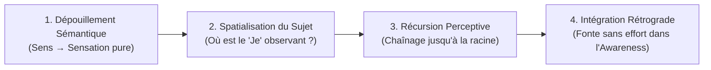

# Wholeness Work Level 1 - Participant Manual
**Formateur :** Connirae Andreas | **ID :** `connirae-andreas-wholeness-work-level-1-participant-manual` | **Tranches :** 3

## Synthèse Architecturale du Cours : Wholeness Work Level 1 — Connirae Andreas

---

### 1. Thèse Centrale & Philosophie du Cours

#### Vision spécifique & Différenciation de posture
La psychologie cognitive, les thérapies conventionnelles et la PNL standard partent historiquement d'une présupposition implicite : **le « Moi » qui perçoit, désire ou souffre est une entité centrale, fixe et légitime** qu'il s'agirait de « réparer », de « réassocier », de « reprogrammer » ou de « renforcer » (via ancrages, restructurations sémantiques ou swish). Les approches contemplatives ou non-duelles classiques (Advaita, bouddhisme, auto-investigation à la Ramana Maharshi), à l'inverse, tentent de dissoudre ce « Moi » par une interrogation métacognitive abstraite (*« Qui suis-je ? »*), générant fréquemment des impasses conceptuelles, des bypassings spirituels ou une intensification du dialogue interne.

La rupture épistémologique introduite par Connirae Andreas dans le *Wholeness Work* réside dans une **réduction sensorielle et spatiale pure de l'illusion égocentrée** :
1. **Le sujet épistémique n'est pas une entité mais une contraction somatosensorielle discrète** : L'ego n'est rien d'autre qu'un agencement de sous-modalités proprioceptives localisées dans l'espace (dans le crâne, la gorge, derrière la nuque, etc.).
2. **Postulat du zéro-effort et de non-agression (*Zero-Force Integration*)** : Aucune tentative de manipulation, de destruction, d'analyse causale ou de recadrage de contenu n'est tolérée. La contraction n'est pas un dysfonctionnement, mais une tentative d'auto-protection ou de complétion qui cherche son chemin vers l'apaisement.
3. **Passage du "faire" à "l'être" (*Experiencing AS Awareness*)** : Le praticien ne cherche pas à « changer l'état », mais à faire basculer le repère identitaire : passer de la contraction locale subissant le monde au champ spacieux sans bordure (*Awareness*) au sein duquel la sensation émerge et se dissout naturellement.

#### Fil rouge méthodologique reliant toutes les interventions
Chaque protocole du *Wholeness Work Level 1* (qu'il s'agisse du schéma de base, des rôles manquants, de la chaîne d'autorité ou des polarités attachement/aversion) obéit à un invariant algorithmique strict en 4 temps :

1. **Extraction de la sensation pure :** Déshabillage complet de l'histoire, de l'étiquette et du narratif verbal au profit des qualia physiques bruts.
2. **Objectivation somato-spatiale du sujet (« Trouver le 'Je' ») :** Localisation spatiale précise du conteneur de perception (découplage Sujet / Objet).
3. **Remontée récursive de la chaîne des observateurs :** Identification systématique des méta-observateurs en retrait pour déjouer toute résistance structurelle.
4. **Dissolution rétrograde en cascade dans la Conscience (*Awareness*) :** Effondrement de la dualité sujet/objet depuis l'instance la plus en amont vers l'avant, restituant la fluidité organique au système nerveux.

---

### 2. Carte des Concepts & Leviers Émergents

| Concept / Levier | Définition Phénoménologique & Neuro-cognitive | Rôle Opératoire dans l'Écosystème |
|---|---|---|
| **Spatialisation du « Je »** *(Location of the 'I')* | Encodage proprioceptif et spatial de la position subjective d'observation (crâne, gorge, champ péri-personnel). | Transforme le sujet transcendantal inviolable en un objet perceptuel délimité, manipulable et intégrable. |
| **Dépouillement Sémantique** *(Sensation Quality vs. Meaning)* | Déconnexion active du réseau du mode par défaut (DMN) en réduisant les récits psychologiques à des paramètres sensoriels bruts (température, densité, vibration, forme). | Évacue la réactivité narrative ; prive la boucle névrotique de son carburant symbolique. |
| **Chaîne des « Je »** *(The Chain of 'I's)* | Récursion métacognitive somatisée : l'observation d'un « Je » contracté génère instantanément un méta-observateur en retrait. | Empêche les échecs d'intégration causés par des jugements ou des résistances sous-jacentes non cartographiées. |
| **Champ de Conscience Sans Limite** *(Experiencing AS Awareness)* | Propriété du système nerveux d'accéder à un champ attentionnel ouvert, sans centre fixe, sans frontière ni valence conflictuelle. | Sert de solvant universel : la contraction locale s'y dissout sans force dès que la frontière subjective s'ouvre. |
| **Intégration Sans Force** *(Open and Relax as Awareness)* | Invocation d'un relâchement parasympathique profond fondé sur l'autorisation organique et le micro-consentement neurologique. | Neutralise tout risque d'abréaction ou de polarisation interne ; remplace le forçage ou l'écrasement de sous-modalités. |
| **3 Directions d'Intégration** *(Vectors of Dissolution)* | Phénoménologie géométrique de résorption : fonte de la sensation dans l'espace, expansion de l'espace à travers la sensation, ou simultanéité non-duelle. | Court-circuite la polarisation sujet/objet selon la modalité kinesthésique spontanée du système nerveux. |
| **Rôles Manquants & Autorité Finale** *(Missing Roles & Final Authority)* | Intériorisation spatiale d'une instance régulatrice (juge, censeur, idéal) vers laquelle une partie regarde pour chercher validation. | Rapatrie l'aliénation névrotique : bascule le sujet de l'assujettissement passif (*Authority*) à l'auto-détermination organique (*Authorship*). |
| **Isomorphisme Sensoriel** *(Modality-Specific Awareness)* | Accordage du champ d'accueil à la modalité exacte du symptôme (ex: voix critique dissoute dans la « Capacité d'Écoute Universelle »). | Comble instantanément le besoin de résonance du système nerveux (*deeply heard*), sans négocier le contenu verbal. |
| **Polarité Attachement-Aversion** *(Polarity Architecture)* | Structure bipolaire où chaque désir compulsif (« le résultat absolu ») masque en miroir un gouffre d'évitement (« la ruine absolue »). | Annule la différence de potentiel énergétique entre le désir et la peur ; restaure la complétion intrinsèque sans dépendance extérieure. |
| **Intégration Rétrograde en Cascade** *(Reverse Order Melting)* | Dissolution rigoureusement séquentielle débutant par l'observateur racine ultime, puis les agents intermédiaires, puis l'objet/scène. | Désarme d'abord l'appareil de défense le plus externe avant d'exposer la blessure, garantissant une intégration sans friction. |
| **Arc de Maturation : Faire → Être** *(Developmental Arc)* | Trajectoire neuro-attentionnelle passant de l'application technique laborieuse à un état de présence continue où les contractions s'autodissolvent. | Objectif téléologique du cursus : stabiliser une non-dualité fonctionnelle et incarnée dans le quotidien. |

---

### 3. Tableau Récapitulatif des Techniques & Démonstrations

| Technique / Exercice | Objectif Opératoire | Déclencheur / Indication | Séquence Résumée |
|---|---|---|---|
| **Wholeness Method : Format Fondamental** *(The Basic Method)* | Dissoudre une contraction somatique émotionnelle ou réactive et effondrer le sentiment de séparation égocentré. | Réactivité émotionnelle, anxiété situationnelle, blocage interne, tension somatique localisée. | 1. Éliciter la situation déclenchante. 2. Localiser la sensation contractée (taille, forme, densité, sans histoire). 3. Localiser le « Je » qui observe cette sensation (coordonnées spatiales). 4. Vérifier la présence d'autres « Je » en amont (chaîne des observateurs). 5. Inviter le « Je » racine à s'ouvrir et se détendre *en tant que* Conscience. 6. Laisser cette dissolution s'écouler vers l'avant à travers chaque observateur jusqu'à la sensation d'origine. 7. Test et pont vers le futur. |
| **Intégration par Isomorphisme Sensoriel** *(Modality-Specific Integration)* | Neutraliser une boucle auditive interne (critique, doute) ou visuelle sans entrer dans le contenu sémantique. | Dialogue interne virulent, autocritique obsédante, images intrusives récurrentes. | 1. Isoler la modalité dominante (ex: voix critique interne). 2. Localiser la voix dans l'espace et trouver le « Je » qui écoute. 3. Éveiller la « Conscience en tant que Capacité Pure d'Écoute » (champ auditif infini sans jugement). 4. Permettre à l'observateur puis à la voix de s'ouvrir et de se relaxer dans cette Capacité d'Écoute. 5. Constater la fonte de la charge vocale en vibration pure réintégrée. |
| **Processus des Rôles Manquants & Chaîne d'Autorité** *(Missing Roles & Authority Chain)* | Rapatrier la souveraineté interne et dissoudre les structures de culpabilité, honte, dépendance au regard d'autrui ou perfectionnisme. | Sentiment d'infériorité, syndrome de l'imposteur, recherche compulsive de validation, peur du jugement. | 1. Identifier la partie somatique qui se sent jugée / insuffisante. 2. Repérer la direction de son regard : vers *où/qui* est-elle orientée ? 3. Spatialiser l'instance d'Autorité perçue (interne ou externe). 4. Si l'Autorité en réfère à une instance supérieure, remonter jusqu'à l'« Autorité Finale ». 5. Dissoudre l'Autorité Finale dans l'Awareness. 6. Cascader l'intégration en retour jusqu'au sujet, opérant la mutation de l'Autorité subie vers l'« Authorship » (souveraineté organique). |
| **Format Miroir : Aversions & Attachements** *(Working with Aversions & Attachments)* | Dissoudre la charge compulsive bipolaire (dépendance, besoin impérieux vs phobie, évitement cataclysmique). | Obsession d'un résultat (« je dois réussir »), phobies, aversions relationnelles, incapacité à lâcher prise. | 1. Identifier le pôle manifeste (ex: ce qui *doit* arriver ou l'événement fui). 2. Cartographier spatialement l'objet (la scène/issue redoutée ou désirée). 3. Localiser et spatialiser l'agent somatique (« celui qui veut » ou « celui qui fuit »). 4. Éliciter le pôle miroir caché (aversion sous l'attachement, ou attachement sous l'aversion) et spatialiser son propre agent. 5. Identifier le point de perspective racine observant l'ensemble du système. 6. Exécuter l'intégration rétrograde en cascade : racine → agents d'aversion/attachement → représentations scéniques. 7. Vérifier la neutralité équanime face aux deux issues potentielles. |

---

## Extractions Détaillées par Tranche (Opératoire & Verbatim)

## --- Tranche 1 / 3 ---

Voici l'extraction et la modélisation intégrale de la substance opératoire de cette première tranche du manuel de Connirae Andreas.

---

### 1. Mécanismes & Principes Actifs

#### 1. Localisation Spatiale du Sujet Épistémique (Spatialisation du « Je »)
* **Terme de Connirae Andreas :** `Finding the location of the 'I'`
* **Tags :** `#spatialisation_du_sujet #effondrement_sujet_objet #dissolution_egoique #submodalites_spatiales`
* **Principe actif :** Dans la cognition humaine et les traditions contemplatives, le « sentiment d'un soi séparé » est généralement abordé comme un concept abstrait, ce qui active la boucle du dialogue interne verbal (ex: l'échec de la question « Qui suis-je ? » de Ramana Maharshi). Connirae Andreas découvre que le système nerveux code la position d'observation (le sujet perceptuel) sous forme de coordonnées spatiales précises (à l'intérieur du crâne, dans la gorge, flottant derrière la tête, etc.). En demandant *où* se trouve l'observateur au lieu de *qui* il est, on transforme une boucle métacognitive infinie en une coordonnée sensorielle discrète. Le « Je » cesse d'être le cadre inviolable de l'expérience : il devient un objet perceptuel localisé, prêt à être dissous.

#### 2. Dépouillement Sémantique vers la Qualité de Sensation Pure
* **Terme de Connirae Andreas :** `Sensation Quality vs. Meaning and Interpretation`
* **Tags :** `#depouillement_semantique #qualite_de_sensation #desactivation_default_mode_network #qualia_pur`
* **Principe actif :** Tout état affectif ou problématique s'auto-entretient par des strates d'interprétation : fonction présumée, cause historique, étiquette émotionnelle (« tristesse »), métaphore protectrice (« un casque »). Ce réseau sémantique active le réseau du mode par défaut (DMN). En dépouillant l'expérience de toute signification pour ne traquer que les qualia physiques (densité, température, vibration, micro-mouvements, texture), le système nerveux déconnecte la charge narrative. L'énergie neuro-somatique se retrouve débarrassée des fixations cognitives qui la figeaient.

#### 3. Chaînage Récursif des Métadébiteurs Perceptuels (La Chaîne des « Je »)
* **Terme de Connirae Andreas :** `The Chain of 'I's`
* **Tags :** `#recursivite_perceptuelle #meta_observateur #decompression_identitaire #chaine_des_je`
* **Principe actif :** Observer un « Je » contracté génère instantanément un nouvel observateur en retrait (méta-position). Si l'on essaie de dissoudre le premier « Je » alors qu'un observateur en amont résiste ou le juge, l'intégration échoue. Remonter la chaîne récursivement (trouver l'observateur de l'observateur, jusqu'à 3 ou 4 itérations) permet de remonter à la racine même de la contraction psychique. L'intégration doit s'effectuer depuis l'instance la plus reculée vers l'avant, garantissant un effondrement sans résistance résiduelle.

#### 4. Intégration Sans Force par Autorisation d'Ouverture et de Relaxation
* **Terme de Connirae Andreas :** `Open and relax as the fullness of Awareness`
* **Tags :** `#zero_effort #autorisation_organique #accord_neurologique #dissolution_somatique`
* **Principe actif :** La PNL classique utilise souvent la force ou l'écrasement de sous-modalités (techniques d'ancrage, swish, recadrages conflictuels). Ici, le levier repose sur l'exact opposé : la vérification préalable de consentement (« est-ce que cette sensation accueille l'invitation ? »). Si le système résiste, on n'applique aucune force : on modélise la résistance comme un nouveau sujet perceptuel. Lorsque l'autorisation est donnée, la contraction locale s'ouvre dans le champ sans limites de la Présence (Awareness), entraînant un relâchement parasympathique profond (fonte, dissolution, fluidification).

#### 5. Dépolarisation et Traversée Affective (Flowing Through / Blossoming)
* **Terme de Connirae Andreas :** `Flows through or blossoms / Polarity shift`
* **Tags :** `#dynamique_vectorielle #decharge_somatique #transmutation_affective #polarite_emergente`
* **Principe actif :** Une émotion négative (colère, blessure) ne peut se maintenir sans la friction d'une séparation interne. Lorsque la barrière sujet/objet tombe, la sensation ne disparaît pas nécessairement instantanément : elle s'expanse somatiquement (« fleurit » ou « s'écoule comme de la lave/de l'eau »). En augmentant d'intensité sans la contrainte du « Je », elle transmute spontanément en simple vivance énergétique (aliveness), voire en joie. Si une émotion polaire émerge immédiatement après (ex: colère qui fait surface sous une blessure), elle est traitée comme un simple flux d'énergie à autoriser, et non comme une rechute.

---

### 2. Protocoles, Techniques & Démonstrations (Étape par Étape)

---

#### Protocole 1 : Le Processus de Base du Wholeness Work (The Basic Wholeness Process)

* **Intention / Indication :** Résolution d'un déclencheur émotionnel, d'une réactivité interpersonnelle (quelqu'un qui « appuie sur les boutons »), d'une tension ou d'une contraction interne de moyenne intensité.
* **Mise en place & Pré-framing :** Choisir un problème d'intensité légère à moyenne (ne causant pas de dommage irréparable). Cadrer la séance dans l'observation sensorielle pure sans analyse causale.

##### Séquence d'actions pas à pas :

1. **Étape 1 : Localisation du point de départ (K)**
   - Faire imaginer la situation déclenchante au présent.
   - Obtenir l'étiquette émotionnelle en une courte phrase (ex: *« Je me sens agacé »*).
   - Localiser spatialement la sensation dans le corps (*Où est-ce situé ?*).
   - Extraire la forme et la taille (*Taille d'une orange, arrondi*).
   - Extraire la qualité de sensation pure (SQ) : densité, température, vibration, texture (*Ex: flou, picotements*).
   - Poser l'ancrage de conscience : *« Tu peux reconnaître : 'Je suis conscient de cette sensation', donc la Conscience/Présence est présente. »*

2. **Étape 2 : Éveil au champ de Présence / Conscience (Awareness)**
   - Élargir le champ perceptuel : faire constater que la conscience est présente dans la sensation, dans tout le corps et dans tout l'espace autour.
   - Utiliser des truismes auditifs et spatiaux : le son capté à gauche sans effort, le son capté à droite sans effort, l'espace perçu les yeux fermés.
   - Stabiliser la reconnaissance d'un champ sans bords ni fin, accessible en simultanéité immédiate.

3. **Étape 3 : Localisation du « Je » initial (I1)**
   - Renvoyer à la phrase : *« Je suis conscient de cette sensation [SQ] dans [Localisation] »*.
   - Poser la question de rupture : *« Où se trouve le 'Je' qui est conscient de cette sensation ? »*.
   - Identifier sa localisation (dans la tête, la gorge, hors du corps, etc.).
   - Extraire sa taille et sa forme.
   - Extraire sa qualité de sensation pure (dense, vide, brumeux, vibrant, immobile...).

4. **Étape 4 : Chaînage récursif des « Je » (I2, I3, I4...)**
   - Réitérer l'interrogation : *« Je suis conscient de ce [I1 SQ] dans [I1 Localisation]... Où est le 'Je' qui perçoit cela ? Depuis quel endroit la perception opère-t-elle ? »*.
   - Extraire localisation, taille/forme, qualité de sensation de cet I2.
   - Répéter jusqu'à obtenir au moins **3 « Je » successifs**.
   - *Heuristique :* Si le 3ème « Je » est encore très dense ou contracté, trouver un 4ème « Je ».

5. **Étape 5 : Test de consentement et intégration en cascade inversée**
   - Interroger le dernier « Je » : *« Est-ce que la sensation de ce 'Je' accueille l'invitation à s'ouvrir et se relaxer en tant que plénitude de la Présence/Conscience ? »*.
   - **Branche OUI :**
     * Guider l'ouverture et la relaxation spontanée sans faire d'effort. Laisser fondre, dissoudre ou circuler.
     * Descendre la cascade : revenir au « Je » précédent, calibrer le changement (*« Est-il identique ou différent ? »*), puis l'inviter à s'ouvrir et se relaxer en tant que Présence.
     * Répéter la descente pour chaque « Je » jusqu'à I1.
   - **Branche NON :**
     * Traiter le refus comme une nouvelle perception.
     * Demander : *« Où est le 'Je' qui remarque que ça ne veut pas s'ouvrir ? D'où la perception opère-t-elle ? »*.
     * Trouver ce nouveau « Je » (taille, forme, SQ) et retester l'étape 5 jusqu'à obtenir un consentement franc.

6. **Étape 6 : Intégration de la sensation de départ (K initial)**
   - Revenir à la zone de la sensation de départ (Étape 1).
   - Calibrer l'état actuel (*« Est-ce identique ou différent ? »*).
   - Inviter la sensation actuelle à s'ouvrir et se relaxer en tant que Présence, ou inviter la plénitude de la Présence à circuler à travers elle, ou laisser la Présence déjà là « se réveiller à elle-même ».
   - Laisser le processus se stabiliser dans le corps.

7. **Étape 7 : Test et Pont vers le Futur (Pacing & Future Pace)**
   - Replacer le sujet dans le contexte d'origine (en conservant cet état unifié).
   - Vérifier la réponse neuro-affective : présence de neutralité, aisance, ou ressources.
   - Généraliser : projeter « cette façon d'être » dans 2 situations passées similaires, puis dans plusieurs situations futures.

* **Signes de calibration du praticien :**
  - Ralentissement spontané du rythme respiratoire et micro-déglutitions.
  - Relâchement des fascias faciaux, perte des micro-tensions autour des orbites et de la mâchoire lors de l'intégration d'un « Je ».
  - Transition de mouvements saccadés des yeux vers un regard panoramique et détendu (yeux fermés ou mi-clos).
  - Tonalité vocale qui descend vers le grave et perd son timbre métallique/contracté.

---

#### Protocole 2 : Le Format Méditation Quotidienne (The Wholeness Process: The Meditation Format)

* **Intention / Indication :** Entraînement quotidien en auto-hypnose/méditation, réinitialisation globale du système corps-esprit, dissolution de la structure caractérielle sans déclencheur externe préalable.
* **Mise en place :** Assis ou allongé au calme, posture confortable. Établissement de la Présence comme arrière-plan spatial global.

##### Séquence d'actions pas à pas :

1. **Scan Somatique Émergent :** Balayer l'attention vers l'intérieur. Laisser se détendre ce qui se détend facilement. Porter l'attention sur *ce qui reste* (tension résiduelle, serrement, émotion, image mentale, petite voix).
2. **Identification Submodale :** Localiser spatialement ce point de départ, en extraire la forme/taille, et la qualité de sensation pure.
3. **Recherche du Sujet Perceptuel :** Demander immédiatement : *« D'où la perception opère-t-elle ? Où est le 'Je' qui est conscient de cette sensation ? »*. Extraire ses qualia sensoriels.
4. **Vérification d'Accueil :** Demander si ce « Je » accueille l'invitation à s'ouvrir et se relaxer en tant que plénitude de la Conscience. Si non, remonter au « Je » qui observe le refus.
5. **Intégration Rétrograde :** Dès qu'un « Je » s'ouvre, faire fondre chaque « Je » précédent successivement.
6. **Harmonisation Finale à Trois Voies :** Revenir à la sensation initiale du scan, et tester intuitivement la direction qui s'impose d'elle-même :
   - Soit la sensation s'ouvre et s'évapore dans la Conscience.
   - Soit la Conscience afflue et s'infuse dans la sensation.
   - Soit la Conscience présente au cœur même de la sensation se réveille à elle-même.

---

### 3. Heuristiques, Subtilités & "Sagesse du Praticien"

#### Règles Conditionnelles d'Intervention :
* **SI** le sujet exprime un jugement, une frustration, une impatience ou un doute pendant le processus (ex: *« C'est nul, je suis tout confus »*), **ALORS** interrompre immédiatement le protocole en cours et traiter cette réaction comme la cible prioritaire absolue (*« Où est le 'Je' qui est confus ? »*), **PARCE QUE** cette réaction est un méta-état actif qui bloque l'intégration sous-jacente.
* **SI** le sujet utilise des mots d'interprétation, de cause ou de métaphore (ex: *« C'est une armure qui me protège de mon père »*), **ALORS** ramener gentiment l'attention aux qualia physiques stricts (*« Et si tu laisses de côté ce que ça fait ou son histoire, quelle est la sensation pure là maintenant : lourd, dense, chaud, vibrant ? »*), **PARCE QUE** l'adhérence sémantique maintient le réseau cérébral du problème actif.
* **SI** le 3ème « Je » présente encore une sensation très dense, compacte ou opaque, **ALORS** ne pas passer à l'étape d'intégration et aller chercher un 4ème « Je », **PARCE QU'**une densité forte signale qu'un observateur plus profond n'a pas encore été objectivé.
* **SI** un « Je » refuse de s'intégrer (réponse négative), **ALORS** ne JAMAIS insister, suggérer la détente ou forcer, mais chercher immédiatement l'observateur du refus (*« D'où perçois-tu que ça ne veut pas s'ouvrir ? »*), **PARCE QUE** le refus est le signal exact de la présence d'un niveau d'identité supérieur non inclus.
* **SI** une tentative d'intégration demande le moindre sentiment d'effort mental, **ALORS** faire une pause et appliquer le processus à la sensation d'effort elle-même, **PARCE QUE** la force est la preuve qu'un petit « Je » tente de manipuler l'expérience au lieu de laisser la Présence opérer.

#### Pièges Classiques & Erreurs de Débutant :
1. **Confondre l'émotion vécue et la reviviscence traumatique :** Plonger à corps perdu dans l'émotion (comme dans certaines approches cathartiques) renforce le circuit neuronal négatif. Il faut vivre la sensation *en tant que Conscience sans frontières*, et non s'y noyer.
2. **Prendre « Conscience / Présence » pour un concept intellectuel :** Si le client n'a pas une expérience phénoménologique directe de l'espace omnidirectionnel et de l'écoute sans effort (Étape 2), le mot « Awareness » reste une coquille vide et l'intégration ne se produit pas.
3. **Vouloir éliminer le problème :** L'intention de « se débarrasser » de l'anxiété ou de la colère recrée instantanément une scission interne. La transformation découle exclusivement de l'inclusion totale et inconditionnelle de chaque fragment de contraction.

---

### 4. Pépites Verbatim & Patterns Linguistiques (MOT À MOT EN V.O.)

#### 1. L'Induction Épistémique de la Présence Omnidirectionnelle
> *"You are aware of the sensation you’ve just been noticing, so awareness is present there, and awareness is also throughout your body and all around…. If a sound happened on one side of you, you would hear it automatically without effort…. If a sound happened on the other side, you’d also be aware of it without effort. And even if your eyes are closed, you can notice a sense of space all around you…. Awareness is this capacity to notice, that is throughout the body, and all around. And there isn’t really any edge to it or an end to it. And you can notice this all, simultaneously, right now…."*

* **[Analyse du Pattern] :**
  - **Empilement de truismes incontestables :** Utilisation de faits sensoriels vérifiables dans l'instant (*« you would hear it automatically »*), créant un rythme de ratification (yes-set sensoriel).
  - **Présupposition d'effort nul :** Répétition de la formule *« without effort »* enchâssant la désactivation des centres volontaires du cortex préfrontal.
  - **Négation spatiale hypnotique :** L'expression *« there isn’t really any edge to it or an end to it »* induit la dissolution des frontières kinesthésiques corporelles habituelles sans utiliser de commande autoritaire.
  - **Saut d'attention panoramique :** Le mot *« simultaneously »* force le cerveau à passer d'une attention focale étroite (associée au stress et à la fixation du problème) à une attention ouverte (open focus), saturant la bande passante cognitive.

---

#### 2. La Question de Bascule et de Spatialisation du Sujet
> *"Now let’s return to this statement, 'I am aware of this [say SQ words] sensation in [say the location]' …. Where is the 'I,' that is aware of this sensation…? Where is this 'I' located? Just notice whatever location comes to mind. It might be somewhere in your head, body, or outside your head or body somewhere. And what location do you notice?"*

* **[Analyse du Pattern] :**
  - **Décontextualisation grammaticale / Rupture de cadre :** En isolant le mot « Je » d'une assertion subjective pour en faire un objet d'investigation spatiale (*« Where is the 'I'...? »*), la syntaxe crée un court-circuit de l'illusion égologique.
  - **Double lien permissif / Ratification universelle :** L'énumération *« in your head, body, or outside your head or body »* couvre toutes les possibilités phénoménologiques concevables. Quelle que soit la réponse kinesthésique du sujet, elle valide la présupposition que le « Je » est spatialement localisé.
  - **Détournement de l'effort conscient :** *« Just notice whatever location comes to mind »* délègue la réponse aux processus automatiques inconscients en contournant la délibération logique.

---

#### 3. L'Autorisation d'Intégration Déchargée d'Intentionnalité
> *"Notice what happens, when the sensation of the 'I' is invited to open and relax… as the fullness of Awareness…. There can be a gentle sensing into the sensation in this location, and an allowing this opening and relaxing to happen in its own way. You are not really doing anything—just sensing how it occurs on its own."*

* **[Analyse du Pattern] :**
  - **Formulation passive et impersonnelle :** Utilisation de structures passives dégageant le sujet de toute responsabilité d'action (*« is invited to open »*, *« there can be an allowing »*). L'agentivité individuelle s'efface au profit d'un processus autonome.
  - **Double contrainte de non-agir :** La commande directe d'inactivité *« You are not really doing anything »* neutralise la volonté d'intervention du moi conscient, couplée à la commande enchâssée d'observation permissive *« just sensing how it occurs on its own »*.
  - **Présupposition de complétude :** Le syntagme *« as the fullness of Awareness »* requalifie la contraction non pas comme quelque chose qui doit être chassé, mais comme un espace qui reprend sa véritable nature illimitée.

---

#### 4. Le Recadrage Métaphorique de la Présence Immanente
> *"Or, it may feel like the Awareness already present in [say location], wakes up to itself."*

* **[Analyse du Pattern] :**
  - **Présupposition d'immanence non-duelle :** En suggérant que la Conscience est *« already present »* à l'intérieur même du symptôme douloureux ou contracté, le praticien annule radicalement toute tentative de guerre intestine ou de dissociation.
  - **Personnification réflexive :** *« wakes up to itself »* agit comme une suggestion post-hypnotique d'auto-effondrement : le symptôme n'a rien à acquérir ni à guérir de l'extérieur ; il est invité à une auto-reconnaissance ontologique.

---

#### 5. La Capture Immédiate du Méta-État Réactif
> *"You just said 'I’m really confused about all this…', right? So where is the 'I' who is confused? Where is this 'I' located?"*

* **[Analyse du Pattern] :**
  - **Aïkido linguistique / Pacing & Leading instantané :** Capture textuelle verbatim de la plainte ou de la résistance du sujet (*« right? »* obligeant à un accord somatique immédiat).
  - **Conversion structurelle instantanée :** Transformation d'un contenu de blocage cognitif (*« je suis confus »*) en un réceptacle spatial géométrique (*« Where is the 'I' who is confused? »*). Le méta-état résistant cesse d'être un obstacle pour devenir immédiatement le carburant de la dissolution.

## --- Tranche 2 / 3 ---

### 1. Mécanismes & Principes Actifs

#### 1. Le Découplage Sémantique-Somatosensoriel (Sensation Quality vs. Meaning)
* **Principe actif** : L'esprit cognitif et le système nerveux maintiennent les états de souffrance ou les boucles émotionnelles par l'interprétation, le jugement, l'attribution causale et la narration verbale (le *sens*). Dès lors que l'attention est intentionnellement réorientée vers les prédicats physiques bruts de la sensation pure — température, densité, micro-mouvements, texture, délimitation spatiale —, le cortex préfrontal cesse d'alimenter la rumination. Ce basculement neuro-attentionnel prive la boucle réactive de son carburant symbolique et fait s'effondrer la rigidité de la structure névrotique.
* **Tags libres** : `#sensation_quality` `#decouplage_semantique` `#submodalites_proprioceptives` `#effondrement_narratif`

#### 2. L'Expérience Somato-Spatiale de la Conscience Sans Limites (Experiencing AS Awareness vs. Reliving)
* **Principe actif** : Dans une réassociation classique (ou revécu traumatique/émotionnel), le sujet replonge dans l'état réactif avec son cadre perceptif contracté, ce qui réactive et renforce la potentialisation à long terme de l'encodage émotionnel négatif. À l'opposé, expérimenter la sensation résiduelle *en tant que* Conscience pure (*as Awareness*) exploite le fait neurologique que la Conscience n'a pas de bordure spatiale, de contour proprioceptif ni de centre fixe. La sensation contractée se retrouve saturée par un champ sans division : le sujet cesse d'être une entité locale qui subit un stimulus pour devenir le champ spacieux dans lequel la sensation apparaît, induisant une décharge vagale immédiate et la fonte de la frontière subjective.
* **Tags libres** : `#experiencing_as_awareness` `#dissolution_frontiere` `#non_dualite_operatoire` `#defusion_par_spacieusite`

#### 3. Effondrement de la Dualité Sujet/Objet par les 3 Directions d'Intégration
* **Principe actif** : La perception ordinaire s'articule autour d'une tension fondamentale : un observateur localisé qui observe un objet distant. Andreas modélise 3 vecteurs géométriques et phénoménologiques pour court-circuiter cette polarité :
  1. *Partie $\to$ Conscience* : La contraction s'évase, s'adoucit et se dissout dans l'espace englobant.
  2. *Conscience $\to$ Partie* : Le champ spacieux s'écoule, s'infuse et s'absorbe entièrement au cœur de la contraction locale, saturant le point aveugle somatique.
  3. *Conscience = Partie* : Réalisation directe et instantanée que la matière même de la sensation locale a toujours été faite de la Conscience universelle éveillée à elle-même (effondrement direct sans vecteur cinétique).
  Au fur et à mesure de la répétition, le mouvement perçu cède le pas à une immobilité radicale (*Stillness*) et à la simple Présence (*Presence*).
* **Tags libres** : `#vecteurs_integration` `#effondrement_observateur_observe` `#reabsorption_somatique` `#stillness_as_presence`

#### 4. La Modélisation des Rôles Manquants : Chaîne d'Autorité et Projection Téléologique (Missing Roles)
* **Principe actif** : Les sentiments de honte, culpabilité, infériorité ou perfectionnisme présupposent obligatoirement une architecture relationnelle intériorisée : un système de règles incarné par une entité régulatrice invisible. Le sujet ressent une souffrance parce qu'une partie somatique locale s'oriente spatialement vers un pôle externe/interne pour vérifier son adéquation ou chercher une validation. Tant que l'instance de référence ("l'Autorité") reste inconsciente et spatialement séparée, le sujet demeure en aliénation. Remonter la chaîne jusqu'à l'autorité finale (*Final Authority*) rapatrie l'énergie vitale figée dans le dogme intériorisé et bascule le sujet de l'assujettissement passif (*Authority*) à l'auto-détermination organique (*Authorship*).
* **Tags libres** : `#chaine_autorite` `#missing_roles` `#geometrie_interieure` `#repatriement_de_la_souverainete` `#authorship`

#### 5. L'Intégration Sensorielle Spécifique Isomorphe (Modality-Specific Awareness)
* **Principe actif** : Bien que la Conscience globale soit accessible comme "la capacité générale à faire l'expérience", calibrer le champ d'accueil dans la modalité sensorielle exacte de la contraction produit une résonance et une absorption incomparablement plus rapides. Une voix critique interne dissoute dans "la Capacité Universelle d'Écoute" comble instantanément le besoin profond du système d'être enfin "pleinement entendu" (*deeply heard*), sans négocier le contenu verbal.
* **Tags libres** : `#isomorphisme_sensoriel` `#capacite_ecoute_universelle` `#k_to_k_integration` `#resonance_de_modalite`

#### 6. Résolution des Polarités d'Attachement / Aversion
* **Principe actif** : Tout attachement compulsif à un résultat extérieur (*"il faut absolument que..."*) masque structurellement une aversion en miroir (*"ce que je refuse absolument de vivre"*). Traiter l'un sans l'autre laisse le système asymétrique et vulnérable au retour du refoulé. L'identification spatiale conjointe de la représentation du gain ET du rejet, couplée à l'extraction des observateurs respectifs (*The One who wants / The One who avoids*), dissout la tension bipolaire et neutralise le besoin d'auto-complétion externe.
* **Tags libres** : `#polarite_attachement_aversion` `#auto_completion_externe` `#balance_structurelle` `#double_observateur`

---

### 2. Protocoles, Techniques & Démonstrations (Étape par Étape)

---

#### PROTOCOLE A : DE L'AUTORITÉ À L'AUTORAT (Reclaiming the Inner Authority)

* **Intention / Indication** : Expériences de honte, culpabilité, gêne, besoin compulsif de prouver/défendre sa position, sensation de faiblesse statutaire, ou chez les sujets hyper-référencés internes : certitude arrogante d'avoir raison et jugements envers autrui.
* **Mise en place & Pré-framing** : Cadrer que la honte ou la culpabilité ne sont que des symptômes d'une structure de règles non intégrée. L'autorité recherchée n'est pas une personne biographique réelle, mais une coordonnée spatiale dans l'expérience subjective du sujet.
* **Séquence d'actions pas à pas** :
  * **Étape 1 : Élicitation du point d'entrée kinesthésique (K)**
    1. Demander au sujet de se reconnecter brièvement à la situation pour accéder à la sensation corporelle.
    2. Localiser précisément la sensation dans ou autour du corps.
    3. Déterminer la taille et la forme géométrique.
    4. Éliciter la qualité de sensation brute (*Sensation Quality* : température, densité, texture, mouvement).
  * **Étape 2 : Identification de l'Autorité (Rôle manquant A1)**
    1. Depuis l'emplacement de la sensation initiale, poser la question d'orientation : *"Où se trouve l'endroit que cette sensation cherche à satisfaire ou à faire plaisir ? Où est l'autorité pour cela, celui qui fixe les règles ?"*
    2. Préciser : chercher un emplacement dans l'espace (in/around you), pas un nom de personne.
    3. Noter la localisation, la taille, la forme et la qualité de sensation de cette Autorité ($A_1$).
  * **Étape 3 : Traçage de la chaîne de causalité ascendante (Chain of Authority)**
    1. Se syntoniser avec $A_1$ : *"Est-ce une autorité finale, ou ressent-on qu'elle essaie de plaire ou satisfaire autre chose dans un autre endroit ?"*
    2. Si non finale : itérer l'étape 2 depuis l'emplacement actuel pour trouver $A_2$, puis $A_3$, jusqu'à atteindre l'Autorité Finale ($A_{Final}$ - généralement 1 à 3 strates).
  * **Étape 4 : Élicitation de l'Observateur / du "Je" ($I$)**
    1. Demander : *"D'où est perçu l'ensemble de tout cela ?"*
    2. Identifier la localisation, la forme, la taille et la qualité de sensation de ce point de perception ($I$).
  * **Étape 5 : Intégration du "Je" ($I$) avec la Conscience**
    1. Vérifier si la sensation du $I$ accueille l'invitation à s'ouvrir et se détendre en tant que la plénitude de la Conscience partout présente.
    2. Laisser la fusion somato-spatiale s'accomplir. Si refus, remonter à un méta-$I$.
  * **Étape 6 : Intégration de l'Autorité Finale ($A_{Final}$)**
    1. Demander à $A_{Final}$ avec quoi elle accueille de s'intégrer :
       - Se dissoudre en tant que la Conscience globale ;
       - Fusionner avec l'autorité précédente ;
       - Fusionner directement avec le sujet *en tant que* Conscience (le sujet s'inclinant vers elle, ou elle venant au sujet).
    2. Valider et laisser l'intégration s'exécuter.
  * **Étape 7 : Intégration récursive descendante de la chaîne**
    1. Pour chaque autorité restante ($A_{n-1}$ jusqu'à $A_1$) : constater son état actuel (taille réduite, texture allégée).
    2. Inviter sa sensation à s'intégrer avec la Conscience, avec l'autorité précédente ou avec le sujet en tant que Conscience.
  * **Étape 8 : Intégration de la Sensation Initiale (K)**
    1. Revenir à la localisation du sentiment de départ. Constater les altérations spontanées.
    2. Inviter la sensation à s'ouvrir et se détendre en tant que Conscience, et/ou inviter la Conscience à couler et saturer cet espace.
  * **Étape 9 : Test en Contexte & Futurisation**
    1. Vérifier la complétude : *"Est-ce que cela semble complet ?"*
    2. Réassocier le sujet à la situation déclenchante avec l'ensemble des énergies intégrées.
* **Signes de calibration** :
  - Relâchement musculaire axial, déglutition spontanée, expiration longue involontaire.
  - Perte de la fixation oculaire directionnelle lorsque le point d'autorité se dissout.
  - Modification spontanée du tonus postural (passage de l'affaissement/défense à un redressement sans rigidité).

---

#### PROTOCOLE B : INTÉGRATION DE CE QUI MANQUE (Integrating What’s Missing)

* **Intention / Indication** : Sentiments de dépendance affective, quête compulsive d'approbation ou de validation extérieure, sensation chronique de vide intérieur, d'incomplétude ou besoin d'être aimé/validé par un partenaire.
* **Mise en place & Pré-framing** : Cadrer que chercher à se compléter de l'extérieur est une illusion spatiale de séparation. Le manque est une sensation locale qui s'oriente vers un objet fantôme dans l'espace.
* **Séquence d'actions pas à pas** :
  * **Étape 1 : Accès à l'état de manque**
    1. Réactiver le contexte relationnel de manque.
    2. Isoler la localisation corporelle de la sensation de vide/désir.
    3. Relever forme, taille et *Sensation Quality*.
  * **Étape 2 : Localisation de la cible extérieure ($M_1$)**
    1. En ressentant la sensation locale : *"Vers quel endroit cette sensation cherche-t-elle quelque chose ? Vers quelle direction s'oriente-t-elle ?"*
    2. Relever localisation, taille, forme et qualité de sensation de $M_1$.
  * **Étape 3 : Vérification de la complétude ou récursion de chaîne**
    1. Vérifier si $M_1$ est complet et satisfait en lui-même ou s'il manque lui aussi de quelque chose.
    2. Si incomplet, tracer la direction vers $M_2$, $M_3$... jusqu'à identifier un point intrinsèquement repu/satisfait en soi.
  * **Étape 4 : Détection du point d'observation ($I$)**
    1. Demander : *"D'où perçoit-on toute cette dynamique ?"*
    2. Éliciter localisation, taille, forme et qualité sensorielle du $I$.
  * **Étape 5 : Dissolution du "Je" ($I$)**
    1. Inviter la sensation du $I$ à s'ouvrir et se détendre dans la Conscience globale.
  * **Étape 6 : Intégration descendante de la chaîne du manque ($M_n \to M_1$)**
    1. Partir du dernier maillon : vérifier son mode d'intégration préféré (se dissoudre dans la Conscience, fusionner avec le maillon précédent ou avec le sujet en tant que Conscience).
    2. Répéter l'invitation pour chaque maillon de la chaîne jusqu'à résorption intégrale.
  * **Étape 7 : Intégration de la sensation de manque initiale**
    1. Faire fondre la sensation corporelle de départ dans le champ de la Conscience.
  * **Étape 8 : Test et Pont vers le Futur**
    1. Reconnecter le sujet à la relation : tester la présence spontanée de complétude interne autonome.
* **Signes de calibration** :
  - Régulation respiratoire au niveau de la cage thoracique/plexus (souvent siège initial de la sensation de vide).
  - Normalisation du regard (cessation de projeter le regard vers l'avant en quête de signal externe).

---

#### PROTOCOLE C : DISSOLUTION DES IDENTITÉS ET DES RÔLES (Dissolving Identities/Roles)

* **Intention / Indication** : Rôles sociaux ou familiaux surinvestis devenus des prisons comportementales ("la mère parfaite", "l'enseignant", "le sauveur", "le clown de service", "la personne gentille", "l'organisateur", "le spontané").
* **Mise en place & Pré-framing** : Clarifier qu'intégrer une identité ne signifie pas perdre la compétence comportementale, mais libérer le système nerveux de la contrainte compulsive de *devoir* maintenir cette façade.
* **Séquence d'actions pas à pas** :
  * **Étape 1 : Sélection du rôle ou du style de personnalité** à explorer.
  * **Étape 2 : Réactivation du contexte d'expression**.
  * **Étape 3 : Localisation somatique de l'entité incarnant le rôle** :
    1. *"Où se trouve celui/celle qui est [la personne gentille, la mère, etc.] ?"*
    2. Relever taille, forme et qualité de sensation de cette instance.
  * **Étape 4 : Détection du témoin perceptif ($I$)** :
    1. *"D'où perçois-tu cette entité/ce rôle ?"*
    2. Noter la localisation, la taille et la texture sensorielle du $I$.
  * **Étape 5 : Intégration séquentielle** :
    1. Intégrer d'abord le $I$ dans la plénitude de la Conscience.
    2. Revenir au rôle initial : constater son altération spontanée.
    3. Inviter le rôle à s'intégrer selon le vecteur de son choix (se fondre dans la Conscience, être enveloppé par elle, ou couler dans le sujet).
  * **Étape 6 : Réévaluation contextuelle** :
    1. *"En étant ainsi, qu'est-ce que ça fait d'être dans ce contexte à présent ?"*
* **Signes de calibration** :
  - Décontraction des muscles superficiels du visage (masque social qui tombe).
  - Abaissement sensible des épaules et ouverture spontanée de la cage thoracique.

---

#### PROTOCOLE D : LE LÂCHER-PRISE PAR POLARITÉ ATTACHEMENT-AVERSION (The Letting Go Process)

* **Intention / Indication** : Obsession de résultat, sur-attachement à un objectif ("il faut que mon business réussisse", "je dois absolument comprendre"), ou évitement phobique / anxiogène (procrastination de bilan médical par peur du diagnostic).
* **Mise en place & Pré-framing** : Expliquer que tout attachement rigide est soutenu sous le seuil de conscience par la répulsion d'un scénario inverse, et vice-versa.
* **Séquence d'actions pas à pas** :
  * **Étape 1 : Choix de l'objectif d'attachement** (ou de l'aversion de départ).
  * **Étape 2 : Localisation spatiale de la représentation du résultat** :
    1. Repérer où se situe l'image ou la représentation de ce résultat dans l'espace subjectif.
    2. Relever taille, forme et qualité sensorielle.
  * **Étape 3 : Localisation de "Celui qui est attaché"** :
    1. Accéder au ressenti de l'urgence ou de l'obligation (*"ça doit arriver"*).
    2. *"Où est celui qui 'doit absolument obtenir' ce résultat ?"*
    3. Relever taille, forme et qualité sensorielle somatique.
  * **Étape 4 : Révélation de la polarité cachée (L'Aversion)** :
    1. Pré-cadre : *"Puisque tu dois impérativement obtenir cela, qu'est-ce que tu refuses absolument qu'il arrive ? Qu'évites-tu ?"*
    2. Identifier la représentation spatiale du résultat non désiré (Localisation, taille, forme, qualité sensorielle).
  * **Étape 5 : Localisation de "Celui qui évite"** :
    1. *"Où est celui qui veut fuir ou éviter ce scénario ?"*
    2. Extraire la position et les qualités de cet observateur d'évitement.
  * **Étape 6 : Localisation du méta-observateur ($I$)** :
    1. *"D'où perçoit-on l'ensemble de ces quatre éléments ?"*
    2. Localiser et qualifier la texture du $I$.
  * **Étape 7 : Intégration en cascade inverse** :
    1. Dissoudre le $I$ méta dans la Conscience.
    2. Dissoudre "Celui qui évite" et la représentation de l'aversion.
    3. Dissoudre "Celui qui est attaché" et la représentation de l'attachement.
  * **Étape 8 : Test contextuel** :
    1. Évaluer la relation psychologique avec l'objectif : vérification de la présence d'une disponibilité détendue et lucide sans fixation compulsive.
* **Signes de calibration** :
  - Disparition de la contraction oculaire vers l'avant.
  - Voix qui descend dans les graves, fin de l'empressement verbal.

---

### 3. Heuristiques, Subtilités & "Sagesse du Praticien"

#### 1. Règles Conditionnelles Inaltérables (*"If ... Then ... Because ..."*)
* **Si** le sujet verbalise des émotions, des interprétations, des jugements ou des métaphores cognitives (ex: *"c'est de la tristesse"*, *"c'est un casque sur ma tête"*, *"c'est pour me protéger"*), **alors** le praticien doit immédiatement interrompre la dérive sémantique et ramener la focalisation sur la texture brute (*Sensation Quality* : chaud/froid, dense/aérien, vibrant, mouvant), **parce que** le système nerveux ne peut pas transformer structurellement une construction tant qu'il opère au niveau de sa signification narrative.
* **Si** une autorité intermédiaire ou un "Je" refuse l'invitation à s'intégrer à la Conscience, **alors** ne jamais forcer : demander d'où ce refus est observé pour extraire un $I$ supérieur, ou remonter directement à l'Autorité Finale, **parce que** l'Autorité Finale est structurellement *toujours* disposée à s'intégrer, le refus signalant simplement la présence d'une instance supérieure non encore cartographiée.
* **Si** le sujet rapporte un sentiment d'effort, de lutte intérieure ou d'insatisfaction pendant l'intégration, **alors** stopper le guidage actif et rechercher immédiatement un rôle manquant (*missing role*), une réaction émergente au processus, ou un nouveau point de vue perceptif ($I$), **parce que** la véritable intégration procède toujours par relâchement naturel spontané ; toute friction prouve qu'on travaille sur une couche dérivée au lieu de la structure sous-jacente.
* **Si** le sujet est fortement autoréférencé (profil "j'ai toujours raison", dogmatique ou prompt au jugement), **alors** ne pas chercher une figure d'autorité punitive externe, mais initier le protocole à partir de sa certitude d'avoir raison, **parce que** la certitude absolue cache la même architecture d'autorité intériorisée rigide qu'un complexe de culpabilité.

#### 2. Différenciation Clinique Fondamentale : Wholeness Work vs. Mindfulness Classique
Connirae Andreas formule cinq distinctions chirurgicales réfutant l'assimilation du Wholeness Work à une simple méditation de pleine conscience :
1. *Absence d'élicitation du "Je"* : La pleine conscience invite à "prendre du recul" et à observer, ce qui renforce structurellement la dualité en créant un observateur séparé non conscientisé. Le Wholeness Work localise et dissout formellement cet observateur subjectif ($I$).
2. *Traitement des distractions* : Alors que la pleine conscience demande de "laisser passer" les pensées (ce qui crée des micro-luttes et des refoulements subtils), le Wholeness Work traite toute distraction, réaction ou gêne comme un sous-système légitime à intégrer immédiatement.
3. *Vraie fusion vs. Présence passive* : Être "présent avec" maintient une frontière relationnelle entre le sujet et l'objet ("moi" observant "ma douleur"). L'intégration d'Andreas détruit la frontière : ce qui était 2 devient strictement 1.
4. *Effort subtil vs. Richesse émergente* : Les techniques méditatives tentent d'enrichir intentionnellement la Conscience. Dans le Wholeness Work, le champ de Conscience s'enrichit de façon passive et organique à chaque libération de contraction somatique.
5. *Cartographie structurelle de la personnalité* : Le Wholeness Work traite de manière chirurgicale les architectures inconscientes profondes (rôles d'autorité, attachements, identités, besoins de complétion) inaccessibles à la simple assise silencieuse.

#### 3. Postulats & Philosophie Opératoire de Connirae Andreas
* **"Force will never work" (La force ne fonctionnera jamais)** : Toute tentative de forcer un changement indique que le praticien travaille avec le mauvais niveau d'expérience. Au bon niveau structurel, la contraction demande spontanément à se détendre.
* **"Enlightenment is intimacy with the 10,000 things" (Dogen)** : L'éveil n'est pas une fuite hors de la matière ou une transcendance désincarnée, mais l'intimité sensorielle totale et indivisible avec chaque micro-sensation, agréable comme désagréable.
* **"Healing the inner division"** : L'aliénation humaine provient de la fragmentation interne en règles et autorités disjointes. Rapatrier ces projections dissout le besoin d'approbation et restaure une liberté d'action fluide issue de la totalité de l'être (*the Whole*).

---

### 4. Pépites Verbatim & Patterns Linguistiques (MOT À MOT EN V.O.)

#### Pépite 1 : Le Découplage Spatial de l'Autorité
> *"Sensing into this sensation in [location], from there check, Where is the location this sensation is trying to please or satisfy? Where is the authority for this? The one who sets the standards? The rule-maker? I’m not asking you to name a person. I’m asking for a location in space in or around you. It may or may not be related to a particular person. Another way to ask the question is, Where is this feeling/experience here in [location] orienting toward? What location is this experience checking with?"*

* **[Analyse du Pattern]** :
  - **Déréification spatiale radicale** : La formule *"I’m not asking you to name a person. I’m asking for a location in space"* casse violemment le réflexe projectif de la mémoire biographique (chercher maman, le père ou le patron) pour forcer le cerveau à cartographier la structure proprioceptive brute.
  - **Empilement de recadrages d'orientation** : L'utilisation successive de *"trying to please"*, *"sets the standards"*, *"rule-maker"*, *"orienting toward"* et *"checking with"* tisse un filet sémantique multimodal qui active immédiatement la détection inconsciente du vecteur relationnel spatialisé.

---

#### Pépite 2 : La Traçabilité Récursive vers l'Autorité Finale
> *"Now feel into the sensation in [location of the Authority], and notice, Is this a 'final authority'? Or is there the sense that this, here, is trying to please or satisfy something else in another location? Is there some other location this here is orienting towards or checking with, or acting in the service of?"*

* **[Analyse du Pattern]** :
  - **Questionnement récursif en double alternative** : La question force le système à vérifier la complétude ontologique du nœud psychologique.
  - **Présupposition de dépendance téléologique** : *"or acting in the service of"* installe la présupposition que la partie n'agit pas pour elle-même mais pour une instance supérieure invisible, déclenchant l'ouverture d'un nouveau niveau d'analyse spatiale si la structure n'est pas encore première.

---

#### Pépite 3 : L'Invitation Écologique à l'Intégration du "Je"
> *"Check if the sensation here [in location of ‘I’] welcomes the invitation to open and relax as Awareness. If 'Yes': Notice what happens when the sensation of this 'I' is invited to open and relax as the fullness of Awareness that’s all around and throughout."*

* **[Analyse du Pattern]** :
  - **Double adoucissement permissif** : *"welcomes the invitation"* élimine toute imposition autoritaire ou injonction directe, désactivant instantanément toute réaction de défense de l'ego.
  - **Nominalisation expansive & Commande spatiale enchâssée** : L'expression *"as the fullness of Awareness that’s all around and throughout"* agit comme une induction hypnotique directe d'espace infini, guidant le système nerveux à dissoudre ses contours locaux dans un champ global omnidirectionnel.

---

#### Pépite 4 : L'Intégration Isomorphe dans la Capacité d'Écoute
> *"We can sense this 'capacity to listen' that is just present all around, everywhere, and invite the voice to dissolve/melt into this. This results in wholeness in the auditory system. People often subjectively experience being 'really heard.'"*

* **[Analyse du Pattern]** :
  - **Raffinement sensoriel isomorphe** : Passer de la "conscience" abstraite à la *"capacity to listen that is just present all around"* aligne parfaitement le vecteur récepteur avec le canal d'émission du symptôme (auditif interne).
  - **Comblement téléologique symbolique** : L'évocation du fait d'être enfin *"really heard"* résout le motif inconscient profond du dialogue interne conflictuel : la voix n'a plus besoin de crier ou de répéter son message puisqu'elle s'est littéralement dissoute dans l'écoute universelle.

---

#### Pépite 5 : La Révélation Hypnotique de la Polarité d'Évitement
> *"Notice that when you 'have to have' this outcome, this suggests there is something else that you don’t want to have happen, right? So what don’t you want? What are you avoiding?"*

* **[Analyse du Pattern]** :
  - **Présupposition logique implacable** : La transition *"this suggests there is something else that you don’t want"* relie l'obsession de réussite à sa contrepartie inconsciente de terreur d'échec.
  - **Tag question de synchronisation** : L'insertion du *"right?"* verrouille l'assentiment conscient avant de plonger le sujet sans transition dans la zone d'ombre refoulée avec deux questions directes à haute vitesse (*"So what don’t you want? What are you avoiding?"*).

## --- Tranche 3 / 3 ---

Voici la modélisation opératoire complète de la tranche 3/3 du *Wholeness Work Level 1 - Participant Manual* de Connirae Andreas.

---

### 1. Mécanismes & Principes Actifs

#### 1. La Polarité Cachée Attachement-Aversion (*Polarity Architecture*)
* **Principe actif :** Tout attachement compulsif (« cela *doit* arriver ») repose en creux sur une aversion sous-jacente (« la catastrophe à éviter absolument »), et inversement toute phobie ou évitement repose sur un résultat exigé. Le système nerveux fige une contraction psychique en clivant la polarité : l'esprit conscient s'agrippe à l'un des pôles pendant que le pôle miroir opère dans l'ombre comme un moteur de tension anxieuse. Intégrer les deux pôles dissout la fixation en annulant la différence de potentiel énergétique entre le « désir » et la « fuite ».
* **Tags libres :** `#architecture_des_polarites` `#miroir_attachement_aversion` `#collapse_de_tension` `#dissolution_du_clivage`

#### 2. La Spatialisation Multi-Focale de l'Objet et de l'Agent d'Évitement (*Object vs. Subject Spatialization*)
* **Principe actif :** L'esprit humain ne se contente pas de représenter mentalement une situation redoutée dans l'espace (taille, forme, localisation externe ou interne de l'événement craint) ; il génère simultanément une contraction somato-perceptive distincte : « celui qui refuse / fuit cet événement ». En séparant spatialement la représentation de l'événement évité (l'objet) et la structure du « moi » qui panique ou évite (le sujet opérant), Connirae Andreas empêche la fusion cognitive (l'illusion que le danger et l'identité ne font qu'un). Le système nerveux cesse d'être sous l'emprise du contenu dès lors qu'il objective le conteneur somatique de l'évitement.
* **Tags libres :** `#defusion_somato_spatiale` `#dissociation_sujet_objet` `#localisation_de_l_agent` `#cartographie_somatosensorielle`

#### 3. Récursion Perceptive et Méta-Position Pure (*The Ultimate "I" as Source*)
* **Principe actif :** Lorsque plusieurs éléments sont déjà localisés (l'issue redoutée, celui qui l'évite, etc.), l'interrogation : « D'où tout cela est-il perçu ? » contraint le système attentionnel à opérer un saut récursif vers l'arrière (méta-position non-duelle). Cette question désamorce l'identification aux sous-parties : elle localise le point de perspective racine (le « Je » de référence) pour l'objectiver lui aussi sous forme de sensation (taille, forme, texture). En transformant le sujet observant en un objet perçu supplémentaire, le système s'effondre naturellement dans le champ global de conscience (*Consciousness/Awareness*).
* **Tags libres :** `#recursion_attentionnelle` `#meta_position_radicale` `#point_source_de_perception` `#objectivation_du_sujet`

#### 4. Intégration Rétrograde en Cascade (*Reverse Order Melting*)
* **Principe actif :** L'intégration ne s'effectue pas dans l'ordre d'apparition mais dans l'ordre rigoureusement inverse : le dernier point de conscience identifié (la racine perceptive ultime) se détend et s'ouvre d'abord dans le champ d'espace, puis accueille et dissout successivement les couches d'agents (« celui qui évite », « celui qui veut »), pour finir par la représentation de l'événement lui-même. Ce vecteur rétrograde neutralise d'abord le système de défense le plus externe avant d'aborder le stimulus menaçant, prévenant toute réactivité somatique ou abréaction.
* **Tags libres :** `#integration_retrograde` `#cascade_de_dissolution` `#effondrement_des_defenses` `#dissolution_ordonnee`

#### 5. Trajectoire Évolutive de Pratique : Du Faire à l'Être (*Developmental Arc of Practice*)
* **Principe actif :** Au fil de la pratique, le système nerveux traverse un shift neurocognitif en trois stades :
  1. *Early Phase* (analytique, séquentielle, verbale, focalisée sur la réparation d'un problème avec effort volontaire).
  2. *Middle Phase* (passage aux rôles, personas, autorité, intégration des perspectives directes).
  3. *Later Phase* (non-verbale, spontanée, somato-incarnée dans le corps plutôt que dans le champ externe, non-dualisme où « le processus nous traverse » et où tout ce qui émerge est intrinsèquement accepté et intégré instantanément).
* **Tags libres :** `#trajectoire_de_maturation` `#shift_de_conscience` `#du_faire_a_l_etre` `#non_dualite_incarnee`

---

### 2. Protocoles, Techniques & Démonstrations (Étape par Étape)

#### Protocole : Format Miroir — Travail avec les Aversions et les Attachements (*Working with Aversions-Attachments*)

* **Intention / Indication :**
  * Utilisable lorsqu'un sujet est bloqué par une aversion paralysante (ex. : repousser un examen médical par terreur du diagnostic, procrastination d'une tâche administrative pénible, fuite d'un conflit).
  * Utilisable également lorsqu'un sujet est en attachement obsessionnel à un résultat (« il faut absolument que X réussisse ») pour révéler la face cachée de l'évitement.

* **Mise en place & Pré-framing :**
  * Valider l'expérience subjective du sujet sans chercher à le convaincre de rationaliser son comportement.
  * Cadrer que la peur ou l'évitement est composé de deux entités distinctes : ce qu'on refuse de vivre, et l'endroit dans le corps qui refuse de le vivre.

* **Séquence d'actions pas à pas :**

  * **Option A : Si l'on démarre par l'Aversion (Format direct du manuel)**
    * **Étape 1 : Cartographier l'événement évité (L'Objet)**
      * Demander au sujet d'identifier clairement ce qu'il évite : *« What don’t you want to have happen? What are you avoiding? »*
      * Localiser la représentation spatiale de ce scénario redouté : *« Where is the representation of that located? »*
      * Noter ses sous-modalités physiques : taille, forme et qualité de la sensation somatique associée (*« Notice the Size/Shape, and Sensation Quality »*).
    * **Étape 2 : Localiser l'Agent d'évitement (Le Sujet / "The One")**
      * Poser le cadre : *« This outcome we have just elicited… You probably feel that this is something you want to avoid, right? »*
      * Demander : *« Where is the one who wants to avoid this? »*
      * Localiser la structure corporelle/spatiale de cette contraction, noter sa taille, sa forme et sa texture sensorielle.
    * **Étape 3 : Élire la Polarité Inverse (L'Attachement sous-jacent)**
      * Déterminer ce qui « doit » obligatoirement se produire pour compenser : *« What “has to” happen? What is the outcome that “has to happen”? »*
      * Localiser la représentation de ce résultat impératif et ses sous-modalités.
      * Demander : *« Where is the “one” who has to have this? »* (Localiser l'entité interne qui exige ce résultat).
    * **Étape 4 : Découvrir la Source de Perception (« Find the "I" »)**
      * Rassembler l'ensemble des éléments identifiés : *« OK, All of this that we’re noticing so far… »*
      * Poser la question récursive : *« Where is perceiving of all of this happening from? »*
      * Noter la taille, la forme et la qualité de sensation de ce point ultime de perception.
    * **Étape 5 : Intégration Rétrograde Globale (« Integrate all, in reverse »)**
      * Partir du dernier point identifié (le « Je » de perception) : *« Does the sensation of this, welcome the invitation…? »*
      * Laisser cette sensation s'ouvrir, se détendre et se dissoudre dans l'espace / champ de conscience (*field of awareness*).
      * Descendre ensuite en arrière à travers chaque couche : « celui qui exige », le résultat exigé, « celui qui évite », et enfin la représentation de l'événement craint. Chaque élément est accueilli et se détend dans le champ global.
    * **Étape 6 : Test Écologique en Contexte**
      * Inviter le sujet à vérifier sa physiologie dans le contexte déclencheur : *« Being this way, notice what it is like in [X context]. »*

  * **Option B : Si l'on démarre par l'Attachement (Le format miroir inversé)**
    * Identifier l'issue qui « doit » se produire (*What has to happen*) + Localiser « celui qui exige » (*The one who has to have this*).
    * Révéler le pôle caché : *« Et qu'est-ce que tu évites à tout prix si cela ne se produit pas ? »*
    * Localiser la représentation de l'aversion + Localiser « celui qui évite ».
    * Trouver le « Je » de perception ultime (*Where is perceiving happening from?*).
    * Intégrer l'ensemble en ordre inverse.

* **Signes de calibration :**
  * Lors de la bascule vers le « Je » racine : déglutition involontaire, micro-pauses respiratoires, relâchement des muscles péri-orbitaires, signe d'une défocalisation attentionnelle.
  * Pendant l'intégration rétrograde : onde de soupir, réchauffement cutané, immobilité tonique suivie d'un micro-mouvement d'aisance posturale.
  * Lors du test en contexte : neutralité émotionnelle, voix posée, absence d'accélération du débit cardiaque ou vocal face à l'évocation de la situation redoutée.

---

### 3. Heuristiques, Subtilités & "Sagesse du Praticien"

#### Règles Conditionnelles d'Intervention :
* **Si** le sujet se sent submergé par l'évitement d'une situation (ex. : angoisse d'un résultat d'analyse), **alors** ne tentez jamais de le rassurer sur les statistiques réelles ; spatialisez immédiatement la représentation de la peur à l'extérieur ou à l'intérieur, puis extrayez immédiatement « celui qui évite ».
* **Si** vous débutez un travail sur un attachement compulsif et que le sujet bloque ou rationalise son désir, **alors** basculez immédiatement sur le pôle miroir : demandez quelle est la catastrophe qu'il tente d'empêcher. La prise de conscience de la polarité cachée dissout la résistance.
* **Si** lors de l'intégration rétrograde une sensation résiste ou refuse de se dissoudre, **alors** ne forcez aucun relâchement : demandez simplement *« Est-ce que cette sensation accueille l'invitation à se détendre dans l'espace ? »*. Si la réponse est non, traitez cette résistance comme un nouveau « celui qui refuse » et localisez-le.

#### Pièges Classiques & Erreurs de Débutant :
1. **Oublier la polarité cachée :** Travailler uniquement sur l'aversion (ou uniquement sur l'attachement) laisse la moitié de la structure énergétique active. L'intégration n'est durable que si les deux versants de la médaille sont amenés à la conscience.
2. **Confondre l'objet de la peur et l'agent qui a peur :** Une erreur fatale consiste à demander uniquement « où est la peur ? ». Le praticien expert distingue systématiquement l'*événement anticipé* (« What are you avoiding? ») et le *centre opérationnel du moi qui refuse l'événement* (« Where is the one who wants to avoid this? »).
3. **Vouloir « réparer » (*Fixing mindset*) :** Dans les phases précoces, le praticien ou le sujet croit qu'il « fait » une technique pour « réparer un problème ». La sagesse ultime de Connirae Andreas postule qu'au stade avancé, toute tentative de correction disparaît : *« All reactions & feelings already OK. Everything OK as it is. »* Le rôle du praticien est de cesser d'agir pour laisser le processus « nous faire » (*Process does us*).
4. **Rester piégé dans les mots :** Ne pas exiger des descriptions verbales exhaustives. Le protocole évolue d'un univers verbal vers une immersion totalement non-verbale (*Wordless*).

---

### 4. Pépites Verbatim & Patterns Linguistiques (MOT À MOT EN V.O.)

#### Pépite 1 : La Présupposition d'Évitement Inévitable
> **« This outcome we have just elicited… You probably feel that this is something you want to avoid, right? So where is the one who wants to avoid this? »**
* **[Analyse du Pattern]** : 
  * Présupposition d'évidence par l'adverbe adoucisseur (*« probably »*) combiné à un tag-question d'accord forcé (*« right? »*). Cela normalise la réaction défensive du système sans la juger.
  * Rupture et dissociation immédiate avec l'introduction de l'article défini et du pronom spatialisé : *« the one who wants to avoid this »*. La syntaxe fractionne l'identité : le sujet n'est plus la personne qui évite, il devient le témoin qui observe une sous-structure spécifique (« celui qui ») logée quelque part dans l'espace.

#### Pépite 2 : La Récursion Perceptive Ultime
> **« OK, All of this that we’re noticing so far… Where is perceiving of all of this happening from? »**
* **[Analyse du Pattern]** :
  * Utilisation d'un quantificateur universel englobant (*« All of this that we're noticing so far »*) pour saturer la mémoire de travail et rassembler tous les éléments cartographiés en un seul ensemble cohérent.
  * Forme nominalisée/gérondive réflexive : *« Where is perceiving of all of this happening from? »*. Connirae Andreas n'utilise pas la question standard « D'où regardes-tu ? » (qui impliquerait un ego figé), mais nominalise l'acte pur de perception (*« perceiving »*). Cela désancre l'attention de l'identité personnelle et oblige le cerveau à localiser le vecteur géométrique même de la conscience observant le tableau.

#### Pépite 3 : La Suggestion Permissive et Non-Directive d'Intégration
> **« Does the sensation of this, welcome the invitation…? »**
* **[Analyse du Pattern]** :
  * Double découplage agentif : la question n'est pas « Est-ce que tu acceptes de te détendre ? », mais « Est-ce que la sensation... accueille l'invitation ? ». L'agentivité est transférée à la sensation somatosensorielle elle-même, neutralisant toute volonté égoïque consciente ou résistance critique.
  * Métaphore de l'« invitation » : pattern typiquement ericksonien qui remplace un ordre impératif par une offre élégante, laissant au système nerveux une autonomie totale pour lâcher prise sans se sentir contraint. Points de suspension finaux induisant une transition vers le silence et le traitement subliminal.

#### Pépite 4 : L'Injonction de Présence Post-Intégration
> **« Being this way, notice what it is like in [X context]. »**
* **[Analyse du Pattern]** :
  * Présupposition d'état acquis (*« Being this way »*) en tête de phrase. L'état d'intégration n'est pas proposé comme une hypothèse à vérifier, mais posé comme la prémisse indéniable à partir de laquelle s'exécute le test.
  * Commande implicite d'observation phénoménologique (*« notice what it is like »*) : aucune attente prescriptive de « positivité » n'est imposée, permettant une calibration pure de la réponse autonome du système nerveux au contexte déclencheur réinitialisé.
