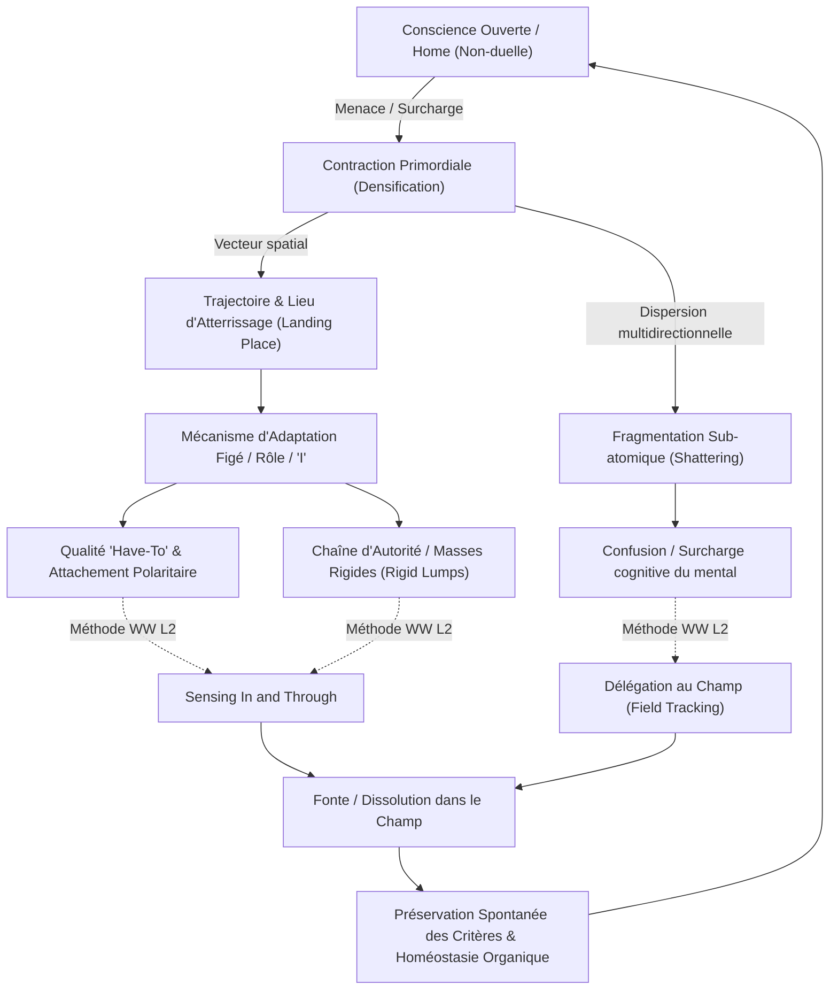

# Wholeness Work Level 2 - Transcripts
**Formateur :** Connirae Andreas | **ID :** `connirae-andreas-wholeness-work-level-2-transcripts` | **Tranches :** 18

## Synthèse Architecturale du Cours : Wholeness Work Level 2 (Connirae Andreas)

---

### 1. Thèse Centrale & Philosophie du Cours

#### Vision spécifique de Connirae Andreas vs Approche standard
Dans l'approche standard de la PNL et du coaching génératif, l'intervention vise généralement à mobiliser des ressources, réécrire des croyances, re-cadrer des sens ou négocier entre « parties » intérieures distinctes pour optimiser des stratégies comportementales. L'ego y est souvent renforcé ou réaménagé de manière fonctionnelle.

Dans le **Wholeness Work Level 2**, Connirae Andreas opère un basculement de paradigme radical issu de la non-dualité incarnée (*embodied non-duality*) :
1. **La contraction comme illusion topologique :** Les structures de l'ego, les identités (« *I's* »), les rôles et les défenses ne sont pas des entités psychiques réelles à rééduquer, mais des **mécanismes d'adaptation somato-spatiaux figés** (*coping mechanisms*). 
2. **Le paradoxe du départ (*Leaving Home*) :** L'état fondamental du système est la conscience ouverte, omnidirectionnelle et sans frontière (*Awareness / Home*). Pour fuir une charge intolérable ou aller chercher une ressource à l'extérieur, la conscience doit d'abord s'illusionner en créant une frontière locale : elle se **contracte en un point focal** afin de pouvoir se déplacer le long d'une trajectoire.
3. **La boucle de causalité inversée (métaphore du tapis de Nasruddin) :** Le système nerveux s'effondre dans une contraction défensive, puis attribue rétrospectivement sa survie à cette même contraction, pérennisant ainsi la souffrance et l'armure somatique.
4. **Dissolution sans perte de fonction :** Contrairement aux craintes du sujet (« Si je dissous ce rôle ou cet attachement, je vais devenir irresponsable ou passif »), la dissolution de la forme rigide (*container*) préserve et libère spontanément les critères et l'intention positive (*criteria preservation*), remplaçant l'hyper-contrôle compulsif par une régulation organique fluide.

#### Fil rouge méthodologique
Le fil rouge reliant l'ensemble des interventions du Niveau 2 repose sur la **dé-réification somato-spatiale** et la **résolution par le champ global d'attention** :
- **Localisation précise** de la structure ou de l'observateur dans l'espace péripersonnel ou somatique (*« Where is the one who... ? »*).
- **Remontée de la chaîne des méta-observateurs** (*« Where is the perceiving happening from? »*) ou de l'autorité introjectée (*Authority Chains*).
- **Intéroception profonde tridimensionnelle** (*sensing in and through* la matière même de la contraction, sans dissociation externe).
- **Fonte et dissolution non duelle** de la texture contractée *dans et en tant que* l'ensemble du champ de la conscience (*dissolving and melting in and as the whole of awareness*).

---

### 2. Carte des Concepts & Leviers Émergents



#### Liste structurée des concepts clés et rôles écosystémiques :

1. **Genèse Somato-Spatiale des Mécanismes d'Adaptation & « Je » (*Coping Mechanisms Genesis*)**
   - *Rôle :* Démontre que tout sentiment d'un « moi » localisé résulte d'une tentative de survie ou d'adaptation précoce face à un stimulus intolérable.
2. **Effondrement Topologique & Impératif de Contraction Pré-Mouvement (*Contraction as Prerequisite to Locality*)**
   - *Rôle :* Explique pourquoi la séparation et l'espace perçu sont des illusions nécessaires pour initier un mouvement d'évitement ou de recherche de sécurité.
3. **La Triade Cinétique : Contraction $\rightarrow$ Trajectoire $\rightarrow$ Lieu d'Atterrissage (*Pathway & Landing Place*)**
   - *Rôle :* Structure spatiale complète de l'évitement traumatique ou émotionnel, servant de carte pour le repérage somatosensoriel.
4. **Isomorphisme Somato-Spatial des Stratégies de Vie (*Coping Styles Spatialization*)**
   - *Rôle :* Relie le vecteur spatial inconscient au pattern comportemental adulte (ex. monter = intellectualisation ; reculer = retrait ; plonger = effondrement dépressif).
5. **Fragmentation Sub-Atomique (*Shattering / Infinite Landing Places*)**
   - *Rôle :* Phénomène où la conscience éclate en une infinité de particules ; levier actif de décharge cognitive via la délégation du suivi au champ d'attention global (*field tracking*).
6. **Latence de Contraction & Ancrage Différé (*Delayed Fear*)**
   - *Rôle :* Prise en compte du décalage temporel entre l'exposition perceptuelle au déclencheur et la contraction effective du système nerveux lors d'une phase d'isolement ultérieure.
7. **Prise en Pince Neuro-Phénoménologique (*Both Ends Against the Middle*)**
   - *Rôle :* Approche développementale avancée intégrant simultanément l'origine de la ligne de vie (conscience ouverte de la petite enfance) et l'adulte présent, prenant les structures identitaires en étau.
8. **Dé-réification Spatiale de l'Identité & Rôles (*Roles and Identities*)**
   - *Rôle :* Fait basculer le rôle du statut de sujet percevant (« je suis ainsi ») à celui d'objet phénoménologique situé dans l'espace (*« Where is the one who... ? »*).
9. **Empilement des Observateurs & Chute du Témoin (*Layers of 'I' / Perceiving Happening From*)**
   - *Rôle :* Désamorce le *regressus in infinitum* en pistant le point d'où s'effectue la perception et en dissolvant le méta-observateur le plus périphérique en premier.
10. **Panique Homéostatique Post-Dissolution & Conservation Spontanée des Critères**
    - *Rôle :* Rassurance biologique du système : la fin du rôle compulsif ne détruit pas les compétences ni les valeurs, mais les rend adaptatives.
11. **Masses Rigides (*Rigid Lumps*) & Chaînes d'Autorité (*Authority Chains*)**
    - *Rôle :* Indicateur somatosensoriel qu'une résistance n'est pas un blocage mécanique, mais l'allégeance implicite à une autorité introjectée (parent, figure de pouvoir).
12. **Nature de l'Attachement (*Have-To Quality*) & Polarité Cachée (Désir vs Évitement)**
    - *Rôle :* Démasque la structure double de toute compulsion ou fixation : vouloir impérativement $X$ (*having to have*) masque toujours la fuite active d'un pôle opposé $Y$ (*having to avoid*).
13. **Intéroception Tridimensionnelle (*Sensing In and Through*)**
    - *Rôle :* Neutralisation de l'observation dissociée à distance au profit d'une présence interne directe dissolvant l'armure neuromusculaire involontaire.
14. **Résonance Somatique Miroir du Guide (*Sympathetic Somatic Resonance*)**
    - *Rôle :* Outil de calibration somatosensoriel et de régulation autonome du praticien durant l'accompagnement (notamment à distance).

---

### 3. Tableau Récapitulatif des Techniques & Démonstrations

| Technique / Exercice | Objectif Opératoire | Déclencheur / Indication | Séquence Résumée |
|---|---|---|---|
| **Intégration de la Triade Cinétique** *(Pathway & Landing Place Protocol)* | Retracer et dissoudre la contraction originelle, sa trajectoire et son point de fixation somatique. | Schémas de réactivité automatique, phobies, impulsions corporelles d'évitement ou d'attaque. | 1. Réactiver le stimulus déclencheur.<br>2. Localiser la première contraction de départ.<br>3. Pister la trajectoire spatiale (*Pathway*) et le lieu d'atterrissage (*Landing Place*).<br>4. Laisser la conscience ouverte fondre et envelopper l'ensemble du trajet et des points de fixation. |
| **Résolution de la Fragmentation** *(Shattering / Particle Integration)* | Réintégrer une conscience dispersée en une infinité de micro-particules sans épuiser l'intellect. | Sensation d'explosion intérieure, surcharge sensorielle massive, panique diffuse, incapacité à localiser un bloc unique. | 1. Reconnaître l'impossibilité pour le mental de suivre tous les fragments.<br>2. Déplacer l'attention vers le champ global de conscience (*Awareness*).<br>3. Inviter le champ à inclure et baigner spontanément chaque particule simultanément jusqu'à stabilisation et reconnexion. |
| **Exploration de la Ligne de Vie** *(Life Journey Piece - Protocole Avancé)* | Nettoyer l'architecture de vie en reconnectant l'enfance pré-défensive à la présence adulte (*Both ends against the middle*). | Auto-exploration avancée pour praticiens expérimentés (proscrit pour clients débutants) visant les racines ontogénétiques de l'ego. | 1. Régression phénoménologique vers un état d'enfance précoce où la conscience opérait comme présence ouverte (*Home*).<br>2. Ancrer cette baseline non contractée.<br>3. Remonter chronologiquement vers le présent en intégrant les premières contractions au fur et à mesure qu'elles émergent face à l'adulte présent. |
| **Format Rôles & Identités** *(Roles and Identities Integration)* | Dé-réifier les identités professionnelles, relationnelles ou caractérielles rigides et libérer l'espace interpersonnel. | Hyper-responsabilité, perfectionnisme, fatigue du praticien/sauveteur, attentes relationnelles toxiques (*shoulds*). | 1. Nommer le rôle précis.<br>2. Formuler : *« Where is the one who is [Role]? »* pour l'objectiver dans l'espace.<br>3. Vérifier le point d'observation (*« Where's perceiving happening from? »*) et intégrer le méta-observateur.<br>4. Inviter la substance du rôle à fondre *dans et en tant que* le champ d'Awareness.<br>5. Vérifier la libération des critères sous-jacents. |
| **Désamorçage de la Panique Post-Dissolution** | Sécuriser le système nerveux face au vide homéostatique temporaire consécutif à la dissolution d'une structure identitaire. | Sentiment d'angoisse d'incompétence, vertige identitaire ou peur de perte de contrôle après l'effacement d'un rôle. | 1. Accueillir la panique comme une simple contraction émergente.<br>2. Localiser le « Je » qui a peur de perdre la fonction.<br>3. Intégrer ce « Je » dans le champ.<br>4. Valider l'intégrité et la permanence organique des compétences et critères qui opèrent désormais sans tension rigide. |
| **Démantèlement des Chaînes d'Autorité** *(Authority Structure Inquiry)* | Libérer les masses denses et rigides qui refusent la dissolution par loyauté ou soumission introjectée. | Présence d'un bloc immobile (*rigid lump*), sensation de « devoir obéir », blocage face aux invitations d'ouverture. | 1. Calibrer la résistance/rigidité de la forme somatique.<br>2. Questionner : *« Who is this trying to please, appease, or obey? »*<br>3. Identifier l'instance ou la figure d'autorité projetée.<br>4. Traiter et intégrer la relation à l'autorité avant de revenir à la contraction initiale. |
| **Désactivation de la Polarité d'Attachement** *(Craving & Avoidance Polarity Integration)* | Effondrer le gradient de tension sous-jendant les compulsions et fixations comportementales. | Compulsions, addictions légères, obsessions d'objectifs (*have-to have*), anxiété d'anticipation. | 1. Localiser la contraction liée au désir impérieux (*Having to have X*).<br>2. Exhumer le pôle d'évitement sous-jacent caché (*Having to avoid Y*).<br>3. Explorer la texture de chaque pôle via *Sensing in and through*.<br>4. Dissoudre conjointement les deux contractions polaires dans l'espace global de conscience. |

---

---

## 0. Sommaire Sémantique & Index des Lignes

- **Tranche 1 [Lignes 126-266]** : Exploration de la Genèse Spatiale du Mécanisme de Coping (Trajectoire du "Je") — *Protocole :* Exploration de la Genèse Spatiale du Mécanisme de Coping (Trajectoire du "Je") | *Mécanisme :* La Genèse Somato-Spatiale des Mécanismes d'Adaptation et des "Je" (Coping Mechanisms & 'I' Formation) | *Verbatim :* L'Induction au Ralenti de la Rupture Temporelle
- **Tranche 2 [Lignes 268-394]** : Cartographie et Invitation au Retour du "Mouvement Éloigné de la Maison" (Level 2 Extended) — *Protocole :* Cartographie et Invitation au Retour du "Mouvement Éloigné de la Maison" (Level 2 Extended) | *Mécanisme :* La Fragmentation comme Dispersion de Conscience (vs Déplacement Focalisé) | *Verbatim :* La gestion linguistique de l'explosion/fragmentation
- **Tranche 3 [Lignes 396-471]** : Life Journey Piece (Fondements et Règles Opératoires) — *Protocole :* Life Journey Piece (Fondements et Règles Opératoires) | *Mécanisme :* Accès à la Conscience Ouverte Primordiale vs Surcouches Défensives | *Verbatim :* Verbatim 1 : Rupture d'illusion sur l'état adulte
- **Tranche 4 [Lignes 473-601]** : d'Intégration des Rôles & Identités (Roles & Identities Format) — *Protocole :* d'Intégration des Rôles & Identités (Roles & Identities Format) | *Mécanisme :* Dé-réification Spatiale de l'Identité | *Verbatim :* L'Injonction de Dissociation Spatiale du Rôle
- **Tranche 5 [Lignes 603-771]** : A : Intégration de la Panique Émergente Post-Dissolution de Rôle — *Protocole :* A : Intégration de la Panique Émergente Post-Dissolution de Rôle | *Mécanisme :* La Dissolution des Rôles & Identités vs la Préservation Automatique des Critères | *Verbatim :* La découverte kinesthésique de la structure par le script
- **Tranche 6 [Lignes 773-903]** : Dissolution de l'Attachement et de la Polarité d'Évitement (The Letting Go Process with Pola... — *Protocole :* Dissolution de l'Attachement et de la Polarité d'Évitement (The Letting Go Process with Polarity & Authority) | *Verbatim :* Le Double-Lien d'Attachement et sa Présupposition Cachée
- **Tranche 7 [Lignes 905-1077]** : Résolution Complète de l'Attachement avec Polarité et Cascade Inverse — *Protocole :* Résolution Complète de l'Attachement avec Polarité et Cascade Inverse | *Mécanisme :* Inversion de Polarité Attachement / Aversion | *Verbatim :* Présupposition de Nécessité Polaire (Structure Attachement/Aversion)
- **Tranche 8 [Lignes 1079-1199]** : A : Intégration du Miroir Inversé (Aversions $\rightarrow$ Attachements) — *Protocole :* A : Intégration du Miroir Inversé (Aversions $\rightarrow$ Attachements)
- **Tranche 9 [Lignes 1201-1334]** : Protocole Spontané : Récupération du "Méta-Effort / Perfectionnisme" (Cas Aaron) — *Protocole :* Protocole Spontané : Récupération du "Méta-Effort / Perfectionnisme" (Cas Aaron) | *Mécanisme :* Le Principe d'Activation Maximale ("Most Activated Program") | *Verbatim :* La bascule sur le méta-programme actif
- **Tranche 10 [Lignes 1336-1455]** : A : Intégration par Relâchement du Faisceau de Regard vers sa Source — *Protocole :* A : Intégration par Relâchement du Faisceau de Regard vers sa Source | *Mécanisme :* Le Faisceau d’Attention comme Dépense Métabolique et Tension Énergétique | *Verbatim :* La métaphore énergétique du faisceau et le désamorçage de l'effort
- **Tranche 11 [Lignes 1457-1585]** : Intégration du « Where Standing » (avec chaîne de 2 Je) — *Protocole :* Intégration du « Where Standing » (avec chaîne de 2 Je) | *Mécanisme :* Le Levier du "Where Standing" (Lieu d'ancrage de la présence opérante) | *Verbatim :* Induction du "Where Standing"
- **Tranche 12 [Lignes 1587-1749]** : Récapitulatif Opératoire – « Where Standing » (Pratique en Binôme) — *Protocole :* Récapitulatif Opératoire – « Where Standing » (Pratique en Binôme) | *Verbatim :* L'invitation d'Intégration Spatiale
- **Tranche 13 [Lignes 1751-1880]** : Protocole : Intégration de la Victime, de l'Observateur et du Point de Présence (Phase 1 du... — *Protocole :* Protocole : Intégration de la Victime, de l'Observateur et du Point de Présence (Phase 1 du Travail Relationnel) | *Mécanisme :* Élicitation Somato-Spatiale de la Structure Réactive ("The Me") | *Verbatim :* Élicitation chirurgicale du "Me"
- **Tranche 14 [Lignes 1882-2008]** : Intégration de l'Autre – Phase 2 (Integrating the Other) — *Protocole :* Intégration de l'Autre – Phase 2 (Integrating the Other) | *Mécanisme :* La scission défensive et la perte d'humanité intégrale | *Verbatim :* Normalisation de la Faillibilité Humaine & Prévention du Polarity Flip
- **Tranche 15 [Lignes 2010-2155]** : A : Intégration de la Réaction à l'Autre via la Correspondance Énergétique (Match Integration) — *Protocole :* A : Intégration de la Réaction à l'Autre via la Correspondance Énergétique (Match Integration) | *Verbatim :* Traitement de la part hésitante par l'accusé de réception
- **Tranche 16 [Lignes 2157-2282]** : L'Intégration d'une Méta-Stratégie de Blocage par la Chaine d'Autorités — *Protocole :* L'Intégration d'une Méta-Stratégie de Blocage par la Chaine d'Autorités | *Mécanisme :* Le « Meta-Obstacle » comme Vraie Porte d'Entrée (metastrategy whatisactuallyhappening obstacleaspath) | *Verbatim :* La Bascule sur le « Méta-Je » Impuissant
- **Tranche 17 [Lignes 2284-2432]** : Protocole d'accès au "Je" analytique / contrôleur par rupture d'auto-discours — *Protocole :* Protocole d'accès au "Je" analytique / contrôleur par rupture d'auto-discours | *Verbatim :* La pénétration sans déplacement spatial
- **Tranche 18 [Lignes 2434-2532]** : Traitement Prioritaire des « Méta-Réponses » et Réactions Parasites — *Protocole :* Traitement Prioritaire des « Méta-Réponses » et Réactions Parasites | *Mécanisme :* Évolution de la Conscience vs Résolution de Problème (« Evolution of Consciousness vs Problem Fixing ») | *Verbatim :* La Métaphore du Bébé et de la Maturation Décroissante

---

## Extractions Détaillées par Tranche (Opératoire & Verbatim)

## Tranche 1 / 18 : Exploration de la Genèse Spatiale du Mécanisme de Coping (Trajectoire du "Je")

Voici l'extraction exhaustive, structurée et opératoire de la tranche 1/18 du cours *Wholeness Work Level 2* de Connirae Andreas.

---

### 1. Mécanismes & Principes Actifs

#### La Genèse Somato-Spatiale des Mécanismes d'Adaptation et des "Je" (*Coping Mechanisms & 'I' Formation*)
- **Principe Actif** : Les instances de contrôle et d'identité (les *« I’s »* ou structures de l'ego explorées au Niveau 1) ne sont pas des structures innées ou fixes, mais des stratégies d'adaptation (*coping mechanisms*) figées. Elles naissent au moment exact où la conscience ouverte et non duelle rencontre une difficulté perçue comme intolérable ou menaçante (« tout va bien jusqu'à ce que ça n'aille plus »). 
- **La boucle de causalité inversée (La métaphore du tapis de Nasruddin)** : Le mécanisme de défense (le tapis sur lequel on trébuche et qui fait tomber) est rétrospectivement pris par le sujet pour ce qui le sauve (« heureusement que le tapis était là pour amortir ma chute »). Le système nerveux prend la contraction/dissociation défensive pour sa planche de salut, alors qu'elle est précisément ce qui a créé la rupture et la souffrance.
- **Tags** : `#coping_mechanisms_genesis` `#formation_des_je` `#retrocausalite_defensive` `#nasruddin_carpet_effect`

#### L'Impératif de Contraction Pré-Mouvement (*Contraction as Prerequisite to Locality*)
- **Principe Actif** : Une conscience qui est « partout à la fois » (*wide open presence / infinite awareness*) ne peut pas se déplacer dans l'espace somatique ou extra-somatique : pour aller quelque part, elle doit d'abord cesser d'être partout. Le premier geste inconscient de défense est donc une **densification/réduction géométrique** (la conscience se rétracte en un point ou foyer d'intensité). Ce n'est qu'une fois localisée qu'elle peut fuir le lieu de la blessure.
- **Tags** : `#contraction_primordiale` `#effondrement_topologique` `#point_focal_conscience`

#### La Triade Cinétique : Contraction $\rightarrow$ Trajectoire $\rightarrow$ Lieu d'Atterrissage (*Pathway & Landing Place*)
- **Principe Actif** : L'évitement d'une charge affective s'opère par une chorégraphie spatiale inconsciente reproductible :
  1. *Contraction* (densification en un point, gel ou réduction de volume).
  2. *Trajectoire (Pathway)* : Vecteur directionnel emprunté par la conscience (déplacement vers l'arrière de la tête, montée vers la gorge, descente dans le ventre, projection hors du corps).
  3. *Lieu d'atterrissage (Landing Place)* : Emplacement spatial exact où la conscience se réfugie et s'agrège.
  4. *Qualité de sensation (Sensation Quality)* : Texture sensorielle (forme, densité, humidité, opacité, température) prise par le conglomérat de conscience réfugiée.
- **Tags** : `#pathway_trajectoire` `#landing_place` `#densification_sensorielle` `#spatialisation_traumatique`

#### La Réalité Expérientielle Somatique vs Vérité Factuelle (*Experientially Real vs Historical Recall*)
- **Principe Actif** : Pour le système nerveux et l'inconscient, l'exactitude historique de l'événement (détails biographiques, souvenirs déclaratifs précis) est strictement secondaire. Ce qui opère le changement, c'est la **trace viscérale/expérientielle** active dans le système somatosensoriel présent. Un souvenir sans images précises, un trauma préverbal d'in utero ou une empreinte relationnelle floue constituent un matériau clinique complet dès lors qu'il existe une résonance corporelle ressentie.
- **Tags** : `#realite_experientielle` `#memoire_somatosensorielle` `#empreinte_preverbale`

#### Le Phénomène de Fragmentation Sub-Atomique (*Shattering / Infinite Landing Places*)
- **Principe Actif** : Variante non directionnelle de la fuite : face à l'impossibilité de choisir un vecteur spatial d'échappement, la conscience se contracte puis explose en une infinité de particules microscopiques réparties dans tout le champ (*bursting into infinite tiny particles*). Le mental conscient perd alors la capacité de traquer un « lieu d'atterrissage » unique. Le levier actif consiste à transférer le tracking de l'intellect analytique vers le champ global de présence (*the field of awareness*), qui peut englober la totalité des fragments sans effort.
- **Tags** : `#fragmentation_conscience` `#shattering` `#resolution_par_le_champ`

---

### 2. Protocoles, Techniques & Démonstrations (Étape par Étape)

#### Protocole : Exploration de la Genèse Spatiale du Mécanisme de Coping (Trajectoire du "Je")

* **Intention / Indication** :
  Identifier comment un mécanisme d'adaptation structurel (un « Je ») s'est formé à l'origine en découvrant le chemin de fuite qu'a pris la conscience lors de sa première rupture de sécurité.

* **Mise en place & Pré-framing** :
  - Sélectionner un souvenir de petite enfance (idéalement avant l'âge de 8 ans, éviter l'adolescence où les couches de coping sont déjà trop intriquées).
  - Événement où « tout allait bien, jusqu'au moment où ce ne fut plus le cas » et où le besoin d'échapper s'est fait sentir.
  - L'expérience doit être *expérientiellement / viscéralement réelle*, même sans détails biographiques ou factuels.
  - Posture libre (assis ou allongé), yeux fermés pour éliminer les stimuli visuels et focaliser la proprioception.

* **Séquence d'actions pas à pas** :
  1. **Ancrage dans la Présence Antérieure** :
     - Se positionner temporellement juste avant l'incident.
     - S'immerger dans cet état où « tout est parfaitement bien », dans la présence spacieuse et ouverte.
  2. **Ralenti Micro-Séquentiel (Slow Motion)** :
     - Lancer le film intérieur très lentement vers l'événement déclencheur.
     - Stopper/ralentir à l'extrême au milliardième de seconde exact de la rupture (transition : « tout va bien » $\rightarrow$ « ce n'est plus le cas »).
  3. **Traçage du Mouvement de la Conscience (Questions d'élicitation)** :
     - *« Qu'arrive-t-il à ma conscience dans cette fraction de seconde ? »*
     - *« Dans quelle direction va la conscience ? »* (Ignorer ce que fait le corps physique).
  4. **Validation du Pré-Afflux Émotionnel (Calibration du timing)** :
     - Si une émotion (peur, panique, figement) apparaît, recalibrer : reculer encore le film intérieur. L'émotion est déjà le résultat d'un départ de la conscience. Chercher le micro-mouvement qui précède la peur.
  5. **Localisation du Lieu d'Atterrissage (*Landing Place*)** :
     - Détecter où la conscience s'arrête (ex: côté gauche du corps, derrière la tête, gorge, estomac, hors du corps).
  6. **Élicitation de la Texture Somatique** :
     - Ressentir « à travers et à l'intérieur » de ce point de fixation : forme, texture, consistance (ex: segments humides, masse floue grise, boule compacte).
  7. **Répétition & Nettoyage de la Trajectoire** :
     - Répéter la boucle une seconde fois pour clarifier le trajet continu entre l'espace ouvert d'origine et la zone de condensation finale.

* **Signes de calibration observés par le formateur** :
  - Réponses basées sur l'intellect ou le récit factuel = le sujet est trop en aval (recalibrage immédiat en arrière dans le temps).
  - Gestes spontanés de la main vers une zone du corps ou de l'espace péripersonnel (désignation inconsciente du *landing place*).
  - Changement respiratoire brutal (apnée, souffle court au niveau de la gorge) marquant l'instant d'atterrissage.

---

### 3. Heuristiques, Subtilités & "Sagesse du Praticien"

#### Heuristiques Conditionnelles (Arbres de Décision Clinique)
- **Si le sujet rapporte une émotion (ex: peur, anxiété, détresse) :**
  $\rightarrow$ *Alors* forcer le sujet à reculer dans le temps avant cette émotion.
  *Pourquoi :* Dès qu'il y a peur, la conscience a déjà fui son foyer d'origine (« once fear occurs, you've already left home »). L'émotion est une conséquence secondaire de l'atterrissage de la conscience dans une structure défensive.
- **Si le sujet décrit une action physique (ex: « je voulais sortir de la pièce », « j'ai couru ») :**
  $\rightarrow$ *Alors* recadrer immédiatement vers la proprioception de la conscience : « Que fait la conscience avant que le corps ne décide de bouger ? »
- **Si le sujet rapporte un « figement » (*freeze*) ou un « arrêt complet » :**
  $\rightarrow$ *Alors* explorer si le figement est la contraction elle-même ou s'il y a un micro-recul préalable. Souvent, le freeze est l'équivalent perceptif de la densification en un point restreint.
- **Si le sujet rapporte une enfance globalement stressante sans souvenir de « tout va bien » :**
  $\rightarrow$ *Alors* l'inviter à remonter plus loin, voire avant la naissance ou dans un espace symbolique intemporel (lumière blanche, calme absolu), ou prendre le premier moment où la rupture a commencé.
- **Si la conscience semble se scinder en deux directions (ex: Omji : noirceur derrière et contraction devant) :**
  $\rightarrow$ *Alors* cartographier la trajectoire séparément : reconnaître la scission sans forcer une unification prématurée.
- **Si le sujet décrit une explosion en micro-particules (fragmentation) au lieu d'un lieu d'atterrissage unique :**
  $\rightarrow$ *Alors* ne pas chercher à forcer le mental conscient à tout suivre : déléguer le suivi au champ global de conscience (*the field of awareness*).
- **Si le sujet choisit un événement trop tardif (ex: 14 ans) :**
  $\rightarrow$ *Alors* faire changer pour un âge plus jeune (moins de 8 ans). À l'adolescence, l'enchevêtrement des couches de coping empêche un traçage propre du pattern racine.

#### Postulats Fondamentaux de Connirae Andreas dans ce module
- *La Conscience est spatiale* : Elle n'est pas confinée dans le crâne ; elle a une dimensionnalité qui peut s'étendre, se contracter, voyager et s'enkyster.
- *Priorité absolue à l'expérience phénoménologique brute* : « Whatever your experience is, stay true to what is real for you, even if it doesn't fit at all with what I'm saying. »
- *« Lovely » n'est pas un jugement hédonique* : Lorsque le formateur dit « lovely », cela désigne la beauté de la précision avec laquelle un pattern somatique jusque-là inconscient émerge à la lumière de l'attention.

---

### 4. Pépites Verbatim & Patterns Linguistiques (MOT À MOT EN V.O.)

#### 1. L'Induction au Ralenti de la Rupture Temporelle
```text
"And then when you're ready, let the movie begin to go forward very slowly, very slowly until that moment when it wasn't fine. And there was this need to escape and right in that moment, let things slow way down so that and the question to ask the question I'm inviting you to explore is as in this moment, everything is okay. And then it's not in this moment of transition, what happens to my consciousness."
```
* **[Analyse du Pattern]** : 
  - **Présupposition temporelle & Fractionnement cinétique** : L'utilisation itérative de marqueurs de tempo (*« very slowly, very slowly... slow way down »*) induit une transe de décélération cognitive, suspendant le réflexe d'analyse intellectuelle habituel.
  - **Découpage micro-analytique (Micro-tracking)** : La phrase isole la frontière critique (*« this moment of transition »*) par un contraste binaire net (*« everything is okay / and then it's not »*).
  - **Question nominalisée ouverte** : La question n'oriente pas vers une réaction corporelle ou émotionnelle, mais interroge l'entité phénoménologique fondamentale (*« what happens to my consciousness »*), forçant un accès direct aux représentations spatiales internes non-verbales.

---

#### 2. Recadrage Radical de la Phénoménologie de l'Émotion
```text
"Because once you're afraid, you've already left, you've already left home, so to speak, once something has already happened, when fear occurs."
```
* **[Analyse du Pattern]** :
  - **Métaphore spatiale ontologique** : La métaphore du « chez-soi » (*home*) désigne l'état de conscience ouverte, non duelle et sécure.
  - **Rupture de pattern épistémologique** : Connirae démonte la croyance standard selon laquelle la peur est le déclencheur premier. Elle établit une causalité rétrograde : la peur n'est pas l'origine, elle est le symptôme que la conscience a déjà déserté son foyer d'origine.
  - **Présupposition d'antériorité** : L'adverbe *« already »* martelé trois fois force le système neurologique du sujet à chercher le point d'ancrage en amont de toute réactivité limbique.

---

#### 3. Pré-framing de la Nécessité Somatique de Contraction
```text
"How are we going to go anywhere if we're already everywhere at once? So it kind of requires this a kind of contraction, so that we're no longer everywhere at once before we can move somewhere before we can go somewhere."
```
* **[Analyse du Pattern]** :
  - **Double contrainte / Déduction logique inévitable** : Question rhétorique qui pose un postulat spatial non duel évident (*« si on est déjà partout, comment aller quelque part ? »*).
  - **Normalisation et dépathologisation du symptôme** : La contraction n'est plus une anomalie ou un traumatisme à éliminer, mais une condition mécanique obligatoire pour permettre le mouvement d'évitement. Cela lève toute résistance psychologique face à la sensation d'oppression somatique.

---

#### 4. Recadrage de la Fragmentation et Transcendance par le Champ
```text
"So that is fine to just notice that with the fragmentation, we can also do the same exercise, we just need to acknowledge that it's not a landing place, it's an infinite number of tiny landing places that our conscious mind cannot track. But that is fine, because our being can track it. So this field of awareness that we are the field of awareness can track it all."
```
* **[Analyse du Pattern]** :
  - **Recadrage d'incompétence en opportunité transpersonnelle** : Reconnaissance explicite des limites de l'attention focale (*« that our conscious mind cannot track »*) immédiatement compensée par l'activation d'un niveau d'identité supérieur (*« because our being can track it »*).
  - **Commande enchâssée d'identification non-duelle** : *« this field of awareness that we are »* installe une équivalence identitaire directe : le sujet n'est pas le mental confus qui observe des miettes éparpillées, il *est* le champ même au sein duquel les miettes flottent. L'angoisse de morcellement s'annule par englobement spatial.

## Tranche 2 / 18 : Cartographie et Invitation au Retour du "Mouvement Éloigné de la Maison" (Level 2 Extended)

Voici l'analyse opératoire intégrale de la tranche 2/18 du cours *Wholeness Work Level 2* de Connirae Andreas.

---

### 1. Mécanismes & Principes Actifs

* **La Fragmentation comme Dispersion de Conscience (vs Déplacement Focalisé)** :
  * *Principe actif* : Dans les réactions de survie ou de surcharge sensorielle/émotionnelle, la conscience ne se contracte pas uniquement en un point dense qui migre (comme un bloc descendant dans la gorge ou l'estomac) ; elle peut exploser en une myriade de particules microscopiques projetées partout simultanément (#fragmentation #dispersion_particulaire). Le mental conscient tente de suivre chaque particule et s'épuise, induisant la confusion ou la dissociation. Le levier actif consiste à déléguer le traçage au champ global de présence (*field of awareness*) : la conscience non duelle englobe déjà l'ensemble de ces points sans avoir besoin de les enregistrer cognitivement un par un.
  * *Tags libres* : `#fragmentation_multilocale` `#tracking_par_le_champ` `#surcharge_cognitive_bypass` `#landing_places_infinis`

* **L'Impossibilité Logique du Départ & La Nécessité de la Contraction** :
  * *Principe actif* : Si l'état fondamental de la conscience (*Home*) est omnidirectionnel, ouvert et présent partout à la fois, le système nerveux ne peut pas "quitter" cet état pour aller chercher une ressource extérieure (ex: la sécurité) sans créer au préalable une frontière illusoire. La contraction somatique/attentionnelle est la condition *sine qua non* pour générer la notion d'espace, de distance et de mouvement (#contraction_prealable #illusion_de_separation).
  * *Tags libres* : `#contraction_ontologique` `#geometrie_de_la_separation` `#mouvement_de_survie` `#leaving_home`

* **L'Isomorphisme Stratégie de Vie / Vecteur Spatial Somatique** :
  * *Principe actif* : La trajectoire physique et spatiale prise par la contraction de conscience lors du stimulus menaçant originel encode directement la stratégie d'adaptation comportementale dans la vie courante (#coping_style_spatialisation) :
    - *Monter / s'élever au-dessus* = intellectualisation, dissociation haute, prise de hauteur défensive (*rise above*).
    - *Reculer* = évitement, retrait relationnel, fuite arrière (*back off*).
    - *Se décaler sur le côté* = esquive, diversion, évitement du conflit direct (*sidestep*).
    - *Se mettre devant / affronter* = hyper-contrôle, confrontation agressive (*get in front of it*).
    - *S'enfoncer sous terre* = effondrement somatique, déprime réflexe, disparition (*go underground*).
  * *Tags libres* : `#isomorphisme_somatospatial` `#vecteur_d_evitement` `#coping_style` `#micro_mouvement_archétypal`

* **Décalage Temporel du Déclencheur & Latence de Contraction (Delayed Fear / Delayed Contraction)** :
  * *Principe actif* : La réponse de peur ou de contraction peut ne pas apparaître au moment de l'encodage perceptuel initial (ex: visionnage passif d'un film) mais être transférée et activée plus tard, dans un contexte d'isolement (ex: chambre noire). Le système nerveux stocke une charge non traitée qui attend un contexte récepteur pour s'effondrer. L'exploration doit tester le lieu réel du micro-mouvement d'éloignement.
  * *Tags libres* : `#latence_d_activation` `#ancrage_différé` `#localisation_de_la_premiere_rupture`

* **Le Re-cadrage Évolutionniste du "Leaving Home" (L'Apprentissage par la Chute)** :
  * *Principe actif* : Quitter l'état d'unité n'est pas une faute ni une erreur neuro-émotionnelle à réparer, mais le moteur même de l'individuation et de l'apprentissage moteur/cognitif (analogie du tout-petit qui apprend à marcher). En tombant et en se heurtant à différents "terrains" (mous, durs, accidentés), le système apprend la relation à la gravité et développe une sagesse unique et singulière (#wisdom_through_departure).
  * *Tags libres* : `#anti_blame_frame` `#apprentissage_proprioceptif` `#ontogenese_de_la_conscience` `#valeur_de_la_rupture`

---

### 2. Protocoles, Techniques & Démonstrations (Étape par Étape)

#### Protocole : *Cartographie et Invitation au Retour du "Mouvement Éloigné de la Maison"* (Level 2 Extended)

* **Intention / Indication** :
  - Utiliser lorsqu'une contraction, un schéma de peur, ou un mécanisme d'adaptation répétitif a été identifié, et que le praticien souhaite guider le retour de la part dissociée/contractée vers l'état unifié fondamental.

* **Mise en place & Pré-framing** :
  - Raconter la métaphore universelle du trésor (l'homme qui voyage pour trouver un trésor sous un arbre de château lointain, avant de découvrir par le garde que le trésor était enterré dans son propre jardin).
  - Établir explicitement le postulat : *« Partir n'a jamais été une erreur. C'est ce qui vous a donné votre sagesse unique. »*
  - Prévenir que le mental conscient n'a pas besoin de tout forcer : la conscience globale sait déjà comment recevoir le retour.

* **Séquence d'actions pas à pas** :
  1. **Remontée à l'origine temporelle neutre :**
     - Guider le sujet en amont de l'événement déclencheur : se placer au moment où *« tout allait bien »* (état calme, présence ouverte).
  2. **Ralenti extrême et repérage du décrochage :**
     - Faire dérouler le film intérieur très lentement jusqu'au micro-instant précis où apparaît le signal : *« Ce n'est pas sûr, il faut s'échapper »*.
  3. **Calibration du vecteur de déplacement de la conscience :**
     - Détecter :
       * *La contraction initiale* (où se rétrécit l'attention : centre de la tête, gorge, etc.).
       * *La trajectoire spatiale* (direction : haut, bas, arrière, diagonale, dérivation latérale, ou fragmentation explosive).
       * *Le point de chute / d'atterrissage* (*landing place* : dans le corps, hors du corps, dans une mémoire latérale).
  4. **Rencontre sensorielle pure du point d'atterrissage :**
     - S'installer dans et à travers ce point de chute.
     - Qualifier la texture sensorielle (*sensation quality*) et la qualité énergétique brute de *« ceci qui est ici »* (*of thisness of this that's here*), sans étiquette mentale.
  5. **Prise de contact en tant que Conscience :**
     - Permettre à la présence globale (*awareness*) de rencontrer cette contraction là où elle s'est réfugiée, pour lui faire réaliser qu'elle est loin de la maison.
  6. **Invitation au voyage de retour (*The Return Journey*) :**
     - Proposer une invitation douce, sans forcer : *« si cette part le désire... »*.
     - Laisser le système choisir sa cinématique de retour :
       * *Option A : Le chemin inverse* (revenir exactement le long du tracé aller).
       * *Option B : La trajectoire en miroir* (ex: si elle est partie en arc de cercle vers la droite, revenir en arc par la gauche pour compléter un cercle unifié).
       * *Option C : Un vecteur totalement inédit et spontané*.
  7. **Intégration et respect du rythme :**
     - Si le retour ne se fait pas entièrement aujourd'hui, valider absolument le palier atteint. Pas de passage en force.

* **Signes de calibration** :
  - *Phase de contraction* : Micro-mouvements oculaires saccadés, apnée réflexe, tension de la nuque ou déglutition.
  - *Phase de contact* : Ralentissement du rythme respiratoire, défocalisation du regard, détente des épaules.
  - *Phase de retour* : Soupir d'intégration neurovégétative, réalignement postural, retour du tonus musculaire détendu sans affaissement.

---

### 3. Heuristiques, Subtilités & "Sagesse du Praticien"

* **Règle conditionnelle de la fragmentation** :
  - *Si le sujet rapporte une explosion en myriade de particules impossibles à suivre mentalement* -> **Ne pas chercher à localiser chaque fragment avec l'esprit conscient**, *mais* **invoquer le champ de conscience global** (*« our being can track it »*), car le contenant (la Présence) englobe nativement tous les contenus dispersés sans surcharge.

* **Règle conditionnelle de la latence du souvenir (Cas Kathy)** :
  - *Si le sujet hésite entre la scène d'exposition neutre (ex: le film au cinéma) et la scène ultérieure où l'émotion a éclaté (ex: la chambre noire)* -> **Tester les deux scènes chronologiques** :
    1. Vérifier d'abord s'il existe une micro-contraction ou un mouvement de conscience passé inaperçu dans la première scène.
    2. Si oui, travailler cette première rupture.
    3. Si la conscience était 100% ouverte dans la première scène, basculer sur la seconde scène où la contraction a pris forme somatique.

* **Heuristique de non-coercition du retour** :
  - *« There's never any need to push or force. »* : Si le fragment/le point d'atterrissage ne veut pas rentrer tout de suite à la maison, ne jamais forcer la réintégration. Une part qui refuse de revenir exprime une fonction de protection non reconnue ou a besoin de plus de présence d'accueil là où elle se trouve.

* **Piège classique du débutant : Le "Blame Frame" spirituel/psychologique** :
  - *L'erreur* : Croire que contracter sa conscience ou quitter l'Unité était une erreur ou un dysfonctionnement personnel.
  - *La correction de Connirae* : Démontrer que le départ est structurellement obligatoire pour faire l'expérience du monde et acquérir une expertise somatique singulière. La rupture crée la compétence adaptative.

* **Heuristique de calibration de la forme du retour** :
  - Ne jamais imposer le chemin de réintégration. Présenter le choix comme ouvert : rétro-trajet linéaire, arc de cercle fermant la boucle, ou dissolution spontanée.

---

### 4. Pépites Verbatim & Patterns Linguistiques (MOT À MOT EN V.O.)

#### Pépite 1 : La gestion linguistique de l'explosion/fragmentation
> « ...it's an infinite number of tiny landing landing places that our conscious mind cannot track. But that is fine, because our being can track it. So this field of awareness that we are the field of awareness can track it all. All of those teeny tiny particles, and we don't have to register them all. »
- **[Analyse du Pattern]** :
  - *Désamorçage de l'impuissance cognitive par dissociation Conscient / Être* : Connirae valide l'échec du *conscious mind* pour immédiatement déplacer l'autorité vers *our being*.
  - *Présupposition d'identité expansive* : « this field of awareness that we are » installe une équivalence complexe implicite (Nous = Le Champ, et non pas le point qui panique).
  - *Délivrance de permission* : « we don't have to register them all » éteint la boucle obsessionnelle de contrôle du sujet en surcharge sensorielle.

#### Pépite 2 : La métaphore isomorphique du trésor intérieur
> « What allows us to make the return journey is some kind of waking up of consciousness, some kind of awareness that oh, we've left home, here I am away from home, what I need to do is return back. »
- **[Analyse du Pattern]** :
  - *Changement de cadre perceptuel (Reframing via l'Isomorphisme narratif)* : Elle utilise la structure du conte pour naturaliser l'errance. Partir n'est plus une pathologie, c'est la première moitié nécessaire d'une quête.
  - *Commande conversationnelle enchâssée par le discours direct intérieur* : En disant *« oh, we've left home, here I am away from home, what I need to do is return back »*, elle implante directement dans l'esprit du sujet la verbalisation exacte du déclencheur d'auto-guérison.

#### Pépite 3 : Le paradoxe ontologique de la contraction
> « But how are we going to leave home? If home is everywhere at once, how is it possible to leave everywhere at once? The only way we can do that is to somehow shrink. To have a contraction of consciousness. That's necessary for us to be able to leave home to move in any direction. »
- **[Analyse du Pattern]** :
  - *Raisonnement par double contrainte logique / Déduction inévitable* : Elle pose une prémisse non-duelle (« home is everywhere ») et confronte l'intellect à une impossibilité spatiale. La contraction n'est plus perçue comme un problème émotionnel honteux, mais comme une prouesse géométrique nécessaire pour se déplacer. Cela élimine instantanément le jugement et la culpabilité du sujet.

#### Pépite 4 : L'invitation hypnotique au voyage de retour
> « And then there can be this gentle invitation for return journey. If desired, if this that left home welcomes the invitation, it can be invited into a return journey. And that return journey might be a return along the same path... It might be sort of a mirror image to the path... Or perhaps it's an entirely different path that this wants to take. But it's just giving this permission for the return journey to happen however feels natural. »
- **[Analyse du Pattern]** :
  - *Nominalisation dissociative protectrice* : Elle nomme la contraction *« this that left home »* (« ceci qui a quitté la maison »), ce qui dé-personnalise la partie blessée et permet au sujet d'interagir avec elle sans fusion réactive.
  - *Saupoudrage d'adoucisseurs permissifs (« gentle invitation », « if desired », « welcomes the invitation »)* : Aucun impératif dur ; le langage contourne toute résistance de protection.
  - *Cadre de triple alternative (Truisme ericksonien à choix multiples)* : Le chemin de retour peut être identique, en miroir ou différent. L'inconscient a le choix total de la modalité, mais le résultat (le retour à la maison) est présupposé dans toutes les options.

## Tranche 3 / 18 : Life Journey Piece (Fondements et Règles Opératoires)

### 1. Mécanismes & Principes Actifs

* **Accès à la Conscience Ouverte Primordiale vs Surcouches Défensives**  
  * **Principe actif :** Chez l'adulte, l'accès direct à l'état de conscience pure et ouverte (*open awareness*) est constamment médiatisé et filtré par des dizaines de structures défensives et d'adaptations inconscientes (*coping mechanisms*). En régressant structurellement vers la petite enfance précoce, le système nerveux n'a pas encore sédimenté ces couches complexes de contractions identitaires. Cela permet au sujet de contacter l'état de base non contracté, avant l'émergence des premières scissions sujet/objet.  
  * **Tags :** `#early_childhood_access` `#open_awareness_baseline` `#coping_mechanisms_unlayering` `#ontogenetic_regression`

* **Stratégie de Prise en Pince Neuro-Phénoménologique ("Both ends against the middle")**  
  * **Principe actif :** Le travail standard du *Wholeness Work* (Niveau 1 / Foundation) part de l'instant présent (« *me who I am now* ») et dissout les couches de contraction de l'extérieur vers l'intérieur. Le protocole exploré ici (*Life Journey Piece*) prend le problème à l'exact opposé chronologique : il part du point d'origine préservé (l'enfance sans ou avec peu de mécanismes de défense) pour remonter le flux développemental. La rencontre des deux dynamiques ("both ends against the middle") force le système cognitif et somatique à relâcher les fixations identitaires prises en étau entre la conscience ouverte originelle et l'intégration présente.  
  * **Tags :** `#both_ends_against_the_middle` `#bidirectional_integration` `#developmental_timeline_clearing`

* **Écologie par Dissolution du Présent vs Risque d'Abréaction Régressive**  
  * **Principe actif :** Le travail ancré dans l'instant présent (*present-moment oriented*) est intrinsèquement écologique car il ne mobilise que le matériel déjà activé dans le champ de la conscience actuelle. Régresser à la genèse des mécanismes d'adaptation sans une stabilité extrême de l'état d'observateur/conscience peut déstabiliser brutalement l'homéostasie psychique du client en exhumant des failles archaïques non intégrables.  
  * **Tags :** `#inherent_present_ecology` `#trauma_unlayering_boundary` `#systemic_safety`

---

### 2. Protocoles, Techniques & Démonstrations (Étape par Étape)

#### Protocole : *Life Journey Piece* (Fondements et Règles Opératoires)

* **Intention / Indication :**  
  * Travailler sur l'architecture globale de la ligne de vie et identifier les toutes premières strates de construction de l'ego / mécanismes de défense (*coping mechanisms*).  
  * Réservé à l'auto-exploration ou à des praticiens cumulant **plusieurs années de pratique intensive quotidienne** du Wholeness Work. Strictement proscrit pour le travail client standard.
* **Mise en place & Pré-framing :**  
  * Pré-cadrer le focus non pas sur un trauma ou un narratif infantile, mais sur la recherche d'un moment où le système opérait encore en tant que *conscience ouverte* (*open awareness*).  
  * Prévenir le mental que les compréhensions ne sont pas nécessairement immédiates : autoriser le système à intégrer par couches cumulatives (processus non linéaire).
* **Séquence d'actions pas à pas :**  
  1. **Orientation temporelle précoce :** Guider l'attention vers la toute petite enfance (*early childhood*), en amont de la mise en place de la majorité des mécanismes d'adaptation.  
  2. **Détection de la strate initiale :** Identifier l'état de conscience ouverte de départ (*started off as open awareness*).  
  3. **Observation des premières couches défensives :** Remonter très lentement pour localiser les premières crispations ou stratégies adaptatives naissantes (*first layers of coping mechanisms*).  
  4. **Application du processus de dissolution :** Inviter chaque contraction / mécanisme naissant à fondre et se dissoudre dans la conscience spacieuse (*dissolve, melt*), selon la syntaxe standard du Wholeness Work.  
  5. **Sortie somatique & Décharge :** Rompre impérativement l'état après ce travail profond par du mouvement corporel, de l'étirement et une réorientation dans l'espace physique (break physique obligatoire).
* **Signes de calibration :**  
  * Absence de sur-intellectualisation : calibration de la posture corporelle (signes de relâchement somatique vs figement défensif).  
  * Vérification de la continuité de présence : le sujet ne doit pas basculer dans l'histoire/drame (*story*), mais rester au niveau des micro-sensations et de l'espace.

---

### 3. Heuristiques, Subtilités & "Sagesse du Praticien"

* **Règle de Conduite avec Client :**  
  * *SI* vous travaillez avec des clients -> *ALORS* utilisez **exclusivement** les formats du Wholeness Work orientés sur le moment présent (*present moment oriented*).  
  * *PARCE QUE* l'accès au moment présent garantit l'écologie du système, tandis que le travail temporel sur l'enfance (*Life Journey Piece*) peut déterrer des strates défensives massives qu'un praticien sans plusieurs années d'intégration ne saura pas contenir.
* **Fréquence d'Application :**  
  * *SI* vous utilisez le *Life Journey Piece* pour vous-même -> *ALORS* ne le faites qu'occasionnellement (*not an exercise that I do over and over many times*).  
  * *PARCE QUE* la consolidation de la conscience ouverte se fait principalement par l'entraînement répété sur les déclencheurs actuels du quotidien.
* **Gestion du Doute du Sujet / Débutant ("Readying the system") :**  
  * *SI* un débutant demande des techniques préparatoires complexes pour « préparer son système » -> *ALORS* désamorcez la demande en validant simplement les instructions de base sans rajouter de complexité méthodologique (*just what I've already said. That's good enough for now*).  
  * *PARCE QUE* chercher à sur-préparer le système est souvent une résistance intellectuelle (un *coping mechanism* en soi) qui empêche de contacter la simplicité immédiate de la conscience.
* **Pédagogie de l'Intégration Non-Linéaire :**  
  * *SI* le sujet se sent submergé ou ne saisit pas intellectuellement la totalité de l'exercice -> *ALORS* normalisez l'incompréhension (*you don't need to expect that you understand it all for the first time through*). L'apprentissage du Wholeness Work s'opère par récurrence et approfondissement progressif (modèle des *alumni*).

---

### 4. Pépites Verbatim & Patterns Linguistiques (MOT À MOT EN V.O.)

#### Verbatim 1 : Rupture d'illusion sur l'état adulte
> "The significance of early childhood is then it's most possible to find a time when we started off as open awareness. Because guess what? As adults, we don't. We might think we do, but we don't. In general, we've got a lot of coping mechanisms going that are out of consciousness."
* **[Analyse du Pattern]** :  
  * **Rupture de pattern conversationnelle (« Because guess what? »)** : Interrompt le mode d'écoute passif pour créer une focalisation attentionnelle aiguë.  
  * **Double négation de l'illusion (« We might think we do, but we don't »)** : Effondrement direct de la prétention de l'ego adulte à être déjà dans la présence pure.  
  * **Présupposition d'état primordial** : En utilisant « *when we started off as open awareness* », elle installe la présupposition inattaquable que l'état fondamental de l'être est naturellement la conscience ouverte, et que les problèmes actuels ne sont que des constructions ajoutées ultérieurement (*coping mechanisms*).

#### Verbatim 2 : Métaphore opératoire de la convergence
> "With this process, with this life journey piece, we're sort of going at it from the other side and go, okay, let's try early on before I had very many coping mechanisms and see what I discover working it that way. So it's kind of both ends against the middle, you know, kind of thing."
* **[Analyse du Pattern]** :  
  * **Métaphore spatio-temporelle (« both ends against the middle »)** : Recadre le travail psychique non plus comme un creusement unilatéral, mais comme une convergence symétrique qui prend les blocages en étau.  
  * **Langage permissif et exploratoire (« let's try... and see what I discover »)** : Réduit drastiquement l'enjeu de performance et la résistance du facteur critique en induisant une curiosité phénoménologique neutre.

#### Verbatim 3 : Cadrage strict des limites écologiques du praticien
> "The other thing I want to say is this is not a method to use with clients. Not unless you are really, really experienced and you've done years of wholeness work. So then, and I mean that several years at least of doing wholeness work, then do it with clients because you want to be able to work with whatever it might bring out. And it's more guaranteed ecological if you start the other way with the present moment."
* **[Analyse du Pattern]** :  
  * **Conditionnelle restrictive forte avec répétition d'ancrage (« really, really experienced / several years at least »)** : Pose une barrière d'autorité clinique infranchissable pour protéger le client et le praticien de décompensations potentielles.  
  * **Contraste d'orientation temporelle comme gage de sécurité (« guaranteed ecological if you start [...] with the present moment »)** : Ancre le moment présent comme l'espace sécure et régulé du système nerveux, neutralisant la tentation voyeuriste ou régressive classique en relation d'aide.

## Tranche 4 / 18 : d'Intégration des Rôles & Identités (Roles & Identities Format)

### 1. Mécanismes & Principes Actifs

* **Dé-réification Spatiale de l'Identité**  
  *Terme Connirae Andreas* : *Roles and Identities Format*  
  *Tags* : #spatialisation_de_l_ego #dissolution_attachement #non_dualite_appliquee #de_identification  
  *Principe actif* : Dans la structure cognitive ordinaire, un rôle (« je suis thérapeute », « je suis spontané », « je suis la mère ») est vécu comme le sujet percevant lui-même. En invitant le système à localiser *« Where is the one who is [Role] ? »*, le protocole force un basculement linguistique et spatial immédiat : l'identité cesse d'être le cadre perceptif pour devenir un **objet perçu dans l'espace** (ex. : « juste devant moi, diffus »). Ce simple déplacement spatial désamorce la fusion cognitive et permet au système nerveux de relâcher la contraction neuromusculaire et l'hypervigilance associées au maintien de ce rôle.

* **Effondrement des Méta-Points d'Observation (Empilement des « I » / Couches d'Observateurs)**  
  *Terme Connirae Andreas* : *Layers of "I"* / *Perceiving happening from*  
  *Tags* : #meta_observateur #retraction_du_point_focal #regressus_in_infinitum_somatique #chute_du_temoin  
  *Principe actif* : Dès qu'un observateur regarde un rôle, une tension se recrée au point d'observation (« le "Je" qui observe »). En demandant *« Where's the perceiving of this happening from? »*, on fait remonter le système le long de la chaîne des observateurs jusqu'à atteindre le point limite (le dernier « Je » localisable). L'intégration commence par le dernier « I » apparu, privant ainsi le rôle initial de son point d'appui perspectif. Le sujet s'effondre en tant qu'espace d'accueil global plutôt qu'en tant qu'entité ponctuelle observant une autre entité.

* **Dégagement de l'Écologie Relationnelle par Dissolution du Rôle**  
  *Terme Connirae Andreas* : *Allowing others their freedom* / *Dissolving attachments and shoulds*  
  *Tags* : #liberte_intersubjective #co_dependance_structurelle #relachement_du_controle #congruence_somatique  
  *Principe actif* : Tout attachement à un rôle (même positif : bon formateur, soignant, personne fiable) projette inconsciemment une exigence sur l'interlocuteur (ex. : « si je suis le sauveteur/formateur parfait, l'autre doit être guéri/satisfait »). En dissolvant l'attachement somatosensoriel au rôle, le praticien/sujet cesse d'émettre des micro-signaux non-verbaux de contrôle. L'autre retrouve l'espace somatique et relationnel pour être authentiquement lui-même sans avoir à valider l'identité du praticien.

* **Inclusion dans le Champ Global d'Attention (Awareness vs Objet)**  
  *Terme Connirae Andreas* : *Dissolving and melting in and as the whole of awareness*  
  *Tags* : #fonte_attentionnelle #re_integration_non_duale #detente_proprioceptive  
  *Principe actif* : Plutôt que de tenter de détruire ou de corriger le rôle, la méthode propose à la texture énergétique du rôle de « fondre » ou de « s'ouvrir » dans et comme le champ global de la conscience. Cela neutralise toute boucle de résistance (il n'y a personne qui pousse contre le rôle) et génère une réponse parasympathique profonde de relaxation biologique.

---

### 2. Protocoles, Techniques & Démonstrations (Étape par Étape)

#### Protocole d'Intégration des Rôles & Identités (*Roles & Identities Format*)

* **Intention / Indication :**  
  Indiqué pour assouplir les rigidités identitaires, les obligations internes (« je dois... »), les burnouts de posture (rôle d'aidant/sauveur, soignant, parent parfait, travailleur acharné), ou pour fluidifier un rôle valorisé (formateur, leader) afin de libérer l'espace relationnel. Fonctionne également pour tourner la page d'une identité passée (ex. : ex-conjointe après divorce).

* **Mise en place & Pré-framing :**  
  - Préciser qu'on peut choisir un rôle jugé **positif** (pour gagner en fluidité, en sagesse et dissoudre les attachements cachés) ou **négatif/obsolète**.  
  - Expliquer que l'on n'est pas en train d'éliminer la compétence ou la fonction, mais l'attachement rigide : *« That's what I do. It's not how I hold myself »*.  
  - Permettre au sujet de garder le nom du rôle secret s'il le souhaite (« Rôle X »).

* **Séquence d'actions pas à pas (Issue de la démonstration avec Chris - « Helper / Healer ») :**

  1. **Sélection et contextualisation somatique :**
     - Sélectionner le rôle/identité (ex. : *« Helper, Healer »*).
     - Identifier un contexte spécifique où ce rôle est particulièrement actif.
     - S'associer sensoriellement à la situation : faire fermer les yeux au sujet et le laisser s'immerger dans la scène.

  2. **Localisation du Rôle (Spatialisation) :**
     - Poser la question exacte : *« In this context with eyes closed, just kind of ask the question inwardly, where is the one who is the [Role] ? »*
     - Noter l'emplacement spontané dans l'espace (ex. : *« Right in front of me »*).
     - Calibrer la taille, la forme (*size, shape*) : flou, diffus, rond, etc.
     - Faire ressentir la qualité de sensation à travers cet espace (*sensation quality in and through*) : doux, compact, dense, etc.

  3. **Traque des Couches d'Observateurs (« Finding the "I" ») :**
     - Demander : *« Where's the perceiving of this happening from? »*
     - Localiser le 1er « I » (ex. : *« up and to the left, roundish, oblongish, mushy »*).
     - Répéter la question pour trouver la couche supérieure : *« As there's a noticing of this [1er I], where is the noticing of this happening from? »*
     - Localiser le 2e « I » (ex. : *« above and to the right, round and soft »*).
     - Re-tester une fois supplémentaire jusqu'à saturation (lorsque le sujet dit : *« There are no more eyes, it's just right there »* ou revient au même endroit).

  4. **Intégration en Ordre Rétrograde (du dernier « I » vers le rôle initial) :**
     - **Intégration du dernier « I » :**  
       Porter l'attention dans et à travers l'espace de ce dernier observateur :  
       *« Check, does the energy of this welcome being invited to integrate into the whole of awareness in some way? [...] dissolving and melting in and through... or opening and relaxing in and as the sensation of this? »*  
       Laisser fondre jusqu'à stabilisation complète.
     - **Intégration du « I » précédent :**  
       Revisiter l'observateur précédent (1er « I ») : *« How is that now? Is it the same or a little different? »* -> Encourager le mouvement spontané de dissolution déjà amorcé.
     - **Intégration du Rôle d'origine :**  
       Revenir à la localisation initiale du rôle (devant soi) : *« How is this now? »* -> Laisser la sensation fusionner et se fondre dans le champ complet de l'attention.

  5. **Vérification et Ré-ancrage Contextuel :**
     - Vérifier la sédimentation somatique : le sujet ressent un relâchement général.
     - Réintroduire le contexte de départ : *« Being this way, what is it like now in this context that we started with? »*
     - Calibration du résultat : la fonction persiste, mais la crispation identitaire a disparu (*« It's what I do, it's not how I hold myself »*).

* **Signes de calibration :**
  - Ralentissement du débit vocal et expiration spontanée profonde.
  - Dé-focalisation du regard sous les paupières.
  - Chute du tonus musculaire du visage et des épaules.
  - Absence de résistance cognitive (le processus se fait de manière « liquide » / « dissolving »).

---

### 3. Heuristiques, Subtilités & "Sagesse du Praticien"

* **Règle d'Écologie Client vs Praticien :**
  - *Heuristique :* Ne JAMAIS utiliser les formats avancés de Wholeness non orientés instant présent avec des clients tant que l'on n'a pas plusieurs années de pratique assidue sur soi-même. Avec un client, toujours démarrer par les formats ancrés dans le moment présent pour garantir une écologie absolue.

* **Heuristique de Sélection des Rôles :**
  - *Règle :* Les rôles positifs et très valorisés (ex. : thérapeute, bon parent, formateur) cachent souvent les contractions les plus subtiles et les plus contraignantes. Les dissoudre ne détruit pas la compétence, cela dissout le besoin d'approbation et les « il faut / je dois » (*shoulds and have-tos*).

* **Gestion du Rythme et des Révélations Spontanées du Sujet :**
  - *Si le sujet donne spontanément la forme ou la sensation sans qu'on pose la question :* ne jamais interrompre pour poser la question scolairement. Enregistrer l'information, s'ajuster au rythme du sujet.

* **Heuristique sur le Nombre de « I » :**
  - *Si le sujet n'a qu'un seul « I » :* ne pas forcer mentalement à en trouver d'autres (comme le remarque le participant Reed qui voulait « plus de I »). L'important est la justesse de l'expérience, pas le volume d'observateurs trouvés. Si le sujet revient au même endroit, c'est que la chaîne s'arrête là.

* **Règle d'Intégration en Cascade Rétrograde :**
  - *Ordre d'intégration strict :* On intègre TOUJOURS en premier le dernier observateur découvert, puis on redescend vers le rôle initial. Souvent, la dissolution de l'observateur supérieur amorce spontanément la fonte des couches inférieures avant même qu'on les adresse directement.

* **Assimilation par le Corps vs Compréhension Mentale (Réponse à Joel sur Core Transformation vs Wholeness) :**
  - *Si un participant cherche à comparer intellectuellement deux méthodes (ex. Core Transformation vs Wholeness Work) :* Refuser l'analyse théorique/mentale. Le praticien doit renvoyer à l'expérience somato-séquentielle des scripts. L'essence d'un processus s'intègre par la répétition mot à mot des scripts dans son propre système nerveux, pas par le débat conceptuel.

---

### 4. Pépites Verbatim & Patterns Linguistiques (MOT À MOT EN V.O.)

#### 1. L'Injonction de Dissociation Spatiale du Rôle
> « In this context with eyes closed, just kind of ask the question inwardly, where is the one who is the helper? Where's the one who is the helper healer? And just notice what location emerges spontaneously. »
* **[Analyse du Pattern]** :  
  Présupposition d'extériorité spatiale (*« where is the one who is... »*) qui scinde immédiatement le champ de conscience entre l'espace global et l'entité temporaire. Utilisation du modalisateur adoucisseur (*« just kind of ask... »*) réduisant toute pression de performance mentale, couplée à une commande d'émergence passive (*« notice what location emerges spontaneously »*) qui court-circuite le contrôle conscient volontaire.

#### 2. L'Induction Récursive du Méta-Observateur
> « As there's a noticing of this out here, that's kind of diffuse kind of soft in and through... where's the "I" that notices? Where's the perceiving of this happening from? »
* **[Analyse du Pattern]** :  
  Nominalisation du verbe de perception (*« a noticing »*) qui dépersonnalise l'expérience (ce n'est plus « tu remarques », mais « il y a un fait de remarquer »). Enchaînement immédiat sur une question de décalage de perspective sans objet préconçu (*« Where's the perceiving of this happening from? »*), forçant le système nerveux à reculer d'un cran attentionnel et à conscientiser le vecteur de projection de l'ego.

#### 3. Le Double Choix d'Intégration Non-Duale
> « Check, does the energy of this welcome being invited to integrate into the whole of awareness in some way? And that might be, that's right, it might be through dissolving and melting in and through the whole of awareness. Or if it wants this whole of awareness to open, relax in and as the sensation of this. »
* **[Analyse du Pattern]** :  
  Double lien permissif d'intégration : soit la forme locale fond dans le champ global (*« dissolving and melting in and through »*), soit le champ global s'ouvre pour épouser la forme locale (*« open, relax in and as the sensation »*). L'utilisation de l'enchâssement verbal *« that's right »* valide l'état avant même sa réalisation complète, créant un guidage hypnotique d'acceptation inconditionnelle sans confrontation d'effort.

#### 4. La Chute dans l'Événement Présent
> « And perhaps this can be even a falling into the happening of this. So when it's just melting, sometimes it's as if I, as awareness can just kind of fall into the happening of that. »
* **[Analyse du Pattern]** :  
  Métaphore de lâcher-prise gravitationnel (*« a falling into »*) qui désamorce l'effort de méditation ou de concentration. Glissement d'identité pronominale subtil (*« I, as awareness »*), opérant une ré-identification non-duale directe : le « Je » n'est plus la structure psychologique contractée, mais la conscience elle-même qui cesse de résister à sa propre expérience.

#### 5. Validation de la Posture Dé-Identifiée
> « It's like that was just a role and I'm really, you know, I'm all of that. [...] It's sort of like, I don't have that identity anymore. It's like... that's what I do. It's not how I hold myself. »
* **[Analyse du Pattern]** :  
  Verbatim du sujet (Chris) validant la bascule sémantique et somatosensorielle fondamentale : distinction pure entre l'action fonctionnelle (*« what I do »*) et la fixation corporelle/identitaire d'auto-maintien (*« how I hold myself »*). Disparition de la contraction sans perte d'aptitude opérationnelle.

## Tranche 5 / 18 : A : Intégration de la Panique Émergente Post-Dissolution de Rôle

Voici l'extraction intégrale et opératoire de la tranche 5/18 du cours *Wholeness Work Level 2* de Connirae Andreas, analysée selon vos règles strictes de modélisation.

---

### 1. Mécanismes & Principes Actifs

#### A. La Dissolution des Rôles & Identités vs la Préservation Automatique des Critères
* **Principe actif :** Lorsqu'un rôle ou une identité rigide (« l'ingénieur sérieux », « le sauveteur/supporter ») se dissout dans l'espace de la conscience (*Awareness*), le système nerveux traverse fréquemment une brève panique homéostatique : *« Si je ne suis plus ce rôle, vais-je agir de manière chaotique, inadaptée ou dangereuse ? »*. Le principe clé ici est la **séparation entre la forme rigide (le conteneur/rôle) et le critère sous-jacent (l'intention positive/fonction d'adaptation)**. 
L'attachement au rôle crée une contraction spatiale et somatique (un filtre perceptual limitant). En dissolvant la structure énergétique contractée sans chercher à la détruire mais en l'incluant dans l'espace global, le système préserve intacts les critères opératoires (ex: « être approprié au contexte social », « soutenir autrui »), mais les libère de la fixation compulsive. Le comportement passe du mode « compulsion rigide » (*have to*) au mode « réponse fluide contextuelle ».
* **Tags libres émergents :** `#dissolution_d_identite #conservation_spontanee_des_criteres #homeostasie_panique_post_dissolution #liberation_de_la_compulsion #fluidite_organique`

#### B. La Formulation Linguistique « The One Who » vs « The I »
* **Principe actif :** Dans la localisation somato-spatiale des structures identitaires, demander *« Where is the I? »* tend à sur-activer l'intellect ou le réflexe d'auto-référencement discursif. Utiliser la tournure *« Where is the one who [does X / holds this role]? »* crée une légère défusion cognitive : cela traite la configuration interne comme une structure phénoménologique distincte, observable dans l'espace péripersonnel ou somatique. Cette tournure capture un filet perceptuel plus large (*« tends to include a little bit more »*) et facilite l'accès direct aux sensations et contours sans déclencher la défense de l'ego conceptuel.
* **Tags libres émergents :** `#tournure_the_one_who #defusion_somato_spatiale #recrutement_inclusif #desidentification_linguistique`

#### C. L'Émergence du « Rigid Lump » comme Signal d'Autorité Externe (Chaîne d'Autorité)
* **Principe actif :** Lorsqu'une structure de rôle ou un « Je » refuse de s'ouvrir, de se dissoudre ou de fondre dans l'Awareness et persiste sous forme d'une masse dense, immobile et rigide (*rigid lump*), ce n'est pas une simple résistance psychologique : c'est l'indicateur neurologique et somatosensoriel d'une **introjection d'autorité**. La structure ne s'appartient pas ; elle est verrouillée par un jugement, un interdit ou une injonction provenant d'une figure d'autorité (parentale, sociétale, hiérarchique). Le praticien ne doit pas forcer la dissolution du bloc, mais changer d'angle perceptuel pour pister la *chaîne d'autorité* (*authority chain*) connectée à ce nœud.
* **Tags libres émergents :** `#rigid_lump_signal #indicateur_d_introjection #chaine_d_autorite #levee_de_verrou_somatique`

#### D. La Résonance Somatique Sympathique Guide-Sujet à Distance
* **Principe actif :** Même à travers une interface vidéo (Zoom), lorsque le guide s'accorde à son propre champ corporel et suit sensoriellement le processus vécu par le sujet (*going along with the process*), il observe l'apparition d'états d'expansion, de détente ou de micro-dissolutions en miroir (neurones miroirs, accordage transpersonnel et somatosensoriel). Non seulement cela fournit un feedback de calibration invisible mais précis sur l'avancement du client, mais cela auto-enrichit le système du praticien sans fatigue ni absorption de charge toxique.
* **Tags libres émergents :** `#resonance_somatique_miroir #accordage_intercorporel_zoom #calibration_sympathique #guidage_non_usant`

#### E. Nature et Neurologie de l'Attachement (*Have-to Quality*)
* **Principe actif :** L'attachement n'est pas le désir ni l'objectif en soi : c'est la greffe d'une **qualité de contrainte/nécessité absolue** (*have-to quality*, *got to go this way*) sur une projection future ou un objet externe. Neurologiquement, l'attachement resserre le focus attentionnel en vision tubulaire (biais de confirmation extrême, hyper-vigilance, anxiété d'anticipation). En cas d'attachement rigide (ex: plan de vie ou relationnel hyper-spécifique, addictions comportementales ou micro-compulsions), le système devient aveugle aux données émergentes de la réalité. Relâcher l'attachement via le Wholeness Work ne détruit pas la motivation ni le résultat : cela dissout le rétrécissement tonique, restaure la fluidité d'attention et reconnecte l'individu à son fondement de bien-être indépendamment de l'issue concrète.
* **Tags libres émergents :** `#qualite_have_to #retrecissement_attentionnel_tubulaire #dissolution_sans_perte_d_objectif #desactivation_compulsive`

---

### 2. Protocoles, Techniques & Démonstrations (Étape par Étape)

#### Protocole A : Intégration de la Panique Émergente Post-Dissolution de Rôle
* **Intention / Indication :** À utiliser immédiatement lorsqu'après la dissolution d'un rôle ou d'une identité, le sujet éprouve un sursaut de panique, de peur du vide ou d'inquiétude quant à sa capacité à rester adapté socialement ou professionnellement.
* **Mise en place & Pré-framing :** Cadrer la panique comme un signal de confirmation que le système neuronal a bien enregistré une bascule structurelle réelle. Poser le postulat : *« Aucun rôle ne protège des aléas de la vie ; la seule véritable sécurité est la fluidité avec laquelle nous rencontrons l'instant. »*

```
Étape 1 : Rencontre inconditionnelle (Meeting & Including)
          Ne pas chercher à calmer, raisonner ou faire disparaître la panique.
          Inviter le sujet à la rencontrer telle qu'elle est et à s'y détendre en tant qu'espace/Awareness.
          -> "Meet it, relax into it as awareness. It's fine to be a little panicked."

Étape 2 : Évaluation somatique de la dissolution spontanée
          Observer si la panique fond d'elle-même sous le regard de l'Awareness.
          - Si oui : Le système s'ajuste, fin de la boucle.
          - Si la panique persiste ou réclame de l'attention : Passer à l'Étape 3.

Étape 3 : Localisation de "Celui qui panique"
          Orienter la conscience vers la structure spécifique qui porte la panique :
          -> "Where's the one who's panicking right now?"
          Déterminer ses sous-modalités spatiales et somatiques pures :
          -> Emplacement exact, taille, forme, sensation, qualité.

Étape 4 : Invitation à fondre et s'intégrer
          Inviter cette structure somatosensorielle spécifique à se dissoudre, à fondre et à s'intégrer dans l'Awareness globale.

Étape 5 : Réassurance implicite par l'inclusion des critères
          Ne rien analyser mentalement. Faire confiance au fait que la structure énergétique 
          qui contenait l'intention positive (être approprié, faire son travail) est réintégrée 
          dans l'essence même du sujet, opérant désormais de manière fluide et non-rigide.
```

* **Signes de calibration :** Soupir de relâchement neuro-végétatif, abaissement des épaules, disparition du clignement oculaire rapide lié à la panique, réapparition d'un sourire spontané ou d'un ton vocal détendu.

---

#### Protocole B : Détection et Bascule vers la Chaîne d'Autorité
* **Intention / Indication :** En cours de dissolution d'une identité ou d'un rôle, si le « Je » (*the I*) ou le rôle lui-même reste totalement bloqué sous forme d'une masse impénétrable.
* **Mise en place & Pré-framing :** Reconnaître l'impossibilité de forcer l'intégration directe.

```
Étape 1 : Calibration de la résistance
          Vérifier la qualité somatosensorielle du blocage : présence d'une masse compacte, rigide, immobile ("rigid lump").

Étape 2 : Questionnement directionnel trans-structurel
          Sans déplacer le focus mental, inviter le sujet à ressentir à travers et au-delà de cette masse :
          -> "Sensing in and through here, where's the authority related to this?"

Étape 3 : Transition vers le protocole de la Chaîne d'Autorité
          Repérer la localisation de la figure ou du champ d'autorité désigné par la perception, 
          et embrayer sur le travail spécifique d'intégration d'autorité (Authority Chain).
```

* **Signes de calibration :** Déplacement spontané du regard du sujet vers un point externe (en haut, derrière, ou en surplomb), changement immédiat de posture (décrochage de la contraction locale vers une tension d'alerte orientée vers la source d'autorité).

---

#### Protocole C : Sélection et Calibrage d'une Cible pour le Travail sur les Attachements
* **Intention / Indication :** Phase d'élicitation préalable au protocole de dissolution des attachements.
* **Mise en place & Pré-framing :** Clarifier la distinction entre avoir un but (sain et fonctionnel) et y être attaché (contraction interne sous-tendue par un *have-to*). Exclure formellement pour les premières pratiques de groupe les dépendances chimiques lourdes (*hard drug addictions*).

```
Étape 1 : Balayage des catégories éligibles
          Inviter le client à repérer un domaine où se manifeste une tension d'obligation :
          - Objectif de carrière / plan d'affaires rigide (ex: plan à 5 ans).
          - Plan relationnel prédéterminé (scénario rigide de vie amoureuse).
          - Micro-compulsions du quotidien (aligner des cadres, ranger de façon maniaque, jeux vidéo, petits jeux d'argent).
          - Craving / attachement alimentaire spécifique (café quotidien indispensable, soda, dessert obligatoire, sucreries à la caisse).

Étape 2 : Test de calibration du gradient de compulsion
          Vérifier la présence somatosensorielle du "have-to" :
          -> "Is there a sense of: 'I really, really want this' or 'it has to happen'?"

Étape 3 : Dosage de la charge
          Sélectionner une charge moyenne à modérée (medium to mild) pour permettre l'apprentissage 
          sans saturer le système nerveux.
```

* **Signes de calibration :** Rire ou sourire embarrassé du sujet reconnaissant sa petite compulsion, micro-tension corporelle visible dès qu'il imagine l'éventualité de ne pas obtenir la chose.

---

### 3. Heuristiques, Subtilités & "Sagesse du Praticien"

#### Heuristiques Conditionnelles (Si... Alors...)
* **Si le sujet exprime une confusion ou une panique après une dissolution en disant : « Comment vais-je fonctionner sans ce rôle ? »**  
  $\rightarrow$ **Alors :** Ne cherchez JAMAIS à argumenter logiquement au niveau mental. Dites-lui d'accueillir la panique, de localiser « celui qui panique » dans l'espace somatique et de l'inviter à fondre dans l'Awareness.  
  *Pourquoi :* La structure énergétique dissoute réinjecte automatiquement son critère d'adaptation (*positive purpose*) dans l'essence globale. L'inconscient et le système nerveux gèrent cela à un niveau bien plus profond que l'intellect conscient.
* **Si le sujet n'a trouvé qu'une seule identité et un seul « Je » (*the I*) lors d'un protocole, et que le guide ressent le besoin de creuser davantage**  
  $\rightarrow$ **Alors :** Le guide doit impérativement s'arrêter là et refréner son envie d'en faire plus.  
  *Pourquoi :* Le système du client a reçu exactement la dose de changement qu'il pouvait intégrer. Vouloir extraire plus de « Je » relève de l'ambition du praticien, non du besoin du système.
* **Si une structure refuse catégoriquement de fondre et se manifeste comme un « nodule rigide » (*rigid lump*)**  
  $\rightarrow$ **Alors :** Interrompez la tentative de dissolution directe et posez la question : *« Sensing in and through here, where's the authority related to this? »*.  
  *Pourquoi :* Un nodule rigide signale un verrouillage par une injonction d'autorité extérieure qui doit être désamorcée en premier.
* **Si un processus avancé (comme le voyage de vie ou un travail profond) paraît écrasant ou incompris par le client**  
  $\rightarrow$ **Alors :** Autorisez-le à le recevoir comme une simple métaphore ou une histoire (*« take it on the story level »*) sans chercher à tout boucler ou à tout intégrer.  
  *Pourquoi :* Même une simple localisation somatosensorielle sans dissolution complète déclenche déjà une réorganisation neuronale et perceptuelle salutaire.
* **Si le client réussit un protocole lourd ou inhabituel une ou deux fois**  
  $\rightarrow$ **Alors :** Ne lui faites pas répéter ce processus quotidiennement ; réservez la pratique quotidienne exclusive au *Basic Process* (trouver les « Je » et les dissoudre).  
  *Pourquoi :* Les formats d'impact profond demandent un temps d'assimilation homéostatique, tandis que le processus de base est une hygiène écologique et cumulative.

#### Pièges Classiques & Réponses de Connirae
* **Le piège de la sur-intellectualisation comparative :** Vouloir comparer théoriquement le Wholeness Work et le Core Transformation est une impasse mentale. Connirae préconise de suivre scrupuleusement la partition des scripts pour ressentir dans sa propre chair la *séquence temporelle* du changement, car la structure se révèle dans le corps et non dans l'analyse.
* **L'illusion du « Just let it go » culturel :** Dire à quelqu'un « tu n'as qu'à lâcher prise » est inopérant. L'attachement est une constriction somatique ancrée ; sans un processus précis pour localiser et dissoudre la structure énergétique du *have-to*, les métaphores simplistes (comme s'appuyer sur un arbre) atteignent vite leurs limites.
* **La peur de l'apathie post-attachement :** Les clients craignent que lâcher l'attachement ne détruise leur motivation, leurs ambitions ou leurs projets professionnels. En réalité, le but demeure accessible, mais le champ visuel s'élargit, dissipant la tension nerveuse d'obligation et permettant de percevoir des opportunités invisibles sous vision tubulaire.

---

### 4. Pépites Verbatim & Patterns Linguistiques (MOT À MOT EN V.O.)

#### Pépite 1 : La découverte kinesthésique de la structure par le script
> "Basically you start getting more tuned into what the essence of each process is by following the scripts a lot. And by following the scripts, it becomes real. And then you start to register... That's a clear, clean example of each process. And then you feel what it does to your system and you feel the sequence in which it does this to your system, not just the end result, but the sequence. And the more you feel it in yourself, the more you understand the structure..."
* **[Analyse du Pattern] :** Empilement de truismes sensoriels et présupposition d'apprentissage somatique continu (*« the more you feel it... the more you understand »*). Connirae contourne l'intellect analytique en ancrant la compréhension dans la résonance proprioceptive du système nerveux (*« feel what it does to your system »*). L'accent mis sur la *séquence* plutôt que sur le *résultat final* reprogramme l'attention de l'apprenant pour qu'il devienne un modélisateur de processus et non un consommateur d'états.

#### Pépite 2 : La posture d'accueil de la panique et normalisation existentielle
> "Here's the thing too, we can never guarantee that life comes without trouble, no matter how boxed in we make ourselves. So we could get into trouble with the role, without the role. That's number one. It's more how we increasingly fluidly meet life as it comes to us. And so if there's this moment of panic, like, oh no, is it going to be okay? The first thing is just meet it, include it. Don't try and tap it down. It's like, meet it, relax into it as awareness. It's fine to be a little panicked. And then the panic tends to just melt."
* **[Analyse du Pattern] :** Recadrage de réalité désillusionnant mais libérateur (double lien implicite : *avec ou sans le rôle, les ennuis sont inévitables, donc s'y accrocher ne protège de rien*). Utilisation de commandes d'apaisement directes enchâssées dans une voix permissive (*« meet it, include it, relax into it as awareness »*). Le truisme terminal adouci (*« tends to just melt »*) plante une suggestion indirecte de dissolution sans imposer d'injonction autoritaire, ce qui contourne toute réactance psychologique.

#### Pépite 3 : La dissociation sémantique « The One Who »
> "Sometimes people ask about the 'one who' language... You notice we're asking, 'Where's the one who does this?' with roles identities. We ask it that way, not 'Where's the I who does this?'. And you could ask, 'Where's the I that does this?', but the 'one who' language tends to get a little bit more. It tends to include a little bit more."
* **[Analyse du Pattern] :** Subtilité linguistique de dé-centrage. Substituer *« the I »* par *« the one who »* opère une dissociation douce : cela nominalise temporairement une facette fonctionnelle du soi sans figer l'ego complet. Cela agit comme une invitation permissive à laisser émerger un champ somatosensoriel plus vaste (*« tends to include a little bit more »*) sans confrontation directe avec l'identité centrale consciente.

#### Pépite 4 : Détection de la chaîne d'autorité sur nodule bloqué
> "So if in either the I or the original role itself, it's not going to dissolve. It's just stuck here as a rigid lump. Then that's always the clue. It's this rigid lump, it's a denseness, rigidness, find the authority chain then... And to do that, that's a simple question. It's just, 'Okay, sensing in and through here, where's the authority related to this?'"
* **[Analyse du Pattern] :** Ancrage diagnostic précis : l'équivalence complexe sensorielle *rigid lump = authority chain*. L'instruction utilise le prédicat spatial trans-somatique *« sensing in and through here »*, qui instruit l'attention inconsciente du client à ne pas lutter frontalement contre la densité, mais à faire passer un faisceau d'attention *à travers* la matière dense pour révéler le fil relationnel d'autorité invisible qui maintient la contraction.

#### Pépite 5 : Métaphore de Rumi sur l'écume et la mer (Identité & Conscience)
> "I looked for myself, but myself was gone.  
> The boundaries of my being had disappeared in the sea.  
> Waves broke, awareness rose again, and a voice returned me to myself.  
> It always happens like this.  
> Sea turns on itself and foams and with every foaming bit, another body, another being takes form.  
> And when the sea sends word, each foaming body melts back to ocean breath."
* **[Analyse du Pattern] :** Métaphore isomorphique de transe profonde. Le poème utilise la superposition mer/écume pour normaliser le va-et-vient entre la forme individuelle (le rôle/l'identité/le corps = l'écume) et la conscience pure indifférenciée (l'Awareness = l'océan). La boucle temporelle *« It always happens like this »* installe une présupposition d'inévitabilité naturelle : la dissolution n'est pas une mort menaçante, mais un retour naturel et régulier au souffle premier de l'océan (*« melts back to ocean breath »*).

#### Pépite 6 : Présupposition sur l'illusion du « lâcher prise » spontané
> "Have you ever had anyone tell you, 'Oh, you just need to let go of that'? Right? Has anyone ever said that? Or have you ever thought that to yourself: 'Oh, I guess I just need to let that go'? Now, even that statement suggests, since it wasn't automatic, it suggests that there might be a little more to it. Right."
* **[Analyse du Pattern] :** Validation conversationnelle de l'expérience du sujet suivie d'un recadrage logique implacable. En soulignant que le besoin de verbaliser « il faut que je lâche prise » prouve précisément l'absence de lâcher-prise automatique, Connirae détruit la culpabilité du sujet face à son impuissance passée et pré-cadre la nécessité d'une technologie somatosensorielle précise (le Wholeness Work) plutôt que d'une simple intention cognitive de surface.

## Tranche 6 / 18 : Dissolution de l'Attachement et de la Polarité d'Évitement (The Letting Go Process with Pola...

### 1. Mécanismes & Principes Actifs

- **La Structure Cachée de Polarité de l'Attachement (Désir vs Évitement)**
  *Principe actif :* Dans le système nerveux et l'architecture cognitive, tout attachement compulsif ou « besoin impérieux » (*craving*, compulsion, fixation sur un résultat) ne fonctionne jamais de façon isolée. Vouloir impérativement $X$ (*having to have*) présuppose structurellement une fuite ou un évitement névrotique de $Y$ (*having to avoid*). Si l'on ne dissout que l'attirance positive, la charge de rejet/peur sous-jacente recréera immédiatement l'attachement. Cartographier et intégrer simultanément le pôle d'attraction et le pôle d'évitement effondre le gradient de tension qui alimentait la compulsion.
  *Tags :* `#polarite_inconsciente` `#presupposition_devitement` `#gradient_d_attachement` `#hidden_piece`

- **Somatic Submodality Depth Sensing (Sensation In and Through vs Observation Externe)**
  *Principe actif :* L'observation d'un symptôme à distance (dissociation visuelle ou kinesthésique externe : « je vois une forme », « la coquille est dure ») maintient une scission sujet/objet et renforce l'armure caractérielle. Le fait d'inviter l'attention à *sentir à travers et au sein même* de la texture tridimensionnelle (*sensing in and through*) oblige le cortex sensorimoteur à activer l'intéroception profonde. Dès que l'attention habite la matière même de la contraction sans la fuir ni la manipuler, les mécanismes de défense végétative relâchent le tonus musculaire involontaire.
  *Tags :* `#sensing_in_and_through` `#interoception_tridimensionnelle` `#desactivation_armure_somatique`

- **Détection des Structures d'Autorité Hiérarchique (Authority Structure Inquiry)**
  *Principe actif :* Lorsqu'une contraction identitaire refuse de s'ouvrir ou de fondre lors de l'invitation à l'intégration, ce « Non » n'est pas une résistance au sens freudien, mais un indicateur structural : la partie répond à une instance supérieure dans la chaîne de commandement interne (*trying to please or satisfy something else*). Tant que l'instance régulatrice suprême (le « CEO intérieur », l'autorité finale) n'est pas localisée, sentie et dissoute, les sous-structures restent verrouillées par devoir ou loyauté systémique.
  *Tags :* `#structure_d_autorite` `#chaine_de_commandement_interne` `#ceo_interieur` `#levee_de_verrou`

- **Présence Non-Intrusive du Champ de Conscience (Awareness Meeting Sensation)**
  *Principe actif :* Quand une sensation se dérobe ou « fuit » l'observation directe, l'intention du moi conscient est perçue par le système limbique comme une intrusion ou une tentative de contrôle. En transférant le vecteur d'attention du « moi qui cherche » au « champ global de conscience » (*field of awareness*), l'espace perceptif devient neutre, non-jugeant et dénué de tension de saisie. La contraction cesse sa réponse d'évitement et commence spontanément son processus de ramollissement (*softening*) et d'ouverture.
  *Tags :* `#champ_de_conscience` `#rencontre_conscience_sensation` `#non_intrusion` `#dissolution_spontanee`

---

### 2. Protocoles, Techniques & Démonstrations (Étape par Étape)

#### Protocole : Dissolution de l'Attachement et de la Polarité d'Évitement (The Letting Go Process with Polarity & Authority)

* **Intention / Indication :** Attachements subtils ou forts à un résultat, compulsions douces à modérées, envies alimentaires spécifiques (*cravings* café, sucre), micro-compulsions (jeux vidéo, vérifier/redresser des objets), évitement inconscient couplé au désir, FOMO (*Fear Of Missing Out*), incapacité à profiter d'un moment sans un rituel précis.
* **Mise en place & Pré-framing :**
  - Choisir une cible d'intensité modérée (éviter les addictions majeures/lourdes lors d'un premier apprentissage).
  - Élargir le cadre sur la valeur du comportement : ne pas présumer que le comportement compulsif ou distrayant manque de valeur (ex: l'humour vs le sérieux/l'éducation).
  - Possibilité de travailler le contenu en aveugle (*content-free*) si le sujet ressent de la gêne ou de la honte.

* **Séquence d'actions pas à pas :**

  * **Étape 1 : Localisation et sensorialisation de l'Objet du Désir / Résultat (The Outcome)**
    1. Demander au sujet de repenser au comportement ou au résultat convoité, juste avant de l'accomplir.
    2. Localiser la représentation dans l'espace intérieur ou extérieur (*« Où dans ton espace apparaît cette pensée/idée ? »*).
    3. Déterminer la taille, la forme tridimensionnelle, la profondeur.
    4. *Sensing in and through* : faire ressentir la texture et la qualité sensorielle directe au sein de la forme (ex: coquille dure, intérieur gélatineux/squidgy).

  * **Étape 2 : Localisation du Sujet Désirant (The One Who Wants / Longs For)**
    1. Calibrer le verbe d'attachement exact propre au sujet (*vouloir, avoir besoin, désirer ardemment / longing for*).
    2. Demander : *« Où se trouve celui/celle qui désire ardemment ceci ? »*
    3. Localiser précisément (ex: front/tête, casquette de baseball).
    4. Relever taille, forme, et qualité sensorielle en sentant au travers (ex: dur, solide, texture osseuse).

  * **Étape 3 : Localisation de la Polarité Cachée – L'Objet Rejeté (The Must-Avoid)**
    1. Poser le postulat de polarité : si l'on doit impérativement avoir $X$, cela présuppose qu'il y a quelque chose que l'on doit impérativement éviter ou ne pas avoir.
    2. Question : *« Où se trouve la localisation de ce que je dois éviter / ne dois absolument pas avoir ? »*
    3. Localiser (ex: creux de l'estomac, vers la colonne vertébrale).
    4. Obtenir taille, forme (ex: pois chiche cru).
    5. *Gestion de l'évitement :* Si la sensation fuit, reculer l'effort volontaire et inviter le champ de conscience (*awareness*) à l'accueillir jusqu'à ce qu'elle s'adoucisse et s'ouvre.

  * **Étape 4 : Localisation du Sujet Évitant (The One Who Must Avoid)**
    1. Demander : *« Où est celui/celle qui doit éviter cela ? »*
    2. Localiser (ex: zone du cœur/poitrine).
    3. Obtenir taille, forme (ex: taille d'un poing), texture sensorielle (*sensing in and through*).

  * **Étape 5 : Cartographie Globale et Prise de Conscience de l'Observateur (The "I" that Notices All)**
    1. Faire maintenir la conscience simultanée des 4 points découverts (Objet désiré, Sujet désirant, Objet évité, Sujet évitant).
    2. Question : *« D'où est-ce perçu ? Où se trouve le "Je" qui remarque tout cela à la fois ? »*
    3. Noter la spatialité (ex: bulle/sphère englobant la tête et le torse) et la qualité énergétique (ex: calme, frais, léger, bienveillant).

  * **Étape 6 : Séquence d'Intégration Rétrograde (Reverse Integration)**
    1. **Intégration du Grand "Je" (L'Observateur) :**
       - Demander à l'énergie de cet observateur si elle accueille l'invitation à s'ouvrir, se détendre, fondre dans et en tant que le champ complet de conscience partout à la fois. Laisser décanter (*settle*).
    2. **Intégration du Sujet Évitant (Cœur) :**
       - Constater son état actuel. Inviter son essence à s'ouvrir, se détendre, être connue de la conscience pour que ce qui veut se produire se produise.
    3. **Intégration de l'Objet Évité (Estomac/Colonne) :**
       - Constater l'évolution (souvent déjà élargi/dissous). Inviter l'énergie résiduelle à s'ouvrir, fondre et fusionner avec le champ.
    4. **Intégration du Sujet Désirant (Front/Tête) & Branchement d'Autorité :**
       - Vérifier si cette structure accueille l'invitation à s'intégrer.
       - *SI NON :* Ne pas forcer. Saluer le « Non » (*bowing to the no*).
       - Demander : *« Où se trouve l'autorité reliée à ceci ? »*
       - Définir taille, forme, épaisseur tridimensionnelle, texture (ex: calotte sur le sommet du crâne, toile d'araignée humide et délicate).
       - Tester si c'est l'autorité finale (*CEO*) ou si elle cherche à plaire à une autre instance.
       - Si finale : lui demander ce qu'elle veut faire (ex: fusionner avec les éléments précédents). Laisser la fusion opérer, puis revenir au Sujet Désirant qui peut désormais s'ouvrir et s'intégrer pleinement.
    5. **Intégration de l'Objet du Désir (Devant la poitrine) :**
       - Revenir au point d'origine. Constater la transformation (ex: nuage diffus).
       - Inviter à la dissolution complète dans le champ de conscience.

  * **Étape 7 : Test et Pont vers le Futur (Future Pace / Ecology Check)**
    1. Vérifier l'état interne face à la situation déclenchante (ex: le petit-déjeuner seule).
    2. Valider le détachement : la polarisation disparaît, l'action devient neutre ou le champ des choix s'élargit naturellement.

* **Signes de calibration :**
  - Mouvements et gestes spatiaux spontanés des mains dessinant les formes dans l'espace péripersonnel.
  - Changement de respiration (soupirs de relâchement, respiration qui descend dans le ventre).
  - Déglutition spontanée et décoloration/ramollissement des tensions faciales lors du passage de l'analyse au *sensing*.
  - Signaux de maturation : ralentissement du débit vocal, pauses silencieuses indispensables (*letting it settle*).

---

### 3. Heuristiques, Subtilités & "Sagesse du Praticien"

- **Heuristique du "Non" comme Ordre Naturel :**
  *Règle :* Si une contraction somatique refuse l'invitation à s'intégrer (*« Does this welcome being invited to integrate? -> No »*), ne JAMAIS pousser ni chercher à convaincre la part. Ce refus signale obligatoirement qu'une autre structure — généralement une structure d'autorité ou un régulateur plus haut placé dans la hiérarchie — doit être cartographiée et intégrée au préalable.
- **Heuristique de la Vitesse d'Auto-Guérison :**
  *Règle :* Dès qu'une sensation dense est pleinement reconnue et contactée par la conscience sans intention de la corriger, sa morphologie commence à muter (ramollissement, expansion, dissipation) *avant même* que la question formelle d'intégration ne soit posée. Noter ce changement au sujet pour valider le processus neurologique spontané.
- **Heuristique du Respect de l'Évitement :**
  *Règle :* Si une sous-modalité kinesthésique « fuit » (*« It keeps avoiding me »*), cesser l'investigation active. Remplacer l'agentivité du sujet (*« you sensing in »*) par la réceptivité du champ global (*« allow the field of awareness to meet it »*). L'intrusion active braque le système ; l'espace passif désarme la défense.
- **Heuristique de la Bidirectionnalité des Attachements :**
  *Règle :* Dans un conflit entre deux comportements (ex: regarder une série stupide vs lire le journal intelligent), il y a deux attachements symétriques : l'attachement à la pulsion et l'attachement au devoir/à l'idéal du moi. Les deux doivent être traités à terme pour libérer totalement le choix.
- **Erreur de débutant corrigée :**
  Se contenter de la métaphore ou du visuel de surface sans faire sentir la matière. Connirae Andreas insiste : même une « toile d'araignée » ou une « coquille fine » a une épaisseur 3D et une texture tactile directe (*damp, delicate, bony, squidgy*). Rester à la surface visuelle empêche l'intégration somatosensorielle.
- **Règle temporelle du facilitateur :**
  Toujours donner tout le temps biologique nécessaire à l'installation du changement. Ne jamais enchaîner les étapes tant que le système n'a pas manifesté un palier d'intégration stabilisé (*« allow them time until things settle »*).

---

### 4. Pépites Verbatim & Patterns Linguistiques (MOT À MOT EN V.O.)

#### Pépite 1 : Le Double-Lien d'Attachement et sa Présupposition Cachée
> « Basically, when there's something that we want, if there's a sense of that I have to have it, then that presupposes that there's also something that I must avoid, or I have to not have. So if there's this have to the longing for this, where is the location of whatever it is that I must not have that I must avoid that I have to not have? »
* **[Analyse du Pattern] :** Connirae Andreas utilise une clause de nécessité impérative (*« have to have »*) pour faire émerger par implication logique irréfutable la polarité d'évitement (*« presupposes that there's also something that I must avoid »*). La répétition rythmique des modaux de contrainte (*« must not have »*, *« must avoid »*, *« have to not have »*) sature la boucle logique pour contraindre le système nerveux à révéler spatialement l'inconfort refoulé.

#### Pépite 2 : La Désactivation de l'Intrusion Égoïque par le Champ de Conscience
> « It keeps kind of avoiding you. It's not so thrilled that you sense in and through it. Okay, how interesting. So let's just kind of pause back off a little bit and find out and give it a chance to reveal itself instead of us intruding on it. And just let it do that in its own way. If and how it wishes to be known, there's this opportunity to be known now. And it may be that, that rather than you sensing in and through, it may be more welcoming of the field of awareness beginning to sense in and through the space here. »
* **[Analyse du Pattern] :** Recadrage conversationnel immédiat de la résistance somatique en autonomie légitime. Utilisation de verbes permissifs à agentivité déléguée (*« give it a chance to reveal itself »*, *« if and how it wishes to be known »*). Déplacement linguistique subtil du sujet agent : abandon du pronom actif duel (*« you sensing »*) au profit d'un tiers absolu non-violent (*« the field of awareness »*), ce qui désamorce le réflexe de défense neuroceptif.

#### Pépite 3 : La Soumission Sacrée au Signal d'Arrêt (Bowing to the No)
> « And what when there's a no, when it doesn't welcome integrating, that always means there's some other structure that needs to be included first. [...] So first, just kind of bowing to the no, you know, thank because that's there's a thank you in that it's like it's letting us know the natural order of things. And real effort for real healing and transformation to happen. That's what we always are bowing to the system's wisdom and telling us these things. »
* **[Analyse du Pattern] :** Utilisation d'une métaphore d'inclination somato-linguistique (*« bowing to the no »*) opérant une rupture de pattern radicale avec les approches PNL/hypnotiques directes qui tentent de « contourner » la résistance. Présupposition que le refus est une preuve de haute écologie et d'intelligence systémique (*« system's wisdom »*), rehaussant l'alliance interne du sujet avec ses propres blocages.

#### Pépite 4 : La Suggestion Permissive Multi-Options pour l'Intégration
> « Notice what happens when the the essence of this, its essential nature when this is also invited to open, relax, to integrate with awareness to be known by awareness in such a way that whatever wants to happen, can happen. Yeah. And sometimes it can be an opening and relaxing. Sometimes it wants awareness to flow in the open and as the sensation already here. Sometimes the awareness already here can wake up to itself. Whatever feels easy, natural. »
* **[Analyse du Pattern] :** Empilement de suggestions permissives ericksoniennes en choix illimités (*« whatever wants to happen, can happen »*). Les trois alternatives proposées (1. s'ouvrir/se détendre, 2. laisser couler la conscience dans la sensation, 3. la conscience déjà présente qui s'éveille à elle-même) saturent les possibilités cognitives tout en garantissant que peu importe la voie choisie par l'inconscient, le résultat sera inévitablement une intégration sans friction.

#### Pépite 5 : L'Élision Égologique et le Pont vers le Neutre
> « Because it's this the sense here, being is one of just being. So whether it's newspaper or TV show, it's irrelevant, somehow. [...] Or that or that other option that becomes noticeable to possible to notice when we're not focused on having this and avoiding that. Yeah, it's like, okay, yeah, then then the whole world becomes open. »
* **[Analyse du Pattern] :** Double lien inversé d'indifférence libératrice (*« whether it's newspaper or TV show, it's irrelevant »*). Déconstruction de l'illusion de choix binaire (A ou B) pour révéler la vacuité sous-jacente du besoin. L'expression nominale condensée (*« being is one of just being »*) opère une nominalisation ontologique pure, installant le sujet dans un état d'ouverture sans saisie (*« the whole world becomes open »*).

## Tranche 7 / 18 : Résolution Complète de l'Attachement avec Polarité et Cascade Inverse

Voici l'analyse opératoire intégrale de la tranche 7/18 du cours *Wholeness Work Level 2* par Connirae Andreas.

---

### 1. Mécanismes & Principes Actifs

#### 1. Inversion de Polarité Attachement / Aversion
- **Principe actif** : Tout attachement compulsif (*« je dois absolument avoir X »*) est neurologiquement et structuralement sous-tendu par la fuite active d'un pôle opposé non résolu (*aversion*, *« ce que je dois à tout prix éviter »*). Si le praticien n'intègre que l'attachement à l'objectif sans localiser ni dissoudre l'aversion polaire, la structure duelle reste sous tension et le système psychoneurologique recrée automatiquement l'attachement. L'intégration de la polarité annule l'oscillation compulsion/évitement.
- **Tags libres** : `#polarite_attachement_aversion` `#resolution_duelle` `#prevention_rechute_structurelle` `#annulation_vecteur_evitement`

#### 2. Décomposition Structurale Multi-Niveaux (Objet vs Sujet Porteur)
- **Principe actif** : L'expérience interne d'un désir ou d'une peur n'est pas un bloc monolithique. Elle se divise systématiquement en deux représentations spatiales distinctes :
  1. *L'objet/événement projeté* (l'issue voulue ou la situation redoutée dans l'espace péripersonnel).
  2. *Le sujet localisé* (la « partie » ou structure corporelle qui désire ou qui repousse, par exemple des griffes dans l'estomac ou une poussée devant le ventre).
  Traiter l'objet sans dissoudre l'instance somatique qui s'y accroche maintient la fixation neuromusculaire.
- **Tags libres** : `#separation_objet_sujet_interne` `#somatisation_de_l_agrippement` `#cartographie_spatiale_peripersonnelle`

#### 3. Primauté Dissolutive du « Perceiving Self » (L'Observateur Localisé / « I »)
- **Principe actif** : L'acte de percevoir une partie crée lui-même une contraction ou un centre de gravité perceptif localisé (ex. dans l'arrière du crâne, au-dessus ou derrière le corps). Tant que l'instance qui observe reste dense, séparée et contractée, toute tentative de « dissoudre » les parties périphériques se heurte à la résistance de cet observateur. Dissoudre d'abord le *« I »* (l'observateur localisé) dans le champ de la conscience déverrouille l'intégration spontanée de tous les autres éléments du système.
- **Tags libres** : `#perceiving_self_dissolution` `#effondrement_observateur_observe` `#decontraction_du_siege_perceptif`

#### 4. Stratification Récursive des « I » (Multi-Layered Observers)
- **Principe actif** : Lorsqu'un « I » refuse d'intégrer, cela signale neurologiquement qu'il est lui-même objectifié et observé par une instance encore plus reculée, plus subtile ou plus haute. Au lieu de forcer ou négocier avec la résistance, le praticien recule l'attention vers l'instance perceptive parente (*« Where is the perceiving of this happening from? »*). Ce méta-observateur est invariablement plus vaste, plus diffus et déjà prêt à se dissoudre.
- **Tags libres** : `#meta_observateur_recursif` `#stratification_perceptive` `#contournement_resistance_sans_force`

#### 5. Effet de Contagion Intégrative Descendante (« Reverse Cascade Integration »)
- **Principe actif** : Lorsque les couches d'observateurs supérieurs ont fondu dans la Conscience (*Awareness*), le tonus affectif global bascule de l'agrippement/défense à la bienveillance inconditionnelle (*kindness/love*). Dès lors, la réintégration des éléments précédents en sens inverse (du dernier apparu au premier) ne demande aucun effort : la plupart sont déjà transparents, vaporeux ou ont disparu d'eux-mêmes faute de structure de maintien.
- **Tags libres** : `#cascade_integrative_inverse` `#effondrement_spontane_des_objets` `#bascule_affective_bienveillance`

#### 6. Démêlage et Traitement des Réactions Méta (« Reacting to the Material »)
- **Principe actif** : Face à une intensité (peur, choc, larmes, autorité écrasante), le système génère une réaction à la réaction (peur de la force, refus d'entendre les détails, fragmentation). Traiter le contenu initial alors qu'une réaction méta est active surcharge le système. Le protocole isole instantanément la réaction émergente comme une nouvelle « partie » à accueillir dans la conscience somatique pure.
- **Tags libres** : `#traitement_reactions_meta` `#desensibilisation_somatique_pure` `#zero_analyse_de_contenu`

#### 7. Reparentage Somatique Intérieur par Inclusion Radicale
- **Principe actif** : Les mécanismes de dissociation, fragmentation (*« disappearing / fragmenting out »*) et panique proviennent de l'obligation historique de refouler ou contrôler les sensations pour survivre relationnellement. Le praticien ne cherche pas à stabiliser artificiellement ou à forcer la présence d'une partie évanescente : il autorise le champ de conscience à envelopper l'oscillation (*« in and out »*). L'absence de volonté de contrôle répare la rupture d'attachement développemental.
- **Tags libres** : `#reparentage_par_la_conscience` `#non_intrusion_therapeutique` `#accueil_de_la_fragmentation`

---

### 2. Protocoles, Techniques & Démonstrations (Étape par Étape)

#### Protocole : Résolution Complète de l'Attachement avec Polarité et Cascade Inverse

* **Intention / Indication** :
  Obsession, besoin compulsif d'obtenir une issue spécifique (*longing, grasping, having to have*), blocage récurrent où un comportement ou une issue s'impose au détriment de l'ouverture du champ perceptif.
* **Mise en place & Pré-framing** :
  Calibrer la nature de l'agrippement. Prévenir le sujet que chaque désir compulsif cache une aversion polaire qu'il faudra cartographier pour que le résultat soit permanent. Garder le protocole écrit sous les yeux sans chercher à mémoriser.

* **Séquence d'actions pas à pas** :

  1. **Localisation et Sous-Modalités de l'Issue Voulue (Outcome)** :
     - Inviter le sujet à contacter ce qu'il désire absolument obtenir.
     - Trouver sa localisation spatiale précise (ex. : *« right in front of my right eye, reflection inside »*).
     - Calibrer taille, forme, sensation, qualité (même floue/murky).
  2. **Localisation de la Partie Attachée (The One Who is Attached)** :
     - Accéder au ressenti de l'agrippement (*having to have this*).
     - Demander : *« Où est celui/celle qui est attaché(e) ? »* (ex. : griffes/crochets dans l'estomac).
     - Déterminer taille, forme, sensation, consistance somatique (ex. : sombre, filandreux).
  3. **Localisation de l'Aversion Polaire (What Must be Avoided)** :
     - Poser : *« Quand tu dois absolument avoir cela, qu'est-ce que cela présuppose que tu évites ? Où se trouve ce que tu ne veux absolument pas / dois éviter ? »*
     - Cartographier la position spatiale (ex. : à gauche en avant, gris et brumeux).
  4. **Localisation de la Partie Évitante (The One Who Must Avoid)** :
     - Calibrer selon les mots du sujet (*longs for, must avoid, pushes away*).
     - Demander : *« Où est celui/celle qui refuse/évite cela ? »* (ex. : devant le ventre, mouvement de repousser).
     - Relever forme, mouvement somatique et texture.
  5. **Identification du « Perceiving Self » (L'Observateur Initial / « I »)** :
     - Tenir l'ensemble des éléments dans le champ de perception.
     - Demander : *« D'où se fait la perception de tout cela ? »* (ex. : bloc concentré à l'arrière du crâne avec halo externe).
     - Définir la densité somatique (dur, granuleux, vaporeux).
  6. **Test d'Accueil / Intégration du « I » & Détection Récursive** :
     - Demander : *« Est-ce que cette instance accueille l'intégration ? »*
     - **Si NON** : Ne pas négocier. Deux options : rechercher une *Autorité* ou reculer vers un méta-observateur.
     - Poser immédiatement : *« D'où se fait la perception de CETTE instance ? »*
     - Localiser le second « I » (généralement plus haut, plus vaste, lumineux, immobile, invisible).
  7. **Phase d'Intégration Descendante (The Melting Cascade)** :
     - Inviter le « I » le plus vaste/prêt à se dissoudre, fondre et fusionner avec le Tout / le champ de conscience (*allowing it to happen however it wants*).
     - Calibrer la propagation corporelle (chaleur, détente, relâchement tonique).
     - Revenir au premier « I » (qui s'est déjà assoupli ou fragmenté) et l'inviter à fondre et s'intégrer à son tour dans le Tout.
  8. **Parcours Intégratif Inverse (Reverse Integration)** :
     - Revenir au dernier élément cartographié (La partie évitante) -> l'inviter à fondre dans l'espace de bienveillance/amour conscient.
     - Revenir à l'aversion polaire (souvent déjà presque transparente ou disparue) -> dissoudre les résidus dans le champ.
     - Revenir à la partie attachée initiale (constater la perte de tension/effort de maintien) -> la laisser se détendre et couler dans le système.
     - Revenir à l'image de l'issue voulue -> constater l'élargissement perceptif et inviter les résidus à devenir transparents et s'intégrer.

* **Signes de calibration** :
  - Ralentissement du rythme respiratoire, soupirs involontaires.
  - Manifestation de chaleur somatique diffuse (*warmth in the body*).
  - Amnésie spontanée ou difficulté à retrouver mentalement les objets/parties traités (*« I'm kind of forgetting... does anybody remember? »*).
  - Élargissement du champ visuel périphérique (les objets reculent et ne bloquent plus la vue).

---

#### Démonstration Live / Intervention : Accueil de la Force Agressive et de la Fragmentation (Cas Michelle)

* **Intention / Indication** :
  Émergence d'une réaction traumatique ou abreactive en cours de processus : sensation d'agression énergétique extérieure, terreur, larmes spontanées et impression de s'évanouir/fragmenter.
* **Mise en place & Pré-framing** :
  Interrompre l'interprétation discursive. Poser comme cadre que la difficulté naît uniquement de la comparaison avec une attente mentale de ce qui « devrait » se passer. Traiter l'état somatique présent *ici et maintenant*.

* **Séquence d'actions pas à pas** :

  1. **Synchronisation avec l'Énergie Menaçante Active** :
     - Valider l'expérience brute : *« Do you experience this forceful feeling right now? »*
     - Localiser spatialement : *« Where is this one who is being forceful? »*
     - Calibrer le vecteur spatial : énergie extérieure fonçant vers le sujet.
  2. **Interception de la Réaction Méta (La Peur des Larmes)** :
     - Le sujet exprime la terreur et les pleurs face à cette énergie.
     - Isoler la partie effrayée : *« Where's the one who is afraid? »*
     - Localisation somatique interne (ex. : minuscule, interne).
  3. **Gestion de la Dissociation / Fragmentation (*Disappearing*)** :
     - Le sujet déclare qu'elle disparaît ou se fragmente (*fragmenting out*).
     - **Règle fondamentale** : Ne jamais forcer la partie à se montrer ni à rester stable.
     - Cadrer l'évanescence comme un manque de confiance temporaire dans l'espace disponible.
     - Inviter non pas la personne (*Michelle*), mais le *Champ de Conscience* (*the field of awareness*) à rencontrer cette partie au rythme où elle clignote (*flashing in and out*).
  4. **Accueil Spéculaire des Larmes Physiologiques** :
     - Revenir à la manifestation somatique : *« Where's the one who has the tears? »*
     - Identifier les structures physiques impliquées (les yeux, élargis, perçus à l'extérieur).
     - Laisser le champ de conscience rencontrer la sensation oculaire sans chercher à stopper ni amplifier les larmes.
     - Laisser le relâchement s'opérer par permission absolue d'exister.

* **Signes de calibration** :
  - Cessation de la panique liée à la perte de contrôle.
  - Les sanglots passent d'une contraction d'effroi à un relâchement d'abandon et de soulagement (*release of crying*).
  - Normalisation de la voix et ré-ancrage corporel spontané.

---

### 3. Heuristiques, Subtilités & "Sagesse du Praticien"

#### Heuristiques Conditionnelles (Si -> Alors -> Parce que)
1. **Si** un attachement compulsif est présent, **alors** toujours chercher l'aversion opposée (*« what must I avoid? »*), **parce que** l'attachement n'est que la tension de fuite d'une polarité rejetée ; ignorer l'aversion garantit la reconstruction de la fixation.
2. **Si** l'instance perceptive observatrice (*I*) répond « non » à l'invitation d'intégration, **alors** ne jamais argumenter ni négocier : chercher immédiatement le méta-observateur en demandant d'où ce « I » est lui-même perçu, **parce qu**'un observateur contracté est toujours sous le regard d'un plan perceptif plus large déjà prêt à fondre.
3. **Si** le sujet entre dans une réaction émotionnelle secondaire (peur, réticence à entendre les noms d'autorités, larmes), **alors** suspendre le protocole d'origine et traiter immédiatement cette réaction comme la nouvelle partie prioritaire, **parce qu**'on ne peut pas intégrer à travers un filtre réactif actif.
4. **Si** une partie semble « disparaître », « se fragmenter » ou clignoter (*flashing in and out*), **alors** ne pas tenter de la stabiliser ni de la forcer à se manifester, **parce que** la forcer réplique l'intrusion relationnelle précoce ; la laisser clignoter dans le champ de conscience restaure la sécurité neurosomatique.
5. **Si** le sujet oublie spontanément les éléments cartographiés lors du parcours inverse, **alors** ne pas les lui rappeler mentalement de manière insistante, **parce que** l'amnésie des sous-modalités est le marqueur direct de la dissolution neuronale de la charge.
6. **Si** lors de la pratique quotidienne une résistance émerge (*« Dois-je vraiment faire ça aujourd'hui ? »*), **alors** ne pas traiter cela comme un problème de discipline ni débattre sur le contenu, mais localiser somatiquement *la partie qui dit cela* et l'intégrer, **parce que** la réticence est elle-même le matériau vivant prêt à être libéré.

#### Pièges Classiques & Erreurs de Débutant
- **Piège de l'Effort Volontaire** : Demander au *sujet* d'intégrer ou d'aimer la partie. Connirae Andreas insiste : ce n'est pas la personne (*Michelle*) qui fait l'action, c'est *le champ de conscience* (*the field of awareness*) qui est invité à envelopper la sensation.
- **Piège de l'Attente Normative** : Juger qu'une expérience est « difficile » ou « mauvaise » parce qu'elle comporte 6 autorités ou des énergies écrasantes. La difficulté perçue n'est qu'un écart mental créé par la comparaison avec un scénario théorique idéal.
- **Erreur de Nominalisation Personnalisante** : Vouloir nommer les parties comme des entités fixes (*Fred*, *George*). Connirae précise que nommer les parties sert uniquement de repère topographique pour le protocole (*« celle qui veut éviter »*), et non à figer une identité illusoire.
- **Erreur de Dispersion par le Contenu** : Vouloir comprendre *pourquoi* deux parties évitent la même sensation dans le ventre ou *qui* sont les autorités du passé. Seule la structure somatique, spatiale et phénoménologique compte.

#### Postulats Fondamentaux de Connirae Andreas
- **Le Reparentage par la Conscience Pure** : Le Wholeness Work est l'équivalent intérieur d'un reparentage parfait. Contrairement au monde extérieur où des limites de sécurité physique doivent être posées, dans le monde intérieur *absolument tout ce qui émerge a le droit d'avoir sa place*, sans contrôle, sans refoulement, sans confinement.
- **L'Amour est l'État Naturel de la Conscience Décontractée** : Dès que les observateurs séparés (*I*) fondent, la conscience n'a pas besoin d'apprendre à aimer ; elle reconnaît spontanément chaque partie souffrante comme « le Bien-Aimé » (*the beloved*).
- **L'Élargissement Spontané des Choix** : Lorsqu'un attachement se dissout, l'issue initiale ne disparaît pas forcément du monde, mais elle cesse d'obstruer le champ visuel : le sujet découvre instantanément l'existence de multiples autres voies possibles.

---

### 4. Pépites Verbatim & Patterns Linguistiques (MOT À MOT EN V.O.)

#### 1. Présupposition de Nécessité Polaire (Structure Attachement/Aversion)
> « So when I have to have this, that presupposes there's something I'm avoiding... So where is the location of what I don't want? Where's the location of what I must avoid? »
* **[Analyse du Pattern]** : Utilisation d'une présupposition linguistique directe (*« that presupposes »*) qui force le système cognitif à bifurquer immédiatement hors de la fixation désirée pour sonder l'espace d'évitement. Le basculement syntaxique enchaîne deux questions de localisation spatiale spatialisant le concept d'aversion, transformant une angoisse abstraite en un objet phénoménologique traitable à coordonnées précises.

#### 2. Démantèlement de l'Auto-Résistance Quotidienne
> « Well, of course you don't. And of course you can take a break. But maybe more relevant is to find, welcome this part that's going: "Oh, do I really..." Oh, where's the one who thinks that? Oh, right here, half in my head, half out. And its sensation quality. Now I can relax in and as that. And maybe that's enough practice for the day. »
* **[Analyse du Pattern]** : Double truisme d'autorisation (*« of course you don't / of course you can »*) brisant instantanément la polarité surmoïque du devoir. Suivi d'une rupture de pattern via un recadrage opératoire : la résistance n'est pas un obstacle à la séance, elle *est* la séance. Démonstration en direct de la modélisation à la première personne avec transition somato-spatiale (*« half in my head, half out »*) et bascule identitaire non-duelle radicale (*« relax in and as that »* : se détendre non pas *vers* la partie, mais *en tant que* la partie elle-même).

#### 3. Déconstruction Sémantique de la Difficulté
> « And I think it's just important and it's the truth to realize that you don't have to meet everything at once. So it's only difficult if that, if it's being compared to come up with a conclusion. It's difficult requires comparing it to some idea of how it should go. »
* **[Analyse du Pattern]** : Dé-nominalisation chirurgicale de l'adjectif « difficile ». Connirae démonte le prédicat en révélant sa structure cognitive sous-jacente : une comparaison inconsciente entre l'état présent et une norme imaginaire (*« comparing it to some idea of how it should go »*). Cette clarification linguistique désactive le sentiment de surcharge en ramenant l'expérience à une suite phénoménologique pure, débarrassée de jugement téléologique.

#### 4. Suggestion Éricksonienne de Non-Intrusion et Sécurité Somatique
> « So part of helping it trust the space is we don't push it to show up any faster than it feels ready, than it wants to, than it does. So we accept this in and out. And now it's a thing where we let the field of awareness meet it instead of you, Michelle, trying to do anything. It's more like that field is allowed to meet this, that's kind of flashing in and out a little bit... however is easy, however much is comfortable. It doesn't have to reveal itself totally now, just however much is easy and comfortable to the field of awareness, it can begin. »
* **[Analyse du Pattern]** : Induction classique par permissivité totale. Empilement de truismes et clauses temporelles contingentes (*« faster than it feels ready / than it wants to / than it does »*). Dissociation hypnotique nette entre le moi volontaire et le champ conscient (*« instead of you, Michelle... we let the field of awareness meet it »*). L'utilisation de prédicats de confort répétés (*« easy », « comfortable »*) couplée à l'effacement de l'exigence d'achèvement (*« It doesn't have to reveal itself totally now... it can begin »*) installe une commande enchâssée d'ouverture sans risque d'effraction psychique.

#### 5. Recadrage Philosophique et Métaphorique du Reparentage Intérieur
> « What we're really doing here is we're reparenting ourselves the way that our parents didn't know how to do... our job as a parent to ourselves now, is like letting just letting everything have its place, let everything be met, nothing has to be contained, nothing has to be controlled. And when nothing has to be suppressed, repressed, pushed away, shut aside... then it's this gradual process of falling in love with everything again, loving everything again. »
* **[Analyse du Pattern]** : Recadrage de sens de niveau identitaire et développemental (*« reparenting ourselves »*). Utilisation d'une anaphore négative puissante (*« nothing has to be contained, nothing has to be controlled, nothing has to be suppressed... »*) qui induit neurologiquement un déchargement massif du système inhibiteur d'action. La séquence culmine dans une métaphore affective d'union unitive (*« falling in love with everything again »*), opérant une fusion sémantique entre l'acceptation inconditionnelle et la dissolution de l'ego.

## Tranche 8 / 18 : A : Intégration du Miroir Inversé (Aversions $\rightarrow$ Attachements)

### 1. Mécanismes & Principes Actifs

- **Reparentage Somatique Intérieur par le Champ de Conscience**
  * *Principe actif :* Le système nerveux fige des charges émotionnelles (pleurs, terreur, détresse) sous forme de structures rigides et réactives lorsque l'environnement précoce (les figures parentales) n'a pas su contenir, accueillir ou valider l'expérience somatosensorielle. Plutôt que de tenter de contrôler, supprimer, consoler ou rééduquer mentalement l'état, le praticien invite le « champ de conscience » (*field of awareness*) à rencontrer directement la sensation énergétique brute. L'absence totale de contention ou de jugement permet au système de cesser son mécanisme de défense hyper-vigilant : la forme rigide se désagrège d'elle-même et l'énergie piégée réintègre la vitalité globale du système.
  * *Tags :* `#reparentage_somatique` `#champ_de_conscience` `#dissolution_reactivite` `#accueil_inconditionnel` `#non_contention`

- **Décorrélation Contenu / Localisation Énergétique (Aversion & Attachement)**
  * *Principe actif :* L'esprit conscient construit des récits complexes (histoires relationnelles, justifications, scénarios de peur) pour donner du sens à des gradients de charge somatosensorielle non résolus. L'aversion ou l'évitement compulsif n'a souvent aucun contenu objectif : elle se manifeste comme une masse informe, un nuage gris ou un vortex noir localisé dans l'espace péripersonnel. En demandant la *localisation* spatiale et la *qualité sensorielle brute* plutôt que le *contenu narratif*, le praticien court-circuite les boucles de rumination du cortex préfrontal pour agir directement sur l'encodage neuro-spatial du système limbique.
  * *Tags :* `#localisation_sans_contenu` `#court_circuit_cognitif` `#espace_peripersonnel` `#charge_energetique_pure`

- **Intégration de la Polarité Cachée (Attachement $\leftrightarrow$ Évitement / Aversion)**
  * *Principe actif :* Tout attachement impérieux (« je dois absolument avoir X ») est structurellement soutenu en profondeur par une aversion équivalente et inconsciente (« je dois à tout prix éviter Y »), et inversement. Tenter de dissoudre un attachement sans adresser l'aversion polaire sous-jacente laisse le système en tension non résolue. Lorsque les deux versants (l'objet d'attachement/aversion et le « Je » qui s'y agrippe/l'évite) sont localisés et rencontrés par le champ de conscience, la dynamique d'attraction/répulsion s'effondre d'elle-même.
  * *Tags :* `#polarite_inconsciente` `#attachement_aversion` `#symetrie_structurelle` `#effondrement_de_polarite`

- **Régulation Somatosensorielle de la Douleur et Intégration des Fractures/Pathologies**
  * *Principe actif :* La douleur physique aiguë ou chronique est massivement amplifiée par la couche de réactivité secondaire : la contraction psychique, le refus de ressentir, la peur et la tentative de dissociation. En invitant la conscience à englober la douleur ainsi que la réaction de recul (« wanting to back off »), le système nerveux cesse sa boucle réflexe de surtension adrénergique. Dès que l'ensemble du complexe perceptif est saturé de présence sans résistance, il se produit une bascule neuro-somatique brusque (décrite comme un « pop » de libération), ramenant la sensation à un simple signal mécanique informatif dénué de charge souffrante.
  * *Tags :* `#saturation_d_accueil` `#boucle_douleur_resistance` `#reactivite_secondaire` `#bascule_neuro_somatique`

- **Principe de l'Activation la Plus Évidente (La Voie de Moindre Résistance)**
  * *Principe actif :* Lorsqu'un sujet est incapable de se focaliser ou se sent submergé (« floating », sensation diffuse partout, incapacité à localiser), forcer la focalisation sur le problème d'origine induit une lutte interne. L'état d'impossibilité ou de flou constitue *en soi* le programme le plus activé du moment. En déplaçant immédiatement l'attention sur « le Je qui n'arrive pas à se concentrer » ou « la sensation globale diffuse », on valide l'homéostasie du moment et on ouvre un point d'entrée direct sans friction.
  * *Tags :* `#voie_de_moindre_resistance` `#programme_le_plus_active` `#meta_observateur_bloque` `#fluidite_d_entree`

---

### 2. Protocoles, Techniques & Démonstrations (Étape par Étape)

#### Protocole A : Intégration du Miroir Inversé (Aversions $\rightarrow$ Attachements)
* **Intention / Indication :** Peurs d'évitement, phobies médicales, répulsions viscérales, procrastinations majeures (ex: refuser d'aller chez le médecin par angoisse du résultat).
* **Mise en place & Pré-framing :** Cadrer que l'évitement repose sur une sensation énergétique locale et non sur une logique rationnelle, et qu'il existe toujours un pôle inverse (« ce que le système croit viscéralement devoir obtenir »).
* **Séquence d'actions pas à pas :**
  1. *Localiser l'objet évité :* Faire penser à la situation redoutée. Demander : « Où se trouve la représentation ou la sensation de ce qui doit être évité ? » (Noter la forme/espace, souvent un nuage, une masse sombre).
  2. *Localiser le Je qui évite :* « Où est le "Je" qui ressent qu'il doit absolument éviter cela ? »
  3. *Éliciter la polarité inverse (Ce qui doit être obtenu) :* « Si ton système a viscéralement besoin d'éviter cela, quel est le revers de la médaille ? Qu'est-ce que ton système sent qu'il doit impérativement avoir à la place ? » $\rightarrow$ Noter la localisation spatiale de cette ressource/désir (lumière, couleur, mouvement, vitalité).
  4. *Localiser le Je qui désire :* « Où se trouve le "Je" qui a besoin d'avoir cela ? »
  5. *Intégration du pôle d'attachement :* Laisser le champ de conscience rencontrer et dissoudre le pôle du désir et le « Je » qui s'y rattache.
  6. *Retour et dissolution du pôle d'aversion :* Revenir à l'aversion initiale. Constater la transformation spontanée de la charge. Laisser le champ de conscience rencontrer l'objet évité et le « Je » qui évitait jusqu'à dissolution complète.
  7. *Test & Pont vers le futur :* Re-proposer le stimulus initial (ex: prendre le rendez-vous médical) pour vérifier la neutralité somatique et le calme.
* **Signes de calibration :** Changement du tonus musculaire du visage, soupir de soulagement, bascule d'une posture contractée/fermée à une posture ouverte, respiration diaphragmatique spontanée.

---

#### Protocole B : Traitement de l'Expérience Diffuse et du Défaut de Focalisation
* **Intention / Indication :** Sujet qui se réveille « embrumé », sensation de malaise omniprésente (« feels like crap »), incapacité à définir des contours ou des limites spatiales, attention flottante.
* **Mise en place & Pré-framing :** Interdire tout effort de précision artificielle. Normaliser le flou.
* **Séquence d'actions pas à pas :**
  1. *Validation de l'omniprésence :* Si l'expérience semble être « partout », inviter le sujet à ne pas la réduire. Laisser la sensation occuper tout l'espace sans forcer de frontière.
  2. *Bascule sur le méta-état actif :* Identifier la plainte active (« Mon attention n'arrive pas à se fixer / je n'arrive pas à me concentrer »).
  3. *Localisation du Je empêché :* Poser immédiatement : « Où est le "Je" qui n'arrive pas à se concentrer ? »
  4. *Dissolution des gestes de manipulation interne :* Si le sujet déplace la structure pour « mieux la voir » (ex: ramener la sensation devant les yeux), calibrer l'effort et demander : « Où est celui qui essaie de déplacer cela vers l'avant pour le contrôler ? »
  5. *Rencontre par la conscience :* Laisser le champ de conscience rencontrer ce point exact sans chercher à modifier sa position.
* **Signes de calibration :** Regard qui cesse de chercher frénétiquement dans l'espace visuel interne, tête qui se stabilise, микро-détente des épaules, voix qui ralentit.

---

### 3. Heuristiques, Subtilités & "Sagesse du Praticien"

- **Heuristique de la Localisation vs Contenu :**
  * *Règle :* Si le sujet commence à raconter l'histoire de ce qu'il évite (ex: « C'est parce que mon beau-frère a dit... »), **alors** l'interrompre gentiment et le ramener à la localisation somato-spatiale pure (« Où cela se situe-t-il dans l'espace ? »).
  * *Raison :* Le contenu verbal est une rationalisation secondaire générée par le mental pour tenter d'expliquer une sensation énergétique brute (un vortex, un nuage). Traiter le contenu ne dissout pas la structure.

- **Heuristique du Déplacement Forcé de l'Objet Interne :**
  * *Règle :* Si le sujet essaie de déplacer une sensation ou un « Je » vers l'avant pour l'inspecter visuellement, **alors** ne pas le laisser faire et demander immédiatement : « Où est celui qui déplace cela vers l'avant ? ».
  * *Raison :* Déplacer la sensation recrée une dissociation artificielle et un mécanisme de contrôle égoïque. On doit inclure l'agent du contrôle plutôt que d'exécuter son ordre.

- **Heuristique des Symptômes Physiques Récurrents (« Le Maître de Vie » / *Life Teacher*) :**
  * *Règle :* Si un travail sur un symptôme physique (ex: douleur chronique) apporte un soulagement partiel ou temporaire puis réapparaît, **alors** ne pas considérer que la méthode a échoué mais calibrer qu'il s'agit d'un réseau de schémas de stress multiples.
  * *Raison :* Le corps utilise la douleur comme un signal composite. La réapparition indique simplement que d'autres facettes (autres « Je », autorités, rôles, attachements/aversions) demandent à être incluses.

- **Heuristique de l'Amplification de Crise Corporelle (Seuil de rupture / Le « Pop ») :**
  * *Règle :* Face à une douleur aiguë (ex: fracture), si l'intensité augmente lors de l'accueil par la conscience, **alors** inclure explicitement l'envie de fuir ou de se dissocier (« include the wanting to back off ») plutôt que de basculer prématurément dans la dissociation.
  * *Raison :* La résistance à la douleur crée la majeure partie de la souffrance intolérable. L'inclusion totale de la réaction de retrait amène un point de bascule somatique instantané (« a pop ») où le système nerveux désamorce l'alarme douloureuse.

- **Complémentarité Core Transformation vs Wholeness Work :**
  * Core Transformation est généralement plus rapide pour dénouer de gros blocs émotionnels compacts et établir l'état de grâce fondamental (*Core State*) ainsi que la certitude viscérale de l'intention positive.
  * Wholeness Work intervient comme un champ continu, indispensable quand l'énergie brute submerge le système (ex: tensions corporelles permanentes, surtensions nerveuses 24/7) et qu'aucune négociation de parties ne suffit plus.

---

### 4. Pépites Verbatim & Patterns Linguistiques (MOT À MOT EN V.O.)

```text
"So just again, we let and then let the field of awareness begin to meet this and begin to recognize the sensation quality in and through this. Yeah. And then we just let whatever happens happen."
```
* **[Analyse du Pattern]** : Utilisation d'un empilement de verbes permissifs (« let », « begin to meet », « begin to recognize »). Le passage graduel du « we let » au « let whatever happens happen » constitue un truisme d'abandon de contrôle qui désamorce le réflexe d'intervention du conscient. La répétition rythmique abaisse le tonus sympathique.

---

```text
"And what good parenting involves is including everything that shows up in some way, we're we're giving it its place... And when nothing has to be suppressed, repressed, pushed away, shut the side. So when we give everything its place in our inner world, in our inner space, then it's this gradual process of falling in love with everything again, loving everything again."
```
* **[Analyse du Pattern]** : Recadrage métaphorique profond reliant le travail somatique à la figure du parent idéal. Utilisation d'une chaîne négative de dé-prescription (« nothing has to be suppressed, repressed... ») qui libère les défenses psychiques, suivie d'une nominalisation poétique à forte résonance hypnotique (« falling in love with everything again ») agissant comme une commande cachée d'ouverture affective inconditionnelle.

---

```text
"It doesn't have to stay that way anymore trying to be heard trying to be noticed. Because here it is the field of awareness that we are is recognizing noticing in the deepest way possible. And just letting it be met with awareness letting the energetic quality dissolve and now back into the hole."
```
* **[Analyse du Pattern]** : Présupposition temporelle de libération (« doesn't have to stay that way anymore »). Rupture d'identification par glissement linguistique : l'auditeur passe de « j'observe une part » à « le champ de conscience que nous sommes » (*the field of awareness that we are*), réalisant une induction non-duelle directe où l'objet d'attention se résorbe naturellement dans le sujet qui perçoit.

---

```text
"When you find what it is that we're avoiding... Often that has no content to it. So we're asking a question about location, not content... It's that energetic experience that's driving our conscious mind to make up all kinds of content. So we don't need the content, we need to uncover the energetic experience."
```
* **[Analyse du Pattern]** : Déconstruction directe de la structure de l'illusion cognitive. Séparation nette entre l'expérience phénoménologique réelle (« energetic experience ») et le bruit épiphénoménal (« conscious mind making up content »). Commande opératoire d'orientation attentionnelle imposant la sous-modalité spatiale (*location*) au détriment de la sémantique.

---

```text
"And it was intense enough, I started thinking, okay, I don't know if I'm going to be able to handle this much longer. I might have to go to dissociating and viewing from a distance. But I stayed with the wholeness work a little longer. And I'm glad I did because there was sort of a a pop where at some point it just kind of it all it all kind of it was fine. It felt fine."
```
* **[Analyse du Pattern]** : Récit d'isomorphisme / Métaphore vécue d'homologie d'état. Connirae valide le doute, la panique et la tentation d'évitement (dissociation), normalisant l'expérience du sujet. L'onomatopée et la rupture phonétique (« a pop ») installent une ancre narrative d'anticipation positive : la persévérance somatique débouche inévitablement sur un soulagement automatique et spontané.

---

```text
"So if it seems all pervasive, go with that, okay, it's all pervasive, don't try to nail it down to some smaller place, let it be all pervasive... then we might go, okay, cool, maybe that's the experience easy to notice. Where's the eye that can't focus?"
```
* **[Analyse du Pattern]** : Utilisation du principe d'utilisation ericksonienne pure du symptôme. Au lieu de lutter contre la diffusion ou le manque de clarté, elle valide et ratifie l'état (« go with that »). Ensuite, un basculement de focalisation vers le méta-niveau (« Where is the I that can't focus? ») transforme immédiatement une entrave cognitive en un objet d'investigation phénoménologique direct et accessible.

## Tranche 9 / 18 : Protocole Spontané : Récupération du "Méta-Effort / Perfectionnisme" (Cas Aaron)

Voici l'analyse opératoire intégrale de la tranche 9/18 du cours *Wholeness Work Level 2* dispensé par Connirae Andreas.

---

### 1. Mécanismes & Principes Actifs

* **Le Principe d'Activation Maximale ("Most Activated Program")**
  * *Principe actif :* L'inconscient ou le système nerveux présente toujours un point d'accès spontané (ex. l'esprit qui vagabonde, l'incapacité à se concentrer, l'effort pour réussir). Chercher à forcer le protocole standard contre cette manifestation crée une scission et une lutte interne. Dès qu'un comportement ou un état fait irruption (ex: "je n'arrive pas à me concentrer"), le praticien ne le recadre pas comme une distraction : il en fait le sujet perceptif immédiat (« Où est le *Je* qui n'arrive pas à se concentrer ? »). Cela désamorce la réactivité méta en intégrant la fonction d'attention dans le champ de la conscience.
  * *Tags libres :* `#most_activated_program` `#entry_point_opportunism` `#no_struggle_redirection` `#meta_i_recoding`

* **Préservation Spatiale Somatique vs Manipulation Cognitive**
  * *Principe actif :* Déplacer volontairement une structure identitaire / un *Je* (par exemple l'amener devant soi pour le regarder) interfère avec son champ proprioceptif d'origine et réactive un observateur analytique artificiel. Laisser l'entité/le *Je* dans ses coordonnées spatiales d'origine sans le mouvoir permet à la structure de se révéler dans son écologie native. Si un mouvement de déplacement volontaire a eu lieu, on traite immédiatement « le *Je* qui déplace » plutôt que de lutter pour repositionner la structure.
  * *Tags libres :* `#spatial_integrity` `#non_interference` `#witness_behind_manipulation`

* **Souveraineté Phénoménologique vs Taxonomie Théorique (La Carte vs Le Réel)**
  * *Principe actif :* Les termes techniques (*I*, *Authority*, *Part*, *Compulsion*, *Attachment*) ne sont que des leviers d'élicitation. Lorsque le sujet s'accroche à la terminologie ou se fige parce qu'il vit l'expérience sous forme de « partie » (vocabulaire IFS/Core Transformation) ou de simple « compulsion », forcer le terme officiel du modèle bloque le traitement somatique. Adopter instantanément le mot exact du sujet valide le système nerveux, fait chuter la charge sympathique et permet la continuité de l'accès sensoriel.
  * *Tags libres :* `#lexical_matching` `#pacing_experiential_label` `#anti_dogma_protocol`

* **La Structure Perceptive de l'Autorité vs le *Je* (Perceiving Self)**
  * *Principe actif :* Le *Je* (*I*) est le centre de perception subjective inconsciente (« le percevant »). L'Autorité (*Authority*) est une structure de règles, de jugements, d'injonctions ou de critères intériorisés, projetée comme n'étant **pas-soi** (*not-self*). Le système nerveux réagit à cette Autorité par l'obligation de satisfaire, plaire, matcher ou s'adapter. Bien que tout cela soit biologiquement généré par le même système nerveux (« *it's the landscape of our own energy* »), la séparation fonctionnelle perçue génère la dynamique conflictuelle. L'intégration commence par reconnaître cette projection d'extériorité.
  * *Tags libres :* `#perceiving_self_vs_authority` `#not_self_projection` `#internalized_rule_structures`

* **Dissolution dans la Conscience comme Amour Non-Conditionnel Inconditionné**
  * *Principe actif :* Lorsque l'objet ou le *Je* se dissout dans la conscience spacieuse, le système nerveux expérimente un apaisement viscéral profond. Contrairement à l'amour « émotionnel/réactif » produit par la personnalité (qui implique une valence, un attachement ou une réaction d'attirance/rejet), l'état atteint ici est une équanimité pure, neutre, non-réactive. Écourter ce moment de dissolution prive le système nerveux de la réorganisation allostatique profonde ; s'y attarder (*lingering*) consolide la restructuration neuronale.
  * *Tags libres :* `#unconditioned_love` `#non_reactive_awareness` `#somatic_lingering` `#integration_depth`

* **La Direction du Regard / Vecteur d'Attention (*Direction of Gaze / Attending*)**
  * *Principe actif :* Un point focal perceptif (*Je*) n'est pas seulement une localisation spatiale statique ; il possède une orientation vectorielle attentionnelle (champ visuel interne ou proprioceptif). Ce vecteur peut être divergent, convergent (faisceau étroit type lampe-torche), omnidirectionnel (360°), orienté vers la sensation d'origine, ou orienté totalement ailleurs (vers l'avant, le haut, un angle oblique). En explicitant la direction de ce faisceau, on amène à la conscience des lignes de force invisibles qui maintenaient l'état bloqué à l'insu du sujet.
  * *Tags libres :* `#direction_of_gaze` `#attention_beam` `#spatial_vectoring` `#unconscious_orientation`

---

### 2. Protocoles, Techniques & Démonstrations (Étape par Étape)

#### A. Protocole Spontané : Récupération du "Méta-Effort / Perfectionnisme" (Cas Aaron)
* **Intention / Indication :** Quand le sujet essaie « trop fort » de bien faire le protocole, intellectualise la taxonomie (ex: Ennéagramme 1, peur de se tromper), ou hésite entre les étapes formelles.
* **Mise en place & Pré-framing :** Rassurer sur l'absence formelle d'erreur (« *there's really no wrong way to do this* »). Pré-framer que tout ce qui émerge est précisément le matériel à traiter.
* **Séquence pas à pas :**
  1. **Calibration de l'effort :** Détecter la tension somatique/visagère liée au contrôle ou au doute cognitif.
  2. **Interruption du contenu :** Nommer l'effort en boucle sans jugement (*« It looks like there's a certain effort going in... trying hard to get it right »*).
  3. **Adoption du libellé du sujet :** Valider l'étiquette exacte qu'il donne (ex: « la partie de moi qui a besoin d'être parfaite »), même si le cadre standard exclut le mot "partie".
  4. **Localisation somato-spatiale :** Inviter le sujet à trouver où se situe cette « partie/ce Je » dans ou autour du corps.
  5. **Dérivation protocolaire :** Appliquer le protocole des Rôles et Identités (*Roles and Identities Process*) directement sur cette entité, en anticipant la présence couplée d'une structure d'Autorité associée.
* **Signes de calibration :** Hochement de tête spontané, soupir de soulagement, baisse du tonus musculaire cervical/visagé, disparition de l'hésitation verbale.

---

#### B. Exploration de la Direction du Regard / d'Attention (*Direction of Gaze*)
* **Intention / Indication :** Affiner l'élicitation du *Je* (*I*), cartographier les liens invisibles entre le point de perception et son objet, ou explorer la tranche préliminaire du Niveau 2.
* **Mise en place & Pré-framing :**
  * *Mise en corps préalable :* Étirement physique, mobilité vertébrale, déverrouillage du bassin et des jambes pour ancrer l'attention dans la présence sensorielle actuelle.
  * *Autorisation d'occlusion visuelle :* Fermer les yeux pour faciliter l'écoute proprioceptive et spatiale.
* **Séquence pas à pas :**
  1. **Choix du stimulus de base :**
     * Option 1 : Une sensation corporelle directe présente.
     * Option 2 : Une réponse somatique à une situation moyenne/légère (ex: serrement à l'estomac face à une interaction passée).
  2. **Étalonnage spatial de la sensation :**
     * Localiser la sensation dans le corps.
     * Déterminer le volume exact / l'espace occupé.
     * *Sensing in and through :* Sentir la qualité sensorielle à l'intérieur et à travers l'espace (chaud, doux, rugueux, frais, pétillant, immobile, en mouvement).
  3. **Localisation du centre de perception (*The I*) :**
     * Poser l'investigation : *« D'où perçoit-on cela ? Où est le Je qui remarque ? »*
     * Noter la localisation (dans le corps, hors du corps, mi-dedans mi-dehors).
     * Noter la taille, la forme, le volume occupé et la qualité texturale/sensorielle du *Je*.
  4. **Investigation de la Direction du Regard / d'Attention :**
     * Demander : *« Par rapport à ce Je que tu as trouvé, y a-t-il une direction de regard ? Une direction d'attention ? Semble-t-il s'orienter vers une direction particulière ? »*
     * Déconstruire le biais logique : Préciser que le regard peut pointer vers la sensation initiale, mais aussi dans la direction opposée, à 360°, ou vers le haut/l'extérieur.
     * Explorer la modalité : Est-ce un faisceau visuel (type lampe-torche étroit ou large) ou une perception tactile/proprioceptive invisible qui s'étend vers l'espace ?
  5. **Validation de l'émergence non-linéaire :**
     * Si plusieurs directions apparaissent (ex. regard droit devant + sensation vers l'intérieur ou vers le bas), calibrer si c'est un faisceau large englobant ou deux vecteurs distincts.
* **Signes de calibration :** Regard qui se stabilise sous les paupières, mouvements oculaires lents, micro-gestes des mains indiquant des trajectoires vectorielles (vers l'avant, vers le haut du crâne, vers l'épaule gauche).

---

### 3. Heuristiques, Subtilités & "Sagesse du Praticien"

#### Règles Conditionnelles Directes
* **Si** le sujet déplace spatialement un *Je* pour pouvoir le scruter (ex: le ramener devant ses yeux), **alors** ne pas le forcer à le remettre en arrière, **mais** éliciter immédiatement : *« Où est celui qui le ramène vers l'avant ? »*.
* **Si** le sujet hésite sur les termes ou dit « je n'ai pas les mots pour décrire la sensation », **alors** ne suggérer aucun mot/qualificatif et vérifier le geste ; **si** le geste montre qu'il sent l'espace, valider que l'expérience somatique pure suffit (*« The name isn't the experience »*).
* **Si** le sujet se sent submergé ou identifié à une voix interne matinale/anxieuse (« je suis tellement à l'intérieur de la voix »), **alors** chercher le versant aversif ou l'attachement sous-jacent : de quoi la voix a-t-elle peur, qu'essaie-t-elle d'éviter ? Commencer par le protocole d'attachement/aversion.
* **Si** le sujet demande s'il faut passer à l'étape suivante, **alors** ralentir systématiquement le rythme et prolonger le maintien (*lingering*) dans l'état de dissolution : l'intégration est rarement un problème de lenteur excessive, mais presque toujours de précipitation.
* **Si** la direction de regard semble absurde (ex: pointe vers le haut ou à l'opposé complet de la sensation d'origine), **alors** l'accepter telle quelle sans chercher à la corriger : le système nerveux révèle un matériau inconscient non censuré.
* **Si** le sujet rapporte une habitude récurrente (« mon regard va d'habitude là »), **alors** le ramener à l'immédiateté phénoménologique : *« Peu importe comment c'est d'habitude, vérifions comment cela se présente ici et maintenant »*.

#### Erreurs Classiques & Pièges Détectés
* **Le piège de la catégorisation scolaire :** Croire qu'il faut cocher les cases théoriques (*I* vs *Authority* vs *Part*). L'expérience réelle prévaut toujours sur la grille de lecture.
* **L'hyper-interventionnisme sémantique du praticien :** Vouloir aider un sujet en lui soufflant des adjectifs sensoriels ("Est-ce lourd ? Est-ce froid ?"). Le praticien projette son propre système représentationnel et coupe le sujet du contact direct non verbal avec son champ.
* **Confondre l'Amour d'intégration avec l'amour émotionnel :** Attendre une vague émotionnelle chaude ou sentimentale lors de l'intégration, alors que la dissolution dans la conscience pure est d'une neutralité limpide et non-réactive.

---

### 4. Pépites Verbatim & Patterns Linguistiques (MOT À MOT EN V.O.)

#### Pépite 1 : La bascule sur le méta-programme actif
> « attention was wandering, I couldn't focus. So then we might go, okay, cool, maybe that's the experience easy to notice. Where's the eye that can't focus? Okay, you're always finding the easy place to have an entry. »
* **[Analyse du Pattern]** : **Recadrage d'utilisation ericksonienne pure et truisme d'acceptation.** L'expression informelle « *okay, cool* » valide le symptôme et élimine la résistance cognitive. L'injonction « *Where's the eye that can't focus?* » convertit une perte de concentration (processus/nominalisation) en une structure spatiale identifiable (*I*), transformant l'obstacle en porte d'entrée thérapeutique.

---

#### Pépite 2 : La déconstruction du piège cognitif de l'observateur
> « We're busy, we're kind of caught in thinking the eye is supposed to be focusing on something else, but it's really the eye that can't focus that's making itself known to us. »
* **[Analyse du Pattern]** : **Rupture de pattern et recadrage de focus.** Connirae Andreas utilise la première personne du pluriel (« *We're busy, we're kind of caught...* ») pour normaliser l'erreur d'aiguillage attentionnel sans blâmer le sujet. La structure antithétique (« *supposed to be focusing on something else, but it's really the eye that...* ») réoriente l'esprit conscient vers le véritable émetteur du signal corporel.

---

#### Pépite 3 : Dégagement de l'effort et désamorçage du contrôleur
> « And the thing is, you also don't have to struggle to do that, because all you have to do is go Oh, where's the one who is bringing it to the front. »
* **[Analyse du Pattern]** : **Présupposition de facilité et récursion méta.** L'amorce négative « *you don't have to struggle* » lève l'obligation de contrôle volontaire. Elle est immédiatement couplée à une commande enchâssée d'investigation récursive (« *all you have to do is go Oh, where's the one who...* ») qui remonte d'un cran logique en transformant l'acte de manipulation cognitive en un nouvel objet d'observation.

---

#### Pépite 4 : Démonstration opératoire en modélisation à haute voix
> « And you're going to do it differently. So don't try to match me, but just this, this is just how it can be easy. So if I were going to do this, I feel this compulsion, this have to check the news. Okay, I have this representation of the news right over here. It's a little it's sort of in this circle right here, up into my right in front of me. And it's sort of thin about this thick. »
* **[Analyse du Pattern]** : **Double contrainte libératoire et sous-modalités spatiales directes.** L'injonction paradoxale « *don't try to match me* » désamorce la pression de performance du sujet perfectionniste tout en offrant un ancrage par modélisation implicite. Connirae spatialise immédiatement le stimulus compulsif sous forme géométrique précise (distance, épaisseur, orientation haut-droite), extrayant la charge émotionnelle pour en faire une géographie sensorielle neutre.

---

#### Pépite 5 : Distinction ontologique fondamentale entre le *Je* et l'Autorité
> « The eyes, this is the perceiving self... it's our experience of ourself at the unconscious level, the perceiving self. And then the authority, the authorities are these incorporated experiences of rule structures and judgments that we experience as not ourselves... the truth of it, of course, is that all of it is us. It can't not be us because it's all in our own, it's all a part of our own energy. »
* **[Analyse du Pattern]** : **Empilement de truismes et recadrage de non-dualité.** L'utilisation du vocabulaire phénoménologique (« *the perceiving self* ») ancre le sujet dans son identité d'observateur. La définition de l'autorité comme « *incorporated experiences of rule structures* » déconstruit son pouvoir coercitif. Enfin, la double négation (« *It can't not be us* ») force l'inconscient à dissoudre l'illusion d'altérité et prépare le terrain somatique pour la ré-intégration complète de la structure dans le soi global.

---

#### Pépite 6 : Définition de l'Amour Inconditionné comme état non-réactif
> « this is the most direct visceral experience of what we could call unconditioned love that is possible to have. So would we want to rush that? ... it tends to be more neutral than it's not a reactive kind of love... There's a certain purity about it that has no reactivity in it. »
* **[Analyse du Pattern]** : **Question rhétorique et recadrage de distinction sémantique.** La question « *So would we want to rush that?* » agit comme une suggestion post-hypnotique de ralentissement. Connirae Andreas redéfinit radicalement le concept d'amour (« *unconditioned love* ») en le détachant des réponses émotionnelles conditionnées de la personnalité (« *not a reactive kind of love* ») pour l'assimiler à une neutralité pure et spatiale, libérant le sujet du besoin de produire un affect artificiel.

---

#### Pépite 7 : Induction de l'exploration du faisceau de regard (*Direction of Gaze*)
> « Is there a direction of gaze? Is there a direction of attending? Does it seem as if it's orienting, this eye, does it seem to be orienting in a particular direction? And I'd like to add that it might seem logical that this thing would be orienting towards the experience we started with. And sometimes that is the case, but not always. So it can be anything. It might be a narrow beam. It might be a wide beam. It might be that the direction of gaze is all directions at once. »
* **[Analyse du Pattern]** : **Ratification permissive et couverture exhaustive de tous les choix possibles.** Connirae énonce une série de questions ouvertes rythmées (« *Is there... Does it seem...* ») qui saturent l'intellect logique. En affirmant d'abord ce qui paraît rationnel (pointer vers la sensation) pour ensuite l'invalider (« *but not always... it can be anything* »), elle court-circuite le biais de confirmation du conscient. Les métaphores spatiales alternatives (« *narrow beam*, *wide beam*, *all directions at once* ») élargissent le champ de recherche de l'inconscient sans jamais lui imposer de contenu prédéterminé.

## Tranche 10 / 18 : A : Intégration par Relâchement du Faisceau de Regard vers sa Source

### 1. Mécanismes & Principes Actifs

*   **Le Faisceau d’Attention comme Dépense Métabolique et Tension Énergétique**
    *   *Principe actif :* L'attention dirigée vers une cible (sensation, symptôme, problème) n'est pas un acte perceptif neutre ; elle fonctionne comme un faisceau (*flashlight beam*) nécessitant un investissement continu d'énergie et maintenant une contraction active dans le système nerveux. Le sentiment de séparation entre le sujet et l'objet perçu est alimenté par cet effort de projection. En invitant ce faisceau à relâcher son effort et à « refluer / retomber dans sa propre source » (*relax back into the source of itself*), le praticien désamorce le tonus efférent de focalisation. Le système cesse de dépenser de l'énergie pour maintenir l'écart observateur/observé, ce qui déclenche spontanément la dissolution, la fonte (*melting/dissolving*) ou la réintégration somatique (notamment dans la colonne centrale ou le noyau corporel).
    *   *Tags émergents :* #faisceau_attentionnel #effort_perceptif #relachement_vers_la_source #effondrement_observateur_observe #repolarisation_spontanee

*   **La Position d'Association Réelle (« Where Am I Actually Standing ») comme Point d'Archimède / Puissance**
    *   *Principe actif :* Dans les chaînes de « Je » observateurs (*chain of I's*), la plupart des observateurs sont en réalité des sous-personnalités perçues de manière dissociée (des objets mentaux ou des introjections perçus depuis un autre point spatial). Tenter d'intégrer ou de travailler depuis un observateur dissocié est inopérant ou instable car le sujet n'y est pas somatiquement ancré (c'est le piège de la métaphore du conducteur d'engin de chantier : vouloir changer le conducteur extérieur au lieu d'agir là où l'on se tient physiquement). Le « lieu de puissance » (*place of potency*) correspond au point exact d'ancrage associé du système à l'instant T — le « *just me* ». Trouver l'emplacement depuis lequel le sujet perçoit réellement l'ensemble de la constellation sensorielle (sensation de base + I1 + I2) donne immédiatement le bras de levier neurologique : dissoudre ce point effondre d'un coup l'ensemble de la chaîne, évitant le piétinement de dissolution d'observateurs secondaires.
    *   *Tags émergents :* #position_de_puissance #place_of_potency #ou_je_me_tiens_reellement #ancrage_associe #just_me #point_d_archimede_neurologique

*   **La Dissociation Spatiale Extra-Corporelle Associée**
    *   *Principe actif :* Paradoxalement, le point où le sujet est « associé » (le « *just me* ») peut se situer spatialement à l'extérieur des frontières du corps anatomique. L'association n'est pas réductible à la proprioception interne du schéma corporel : elle se définit par le lieu subjectif de perspective perceptive (« je regarde *depuis* cet endroit », même situé à 50 cm au-dessus ou sur le côté) par opposition au lieu observé (« je regarde *cet* endroit »). Valider une localisation hors du corps sans forcer un retour prématuré respecte la cartographie spatiale spontanée de la conscience.
    *   *Tags émergents :* #association_extra_corporelle #perspective_origine #champ_perceptif_spatise #respect_cartographie_spontanee

*   **Les Observateurs Introjectés / Rôles Empruntés (« Incorporated Ways of Being »)**
    *   *Principe actif :* Certains « Je » (*I's*) ou directions de regard émergent sous forme de postures identitaires héritées ou absorbées (figures parentales, figures d'autorité). Lorsque la direction du regard ou la posture porte une charge de jugement ou une rigidité spécifique (ex: le regard du père), l'inconscient a structuré un observateur d'emprunt pour surveiller ou réguler l'état interne. Le principe opératoire consiste à accueillir cette prise de conscience comme un simple « cadeau de lucidité » (*gift of insight*), sans s'y attacher ni analyser le contenu narratif/psychanalytique, afin de laisser le système nerveux réintégrer la fonction sans figer l'histoire.
    *   *Tags émergents :* #observateur_introjecte #role_identitaire_absorbe #regard_jugeant #depollution_narrative #accueil_sans_saisie

---

### 2. Protocoles, Techniques & Démonstrations (Étape par Étape)

#### Protocole A : Intégration par Relâchement du Faisceau de Regard vers sa Source
*   **Intention / Indication :** À utiliser lorsqu'un « Je » observateur a été localisé avec une direction de regard claire (*direction of gaze / attending beam*), notamment si les intégrations classiques (invitation de la conscience pure à traverser l'objet) semblent lentes ou partielles.
*   **Mise en place & Pré-framing :** Utiliser la métaphore de la lampe torche. Expliquer que projeter un faisceau consomme une énergie continue (la batterie). L'exercice consiste non pas à forcer une dissolution, mais à cesser d'émettre l'effort, pour voir ce que le système fait naturellement quand la batterie se relâche.
*   **Séquence d'actions pas à pas :**
    1.  *Ré-ancrage de la séquence de base :* Noter la sensation de départ (emplacement, taille, forme, qualité sensorielle).
    2.  *Localisation du « Je » :* Identifier le « Je » qui observe cette sensation (emplacement, espace occupé, forme, qualité sensorielle).
    3.  *Calibration du faisceau attentionnel :* Calibrer la direction du regard / faisceau d'attention (*direction of gaze / beam*), qu'elle soit étroite, large, orientée vers la sensation ou vers un autre espace (haut, gauche, etc.).
    4.  *Invitation au relâchement de l'effort :* Inviter le système à observer ce qui se produit lorsque l'effort requis pour projeter ce faisceau vers l'extérieur est relâché.
    5.  *Retour à la source :* Suggérer au faisceau/regard de simplement « retomber en lui-même, relâcher en arrière vers la source de lui-même » (*relax back into the source of itself*).
    6.  *Ouverture aux émergences spontanées :* Laisser se manifester sans effort ce qui s'ensuit (fonte, dissolution dans l'ensemble de la conscience, reflux vers la colonne centrale/le noyau corporel, ou éveil de la conscience à elle-même).
    7.  *Acceptation sans attente de perfection :* Laisser le processus se dérouler aussi loin qu'il va aisément, sans forcer une intégration totale.
*   **Signes de calibration :** Ralentissement du tonus respiratoire, relâchement du visage, sensation thermique (chaleur signalant une redistribution autonome), sensation de « noyau corporel qui se remplit » (*filling in of the core*), passage d'une qualité critique/jugeante à une simple sensation neutre et intégrée.

#### Protocole B : Détection de la Position Réelle de Puissance (« Where Am I Actually Standing? »)
*   **Intention / Indication :** Déterminer le point d'appui maximal (*place of potency*) au sein d'une chaîne perceptuelle (Sensation $\rightarrow$ I1 $\rightarrow$ I2...) afin d'éviter la régression infinie et permettre un effondrement complet et spontané de la chaîne en une seule intervention.
*   **Mise en place & Pré-framing :** Raconter l'histoire métaphorique de l'inondation / engin lourd. Démontrer que la position de pouvoir n'est pas là où réside la force brute externe (l'objet observé ou l'introjection intimidante), mais là où le sujet se tient physiquement, car c'est le seul endroit d'où il a la liberté directe d'action/mouvement.
*   **Séquence d'actions pas à pas :**
    1.  *Activation de la constellation sensorielle :*
        *   Prendre une sensation corporelle de départ (ou un résidu de l'exercice précédent).
        *   Localiser le premier observateur ($I_1$) : emplacement, forme, qualité sensorielle.
        *   Localiser le deuxième observateur qui perçoit $I_1$ ($I_2$) : emplacement, taille, forme, qualité.
    2.  *Présence simultanée :* Maintenir dans le champ de la conscience la sensation de départ, $I_1$ et $I_2$.
    3.  *Élicitation de la position de puissance :* Poser la question opératoire :
        > *« Par rapport à tout cela jusqu'ici... en cet instant, où suis-je réellement en train de me tenir ? »* (*With respect to all of this so far... in this moment, where am I actually standing?*)
    4.  *Autorisation du devinement :* Si le mental hésite, formuler explicitement l'autorisation de « deviner » (*it's fine to guess*) et réitérer la question.
    5.  *Cartographie du lieu d'émergence :* Repérer où l'attention est magnétiquement attirée (que ce soit dans le corps ou hors du corps).
    6.  *Calibration somatique du « Just Me » :* Faire explorer l'espace, la taille, la forme et la qualité sensorielle directe de cet emplacement où le sujet se tient réellement associé.
*   **Signes de calibration :** Bascule posturale nette (le sujet ne « cherche » plus des yeux vers le haut ou l'extérieur, son regard se pose ou converge), sensation de soulagement immédiat ou de décentrement vers une position plus terrienne (*down to earth*), fin de l'effort de traque cognitive.

---

### 3. Heuristiques, Subtilités & "Sagesse du Praticien"

*   **Heuristique de non-coïncidence du regard :**
    *   *Si* la direction du regard de l'observateur ne pointe pas vers la sensation d'origine mais vers un angle arbitraire (ex: Kathy dont le faisceau part à gauche et vers le sommet du crâne),
    *   *Alors* ne cherchez pas à corriger ou réaligner le regard. Adoptez-le tel quel pour l'exercice : *« I'm going to suggest that you just take it as the direction of gaze for this exercise. Just assume that it's that and we'll explore it that way. »*
    *   *Raison :* Le système inconscient projette des vecteurs d'évitement ou de compensation. Forcer la direction du regard réactiverait le mental de contrôle.

*   **Heuristique de l'introjection spontanée (Le piège de la sur-analyse) :**
    *   *Si* le sujet réalise soudainement qu'un « Je » est une identité empruntée (ex: Philip réalisant : *« Est-ce moi ou est-ce mon père qui perçoit ? »*),
    *   *Alors* validez la prise de conscience comme un « don de clarté » ponctuel, puis invitez-le immédiatement à ne pas s'y accrocher et à la laisser traverser (*« take it as a gift of insight and then don't hold onto it »*).
    *   *Raison :* Donner du grain à moudre analytique à l'histoire identitaire relance la structure d'ego et remplit l'espace intérieur (*inner space*) au lieu de permettre la dissolution de la structure. L'inconscient informe de ce qui est utile à l'instant, point.

*   **Heuristique de la déviation de tension post-relâchement :**
    *   *Si* lors du relâchement vers la source, l'énergie ne fond pas mais traverse et ressort sous forme de tension ou chaleur résiduelle de l'autre côté (cas de Jackie),
    *   *Alors* ne forcez pas une seconde intégration répétitive ; étiquetez ce résidu comme le point de départ idéal pour la phase suivante : *« This will be the perfect thing to use for the next exercise. »*
    *   *Raison :* Une tension qui bouge ou se déplace atteste que la rigidité s'est rompue. La traiter comme un échec bloquerait le sujet ; la recadrer comme carburant valide le mouvement neurobiologique.

*   **Heuristique de la fraîcheur perceptive vs répétition cognitive :**
    *   *Si* un sujet s'étonne d'un protocole qu'il a déjà suivi en disant *« Pourquoi ne nous as-tu pas appris cela avant ? »*,
    *   *Alors* validez le paradoxe : l'information a déjà été transmise, mais elle est vécue de manière inédite aujourd'hui.
    *   *Raison :* La compréhension intellectuelle archivée dans la mémoire n'a aucun pouvoir transformateur ; seule compte la résonance du système dans le moment présent (*freshness in the present moment*). Le praticien ne doit jamais s'offusquer de l'impression de nouveauté d'un client sur un vieil outil.

*   **Heuristique de la « Remplissure du Noyau » (*Filling in of the core*) :**
    *   *Si* un sujet ressent une intégration profonde dans l'axe vertical du corps (core) tandis qu'un autre ressent juste une texture « duveteuse » (*fluffy*),
    *   *Alors* abstenez-vous rigoureusement d'établir une hiérarchie d'avancement spirituel ou thérapeutique.
    *   *Raison :* Les sujets dissociés mettent souvent des années à ressentir le *core* somatique, alors que des novices y accèdent d'emblée. Le chemin d'intégration somatosensorielle est structurellement non-linéaire et unique à chaque profil nerveux.

*   **Heuristique de la non-compréhension mentale préalable :**
    *   *Si* le client exprime qu'il ne comprend rien rationnellement à l'exercice d'identification de « l'endroit où il se tient »,
    *   *Alors* félicitez-le chaudement (*« Great, you're on good track then! »*).
    *   *Raison :* La conceptualisation corticale prématurée fige l'expérience subjective dans des cadres connus et empêche l'émergence des configurations spatiales inconscientes subtiles.

---

### 4. Pépites Verbatim & Patterns Linguistiques (MOT À MOT EN V.O.)

#### Pépite 1 : La métaphore énergétique du faisceau et le désamorçage de l'effort
> « Now, if we think about this, that this direction of gaze, it's kind of like, I already mentioned it can be kind of like a flashlight. And if we think about that a little bit more, there's another way it's like a flashlight in that a flashlight takes energy. You can't turn on a flashlight and get a beam without having a charged battery inside and turning it on, right? If you take the battery out, no beam. So it takes energy for the beam to happen with a flashlight. It also takes energy in the inner world for a beam to happen. So this, this eye that's wherever it is that you found, and it has a direction of gaze that takes a certain amount of effort and energy on the inside, very literally. So this is what we're going to explore with discovering what happens when that effort is allowed to relax... »
*   **[Analyse du Pattern] :**
    *   *Analogie isomorphique concrète :* Associer l'attention à une lampe torche et son faisceau transpose un phénomène intrapsychique abstrait en un système physique trivial (pile, faisceau, consommation d'énergie).
    *   *Truisme inductif :* La séquence « You can't turn on a flashlight... without having a charged battery... right? » induit un « yes-set » cognitif irréfutable.
    *   *Présupposition de physicalité (« very literally ») :* Connirae ancre l'idée que le regard intérieur n'est pas une simple idée, mais un acte moteur/nerveux coûteux, préparant le système nerveux du sujet à percevoir le relâchement non pas comme un renoncement, mais comme une économie physiologique directe de tension.

#### Pépite 2 : L'induction du reflux du regard dans sa propre source
> « So we recognize this direction of gaze sending out this beam takes a certain amount of effort. So we're just going to invite the system to notice what happens when the effort that it takes to send that beam out is relaxed. So when this beam, this gaze, this attending is allowed to relax back into the source of itself, to the source of the beam, so just let it kind of fall back into itself, relax back into itself. And then from there, there can be an allowing of whatever naturally happens. From there, it may be a further dissolving and melting. It may be a kind of relaxing into the whole of awareness. It may be a melting or flowing somehow back into the central column or the core of the body. It could be anything. It could be something else. It could be that awareness comes to it, that the awareness already present wakes up to itself. »
*   **[Analyse du Pattern] :**
    *   *Nominalisation permissive (« an allowing ») et dépersonnalisation (« invite the system ») :* En s'adressant au « système » plutôt qu'à la volonté consciente de l'individu, Connirae contourne les résistances de l'ego.
    *   *Empilement de synonymes kinesthésiques :* La succession « relax back into the source of itself », « fall back into itself », « dissolving and melting », « flowing back into the central column » sature les canaux sensoriels de sensations de relâchement et de fluidité.
    *   *Choix illimité / Couverture de toutes les réponses possibles (« It could be anything. It could be something else ») :* Cette clause universelle empêche tout sentiment d'échec chez le sujet. Quoi qu'il ressente, son expérience est validée comme faisant partie intégrante de la transe d'intégration.
    *   *Glissement non-duel terminal :* La formulation « the awareness already present wakes up to itself » passe subrepticement de la mécanique psychologique à la réalisation de la pure conscience sans sujet ni objet.

#### Pépite 3 : La déconstruction de la puissance illusoire et l'ancrage de la position d'action
> « So now if we think about this situation who is in the most powerful position here or what is the most powerful position here? And I'm asking this as a rhetorical question just for everybody to pause and think about this... It might be easy to think okay this guy in the heavy equipment he's obviously got the most powerful position. He's protected. He's got all this metal around him. He can steamroll whenever you know he wherever he wants and he's fine. Right we might think that but is that really true? And to know the answer we have to add in something that I deleted from the question. So in the question I just said which is the most powerful position but for that to be a meaningful question we have to add for whom? Most powerful position for whom? Because if it's the most powerful position for me we get a different answer... What's the most powerful position for me in this situation? And if you think about it a little bit again... then the answer is always going to be it's where I'm actually standing. It's I'm here right here... because if I am focused on how that driver is in the most powerful position then I might put all my energy and effort to try to get him to stop... but if I recognize the most powerful position here is the place where I am actually standing then the solutions become apparent that are really simple and easy. »
*   **[Analyse du Pattern] :**
    *   *Rupture de pattern par rétablissement de suppression métamodèle :* Connirae pose une fausse question fermée (« qui a la position la plus puissante ? ») pour amener les sujets à projeter le pouvoir sur l'extérieur (le gros camion = le symptôme/l'agresseur/l'autre), avant de révéler magistralement l'omission : « pour qui ? ».
    *   *Recadrage radical de la notion de contrôle :* Elle redéfinit la « puissance » non pas comme la force d'impact ou la capacité de dominer l'extérieur (ce qui exige un épuisement de contrôle), mais comme la proximité somatique immédiate avec ses propres choix (« where I am actually standing » $\rightarrow$ reculer de 3 pas et fermer sa porte).
    *   *Isomorphisme thérapeutique sous-jacent :* Cette histoire prépare le client à cesser de lutter contre ses symptômes ou contre ses « Je » protecteurs/jugeants intimidants pour revenir à l'unique endroit où la liberté neurologique existe : le point d'association présent.

#### Pépite 4 : L'élicitation du point d'association réel
> « And next I'm going to invite you to register something a little different and without mentally trying to understand it just let your being notice what emerges spontaneously and naturally. So just being aware of all of this so far... there's the sensation that we started with... there's that first eye and its sensation quality... there's that second eye and a sensation quality... and with respect to all of this so far... in this moment... where am I actually standing? And just let come into awareness whatever spontaneously emerges. If you're not sure it's fine to guess... where am I actually standing? And just let there be and let yourself be drawn to that location... »
*   **[Analyse du Pattern] :**
    *   *Bypass du cortex préfrontal :* « without mentally trying to understand it » court-circuite la déduction logique pour activer l'orientation proprioceptive et spatiale inconsciente.
    *   *Empilement contextuel simultané :* L'énumération successive de la sensation de départ, de $I_1$ et de $I_2$ crée une saturation de la mémoire de travail immédiate, forçant le système nerveux à reculer d'un cran d'abstraction spatiale pour englober la scène.
    *   *Question hypnotique fondamentale répétée :* « Where am I actually standing? » n'est pas une question géographique mais un levier de ré-association immédiate. Répétée avec des pauses stratégiques, elle agit comme une invitation gravitationnelle (« let yourself be drawn to that location ») où l'inconscient guide spontanément le foyer de la conscience vers son point d'origine véritable.
    *   *Désamorçage de l'exigence de certitude (« it's fine to guess ») :* Cette permission abaisse le seuil critique du sujet qui s'inquiéterait de « mal faire » l'exercice, libérant l'intuition corporelle pure.

## Tranche 11 / 18 : Intégration du « Where Standing » (avec chaîne de 2 Je)

Voici l'analyse opératoire intégrale de la tranche 11/18 de la transcription de Connirae Andreas (*Wholeness Work Level 2*).

---

### 1. Mécanismes & Principes Actifs

*   **Le Levier du "Where Standing" (Lieu d'ancrage de la présence opérante)**
    *   *Principe actif :* Dans la chaîne des « Je » (*I's*), la conscience observatrice s'identifie souvent de manière fractionnée, désaxée ou déplacée par rapport à la structure corporelle et au champ d'expérience global. Le « *where standing* » ne cherche pas un observateur neutre de plus, mais l'endroit exact où le système s'ancre effectivement pour agir, ressentir et observer la totalité de la chaîne déployée. Réintégrer le point depuis lequel on se tient permet de restaurer la verticalité, la proprioception neurologique et l'accès à la puissance agentique (*potency*), car c'est le seul point réel d'où un changement peut s'initier.
    *   *Tags :* `#where_standing` `#ancrage_proprioceptif` `#centre_gravite_identitaire` `#souverainete_somatique`

*   **Intégration par "Relaxing In and As" vs "Dissolution/Melting"**
    *   *Principe actif :* Contrairement aux parties ou aux contractions périphériques qui « fondent dans le champ de conscience » (*dissolve and melt into awareness*), le *where standing* représente le lieu où l'observateur *est déjà*. Dès lors, le mécanisme le plus direct et fluide n'est pas de ramener cet objet vers soi, mais de « s'abandonner/se relâcher dedans et en tant que lui » (*relax in and as* / *fall back into*). Cela court-circuite la dualité sujet/objet.
    *   *Tags :* `#non_dualite_operatoire` `#relaxing_in_and_as` `#effondrement_sujet_objet` `#collapse_spatial`

*   **Principe de la Potence Neutre (Puissance d'Être sans Charge Positive Requise)**
    *   *Principe actif :* Le lieu où l'on se tient peut se manifester sous forme de douleur, de vulnérabilité, de position inconfortable ou d'inhibition. Sa « puissance » ne réside pas dans son ressenti émotionnel ou héroïque, mais dans son statut de réalité ontologique présente : c'est le seul point d'appui disponible. Dès que la conscience accueille ce point sans réactivité évaluative (« c'est bien/c'est mal »), le système nerveux cesse de lutter contre sa propre localisation et libère l'énergie de réalignement.
    *   *Tags :* `#puissance_ontologique` `#neutralite_evaluative` `#accueil_radical` `#point_d_appui`

*   **Régulation Spontanée du Système (Auto-organisation Morphogénétique)**
    *   *Principe actif :* Dès que l'attention est portée avec douceur et sans intention de correction extérieure sur une structure désalignée ou mobile, le système nerveux entreprend de lui-même ses micro-ajustements géométriques (redressement de la colonne, symétrie bilatérale, sensation d'expansion). Tout forçage extérieur (ex: forcer un recentrage) réactive des blocages protecteurs (ex: « tout devient noir »).
    *   *Tags :* `#auto_organisation` `#non_intrusion` `#ajustement_spontane` `#homeostasie_posturale`

*   **Inclusion Immédiate des Réactions de Sursaut / Ruptures de Transe ("Fall in love with the reaction")**
    *   *Principe actif :* Lorsqu'un sujet sort brusquement d'un état profond (ouverture des yeux, sursaut, retour brusque dans le corps), interpréter cela comme un échec ou un parasitage réactive le clivage. En intégrant instantanément la secousse/le sursaut comme « une part de la vivance que vous êtes » (*part of the aliveness that you are*), la boucle de résistance est dissoute avant même d'avoir généré de la culpabilité ou du doute.
    *   *Tags :* `#utilisation_ericksonienne` `#inclusion_totale` `#assimilation_du_sursaut` `#aliveness`

---

### 2. Protocoles, Techniques & Démonstrations (Étape par Étape)

#### Protocole : Intégration du « Where Standing » (avec chaîne de 2 Je)

*   **Intention / Indication :**
    *   Cas où l'on perçoit un désalignement corporel, un sentiment de ne pas être « pleinement aux commandes » ou « dans son corps », dissociation subtile de la position de perception (décalage de quelques centimètres ou mètres), ou stagnation après intégration des premiers « Je ».
*   **Mise en place & Pré-framing :**
    *   Démarrer soit par une sensation corporelle présente, soit par un incident léger à modéré (*mild incident*).
    *   Avertir le sujet : ne pas chercher à comprendre intellectuellement, laisser émerger spontanément, deviner si nécessaire.
*   **Séquence d'actions pas à pas :**
    1.  **Sensation de départ (Réponse viscérale) :**
        *   Localiser la sensation corporelle liée au déclencheur.
        *   Déterminer : Emplacement, Taille, Forme.
        *   *Sensing in and through* : Qualité de la sensation (texture, mouvement, agitation, vibration).
    2.  **Premier « Je » ($I_1$) :**
        *   Question : *« Depuis où la perception de ceci se produit-elle ? »*
        *   Identifier : Emplacement, Taille, Forme, Qualité de sensation.
    3.  **Deuxième « Je » ($I_2$) :**
        *   Question : *« En remarquant ce premier Je, depuis où l'observation se produit-elle ? »*
        *   Identifier : Emplacement, Taille, Forme, Qualité de sensation.
        *   *Note de structure :* Connirae restreint explicitement l'exercice à deux « Je » pour maintenir l'élan opératoire.
    4.  **Élicitation du « Where Standing » :**
        *   Question charnière : *« Par rapport à tout cela jusqu'ici (la sensation corporelle, le premier Je, le deuxième Je)... en ce moment, où suis-je réellement en train de me tenir ? Où suis-je déjà présent ? »*
        *   Laisser émerger la localisation (peut être dans le corps, hors du corps, en arrière, sur un mur, géométrique, etc.).
        *   Calibrer : Taille, Forme, Qualité de sensation/énergétique.
    5.  **Intégration du Where Standing (Option primaire ou secondaire) :**
        *   *Option A (Primaire - Relâchement dedans) :* Inviter la conscience à se relâcher, à tomber en arrière dedans et en tant que cette sensation/énergie (*relaxing in and as / falling back into*).
        *   *Option B (Dissolution) :* Si cela ne se fait pas naturellement, inviter l'énergie à se dissoudre et fondre dans et en tant que le champ global de conscience (*dissolve and melt into the field of awareness*).
        *   Laisser le système savourer et stabiliser (*settle*).
    6.  **Rétro-intégration en cascade :**
        *   Vérifier l'emplacement de $I_2$ : inviter ce qui reste à se dissoudre/fondre dans l'espace de la conscience.
        *   Vérifier l'emplacement de $I_1$ : inviter ce qui reste à s'ouvrir, se détendre et fondre.
        *   Vérifier l'emplacement de la sensation corporelle de départ : inviter le résidu à se dissoudre doucement dans le champ global.
    7.  **Inclusion de la réponse de ré-association :**
        *   Si le sujet rouvre les yeux ou ressent un mouvement réflexe (« boom, retour dans le corps »), inclure ce mouvement lui-même dans la conscience.
*   **Signes de calibration observés par Connirae :**
    *   Ralentissement du débit verbal et pauses respiratoires profondes.
    *   Changement postural spontané (redressement du rachis, symétrie des épaules).
    *   Mouvements oculaires passant de l'analyse (accès visuel/dialogue interne) à un regard défocalisé ou un repos somatique.
    *   Description par le sujet de sensations de fluidité, d'électricité stabilisée, d'ancrage dans le bassin ou la terre (*rooted, grounded*).

---

### 3. Heuristiques, Subtilités & "Sagesse du Praticien"

*   **Heuristique de la Mobilité / Cible Mouvante :**
    *   *Si* l'emplacement du *Where Standing* bouge, esquive ou se déplace (ex: tête $\to$ gorge $\to$ mur),
    *   *Alors* ne jamais chercher à le figer ou à le traquer avec insistance. Être d'une douceur extrême (*extra sensitive and gentle*).
    *   *Raison :* Le mouvement peut être une tentative d'échapper à une intrusion perçue, ou simplement le système qui explore son propre chemin d'intégration. Approcher uniquement sur invitation.
*   **Heuristique de l'Évaluation vs Description Sensorielle :**
    *   *Si* le sujet qualifie l'état de « normal », « bon », « mauvais » ou « pas dans une bonne position »,
    *   *Alors* recadrer l'évaluation en une invitation sensorielle pure : *« Tu dis que c'est normal, ce qui est une évaluation... mais en ressentant simplement l'énergie elle-même, comment est-elle ? Est-ce de l'air, une vibration, de la fraîcheur, de la présence ? »*.
*   **Heuristique de la Frontière / Bordure Arbitraire :**
    *   *Si* le sujet dit percevoir « partout / infini », vérifier immédiatement les 6 directions (haut, bas, gauche, droite, devant, derrière).
    *   *Règle :* Dès qu'un plan bloque (ex: « cela s'arrête tout plat juste derrière moi »), ce n'est pas le champ de conscience pur (*field of awareness*), c'est un « Je » déguisé en espace avec une frontière. On traite donc cet espace comme un objet de perception avec une qualité de sensation.
*   **Heuristique de l'Alignement Spontané vs Forçage Volontaire :**
    *   *Si* un sujet (comme Tobias) tente de corriger mentalement son alignement perceptuel et que « tout devient noir »,
    *   *Alors* passer par l'intégration du *Where Standing* sans effort de déplacement musculaire ou mental.
    *   *Raison :* Une intervention de réalignement depuis l'extérieur (ou par la volonté de l'ego) crée un rebond élastique ; l'intégration par la conscience réveille la réorganisation naturelle qui reste stable.
*   **Heuristique de la Limite du Langage :**
    *   *Si* le sujet bute sur les mots (*« I don't really have words »*),
    *   *Alors* ne pas insister pour obtenir une description verbale : *« This is the place where words don't go quite as far where we need them to go »*. Valider l'expérience somatique et laisser le traitement interne opérer en silence.

---

### 4. Pépites Verbatim & Patterns Linguistiques (MOT À MOT EN V.O.)

#### Pépite 1 : Induction du "Where Standing"
> *"And with respect to all of this so far, in this moment where am I actually standing? And just let come into awareness whatever spontaneously emerges. If you're not sure, it's fine to guess, and it's fine to ask the question again... where am I actually standing... and just let there be and let yourself be drawn to that location..."*
*   **[Analyse du Pattern] :**
    *   *Désactivation du censeur critique :* La permission explicite *« it's fine to guess »* lève instantanément la pression de performance et l'anxiété de bien faire, ouvrant l'accès à l'inconscient.
    *   *Double formulation passive/active :* *« let come into awareness »* combiné à *« let yourself be drawn »* installe une transe d'attraction involontaire : ce n'est pas le sujet qui cherche l'emplacement, c'est l'emplacement qui attire le sujet.
    *   *Répétition rythmée en boucle :* La reformulation de la question agit comme une réinduction hypno-spatiale.

#### Pépite 2 : Recadrage de la position non désirable en Puissance Pure
> *"Where we're actually present... it's a place of power because where we're present is the only place we can actually move from. It may or may not be an attractive or desirable position, but if the fact is that's where we're present on the inner level, then it still is the place of greatest potency... even if it doesn't feel powerful. What makes it powerful is that that's where we are."*
*   **[Analyse du Pattern] :**
    *   *Recadrage ontologique / Rupture de pattern évaluatif :* Dissociation complète entre l'évaluation subjective du sujet (*« not a good position »*) et la réalité fonctionnelle du système.
    *   *Paradoxe linguistique :* *« It still is the place of greatest potency even if it doesn't feel powerful »*. Connirae sépare le *sentiment* de pouvoir du *fait* d'être le levier d'action, réconciliant le sujet avec sa douleur ou son inconfort.

#### Pépite 3 : Invitation au "Relaxing In and As"
> *"Since in some sense this is where you already are, this is where you're already present, notice what happens or there can just be an allowing of yourself as awareness to just relax in and as the experience of this... so what happens now if I just let myself as awareness, all of the awareness that I am, sort of fall back into and as this..."*
*   **[Analyse du Pattern] :**
    *   *Présupposition d'immanence :* *« Since in some sense this is where you already are »* présuppose qu'aucun déplacement ni effort n'est requis. L'action est ramenée à un simple constat.
    *   *Distorsion prépositionnelle non-duelle :* L'usage répété de *« in and as »* (dans et en tant que) casse la relation sujet-objet grammaticale et force le système nerveux à faire l'expérience de l'identité plutôt que de la relation.
    *   *Suggestion kinesthésique d'abandon :* *« fall back into »* évoque le réflexe de repos, la gravité, l'abandon du contrôle postural volontaire.

#### Pépite 4 : Normalisation de la Frontière et Inclusion de la Limite
> *"And if it's like air filling a balloon, we can also just include the balloon. The edge of the balloon itself that can be received as part of it. The energy in and through that thin border... is also part of what we can include in its own way."*
*   **[Analyse du Pattern] :**
    *   *Utilisation métaphorique immédiate :* Reprise directe de la métaphore spontanée du sujet (*balloon*) pour éviter toute résistance sémantique.
    *   *Neutralisation du contenant protecteur :* Au lieu de chercher à percer ou faire éclater le ballon (ce qui induirait une réaction de défense), la frontière elle-même est invitée à devenir substance et énergie admise dans la conscience (*include the balloon itself*).

#### Pépite 5 : Inclusion Radicale du Sursaut de Sortie de Transe
> *"And just like kindly we love it, we just fall in love with it, you know, this attraction... and we fall in love with that too. What could be wrong with that, you know, it's just a part of the aliveness that you are. So letting the awareness also include that, that little reaction... letting yourself as awareness also fall into that..."*
*   **[Analyse du Pattern] :**
    *   *Recadrage d'acceptation absolue :* *« We fall in love with that »* applique un amour inconditionnel / validation instantanée au sursaut de défense ou au réflexe de sursaut du sujet.
    *   *Question rhétorique d'effacement de faute :* *« What could be wrong with that? »* désarme le surmoi et le jugement réflexe du sujet d'avoir « mal fait » la sortie de transe.
    *   *Réassignation identitaire :* La secousse nerveuse est re-catégorisée non pas comme une erreur de concentration, mais comme *« a part of the aliveness that you are »* (une manifestation pure de la vitalité).

## Tranche 12 / 18 : Récapitulatif Opératoire – « Where Standing » (Pratique en Binôme)

Voici l'extraction opératoire complète et rigoureuse de la tranche 12/18 du cours *Wholeness Work Level 2* dispensé par Connirae Andreas.

---

### 1. Mécanismes & Principes Actifs

- **Déconstruction de la Rigidité de Défense Somatique** :
  Lorsqu'une douleur physique ou un inconfort émerge, le système nerveux reflexe génère des couches musculaires et fasciales de contraction périphérique (« tensing up ») pour encapsuler ou fuir la sensation. Cette réaction crée une stase circulatoire, empêchant les flux métaboliques et la régénération tissulaire autonome. En accueillant la sensation brute sans jugement ni interprétation cognitive, le tonus parasympathique est réactivé, induisant une décontraction involontaire des micro-tensions sous-jacentes.
  *Tags libres :* #desactivation_blindage_somatique #retroaction_circulatoire_relaxante #accueil_neuroception

- **Fonction Biologique du Symptôme vs Intervention Dissociative** :
  Le symptôme (comme la fièvre ou la sensation douloureuse) constitue souvent une réponse adaptative du système nerveux et immunitaire orientée vers l'homéostasie (privation de substrats pour les virus, alerte posturale). La dissociation (ex: technique du fast phobia / point de vue extérieur) est un outil de secours temporaire lorsque l'intensité dépasse le seuil de tolérance subjective du système nerveux. L'intégration dans la Présence en tant que Conscience constitue l'alternative régénératrice à long terme, désactivant la couche sémantique qui amplifie la souffrance.
  *Tags libres :* #homeostasie_symptomatique #seuil_de_tolerance_nerveuse #dissociation_tampon_vs_integration

- **Le Paradoxe de l'Impuissance Apparente comme Siège Réel de Puissance** :
  L'endroit où la personne « se tient réellement » (*where standing*) peut se révéler sous la forme d'une structure immature, vulnérable, blessée ou affaiblie (ex: « little young vulnerable me »). Tenter d'intervenir depuis une posture artificielle de « force » ou de « maturité » déconnectée échoue, car le système nerveux ne peut faire évoluer qu'un point d'ancrage somesthésique réel. La reconnaissance et l'inclusion sans contrainte (« fully capable of integrating once awareness meets it ») réintègrent la capacité motrice et plastique du système.
  *Tags libres :* #point_zero_de_transformation #puissance_de_la_vulnerabilite_incluse #non_coercition_somatique

- **Orientation Kinesthésique Involontaire par le Choix Lexical** :
  L'utilisation du verbe d'action somatique spatialisé « *Where am I actually standing?* » impose au système nerveux une cartographie proprioceptive et posturale immédiate, court-circuitant la tendance par défaut du néocortex à construire des représentations visuelles désincarnées de soi-même.
  *Tags libres :* #ancrage_proprioceptif_verbal #court_circuit_visualisation #geographie_interieure_somatosensorielle

- **La Dualité Sujet/Objet de la Structure Identitaire (« I » vs « Me »)** :
  L'identité humaine est polarisée en deux architectures grammaticales et phénoménologiques distinctes :
  1. *Self as Subject* (« I » / « Je ») : le centre exécutif, l'acteur, l'observateur perceptuel, l'instance à l'origine de l'action ou de l'attention.
  2. *Self as Object* (« Me » / « Moi ») : la structure réceptrice passive, l'entité qui subit l'impact d'une action extérieure (« il m'a fait ceci », « elle m'étouffe »). C'est le réceptacle de la blessure, de l'impuissance, de la victimisation ou de l'oppression relationnelle perçue.
  *Tags libres :* #self_as_subject_vs_object #grammaire_de_l_identite #phenomenologie_du_moi_victime

- **Incongruence des Recadrages Linguistiques Artificiels (« I-Statements »)** :
  Remplacer artificiellement des phrases de type « Tu me mets en colère » par « Je ressens de la colère » (communication non violente ou affirmation de soi intellectuelle) laisse intacte la structure interne du « Me » lésé sous la surface. Le corps et la prosodie trahissent cette dissociation : l'énergie de victimisation reste spatialement localisée et active dans les fascias et la matrice corporelle.
  *Tags libres :* #echec_du_relooking_linguistique #incongruence_posturale #localisation_somatospatiale_du_moi

---

### 2. Protocoles, Techniques & Démonstrations (Étape par Étape)

#### Protocole 1 : Récapitulatif Opératoire – « Where Standing » (Pratique en Binôme)
* **Intention / Indication** : Intégrer les structures du « Je » en révélant le point d'ancrage réel et insoupçonné de la conscience, puis dissoudre la chaîne perceptuelle en cascade.
* **Mise en place & Pré-framing** :
  - Choisir une sensation corporelle neutre/simple ou un déclencheur situationnel léger à modéré.
  - Cadrer la brièveté : limiter l'exploration à une chaîne de **2 « I » seulement** pour tenir dans le timing de pratique.
* **Séquence pas à pas** :
  1. **Élicitation de la Réponse Somatique** : Évoquer la situation ; identifier la sensation corporelle (taille, forme, localisation, qualité sensorielle).
  2. **Élicitation du Premier « I »** : Demander : *« D'où se fait la perception de cette sensation ? »* Mesurer taille, forme, localisation, qualité.
  3. **Élicitation du Deuxième « I »** : Demander : *« Alors qu'il y a perception de ce premier 'I', d'où provient la perception ? »* (taille, forme, qualité sensorielle).
  4. **Question Pivot « Where Standing »** : Poser la question sans fioriture cognitive : *« En lien avec tout cela, où est-ce que je me tiens réellement / où suis-je déjà présent ? »*
  5. **Mesure de l'Emplacement** : Laisser émerger la localisation somatique ou spatiale spontanée ; relever taille, forme, qualité sensorielle.
  6. **Intégration Somato-Consciente** : Suggérer : *« Dans la mesure où, d'une certaine façon, vous êtes déjà ici... que se passe-t-il lorsque vous vous autorisez, en tant que conscience, à vous détendre dans et en tant que cette sensation ici ? »*
  7. **Rétro-Vérification et Fusion en Cascade** :
     - Vérifier l'emplacement du 2ᵉ « I » : s'il reste quelque chose, inviter à fondre dans la plénitude de la conscience.
     - Même chose sur l'emplacement du 1ᵉʳ « I ».
     - Même chose sur l'emplacement de la réponse somatique de départ.
  8. **Pont vers le Futur / Test Situationnel** : Évaluer l'état dans la situation déclenchante d'origine (omis si le sujet est en train de vivre une intégration active spontanée).
* **Signes de calibration** : Respiration qui s'amplifie, relâchement des muscles du visage, mouvements oculaires lents, immobilité posturale, sensation spontanée de chute ou de « réalignement » somatique.

---

#### Protocole 2 : Début de Démonstration – « Self as Object » (« The Me ») avec Maria
* **Intention / Indication** : Transformer les expériences d'impuissance, de persécution perçue, d'injustice relationnelle ou de victimisation relationnelle en localisant la forme spatiale du « Moi » qui subit.
* **Mise en place & Pré-framing** :
  - Formuler la situation sous forme d'une phrase unique : « [X / Il / Elle / Ils] [verbe au passé] me/moi » (ex: *« My husband mistreated me »*).
  - Normaliser l'expérience : peu importe que la situation soit qualifiée de légère ou de lourde, l'architecture du protocole absorbe la charge.
* **Séquence pas à pas (Phase d'Élicitation Spatiale)** :
  1. **Spatialisation de l'Autre (l'Agent Actif)** :
     - Demander : *« Lorsque tu penses à ton mari agissant ainsi, où apparaît sa représentation dans ton espace intérieur ? »*
     - Calibrer la distance et l'angle (Maria : *« En face, à environ 2 mètres »*).
  2. **Élicitation de la Réponse Affective Brute** :
     - Faire ressentir l'affirmation : *« Mon mari m'a maltraitée »*.
  3. **Localisation Immédiate du « Me »** :
     - Poser la question d'orientation : *« Vérifie : où se trouve le 'moi' qui a été maltraité ? »* (Prendre la première réponse somato-spatiale spontanée).
     - Maria identifie : au niveau du plexus solaire / haut de l'abdomen.
  4. **Sous-Modalités Géométriques et Frontières Corporelles** :
     - Sonder la morphologie exacte : forme, étendue, limites internes/externes.
     - Maria calibre : une surface plane d'environ 1 mètre d'envergure, qui se trouve en partie à l'intérieur du corps et en partie en avant du corps.
  5. **Épaisseur et Densité Volumétrique** :
     - Demander l'épaisseur exacte de la structure (Maria : *« Environ 5 centimètres »*).
* **Signes de calibration** : Gestes spontanés des mains dessinant l'objet dans l'air (calibration kinésique spatiale prioritaire sur le verbal), ancrage visuel immobile sur la zone à 2 mètres, tonalité vocale qui se stabilise lorsqu'elle contacte la géométrie exacte.

---

### 3. Heuristiques, Subtilités & "Sagesse du Praticien"

- **Règle de suspension du test situationnel (Respect de l'intégration active)** :
  *Si* le sujet présente des signes manifestes d'intégration continue et profonde à la fin des étapes somatiques (respiration modifiée, regard défocalisé, lenteur motrice),
  *Alors* ne PAS enchaîner sur le test de situation (Étape 8),
  *Parce que* relancer la cognition analytique sur la situation extérieure briserait le processus neuro-somatique d'intégration encore en cours de cristallisation.

- **Règle d'économie verbale après amorçage (« Priming »)** :
  *Si* le groupe ou le sujet a déjà vécu le cycle d'élicitation plusieurs fois dans la séance,
  *Alors* réduire au strict minimum les explications et les instructions verbales,
  *Parce que* le système nerveux a déjà tracé le sillon d'accès ; l'excès de verbiage devient une interférence parasite pour l'expérience directe.

- **Gestion de la modulation de taille lors des répétitions** :
  *Si* lors d'une seconde exploration sur un problème chronique le « Where standing » réapparaît au même endroit mais avec une dimension réduite (ex: Philip : « plus court »),
  *Alors* valider le shift tout en reconnaissant qu'une couche de rétention somatique demande une dissolution supplémentaire,
  *Parce que* la modification spatio-métrique d'un objet mental reflète fidèlement la réduction de charge neuro-végétative associée.

- **Arbitrage Intégration vs Dissociation dans la gestion de la douleur** :
  *Si* la douleur aiguë ou chronique est intolérable au point de priver le sujet de sommeil ou de submerger sa régulation nerveuse,
  *Alors* autoriser l'utilisation délibérée de techniques dissociatives (ex: se regarder de l'extérieur),
  *Mais si* la douleur peut être approchée avec une marge d'aisance acceptable,
  *Alors* maintenir l'orientation vers la Présence sensorielle pure,
  *Parce que* la dissociation anesthésie temporairement sans dissoudre la couche d'interprétation/crispation fasciale qui chronicise la souffrance.

- **Règle de l'Origine Réelle du Mouvement (« Start where you are »)** :
  *Si* l'emplacement trouvé lors du « Where standing » semble immature, faible ou pitoyable (« little young vulnerable me »),
  *Alors* ne jamais chercher à le compenser, le renforcer ou le substituer par une ressource artificielle,
  *Parce que* la seule composante du système psychique dotée de la neuro-plasticité nécessaire pour changer est celle qui est réellement là ; toute tentative de démarrer d'un endroit idéal fictif annule l'effet d'intégration.

- **Élargissement ontologique : Auto-agression (« I hurt me »)** :
  *Si* le sujet propose une structure auto-référentielle où le sujet et l'objet sont internes (*« I hurt me »* / « Je me suis fait du mal »),
  *Alors* accepter le cadrage sans le forcer dans un schéma relationnel tiers,
  *Parce que* le « Me » spatialement localisé reste un récepteur d'impact identifiable, même lorsque l'agent projecteur est une sous-partie identifiée au « I ».

---

### 4. Pépites Verbatim & Patterns Linguistiques (MOT À MOT EN V.O.)

#### Pépite 1 : L'invitation d'Intégration Spatiale
> **« In some sense since in some sense you already are here what happens when you allow yourself as awareness to relax in and as a sensation here? »**

* **[Analyse du Pattern]** :
  - *Double présupposition temporelle et spatiale* : La double répétition incantatoire de *« in some sense »* désamorce les résistances logiques tout en imposant comme fait acquis que le sujet est *« already here »*.
  - *Commande enchâssée et fusion d'identités* : La formule *« allow yourself as awareness to relax in and as »* opère une superposition identitaire : le sujet cesse d'être un ego qui observe une sensation pour devenir la « Conscience » qui s'effondre doucement à l'intérieur de sa propre matière sensorielle (*« in and as »*).

---

#### Pépite 2 : Normalisation de la Stérilité Apparente
> **« Some of the times I flounder and I'm kind of going gosh did I even do anything and so I let it go, I come back again another day, we come back fresh and try and you know just start again. »**

* **[Analyse du Pattern]** :
  - *Désamorçage de l'anxiété de performance par alignement d'autorité* : En dévoilant ses propres moments de confusion stérile (*« I flounder »*), l'enseignante détruit la boucle de sur-contrôle perfectionniste chez l'apprenant.
  - *Rupture de pattern du doute* : L'invitation à lâcher prise (*« let it go »*) réinstalle la posture d'expérimentation ouverte sans attachement au résultat immédiat.

---

#### Pépite 3 : Le Piège de l'Identité Fictive
> **« It doesn't help if we try to start from someplace where we aren't, you know we start where we are and begin the journey from there. »**

* **[Analyse du Pattern]** :
  - *Truisme phénoménologique et recadrage d'authenticité* : Utilisation d'un constat d'évidence implacable pour couper court aux désirs de contournement spirituel (*spiritual bypassing*) ou d'idéalisation du moi fort.
  - *Présupposition de mouvement* : Le mot *« journey »* présuppose qu'à la seconde où la vulnérabilité réelle est admise, le déplacement psychique a déjà commencé.

---

#### Pépite 4 : Démasquer l'Illusion de la Rééducation du Langage
> **« And pretending doesn't really help. You know, because if we're saying, 'I feel angry', but it's still that 'me' that feels like it got hurt, we're going to come off incongruent. And just changing from the 'me' language to the 'I' language won't really help. »**

* **[Analyse du Pattern]** :
  - *Démystification d'un dogme thérapeutique/communicationnel* : Dénonciation directe de l'artifice des « messages-Je » (communication non violente appliquée en surface).
  - *Double lien de réalité somatique* : Elle pointe que tant que la structure corporelle de victimisation (*the 'me' that got hurt*) est active, toute substitution lexicale ne fait que générer une scission interne perceptible par l'entourage (*« come off incongruent »*).

---

#### Pépite 5 : Cartographie Métrique Immédiate du « Me »
> **« So now check, where's the 'me' that was mistreated? Where's the 'me' that he mistreated? And just go with the first location that comes into awareness. »**

* **[Analyse du Pattern]** :
  - *Substantivation hypnotique du pronom objet* : Transformer le pronom grammatical *« me »* en un nom commun autonome spatialisable (*« the 'me' »*).
  - *Focalisation directive restrictive* : En demandant *« Where is... »* plutôt que *« Do you feel... »*, la question présuppose obligatoirement que ce « Moi » occupe des coordonnées précises dans l'espace physique ou péricorporel.
  - *Injonction à l'inconscient corporel immédiat* : La directive *« just go with the first location that comes into awareness »* interdit le filtrage rationnel pour cueillir la réponse proprioceptive brute.

## Tranche 13 / 18 : Protocole : Intégration de la Victime, de l'Observateur et du Point de Présence (Phase 1 du...

Voici l'extraction et l'analyse modélisatrice intégrale de la tranche 13/18 du cours *Wholeness Work Level 2* dispensé par Connirae Andreas.

---

### 1. Mécanismes & Principes Actifs

* **Élicitation Somato-Spatiale de la Structure Réactive ("The Me")** :
  Lorsqu'une expérience relationnelle douloureuse ou traumatique survient (« *he mistreated me* »), le système nerveux encode la blessure non pas comme un concept abstrait, mais sous forme d'une entité localisée dans l'espace péripersonnel ou somatique. Ce « moi » réactif (*The Me*) se fige sous forme d'objet sensoriel (taille, forme, épaisseur, densité, translucidité). Sur le plan neurologique et perceptif, tant que cette structure reste non-intégrée, elle sert de filtre réactif automatique à toute situation analogue.
  * *Tags libres* : #the_me #structure_somato_spatiale #encodage_peripersonnel #reification_du_soi #objet_sensoriel_interne

* **Récursion Perceptive & Dissolution des Observateurs Internes ("The I" / "The Eye")** :
  Toute perception interne d'un objet (« le *Me* ») implique un observateur implicite (« le *I* »). Le fait de demander « *D'où cette perception est-elle remarquée ?* » déplace l'attention de l'objet vers le sujet percevant. Si ce percevant a encore des qualités sensorielles (couleur, température, localisation comme dans le front ou au-dessus de la tête), il s'agit d'une autre structure égotique partielle, non de la conscience pure. L'empilement récursif (trouver le *I 1*, puis le *I 2*) dissout les points de vue séparés pour élargir le champ attentionnel.
  * *Tags libres* : #the_I #perceveur_egoique #recursion_perceptive #defocalisation #resolution_sujet_objet

* **Le Point de Repère Identitaire Fondamental ("Where Am I Standing?")** :
  En interrogeant le système dans sa globalité avec une question ouverte d'orientation spatiale (« *Par rapport à tout cela, où est-ce que je me tiens réellement ?* »), le système nerveux identifie l'ancrage primaire d'incarnation (ici, le centre du cœur, « *the center of my world* »). Cet endroit concentre la charge organisatrice vitale. L'intégrer en premier permet à l'ensemble du réseau de s'effondrer harmonieusement vers l'unité, sans effort de volonté.
  * *Tags libres* : #where_standing #ancrage_fondamental #centre_organisateur #ecologie_systemique #point_d_appui

* **Intégration Rétrograde en Cascade (Ordre Inverse d'Élicitation)** :
  Le processus d'intégration suit rigoureusement l'ordre inverse de l'apparition des structures : `Where Standing` $\rightarrow$ `I 2` $\rightarrow$ `I 1` $\rightarrow$ `Me`. Pourquoi ? Parce qu'en intégrant d'abord le lieu de présence le plus profond (*Where Standing*), la capacité d'accueil de la conscience s'élargit drastiquement. Chaque observateur périphérique (*I*) qui fond ensuite restitue son énergie au champ global, rendant la dissolution finale du « *Me* » réactif (souvent le plus dense ou contracté) fluide et naturelle.
  * *Tags libres* : #integration_retrograde #ordre_inverse #cascade_dissolutive #effondrement_de_la_dualite

* **Étiologie de la Scission Interne et Projection de l'Autre ("Integrating the Other")** :
  Lors d'une maltraitance ou blessure, le sujet pose un décret identitaire protecteur : « *Je refuse d'être comme cette personne, je serai différent/meilleur* ». Ce clivage crée une scission interne : on ampute une partie de sa propre humanité potentielle (la capacité d'agressivité, de force ou de noirceur) et on la projette à l'extérieur sur « l'Autre » (*The Other*). Maintenir ce mur énergétique exige un effort constant du système nerveux et place paradoxalement l'individu dans une vulnérabilité chronique et un manque de compassion.
  * *Tags libres* : #scission_interne #projection_de_l_ombre #amputation_d_humanite #cout_energetique_du_blindage #the_other

---

### 2. Protocoles, Techniques & Démonstrations (Étape par Étape)

#### **Protocole : Intégration de la Victime, de l'Observateur et du Point de Présence (Phase 1 du Travail Relationnel)**

* **Intention / Indication** :
  À utiliser lorsqu'un sujet rapporte une souffrance relationnelle, un ressentiment ou un sentiment de victimisation (« *X m'a maltraité(e)* », « *X m'a blessé(e)* »).
* **Mise en place & Pré-framing** :
  - Cadrer l'énoncé du problème en une seule phrase courte : `[Personne] m'a fait [X]`.
  - Normaliser l'expérience subjective du client sans la remettre en cause intellectuellement (« *And this is true, right? As you know, this is your experience of it.* »).
  - Inviter à s'en tenir strictement au script écrit sans dériver.

* **Séquence d'actions pas à pas** :

  1. **Étape 1 : Localiser la représentation de l'Autre dans l'espace**
     - Demander : *« Quand tu penses à [cette personne] faisant cela, où apparaît sa représentation dans ton espace intérieur ? Devant, sur le côté, au loin ? »*
     - Noter uniquement la distance, la direction, la forme/taille sommaire. Ne pas explorer davantage pour l'instant.
  
  2. **Étape 2 : Éliciter la réponse sensorielle & Ancrer la phrase pivot**
     - Inviter le sujet à ressentir sa réaction corporelle face à l'événement.
     - Poser la phrase affirmative : *« Donc tu pourrais dire : [Cette personne] m'a maltraité(e), n'est-ce pas ? »*
     - Attendre la validation non-verbale (hochement de tête). Répéter en accentuant fortement le mot **« ME »** (*moi*).

  3. **Étape 3 : Éliciter le "Me" (La structure du Moi victime)**
     - Demander : *« Où se trouve le "moi" qui a été maltraité / blessé ? Prends le tout premier endroit qui émerge à la conscience. »*
     - Explorer les sous-modalités somato-spatiales :
       - Emplacement exact (ex. : plexus solaire, débordant à l'extérieur).
       - Taille, forme, épaisseur (ex. : surface plane de 5 cm d'épaisseur sur 1 m de large).
       - Qualité de sensation en ressentant *au travers* (*in and through*) : vide, transparent, dense, rugueux, etc.

  4. **Étape 4 : Éliciter le "I" (Le Perceveur / Observateur)**
     - Demander : *« Alors qu'il y a une observation de ce [Me], d'où provient la perception ? D'où est-ce remarqué ? »*
     - Noter la localisation (ex. : dans la tête / troisième œil).
     - Obtenir forme, taille, couleur (ex. : forme d'œil, 4-5 cm, bleu).
     - Obtenir la qualité sensorielle *in and through* (ex. : brillant, froid).
     - *(Optionnel / Si le premier I est très structuré)* : Rechercher un second niveau de perception : *« D'où perçoit-on ce bleu brillant dans le front ? »* (ex. : un soleil à 1 mètre au-dessus de la tête, chaud, pulsant, solide en surface mais transparent à l'intérieur).

  5. **Étape 5 : Éliciter le "Where am I standing?" (Le Centre Réel)**
     - Élargir le champ attentionnel : *« Laisse ton attention inclure tout le champ de l'espace en toi et autour de toi... sans chercher à comprendre ce que cela signifie... »*
     - Poser la question inclusive : *« Eu égard à tout cela jusqu'ici (ce lieu dans le ventre, ce lieu dans le front, ce lieu au-dessus de la tête...), où est-ce que je me tiens réellement ? »*
     - Recueillir le point d'émergence (ex. : dans le cœur, comme une graine, le centre de mon monde).
     - Vérifier la texture sensorielle *in and through* (ex. : brillant, net/aiguisé).

  6. **Étape 6 : Intégration Rétrograde (Phase de retour)**
     - **A. Intégrer le "Where standing"** :
       Inviter la conscience à se détendre dans et en tant que cette sensation :
       *« Puisque tu y es déjà présente, remarque ce qui se passe quand toute la conscience s'autorise à se relâcher dans et en tant que cette sensation... »* (Proposer les 3 portes : fondre/se dissoudre dans la conscience, la conscience fond dans la sensation, ou la conscience présente s'éveille à elle-même).
     - **B. Intégrer le(s) "I" (dans l'ordre décroissant : I 2 puis I 1)** :
       Revenir au point situé au-dessus de la tête, constater ce qui reste, inviter le résidu à s'ouvrir, se relâcher, fondre dans le champ. Faire de même pour le point du front.
     - **C. Intégrer le "Me"** :
       Revenir à la localisation initiale du *Me* (plexus). Noter sa transformation.
       *Ajustement si résistance/blocage* : Si la partie semble « coriace » ou lente, renoncer à toute pression. Demander ce qu'elle veut (ex. : être simplement reconnue sans demande de changement). Accueillir, s'incliner devant son besoin, et la laisser fondre à son propre rythme.

* **Signes de calibration observés par Connirae Andreas** :
  - **Cohérence des gestes spatiaux** : Suivre la synchronisation entre le discours et le geste spontané des mains (ex. : mains délimitant un plan plat de 5 cm d'épaisseur devant le ventre).
  - **Disparition spontanée de douleurs périphériques** : Dès que le *Where Standing* s'intègre, les tensions satellites (douleur au troisième œil/front) s'évaporent sans traitement direct.
  - **Changement du tonus postural et de la respiration** : Ralentissement du débit verbal, soupirs de relâchement, micro-mouvements de soulagement somatique quand le « résidu » est enfin reconnu sans intention de force.

---

### 3. Heuristiques, Subtilités & "Sagesse du Praticien"

* **Gestion des structures "résistantes" (Le cas du Me têtu)** :
  * *Règle* : Si le sujet dit : *« C'est le plus dur, il a besoin de temps »*, **interdiction absolue de pousser ou de forcer l'intégration**.
  * *Action* : Ralentir. Passer du mode "intégration active" au mode "rencontre intime". Demander : *« Qu'est-ce qui est désiré ici ? Comment cette partie veut-elle être rencontrée ? »*
  * *Raison* : Toute résistance est une partie qui se sent forcée à se dissoudre par une intention égotique. Dès qu'on valide son droit à une simple reconnaissance sans exigence de changement (« *just being present without demanding any change* »), la structure s'adoucit et fond immédiatement d'elle-même.

* **Gestion des pronoms et confusion linguistique (Praticien vs Client)** :
  * *Piège relevé par Joel* : S'emmêler les pinceaux en disant *« Où te tiens-tu ? »*, *« Où est le Me ? »*, *« Où est le You ? »*.
  * *Correction de Connirae* : Utiliser le terme *« The Me »* uniquement comme une **étiquette de catégorie neutre** (« *It's just the category name. That's all* »). Ne pas en faire un concept mental lourd. Pour l'orientation globale, formuler la question comme une voix intérieure que le client se pose à lui-même : *« Where am I actually standing? »*, ou revenir simplement à la localisation spatiale physique.

* **Pourquoi ne pas sauter directement à "Where am I standing?" (Erreur d'Arash)** :
  * *Règle* : Ne jamais faire l'économie d'éliciter et dissoudre le *Me* et le *I* sous prétexte d'aller plus vite au noyau.
  * *Raison* : Le travail préalable sur les perceveurs (*I*) change la qualité même du champ de conscience (« *changes the field of awareness itself, makes it richer, fuller, more whole* »). Si le champ n'a pas été enrichi par la dissolution des observateurs partiels, il n'a pas la plasticité ni la maturité somatique nécessaires pour accueillir le *Where Standing* en profondeur.

* **Règle de rigueur : 1 observateur (I) suffit en pratique courante** :
  * Bien que Connirae ait cherché un second *I* en démonstration par opportunité pédagogique, elle explicite clairement l'heuristique : dès lors que le premier perceveur présente une sensation d'espace transparent ou vide, chercher un deuxième œil est superflu pour le travail de base en binôme.

---

### 4. Pépites Verbatim & Patterns Linguistiques (MOT À MOT EN V.O.)

#### Élicitation chirurgicale du "Me"
> « And as you think about this situation, as you think about this person doing whatever they did that her husband mistreating, notice your feeling response. So and you could say he mistreated me, right? And this would be a true statement. So now check, where's the me that was mistreated? Where's the me that he mistreated? And just go with the first location that comes into awareness. »
* **[Analyse du Pattern]** : Utilisation d'un truisme initial incontestable pour le client (*« And this would be a true statement »*) créant un accord interne total (yes-set). Puis, pivot linguistique immédiat via une nominalisation objectivée (*« where's the me... »*) : la structure syntaxique transforme le pronom personnel complément d'objet (« he mistreated *me* ») en un substantif localisable spatialement dans le corps (« the me »), court-circuitant le récit narratif au profit de la cartographie spatiale.

#### Préséance de l'émergence sur la compréhension intellectuelle
> « So you can just let your awareness include the whole field of space within and all around you right now and without needing to understand exactly what it means. Just ask with respect to all of this so far... with respect to all of this so far, as, as we just become aware of this whole field of awareness all around as well. Let the question be present with regard to all of this. Where am I actually standing? And then just notice what emerges and what comes up. »
* **[Analyse du Pattern]** : Suggestion permissive et déliaison cognitive explicite (*« without needing to understand exactly what it means »*) qui désactive l'analyse critique de l'hémisphère gauche. La formulation passive et désidentifiée (*« Let the question be present... »*) évite l'effort mental direct et permet à la proprioception inconsciente de répondre spontanément sans interférence de l'ego.

#### Déploiement des 3 portes d'intégration
> « Notice what happens when you allow just allow all of yourself as awareness to just relax into and as the sensation of this, when you allow yourself as awareness to fall into this, to sort of let yourself go where you already are to allow yourself to fully be present, where you in some sense already are... It may be that the energy here wants to more dissolve and melt into all of awareness, or dissolve and melt in and through the whole of the physical body, or the awareness already here to wake up to itself. »
* **[Analyse du Pattern]** : Présupposition d'immanence (*« where you in some sense already are »*) rendant toute résistance inutile car l'état souhaité est posé comme un état de fait préalable. Enchaînement de métaphores kinesthésiques fluides (*« relax into and as »*, *« fall into »*, *« dissolve and melt »*) combinées à un triple choix exhaustif (les 3 portes de Connirae : fondre dans la conscience, la conscience fond dans l'objet, ou éveil de la conscience sur place), créant un cadre sans issue où toute réponse somatique réalise l'intégration.

#### Désarmer l'impatience somatique face à une contraction
> « And if it feels the toughest, we don't we don't need to do any pushing, no pressuring no efforting. But it's more a matter of letting awareness really become acquainted with how it is now this part remaining... And we just thank thank it for letting us know... And we just bow to it what it wants... Just staying here without demanding any change or asking for any change just being present. »
* **[Analyse du Pattern]** : Négation thérapeutique en cascade (*« no pushing, no pressuring, no efforting »*, *« without demanding any change »*) qui lève instantanément le réflexe de lutte/fuite du système nerveux autonome. La posture verbale de vénération humble (*« we just bow to it what it wants »*) réhabilite la part blessée dans le champ d'appartenance, ce qui dissout le paradoxe du changement (ce à quoi on résiste persiste, ce qu'on accepte totalement se transforme).

#### Recadrage de la blessure relationnelle et de la coupure de l'humanité
> « And when we separate ourselves from any quality in sort of a formal wall between us and that quality, it's at a sacrifice of some a bit of our own humanity. And when we do it that way, it puts us actually in a vulnerable position, besides the energetic cost to us, the effort that it takes to do that. It means that it's more difficult for us to have compassion for others... »
* **[Analyse du Pattern]** : Recadrage ontologique puissant fondé sur la métaphore de la frontière rigide (*« a formal wall »*). Connirae redéfinit la vertu apparente (« je refuse d'être méchant comme lui ») comme un handicap systémique (« une amputation de notre humanité et un coût énergétique permanent »). Ce pattern prépare le terrain cognitif de la Phase 2 en transformant le rejet de l'agresseur en une opportunité de réintégration de l'intégrité personnelle.

## Tranche 14 / 18 : Intégration de l'Autre – Phase 2 (Integrating the Other)

### 1. Mécanismes & Principes Actifs

* **La scission défensive et la perte d'humanité intégrale**  
  Lors d'un traumatisme, d'un abus ou d'un mauvais traitement (enfance ou âge adulte), la réaction adaptative spontanée du système nerveux est : *"C'était affreux, je refuse de faire subir cela à autrui, donc je ferai tout pour ne jamais être ainsi."* Ce rejet crée une scission psychique (*inner split*) en érigeant une frontière rigide contre cette polarité d'action. Le coût systémique est la coupure d'une facette du potentiel humain global.  
  *Leviers :* #inner_split #rejet_de_polarite #perte_dhumanite_integree #dissociation_defensive

* **Le retournement de polarité (*Polarity Flip*) et la transmission intergénérationnelle**  
  Le contrôle conscient et la répression ne dissolvent pas la charge névrotique. Lorsqu'un individu s'interdit absolument un comportement tout en maintenant la représentation de l'autre figée à l'extérieur, il demeure en état de vulnérabilité énergétique. Dès que la fatigue, le stress ou un déclencheur environnemental sature le cortex préfrontal (*"life happens, something flips a switch"*), le système bascule brutalement dans la polarité opposée. C'est l'étiologie exacte du cycle d'abus et du phénomène *"Je deviens exactement comme mon père / ma mère"*. La guérison exige l'intégration et la compassion, et non un surcroît de self-control.  
  *Leviers :* #polarity_flip #cycle_intergenerationnel #effondrement_du_controle #reintegration_compassionnelle

* **La correspondance somato-énergétique (*Energetic Match*) vs la correspondance comportementale**  
  Le cerveau conscient cherche une équivalence logique ou comportementale (*"Je ne coupe jamais la parole aux gens, je ne ressemble pas à mon mari"*). Or, le travail opère sur une signature sensorielle brute (kinesthésique/énergétique). En demandant au système nerveux où se situe la résonance énergétique interne de cette configuration externe, l'inconscient révèle une localisation somatique ou extra-somatique (nuage gris, zone froide, forme géométrique), court-circuitant toute rationalisation de surface.  
  *Leviers :* #energetic_match #isomorphisme_somatosensoriel #court_circuit_cognitif #resonance_non_comportementale

* **Dégel de la représentation externe (*Dissolution of the Fixed Other*)**  
  L'intégration finale de l'autre ne fait pas disparaître la personne physique dans le monde réel ; elle dissout la structure cognitive et perceptuelle gelée à travers laquelle le sujet la figeait et la subissait. L'énergie immobilisée dans cette gestalt relationnelle est réabsorbée par le champ global de la conscience.  
  *Leviers :* #dissolution_du_modele_interne #degel_de_la_representation #liberation_de_la_gestalt #champ_de_conscience

---

### 2. Protocoles, Techniques & Démonstrations (Étape par Étape)

#### Protocole : Intégration de l'Autre – Phase 2 (*Integrating the Other*)

* **Intention / Indication :**  
  Guérir les blessures relationnelles, le sentiment d'avoir été maltraité/abusé/dépassé, désamorcer les boucles de réactivité face à un comportement toxique ou irritant d'un proche, et neutraliser le risque de *polarity flip* (reproduction involontaire du comportement détesté).

* **Mise en place & Pré-framing :**  
  - Commencer par des situations d'intensité moyenne à légère (*medium to mild*).  
  - Cadrer explicitement : l'objectif n'est pas de valider le comportement inacceptable de l'autre, ni d'adopter ses actes, mais de récupérer l'intégrité énergétique et la compassion pour briser les cycles de répétition.

* **Séquence d'actions pas à pas :**

  * **Étape 1a – Localisation et calibration de l'autre :**  
    Revenir à la représentation spatiale de l'autre personne. Vérifier sa distance, sa position, sa taille, sa forme et sa qualité de sensation (ex: lourd, vibrant, froid).

  * **Étape 1b – Élicitation de la qualité de caractère perçue (*Character Quality*) :**  
    Demander au sujet d'identifier l'interprétation subjective dominante du comportement qui posait problème (ex: arrogant, froid, manipulateur, *"il me coupe la parole"*). Accepter le mot ou l'expression spontanée sans juger sa pertinence objective.

  * **Étape 2 – Élicitation et intégration de la réaction *"Je ne suis pas comme ça"* (*"I'm not like that" reaction*) :**  
    1. Demander : *"En remarquant cette qualité, vérifie à l'intérieur s'il y a une réaction du type 'Je ne suis pas comme ça' ou 'Ce n'est pas moi'."*  
    2. Localiser la structure somatique de celui qui réagit ainsi (taille, forme, épaisseur, qualité de sensation).  
    3. Proposer l'intégration directe : inviter la structure à s'ouvrir, se dissoudre ou relaxer dans et en tant que champ global de la conscience.  
    4. Attendre que le sujet calibre l'intégration complète (chaleur, détente, etc.).

  * **Étape 3 – Nettoyage des réactions secondaires évidentes :**  
    Vérifier s'il subsiste une autre réaction forte et évidente (colère, rancœur, fermeture). Si oui, la localiser et l'intégrer selon le même principe. Si rien d'évident n'émerge, passer immédiatement à l'étape suivante.

  * **Étape 4 – Découverte du reflet énergétique interne (*Find the Match Within*) :**  
    1. Ramener l'attention sur la représentation externe de l'autre et sur sa qualité énergétique pure (en laissant de côté l'interprétation sémantique).  
    2. Poser la commande interne : *"Où en moi se trouve le correspondant énergétique de ceci ?"*  
    3. Accueillir la localisation immédiate spontanée, qu'elle soit dans le corps ou dans l'espace péripersonnel/extérieur (ex: devant le front, touchant la peau).  
    4. Éliciter sa taille, sa forme, son épaisseur et sa qualité sensorielle (ex: lourd, froid, acéré).

  * **Étape 5 – Localisation de la position d'observation (*Where am I actually standing?*) :**  
    1. Demander : *"Par rapport à tout cela, y compris ce reflet énergétique, où suis-je réellement déjà présent / situé ?"*  
    2. Calibrer la position, la distance (ex: 5 mètres devant), la taille, la forme (ex: silhouette humaine réduite) et la qualité sensorielle (ex: brillant, lumineux, énergétique).

  * **Étape 6 – Intégration en boucle rétrograde (sens inverse de l'exploration) :**  
    1. **Intégrer le "Où je me tiens" (*Where Standing*) :** Inviter la conscience à se relaxer dans et en tant que cette sensation/présence.  
    2. **Intégrer le "Reflet interne" (*Match Within*) :** Revenir à l'emplacement du match énergétique (étape 4). Noter les changements (souvent déjà réduit). Lui donner son invitation : a-t-il besoin d'être reconnu en premier ? Veut-il se dissoudre ou accueillir la conscience ? Laisser s'intégrer.  
    3. **Intégrer la représentation de l'autre (*The Other*) :** Revenir à la représentation initiale en face. Observer la transformation (souvent quasi disparue ou devenue transparente). Inclure avec affection et présence ce qui reste jusqu'à dissolution complète du pattern figé.

* **Signes de calibration :**  
  - Réduction spontanée de la distance de la représentation externe avant même l'intervention.  
  - Relâchement du tonus musculaire, apparition de micro-mouvements ou respirations profondes lors de l'intégration des réactions somatiques.  
  - Passage d'une sensation de tension/rejet à une sensation de chaleur, d'expansion, de plénitude ou de satisfaction viscérale intense (*"Wow, that's so satisfying"*).

---

### 3. Heuristiques, Subtilités & "Sagesse du Praticien"

* **Règle du déblayage préalable des réactions :**  
  *SI* le sujet n'arrive pas à localiser le reflet énergétique interne (*Match Within*),  
  *ALORS* c'est qu'une réaction émotionnelle ou de rejet (*"Je ne suis pas comme ça"*, colère, blessure) fait encore barrage.  
  *PARCE QUE* l'identité refuse de reconnaître une parenté énergétique tant que la forteresse défensive est activée. Traiter d'abord les réactions évidentes.

* **Règle de non-compréhension analytique du "Match" :**  
  *SI* le client ou le praticien intellectualise en disant : *"Mais je ne comprends pas le rapport entre mon mari agressif et ce nuage gris dans mon ventre"*,  
  *ALORS* court-circuiter le mental en rappelant : *"Le système nerveux cherche une résonance de signature énergétique brute, pas une conformité logique ou morale. Ne cherchez pas à comprendre, prenez la première localisation révélée."*

* **Règle de la résistance à l'intégration (*"Not wanting to integrate"*) :**  
  *SI* une partie (notamment le *Where Standing*) refuse de s'ouvrir ou de relaxer dans la conscience,  
  *ALORS* ne jamais forcer l'intégration,  
  *PARCE QUE* la partie exige d'abord d'être pleinement vue, validée et reconnue (*deep acknowledgement*) dans sa fonction ou son vécu, OU parce qu'une réaction d'impatience/d'urgence s'est superposée (laquelle doit être localisée et intégrée immédiatement).

* **Postulat de modélisation sur la cruauté et l'inconduite :**  
  Personne n'agit de façon blessante, manipulatrice ou cruelle à partir d'un espace de plénitude (*wholeness*), d'amour ou de résilience. Tout comportement délétère découle d'un sentiment viscéral de manque, de vulnérabilité, de peur ou de non-sécurité intérieure. Comprendre ce principe désarme la haine et ouvre la porte à l'intégration sans complaisance comportementale.

---

### 4. Pépites Verbatim & Patterns Linguistiques (MOT À MOT EN V.O.)

#### 1. Normalisation de la Faillibilité Humaine & Prévention du Polarity Flip
> *"Because the truth is that we all have the capacity to be everything we as part of our humaneness, we all have the capacity to be and do anything and everything. It doesn't mean we will act on any impulse to be and do anything and everything. But we all have the capacity within us. And when we separate ourselves from any quality in sort of a formal wall between us and that quality, it's at a sacrifice of some a bit of our own humanity."*
* **[Analyse du Pattern]** :  
  Distinction linguistique chirurgicale entre **capacité ontologique** (*"capacity to be and do"*) et **passage à l'acte** (*"act on any impulse"*). Cette dissociation permissive lève la terreur morale de l'inconscient (peur de devenir le bourreau) tout en recadrant le mur défensif non pas comme une protection, mais comme une amputation de sa propre humanité.

---

#### 2. Induction du Rôle du Thérapeute comme Amplificateur de Présence
> *"And while we're here holding the space for Maria and with Maria, you know, I like to, for myself, I relax into the space of awareness. Also, it's like being the awareness here present with Maria and being this field that includes her, that also includes each of you. And it's a possibility to experiment with what is it like to just be present with someone in this way, just relaxing, experiencing it as the field of awareness that we are."*
* **[Analyse du Pattern]** :  
  Commande cachée par modélisation isomorphe en miroir. En énonçant ce qu'elle fait pour elle-même (*"for myself, I relax..."*), elle induit un état modifié de transe collective sans injonction directe. L'utilisation de quantificateurs inclusifs (*"includes her, that also includes each of you"*) dilate les frontières de l'ego de l'audience et du sujet dans un champ spatial unifié.

---

#### 3. Élicitation Non-Analytique du Reflet Énergétique
> *"We're going to ask a question on the inside and just notice what emerges without trying to understand it. Just notice what naturally emerges. Okay, so sensing in and through the space of this the energetic quality here now, we ask the question, and where within me is the energetic match for this? And just notice what location spontaneously emerges."*
* **[Analyse du Pattern]** :  
  Empilement de présuppositions d'automaticité non-volontaire (*"without trying to understand"*, *"naturally emerges"*, *"spontaneously emerges"*). La répétition du verbe *"emerge"* court-circuite le contrôle conscient du néocortex pour focaliser l'attention sous-jacente sur la proprioception pure.

---

#### 4. Suggestion Permissive Multi-Options pour l'Intégration Finale
> *"Does it want awareness to come to it, you as awareness to fall into it? Does it want to dissolve and melt into awareness? Does it want the awareness to notice it first, recognize it and then release whatever wants to happen? Yeah, there can just be this gentle sensing for what's revealed that feels natural, effortless."*
* **[Analyse du Pattern]** :  
  Structure de double lien permissif ericksonien à choix multiples. Quelle que soit l'option kinesthésique choisie par le système nerveux (fondre dans la conscience, accueillir la conscience en soi, ou être d'abord reconnu avant de lâcher), l'aboutissement inévitable présupposé est l'intégration fluide (*"effortless"*).

---

#### 5. Recadrage de la Dissolution de la Projection
> *"Now, when you integrate the other, what's dissolving is the fixed way we've been thinking about the other person. Because they still will exist in the world, we will still be able to think of them. But what is dissolving is a particular way we were holding them. And again, we don't need to understand this mentally, but just as Maria put it, it's just can be so satisfying to just let it happen."*
* **[Analyse du Pattern]** :  
  Rassurement ontologique préventif : Connirae Andreas distingue l'entité biologique externe de son empreinte mémorielle figée (*"the fixed way we were holding them"*). La liaison vers l'ancrage somatique de satisfaction viscérale (*"visceral knowing"*) valide l'expérience sensorielle immédiate au détriment de l'explication intellectuelle.

## Tranche 15 / 18 : A : Intégration de la Réaction à l'Autre via la Correspondance Énergétique (Match Integration)

Voici l'extraction opératoire complète et modélisée de la tranche 15/18 de *Wholeness Work Level 2* (Connirae Andreas).

---

### 1. Mécanismes & Principes Actifs

- **L'Accueillir comme Essence d'Intégration (Meeting as Acknowledgement)**
  - *Principe actif :* Le système nerveux interprète souvent la tentative de dissolution ou d'intégration rapide comme une menace d'anéantissement ("*disappearing*"). Lorsqu'une contraction (ou une sous-partie) résiste ou hésite à se dissoudre, le besoin biologique et psychologique sous-jacent est la reconnaissance de son existence. La rencontre entre la conscience (*awareness*) et la sensation corporelle constitue en elle-même l'acte neurobiologique d'apaisement par intégration somatosensorielle.
  - *Tags libres :* `#deep_acknowledgement #survie_de_la_partie #apaisement_par_presence #awareness_meets_sensation`

- **Inclusion Immédiate de la Métaréaction / Impatience**
  - *Principe actif :* Dès qu'un état secondaire émerge durant le processus (ex. l'impatience du sujet ou du praticien face à une part qui tarde à s'intégrer), cet état n'est pas un obstacle ou une résistance à éliminer : c'est la structure active suivante de l'Ego/Awareness qui se contracte. Tenter de forcer la première part en ignorant l'impatience crée un clivage d'attention ("*rushing through me*"). L'inclure immédiatement la dissout et restaure la fluidité.
  - *Tags libres :* `#inclusion_de_limpatience #meta_structure_reactionnelle #non_jugement_de_limpulsion #anti_rushing`

- **Dérivation Somatique Énergétique vs Contenu Mental (Content vs Sensation Match)**
  - *Principe actif :* Lors du travail sur les relations interpersonnelles ou les projections (ex. intégration de la réaction à l'autre), chercher la correspondance au niveau de l'étiquette sémantique ("il est froid") maintient le sujet dans le cortex préfrontal et la boucle cognitive de projection. En vidant le mot de sa charge et en ne conservant que la trace somatosensorielle pure (*"energetic quality"* / *"sensation quality"* dans l'espace), le système nerveux identifie l'isomorphisme somatique exact dans le corps propre sans réactiver l'histoire mentale.
  - *Tags libres :* `#deconnexion_semantique #correspondance_somatosensorielle #energetic_match #transcendance_du_contenu`

- **Dissolution des Échos Transgénérationnels et Collectifs (The Us/Them Bridge)**
  - *Principe actif :* Certaines charges somatosensorielles ne sont pas encodées comme strictement individuelles ("*not only mine*"). L'intégration de la sensation réactive à l'autre dissout la frontière séparatrice du "Moi vs Autre" et neutralise les contractions partagées au niveau systémique, relationnel ou intergénérationnel ("*us and them*").
  - *Tags libres :* `#resonance_intersubjective #dissolution_transgenerationnelle #we_and_us #champ_relationnel_unifie`

- **Transmutation du Regard Externe en Perception Immanente (Outside Surface vs Sensing In-and-Through)**
  - *Principe actif :* Lorsqu'un sujet perçoit une métaphore ou un symbole rigide (wagon wheel, métal, satellite), il est dans une relation de sujet-à-objet (dissociation visuelle externe). Essayer de modifier volontairement la forme demande un effort de l'Ego. En abandonnant le contrôle de la forme et en basculant en perception proprioceptive directe de l'intérieur (*"sensing in and through"*), la structure rigide se fluidifie d'elle-même dans la conscience.
  - *Tags libres :* `#sensing_in_and_through #dissolution_du_regard_externe #isomorphisme_structurel #spatialisation_interne`

- **Le Symptôme / La Régression comme Balise d'Accès (Signal as Invitation)**
  - *Principe actif :* La réactivation apparente d'une ancienne identité (ex. se sentir comme à l'adolescence face à un chiffre sur une balance) n'est pas un échec de la thérapie, mais un déclencheur somatique automatisé servant de balise pour localiser la prochaine structure d'attachement, d'aversion ou d'autorité parentale intériorisée non résolue.
  - *Tags libres :* `#rechute_comme_balise #recadrage_d_opportunite #portail_vers_la_structure #doorway_in`

---

### 2. Protocoles, Techniques & Démonstrations (Étape par Étape)

#### Protocole A : Intégration de la Réaction à l'Autre via la Correspondance Énergétique (Match Integration)
* **Intention / Indication :** Quand le sujet est bloqué dans une réactivité émotionnelle, un jugement ou une projection vis-à-vis d'une personne externe (ex: "l'autre est froid/rejetant").
* **Mise en place & Pré-framing :** Recadrer formellement : on ne travaille pas sur le comportement ou l'étiquette de l'autre, mais sur la qualité énergétique que l'on perçoit.
* **Séquence d'actions pas à pas :**
  1. *Évocation & Localisation :* Visualiser la personne dans l'espace en face de soi avec l'attitude déclenchante.
  2. *Épuration sémantique :* Laisser tomber l'étiquette verbale (ex: "froid", "distant").
  3. *Calibration de la texture :* Ressentir la qualité énergétique brute et la texture spatiale de ce qui émane d'elle (ex: chaleur, flou, densité, picotement).
  4. *Recherche de l'isomorphisme interne :* Poser la question somatique : *"Où se trouve la correspondance énergétique (the energetic match) de cette qualité exacte à l'intérieur de moi ?"*
  5. *Intégration :* Accueillir cette sensation miroir dans le corps et la laisser s'ouvrir/se dissoudre dans la conscience (*awareness*).
* **Signes de calibration :** Relâchement musculaire du visage, baisse de la réactivité émotionnelle envers l'autre, sensation de continuité spatiale entre le soi et l'autre.

---

#### Protocole B : Traitement des Symboles Rigides et Localisations Symétriques
* **Intention / Indication :** Le sujet voit une métaphore visuelle métallique/mécanique (ex: roue de charrette) ou perçoit deux structures identiques simultanées.
* **Mise en place & Pré-framing :** Interdire formellement toute tentative de modification volontaire (ne pas chercher à transformer la roue en sphère).
* **Séquence d'actions pas à pas :**
  1. *Suspension de l'effort :* Cesser de maintenir activement l'image et cesser de vouloir la chasser ou la modifier.
  2. *Bascule d'axe perceptif :* Passer de l'observation de la forme extérieure à l'immersion : laisser la conscience sentir *dans et à travers* (*sensing in and through*) l'espace même de cette forme.
  3. *Double localisation :* Si deux zones émergent simultanément avec une texture sensorielle identique, les traiter comme une seule et unique structure dispersée dans l'espace et inclure les deux dans le même champ de conscience.
* **Signes de calibration :** Les métaphores visuelles perdent leur netteté rigide pour devenir des champs de sensation diffuse ; respiration plus profonde.

---

#### Protocole C : Aiguillage Rapide sur Régression d'Identité Déclenchée (Identity Flip)
* **Intention / Indication :** Le sujet retombe régulièrement dans un ancien schéma identitaire limitant face à un stimulus précis (ex. chiffre sur la balance, stagnation du business).
* **Mise en place & Pré-framing :** Recadrer l'activation comme un signal/opportunité neurobiologique ("doorway in") et non comme une rechute.
* **Séquence d'actions pas à pas :**
  1. *Réactivation sensorielle de l'ancrage :* Faire revivre l'instant précis du déclencheur (ex: monter sur la pesée hier).
  2. *Scan du format cible (Triage diagnostique rapide) :*
     - Y a-t-il un "il faudrait" implicite ? -> *Piste Autorité*
     - Y a-t-il une attente déçue/fixation ? -> *Piste Attachement / Aversion*
     - Y a-t-il juste une contraction brute ? -> *Piste Processus de Base (Basic Process)*
  3. *Localisation somatique brute :* Isoler la sensation somatique résultante (taille, forme, localisation précise dans le torse).
  4. *Élicitation de l'emplacement du Je :* Poser la question clé : *"Par rapport à cette sensation dans le torse, en cet instant, où suis-je réellement présent ?"*
  5. *Processus d'accueil :* Intégrer la structure identitaire qui observe la sensation.
* **Signes de calibration :** Ralentissement du débit verbal du sujet, arrêt des auto-justifications biographiques, accès à l'intéroception pure.

---

### 3. Heuristiques, Subtilités & "Sagesse du Praticien"

- **Heuristique de l'Impatience :**
  - *Règle :* Si le sujet (ou le praticien) ressent de l'impatience envers une étape qui s'attarde -> *Alors* arrêter d'insister sur la cible et intégrer d'abord l'impatience comme un objet de conscience à part entière.
  - *Raison :* Forcer crée un clivage d'invalidation ("*you're rushing through me*"). L'impatience est elle-même une contraction de l'Awareness qui réclame d'être incluse.

- **Heuristique de Vérification de Capacité (Pacing the Threshold) :**
  - *Règle :* Si le sujet donne des signaux de saturation cognitive/somatique -> *Alors* proposer le choix explicite entre continuer ou stabiliser ("*put a bookmark in it*").
  - *Formulation :* *"We can either continue, or we can pause and let things settle as they are. What's your preference?"*

- **Heuristique de l'Accès Direct au "Me" (Phase 1 Economy) :**
  - *Règle :* Si le client peut localiser directement la sensation du "Moi" (*the me sensation*) sans devoir d'abord décortiquer la réponse émotionnelle intermédiaire -> *Alors* sauter l'étape de la réponse et aller directement au "Me".
  - *Raison :* L'étape de la réponse n'était qu'un échafaudage pour éviter un trop grand saut conceptuel ; le but ultime est toujours la structure du "Moi".

- **Heuristique des Structures Doubles / Symétriques :**
  - *Règle 1 :* Si deux sensations apparaissent en même temps avec la *même* qualité sensorielle -> les considérer comme une seule structure occupant deux espaces géographiques.
  - *Règle 2 :* Si elles ont des tailles, distances et qualités radicalement *différentes* -> ce sont deux structures distinctes, à accueillir ensemble sans hiérarchie.

- **Heuristique de Déplacement Spatial des "I-Locations" :**
  - *Règle :* Quand les emplacements habituels du "Je" (ex: toujours loin à gauche, ou au centre de la tête) changent subitement de topographie (ex: passent à droite, derrière, ou se rapprochent) -> *Interpréter cela* comme le signe d'une réorganisation structurelle profonde du système nerveux.

---

### 4. Pépites Verbatim & Patterns Linguistiques (MOT À MOT EN V.O.)

#### Pépite 1 : Traitement de la part hésitante par l'accusé de réception
> **Connirae Andreas :**  
> *"Okay, let's just sense what, what does this want us to know? You know, what does it want us to reveal? ... I want really to have this experience of being acknowledged, not to just disappear, you know, and really acknowledgement is the intention of the whole thing. Anyway, when when we're meeting, when awareness meets sensation, and it happens the way intended, it is, it is exactly an expression of deep acknowledgement."*
- **[Analyse du Pattern] :**  
  - **Désarmement par recadrage d'intention :** Connirae redéfinit la rencontre somatique (*"awareness meets sensation"*) non pas comme une technique d'annihilation ou de dissolution de symptômes, mais comme un acte pur de validation existentielle (*"deep acknowledgement"*).  
  - **Présupposition de bienveillance :** L'usage de *"what does this want us to reveal?"* présuppose que la part n'est pas un blocage, mais une détentrice d'information précieuse attendant simplement un regard conscient.

---

#### Pépite 2 : Légitimation et inclusion de l'impatience
> **Connirae Andreas :**  
> *"And then that's perfect, because that impatient is exactly what then needs to also be included. So that otherwise, this thing is going to feel like you're just rushing through me, you know, you're rushing on by. And, and yet the impulse to be impatient is not wrong, either. You know, it's also it, it's in its own essence, also just ending another expression of the awareness that we are, that needs to be included."*
- **[Analyse du Pattern] :**  
  - **Recadrage d'utilisation (Utilization Principle ericksonien) :** L'adjectif *"perfect"* inverse instantanément le jugement négatif associé à l'impatience.  
  - **Prosopopée somatique :** *"otherwise this thing is going to feel like you're just rushing through me"* donne une voix directe au corps pour créer une calibration empathique immédiate chez le praticien.  
  - **Réduction ontologique non-duelle :** En définissant l'impatience comme *"another expression of the awareness that we are"*, elle détruit le métaconflit intérieur (l'ego qui juge l'ego) pour tout ramener au même substrat.

---

#### Pépite 3 : Dissolution de l'étiquette verbale vers la qualité sensorielle
> **Connirae Andreas :**  
> *"So it's like, we're finding, it's not exactly finding the match to the other person that puts it more in the content realm... but now I let go of the word cold. And I just sense the energetic quality in the space. Maybe I get it's maybe when I sense it, it's doesn't have anything to do with the word cold. Maybe it's sort of this warmth or fuzziness. But whatever it is, I'm sensing the sensation quality. And then I ask, where's the energetic match for that within me? That's the whole thing."*
- **[Analyse du Pattern] :**  
  - **Déliaison sémantique / Rupture de cadre cognitif :** *"I let go of the word cold"* sépare brutalement le signifiant verbal de la perception directe.  
  - **Séquençage hypnotique permissif :** L'usage de *"maybe it doesn't have anything to do with... maybe it's sort of this warmth or fuzziness... but whatever it is"* ratifie par avance toute expérience émergente chez le sujet, éliminant toute anxiété de performance.  
  - **Commande enchâssée d'orientation d'attention :** *"where's the energetic match for that within me?"* force neuro-linguistiquement l'attention à quitter l'extérieur pour scanner l'intéroception interne.

---

#### Pépite 4 : Désamorçage de l'effort de visualisation sur les métaphores
> **Connirae Andreas :**  
> *"Am I meant to keep it like this or turn it into this? You're not meant to do either of those. You can make it easier. You don't have to keep it anything, and you don't have to turn it anything. What we do, though, because those things would require effort... So I'm letting go of seeing it from the outside and letting there be this sensing in and through the space of it. And it might still look like a wagon wheel or maybe it doesn't, but that part doesn't really matter."*
- **[Analyse du Pattern] :**  
  - **Double déliaison libératoire (Anti-Double Bind) :** En refusant l'alternative binaire du sujet (*"keep it or turn it"*), elle supprime la contrainte de la volonté délibérée (*"require effort"*).  
  - **Désactivation de la dissociation visuelle :** *"letting go of seeing it from the outside"* désactive l'état d'observateur extérieur et invite à une fusion intéroceptive par *"sensing in and through"*.  
  - **Truisme d'indifférence de forme :** L'assertion *"that part doesn't really matter"* anesthésie la focalisation obsessionnelle sur le contenu symbolique au profit du processus d'ouverture.

---

#### Pépite 5 : Recadrage ontologique du déclencheur d'échec
> **Connirae Andreas :**  
> *"The first thing I would do is kind of think of it rather than rather than, okay, this is still a limitation... It's like each time that happens, you kind of go, wow, cool. This is a new opportunity to find a piece that was hidden for me so far... your system, here's something, here's something, David, here's your next step. You know, your next opportunity for, for wondrousness is right here. And it wants to get your attention and it does it in this way."*
- **[Analyse du Pattern] :**  
  - **Recadrage de signification absolu :** Le déclencheur d'échec (le poids sur la balance réactivant la régression identitaire) est redéfini non comme une rechute, mais comme une balise d'exploration bienveillante (*"opportunity for wondrousness"*).  
  - **Personnification systémique sécurisante :** En attribuant l'intention au système du sujet (*"your system wants to get your attention"*), elle déculpabilise l'individu et transforme l'affect négatif en signal de travail direct et fonctionnel.

## Tranche 16 / 18 : L'Intégration d'une Méta-Stratégie de Blocage par la Chaine d'Autorités

### 1. Mécanismes & Principes Actifs

#### A. Le « Meta-Obstacle » comme Vraie Porte d'Entrée (#meta_strategy #what_is_actually_happening #obstacle_as_path)
- **Principe actif :** Lorsqu'un sujet tente d'appliquer le protocole et rapporte qu'il « n'y arrive pas », qu'il est distrait, ou que l'exercice échoue, le réflexe pédagogique classique est de réexpliquer la consigne ou de forcer le cadrage. Connirae Andreas inverse radicalement la polarité : **l'effort d'essayer, l'échec ou la distraction n'est pas un obstacle au processus, c'est l'incarnation somatique et vivante de la structure identitaire active à ce moment précis.**
- **Mécanisme neurologique et phénoménologique :** Le système nerveux s'organise autour d'une sous-personnalité ou d'un schéma d'action (« trying hard », « can't do the work », « sadness that it doesn't work »). En redirigeant immédiatement la recherche sensorielle vers *« Où est celui/celle qui n'y arrive pas ? »*, le praticien court-circuite la boucle de méta-jugement cognitif. L'attention passe d'un contenu narratif (« je suis nul/bloqué ») à une localisation spatiale et une signature somesthésique directe, permettant d'intégrer la méta-stratégie de vie même du client.

#### B. La Chaine d'Autorité Ascendante et le « Final Authority » (#authority_chain #trying_to_please #nested_authorities)
- **Principe actif :** Une réaction somatique ou émotionnelle intense (colère, blocage, tension) refuse souvent de s'intégrer directement dans la Conscience pure (*Awareness*). Cela signale que cette partie n'est pas autonome : elle est sous l'emprise hiérarchique d'une instance supérieure qu'elle tente de satisfaire ou d'apaiser (*trying to please or satisfy*).
- **Mécanisme :** En remontant la chaîne récursivement (*« Est-ce une autorité finale ou essaie-t-elle de plaire à autre chose ailleurs ? »*), le praticien désamorce les strates de surmoi ou d'attentes introjectées. L'intégration commence **toujours par l'autorité finale (le sommet de la chaîne)**. Dès que l'instance souveraine supérieure fond ou s'évapore dans la Conscience, les instances subordonnées (qui n'étaient que des adaptations à cette autorité) perdent leur tension structurelle et s'effondrent spontanément (*unwinding* en cascade).

#### C. Primauté de la Qualité Sensible sur la Géométrie (#sensation_quality_over_size_shape #tactile_awareness #non_visual_sensing)
- **Principe actif :** Les sujets à forte prédominance visuelle ont tendance à « inspecter » les objets internes de l'extérieur, tournant autour ou essayant de les faire pivoter mentalement, ce qui génère de la fatigue cognitive, des vertiges ou une dissociation sujet/objet.
- **Mécanisme :** La taille et la forme (*size and shape*) ne sont que des balises géographiques provisoires pour situer la zone. La véritable transformation s'opère par l'intimité somato-énergétique (*sensation quality* : argile, eau, métal, densité, vibration, température). La Conscience n'a pas besoin de regarder de l'extérieur : elle est un champ continu omniprésent qui pénètre et habite la forme de l'intérieur (*sensing in and through*), abolissant la scission observateur/observé.

#### D. L'Extériorisation Ontologique et le « Returning Home » (#leaving_home_returning_home #ego_differentiation #non_culpability)
- **Principe actif :** Les symptômes, contractions de l'ego ou schémas « sombres » sont recadrés non pas comme des défauts ou des erreurs du sujet (déculpabilisation totale : *« I am the creation of God / all aspects are part of creation »*), mais comme le mouvement naturel d'une conscience qui « quitte la maison » pour explorer et s'individualiser (analogie du jeune enfant/toddler).
- **Mécanisme :** Tout schéma contracté a pour finalité téléologique de « se réveiller à lui-même » et de revenir se fondre dans la matrice d'origine (*home/Awareness*). Cela dissout la résistance morale interne et permet l'accueil inconditionnel (*welcoming*) indispensable à la dissolution de la structure.

---

### 2. Protocoles, Techniques & Démonstrations (Étape par Étape)

---

#### PROTOCOLE 1 : L'Intégration d'une Méta-Stratégie de Blocage par la Chaine d'Autorités
*(Démonstration sur Marta – Déclencheur : réactivation d'une tension faciale/gorge suite à une rencontre maternelle après 20 ans, impossibilité d'appliquer la méthode).*

* **Intention / Indication :** Quand le sujet est submergé, intellectualise, ou dit : *« Je n'arrive pas à trouver le 'Je', mon mental me distrait, je n'arrive pas à appliquer la méthode. »*
* **Mise en place & Pré-framing :** Cesser toute tentative de résoudre le problème initial. Transformer immédiatement l'acte d'échouer en objet d'exploration phénoménologique.
* **Séquence d'actions pas à pas :**
  1. **Localiser l'instance de l'impossibilité :**
     - Demander : *« Où est celui/celle qui ne peut pas appliquer le travail ? Trouve-le/la maintenant. »*
  2. **Calibrer la texture et la forme :**
     - Explorer la qualité de sensation (*« sensing in and through »*) : intensité, vibration, densité, taille.
  3. **Test d'intégration directe :**
     - Vérifier si cette intensité peut s'abandonner/se dissoudre directement dans le champ global de la Conscience (*Awareness*).
     - *Si non (résistance/blocage)* -> Basculer sur la recherche d'autorité.
  4. **Traçage de la Chaine d'Autorité (Ascendance) :**
     - Poser : *« Où se trouve l'autorité liée à cela ? »* -> Noter la position et la texture (ex. : à l'arrière, grand, noir, dense).
     - Question charnière récursive : *« En ressentant à travers cela, est-ce une autorité finale, ou a-t-on le sentiment que cela essaie de plaire ou satisfaire quelque chose d'autre dans un autre endroit ? »*
     - Répéter la question pour chaque niveau émergeant en notant chaque position et qualité (ex. : Sphère métallique dure à l'extérieur et vide au centre -> Parapluie d'eau/vapeur au-dessus).
  5. **Atteinte de l'Autorité Finale :**
     - Dès que le sujet calibre qu'il s'agit de l'instance terminale souveraine : *« Elle peut faire tout ce qu'elle veut. »*
  6. **Intégration descendante (Top-Down Cascade) :**
     - **Étape A :** Inviter l'autorité finale à se fondre, s'évaporer ou fusionner avec la Conscience (ex. : évaporation de l'eau). Calibrer l'installation du calme somatique.
     - **Étape B :** Descendre à l'autorité intermédiaire (la sphère métallique) -> observer sa mutation spontanée (ex. : ouverture, désintégration).
     - **Étape C :** Descendre à la première autorité (en arrière de la nuque) -> constater le changement structurel (blanchit, devient léger) et inviter à la dissolution.
  7. **Retour au symptôme initial / « Je » de départ :**
     - Revenir à la sensation initiale (visage/gorge) : vérifier l'asymétrie ou la réduction (ex. : n'est plus que d'un seul côté).
     - Laisser le champ de Conscience pénétrer et remplir la sensation résiduelle jusqu'à stabilisation complète.
* **Signes de calibration :** Soupir profond et spontané, relâchement musculaire visible des épaules et de la cage thoracique (*« The body's like... big relief »*), ralentissement du débit vocal, passage spontané de descriptions sombres/lourdes à des qualités lumineuses, diaphanes ou fluides.

---

#### PROTOCOLE 2 : Débroussaillage Sensoriel pour Sujets « Bloqués dans le Visuel / l'Effort »
*(Démonstration & Enseignement avec Erin & David).*

* **Intention / Indication :** Sujet qui « essaie trop fort » (*trying*), tourne mentalement autour des sensations, fait des suppositions par défaut (*« I tend to guess / fist-sized Play-Doh »*), ou ressent des vertiges en essayant d'observer une sous-partie.
* **Mise en place & Pré-framing :** Rassurer le sujet : la précision millimétrique de la taille et des contours est secondaire. Réorienter de la modalité visuo-spatiale externe à la modalité proprioceptive/tactile interne.
* **Séquence d'actions pas à pas :**
  1. **Nommer et valider le méta-état actif :**
     - Calibrer le pattern dominant : *« Ce qui est le plus actif en vous observant, c'est l'effort d'essayer (trying). »*
     - Laisser le sujet affiner son étiquette interne (l'effort, la frustration ou la tristesse : ex. tristesse que ce ne soit pas facile).
  2. **Travailler la « Tristesse / Frustration » comme le nouveau « Je » :**
     - Localiser somatiquement où siège cette émotion (ex. pression dans la poitrine, montée derrière les yeux).
  3. **Technique du « Pudding » (Infiltration directe) :**
     - Abandonner l'inspection visuelle périphérique.
     - Suggérer d'étendre des capteurs tactiles intérieurs (*« comme plonger les doigts dans un bol de pudding »*).
     - Laisser la Conscience pénétrer naturellement l'épaisseur du ressenti sans bouger de place.
  4. **Détection par contraste (Via Negativa) :**
     - Si les limites restent floues, calibrer par l'absence : repérer *où la sensation n'est pas* pour déduire son centre approximatif.
* **Signes de calibration :** Arrêt des micro-mouvements oculaires d'inspection périphérique, relâchement de la tension péri-orbitaire et frontale, respiration plus basse.

---

### 3. Heuristiques, Subtilités & "Sagesse du Praticien"

#### Règles Conditionnelles d'Intervention (If/Then)
- **SI** une sensation ou un « Je » refuse d'intégrer directement la Conscience (*« Does it want to dissolve? Nothing of those »*), **ALORS** basculer sans insister sur la recherche d'une autorité (*« Where is the authority related to this? »*), car la partie n'a pas la permission interne de lâcher prise.
- **SI** une autorité est localisée, **ALORS** toujours tester si elle est terminale avant d'intervenir : *« Is there the sense this is a final authority or is it trying to please or satisfy something else? »*. Tenter d'intégrer une autorité non terminale génère des rechutes ou une résistance immédiate.
- **SI** le client rationalise ou intellectualise ce qu'il devrait trouver, **ALORS** ralentir le tempo et ancrer la micro-différence somatique (ex. avec David : *« Say that again, really slowly... Is it a little bit forward, back, smaller, bigger? »*).
- **SI** le sujet utilise une stratégie mentale qui échoue (ex. regarder sous tous les angles) et demande un nouvel outil, **ALORS** ne PAS lui donner de nouvelle technique cognitive, car il l'injecterait immédiatement dans son schéma compulsif d'effort (*« If I give you another strategy, you would just put that right into your trying thing »*). Revenir à l'accueil de l'effort lui-même.
- **SI** le praticien propose une hypothèse de calibration (ex. « l'effort ») et que le client ressent une nuance différente (ex. « la tristesse »), **ALORS** valider instantanément l'autorité phénoménologique du client : le client est l'expert absolu de sa géographie intérieure (*« You're the one who's the ultimate expert for your experience »*).

#### Pièges Classiques & Réponses de Connirae
- **Le piège de la « Guérison Totale Immédiate » :** Vouloir résoudre le problème fondamental en une seule passe. Connirae recadre : l'émergence d'une couche non résolue n'est pas un échec, c'est l'intelligence du système qui dévoile le sentier de randonnée suivant (*« Here's a new hiking trail... don't expect of yourself that you get it all at once »*).
- **Le piège du contour visuel parfait :** Croire qu'il faut cartographier mathématiquement un « Je ». La texture énergétique (*sensation quality*) prime toujours sur la géométrie. La Conscience imprègne le volume de l'intérieur ; elle n'a pas besoin de regarder de l'extérieur.

---

### 4. Pépites Verbatim & Patterns Linguistiques (MOT À MOT EN V.O.)

#### Pépite 1 : La Bascule sur le « Méta-Je » Impuissant
> **« When we can't apply the work, then we go for, okay, where's the I that is trying so hard to apply the work? Where's the I that can't apply the work? And it's like right now in this moment, Marta, you're just speaking of it. So if you check on, like, "I can't apply the work." Where's the one who, that one, find that one. Right now, where is it? »**
> 
> * **[Analyse du Pattern]** : Recadrage ontologique immédiat par réification spatiale de la plainte. Au lieu de répondre au contenu du problème cognitif (« pourquoi je n'y arrive pas »), Connirae utilise une nominalisation déictique (*« that one, find that one »*) et une focalisation temporelle présente absolue (*« right now in this moment »*). Elle transforme une incapacité perçue en une entité somatique localisable, convertissant l'impuissance en simple objet d'attention phénoménologique.

---

#### Pépite 2 : La Recherche de l'Autorité Récursive
> **« And now sensing in and through this, is there the sense this is a final authority or is there the sense then you check that this is also trying to please or satisfy something else in some other location? »**
> 
> * **[Analyse du Pattern]** : Formulation sous forme de double choix exclusif mais totalement permissif. L'expression *« trying to please or satisfy »* opère une présupposition structurelle majeure : elle présuppose que les tensions psychiques profondes ne sont pas autonomes mais cherchent l'approbation d'une instance supérieure. L'association à *« in some other location »* force le système nerveux à scanner l'espace somatosensoriel péri-personnel et vertical à la recherche d'une autorité plus élevée.

---

#### Pépite 3 : L'Infiltration Sensorielle Non-Visuelle (La Métaphore du Pudding)
> **« Sort of like there can be a bowl of pudding on the table. I can look at it from all sides, but I still don't know the sensation inside and what we're actually going for. Let's stick the fingers in the pudding. You know, now I know the sensation quality of the pudding. So the size and shape is not necessarily as important information... The sensation quality, the energetic quality, that's the most important. »**
> 
> * **[Analyse du Pattern]** : Rupture de pattern visuel par métaphore kinesthésique crue et directe (*« stick the fingers in the pudding »*). Cette analogie désamorce l'intellectualisation et le regard dissocié de l'observateur extérieur. Elle recadre l'objectif de la recherche intérieure : passer de la surveillance analytique (regarder l'objet) à l'immersion haptique et intime (ressentir la substance).

---

#### Pépite 4 : La Non-Dualité de la Conscience Imprégnante
> **« And then if you're sensing in and through in a more tactile way, just letting there be, and it's almost as if the awareness is penetrating, you just like, let the awareness do it for you. The awareness can penetrate in and through the space without going around or moving places. It's more like it's already there anyway. So it's more like, almost more like it's just recognizing what's here. »**
> 
> * **[Analyse du Pattern]** : Suggestion enchâssée d'effacement de l'effort égotique (*« let the awareness do it for you »*). Connirae enchaîne des truismes et des recadrages spatiaux non-duels pour dissoudre l'observateur séparé : la Conscience n'a pas à se déplacer (*« without going around »*), car elle est présupposée pré-existante et omniprésente (*« it's already there anyway »*). Le travail intérieur passe du registre de l'action/fabrication à celui de la simple reconnaissance (*« recognizing what's here »*).

---

#### Pépite 5 : La Métaphore du « Toddler » et la Téléologie de la Séparation
> **« But there's a point to leaving home, just like for the toddler, just like for us, just like for these aspects of us that can sometimes seem like dark sides, there's a point to them leaving home so that they can return back and reconnect in this special way you're describing. »**
> 
> * **[Analyse du Pattern]** : Isomorphisme développemental et recadrage d'intention positive universelle. En assimilant les blocages et les « parts d'ombre » à un enfant en bas âge qui explore puis revient sur les genoux du parent, Connirae élimine toute résistance ou jugement moral négatif envers les symptômes. La séparation (le symptôme, l'ego) est légitimée comme une phase nécessaire dont le seul but téléologique est la joie des retrouvailles et de la réunification (*« return back and reconnect »*).

## Tranche 17 / 18 : Protocole d'accès au "Je" analytique / contrôleur par rupture d'auto-discours

Voici l'analyse opératoire intégrale de la tranche 17/18 du cours *Wholeness Work Level 2* dispensé par Connirae Andreas.

---

### 1. Mécanismes & Principes Actifs

- **Délimitation négative et centrage approximatif** :
  Lorsqu'une structure somatosensorielle ou spatiale est floue ou diffuse, le système nerveux s'épuise s'il tente d'en définir immédiatement le contour strict. En demandant au sujet de calibrer *où la structure n'est pas* (via le contraste) ou de simplement repérer une direction/un centre approximatif (ex: « en avant »), on contourne l'inhibition de la recherche interne. Le système cognitif passe d'une quête d'exactitude analytique à une orientation sensorielle tolérante, suffisante pour ancrer le travail.
  *Tags :* #delimitation_negative #centrage_approximatif #calibrage_spatial_flou #reduction_effort_analytique

- **Pénétration passive par la conscience (Awareness Sensing In & Through)** :
  Le réflexe par défaut face à un objet spatialisé consiste à « tourner autour » (déplacement perceptuel externe) pour en inspecter la forme. Le principe actif ici consiste à faire agir la *Conscience* (Awareness) non comme un point focal mobile, mais comme un milieu omniprésent qui est *déjà* à l'intérieur et derrière l'objet. Cela dissout l'effort de déplacement et active un décodage proprioceptif direct de la profondeur sans dissociation visuelle périphérique.
  *Tags :* #omnipresence_de_la_conscience #penetration_tactile #awareness_sensing_through #effondrement_observateur_observe

- **Capture linguistique au vol du "Je" opérant (Catching the "I")** :
  L'instance qui cherche, lutte ou calcule (« *the one who has to figure it out* ») opère souvent comme sujet grammatical invisible (l'observateur non observé). En demandant au sujet d'interrompre son propre flot verbal immédiatement après une phrase de contrainte (« *and then I have to...* »), on utilise le feedback auditif interne de ses propres mots pour transformer l'instance sujet en objet conscient repérable dans l'espace somatosensoriel.
  *Tags :* #capture_du_je #traque_linguistique_de_l_ego #auto_interruption #subject_to_object_shift

- **Défocalisation oculaire et induction somatique d'espace (Field of Awareness)** :
  La focalisation visuelle étroite (fovéale) stimule le système nerveux sympathique et la tension musculaire oculaire et corporelle. En invitant à défocaliser le regard (vision périphérique) et à ouvrir la conscience à l'espace total (autour, derrière, dessous, dessus), une bascule parasympathique immédiate s'opère. Le champ de conscience n'est plus un concept mystique mais l'expérience sensorielle de l'absence de tension et de la spatialité vide.
  *Tags :* #defocalisation_oculaire #vision_peripherique #bascule_parasympathique #spatialite_somatosensorielle #field_of_awareness

- **Dissolution entropique sans pistage (Drop of Dye / Whiff of Perfume)** :
  L'erreur cognitive majeure lors de l'intégration est de vouloir surveiller la trajectoire de la sensation qui se dissout. Cela recrée instantanément un observateur séparé. L'analogie d'une goutte de colorant dans l'eau ou d'un parfum dans l'air installe la permission neurologique d'une diffusion irréversible : l'essence persiste partout, mais les frontières locales et la tangibilité sensorielle disparaissent.
  *Tags :* #dissolution_entropique #perte_de_tangibilite #non_pistage #integration_diffuse

- **Désamorçage de l'intention d'accélération (Speed of Integration / The Impatience Ego)** :
  Vouloir que l'intégration aille plus vite (« *speed of integration* ») réinjecte la prémisse fondamentale de la névrose : « les choses devraient être différentes de ce qu'elles sont ». Cette impatience est elle-même identifiée comme une structure/partie autonome. En accueillant cette instance impatiente et en laissant l'intégration s'étaler dans un temps non contraint (« luxueux »), le système nerveux cesse de résister et autorise un relâchement permanent.
  *Tags :* #desamorcage_impatience #accueil_de_la_hate #integration_luxueuse #perfection_du_present

- **Neutralité transcendantale vs Amour affectif (Loving vs Neutral Awareness)** :
  La qualification de la conscience comme « aimante » (*loving awareness*) peut agir comme un facilitateur d'abandon somatique chez certains, mais comme une projection/injonction discordante chez d'autres. Si la conscience est perçue de façon neutre, ce dépouillement nettoie les conditionnements et concepts préalables de « l'amour », préparant l'émergence d'une non-dualité plus vaste et inconditionnée.
  *Tags :* #conscience_neutre #amour_inconditionne #depouillement_conceptuel #calibration_d_adequation

- **Échafaudage de complexité développementale (Cumulative Capacity Scaffolding)** :
  Les processus de *Wholeness Work* forment une séquence cumulative d'accès à des coordonnées intérieures (Base -> Rôles -> Où l'on se tient / Chakras). Introduire un niveau avancé (ex: *Where Standing*) sans l'assise des processus fondamentaux produit soit une intellectualisation plaquée, soit une tentative d'imiter l'expérience sans en avoir la réceptivité interne (« donner la chute d'une blague avant la blague »).
  *Tags :* #scaffolding_developpemental #ordre_operatoire_strict #maturation_perceptive #receptivite_interne

---

### 2. Protocoles, Techniques & Démonstrations (Étape par Étape)

#### A. Protocole d'accès au "Je" analytique / contrôleur par rupture d'auto-discours
* **Intention / Indication :** Quand le sujet a du mal à localiser abstraitement l'instance qui observe, analyse ou cherche à contrôler (« *the one who has to figure it out* »), et qu'il mentalise au lieu de ressentir.
* **Mise en place & Pré-framing :** Abandonner le jargon méthodologique abstrait (« trouve la partie qui... ») pour se brancher directement sur le discours spontané du sujet.
* **Séquence d'actions pas à pas :**
  1. *Écoute calibrée du déclencheur verbal :* Repérer le moment précis où le sujet verbalise une obligation personnelle dans son explication (ex: « *and then I have to figure out...* »).
  2. *Interruption de pattern immédiate :* Faire stopper le sujet sur-le-champ : « *Pause. What did you just say?* »
  3. *Écho textuel :* Lui faire répéter ses propres mots : « *Repeat that: "And then I have to..."* »
  4. *Pistage spatial instantané :* « *Where's the "I" that has to do that? Find it.* »
  5. *Intégration :* Utiliser cette accroche somatosensorielle pour localiser la sensation/position et la laisser se dissoudre dans l'espace de la conscience.
* **Signes de calibration :** Arrêt immédiat de la rumination mentale, fixation des micropupilles ou regard qui plonge à l'intérieur, surprise somatique marquant la prise de conscience que le « Je » parlant est un objet localisable.

---

#### B. Protocole d'accès sensoriel direct au "Champ de Conscience" (Défocalisation Carl)
* **Intention / Indication :** Sujet bloqué par une croyance d'incompétence spirituelle (« Je ne suis pas éveillé, je ne sais pas ce qu'est le champ de conscience, je n'arrive pas à me détendre dans quelque chose que je ne connais pas »).
* **Mise en place & Pré-framing :** Valider pleinement l'impossibilité de toucher ou de conceptualiser ce champ (« *That is actually the point, we are relaxing into something that we don't know what is* »). Dé-mystifier l'expérience.
* **Séquence d'actions pas à pas :**
  1. *Établissement du contraste fovéal :* Demander au sujet de fixer intensément un point précis devant lui (ex: un livre sur une étagère) pour lui faire calibrer la tension induite par la focalisation étroite.
  2. *Défocalisation oculaire :* L'inviter à laisser son regard devenir flou / panoramique, sans bouger la tête.
  3. *Extension spatiale périphérique :* Porter l'attention sur l'espace tout autour, puis délibérément élargir à l'espace *derrière* soi, *en dessous* et *au-dessus*.
  4. *Calibration somatique :* Constater et valider le micro-relâchement du corps et des muscles oculaires.
  5. *Ancrage de définition :* Établir l'équivalence : « *That's all the field of awareness is.* » (La conscience = cette expérience d'espace vide et détendu, sans contenu).
  6. *Instruction de dissolution non dirigée :* Inviter toute sensation ou instance (« I ») à s'y dissoudre comme une goutte d'encre dans l'eau ou un parfum dans l'air, sans chercher à la suivre des yeux.
* **Signes de calibration :** Baisse des épaules, déglutition réflexe, respiration plus ample et abdominale, yeux qui s'adoucissent, soupir de soulagement cognitif.

---

#### C. Protocole de traitement de l'impatience dans l'intégration (Speed Integration Recode)
* **Intention / Indication :** Sujet qui trouve que l'intégration ralentit, qui se demande s'il y a une limite de capacité cognitive, ou qui veut forcer/accélérer la vitesse d'intégration.
* **Mise en place & Pré-framing :** Normaliser le réflexe humain de vouloir changer ce qui est, puis recadrer l'intégration comme une rencontre d'amour pur qui ne s'encombre d'aucun chronomètre.
* **Séquence d'actions pas à pas :**
  1. *Extraction de l'instance d'urgence :* Localiser la structure interne qui désire accélérer : « *Where's the one that wants it to go faster?* »
  2. *Inclusion inconditionnelle :* Refuser de rejeter l'impatience ; lui adresser une invitation explicite à la fête de l'intégration (« *You too get your invitation to the party* »).
  3. *Désarmement métaphorique :* Activer l'image du glaçon au soleil (le soleil ne presse pas le glaçon, le glaçon ne presse pas le soleil ; la fonte se produit par simple contact de chaleur) ou de l'étreinte parentale à l'enfant blessé (on reste présent sans presser l'enfant d'aller rejouer).
  4. *Permettre le "marivaudage somatique" (Luxuriating) :* Laisser le système tremper dans l'intégration aussi longtemps que nécessaire, sans limite arbitraire de temps.
* **Signes de calibration :** Disparition de la fébrilité motrice, décélération du débit verbal, acceptance corporelle globale, absence d'attente d'un « résultat immédiat ».

---

### 3. Heuristiques, Subtilités & "Sagesse du Praticien"

* **Si** le sujet ne parvient pas à délimiter la taille ou la forme exacte d'une structure interne,  
  **Alors** ne pas forcer la précision fovéale ; demander simplement jusqu'où elle ne va pas (délimitation négative) ou repérer son orientation globale (« en gros devant moi »). Cela suffit amplement pour engager le processus.

* **Si** le sujet a le réflexe de « tourner autour » d'une structure pour observer sa face arrière,  
  **Alors** lui suggérer de laisser la conscience pénétrer *au travers* d'elle de manière tactile. La conscience étant déjà partout, elle accède à la face arrière sans translation d'un point d'observation.

* **Si** le sujet est perdu face au langage abstrait (« trouve la partie qui perçoit » / « the one who... »),  
  **Alors** abandonner ce langage immédiatement (« *drop that language* ») et utiliser ses propres mots verbatim prononcés la seconde précédente comme levier d'accès direct (« *use your own words as your way in* »).

* **Si** le client rapporte des phénomènes énergétiques spontanés (chakras, enracinement puissant, souffle du cœur),  
  **Alors** les valider comme des révélations émergentes du processus naturel, **MAIS** ne jamais commencer une séance en imposant les chakras de l'extérieur. L'expérience authentique émerge d'elle-même ; plaquer le concept crée un artefact mental ou un « overlay ».

* **Si** un praticien débutant veut sauter les étapes fondamentales pour aller directement aux protocoles avancés (ex: *Where Standing*),  
  **Alors** lui interdire formellement cette approche : cela équivaut à « raconter la chute d'une blague avant d'avoir raconté l'histoire ». Sans l'échafaudage des capacités perceptives acquises pas à pas, la structure avancée perd toute opérativité somatique.

* **Si** l'intégration semble ralentir au cours de la séance ou sur certaines pièces (notamment *Where Standing* et *Authorities*),  
  **Alors** ne jamais forcer la cadence : les pièces identitaires majeures exigent une lenteur délibérée. L'impatience du praticien ou du client est le seul véritable obstacle à la complétude neurologique de l'intégration.

* **Si** le sujet se sent plus à l'aise en nommant la conscience « *loving awareness* »,  
  **Alors** l'autoriser si cela amplifie la détente, mais être attentif au moment où la conscience devient totalement « neutre ». Cette neutralité indique la dissolution des conditionnements passés liés au mot « amour ».

---

### 4. Pépites Verbatim & Patterns Linguistiques (MOT À MOT EN V.O.)

#### Pépite 1 : La pénétration sans déplacement spatial
> *"The awareness can penetrate in and through the space without going around or moving places. It's more like it's already there anyway. So it's more like, almost more like it's just recognizing what's here."*
* **[Analyse du Pattern]** : Présupposition spatiale d'omniprésence. Par l'expression « *without going around or moving places* », Connirae inhibe la tendance kinesthésique à mouvoir un centre d'observation virtuel. La formulation « *already there anyway* » effondre la séparation sujet/objet : la conscience n'a pas à voyager vers la structure, la reconnaissance se fait par co-présence statique.

---

#### Pépite 2 : La capture au vol de l'instance d'effort
> *"And then I have to figure out... Just right now you were just telling me, 'and then I have to figure out.' It's basically when you're in one of these things where you're going, 'and then I have to do this, and then I have to do that'—pause and go, 'What did I just say? Repeat that.' 'And then I have to blah, blah, blah.' Okay, where's the 'I' that has to do? Find it. Use your own words as your way in because your words are an expression of your experience in that moment."*
* **[Analyse du Pattern]** : Rupture de pattern et ancrage d'auto-calibration auditive interne. En reprenant l'écho exact des mots du sujet (« *and then I have to...* »), elle transforme un prédicat de modalité d'obligation impersonnelle en une coordonnée spatiale (« *Where's the 'I' that has to do?* »). Le « Je » cesse d'être le filtre d'où l'on regarde pour devenir le contenu observable.

---

#### Pépite 3 : Le recadrage non-conceptuel du Champ de Conscience
> *"That is actually the point that we are relaxing into something that we don't know what is... Because this field of awareness, it isn't something that we can touch, we can't, it's not tangible. You know, it's nothing that we can put in a box and go, 'Oh, this is what it looks like.' And this is what it's not something we can experience on the way we're used to experiencing things."*
* **[Analyse du Pattern]** : Recadrage de normalisation et rupture d'attente cognitive. En validant l'ignorance (« *that is actually the point* »), elle retire l'effort de compréhension intellectuelle. L'accumulation de négations (« *not tangible* », « *nothing we can put in a box* ») sature et contourne l'hémisphère gauche pour ouvrir un espace d'expérience phénoménologique pure sans filtre de dénomination.

---

#### Pépite 4 : L'induction spatiale par la vision panoramique
> *"Now, if I kind of let my attention go to the space, wider than that, let my eyes defocus a bit, let myself become aware of the whole space round, and then even include the space behind me, below me and above me. My body starts to relax just a tiny bit. That happened for you? So that's all the field of awareness is."*
* **[Analyse du Pattern]** : Empilement de truismes et commandes somatiques en chaîne. Connirae modélise d'abord son propre état à haute voix (« *let my attention go... let my eyes defocus...* ») pour induire un calibrage par contagion miroir. Elle étend progressivement les coordonnées spatiales tridimensionnelles (derrière, dessous, dessus), observe la bascule somatique chez l'interlocuteur, puis verrouille l'apprentissage par un truisme d'ancrage : « *So that's all the field of awareness is* » (démystification radicale).

---

#### Pépite 5 : La métaphore de la goutte de colorant et du parfum
> *"And we can let go of trying to track where it goes, or what happens, because we can't do that. It's not possible. But it is a little bit like a drop of colored dye melting and dissipating into a bowl of water. It's a little bit like a whiff of perfume sort of dissipating through the air. And it becomes everywhere at once, but it's not necessarily something visible."*
* **[Analyse du Pattern]** : Double lien d'impossibilité suivi d'une métaphore isomorphique de dissolution. La suggestion directe (« *we can let go of trying to track... because we can't do that* ») désactive l'hypervigilance de contrôle. Les métaphores visuelle (teinture dans l'eau) et olfactive (parfum dans l'air) fournissent au cerveau droit une représentation concrète d'une expansion ubiquitaire sans perte d'essence mais avec disparition de frontière locale.

---

#### Pépite 6 : La métaphore du glaçon et de la non-urgence de la fonte
> *"The sun does not care how fast the ice cube melts and the ice cube does not care either. You know, it's just as the heat knows the water, the heat molecules know the water, they know each other and the melting just happens however it does. And that's how it is with the structures we find inside. When that which has been constricted knows that it's being completely met and loved when we could care less how long it takes."*
* **[Analyse du Pattern]** : Métaphore de congruence naturelle et dissolution par résonance. Par l'absence d'enjeu conférée au soleil et au glaçon (« *does not care* »), Connirae neutralise toute pression de performance thérapeutique. L'expression poétique « *the heat molecules know the water... they know each other* » présuppose une harmonie structurelle intime entre la conscience (chaleur) et la contraction (glace), déclenchant un lâcher-prise involontaire immédiat.

---

#### Pépite 7 : L'analogie de la chute d'une blague (Échafaudage didactique)
> *"It would be like telling the punchline of a joke before you tell the joke. To say, to introduce these things out of order is really like telling the punchline to the joke without the joke. It doesn't have the same meaning if you just start with the punchline. And that's the way it would be to start with some of the more advanced practices."*
* **[Analyse du Pattern]** : Analogie de rupture de sens. L'utilisation de l'image de la « chute de la blague » impose une évidence irréfutable : la valeur d'une expérience avancée ne réside pas dans son exécution technique isolée, mais dans l'état de préparation neurologique et sémantique préalablement généré par toute la séquence qui la précède.

## Tranche 18 / 18 : Traitement Prioritaire des « Méta-Réponses » et Réactions Parasites

Voici l'analyse opératoire intégrale de la tranche 18/18 de la transcription de *Wholeness Work Level 2* par Connirae Andreas.

---

### 1. Mécanismes & Principes Actifs

#### A. Évolution de la Conscience vs Résolution de Problème (« Evolution of Consciousness vs Problem Fixing »)
- **Principe actif** : En PNL classique ou en thérapie brève, l'intervention cible directement un symptôme pour le corriger (reprogrammation, swish, recadrage). Dans le Wholeness Work, la résolution du problème n'est pas le but premier, mais un sous-produit mécanique (*byproduct*) de la dissolution de l'illusion de séparation. En orientant l'attention vers l'intégration des contractions dans le champ global de la conscience, le système cesse de consommer de l'énergie neurologique pour maintenir des frontières rigides. Les symptômes s'effondrent d'eux-mêmes faute de structure de maintien.
- **Tags** : `#evolution_de_conscience` `#resolution_par_sous_produit` `#dissolution_de_separation`

#### B. Sensation Directe vs Encodage Submodalitaire (« Direct Experience vs Coding Overlay »)
- **Principe actif** : Les sous-modalités en PNL constituent un métalangage de tri cognitif et mnésique (un calque / *overlay* ou système de classement : couleur, cadre, distance, taille) qui suppose un observateur extérieur regardant une image (position dissociée ou d'objet perçu). La « qualité de sensation » (*sensation quality*) du Wholeness Work accède à la texture somatosensorielle et proprioceptive immédiate, en 3D continue et sans bordure étanche. Elle élimine la double description mentale pour fusionner l'attention avec la matière corporelle et énergétique brute.
- **Tags** : `#qualite_de_sensation` `#anti_submodalites` `#experience_directe_3D` `#effondrement_observateur`

#### C. Désamorçage Pronominal & Déconstruction Linguistique de l'Ego (« Pronoun Depletion »)
- **Principe actif** : L'utilisation de pronoms (« je », « tu », « vous ») présuppose et recrée syntaxiquement à chaque phrase un agent exécutant autonome, séparé de l'expérience (« *Je* ressens *cela* »). En supprimant les pronoms et en utilisant des formes impersonnelles ou nominalisées (« *et maintenant, il peut y avoir un ressentir à travers...* »), le guidage linguistique cesse de nourrir le réseau du mode par défaut (DMN) et permet au système nerveux de faire l'expérience d'un acte perceptif pur sans entité centrale séparée.
- **Tags** : `#effacement_pronominal` `#depletion_du_moi` `#desactivation_DMN` `#syntaxe_non_duelle`

#### D. Intégration Holistique vs Contournement Hypnotique (« Non-Bypassing vs Tricking »)
- **Principe actif** : Connirae Andreas met en contraste l'approche d'Erickson (qui contourne le conscient par ruse, confusion ou amnésie) et le Wholeness Work. Le contournement laisse subsister les structures de résistance ou les contractions sous-jacentes intactes sous le seuil de conscience, ce qui expose à des rechutes à moyen/long terme lorsque le conscient reprend ses droits. L'intégration holistique ne cherche à duper aucune instance : elle inclut chaque résistance, contraction ou réaction méta, créant un alignement total du système qui stabilise le changement de façon permanente et organique.
- **Tags** : `#non_contournement` `#stabilite_organique` `#anti_erickson_bypassing` `#integration_totale`

#### E. Économie de Maintien de l'État Problème (« Effortful Problem Maintenance »)
- **Principe actif** : Une pathologie, une croyance limitante ou une réactivité émotionnelle requièrent un travail musculaire, postural, énergétique et cognitif permanent pour être maintenues en isolation du reste du système. La solution n'est pas l'addition d'un effort de volonté ou d'une nouvelle ressource, mais la cessation de la constriction active. Dès que l'effort de séparation est relâché dans la conscience, le système revient spontanément à son état homéostatique de complétude.
- **Tags** : `#cout_metabolique_du_probleme` `#relachement_de_l_effort` `#homeostasie_spontanee`

---

### 2. Protocoles, Techniques & Démonstrations (Étape par Étape)

#### Protocole 1 : Traitement Prioritaire des « Méta-Réponses » et Réactions Parasites
* **Intention / Indication** : Tout moment où le sujet exprime une frustration, un doute, une tentative d'analyse intellectuelle (« j'essaie de comprendre »), ou une tension par rapport au processus en cours.
* **Mise en place & Pré-framing** : Règle absolue : « La méta-réponse a toujours la priorité absolue sur le protocole prévu. On jette tout par la fenêtre pour traiter ce qui émerge ici et maintenant. »
* **Séquence d'actions pas à pas** :
  1. **Interrompre** immédiatement le déroulement du protocole en cours (ex: chaîne d'autorité ou dissolution du « Je »).
  2. **Valider et normaliser** l'émergence : nommer que c'est une réaction ou une méta-réponse (« c'est une réponse à propos de l'expérience »).
  3. **Localiser la méta-réponse** : inviter le sujet à repérer où se loge cette frustration ou cette volonté de comprendre dans son corps/espace sensoriel.
  4. **Explorer la qualité de sensation** : texture, densité, forme 3D de cette tension d'analyse ou d'agacement.
  5. **Inviter l'ouverture et la dissolution** : intégrer cette contraction dans la conscience avant de revenir au processus initial.
* **Signes de calibration** : Passage d'un regard focalisé/tendu (sourcils froncés, recherche cognitive) à un regard défocalisé (*soft focus*), micro-expirations, relâchement de la mâchoire et du tonus postural.

---

#### Protocole 2 : Gestion d'une Partie Réfractaire/Hostile en Core Transformation (Cas Clinique Andreas)
* **Intention / Indication** : Sujet présentant une partie violemment hostile (« je te déteste, tu dois mourir ») refusant explicitement de collaborer, méfiante et se sentant en danger face au sujet ou au praticien.
* **Mise en place & Pré-framing** : Casser immédiatement la dyade conflictuelle sujet-partie en créant une alliance exclusive entre le praticien et la partie.
* **Séquence d'actions pas à pas** :
  1. **Remercier la partie** pour sa franchise totale (valider sans juger : « C'est merveilleux qu'elle dise exactement ce qu'elle pense »).
  2. **Créer une séparation spatiale physique** : Demander à la partie de s'éloigner spatialement de la personne dans l'espace imaginal/physique.
  3. **Déclarer l'ignorance conjointe du sujet** : Proposer un pacte d'isolation : « *Puisque tu ne lui fais pas confiance, nous allons tous les deux ignorer totalement ce qu'elle veut pour l'instant. Je ne parle qu'à toi.* »
  4. **Calibration de l'alliance** : Demander explicitement : « *Est-ce que tu me fais confiance à moi pour faire cela et chercher uniquement ce que toi tu veux ?* » (Attendre un "oui" somatique clair).
  5. **Déroulement de la chaîne de résultats (Core Transformation)** : Guider la partie seule jusqu'à son état source (*Core State*).
  6. **Réintégration et contagion systémique** : Une fois la partie apaisée dans l'état source, inviter le sujet conscient à constater l'alignement, dissipant toute relation conflictuelle interne.
* **Signes de calibration** : Chute de la réactivité défensive de la partie, signal kinesthésique d'apaisement chez le sujet, accord verbal direct.

---

### 3. Heuristiques, Subtilités & "Sagesse du Praticien"

#### Règles Conditionnelles (« Si... Alors... »)
- **Si** un client vient pour une première séance avec un problème massif d'autorité, **alors** interdiction formelle de démarrer par la chaîne d'autorité (*Authority Chain*) ; commencez toujours par le processus de base (*Basic Process* / dissolution du « Je »), car brûler les étapes bascule le client dans l'intellectuel et court-circuite le ressenti.
- **Si** le sujet a un passé de trauma lourd ou d'état de stress post-traumatique, **alors** ne commencez PAS par le Wholeness Work ; désamorcez d'abord la réactivité neurovégétative avec le protocole RTM (*Reconsolidation of Traumatic Memories*) ou le *Fast Phobia Cure*, puis traitez les parties traumatisées en *Core Transformation*, et seulement ensuite introduisez le Wholeness Work.
- **Si** le sujet semble vouloir se « débarrasser » de ce qu'il ressent au lieu de le laisser s'intégrer, **alors** arrêtez le Wholeness Work et faites du *Core Transformation* pour ancrer corporellement la notion d'intention positive.
- **Si** une contraction ne s'intègre pas facilement et de façon fluide, **alors** cela signifie obligatoirement qu'il faut déplacer l'attention sur autre chose : une réaction méta ou un « Je » sous-jacent réclame d'être vu en premier.
- **Si** le sujet commence à développer une compulsion à « tout vouloir réparer » ou à traquer chaque contraction, **alors** prescrivez le repos passif en tant que pure conscience (*resting as awareness*).

#### Calibration Distinctive : Sous-modalités PNL vs Qualité de Sensation
- **Sous-modalités classiques** : Regard affûté, focalisé (*sharp eye focus*), point fixe dans l'espace, description géométrique ou visuelle dissociée (platitude 2D possible, cadres, couleurs posées comme un calque).
- **Qualité de sensation (Wholeness)** : Regard panoramique et défocalisé (*defocus quality*), perception spatialisée 3D sans bordure rigide, présence associée où la conscience englobe et pénètre la zone sans sujet percevant extérieur.

---

### 4. Pépites Verbatim & Patterns Linguistiques (MOT À MOT EN V.O.)

#### Pépite 1 : La Métaphore du Bébé et de la Maturation Décroissante
> **Verbatim** : « But what if you're a one-year-old child who hasn't learned to walk yet, then is walking still the best way? Do you want to try to get this one-year-old child to do it by walking? I don't think so. You want to go with what there's a readiness for in the system. »
* **[Analyse du Pattern]** : Analogie de développement somatosensoriel. Elle recadre la complexité technique non pas comme un degré d'intelligence ou de volonté, mais comme un seuil de maturité neurologique (« readiness in the system »). Cela élimine la culpabilité du praticien et du client face au blocage tout en neutralisant l'impatience d'appliquer des protocoles avancés trop tôt.

#### Pépite 2 : Définition de la Téléologie Radicale du Wholeness Work
> **Verbatim** : « What we're primarily doing, the primary thing we're doing is we're helping, we're, it's about evolving consciousness. We're creating an evolution of our consciousness. And the byproduct is that things do get fixed. The byproduct is that a lot of things that were haywire in our life do get fixed. But our primary thing is the evolution of our consciousness. And it's the fixing of things that's the byproduct. »
* **[Analyse du Pattern]** : Recadrage de cadre de référence par répétition rythmique et anaphore (« primary thing... byproduct »). Ce pattern déplace le système nerveux du mode survie/résolution (orienté problème) vers un état d'ouverture cognitive globale. En plaçant la guérison comme une simple conséquence collatérale automatique, elle retire la pression de performance qui génère habituellement la résistance.

#### Pépite 3 : Effacement Linguistique du Sujet Séparé (Non-Dual Phrasing)
> **Verbatim** : « And so if we just go, “and now there can be a sensing in and through,” then there doesn't have to be a you, a separate, separate entity that is doing the sensing. There could just, “and now there can be a sensing in and through and sensing in and through what is the sensation quality here now.” That's the wording I tend to use. »
* **[Analyse du Pattern]** : Dépersonnalisation grammaticale intentionnelle. En substituant le verbe d'action transitif (« I want you to sense ») par une forme verbale impersonnelle nominalisée (« there can be a sensing »), le langage court-circuite la présupposition de dualité sujet/objet. C'est une commande enchâssée d'auto-dissolution où l'acte d'observation subsiste sans nécessiter l'illusion d'un observateur localisé.

#### Pépite 4 : La Critique Étiologique du Bypassing Erickosnien
> **Verbatim** : « In his way of working, he had the assumption that you have to basically bypass the conscious mind or kind of trick the conscious mind to get access to the unconscious so that you could make change happen. [...] It worked. It worked with me. He bypassed my conscious mind... but the problem was that it fell apart within a few weeks or months. It started falling apart, and I went back to the old me. And I believe the reason it fell apart was exactly that, that he was bypassing something rather than integrating everything. »
* **[Analyse du Pattern]** : Recadrage historique d'autorité et boucle temporelle régressive. Connirae Andreas utilise une anecdote personnelle impliquant le père fondateur de l'hypnose moderne pour invalider le paradigme de la « ruse thérapeutique » (*tricking/bypassing*). L'effet linguistique produit une rupture de pattern majeure : la rapidité spectaculaire d'une transe dissociative est recadrée comme instable et fragile, posant l'inclusion non-directive et intégrative comme la seule voie de transformation pérenne.

#### Pépite 5 : Recadrage Ontologique de la Non-Action et de l'Effort
> **Verbatim** : « Problems take effort, stress takes effort. This is important and it's true. And this is based. So, so change at this level is about basically releasing the stress or the effort that's already in the system rather than adding more, an effortful solution to a problem. It's about releasing the effort that it takes to maintain a problem. Because maintaining problems takes work. That's how it is. And solutions are less work than problems. »
* **[Analyse du Pattern]** : Inversion de prémisse par paradoxe linguistique. En redéfinissant le problème comme une « dépense continue de travail » et la solution comme « une diminution d'effort », elle détruit la présupposition inconsciente selon laquelle guérir demande de l'énergie ou de la volonté. L'empilement de truismes (« maintaining problems takes work... solutions are less work ») induit somatiquement une détente motrice immédiate chez le récepteur.

#### Pépite 6 : Découplage Spatial et Négociation d'Urgence avec une Partie Dissociée
> **Verbatim** : « I want the part to know, because you don't trust the person, I'm going to just, we're both going to ignore the person right now. I want you to move farther away, literally in space, farther out from the person. I'm going to talk to you only. And we're going to totally ignore what the person wants. We're going to find out just what you want right now. And, and do you trust me that I will do that? »
* **[Analyse du Pattern]** : Double lien d'alliance et spatialisation dissociative radicale. En proposant d'ignorer conjointement le client (« we're both going to ignore the person »), le praticien valide totalement la méfiance de la partie sans argumenter. L'ancrage spatial (demander à la partie de reculer physiquement) matérialise la rupture du conflit intrapsychique, tandis que la question fermée (« do you trust me that I will do that? ») verrouille un contrat thérapeutique d'exclusion protectrice rendant l'apaisement possible.

