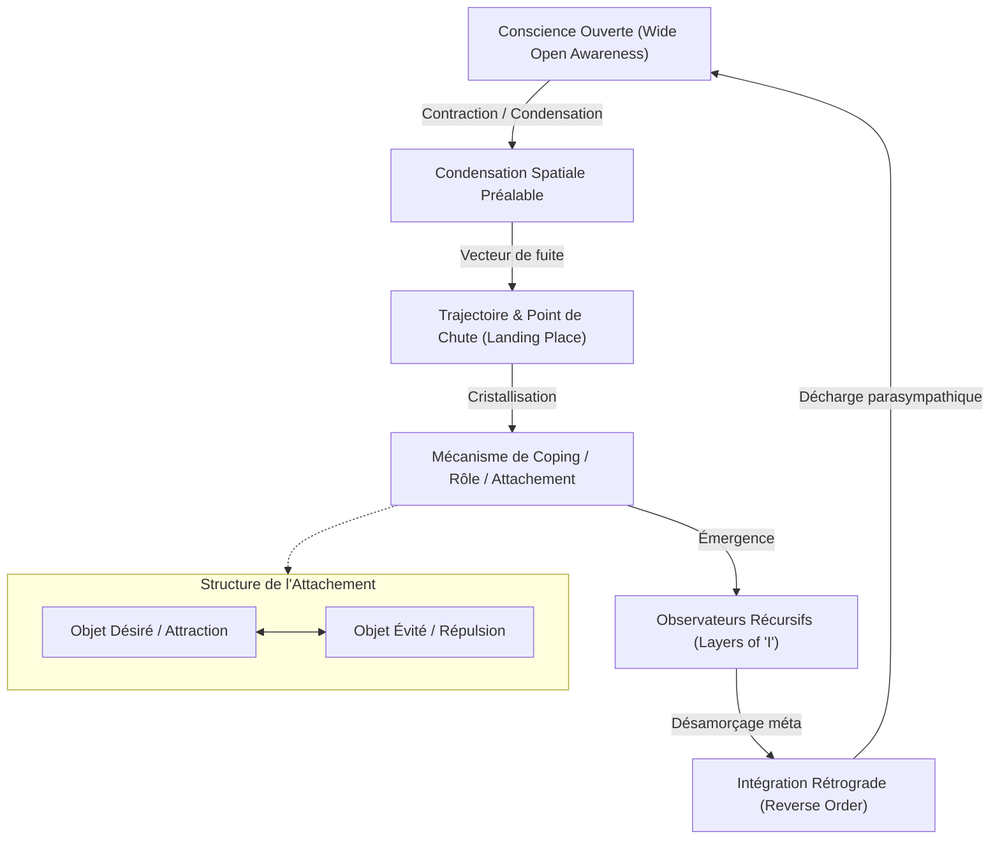

# Wholeness Work Level II - Transcripts
**Formateur :** Connirae Andreas | **ID :** `connirae-andreas-wholeness-work-level-ii-transcripts` | **Tranches :** 18

## Synthèse Architecturale du Cours : Wholeness Work Level II (Connirae Andreas)

---

### 1. Thèse Centrale & Philosophie du Cours

#### Posture et Différenciation de Connirae Andreas
Dans l'approche standard de la PNL et de la thérapie brève, le changement s'opère généralement par manipulation active des structures : recadrage verbal, ancrage de ressources, modification de sous-modalités sensorielles ou négociation entre parties séparées. L'ego (l'opérateur conscient) intervient sur le système pour transformer un état A en un état B.

La vision de Connirae Andreas dans le *Level II* renverse radicalement ce paradigme :
1. **Nature somato-spatiale des structures égoïques :** Les « Je » (l'observateur, l'identité, le mécanisme de défense) ne sont ni des entités immuables ni de simples constructs linguistiques. Ce sont des **cristallisations spatiales et sensorielles** de la conscience, résultant d'un mouvement d'évitement archaïque face à un inconfort ou une menace perçue.
2. **Du « Doer » au Champ d'Accueil Non-Intrusif :** Toute tentative volontaire de l'ego de « réparer », « intégrer » ou « ouvrir » une contraction reproduit l'agression et le clivage d'origine. Connirae Andreas substitue à l'interventionnisme une posture d'accueil radical par la **Conscience Ouverte (*wide open awareness*)**. L'intégration n'est pas un acte de fabrication, mais un retour organique spontané par cessation de l'effort (*non-forcing*).
3. **Téléologie de l'apprentissage moteur (Anti-Blame Frame) :** La dissociation ou la fuite hors de l'axe central n'est jamais considérée comme une erreur ou une pathologie à corriger, mais comme une étape d'apprentissage adaptatif nécessaire (à l'image des chutes du nourrisson apprenant à marcher), conférant au système une plasticité et une sagesse incarnée unique.

#### Fil Rouge Méthodologique
Toutes les interventions du cours reposent sur un vecteur unique : **identifier la localisation spatiale de la contraction (l'objet ou le rôle), remonter à l'observateur qui la perçoit (le « Je »), désemboîter les couches récursives d'observateurs, puis permettre la dissolution rétrograde dans le champ global de la conscience.** 

---

### 2. Carte des Concepts & Leviers Émergents



* **Conscience Ouverte (*Wide Open Awareness / Home*) :** État fondamental non localisé, omnidirectionnel et coextensif à toute l'expérience. Champ d'accueil impersonnel qui dissout les tensions sans intrusion.
* **Condensation Spatiale Préalable (*Shrinking Pre-requisite*) :** Règle neuro-spatiale imposant à la conscience non localisée de se densifier en un point restreint pour pouvoir initier un déplacement vectoriel de fuite.
* **Trajectoire et Point de Chute (*Trajectory & Landing Place*) :** Itinéraire proprioceptif emprunté par la conscience contractée (vers le haut, l'arrière, les viscères, hors du corps) et son point de stabilisation, devenant la matrice des patterns de coping de l'adulte.
* **Dispersion Particulaire (*Bursting / Infinite Particle Scattering*) :** Réponse d'effroi extrême où la conscience éclate en micro-fragments, résolue uniquement par l'inclusion globale dans le champ d'attention non focal.
* **Illusion du Tapis Cassé (*Broken Rug Fallacy*) :** Biais cognitif attribuant la sécurité au mécanisme défensif même qui a causé la perte d'unité initiale.
* **Réalité Expérientielle vs Vérité Historique :** Primauté exclusive de l'empreinte somatosensorielle et viscérale sur le souvenir factuel ou biographique.
* **Empilement Récursif des Observateurs (*Layers of 'I'*) :** Tendance du système à engendrer un « Je » situé spatialement en amont de chaque perception interne.
* **Intégration Rétrograde (*Reverse Order Dissolution*) :** Règle séquentielle exigeant de dissoudre d'abord le dernier observateur méta avant de redescendre vers la structure de base.
* **Structure en Polarité Complémentaire :** Mécanisme régissant l'attachement compulsif (*have-to*), où le désir conscient masque et compense toujours une polarité d'évitement somatique sous-jacente.
* **Rétention Intrinsèque des Critères :** Préservation organique des fonctions et compétences adaptatives lors de la dissolution du masque structurel du rôle.
* **Le « Non » Organique comme Révélateur d'Ordre :** Le refus somatique d'intégration n'est pas une résistance, mais un signal proprioceptif indiquant un niveau d'observateur ou une structure préalable non encore reconnue.
* **Synchronie Somato-Sensorielle Guide-Explorateur :** Résonance neurovégétative et co-régulation autonome servant de boussole de calibration pour le praticien.

---

### 3. Tableau Récapitulatif des Techniques & Démonstrations

| Technique / Exercice | Objectif Opératoire | Déclencheur / Indication | Séquence Résumée |
| :--- | :--- | :--- | :--- |
| **Exploration de la Genèse du Coping & Trajectoire de la Conscience** | Tracer le vecteur somato-spatial d'évitement d'origine et réintégrer le point de chute (*landing place*). | Schémas défensifs récurrents, hypervigilance, anesthésies corporelles, dissociation chronique modérée à moyenne. | 1. Localiser l'empreinte viscérale du pattern.<br>2. Remonter à l'instant précédant la contraction.<br>3. Suivre la trajectoire vectorielle de fuite jusqu'au point de chute somatique.<br>4. Accueillir le point de chute dans la Conscience Ouverte sans forçage jusqu'à inversion spontanée (*turned inside out*). |
| **Trajectoire du Retour à la Maison (*The Return Journey Process*)** | Inverser la dérive hors-centre et dissoudre les fixations directionnelles de survie. | Dissociation par le haut (intellectualisation), affaissement dépressif, retrait social ou déflexion. | 1. Cartographier l'orientation spatiale de la défense (haut, bas, arrière, latéral).<br>2. Désamorcer le jugement sur la séparation (métaphore de l'enfant qui apprend à marcher).<br>3. Permettre au point contracté de traverser en sens inverse son parcours dans l'espace.<br>4. Reconnexion et décharge parasympathique au centre. |
| **Intégration des Rôles & Identités (*Role / Identity Dissolution*)** | Désamorcer l'attachement rigide aux rôles (sociaux, professionnels, familiaux) et le sentiment d'obligation (*have-to*). | Perfectionnisme, syndrome du sauveur, identification rigide à un statut (thérapeute, parent parfait, expert). | 1. Identifier la localisation et la forme somato-spatiale du « Rôle ».<br>2. Localiser l'observateur (« Qui perçoit ce rôle ? »).<br>3. Remonter la chaîne récursive des observateurs successifs (*Layers of 'I'*).<br>4. Dissolution rétrograde (du dernier observateur méta vers le rôle).<br>5. Assimilation des critères fonctionnels dans la présence globale. |
| **Intégration d'un Attachement / Compulsion (Format Quadrangulaire)** | Neutraliser la tension de contrainte/désir en dissolvant simultanément le pôle attractif et le pôle répulsif. | Rituels automatiques, envies compulsives (nourriture, écrans), fixations d'objectifs rigides et anxiogènes. | 1. Identifier l'objet désiré et l'inconfort évité (*what must not happen*).<br>2. Localiser spatialement le « Je » qui désire ET le « Je » qui fuit.<br>3. Céder l'acte d'observation au champ impersonnel de conscience.<br>4. Fonte coordonnée des deux observateurs puis des deux représentations polaires.<br>5. Clôture narrative et délestage de l'obligation de résultat. |
| **Traitement de la Dispersion Particulaire (*Bursting Resolution*)** | Contenir et réintégrer une fragmentation attentionnelle disséminée consécutive à un effroi. | Sentiment de dispersion totale, panique avec incapacité de focalisation, sidération en miettes. | 1. Reconnaître l'impossibilité pour l'attention focale sérielle de pister tous les fragments.<br>2. Ouvrir le champ d'attention global périphérique.<br>3. Laisser la Conscience Ouverte envelopper simultanément la totalité des particules sans chercher à les regrouper.<br>4. Réagrégation passive et retour du calme viscéral. |

---

---

## 0. Sommaire Sémantique & Index des Lignes

- **Tranche 1 [Lignes 95-199]** : d'Exploration de la Genèse du Mécanisme de Coping & de la Trajectoire de la Conscience — *Protocole :* d'Exploration de la Genèse du Mécanisme de Coping & de la Trajectoire de la Conscience | *Verbatim :* Découplage de la Mémoire Objective et de la Réalité Somatique
- **Tranche 2 [Lignes 201-329]** : La Trajectoire du Retour à la Maison (The Return Journey Process) — *Protocole :* La Trajectoire du Retour à la Maison (The Return Journey Process) | *Verbatim :* La rupture de l'autorité prescriptive au profit de l'expérience phénoménologique
- **Tranche 3 [Lignes 331-479]** : Dissolution des Rôles & Identités (Role / Identity Integration) — *Protocole :* Dissolution des Rôles & Identités (Role / Identity Integration) | *Mécanisme :* Le Principe de Présence Réceptive vs Forçage Volontaire | *Verbatim :* La Métaphore de l'Étreinte Inconditionnelle du Champ de Conscience
- **Tranche 4 [Lignes 481-632]** : Dissolution des Rôles & Identités (Wholeness Work Level II) — *Protocole :* Dissolution des Rôles & Identités (Wholeness Work Level II) | *Verbatim :* Verbatim 1 : L'élicitation du second observateur
- **Tranche 5 [Lignes 634-752]** : d'Intégration d'un Attachement / Compulsion (Format Quadrangulaire) — *Protocole :* d'Intégration d'un Attachement / Compulsion (Format Quadrangulaire) | *Verbatim :* La Clôture Souple de Rumi (Démantèlement Métaphorique de l'Ego)
- **Tranche 6 [Lignes 754-878]** : Protocole d'Intégration d'une Structure Réfractaire par l'Autorité (Démonstration avec Asa) — *Protocole :* Protocole d'Intégration d'une Structure Réfractaire par l'Autorité (Démonstration avec Asa) | *Mécanisme :* Le "Non" comme Révélateur d'Ordre Naturel & de Structure Préalable | *Verbatim :* L'Invitation Non-Directive de Dissolution
- **Tranche 7 [Lignes 880-1037]** : A : La Polarité Inverse — Traitement d'une Aversion / Phobie / Évitement — *Protocole :* A : La Polarité Inverse — Traitement d'une Aversion / Phobie / Évitement | *Mécanisme :* La Polarité Structurelle Inconsciente (Attachement vs Aversion) | *Verbatim :* Utilisation de la Résistance en Auto-Séance
- **Tranche 8 [Lignes 1039-1172]** : A : Exploration Multidimensionnelle des Problématiques de Santé et Douleurs Chroniques — *Protocole :* A : Exploration Multidimensionnelle des Problématiques de Santé et Douleurs Chroniques | *Mécanisme :* Le symptôme corporel comme invitation systémique et enseignant de vie | *Verbatim :* s Verbatim
- **Tranche 9 [Lignes 1174-1299]** : Intégration par Relâchement de la Direction du Regard (Direction of Gaze Integration) — *Protocole :* Intégration par Relâchement de la Direction du Regard (Direction of Gaze Integration)
- **Tranche 10 [Lignes 1301-1408]** : Localisation et Intégration du « Lieu de Présence » (Where Standing Protocol) — *Protocole :* Localisation et Intégration du « Lieu de Présence » (Where Standing Protocol) | *Mécanisme :* Le Lieu de Puissance / Le Point d'Origine Réel (Where I'm Actually Standing) | *Verbatim :* Recadrage Métaphorique de la Puissance Substantielle
- **Tranche 11 [Lignes 1410-1523]** : « Where Am I Actually Standing » (Protocole Fondateur du Point de Présence) — *Protocole :* « Where Am I Actually Standing » (Protocole Fondateur du Point de Présence)
- **Tranche 12 [Lignes 1525-1694]** : Intégration du Self as Object (Le "Moi" Objet / Position d'Impact) — *Protocole :* Intégration du Self as Object (Le "Moi" Objet / Position d'Impact) | *Verbatim :* Déconstruction de la boucle neuro-somatique de la douleur
- **Tranche 13 [Lignes 1696-1845]** : Protocole : Intégration en Cascade (Fin de Phase 1) — *Protocole :* Protocole : Intégration en Cascade (Fin de Phase 1) | *Mécanisme :* L'Auto-Détermination du Mode d'Intégration & Résistance comme Signal de Besoins Phénoménologiques | *Verbatim :* L'Empilement des Modes d'Intégration
- **Tranche 14 [Lignes 1847-1976]** : Phase 2 – Finding the Match Within (Travailler les Qualités Difficiles chez l'Autre) — *Protocole :* Phase 2 – Finding the Match Within (Travailler les Qualités Difficiles chez l'Autre) | *Mécanisme :* L'extraction du trait de caractère comme leurre d'ancrage sémantique | *Verbatim :* Le cadrage permissif de l'interprétation subjective
- **Tranche 15 [Lignes 1978-2133]** : A : Intégration de l'Autre via l'Appariement Énergétique Direct — *Protocole :* A : Intégration de l'Autre via l'Appariement Énergétique Direct
- **Tranche 16 [Lignes 2135-2288]** : A : Déconstruction et Intégration d'une Chaîne d'Autorités (Démonstration sur Marta) — *Protocole :* A : Déconstruction et Intégration d'une Chaîne d'Autorités (Démonstration sur Marta) | *Verbatim :* Le Recadrage de la Quête Spirituelle Évolutionniste
- **Tranche 17 [Lignes 2290-2422]** : Protocole d'Accès au Champ de Conscience par l'Espace Spatial (Démonstration avec Carl) — *Protocole :* Protocole d'Accès au Champ de Conscience par l'Espace Spatial (Démonstration avec Carl) | *Verbatim :* Déconstruction de la Saisie Conceptuelle du Champ de Conscience
- **Tranche 18 [Lignes 2424-2560]** : Protocole d'intervention d'urgence : Dépassement de défiance extrême d'une partie (Alliage S... — *Protocole :* Protocole d'intervention d'urgence : Dépassement de défiance extrême d'une partie (Alliage Spatial & Neutralisation d'antagonisme) | *Verbatim :* La métaphore développementale du nourrisson

---

## Extractions Détaillées par Tranche (Opératoire & Verbatim)

## Tranche 1 / 18 : d'Exploration de la Genèse du Mécanisme de Coping & de la Trajectoire de la Conscience

### 1. Mécanismes & Principes Actifs

- **La genèse somato-spatiale des "Je" / Mécanismes d'adaptation (*Genesis of the 'I's / Coping Mechanisms*)** :
  - *Principe actif* : Dans le modèle du *Wholeness Work*, les structures de l'ego (les différents « Je » ou observateurs séparés) ne sont pas des entités fixes ou de simples concepts psychologiques, mais des cristallisations spatiales de la conscience. Face à une menace perçue ou à un inconfort dans l'enfance, le système nerveux opère une tentative d'évitement. Pour fuir une expérience insupportable alors que la conscience originelle est diffuse, ouverte et omniprésente (« *wide open awareness* »), le système doit d'abord réduire son volume spatial (contraction), se focaliser, puis se projeter hors de la zone d'impact vers un point de chute somatique ou extra-somatique. Ce point de chute devient le siège permanent d'un « Je » contracté qui observe le monde à distance.
  - *Tags libres émergents* : `#coping_mechanism_genesis` `#spatial_contraction` `#landing_place` `#trajectory_of_consciousness` `#pre_symptom_split`

- **La condition préalable de la contraction spatiale (*Spatial Condensation Pre-requisite*)** :
  - *Principe actif* : Connirae Andreas met en lumière une loi neuro-spatiale : une conscience diffuse qui occupe tout l'espace (« *everywhere at once* ») ne peut pas se déplacer. Pour qu'un déplacement directionnel (fuite psychologique) s'opère, la conscience doit obligatoirement subir une condensation préalable : passer d'un état non-localisé à un point localisé et dense. Ce n'est qu'une fois compactée qu'elle acquiert une trajectoire vectorielle (vers l'arrière, la gorge, le ventre, l'estomac ou hors du corps).
  - *Tags libres émergents* : `#spatial_condensation` `#vectorial_movement` `#loss_of_nonlocality`

- **L'illusion du soulagement rétroactif (*The Broken Rug Fallacy / Traitement du symptôme de surface*)** :
  - *Principe actif* : Illustré par l'histoire de Nasruddin, ce mécanisme démontre comment l'appareil cognitif attribue à tort son salut au mécanisme même qui le piège. L'esprit rationnel identifie la contraction ou le « Je » comme ce qui l'a protégé (« Heureusement que le tapis était là pour amortir ma chute »), alors que c'est précisément le pli du tapis (la contraction/mécanisme de coping) qui a provoqué la rupture avec l'état d'unité. Travailler sur les couches superficielles (la peur, l'hypervigilance) sans remonter à la bifurcation spatiale initiale maintient le sujet dans une dépendance structurelle envers son propre mécanisme de défense.
  - *Tags libres émergents* : `#broken_rug_fallacy` `#retroactive_justification` `#defense_mechanism_paradox`

- **La réalité expérientielle versus la véracité historique (*Experiential Reality over Historical Fact*)** :
  - *Principe actif* : Pour le travail subconscient et l'intégration somatique, la mémoire factuelle/épisodique (détails cognitifs, preuves matérielles) est non seulement secondaire mais souvent obstructive. Ce qui régit l'organisation tonique et spatiale du système nerveux, c'est l'empreinte sensorielle et viscérale (« *viscerally real* »). Qu'il s'agisse d'un souvenir flou, d'une anesthésie du nourrisson ou même d'une impression pré-natale, la structure du schéma d'évitement est encodée sous forme de micro-vecteurs proprioceptifs exploitables immédiatement.
  - *Tags libres émergents* : `#experiential_reality` `#somatic_imprint` `#subcortical_truth`

---

### 2. Protocoles, Techniques & Démonstrations (Étape par Étape)

#### Protocole d'Exploration de la Genèse du Mécanisme de Coping & de la Trajectoire de la Conscience

* **Intention / Indication** :
  Identifier la racine spatio-somatique exacte d'un mécanisme de compensation (« Je » contracté, anxiété, gel, dissociation). Remonter à la genèse du premier évitement pour cartographier le passage de la conscience ouverte à la contraction localisée.

* **Mise en place & Pré-framing** :
  * Cadrage de sécurité : Inviter le sujet à choisir une situation d'intensité modérée à moyenne (« *mild to medium* »), de préférence dans la petite enfance.
  * Validation du matériau : Préciser que les détails factuels ne sont pas requis ; seule l'empreinte viscérale compte (« *experientially real* »).
  * Dé-tension de résultat : Poser explicitement que l'exercice vise la découverte et la cartographie, non une résolution immédiate garantie, ce qui désamorce l'analyste intérieur.

* **Séquence d'actions pas à pas** :
  1. **Ancrage dans la Conscience Ouverte Pré-Événement** :
     - Guider le sujet à remonter dans le temps juste avant que quoi que ce soit ne se produise.
     - Établir l'état de référence : « *wide open awareness* », tout va bien, sécurité fondamentale, présence sans frontière.
  2. **Ralenti Micro-Séquentiel (Frame-by-Frame)** :
     - Faire avancer le film mental à un ralenti extrême jusqu'au seuil exact de bascule (« *everything was fine until it wasn't* »).
  3. **Traque Vectorielle de la Conscience (Bifurcation)** :
     - Poser la question de focalisation opératoire : *« Dans ce split-second où émerge le besoin de fuir, qu'arrive-t-il à ma conscience ? Dans quelle direction va-t-elle ? »*
     - Dissocier explicitement le corps physique de la conscience (ignorer si le corps est parti en courant ou resté sur place).
  4. **Seconde Passe de Détection (Affinement)** :
     - Si le sujet identifie déjà une émotion (peur, panique), interrompre, remonter plus en amont et ré-observer l'instant antérieur au sentiment.
  5. **Cartographie du Trajet et du Point de Chute (*Landing Place*)** :
     - Tracer le chemin : contraction globale -> déplacement vectoriel (ex: recul, montée, descente).
     - Localiser l'atterrissage exact : où la conscience s'est-elle logée dans le corps ou l'espace (ex: tempe gauche, arrière de la tête, gorge, estomac, hors du corps) ?
  6. **Sondage Qualitatif Submodalitaire (*Sensing In and Through*)** :
     - Inviter le sujet à entrer dans la texture sensorielle exacte du point de chute (densité, température, forme, couleur, géométrie interne comme des segments d'orange, granulosité).

* **Signes de calibration du formateur** :
  * *Verbalisation prématurée d'émotions ou d'hyper-vigilance* : Signe que le sujet a sauté l'étape 3 et observe le résultat secondaire de la contraction. Calibration pour faire rembobiner en amont (« *go back right before that* »).
  * *Modifications posturales et respiratoires* : Arrêt respiratoire (*breath stop*), micro-tensions au visage, mouvements oculaires vers le point spatial où la conscience s'est enfuie (ex: regard orienté vers l'arrière haut).
  * *Changement de ton vocal* : Le sujet passe d'une description intellectualisée à un ton haché ou feutré lorsqu'il touche le point de condensation somatique.

---

### 3. Heuristiques, Subtilités & "Sagesse du Praticien"

- **Règle de l'Émotion Tardive (*Fear is Already Downstream*)** :
  - *Heuristique* : Si le sujet déclare « *J'ai senti de la peur* » ou « *Mon esprit cherchait des options tout autour* », **alors** le praticien doit lui demander de reculer encore plus en arrière dans le temps.
  - *Justification* : L'activation émotionnelle (peur) ou cognitive (recherche de stratégies) est un effet secondaire. Elle prouve que la conscience a déjà quitté son état d'unité fondamental. Le mécanisme s'est déjà déclenché. Le point pivot est la micro-seconde *avant* l'apparition de l'émotion.

- **Règle de l'Âge Chronologique (*The 14-Year-Old Trap*)** :
  - *Heuristique* : Si le sujet choisit un souvenir à l'adolescence (ex: 14 ans) et n'arrive pas à isoler la trajectoire de sa conscience, **alors** lui faire choisir une scène de la petite enfance.
  - *Justification* : À l'adolescence, le sujet a accumulé un empilement complexe de mécanismes de défense enchevêtrés. Les couches secondaires masquent la dynamique spatiale brute du système nerveux.

- **Règle du Respect Inconditionnel de l'Expérience Subjetive** :
  - *Heuristique* : Si le ressenti du sujet contredit le modèle théorique présenté (ex: gel avant contraction, sensation d'être projeté hors du corps sans contraction consciente préalable), **alors** valider totalement son expérience sans forcer l'adhésion au modèle.
  - *Justification* : L'intégration neuro-émotionnelle requiert une congruence absolue avec la perception directe du système nerveux du client ; plaquer une théorie cognitive induit un faux « Je » intellectuel qui bloque le processus somatique.

- **Règle des Systèmes Chroniquement Traumatisés (*No Baseline of Safety*)** :
  - *Heuristique* : Si un sujet indique n'avoir aucun souvenir d'enfance où « tout allait bien » en raison d'un stress continu, **alors** l'inviter à remonter avant la naissance ou dans un espace symbolique pré-incarné (« *all white, all good* »).
  - *Justification* : Le système a impérativement besoin d'expérimenter la signature sensorielle de la conscience non-contractée pour pouvoir mesurer différentiellement la trajectoire de contraction.

---

### 4. Pépites Verbatim & Patterns Linguistiques (MOT À MOT EN V.O.)

#### Découplage de la Mémoire Objective et de la Réalité Somatique

> "Even though I couldn't remember a specific example of having being bullied, what came to mind was sort of a general impression, a general memory. It was viscerally real to me. It was experientially real to me. It felt as if something happened, even though I had no content details. So I'm telling you this because I want you to know it's fine to pick a memory either that you remember specifically or a memory that is in some way viscerally real to you, even if you don't have content details for it."
- **[Analyse du Pattern]** : Recadrage de critère et désactivation du censeur analytique. Connirae Andreas utilise la répétition hypnotique du prédicat somatique (*« viscerally real », « experientially real »*) pour donner une permission totale à l'inconscient. Elle découple la charge émotionnelle/sensorielle du contenu déclaratif (*« no content details »*), empêchant le client de s'enliser dans la reconstruction cognitive ou le doute cartésien sur l'exactitude historique de l'événement.

---

#### Suggestion de Ralentissement Micro-Temporel (Micro-Tracking)

> "And then whenever you're ready, I'd like you to step into the movie, step into the experience in this time when everything is fine still... And then when you're ready, let the movie begin to go forward very slowly. Very slowly until that moment when it wasn't fine and there was this need to escape. And right in that moment, let things slow way down. And the question to ask, the question I'm inviting you to explore is, in this moment, everything is okay and then it's not. In this moment of transition, what happens to my consciousness?"
- **[Analyse du Pattern]** : Induction fractionnée par distorsion temporelle. L'utilisation d'enchâssements temporels permissifs (*« whenever you're ready »*), couplée à la répétition descendante (*« very slowly... slow way down »*), installe une transe d'observation interne focalisée. La question finale n'est pas posée à la première personne ni en question fermée : elle installe une commande d'introspection passive formulée en auto-questionnement (*« what happens to my consciousness? »*), ce qui réoriente la proprioception vers la mécanique spatiale pure au détriment de l'analyse causale.

---

#### Recadrage de la Peur comme Effet Secondaire et Rapprochement Temporel

> "Because once you're afraid, you've already left, you've already left home, so to speak. Once something has already happened, when fear occurs."
- **[Analyse du Pattern]** : Rupture de pattern conceptuelle et métaphore spatiale. En posant *« you've already left home »*, Connirae Andreas associe l'état de conscience ouverte à l'espace matriciel de « la maison » (état zéro, intégrité) et relègue l'émotion de peur au statut de conséquence spatiale d'éloignement. La présupposition temporelle (*« once something has already happened »*) invalide la peur comme cause pour la requalifier en symptôme d'une rupture spatiale antérieure.

---

#### Déconstruction Logique de la Possibilité de Mouvement

> "How are we going to go anywhere if we're already everywhere at once? So it kind of requires this kind of contraction so that we're no longer everywhere at once before we can move somewhere, before we can go somewhere."
- **[Analyse du Pattern]** : Question rhétorique et truisme spatial opératoire. L'interrogation initiale confronte la logique de l'espace non-duel (*« everywhere at once »*) avec celle du déplacement fini. En formulant la contraction comme une nécessité géométrique absolue (*« requires this kind of contraction... before we can move »*), elle normalise neurologiquement le symptôme de contraction : ce n'est pas une anomalie à combattre, mais la condition mécanique indispensable à la fuite du système nerveux.

## Tranche 2 / 18 : La Trajectoire du Retour à la Maison (The Return Journey Process)

### 1. Mécanismes & Principes Actifs

- **Contraction préalable à la disjonction spatiale (The Shrinking Pre-requisite)** :
  *Principe actif* : La conscience à son état fondamental (« Home » / Présence ouverte) est omnidirectionnelle, non localisée et coextensive à l'expérience entière (« everywhere at once »). D'un point de vue logico-spatial et neurologique, une structure attentionnelle ne peut pas « se déplacer » ou « quitter » un lieu si elle occupe déjà tout l'espace. Pour qu'un mouvement adaptatif de fuite ou de défense ait lieu, le système nerveux doit obligatoirement opérer une réduction focale drastique : un rétrécissement, une densification ou une implosion de la conscience. C'est cette contraction qui crée l'illusion géométrique d'un « point » séparé capable ensuite de voyager ou d'atterrir ailleurs dans ou hors du corps.
  *Tags* : #contraction_originelle #reduction_focale #illusion_geometrique_de_separation #quitter_la_totalite

- **Fragmentation attentionnelle disséminée (Bursting / Infinite Particle Scattering)** :
  *Principe actif* : Dans certains traumatismes ou réponses d'effroi extrême, la conscience ne se contracte pas en un point unique qui migre vers un endroit spécifique du corps, mais éclate en une myriade infinie de micro-particules projetées partout simultanément (« bursting into infinite tiny particles »). L'esprit conscient (l'attention focale sérielle) est neurologiquement incapable d'indexer ou de pister des millions de points de tension en même temps. En revanche, le champ global de la conscience ouverte (« field of awareness » / traitement global non focal) contient naturellement la totalité de ces fragments sans effort. L'intégration se fait non par rassemblement actif, mais par inclusion passive dans le champ.
  *Tags* : #fragmentation_traumatique #dispersion_particulaire #surcharge_de_l_attention_serielle #resolution_par_champ_global

- **Isomorphisme somato-directionnel des stratégies de survie (Spatial Coping Styles)** :
  *Principe actif* : La trajectoire physique et spatiale qu'emprunte la conscience contractée lors du danger est la matrice motrice directe des mécanismes de défense psychologiques de l'adulte (ex. monter au-dessus de la tête = rationalisation / dissociation par le haut ; descendre sous terre = effondrement / enfouissement dépressif ; reculer à l'arrière du crâne = évitement / retrait social ; aller sur le côté = déflexion). Le pattern comportemental n'est que la projection narrative d'une trajectoire proprioceptive stabilisée durant l'enfance.
  *Tags* : #isomorphisme_somatospatial #signature_directionnelle #trajectoire_de_survie #coping_style_incarné

- **Démantèlement du Blame Frame par la téléologie de l'apprentissage moteur (The Toddler Falling Metaphor)** :
  *Principe actif* : L'esprit critique tend à juger la contraction ou la dissociation passée comme une « erreur » (« I should have stayed home »), réactivant un double clivage (l'ego qui juge la part qui a fui). Connirae recadre neurologiquement la dissociation en assimilant la perte d'équilibre aux chutes nécessaires du nourrisson qui apprend à marcher : la chute n'est pas une faute mais l'unique vecteur d'acquisition de la proprioception, de la relation à la gravité et de la régulation neuromusculaire. La contraction de survie confère au système une plasticité et une sagesse adaptative uniques (« unique navigation learning »).
  *Tags* : #recadrage_anti_blame #ontologie_de_l_apprentissage_moteur #necessite_neurologique_de_l_erreur #sagesse_incarnee_unique

- **Non-Effort et Inversion Spontanée (Turning Inside Out / Reconnection Cry)** :
  *Principe actif* : Lorsque la structure contractée (« landing place ») est rencontrée par la présence sans aucune injonction de changement (« trying not to force it, just sitting with it »), la tension cesse d'avoir une fonction défensive. La matière somatique se détend souvent par une inversion topologique spontanée (« it turned inside out ») ou par un lâcher-prise lacrymal (« tears of reconnection »). Les larmes ne traduisent pas une souffrance réactivée, mais la décharge parasympathique marquant la dissolution de la barrière de séparation et le retour au bercail neurologique.
  *Tags* : #inversion_topologique #larmes_de_reconnexion #decharge_parasympathique #accueil_inconditionnel

---

### 2. Protocoles, Techniques & Démonstrations (Étape par Étape)

#### Protocole : La Trajectoire du Retour à la Maison (The Return Journey Process)

* **Intention / Indication** :
  À utiliser lorsqu'un événement passé (peur, choc, alerte) a provoqué un mouvement de retrait, de sidération (freezing) ou d'évacuation de la conscience, laissant une contraction somatique (« landing place ») ou un schéma d'évitement récurrent (« coping style »).

* **Mise en place & Pré-framing** :
  - Établir que la contraction d'origine n'était ni une erreur ni une faute, mais une tentative logique de se protéger face à un danger perçu.
  - Rappeler que le trésor (le champ de plénitude, « Home ») est toujours resté là où nous l'avons laissé ; seule notre attention a voyagé.
  - S'autoriser à deviner ou à imaginer si le souvenir n'est pas net (« you can kind of guess, you can make that up »).

* **Séquence d'actions pas à pas** :
  1. **Retour au point zéro temporel** :
     Guider le sujet juste avant l'incident, à un instant où « everything is okay » (état de présence non contracté, chez soi).
  2. **Ralenti cinématique & Traçage de la contraction** :
     Faire avancer l'expérience au ralenti jusqu'au moment exact du déclencheur (« it doesn't feel safe, need to escape »).
     *Calibration intérieure* : Où la conscience se rétrécit-elle d'abord ? (Au centre du crâne, dans la gorge, la poitrine ?).
  3. **Identification du vecteur et du point d'impact (« Landing Place »)** :
     Repérer la trajectoire spatiale précise : quelle direction prend cette conscience contractée ? (En haut, en arrière, sur le côté, plongeon en profondeur ?). Où atterrit-elle ? Quelle est sa texture somatique et énergétique (« sensation quality, energetic quality of thisness ») ?
  4. **Rencontre par le Champ** :
     Prendre conscience que l'on observe cette contraction *depuis* la vaste présence. La présence rencontre ce point isolé sans chercher à le modifier, lui permettant de réaliser qu'il est loin de chez lui.
  5. **Invitation au Voyage de Retour (Return Journey)** :
     Offrir une invitation purement permissive (sans jamais forcer ni pousser) à revenir à la maison :
     - Soit par le même chemin en sens inverse (rebrousser chemin).
     - Soit par une trajectoire symétrique en miroir (ex. un arc de cercle opposé qui complète une boucle).
     - Soit par un chemin totalement inédit et spontané.
  6. **Autorégulation du rythme & Fusion / Inversion** :
     Laisser le processus opérer à son rythme (« taking all the time you need »). Accueillir les phénomènes d'inversion (« turned inside out »), d'expansion soudaine (« got really big ») ou de relâchement émotionnel (larmes de soulagement).
  7. **Validation du nouvel état d'intégration** :
     Vérifier l'alignement somatique : sensation de fluidité, disparition de la dualité sujet/objet, retour à l'espace d'origine.

* **Signes de calibration** :
  - *Phase de contraction* : Micro-mouvements de retrait de la tête, déglutition, tensions sternales ou épigastriques, focalisation oculaire rigide.
  - *Phase de retour* : Ralentissement du rythme respiratoire, soupir spontané, réouverture du regard périphérique, larmoiement sans détresse faciale, sensation d'expansion corporelle (« feeling of getting big »).

---

### 3. Heuristiques, Subtilités & "Sagesse du Praticien"

- **Distinction Freezing vs Contraction** :
  *Règle* : Si le client dit « Je n'ai pas contracté, j'ai figé (frozen) », ne pas le contredire intellectuellement.
  *Heuristique* : Demander systématiquement : *« Right before the freezing, what happens? »*. Dans la quasi-totalité des cas, la sidération est précédée d'un micro-rétrécissement attentionnel. Cependant, si le client sent que le gel est sa propre forme de contraction, valider son calibrage subjectif (« stay true to what feels really right in your experience »).

- **Traitement de la Fragmentation en particules infinies** :
  *Règle* : Si la conscience a explosé en micro-poussières impossibles à localiser (« bursting into infinite tiny particles ») :
  *Heuristique* : Ne jamais demander au mental conscient de suivre ou de rassembler chaque fragment un par un (ce qui induit panique et échec cognitif). Instruire le sujet que *« conscious mind cannot track it, but the field of awareness that we are can track it all »*. L'abandon au champ global intègre instantanément l'ensemble des fragments disséminés.

- **Désynchronisation entre déclencheur mnésique et survenue de l'émotion** :
  *Règle* : Si le client situe l'émotion à un moment B (ex. chambre noire), mais identifie qu'elle a été amorcée à un moment A sans peur consciente (ex. scène de film au cinéma) :
  *Heuristique* : Tester d'abord la scène initiale A en traquant une contraction imperceptible ou un micro-mouvement d'éloignement. Si aucune contraction n'est repérable en A, basculer sans insister sur la scène B où la réponse somatique est manifeste.

- **Permissivité absolue vs Force volontaire** :
  *Règle* : Si la contraction résiste ou semble bloquée (« nothing was happening ») :
  *Heuristique* : L'interdiction absolue de pousser (« never any need to push or force »). La force provient de l'ego/mental qui reproduit la contraction. Le praticien invite à s'asseoir avec la sensation (« just sit with it »). C'est précisément l'absence de force qui permet à la structure de « se retourner comme un gant » (turn inside out) d'elle-même.

- **Dédramatisation des Larmes de Réconnexion** :
  *Règle* : Si le sujet se met à pleurer en disant « Je n'arrive pas à lâcher complètement » :
  *Heuristique* : Ne pas interpréter les larmes comme une rechute dans la douleur ou le trauma, mais comme le signal physiologique que le lâcher-prise est déjà en train de se faire (« tears of reconnection / of what was lost is found »). Inviter le sujet à simplement « relax into the tears » au lieu de lutter contre elles.

---

### 4. Pépites Verbatim & Patterns Linguistiques (MOT À MOT EN V.O.)

#### Pépite 1 : La rupture de l'autorité prescriptive au profit de l'expérience phénoménologique
> **« You know, it's interesting. And that's really, I think, more for you to check on. Is it the same as contraction than for me to tell you? Because usually when there's this experience of freezing, we have already contracted and moved. But it may be a little different for you, you know, so stay true to what is feels really right in your experience and accurate fit for you. »**
* **[Analyse du Pattern]** : Recadrage d'autorité épistémique immédiat. Connirae refuse la posture de l'expert omniscient pour renvoyer le sujet à sa propre autorité somatosensorielle. L'utilisation du présupposé d'adéquation (« accurate fit for you ») et la formulation « stay true » ancrent la souveraineté du client tout en introduisant délicatement une généralisation d'expérience clinique (« usually... we have already contracted ») sans imposer de dogme.

---

#### Pépite 2 : Décharge cognitive et bascule vers l'intelligence du Champ
> **« It's an infinite number of tiny landing places that our conscious mind cannot track. But that is fine because our being can track it. So this field of awareness that we are, the field of awareness can track it all. All of those teeny tiny particles and we don't have to register them all. »**
* **[Analyse du Pattern]** : Clivage hypnotique classique entre l'esprit conscient (« conscious mind ») et l'être/champ (« our being / field of awareness »). La saturation intentionnelle (« infinite number », « teeny tiny particles », « cannot track ») provoque une démission consentie du mental analytique, immédiatement soulagée par la suggestion d'omnipotence du champ (« can track it all »). L'autorisation explicite « we don't have to register them all » supprime toute anxiété de performance.

---

#### Pépite 3 : Métaphore isomorphismale du Trésor sous l'Arbre (La Découverte de l'Inutilité de la Quête Externe)
> **« Because he realizes that's where he needs to go. And when he arrives, he gets into the backyard, he pulls out his shovel, he starts digging. And there, lo and behold, is that wondrous treasure. ... And because it's so universal, because it appears so often, I believe it's really talking about not about an outer journey. It's about an inner journey of consciousness. It's this story of being at home. Believing we need to leave home for some treasure, for something. ... But then when we're away from home, in the end, we cannot find the treasure there. There's no way that we can actually get the treasure there. So what allows us to find the treasure, because the treasure has always been back home, what allows us to make the return journey is some kind of waking up of consciousness, some kind of awareness that, oh, we've left home. Here I am away from home. What I need to do is return back. »**
* **[Analyse du Pattern]** : Utilisation d'une métaphore universelle (conte archétypal) servant de structure transitionnelle pour l'inconscient. L'analogie opère un recadrage radical du désir et de la recherche spirituelle ou psychologique : la quête externe d'objets, de validation ou de sécurité est une impossibilité structurelle (« there's no way that we can actually get the treasure there »). La répétition lancinante du mot « home » agit comme une ancre hypnotique d'état source. Le réveil (« waking up of consciousness ») est présupposé comme une simple prise de perspective spatiale, non comme une lutte.

---

#### Pépite 4 : Démonstration logique de la nécessité de la contraction
> **« And home in terms of consciousness is this open, wide open presence everywhere at once. That's home in terms of consciousness. Then we get the idea that we need something that's away from home. ... But how are we going to leave home? If home is everywhere at once, how is it possible to leave everywhere at once? The only way we can do that is to somehow shrink, to have a contraction of consciousness. That's necessary for us to be able to leave home, to move in any direction. Does that make sense? It's just a logical impossibility. If we're already everywhere at once, how can we go anywhere? So we have to shrink first in order to leave. »**
* **[Analyse du Pattern]** : Imposition d'un lien logique irréfutable (double lien inversé / déduction ontologique). En définissant l'état originel comme « everywhere at once », elle rend mathématiquement et géométriquement indispensable la « contraction » pour tout déplacement. Ce piège logique neutralise instantanément toute culpabilité ou sentiment d'anomalie : se contracter devient une prouesse fonctionnelle nécessaire pour voyager, normalisant totalement la réponse défensive du client.

---

#### Pépite 5 : Recadrage de la Chute (Normalisation de l'Erreur Adaptative)
> **« When a toddler begins to walk and take the first steps, the toddler doesn't just get up and okay, zoom, walk everywhere. Instead, the toddler gets up, pulls himself up, takes one step, falls down. The falling down isn't a mistake. ... The fall is actually exactly what needs to happen for the learnings to occur that the toddler needs to have in order to walk well fluidly. ... And even more so with each of us, our unique ways we leave home and then make the return journey. All of these unique experiences mean that we uniquely end up with a certain kind of wisdom that no one else on the planet has. It's a wisdom that is unique to us because of the way we've left home, the way we've returned. So definitely not a mistake. »**
* **[Analyse du Pattern]** : Recadrage développemental profond brisant le « blame frame ». L'analogie du bébé qui tombe transforme la blessure ou la névrose en apprentissage sensori-moteur indispensable. L'empilement du mot « unique / uniquely » (répété 6 fois en quelques phrases) valorise l'individuation : chaque traumatisme ou stratégie d'évacuation devient le vecteur exclusif d'une sagesse singulière apportée au monde (« positions us to make our own unique contribution »).

---

#### Pépite 6 : Induction du Voyage de Retour (Suggestion Permissive et Multi-Trajectoires)
> **« And then there can be this gentle invitation for return journey. If desired, if this that's left home welcomes the invitation, it can be invited into a return journey. And that return journey might be a return along the same path it arrived here. It might be just a sort of returning along the same path. It might be sort of a mirror image to the path. ... Or perhaps it's an entirely different path that this wants to take. But it's just giving this permission for the return journey to happen however feels natural. So that this is allowed in its own way to return home. And you can let it take its time with that. ... And there's never any need to push or force. »**
* **[Analyse du Pattern]** : Utilisation d'un langage hautement permissif et indirect (style ericksonien pur). La réification neutre de la contraction (« this that's left home » / « this ») dépersonnalise le blocage et élimine toute menace pour l'ego. Les clauses conditionnelles empilées (« if desired », « if this... welcomes », « might be », « perhaps ») offrent un choix total de trajectoires (chemin direct, miroir, inédit), rendant la résistance impossible puisque toutes les directions mènent à la réintégration. La prescription de lenteur (« let it take its time ») désamorce le réflexe d'urgence sympathique.

---

#### Pépite 7 : Métaphore de l'Accueil Inconditionnel et Normalisation Émotionnelle
> **« And so this kind of crying, you know, the crying can be this, oftentimes crying happens when the letting go is occurring. So it's like it can be tears of reconnection of like of what was lost is found. And in that case, what can help just the final release is to just let yourself as awareness kind of relax into the tears, into letting it flow through, letting the experience flow through, however it comes. And knowing the tears are fine. ... For this, the wide open awareness, the important news is that what was separated, what had left home has returned. That's the important news. So there's this joyousness, this overjoyed feeling of like, ah, reconnection. »**
* **[Analyse du Pattern]** : Recadrage de somatisation émotionnelle associé à la métaphore biblique du fils prodigue. Connirae redéfinit la crise lacrymale non comme de la peine, mais comme l'indice somatique exact de la réunification (« what was lost is found »). La suggestion d'action « relax into the tears » utilise le truisme de l'écoulement pour induire un lâcher-prise neurologique. Enfin, la personnification de la « wide open awareness » comme une entité qui ne sait qu'aimer et célébrer le retour neutralise radicalement tout sentiment d'indignité (« no matter how undeserving we might believe we are »).

## Tranche 3 / 18 : Dissolution des Rôles & Identités (Role / Identity Integration)

Voici l'extraction opératoire et l'analyse intégrale de la tranche 3/18 du cours *Wholeness Work Level II* dispensé par Connirae Andreas.

---

### 1. Mécanismes & Principes Actifs

#### A. Le Principe de Présence Réceptive vs Forçage Volontaire
* **Principe actif :** Lorsque le système nerveux perçoit une contraction somatique (comme une sensation de tube ou d'implosion sous le sternum), toute tentative de l'ego/du mental de "l'ouvrir" ou de forcer sa réintégration reproduit le mécanisme même de la séparation (le contrôle). En adoptant la posture de la "Conscience Ouverte" (*wide open awareness*) qui reste simplement présente avec la sensation sans attente de résultat (*staying with it / not forcing*), la charge autonome du système nerveux sympathique chute. Le système retrouve son auto-organisation biologique naturelle et la structure se dénoue d'elle-même (effet d'inversion/retournement intérieur, *turned inside out*).
* **Tags :** `#non_forcing` `#receptive_awareness` `#somatic_unwinding` `#organic_integration`

#### B. La Dérive Hors-Centre et le Fractionnement Séquentiel de la Conscience
* **Principe actif :** Sous l'effet d'une blessure ou d'un trauma précoce, la conscience unifiée ne se contente pas de se contracter : elle "quitte la maison" (*leaves home*) en se déplaçant spatialement hors de l'axe central (*center*). Cette fuite s'effectue souvent selon une séquence en couches :
  1. *Contraction/effondrement somatique vers le bas* (le point vulnérable qui absorbe la blessure).
  2. *Retrait spatial vers le haut/l'arrière* (tentative de distanciation pour fuir l'intensité intolérable).
  3. *Mouvement projectif vers l'avant* (réponse protectrice/combative, colère/défense).
  Chaque fragment devient un sous-système autonome spatialisé.
* **Tags :** `#off_center_shift` `#sequential_fragmentation` `#spatial_movement_away` `#multi_part_exodus`

#### C. L'Écologie du Rythme d'Intégration et l'Étreinte Inconditionnelle
* **Principe actif :** La conscience ouverte n'opère pas avec la notion d'urgence ou d'impatience temporelle de la personnalité. Vouloir aller vite est une défense du moi contre l'inconfort. Lorsque la conscience enveloppe la contraction avec l'équivalent neuro-affectif d'une étreinte inconditionnelle (*unfolding of love*), le signal de danger s'éteint au niveau du tronc cérébral et de l'amygdale, autorisant la fonte (*melting*) de la structure de défense.
* **Tags :** `#temporal_patience` `#unconditional_embrace` `#parasympathetic_settling`

#### D. La Déconstruction de l'Attachement aux Rôles et Identités (*Roles & Identities*)
* **Principe actif :** Une identité ou un rôle (ex. thérapeute, mère, sauveur, spontané, fiable), même socialement positif ou valorisé, constitue une rigidité structurelle dès lors qu'il y a identification et attachement (*attachment*). Cet attachement crée un champ de contraintes inconscientes (*shoulds, have-tos*) et force l'interlocuteur (patient, enfant, client) à jouer un rôle miroir complémentaire (par exemple, complaire au thérapeute). En dissolvant la fixation spatiale et somatique du "rôle", le praticien restaure une véritable liberté relationnelle et congruence non-verbale.
* **Tags :** `#role_attachment_dissolution` `#identity_unfixing` `#relational_freedom` `#congruence_enhancement`

#### E. L'Empilement Récursif des Observateurs (La Traque des Niveaux de "Je")
* **Principe actif :** Toute perception d'un rôle ou d'une sensation suppose un point d'observation (*I that notices*). En orientant systématiquement l'attention vers l'origine spatiale de la perception, on découvre que le "Je" observateur est lui-même une contraction localisée dans l'espace somatosensoriel (souvent péri-personnel : en haut à gauche, au-dessus à droite, etc.). En remontant la chaîne d'observateurs jusqu'au dernier niveau tangible avant dissolution, on désamorce le métaprogramme récursif de séparation.
* **Tags :** `#recursive_observer_tracking` `#eye_location` `#meta_level_unraveling` `#peripersonal_space`

---

### 2. Protocoles, Techniques & Démonstrations (Étape par Étape)

#### Protocole : Dissolution des Rôles & Identités (*Role / Identity Integration*)

* **Intention / Indication :** 
  * Présence d'une identification rigide (métier, statut relationnel, trait de personnalité tel que "le sauveur", "le spontané", "le comique", "le thérapeute").
  * Présence d'attachements limitant la fluidité, le discernement, la sagesse relationnelle ou l'efficacité dans un rôle déjà positif.
  * Difficulté à clore ou tourner la page sur un rôle passé (ex. ex-conjoint après divorce).

* **Mise en place & Pré-framing :**
  * Inviter le sujet à choisir un rôle (valorisé ou problématique).
  * Expliquer que travailler sur un rôle positif ne supprime pas la compétence, mais dissout la rigidité, les "il faut", et libère l'interlocuteur de la pression relationnelle.
  * Le contenu peut rester secret (*Role X*).

* **Séquence d'actions pas à pas (Démonstration avec Chris sur le rôle "Helper/Healer") :**

  * **Étape 1 : Contextualisation & Évocation**
    * Prendre une respiration lente, faire une pause.
    * Orienter le sujet vers un contexte précis où ce rôle est particulièrement actif.
    * Faire entrer le sujet dans cette scène sensorielle.

  * **Étape 2 : Localisation Spatiale du Rôle**
    * Yeux fermés, poser la question de guidage spatial : *"Dans ce contexte, où est celui/celle qui est le [Rôle] ?"*
    * Repérer la localisation spontanée (Ex. Chris : *Right in front of me*).

  * **Étape 3 : Cartographie Somatosensorielle (Taille, Forme, Densité)**
    * Questionner la forme, la taille, la délimitation spatiale : diffuse, bordures nettes ou floues (Ex. : *diffuse, blobby, soft*).
    * Guider le sujet pour "ressentir au travers et dans l'espace" (*sensing in and through the space*) de cette zone afin d'en capter la qualité d'énergie tactile/proprioceptive.

  * **Étape 4 : Détection du "Je" Observateur (Niveau 1)**
    * Poser la question de récursion : *"En ayant conscience de cela là-devant, d'où provient la perception ? Où est le 'Je' qui remarque cela ?"*
    * Localiser précisément l'observateur (Ex. Chris : *en haut et à gauche, forme oblongue/ronde, texture spongieuse/mushy*).

  * **Étape 5 : Récursion Approfondie (Détection des Niveaux Supérieurs du "Je")**
    * Réitérer la question de récursion sur le nouvel observateur : *"En remarquant cet endroit [en haut à gauche], d'où la perception se fait-elle ?"*
    * Poursuivre tant qu'un nouveau foyer géométrique de perception émerge (Ex. Chris : *au-dessus et à droite, rond et doux*).
    * Valider l'arrêt de la chaîne lorsque l'attention retombe sur un point déjà cartographié ou qu'aucun autre observateur séparé n'émerge (*"No more I's"*).

  * **Étape 6 : Invitation à l'Intégration du Dernier "Je"**
    * Revenir au dernier "Je" identifié (le plus périphérique/méta).
    * Ressentir en profondeur et à travers son espace.
    * Poser l'invitation organique : *"Est-ce que l'énergie de ceci accueille l'invitation à s'intégrer dans la globalité de la conscience ?"*
    * Offrir les modalités passives : fondre/se dissoudre (*dissolving and melting*) ou laisser la conscience s'ouvrir et se détendre *en tant que* cette sensation.
    * Inviter à "tomber dans le processus" (*falling into the happening of this*).

  * **Étape 7 : Rétrocession en Cascade (Intégration Descendante)**
    * Une fois le niveau supérieur stabilisé/fondu (*settled*), redescendre au niveau d'observateur précédent (l'élément en haut à gauche).
    * Vérifier l'état spontané (souvent déjà en cours de dissolution par résonance).
    * Amplifier et accompagner l'effondrement de la frontière spatiale dans le champ total de la conscience.

* **Signes de calibration observés par le formateur :**
  * Décélération du rythme respiratoire et soupirs spontanés.
  * Relâchement du tonus postural (épaules, mâchoire).
  * Mouvements oculaires sous les paupières (passage en état hypnoïde/thêta).
  * Changement de texture vocale (tonalité plus posée, disparition des hésitations de contrôle).
  * Spontanéité dans l'accès spatial (le sujet pointe ou décrit sans réfléchir analytiquement).

---

### 3. Heuristiques, Subtilités & "Sagesse du Praticien"

* **Si le sujet essaie d'ouvrir ou d'intégrer une contraction et que "rien ne se passe" ->**
  * *Alors :* Cesser toute tentative de forçage et guider le sujet pour qu'il "demeure simplement avec" (*just sit with it, stay present*).
  * *Raison :* Le vouloir actif est une couche de contrôle supplémentaire qui empêche le système de libérer son mécanisme homéostatique autonome.

* **Si une contraction initiale semble unique et isolée ->**
  * *Alors :* Toujours vérifier s'il n'y a pas eu une trajectoire ou un déplacement hors-centre (*shift off center*) ou d'autres fragments séparés séquentiellement.
  * *Raison :* Une partie blessée se contracte vers le bas, puis une partie dissociative monte/recule, puis une partie protectrice bondit vers l'avant. Ne traiter que la première laisse les mécanismes défensifs compensateurs non intégrés.

* **Si le sujet exprime une impatience ou se juge "lent" à intégrer ->**
  * *Alors :* Recadrer en utilisant la nature du "Champ de Conscience" qui est totalement amoureux de chaque fragment et ne presse jamais le temps d'une étreinte.
  * *Raison :* L'impatience réactive le système d'alarme de la séparation ; la patience inconditionnelle désactive la résistance somatique.

* **Si un praticien souhaite utiliser le travail sur l'enfance précoce (*Life Journey piece*) avec des clients ->**
  * *Alors :* **INTERDICTION FORMELLE** sauf si le praticien possède plusieurs années de pratique intensive du Wholeness Work sur lui-même.
  * *Raison :* Les régressions de début de vie réveillent les couches pré-verbales fondamentales sans le filet des mécanismes d'adaptation. En cabinet, travailler exclusivement à partir de l'ici-et-maintenant du moment présent (formats classiques du Foundation Training), garantissant une sécurité écologique maximale.

* **Si un sujet veut choisir un rôle à intégrer ->**
  * *Alors :* L'encourager vivement à choisir un rôle qu'il aime ou valorise (ex. être un excellent thérapeute, formateur, parent).
  * *Raison :* C'est dans les rôles positifs que les "attachements", les "devoirs" et le perfectionnisme restent le plus invisibles tout en altérant la liberté d'autrui et la fluidité de la relation.

* **Si le sujet rapporte une localisation diffuse ou floue sans frontières précises ->**
  * *Alors :* Valider immédiatement l'expérience ("C'est diffus, sans bords précis, et on remarque l'espace général où c'est le plus présent").
  * *Raison :* Ne jamais exiger de précision géométrique si le système présente du diffus ; forcer une netteté crée une construction mentale artificielle au lieu d'une perception phénoménologique brute.

---

### 4. Pépites Verbatim & Patterns Linguistiques (MOT À MOT EN V.O.)

#### Pépite 1 : La Métaphore de l'Étreinte Inconditionnelle du Champ de Conscience
> *"Because the field of awareness is totally in love with each of these elements that has contracted and gone somewhere. And that love, and there's this beauty in the love unfolding in its own way through time, it's like when you love someone and you give them a hug, you're not going, 'OK, let me get that hug over as fast as I can.' You know, what is this? Just, you know, and that's what we're really we're witnessing on the inside. This love, this this incredible love that's of the field of awareness that we are for each aspect of our being. We're experiencing the unfolding of that. And there's really no need for it to happen at any different tempo than it does."*
* **[Analyse du Pattern] :** 
  * **Présupposition ontologique et personnification bienveillante :** Le "champ de conscience" est doté d'une intention d'amour absolu (*totally in love*), neutralisant la peur de l'inconscient.
  * **Analogie kinesthésique d'apaisement :** La métaphore du câlin (*give them a hug*) désarme instantanément la pulsion névrotique d'efficacité temporelle (*get that hug over as fast as I can*).
  * **Suggestion hypnotique permissive de tempo :** L'affirmation *"there's really no need for it to happen at any different tempo"* valide le rythme autonome du sujet et dissout la honte de "ne pas y arriver assez vite".

#### Pépite 2 : La Libération de l'Autonomie d'Autrui par la Dissolution du Rôle
> *"So if I feel like an attachment to my role as trainer, then that means that everyone else who comes to me as a participant or a student or whatever we want to call it, that I'm not going to be leaving them completely free... whereas the more I've worked this, the more I'll be able to congruently give the signals that you can be you. Your job is to honestly show up as you, and that's all your job is. So, and if I'm a coach and I give that same message to my clients, your job is to be you, not to like what I'm doing... And the more I'm conveying that to people non-verbally, the easier it is for them to actually be them, which is actually the main thing I need to do a good job."*
* **[Analyse du Pattern] :**
  * **Double déliaison paradoxale du rôle :** Recadre le professionnalisme non pas comme la satisfaction d'autrui, mais comme l'autorisation intégrale donnée à l'autre de déplaire ou d'échouer (*not to like what I'm doing*).
  * **Suppression de l'injonction de performance :** Utilisation de truismes réduisant la tâche du client à sa plus simple expression tautologique (*Your job is to honestly show up as you, and that's all your job is*).
  * **Boucle de rétroaction écologique :** La réussite du praticien découle directement de l'abandon de son besoin de contrôle, transmis par congruence non-verbale.

#### Pépite 3 : L'Élicitation Spatiale du Rôle
> *"So think of a context where this role is more active and then just step into that context. So it's like, okay, I'm here, I'm in this situation where this is active, this helper healer role. And now we just go, okay, in this context, this context with eyes closed, just kind of ask the question inwardly, where is the one who is the helper? Where's the one who is the helper healer? And just notice what location emerges spontaneously."*
* **[Analyse du Pattern] :**
  * **Substrat spatial Clean Language / Hypnose :** Nominalisation inversée : au lieu de traiter le rôle comme un concept abstrait, la formulation *"where is the one who is the helper?"* contraint le cerveau à localiser une entité spatiale dans l'espace péripersonnel.
  * **Présupposition d'émergence passive :** *"just notice what location emerges spontaneously"* court-circuite la réflexion cognitive en ordonnant à l'attention de simplement recueillir une coordonnée spatiale déjà existante.

#### Pépite 4 : L'Invitation à l'Intégration et la Chute dans l'Événement
> *"Check, does the energy of this welcome being invited to integrate into the whole of awareness in some way? Yeah, and that might be, that's right, it might be through dissolving and melting in and through the whole of awareness. Or if it wants this whole of awareness to open, relax, in and as the sensation of this... So there can and perhaps is can be even a falling into the happening of this. So when it's just melting, sometimes it's as if I as awareness can just kind of fall into the happening of that."*
* **[Analyse du Pattern] :**
  * **Double lien permissif / Choix illusoire :** Le sujet a le choix entre la dissolution de la partie dans la conscience OU l'ouverture de la conscience *en tant que* la sensation (*in and as the sensation*). Dans les deux cas, la séparation s'annule.
  * **Métaphore de l'abandon postural (*falling into the happening*) :** L'expression hypnotique invite à lâcher la prise de l'ego en suggérant une chute de confiance à l'intérieur même du phénomène en cours d'auto-accomplissement.
  * **Empilement modal adoucisseur :** *"there can and perhaps is can be even..."* sature les filtres critiques en minimisant toute contrainte directive.

## Tranche 4 / 18 : Dissolution des Rôles & Identités (Wholeness Work Level II)

### 1. Mécanismes & Principes Actifs

- **Empilement récursif des observateurs (« Layers of "I" »)**
  - *Principe actif :* Le système cognitif génère une illusion de continuité du moi en créant un observateur situé spatialement pour chaque objet interne perçu. Lorsque l'on localise le rôle (« the one who »), une position d'observation s'établit immédiatement en amont. En demandant d'où ce premier « Je » est perçu, on fait émerger un second observateur (« second I »), puis un troisième. Ce découplage récursif déconstruit la fixation attentionnelle : l'observateur cesse d'être fusionné avec la perception et redevient une simple modulation localisée au sein du champ global de la conscience.
  - *Tags libres :* #deconstruction_recursive_observateur #meta_position_empilee #deliaison_egoique #layers_of_I

- **Intégration rétrograde / Ordre inverse de dissolution (« Reverse Order Integration »)**
  - *Principe actif :* L'intégration s'effectue systématiquement en commençant par le dernier observateur généré (la couche la plus distale / le plus haut niveau méta), pour redescendre vers le premier observateur, puis enfin vers la structure du rôle d'origine. Neurologiquement et phénoménologiquement, cela désamorce d'abord la « sentinelle » qui maintient la vigilance et la séparation, rendant la dissolution de l'identité sous-jacente immédiate, sans résistance ni contraction défensive.
  - *Tags libres :* #integration_retrograde #desarmement_méta #effondrement_par_l_amont #reverse_order_dissolution

- **Préservation organique des critères sans rétention de structure (« Intrinsic Criteria Retention »)**
  - *Principe actif :* La peur de dissoudre un rôle (ex: « vais-je agir de façon inappropriée sans mon rôle d'ingénieur ? ») provient d'une confusion entre la fonction protectrice/adaptative (les critères, l'intention positive) et la rigidité structurelle du rôle (la tension, le masque). En invitant la structure énergétique à se dissoudre dans le champ de la conscience sans la supprimer, les critères fonctionnels (respect des normes sociales, compétence, pertinence) sont assimilés dans l'essence globale du système. Le comportement devient alors fluide et contextuel plutôt que rigide et compulsif.
  - *Tags libres :* #assimilation_des_criteres #fonction_sans_armure #fluidite_comportementale #non_suppression_energetique

- **Désamorçage de l'attachement vs Suppression de la compétence (« Dissolving Have-To »)**
  - *Principe actif :* Le processus ne supprime pas la capacité à agir selon un rôle (être père, supporter, ingénieur), mais élimine la composante de contrainte interne (« have-to » / injonction de rôle). Cette détente de l'hyper-identification désactive le filtre perceptif déformant à travers lequel la réalité était interprétée, restaurant un contact sensoriel direct, non biaisé par l'obligation de maintenir une façade.
  - *Tags libres :* #levee_du_have_to #perception_sans_ecran #desidentification_sans_perte #fluidite_identitaire

- **Synchronie somatosensorielle guide-explorateur (« Somatic Field Resonance »)**
  - *Principe actif :* Lors du guidage de la dissolution, le praticien qui habite lui-même l'état de conscience ouverte expérimente des résonances physiques directes (sensations d'expansion, relâchement viscéral, modification de l'espace). Cette contagion neurovégétative (neurones miroirs / co-régulation autonome) sert à la fois d'indicateur de calibration infaillible et de contenant énergétique (« holding the space ») stabilisant le processus du sujet.
  - *Tags libres :* #co_regulation_autonome #resonance_somatique_guide #champ_d_attention_partage #calibration_viscerale

- **Détection des figures d'autorité par rigidité somatique (« Authority Block Indicator »)**
  - *Principe actif :* Lorsqu'une structure identitaire ou un « Je » refuse de fondre et persiste sous forme de « masse rigide et dense » (« rigid lump »), cela signale que l'identité ne s'auto-soutient pas, mais est sous-tendue par une obligation envers une figure d'autorité intériorisée. La non-dissolution est le marqueur somatique direct de la présence d'une « authority chain » active.
  - *Tags libres :* #marqueur_somatique_autorite #rigid_lump_detector #chaine_d_autorite_implicite #blocage_de_dissolution

---

### 2. Protocoles, Techniques & Démonstrations (Étape par Étape)

#### Protocole : Dissolution des Rôles & Identités (Wholeness Work Level II)

* **Intention / Indication :**
  - Rigidité identitaire, sentiment d'obligation (« have-to »), épuisement lié au maintien d'une façade sociale, professionnelle ou familiale (ex: être un bon père, un ingénieur strict, un soignant/supporter irréprochable), ou peur panique d'abandonner un rôle protecteur.
* **Mise en place & Pré-framing :**
  - Cadrer que le but n'est pas de perdre la compétence ou la fonction, mais d'enlever l'attachement, la contraction et la rigidité du rôle pour retrouver une réponse fluide et contextuelle.

* **Séquence d'actions pas à pas :**

  * **Étape 1 : Choix du Rôle et du Contexte**
    - Inviter le sujet à sélectionner un rôle ou une identité spécifique à explorer.
    - Demander de se reconnecter à un contexte ou moment précis où ce rôle est activement exprimé.

  * **Étape 2 : Localisation de la Structure du Rôle (« The One Who »)**
    - Poser la question spécifique : *« Where's the one who is [nom du rôle : mothering, nice person, engineer, etc.]? »*
    - Éliciter les sous-modalités spatiales et somatosensorielles :
      1. Localisation (distance, direction par rapport au corps physique).
      2. Taille et forme (ex: diffus, oblong, rond).
      3. Qualité de sensation à l'intérieur et au travers (*« sensation quality in and through »* : doux, dense, flou, etc.).
    - *Note opératoire :* Si le sujet nomme spontanément ces paramètres, ne pas poser les questions mécaniquement ; enregistrer simplement les données.

  * **Étape 3 : Découverte récursive des Observateurs (« Finding the I's »)**
    - Poser la question de désidentification : *« Where is the perceiving of this happening from? »*
    - Éliciter pour ce premier « Je » : localisation, taille, forme, et qualité de sensation à l'intérieur et au travers.
    - Éliciter la couche suivante (fortement recommandé : 2 couches d'observateurs pour un travail complet) :
      - Valider la perception en cours : *« You're aware of this [décrire I1 : up to the left, soft, etc.], right? »*
      - Enchaîner : *« Where is the perceiving of this happening from? »*
      - Localiser I2 (taille, forme, sensation). Répéter si un troisième émerge.

  * **Étape 4 : Intégration en Ordre Rétrograde (Reverse Order)**
    - **4a. Intégration du dernier observateur (ex: I2) :**
      - Se connecter à l'espace de cet observateur.
      - Proposer l'invitation à l'intégration : *« Does the energy of this welcome being invited to integrate into the whole of awareness in some way? »*
      - Offrir les deux modalités de dissolution : soit fondre/se dissoudre dans la conscience, soit que la conscience s'ouvre et se détende en tant que cette sensation.
      - Valider la métaphore somatique (ex: *« It's just melting »*) et approfondir : permettre de « tomber dans l'événement » (*falling into the happening of this*).
      - Attendre la stabilisation somatique complète (*« let me know when things have settled »*).
    - **4b. Intégration du premier observateur (I1) :**
      - Porter l'attention sur l'emplacement d'I1.
      - Calibrer l'état actuel : *« Is it the same or a little different? »*
      - Constater la pré-dissolution et autoriser le processus à continuer dans le champ global de la conscience. Attendre la stabilisation.
    - **4c. Intégration de la structure originelle du rôle :**
      - Revenir à la localisation du rôle d'origine.
      - Vérifier l'état : *« Is it the same or is it a little different? »*
      - Laisser l'essence du rôle fondre et fusionner dans et à travers l'ensemble de la conscience (l'espace tout autour et à travers le corps physique).
      - Laisser reposer jusqu'à ancrage complet.

  * **Étape 5 : Test et Intégration Contextuelle**
    - Inviter le sujet à ressentir l'état d'être une fois le rôle et les observateurs intégrés : *« Being this way with the I's and the role integrated... what is it like now in this context that we started with? »*
    - Valider le shift identitaire : présence du rôle comme action/outil disponible sans identification rigide (*« It's what I do, it's not how I hold myself »*).

* **Signes de calibration :**
  - Signes physiques de relâchement autonome profond (déglutition, soupirs spontanés, baisse du tonus musculaire des épaules/visage).
  - Changement du discours identitaire : passage d'une identification contractée (« je dois être... ») à une relativisation apaisée (« c'est juste ce qui arrive », « c'est ce que je fais, pas qui je suis »).
  - Dilatation temporelle rapportée par le sujet ou le guide (sentiment que 20 minutes n'ont duré que 5 minutes).

---

### 3. Heuristiques, Subtilités & "Sagesse du Praticien"

- **Heuristique linguistique : "The one who" vs "The I"**
  - *Règle :* Pour aborder les rôles et identités, utiliser impérativement la formulation *« Where's the one who [verbe]... »* plutôt que *« Where's the I who... »*.
  - *Raison :* « The one who » crée une dissociation opératoire plus inclusive, englobant la totalité de la gestalt comportementale et affective du rôle sans heurter la structure de l'ego de front.

- **Heuristique de calibration de la résistance : Masse rigide = Autorité**
  - *Règle :* Si une structure (rôle ou « Je ») refuse obstinément de fondre et se manifeste par une sensation de bloc compact, rigide et dense (*« rigid lump »*), ne pas forcer la dissolution.
  - *Intervention :* Basculer immédiatement sur l'élicitation de l'autorité : *« Sensing in and through here, where's the authority related to this? »* pour remonter la chaîne d'autorité.

- **Heuristique de panique post-dissolution (Peur de la perte de critères)**
  - *Règle :* Si le sujet exprime une panique ou une inquiétude après la dissolution du rôle (*« Vais-je me comporter n'importe comment / de façon inappropriée ? »*), ne jamais tenter de le raisonner intellectuellement.
  - *Séquence :*
    1. Valider et normaliser : la panique est la confirmation physiologique directe que le système a enregistré un shift structurel réel.
    2. Accueillir la panique dans la conscience sans la repousser.
    3. Si la charge persiste, la traiter comme une nouvelle structure : *« Where's the one who's panicking right now? »* -> Localiser (taille, forme, sensation) -> Inviter à dissoudre.
    4. Postulat opératoire : L'énergie structurelle dissoute conserve intrinsèquement ses critères (l'intention d'adéquation et d'utilité) au sein de la conscience globale, sans nécessiter de contrôle conscient.

- **Heuristique du suivi du sujet (Pacing avant Asking)**
  - *Règle :* Si le client rapporte spontanément la taille, la forme ou la sensation avant que la question ne soit formulée, ne jamais poser la question par automatisme de protocole. Noter l'information et enchaîner directement.

- **Heuristique de fréquence de pratique**
  - *Règle :* Le protocole de base (trouver et dissoudre les « I » au quotidien) peut être pratiqué indéfiniment chaque jour. En revanche, le protocole de dissolution d'identités/rôles profonds ou de processus avancés n'a pas vocation à être répété compulsivement au quotidien une fois l'intégration stabilisée (travailler par cycles espacés sur du matériel léger à modéré avant d'attaquer les structures denses).

- **Heuristique sur la comparaison des méthodes (Core Transformation vs Wholeness Work)**
  - *Règle :* Face à un client ou stagiaire cherchant à théoriser les différences conceptuelles entre Core Transformation et Wholeness Work, couper court à l'analyse mentale abstraite.
  - *Raison :* La compréhension cognitive crée une interférence mentale. La véritable compréhension de la structure émerge uniquement du ressenti somatique de la séquence spécifique inscrite dans le script.

---

### 4. Pépites Verbatim & Patterns Linguistiques (MOT À MOT EN V.O.)

#### Verbatim 1 : L'élicitation du second observateur
> **Connirae Andreas :** « So you're all aware of this, that's up into the left, that's soft and fuzzy, right? Yes, I am. Okay. So where's the perceiving of this happening from? »
- **[Analyse du Pattern] :**
  - *Truisme d'accord préalable (*« So you're all aware of this... right? »*) :* Verrouille l'attention sensorielle sur la première sous-modalité validée, créant un « yes-set » somatique.
  - *Nominalisation du verbe de perception (*« where's the perceiving of this happening from? »*) :* L'usage du gérondif « the perceiving » dépersonnalise l'action de percevoir (ce n'est pas « d'où regardez-vous », ce qui réactiverait un ego volontaire, mais « d'où se produit la perception »). Cela force le système neurologique à chercher un point d'origine spatial en amont, faisant jaillir l'observateur méta instantanément.

#### Verbatim 2 : L'invitation à la dissolution organique
> **Connirae Andreas :** « Check, does the energy of this welcome being invited to integrate into the whole of awareness in some way? Yeah, and that might be, that's right, it might be through dissolving and melting in and through the whole of awareness. Or if it wants this whole of awareness to open, relax, in and as the sensation of this. »
- **[Analyse du Pattern] :**
  - *Double lien permissif / Choix illusoire :* La proposition offre deux voies d'intégration d'apparence opposée (soit la sensation fond dans la conscience, soit la conscience s'ouvre et se détend en tant que sensation). Quelle que soit l'option choisie par le système, le résultat est strictement identique : la fin de la séparation dualiste sujet/objet.
  - *Prédicats de fluidification somatique (*« dissolving », « melting », « open », « relax »*) :* Induction directe d'atonie musculaire et de défixation spatiale.
  - *Présupposition d'accueil (*« welcome being invited »*) :* Évite toute confrontation avec les mécanismes de défense ; l'intégration est cadrée comme une invitation respectueuse acceptée par l'énergie elle-même.

#### Verbatim 3 : L'approfondissement par abandon passif
> **Connirae Andreas :** « So there can and perhaps is can be even a falling into the happening of this. So when it's just melting, sometimes it's as if I as awareness can just kind of fall into the happening of that. »
- **[Analyse du Pattern] :**
  - *Modalisateurs de douceur et langage flou éricksonien (*« there can and perhaps is can be even »*, *« sometimes it's as if »*, *« kind of »*) :* Contourne tout réflexe critique conscient en atténuant l'ordre direct sous une couche d'hypothèses permissives.
  - *Commande enchâssée somatique (*« fall into the happening of that »*) :* Utilise la métaphore de la « chute » pour induire un lâcher-prise kinesthésique profond (perte de contrôle volontaire au profit du déroulement autonome du système nerveux).
  - *Glissement d'identité (*« I as awareness »*) :* Recadre implicitement l'identité du sujet : le « Je » n'est plus l'entité contractée, mais le champ d'accueil global de la conscience.

#### Verbatim 4 : L'intégration rétrograde autorisée
> **Connirae Andreas :** « Great. So yeah, we can just give permission as is already happening. We can just give permission for what's already happening to continue. And for Yeah, as the sensation here meets awareness. Yeah, it can go however it goes. »
- **[Analyse du Pattern] :**
  - *Empilement de truismes et ratification de l'inévitable (*« give permission as is already happening »*) :* Utilise ce qui est déjà engagé physiologiquement pour valider l'action thérapeutique. L'esprit conscient reçoit l'illusion de donner sa permission à un processus qui le dépasse et qui a déjà lieu, neutralisant toute tentative de résistance.
  - *Formulation ouverte non-directive (*« it can go however it goes »*) :* Autorise toutes les manifestations somatosensorielles sans créer d'attente de performance chez le sujet, garantissant le maintien de l'état de transe intégrative.

#### Verbatim 5 : Recadrage de la panique et récursion structurelle
> **Connirae Andreas :** « It's fine to be a little panicked. And then the panic tends to just melt. And then if it's not quite... go, okay, where's the one who's panicking right now? Find that. Because that's likely actually to be a different thing than the role itself. »
- **[Analyse du Pattern] :**
  - *Désamorçage par normalisation d'état (*« It's fine to be a little panicked »*) :* Rompt la boucle de panique secondaire (la peur d'avoir peur) en retirant l'étiquette d'anomalie au symptôme.
  - *Bifurcation opératoire immédiate (*« where's the one who's panicking right now? »*) :* Au lieu d'explorer le contenu verbal ou cognitif de la panique (« pourquoi paniques-tu ? »), elle applique instantanément le méta-modèle spatial du Wholeness Work. La panique est immédiatement réifiée en une entité localisable, amorçant mécaniquement sa déconstruction sensorielle.

## Tranche 5 / 18 : d'Intégration d'un Attachement / Compulsion (Format Quadrangulaire)

### 1. Mécanismes & Principes Actifs

- **La Structure en Polarité Complémentaire de l'Attachement (Désir vs Évitement)**
  - *Principe actif* : Tout attachement compulsif ou tensionnel (« *have-to* », fixation téléologique étroite) n'est jamais un phénomène isolé d'attraction positive pure. Neurologiquement et cognitivement, l'impulsion vers un objet désiré présuppose et masque une polarité d'évitement active : un inconfort somatosensoriel ou une expérience redoutée (« *what I must not have / avoid* ») que le système cherche désespérément à fuir. Tenter de dissoudre uniquement l'attirance échoue car la force répulsive sous-jacente reste inchangée. L'identification spatiale et sensorielle simultanée des deux pôles (le désiré + l'évité) neutralise le différentiel de potentiel du système nerveux.
  - *Tags libres émergents* : `#polarite_cachee` `#attachement_duplex` `#evitement_fondateur` `#structure_en_miroir` `#resolution_par_la_polarite`

- **Le Double Dédoublement Sujet-Objet (Les Deux Paires d'I-Identifications)**
  - *Principe actif* : Dans la structure de l'attachement, le système crée non seulement deux objets (l'objet d'attraction et l'objet d'évitement), mais aussi deux observateurs contractés distincts : 
    1. « *The one who longs for this* » (l'identité sensorielle qui désire l'objet).
    2. « *The one who must avoid this* » (l'identité sensorielle qui fuit l'objet d'évitement).
    En extrayant ces localisations corporelles, le praticien démantèle l'illusion d'un « Moi » unifié en révélant une constellation de sous-identités corporelles contractées qui s'observent et s'évitent mutuellement.
  - *Tags libres émergents* : `#double_observateur` `#sujet_objet_duplique` `#cartographie_quadrangulaire` `#deconstruction_identitaire`

- **Le Champ de Conscience comme Dissolvant Non-Intrusif (Non-Doer Presence)**
  - *Principe actif* : Quand une structure somatique résiste ou « fuit » (« *it keeps avoiding me* »), l'acte volontaire d'investigation cognitive (« moi qui essaie de sentir ») reproduit l'agression ou l'intrusion qui a généré la contraction initiale. En transférant l'acte perceptif de l'« ego/sujet » vers « *the field of awareness* » (le champ de conscience ouvert et impersonnel), le système nerveux cesse de percevoir l'observation comme une menace prédatrice. Le tonus sympathique chute instantanément et la contraction commence à fondre d'elle-même sans manipulation mécanique.
  - *Tags libres émergents* : `#champ_de_conscience_accueillant` `#retrait_de_l_observateur_agressif` `#non_intrusion_somatique` `#relachement_spontane`

- **L'Apposition du Récit Métaphorique de Clôture (Délestage de l'Obligation de Résultat)**
  - *Principe actif* : En pré-cadrant l'apprentissage comme une histoire métaphorique (« *take it on the story level* ») et en normalisant l'inachèvement (« *fine not to finish everything* »), l'enseignant désamorce l'inhibition du lobe frontal causée par l'anxiété de performance. L'accès aux mécanismes profonds de réorganisation somatique requiert un état d'hypofrontalité et de réceptivité sans butée (« *nothing to achieve* »).
  - *Tags libres émergents* : `#defocalisation_de_performance` `#decharge_de_l_objectif` `#injonction_de_permission` `#baisse_tonique_frontale`

---

### 2. Protocoles, Techniques & Démonstrations (Étape par Étape)

#### Protocole d'Intégration d'un Attachement / Compulsion (Format Quadrangulaire)

* **Intention / Indication** :
  - Compulsions modérées, grignotages, rituels automatiques (écrans, séries, vérifications).
  - Fixations rigides sur des objectifs (plans de carrière rigides, fantasmes relationnels cadenassés).
  - Toute expérience où le sujet ressent un impératif interne (« *have-to* », « *need to* », « tension d'obligation ») réduisant le champ des possibles.

* **Mise en place & Pré-framing** :
  - Recadrage de la valeur sous-jacente du comportement gênant (lever la honte : ce comportement maladroit remplit un rôle ou apporte un soulagement).
  - Normaliser l'exploration sans enjeu de perfection.

* **Séquence d'actions pas à pas** :

  1. **Localisation de l'Objet Désiré (Pôle Attractif Extérieur)** :
     - Demander au sujet de repenser au moment déclencheur, avant le passage à l'acte.
     - *Localisation spatiale* : « *Where in your inner space does this thought/idea appear?* » (Distance, hauteur, orientation).
     - *Dimensions & Forme* : Enregistrer taille, forme et profondeur tridimensionnelle.
     - *Qualité sensorielle* : Sentir à l'intérieur et à travers (« *in and through* ») la texture/matière (ex: coquille dure, intérieur gélatineux).

  2. **Localisation du Sujet Désirant (Observateur 1)** :
     - Valider le verbe exact du sujet pour qualifier l'élan (besoin, manque, désir, aspiration — ex: « *long for* »).
     - Question pivot : « *Where is the one who longs for this?* »
     - Eliciter taille, forme, extension spatiale (ex: casquette de baseball s'étendant devant le front) et texture sensorielle (ex: os dur, bec d'oiseau).

  3. **Émergence du Pôle Caché d'Évitement (Pôle Répulsif)** :
     - Présupposition théorique opératoire : le besoin d'avoir implique nécessairement la peur d'un état à éviter.
     - Question pivot : « *If there’s this have to, where is the location of whatever it is that I must avoid / must not have?* »
     - Noter la localisation somatique interne (ex: creux de l'estomac, près de la colonne vertébrale), taille (ex: petit pois, pois chiche) et texture.
     - *Gestion de la résistance/fuite* : Si l'objet bouge ou se dérobe, cesser de forcer. Inviter le « champ de conscience » (*the field of awareness*) à l'envelopper délicatement au lieu d'une scrutation volontaire. Attendre le ramollissement somatique spontané.

  4. **Localisation du Sujet Évitant (Observateur 2)** :
     - Question pivot : « *Where is the one who must avoid this?* »
     - Identifier la structure corporelle qui fuit l'objet d'évitement (ex: le cœur, taille d'un poing).
     - Sonder la qualité sensorielle (« *in and through* ») et calibrer les signes précoces de ramollissement/transformation.

  5. **Identification de l'Observateur Global Actuel (Le Témoin / The "I")** :
     - Prendre du recul sur l'ensemble de la constellation des 4 éléments identifiés.
     - Question pivot : « *Where is the perceiving of all this happening from?* »
     - Cartographier la géométrie de cet observateur global (ex: sphère englobant la tête et le torse).
     - Eliciter les qualités spatiales et énergétiques (ex: calme, frais, léger, bienveillant / *benign*).

  6. **Phase d'Ouverture et Dissolution (Début de l'Intégration)** :
     - Vérifier la réceptivité du système : « *Check, does the energy here welcome being invited to open, relax, melt in and as the full field of awareness that is everywhere at once...?* »
     - Laisser l'intégration se faire spontanément sans commande directive.

* **Signes de calibration observés par le formateur** :
  - Les gestes spontanés des mains dessinant les formes dans l'espace péripersonnel (hauteur de poitrine, contours de la tête).
  - La précision des prédicats kinesthésiques régressifs/tactiles (« *squidgy* », « *bony* », « *solid* »).
  - La respiration et le relâchement postural immédiats dès que l'attention passe de la scrutation volontaire à la présence bienveillante (« *it was hard, but by the time you finished asking, it was already softer* »).

---

### 3. Heuristiques, Subtilités & "Sagesse du Praticien"

- **Règles conditionnelles (Si -> Alors -> Parce que)** :
  - *Si* le sujet dit « Il n'y a pas de problème, j'ai juste besoin de lâcher prise » -> *Alors* considérer que le processus est bloqué -> *Parce que* la tentative mentale volontaire de « lâcher prise » confirme l'existence d'une contraction sous-jacente non résolue ; un détachement réel n'exige aucun effort d'auto-persuasion.
  - *Si* le sujet amène un comportement polarisé (ex: « Je devrais lire le journal au lieu de regarder une série idiote ») -> *Alors* pointer l'existence de deux attachements distincts (l'attachement à la distraction ET l'attachement au devoir/à la productivité) -> *Parce que* l'idéal moral (« ce que je devrais faire ») est une crispation identitaire tout aussi rigide que la compulsion elle-même.
  - *Si* un élément somatique évite la perception (« *it keeps avoiding me* ») -> *Alors* reculer immédiatement, cesser de sonder activement et proposer que ce soit le *champ de conscience* qui le rencontre -> *Parce que* la volonté dirigée est ressentie comme une intrusion hostile par une sous-partie rétractée, tandis que la conscience ouverte n'a pas de vecteur d'agression.
  - *Si* un élément commence à s'adoucir avant même que la question soit finie -> *Alors* valider le changement en cours sans forcer la ré-évocation de l'état figé d'origine -> *Parce que* le simple fait d'avoir nommé et inclus la structure sensorielle a déjà amorcé la réorganisation neurologique.

- **Pièges classiques & Dérives de débutants** :
  - *Piège de la compulsion d'exhaustivité* : Croire qu'une séance n'est utile que si tous les éléments sont entièrement fondus et intégrés. Connirae martèle que le simple fait de cartographier la localisation et la texture d'un état contracté constitue en soi un acte thérapeutique fondamental.
  - *Piège du choix du sujet d'entraînement* : Choisir une addiction sévère ou un traumatisme massif lors d'un apprentissage technique. Commencer obligatoirement par des micro-compulsions ou des attachements légers (café, rangement, sucrerie) pour que le système nerveux intègre la chorégraphie du protocole sans être submergé.

- **Postulats philosophiques opératoires de Connirae Andreas** :
  - Tout comportement compulsif, même le plus apparemment dérisoire ou absurde, recèle une valeur et une fonction homéostatique légitimes.
  - L'attachement n'est pas un défaut moral mais un rétrécissement involontaire du focus attentionnel qui prive l'individu de la perception du champ des possibles.
  - Le lâcher-prise ne détruit ni la motivation ni les objectifs ; il purge l'action de la tension du « il faut impérativement », rétablissant le sentiment de complétude sous-jacent quelle que soit l'issue extérieure.

---

### 4. Pépites Verbatim & Patterns Linguistiques (MOT À MOT EN V.O.)

#### Pépite 1 : La Clôture Souple de Rumi (Démantèlement Métaphorique de l'Ego)
> « I looked for myself, but myself was gone. The boundaries of my being had disappeared in the sea. Waves broke, awareness rose again, and a voice returned me to myself. It always happens like this. Sea turns on itself and foams, and with every foaming bit, another body, another being takes form. And when the sea sends word, each foaming body melts back to ocean breath. »
- **[Analyse du Pattern]** : Métaphore isomorphe de la non-dualité et de la structure du Wholeness Work. La disparition des frontières (« *boundaries of my being had disappeared* ») opère une dissociation douce de l'identité égoïque. Le cycle écume/vague/océan installe une boucle de transmutabilité : l'individuation corporelle (« *another body takes form* ») n'est qu'une forme temporaire de l'océan de conscience (« *ocean breath* »), normalisant par avance l'effacement et la ré-émergence sans perte d'intégrité.

#### Pépite 2 : Dé-cristallisation de l'Exigence de Compréhension
> « Don't assume you need to understand that all. I think it's easiest to take it almost on the story level and let yourself go through it almost like a story, even the instruction parts, and just let it soak into the degree that it does right now. And in a way, because I'm not expecting you to quote, understand it all or get it all. And there isn't a need for you to do that to benefit from it. »
- **[Analyse du Pattern]** : Empilement de truismes et de suggestions permissives négatives (« *don't assume you need to...* »). Utilisation de la métaphore de l'imbibition passive (« *let it soak in* ») couplée à une commande temporelle délimitante (« *to the degree that it does right now* »). En retirant la validation du formateur de l'équation cognitive (« *I'm not expecting you to...* »), elle neutralise l'hypervigilance de l'apprenant adulte.

#### Pépite 3 : Élicitation de la Polarité Répulsive Masquée
> « It's a certain kind of polarity. Basically, when there's something that we want, if there's a sense of that I have to have it, then that presupposes that there's also something that I must avoid or I have to not have. So if there's this have to, the longing for this, where is the location of whatever it is that I must not have, that I must avoid, that I have to not have? And is that already emerging for you? And where is that? »
- **[Analyse du Pattern]** : Présupposition causale stricte (« *if there's... then that presupposes...* ») forçant la cognition à admettre l'existence de l'inconfort sous-jacent. Répétition rythmée du verbe modal de contrainte (« *must avoid / have to not have* ») combinée à une question d'élicitation spatiale directe (« *where is the location...?* »). Clôture par une présupposition temporelle accélératrice (« *is that already emerging for you?* ») qui présuppose que le processus est déjà en route.

#### Pépite 4 : Déplacement de l'Agentivité vers la Conscience
> « Let's just kind of pause back off a little bit and find out and give it a chance to reveal itself instead of us intruding on it. And just let it do that in its own way. If and how it wishes to be known, there's this opportunity to be known now. And it may be that rather than you sensing in and through, it may be more welcoming of the field of awareness beginning to sense in and through the space here. »
- **[Analyse du Pattern]** : Rupture de pattern par décélération (« *pause back off a little bit* »). Double lien thérapeutique et personnification de la part contractée (« *give it a chance to reveal itself... if and how it wishes to be known* »). Déplacement syntaxique fondamental : substitution de l'agent actif « vous » par l'agent neutre « le champ de conscience » (« *rather than you sensing... the field of awareness beginning to sense in and through* »), contournant radicalement le réflexe d'opposition ou de retrait de la sous-partie somatique.

#### Pépite 5 : Invitation à la Fusion Moléculaire
> « Check, does this, the energy here, does it welcome being invited to open, relax, melt in and as the full field of awareness that is everywhere at once, through the body and all around. So that can just be allowed to happen now in whatever way feels natural. »
- **[Analyse du Pattern]** : Question de vérification écologie/permission (« *does it welcome being invited...* ») qui agit comme une commande déguisée. Empilement de prédicats de relâchement somatique gradué (« *open, relax, melt* »). L'utilisation de la double préposition « *in and as* » (dedans et *en tant que*) déplace la structure ontologique du sujet : la part ne fait pas que se dissoudre *dans* la conscience, elle *devient* le champ de conscience universel (« *everywhere at once* »). Clôture par une formule de complétion automatique permissive (« *can just be allowed to happen now...* »).

## Tranche 6 / 18 : Protocole d'Intégration d'une Structure Réfractaire par l'Autorité (Démonstration avec Asa)

Voici l'analyse opératoire intégrale de la tranche 6/18 de *Wholeness Work Level II* (Connirae Andreas).

---

### 1. Mécanismes & Principes Actifs

#### 1. Le "Non" comme Révélateur d'Ordre Naturel & de Structure Préalable
- **Principe actif** : En hypnose et dans le Wholeness Work, le refus d'intégration ("No") n'est ni une résistance, ni une objection psychologique, mais un signal d'ingénierie neuro-systémique. Si une structure refuse de fondre dans la conscience, c'est qu'elle est assujettie à une instance hiérarchique supérieure non encore incluse (une structure d'autorité ou un « Je » observateur de niveau supérieur). Vouloir forcer l'intégration d'un élément subordonné sans intégrer l'instance régulatrice crée un conflit interne ou une instabilité du résultat. « S'incliner devant le non » (*bowing to the no*) valide l'écologie du système et libère la voie vers le véritable centre de contrôle.
- **Tags libres** : `#resistance_comme_boussole #ordre_naturel_d_integration #deverrouillage_hierarchique #bowing_to_the_no #ecologie_systemique`

#### 2. La Chaîne de Commandement Interne & l'Instance Décisionnelle Finale (CEO)
- **Principe actif** : Les schémas de contraction névrotique ou d'attachement fonctionnent souvent en chaînes de loyauté hiérarchiques (« essayer de plaire ou satisfaire une autre instance »). Tant qu'on traite un maillon intermédiaire, la tension persiste car le rôle assigné par le niveau supérieur n'a pas été libéré. En remontant la lignée jusqu'à l'autorité finale (« The CEO inside this chain of command »), le praticien trouve le point nodal où aucun assujettissement n'existe plus. Ce « CEO » possède la pleine autonomie pour choisir son mode de dissolution ou de fusion, ce qui déclenche un effondrement en cascade des tensions subordonnées.
- **Tags libres** : `#chaine_de_commandement_interne #instance_ceo #resolution_en_cascade #autorite_souveraine #liberation_de_loyaute`

#### 3. Le Coût Métabolique de Maintien de Structure (*Effort to Form*)
- **Principe actif** : Toute identité figée, tout objet mental ou toute structure d'autorité exige un recrutement neuromusculaire et attentionnel continu pour maintenir sa forme, sa frontière et sa séparation du champ global (*« It takes effort for this thing to keep forming itself like this. That takes work. It's a certain stress on the system »*). En amenant la conscience à ressentir ce coût d'effort inconscient, le système biologique réalise spontanément que la dissolution/fusion n'est pas une perte ou une mort, mais une économie énergétique majeure (homéostasie, relaxation profonde, libération de la contraction).
- **Tags libres** : `#cout_metabolique_de_structure #effort_inconscient_de_maintien #homeostasie_spontanee #dissolution_comme_repos`

#### 4. Le Bipôle Indissociable : Attachement & Évitement (*Polarity Inclusion*)
- **Principe actif** : Tout désir compulsif (« must have » / attachement) présuppose structurellement une fuite ou un évitement symétrique (« must avoid » / aversion). Traiter l'un sans l'autre laisse la force motrice intacte, provoquant la réactivation du pattern à la première stimulation contextuelle (*« if I don't work with that also, it's like the attachment is more likely to recreate itself »*). Le système nerveux maintient l'oscillation entre les deux pôles. Cartographier et intégrer simultanément l'objet désiré, le « Je » qui s'y attache, l'objet redouté et le « Je » qui le repousse neutralise le gradient de tension sous-jacent.
- **Tags libres** : `#structure_bipolaire #symetrie_attachement_evitement #neutralisation_de_gradient #prevention_de_recidive #champ_sans_tension`

#### 5. Récursion du « Je » Observateur (*Observer Stack / Multi-layered "I"*)
- **Principe actif** : L'acte même d'observer une structure crée une scission sujet/objet : une partie de l'attention s'identifie à une position spatiale (« l'œil/le Je » qui regarde depuis l'arrière de la tête, le crâne, etc.). Si ce premier observateur est dense ou contracté, il ne peut pas intégrer directement les contenus observés. En posant la question récursive : *« D'où la perception de ceci se produit-elle ? »*, on extrait le niveau de méta-conscience suivant (souvent plus vaste, diffus, lumineux et détendu). Dès que l'observateur primaire est dissous ou intégré, la relation de prédation/tension envers l'objet s'évanouit, ouvrant un champ d'amour et de bienveillance (*kindness / beloved*) naturelle envers les structures auparavant rejetées.
- **Tags libres** : `#recursion_de_l_observateur #defusion_du_je #meta_position_somatique #changement_d_affect_naturel #effondrement_sujet_objet`

---

### 2. Protocoles, Techniques & Démonstrations (Étape par Étape)

#### A. Protocole d'Intégration d'une Structure Réfractaire par l'Autorité (Démonstration avec Asa)

* **Intention / Indication** : À utiliser lorsqu'une localisation/structure refuse l'invitation à s'intégrer, s'ouvrir ou fondre dans la conscience (« Does this welcome being invited to integrate? -> No »), en particulier lorsqu'elle a une qualité dure, dense ou rigide.
* **Mise en place & Pré-framing** : S'incliner immédiatement devant le refus. Valider la réponse négative comme un gage de sagesse systémique qui signale un ordre séquentiel précis. Ne jamais forcer la fusion.
* **Séquence d'actions pas à pas** :
  1. *S'incliner devant le Non* : Reconnaître et honorer le refus comme une indication de l'écologie interne.
  2. *Élicitation de l'Autorité* : En restant intime avec la sensation de la structure dense, demander : *« Where is the authority related to this? »*.
  3. *Cartographie spatiale & somatique de l'Autorité (A1)* : Localiser son emplacement (ex: sommet du crâne), sa forme/taille (ex: calotte fine), son épaisseur tridimensionnelle, et sa qualité de sensation/texture (ex: toile d'araignée humide, fine et délicate).
  4. *Test de Finalité (Est-ce le CEO ?)* : Demander : *« Is there the sense this is a final authority? Or is this also trying to please or satisfy something else in some other location? »*.
     - Si non finale -> remonter à l'autorité suivante.
     - Si finale -> traiter l'instance comme décisionnaire absolue.
  5. *Élicitation de la Volonté du CEO* : Demander avec douceur : *« What wants to happen? What does it want? »*. Offrir les options sans imposer : fondre dans la conscience globale, fusionner avec les structures précédentes, ou accueillir la conscience en elle.
  6. *Autorisation du Mouvement* : Donner la permission au système d'exécuter son mouvement spontané (dans le cas d'Asa : fusionner avec les 3 structures précédentes).
  7. *Intégration Rétrograde en Cascade* : Revenir aux structures subordonnées précédentes qui, déchargées de l'autorité, s'intègrent désormais spontanément et sans effort.
* **Signes de calibration** :
  - Relâchement musculaire visible (épaules, mâchoire).
  - Transition de métaphores rigides (casquette rigide) vers des métaphores diffuses (expansion, nuage).
  - Réduction spontanée de la définition spatiale de l'objet (« much bigger, less defined »).
  - Changement de température corporelle et sensation de fluidité/chaleur.

---

#### B. Protocole du « Letting Go » Complet avec Polarité (Démonstration d'Auto-Application par Connirae)

* **Intention / Indication** : Neutraliser un attachement compulsif envers un résultat spécifique (*outcome*) en dissolvant simultanément le pôle de désir et le pôle d'évitement.
* **Mise en place & Pré-framing** : Partir d'un résultat ciblé où réside un sentiment de « devoir absolument obtenir ceci ». Se baser strictement sur les sensations corporelles et les coordonnées spatiales internes.
* **Séquence d'actions pas à pas** :
  1. **Localiser la représentation du résultat** : Identifier où se trouve l'image/le concept de l'objectif dans l'espace perceptif (ex: devant l'œil droit, reflet interne). Relever taille, forme, qualité de sensation.
  2. **Localiser le « Je » attaché (Pôle Désir)** : Accéder au ressenti de « devoir absolument avoir ceci ». Demander : *« Where's the one who is attached? »* (ex: creux de l'estomac, pinces/griffes qui s'étendent). Explorer texture et densité.
  3. **Localiser la représentation de ce qui doit être évité (Polarité)** : Poser le présupposé : le besoin d'avoir X implique la peur/fuite de Y. *« Where is the location of what I must avoid / what I don't want? »* (ex: à gauche, gris, brumeux).
  4. **Localiser le « Je » qui évite** : Calquer le langage du sujet. *« Where's the one who doesn't want this / must avoid this? »* (ex: devant le ventre, mouvement de repoussement, grisâtre).
  5. **Trouver l'Observateur (« L'Œil » qui perçoit le tout)** : Prendre conscience de l'ensemble des éléments simultanément. Demander : *« Where's the perceiving of this happening from? »* (ex: arrière du crâne, dense au centre, halo brumeux autour).
  6. **Vérifier l'accord d'intégration de l'Observateur** :
     - *« Does this welcome integrating? »*
     - Si « Non » : Chercher soit une autorité, soit un « Je » d'ordre supérieur (*another I*) : *« Where's the perceiving of this happening from? »* (ex: plus haut, plus en arrière, immobile, lumineux).
  7. **Intégration régressive (Top-Down)** :
     - Inviter l'Observateur le plus vaste à s'intégrer en premier (libération de chaleur, bienveillance).
     - Descendre vers le premier Observateur (effritement des parties dures, fusion).
     - Intégrer le « Je » qui évite (accueil dans l'amour/conscience).
     - Intégrer l'objet évité (évaporation, transparence).
     - Intégrer le « Je » attaché (détente de l'effort de préhension).
     - Intégrer l'objet désiré initial (expansion, dissolution dans la totalité).
  8. **Test & Future Pace** : Réévaluer la situation initiale (ex: le petit-déjeuner). Constater l'inutilité ou l'absence d'urgence des compulsions antérieures (« irrelevant », liberté totale de choix).
* **Signes de calibration** :
  - Spasmes de relâchement du système nerveux autonome (bâillements, soupirs profonds).
  - Diffusion de chaleur interne globale (*« warmth in the body and warmth in the whole system »*).
  - Amnésie spontanée ou difficulté à retrouver les structures antérieures (*« I don't remember them very well... hard to see it now »*).
  - Perte de pertinence de l'objet d'attachement au test cognitif (*« It's irrelevant somehow »*).

---

### 3. Heuristiques, Subtilités & "Sagesse du Praticien"

#### Règles Conditionnelles (« Si... Alors... Parce que... »)
* **Si** une structure répond « Non » à l'invitation d'intégration, **alors** ne tente jamais de négocier ou de convaincre ; incline-toi avec gratitude devant ce « Non » **parce que** le système nerveux protège l'ordre hiérarchique de transformation et signale qu'une structure régulatrice n'a pas encore été incluse.
* **Si** la structure qui dit « Non » est rigide, dense ou semblable à un objet solide (ex: casque, chapeau), **alors** cherche en priorité une **structure d'autorité** subjacente **parce que** les densités mécaniques agissent fréquemment comme des exécutants de commandes inconscientes.
* **Si** l'observateur (« Je ») est bloqué ou refuse de s'intégrer, **alors** interroge la position depuis laquelle il est lui-même perçu pour révéler un « Je » d'ordre supérieur (*another I*) **parce que** le méta-état supérieur est naturellement plus vaste, plus détendu et prêt à la fusion.
* **Si** le sujet a du mal à faire le protocole de lâcher-prise en auto-hypnose complète, **alors** autorise-le à scinder l'exercice en deux sessions distinctes (le résultat et son attachement dans une première séance, puis la polarité d'évitement dans une seconde) **parce que** réduire la charge cognitive empêche la surcharge du système et garantit une calibration somatique nette.
* **Si** la pratique du Wholeness Work commence à ressembler à une corvée, une obligation ou génère de la lassitude, **alors** arrête immédiatement et prends une pause **parce que** l'efficacité repose exclusivement sur un processus nourrissant et régénérant ; la contrainte réactive les schémas d'efforts et d'attachement du « Je ».

#### Pièges & Corrections Débutants
* **Le piège de la métaphore purement visuelle/externe** : Le sujet décrit une image extérieure (ex: « une toile d'araignée »). Connirae insiste pour plonger dans l'expérience tactile, somatique et tridimensionnelle (*« sensing in and through the space of this... getting the texture feel, not just looking from the outside »*). Sans contact somatique intime, aucune intégration neurologique réelle n'a lieu.
* **Le piège de la reformulation prématurée** : Remplacer les mots du sujet par des concepts théoriques. Connirae applique un matching linguistique chirurgical : si le sujet dit *« this is what I long for »*, la question exacte devient *« Where is the one who longs for this? »*. Si le sujet dit *« avoid »*, employer *« avoid »*.
* **Le piège de la précipitation** : Ne pas laisser le temps au système de stabiliser l'intégration. Connirae rappelle que la rencontre entre la conscience et la sensation somatique est l'endroit précis où la transmutation neuronale opère. Le praticien doit « tenir l'espace » jusqu'au tassement complet (*until things settle*).

---

### 4. Pépites Verbatim & Patterns Linguistiques (MOT À MOT EN V.O.)

#### 1. L'Invitation Non-Directive de Dissolution
> *"So sensing in and through here, this that's cool, still, light, this, the essence of this check, does this, the energy here, does it welcome being invited to open, relax, melt in and as the full field of awareness that is everywhere at once, through the body and all around. So that can just be allowed to happen now in whatever way feels natural."*
- **[Analyse du Pattern]** : 
  - **Empilement de prédicats kinesthésiques doux** : *« open, relax, melt »* court-circuite le contrôle conscient en suggérant une dédensification progressive.
  - **Double formulation métonymique** : *« in and as »* dissout la frontière sujet-objet (l'objet ne fond pas *dans* la conscience comme un corps étranger, il fond *en tant que* la conscience elle-même).
  - **Présupposition d'inévitabilité passive** : *« So that can just be allowed to happen now in whatever way feels natural »* décharge le sujet de tout devoir d'action volitionnelle via une tournure passive permissive (*« be allowed to happen »*).

#### 2. L'Élicitation Respectueuse de l'Écologie (Le Test Préalable)
> *"So sensing this here, just how it is, that's similar to how it was before, we just check, does this welcome being invited to open, relax, dissolve, melt? Somehow merge with the field of awareness. So we let awareness meet what's here now and just gently check. Does this welcome being invited to integrate in some way?"*
- **[Analyse du Pattern]** : 
  - **Formulation en méta-question conditionnelle** : Demander si la partie *« accueille le fait d'être invitée »* (*« welcome being invited »*) crée un double tampon protecteur. Si la partie n'est pas prête, elle ne subit pas d'injonction directe de fusion ; elle exprime simplement son refus sans heurter l'alliance thérapeutique.
  - **Adverbes d'atténuation** : *« just check »*, *« gently check »*, *« in some way »* neutralisent tout enjeu de performance ou attente d'un résultat binaire.

#### 3. Recadrage Transformatif du Refus (Bowing to the "No")
> *"Well, first, just kind of bowing to the no, you know, thank, because that's, there's a thank you in that it's like, it's letting us know the natural order of things. And real effort for real healing and transformation to happen. That's what we always are bowing to. The system's wisdom in telling us these things."*
- **[Analyse du Pattern]** : 
  - **Rupture de pattern de confrontation** : Au lieu de considérer le « non » comme un blocage à surmonter, l'injonction somatique métaphorique *« bowing to the no »* inverse la polarité relationnelle.
  - **Recadrage de sens et présupposition d'écologie** : Le refus devient une preuve de *« the system's wisdom »* et une garantie de *« real healing »*, ce qui désamorce instantanément la frustration ou l'anxiété de l'échec chez le sujet.

#### 4. Rupture de l'Identification à l'Observateur et Émergence de la Bienveillance
> *"And it feels now, I feel a kindness now after the eyes have integrated. Now my system has a kindness towards it that I didn't notice before. I'm able to register that now. The awareness already loves it entirely. And it's already like becoming part of the beloved. It's dissolving and melting, integrating with the whole."*
- **[Analyse du Pattern]** : 
  - **Marquage temporel d'état résultant** : L'utilisation répétée de *« now »* et *« after the eyes have integrated »* installe une relation de cause à effet incontournable : la dissolution de l'observateur égocentrique engendre mécaniquement la compassion.
  - **Nominalisation à charge hypnotique d'unification** : *« becoming part of the beloved »*. La structure auparavant repoussée ou évitée passe du statut de menace externe à celui d'objet d'amour inconditionnel (*« the awareness already loves it entirely »*), rendant la résistance somatique structurellement impossible.

## Tranche 7 / 18 : A : La Polarité Inverse — Traitement d'une Aversion / Phobie / Évitement

Voici l’analyse opératoire intégrale de la tranche 7/18 du cours *Wholeness Work Level II* de Connirae Andreas.

---

### 1. Mécanismes & Principes Actifs

#### A. La Polarité Structurelle Inconsciente (Attachement vs Aversion)
- **Principe actif :** Tout attachement compulsif (*« have to have »*) est neurologiquement soutenu et verrouillé par une aversion symétrique (*« have to avoid »*), et inversement. Le mental conscient est généralement conscient d'un seul pôle (le désir impérieux ou la peur panique). Tant que le pôle opposé reste dans l'ombre cognitive/somatique, la boucle de tension persiste car le système tente de fuir ou de s'agripper. L'accès à la polarité inconsciente ne se fait pas par la réflexion sémantique, mais par une localisation corporelle/spatiale directe de l'énergie réactive.
- **Tags libres :** `#polarite_attachement_aversion` `#flip_side_structurant` `#symetrie_compulsive` `#dissolution_par_les_deux_bouts`

#### B. La Dé-sémantisation & Primauté Somato-Spatiale de l'Aversion
- **Principe actif :** L'objet évité n'est presque jamais l'événement narratif conscient (ex: « mon beau-frère », « le médecin »), mais une texture énergétique ou somatosensorielle brute (un nuage gris, un vortex noir, un ressenti abdominal acide ou serré). La narration n'est qu'une fabulation du néocortex pour justifier la fuite de cette signature intéroceptive désagréable. En ciblant directement la localisation, la forme, la taille et la qualité sensorielle brute sans contenu discursif, on contourne les défenses analytiques et on travaille directement sur le signal d'alarme du système nerveux autonome.
- **Tags libres :** `#de_semantisation` `#signature_energetique_brute` `#contournement_narratif` `#localisation_somatosensorielle`

#### C. Le Recadrage Fonctionnel de l'« Obstacle » en Matière Première Immédiate
- **Principe actif :** Toute résistance ou réticence à pratiquer (ex: fatigue, sensation d'obligation *« oh gosh do I really have to? »*, peur du protocole, évitement d'un mot) n'est pas traitée comme un obstacle comportemental ou un manque de discipline, mais immédiatement réutilisée comme le matériau d'entrée de la séance. Ce geste élimine la dissociation méta-cognitive (la part qui juge la part qui refuse) en replaçant immédiatement la conscience au niveau du « Je » qui ressent la résistance.
- **Tags libres :** `#recuperation_de_l_obstacle` `#inclusion_immediate` `#arret_du_debat_interne` `#utilisation_ericksonienne`

#### D. Le « Re-parenting » par le Champ de Présence (*Field of Awareness*)
- **Principe actif :** Les structures rigides, les contractions défensives (ex: larmes réprimées, terreur d'être vu, fragmentation, force intrusive) sont des reliques de patterns infantiles de survie restés figés parce que l'environnement d'origine (les parents, les éducateurs) n'a pas su contenir, tolérer ou nommer ces éprouvés somatiques. L'intégration dans le *Wholeness Work* n'utilise pas un ego qui console un enfant intérieur, mais laisse le *Champ de Conscience* dissoudre la frontière entre le contenant et le contenu. La structure n'a plus besoin de se maintenir contractée pour attirer l'attention : rencontrée et absorbée, elle fond et réintègre l'énergie vitale (*aliveness*).
- **Tags libres :** `#reparenting_par_la_conscience` `#dismantling_rigid_form` `#dissolution_de_la_forme_reactive` `#aliveness_reclamation`

#### E. Rythme d'Apparition Protégé et Titration Somatique
- **Principe actif :** Face à une structure terrorisée qui disparaît ou se fragmente dès qu'on pose l'attention dessus (*« disappearing / fragmenting »*), toute tentative de forcer la netteté de la submodalité induit une rétractation protectrice du système nerveux. L'autorisation explicite de « ne pas tout montrer » et d'osciller (*in and out*) crée la sécurité relationnelle et intéroceptive indispensable pour que le système passe d'un réflexe de sidération/fuite à un état de dissolution progressive.
- **Tags libres :** `#titration_somatique` `#rythme_de_securite` `#non_forcing` `#oscillation_protegee`

---

### 2. Protocoles, Techniques & Démonstrations (Étape par Étape)

#### Protocole A : La Polarité Inverse — Traitement d'une Aversion / Phobie / Évitement
* **Intention / Indication :** Quand le sujet consulte ou bloque sur une peur, un évitement viscéral, une procrastination majeure ou une anxiété médicale/santé (ex: peur panique d'aller chez le médecin).
* **Mise en place & Pré-framing :** Cadrer que la peur n'est pas un blocage irrationnel, mais la moitié d'un système équilibré qui cherche à préserver quelque chose d'absolument vital. Ne pas débattre du contenu médical ou logique.

##### Séquence opératoire :
1. **Localiser l'Aversion (Ce qui doit être évité) :**
   - Demander : *« Où se trouve la représentation de ce qui DOIT absolument être évité ? »*
   - Noter la localisation, la forme, la taille, l'énergie (souvent flou ou sensoriel brut).
2. **Localiser le Sujet Réactif (Le « Je » qui évite) :**
   - Demander : *« Où se trouve celui / celle en toi qui doit absolument éviter cela ? »*
   - Éliciter sa localisation précise (dans ou hors du corps), sa texture somatique.
3. **Éliciter le Pôle Opposé Complémentaire (*The Flip Side*) :**
   - Présupposition : Si le système doit viscéralement fuir ceci, cela implique qu'il croit qu'il DOIT absolument obtenir ou maintenir un certain état.
   - Demander : *« Cette obligation d'éviter cela suggère qu'il y a quelque chose que ton système ressent comme absolument indispensable d'avoir. Où se trouve la localisation de ce que tu DOIS absolument avoir ? »*
   - Laisser émerger la structure souvent positive, lumineuse, spatiale (ex: clarté, bien-être, vitalité).
4. **Localiser le Sujet de l'Attachement :**
   - Demander : *« Où se trouve celui / celle en toi qui a absolument besoin d'avoir cela ? »*
5. **Intégration du Pôle d'Attachement (par le Champ de Conscience) :**
   - Laisser la Conscience rencontrer et dissoudre ce « Je » qui veut avoir, puis l'objet de l'attachement lui-même.
6. **Réévaluation Spontanée de l'Aversion Initiale :**
   - Revenir à l'aversion du départ. Constater l'effondrement immédiat de la charge phobique ou répulsive.
7. **Dissolution Finale du Pôle d'Aversion :**
   - Rencontrer et dissoudre le « Je » qui évitait, puis la signature sensorielle de ce qui était évité.
* **Signes de calibration :** Décrispation instantanée du visage, relâchement du tonus musculaire (épaules/thorax), respiration ventrale ample spontanée, rire ou sourire de soulagement (*« it's no big deal »*), perception d'espace et neutralité pragmatique face à l'action autrefois bloquée.

---

#### Protocole B : Démonstration Clinique — Gestion d'une Décompensation Somato-Émotionnelle en Direct (Cas Michelle)
* **Intention / Indication :** Le sujet est submergé par une cascade de réactions secondaires (énergie perçue comme un rouleau compresseur, terreur infantile, pleurs incontrôlés, fragmentation d'une part qui se cache).
* **Mise en place & Pré-framing :** Stopper net tout déroulé protocolaire ou recherche intellectuelle d'une « autorité ». Valider que ce qui se passe ici et maintenant est la seule priorité absolue.

##### Séquence opératoire :
1. **Élicitation de la Force Intrusive Active :**
   - Connirae : *« Éprouves-tu ce sentiment de force écrasante là, maintenant ? »* -> Sujet valide.
   - *« Où est celui / ce qui est si violent / brutal ? »* -> Sujet : *« Ça arrive droit sur moi depuis l'extérieur. »*
   - Calibration de la distance, taille, direction.
2. **Identification de la Réaction Secondaire (Peur de la force) :**
   - Le sujet pleure : *« J'en ai une peur panique. »*
   - Recadrage immédiat : ne pas plonger dans le contenu de la peur, localiser l'observateur effrayé.
   - *« Où est celle qui a peur de cela ? »* -> Sujet : *« À l'intérieur, minuscule, elle disparaît, elle se fragmente. »*
3. **Sécurisation par Titration et Non-Forçage :**
   - Valider la fonction de protection : *« C'est une part qui n'a pas confiance pour se montrer. Nous n'allons pas la forcer. »*
   - Suggestion permissive : Inviter le Champ de Conscience à simplement rencontrer ce qui apparaît et disparaît (*in and out*), sans que le sujet « fasse » quoi que ce soit d'actif.
4. **Localisation Somatique des Larmes (*The Crying One*) :**
   - Le sujet mentionne que les larmes montent :
   - *« Où est celle qui a ces larmes ? »* -> Sujet : *« Les yeux, mais plus grands, à l'extérieur. »*
5. **Induction de Dissolution par le Champ de Présence (Re-parenting) :**
   - Laisser le champ de conscience envelopper la sensation physique des yeux et l'écoulement des larmes sans chercher à consoler ni calmer.
   - Énonciation des truismes sur l'accueil inconditionnel : la forme rigide n'a plus besoin de lutter pour exister puisqu'elle est vue dans sa nature fondamentale.
* **Signes de calibration :** Larmes qui passent d'un pleur spasmodique de panique/défense à un écoulement fluide et apaisé de décharge neurologique ; ouverture de la cage thoracique ; réorientation du regard vers le présent ; voix qui se pose sans tremblement.

---

### 3. Heuristiques, Subtilités & "Sagesse du Praticien"

#### Règles Conditionnelles :
1. **Si** le sujet se plaint d'une baisse de motivation ou d'un agacement avant sa pratique quotidienne (*« Oh mince, dois-je vraiment faire ça aujourd'hui ? »*), **alors** ne pas chercher à se discipliner ni abandonner bêtement : prendre immédiatement le « Je » qui a la flemme comme sujet de la séance, le localiser et le dissoudre dans la conscience.
2. **Si** une part semble « disparaître » ou « se fragmenter » dès qu'on y porte attention, **alors** ne jamais lui demander d'apparaître plus clairement : calibrer le manque de sécurité somatique, ralentir, accepter les micro-apparitions en pointillés (*in and out*) et laisser la conscience l'accueillir à son propre rythme.
3. **Si** le sujet donne une explication discursive ou narrative de son aversion (*« j'évite de voir mon patron parce qu'il... »*), **alors** interrompre gentiment la sémantique et ramener à l'expérience brute : *« Où se trouve la localisation de ce que ton corps cherche à éviter ? Quelle en est la forme / l'énergie ? »*.
4. **Si** le sujet ressent un processus comme trop lourd ou éprouvant (ex: 6 ou 7 autorités successives, enchevêtrement attachement/aversion), **alors** fractionner l'intervention : valider le travail fait, suspendre, et traiter séparément lors de séances ultérieures sans culpabilité normative.
5. **Si** le sujet juge son expérience comme « difficile », **alors** repérer que la difficulté vient toujours de la comparaison mentale avec une idée préconçue de la manière dont la séance « devrait » se dérouler.
6. **Si** le sujet veut nommer arbitrairement ses parts (ex: Fred ou Georges), **alors** refuser ce bavardage mental ; n'autoriser les étiquettes que si elles décrivent fidèlement la fonction structurelle immédiate (ex: *« celle qui refuse d'intégrer »*).

#### Pièges Classiques & Erreurs de Débutant :
- **Le piège du contenu mental :** Croire que l'attachement ou l'aversion concernent les objets du monde réel. Connirae martèle que ce ne sont que des contractions spatiales et énergétiques internes.
- **Le piège de la résolution unilatérale :** Tenter de dissoudre un attachement sans explorer l'aversion sous-jacente condamne le sujet à une rechute, car le moteur d'évitement continue de tourner sous la surface.
- **L'impatience face aux larmes :** Vouloir que les larmes s'arrêtent ou chercher à rassurer le sujet. Dans le Wholeness Work, les larmes sont l'énergie même qui retrouve sa fluidité ; on ne cherche pas à les tarir, on les laisse traverser la conscience.

---

### 4. Pépites Verbatim & Patterns Linguistiques (MOT À MOT EN V.O.)

#### Pépite 1 : Utilisation de la Résistance en Auto-Séance
> **Connirae Andreas :**  
> *"It's like, do I really have to do this today? Well, of course you don't. And of course you can take a break. But maybe more relevant is to find, welcome this part that's going, 'oh, do I really?' Oh, where's the one who thinks that? Oh, right here. Half in my head, half out. And it's sensation quality. Now I can relax in and as that. And maybe that's enough practice for the day. You just met that. That's enough."*

* **[Analyse du Pattern]** :  
  - **Permission paradoxale & Désarçonnage de l'injonction :** L'accumulation de truismes permissifs (*« Well, of course you don't. And of course you can take a break »*) détruit instantanément la polarité surmoi/soumission.
  - **Déplacement subtil d'attention (*Bait & Switch*) :** L'usage du comparatif adouci (*« But maybe more relevant is... »*) détourne sans heurt la focalisation du dilemme binaire (faire ou ne pas faire) vers l'investigation phénoménologique.
  - **Modélisation à la première personne :** Connirae joue le dialogue interne voix haute (*« Oh, right here. Half in my head... »*), ce qui sert d'amorce comportementale directe (*priming*) pour le praticien solitaire.
  - **Délivrance de la contrainte d'objectif :** *« You just met that. That's enough »* abaisse le seuil de tolérance neurologique à zéro effort, facilitant l'intégration sans friction.

---

#### Pépite 2 : Permissivité pour Structure Dissociative / Fuyante
> **Connirae Andreas :**  
> *"So part of helping it trust the space is we don't push it to show up any faster than it feels ready, than it wants to, than it does. So we accept this in and out. And now it's a thing where we let the field of awareness meet it instead of you, Michelle, trying to do anything. It's more like that field is allowed to meet this. That's kind of flashing in and out a little bit. Fragments, a little bit here, a little bit not here. And however it chooses to show up, we're allowing the field of awareness that we are to meet it."*

* **[Analyse du Pattern]** :  
  - **Rythme hypnotique et prédicats permissifs :** Enfilade de clauses temporelles protectrices (*« any faster than it feels ready, than it wants to, than it does »*) qui déconstruisent l'anxiété de performance chez le sujet.
  - **Dégagement de l'agentivité de l'Ego :** Séparation formelle entre la volonté consciente contractée et le champ (*« instead of you, Michelle, trying to do anything »*). Le verbe passif/permissif (*« is allowed to meet »*) transfère la charge de l'intégration à l'espace plutôt qu'à l'effort personnel.
  - **Validation et pacing des submodalités instables :** L'utilisation de *« flashing in and out »* et *« a little bit here, a little bit not here »* ratifie l'état de fragmentation sans le pathologiser, le transformant en modalité d'intégration légitime.
  - **Shift identitaire en clausule enchâssée :** L'expression incisive *« the field of awareness that we are »* glisse une présupposition non-duelle : le sujet n'est pas la part brisée qui disparaît, mais le champ omniscient qui l'englobe.

---

#### Pépite 3 : Le Grand Recadrage du "Re-Parenting" Somatique
> **Connirae Andreas :**  
> *"Because what we're really doing here is we're reparenting ourselves the way that our parents didn't know how to do. [...] Our job as a parent to ourselves now is like letting, just letting everything have its place. Let everything be met. Nothing has to be contained. Nothing has to be controlled. And when nothing has to be suppressed, repressed, pushed away, shoved aside. So when we give everything its place in our inner world, in our inner space, then it's this gradual process of falling in love with everything again, loving everything again."*

* **[Analyse du Pattern]** :  
  - **Métaphore unificatrice opérante :** Le concept de *re-parenting* transforme une tâche technique de dissolution somatosensorielle en un acte d'amour et de réconciliation ontologique fondamental.
  - **Empilement de négations libératrices :** Les verbes à charge de contrainte sont méthodiquement révoqués (*« Nothing has to be contained. Nothing has to be controlled... suppressed, repressed, pushed away, shoved aside »*). Cette accumulation entraîne une baisse drastique du tonus sympathique.
  - **Anaphore hypnotique :** La répétition rythmée de *« letting »* et *« let everything »* installe une hypnose par saturation de la réceptivité pure.
  - **Suggestion d'état ultime :** L'aboutissement naturel induit n'est pas la simple neutralité, mais une expansion affective profonde (*« falling in love with everything again »*), réassociant les parts rejetées à l'ensemble du système vivant.

---

#### Pépite 4 : Dé-sémantisation de l'Aversion en Objet Spatial
> **Connirae Andreas :**  
> *"When you find what it is that we're avoiding, okay, so I want this, I have to have it. So where is what I have to not have? Often that has no content to it. So we're asking a question about location, not content. I hope that's really clear because most of the time it has no content. And that's when it's usually the most useful. So, for example, if they go, where is the location of what I'm avoiding? Often it's a gray cloud, a black vortex. It's something that has some kind of energetic quality or sensation quality, but it doesn't have a content meaning. And the thing is, it's that energetic experience that's driving our conscious mind to make up all kinds of content."*

* **[Analyse du Pattern]** :  
  - **Rupture radicale avec la psychothérapie discursive classique :** Connirae isole la cause neurologique (l'intéroception aversive brute) de l'épiphénomène psychologique (les scénarios du mental).
  - **Présupposition spatiale pure :** La question *« Where is what I have to not have? »* court-circuite toute élaboration verbale en forçant le système visuo-spatial et proprioceptif à localiser un point dans l'espace péripersonnel.
  - **Normalisation des métaphores somatiques brutes :** En donnant comme exemples un *« gray cloud »* ou un *« black vortex »*, elle autorise le client à relâcher toute logique rationnelle pour accéder directement à l'encodage submodalitaire profond du trauma ou de l'inconfort.

---

#### Pépite 5 : Dissolution par la Métaphore Isomorphique de la Sorcière d'Oz
> **Connirae Andreas :**  
> *"So we're we're kind of letting the air out of the sails of the boogeyman or that, you know, it's like the Wicked Witch of the West dissolving in the water, you know. In the movie, The Wizard of Oz, where the water comes and then the wicked witch dissolves. Well, you know, that's how it is with the field of awareness. When the awareness meets it, it's like it all dissolves. And I'm not sure this necessarily comes through well enough in the movie version, but in the real life inner version, when the integrating agent is the field of awareness, it all becomes useful. It all becomes a part of our aliveness that is wonderful."*

* **[Analyse du Pattern]** :  
  - **Métaphore archétypale universelle :** L'image de la *Méchante Sorcière de l'Ouest* fondant sous l'eau active une représentation visuelle instantanée de déconstruction moléculaire sans lutte. L'eau n'attaque pas la sorcière avec agressivité ; son simple contact dissout la menace.
  - **Recadrage alchimique supérieur :** Connirae corrige la fin du conte (*« I'm not sure this necessarily comes through in the movie... but in the real life inner version »*) : la menace dissoute ne disparaît pas dans le néant, elle est convertie en carburant vital (*« it all becomes a part of our aliveness »*). Il n'y a aucune perte dans le système psychique, seulement une transmutation d'une contraction défensive en vitalité disponible.

## Tranche 8 / 18 : A : Exploration Multidimensionnelle des Problématiques de Santé et Douleurs Chroniques

Voici l'extraction opératoire complète et rigoureuse de la tranche 8/18 de la transcription de Connirae Andreas (*Wholeness Work Level II*).

---

### 1. Mécanismes & Principes Actifs

#### Le symptôme corporel comme invitation systémique et enseignant de vie
- **Principe actif :** Dans l'approche du Wholeness Work, un symptôme somatique chronique (douleur, colique, neuropathie, fracture) n'est pas une simple panne mécanique ou un dysfonctionnement à éradiquer, mais l'expression somatisée d'un *stress pattern* (schéma de tension/contraction) récurrent et maintenu sur la durée. Lorsqu'une intervention dissout partiellement ou temporairement le symptôme avant sa réapparition (*life teacher issue*), le système nerveux n'indique pas un échec, mais envoie un signal de recalibration : la direction est juste, mais des structures associées (réactions secondaires, figures d'autorité, attachements ou évitements) doivent encore être incluses dans le champ de la conscience.
- **Tags libres :** `#symptome_comme_enseignant` `#schema_de_stress_somatise` `#retroaction_systemique` `#inclusion_largeur`

#### Paradoxe de l'exacerbation transitoire par inclusion somato-sensorielle
- **Principe actif :** En portant une conscience ouverte et sans jugement sur une douleur aiguë (ex. fracture du pied) sans chercher à la fuir, la sensation commence fréquemment par s'intensifier avant de s'effondrer d'un coup (*a pop*). Cette augmentation apparente n'est pas une aggravation tissulaire, mais la levée de la stratégie d'anesthésie ou d'évitement habituelle : le système intègre la totalité du signal nociceptif et les réactions de contraction associées (*wanting to back off, not feel it*). Dès que la lutte cesse et que l'expérience est pleinement reçue et incluse dans la Conscience (*Awareness*), la charge de souffrance s'éteint, ne laissant que le signal biologique protecteur strict (ex. douleur uniquement lors de la mise en charge mécanique).
- **Tags libres :** `#desinhibition_nociceptive` `#effondrement_de_tension` `#the_pop` `#signal_protecteur_epure`

#### Ontologie phénoménologique : « Le Je » (*I*) vs « L'Autorité » (*Authority*)
- **Principe actif :** La psyché structure son champ phénoménologique à travers deux pôles fondamentaux issus de la même substance énergétique :
  1. **Le « Je » (*The I / Perceiving Self*) :** Le point focal d'observation et de perception inconsciente à travers lequel nous faisons l'expérience de la vie.
  2. **« L'Autorité » (*The Authority*) :** Des structures de règles, d'injonctions, de jugements incorporés, perçus sous forme d'extériorité (*not-self*), envers lesquels le système sent qu'il doit se plier, complaire, servir ou s'ajuster. Bien qu'expérimentée comme extérieure ou menaçante, l'autorité n'est qu'une projection scindée de notre propre énergie psychique.
- **Tags libres :** `#je_perceptuel` `#autorite_introjectee` `#scission_du_champ` `#reappropriation_du_non_soi`

#### Pliage phénoménologique récursif (*Meta-I Tracking*)
- **Principe actif :** Lorsqu'un sujet lutte pour isoler un « Je » (ex. attention diffuse, dispersion, tentative de déplacer l'objet pour mieux l'observer), la difficulté elle-même devient immédiatement le point d'entrée. Au lieu de forcer l'alignement sur un modèle théorique, le praticien fait basculer l'investigation sur le système en cours d'exécution (*« Où est le Je qui ne parvient pas à se concentrer ? »* ou *« Où est celui qui amène le Je à l'avant ? »*). Cette récursion désamorce la résistance en la validant comme le programme le plus actif à cet instant précis.
- **Tags libres :** `#meta_je_recursif` `#suivi_du_programme_actif` `#non_lutte_phenomenologique`

#### Boucle circulaire Désir-Souffrance-Peur
- **Principe actif :** Connirae Andreas élargit et inverse la maxime bouddhiste classique (*de l'attachement naît la peur et la douleur*) en postulant une boucle cybernétique bidirectionnelle : le désir/la compulsion (*craving*) peut être un mécanisme compensatoire de surface né d'une peur ou d'une douleur non incluse (*« from fear and sorrow arise craving »*). Traiter directement la polarité de l'évitement (la peur/douleur sous-jacente) éteint mécaniquement le besoin compulsif d'attachement.
- **Tags libres :** `#boucle_retroactive_craving` `#compensation_somato_psychique` `#dissolution_par_les_deux_poles`

---

### 2. Protocoles, Techniques & Démonstrations (Étape par Étape)

#### Protocole A : Exploration Multidimensionnelle des Problématiques de Santé et Douleurs Chroniques
* **Intention / Indication :** Douleur physique chronique (neuropathie, coliques récurrentes, douleurs séquellaires) ou traumatisme physique aigu (fracture, blessure).
* **Mise en place & Pré-framing :** Cadrer la maladie ou la douleur non comme un ennemi, mais comme un agrégat de schémas de stress accumulés. Avertir que cela peut nécessiter plusieurs séances distinctes sans chercher à tout traiter d'un coup.

* **Séquence d'actions pas à pas :**
  1. **Entrée par l'expérience physique brute :** Amener l'attention sur la sensation somatique directe du problème (localisation, forme, texture).
  2. **Inclusion des réactions secondaires immédiates :** Repérer les réponses du système à la douleur : la volonté de fuir, le rejet, la contraction, l'envie de se dissocier (*« wanting to back off, not feel it »*). Laisser la Conscience englober la douleur ET la réaction à la douleur.
  3. **Cartographie des accès sur séances séparées :** Explorer systématiquement les différentes structures associées au fil des sittings :
     - *Format du Je :* Où est le « Je » en lien avec cette maladie/douleur ?
     - *Format d'Autorité :* Y a-t-il une figure ou une structure de règles/jugement liée à cette condition physique ?
     - *Format des Réactions :* Quelles sont les réactions émotionnelles en chaîne ?
     - *Format des Rôles & Identités :* Y a-t-il un rôle, une identité ou un bénéfice/obligation associé à cet état de malade/souffrant ?
     - *Format Attachement / Évitement :* Y a-t-il quelque chose auquel je m'accroche ou que je tente absolument d'éviter en lien avec cette condition ?
  4. **Intégration somatique :** Laisser chaque élément se dissoudre et se fondre dans le champ de la Conscience globale.

* **Signes de calibration :** Exacerbation brève de la sensation suivie d'un déclic somatique (*the pop*), relâchement du tonus musculaire, disparition de la douleur au repos, persistance uniquement du feedback somatique fonctionnel mécanique (ex. douleur prévenant d'un mauvais appui).

---

#### Protocole B : Calibration et Désamorçage Récursif du "Je Dispersé" (Intervention Live sur Trina)
* **Intention / Indication :** Le sujet est submergé par un état flou (*« feeling like crap »*), une conscience « flottante », l'incapacité de localiser précisément une sensation ou de maintenir son attention.
* **Mise en place & Pré-framing :** Renoncer immédiatement à l'exigence de précision anatomique ou spatiale. Autoriser l'expérience à être diffuse.

* **Séquence d'actions pas à pas :**
  1. **Validation de l'omniprésence :** Si le ressenti est diffus ou sans limites nettes, lui donner la permission totale d'être omniprésent (*« Let it be all pervasive. It can be kind of everywhere »*).
  2. **Interrogation du programme cognitif actif :** Identifier la boucle de jugement/frustration cognitive en cours (*« Je n'arrive pas à me concentrer »*).
  3. **Recadrage récursif de localisation :** Demander au sujet : *« Où est le Je qui ne parvient pas à se concentrer ? »*
  4. **Repérage spatial spontané :** Guider le sujet pour noter la position somatosensorielle instantanée de ce Je (ex. au niveau du front ou du thorax).
  5. **Désamorçage de la manipulation réflexe :** Si le sujet tente de déplacer ce « Je » vers l'avant pour le regarder analytiquement : demander *« Où est celui qui déplace le Je vers l'avant ? »*, permettant au système de se détendre dans sa structure native.

* **Signes de calibration :** Soupir de soulagement, ralentissement du débit verbal, passage d'un regard erratique à un ancrage oculaire et somatique stable.

---

#### Protocole C : Désamorçage de l'Obligation Compulsive / Perfectionniste (Intervention Live sur Erin)
* **Intention / Indication :** Le sujet s'enferme dans une compulsion (ex. vérifier les informations avant de dormir) combinée à une méta-exigence perfectionniste de « faire le protocole de la seule bonne façon ».
* **Mise en place & Pré-framing :** Poser le postulat qu'il est impossible de mal faire l'exercice. Utiliser les termes bruts du sujet (ex. « une partie » plutôt que les termes canoniques) pour contourner la rigidité du filtre Ennéagramme 1.

* **Séquence d'actions pas à pas :**
  1. **Élicitation de l'objet d'attachement :** Penser à l'objet ou à l'acte compulsif (ex. consulter les actualités) et localiser sa représentation spatiale (ex. à droite, sous forme de cercle/journal).
  2. **Élicitation du Je attaché :** Localiser le Je qui ressent l'attraction/le besoin vers cet objet (ex. pression sous les côtes droites projetée vers l'extérieur).
  3. **Élicitation de la polarité opposée (Évitement) :** Demander : *« Où est ce qui doit être absolument évité ? »* Localiser l'objet spatial rejeté (ex. nuage gris à gauche).
  4. **Élicitation du Je qui évite :** Trouver la sensation somatique de celui qui fuit ou repousse cette représentation.
  5. **Bifurcation sur le filtre perfectionniste actif :** Si le sujet bloque parce qu'il cherche « la bonne façon » de faire :
     - Valider son étiquette identitaire (*« Je suis perfectionniste »*).
     - Remplacer l'élicitation standard par son propre lexique : *« Où est la partie de toi qui ressent le besoin d'être parfaite ? »*
     - Traiter cette structure avec le protocole des Rôles/Identités ou de l'Autorité.

* **Signes de calibration :** Hochement de tête congru, bascule de la tension cérébrale vers un repérage somatique direct, rire de libération face à la reconnaissance du pattern.

---

### 3. Heuristiques, Subtilités & "Sagesse du Praticien"

#### Règles Conditionnelles Opératoires
- **Si** un problème physique réapparaît après une amélioration partielle, **alors** ne pas conclure à l'échec du modèle, mais postuler que le système demande d'élargir le champ d'inclusion (*« The system is saying, yes, you're on the right track, but there's more to it. You need to notice and include more »*).
- **Si** le sujet a une expérience diffuse ou sans contours spatiaux nets, **alors** interdiction formelle de lui faire délimiter les frontières : valider l'omniprésence sans forcer la précision sensorielle (*« Don't try to nail it down to some smaller place. Let it be all pervasive »*).
- **Si** le sujet verbalise une incapacité d'attention (*« je n'arrive pas à me focaliser »*), **alors** ne pas corriger l'état : convertir immédiatement l'incapacité en cible d'investigation en demandant *« Où est le Je qui n'arrive pas à se focaliser ? »*.
- **Si** le sujet déplace spontanément le « Je » devant lui pour l'analyser visuellement au lieu de le ressentir là où il est, **alors** pister immédiatement le méta-observateur : *« Où est celui qui amène le Je à l'avant ? »*.
- **Si** un sujet est figé dans une structure rigide/perfectionniste exigeant le « bon mot », **alors** abandonner sur-le-champ la terminologie officielle du Wholeness Work pour adopter mot pour mot le lexique du sujet (ex. valider le mot *« part »* au lieu de forcer *« I »*).
- **Si** le sujet est assailli par une voix interne intrusive et anxieuse qui prédit des catastrophes et qu'il est impossible d'isoler l'observateur de la voix, **alors** contourner la voix en traitant le contenu projeté via le format Attachement / Évitement (*traiter la peur/l'événement redouté comme une aversion*).

#### Pièges et Erreurs Classiques
- **Le piège de la chirurgie monolithique :** Vouloir résoudre une problématique médicale ou somatique complexe en une seule séance avec un seul protocole. La réalité clinique requiert souvent d'aborder successivement, sur plusieurs sittings, les différentes facettes (le Je, l'Autorité, les Réactions, les Rôles, les Attachements/Évitements).
- **La réification des étiquettes linguistiques :** Confondre les catégories pédagogiques du formateur (*I, Authority, Attachment, Role*) avec des entités réelles. Ces étiquettes ne sont que des leviers d'élicitation. Dès que le sujet a une expérience somatique brute, l'étiquette devient caduque.
- **Le guidage de l'autre comme accélérateur de self-practice :** Guider un pair permet d'intégrer le processus sous un angle tiers (*witness*), ce qui déverrouille les angles morts de l'auto-hypnose personnelle.

---

### 4. Pépites Verbatim & Patterns Linguistiques (MOT À MOT EN V.O.)

#### Pépites Verbatim

> "That suggests that always lets us know that means there's more to it. That means the system is saying, yes, you're on the right track, but there's more to it. You need to notice and include more."
* **[Analyse du Pattern] :** Empilement de truismes et d'équivalences complexes (*« that suggests / lets us know / means »*). Connirae utilise une boucle de recadrage d'utilité positive : la persistance du symptôme n'est pas une rechute, mais un feedback intelligent du système nerveux qui valide la méthode (*« you're on the right track »*) tout en commandant implicitement d'élargir la conscience (*« notice and include more »*).

---

> "Where's the I that can't focus? We're busy... kind of caught in thinking the I is supposed to be focusing on something else, but it's really the I that can't focus that's making itself known to us."
* **[Analyse du Pattern] :** Rupture de pattern par retournement récursif. La présupposition commune est qu'un obstacle intérieur doit être vaincu pour que le « Je » puisse travailler. La formulation inverse la prémisse : le trouble cognitif est redéfini comme une sous-structure qui réclame son intégration (*« making itself known to us »*). Cela dissout la résistance interne par acceptation radicale.

---

> "There's really no wrong way to do this... Whatever you find, it's going to be useful. Even if it was something different than I meant you to find, you're finding something. And that's good enough."
* **[Analyse du Pattern] :** Déconstruction hypnotique de l'anxiété de performance par truismes englobants. L'emploi d'un double cadre permissif universel (*« no wrong way » / « whatever you find is useful »*) court-circuite le surmoi analytique (particulièrement actif chez les profils perfectionnistes) et rétablit une sécurité opératoire immédiate.

---

> "When I'm coming up with names or categories, those labels, they're just an attempt to help people elicit a real experience. You've already got the real experience. So you can use your own label and it's better to use your own label."
* **[Analyse du Pattern] :** Recadrage épistémologique nominal / expérientiel. Séparation explicite entre la carte linguistique (*« names or categories, those labels »*) et le territoire somatique (*« real experience »*). En valorisant le lexique du sujet par rapport à celui de l'enseignante (*« it's better to use your own label »*), elle désamorce l'archétype de soumission à l'Autorité extérieure.

---

> "The truth of it, of course, is that all of it is us. It can't not be us because it's all in our own... it's all a part of our own energy. It's the landscape of our own experience. It really truly is all us. But our unconscious is experiencing it as if it's not us."
* **[Analyse du Pattern] :** Double négation modale (*« It can't not be us »*) combinée à une métaphore spatiale unificatrice (*« landscape of our own experience »*). Présupposition d'une essence non duelle sous-jacente qui englobe la scission phénoménologique (*« experiencing it as if it's not us »*). Cette suggestion dissout l'extériorité menaçante de l'Autorité en la réintégrant comme une simple distorsion optique de l'inconscient.

---

> "From craving arises sorrow. From craving arises fear. But he who is freed from craving has no sorrow and certainly no fear... And actually reflecting on that, I think sometimes I might say, from fear and sorrow arise craving. And without the fear and sorrow, there is no need for the craving."
* **[Analyse du Pattern] :** Chiasme linguistique et inversion causale. Connirae prend la citation attribuée au Bouddha (Désir $\rightarrow$ Douleur/Peur) et applique une inversion symétrique (Peur/Douleur $\rightarrow$ Désir). Cette manœuvre linguistique recadre l'addiction ou la compulsion comme un comportement défensif dérivé, orientant l'action thérapeutique vers le soulagement de la blessure primaire.

## Tranche 9 / 18 : Intégration par Relâchement de la Direction du Regard (Direction of Gaze Integration)

### 1. Mécanismes & Principes Actifs

- **La Direction du Regard comme Dépense Énergétique Continue (The Direction of Gaze / Attending Beam)** :
  * *Principe actif* : Tout « Je » (structure égoïque / observateur localisé) maintient sa séparation perceptive par un vecteur attentionnel dirigé (analogue à un faisceau de lampe torche). Ce vecteur d'attention orientée demande un travail neurologique et somatique actif (une contraction ou un effort soutenu du système nerveux). Dès que l'on invite ce faisceau non pas à « regarder ailleurs » ou à « analyser », mais à relâcher l'effort de projection et à *se détendre en arrière vers sa propre source*, la tension structurelle soutenant la dissociation s'effondre spontanément.
  * *Tags* : #direction_of_gaze #attending_beam #effort_attentionnel #relachement_vers_la_source #effondrement_dissociatif

- **L'Intégration comme Expérience Viscérale d'Amour Inconditionnel Neutre** :
  * *Principe actif* : La dissolution d'une structure identitaire (le « Je ») dans la conscience globale n'est pas une simple opération cognitive de recadrage ; elle correspond à une expérience neurobiologique directe d'acceptation totale, sans réactivité. Contrairement à l'amour « réactif » de la personnalité (qui s'oppose, compense ou valorise), cet état est caractérisé par une neutralité radicale et pure, dénuée de tension d'attachement ou d'aversion. Ralentir le tempo de la séance permet au système nerveux de saturer sensoriellement cette non-réactivité.
  * *Tags* : #amour_inconditionnel_neutre #non_reactivite #dissolution_conscience #ralentissement_tempo

- **Primauté de la Signature Énergétique/Sensori-Motrice sur le Label Verbal** :
  * *Principe actif* : L'accès à la structure opératoire de l'expérience ne dépend pas de la capacité du sujet à verbaliser une étiquette émotionnelle (« tristesse », « colère »). Les gestes inconscients, la spatialisation proprioceptive et le repérage de la localisation constituent une calibration suffisante et plus fidèle que la nominalisation. Le nom fige la gestalt ; la sensation spatiale directe permet sa fluidification et son intégration.
  * *Tags* : #energy_not_the_label #depassement_de_la_nominalisation #acces_proprioceptif #calibrage_non_verbal

- **Incorporation d'Identités Externes et Héritées (Introjection Parentale/Soignants)** :
  * *Principe actif* : Certains « Je » percevants découverts par la direction de regard ne sont pas des auto-constructions directes, mais des modélisations introjectées (rôles, regards critiques parentaux ou de soignants). La mise en évidence de la direction du regard et de sa posture spatiale (ex. regarder de haut avec jugement) permet au sujet de discerner instantanément la nature mimétique de l'observateur (« Est-ce moi ou mon père ? ») sans avoir besoin d'analyse psychodynamique prolongée.
  * *Tags* : #introjection_parentale #observateur_critique #mimetisme_identitaire #discernement_spontane

- **Remplissage du Canal Central / Cœur du Corps (Filling of the Core)** :
  * *Principe actif* : À mesure que les faisceaux attentionnels dissociés régressent vers leur source et s'intègrent, la proprioception somatique bascule d'une sensation diffuse (« fluffy », périphérique) à une condensation de présence le long de l'axe vertical/médian du corps (le « core »). Ce mécanisme s'installe naturellement avec l'expérience du travail d'intégration ou après le protocole de trajectoire de vie (*Life Journey*).
  * *Tags* : #core_integration #axe_central #reassociation_somatique #densification_de_presence

---

### 2. Protocoles, Techniques & Démonstrations (Étape par Étape)

#### Protocole : Intégration par Relâchement de la Direction du Regard (*Direction of Gaze Integration*)

* **Intention / Indication** :
  * Utilisé lorsqu'un « Je » (perceveur) est localisé, mais qu'une tension résiduelle, un jugement persistant ou une fixation subsiste.
  * Particulièrement puissant face aux observateurs critiques, aux regards descendants (jugement d'en haut) ou aux dissociations rigides.

* **Mise en place & Pré-framing** :
  * Mobilisation somatique préalable : faire bouger la colonne vertébrale, étirer le corps, bouger le bassin pour réinstaller la présence corporelle au repos (*resting anew*).
  * Sélectionner une sensation corporelle présente ou la réponse somato-émotionnelle à un événement récent d'intensité moyenne à modérée (ex. petit serrement d'estomac).
  * Pré-cadrage métaphorique : un faisceau lumineux nécessite une batterie chargée et un effort constant ; maintenir une focalisation interne demande une dépense d'énergie.

* **Séquence d'actions pas à pas** :
  1. **Localisation du point de départ** :
     - Inviter le sujet à fermer les yeux.
     - Repérer la sensation ou la réponse somatique : emplacement exact, volume d'espace occupé, qualités sensorielles (température, texture, mouvement, etc.).
  2. **Repérage du « Je » perceveur** :
     - Poser la question de bascule : *« D'où se fait la perception de cela ? Où est le Je qui remarque ? »*
     - Noter l'emplacement (dans le corps, hors du corps, ou à cheval), la taille, la forme et la texture de ce « Je ».
  3. **Détection de la Direction du Regard / Attention** :
     - Interroger : *« Par rapport à ce Je que tu as trouvé, y a-t-il une direction de regard ? Une direction d'attention ? Semble-t-il s'orienter dans une direction particulière ? »*
     - Explorer les paramètres du faisceau : faisceau étroit, faisceau large, omnidirectionnel (toutes directions à la fois), orienté vers la sensation originale, vers l'avant, vers le haut, ou dans une direction opposée.
     - Valider que ce n'est pas forcément visuel (cela peut être une palpation tactile invisible, un ressenti spatial).
  4. **Phase d'Intégration par Relâchement Vers la Source** :
     - Reconnaître l'effort continu requis pour projeter ce faisceau d'attention au dehors.
     - Inviter le système à observer ce qui arrive lorsque cet effort est relâché.
     - Donner la suggestion permissive centrale : *Inviter le faisceau / le regard à se relâcher en arrière, à refluer dans la source de lui-même (relax back into the source of itself).*
  5. **Autorisation du Processus Émergent** :
     - Laisser le système évoluer sans forcer : dissolution dans la conscience globale, écoulement/fondement dans la colonne centrale/le cœur du corps (*central column / core of the body*), ou éveil de la conscience à elle-même.
     - Accepter tout résultat (dissolution totale ou reliquat qui servira de point de départ pour l'étape suivante).

* **Signes de calibration** :
  * Micro-gestes spontanés du sujet indiquant l'orientation spatiale avant même qu'il ne verbalise.
  * Ralentissement respiratoire, chute du tonus musculaire parasite (épaules, mâchoire).
  * Déplacement spontané de la conscience d'un point élevé/critique vers le centre gravitaire du corps (« plus ancré », « atterrissage »).

---

### 3. Heuristiques, Subtilités & "Sagesse du Praticien"

- **Si le sujet est fusionné avec une voix intérieure qui tourne en boucle** :
  * *Règle* : Ne forcez pas la recherche immédiate du perceveur de la voix si le sujet est trop identifié à celle-ci.
  * *Heuristique* : Isolez le contenu émotionnel sous-jacent de la voix (crainte, peur qu'un événement arrive ou n'arrive pas) et traitez-le avec le modèle Attachement / Aversion déjà acquis.

- **Si le sujet bloque en disant : « J'ai une sensation mais je ne sais pas la décrire / je n'ai pas les mots »** :
  * *Règle* : Ne jamais souffler de mots ou d'étiquettes sémantiques. Observez ses mains et sa posture.
  * *Heuristique* : *« Tu as déjà le ressenti de cela. Nous n'avons pas besoin des noms. Le nom n'est pas l'expérience ; ce qui compte, c'est l'expérience, l'énergie, pas l'étiquette. »* S'il le sent spatialement, le travail peut continuer.

- **Gestion de la Vitesse et « Lingering » (S'attarder dans l'état)** :
  * *Règle* : Ralentir presque toujours le processus au moment de la dissolution/intégration.
  * *Heuristique* : L'intégration dans la conscience est le contact viscéral le plus pur avec l'amour inconditionnel neutre. Se dépêcher d'enchaîner prive le système nerveux de l'ancrage profond de cette nouvelle physiologie. *« Si vous deviez ajuster, c'est presque toujours pour ralentir, rarement pour accélérer. »*

- **Sur l'émergence d'analyses analytiques ou d'insights historiques (ex. « C'est l'identité de mon père »)** :
  * *Règle* : Valider brièvement l'insight sans s'y accrocher ni ouvrir une thérapie narrative sur l'histoire familiale.
  * *Heuristique* : *« Prends-le comme un cadeau d'insight spontané, puis ne t'y accroche pas, laisse-le passer. Si le système a besoin de savoir, il le révèle ; s'il n'en a pas besoin, il n'encombre pas l'espace intérieur. »*

- **Sur la direction du faisceau attentionnel** :
  * *Piège de débutant* : Présumer logiquement que le « Je » regarde obligatoirement la sensation de départ.
  * *Heuristique* : Le faisceau peut pointer n'importe où (vers l'avant, vers le haut, vers la gauche, à l'opposé complet). Respectez scrupuleusement la topologie brute déclarée par le sujet.

- **Sur la temporalité de l'expérience du « Core » (Cœur/Axe du corps)** :
  * *Postulat philosophique de Connirae Andreas* : L'accès à la colonne centrale ou au remplissage du « core » ne constitue pas un barème de supériorité ou d'avancement spirituel/pratique. La dissociation initiale de chacun dicte le chemin ; abandonner tout jugement de valeur (« avancé » vs « débutant »).

---

### 4. Pépites Verbatim & Patterns Linguistiques (MOT À MOT EN V.O.)

```text
"Sometimes things are difficult to describe, and it looks from your gestures like you already are sensing in and through the space. So you have a sensing of it already. Is that true? [...] And that's really all you need, Reed. We don't need the names. We don't really need the names. So if you're having a real experience of it, that's all that's needed. And because the truth of it is, even if we can find a name for it, the name isn't the experience. And what's important is the experience and not the name."
```
* **[Analyse du Pattern]** : *Recadrage de désidentification sémantique par truisme et calibration sensorielle directe*. Connirae s'appuie sur la physiologie observable du sujet (« *your gestures* ») pour contourner le blocage du néocortex verbal. L'enchaînement de truismes (« *the name isn't the experience* ») coupe court à l'injonction linguistique et réoriente le sujet vers la seule composante opératoire requise : la présence sensorielle brute.

---

```text
"In the process of the integrating, the something dissolving into awareness, this is the most direct, visceral experience of what we could call unconditioned love that is possible to have. So would we want to rush that? But let's get on to something else. Enough of this love stuff, you know, enough feeling good here, you know, and it might not always feel like love, or it might not always feel like what we think love means, because it tends to be a more, it's more neutral, it's not a reactive kind of love."
```
* **[Analyse du Pattern]** : *Plaquage d'ironie thérapeutique (reductio ad absurdum) suivi d'une redéfinition sémantique par contraste*. Connirae ridiculise l'impatience du mental qui cherche à fuir le moment d'intégration (« *Enough of this love stuff* »), puis déconstruit l'illusion romantique de l'amour émotionnel pour installer une présupposition d'amour comme neutralité non-réactive, pacifiant ainsi le système nerveux.

---

```text
"So we recognize this direction of gaze sending out this beam takes a certain amount of effort. So we're just going to invite the system to notice what happens when the effort that it takes to send that beam out is relaxed. So when this beam, this gaze, this attending is allowed to relax back into the source of itself, to the source of the being. So just let it kind of fall back into itself, relax back into itself."
```
* **[Analyse du Pattern]** : *Empilement de suggestions permissives en cascade avec commandes enchâssées spatiales et kinesthésiques*. L'utilisation de nominalisations passives (« *is allowed to relax back* ») retire l'agentivité volontaire (l'ego ne doit rien « faire ») et induit un relâchement neuro-somatique spontané. Le syntagme répété « *back into the source of itself / fall back into itself* » agit comme une boucle de rétroaction récursive guidant la proprioception vers son point d'origine non-duel.

---

```text
"And from there, there can be an allowing of whatever naturally happens. From there, it may be further dissolving and melting. It may be a kind of relaxing into the whole of awareness. It may be a melting or flowing somehow back into the central column or the core of the body. It could be anything. It could be something else. Could be that awareness comes to it, that the awareness already present wakes up to itself."
```
* **[Analyse du Pattern]** : *Structure à choix multiples ouverts (Multi-Option Pacing and Leading) avec commande d'éveil non-duelle finale*. En listant plusieurs trajectoires perceptives possibles (« *dissolving* », « *melting* », « *flowing into the central column* », « *something else* »), elle valide d'avance toute réponse du système tout en introduisant une métaphore ericksonienne hautement transformatrice : la conscience qui « se réveille à elle-même » (*wakes up to itself*), contournant toute résistance mentale.

---

```text
"And then don't hold on to it. And then just kind of let it go through. It's like if we need to know those things, we'll be informed. The system will reveal it to us. And if we don't need to know, the system won't be taking up our inner space with that now."
```
* **[Analyse du Pattern]** : *Présupposition de sagesse systémique et recadrage de non-saisie (dé-focalisation cognitive)*. L'utilisation du terme « *the system* » hypostasie l'inconscient/la physiologie comme une entité autorégulatrice bienveillante et omnisciente. Ce cadrage libère le patient du besoin obsessionnel de « comprendre psychologiquement », empêchant la rumination intellectuelle et préservant l'espace interne pour l'intégration.

## Tranche 10 / 18 : Localisation et Intégration du « Lieu de Présence » (Where Standing Protocol)

Voici l'analyse modélisatrice complète et opératoire de la tranche 10/18 de *Wholeness Work Level II* (Connirae Andreas).

---

### 1. Mécanismes & Principes Actifs

#### Le Lieu de Puissance / Le Point d'Origine Réel (`Where I'm Actually Standing`)
* **Principe actif :** Dans le travail sur les chaînes de « Je » observateurs (*chains of I’s*), le système neurologique tend souvent à générer des sous-personnalités perceptuelles dissociées en cascade : le Je 1 observe la sensation, le Je 2 observe le Je 1, etc. Cependant, le praticien ou le client observe souvent ces différents « Je » comme des objets extérieurs (en dissociation secondaire). La question révélatrice « *Where am I actually standing?* » force un shift attentionnel radical : au lieu de chercher un énième observateur en amont, elle invite le système nerveux à localiser le locus de présence subjective actuellement actif et incarné.
* **Effet neurologique/cognitif :** Sortie de la régression infinie métacognitive. L'énergie psychique n'est plus dispersée dans la manipulation d'objets intérieurs perçus comme extérieurs ; elle se rassemble au point de levier immédiat d'où part l'action.
* **Tags :** `#where_standing #locus_of_potency #embodied_presence #meta_dissociation_collapse #levier_originel`

#### La Puissance comme Dérivée de l'Emplacement Réel (Non-Valence)
* **Principe actif :** Le sentiment subjectif d'impuissance, de douleur ou de vulnérabilité est fréquemment confondu avec un manque d'efficacité opératoire. Dans la métaphore de Connirae (l'engin de chantier et le promeneur), la « position la plus puissante » n'est pas celle du bulldozer (l'extérieur imposant), mais strictement l'endroit où se tient le sujet. Même si cet endroit intérieur se signale par une vive douleur au coccyx ou une forme minuscule, c'est l'unique point d'appui depuis lequel le système peut réellement initier un mouvement ou une intégration.
* **Effet sur le système nerveux :** Neutralisation immédiate du réflexe d'évitement ou de sur-évaluation évaluative (« c'est une mauvaise position »). L'acceptation du locus réel désamorce le conflit interne entre « où je suis » et « où je devrais être pour être fort ».
* **Tags :** `#neutralite_topologique #vecteur_de_mobilite #pouvoir_intrinsèque #non_jugement_somatique`

#### L'Intégration Inverse : "Falling Back In and As" (Effondrement par Coïncidence)
* **Principe actif :** Dans les protocoles classiques de *Wholeness Work*, l'objet/sensation se dissout et fond dans le champ de la conscience (*dissolve and melt into the field of awareness*). Pour le « *Where Standing* », étant donné que le sujet *est déjà* en partie identifié à cet endroit, Connirae introduit une mécanique inverse : permettre à l'ensemble de la Conscience de se détendre *dans et en tant que* cette sensation (« *relax in and as* » ou « *fall back into and as* »).
* **Effet neurologique :** Court-circuitage de la dualité observateur/observé. La conscience ne « traite » pas la structure ; elle coïncide avec elle jusqu'à saturation et effondrement des frontières rigides de l'identité séparée.
* **Tags :** `#falling_back_as #in_and_as #effondrement_non_duel #retrocession_attentionnelle`

#### Cascade de Dissolution Rétroactive (Effet Domino)
* **Principe actif :** En intégrant directement le *Where Standing* (le point nodal le plus associé de la constellation), les fixations perceptuelles secondaires (Je 2, Je 1, sensation de base) perdent subitement leur vecteur d'alimentation attentionnel.
* **Effet cognitif :** Les observateurs intermédiaires n'ont plus de fonction protectrice ou de point d'ancrage ; ils se dissolvent dès qu'ils sont réinterrogés, réduisant drastiquement le temps d'intervention nécessaire.
* **Tags :** `#dissolution_en_cascade #effondrement_retroactif #decharge_domino`

---

### 2. Protocoles, Techniques & Démonstrations (Étape par Étape)

#### Protocole : Localisation et Intégration du « Lieu de Présence » (*Where Standing Protocol*)

##### Intention / Indication
* **Quand l'utiliser :** Lorsque la chaîne des « Je » s'étire sans fin, ou lorsqu'après avoir dissous le dernier « Je », le problème initial ou les couches intermédiaires restent figés et inchangés. Permet de trouver immédiatement la « place de puissance/puissance opératoire » (*place of potency*).

##### Mise en place & Pré-framing
* **Cadrage paradoxal :** Expliquer que la compréhension intellectuelle n'est pas requise et peut même faire obstacle. Établir que la position de puissance n'est pas une position « agréable » ou « forte », mais uniquement l'endroit exact où le système est actuellement posé.

##### Séquence d'actions pas à pas

1. **Élicitation de la chaîne initiale :**
   * Partir d'une sensation physique ou émotionnelle cible.
   * Trouver sa localisation, taille, forme, qualité sensorielle.
   * Éliciter le Je 1 : « *Where is the I that notices this?* » -> Localisation, taille/forme, qualité sensorielle.
   * Éliciter le Je 2 : « *Where’s the perceiving of this happening from?* » -> Localisation, taille/forme, qualité sensorielle.

2. **L'Interrogation du Point d'Origine Réel (*Where Standing*) :**
   * Prendre en compte tout le matériel révélé (sensation initiale, Je 1, Je 2).
   * Poser la question pivotale : *« Avec tout cela présent jusqu'ici, en cet instant, où suis-je réellement en train de me tenir ? »* (*Where am I actually standing?*).
   * Laisser émerger la réponse spontanée sans forcer l'intellect (autoriser à « deviner » si le doute surgit).
   * Noter la localisation (peut être dans le corps, hors du corps, devant, derrière, etc.).
   * Calibrer la qualité sensorielle et énergétique de cet endroit précis, sans jugement de valeur.

3. **Intégration par Coïncidence (*In and As*) :**
   * Puisque le sujet s'y trouve déjà associé, orienter le champ de la conscience :
     * Inviter toute la Conscience que le sujet est à *« se détendre dans et en tant que l'expérience de cela »* (*relax in and as the sensation of this* / *fall back into and as this*).
   * *Option alternative (si le système résiste) :* Demander au système comment l'intégration veut se faire (fondre dans la conscience, venir vers nous, fusionner).
   * Laisser le système savourer et intégrer au rythme biologique propre.

4. **Vérification et Nettoyage Rétroactif en Cascade :**
   * Revenir à l'emplacement du **Je 2** : Vérifier ce qui s'y trouve. S'il reste un résidu -> l'inviter à s'ouvrir, se détendre, fondre dans la conscience.
   * Revenir à l'emplacement du **Je 1** : Vérifier ce qui s'y trouve. S'il reste un résidu -> l'inviter à fondre et se dissoudre dans l'espace de la conscience.
   * Revenir à la **sensation corporelle initiale** : Vérifier ce qui reste et inviter le résidu à fondre dans le champ global de la conscience.

##### Signes de calibration
* **Relâchement postural spontané :** Soupir végétatif, déglutition, micromouvements d'alignement vertébral (vu chez Philip : sensation de rectitude spontanée).
* **Pause phonatoire :** Le sujet s'arrête, marque un temps de silence avant de répondre « *Where I am standing* » (indique la bascule de l'observateur cognitif au ressenti somatotopique).
* **Perte du vocabulaire évaluatif au profit du brut spatial :** Passage de « c'est une position normale/mauvaise » à « espace aéré », « picotement », « présence ».

---

### 3. Heuristiques, Subtilités & "Sagesse du Praticien"

* **Règle de l'Associé vs Dissocié :**
  * *Si* le sujet liste des « Je » comme des cibles qu'il regarde de loin -> *alors* il est en dissociation métacognitive.
  * *Intervention :* Demander « Où suis-je en train de me tenir ? » pour faire basculer l'attention vers le point d'association réel, même si ce point émerge dans l'espace en dehors du corps physique.
* **Règle de l'Indifférence Topologique (L'Engin de Chantier) :**
  * *Si* le client signale que son *Where Standing* est une zone de vive douleur (ex: Rosalina au coccyx) ou semble inconfortable/vulnérable -> *alors* ne surtout pas chercher à le déplacer ou à l'apaiser artificiellement.
  * *Justification :* C'est l'exact point d'ancrage somatique actif. Tenter d'aller ailleurs, c'est essayer de déplacer le bulldozer au lieu de reculer d'un pas depuis là où on a les pieds posés.
* **Règle de la Cible Mouvante (*Moving Target*) :**
  * *Si* la localisation du *Where Standing* bouge, glisse (ex: du crâne à la gorge chez Joel) -> *alors* ralentir le tempo et adopter une attitude ultra-douce et non-intrusive. Ne pas pourchasser la sensation ; vérifier si la partie essaie d'échapper à l'attention pour des raisons écologiques.
* **Piège de l'Évaluation Mentale (*Evaluation Trap*) :**
  * *Erreur classique :* Le sujet dit « ça semble normal » ou « c'est une mauvaise position ».
  * *Correction de Connirae :* Recadrer immédiatement l'évaluation en description phénoménologique brute : « "Normal" est une évaluation... si vous ressentez simplement, à quoi ressemble l'énergie elle-même ? ».
* **Heuristique de la Permission de Deviner (*Permission to Guess*) :**
  * *Si* le client hésite ou commence à rationaliser pour trouver où il se tient -> *alors* injecter l'injonction permissive : *« It’s fine to guess »*. Deviner bypass le censeur analytique de l'hémisphère gauche et laisse l'orientation spatiale inconsciente pointer immédiatement le lieu.

---

### 4. Pépites Verbatim & Patterns Linguistiques (MOT À MOT EN V.O.)

#### Recadrage Métaphorique de la Puissance Substantielle
> « But if I recognize the most powerful position here is the place where I am actually standing, then solutions become apparent that are really simple and easy. Oh, I take three steps back, close the door to my house, I'm in complete safe space, right? It's an easy solution. I don't even have to get the guy's attention. I don't have to engage. I don't have to ensure his cooperation. »
* **[Analyse du Pattern]** : Déconstruction d'une illusion cognitive (croire que le pouvoir réside dans la masse ou l'adversaire extérieur). Utilisation d'un truisme spatial couplé à une simplification drastique (« *three steps back... complete safe space* »). Ce recadrage brise le besoin compulsionnel d'agir sur l'environnement ou sur le problème pour relocaliser la souveraineté dans le simple positionnement de soi.

#### Permissivité et Court-circuit du Mental Analytique
> « And whether or not this is clicking for you mentally, cognitively... most people, it doesn't click mentally, cognitively for a while. And it's fine because that's in fact good. It's not just fine, it's good. Because if we get things a little bit too pinned down with our conscious minds, it tends to limit the way we experience it. »
* **[Analyse du Pattern]** : Double recadrage avec empilement de truismes et recadrage d'incompétence (« *it's not just fine, it's good* »). En normalisant la confusion et en la définissant comme le marqueur de succès du processus, le formateur neutralise l'anxiété de performance de l'esprit conscient, ouvrant un canal direct pour la réceptivité inconsciente.

#### Élicitation Hypnotique du Lieu de Puissance
> « And with respect to all of this so far, in this moment, where am I actually standing? And just let come into awareness whatever spontaneously emerges. If you're not sure, it's fine to guess. »
* **[Analyse du Pattern]** : Utilisation d'une question d'orientation spatiale directe non intellectualisable. L'expression « *with respect to all of this so far* » active une perspective holistique (méta-cadre) avant d'ancrer le pronom « *I* » dans sa physicalité (« *where am I actually standing* »). La commande permissive enchâssée « *it's fine to guess* » supprime la peur de l'erreur et déclenche une réponse intuitive immédiate.

#### Induction de Ré-association Non-Duelle (*Falling In and As*)
> « Notice what happens or there can just be an allowing of yourself as awareness to just relax in and as the experience of this... So what happens now if I just let myself as awareness, all of the awareness that I am, sort of fall back into and as this. All of the awareness that I am can just fall into and as the sensation of this, relaxing in and as the sensation of this. »
* **[Analyse du Pattern]** : Rupture syntaxique délibérée et présupposition d'identité via l'usage répété du couple prépositionnel « *in and as* » (au lieu du classique « *with* » ou « *into* »). Cette formule linguistique désagrège la frontière sujet-objet. La question ouverte « *what happens now if I just let myself...* » agit comme une suggestion indirecte irrésistible de lâcher-prise (« *fall back into* »), initiant la dissolution par fusion somatique complète.

## Tranche 11 / 18 : « Where Am I Actually Standing » (Protocole Fondateur du Point de Présence)

### 1. Mécanismes & Principes Actifs

- **La Recalibration Somatique par Récupération du Point d’Origine Spatial**
  - *Principe actif :* En interrogeant l’endroit exact où la conscience est « déjà présente » ou « déjà en train de se tenir » (*Where standing / Where present*), le système nerveux cesse de projeter l'observateur en position dissociée ou excentrée (ex. 3 pouces à droite, au plafond, ou collé au mur arrière). Dès que cette position d'ancrage primaire est localisée puis intégrée, le tonus postural et le schéma corporel se réalignent spontanément le long de l'axe central (colonne/core/bassin). Ce n'est pas une correction mécanique volontaire, mais un retour homéostatique de la proprioception dès que la dissociation perceptuelle s'effondre.
  - *Tags :* `#WhereStanding` `#AlignementProprioceptif` `#ChuteDissociationSpaciale` `#AxeCentralSomatic`

- **Intégration Bidirectionnelle Non-Forcée (Merge / Come to us / Melt into)**
  - *Principe actif :* L'intégration ne force jamais la structure identitaire à se dissoudre unilatéralement si elle n'y est pas prête. Connirae offre un choix de vecteurs d'intégration : (1) la sensation fond dans le champ global de la conscience (*dissolve and melt into and as awareness*), (2) la sensation vient vers le sujet pour fusionner (*come to us to merge*), ou (3) la conscience se détend directement à l'intérieur et en tant que la sensation (*relax into me as awareness*). Laisser le système biologique tester le vecteur qui lui semble « facile et naturel » désamorce instantanément les résistances neurovégétatives.
  - *Tags :* `#VecteursIntegrationMultiples` `#PermissiviteBiologique` `#FusionNonDuplicite`

- **Résolution Neurovégétative des Blindages Réactifs (Désarmement de la Sur-Tension Antalgique)**
  - *Principe actif :* Face à une douleur chronique ou un inconfort, le système nerveux installe automatiquement des couches secondaires de tension protectrice (rigidification, contractions d'évitement) qui compriment les micro-circulations (sanguine, lymphatique, nerveuse), amplifiant la nociception. En intégrant les « Je » observateurs et le point de présence, le système relâche les méta-tensions de surveillance. La douleur primaire subsiste parfois temporairement, mais le signal d'amplification d'alarme s'éteint, restaurant la trophicité tissulaire et la plasticité de guérison.
  - *Tags :* `#DésarmementDuBlindage` `#SurTensionAntalgique` `#RelâchementMicroVasculaire` `#SpacieusetéVsRigidité`

- **Inclusion Totale des Réactions de Sur-Sursaut / Contraction Post-Transe**
  - *Principe actif :* Lorsqu'un sujet ouvre les yeux ou revient au monde extérieur et expérimente un sursaut de contraction défensive (« pop back in » / sursaut de repli), le réflexe ordinaire est de lutter ou de considérer l'intégration comme ratée. Le principe actif consiste à immédiatement accueillir cette contraction en l'intégrant comme un élément légitime du champ conscient (*falling in love with the contraction*). L'absence de rejet méta empêche le retour de la scission interne.
  - *Tags :* `#InclusionRadicale` `#AmorçageDeNonJugement` `#NeutralisationDuSursaut`

---

### 2. Protocoles, Techniques & Démonstrations (Étape par Étape)

#### Protocole : « Where Am I Actually Standing » (Protocole Fondateur du Point de Présence)

* **Intention / Indication :**
  - Sensation de ne pas être « pleinement incarné » dans son corps, décalage postural persistant (alignement des positions perceptuelles qui échoue ou tourne au noir), anxiété diffuse, agitation frénétique, sensation d'être suspendu ou décentré.
* **Mise en place & Pré-framing :**
  - Choisir une sensation corporelle présente ou un incident de faible à moyenne intensité.
  - Pré-frame : Ne chercher aucun résultat particulier (ne pas exiger d'être ancré ni d'obtenir une sensation corporelle spécifique ; laisser le système faire ce qui est juste pour lui).
* **Séquence d'actions pas à pas :**
  1. *Élicitation de la réponse initiale (Step 1 & 2) :*
     - Évoquer le léger incident ou la sensation corporelle.
     - Préciser la réponse viscérale : localisation précise, taille, forme, qualité de la sensation (ex: *frenetic, crackly, squiggles*).
  2. *Élicitation du Premier « Je » Observateur (Step 3) :*
     - Demander : *"D'où provient la perception/l'observation de cette sensation ?"*
     - Calibrer et délimiter : localisation, taille, forme, qualité de sensation (ex: triangle liquide descendant dans la terre).
  3. *Élicitation du Deuxième « Je » Observateur (Step 4) :*
     - Demander : *"Pendant qu'il y a l'observation de ce premier 'Je', d'où provient la perception ?"*
     - Relever taille, forme, limites (vérifier si c'est identique au champ infini ou s'il y a une frontière/bord plat).
  4. *Déclencheur d'Émergence du Point de Présence (Step 5 - Le Levier Clé) :*
     - Poser la question méta avec respect pour l'ensemble :
       *"In regard to all of this, let the question be present on the inside: Where am I actually standing? Where am I actually already present?"*
     - Laisser émerger sans logique mentale (peut se trouver sur un mur derrière, décalé de 3 pouces, à la racine, etc.).
     - Obtenir forme, taille, texture/qualité.
  5. *Intégration du « Where Standing » (Step 6) :*
     - Inviter l'intégration avec le phrasing d'identité :
       *"Puisque d'une certaine manière vous êtes déjà ici, qu'arrive-t-il lorsque vous vous autorisez, en tant que conscience, à vous détendre dans et en tant que cette sensation ?"*
     - Si résistance, tester les vecteurs alternatifs : laisser se dissoudre dans l'espace, venir fusionner, ou inclure la membrane/la frontière extérieure (comme la paroi d'un ballon qui gonfle).
  6. *Rétro-Vérification en Cascade (Step 7) :*
     - Re-tester l'emplacement du 2ème « Je » : qu'y a-t-il maintenant ? Inviter ce qui reste à fondre/se dissoudre dans la conscience.
     - Re-tester l'emplacement du 1er « Je » : inviter ce qui reste à se détendre et s'intégrer.
     - Re-tester l'emplacement de la sensation/réponse de départ (Step 8) : inviter tout résidu à fondre dans le champ conscient.
* **Signes de calibration observés par le formateur :**
  - Réduction spontanée de la motricité oculaire rapide.
  - Signes neurovégétatifs : déglutition, respiration abdominale profonde descendante.
  - Redressement asymétrique ou rééquilibrage postural spontané (épaules, tête).
  - État de « saturation de traitement » (le sujet n'arrive plus à mettre de mots, ralentit son débit verbal).

---

### 3. Heuristiques, Subtilités & "Sagesse du Praticien"

- **Règle de limitation de la chaîne d'observateurs :**
  - *Si* le temps de pratique est compté ou si l'on prépare le terrain, *alors* stopper la chaîne d'élicitation à exactement deux « Je » avant de lancer la question du « Where standing ». Ne pas chercher une récursion infinie.
- **Règle d'instabilité morphologique lors de l'élicitation (« It's dodging / changing shape ») :**
  - *Si* le sujet signale que l'emplacement bouge, se dérobe ou se restructure (ex: passe d'un mur derrière à deux yeux à côté de la tête), *alors* ne pas forcer à figer l'objet mental. Reconnaître que le système cherche déjà son propre chemin d'intégration autonome (*« it’s attempting to find its own right way of integrating »*). Valider, suivre la métamorphose et travailler avec la forme actuelle.
- **Règle d'inclusion des frontières / membranes :**
  - *Si* la sensation d'intégration se manifeste par une expansion volumétrique (ex: de l'air gonflant un ballon), *alors* inclure explicitement la bordure fine de la membrane dans l'invitation à l'intégration, afin qu'aucun contenant rigide ne soit laissé de côté.
- **Règle de suspension du test final sous intégration active :**
  - *Si* le sujet montre des signes visibles de traitement biologique profond encore en cours (regard absent, silence, état de sidération bienheureuse), *alors* ne pas forcer le test contextuel (Step 8 / situationnel). Laisser le silence et l'intégration opérer.
- **Règle du non-dogme somatique :**
  - Même si la majorité des sujets rapportent un enracinement dans le bassin (*root chakra*) ou le centre (*core*), *si* un sujet expérimente un phénomène différent, *alors* valider immédiatement sa réponse comme la plus appropriée pour son système : *"We always want to honor how it actually goes"*.
- **Arbitrage Dissociation vs Association dans la douleur physique :**
  - La dissociation (type *Fast Phobia Cure*) est un sédatif d'urgence temporaire quand la douleur dépasse le seuil de tolérance (analogie de l'antipyrétique pour faire baisser une fièvre dangereuse).
  - Le *Wholeness Work* vise l'opposé : l'association radicale non-duale, qui retire la méta-tension de défense autour du foyer de douleur, favorisant la plasticité de guérison biologique à long terme.

---

### 4. Pépites Verbatim & Patterns Linguistiques (MOT À MOT EN V.O.)

```text
"And or if that doesn't feel easy or natural, it may be that the integration wants to happen in a different way. So perhaps the energy of this one to dissolve and melt into and as the whole field of awareness. Perhaps it wants to come to us to merge with us to in some way relax into me as awareness or something else. There can just be a kind, gentle sensing for how the integration wants to happen."
```
* **[Analyse du Pattern]** : Permissivité absolue par empilement de modalisateurs de possibilité (*« it may be »*, *« perhaps »*, *« in some way »*, *« or something else »*). La nominalisation anthropomorphique (*« how the integration wants to happen »*) dépossède le moi conscient du contrôle volontaire pour confier l'agentivité au système neurobiologique inconscient.

---

```text
"With respect to all of this so far, let the question be present on the inside. Where am I actually standing? With respect to all of this, where am I actually already present? And just let that emerge. Even if it doesn't make any sense, just whatever."
```
* **[Analyse du Pattern]** : Présupposition existentielle et spatiale majeure via l'adverbe d'état présent (*« actually already present »*). L'injonction passive (*« let the question be present »*) désamorce l'effort analytique, tandis que le recadrage permissif (*« Even if it doesn't make any sense »*) neutralise le filtre critique de l'hémisphère gauche.

---

```text
"What does it welcome? Does it want you as awareness to relax in and as the sensation of this? It might want you to come to it rather than it having to come to you. Or it could be once the other way."
```
* **[Analyse du Pattern]** : Inversion de perspective phénoménologique. Connirae ne demande pas ce que la personne veut faire de la sensation, mais ce que la sensation *accueille* (*« What does it welcome? »*). Double lien inversé (*« come to it »* vs *« come to you »*) guidant le sujet vers la non-dualité sans jamais utiliser de jargon métaphysique.

---

```text
"And there can be just, if it's like air filling a balloon, we can also just include the balloon, the edge of the balloon itself. That can be received as part of it. The energy in and through that thin border, any thin border that may be there is also part of what we can include in its own way."
```
* **[Analyse du Pattern]** : Utilisation instantanée de la métaphore spontanée du sujet (*balloon*) combinée à une instruction d'intégration spatiale des limites. L'utilisation du passif modal (*« can be received »*, *« can include »*) efface l'obligation de résultat et dissout l'obstacle perceptuel (la frontière) en l'englobant dans le champ d'attention.

---

```text
"Kind of went back in, back to place. So let's include that too. Okay. That back in motion and just like kindly, we love it. We just fall in love with it. You know, this contraction, it's like, whoa, whoa. You know, that kind of feeling. Exactly. Yes. Yeah. And we fall in love with that too. What could be wrong with that?"
```
* **[Analyse du Pattern]** : Rupture de pattern et utilisation ericksonienne du symptôme. Alors que la contraction est habituellement jugée comme un échec de la transe, elle est immédiatement requalifiée en phénomène digne d'affection (*« fall in love with it »*). La question rhétorique finale (*« What could be wrong with that? »*) anéantit instantanément le cadre de problème ou de faute cognitive.

## Tranche 12 / 18 : Intégration du Self as Object (Le "Moi" Objet / Position d'Impact)

### 1. Mécanismes & Principes Actifs

- **La double couche de la douleur physique (Tension protectrice vs Douleur primaire) :**
  Lorsqu'une sensation de douleur ou d'inconfort survient dans le corps, le système nerveux met automatiquement en place un réflexe de contraction et de protection musculaire et fasciale autour de la zone lésée. Ce blindage somatique (*tensing up around something*) engendre une rigidité qui bloque les flux circulatoires (sanguins, lymphatiques, énergétiques), entretient l'ischémie locale et génère une douleur secondaire, souvent plus intense que le signal d'origine. Le Wholeness Work défait progressivement ces couches protectrices d'hypertonie involontaire pour restaurer la flexibilité naturelle des tissus et réactiver les mécanismes d'auto-guérison de l'organisme.
  - Tags : `#boucle_retroactive_douleur_tension` `#desamorçage_blindage_somatique` `#relâchement_couches_protectrices` `#neurobiologie_douleur_chronique`

- **Déconstruction cognitive de la douleur (Sensations pures vs Interprétations / Jugements) :**
  La souffrance découle de la superposition de significations, d'anticipations négatives et de jugements de valeur collés sur le signal neurosensoriel brut (*"the meanings and judgments we place on it"*). En ramenant l'attention à la simple qualité sensorielle (*just with sensation*) sans polarité imposée, le système cognitif cesse de nourrir l'alarme limbique, ce qui permet au corps d'opérer ses ajustements homéostatiques de guérison sans résistance.
  - Tags : `#decontextualisation_sensorielle` `#desactivation_jugements_nociceptifs` `#sensation_pure_sans_attribut`

- **Arbitrage Dissociation (Contrôle d'urgence) vs Intégration (Guérison de fond) :**
  La dissociation (se voir de l'extérieur, sortir de la sensation kinesthésique) agit comme un antalgique ou un antipyrétique d'urgence : elle supprime instantanément la détresse aiguë en déconnectant le sujet de son schéma corporel. Toutefois, à l'instar de la fièvre qui a pour fonction biologique de freiner la réplication virale, la sensation corporelle directe est nécessaire à la résolution organique à long terme. L'intégration de la conscience dans les structures d'autorité et les couches de crispation est la seule voie de guérison durable ; la dissociation reste réservée au cas où le seuil de tolérance du système nerveux est franchi.
  - Tags : `#dissociation_antalgique_d_urgence` `#integrite_signal_thermique_nociceptif` `#seuil_de_tolerance_neurologique` `#compromis_homeostatique`

- **La neutralité radicale de l'espace somatique d'ancrage (*Where am I actually standing*) :**
  Le lieu d'où la conscience opère réellement (*standing place*) n'est pas obligatoirement un espace euphorique ou puissant au sens classique de l'ego. Il peut être expérimenté comme vulnérable, enfantin, faible, voire neutre. Sa « puissance » ne réside pas dans son affect subjectif, mais dans sa réalité phénoménologique brute : c'est le seul point d'appui réel où le système est présent. Tenter de transformer un état depuis un endroit fictif (idéal du moi ou dissociation) échoue ; l'intégration ne peut démarrer que depuis le point d'ancrage effectif.
  - Tags : `#point_d_appui_phenomenologique` `#puissance_de_la_vulnerabilite_reelle` `#depolarisation_positif_negatif` `#realisme_somatico_spatial`

- **Sémantique d'ancrage kinesthésique (*Where standing*) :**
  L'utilisation du verbe d'action physique *standing* (« se tenir debout / être posé ») court-circuite la prédominance des représentations visuelles spontanées du « Je » (*I*). Bien que le Wholeness Work ne restreigne aucun canal sensoriel (*where is the perceiving happening from*), le modèle linguistique de la posture incite le système nerveux à localiser son ancrage somatique et kinesthésique interne plutôt qu'une construction imagée abstraite.
  - Tags : `#amorce_posturale_kinesthésique` `#court_circuit_canal_visuel` `#ancrage_proprioceptif`

- **Transposition grammaticale de la structure identitaire : Sujet (*I*) vs Objet (*Me*) :**
  L'architecture du moi se divise linguistiquement et neurologiquement en deux positions fondamentales :
  1. *Self as subject* (**I**) : L'acteur, l'opérateur, l'agent perceptif actif (*at cause*).
  2. *Self as object* (**Me**) : Le récipiendaire passif de l'action subie (*at effect*), cible de l'environnement, incarnant la posture archétypale de la victime (« on m'a fait ceci », « il m'a blessé »).
  Les approches thérapeutiques qui forcent le sujet à substituer des énoncés en « Je » (*I statements*) sans dissoudre la charge somatique du « Moi » créent une incongruence : le sujet prétend être acteur alors que son schéma corporel reste structuré comme un objet passif heurté.
  - Tags : `#self_as_subject_vs_self_as_object` `#neurogrammaire_de_l_impuissance` `#position_d_impact_victimaire` `#incongruence_du_repositionnement_force`

- **Topologie spatiale de l'agresseur et de l'objet d'impact :**
  Le sentiment de préjudice ou de victimisation est encodé sous forme d'une géométrie précise dans l'espace péripersonnel :
  - La source projetée de l'action subie (le conjoint, le collègue) apparaît à une coordonnée spatiale définie en face ou autour du corps.
  - Le *Me* (l'objet d'impact) se matérialise sous la forme d'un objet sensoriel géométrique interne ou semi-externe (ici : surface plane de 5 cm d'épaisseur au niveau du plexus solaire débordant d'un mètre vers l'avant), encapsulant la sensation d'intrusion ou de vide.
  - Tags : `#geometrie_de_l_impact_interpersonnel` `#spatialisation_de_l_agresseur` `#morphologie_somatique_du_moi_objet`

- **Mécanisme d'intégration régressive/relaxante (*Falling into / Relaxing into where you already are*) :**
  Au lieu de projeter une énergie sur une autre ou de forcer une fusion descendante, l'intégration du point d'ancrage opère par effondrement consenti : la conscience universelle (*Self as awareness*) se détend et « tombe » dans et en tant que la sensation même de cet ancrage, reconnaissant qu'elle y est déjà située.
  - Tags : `#effondrement_lucide_dans_la_sensation` `#relâchement_adhesif` `#reconnexion_dislocation_identitaire`

---

### 2. Protocoles, Techniques & Démonstrations (Étape par Étape)

#### Protocole : Intégration du *Self as Object* (Le "Moi" Objet / Position d'Impact)

* **Intention / Indication :**
  Utilisé dès que le sujet se sent victime, passif, affecté, blessé, humilié, dominé ou maltraité par autrui (« Il/Elle/Ils m'ont fait [X] »). Valable pour les blessures interpersonnelles récentes ou anciennes (ou l'auto-agression « Je me suis fait du mal »).
* **Mise en place & Pré-framing :**
  - Expliquer la distinction fondamentale entre le *Je* (sujet actif) et le *Moi* (objet récepteur passif).
  - Normaliser l'expérience de la victimisation sans jugement moral (c'est la raison réelle qui amène la plupart des individus en thérapie).
  - Éviter le piège de la communication plaquée (« I statements » forcés) qui masque la blessure somatique.
  - Pour une première traversée, inviter le sujet à choisir une situation de charge désagréable d'intensité faible à moyenne (*mild to medium*).

---

#### Séquence d'actions pas à pas

* **Étape 1 : Énonciation de la phrase socle de causalité externe**
  - Faire condenser l'événement en une phrase simple : `[Autrui] + [Verbe d'impact négatif] + [Moi]` (ex. : *"My husband mistreated me"*).
  - Faire valider au sujet la vérité viscérale de cette expérience.

* **Étape 2 : Spatialisation de la représentation de la source externe**
  - Poser la question de localisation : *"Where in space does the representation of [person] appear?"*
  - Noter la direction (face, côté) et la distance précise (ex. : en face à 2 mètres). Noter sommairement la taille et la forme sans s'y attarder.

* **Étape 3 : Localisation somatique et morphologie du *Me* (l'objet d'impact)**
  - Reconnecter le sujet à la sensation provoquée par la phrase : *"Where's the me that was mistreated?"*
  - Localiser la zone dans ou autour du corps (ex. : plexus solaire / haut-ventre).
  - Explorer les sous-modalités spatiales et morphologiques : forme (plate, ronde, en U), dimensions (largeur, extension hors du corps), épaisseur (ex. : 5 cm).
  - Explorer la qualité interne de l'énergie : *"Sensing in and through..."* (ex. : transparent, vide de l'intérieur).

* **Étape 4 : Détection du premier observateur / sujet (*I 1*)**
  - Débusquer le point de perception qui observe ce *Me* : *"Where's the perceiving of this happening from?"*
  - Qualifier l'observateur (ex. : dans la tête, niveau du troisième œil, 4-5 cm, forme d'œil, couleur bleue, froid et brillant).
  - Valider et accueillir tout inconfort ou douleur locale associé à cette structure sans chercher à la modifier.

* **Étape 5 : Détection de l'observateur secondaire (*I 2*)**
  - Répéter la question méta-perceptive : *"As there's a noticing of this [I 1], where's the perceiving of this happening from?"*
  - Qualifier ce second niveau (ex. : 1 mètre au-dessus de la tête, forme de soleil, chaud, pulsant, solide à l'extérieur mais transparent en sondant à travers).
  - Inviter le sujet à ressentir l'énergie en et à travers cet espace.

* **Étape 6 : Élicitation de l'ancrage effectif (*Where am I actually standing?*)**
  - Élargir le champ attentionnel : inclure le champ entier de l'espace intérieur et environnant, sans chercher à comprendre intellectuellement.
  - Réactiver simultanément la conscience de toutes les structures identifiées : le *Me* (plexus), le *I 1* (front), le *I 2* (au-dessus de la tête).
  - Poser l'amorce interrogative : *"With respect to all of this so far... Where am I actually standing?"*
  - Attendre l'émergence somatique (ex. : dans le cœur, senti comme une petite graine plantée en terre, centre de son monde).
  - Sonder la texture énergétique brute du point d'ancrage : immobile, vibrant, lourd, léger, brillant, acéré (*sharpness*).

* **Étape 7 : Intégration par relaxation adhésive (*Falling into where you already are*)**
  - Suggérer le paradoxe ontologique : puisque la personne est déjà présente à cet endroit (le cœur), l'intégration est déjà en cours.
  - Guider le système nerveux : *"Notice what happens when you allow all of yourself as awareness to just relax into and as the sensation of this... to fall into this... to let yourself go where you already are."*
  - Option d'ajustement : si la descente/fusion ne se fait pas d'elle-même, autoriser l'énergie de ce point à se dissoudre et fondre dans toute la conscience ou dans l'ensemble du corps physique.

---

#### Signes de calibration
- **Gestuelle spatiale involontaire :** Le sujet mime avec les mains la surface, les contours et l'extension du *Me* (ex. : Maria mimant la surface plate débordant de son plexus).
- **Ralentissement de la fréquence respiratoire :** Transition visible lorsque l'attention passe de la représentation visuelle mentale aux micro-sensations énergétiques internes.
- **Réduction du tonus musculaire protecteur :** Disparition progressive de la crispation du visage ou des épaules lors du passage dans l'ancrage réel.
- **Modifications oculaires :** Fixation du regard ou bascule interne lors de l'accès à l'observateur élevé (*I 2*) et à l'espace du cœur (*Standing place*).
- **Soulagement phonatoire :** Soupirs spontanés ou baisse du pitch vocal au moment où la conscience s'installe dans la graine/cœur.

---

### 3. Heuristiques, Subtilités & "Sagesse du Praticien"

- **Règle de gestion de la douleur aiguë :**
  *Si* le client ressent une douleur physique si écrasante qu'elle empêche le travail d'exploration somatique,
  *Alors* basculer temporairement sur une technique dissociative (ex. : observer son corps depuis l'extérieur comme dans l'anecdote de Steve Andreas à Hawaii),
  *Parce que* la dissociation coupe instantanément la boucle nociceptive réflexe et apporte un confort d'urgence indispensable.

- **Règle de l'exploration de fond :**
  *Si* le seuil de tolérance du client le permet,
  *Alors* maintenir la présence en tant que conscience au sein même de la sensation sans dissociation,
  *Parce que* la dissolution des jugements et des couches de crispations protectrices permet seule la reprogrammation tissulaire et la guérison complète.

- **Règle de l'analogie de la fièvre :**
  Considérer la douleur et l'inconfort comme des mécanismes fonctionnels d'adaptation biologique (à l'instar de la fièvre qui mobilise des substances sanguines contre les virus). Ne pas chercher à supprimer le symptôme aveuglément si le corps peut le traverser en sécurité.

- **Règle de sélection d'intensité pour l'apprentissage du *Me* :**
  *Si* le praticien fait pratiquer la structure *Self as Object* pour la première fois,
  *Alors* orienter le sujet vers un désagrément léger ou moyen (*mild to medium*),
  *Parce que* l'effet de transformation y est spectaculaire sans risque de débordement émotionnel, bien que le protocole reste parfaitement applicable aux charges lourdes une fois maîtrisé.

- **Règle de non-forçage des catégories de ressenti :**
  *Si* le point d'ancrage (*where standing*) émerge avec une sensation de vulnérabilité, de faiblesse ou d'impuissance infantile,
  *Alors* ne jamais chercher à le rendre « puissant » ou « positif » ; le valider comme le véritable siège opérationnel du changement,
  *Parce que* c'est le seul endroit où le sujet est réellement présent ; toute tentative de transformation initiée depuis un lieu imaginaire ou idéalisé est vouée à l'échec.

- **Règle de variation du point d'ancrage somatique :**
  Ne jamais présupposer que le *where standing* sera systématiquement situé au même endroit d'une séance à l'autre (même s'il peut parfois s'y répéter). Suivre aveuglément l'émergence phénoménologique de l'instant.

- **Règle de l'exploration en profondeur (*Sensing in and through*) :**
  *Si* un objet intérieur ou un observateur est décrit comme solide ou impénétrable de l'extérieur,
  *Alors* inviter immédiatement à « ressentir à l'intérieur et au travers » (*sensing in and through*),
  *Parce que* la majorité des structures perçues comme denses se révèlent être de l'énergie transparente ou fluide lorsqu'on sonde leur matière interne.

- **Règle d'ajustement du chemin d'intégration :**
  *Si* l'invitation à « relaxer/tomber dans l'endroit où l'on est déjà » (*relax into and as / fall into*) génère un blocage ou ne semble pas fluide,
  *Alors* proposer instantanément l'alternative de dissolution : laisser l'énergie fondre dans l'ensemble de la conscience ou dans la totalité du corps physique.

- **Règle de l'auto-agression linguistique :**
  *Si* le client formule une plainte auto-dirigée (« Je me suis blessé moi-même » / *I hurt me*),
  *Alors* le protocole reste applicable en traitant le « Je » comme sujet actif et le « Moi » comme l'objet récepteur blessé dans la cartographie somatique.

---

### 4. Pépites Verbatim & Patterns Linguistiques (MOT À MOT EN V.O.)

#### Déconstruction de la boucle neuro-somatique de la douleur
> *"With a lot of discomfort and pain, when there's discomfort in the body, there's a natural... we naturally tend to tense up around it. And which tends to then, of course, create more pain. Because, with the Wholeness Work, we're undoing these layers of tensing up around something so that it tends to immediately release the discomfort that comes from our tensing up."*
- **[Analyse du Pattern]** : Emploi d'une succession de truismes évidents (*"natural"*, *"of course"*), désamorçant toute culpabilité du sujet face à sa douleur. Recadrage causal immédiat : la souffrance n'est pas la lésion, mais l'empilement des couches de tension réflexe (*"layers of tensing up around something"*). Présupposition d'action automatique de relâchement via l'utilisation du présent continu actif (*"we're undoing"*).

#### Induction métaphorique de l'ancrage réel
> *"So where I'm actually present, where I'm at is some kind of little young vulnerable me that really doesn't feel powerful. Yet that one has certain amazing power. When we recognize that and begin to include it in this way, that's the place where we can actually move from. If that's where we are, that's where we can begin the journey from. It doesn't help if we try to start from someplace where we aren't. We start where we are and begin the journey from there."*
- **[Analyse du Pattern]** : Recadrage de paradoxe ontologique : la vulnérabilité extrême détient le pouvoir suprême d'évolution. Utilisation de la tautologie linguistique hypnotique (*"start from where we are... not from someplace where we aren't"*) qui piège l'intellect dans une évidence irréfutable, forçant le système nerveux à capituler et à s'ancrer dans l'état présent brut sans fuite dissociative.

#### Cartographie de l'agresseur et focalisation sur le *Me*
> *"So step into an experience, a particular time when this was happening... When you think of your husband doing this, where in space does the representation of your husband appear? ... And as you think about this person doing whatever they did, her husband mistreating, notice your feeling response. And check, where's the me that was mistreated? Where's the me that he mistreated? And just go with the first location that comes into awareness."*
- **[Analyse du Pattern]** : Découplage spatial immédiat. Connirae spatialise l'autre dans le champ péripersonnel, puis détourne l'attention de l'histoire narrative pour isoler somatiquement la position réceptrice du choc (*"where's the me that was mistreated?"*). La nominalisation « le moi qui a été maltraité » réifie la sensation sous forme d'une entité spatiale quantifiable, prête à être métabolisée.

#### Sonde phénoménologique et dissolution de la solidité
> *"And sensing in and through this that's like a sun, what is the sensation quality, the energy quality here? ... And is it solid if there's a sensing in and through? Does it feel solid? ... Inside it feels more transparent than from outside. Great, so the sense of solidness is more around the surface than sensing in and through... it's more like transparent energy."*
- **[Analyse du Pattern]** : Technique du fractionnement somatique. Connirae pose une question ouverte orientée (*"is it solid if there's a sensing in and through?"*), introduisant le doute sur l'opacité de la structure. Dès que le sujet perçoit la moindre clarté, elle valide et généralise la transparence interne contre la rigidité périphérique, amorçant la dissolution spontanée de la barrière de défense.

#### Suggestion d'intégration par déposition dans l'espace déjà occupé
> *"Since in some sense, this here in the heart area, this energy that's shining sharpness and so on, since in some sense, this is where you are already present, this is where you are already standing... notice what happens when you allow, just allow all of yourself as awareness to just relax into and as the sensation of this. When you allow yourself as awareness to fall into this, to sort of let yourself go where you already are. To allow yourself to fully be present where you in some sense already are."*
- **[Analyse du Pattern]** : Suggestion ericksonienne construite sur une présupposition d'identité spatiale (*"since in some sense, this is where you are already present"*). Répétition hypnotique incantatoire de l'adverbe de permission (*"allow"*, *"just allow"*) combiné à une commande d'abandon moteur et cognitif (*"fall into"*, *"let yourself go where you already are"*). Le paradoxe d'aller là où l'on se trouve déjà court-circuite l'effort volontaire de l'ego et induit un relâchement fascial et respiratoire immédiat.

## Tranche 13 / 18 : Protocole : Intégration en Cascade (Fin de Phase 1)

Voici l'extraction et la modélisation intégrale de la substance opératoire de cette tranche 13/18.

---

### 1. Mécanismes & Principes Actifs

* **La Séquence Inverse d'Intégration (LIFO - *Last In, First Out*)**
  * **Principe actif :** Dans la structure de l'expérience subjective du Wholeness Work, le dernier élément révélé lors de la déconstruction phénoménologique (l'emplacement où la conscience "se tient" / *Where am I standing?*) est le point d'ancrage le plus fondamental de la séparation sujet/objet. En intégrant ce point en premier, le système nerveux libère la tension structurelle globale qui maintenait en place les sous-percepteurs intermédiaires (les « I ») et l'objet récepteur blessé (le « Me »). Les structures identitaires antérieures s'effondrent ou s'amenuisent souvent d'elles-mêmes par effet de cascade neurologique dès que le centre d'observation cesse d'être réifié.
  * **Tags :** `#retro_integration_lifo` `#cascade_dissolution_identitaire` `#effondrement_observateur_reifie`

* **L'Auto-Détermination du Mode d'Intégration & Résistance comme Signal de Besoins Phénoménologiques**
  * **Principe actif :** Lorsqu'une structure somato-énergétique résiste à la dissolution (« *That's the toughest one* »), toute tentative de forçage cognitif ou d'effort volontaire renforce la polarisation et la contraction neuronale. Le système nerveux requiert que le pattern contracted soit d'abord reconnu dans sa fonction et sa texture avant de lâcher prise. Le praticien ne projette pas la modalité de résolution (fondre, s'ouvrir, laisser la conscience se réveiller) : il propose un panel d'options tout en posant la métarègle que le signal corporel lui-même doit guider la façon dont il veut être rencontré par la Conscience (*Awareness*). La reconnaissance pure sans exigence de changement (*pure witnessing*) désamorce instantanément la boucle d'inhibition de l'amygdale.
  * **Tags :** `#non_efforting` `#ecologie_somato_energetique` `#reconnaissance_sans_demande` `#sagesse_du_systeme`

* **L'Expansion Cumulative du Champ de Conscience (*Awareness Field Expansion*)**
  * **Principe actif :** L'intégration successive des « I » (percepteurs subjectifs) ne supprime pas une fonction, mais réabsorbe la division perceptuelle dans le champ global de la conscience. Ce champ élargi dispose désormais d'une « bande passante » somato-sensorielle accrue, permettant de dissoudre des contractions plus archaïques (comme le *Where am I standing* ou la représentation de l'Autre) qui auraient déclenché une décompensation, une dissociation ou un blocage si elles avaient été abordées directement sans cette désensibilisation structurelle progressive.
  * **Tags :** `#champ_de_conscience_enrichi` `#capacite_d_absorption_systemique` `#neuroception_de_securite`

* **La Polarité Victime/Bourreau & Scission Identitaire Intergénérationnelle (*The Polarity Split*)**
  * **Principe actif :** Tout traumatisme ou micro-blessure relationnelle induit une contraction défensive : l'individu condamne le comportement de l'agresseur et formule la décision inconsciente : *"Je ne serai jamais comme ça"* (*I'm not like that*). Sur le plan psychique, cela crée une scission interne : une partie de l'expérience humaine universelle est amputée et rejetée dans l'ombre. Cette coupure génère une dépense d'énergie constante pour maintenir la barrière (contrôle de soi) et augmente drastiquement le risque de « bascule de polarité » (*polarity flip*), où l'individu finit sous stress par reproduire exactement le comportement rejeté (cycles d'abus ou répétitions transgénérationnelles « je deviens comme ma mère/mon père »). La guérison véritable passe par l'intégration de la charge de l'Autre (*Integrating the Other*) pour agir par plénitude et amour plutôt que par verrouillage comportemental.
  * **Tags :** `#polarite_scindee` `#bascule_de_polarite` `#bouclier_identitaire_i_am_not_like_that` `#reconciliation_ombre` `#guerison_intergenerationnelle`

* **La Translation Phénoménologique : De l'Image à la Sensation puis au Trait de Caractère**
  * **Principe actif :** Dans la phase 2, Connirae fait passer le sujet d'une représentation visuelle externe (l'Autre à distance) à la texture somatosensorielle de l'espace occupé par cette représentation (poids, pulsation), pour ensuite ré-accéder brièvement à l'interprétation sémantique subjective (le trait de caractère blessant). Cette oscillation contrôlée entre kinesthésique pur (décodage non-verbal de la charge) et sémantique subjective (mise au jour du pattern projectif) prépare le système à désactiver la réaction de rejet identitaire.
  * **Tags :** `#oscillation_somato_semantique` `#extraction_du_trait_source` `#reduction_distance_proximite`

---

### 2. Protocoles, Techniques & Démonstrations (Étape par Étape)

#### A. Protocole : Intégration en Cascade (Fin de Phase 1)
* **Intention / Indication :** Déconstruire et intégrer les structures d'une blessure relationnelle réactive ("cette personne m'a fait ressentir X") une fois que toutes les composantes ont été localisées.
* **Mise en place & Pré-framing :** Cadrer que l'intégration se déroule dans l'ordre inverse de l'exploration (*Last In, First Out*). Aucune force ni volonté requise : laisser la conscience rencontrer la sensation.
* **Séquence d'actions pas à pas :**
  1. **Intégration du *Where am I standing?* :**
     - Focaliser sur l'énergie/texture identifiée au centre (ex: brillance, netteté dans le cœur).
     - Valider que le sujet y est déjà présent.
     - Proposer l'une des voies d'intégration naturelles :
       a) Laisser toute la conscience s'abandonner/tomber dans et en tant que cette sensation.
       b) Laisser l'énergie se dissoudre et fondre dans tout le corps physique et le champ d'awareness.
       c) Laisser la conscience déjà présente ici se réveiller à elle-même.
  2. **Vérification et intégration des structures intermédiaires (les « I » précédents) :**
     - Revenir aux localisations antérieures (ex: au-dessus de la tête, puis dans le front).
     - Calibrer ce qui subsiste (taille, forme, densité).
     - Inclure avec bienveillance (*lovingly include*) tout résidu.
     - Inviter à s'ouvrir, se détendre, fondre dans la plénitude du champ d'awareness.
  3. **Gestion des blocages / parties dures (ex: plexus solaire) :**
     - Si une contraction résiste ou a besoin de temps : stopper toute suggestion directive de dissolution.
     - Demander à la conscience d'apprendre à connaître intimement la sensation (*get to know it intimately*).
     - Sonder : *"Y a-t-il quelque chose qui est souhaité ici ? Comment cette partie veut-elle être rencontrée ?"*
     - Accorder une reconnaissance inconditionnelle (*bow to it, just being present*), sans demande de changement.
     - Constater la reprise spontanée et accélérée de l'intégration dès que la reconnaissance est accordée.
  4. **Intégration du « Me » (Objet récepteur initial) :**
     - Vérifier la sensation résiduelle dans le corps (ex: ventre) et inviter l'énergie restante à se relâcher dans le champ global.
* **Signes de calibration :**
  - Disparition spontanée de douleurs physiques périphériques concomitantes.
  - Réduction spontanée de la taille des structures (ex: le soleil d'1 mètre au-dessus de la tête devient minuscule ; l'objet du plexus passe de l'extérieur vers l'intérieur en rétrécissant).
  - Ralentissement du rythme respiratoire, soupir de soulagement, bascule somatique autonome (*"now it's going really fast"*).

---

#### B. Protocole : Intégration de l'Autre (*Integrating the Other* - Phase 2)
* **Intention / Indication :** Guérir les cycles d'activation relationnelle, de victimisation, et prévenir les bascules de polarité intergénérationnelles (devenir ce que l'on a détesté chez l'autre).
* **Mise en place & Pré-framing :** 
  - Choisir pour l'apprentissage une situation d'intensité légère à moyenne.
  - Expliquer que la scission "Je ne serai jamais comme cette personne qui m'a blessé" ampute une partie de notre propre humanité et nous rend vulnérable à agir inconsciemment depuis cette même polarité.
* **Séquence d'actions pas à pas :**
  1. **Calibration de l'Autre dans l'espace :**
     - Ré-évoquer l'Autre accomplissant le comportement problématique.
     - Noter son emplacement spatial actuel (Calibration : après la Phase 1, l'Autre s'est souvent rapproché spontanément, marquant une baisse de la menace perçue).
  2. **Extraction de la nature sensorielle pure :**
     - Demander au sujet de lâcher temporairement l'image visuelle du visage/corps de la personne.
     - Ressentir « dans et à travers » (*in and through*) l'espace occupé par cette représentation.
     - Extraire les prédicats de sensation somato-énergétique brute (ex: *heavy, pulsating*).
  3. **Identification du trait de caractère source (Écart méthodologique délibéré) :**
     - Revenir à l'image du comportement.
     - Poser la question de sens subjectif : *"Quelle est la qualité de caractère à laquelle tu réagis ?"* (ex: arrogant, froid, manipulateur, coupe la parole, bulldozer).
     - Valider qu'il ne s'agit pas d'une vérité objective mais d'une interprétation automatique du système du sujet. Accepter un mot unique ou une phrase brute.
  4. **Test de la scission de polarité (*The "I'm not like that" Reaction*) :**
     - Guider le sujet à vérifier à l'intérieur s'il existe une réaction implicite ou explicite de rejet : *"Moi, je ne suis pas comme ça"*.
* **Signes de calibration :**
  - Rapprochement spontané de la position spatiale de la personne problématique (passage de 2-3 mètres à 1 mètre).
  - Émergence d'une réaction corporelle viscérale immédiate lors de l'évocation de la phrase identitaire *"I'm not like that"*.

---

### 3. Heuristiques, Subtilités & "Sagesse du Praticien"

* **Règle du non-forçage face à la contraction tenace :**
  * *Si* une structure résiste ou est qualifiée de "la plus dure" (*"That's the toughest one. It needs a bit of time"*),
  * *Alors* suspendre immédiatement toute invitation standard à "fondre" ou "se dissoudre" (*no pushing, no pressuring, no efforting*).
  * *Parce que* la contraction est un mécanisme de protection qui s'est figé faute d'avoir été vu. Elle demande à être rencontrée et reconnue telle qu'elle est (*needs to be recognized by awareness*). Dès qu'on s'incline devant son besoin sans exiger de changement, elle s'intègre d'elle-même à grande vitesse.

* **Heuristique de la conformité au Script vs Improvisation :**
  * *Si* les apprenants pratiquent en binôme la déconstruction du Soi,
  * *Alors* leur imposer de suivre mot à mot le script écrit (textes en bleu/guillemets) sans s'écarter.
  * *Parce que* dévier linguistiquement réactive les confusions de pronoms (*I/Me/You*) et ré-implique le mental analytique, ce qui fait perdre l'accès direct aux structures phénoménologiques subtiles.

* **Gestion du piège des pronoms (*The Pronoun Entanglement*) :**
  * *Erreur de débutant :* Confondre le pronom d'adresse (*You*) et le label de structure (*Me* / *I*), ou se mélanger entre *"Where are you standing?"* et *"Where am I standing?"*.
  * *Correction de Connirae :* Utiliser les termes *"The Me"* et *"The I"* uniquement comme des étiquettes neutres de catégories phénoménologiques (*"It's just the category name. Don't try to make anything more out of it than that"*), ou revenir simplement aux coordonnées spatiales pures (*"the place in the solar plexus"*, *"that location"*).

* **L'impossibilité du raccourci (*Why not jump straight to "Where am I standing?"*) :**
  * *Question de l'apprenant :* Pourquoi ne pas sauter directement à l'étape ultime du point d'ancrage (*Where am I standing*) sans passer par le « Me » et les différents « I » ?
  * *Réponse heuristique :* Sauter ces étapes prive le système de la reconfiguration de son champ d'observation. L'intégration successive des « I » affine et expanse la conscience elle-même. Sans ce travail préparatoire, l'accès au lieu d'ancrage est superficiel ou totalement verrouillé par le mental.

* **Heuristique de l'interception des comportements toxiques :**
  * *Postulat philosophique de Connirae Andreas :* Tout comportement inapproprié ou violent chez autrui ne provient jamais d'un état de complétude, de plénitude ou d'amour, mais toujours d'un manque, d'une vulnérabilité et d'un sentiment profond de dysfonctionnement interne (*"It's out of an experience of lack, of need, of vulnerability, of just really not okayness inside"*). Bâtir un mur contre ce comportement coupe notre propre compassion et nous prédispose à reproduire la même polarité.

---

### 4. Pépites Verbatim & Patterns Linguistiques (MOT À MOT EN V.O.)

#### Pépite 1 : L'Empilement des Modes d'Intégration
> « Notice what happens when you allow, just allow all of yourself as awareness to just relax into and as the sensation of this. When you allow yourself as awareness to fall into this, to sort of let yourself go where you already are. To allow yourself to fully be present where you in some sense already are. You can just explore how that might feel easiest, most natural. And yeah... because if that doesn't feel natural that way, it may be that the energy here wants to more dissolve and melt into all of awareness, or dissolve and melt in and through the whole of the physical body. Or the awareness already here to wake up to itself. It can happen in whatever way truly feels natural and easy. »

* **[Analyse du Pattern]** : 
  * **Répétition permissive douce & Présupposition d'état déjà accompli :** L'usage réitéré du verbe *"allow"* associé à la présupposition paradoxale *"where you already are"* court-circuite toute tension volitionnelle (il est impossible d'échouer à aller là où l'on est déjà).
  * **Choix illusoire à issues multiples (Triple alternative ericksonienne) :** Connirae offre trois voies phénoménologiques distinctes (la conscience tombe dans la sensation / la sensation fond dans la conscience / la conscience présente se réveille à elle-même). Quelle que soit la modalité sélectionnée par le système nerveux du sujet, l'issue inévitable est la réabsorption du séparateur dans l'Unité.
  * **Prédicats de relâchement somatique :** Utilisation conjointe de *"relax into and as"*, *"fall into"*, *"dissolve and melt in and through"*, provoquant une induction kinesthésique d'apaisement musculaire et vagal.

---

#### Pépite 2 : La Rencontre Thérapeutique de la Résistance (Plexus Solaire)
> « And if it feels the toughest, we don't need to do any pushing, no pressuring, no efforting. But it's more a matter of letting awareness really become acquainted with how it is now, this part remaining. And there may be something needing to be noticed a little bit more before it's ready to just kind of going, 'okay, now I can release into all of awareness.' So let awareness know it, get to know it a little more intimately and find... there can be even a sensing for: is something wanted here? What wants to happen? »

* **[Analyse du Pattern]** : 
  * **Négation d'effort & Rythme ternaire :** *"No pushing, no pressuring, no efforting"*. L'empilement des gérondifs négatifs désactive instantanément les stratégies de contrôle de l'hémisphère gauche.
  * **Défocalisation / Changement d'agence :** Ce n'est pas le sujet qui "travaille" sur la sensation, c'est *"awareness"* (la Conscience en tant qu'agent autonome) qui fait connaissance avec la sensation (*"let awareness know it... get to know it a little more intimately"*). Cela dissocie le sentiment d'effort personnel et installe une relation bienveillante sujet-sensation.
  * **Sous-modalité temporelle conditionnelle ("before") :** Le mot *"before"* présuppose de façon indiscutable que la libération aura lieu (*"before it's ready to... release into all of awareness"*), tout en respectant le temps écologique de la structure somatique.

---

#### Pépite 3 : La Soumission Inconditionnelle au Signal Somatique (*Bowing to the Part*)
> « We just thank it for letting us know. And like, give it that time to be... yeah, we just bow to it, what it wants, and thank it for letting us know. Yeah, it needs that little more recognition by awareness and it knows what it needs and it's telling us... Or just this recognition, just staying here without demanding any change or asking for any change, just being present. »

* **[Analyse du Pattern]** : 
  * **Double liaison inversée / Recadrage par la non-demande :** La suggestion paradoxale suprême consiste à éliminer l'intention thérapeutique (*"without demanding any change or asking for any change, just being present"*). En enlevant toute exigence de changement, la résistance perd son objet d'opposition et s'effondre d'elle-même.
  * **Posture somato-spirituelle métaphorique :** L'expression verbale *"we just bow to it"* induit un abaissement de l'ego évaluateur face à la manifestation biologique du corps, neutralisant l'amorce de combat intérieur (*fight-or-flight*).

---

#### Pépite 4 : Découplage de la Représentation Visuelle et Somatisation de l'Autre
> « Notice, just take a moment to sense in and through the space of this. So it can look like a person, but letting go of the image, just sensing in and through the space this person takes up, this representation takes up. What's the sensation quality? »

* **[Analyse du Pattern]** : 
  * **Démantèlement de l'ancrage visuel projectif :** L'injonction douce *"letting go of the image"* coupe court au cinéma mental, aux ruminations narratives et aux réactivations émotionnelles liées au visage ou aux expressions de l'agresseur.
  * **Spatialisation et Réduction Phénoménologique :** L'attention est réorientée exclusivement sur le volume tridimensionnel (*"in and through the space this representation takes up"*). Cela transforme un "ennemi relationnel" en un simple agrégat de sensations physiques pures (poids, pulsation), substrat neutre qui peut ensuite être métabolisé et intégré sans heurt par le système nerveux.

## Tranche 14 / 18 : Phase 2 – Finding the Match Within (Travailler les Qualités Difficiles chez l'Autre)

Voici l'analyse opératoire intégrale de la tranche 14/18 du cours *Wholeness Work Level II* de Connirae Andreas.

---

### 1. Mécanismes & Principes Actifs

#### 1. L'extraction du trait de caractère comme leurre d'ancrage sémantique
* **Principe actif :** Dans le travail ordinaire du *Wholeness Work*, l'interprétation et le contenu narratif sont évités au profit direct de la localisation spatiale et sensorielle. Ici, Connirae fait une exception délibérée : elle force le sujet à formuler une étiquette sémantique/morale (*character quality* : arrogant, froid, bulldozer, coupe la parole). Cette opération cognitive isole la catégorie sémantique précise qui sert d'amorce (*prime*) pour débusquer la contre-identité refoulée ou la réactivité d'opposition.
* **Tags libres :** #character_quality_elicitation #semantic_baiting #polarite_identitaire #amorce_cognitive

#### 2. La décharge préalable de la réaction d'opposition identitaire (*« I'm not like that »*)
* **Principe actif :** Lorsqu'un individu se sent blessé ou victime (*victimized* / *done to*), le système nerveux érige un bouclier défensif sous la forme d'un rejet catégoriel réflexe : *« Moi, je ne suis pas comme ça »*. Tant que cette contraction d'opposition polarisée est active, le système perçoit toute tentative de résonance interne avec le trait comme une menace existentielle (contamination identitaire). Intégrer d'abord la structure somatique de ce rejet désactive la charge défensive et libère la bande passante somato-sensorielle pour trouver la résonance profonde.
* **Tags libres :** #im_not_like_that_reaction #desactivation_defensive #levée_de_polarité #nettoyage_reactif_preliminaire

#### 3. Résonance isomorphe subcognitive (*Energetic Match*)
* **Principe actif :** Le système nerveux ne cherche pas un équivalent comportemental (*content/behavior match* : « Est-ce que j'agis comme lui ? »), car le cortex frontal rejetterait la comparaison. Il est invité à localiser un pattern vibratoire ou une signature kinesthésique interne qui partage la même topologie informationnelle ou sensorielle (*energetic match*). Ce mécanisme transcende la morale et le récit cognitif : le cerveau accède à la structure pure du pattern projeté sur l'autre, réintégrant une configuration énergétique exclue du champ de l'observateur.
* **Tags libres :** #energetic_match #isomorphisme_somatique #transcendance_du_contenu #reintegration_de_l_ombre

#### 4. Intégration directe non-volitionnelle des réactions
* **Principe actif :** Les réactions secondaires (jugement, rejet, impatience) ne demandent généralement pas de chaînage complexe de résultats (*outcome chains*) ou d'exploration causale. Dès qu'elles reçoivent l'invitation à être accueillies dans le champ de la conscience (*field of awareness*), le système parasympathique relâche la tension spastique. La réaction se dissout immédiatement parce qu'elle n'était qu'un vecteur de résistance transitoire cherchant à être vu.
* **Tags libres :** #direct_integration #relachement_parasympathique #invitation_non_volitionnelle

#### 5. La présence partagée comme champ régulateur (*Resonance Co-regulation*)
* **Principe actif :** Connirae Andreas modélise l'état du praticien qui s'établit lui-même dans le « champ de la conscience » (*field of awareness*) englobant le sujet et le groupe. La posture neuro-affective du praticien fournit un tuteur de régulation autonome : en l'absence totale de tension dirigée ou de volonté de réparer, le système nerveux du sujet cesse d'activer ses boucles de rétroaction d'alerte et s'autorise l'effondrement sécurisé de la fixation.
* **Tags libres :** #co_regulation_somatic #holding_the_space #conscience_non_duelle_appliquee

#### 6. Dissolution de la fixité de la représentation de l'autre
* **Principe actif :** Lors de l'intégration rétrograde finale de la projection externe (*integrating the other*), l'autre en tant qu'être réel ne disparaît pas. C'est l'encodage submodal fixe, rigide et figé dans la mémoire de travail (l'hologramme mental projectif chargé de réactivité) qui s'évapore. L'énergie psychique investie dans le maintien de cet objet interne persécuteur est restituée au système global.
* **Tags libres :** #dissolution_hologramme_interne #decharge_projective #liberation_de_fixite

---

### 2. Protocoles, Techniques & Démonstrations (Étape par Étape)

#### Protocole : *Phase 2 – Finding the Match Within (Travailler les Qualités Difficiles chez l'Autre)*

* **Intention / Indication :** Quand le sujet reste bloqué sur une personne qui le blesse, le maltraite, le coupe, le juge, ou manifeste un trait intolérable (froid, arrogant, bulldozer) et qu'il se sent en position de « victime » ou d'impuissance réactive.
* **Mise en place & Pré-framing :** 
  - Prévenir que l'on va poser une question d'interprétation sémantique inhabituelle dans le Wholeness Work.
  - Cadrer explicitement : *« Il n'y a pas besoin d'être exact ou objectif, c'est purement subjectif, ce qui vient spontanément »*.
  - Ne pas chercher à comprendre logiquement la correspondance : ce n'est pas un match comportemental.

##### Séquence d'actions pas à pas :

1. **Étape 1 : Réactivation de la configuration et extraction du trait (*Character Quality*)**
   - Ramener le sujet à l'image / la scène problématique avec l'autre personne.
   - Demander : *« Quelle est la qualité de caractère à laquelle tu réagis ? (ex: froid, arrogant, dur, manipulateur, coupe la parole...) »*.
   - Noter le mot exact ou l'expression spontanée sans corriger.

2. **Étape 2 : Détection et intégration de la réaction « Je ne suis pas comme ça » (*I'm not like that*)**
   - Inviter le sujet à vérifier à l'intérieur s'il existe une réaction de rejet identitaire : *« Est-ce qu'il y a une réaction "Je ne suis pas comme ça" ou "Ce n'est pas moi" ? »*.
   - Si oui :
     - Localiser l'endroit où réside celui qui réagit ainsi (ex: ventre, nombril).
     - Calibrer dimensions précises : taille, forme (ex: plat, ondulé, 20 cm), épaisseur (ex: moins d'un centimètre).
     - Calibrer la qualité de sensation/énergie (ex: vibrant, chaud).
     - Vérifier l'invitation à l'intégration : *« Est-ce que cette énergie accueille l'invitation à s'ouvrir, se dissoudre, se détendre dans et en tant que champ global de la conscience ? »*.
     - Laisser le processus se stabiliser (offrir de « l'amour de la conscience » si la partie le réclame).

3. **Étape 3 : Balayage et intégration des autres réactions évidentes**
   - Vérifier s'il y a d'autres réactions massives et manifestes (ex: colère, rage, tristesse). *Ne travailler que les réactions évidentes, ignorer les bruits de fond subtils.*
   - Si une réaction émerge (ex: petit disque ovale de 6 cm dans la tête, sensation chaude en mouvement) :
     - Relever taille, forme, épaisseur, qualité sensorielle.
     - Demander comment elle veut s'intégrer (ex: embrasser la conscience, s'y dissoudre).
     - Accompagner le relâchement jusqu'à stabilisation complète.

4. **Étape 4 : Localisation de la correspondance énergétique interne (*The Energetic Match Within*)**
   - Revenir à la représentation de l'autre en face. Lâcher l'étiquette sémantique et ne garder que la sensation/qualité énergétique brute de cette présence.
   - Poser la question subcognitive : *« Où en moi se trouve la correspondance énergétique pour cela ? »*.
   - Laisser l'inconscient pointer un lieu spontané (peut être dans le corps ou à l'extérieur, ex: collé au front vers l'extérieur).
   - Relever taille, forme, texture/sensation (ex: lourd, froid, tranchant). *Ne pas tenter de l'intégrer tout de suite.*

5. **Étape 5 : Localisation du point d'observation (*Where am I actually standing?*)**
   - Par rapport à tout cet agencement (incluant la correspondance énergétique) : *« Où suis-je réellement situé / déjà présent ? »*.
   - Noter la position (ex: 5 mètres devant, figure humaine de 20 cm).
   - Calibrer la qualité sensorielle (ex: brillant, lumière, très énergétique).

6. **Étape 6 : Séquence d'intégration rétrograde (Retour en sens inverse strict)**
   - **6a. Intégration de la position d'observation (*Where standing*) :** 
     - Inviter cette présence/lumière à se détendre dans et en tant que la conscience. Attendre l'intégration complète.
   - **6b. Intégration de la correspondance énergétique (*Energetic match*) :**
     - Revenir au point identifié à l'Étape 4 (ex: devant le front).
     - Constater les changements spontanés (souvent déjà réduit).
     - Inviter la totalité de l'énergie restante à rencontrer la conscience (fondre, être reconnue, s'ouvrir).
   - **6c. Intégration de la représentation de l'autre (*The other out in front*) :**
     - Revenir à l'image/sensation de l'autre en face.
     - Constater son état (ex: presque totalement évanouie).
     - Inviter l'énergie résiduelle à être aimablement accueillie et à fondre dans la conscience jusqu'à satisfaction viscérale profonde.

##### Signes de calibration :
* **Validation de l'intégration :** Ralentissement du rythme respiratoire, soupirs autonomes, sensation de chaleur diffuse dans la zone, relâchement des micro-tensions faciales, déclaration spontanée de satisfaction corporelle (*« Wow, that's so satisfying »*).
* **Résistance à l'intégration :** Absence de réponse immédiate, rigidité ou émergence d'impatience / confusion. Indique qu'une sous-partie réclame d'être reconnue (*acknowledged*) avant de s'effacer, ou que la capacité du sujet est temporairement saturée.

---

### 3. Heuristiques, Subtilités & « Sagesse du Praticien »

* **Règle de priorité du déblayage réactif :** *Si le sujet est enfermé dans la polarité d'opposition ("Je ne suis pas comme lui"), il est neurologiquement incapable de localiser la correspondance énergétique en lui.* -> D'abord intégrer le rejet et les émotions vives, puis seulement chercher le *match*.
* **Règle du non-sens cognitif :** *Si le sujet cherche à comprendre logiquement pourquoi la correspondance se situe à tel endroit ou a telle texture (ex: nuage gris dans la hanche gauche pour quelqu'un d'arrogant) -> Interdire formellement l'analyse intellectuelle.* Le praticien recadre : « Le mental conscient ne peut pas comprendre, fais confiance à l'endroit révélé par le système ». Si le besoin d'analyser persiste, traiter la partie qui veut comprendre comme une structure à part ultérieurement.
* **Règle spatiale absolue (Inside/Outside Body) :** *Si la correspondance énergétique ou la position d'observation émerge hors du corps physique (ex: 5 mètres devant, collé à la surface du front) -> Valider immédiatement.* La conscience et les projections énergétiques ne s'arrêtent pas à la barrière épidermique.
* **Règle de la résistance comme besoin d'accusé de réception :** *Si une structure refuse de s'intégrer ou hésite -> Ne jamais forcer.* Ce n'est jamais un « non » définitif, c'est presque toujours un besoin préalable d'être reconnu et validé dans son existence (*« I want to be acknowledged first, not to just disappear »*).
* **Règle de traitement des surgissements perturbateurs (L'impatience) :** *Si une tension ou une impatience apparaît en plein milieu d'une étape -> Stopper la direction linéaire et traiter immédiatement l'impatience comme un objet somatique à localiser et inclure.* L'impatience n'est pas une erreur méthodologique, c'est une autre expression de la conscience réclamant son inclusion.
* **Règle d'ordre de résolution rétrograde :** *Ne jamais intégrer dans le désordre.* On s'enfonce dans la structure : Autre -> Réactions -> Match -> Position d'observation. Puis on intègre strictement en sens inverse : Position d'observation -> Match -> Représentation de l'autre.
* **Règle de fin de cycle en binôme :** *Toujours terminer le cycle complet chez une personne avant de passer à l'autre partner.* Mieux vaut une personne totalement intégrée qu'un binôme laissé avec des processus ouverts en suspension.
* **Différence de niveau Phase 1 vs Phase 2 (Question d'Alex) :** *La recherche d'une « réponse/réaction » préalable est un échafaudage pédagogique pour ceux pour qui le saut vers le « Moi » est trop brutal. Si le sujet peut localiser directement le « Moi », l'étape de la réponse intermédiaire devient superflue.*

---

### 4. Pépites Verbatim & Patterns Linguistiques (MOT À MOT EN V.O.)

#### Pépite 1 : Le cadrage permissif de l'interprétation subjective
> *"And here we are asking for an interpretation of meaning. And I just want to say, you don't have to be correct. This is subjective. It's just what comes automatically to mind. What's bothersome about what he did? The character quality."*
* **[Analyse du Pattern]** : Déculpabilisation cognitive et désactivation du censeur analytique. L'utilisation conjointe de la négation permissive (*"you don't have to be correct"*) et du recadrage d'automaticité (*"just what comes automatically to mind"*) court-circuite la recherche de pertinence logique pour donner un accès direct et sans filtre au matériau inconscient.

#### Pépite 2 : La suggestion non-directive d'intégration à choix multiples
> *"So checking in and through the space, this vibrating energy, check. Does the energy of this, does it welcome being invited to integrate in some way to perhaps open, dissolve, relax in and as the full field of awareness? Yes, it does."*
* **[Analyse du Pattern]** : Empilement de prédicats doux et présupposition d'accueil. L'utilisation du verbe réflexif dépersonnalisé (*"does it welcome being invited..."*) déplace la demande : ce n'est pas un ordre donné à la volonté du sujet, mais une politesse écologique adressée au tissu somatique lui-même. La succession de verbes d'action non-directive (*"open, dissolve, relax"*) offre un éventail kinesthésique où le système choisit la voie de moindre résistance. La formulation prépositionnelle *"in and as"* réalise un saut non-duel (l'objet se dissout *dans* mais aussi *en tant que* la conscience elle-même).

#### Pépite 3 : Le don de permission et le lâcher-prise du processus
> *"Yeah, so just allowing that to happen however... you know, it's a matter of like giving permission for what really wants to happen and then just letting go to the happening of that."*
* **[Analyse du Pattern]** : Nominalisation dynamique du processus d'abandon (*"the happening of that"*). Connirae utilise la circularité linguistique pour retirer l'agentivité de l'ego : ce n'est pas « toi » qui fais l'intégration, c'est le système qui donne la permission à ce qui pousse déjà vers la résolution (*"what really wants to happen"*), induisant une transe d'auto-organisation biologique.

#### Pépite 4 : L'induction de co-présence dans le champ partagé
> *"And while we're here holding the space for Maria and with Maria, you know, I like to, for myself, I relax into the space of awareness also. It's like being the awareness here present with Maria and being this field that includes her, that also includes each of you. It's a possibility to experiment with. What is it like to just be present with someone in this way? Just relaxing, experiencing it as the field of awareness that we are."*
* **[Analyse du Pattern]** : Commande cachée conversationnelle et métaphore d'inclusion de champ. Sous couvert de partager son hygiène interne de formatrice (*"for myself, I relax..."*), elle sature l'espace auditif d'instructions hypnotiques directes de ralentissement parasympathique. L'interrogation ouverte pseudo-méditative (*"What is it like to just be present..."*) contourne la résistance critique et force le traitement transdérivationnel chez tous les auditeurs, unifiant l'opérateur, le sujet et le groupe dans un même état d'immobilité attentive.

#### Pépite 5 : La séparation radicale du contenu et de l'énergie isomorphe
> *"And I want to add that when we ask where's the energetic match, we're not going for a content match or a behavior match because we might not ever act like that person. It's possible. We're going for what the system can recognize as an energetic match, whether or not it makes any sense to us. And usually it doesn't."*
* **[Analyse du Pattern]** : Clivage hypnotique entre cognition rationnelle et reconnaissance systémique. La double négation anticipatoire (*"we might not ever act like that person"*) apaise l'effroi de la dissonance morale. La clause de rupture de logique (*"whether or not it makes any sense to us. And usually it doesn't"*) pose un postulat d'absurdité intellectuelle normale, validant à l'avance tout signal somatique bizarre ou illogique comme le signe exact d'un travail profond réussi.

## Tranche 15 / 18 : A : Intégration de l'Autre via l'Appariement Énergétique Direct

### 1. Mécanismes & Principes Actifs

- **Dé-réification de l'image de surface vers la qualité sensorielle pure**
  - *Principe actif* : Lorsqu'un sujet perçoit une structure sous forme d'objet visuel net (ex. : une roue de charrette en métal, une parabole), le cerveau opère depuis une position méta extérieure qui observe un « objet » figé (relation sujet-objet de surface). En abandonnant l'effort de maintenir ou de changer l'image pour glisser dans l'immersion sensorielle directe (« *sensing in and through* »), le système nerveux cesse de réifier la forme visuelle. La structure rigide se dissout en micro-sensations proprioceptives et kinesthésiques diffuses, permettant à la conscience de pénétrer l'espace sans friction cognitive.
  - *Tags libres* : `#de_reification_sensorielle` `#dissolution_objet_sujet` `#sensing_in_and_through` `#chute_de_la_forme_visuelle`

- **Attribution d'identité et appariement énergétique (The Energetic Match)**
  - *Principe actif* : L'intégration d'autrui ou d'une réaction relationnelle ne s'opère pas au niveau du contenu sémantique ou des étiquettes psychologiques (« il est froid »). Le système nerveux réagit à une empreinte kinesthésique/énergétique subtile perçue dans l'espace partagé. En isolant cette texture sans l'étiquette verbale, puis en localisant la résonance proprioceptive isomorphe à l'intérieur de soi (« *where's the energetic match for that within me?* »), on court-circuite la projection égocentrique et on active la réunification des structures miroirs internes.
  - *Tags libres* : `#appariement_energetique` `#depassement_du_contenu` `#resonance_isomorphe` `#isomorphisme_somatique`

- **Isomorphisme structural vs Différenciation spatiale multiple**
  - *Principe actif* : Deux localisations somatiques simultanées (ex. : deux « I » symétriques) partageant la même texture kinesthésique constituent une seule et même structure perceptive fragmentée spatialement dans le schéma corporel. Si les qualités sensorielles (densité, température, texture) diffèrent radicalement, le système nerveux encode deux sous-systèmes distincts en conflit ou en polarité. L'inclusion inconditionnelle globale neutralise le clivage perceptif sans forcer une fusion prématurée.
  - *Tags libres* : `#isomorphisme_structural` `#symetrie_somatique` `#inclusion_radicale` `#encodage_spatial_fragmenté`

- **Signal récurrent comme porte d'accès émergente (vs Rechute/Échec)**
  - *Principe actif* : La réactivation apparente d'une « ancienne identité » (régression perceptivo-comportementale à l'adolescence/vingtaine via un déclencheur environnemental comme le chiffre d'une balance) n'est pas une rechute, mais l'utilisation par le système nerveux d'un signal biologique stabilisé pour présenter la prochaine couche d'encodage non intégrée. Recadrer le symptôme en invitation adaptative désactive l'hyper-réactivité limbique liée à la frustration ou à la honte, permettant de remonter immédiatement à la structure sous-jacente (autorité, attente/aversion, ou structure du « moi »).
  - *Tags libres* : `#signal_porte_d_acces` `#recadrage_evolutionnaire` `#decodage_identitaire` `#couche_emergente`

- **Délitement spatial de l'axe central (Thinness of the Center)**
  - *Principe actif* : Lorsque le sujet reporte habiter son axe vertébral ou ses os, la conscience ordinaire croit habiter le corps physique réel. La question de calibration différentielle (« est-ce plus fin, plus large, décalé ? ») révèle immédiatement la contraction énergétique : une réplique rétrécie, plus fine (« *thinner* »), hybride de texture dense et lumineuse (« *light energy / clay* »). Cette contraction est la position d'observation contractée (le « Je » observateur). En invitant la conscience ouverte à dissoudre cette colonne contractée (« *hot dog dissolving* »), la rigidité axiale cède et libère la présence non-duale.
  - *Tags libres* : `#axe_central_contracte` `#reduction_d_epaisseur` `#corps_subtil_illusoire` `#dissolution_kinesthésique`

---

### 2. Protocoles, Techniques & Démonstrations (Étape par Étape)

#### Protocole A : Intégration de l'Autre via l'Appariement Énergétique Direct
* **Intention / Indication** : Réactivité relationnelle, sentiment d'exclusion, perception d'un comportement d'autrui polarisant (ex. : froideur, rejet, intergénérationnel).
* **Mise en place & Pré-framing** : Cadrer le processus comme purement structural, hors champ sémantique ou interprétatif. Lâcher les descriptions verbales du trait d'autrui.
* **Séquence d'actions pas à pas** :
  1. *Représentation spatiale* : Visualiser ou ressentir la personne dans l'espace externe.
  2. *Épuration sémantique* : Abandonner l'étiquette verbale décrivant son attitude (ex. : « froid », « distant »).
  3. *Calibration de texture* : Sentir directement la qualité de sensation/énergétique brute qui flotte dans cet espace (chaleur, densité, texture floue, etc.).
  4. *Élicitation de l'écho interne* : Poser la question structurante : *« Where's the energetic match for that within me? »* (Où se trouve l'équivalent/la résonance énergétique de cela en moi ?).
  5. *Inclusion dans la Conscience* : Laisser la sensation d'autrui et la sensation interne correspondante fondre ensemble dans le champ de la conscience (*awareness*).
* **Signes de calibration** : Disparition de la charge réactive, micro-soupirs, relâchement de la nuque, sentiment de continuité non-duale (« *letting go something what is not only mine* »).

---

#### Protocole B : Traitement d'une Métaphore/Image Métallique ou Géométrique Rigide
* **Intention / Indication** : Le sujet accède à un « I » (Je/observateur) ou une part sous la forme d'un objet rigide (roue de wagon, parabole, laiton, argent).
* **Mise en place & Pré-framing** : Éviter absolument de forcer l'objet à muter visuellement (ne pas tenter de transformer une roue en sphère). L'effort visuel réifie la séparation.
* **Séquence d'actions pas à pas** :
  1. *Suspension de l'action délibérée* : Ne pas maintenir l'image, ne pas tenter de la dissoudre artificiellement.
  2. *Changement de canal perceptif* : Cesser d'observer l'objet depuis l'extérieur (relation surface/visuelle).
  3. *Pénétration somatosensorielle* : Laisser la conscience ressentir « dedans et à travers » (*sensing in and through*) l'espace occupé par cet objet.
  4. *Stabilisation dans la qualité de sensation* : Noter comment la structure se convertit spontanément en texture kinesthésique libre (densité, température, vibration).
* **Signes de calibration** : Perte de fixité oculaire (regard défocalisé), ralentissement respiratoire, transition du visuel vers le kinesthésique proprioceptif.

---

#### Protocole C : Élicitation et Résolution d'un Rebond Identitaire Récidivant (Démonstration sur David)
* **Intention / Indication** : Le sujet retombe de manière récurrente dans une ancienne identité (adolescence/passé) déclenchée par un écart entre le réel et une attente (ex. : chiffre sur la balance, KPI de son business).
* **Mise en place & Pré-framing** :
  - Accueillir l'incident récent comme un déclencheur précis (« *your doorway in* »).
  - Recadrer la limitation en signal d'évolution envoyé par le système pour révéler la couche suivante.
* **Séquence d'actions pas à pas** :
  1. *Réactivation de l'ancrage situationnel* : Faire revenir le sujet au moment précis du déclenchement (la veille, face à la balance).
  2. *Scanning structural des composantes possibles* :
     - Évaluer s'il y a une autorité (*authority piece* avec un « *should* » sous-jacent).
     - Évaluer s'il y a un attachement/aversion lié au résultat attendu (*attachment/aversion*).
     - Ou éliciter la sensation pure dans le corps.
  3. *Localisation de la sensation de réaction* :
     - Identifier la forme et la localisation somatique directe (ex. : sensation dans le torse).
     - Accueillir la forme, la taille et la qualité sensorielle.
  4. *Élicitation de la position de présence / du « Je » observateur* :
     - Poser la question opératoire : *« And with respect to this, in this moment, where am I actually present? »*
     - Le sujet répond être dans l'axe/la colonne vertébrale.
  5. *Calibration différentielle ultra-précise de l'axe* :
     - Tester l'écart spatial avec l'anatomie physique réelle : *« Is it a little bit forward, a little bit back, a little bit to the right or left, a little bit smaller than your body, a little bit bigger than your body? »*
     - Le sujet calibre un axe plus étroit/fin (« *thinner* »).
  6. *Élicitation de la texture du « Je »* :
     - Ressentir « dedans et à travers » cette finesse. Le sujet identifie une texture double : « énergie lumineuse et argile » (*light energy and clay*).
  7. *Activation du champ de Conscience globale* :
     - Valider la présence de l'espace de conscience tout autour (*field of awareness*).
     - Vérifier l'absence de réactivité secondaire forte.
  8. *Invitation non-directive à l'intégration* :
     - Laisser la structure (énergie-argile) et la conscience entrer en contact.
     - Demander au système ce qu'il souhaite (fondre, être absorbé, se dissoudre).
     - Rester avec l'expérience phénoménologique brute rapportée par le sujet (ex. : « comme une saucisse/hot-dog qui se dissout »).
* **Signes de calibration** :
  - Déglutition spontanée, changement d'expression faciale (passage de la tension du problème au rire/relâchement face à la métaphore brute), détente du diaphragme.

---

### 3. Heuristiques, Subtilités & "Sagesse du Praticien"

- **Heuristiques de Décision Opératoire** :
  - *Règle de gestion des formes métaphoriques rigides* : Si le sujet perçoit un objet géométrique ou métallique fixe, ALORS n'autorise ni son maintien actif ni sa transformation volontaire, MAIS invite la conscience à « sentir dedans et à travers » son espace spatial, PARCE QUE toute tentative d'altération consciente renforce la dualité observateur/observé.
  - *Règle des localisations multiples simultanées* : Si deux zones émergent à la même question, évalue leur qualité sensorielle :
    - *Si la texture/qualité est similaire* -> Traite-les comme une structure unique spatialement morcelée.
    - *Si les textures sont radicalement divergentes* -> Traite-les comme deux structures distinctes, en les incluant toutes les deux sans exception.
  - *Règle de déplacement structural* : Si les localisations habituelles du « Je » se modifient (ex. : de l'avant vers l'arrière, de loin à proche, de gauche à droite), ALORS valide qu'une intégration profonde a réorganisé la matrice spatiale interne, et que le travail aborde une strate neurologique nouvelle.
  - *Règle du déclencheur d'attente déçue* : Si une ancienne identité réapparaît lors d'une mesure (poids, chiffre d'affaires), ALORS teste en priorité : 1) une structure d'Autorité (injonction implicite / « *should* »), 2) une structure d'Attachement/Aversion au résultat, 3) la structure du « Moi » qui observe la réaction somatique.

- **Pièges Classiques & Erreurs de Débutant** :
  - *Piège du contenu relationnel* : Croire que l'on fait correspondre le contenu psychologique de la personne (« il est méchant, donc je cherche ma méchanceté »). Correction de Connirae : On cherche uniquement l'isomorphisme de la *qualité de sensation brute* ressentie dans l'espace, débarrassée du mot.
  - *Piège de la réification de l'axe central* : Prendre la réponse « je suis dans ma colonne vertébrale / mes os » pour une présence corporelle réelle. Erreur : C'est presque toujours un « Je » contracté illusoire. Il faut calibrer sa finesse relative, sa position millimétrique par rapport au squelette biologique.
  - *Piège de l'impatience holistique* : Attendre une libération définitive et totale en une seule séance (« *being completely evolved in one time* »). Culpabiliser face à la récidive bloque l'exploration ; la considérer comme un « nouveau sentier de randonnée » maintient la plasticité nerveuse.

- **Postulats Fondamentaux de Connirae Andreas** :
  - *La nature non-duale de la technique* : Le travail de la plénitude (*Wholeness Work*) n'impose aucun système de croyance spirituelle ; c'est une déconstruction phénoménologique précise, issue de l'exactitude de la PNL, appliquée à l'expérience sensorielle directe.
  - *Inclusion absolue* : Tout ce qui émerge appartient au champ. Rien ne doit être rejeté, réprimé ou modifié par la force volontaire.

---

### 4. Pépites Verbatim & Patterns Linguistiques (MOT À MOT EN V.O.)

```text
"So now I sit, but now I let go of the word cold and I just sense the energetic quality in the space. Maybe I get it. Maybe when I sense it, it doesn't have anything to do with the word cold. Maybe it's sort of this warmth or fuzziness, but whatever it is, I'm sensing the sensation quality. And then I ask, where's the energetic match for that within me? That's the whole thing."
```
* **[Analyse du Pattern]** : *Rupture d'ancrage sémantique et induction d'isomorphisme somatosensoriel*. Connirae invite à dissocier le signifiant linguistique (« *cold* ») de la matrice phénoménologique brute. L'empilement modal de possibilités permissives (« *Maybe I get it... Maybe it's sort of this warmth or fuzziness, but whatever it is...* ») neutralise l'esprit critique et l'effort d'analyse, puis bascule sur une question d'élicitation spatio-interne ciblée (« *where's the energetic match... within me?* ») qui déclenche une recherche transdérivationnelle automatique.

---

```text
"Am I meant to keep it like this or turn it into this? You're not meant to do either of those. You can make it easier. You don't have to keep it anything and you don't have to turn it anything. What we do though, because those things would require effort. They would require you to change it from what it naturally is. And that would be counterproductive."
```
* **[Analyse du Pattern]** : *Double négation libératrice et désactivation de l'effort téléologique*. Le client s'enferme dans un double lien restrictif (garder la forme A ou la transformer en forme B). Connirae brise le cadre binaire par une double déliaison (« *You don't have to keep it... and you don't have to turn it...* »). L'argumentation lie l'inaction à la diminution de l'effort (« *would require effort... counterproductive* »), induisant un état d'abandon passif propice à la dissolution de la forme.

---

```text
"The image of a wagon wheel is a surface relationship. It's seeing it from the outside. So I'm letting go of seeing it from the outside and letting there be this sensing in and through the space of it. And it might still look like a wagon wheel or maybe it doesn't, but that part doesn't really matter."
```
* **[Analyse du Pattern]** : *Défocalisation méta-sensorielle et présupposition d'indifférence formelle*. Utilisation du recadrage épistémologique (« *surface relationship / seeing it from the outside* ») opposé à la commande spatiale kinesthésique nominalisée (« *letting there be this sensing in and through* »). L'adjonction finale d'irrélevance (« *it might... or maybe it doesn't, but that part doesn't really matter* ») neutralise l'anxiété de performance visuelle du sujet.

---

```text
"It's as if your signal has, you know, we could use a flashing red light, it could use anything, but your system, here's something, here's something, David, here's your next step, you know, your next opportunity for wondrousness is right here. And it wants to get your attention and it does it in this way."
```
* **[Analyse du Pattern]** : *Prosopopée métaphorique et recadrage d'intention bienveillante*. Anthropomorphisation du système nerveux (« *your system... wants to get your attention* ») combinée à une métaphore d'alerte dédramatisée (« *flashing red light* »). L'ancrage de valeur (« *next opportunity for wondrousness* ») transmute l'affect négatif d'échec ou de rechute identitaire en un affect de curiosité et d'émerveillement.

---

```text
"And with respect to this, in this moment, where am I actually present? And if you just pause and take a moment and let what emerges for you."
```
* **[Analyse du Pattern]** : *Question d'orientation spatiale ontologique couplée à une induction permissive*. La formulation classique du Wholeness Work (« *where am I actually present?* ») déplace l'attention de l'objet de perception vers la localisation physique de l'acte d'observation. L'enchaînement de ralentisseurs syntaxiques (« *pause... take a moment... let what emerges* ») force l'inconscient à ralentir ses débits d'idéation pour sonder la kinesthésie subtile.

---

```text
"So now notice if that feels a little bit different than your actual bone structure or the actual center. Is it a little bit forward, a little bit back, a little bit to the right or left, a little bit smaller than your body, a little bit bigger than your body?"
```
* **[Analyse du Pattern]** : *Questionnement calibré par dispersion spatiale différentielle*. Série d'alternatives spatiales opposées en boucle (« *forward/back, right/left, smaller/bigger* »). Ce pattern sature les représentations intellectuelles de « l'axe » et contraint la neuro-perception à comparer l'illusion de contraction à l'espace somatique objectif réel, isolant instantanément la structure de l'ego contracté.

---

```text
"So just take a moment and allow this light energy clay stuff, let it meet the awareness, let the awareness meet it. And there can just be this sensing for what wants to happen. Is it possible? Is it wanted? What does this light energy want? Would it like you as awareness to fall into it? Would it like awareness to come to it in some way? Would it like to dissolve and melt?"
```
* **[Analyse du Pattern]** : *Entrelacement hypnotique récursif et questions ouvertes permissives*. Réciprocité syntaxique en chiasme (« *let it meet the awareness, let the awareness meet it* ») dissolvant la relation unilatérale sujet/objet. L'empilement d'options cinétiques non-directives (« *fall into it... come to it... dissolve and melt* ») opère comme des commandes cachées d'intégration sans violer l'écologie du système.

## Tranche 16 / 18 : A : Déconstruction et Intégration d'une Chaîne d'Autorités (Démonstration sur Marta)

### 1. Mécanismes & Principes Actifs

- **La Stratégie de Vie Métacognitive comme Porte d'Entrée Opératoire (*Life Meta-Strategy*)**
  - *Principe actif* : Lorsqu'un sujet tente d'appliquer le protocole et rapporte un échec ("Je n'y arrive pas", "Mon esprit me distrait"), le réflexe erroné consisterait à recadrer ou forcer l'exercice initial. Connirae Andreas utilise la rupture d'application elle-même comme le matériel clinique le plus vivant et prioritaire. La tentative anxieuse, l'effort excessif (*trying hard*) ou la croyance d'incapacité ne sont pas des résistances, mais des structures identitaires actives (*Life Meta-Strategy*). En orientant immédiatement la recherche sensorielle vers le point d'origine de cette impuissance ("Où est le 'Je' qui n'arrive pas à appliquer le travail ?"), on désamorce le conflit exécutif et on atteint la structure sous-jacente (chaîne d'autorités ou structure de Surmoi).
  - *Tags* : #life_meta_strategy #meta_obstacle_as_gateway #efforting_structure #processus_autoreferentiel

- **Dépendance Hiérarchique de l'Autorité en Chaîne Régressive (*Authority Chain Elicitation*)**
  - *Principe actif* : Une contraction somatique ou un foyer d'autorité intermédiaire maintient souvent sa rigidité parce qu'il cherche à satisfaire, apaiser ou se conformer à une autorité située plus haut ou plus loin dans le système perceptif. L'intégration directe est impossible tant que la structure n'est pas libérée de cette obligation de soumission. En testant le prédicat fondamental (*"trying to please or satisfy something else in some other location"*), le système révèle les couches successives (ex. : nuque dense -> sphère métallique vide au centre -> parapluie d'eau au-dessus). Dès que l'Autorité Finale (*Final Authority*) est atteinte et autorisée à faire ce qu'elle veut, la tension se relâche et l'intégration s'opère en cascade descendante par dépolarisation spontanée.
  - *Tags* : #authority_chain #pleasing_higher_instance #final_authority #cascade_integration #transmutation_spatiale

- **Désengagement Visuel par Pénétration Somatosensorielle Directe (*Tactile Penetration vs. Visual Orbiting*)**
  - *Principe actif* : Les sujets bloqués dans l'évaluation d'un "Je" (*I-cluster*) recourent souvent à une stratégie visuelle distanciée (orbiter autour, essayer de faire tourner mentalement l'objet pour en voir les faces). Cette stratégie surcharge la mémoire de travail, induit un effort mental (*trying*) et génère des sensations de vertige. Connirae recadre la modalité : la forme et la taille exactes ne sont que des repères d'orientation secondaires. Ce qui compte neurologiquement est la **qualité de sensation** (*sensation quality* / *energetic quality*). L'accès opératoire optimal consiste à utiliser des "tentacules tactiles" ou à laisser la conscience pénétrer directement la forme de part en part (*sensing in and through* comme "plonger les doigts dans un pudding").
  - *Tags* : #sensing_in_and_through #tactile_penetration #depassement_du_visuel #visuo_spatial_effort_release #pudding_analogy

- **Calibration Temporelle par Capture Échoïque Immédiate (*Echoic Catching / Verbal Tracking*)**
  - *Principe actif* : Lorsqu'un sujet intellectuel intellectualise ("Je ne sais pas trouver le 'Je'"), son langage verbal trahit instantanément la position de l'ego actif à travers ses modaux et verbes de contrainte ("*And then I have to figure out...*"). Le praticien saisit l'écho acoustique immédiat (*echoic memory*) pour interrompre la transe analytique et pointer l'observateur vers son propre énoncé qui vient d'avoir lieu : *"Where is the I that has to figure it out?"*. Le verbatim immédiat sert de sonde directe sans laisser le cortex préfrontal reconstruire une abstraction.
  - *Tags* : #echoic_catching #verbal_tracking #linguistic_locator #denonciation_du_trying

- **Le Voyage Héros/Enfant : Expansion et Réintégration Ontologique (*Leaving and Returning Home*)**
  - *Principe actif* : Les aspects jugés "sombres", "coupables" ou dissociés de la psyché ne sont pas des anomalies à éliminer, mais des émanations de la conscience globale qui se sont temporairement séparées pour faire l'expérience du monde, à l'image du jeune enfant (*toddler*) qui s'éloigne pour explorer avant de revenir sur les genoux du parent. La reconnaissance de cette trajectoire téléologique déculpabilise instantanément le système (décharge du sentiment de faute / soulagement ontologique) et permet aux aspects exilés de "se réveiller à eux-mêmes" (*wake up to itself*) et de réintégrer la complétude.
  - *Tags* : #leaving_and_returning_home #ontological_relief #deculpabilisation_systemique #non_dual_wholeness

---

### 2. Protocoles, Techniques & Démonstrations (Étape par Étape)

#### Protocole A : Déconstruction et Intégration d'une Chaîne d'Autorités (Démonstration sur Marta)

* **Intention / Indication** :
  - Blocage lors de l'auto-application du travail ("Je n'y arrive pas", agitation mentale, charge somatique au visage/gorge réactivée par un trauma relationnel familial).
  - Échec de la tentative d'intégration directe d'une sensation/réaction intense : la sensation refuse de fondre ou de se dissoudre dans la conscience.
* **Mise en place & Pré-framing** :
  - Normaliser l'obstacle : l'impossibilité d'appliquer le protocole devient le point d'entrée prioritaire (*"When we can't apply the work, where's the I that can't apply the work?"*).
* **Séquence d'actions pas à pas** :
  1. **Localisation du "Je" bloquant** : Localiser dans l'espace somatique le "Je" qui essaie d'appliquer la méthode sans succès.
  2. **Exploration de la qualité de sensation** : Sonder la structure interne (*in and through*) : intensité, vibration, densité.
  3. **Test d'Intégration Directe** :
     - Évoquer le champ global de la conscience (*field of awareness*).
     - Vérifier : La sensation peut-elle se détendre dans la conscience, fondre, ou la conscience s'y fondre ?
     - Si non (*"Neither of those"*), basculer immédiatement vers la recherche de l'Autorité.
  4. **Élicitation de l'Autorité Liée** :
     - *"Où est l'autorité reliée à cela ?"* (Calibration : Marta trouve une masse dense et noire à l'arrière / nuque).
     - Noter taille, forme, densité somatosensorielle.
  5. **Vérification du Statut d'Autorité Finale (Boucle récursive)** :
     - Question pivot : *"Est-ce une autorité finale, ou a-t-on le sentiment qu'elle essaie de plaire ou de satisfaire autre chose dans un autre endroit ?"*
     - Si elle essaie de plaire : identifier le nouvel emplacement (ex. : sphère métallique en haut).
     - Répéter l'élicitation des sous-modalités (extérieur métallique dur, vide central).
     - Réitérer le test de l'autorité finale jusqu'à trouver le maillon terminal (ex. : parapluie d'eau au-dessus de la sphère).
  6. **Appaisement & Intimité Sensorielle** :
     - Savourer et devenir intime avec la matière de chaque niveau (dureté, espace vide, eau) sans chercher à la changer prématurément.
  7. **Décharge de la Volonté de l'Autorité Finale** :
     - Constater que l'autorité finale est libre : *"Elle peut faire tout ce qu'elle veut"*.
     - Proposer les options non directives : fondre dans la conscience, fusionner avec l'élément inférieur, ou laisser la conscience venir à elle.
  8. **Cascade d'Intégration Rétrograde (Top-Down)** :
     - Laisser l'autorité finale s'intégrer (l'eau s'évapore et descend à travers la sphère).
     - Redescendre au niveau intermédiaire (la sphère s'ouvre complètement et se désintègre).
     - Redescendre à la première autorité (la masse sombre à l'arrière s'éclaircit et s'élargit).
     - Revenir au symptôme / "Je" initial (la sensation au visage s'est déjà déplacée/réduite ; laisser la conscience la traverser et s'y intégrer).
* **Signes de calibration observés** :
  - Relâchement musculaire global, soupir profond (*"The body's like... big relief"*).
  - Décoloration des images mentales (le noir dense devient plus clair, la structure métallique rigide s'ouvre spontanément).
  - Réduction immédiate de la zone symptomatique (le blocage bilatéral gorge/visage se réduit à une simple zone unilatérale résiduelle sans charge émotionnelle).

---

#### Protocole B : Diagnostic de Contournement de l'Effort Mental (*Efforting Override*) et Accès Tactile (Démonstration sur Aaron)

* **Intention / Indication** :
  - Sujet bloqué dans une boucle de contrôle intellectuel, perfectionnisme, vertiges causés par des rotations visuelles forcées d'un sous-état/objet mental.
  - Difficulté à sentir le "Je" observateur (*"Where is the one who perceives?"*).
* **Mise en place & Pré-framing** :
  - Interdire les techniques nécessitant un effort cognitif surajouté (rejeter la rotation forcée de l'objet mental).
  - Déclarer que la taille et la forme précises sont optionnelles et ne servent que de rampe d'accès à la qualité sensorielle.
* **Séquence d'actions pas à pas** :
  1. **Repérage du "Trying" (l'effort comme écran)** :
     - Observer les mouvements corporels et faciaux de tension.
     - Constater que donner une stratégie technique supplémentaire sera immédiatement absorbé par le pattern de "vouloir bien faire" (*trying*).
  2. **Valider le Référentiel du Sujet (Accordage & Autorité du Sujet)** :
     - Proposer le reflet du "trying". Si le sujet signale une strate affective plus vive (ex. : tristesse que cela ne marche pas facilement), suivre immédiatement le terme du sujet (*"You're the ultimate expert for your experience"*).
  3. **Localisation Somatique Directe de l'Affect** :
     - Demander où se manifeste la tristesse (pression dans la poitrine, montée derrière les yeux).
     - Si l'accès à "celui qui est triste" (*the one who is sad*) est trop abstrait, ancrer le travail directement dans la sensation somatosensorielle présente (pression dans la poitrine).
  4. **Calibrage Spatial Diffus (Heuristique du "Là où ce n'est pas")** :
     - Si le sujet ne trouve pas les contours : calibrer par délimitation négative (*"Où est-ce que ce n'est pas ?"*, délimitation par rapport à la tête ou aux côtés) ou par repérage du centre approximatif.
  5. **Substitution Sensorielle (Du Regard aux Doigts de Conscience)** :
     - Inviter le sujet à cesser de regarder de l'extérieur.
     - Activer la modalité tactile pénétrante : imaginer des doigts, des tentacules ou la conscience elle-même qui pénètre à travers la matière sensorielle (*"stick the fingers in the pudding"*).
  6. **Interception du Métacommentaire ("Echoic Catching")** :
     - Dès que le sujet s'engage dans une explication analytique (*"And then I have to figure out..."*), stopper net :
     - *"Stop. Qu'est-ce que tu viens de dire ? 'I have to figure out'. Où est le Je qui doit comprendre ?"*
     - Utiliser les propres mots du sujet prononcés dans la seconde précédente comme vecteur d'entrée somatique.
* **Signes de calibration observés** :
  - Décrochage de la tension oculaire (abandon du regard focalisé fixe).
  - Passage d'une posture de calcul mental tendue à un centrage sur le souffle et la poitrine.
  - Remplacement du doute cognitif par la constatation directe d'une texture physique (brûlure, pression).

---

### 3. Heuristiques, Subtilités & "Sagesse du Praticien"

- **L'Obstacle Réel vs L'Obstacle Illusoire** :
  - *Heuristique conditionnelle* : Si le sujet dit *"Je n'arrive pas à faire la méthode / mon mental me distrait"*, alors **ne jamais** lui réexpliquer la méthode ni le ramener de force à la consigne de départ. Traiter immédiatement le fait de *"ne pas y arriver"* comme la stratégie de vie active (*life meta-strategy*) qui demande à être intégrée.
- **Autorité Finale vs Autorité Dépendante** :
  - *Heuristique conditionnelle* : Si une entité/sensation d'autorité est découverte, **toujours** poser le discriminant d'allégeance : *"Est-ce une autorité finale, ou cherche-t-elle à plaire ou satisfaire autre chose ailleurs ?"*. Tant qu'il y a un désir de plaire (*trying to please/satisfy*), l'intégration échouera ou restera superficielle. L'intégration n'est initiée qu'au sommet de la pyramide d'autorité.
- **Primauté de la Texture sur la Géométrie** :
  - *Heuristique conditionnelle* : Si le sujet fatigue ou a le vertige en essayant de déterminer la taille, les contours ou la face arrière d'un "Je", lui signifier que la forme géométrique n'a aucune importance intrinsèque. L'unique levier d'intégration est la **qualité de sensation interne** (*energetic/sensation quality*).
- **Le Répulsif à Effort (*The Trying Trap*)** :
  - *Erreur classique de praticien* : Donner un nouvel outil technique ou un conseil procédural à un sujet qui est dans un pattern d'effort excessif (*trying*). Le sujet va simplement injecter son anxiété de performance dans le nouvel outil.
  - *Solution de Connirae* : Nommer et rencontrer l'effort lui-même, ou l'émotion masquée par l'effort (la tristesse d'échouer, la frustration).
- **Cartographie par le Négatif / Centre Flou** :
  - *Règle empirique* : Si le sujet est incapable de délimiter une structure spatiale, lui faire calibrer là où elle **n'est pas** (*"Where it is not"*), ou lui demander simplement où se situe globalement son centre sans exiger de limites franches.
- **La Présence Déjà Là de la Conscience** :
  - *Postulat philosophique de Connirae* : La conscience n'a pas besoin de se déplacer dans l'espace pour atteindre un objet ou aller derrière lui. Elle est déjà présente partout par nature. Pénétrer un objet ne demande aucun voyage spatial, juste la reconnaissance de sa présence immanente (*"Awareness is already there anyway"*).
- **Humilité Radicalement Collaborative du Praticien** :
  - *Règle relationnelle* : Le sujet est l'expert absolu de son vécu somatique intérieur (*"You're the ultimate expert for your experience"*). Si le praticien formule une hypothèse (ex: "C'est l'effort") et que le sujet sent autre chose (ex: "Non, c'est la tristesse"), le praticien abandonne instantanément son hypothèse sans la moindre résistance.

---

### 4. Pépites Verbatim & Patterns Linguistiques (MOT À MOT EN V.O.)

#### Pépite 1 : Le Recadrage de la Quête Spirituelle Évolutionniste
> *"And then the other message I would offer is don't expect of yourself that you get it all at once. This again is sort of like thinking that I'm going to be completely evolved as a human being in one time. And that's what the point is of this is, you know, this seems to be one of those life lesson type life teacher kind of issues where your system uses this to show you, ah, here, here's the next thing for you, David. I'm showing this to you now. And so each time it emerges, you can just, I think gradually we begin to have a little kinder sense towards ourselves as our being reveals these next steps to us. And it feels more like a fun next step, like, oh, here's a new hiking trail."*
- **[Analyse du Pattern]** :
  - **Désactivation de l'exigence idéaliste** : Métaphore de l'évolution instantanée présentée comme une absurdité cognitive, libérant le système nerveux de la pression de résultat.
  - **Recadrage ontologique d'un symptôme récurrent** : Le problème n'est plus une rechute pathologique mais un "instructeur de vie" (*life teacher*).
  - **Présupposition temporelle et transition affective** : L'adverbe *"gradually"* associé à la métaphore du sentier de randonnée (*"hiking trail"*) ancre le passage d'une charge anxieuse ("je n'ai pas réglé le problème") à un état d'exploration ludique et curieuse (*"fun next step"*).

#### Pépite 2 : L'Élicitation de l'Origine du Blocage d'Application
> *"So with what you're describing right now, what sounds to me like it's like the useful place to start, when we can't apply the work, then we go for, okay, where's the I that is trying so hard to apply the work? Where's the I that can't apply the work and it's like right now in this moment Marta you're just speaking of it so if you check on like I can't apply the work where's the one who that one find that one okay right now where is it"*
- **[Analyse du Pattern]** :
  - **Inversion de focus / Rupture de cadre** : Rejet immédiat du contenu du problème pour se focaliser sur l'instance opérante qui subit l'échec.
  - **Désimbrication de l'Ego par Nominalisation Transitoire** : En demandant *"where's the I that is trying so hard"*, Connirae scinde le sujet en une conscience observatrice et une sous-partie crispée sur la technique.
  - **Ancrage temporel dans le présent immédiat** : L'insistance sur *"right now in this moment"* empêche le système cognitif de conceptualiser le passé pour le forcer à calibrer l'état somatosensoriel actif dans la seconde.

#### Pépite 3 : Le Test du Statut de Dépendance d'une Autorité
> *"And now sensing in and through this, is there the sense this is a final authority or is there the sense then you check that this is also trying to please or satisfy something else in some other location?"*
- **[Analyse du Pattern]** :
  - **Double alternative exhaustive à polarité asymétrique** : En opposant *"final authority"* à *"trying to please or satisfy something else"*, Connirae utilise des prédicats relationnels extrêmement puissants (*"please or satisfy"*).
  - **Déclenchement spatial non-spécifié** : L'expression *"in some other location"* force neurologiquement l'attention spatiale du sujet à scanner au-delà des limites du corps ou de la zone identifiée, orientant l'émergence spontanée du maillon supérieur de la chaîne sans induire de forme particulière.

#### Pépite 4 : La Métaphore Sensorielle Disruptive du Pudding
> *"And that is that instead of looking at it and trying to see it from all angles, it is possible to just almost as if your fingers could or there were tentacles or some feelers going out, sensing in and through the area. So like there can be a bowl of pudding on the table. I can look at it from all sides, but I still don't know the sensation inside and what we're actually going for. Let's stick the fingers in the pudding. You know, now I know the sensation quality of the pudding. So the size and shape is not necessarily as important information."*
- **[Analyse du Pattern]** :
  - **Décrochage de modalité sensorielle** : Rupture radicale du pattern visuel distant au profit d'un ancrage kinesthésique immersif.
  - **Analogie somatique concrète** : L'image tactile et légèrement régressive de *"stick the fingers in the pudding"* court-circuite le contrôle intellectuel sérieux et rigide de l'adulte en échec méthodologique, normalisant l'exploration sensorielle directe de la substance énergétique interne.

#### Pépite 5 : L'Interception Échoïque du Langage Opérant
> *"It's basically when you're in one of these things where you're going, and then I have to do this, and then I have to do that. Pause and go, what did I just say? Repeat that. And then I have to do blah, blah, blah. Okay, where's the I that has to do? Use your own words as your way in. Because your words are an expression of your experience in that moment. So if not much time goes by, you'll be able to find it."*
- **[Analyse du Pattern]** :
  - **Auto-interruption de transe analytique (*Pattern Interrupt*)** : Instruction explicite de suspension de l'action mentale (*"Pause and go, what did I just say?"*).
  - **Recyclage du matériel linguistique brut** : Les mots prononcés par le sujet ne sont plus traités comme de l'information sémantique, mais comme une signature spatiale et somatique immédiate de la structure de l'ego en action (*"Use your own words as your way in"*).
  - **Contrainte de proximité temporelle** : L'heuristique insiste sur la réactivité quasi-instantanée (*"if not much time goes by"*), exploitant la persistance de l'activité neuro-sensorielle avant que l'amnésie post-expression ou la rationalisation intellectuelle ne se réinstallent.

## Tranche 17 / 18 : Protocole d'Accès au Champ de Conscience par l'Espace Spatial (Démonstration avec Carl)

### 1. Mécanismes & Principes Actifs

- **Défocalisation Visuelle et Relâchement Somatique de la Conscience (#defocalisation_spatiale #parasympathique_oculaire #champ_de_conscience) :**
  - *Principe actif :* Le focus attentionnel étroit (« tunnel vision » sur un objet ou un problème en avant) active le système sympathique et génère une micro-tension permanente dans la musculature oculaire et corporelle. En invitant le sujet à défocaliser le regard et à étendre son attention à l'espace périphérique, puis à l'espace tout autour (derrière, au-dessus, en-dessous), le système nerveux bascule spontanément vers le système parasympathique. Le « champ de conscience » (*field of awareness*) n'est pas un concept métaphysique ou une entité concrète à saisir, mais l'expérience directe de l'espace vide, sans contenu ni bord. La relaxation n'est pas un acte de volonté, mais une conséquence physiologique directe de l'ouverture spatiale.

- **Démantèlement de l'Impatience par Inclusion Récursive (#inclusion_recursive #metaniveau_d_impatience #dissolution_du_vouloir) :**
  - *Principe actif :* Le désir d'accélérer l'intégration ou de « réparer » plus vite réintroduit la structure même de la séparation (*« les choses devraient être différentes de ce qu'elles sont »*). Vouloir intégrer vite recrée une contraction (un « Je » presseur/évaluateur) qui bloque la dissolution somatique. En identifiant immédiatement cette part qui veut aller vite comme une structure interne supplémentaire à accueillir, le praticien annule le méta-conflit. L'intégration se produit lorsque le système perçoit une absence totale d'agenda temporel (« mariner », savourer).

- **Pontage Linguistique Immédiat (*Verbatim Echo Bridging*) (#pontage_echo #localisation_du_je #tracking_micro_temporel) :**
  - *Principe actif :* Lorsqu'un sujet intellectualise ou dit « je n'arrive pas à trouver le *Je* », le mental cherche un concept abstrait. Le principe actif consiste à saisir la micro-seconde où le sujet émet une phrase réflexive (ex. : *« and then I have to figure out... »*), à interrompre la chaîne sémantique, et à réinjecter ses mots exacts : *« Où est le Je qui doit trouver ? »*. Les mots prononcés étant l'expression somatosensorielle directe de l'expérience présente, le délai temporel nul permet au système nerveux de localiser l'emplacement spatial du « Je » avant que les mécanismes de défense analytiques ne s'interposent.

- **Non-Directionnalité et Transmutation Organique (#fusion_glacon_soleil #presence_inconditionnelle #non_agenda) :**
  - *Principe actif :* L'intégration dans le Wholeness Work n'est pas une poussée mécanique ni une manipulation sous-modalitaire directive. Elle fonctionne par résonance thermique/présence : tout comme le soleil ne force pas le glaçon à fondre et le glaçon ne s'efforce pas de fondre, la conscience rencontre la sensation contractée sans attente. Dès que la contraction sent qu'elle n'est pas « manœuvrée » pour guérir ou aller mieux, sa structure de maintien cède spontanément.

- **Évolution de Conscience vs Résolution Symptomatique (#evolution_vs_fix #effet_secondaire_guerison #pedagogie_developpementale) :**
  - *Principe actif :* Contrairement aux techniques classiques de PNL (Swish, Spinning feelings, Submodalities) qui ciblent directement la modification d'un comportement ou d'un schéma neurologique (le « fix »), le Wholeness Work agit sur la matrice sous-jacente du sentiment de séparation. La résolution du symptôme est un sous-produit organique (*byproduct*) de l'intégration des structures de l'ego dans la conscience globale.

---

### 2. Protocoles, Techniques & Démonstrations (Étape par Étape)

#### A. Protocole d'Accès au Champ de Conscience par l'Espace Spatial (Démonstration avec Carl)

* **Intention / Indication :** Quand le sujet bloque sur l'expression « champ de conscience », dit qu'il n'est pas « éveillé », rationalise ou doute de sa capacité à faire l'exercice.
* **Mise en place & Pré-framing :** Recadrer l'incompréhension comme une preuve de justesse : la conscience n'est pas un objet manipulable, matériel ou saisissable. Valider qu'il n'y a rien à fabriquer.
* **Séquence d'actions pas à pas :**
  1. *Calibration de l'état focalisé :* Demander au sujet de fixer intensément un point précis devant lui (ex. un livre, un objet). Faire calibrer la tension associée à ce mode.
  2. *Défocalisation oculaire :* Inviter à laisser le regard se défocaliser doucement, sans rien fixer.
  3. *Extension spatiale périphérique :* Inviter à prendre conscience de l'espace tout autour de lui.
  4. *Expansion tridimensionnelle omnidirectionnelle :* Étendre la conscience à l'espace derrière soi, au-dessus de soi, en-dessous de soi.
  5. *Calibration du micro-relâchement somatique :* Remarquer comment le corps et les muscles oculaires se relâchent d'eux-mêmes.
  6. *Nommage de la nature de la conscience :* Constater que cet espace est vide, sans bord, sans contenu obligatoire, mais réel.
  7. *Dissolution de la structure/sensation :* Inviter la sensation ou le « Je » contracté à se détendre dans cet espace, comme une goutte de colorant se diluant dans un bol d'eau ou un parfum s'évanouissant dans l'air.
  8. *Abandon du tracking :* Donner la permission explicite de cesser de suivre où va la sensation, car il est impossible de tracer ce qui devient partout à la fois.
* **Signes de calibration :** Soupir de soulagement, déglutition, baisse des épaules, regard qui s'adoucit et s'élargit, diminution de la respiration haute.

---

#### B. Protocole de Rattrapage du "Je" Fugitif par Répétition Écho (Démonstration initiale)

* **Intention / Indication :** Le sujet est perdu dans la chaîne (« I can't find the one who... ») ou intellectualise en disant qu'il ne trouve pas la position perceptuelle.
* **Mise en place & Pré-framing :** Cesser d'utiliser un jargon préétabli (*« the one who »*). Utiliser exclusivement le matériau verbal brut émis par le sujet à l'instant T.
* **Séquence d'actions pas à pas :**
  1. *Écoute chirurgicale :* Attendre que le sujet dise une phrase contenant un « Je » en action réflexive (ex. : *« and then I have to figure out... »*).
  2. *Interruption et arrêt sur image :* Interrompre immédiatement la narration pour capturer l'énoncé.
  3. *Miroir verbal exact :* Répéter textuellement ses mots : *« Tu viens de dire : 'and then I have to figure out' »*.
  4. *Pointage spatial :* Poser la question directe : *« Où se trouve ce Je qui doit comprendre/trouver ? »*.
  5. *Localisation somatique/spatiale :* Guider l'attention vers l'endroit précis (dans le corps ou autour) d'où cette voix ou cette intention a été émise.
* **Signes de calibration :** Pause réflexive soudaine, arrêt du débit verbal rapide, orientation du regard vers un point précis de l'espace intérieur ou extérieur.

---

#### C. Protocole de Gestion de l'Impatience et de la Lenteur d'Intégration (Cas Mohammed)

* **Intention / Indication :** Le sujet se plaint que l'intégration devient lente, fatigante, ou souhaite augmenter sa vitesse d'intégration.
* **Mise en place & Pré-framing :** Recadrer l'intégration comme un acte d'amour et un massage somatique, non comme une corvée à expédier.
* **Séquence d'actions pas à pas :**
  1. *Identification de la part pressée :* Demander au sujet de localiser celle/celui qui veut que ça aille plus vite ou qui pense qu'aller vite est une bonne chose.
  2. *Validation et invitation inconditionnelle :* Accueillir cette part sans jugement (*« toi aussi tu as ton carton d'invitation à la fête »*).
  3. *Changement de posture temporelle :* Déposer toute attente de durée. Adopter la posture de la présence parentale bienveillante (qui réconforte l'enfant sans lui imposer de cesser de pleurer immédiatement).
  4. *Infusion somatique (« mariner ») :* Laisser la sensation fondre à son rythme propre dans l'espace de la conscience.
* **Signes de calibration :** Ralentissement visible du rythme respiratoire, disparition de la tension faciale liée à la performance, détente musculaire globale.

---

### 3. Heuristiques, Subtilités & "Sagesse du Praticien"

- **Règle d'or sur l'ordre développemental :**
  * *Heuristique :* Toujours enseigner et appliquer les processus dans l'ordre strict de la gradation (Processus de base -> Méditation -> Autorité -> Ce qui manque -> Rôles -> Attachements/Aversions -> Où l'on se tient -> Moi/L'autre).
  * *Raisonnement :* Introduire un protocole avancé (comme le *Where Standing*) au début, c'est *« raconter la chute d'une blague avant d'avoir raconté l'histoire »*. Chaque niveau construit la « capacité sensorielle » (*knowingness on the inside*) indispensable pour rendre l'étape suivante opérante. Sans ces fondations, le sujet bascule dans l'intellectualisation (*it becomes mental*).

- **Si le sujet veut accélérer l'intégration -> Traiter le "Je" qui veut accélérer :**
  * *Heuristique :* Ne cherchez jamais à accélérer l'intégration. Le désir de vitesse est lui-même une contraction egoïque.
  * *Raisonnement :* Le système sent l'impatience. Si l'intégration est pressée, la dissolution reste superficielle. La vraie transformation pérenne exige que la part se sente pleinement autorisée à prendre tout le temps nécessaire.

- **Si un concept métaphysique/ésotérique émerge (ex: Chakras) -> Valider l'expérience vécue, mais ne jamais l'imposer en amont :**
  * *Heuristique :* Si le sujet fait une expérience spontanée liée aux chakras ou à l'ancrage à la terre, l'accueillir dans son modèle du monde. Ne jamais commencer une séance en induisant : *« concentrez-vous sur tel chakra »*.
  * *Raisonnement :* Pour certains, c'est une expérience somatique authentique ; pour beaucoup, c'est une superposition mentale préconçue (*overlay placed on*). Le Wholeness Work permet à ces dimensions énergétiques d'émerger organiquement sans suggestion doctrinale.

- **Si le mot « Loving Awareness » facilite la détente -> L'autoriser ; s'il sonne faux -> Rester sur la neutralité :**
  * *Heuristique :* Adapter la qualification de la conscience selon l'écologie du sujet. Si ajouter « aimante » dissout les défenses, l'employer. Si cela crée un sentiment artificiel, garder une neutralité spatiale pure.
  * *Raisonnement :* Une conscience neutre n'est pas un échec, c'est l'accès à un territoire non conditionné où l'amour se révèle au-delà des projections affectives habituelles.

- **La métaphore de l'enfant qui apprend à marcher :**
  * *Heuristique :* Si un sujet trébuche dans un protocole avancé, revenir immédiatement au rampement (*crawling* = processus de base).
  * *Raisonnement :* En PNL classique, l'ordre des techniques en première séance importe peu (Swish, EMI, sous-modalités). En Wholeness Work, c'est une évolution de conscience organique qui requiert une maturation progressive du système nerveux.

---

### 4. Pépites Verbatim & Patterns Linguistiques (MOT À MOT EN V.O.)

#### Déconstruction de la Saisie Conceptuelle du Champ de Conscience
> *"Carl, I just have to, this is a very enlightened thing to be saying, right? I'm teasing you, of course, but it's kind of a funny idea even that, I mean, we're all pretty unenlightened, I think. [...] And that is actually the point. That we are relaxing into something that we don't know what is. And we're also, I think actually what you said indicates you're actually more on track than you think. Because this field of awareness, it isn't something that we can touch, it's not tangible."*
- **[Analyse du Pattern] :**
  - **Recadrage par retournement paradoxal :** Transforme l'obstacle avoué par le sujet (*« I am not enlightened at all »*) en critère exact de réussite (*« a very enlightened thing to be saying »* / *« more on track than you think »*).
  - **Désamorçage de l'effort cognitif :** En validant que la conscience est par essence inconnaissable et intouchable, elle court-circuite le besoin de la néocortex de fabriquer une représentation visuelle ou kinesthésique concrète.

---

#### Induction Spatiale de Défocalisation Oculaire
> *"Now, if I kind of let my attention go to the space wider than that. Let my eyes defocus a bit. Let myself become aware of the whole space round and then even include the space behind me, below me and above me. My body starts to relax just a tiny bit. Does that happen for you? So that's all the field of awareness is."*
- **[Analyse du Pattern] :**
  - **Modélisation en première personne (*Self-Modeling as Leading*) :** L'usage du « I » (*« if I kind of let my attention... my body starts to relax »*) fonctionne comme une induction conversationnelle non-invasive qui invite le système miroir du sujet à reproduire l'état sans ordre direct.
  - **Sous-estimation permissive (*Truisme de minimisation*) :** *« just a tiny bit »* réduit le seuil de résistance neurologique.
  - **Fractionnement tridimensionnel :** Balayage spatial systématique (largeur, arrière, bas, haut) qui force la rupture du focus fovéal au profit de la vision périphérique.

---

#### Métaphores Isomorphiques de la Dissolution
> *"And we can let go of trying to track where it goes or what happens because we can't do that. It's not possible. But it is a little bit like a drop of colored dye melting and dissipating into a bowl of water. It's a little bit like a whiff of perfume sort of dissipating through the air. It becomes everywhere at once, but it's not necessarily something visible. It's no longer something that you can touch or see. It's just something, the essence of it is now everywhere."*
- **[Analyse du Pattern] :**
  - **Double rupture d'obligation :** *« let go of trying to track [...] because we can't do that. It's not possible »* délivre le sujet de l'hypervigilance de contrôle.
  - **Empilement de métaphores sensorielles passives :** Le colorant dans l'eau (visuel devenant diffus) et le parfum dans l'air (olffactif omnidirectionnel) fournissent à l'inconscient un encodage précis de l'intégration sans effort mécanique.
  - **Présupposition de totalité spatiale :** L'alternance entre la négation des sens classiques (*« not visible, cannot touch or see »*) et l'affirmation d'ubiquité (*« everywhere at once »*).

---

#### Recadrage de l'Impatience et Métaphore de l'Équilibre Thermique
> *"And the thing is, if there's impatience with it, that tends to be its own. If there's the idea of how it should go, whether that's fast or slow or whatever, that itself creates separation. [...] And when the awareness and the thing integrating sense, there's no rush. It's just awareness couldn't care less how fast it goes or how slow it goes. It just is there and it's just happening how it does. It's like if you bring out an ice cube from the freezer and you put it in a warm day, you know, on a plate out in the sun and it begins to melt. The sun does not care how fast the ice cube melts and the ice cube does not care either."*
- **[Analyse du Pattern] :**
  - **Définition linguistique de la séparation :** Assimile explicitement le jugement normatif (*« how it should go »*) au mécanisme générateur de division psychologique.
  - **Déréification par l'indifférence bienveillante :** *« awareness couldn't care less »* désamorce toute tentative de plaire au praticien ou de réussir la transe.
  - **Isomorphisme parfait du glaçon et du soleil :** La chaleur et la glace ne luttent pas ; la fusion est une conséquence inévitable de l'immersion dans un environnement plus vaste.

---

#### Pontage Linguistique Ultra-Court (Catching the "I")
> *"Use your own words as your way in. Because your words are an expression of your experience in that moment. So if not much time goes by, you'll be able to find it. [...] so let's drop that language and let's just more bridge from your own language so when you go and then I have to try this and then I have to try that you just kind of pause oh I just said I something where's that I"*
- **[Analyse du Pattern] :**
  - **Abandon du métalangage théorique :** *« drop that language »* neutralise la surcharge cognitive liée aux étiquettes techniques de la méthode.
  - **Boucle de rétroaction en temps réel (*Real-Time Bio-Feedback Labyrinthe*) :** Utilise la production verbale spontanée du sujet comme ancre d'accès direct au point d'émanation de l'ego (*« where's that I »*), court-circuitant toute intellectualisation rétrospective.

## Tranche 18 / 18 : Protocole d'intervention d'urgence : Dépassement de défiance extrême d'une partie (Alliage S...

Voici l'analyse d'ingénierie et de modélisation de la tranche finale 18/18 de la formation *Wholeness Work Level II* de Connirae Andreas.

---

### 1. Mécanismes & Principes Actifs

- **Évolution de la conscience vs Résolution de problème symptomatique (Byproduct Paradigm)**  
  *Principe actif* : Dans la PNL classique, l'intervention vise à reconfigurer un pattern défaillant (technique ciblée sur un symptôme). Dans le *Wholeness Work*, l'objectif fondamental est la maturation évolutive de la conscience (*evolving consciousness*). Le symptôme n'est qu'un signal de constriction ou une structure de séparation ; sa résolution n'est pas le but direct, mais un effet secondaire naturel et inévitable (*byproduct*) de l'intégration dans la complétude. Cela supprime l'effort volontaire et l'hyper-focalisation réactive sur le problème.  
  *Tags* : `#evolution_of_consciousness` `#byproduct_resolution` `#non_fixing_stance` `#readiness_attunement`

- **Atténuation syntaxique de l'entité observatrice (Pronominal De-entification)**  
  *Principe actif* : L'utilisation de pronoms personnels tels que « tu » ou « je » (« *I want you to sense in and through* ») injecte et consolide linguistiquement une dualité sujet/objet en présupposant l'existence d'une entité autonome (« toi ») séparée de l'acte de percevoir. En éliminant les pronoms au profit de formes nominalisées, passives ou impersonnelles (« *there can be a sensing in and through* »), la grammaire cesse de fabriquer un observateur séparé (« I »). Le champ de présence (*awareness*) devient directement l'espace au sein duquel la sensation s'auto-perçoit.  
  *Tags* : `#pronominal_de_entification` `#non_dual_grammar` `#depersonalized_sensing` `#dissolving_the_observer`

- **Sensation directe (Direct Experience) vs Encodage Submodalitaire (Coding Overlay)**  
  *Principe actif* : Les sous-modalités en PNL classique sont des métadonnées visuelles ou spatiales servant de code de classification cérébrale (2D, cadre, filtres de couleur, bordures, positionnement externe pour étiqueter « bon » ou « mauvais »). La *Sensation Quality* du *Wholeness Work* contourne tout étiquetage cognitif : elle explore la texture somatique et énergétique brute en 3D (*sensing in and through*). Elle implique une défocalisation visuelle et une association totale, où l'attention n'observe pas la structure de l'extérieur, mais coïncide avec le champ dans lequel elle s'éprouve.  
  *Tags* : `#direct_experience_vs_coding` `#sensation_quality` `#three_dimensional_sensing` `#defocused_awareness`

- **Maintien de l'homéostasie par l'effort vs Résolution par relâchement (Effort Release Paradigm)**  
  *Principe actif* : Maintenir un état problématique, un clivage d'identité ou une résistance psychologique exige une contraction musculaire, neurovégétative et attentionnelle continue de la part du système. Le problème est consommateur d'énergie. Par conséquent, la résolution ne requiert pas l'apport d'un effort supérieur ou d'une technique de contrôle, mais la cessation progressive de l'effort de crispation. La solution est physiologiquement plus économique que le maintien de la perturbation.  
  *Tags* : `#effort_release` `#effortless_resolution` `#energy_conservation` `#natural_homeostasis`

- **Intégration systémique vs Contournement éricksonien (Non-Bypassing Integration)**  
  *Principe actif* : Les approches fondées sur la ruse, la confusion ou le contournement de l'esprit conscient (comme certaines métaphores éricksoniennes classiques) produisent des bascules rapides mais fragiles : ce qui a été contourné finit par reprendre ses droits et réactiver le conflit. L'intégration complète requiert d'accueillir et d'inclure littéralement chaque part, réaction ou contraction sans rien duper (*no need to trick the system*). La transformation est plus graduelle, mais structurellement stable et pérenne.  
  *Tags* : `#non_bypassing_integration` `#inclusion_principle` `#sustainable_transformation` `#anti_trick_stance`

- **Priorité opératoire absolue à la méta-réponse (Meta-Response Preemption)**  
  *Principe actif* : Dès qu'une réaction secondaire apparaît à propos du processus (agacement, doute, intellectualisation, tentative de « bien faire »), poursuivre le protocole initial sur la cible primaire crée une superposition conflictuelle stérile. La méta-réponse devient instantanément le nouveau point d'entrée prioritaire.  
  *Tags* : `#meta_response_priority` `#clearing_interference` `#process_adaptability`

---

### 2. Protocoles, Techniques & Démonstrations (Étape par Étape)

#### A. Protocole d'intervention d'urgence : Dépassement de défiance extrême d'une partie (Alliage Spatial & Neutralisation d'antagonisme)
*Cas concret rapporté par Connirae : partie hautement destructrice refusant le protocole de Core Transformation et déclarant une hostilité ouverte.*

* **Intention / Indication** :
  * Lorsque le sujet ou une partie interne se montre en défiance absolue envers le travail intérieur (*« I'm not going to play your games / You're not safe / I want to destroy you »*).
  * Blocage frontal où la partie refuse d'interagir avec le sujet (manque de sécurité interne).
* **Mise en place & Pré-framing** :
  * Valider immédiatement l'expression brute de la partie sans chercher à la calmer ni à la corriger.
  * Établir un contrat d'écoute exclusive entre le praticien et la partie, en mettant temporairement le « moi conscient » du sujet de côté.
* **Séquence d'actions pas à pas** :
  1. *Validation inconditionnelle du feedback* : Remercier la partie de dire exactement ce qu'elle pense sans filtre.
  2. *Délégation et mise à l'écart spatiale* : Demander à la partie de s'éloigner physiquement/spatialement de la personne dans l'espace perceptif (*« move farther away, literally in space, farther out »*).
  3. *Isolement de l'alliance* : Proposer une trêve en déclarant que le praticien et la partie vont ignorer totalement ce que le « moi » de la personne souhaite pour se concentrer uniquement sur ce que la partie désire.
  4. *Calibration du test de confiance* : Demander directement à la partie : *« I know you don't trust her. Do you trust me that I will do that? »*
  5. *Déroulement de la chaîne de résultats* : Une fois l'assentiment obtenu (*« Yes, I trust you »*), enchaîner le déroulement de la chaîne des intentions positives jusqu'à l'état fondamental (*Core State*).
  6. *Réintégration et modélisation systémique* : Le sujet conscient observe l'absence d'antagonisme et adopte à son tour la même posture d'alignement avec ses propres parts.
* **Signes de calibration** :
  * Relâchement somatique chez le client dès que la partie est déplacée plus loin dans l'espace.
  * Accord net, immédiat et sans réserve de la part lorsqu'on lui propose d'ignorer le client et de ne dialoguer qu'avec le praticien.
  * Disparition des micro-tensions faciales et de la tonalité défensive.

---

#### B. Séquence de transition : Repos dans la Présence Pure (Resting as Awareness)
* **Intention / Indication** :
  * Lorsque le client ou le praticien tombe dans l'agitation compulsive de « chercher des problèmes à régler » (*frenetic fixing*).
  * En fin de processus, ou spontanément lorsque le système s'est stabilisé dans une ouverture spacieuse.
* **Mise en place & Pré-framing** :
  * Rappeler au sujet qu'il n'y a aucune obligation de chercher le prochain « Je » (*I-piece*) ou la prochaine contraction.
* **Séquence d'actions pas à pas** :
  1. *Autorisation du non-agir* : Inviter le système à demeurer simplement déposé en tant que champ de conscience (*resting as awareness*).
  2. *Émergence spontanée* : Si une contraction, une pensée ou un objet émerge, ne pas chercher à l'éteindre ni à le contraindre.
  3. *Accueil sans effort* : Accueillir la forme émergente dans la présence, ou reprendre le protocole de dissolution si elle attire fortement l'attention.
* **Signes de calibration** :
  * Respiration abdominale lente et régulière.
  * Absence de mouvements oculaires rapides (REM) de recherche cognitive.
  * Relâchement des épaules et ouverture du regard (défocalisation panoramique).

---

### 3. Heuristiques, Subtilités & "Sagesse du Praticien"

* **Règle du développement naturel (Crawling before Walking)** :
  * *Règle* : Si le système trébuche face à une étape avancée (ex: autorité, identités complexes), revenir immédiatement à l'étape préalable maîtrisée (ex: dissolution simple des "Je") jusqu'à ce que la fluidité s'installe.
  * *Raison* : Le travail est un processus d'évolution neuromusculaire et cognitive ; forcer une étape en l'absence de maturité du système (*readiness*) déclenche des méta-réponses de blocage.

* **Heuristique d'aiguillage clinique (Traumatismes lourds)** :
  * *Règle* : Ne JAMAIS débuter un travail sur un trauma sévère directement avec le *Wholeness Work*.
  * *Ordre opératoire strict* :
    1. Protocole RTM (*Reconsolidation of Traumatic Memories*) ou *NLP Fast Phobia Cure* (dissociation V/K) pour éteindre la réactivité neurovégétative aiguë.
    2. *Core Transformation* pour réparer les parties clivées et restaurer la sécurité de base.
    3. *Wholeness Work* pour dissoudre les résidus de séparation et affiner l'intégration globale.

* **Heuristique du test de validation de la bienveillance (Need for Core Transformation)** :
  * *Règle* : Si un client tente d'utiliser le *Wholeness Work* pour "se débarrasser" d'une émotion, d'une douleur ou d'un pattern (*trying to get rid of things*), suspendre le *Wholeness Work* et faire du *Core Transformation*.
  * *Raison* : Le client doit d'abord ressentir viscéralement dans ses muscles et son corps le principe d'intention positive avant de pouvoir dissoudre une structure sans rejeter son contenu.

* **Heuristique de calibration visuelle : Sous-modalités vs Sensation Quality** :
  * *Si le regard du sujet présente une focalisation nette et pointue (sharp focus)* $\rightarrow$ Il est en train d'analyser des sous-modalités visuelles ou d'observer un encodage cognitif de l'extérieur.
  * *Si le regard du sujet se défocalise et s'adoucit (defocused quality)* $\rightarrow$ Il est dans l'expérience directe (*direct experience*), la conscience s'éprouve de l'intérieur à travers la structure.

* **Heuristique d'élimination de la résistance par le non-antagonisme** :
  * *Règle* : Ne jamais lutter contre une contraction, car chaque contraction cherche fondamentalement à revenir à la maison (*wants to return home*).
  * *Piège de débutant corrigé* : Croire que l'on doit vaincre ou forcer une partie récalcitrante. Si une résistance apparaît, c'est le signe qu'un élément du système a été exclu ou qu'une méta-réponse demande de l'attention.

---

### 4. Pépites Verbatim & Patterns Linguistiques (MOT À MOT EN V.O.)

#### Pépite 1 : La métaphore développementale du nourrisson
> *"So what's the best way to get there? Should you crawl or should you walk? You know, well, you might say, well, you should walk because walking is faster. But what if you're a one-year-old child who hasn't learned to walk yet? Then is walking still the best way? Do you want to try to get this one-year-old child to do it by walking? I don't think so. You want to go with what there's a readiness for in the system."*
* **[Analyse du Pattern]** :  
  * *Recadrage par changement d'échelle développementale* : Utilisation d'une analogie évidente (l'apprentissage de la marche chez l'enfant) pour contourner la compulsion occidentale de performance et de rapidité (« marcher va plus vite »).
  * *Double lien implicite* : Forcer la marche chez un nourrisson devient absurde, ce qui neutralise toute culpabilité ou sentiment d'échec chez le praticien/client s'il doit revenir à des étapes plus simples.
  * *Présupposition de maturation* : L'expression *« what there's a readiness for in the system »* normalise le fait que le rythme est dicté par la neurophysiologie et non par la volonté.

---

#### Pépite 2 : Dépersonnalisation grammaticale du processus perceptif
> *"And now there can be a sensing in and through... And sensing in and through, what is the sensation quality here now? That's the wording I tend to use... we're generally leaving off the person doing the thing. We're just letting the doing of it happen."*
* **[Analyse du Pattern]** :  
  * *Suppression syntaxique du sujet agent (Pronominal Erasure)* : En remplaçant *« I want you to sense »* par la forme impersonnelle et passive *« there can be a sensing in and through »*, Connirae détruit la présupposition linguistique de dualité (un sujet observant un objet).
  * *Nominalisation de processus* : Le verbe d'action devient une présence continue (*« a sensing »*).
  * *Focalisation temporelle déictique* : L'expression *« here now »* ancre la cognition dans l'expérience phénoménologique immédiate, court-circuitant le traitement analytique rétrospectif.

---

#### Pépite 3 : Le recadrage de l'effort comme maintien du problème
> *"Problems take effort, stress takes effort. This is important and it's true. And this is based, so change at this level is about basically releasing the stress or the effort that's already in the system, rather than adding more an effortful solution to a problem. It's about releasing the effort that it takes to maintain a problem. Because maintaining problems takes work."*
* **[Analyse du Pattern]** :  
  * *Renversement ontologique de l'effort* : Inversion radicale du postulat populaire selon lequel « résoudre un problème demande des efforts ». Ici, le problème est redéfini comme une dépense active et constante d'énergie (*« maintaining problems takes work »*).
  * *Présupposition d'allègement* : Si le problème demande de l'énergie, alors la guérison est équivalente au repos et à la cessation de l'effort, rendant la direction du changement hautement attractive et écologiquement souhaitable pour le système nerveux.

---

#### Pépite 4 : L'alliance asymétrique pour désamorcer l'hostilité interne
> *"Great, thank the part for telling us exactly what it thinks. This is wonderful. And I want the part to know because you don't trust the person, I'm going to just, we're both going to ignore the person right now. I want you to move farther away, literally in space, farther out from the person. I'm going to talk to you only. And we're going to totally ignore what the person wants. We're going to find out just what you want right now. And do you trust me that I will do that?"*
* **[Analyse du Pattern]** :  
  * *Utilisation du paradoxe et recadrage d'utilité* : Transformer une insulte ou une agression interne en un acte de communication remarquable (*« Thank the part... this is wonderful »*), ce qui brise immédiatement le pattern défensif de la partie.
  * *Triangulation et clivage spatial thérapeutique* : Le praticien s'allie temporairement avec la partie frondeuse *contre* les exigences du conscient de la personne (*« we're both going to ignore the person right now »*). Cela isole la partie de son déclencheur réactif habituel.
  * *Test d'adhésion directe* : La question fermée finale engage la partie dans un contrat relationnel sécure, permettant de basculer instantanément de la confrontation à la coopération.

