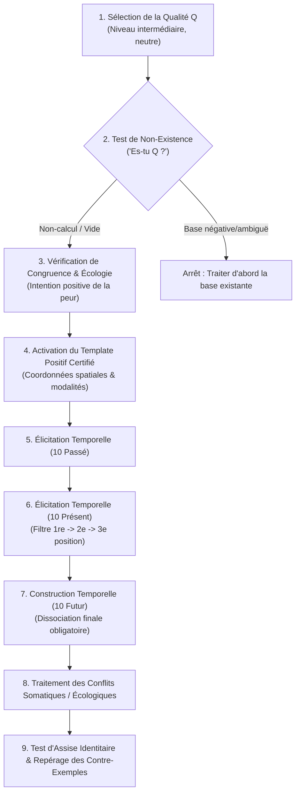

# Transforming Yourself - Building A New Quality Demos
**Formateur :** Damon Cart | **ID :** `damon-cart-transforming-yourself-building-a-new-quality-demos` | **Tranches :** 2

Voici la **synthèse architecturale ultra-dense et structurée** du cours de Damon Cart (*Transforming Yourself - Building A New Quality Demos*), conçue pour servir de tête de pont à la fiche maîtresse.

---

# Synthèse Architecturale du Cours : *Building A New Quality Demos* (Damon Cart)

---

## 1. Thèse Centrale & Philosophie du Cours

### Vision spécifique & posture de Damon Cart vs Approche PNL standard
* **Dépassement du dogme des « croyances » et de la réparation :** Là où la PNL classique traite le manque de confiance ou d'estime comme une « croyance limitante » à détruire ou un « conflit de parties » à négocier, Damon Cart (dans le sillage direct de Steve Andreas) pose un diagnostic neuro-structurel radical : le problème n'est pas ce qui est présent, mais **ce qui est absent**. Une qualité non-existante est un vide de représentation (*nowhereland*), une lacune d'indexation où les validations externes glissent sans pouvoir être rattachées au Soi.
* **Refus de l'euphorie et du « State Chasing » :** Cart adopte une posture d'ingénieur cognitif sobre. Il met explicitement en garde contre l'euphorie émotionnelle (« *euphoric high* »), souvent confondue en développement personnel avec la transformation. Pour lui, l'euphorie est un piège neurologique signalant une fuite dans l'imaginaire non ancré. La véritable intégration identitaire est silencieuse, corporelle, stable (*grounded*) et mathématiquement étayée.
* **Primauté de la syntaxe sous-modale sur le contenu sémantique :** On ne convainc pas le système nerveux par des affirmations positives ou de la persuasion verbale. Le cerveau n'attribue l'étiquette de « réalité indiscutable » qu'à des représentations respectant une géométrie spatiale et sous-modale stricte (le *Positive Template*).

### Fil rouge méthodologique
Le fil conducteur unifiant toutes les démonstrations est la **transposition d'architecture et la contamination systémique** :
1. **Échantillonner** la forme pure de la certitude chez le sujet via une qualité existante indiscutable (syntaxe spatiale, localisation 3D, disposition).
2. **Construire** une base de données expérientielle équilibrée et tri-temporelle (30 preuves minimum : passé, présent, futur) pour conférer la permanence temporelle au prédicat identitaire.
3. **Sécuriser la téléologie future** par une dissociation stricte en 3e position (maintien de la tension dopaminergique vers l'action réelle).
4. **Alchimiser les contre-exemples** par régression causale (trouver la ressource manquante sous-jacente) et les réinjecter dans le système pour que l'identité devienne robuste, antifragile et réaliste.

---

## 2. Carte des Concepts & Leviers Émergents

### A. Écologie & Diagnostic de l'Identité
* **Le Vide Structurel / Absence d'indexation (*Non-Existent Quality* & *Nowhereland*) :** État d'une qualité pour laquelle le système nerveux ne possède aucun dossier mnémonique. Les compliments s'évaporent sans écho interne, créant une dépendance compulsive à la réassurance externe.
* **Taxonomie Tripartite du Concept de Soi :**
  * *Certaine* : Base massive d'exemples congruents + contre-exemples intégrés comme apprentissages/exceptions.
  * *Ambiguë* : Compétition frontale et non résolue entre exemples positifs et contre-exemples à charge égale.
  * *Négée* : Base de données solidement encodée pour prouver l'absence ou l'opposé de la qualité (« Je suis incapable »).
* **Frottement d'Intégration & Résistance Écologique :** La friction ressentie lors de la projection d'une qualité dans certains contextes n'est pas un blocage, mais le signal d'un travail d'alignement neuro-émotionnel préservant des valeurs et critères de sécurité concurrents.

### B. Syntaxe Sous-Modale & Géométrie de la Certitude
* **L'Iso-Morphisme Structurel (*Positive Template Transfer*) :** Règle selon laquelle la certitude est indépendante du contenu. Dupliquer la structure spatiale (coordonnées 3D, luminosité, volume, disposition en pile/mosaïque) d'une qualité certaine pour y couler de nouvelles expériences force l'inconscient à les encoder comme réelles.
* **Distribution Tri-Temporelle Équilibrée (10P / 10Pr / 10F) :** Condition requise pour la permanence d'une qualité. Le passé fournit la preuve historique, le présent la résonance contextuelle, le futur la directionnalité.
* **Règle de Dissociation Future (Préservation Dopaminergique) :** Obligation neurologique de clore les projections futures en 3e position (dissocié). L'association complète à un futur désiré simule l'accomplissement biologique et éteint la motivation à agir dans le réel.

### C. Alchimie & Traitement des Contre-Exemples
* **Régression de Cause Première (*Causal Chaining*) :** Recherche de la ressource structurelle manquante derrière un échec ou une faiblesse. La confiance n'est qu'un symptôme ; la compétence opératoire (ex. : savoir poser une limite) est la cause première.
* **Liaison Synesthésique et Contamination de Groupe :** Procédé consistant à fusionner le contre-exemple critique retraité avec son format original, puis à l'insérer dans l'amas des contre-exemples pour déclencher une réaction en chaîne (effet domino) qui restructure l'ensemble du groupe.
* **Heuristique Anti-Euphorie (*Groundedness*) :** Critère d'évaluation clinique exigeant le retour à un état neutre, dense et incarné via l'intégration des contre-exemples dans la base positive, par opposition au « rush » émotionnel instable.

---

## 3. Tableau Récapitulatif des Techniques & Démonstrations

| Technique / Exercice | Objectif Opératoire | Déclencheur / Indication | Séquence Résumée |
|---|---|---|---|
| **Diagnostic du Statut Identitaire** | Classifier la qualité cible (Certaine, Ambiguë, Négée, Non-Existante) avant toute intervention. | Demande initiale du client portant sur un manque d'estime ou un besoin de changement identitaire. | 1. Éliciter les représentations actuelles de la qualité. 2. Évaluer le ratio preuves positives / contre-exemples. 3. Vérifier s'il y a dossier d'archivage ou « vide indexical » (*Nowhereland*). |
| **Cartographie du Modèle Positif (*Positive Template Extraction*)** | Extraire la syntaxe sous-modale pure de la certitude absolue pour servir de matrice de copie. | Nécessité de construire une nouvelle qualité sur un terrain vierge ou de stabiliser une qualité floue. | 1. Identifier une qualité indiscutable chez le sujet (ex. : « Je suis ponctuel », « Je suis père »). 2. Cartographier l'emplacement 3D péri-personnel, la modalité dominante, la taille, la disposition (pile, cercle, album). 3. Valider le sentiment kinesthésique de solidité sans effort. |
| **Enrichissement par Décentration Perceptive (Boucle 1-2-3-1)** | Extraire des critères comportementaux objectifs à partir des rétroactions d'autrui pour alimenter le dossier de preuves. | Le sujet reçoit des compliments ou du feedback positif mais ne comprend pas ce que les autres voient (aveuglement en 1re position). | 1. Se placer en 1re position face au compliment (constat du vide). 2. Glisser en 2e position (dans les yeux de l'interlocuteur) pour observer ses propres micro-comportements. 3. Passer en 3e position (méta) pour extraire le critère observable factuel. 4. Réintégrer le critère en 1re position comme preuve recevable. |
| **Échantillonnage Tri-Temporelle & Construction de Base** | Créer la masse critique neuro-mnémonique (au moins 30 instances) garantissant la permanence du trait. | Absence de dossier mnémonique pour la qualité cible ; transition après l'extraction du *template*. | 1. Éliciter 10 souvenirs passés incarnant la qualité (ou ses prémisses). 2. Éliciter 10 manifestations dans le présent immédiat/contextuel. 3. Projeter 10 scénarios futurs spécifiques dans divers contextes. 4. **Verrou critique :** Sortir impérativement en 3e position (dissociée) sur les 10 scénarios futurs pour préserver la tension d'action. |
| **Régression de Cause Première (*Causal Chaining*) sur Contre-Exemple** | Identifier la ressource instrumentale racine derrière un comportement d'échec ou d'impuissance. | Présence d'un contre-exemple lourd associé à du désespoir, du vide ou de la honte. | 1. Localiser le pire contre-exemple (*worst one*). 2. Isoler l'intention positive d'origine (ex. : préserver la paix, éviter le danger). 3. Remonter la chaîne causale : « De quelle ressource concrète avais-tu besoin pour satisfaire cette intention ? » (ex. : assertivité, poser une limite claire). |
| **Liaison & Contamination de Groupe des Contre-Exemples** | Neutraliser l'ensemble des souvenirs négatifs résiduels par généralisation spontanée d'un souvenir pilote réencodé. | Persistance d'un amas de contre-exemples menaçant la stabilité de la nouvelle base de données. | 1. Rejouer le contre-exemple pilote sous forme de film intégrant la ressource découverte. 2. Lier visuellement/kinesthésiquement l'ancien encodage au nouveau format transformé. 3. Réinsérer cette unité au centre du groupe des autres contre-exemples. 4. Observer la contagion et l'effondrement des anciens formats (*fractioning screen*). |
| **Absorption & Ancrage Réel (*Grounding* vs Euphorie)** | Fixer définitivement la nouvelle qualité dans la chair et le système nerveux, loin du fantasme mental. | Phase finale d'intégration post-transformation des contre-exemples ; client en état d'excitation euphorique instable. | 1. Interrompre la complaisance euphorique par un recadrage de réalité. 2. Réinsérer les contre-exemples transformés (en tant qu'apprentissages passés) au sein de la base de données positive. 3. Calibrer la bascule somatique : souffle qui descend, posture posée, sensation d'évidence silencieuse et stable. |

---

## Extractions Détaillées par Tranche (Opératoire & Verbatim)

## --- Tranche 1 / 2 ---

Voici l'analyse modélisatrice intégrale, structurée et purement opératoire de la tranche 1/2 de la transcription brute de Damon Cart (*Building A New Quality Demos*).

---

### 1. Mécanismes & Principes Actifs

#### A. Le Vide Structurel d'une Qualité Non-Existante (*Non-Existent Quality*)
* **Principe actif :** Une qualité non-existante ne correspond ni à une croyance négative active, ni à un conflit interne. Elle se caractérise par l'**absence totale d'encodage et de dossier d'archivage neuro-cognitif**. Lorsque le sujet reçoit un compliment ou une confirmation externe, l'information sensorielle n'est pas contredite : elle glisse dans un "vide" spatial et représentationnel (*nowhereland*), faute d'adresse mentale pour être indexée. L'inconscient ne peut ni s'y associer, ni en faire un prédicat de soi, ce qui engendre un comportement d'assujettissement à la validation externe (besoin compulsif de réassurance / dépendance relationnelle).
* **Tags libres émergents :** `#non_existent_quality` `#absence_de_classement_mnesique` `#vide_indexical` `#dependance_validation_externe` `#nowhereland`

#### B. La Taxonomie Tripartite du Concept de Soi : Certain, Ambigu, Négé
* **Principe actif :** Le système de conviction repose sur le ratio mathématique et spatial entre **exemples de référence positifs** et **contre-exemples** :
  1. *Qualité Certaine* : Base de données riche en exemples conformes au patron structural, contre-exemples intégrés/métaphorisés ou minoritaires.
  2. *Qualité Ambiguë* : Ratio équivalent d'exemples positifs et de contre-exemples (~50/50) créant une oscillation d'état (*"parfois je le suis, parfois non"*).
  3. *Qualité Négative / Négée* : Surabondance massive de contre-exemples encodés comme preuves d'identité inverse (*"je suis indigne d'amour"*).
* Injecter directement des exemples positifs sur une qualité *négée* sans traiter la base négative produit simplement une qualité *ambiguë* instable. Le protocole de construction d'une nouvelle qualité requiert impérativement un terrain neutre (absence de base préexistante).
* **Tags libres émergents :** `#ratio_preuves_contre_exemples` `#taxonomie_identitaire` `#qualite_ambigue` `#qualite_negee` `#seuil_de_certitude`

#### C. L'Iso-Morphisme Structurel (Le Modèle Positif / *Positive Template Transfer*)
* **Principe actif :** Le sentiment subjectif de certitude n'est pas lié au contenu sémantique, mais à sa **syntaxe sous-modale et spatiale**. En cartographiant l'encodage précis d'une qualité indiscutable chez le sujet (coordonnées 3D dans le champ péri-personnel, modalité dominante, volume, disposition en pile, collage ou Rolodex), il suffit de transposer les nouveaux souvenirs bruts dans ce contenant identique pour que le système nerveux leur attribue automatiquement l'étiquette de réalité et de certitude inconsciente.
* **Tags libres émergents :** `#positive_template` `#isomorphisme_sous_modal` `#syntaxe_spatiale` `#encodage_de_la_certitude` `#transfert_de_forme`

#### D. L'Élicitation Tri-Temporelle Équilibrée (10 Passé / 10 Présent / 10 Futur)
* **Principe actif :** Une identité stable exige une assise temporelle distribuée. Dix exemples passés fournissent l'ancrage historique ; dix exemples présents fournissent la résonance contextuelle immédiate ; dix projections futures garantissent la téléologie et la continuité d'action.
* *Règle neurologique critique du Futur :* L'exploration future doit obligatoirement se clore en **dissociation (3e position)**. L'association permanente à une action future envoie un signal d'accomplissement prématuré au système dopaminergique, ce qui éteint la tension motivationnelle à agir dans la réalité physique.
* **Tags libres émergents :** `#distribution_tri_temporelle` `#regle_de_dissociation_future` `#preservation_tension_dopaminergique` `#echantillonnage_temporel`

#### E. L'Enrichissement par Décentration Perceptive (1re -> 2e -> 3e -> 1re)
* **Principe actif :** Lorsqu'un sujet ne comprend pas les rétroactions de son entourage au sujet de sa qualité (absence de sens en 1re position), adopter la 2e position (entrer dans la peau et les yeux de l'autre) lui permet de percevoir ses propres micro-comportements qui manifestent cette qualité. Le passage en 3e position (méta-observateur) stabilise l'information sous forme de critères observables, permettant enfin de la réintégrer en 1re position comme une preuve valide.
* **Tags libres émergents :** `#positions_perceptuelles_integratrices` `#seconde_position_decentree` `#calibration_miroir` `#extraction_de_criteres`

#### F. Somatisation du Conflit Écologique et Recadrage de Sécurité
* **Principe actif :** Toute sensation de douleur corporelle ou de résistance spatiale lors du déplacement d'une représentation mentale signale une violation écologique (peur inconsciente d'agression, d'isolement social ou de perte de sécurité). En dialoguant avec le signal somatique via la recherche de l'intention positive (2e position avec la douleur/partie), le praticien négocie des clauses de sécurité contextuelles qui lèvent immédiatement le verrou neuromusculaire.
* **Tags libres émergents :** `#somatisation_ecologique` `#signal_somatosensoriel` `#negociation_de_parties` `#clause_de_securite`

---

### 2. Protocoles, Techniques & Démonstrations (Étape par Étape)

#### Protocole : Construction d'une Nouvelle Qualité du Concept de Soi (Processus Damon Cart / Steve Andreas)

* **Intention / Indication :** À utiliser lorsqu'un sujet a besoin d'une ressource identitaire mais présente une *qualité non-existante* (il n'a pas de concept de lui-même sur cette dimension, recherche une réassurance externe perpétuelle, ou ne comprend pas quand on lui attribue cette qualité sans pour autant la nier).
* **Contre-indication :** Présence d'une base de données négative (*"Je suis nul/non-aimable"*) ou ambiguë. Dans ce cas, réorienter vers le travail de transformation des contre-exemples.

#### Séquence d'actions pas à pas :

##### Étape 1 : Sélection & Calibration du Niveau d'Abstraction
1. Sélectionner une valeur issue d'une élicitation préalable qui ne se traduit pas encore en qualité interne, ou utiliser les plaintes/besoins de réassurance récurrents.
2. Définir une **qualité intermédiaire** (ex: curieux, présent, aimable, séduisant), en évitant les compétences purement techniques (conduire) et les abstractions spirituelles transcendantes (étincelle du cosmos).
3. Utiliser une désignation par étiquette neutre (ex: "Q") pour travailler sur la structure pure et empêcher le parasitage par l'histoire du sujet.

##### Étape 2 : Test de Non-Existence & Vérification d'Absence de Base Existante
1. Poser la question directe : *"Es-tu [Q] ?"*
2. **Calibration :** 
   - Absence de réaction émotionnelle vive (pas de rejet catégorique).
   - Micro-expression de perplexité, haussement d'épaules, réponse du type : *"Non, pas vraiment, ça ne me parle pas"*.
   - Absence d'oscillation (*"Parfois oui, parfois non"* = ambigu, arrêter le protocole).

##### Étape 3 : Contrôle Écologique Initial (Congruence Check)
1. Demander : *"Veux-tu cette qualité comme une partie stable et certaine de ton identité ?"*
2. Demander immédiatement le contre-poids : *"Y a-t-il une partie de toi qui y résiste ou qui a peur de cela ?"*
3. Éliciter l'intention positive de la peur : *"Quelle est l'intention positive de cette peur ?"*
4. Recadrer la structure relationnelle : s'assurer que la possession de Q vise la connexion d'égal à égal et non une posture de supériorité/infériorité ou de nuisance envers autrui.

##### Étape 4 : Rappel du Modèle Positif de Certitude (*Positive Template*)
1. Réactiver la structure sous-modale issue de la modélisation d'une certitude absolue chez le sujet (ex: voix auditives localisées sous l'oreille gauche/droite, distance, collage visuel, taille des représentations).

##### Étape 5 : Récupération & Encodage des Exemples Passés (10 Références)
1. Demander de rechercher un premier souvenir où le sujet a manifesté Q d'une manière alignée avec ses valeurs.
2. Formater immédiatement l'expérience selon les sous-modalités du Template (ajustement de l'emplacement spatial 3D, du volume, de la clarté visuelle).
3. Réduire la barre d'exigence : n'exiger aucun souvenir grandiose, accumuler des micro-événements.
4. Amorcer par paquets : viser 5 exemples, puis 5 suivants, pour atteindre une masse critique de 10 références passées.

##### Étape 6 : Récupération & Encodage des Exemples Présents (10 Références)
1. Rechercher des événements récents ou actuels.
2. En cas de blocage face aux compliments externes non intégrés (*"Les gens me disent que je suis Q mais je ne le ressens pas"*), appliquer la **Séquence Perceptuelle** :
   - Associer le sujet en 1re position.
   - Le faire entrer en 2e position dans le corps de l'interlocuteur pour voir et entendre ce que l'autre perçoit de Q.
   - Passer en 3e position d'observateur neutre pour valider le critère factuel.
   - Revenir en 1re position et déposer cette représentation vocale/visuelle à l'adresse exacte du Template Positif.
3. Stabiliser 10 exemples du temps présent.

##### Étape 7 : Génération & Encodage des Exemples Futurs (10 Projections)
1. Construire 10 simulations d'actes futurs incarnant Q.
2. **Condition critique opératoire :** Autoriser l'exploration subjective, mais forcer la **dissociation finale (3e position)** pour chaque représentation future avant de la fixer dans le template spatial.

##### Étape 8 : Résolution des Conflits Somatiques Spatiaux
1. Si le déplacement d'un exemple futur vers l'emplacement du template déclenche une tension corporelle ou une douleur :
   - Stopper le déplacement physique de l'image/son.
   - Dissocier le sujet et l'inviter à se mettre en 2e position avec la sensation douloureuse.
   - Demander à la douleur son intention positive (*"De quoi veux-tu me préserver ?"* -> ex: *"Sécurité"*).
   - Négocier l'intégration de sous-critères (mesures de sécurité contextuelles) dans la représentation future.
   - Constater la disparition de la tension somatique et finaliser le placement spatial.

##### Étape 9 : Test & Localisation des Contre-Exemples
1. Vérifier la transformation globale du sujet : observation de la physiologie, du tonus vocal et de la spontanéité d'accès.
2. Localiser préventivement l'adresse spatiale des contre-exemples résiduels pour le travail d'intégration ultérieur.

---

### 3. Heuristiques, Subtilités & "Sagesse du Praticien"

#### Règles Conditionnelles d'Arbitrage (*"Si... Alors..."*)

* **SI** le sujet répond à un compliment par un rejet direct (*"C'est faux, tu mens"*) :
  * **ALORS** il s'agit d'une qualité négative/négée. Ne pas appliquer ce protocole ; il faut d'abord traiter et transformer la base de données négative.
* **SI** le sujet oscille (*"Je l'ai parfois, parfois pas"*) :
  * **ALORS** il s'agit d'une qualité ambiguë (ratio ~50/50 contre-exemples). Ne pas appliquer ce protocole de création ex nihilo.
* **SI** le sujet éprouve de la perplexité, oublie le compliment instantanément ou manifeste une absence totale d'impact :
  * **ALORS** le diagnostic de *qualité non-existante* est posé. Appliquer le protocole de construction.
* **SI** le sujet résiste à la recherche d'exemples en disant qu'il n'a rien accompli d'exceptionnel :
  * **ALORS** abaisser drastiquement le seuil de critère (*"Nous ne cherchons pas le moment le plus héroïque de ta vie, mais de minuscules micro-détails du quotidien"*).
* **SI** le sujet manifeste une sensation somatique désagréable (point douloureux, contraction) lors de l'intégration spatiale du futur :
  * **ALORS** suspendre immédiatement la manipulation spatiale. Entrer en 2e position avec la zone somatique pour éliciter le critère manquant (la sécurité contextuelle), l'incorporer dans la scène mentale, puis reprendre le mouvement.
* **SI** le sujet visualise le futur en position associée (acteur dans l'image) :
  * **ALORS** forcer immédiatement la dissociation en 3e position (se voir agir depuis l'extérieur) avant le classement pour éviter la décharge dopaminergique d'auto-satisfaction qui détruit la motivation proactive.

#### Pièges d'Exécution & Erreurs de Débutant
1. **Le piège du contenu (Content trap) :** Se perdre dans l'histoire autobiographique de la qualité. La thérapie brève et la modélisation structurelle n'ont pas besoin du contenu réel (utiliser "Q").
2. **Le piège de la tentative d'écrasement (*Bulldozing*) :** Vouloir empiler des souvenirs positifs sur une identité déjà négative. Le système rejette la greffe ou crée une instabilité névrotique (qualité ambiguë conflictuelle).
3. **Le déni du signal corporel :** Forcer une image mentale à aller à l'emplacement spatial du template alors que le corps envoie un signal d'alarme viscéral. Toute résistance somatique est une information d'écologie vitale.
4. **La surcharge de départ :** Demander d'emblée "trouve 30 exemples". Face au vertige cognitif du sujet, fractionner impérativement la tâche en segments tolérables (5, puis 5, puis extension temporelle).

---

### 4. Pépites Verbatim & Patterns Linguistiques (MOT À MOT EN V.O.)

#### Pépite 1 : La distinction structurelle du non-calcul cognitif
> *"The two major tests you can use to find out if you or someone else has a non-existent quality, is that you or they need confirmation from others. The other is, if you tell yourself or them that they are whatever quality they don't have, it just won't compute."*
* **[Analyse du Pattern]** : Utilisation d'un cadre de diagnostic par présupposition comportementale (*"it just won't compute"*). Damon Cart installe une métaphore computationnelle qui déculpabilise le client : le problème n'est pas une défaillance affective, morale ou traumatique, mais une pure absence matérielle d'algorithme de calcul et d'indexation dans le système nerveux.

#### Pépite 2 : L'ordonnancement par le Template Isomorphique
> *"As long as you build this new quality in the same form as your unique positive template, it will function in the same way, providing a solid and unconscious basis for knowing that you have this quality and being who you want to be."*
* **[Analyse du Pattern]** : Double lien implicite et présupposition temporelle articulée par *"As long as you build... it will function"*. Cart utilise une équivalence complexe reliant la forme géométrique/sensorielle interne (*"in the same form"*) à la certitude inconsciente automatique (*"unconscious basis for knowing"*), contournant l'intellect conscient par une commande de traitement du signal.

#### Pépite 3 : Recadrage de l'écologie relationnelle et dissolution de l'orgueil
> *"One of the ways in which this whole structure of this model is created is done in such a way that we want it to connect ourselves more with other people, not less. And we don't want to be superior to other people or inferior to other people. We want to be connected. We want to be on the same level as people."*
* **[Analyse du Pattern]** : Recadrage de sens par empilement de truismes et truisme égalitaire. Cart neutralise la crainte inconsciente du sujet (devenir arrogant ou faire du mal aux autres avec cette nouvelle qualité) en redéfinissant l'augmentation de valeur identitaire non comme un pouvoir sur autrui, mais comme un vecteur spatial d'alignement horizontal (*"on the same level"*), levant instantanément la résistance de culpabilité.

#### Pépite 4 : Instruction critique de dissociation future
> *"If you want to go and explore the different positions and you want to associate into the future, that's all fine. Just make sure before you leave the example that you disassociate, only from future examples, because with future examples, if you associate into them and you don't disassociate, you can give yourself the sense of already having done something that you haven't, and it can actually decrease motivation."*
* **[Analyse du Pattern]** : Prescription paradoxale permissive (*"that's all fine"*) immédiatement suivie d'une clause de verrouillage restrictif indispensable (*"Just make sure... that you disassociate"*). Cart formule un postulat psycho-physiologique rigide sous couvert d'une recommandation bienveillante, protégeant l'écologie neuro-motivationnelle du client par distinction d'états d'association/dissociation.

#### Pépite 5 : Négociation somatique directe avec le signal d'alarme
> *"So go second position with that pain and ask it, what its positive intent is for you. [...] If it doesn't want you to get hurt, what does it want for you? To be safe. OK. To be safe. So how can you create future examples of Q, building safety into it as well?"*
* **[Analyse du Pattern]** : Fragmentation en parties et recadrage d'intention positive par questionnement ericksonien récursif. Damon Cart traite la douleur corporelle non comme un obstacle somato-psychique à supprimer, mais comme un sujet autonome doté d'une intention bienveillante (*"what does it want for you?"*). En obtenant le critère fondamental (*"To be safe"*), il insère ce critère directement dans la commande d'imagerie future (*"building safety into it as well"*), ce qui dissout l'impasse sans combat intérieur.

## --- Tranche 2 / 2 ---

### 1. Mécanismes & Principes Actifs

- **Distribution Temporelle Équilibrée (Passé / Présent / Futur)**
  *Principe actif* : Une croyance identitaire robuste (« Je suis X ») ne peut pas reposer uniquement sur des souvenirs passés (qui créent de la nostalgie ou un sentiment d'avoir perdu la qualité) ni uniquement sur des projections futures (qui maintiennent la qualité à l'état de vœu pieux ou d'aspiration lointaine). L'inconscient et le système nerveux exigent une masse critique d'au moins 30 exemples distribués de manière équilibrée sur la ligne du temps pour valider la permanence de la qualité à travers le temps.
  *Tags* : #balanced_distribution_in_time #densification_de_base_de_donnees #permanence_temporelle_identitaire

- **Frottement d'Intégration & Résistance Contextuelle**
  *Principe actif* : Lorsque le sujet tente d'injecter la qualité dans le futur et rencontre une résistance dans certains domaines de vie (« *In some life areas, there's more resistance* »), ce blocage neuro-émotionnel signale l'activation de critères de sécurité ou de valeurs écologiques concurrentes. Damon Cart recadre l'effort (« *it's hard* ») non pas comme un échec, mais comme le signe que le système nerveux est en train de réaligner activement ses attitudes, comportements et modèles mentaux profonds.
  *Tags* : #resistance_as_alignment_work #safeguards_contextuels #ecologie_comportementale

- **Localisation Spatiale des Contre-Exemples**
  *Principe actif* : Dans le modèle du Self-Concept de Steve Andreas, les contre-exemples (les fois où l'individu n'a pas manifesté la qualité Q) occupent un encodage spatial distinct de la base de données positive. Souvent encodés avec des sous-modalités négatives (grisâtre, terne, mobile ancien) et associés kinesthésiquement à du vide ou du désespoir (« *emptiness or hopelessness* »), ils menacent la certitude s'ils restent dissociés, refoulés ou toxiques.
  *Tags* : #spatial_sorting #counter_example_location #submodalites_depressives

- **Désamorçage par l'Intention Positive et Régression de Cause Première (Causal Chaining)**
  *Principe actif* : Un contre-exemple n'est pas une faute morale, mais une tentative d'assouvir une intention positive (ici : « *maintenir la paix* ») avec un déficit de ressources. En remontant la chaîne des conditions préalables (la confiance et la croyance en soi ne sont que des symptômes ou des résultantes, non des causes premières), le sujet identifie la ressource structurelle manquante (« *l'habileté à poser des limites* »).
  *Tags* : #positive_intent_reframing #causal_chaining #ressource_structurelle_primaire

- **Liaison Synesthésique et Transformation par Contamination de Groupe**
  *Principe actif* : Une fois le contre-exemple le plus violent (« *worst one* ») rejoué sous forme de nouveau film intégrant la ressource, le sujet doit lier physiquement/visuellement l'ancien et le nouveau format, puis réinsérer cette unité transformée au milieu du groupe des autres contre-exemples. Par un phénomène de contamination cognitive et de généralisation spontanée (« *fractioning screen* »), les autres contre-exemples s'effondrent et s'alignent automatiquement sur la nouvelle structure de ressource.
  *Tags* : #linking_old_and_new #fractionnement_visuel #generalisation_automatique_par_contamination

- **L'Écueil de l'Euphorie vs Ancrage Réel (Integration vs High)**
  *Principe actif* : L'état d'euphorie (« *euphoric feeling* », « *soaking in the new movie* ») est un piège neurologique : il signale une déconnexion du sol (manque de *groundedness*) et une fuite dans le fantasme. L'intégration solide exige l'absorption des contre-exemples transformés au sein de la base de données positive (dans le passé). C'est ce qui transforme un simple « shoot émotionnel » en certitude identitaire inébranlable.
  *Tags* : #anti_euphoria_heuristic #groundedness #integration_des_contre_exemples

---

### 2. Protocoles, Techniques & Démonstrations (Étape par Étape)

#### Protocole d'Intégration & Résolution des Contre-Exemples (Modèle Self-Concept Recode)

* **Intention / Indication** :
  À utiliser obligatoirement après la constitution d'une base de données positive de la nouvelle qualité (environ 30 exemples équilibrés passé/présent/futur), avant le test final de certitude, lorsque les contre-exemples passés (souvenirs d'échec ou d'absence de la qualité) continuent de polluer le système ou d'empêcher une certitude pleine et congruente.

* **Mise en place & Pré-framing** :
  - Expliquer que les contre-exemples ne doivent pas être niés, détruits ni effacés, car ils font partie de l'expérience de vie (« *We don't want to lose them, we don't want to block them out* »).
  - Régler la distance d'accès pour préserver la sécurité émotionnelle : approcher l'expérience suffisamment près pour pouvoir travailler dessus, mais pas trop près pour ne pas être ré-associé à l'état de détresse.

* **Séquence d'actions pas à pas** :

  1. **Localisation et Audit Sensoriel des Contre-Exemples** :
     - Demander : « *Où sont situés les contre-exemples (les fois où tu étais l'opposé de Q) ?* »
     - Identifier la modalité dominante (visuel, auditif, kinesthésique), le nombre approximatif (ex: 5) et les sous-modalités critiques (ex: teinte grisâtre, flou, sensation de vide).

  2. **Extraction du « Pire » (Worst-Case Isolation)** :
     - Isoler le pire contre-exemple ou le tout premier.
     - Régler la distance sous-modalitaire : l'amener à une distance de travail opératoire sans contamination kinesthésique invalidante.

  3. **Extraction de l'Intention Positive Pure** :
     - Poser la question : « *Quelle était ton intention positive dans cette situation ?* »
     - *Règle de correction de négation* : Si la réponse est formulée négativement (« Ne pas faire X »), forcer le pivot : « *Si ce n'est pas cela, qu'est-ce que tu voulais/veux vraiment dans cette situation ?* »
     - Transformer l'intention en posture active/puissante (ex: passer de « *maintenir la paix* » à « *faire la paix* »).

  4. **Chaînage Rétrograde de la Ressource Primaire (Causal Chaining)** :
     - Demander : « *Quelle ressource manquait dans cette situation et aurait permis d'accomplir cette intention positive ?* »
     - Rejeter les symptômes ou états terminaux (« la confiance », « croire en moi », « savoir qui je suis ») en expliquant qu'ils sont la conséquence de l'alignement et non la cause.
     - Guider jusqu'à trouver la compétence/capacité opératoire racine (ex: « *la capacité à poser des limites* »).

  5. **Création du « Nouveau Film » & Test de Compulsion** :
     - Créer un film mental alternatif intégrant pleinement la ressource identifiée pour accomplir l'intention positive.
     - Vérifier la présence des modalités prioritaires du sujet (ajouter la piste audio/soundtrack si le sujet est auditif).
     - Rendre le nouveau film grand, lumineux, attrayant (« *compelling* »), pendant que l'ancien film est relégué en petit, terne ou noir et blanc.

  6. **Verrouillage de Liaison (Linking)** :
     - Lier explicitement l'ancien film neutralisé et le nouveau film transformé pour que le système nerveux enregistre qu'ils se rapportent au même événement de référence.

  7. **Réinsertion & Contamination du Groupe** :
     - Replacer cette paire transformée au sein du groupe des 4 autres contre-exemples.
     - Observer l'effet en chaîne sur les autres représentations (fractionnement, dissolution, transformation spontanée).

  8. **Transvasement dans la Base de Données Positive** :
     - Si le sujet part en amnésie ou en transe euphorique, le ramener au sol (*grounding*).
     - Déposer un à un, lentement, les contre-exemples métabolisés dans la base de données positive de Q (prioritairement dans l'espace temporel du Passé, jamais dans le Futur).

  9. **Test Écologique & Vérification de la Certitude Identitaire** :
     - Faire embrasser du regard l'ensemble de la base de données positive réorganisée.
     - Poser la question directe : « *Es-tu Q ?* »
     - Vérifier la congruence somatique et vocale immédiate.
     - Vérifier l'écologie : « *Y a-t-il la moindre partie de toi qui résiste à cela ? Est-il écologique d'être Q maintenant et à l'avenir ?* »

* **Signes de calibration** :
  - *Calibration de résistance* : Ralentissement, hésitation, déclarations de difficulté (« *it's hard* »).
  - *Calibration d'atteinte de la ressource racine* : Modification somatique immédiate, picotements corporels (« *My body is feeling tingling* »), étirement cognitif, soupir de soulagement (« *That's a magic trick* »).
  - *Calibration du piège euphorique* : Déconnexion, amnésie des anciens contre-exemples (« *I kind of forgot... amnesia right now* »), voix flottante (« *I could stay there forever* »).
  - *Calibration de la certitude* : Réponse verbale instantanée (« *Yes* ») sans micro-hésitation, voix posée, tête alignée, absence de hausse d'intonation dubitative en fin de phrase.

---

### 3. Heuristiques, Subtilités & "Sagesse du Praticien"

- **Heuristique de l'Effort Cognitif** :
  *Si* le sujet dit « c'est difficile d'inventer des exemples futurs », *alors* recadre immédiatement la difficulté comme la preuve irréfutable que le système nerveux est en train de se reprogrammer en profondeur. Ce n'est pas un blocage, c'est l'étirement du tissu neural pour aligner comportements et valeurs.

- **Heuristique du Filtrage des Ressources Écran (Symptôme vs Cause)** :
  *Si* le sujet propose comme ressource manquante « la confiance », « la croyance en moi » ou « l'espoir », *alors* rejette-les méthodiquement :
  - La *confiance* est le symptôme de l'alignement sur ses valeurs, pas une cause racine.
  - La *croyance en soi* vient après coup, une fois la pièce manquante insérée.
  - L'*espoir* cache une tonalité d'impuissance (« *hope sounds like hopeless* »).
  *Action* : Chercher l'étape immédiatement antérieure : l'outil opératoire direct (ex: poser des limites, discernement/sagesse contextuelle).

- **Heuristique de la Distance Kinesthésique de Sécurité** :
  *Si* tu isoles le pire contre-exemple d'un sujet, *alors* place-le à une distance sous-modalitaire précise : « *assez proche pour travailler avec, mais pas assez proche pour qu'il te contamine négativement* ».

- **Heuristique de Préservation de l'Expérience Réelle (Anti-Évitement)** :
  *Si* le sujet utilise le nouveau film pour fuir ou refouler l'ancien (« *I don't want to look at the old movie* » ou amnésie complète des contre-exemples), *alors* refuse l'amnésie. L'inconscient ne doit pas effacer son histoire mais la réorganiser. Lie systématiquement l'ancien et le nouveau film pour assurer la continuité de l'identité.

- **Heuristique de Rupture de l'Euphorie (Grounding Rule)** :
  *Si* le sujet devient euphorique (« *I could stay there forever* »), *alors* interromps la complaisance dans la transe. L'excès d'euphorie signale une perte d'ancrage somatique et un défaut d'intégration. Force immédiatement la réinsertion des contre-exemples transformés dans la réalité historique (le passé de la base de données).

- **Heuristique d'Attribution Spatio-Temporelle des Contre-Exemples Transformés** :
  *Règle absolue* : Les contre-exemples réévalués doivent être déposés dans le **passé** de la base de données de la qualité, **jamais dans le futur**. Ils constituent désormais des preuves d'apprentissage et de résilience historiques, et non des attentes de rechute future.

- **Heuristique du Calibrage de la Certitude** :
  *Si* à la question « Es-tu Q ? », le sujet répond « Ouais... » avec une intonation descendante ou floue, *alors* interromps et nomme le manque de certitude (« *No. You're not certain of it* »). Ne valide jamais un acquiescement poli ou tiède. Fais ré-accéder à la totalité de la base sensorielle jusqu'à ce que le « Oui » soit franc, spontané et congruant.

---

### 4. Pépites Verbatim & Patterns Linguistiques (MOT À MOT EN V.O.)

#### Pépite 1 : Recadrage de la Résistance en Travail d'Alignement Profond
> « So when you say it's hard, that's actually, I mean, this is the work that is going to make a huge difference. Right. Because you are really working hard to guide yourself for your behavior and your attitudes and your mindsets to align to this quality that you value. »
* **[Analyse du Pattern]** : Recadrage de signification direct doublé d'un rythme hypnotique de truismes (*pacing*). L'association « *when you say it's hard* [fait vérifiable] *that's actually... the work that is going to make a huge difference* [recadrage de valeur] » convertit la fatigue cognitive du sujet en validation de succès thérapeutique. Le triplé nominal (« *behavior and your attitudes and your mindsets* ») sature le champ analytique pour forcer l'acceptation de l'effort.

#### Pépite 2 : Commande de Distance Kinesthésique de Sécurité
> « Pull out the worst one, bring it close enough that you can work with it, but not so close that it affects you. »
* **[Analyse du Pattern]** : Double contrainte spatiale analogique et commande d'équilibration neuro-émotionnelle. Cart utilise la spatialisation pour réguler l'accès à l'amygdale : « *close enough* » garantit l'activation du pattern, tandis que la négation limitante « *not so close that it affects you* » enclenche une dissociation kinesthésique automatique sous contrôle conscient.

#### Pépite 3 : Le Pivot de Négation vers la Téléologie Positive
> « And ask yourself, what was your positive intent in this situation? And if it comes up as a not this or not that or not to do this, then flip it and say, okay, well, if that's not it, then what do I want or what did I want in this situation? »
* **[Analyse du Pattern]** : Prévention active du biais d'évitement (*pre-framing*). En installant par avance un filtre linguistique qui interdit les formulations par négation (« *not this or not that* »), l'opérateur force l'inconscient à basculer d'une stratégie d'évitement de la douleur vers une représentation orientée résultat direct (« *what did I want* »), réorientant l'énergie psychique vers une cible atteignable.

#### Pépite 4 : Démantèlement de la Croyance Écran (Confiance vs Ressource Racine)
> « But that's kind of like after that comes later. Once you have the access to what you need, once the missing piece is put into place, then you'll believe, then you'll know who you are. So it's the piece, the step that comes before that. »
* **[Analyse du Pattern]** : Chaînage temporel présuppositionnel (« *Once X... then Y* »). En utilisant deux fois la conjonction temporelle « *Once* » couplée à une métaphore structurale matérielle (« *the missing piece is put into place* »), le formateur détrône l'illusion de la « confiance en soi » abstraite pour la reléguer au rang de conséquence inévitable, obligeant le sujet à sonder son système nerveux pour localiser la ressource opératoire primaire antérieure.

#### Pépite 5 : Recadrage de la Transe Euphorique et Impératif d'Intégration
> « There can be a problem with that too. Because it can become a little, when you get into like the euphoric feeling too much, that means there's, that you've lost groundedness and there's going to be more integration. And that's what putting the counter examples in there does is it integrates. So, let's finish the integration. »
* **[Analyse du Pattern]** : Rupture abrupte d'idéalisation et ancrage de réalité. Cart identifie le piège de la transe béate et redéfinit l'euphorie non pas comme une victoire, mais comme un symptôme d'instabilité (« *lost groundedness* »). L'utilisation de l'équivalence complexe (« *that means... you've lost groundedness* ») couplée à la répétition hypnotique de la racine « *integrates / integration* » réoriente instantanément le système du sujet vers la tâche pragmatique : fusionner les contre-exemples pour sceller la certitude dans la matière.
