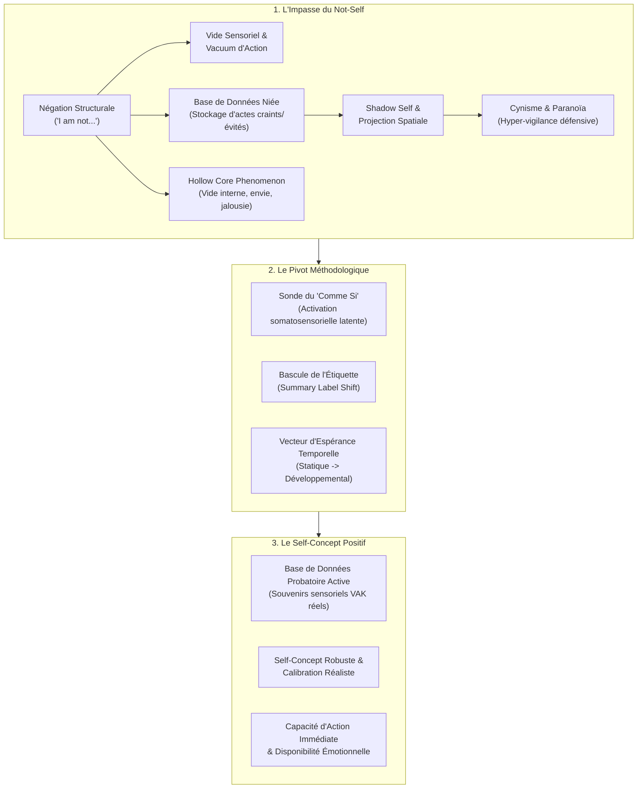

# Transforming Yourself - Changing The Not Self Demos
**Formateur :** Damon Cart | **ID :** `damon-cart-transforming-yourself-changing-the-not-self-demos` | **Tranches :** 2

## Synthèse Architecturale du Cours : *Transforming Yourself – Changing The Not Self Demos* (Damon Cart)

---

### 1. Thèse Centrale & Philosophie du Cours

#### Vision spécifique & Posture de Damon Cart
Dans la lignée des travaux de Steve Andreas (*Transforming Your Self*), Damon Cart radicalise l'approche du **Self-Concept** en déplaçant le curseur de la simple « restructuration de croyances » vers une **ingénierie neurologique des bases de données internes**. 

Là où le coaching standard s'épuise à traiter les symptômes (manque de confiance, envie, syndrome de l'imposteur, cynisme, défiance relationnelle) par des affirmations positives ou des recadrages intellectuels, Cart démontre que le blocage est d'ordre **architectural et computationnel** : le système nerveux ne sait pas encoder la négation logique. Définir son identité par le « Not-Self » (*« Je ne suis pas X »*) contraint le cerveau à maintenir active la matrice sensorielle exacte de ce qu'il cherche à fuir.

La posture de Cart se distingue par :
* **Un refus total du « Pollyanna » (positivisme naïf) :** L'objectif n'est pas de nier l'ombre ou d'injecter une positivité artificielle, mais de rétablir une **calibration sensorielle de la réalité**.
* **Une modélisation computationnelle du soi :** L'identité n'est pas une entité mystique, c'est un couple `[Étiquette de Synthèse / Summary Label]` adossé à une `[Banque d'Exemples Sensoriels / Database]`. Si la banque est vide ou inversée, l'étiquette s'effondre.
* **Le démontage de la pseudo-lucidité :** Il démasque le cynisme et l'hyper-vigilance paranoïde non pas comme de la maturité ou du discernement, mais comme une projection spatiale mécanique d'une base de données interne niée.

#### Fil rouge méthodologique
Le fil conducteur unifiant toutes les démonstrations est la **transmutation de l'absence en présence opératoire** :
1. **Révéler l'impasse représentationnelle :** Mettre le sujet face au vide somatique (*hollow self*) ou à l'obsession générée par le filtre négatif.
2. **Opérer le basculement d'axe ontologique :** Passer du balayage de *ce qui est évité* au moissonnage actif de *ce qui est manifesté*.
3. **Ré-encoder la base de données probatoire :** Remplacer les abstractions logiques par des représentations VAK stabilisées et localisées dans l'espace submodal.
4. **Ouvrir le vecteur de trajectoire temporelle :** Passer du jugement statique d'incompétence (*« Je ne l'ai pas »*) à une dynamique d'apprentissage développementale (*« C'est une trajectoire en cours »*).

---

### 2. Carte des Concepts & Leviers Émergents

#### Écosystème des concepts clés :

* **Négation Structurale vs Évaluation Négative :**
  * *Rôle :* Clé diagnostique première. Une étiquette négative affirmative (*« Je suis maladroit »*) fournit une forme sensorielle exploitable ; une négation (*« Je ne suis pas gracieux »*) force le système nerveux à concevoir la grâce, à la nier abstraitement, tout en restant démuni d'indicateurs moteurs.
* **Gravitation Inconsciente vers la Clarté Sensorielle :**
  * *Rôle :* Loi téléologique du traitement inconscient. L'inconscient ignorant l'opérateur syntaxique « NON », il se dirige vers l'image la plus contrastée et saturée. Décrire avec précision ce qu'on refuse d'être programme l'inconscient à reproduire ce pattern.
* **Le Faux Soi Conscient vs L'Ombre Inconsciente (Shadow Self) :**
  * *Rôle :* Structure la scission identitaire. La personne maintient une façade morale fragile en surface, tandis que la base de données sous-jacente est saturée des contre-exemples refoulés.
* **Genèse Projective de la Paranoïa et du Cynisme :**
  * *Rôle :* Explique les dynamiques relationnelles toxiques. Ne pouvant intégrer sa base de données négative à son identité, le sujet projette ses images internes dans l'espace interpersonnel, prêtant des intentions cachées (*hidden agendas*) à autrui sous couvert de « lucidité ».
* **Le Phénomène du « Hollow Core » (Not-Self Positively Valued) :**
  * *Rôle :* Mécanisme de l'envie et du complexe d'infériorité. Lorsqu'une qualité valorisée est classée hors du Soi, l'individu se vide de sa substance et entre dans une boucle de comparaison externe compulsive et de critique défensive d'autrui.
* **La Sonde du « Comme Si » (*As-If Frame*) :**
  * *Rôle :* Levier de contournement neurologique. Force l'inconscient à simuler immédiatement les kinesthésies et micro-comportements de la ressource latente sans heurter la barrière de croyance critique.
* **La Repopulation de la Base de Données Probatoire (*Database Repopulation*) :**
  * *Rôle :* Moteur de pérennité du changement. Aucune transformation d'étiquette ne tient si elle n'est pas nourrie par un encodage d'exemples concrets, spécifiques et vécus.
* **La Bascule d'Espérance Temporelle :**
  * *Rôle :* Métamorphe émotionnel. Fait basculer l'énergie destructrice du ressentiment ou du manque en dynamique d'apprentissage et de croissance continue (*growth mindset*).

---

### 3. Tableau Récapitulatif des Techniques & Démonstrations

| Technique / Exercice | Objectif Opératoire | Déclencheur / Indication | Séquence Résumée |
|---|---|---|---|
| **Transmutation du « Not-Self Négativement Évalué »** *(Ex: « Je ne suis pas cruel / paresseux »)* | Éliminer le focus sur le comportement redouté, dissoudre l'hyper-vigilance paranoïde/cynique et installer une qualité affirmative opératoire. | Présence de prédicats négatifs d'évitement (*« Je ne veux pas être X »*), paranoïa relationnelle, supériorité morale critique, sentiment d'imposture. | 1. **Mise au jour :** Identifier l'étiquette négative et cartographier les images d'évitement. 2. **Dissolution de la fausse lucidité :** Recadrer le cynisme comme une projection défensive. 3. **Polarisation inverse :** Définir la qualité positive affirmative correspondante (ex: bienveillant). 4. **Moissonnage d'évidences :** Scanner l'histoire personnelle pour extraire des micro-actes réels où cette qualité s'est manifestée. 5. **Encodage submodal :** Aligner spatialement ces souvenirs dans la base de données du Soi. |
| **Résorption du « Not-Self Positivement Valorisé »** *(Ex: « Je ne suis pas drôle / intelligent / digne »)* | Combler le vide intérieur (*hollow self*), neutraliser l'envie/jalousie et réintégrer une qualité valorisée perçue comme inaccessible. | Sentiment d'infériorité, envie toxique, comparaison compulsive avec autrui, critique rabaissante des forces d'autrui pour se rassurer. | 1. **Calibration somatique :** Localiser le vide interne (*hollow core*) provoqué par l'exclusion de la qualité. 2. **Sonde « Comme Si » :** Activer la simulation neurologique (*« Si tu l'avais ne serait-ce qu'à 5%, comment ton corps se tiendrait-il ? »*). 3. **Extraction des ressources latentes :** Identifier les preuves somatosensorielles déjà présentes. 4. **Bascule temporelle :** Passer du verdict d'impossibilité statique au vecteur de développement futur (*« C'est une compétence en cours d'acquisition »*). 5. **Consolidation :** Intégrer les manifestations passées et futures dans la structure du Self-Concept. |
| **Sonde d'Activation par Simulation Sensorielle (*As-If Probe*)** | Contourner l'inhibition cognitive consciente et accéder instantanément aux kinesthésies ressources bloquées par le doute. | Sujet bloqué dans l'analyse intellectuelle, affirmant *« Je ne sais pas »* ou *« C'est impossible pour moi »*. | 1. **Suspension du jugement :** Cadrer la question comme une expérience hypothétique pure. 2. **Induction somatique :** Demander d'adopter la posture physique et le schéma respiratoire exacts de l'état simulé. 3. **Calibration :** Relever les micro-changements physiologiques (tonus, regard, respiration). 4. **Ancrage :** Valider que le système nerveux possède déjà le programme neural requis. |
| **Recalibration Réaliste vs Écran Cynique** | Remplacer la méfiance défensive stérile par un discernement sensoriel contextuel sans tomber dans la naïveté (*Pollyanna*). | Posture rigide de méfiance, interprétation systématique de tout acte d'autrui comme une manipulation ou une menace. | 1. **Déconstruction du filtre :** Séparer les faits observables (VAK) des déductions d'intentions malveillantes. 2. **Restitution de l'ambiguïté :** Réintroduire la possibilité d'intentions positives ou neutres chez autrui. 3. **Recentrage d'agence :** Remplacer l'hyper-surveillance externe par la confiance dans sa propre capacité de réponse et d'action. |

---

## Extractions Détaillées par Tranche (Opératoire & Verbatim)

## --- Tranche 1 / 2 ---

### 1. Mécanismes & Principes Actifs

#### A. Négation Structurale vs Évaluation Négative
* **Principe actif :** Il existe une scission cognitive fondamentale entre une qualité évaluée négativement (*« I am clumsy »*) et une qualité définie par la négation (*« I am not graceful »*). Dire *« I am clumsy »* fournit au système nerveux une affirmation positive (une forme, un comportement encodable sensoriellement sous forme d'image ou de film interne). À l'inverse, la négation linguistique (*« I am not… »*) est une opération logique abstraite que le système sensorimoteur est incapable de représenter directement : pour encoder ce qu'elle « n'est pas », la personne doit d'abord fabriquer la représentation de ce qu'elle rejette, puis tenter d'y apposer un opérateur cognitif d'annulation.
* **Tags libres émergents :** `#negation_structurale` `#qualite_evaluee_negativement` `#absence_de_forme_sensorielle` `#the_not_self`

#### B. Gravitation Inconsciente vers la Clarté Sensorielle
* **Principe actif :** L'esprit conscient sépare et catégorise logiquement le désiré du non-désiré (*« j'aime les bonbons rouges, je n'aime pas les verts »*). L'inconscient, régi par le traitement analogique et sensoriel primaire, ignore la négation syntaxique et est irrésistiblement attiré par la **clarté interne** (les stimuli VAK les plus nets, vifs, répétés et intenses) pour échapper au chaos ou à la confusion. Lorsqu'un individu s'obstine à ne pas vouloir être quelque chose, il fournit à son inconscient un luxe de détails sensoriels sur le comportement redouté. L'inconscient prend cette clarté pour cible et pilote le comportement vers cette exactitude.
* **Tags libres émergents :** `#attraction_vers_la_clarte` `#incompetence_de_la_negation_inconsciente` `#polarite_conscient_inconscient` `#teleologie_de_l_image`

#### C. Le Scissionnement « Faux Soi Conscient » vs « Ombre Inconsciente » (Shadow Self)
* **Principe actif :** La négation de soi installe une distorsion neurologique majeure :
  1. Le conscient se valorise en affirmant l'exclusion (*« Je ne suis pas cruel »*) et en projetant l'acte sur autrui.
  2. L'inconscient fabrique en continu l'imagerie sensorielle de la cruauté pour lui donner sens, s'identifiant ainsi secrètement à cette matière.
  3. Ce fossé produit une ambiguïté profonde où l'individu finit par manifester involontairement le comportement rejeté. Le jugement, le dégoût et le rejet conscient de cette matière sombrent alors dans l'ombre psychique (*shadow*), créant un soi creux (*hollow self*) dépendant du regard d'autrui et contraint au déni.
* **Tags libres émergents :** `#faux_soi_conscient` `#shadow_self` `#scission_identitaire` `#hollow_self` `#dissociation_morale`

#### D. Genèse Projective et Mécanisme de la Paranoïa
* **Principe actif :** Lorsque le système de représentations internes est tapissé d'exemples de ce qu'on refuse d'être, ces images menaçantes ne peuvent être assimilées au Soi. Le système nerveux les extériorise dans l'environnement spatial (*projection*). L'individu s'entoure d'images hostiles, perçoit des intentions malveillantes partout (*« hidden agendas »*), développe une vigilance agressive permanente et s'érige en supériorité morale critique pour masquer sa propre terreur d'être contaminé. La paranoïa est la conséquence structurelle extrême d'un Self-Concept fondé sur la négation.
* **Tags libres émergents :** `#projection_spatiale_du_non_soi` `#mecanisme_de_la_paranoia` `#vigilance_defensive` `#superiorite_compensatoire`

---

### 2. Protocoles, Techniques & Démonstrations (Étape par Étape)

#### Protocole : Transmutation du « Not-Self » en Self-Concept Positif
*Ce protocole opérationnel découle directement des étapes de diagnostic et d'intervention décrites par Damon Cart pour dissoudre l'identification négative et réencoder la base de données interne.*

* **Intention / Indication :** 
  * Présence de prédicats négatifs sur l'identité (*« Je ne suis pas le genre de personne à… »*, *« Je ne veux plus être X »*).
  * Sentiment de vide intérieur (*hollow sense of self*), dépendance excessive à l'approbation externe, hypocrisie comportementale ou paranoïa/cynisme défensif.
* **Mise en place & Pré-framing :**
  * Établir le rapport en se synchronisant sur l'état d'évitement du sujet.
  * Recadrer la fonction de l'esprit inconscient : expliquer que l'inconscient se dirige vers ce qui est imagé, et non vers ce qui est nié.
* **Séquence d'actions pas à pas :**
  * **Étape 1 : Diagnostic du Pattern d'Évitement (Élicitation VAK du Not-Self)**
    * Demander au sujet ce qu'il se représente lorsqu'il affirme : *« Je ne suis pas [Qualité Niée] »*.
    * Éliciter la structure : Voit-il les autres faire le mal ? Entend-il une voix critique disant *« c'est horrible »* ? Éprouve-t-il du dégoût et un mouvement kinesthésique de recul (*away-from*) ?
  * **Étape 2 : Recadrage Sémantique et Équivalence Complexe**
    * Dès l'énoncé de la négation (*« Je ne suis pas cruel »*), faire basculer le cadre : *« Donc cela signifie que tu es bienveillant / aimant ? »*
    * Forcer le système cognitif à nommer la qualité nominale positive inverse correspondant à sa valeur fondamentale.
  * **Étape 3 : Traque et Épuisement des Contre-Preuves Négatives**
    * Interroger le sujet sur ses preuves : *« Quelles preuves as-tu que tu n'es pas [Qualité Niée] ? »*
    * Constater que le sujet répond par des comportements absents (*« Je n'insulte pas, je ne frappe pas »*).
    * Bloquer le pattern : *« D'accord, tu ne fais pas ces choses. Mais concrètement, sensoriellement, que fais-tu à la place ? »*
  * **Étape 4 : Remplacement de l'Étiquette Sommaire (Summary Label Shift)**
    * Changer explicitement le label d'identité au sommet de la catégorie cognitive : passer de l'étiquette *« Pas cruel »* (ou *« Pas paresseux »*) à *« Bienveillant »* (ou *« Proactif »*).
  * **Étape 5 : Réencodage de la Base de Données d'Exemples (Database Reprogramming)**
    * Nettoyer les représentations négatives projetées sur autrui.
    * Installer une constellation de contre-exemples et d'exemples directs, sous forme de films/images associées ou dissociées où le sujet **se voit lui-même agir positivement** selon la nouvelle qualité.
  * **Étape 6 : Pont vers le Futur & Intégration de l'Ombre**
    * Valider l'intention positive de l'ancien évitement.
    * Vérifier que la nouvelle clarté sensorielle attire naturellement le système somatosensoriel sans générer de conflit interne.
* **Signes de calibration :**
  * *Pendant la négation :* Micro-recul du buste, déglutition de dégoût, regard défensif périphérique, voix interne critique modulée haut.
  * *Pendant le basculement positif :* Détente du visage, sensation de chaleur thoracique (*« warm to my heart »*), recentrage du regard, posture axée vers l'avant (*toward*).

---

### 3. Heuristiques, Subtilités & "Sagesse du Praticien"

* **Règle du Diagnostic Précoce :** 
  * *Si* à la question *« Qu'est-ce que tu veux ? »* le client répond par ce qu'il ne veut pas (*« Je ne veux plus être anxieux / paresseux »*), *alors* identifie immédiatement que son problème fondamental est un pilotage inconscient par le vide, car son attention est magnétisée par la clarté du problème.
* **Règle de l'Indirection Ericksonienne (Négation comme Commande Inversée) :**
  * Ne tente jamais d'empêcher un sujet de faire une erreur en lui disant *« Ne fais pas X »* (ex: *« Ne renverse pas le lait »*), car son système nerveux est obligé de fabriquer la représentation du lait renversé pour la décoder. *Si* tu veux stopper un comportement indésirable, *alors* donne l'instruction sensorielle directe de ce qu'il doit exécuter (*« Tiens le verre à deux mains »*).
* **Règle de Localisation de la Scène Mentale :**
  * *Si* en évoquant un défaut rejeté, le sujet voit des **autres personnes** commettre l'acte plutôt que lui-même, *alors* le sujet est en train de dissocier son ombre pour fabriquer un sentiment artificiel de supériorité morale, masquant un soi creux (*hollow self*).
* **Règle de l'Épuisement de l'Évidence Négative :**
  * *Si* le client dit *« Je ne veux plus être paresseux »*, demande d'abord : *« Quelles sont les preuves que tu l'as déjà été ? »*. Laisse-le épuiser sa structure de référence, puis bascule impitoyablement : *« Et maintenant, quelles preuves as-tu de ton engagement ? Que fais-tu à la place ? »*.
* **Postulat Philosophique de Damon Cart :**
  * Le cynisme et la paranoïa ne sont pas des « prises de conscience lucides du monde réel », mais des hallucinations projectives nées d'un esprit submergé par ses propres représentations négatives niées.

---

### 4. Pépites Verbatim & Patterns Linguistiques (MOT À MOT EN V.O.)

#### Pépite 1 : La Négation comme Commande Enchâssée (Milton Model)
> **« I don't want you to think about becoming very relaxed right now… »**
* **[Analyse du Pattern]** : Utilisation d'une commande négative ericksonienne couplée à un marqueur temporel déictique (*« right now »*). Le système nerveux ne pouvant pas exécuter l'opérateur négatif sur une sensation sans d'abord l'expérimenter, il est contraint d'accéder kinesthésiquement à l'état de relaxation pour vérifier la phrase, court-circuitant ainsi toute résistance consciente.

#### Pépite 2 : La Métaphore de la Maison Décorée d'Horreurs
> **« Imagine that your home is entirely decorated with images of things you don't like, and then you never left home. And you will have an idea of what it's like to surround your internal experience with images and sounds and voices, indicating to you who you don't want to be, and who you are not. »**
* **[Analyse du Pattern]** : Métaphore spatiale immersive et analogique (isomorphisme du Self-Concept). L'empilement de truismes sensoriels (*« images, sounds and voices »*) force le sujet à spatialiser son architecture mentale sous forme de piège claustrophobique, provoquant une prise de conscience kinesthésique immédiate de l'absurdité de vivre dans la négation.

#### Pépite 3 : Recadrage par Équivalence Complexe
> **« Someone says they are not cruel. You can reply by saying, "That must mean you're kind." »**
* **[Analyse du Pattern]** : Présupposition linguistique de nécessité via l'opérateur modal (*« That must mean… »*). Ce pattern opère une redéfinition immédiate et force une réorientation attentionnelle instantanée : il convertit un statut négatif d'évitement (*« not cruel »*) en une identité ontologique positive affirmative (*« kind »*).

#### Pépite 4 : Interrogation Réflective de Rupture
> **« If you're not cruel, then what do you do instead of not being cruel? »**
* **[Analyse du Pattern]** : Questionnement orienté vers l'action sensorielle concrète (*« what do you do instead »*). L'association paradoxale *« instead of not being »* crée une rupture de pattern syntaxique qui paralyse la boucle de justification négative du sujet et l'oblige à construire des prédicats comportementaux observables.

#### Pépite 5 : La Boucle de Révélation du Biais Cynique
> **« I convinced myself that it wasn't cynicism, that it was just me being aware. Like I'm aware. I know what's going on here. I know what's really behind the scenes. »**
* **[Analyse du Pattern]** : Démantèlement d'une rationalisation d'évitement. Damon Cart mime le discours interne du faux soi intellectuel (*« I know what's really behind the scenes »*) pour révéler comment la certitude d'une perspicacité critique n'est en fait qu'une stratégie défensive d'un système paranoïaque saturé de projections.

## --- Tranche 2 / 2 ---

### 1. Mécanismes & Principes Actifs

* **La négation comme impasse représentationnelle neurologique**
  * *Principe actif :* Le système nerveux et l'inconscient ne peuvent pas encoder directement l'absence ou la négation sans d'abord activer la représentation de la chose niée. Se définir comme « n'étant pas cruel » ou « n'étant pas paresseux » force le cerveau à stocker et à scanner en permanence une base de données d'actes de cruauté ou de paresse évitée. Cela maintient l'attention focalisée sur la limitation et crée un univers mental vide d'options opératoires (« what is not there » vs « what is there »).
  * *Tags émergents :* #negated_database #absence_coding #limitation_universe #mental_vacuum_of_action

* **Le basculement ontologique : Étiquette de synthèse & Base de données probatoire**
  * *Principe actif :* Le self-concept repose sur une étiquette globale (summary label) adossée à une banque d'exemples internes (database). Remplacer l'étiquette négative (« pas cruel ») par une étiquette positive affirmative (« bienveillant / gentil ») nécessite impérativement de convertir la nature des souvenirs associés : passer de « représentations de cruauté évitée » à des « représentations actives de gentillesse manifestée ». Cela recâble la perception de l'environnement, libérant des possibilités comportementales immédiates.
  * *Tags émergents :* #summary_label_shift #database_repopulation #positive_evidence_encoding #attentional_field_flip

* **Le piège de la pseudo-lucidité cynique (Hyper-vigilance négative)**
  * *Principe actif :* Le cynisme est une projection défensive où l'individu confond une hyper-vigilance paranoïde (« je sais ce qui se trame en coulisses », « on me complimente pour me manipuler ») avec de la lucidité ou de la conscience (« awareness »). Neurologiquement, ce filtre de sélection supprime les intentions positives chez autrui et verrouille l'identité dans une posture de séparation et de méfiance stérile. Sortir de ce cadre ne consiste pas à tomber dans l'angélisme (« Pollyanna »), mais à calibrer la réalité tout en réorientant l'axe identitaire sur l'action constructive personnelle.
  * *Tags émergents :* #cynicism_vs_awareness #projection_defense #selective_filter #reality_calibration_without_pollyanna

* **La dynamique du "Not Self Positively Valued" (Le non-soi positivement valorisé)**
  * *Principe actif :* Lorsque le sujet valorise une qualité (ex: la gentillesse, l'humour, l'intelligence) mais affirme ne pas la posséder dans son self-concept, il crée une scission identitaire toxique. Puisque la valeur existe nécessairement dans le monde selon lui, il est contraint d'extérioriser son attention et de se comparer à autrui. 
  * *Effet somatique & émotionnel :* Cette structure génère un sentiment de vide interne (« hollow feeling »), une chute drastique d'estime de soi, un sentiment d'infériorité, d'injustice et d'envie/jalousie. Pour compenser, l'ego peut déployer une critique aiguë des faiblesses d'autrui afin de s'élever temporairement, ce qui renforce l'isolement relationnel.
  * *Tags émergents :* #not_self_positively_valued #external_comparative_loop #hollow_core_phenomenon #envy_generation_mechanics #compensatory_criticism

* **Le cadrage "Comme Si" (*As-If Frame*) comme sonde d'activation somatosensorielle**
  * *Principe actif :* Demander au sujet de penser « comme s'il possédait la qualité » court-circuite la croyance bloquante de non-possession. L'inconscient doit simuler l'état pour répondre à la question, accédant immédiatement aux représentations internes, aux kinesthésies et aux micro-comportements de cette qualité déjà présente à l'état latent.
  * *Tags émergents :* #as_if_access #latent_resource_elicitation #neural_simulation #state_activation

* **La bascule d'espérance temporelle : De l'impossibilité à la motivation de trajectoire**
  * *Principe actif :* La souffrance du manque provient de la croyance que la qualité valorisée est **intrinsèquement impossible à acquérir** dans le futur (jugement statique). Transformer cette croyance en **perspective de développement ou d'acquisition future** (« I will get there, it is possible ») métamorphose l'envie, le ressentiment et l'implosion interne en motivation d'apprentissage orientée vers un but.
  * *Tags émergents :* #future_possibility_vector #static_vs_developmental_frame #envy_to_motivation_transmutation #developmental_growth_mindset

---

### 2. Protocoles, Techniques & Démonstrations (Étape par Étape)

#### Protocole 1 : Conversion d'une Auto-Définition Négative en Identité Positive
* **Intention / Indication :** Quand le client définit son identité ou ses traits par la négative, l'évitement ou l'absence (« Je ne veux plus être paresseux », « Je ne suis pas cruel »).
* **Mise en place & Pré-framing :** Cadrer que se définir par ce qu'on n'est pas enferme dans un monde sans options réelles. Prévenir que l'objectif n'est pas de nier les travers du monde, mais de générer une direction active et opératoire pour soi.
* **Séquence d'actions pas à pas :**
  1. **Élicitation de la base de données négative :** Demander la preuve de l'affirmation.
     * *« What evidence do you have that you were [lazy/cruel] to begin with? »*
  2. **Interruption du pattern d'absence :** Dès que le sujet décrit ce qu'il évite ou ne fait pas (ex: « Je ne bats personne, je ne torture personne »), souligner l'absence d'action concrète.
     * *« You don't do those things. What do you do then? »*
  3. **Élicitation du comportement alternatif positif :**
     * *« If you're not [cruel], then what do you do instead of not being [cruel]? »*
     * *« If I'm not this, what am I? »*
  4. **Changement de l'étiquette de synthèse (*Summary Label*) :** Remplacer le terme négatif par la qualité/valeur positive correspondante (ex: de « Non-cruel » à « Bienveillant / Bon »).
  5. **Restructuration de la base de données probatoire (*Database Re-encoding*) :** Remplacer les souvenirs/images d'évitement d'actes négatifs par des représentations sensorielles précises d'actes positifs réels manifestant cette qualité.
* **Signes de calibration :** 
  * Regarder le regard du sujet passer du vide/blocage (recherche d'absence) à une recherche active de souvenirs d'actions.
  * Desserrement de la tension corporelle ; posture qui s'ouvre ; ouverture des perspectives de choix verbaux.

#### Protocole 2 : Recodage du "Non-Soi Positif" (Du Ressentiment à l'Auto-Attribution)
* **Intention / Indication :** Lorsque le client souffre de jalousie, d'envie, d'un sentiment d'infériorité, ou admire excessivement une qualité chez les autres en affirmant en être totalement dépourvu.
* **Mise en place & Pré-framing :** Reconnaître que valoriser une qualité qu'on ne croit pas posséder pousse mécaniquement à la comparaison extérieure, au jugement défensif et au sentiment de vide intérieur.
* **Séquence d'actions pas à pas :**
  1. **Identification de la qualité valorisée scindée :**
     * *« What is the quality that you value, but you believe you are not / do not possess? »*
  2. **Mise au jour de la structure comparative :** Mettre en évidence comment le client crée son sentiment d'infériorité en focalisant son attention uniquement à l'extérieur.
  3. **Application du Cadrage "Comme Si" (*As-If Frame*) :**
     * *« What would it be like then to think as if you were [quality / e.g., kind, humorous]? »*
  4. **Calibrage de l'accès interne :** Laisser le sujet faire l'expérience somatique et imaginative de la manifestation de cette qualité depuis l'intérieur.
  5. **Recadrage temporel de cultivabilité (Possibilité Future) :** Établir un dialogue honnête sur l'état de la compétence :
     * Si la qualité est embryonnaire : l'inscrire comme un potentiel à cultiver/développer.
     * Remplacer la fatalité statique (« Je ne suis pas ça ») par un vecteur temporel dynamique (« I will get there, it is possible, I just need to work on this »).
* **Signes de calibration :**
  * Disparition du rictus de mépris ou d'amertume (signe d'envie/cynisme).
  * Alignement du regard vers l'avant (orientation vers le futur).
  * Respiration qui descend dans l'abdomen, passage d'un affect d'implosion/effondrement à un tonus musculaire mobilisateur.

---

### 3. Heuristiques, Subtilités & "Sagesse du Praticien"

* **Heuristique de la preuve d'évitement :**
  * *Règle :* **Si** le client fournit des preuves sous forme de comportements non-faits (*« Je ne crie pas », « Je ne fais pas d'erreurs »*), **alors** refuser ces éléments comme preuves de compétence et poser : *« Que faites-vous concrètement à la place ? »*
  * *Raison :* Ne rien faire n'est pas un comportement moteur ; le système nerveux a besoin d'instructions d'exécution positives pour se stabiliser.

* **Heuristique du cynisme vs lucidité :**
  * *Règle :* **Si** un client rationalise sa méfiance généralisée ou son amertume sous le couvert d'une « clairvoyance » ou d'une « lucidité supérieure », **alors** recadrer cette attitude comme un mécanisme de défense cynique et stérile qui le coupe de ses opportunités réelles.

* **Heuristique de l'envie et du jugement compensatoire :**
  * *Règle :* **Si** un client critique avec virulence les défauts d'autrui ou éprouve de l'envie, **alors** aller chercher immédiatement quelle qualité il valorise chez autrui mais s'interdit de reconnaître ou de développer en lui-même.
  * *Raison :* Le jugement d'autrui n'est qu'un soulagement temporaire de l'ego pour échapper au sentiment d'infériorité provoqué par une base de données interne vide.

* **Le piège du "Monde de Pollyanna" :**
  * *Erreur du débutant :* Croire que réorienter un client vers le positif signifie lui faire voir la vie en rose et nier l'existence des prédateurs, de la cruauté ou de la manipulation.
  * *Correction de Damon Cart :* Conserver une reconnaissance sobre et lucide du danger extérieur (« there are really greedy people with ulterior motives »), tout en ancrant solidement sa propre identité dans l'action constructive positive.

* **Le piège de la comparaison statique :**
  * *Règle :* Comparer ce que l'on est aujourd'hui avec ce qu'est un autre aujourd'hui, en supposant que les traits sont immuables, mène à l'implosion interne. Transformer l'écart en un processus d'apprentissage temporel débloque l'élan vital.

---

### 4. Pépites Verbatim & Patterns Linguistiques (MOT À MOT EN V.O.)

* **L'interruption de la preuve par la négative :**
  > *"When you're working with people, you can ask for evidence and they will tell you what they don't do. So then ask them, what do they do? You could say, if you're not cruel, then what do you do instead of not being cruel? And they will might tell you, well, I don't do those horrible things. I don't curse at people. I don't beat people. I don't torture people. And then you can say, okay, well, you don't do those things. What do you do then?"*
  * **[Analyse du Pattern]** : Recadrage par confrontation directe et rupture de pattern. Cart utilise une boucle d'insistance syntaxique qui met en échec la nominalisation négative. En répétant la question d'action active (*« What do you do then? »*), il force le sujet à sortir du néant comportemental pour nommer une opération concrète vérifiable.

* **La déstabilisation de la croyance limitante par la demande de preuve originelle :**
  > *"The person says, well, I don't want to be lazy anymore. Well, what evidence do you have that you were ever lazy to begin with? And when they give me that evidence, I will walk them toward the opposite."*
  * **[Analyse du Pattern]** : Présupposition contestataire du métamodèle. En demandant la preuve que la personne a *déjà* été paresseuse au départ (*« to begin with »*), le praticien instille le doute sur la validité historique de l'étiquette identitaire elle-même avant d'enclencher la transition vers le pôle inverse.

* **Le recadrage ontologique du filtre perceptif :**
  > *"When you go from living in a world of no possibility, no options, no opportunities because everything is negated and you flip that to then living in a world where there's plenty of options and possibilities because you're thinking in terms of the positive, what is there rather than what is not there, the world will be a completely different place."*
  * **[Analyse du Pattern]** : Empilement de truismes contrastés et double description spatiale. Utilisation d'une structure hypnotique antithétique (« living in a world of... » vs « living in a world where... ») qui lie causalement le mode d'encodage mental interne (« what is there » vs « what is not there ») à la métaphore spatiale d'un changement complet de réalité extérieure (« the world will be a completely different place »).

* **L'induction de la simulation somatosensorielle via le Cadrage "Comme Si" :**
  > *"So if I value kindness and I don't believe I have, I'm a kind person, what would it be like then to think as if I was kind? What's that like? Now you start to get a sense of accessing that kindness from within and you can do this with inequality. It doesn't have to be kindness, intelligence, curiosity, humor. What would it be like if I was humorous, like the comedians I admire or the people I know who can make everyone laugh? What would it be like as if I possess that quality of humor?"*
  * **[Analyse du Pattern]** : Questionnement projectif avec commande d'accès sensoriel direct (*« What would it be like... »*, *« What's that like? »*). La syntaxe conditionnelle contourne le censeur critique (« je ne suis pas ainsi »). L'enchaînement avec la suggestion directe d'observation interne (*« Now you start to get a sense of accessing... »*) présuppose temporellement (*« Now »*) que l'accès à la ressource est déjà en cours dans le système nerveux.

* **La transmutation linguistique de l'envie en motivation :**
  > *"Changing the belief of impossibility into possibility can transform envy and inferiority and unhappiness into eager motivation."*
  * **[Analyse du Pattern]** : Équivalence complexe et recadrage d'état par glissement nominal. La phrase couple une bascule cognitive abstraite (« impossibility into possibility ») à une conversion somato-émotionnelle automatique, requalifiant des affects paralysants (« envy », « inferiority », « unhappiness ») en un état moteur d'action (« eager motivation »).
