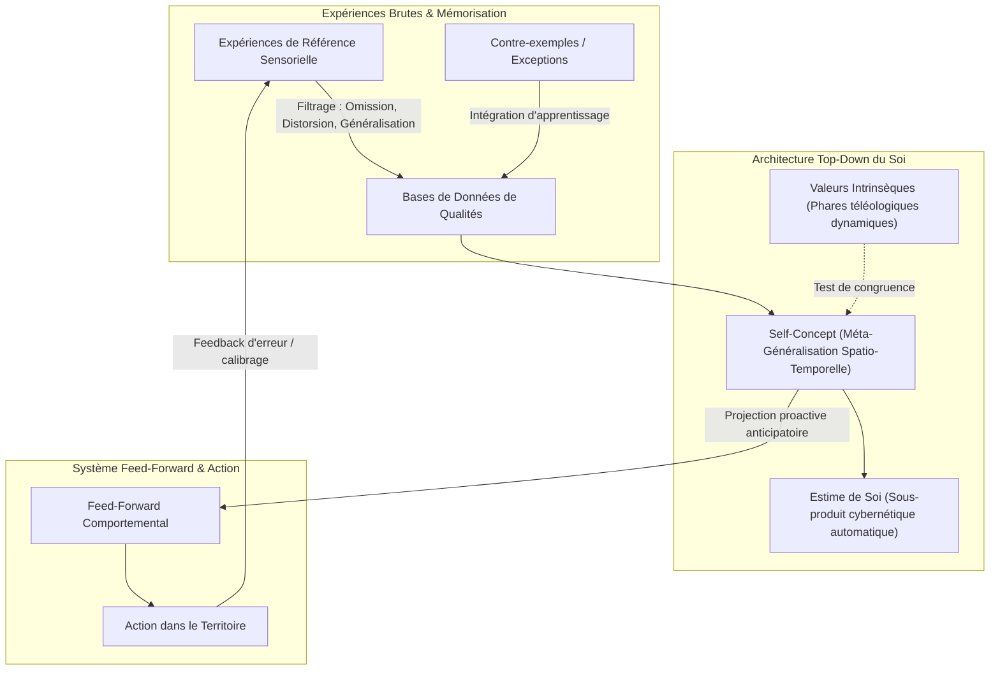

# Transforming Yourself - Foundations Demos
**Formateur :** Damon Cart | **ID :** `damon-cart-transforming-yourself-foundations-demos` | **Tranches :** 6

## Synthèse Architecturale du Cours : *Transforming Yourself - Foundations Demos* (Damon Cart / Steve Andreas)

---

### 1. Thèse Centrale & Philosophie du Cours

#### Posture et vision spécifique de Damon Cart vs Approche PNL standard
* **Dépassement du comportementalisme et de la technique contextuelle :** La PNL classique travaille massivement au niveau des comportements, des états et des déclencheurs contextuels (ancrages, recadrage en 6 pas, phobies, swish contextuel). Damon Cart, s'inscrivant dans la lignée de Steve Andreas, postule que corriger un comportement sans toucher à l'architecture identitaire crée des solutions friables ou compartimentées.
* **Le Self-Concept comme méta-généralisation cybernétique (*Self-Concepting*) :** Le « soi » n'est ni une entité biologique, ni une vérité mystique, ni une nominalisation figée, mais un processus actif continu (*self-concepting*). C'est une carte de compression d'expériences mémorielles fonctionnant en système *feed-forward* : elle dicte par anticipation les réponses comportementales avant même que l'événement ne survienne.
* **Refus des affirmations de surface et du narcissisme PNL :** Le cours s'oppose radicalement au paradigme du « fake it until you make it » et aux affirmations positives non ancrées (« I am a champion »). Toute affirmation contredisant la base de données interne déclenche une réponse immunitaire cognitive (rejet inconscient, polarisation interne, suppression d'énergie). Cart dénonce le piège de l'arrogance du praticien PNL qui gonfle artificiellement sa confiance sur une structure instable (*shaky*).
* **Épistémologie constructiviste du « Mensonge Utile » (*Useful Lie*) :** Aucune carte interne ne correspond à 100 % au territoire infini d'un être humain. L'objectif n'est pas de découvrir une « vérité objective » introuvable, mais de construire une représentation interne suffisamment précise, stable, résiliente et écologique pour soutenir l'action dans le monde réel.

#### Fil rouge méthodologique
Le fil rouge unifiant l'ensemble des démonstrations et interventions s'articule en une boucle cybernétique en trois temps :
1. **Dénominalisation & Extraction empirique :** Remplacer les abstractions rigides par des bases de données de souvenirs réels sensoriellement calibrés (*reference experiences*).
2. **Alignement vectoriel Top-Down :** Aligner les valeurs fondamentales (les phares directionnels intrinsèques vs introjectés) avec les qualités mémorielles du Self-Concept, rendant l'estime de soi automatique sans effort conscient.
3. **Stabilisation par boucle de rétroaction (Paradoxe d'Andreas) :** Structurer la qualité pour qu'elle intègre les contre-exemples et le feedback correctif au lieu de les rejeter, assurant une solidité inébranlable par plasticité adaptative plutôt que par blindage défensif.

---

### 2. Carte des Concepts & Leviers Émergents

#### Écosystème des concepts clés :

* **Dénominalisation (*Self-Concepting*) :** Restitution du statut de verbe actif au concept de soi. L'identité est un processus génératif en temps réel, reconfigurable par la méthode de tri des archives mnésiques.
* **Métabolisme Mnésique / Input Nutritionnel Cognitif :** Le système nerveux assimile les souvenirs comme le corps assimile les nutriments. Une identité toxique ou fragile résulte d'une mauvaise sélection des données d'entrée (ingestion aveugle de traumatismes ou jugements externes non filtrés).
* **Omniprésence Spatio-Temporelle :** Contrairement à une croyance contextuelle extérieure dont on peut s'éloigner, la croyance identitaire est omniprésente car l'observateur ne peut s'abstraire de lui-même. Elle contamine chaque perception sensorielle.
* **Valeurs Phares vs Carte du Soi :** Les valeurs sont dynamiques et projectives (ce vers quoi on tend) ; le Self-Concept est descriptif (ce que l'on est). L'estime de soi est le résultat spontané de la congruence entre les deux.
* **Inhibition Écologique de l'Inconscient (Autosabotage protecteur) :** Lorsque les buts poursuivis servent des valeurs introjectées (parents, validation sociale) en conflit avec les valeurs intrinsèques, l'inconscient coupe la dopamine et freine le sujet sur la ligne d'arrivée pour le préserver du désastre écologique.
* **Paradoxe de l'Arrogance :** L'arrogance et la rigidité ne sont pas un excès d'amour-propre mais la surcompensation défensive d'un Self-Concept fragile et non documenté par des faits.
* **Le Paradoxe d'Andreas (Durabilité vs Sensibilité) :** Les mécanismes neuro-cognitifs qui rendent un concept de soi robuste face aux chocs sont identiques à ceux qui le rendent immédiatement perméable et réactif aux erreurs : la précision sensorielle de l'erreur informe la qualité sans la détruire.
* **Matrice Compétence vs Confiance :** La confiance n'est pas un absolu mais un signal de calibration. Une haute compétence couplée à une basse confiance génère l'étouffement (*choke*) ; une basse compétence couplée à une haute confiance génère l'arrogance/illusion PNL. L'état optimal est l'alignement calibré.
* **Amnésie de Changement (*« Always Been This Way »*) :** Réorganisation instantanée de la mémoire autobiographique après recodage du Self-Concept : le cerveau projette la nouvelle règle sur toute la ligne temporelle passée, oubliant l'ancienne perception.

---

### 3. Tableau Récapitulatif des Techniques & Démonstrations

| Technique / Exercice | Objectif Opératoire | Déclencheur / Indication | Séquence Résumée |
|---|---|---|---|
| **Swish Identitaire Transcontextuel** *(Andreas / Cart)* | Installer une qualité de soi générative affranchie de tout comportement ou contexte spécifique. | Mauvaises habitudes tenaces, compulsions, échecs du Swish classique liés au changement de contexte. | 1. Identifier l'état/comportement limitant et son déclencheur visuel direct. 2. Créer une image idéale de soi **sans aucun comportement spécifique et hors contexte** (posture, rayonnement, qualité d'être pure ayant transcendé le problème). 3. Swish ultra-rapide du déclencheur vers l'image identitaire idéale. 4. Répétition dynamique jusqu'à ce que le déclencheur ouvre automatiquement la représentation de l'identité évoluée. |
| **Audit & Alignement Vectoriel Valeurs / Identité** | Résoudre l'autosabotage inconscient et rétablir la motivation motrice sans effort de volonté. | Procrastination chronique à l'approche du but, fatigue décisionnelle, sentiment de vide malgré la réussite. | 1. Éliciter la hiérarchie des valeurs contextuelles réelles (modèle dynamique/israélien vs statique). 2. Détecter et purger les valeurs introjectées (héritées/sociales poursuivant l'« other-esteem »). 3. Vérifier la triade de résonance somatique (ex. liberté + passion + joie). 4. Aligner le Self-Concept pour qu'il incarne l'expression directe de ces valeurs fondamentales. |
| **Dénominalisation & Cartographie du Self-Concept** | Transformer une identité figée et pathologique en un processus d'archivage mémoriel modifiable. | Croyances identitaires absolues (« Je suis nul », « Je suis incapable »), sentiment de fatalisme. | 1. Interrompre la nominalisation par le questionnement de structure (« Comment ton cerveau fait-il pour fabriquer cette idée en ce moment ? »). 2. Localiser spatialement la base de données des souvenirs validant la croyance. 3. Mettre en évidence les filtres actifs (omissions d'expériences réussies, distorsions narratives). 4. Requalifier l'identité comme une sélection nutritionnelle d'intrants modifiable à volonté. |
| **Neutralisation du Conflit d'Affirmation** | Éliminer la polarisation interne générée par les affirmations positives de surface. | Démotivation post-affirmations, voix critique interne violente (« C'est faux, tu mens »), dissonance cognitive somatique. | 1. Éliciter l'affirmation consciente non intégrée. 2. Calibrer immédiatement la réponse immunitaire inconsciente de rejet. 3. Stopper la suppression de la voix dissidente et écouter ses critères de réalité objectifs. 4. Remplacer l'affirmation verbale abstraite par l'alimentation méthodique de la base de données en micro-expériences de référence tangibles. |
| **Recalibrage Compétence / Confiance** | Réajuster la perception du soi sur le territoire réel pour dissoudre l'arrogance ou le trac paralysant. | Praticien ou client coincé dans l'arrogance défensive, ou expert tétanisé par un manque de confiance injustifié (*imposteur*). | 1. Cartographier le quadrant actuel du sujet dans la matrice (compétence réelle vs auto-représentation). 2. Si confiance > compétence : confronter au feedback sensoriel du territoire pour dégonfler l'illusion défensive sans briser la valeur d'apprentissage. 3. Si compétence > confiance : collecter et réindexer les expériences de maîtrise réelles oubliées par omission sélective. 4. Ancrer la nervosité/doute comme un signal de sagesse somatique d'ajustement cybernétique. |
| **Intégration des Contre-Exemples (Paradoxe d'Andreas)** | Rendre une qualité identitaire indestructible en l'immunisant contre l'échec et la rigidité. | Peur panique de l'erreur, identité en « verre » qui vole en éclats au premier contre-exemple, perfectionnisme toxique. | 1. Sélectionner une qualité du Self-Concept à stabiliser. 2. Cartographier la base de données de validation positive. 3. Introduire délibérément les contre-exemples réels (moments où le sujet n'a pas manifesté la qualité). 4. Modifier la structure spatiale et le sous-modalités des contre-exemples pour les intégrer comme *bornes de calibration et signaux d'apprentissage*, et non comme négations de la qualité globale. |

---

---

## 0. Sommaire Sémantique & Index des Lignes

- **Tranche 1 [Lignes 88-198]** : d'Amorçage Épistémique et Cadre d'Assimilation Linéaire (Foundations Priming Framework) — *Protocole :* d'Amorçage Épistémique et Cadre d'Assimilation Linéaire (Foundations Priming Framework) | *Mécanisme :* Dénominalisation du Concept de Soi en Processus Continu (Self-Concepting) | *Verbatim :* Présupposition d'Inevitabilité de l'Expérience Personnelle
- **Tranche 2 [Lignes 200-325]** : Enracinement des Qualités & Rétroaction Référentielle (Contre les Affirmations Vides) — *Protocole :* Enracinement des Qualités & Rétroaction Référentielle (Contre les Affirmations Vides) | *Mécanisme :* Le Métabolisme Mnésique du Self-Concept (L'Assimilation Expérientielle) | *Verbatim :* La Métaphore Nutritionnelle de l'Identité
- **Tranche 3 [Lignes 327-417]** : Audit et Arbitrage de Décision par Alignement des Valeurs — *Protocole :* Audit et Arbitrage de Décision par Alignement des Valeurs | *Mécanisme :* Le paradoxe de l'arrogance : Surcompensation d'un Self-Concept fragile | *Verbatim :* Recadrage de l'Arrogance
- **Tranche 4 [Lignes 419-583]** : Le Swish Identitaire Transcontextuel (Modèle Andreas / Cart) — *Protocole :* Le Swish Identitaire Transcontextuel (Modèle Andreas / Cart) | *Mécanisme :* Le Swish Décontextualisé et Non-Comportemental comme Germe de l'Identité | *Verbatim :* Le Pré-framing de l'Apprentissage par Expérience Directe
- **Tranche 5 [Lignes 585-693]** : Calibration & Recalibrage de la Matrice Compétence / Confiance — *Protocole :* Calibration & Recalibrage de la Matrice Compétence / Confiance | *Mécanisme :* Le Conflit d'Affirmation et la Fission Interne | *Verbatim :* La Fissure Inévitable des Affirmations Non Fondées
- **Tranche 6 [Lignes 695-843]** : d'audit et de dépollution comparative du Self-Concept (Clean Self-Statement) — *Protocole :* d'audit et de dépollution comparative du Self-Concept (Clean Self-Statement) | *Mécanisme :* Le piège de la comparaison hiérarchique vs. Modélisation de possibilité | *Verbatim :* Verbatim 1 : Le mécanisme de la comparaison et l'aveuglement progressif

---

## Extractions Détaillées par Tranche (Opératoire & Verbatim)

## Tranche 1 / 6 : d'Amorçage Épistémique et Cadre d'Assimilation Linéaire (Foundations Priming Framework)

Voici l'extraction et l'analyse modélisatrice intégrale de la tranche 1/6 du cours *Transforming Yourself - Foundations Demos* par Damon Cart.

---

### 1. Mécanismes & Principes Actifs

#### 1. Dénominalisation du Concept de Soi en Processus Continu (*Self-Concepting*)
- **Principe actif :** Le terme « concept de soi » est une nominalisation grammaticale trompeuse qui fige un verbe d'action en une entité statique (« une chose »). Le système nerveux ne possède pas d'organe ou d'objet interne nommé « concept de soi » : il s'agit d'un acte cognitif dynamique et ininterrompu de cartographie (*self-concepting*). En restituant son statut de verbe, le praticien annule l'illusion d'immutabilité biologique ou caractérielle du sujet. Si le concept de soi est une activité générative constante, il peut être réorienté, reconfiguré et mis à jour en temps réel par les mêmes filtres neurologiques (sélection, distorsion, généralisation) qui l'ont initialement construit.
- **Tags libres :** `#denominalisation_ontologique #self_concepting #processus_cognitif_dynamique #activite_vs_entite`

#### 2. La Métaphore Métabolique de la Matière Mémorielle (*Input Nutritionnel Cognitif*)
- **Principe actif :** Le système de croyance identitaire fonctionne par assimilation d'intrants expérientiels, à l'exact identique de l'assimilation biologique des nutriments cellulaires (« ce dont tu nourris ton corps devient ton corps »). Le contenu du concept de soi dépend des souvenirs et des micro-expériences sélectionnés, archivés et agrégés. Une identité défaillante ou vulnérable n'est pas une faille intrinsèque de l'individu, mais la conséquence d'un « régime d'encodage » non calibré où le système nerveux ingère des retours accidentels, des feedbacks parentaux erronés ou des traumatismes non traités sans discrimination préalable.
- **Tags libres :** `#metabolisme_memoriel #input_cognitif #assimilation_identitaire #nutrition_structurelle`

#### 3. Réduction Cartographique par Filtres Universels (Modélisation du Territoire Interne)
- **Principe actif :** La masse brute de stimuli sensoriels accumulée au fil des années excède la capacité computationnelle de l'attention consciente. Pour permettre la survie et l'action opérationnelle, le cerveau compresse les données via les trois filtres fondamentaux de la modélisation humaine : *omission* (suppression d'expériences incongruentes), *distorsion* (adaptation du sens pour correspondre au cadre préexistant) et *généralisation* (dérivation d'une loi universelle sur soi à partir d'échantillons restreints). Le concept de soi est ainsi une carte compressée du territoire subjectif. Modifier l'identité consiste à modifier la méthode de sélection et de compression de ces données mémorielles plutôt que de lutter contre la réalité matérielle.
- **Tags libres :** `#compression_cartographique #filtres_universels_pnl #omission_distorsion_generalisation #reduction_entropique`

#### 4. Le Concept de Soi comme Croyance Omniprésente Inescapable (*Spatiotemporal Generalization*)
- **Principe actif :** Contrairement à une croyance sur le monde extérieur (« le monde est hostile ») ou sur autrui (« les gens sont perfides »), dont l'impact somatique et émotionnel peut être atténué par l'évitement géographique ou le retrait relationnel (isolement sous une tente, rupture sociale), le concept de soi (« je suis mauvais », « je ne vaux rien ») est encodé au cœur du cadre de référence interne. Puisque l'observateur ne peut s'abstraire de lui-même, cette croyance s'applique à travers toutes les coordonnées spatiales et temporelles de l'individu. Elle contamine chaque perception sensorielle, chaque décision motrice et chaque interaction, formant la prophétie autoréalisatrice primaire du système nerveux.
- **Tags libres :** `#omnipresence_spatiotemporelle #croyance_inevitable #boucle_autorealisatrice_primaire #auto_contamination_perceptive`

#### 5. Contingence Aléatoire vs Ingénierie Consciente de l'Identité
- **Principe actif :** Dans la quasi-totalité des individus, la matrice identitaire résulte d'un agrégat statistique accidentel (*haphazard and accidental process*) : essais et erreurs inconscients dans l'enfance, introjection aveugle des jugements parentaux et scolaires, sédimentation d'expériences brutes sans tri qualitatif. Cette sédimentation aléatoire génère soit des pathologies de la limite (paranoïa par hyper-menace, narcissisme par blindage sans rétroaction), soit des effondrements contextuels (le concept de soi lâche prise au moment critique). L'intervention de Steve Andreas/Damon Cart remplace ce bricolage accidentel par une ingénierie délibérée d'agrégation de qualités stables.
- **Tags libres :** `#genese_accidentelle_vs_ingenierie #introjection_infantile #vulnerabilite_statistique #architecture_deliberee`

#### 6. Abandon du Mythe de la Vérité Objective au Profit du Mensonge Utile et Précis (*Useful Lie vs Accurate Lie*)
- **Principe actif :** Dès lors qu'aucune conscience humaine ne peut appréhender la « vérité objective absolue » d'un individu dans son infinité, toute identité déclarée est techniquement une construction fictive (une simplification réductionniste, ou « un mensonge »). Le système nerveux ne réagit pas à la vérité d'un fait, mais à la cohérence et à la directivité de sa carte interne. Dès lors, le critère d'évaluation d'un concept de soi n'est pas « Est-ce vrai ? », mais : « Est-ce un mensonge utile, écologique, fonctionnel et suffisamment précis pour soutenir l'action sans déconnecter l'organisme du feedback sensoriel de son environnement ? »
- **Tags libres :** `#epistemologie_constructiviste #mensonge_utile #carte_vs_territoire #verite_operationnelle`

---

### 2. Protocoles, Techniques & Démonstrations (Étape par Étape)

#### Protocole d'Amorçage Épistémique et Cadre d'Assimilation Linéaire (*Foundations Priming Framework*)

* **Intention / Indication :** 
  À utiliser obligatoirement en tout début de cycle de restructuration du concept de soi pour désamorcer la résistance intellectuelle, l'intellectualisation défensive des praticiens expérimentés et les tentatives de « sauter les étapes » par mimétisme prématuré.
* **Mise en place & Pré-framing :**
  - Fixer le cadre de la découverte empirique directe : interdiction formelle d'imiter le formateur ou d'anticiper le résultat via la théorie.
  - Déclarer la structure d'apprentissage comme cumulative et strictement linéaire.
  - Neutraliser l'illusion que le savoir déclaratif (savoir « pourquoi » / s'inspirer) produit une modification neurologique sans travail procédural (le « comment » / transpirer).

* **Séquence d'actions pas à pas :**
  1. **Ancrage du Rythme Métabolique d'Apprentissage :**
     - Calibrer le débit d'assimilation du sujet (ni trop rapide pour éviter la déperdition d'information somatique, ni trop lent pour éviter la rupture de chaîne synaptique) : typiquement 1 unité/jour ou tous les 2 jours, équivalent à un engagement d'une heure d'exploration quotidienne.
  2. **Interdiction de l'Imitation Modélisante Prématurée :**
     - Reléguer systématiquement les démonstrations externes à la fin du module d'exploration personnelle. L'exploration somatique du sujet doit précéder l'observation du modèle externe afin de protéger l'unicité de la carte subjective.
  3. **Différenciation Soi / Matrice Sociétale :**
     - Conduire le sujet à identifier les normes culturelles introjectées sans filtre : faire l'inventaire entre la sagesse accumulée utile et la stupidité/ignorance résiduelle maintenue par pure inertie de tradition.
     - Isoler les composantes identitaires qui appartiennent réellement aux choix de l'individu de celles dictées par l'appartenance de groupe.
  4. **Questionnement d'Ouverture des Espaces Neurologiques :**
     - Guider le sujet à travers 7 focalisations réflexives sans chercher de réponse verbale instantanée, afin d'activer les réseaux de recherche inconsciente :
       * *Qu'est-ce que ton concept de soi ?*
       * *À quoi sert-il exactement dans ton fonctionnement biologique et social ?*
       * *De quoi est-il constitué dans ton expérience sensorielle ?*
       * *Comment sais-tu qu'il existe et quels sont ses composants ?*
       * *Comment fonctionne sa machinerie interne ?*
       * *Quelle est la distinction structurelle exacte entre ton concept de soi et ton estime de soi ?*
       * *Quelle est la relation entre ton concept de soi individuel et l'expérience mystique/religieuse d'expansion ?*

* **Signes de calibration :**
  - **Suspension du jugement théorique :** Disparition des hochements de tête d'intellectualisation (« oui, je connais déjà ça ») au profit d'une focalisation interne (regard défocalisé, ralentissement de la respiration).
  - **Prise de conscience du vide procédural :** Le sujet constate qu'il est incapable de décrire *comment* il fabrique concrètement son identité dans l'instant présent, déclenchant un état de confusion réceptive propice à la réorganisation.

---

### 3. Heuristiques, Subtilités & "Sagesse du Praticien"

#### Règles Conditionnelles d'Intervention :
- **Si** le client a déjà un bagage important en PNL, hypnose ou développement personnel et veut sauter directement aux protocoles avancés ou aux démonstrations, **alors** interdis-lui formellement d'avancer et contrains-le à la linéarité stricte de l'exploration, **parce que** le concept de soi est un modèle cumulatif d'encodage sensoriel fin ; anticiper intellectuellement la mécanique empêche la calibration viscérale de ses propres sous-modalités.
- **Si** le sujet cherche une validation ontologique (« Est-ce que cette vision de moi est la vraie vérité ? »), **alors** recadre immédiatement vers l'utilité et la précision cartographique (*useful lie*), **parce que** rechercher la vérité objective dans le domaine de la conscience induit une régression infinie et une paralysie de l'action.
- **Si** le sujet présente une qualité floue, douteuse ou polarisée (« Parfois je suis confiant/créatif, parfois pas du tout »), **alors** ne tente pas d'annihiler le doute par suggestion positive, mais prépare la transformation des qualités ambiguës en certitudes solides alignées sur les valeurs fondamentales.
- **Si** le sujet tente de se définir par la négative ou par comparaison compétitive avec autrui (« Je ne suis pas comme X », « Je suis meilleur que Y »), **alors** interromps immédiatement le pattern, **parce que** la comparaison externe produit une vulnérabilité toxique permanente et encode une dépendance structurelle au contexte externe.
- **Si** le sujet montre une répugnance à explorer un trait de caractère qu'il déteste chez lui, **alors** recadre cette partie comme un gisement minier inexploité (*shadow resources*), **parce que** les aspects rejetés contiennent l'énergie brute, les contre-exemples et les critères nécessaires à l'équilibre du système.

#### Pièges Classiques & Erreurs de Débutant :
- **Le piège de l'inspiration sans transpiration (*Inspiration over Perspiration*) :** Croire qu'un atelier motivant, un état de grâce émotionnel temporaire ou la compréhension du « pourquoi » (Nietzsche) suffit à transformer le système nerveux. Sans le « comment » structural (micro-ajustements des sous-modalités et des bases de données mémorielles), l'effet s'estompe en quelques jours.
- **Confondre concept de soi et image de soi (*Self-Concept vs Self-Image*) :** Réduire l'identité à une simple représentation visuelle interne. Le concept de soi est multiversel : il intègre les canaux auditif (dialogue interne, intonation), kinesthésique (posture somatique, proprioception) et un mécanisme d'archivage temporel.
- **Confondre concept de soi et estime de soi :** Traiter l'estime de soi comme un levier primaire, alors qu'elle n'est qu'un sous-produit évaluatif secondaire de la congruence entre le concept de soi et les critères de valeurs.
- **La naïveté du « Pollyanna » :** Croire que développer un concept de soi positif implique de nier les erreurs, les dangers, les limites ou les injustices réelles. Un concept de soi robuste utilise les erreurs comme des données d'étalonnage pour renforcer son exactitude.

---

### 4. Pépites Verbatim & Patterns Linguistiques (MOT À MOT EN V.O.)

#### Pépite 1 : Présupposition d'Inevitabilité de l'Expérience Personnelle
> « I'm so looking forward to you having your personal transformations. My experience of using this model has been nothing short of extraordinary and that's one of the reasons why I am so happy to be sharing it with you right now. I don't expect that my experiences will be exactly like yours. You're going to have your own personal experiences. »
- **[Analyse du Pattern]** : Présupposition linguistique d'inévitabilité couplée à un marquage analogique de permission. Damon Cart n'utilise pas de conditionnel (« si vous avez une transformation »), mais une forme nominalisée orientée présent/futur (*« you having your personal transformations »*). En marquant la différence entre son expérience et celle du sujet (*« You're going to have your own personal experiences »*), il libère le système nerveux du client de la pression de conformité tout en enchâssant la certitude absolue qu'une expérience transformatrice aura lieu.

#### Pépite 2 : Métaphore Isomorphique de l'Équilibre Synaptique
> « You really want to set a pace for yourself that you're doing this on a regular basis. It's kind of like riding a bike. If you ride too fast, you might miss something. If you ride too slow, you might fall over. So set a realistic pace for yourself. »
- **[Analyse du Pattern]** : Utilisation d'un truisme métaphorique kinesthésique universellement partagé (faire du vélo). Le double lien d'encadrement (*« trop vite = manquer quelque chose »*, *« trop lent = tomber »*) réduit les choix comportementaux du sujet à une seule issue neurologiquement viable : maintenir le rythme régulier et constant prescrit par le formateur. La formule d'entrée *« You really want to... »* fonctionne comme une suggestion post-hypnotique directe déguisée en constat de désir personnel.

#### Pépite 3 : Commande de Suspension Épistémique et Autorisation Expérientielle
> « One of the things that Steve says and that I repeat in the training is the truth will be found in your experience. So I don't want you to take my experience. I want you to find your experience. And the only way that you're going to do that is by going step by step, one video at a time, exploring each exercise, each exercise is an exploration. And you're exploring your experience, your truth, you're exploring yourself. »
- **[Analyse du Pattern]** : Empilement de truismes et réduplication en boucle (*chiasme conversationnel*) : exploration -> expérience -> vérité -> soi-même. Damon Cart utilise l'injonction paradoxale du formateur qui refuse d'être cru (*« I don't want you to take my experience »*) pour forcer le basculement d'une attitude passive (consommation intellectuelle) vers une recherche transdérivationnelle active (*« find your experience »*). L'équation posée lie indissociablement la procédure (*« step by step »*) à l'identité intime du sujet (*« exploring yourself »*).

#### Pépite 4 : Suggestion Imbriquée d'Autonomie et d'Élargissement des Choix
> « This program can teach you how to strengthen the qualities in yourself that you like and change the qualities that you don't like so that you can have a much better and more satisfying life, you are actually going to learn this, you will have choices in your life about creating who you want to be that you've never had before, it will be no less extraordinary than this statement right here. »
- **[Analyse du Pattern]** : Progression d'un cadre de possibilité modale souple (*« can teach you »*) vers une déclaration de certitude future inconditionnelle (*« you are actually going to learn this »*, *« you will have choices »*). Le connecteur logique *« so that »* relie mécaniquement l'apprentissage de la méthode à une augmentation de la qualité de vie globale. La boucle se clôture par une autoréférence linguistique audacieuse (*« no less extraordinary than this statement right here »*) qui valide la promesse par le fait même de son énonciation dans le présent immédiat.

#### Pépite 5 : Dissociation du Contexte Spatiotemporel et Recadrage de l'Inescapabilité
> « Your self-concept is a belief you cannot escape, which is why self-concept is so important. It's even more important than your beliefs about others and the world. Why? Because your self-concept goes with you everywhere and affects everything you experience. If the world is a dangerous place and you believe that, you can escape from that... What if you feel like you're a bad person? What if you believe that you're a cruel person, a bad person, not a good person, whatever? It doesn't matter where you go. You can't escape yourself. »
- **[Analyse du Pattern]** : Contraste de polarité spatiale par induction de scénarios extrêmes. Cart oppose la possibilité de fuite physique face à un monde hostile (projection spatiale vers « le milieu de nulle part » / « sous une tente ») à l'impossibilité physique de fuir la matrice perceptuelle de l'observateur. En utilisant la formulation répétée en trépignement *« bad person, cruel person, not a good person »*, il active une résonance kinesthésique d'étouffement psychologique pour faire admettre comme une évidence absolue la nécessité d'intervenir chirurgicalement sur ce niveau logique.

#### Pépite 6 : Dénivellement Constructiviste et Recadrage du « Mensonge Utile »
> « The self-concept that you have now is only one of many possible ones that you could create from your wealth of experience, and that means you can change it whenever it doesn't serve you well... And in a sense, everything is a lie because you have to take a perspective on something. You can't know objective absolute truth. So is it a more or less useful lie? Is it a more or less accurate lie? »
- **[Analyse du Pattern]** : Rupture brutale de pattern épistémique par utilisation provocatrice du mot tabou *« lie »* (mensonge). En requalifiant toute identité de mensonge inhérent à la prise de perspective, Cart court-circuite d'un coup l'angoisse de l'imposteur ou la peur de « s'inventer une fausse personnalité ». La transition s'opère par une présupposition de choix multiple (*« only one of many possible ones »*) ancrée dans une ressource présupposée déjà présente (*« your wealth of experience »*). Le critère d'évaluation est déplacé de l'axe moral binaire Vrai/Faux vers l'axe cybernétique Écologique/Utile/Précis.

## Tranche 2 / 6 : Enracinement des Qualités & Rétroaction Référentielle (Contre les Affirmations Vides)

Voici l'extraction opératoire intégrale de la tranche 2/6 du cours *Transforming Yourself - Foundations Demos* de Damon Cart, selon vos règles strictes d'ingénierie modélisatrice.

---

### 1. Mécanismes & Principes Actifs

#### 1. Le Métabolisme Mnésique du Self-Concept (L'Assimilation Expérientielle)
* **Principe actif :** Tout comme l'organisme métabolise la nourriture ingérée pour construire sa matière biologique, le système nerveux utilise les expériences vécues et encodées en mémoire pour synthétiser l'identité. Le soi n'est pas une entité figée mais un produit continu de filtration. Comme le volume brut de données accumulées au fil des années dépasse la capacité de traitement du cortex conscient, le système nerveux applique automatiquement les métaprogrammes de modélisation du monde : omission (*deletion*), distorsion (*distortion*) et généralisation (*generalization*). L'identité résulte donc de la manière spécifique dont ces souvenirs sont regroupés et catalogués.
* **Tags :** `#metabolisme_identitaire` `#assimilation_mnesique` `#selection_collection` `#filtrage_cognitif`

#### 2. L'Épistémologie du « Mensonge Utile » (*Useful Lie*) & Abandon de la Vérité Absolue
* **Principe actif :** Aucune représentation interne ne peut être le territoire objectif. Le cerveau a besoin d'une carte comprimée et portative pour orienter ses comportements sans saturer ses ressources cognitives. Prétendre qu'une identité est « vraie » ou « fausse » dans l'absolu est une erreur neurologique ; toute identité est une réduction arbitraire. En désamorçant la quête d'une « vérité absolue » objective, le praticien neutralise les résistances cognitives du sujet : la carte n'a pas à être exacte à 100 %, elle doit être structurellement saine, stable et fonctionnelle pour la navigation existentielle.
* **Tags :** `#epistemologie_carte_territoire` `#mensonge_utile` `#relativisme_fonctionnel` `#reduction_mnemonique`

#### 3. L'Empilement aux Niveaux Logiques (Bateson) : Faits -> Qualités -> Self-Concept -> Estime
* **Principe actif :** L'architecture du soi repose sur un étagement de méta-niveaux d'abstraction :
  1. *Niveau de base (Base sensory data) :* Expériences sensorielles brutes et événements spécifiques.
  2. *Premier méta-niveau (Qualités) :* Généralisations transversales tirées des événements partageant un pattern commun (ex. : « Je suis une personne gentille/joyeuse »).
  3. *Deuxième méta-niveau (Self-Concept) :* Faisceau unifié intégrant l'ensemble des qualités généralisées en une entité globale (« Qui je suis »).
  4. *Troisième méta-niveau (Self-Esteem) :* Évaluation affective/jugement porté sur la généralisation globale du soi (« Est-ce que j'aime ou non qui je crois être ? »).
  Plus on monte dans les niveaux logiques, plus la généralisation est inclusive, mais plus la granularité contextuelle et les contre-exemples sont omis.
* **Tags :** `#niveaux_logiques_bateson` `#hierarchie_abstraction` `#empilement_qualites` `#meta_generalisation`

#### 4. La Relation Vectorielle Phare/Carte (Valeurs vs Self-Concept)
* **Principe actif :** Le Self-Concept est la carte descriptive statique (« Ce que je suis ») ; les valeurs sont les phares dynamiques orientés vers l'avant (« Ce qui compte pour moi dans l'expérience »). Chaque décision, émotion et action est une tentative inconsciente d'exprimer ou d'actualiser une valeur. L'estime de soi n'est pas un levier manipulable directement : c'est un sous-produit cybernétique automatique de la congruence entre les actes perçus par le Self-Concept et la hiérarchie des valeurs internes.
* **Tags :** `#valeurs_phares` `#vecteur_teleologique` `#congruence_cybernetique` `#alignement_identitaire`

#### 5. L'Inhibiteur Inconscient d'Accomplissement (L'Autosabotage Écologique)
* **Principe actif :** Lorsqu'un sujet poursuit des objectifs dictés par des valeurs empruntées (parents, conformisme social, quête d'approbation externe / « other-esteem »), le système inconscient détecte la dissonance avec les besoins écologiques profonds. Ne voulant pas sceller une trajectoire qui le rendra misérable, l'inconscient coupe la dopamine et l'énergie motrice à l'approche du but : il bloque l'individu sur la ligne d'arrivée. L'échec ou la procrastination agit comme un mécanisme de protection immunitaire de l'organisme.
* **Tags :** `#sagesse_inconsciente` `#inhibition_ecologique` `#dissonance_valeurs` `#autosabotage_protecteur`

#### 6. L'Étiologie Structurelle de l'Arrogance (Surcompensation de Fragilité)
* **Principe actif :** L'arrogance, l'égoïsme et la surgonflure de certitude ne résultent jamais d'un Self-Concept « trop fort », mais d'un Self-Concept structurellement instable (*shaky*). Face à un manque d'ancrage dans des expériences de référence réelles, le système nerveux surcompense en érigeant une façade de supériorité défensive. La véritable confiance est indexée sur la granularité sensorielle de l'expérience répétée dans le territoire, et non sur une posture narrative compensatoire.
* **Tags :** `#arrogance_reactionnelle` `#fragilite_structurelle` `#surcompensation_identitaire` `#fausse_confiance`

---

### 2. Protocoles, Techniques & Démonstrations (Étape par Étape)

#### Protocole : Enracinement des Qualités & Rétroaction Référentielle (Contre les Affirmations Vides)
Ce protocole démonstratif est enseigné par Damon Cart pour construire ou consolider une qualité identitaire chez soi ou chez un client (notamment les enfants ou les adultes ayant une basse estime issue de compliments déconnectés du réel).

* **Intention / Indication :** 
  * Sujet tentant de remonter son estime par des affirmations positives (« Je suis fort, je suis confiant ») qui sonnent creux.
  * Sentiment de « syndrome de l'imposteur », d'identité factice ou d'estime fragile.
  * Incapacité à ressentir la validité d'une qualité personnelle.
* **Mise en place & Pré-framing :**
  * Interdire formellement les affirmations d'auto-persuasion sans ancrage (« *Répéter "je suis heureux" quand on est au fond du trou est le moyen le plus irritant et inefficace d'aborder le problème* »).
  * Poser le cadre : une qualité n'est pas un dogme moral, c'est une généralisation logique issue d'actes vérifiables dans le monde sensoriel.
* **Séquence d'actions pas à pas :**
  * **Étape 1 : Diagnostic du méta-niveau actif**
    * Identifier la qualité revendiquée ou désirée (ex. : « Être quelqu'un de bon », « Être compétent », « Être courageux »).
    * Demander : *« Sur quelles expériences concrètes et spécifiques cette idée repose-t-elle ? »*
  * **Étape 2 : Élimination du compliment décontextualisé**
    * Cesser tout renforcement abstrait (ex. : bannir les formulations du type « Tu es doué », « Tu es un bon garçon »).
  * **Étape 3 : Liaison Rétrospective à une Expérience de Référence (Anchor-Linking)**
    * Connecter systématiquement la qualité postulée à une action sensoriellement observable passée à l'aide de la syntaxe causale : 
      * Formule : `[Qualité identitaire attribuée] + PARCE QUE + [Circonstance contextuelle précise] + [Choix comportemental autonome opéré sans contrainte externe]`.
      * Exemple d'application : *« Tu as cette qualité [de fiabilité/bonté] parce qu'hier, confronté au choix de rester jouer tard dehors, tu as décidé de rentrer de toi-même sans qu'on ait besoin de te le demander. »*
  * **Étape 4 : Sélection et Collecte Mnésique (Selection & Collection)**
    * Guider le sujet à fouiller dans son territoire mnésique pour extraire non pas un seul fait, mais un faisceau d'expériences similaires où le comportement a été incarné.
  * **Étape 5 : Intégration ascendante aux Niveaux Logiques**
    * Amener le sujet à constater le dénominateur commun : *« En observant l'ensemble de ces faits spécifiques, quelle qualité globale ton système nerveux peut-il honnêtement en déduire ? »*
  * **Étape 6 : Test de Résonance de l'Estime de Soi**
    * Vérifier l'état somatique résultant. L'estime monte d'elle-même sans forçage volontaire dès lors que la qualité est alignée sur une valeur réelle du sujet et vérifiée par des faits.
* **Signes de calibration :**
  * Disparition du rictus défensif ou de l'acquiescement purement intellectuel.
  * Ralentissement respiratoire, abaissement des épaules, ancrage postural (la personne « habite » physiquement l'affirmation au lieu de la surjouer).
  * Accès visuel mnésique franc (mouvements oculaires vers la remémoration sensorielle et non vers la construction d'une image idéale).

---

### 3. Heuristiques, Subtilités & "Sagesse du Praticien"

#### Heuristiques Conditionnelles du Praticien
1. **Règle de l'Inaccessibilité Directe de l'Estime :**
   * *SI* un client demande à « augmenter son estime de soi » ou « avoir confiance en lui »,
   * *ALORS* ne jamais travailler directement sur l'estime (qui n'est qu'une résultante évaluative),
   * *PARCE QUE* l'estime est le niveau logique 4 (l'évaluation). Il faut descendre au niveau 1 (les expériences de référence), vérifier au niveau 2 (les qualités généralisées) et aligner avec le système de valeurs (les phares).
2. **Règle de Détection des Valeurs Empruntées (La Victoire Amère) :**
   * *SI* un client rapporte un pattern d'atteinte d'objectifs suivi d'une joie éphémère (un jour) puis d'un vide dépressif (« Et maintenant ? »), ou une incapacité chronique à franchir la ligne d'arrivée malgré des compétences avérées,
   * *ALORS* suspendre le travail d'objectifs et faire une explicitation complète des valeurs,
   * *PARCE QUE* le client chasse des valeurs externes (« other-esteem » / validation des parents, de la société) et son inconscient freine écologiquement l'accomplissement d'une vie qui n'est pas la sienne.
3. **Règle du Marqueur Linguistique « Should » (Projection & Faux-Soi) :**
   * *SI* le sujet verbalise des injonctions avec le modal « Je devrais » (*I should*) ou l'impose aux autres (« Ils devraient »),
   * *ALORS* interrompre et requalifier immédiatement l'origine du pattern,
   * *PARCE QUE* le terme « should » est la signature linguistique d'une projection névrotique d'idéalisme ou de conformisme culturel créant le clivage du *Faux-Soi* (*false self*).
4. **Règle de l'Indulgence vs Accomplissement :**
   * *SI* le sujet craint que s'occuper de son propre Self-Concept soit « égoïste » ou « auto-indulgent » (*self-indulgent*),
   * *ALORS* recadrer par la distinction : *Auto-indulgence = Fuite / Échappatoire (drogues, bouffe, écrans, distraction) ; Accomplissement de soi = Alignement des actes sur les valeurs*,
   * *PARCE QUE* l'accomplissement réel d'un individu le rend fonctionnel, entier et bénéfique pour autrui, alors que la fuite le rend dépendant et toxique.
5. **Règle du Diagnostic de l'Arrogance :**
   * *SI* un sujet ou un praticien en PNL manifeste de l'arrogance, de la condescendance ou une posture de supériorité,
   * *ALORS* diagnostiquer immédiatement un Self-Concept structurellement fragile et poreux,
   * *PARCE QUE* l'arrogance est un mécanisme homéostatique de surcompensation pour masquer l'absence d'expériences de référence solides.

#### Pièges Classiques & Erreurs Détectées
* **Le piège des affirmations positives New Age :** Croire qu'en répétant « Je suis aimé / Je suis capable » devant un miroir, le cerveau va réécrire son identité. Sans base de données mnésique vérifiable, le système nerveux rejette l'injonction comme un corps étranger (analogie de l'élève américain classé 38e en maths mais premier en confiance illusoire).
* **Le piège de la comparaison sociale :** Utiliser autrui comme thermomètre de sa valeur. Cart prévient : dans la comparaison descendante ou ascendante non calibrée sur une saine émulation de compétences précises, on est assuré de perdre l'accès à son centre 50 % du temps et de générer de l'arrogance le reste du temps.
* **Le dogme de la toute-puissance en PNL :** Croire la propagande simpliste « Vous pouvez être qui vous voulez en claquant des doigts ». Le Self-Concept doit être taillé dans la substance des souvenirs réels réorganisés, pas dans une fantaisie déconnectée du réel somatique.

---

### 4. Pépites Verbatim & Patterns Linguistiques (MOT À MOT EN V.O.)

#### Pépite 1 : La Métaphore Nutritionnelle de l'Identité
> "Whatever your feeding this concept becomes the concept, so whatever your inputting becomes who you are. And that's really your personal experiences and your memories, and you have years and years of memories, so much information over the years that you've been alive, that you simply can't comprehend it all, so you have to organize it, you have to delete some parts of it, you distort some parts of it, and you generalize parts of it."
* **[Analyse du Pattern] :** Isomorphisme somatique et empilement de truismes métaphoriques. L'orateur couple une évidence biologique incontestable (la nourriture assimilée devient les cellules du corps) à un processus mental abstrait (les souvenirs filtrés deviennent le Self-Concept). L'induction prépare l'acceptation logique de la plasticité du soi : si le régime mnésique change, la structure de l'identité change obligatoirement.

#### Pépite 2 : Le Recadrage du « Mensonge Utile » (*The Useful Lie Reframing*)
> "And in a sense, everything is a lie because you have to take a perspective on something. You can't know objective absolute truth. So is it a more or less useful lie? Is it a more or less accurate lie? So when I say that, a lot of people don't like the sound of that, but you have to let go of absolute truth. You will never know what that is. I'm not saying that you should just make stuff up either, but what your self-concept is made of is a selection and collection of information and what you're going to learn is how exactly you do that."
* **[Analyse du Pattern] :** Rupture de pattern et désillusionnement thérapeutique (*De-nominalization & Provocative Reframing*). L'orateur attaque frontalement la nominalisation sacrée de « Vérité » pour la redéfinir sous l'étiquette péjorative de « mensonge », avant de créer une scission opérationnelle par un double choix : « Un mensonge plus ou moins utile / précis ». Ce mouvement désamorce l'attachement névrotique à l'identité passée, tout en introduisant la commande présupposée : *« You have to let go of absolute truth »*.

#### Pépite 3 : La Métaphore Nocturne du Phare et de la Carte
> "Your self-concept is the map of yourself. Your values are the headlights. Christiana Murty... once said, you have to become a light unto yourself in a dark world. The world can be very dark. It can feel very dark at times, especially when you don't have a sense of self, or you don't know where to go, or you don't know what to do. One thing is to know and understand what your values are. Your values shine the light and the dark. But if you don't know what they are, then you have no headlights."
* **[Analyse du Pattern] :** Métaphore spatio-temporelle cinématique et ancrage de contraste. Cart active d'abord l'état de vulnérabilité kinesthésique lié à l'obscurité (*« very dark », « don't know what to do »*), créant une tension dans le système nerveux. Il installe immédiatement la ressource sous forme d'analogie technologique élémentaire : la voiture dans la nuit. Le Self-Concept oriente (la carte), mais seules les valeurs rendent l'obstacle et la route visibles (les phares). L'utilisation de la citation philosophique (J. Krishnamurti) sert de caution archétypale pour autoriser le sujet à ne plus dépendre de la lumière d'autrui.

#### Pépite 4 : La Dénonciation du Piège de l'Injonction Vide
> "Given that self-esteem is the result of an evaluation of the self-concept, what do you think happens if you don't deal with self-concept, but you just try to help people feel good about themselves directly... And this happens a lot and if you've ever been really unhappy and somebody just comes to you and says, well, just be happy. You should just be happy. That person is probably the most irritating person in that moment... With self-esteem, unfortunately, what I see a lot is people using affirmations to try to build up their self-esteem. It's the same thing as trying to say, I'm happy, I'm happy, I'm happy... It just doesn't work that way."
* **[Analyse du Pattern] :** Questionnement socratique rhétorique suivi d'une régression expérientielle négative contrôlée. Damon Cart fait revivre à l'auditeur la sensation viscérale d'irritation ressentie face à une injonction absurde (« Sois heureux ») pour transférer cette même répulsion kinesthésique sur la pratique des « affirmations positives » artificielles. Cela nettoie le terrain cognitif de l'apprenant en disqualifiant définitivement le recours aux méthodes d'auto-suggestion superficielles.

#### Pépite 5 : Le Recadrage Fonctionnel de l'« Échec » comme Sagesse Inconsciente
> "Now, some of us won't even achieve the goal. And the reason for that is, it's not fulfilling our values. We're trying to fulfill the other values, the external values. And as a result, we can't quite cross the finish line because actually there's a deeper inner wisdom within us, saying, you know what, we don't want to succeed at this. This is like your unconscious, not wanting to succeed at something because it's not making you happy. It's making you miserable."
* **[Analyse du Pattern] :** Recadrage de sens en position méta (*Reframing Intent / Sleight of Mouth : Redéfinition*). L'incapacité à achever une tâche (traditionnellement labellisée comme paresse, manque de discipline ou échec personnel) est redéfinie comme la manifestation d'une « sagesse intérieure supérieure » (*deeper inner wisdom*). Ce pattern linguistique stoppe instantanément la boucle de culpabilité, réconcilie le sujet avec son inconscient et déplace l'axe du problème : l'obstacle n'est pas la volonté, mais l'inadéquation de la cible aux valeurs réelles du système.

## Tranche 3 / 6 : Audit et Arbitrage de Décision par Alignement des Valeurs

Voici l'analyse opératoire intégrale de la tranche 3/6 du cours *Transforming Yourself - Foundations Demos* de Damon Cart.

---

### 1. Mécanismes & Principes Actifs

#### A. Le paradoxe de l'arrogance : Surcompensation d'un Self-Concept fragile
* **Principe actif :** L'arrogance, l'égoïsme et la surconfiance ne proviennent pas d'un excès d'estime de soi ou d'un concept de soi "trop fort", mais d'une instabilité structurelle interne. Lorsque le concept de soi est instable (*shaky*), l'individu tente de compenser artificiellement cette fragilité en projetant une certitude rigide et défensive. En PNL, les praticiens débutants qui apprennent à manipuler leurs représentations internes tombent fréquemment dans ce travers : ils créent une façade d'invulnérabilité qui masque une base expérientielle friable. L'estime de soi authentique ne se travaille pas directement : elle émerge automatiquement dès lors qu'un concept de soi robuste est aligné avec les valeurs fondamentales de l'individu.
* **Tags :** #weak_self_concept #overcompensation_mechanism #arrogance_as_defense #automatic_self_esteem

#### B. Hiérarchie contextuelle vs Hiérarchies rigides de valeurs (Modèle Militaire Israélien)
* **Principe actif :** Contrairement au modèle rigide de la pyramide des besoins de Maslow, le système nerveux humain n'organise pas ses valeurs selon une hiérarchie statique et universelle. Une organisation fixe crée des conflits internes insolubles et de la rigidité comportementale. Le fonctionnement psychologique optimal opère selon une structure dynamique (analogue à l'armée israélienne vs l'armée américaine conventionnelle) : dans chaque contexte spécifique, la compétence ou la valeur la plus pertinente prend temporairement le commandement.
* **Tags :** #dynamic_value_hierarchy #contextual_primacy #maslow_reframing #cognitive_adaptability

#### C. Inhibition somatique par distorsion des valeurs (Valeurs Intrinsèques vs Valeurs Introjectées)
* **Principe actif :** L'adoption de valeurs externes (parents, culture, société) en contradiction avec les valeurs personnelles force le système nerveux à inhiber ses réponses neurobiologiques et émotionnelles naturelles. Cette inhibition chronique crée de l'incongruence, une chute de l'estime de soi et une souffrance psychologique mesurable. Lorsque Damon Cart a forcé son plan de carrière dans l'assurance sur la seule valeur de *liberté* en ignorant *passion* et *joie*, le système s'est grippé : une stratégie comportementale ne peut pas être durablement motrice si elle n'active qu'une seule composante d'un triade de valeurs majeures.
* **Tags :** #introjected_values #somatic_inhibition #value_misalignment #motivational_starvation

#### D. Le Concept de Soi comme Méta-Généralisation et Base de Données d'Expériences
* **Principe actif :** Le *Self-Concept* est une méta-généralisation catégorielle qui subsume des sous-généralisations appelées "qualités" (ex. être persistant, intelligent, créatif). Une qualité linguistique n'est pas un concept abstrait : c'est une étiquette pointant vers une base de données interne d'expériences mémorielles vécues à travers de multiples contextes et repères temporels. En tant que généralisation, une qualité possède nécessairement des contre-exemples (exceptions). La force d'un concept de soi sain réside dans sa capacité à intégrer les exceptions sans que la généralisation globale ne s'effondre.
* **Tags :** #meta_generalization #quality_database #experiential_encoding #counterexample_tolerance

#### E. Continuité Spatio-Temporelle et Système Feed-Forward (Anticipation Proactive)
* **Principe actif :** Le concept de soi est le cadre interne invariant qui stabilise l'organisme à travers l'espace et le temps. Face à un environnement totalement inconnu (nouveau pays, nouveau travail), le sentiment de familiarité du "Soi" empêche l'effondrement dans le chaos perceptif. De plus, il opère comme un système *feed-forward* : contrairement au *feedback* (qui évalue a posteriori l'expérience passée), le *feed-forward* projette la généralisation identitaire dans le futur, dictant par anticipation les réponses comportementales automatiques ("Puisque je suis persistant, j'agirai avec persistance demain").
* **Tags :** #spatiotemporal_continuity #feed_forward_system #invariant_internal_frame #predictive_identity

#### F. Cascade Top-Down des Niveaux Logiques (Bateson / Andreas)
* **Principe actif :** Le travail thérapeutique standard en PNL (phobies, désactivation d'ancres, mauvaises habitudes) opère au niveau contextuel et comportemental (niveaux logiques inférieurs). Ces changements restent souvent confinés à leur contexte déclencheur. À l'inverse, modifier une généralisation au niveau du Concept de Soi déclenche une cascade de réorganisations *top-down* : une modification identitaire modifie spontanément des comportements périphériques apparemment sans lien (ex. l'homme qui se percevait comme "pauvre" et dont la conduite automobile agressive et rapide disparaît instantanément dès qu'il recode son identité vers l'abondance).
* **Tags :** #top_down_reorganization #logical_levels #identity_cascade #cross_contextual_generalization

---

### 2. Protocoles, Techniques & Démonstrations (Étape par Étape)

#### Protocole : Audit et Arbitrage de Décision par Alignement des Valeurs

* **Intention / Indication :** À utiliser en cas de paralysie décisionnelle, de dilemme insoluble impliquant des pressions sociales contradictoires, ou face à l'impossibilité de satisfaire l'ensemble des parties prenantes ("conflit quadripartite").
* **Mise en place & Pré-framing :** Cadrer que chercher à plaire à tout le monde est une impossibilité mathématique et relationnelle. L'objectif n'est pas de garantir que le résultat extérieur soit parfait (le contrôle total n'existe pas), mais d'assurer l'intégrité interne et l'alignement somatique post-décisionnel ("pouvoir dormir la nuit").

* **Séquence d'actions pas à pas :**
  * **Étape 1 : Cartographie de la rupture d'alignement**
    Identifier la situation de blocage et expliciter l'impasse : lister ce que chaque partie exige et constater l'impossibilité de satisfaire l'intégralité des demandes sans se trahir.
  * **Étape 2 : Pas de recul & Isolement des Valeurs Personnelles**
    Faire prendre un recul physique ou spatial au sujet (*step back*). Poser la question de focalisation interne : *"Dans cette situation précise, qu'est-ce qui a fondamentalement de la valeur pour moi ?"*
  * **Étape 3 : Hiérarchisation contextuelle (Arbitrage)**
    Parmi les valeurs en jeu (ex. bienveillance vs intégrité/liberté), déterminer laquelle a la priorité d'action immédiate dans ce contexte précis.
  * **Étape 4 : Prise de décision unilatérale alignée**
    Arrêter la décision exclusivement basée sur cette valeur prioritaire, en acceptant explicitement le risque de décevoir autrui : *"Même si les retombées extérieures ne sont pas parfaites, j'agis selon ce que je valorise"*.
  * **Étape 5 : Test de congruence & Détection d'effets secondaires**
    Observer la dissipation des pressions externes. (Ex. : la personne manipulatrice manifestant un mécontentement finit par quitter d'elle-même la situation, révélant ses intentions réelles masquées).

* **Signes de calibration :**
  - Relâchement des tensions faciales et respiratoires lors de l'arrêt du besoin de plaire.
  - Posture de recul spontanée (*stepping back*) marquant la dissociation de la pression relationnelle directe.
  - Voix plus posée, disparition du doute agité au profit d'une détermination calme.

---

### 3. Heuristiques, Subtilités & "Sagesse du Praticien"

* **Règle de l'Arrogance :** *Si le client ou le praticien affiche une confiance ostentatoire, rigide ou arrogante -> alors ne jamais supposer un excès d'estime de soi, mais explorer la fragilité sous-jacente du Concept de Soi qui compense un sentiment de vulnérabilité.*
* **Règle de Priorisation Émergente :** *Si deux valeurs semblent s'affronter dans une situation -> ne cherche pas une règle hiérarchique absolue (style Maslow) ; calibre le contexte spécifique et applique la primauté contextuelle (style armée israélienne) : quelle valeur doit prendre le commandement ici et maintenant ?*
* **Règle du Test de Réalité de la Qualité :** *Si le client pense qu'une qualité doit être absolue (100% du temps) pour être réelle -> recadre immédiatement : une généralisation saine contient obligatoirement des exceptions. La persistance aveugle devient de l'obstination toxique ; savoir abandonner quand cela ne fonctionne plus fait partie de la maturité du système.*
* **Règle de Sécurité Écologique (Effet Papillon Identitaire) :** *Si tu modifies une sous-généralisation (qualité) au niveau du concept de soi -> prépare-toi à observer des répercussions comportementales massives et imprévisibles dans des domaines sans rapport direct (comme la conduite automobile changée par le recadrage de la pauvreté). Toujours vérifier l'écologie globale avant d'ancrer le changement.*
* **Règle du Swish Pattern d'Andreas :** *La majorité des instituts de PNL enseignent le Swish de façon incorrecte en le réduisant à une modification visuelle mécanique sous-modalitaire, ignorant qu'il s'agit fondamentalement d'un mécanisme de bascule d'identité et de compulsion vers un Concept de Soi désiré.*

---

### 4. Pépites Verbatim & Patterns Linguistiques (MOT À MOT EN V.O.)

#### Pépite 1 : Recadrage de l'Arrogance
> "Arrogance, overconfidence, egocentric behavior are signs of a weak self-concept. A person when a person acts this way, it means their self-concept is actually very shaky. And so what they're doing is they're overcompensating by becoming arrogant, by becoming overconfident and egocentric."
* **[Analyse du Pattern] :** **Équivalence complexe redéfinie (Redéfinition de critère).** Damon Cart brise la croyance commune ("arrogance = trop d'assurance") en liant directement le comportement arrogant à un prédicat opposé (*weak/shaky self-concept*). L'utilisation de *"what they're doing is they're overcompensating"* retire la valeur morale de l'arrogance pour la requalifier en simple tentative homéostatique maladroite.

#### Pépite 2 : Normalisation de la décision basée sur les valeurs
> "And even if I'm wrong, well, that's the best I can do in any situation is act on what I value, act and make decisions based on what I value. And it was one of the best decisions I had ever made."
* **[Analyse du Pattern] :** **Prémisse de déculpabilisation & Truisme d'intention.** La clause concessive *"even if I'm wrong"* désamorce l'exigence perfectionniste du résultat. La formule *"that's the best I can do"* installe une contrainte logique indiscutable qui recentre l'autorité de validation à l'intérieur du sujet, transformant l'erreur possible en succès d'intégrité.

#### Pépite 3 : Recadrage métaphorique de la flexibilité des valeurs
> "If say a platoon suddenly finds itself in the jungle, the person who knows the most about jungle warfare suddenly steps up and becomes the commanding officer. This is how you work internally. And if you try to stick too rigidly to values as a certain hierarchy and prioritization, you're not going to be as flexible and as adaptable to different situations."
* **[Analyse du Pattern] :** **Isomorphisme métaphorique & Métamodèle analogique.** Damon Cart transfère la dynamique de commandement tactique à la dynamique psychique intra-personnelle (*"This is how you work internally"*). L'analogie déloge l'illusion d'une hiérarchie pyramidale rigide au profit d'un leadership distribué des sous-parties de la personnalité en fonction des exigences de l'environnement.

#### Pépite 4 : La structure fractale du mot "Qualité"
> "When I say that, persistence is just a generalization. It represents the word represents a quality which represents a database of experiences of being persistent with different people, in different contexts, in different situations, and even subjects over many years."
* **[Analyse du Pattern] :** **Dégénéralisation récursive (Nominalisation ramenée à sa base d'encodage sensoriel).** Cart défait la nominalisation figée *"persistence"* en la rétro-gradant : mot $\rightarrow$ qualité $\rightarrow$ base de données d'expériences indexées spatio-temporellement. Il force l'interlocuteur à ouvrir les dossiers mnésiques sensoriels sous-jacents au lieu de manipuler une étiquette linguistique vide.

#### Pépite 5 : Rupture temporelle et continuité de l'identité
> "Everything is so different, but you still refer to your younger self as you."
* **[Analyse du Pattern] :** **Présupposition de l'invariance identitaire.** Cart contraste un empilement de disparités extrêmes (pensées, croyances, corps de l'enfance vs adulte) avec la conjonction d'opposition *"but"*, pour amener le système nerveux du client à heurter la réalité de l'observateur invariant : le "Soi" qui unifie la ligne temporelle.

## Tranche 4 / 6 : Le Swish Identitaire Transcontextuel (Modèle Andreas / Cart)

Voici l'extraction et la modélisation intégrale de la substance opératoire de cette tranche 4/6.

---

### 1. Mécanismes & Principes Actifs

#### A. Le Swish Décontextualisé et Non-Comportemental comme Germe de l'Identité
- **Principe actif :** Dans le *Swish Pattern* standard, l'image cible intègre souvent un comportement de substitution dans un contexte précis (ex. se voir faire de la musculation à la salle au lieu de fumer). Steve Andreas a démontré la faille neuro-cognitive de cette approche : lier l'image idéale à un comportement contextuel conditionne le déclencheur (si l'envie survient au milieu de la nuit, le sujet ne peut pas aller à la salle, le pattern se brise et l'automatisme compulsif reprend). À l'inverse, projeter une **image de soi idéale, sans comportement spécifique et hors contexte** force le système nerveux à encoder une qualité d'identité pure (« qui je suis devenu après avoir transcendé ce problème »). Cette représentation non restreinte se généralise spontanément à tous les contextes d'existence. C'est cette découverte sur le Swish qui a conduit Steve Andreas à modéliser la structure complète du Self-Concept.
- **Tags émergents :** `#swish_decontextualise` `#generalisation_identitaire` `#image_ideale_amorphe` `#transcontextualite` `#depassement_du_comportement`

#### B. La Cybernétique du Self-Concept : Boucle Récursive et Système Feed-Forward
- **Principe actif :** 
  1. *Dualité Sujet/Objet :* Dans la grammaire mentale de l'identité, le soi est simultanément le sujet qui observe/construit la représentation et l'objet représenté. Cette autoréférence crée une boucle fermée récursive (*closed loop*) : l'évaluation qu'un sujet porte sur lui-même modifie immédiatement l'état et les comportements du système qui évalue.
  2. *Feed-Forward vs. Feedback :* Un système à simple rétroaction (feedback, métaphore du thermostat) réagit uniquement aux écarts a posteriori pour maintenir un état existant : il est homéostatique et incapable d'évolution. L'être humain dispose d'un système proactif (*feed-forward*) : une projection dans le futur d'une qualité ou d'un état désiré qui tire l'organisme en avant (*propelling system*), servant de mire de guidage bien avant que l'expérience concrète n'ait eu lieu. Le Self-Concept agit comme un système feed-forward qui façonne le comportement en amont.
- **Tags émergents :** `#cybernetique_identitaire` `#feed_forward_system` `#autoreference_recursive` `#boucle_sujet_objet` `#planification_retrograde` `#downside_planning`

#### C. L'Échec Neuro-Sémantique des Affirmations Non-Ancrées
- **Principe actif :** Répéter une affirmation verbale (« Je suis un être humain formidable », « Je réussis tout ») sans la raccorder à des bases de données d'expériences de référence (*reference experiences*) produit deux écueils majeurs :
  1. *Absence de structure somatosensorielle :* Une déclaration purement verbale ne possède aucune « matière » neurologique (submodalités, kinesthésie vécue). Au premier stimulus environnemental contradictoire (un klaxon, une insulte), l'édifice s'effondre.
  2. *Incongruence et clivage interne :* Si l'affirmation contredit les critères réels du sujet, l'inconscient génère un signal d'incongruence (« Non, c'est faux »). Tenter de maintenir l'affirmation force le sujet à réprimer cette partie, générant un conflit interne qui disperse l'attention et induit de la souffrance.
- **Tags émergents :** `#fragilite_des_affirmations` `#reference_experiences` `#clivage_incongruent` `#ancrage_empirique` `#poids_somatosensoriel`

#### D. L'Amnésie de Changement (« Always Been This Way »)
- **Principe actif :** Lors d'une restructuration réussie du concept de soi, le changement de compréhension interne est quasi-instantané. Parce que le cerveau humain réorganise son modèle du monde au présent, une fois la nouvelle généralisation installée, le système rétro-projette cette évidence sur l'ensemble de la ligne temporelle. Le sujet oublie qu'il a pensé autrement (« Ça a toujours été comme ça »).
- **Tags émergents :** `#amnesie_pnl` `#retroprojection_temporelle` `#mutation_instantanee_du_sens` `#reecriture_biographique_inconsciente`

#### E. Les Critères Fondateurs d'un Self-Concept Sain
- **Principe actif :** Steve Andreas a modélisé l'identité selon 6 critères structurels :
  1. *Durabilité / Résilience :* Capacité à maintenir la solidité de la qualité face aux déstabilisations extérieures.
  2. *Précision (Accuracy) :* Adéquation fonctionnelle entre la carte interne et le territoire (les comportements réels perçus par autrui), sans inflation mégalomane.
  3. *Auto-correction & Sensibilité au Feedback :* Capacité à détecter les déviations par rapport à ses valeurs sans effondrement identitaire, pour ajuster son action.
  4. *Inconscient & Automatique (Flow) :* Fonctionnement spontané sans hyper-vigilance réflexive (*non self-conscious*).
  5. *Connexion vs Séparation :* Posture de bienveillance et d'empathie envers autrui plutôt que de comparaison hiérarchique.
  6. *Absence d'Arrogance / Égotisme :* L'estime de soi authentique ne requiert aucune supériorité défensive.
- **Tags émergents :** `#criteres_andreas` `#durabilite_resiliente` `#precision_cartographique` `#auto_correction_cybernetique` `#performance_en_flux` `#connexion_non_egotique`

---

### 2. Protocoles, Techniques & Démonstrations (Étape par Étape)

#### A. Le Swish Identitaire Transcontextuel (Modèle Andreas / Cart)
* **Intention / Indication :** Neutralisation d'une compulsion comportementale tenace (tabagisme, boulimie, tics, réactions impulsives) et généralisation d'une identité ressource.
* **Mise en place & Pré-framing :** Cadrer que l'objectif n'est pas de remplacer un comportement par un autre comportement, mais de faire basculer le système nerveux vers l'identité de « celui/celle qui a déjà transcendé cette problématique ».
* **Séquence d'actions pas à pas :**
  1. *Image déclencheur (Cue Image) :* Identifier l'image associée au stimulus compulsionnel (vue à travers ses propres yeux, associée, grand format).
  2. *Image cible d'identité (Self-Concept Target) :* 
     - Construire une image de soi dissociée (se voir soi-même là-bas).
     - **Règle absolue :** Ne placer **aucun comportement spécifique** (ne pas se voir faire du sport, méditer, etc.) et **aucun contexte précis** (fond neutre/ouvert).
     - Encoder dans cette image la posture, l'expression et le rayonnement de la personne qui a résolu ce problème et qui incarne cette ressource partout dans sa vie.
  3. *Exécution cinétique du Swish :*
     - Faire rétrécir et assombrir l'image déclencheur.
     - Faire jaillir du lointain l'image cible d'identité qui grandit, devient lumineuse et s'impose instantanément (effet *Swish*).
  4. *Pause / Rupture d'état (Break State).*
  5. *Répétition :* Répéter la boucle 5 à 7 fois à vitesse croissante jusqu'à automatisme.
* **Signes de calibration :** Impossibilité pour le sujet de reconvoquer l'image compulsionnelle sans que l'image ressource n'apparaisse spontanément ; relâchement musculaire des épaules ; dilatation pupillaire ; sourire d'évidence.

---

#### B. La Rétro-Ingénierie de Vision (« Downside / Backwards Planning »)
* **Intention / Indication :** Déploiement du système feed-forward pour des objectifs majeurs (financiers, reconversion, transformation identitaire).
* **Mise en place & Pré-framing :** Utiliser la métaphore du programme Apollo de la NASA : on ne part pas du présent pour tâtonner vers l'avenir ; on s'établit dans l'état final désiré et on regarde en arrière.
* **Séquence d'actions pas à pas :**
  1. *Projection Feed-Forward :* Projeter sa conscience dans le futur à l'instant où l'identité/objectif est pleinement matérialisé (ex. dans 1 an, dans 5 ans).
  2. *Incarnation de l'état :* Prendre la posture physique et le filtre perceptif de cette version de soi qui a réussi.
  3. *Rétro-planification (Backwards Stepping) :* Depuis ce futur, regarder vers le présent et identifier les étapes intermédiaires franchies à rebours :
     - « Qu'ai-je mis en place juste avant d'atteindre ce point ? »
     - « Quelle étape a précédé celle-ci ? »
  4. *Raccordement au Présent :* Tracer la trajectoire continue jusqu'au moment présent pour définir l'action immédiate alignée.
* **Signes de calibration :** Respiration plus lente et profonde, regard orienté vers le haut (visuel construit/projeté), puis focalisation kinesthésique stable.

---

#### C. L'Élicitation Rétroactive des Croyances du Monde vers le Soi
* **Intention / Indication :** Lorsqu'un sujet externalise son problème (« Le monde est toxique/écrasant », « La situation économique est impossible »).
* **Mise en place & Pré-framing :** Cadrer que toute affirmation sur la nature du monde est un miroir projeté du concept de soi.
* **Séquence d'actions pas à pas :**
  1. Recueillir le jugement absolu sur l'environnement externe : « Le monde est [X] ».
  2. Appliquer la question de retournement : *« Que dois-tu nécessairement croire à propos de toi-même pour croire que le monde est ainsi ? »*
  3. Calibration du choc cognitif et du recentrage somatique.
  4. Isoler la croyance identitaire sous-jacente (ex. « Si le monde est écrasant, c'est que je suis petit et impuissant »).
  5. Transférer le travail thérapeutique : quitter le débat sur le monde pour restructurer la qualité identitaire.
* **Signes de calibration :** Rupture de pattern verbal, arrêt de l'argumentation externe, regard qui descend en kinesthésie interne ou fixité transique.

---

#### D. La Décharge Graphomotrice Post-Séance (Protocole des 3 Pages)
* **Intention / Indication :** Intégration neurologique, bypass de l'amnésie post-changement et traçabilité de l'évolution du concept de soi.
* **Mise en place & Pré-framing :** Écriture manuscrite obligatoire (pas de clavier, pour mobiliser l'encodage kinesthésique et proprioceptif moteur).
* **Séquence d'actions pas à pas :**
  1. Rédiger 3 pages immédiatement après une intervention ou un module.
  2. Prendre l'inventaire brut : croyances sur le monde, croyances sur soi, situation financière, relations.
  3. Déposer le flux sans censure réflexive ni jugement académique (*free writing*).
  4. Mettre sous scellés et relire uniquement à la fin du cycle pour briser l'illusion que « j'ai toujours été ainsi ».
* **Signes de calibration :** Fluidité d'écriture, décharge émotionnelle, clarté mentale accrue.

---

### 3. Heuristiques, Subtilités & "Sagesse du Praticien"

#### Règles Conditionnelles d'Intervention
- **Règle de Transcontextualité du Swish :** *Si* tu installes une image de ressource pour contrer une compulsion, *alors* interdis rigoureusement tout contexte physique ou comportement concret dans cette image, *parce que* sinon le pattern s'effondrera dès que le sujet se trouvera hors contexte ou incapable d'exécuter ledit comportement.
- **Règle du Contre-Exemple aux Affirmations :** *Si* un sujet utilise des affirmations positives verbales et stagne ou s'angoisse, *alors* cesse immédiatement la méthode coué et fais-lui chercher des contre-exemples et des expériences de référence réelles, *parce que* l'affirmation non incarnée génère une résistance interne inconsciente (clivage du moi).
- **Règle de la Focalisation Négative Inversée :** *Si* le sujet focalise sur ce qu'il veut éviter (« Je ne veux pas être nerveux sur scène »), *alors* fais-lui remarquer qu'il force son système récursif à concevoir la nervosité (en image, son ou sensation somatique), ce qui programme directement l'attitude maladroite ou anxieuse dans le feed-forward.
- **Règle du Diagnostic Monde/Soi :** *Si* le client se plaint d'une impuissance face à une réalité externe immuable, *alors* ne débats jamais sur la réalité du monde ; demande-lui ce que cette vision l'oblige à croire sur son identité.

#### Pièges et Erreurs Corrigés
- **L'illusion du changement progressif de sens :** La phase préparatoire (l'apprentissage, l'accumulation de données) peut être longue, mais le basculement de la compréhension (*insight*) est **instantané**. Le praticien ne doit pas s'attendre à une transition graduelle au moment du recadrage identitaire : c'est un saut quantique neurologique.
- **Le piège de la carte exhaustive :** Rechercher une précision à 100 % dans le concept de soi est une erreur pathologique. La carte doit éliminer des détails pour être exploitable. Le critère est : *« Est-elle suffisamment précise pour être fonctionnelle et validée par le feedback de l'environnement ? »*.
- **La fausse force de l'arrogance :** L'arrogance et le sentiment de supériorité ne sont pas les signes d'un concept de soi fort, mais au contraire la preuve d'un concept de soi fragile, rigide et incapable d'intégrer le feedback externe.

---

### 4. Pépites Verbatim & Patterns Linguistiques (MOT À MOT EN V.O.)

#### Pépite 1 : Le Pré-framing de l'Apprentissage par Expérience Directe
> « ...this, and it's starting to sound a little confusing, don't worry, we're just going through some basic concepts here, you're actually going to experience this, which is going to be a much easier way to learn and a much better and faster way to learn... »
- **[Analyse du Pattern]** : 
  - *Utilisation de la confusion :* Validation de la confusion cognitive naissante immédiatement suivie d'une suggestion de réassurance (*« don't worry »*), désamorçant le jugement critique de l'hémisphère gauche.
  - *Truisme et double lien temporel :* L'emploi de *« actually going to experience this »* présuppose l'inévitabilité de l'expérience pratique.
  - *Empilement de comparatifs implicites :* L'accumulation d'adjectifs comparatifs de supériorité (*« much easier »*, *« much better »*, *« faster »*) installe une attente inconsciente d'assimilation accélérée et sans effort dès que la phase expérientielle débutera.

---

#### Pépite 2 : La Métaphore Cybernétique du Thermostat et du Feed-Forward
> « Steve uses this great metaphor, which is thermostat. We set it to a certain temperature, and then that temperature goes beyond below or above depending on if you're heating or cooling your place. That's when the thermostat knows to kick on. That's a feedback system. A feed-forward system is projecting in out there to what you want to become. So if you only have feedback systems, you're going to stay in the same place. »
- **[Analyse du Pattern]** :
  - *Métaphore isomorphique de limitation :* L'analogie mécanique du thermostat ancre avec une clarté viscérale l'impuissance structurelle du développement personnel fondé uniquement sur la correction d'erreurs (feedback) : cela ne sert qu'à maintenir le statu quo homéostatique.
  - *Création d'un vide structurel :* En énonçant la conséquence inévitable (*« you're going to stay in the same place »*), Damon Cart génère un contraste saisissant qui force l'esprit du sujet à rechercher une issue, introduisant le concept de *feed-forward* comme l'unique vecteur d'expansion et de libération du potentiel.

---

#### Pépite 3 : La Commande de Latence Inconsciente (Natural Drift)
> « So think about that. Think about not even having to think about who you're trying to become all the time. It doesn't even have to be so conscious. Once we program in a quality of how you want to be and we create that feed-forward system, which I'm going to show you how to do, you don't have to be so conscious of it. You will naturally do it. »
- **[Analyse du Pattern]** :
  - *Double négation et boucle récursive :* *« Think about not even having to think... »* surcharge l'attention réflexive en lui demandant de conscientiser sa propre absence, induisant une décharge de l'effort conscient (transe légère).
  - *Fractionnement conscient/inconscient :* Séparation nette des rôles entre le conscient et l'inconscient (*« It doesn't even have to be so conscious »*).
  - *Présupposition temporelle et impératif dissimulé :* *« Once we program in... »* présuppose que la programmation va avoir lieu sans aucun doute possible.
  - *Suggestion d'inévitabilité :* La formulation *« You will naturally do it »* court-circuite le doute volontaire en liant le comportement futur à une force organique et passive (*« naturally »*).

---

#### Pépite 4 : La Boucle Récursive Sujet/Objet du Soi
> « When I make an image of myself, I'm the maker of the image and that which the image represents. I'm both a subject and object in this process and a closed loop that both refers to itself and acts on itself. So soak that in, your self-concept both refers to itself and acts on itself. »
- **[Analyse du Pattern]** :
  - *Distinction linguistique paradoxale :* Déconstruction de la polarité sujet/objet de la grammaire conventionnelle pour révéler la nature autoréférentielle de l'esprit.
  - *Suggestion post-hypnotique d'imprégnation :* L'impératif sensoriel kinesthésique *« So soak that in »* (littéralement : imprègne-toi de cela, absorbe cela comme une éponge) ordonne à l'inconscient d'intégrer le principe sous le seuil de l'analyse logique superficielle.

---

#### Pépite 5 : La Question de Rétro-Projection Déstabilisante
> « For example, if you think the world is overwhelming, that's probably because you think of yourself as small and powerless. If you have that belief, what belief about yourself would have to be in place in order for you to believe that? It's a very good question to ask yourself, what do I have to believe in order to believe that? »
- **[Analyse du Pattern]** :
  - *Reframing de cause à effet :* Inversion de la flèche de causalité ; ce qui était vécu comme une propriété de l'univers (*« the world is overwhelming »*) devient une conséquence directe d'une auto-attribution identitaire (*« small and powerless »*).
  - *Présupposition de nécessité logique :* L'utilisation de l'opérateur modal de nécessité *« would have to be in place in order for you to believe that »* contraint le sujet à remonter à la racine de son axiome inconscient, détruisant l'alibi de l'impuissance extérieure.

---

#### Pépite 6 : La Métaphore de la Jungle et de la Boussole Identitaire
> « Life can also be a confusing and uncomfortable and chaotic place. So what you need is if you can imagine being dropped off in a jungle just like anywhere and you're completely lost, you don't know who you are, you have amnesia, you don't know where you are, that's going to be a really scary place to be... Imagine having a strong self-concept, which is sort of like your inner compass, you know where you've been, you know where you want to go, so if you get dropped in a jungle, you may not know exactly where you are as far as the location, but you know who you are within yourself, and you know where you want to go. »
- **[Analyse du Pattern]** :
  - *Régression métaphorique et induction d'insécurité :* L'évocation d'un largage en pleine jungle avec amnésie réveille un état d'alerte somatique archaïque (perte de repères, panique).
  - *Ancrage spatial de la ressource :* Introduction immédiate du concept de soi sous la forme symbolique de la « boussole intérieure » (*inner compass*). 
  - *Recadrage d'invariance :* La distinction entre la désorientation géographique (externe, triviale) et l'orientation identitaire (interne, fondamentale) offre au sujet une ancre de souveraineté absolue : l'environnement peut être chaotique, la cohérence interne demeure inaltérable.

## Tranche 5 / 6 : Calibration & Recalibrage de la Matrice Compétence / Confiance

### 1. Mécanismes & Principes Actifs

#### A. Le Conflit d'Affirmation et la Fission Interne
* **Principe actif :** Lorsque le conscient verbalise une proposition identitaire en désaccord avec les critères et la base de données interne du sujet (*"I am super successful"* alors que les critères ne sont pas remplis), le système nerveux ne l'intègre pas : il déclenche une réponse immunitaire cognitive. Une partie inconsciente oppose un démenti immédiat (*"No, you're not"*). Le sujet est contraint de supprimer activement cette partie dissidente. Cette suppression consomme des ressources attentionnelles, fragmente l'identité et génère de la souffrance psychique par division de l'attention et polarisation interne.
* **Tags :** `#affirmation_rejection` `#internal_conflict` `#cognitive_dissonance` `#suppression_polarization` `#divided_focus`

#### B. La Matrice Compétence vs Confiance (Calibrage Réel / Auto-Représentation)
* **Principe actif :** La confiance n'est pas une fin en soi mais un *mécanisme de retour d'information* (feedback signal). Damon Cart formalise quatre quadrants de couplage entre compétence objective et niveau de confiance :
  1. *Basse Compétence / Basse Confiance :* Précision optimale. Le sentiment de nervosité est la manifestation somatique de la sagesse interne signalant l'absence de base d'expérience pour éviter la mise en danger.
  2. *Haute Compétence / Haute Confiance :* Alignement congru et boucle d'apprentissage auto-renforçante ascendante.
  3. *Haute Compétence / Basse Confiance :* Sous-réalisation chronique (choking). Le self-concept est inexact car la base de données de compétences réelles n'est pas codée comme preuve identitaire, souvent bloquée par la peur de l'échec ou un changement d'écologie (ex: patinage seul vs devant public/juges).
  4. *Basse Compétence / Haute Confiance :* Illusion de compétence (effet Dunning-Kruger / arrogance / narcissisme). Fréquent chez les praticiens certifiés sans pratique délibérée : ils injectent des suggestions ou des états ressources superficiels créant un sentiment de certitude déconnecté du feedback réel.
* **Tags :** `#competence_confidence_matrix` `#nervousness_as_inner_wisdom` `#calibrated_self_concept` `#underachievement_choke` `#nlp_arrogance_trap`

#### C. L'Écologie Dynamique du Self-Concept (Boucle Rétroactive de Mise à Jour)
* **Principe actif :** Tout système vivant sans boucle de rétroaction rapide s'effondre. Un self-concept fonctionnel ne peut être figé dans un contexte ou une temporalité passée (ex: le syndrome du "quarterback du lycée" 30 ans plus tard = régression en âge contextuelle).
* Le paradoxe découvert par Steve Andreas réside dans l'équivalence structurelle : **les processus mêmes qui rendent le self-concept durable et résistant sont ceux-là mêmes qui le rendent ultra-sensible et réactif au feedback correctif**. La solidité ne vient pas de la rigidité défensive, mais de la finesse de détection sensorielle des incongruités.
* **Tags :** `#feedback_responsiveness` `#temporal_updating` `#age_regression_fixation` `#andreas_paradox_durability_sensitivity` `#error_signal_detection`

#### D. L'Inconscience du Self-Concept vs l'Hyper-Conscience de Soi (Flow State)
* **Principe actif :** L'état de performance optimale (*flow*) exige l'extinction du monitoring métacognitif en temps réel (*self-consciousness*). Le dédoublement "observateur / observé" (analysé via Jiddu Krishnamurti) crée un conflit attentionnel et dégrade l'action motrice ou cognitive.
* Tout apprentissage commence par une phase consciente et analytique indispensable, mais doit obligatoirement basculer dans l'inconscient pour devenir automatique, durable et fluide (analogie de la conduite automobile).
* **Tags :** `#unconscious_self_concept` `#flow_state_mechanics` `#observer_observed_split` `#automaticity` `#performance_degradation`

#### E. Résolution du Paradoxe Spirituel du "Non-Soi" (No-Self)
* **Principe actif :** L'injonction mentale "je ne dois pas avoir de soi / d'ego" fonctionne exactement comme une négation linguistique classique (*"ne pensez pas à un éléphant rose"*). Elle force le système à se représenter le soi pour tenter de le détruire, ce qui hyper-stimule la conscience de soi et produit l'inverse du détachement recherché.
* L'expérience spirituelle authentique de non-dualité / non-séparation n'est pas l'annihilation de la personnalité, mais son passage au mode **inconscient et non-attaché**, restaurant l'état de fusion avec l'action similaire à celui de l'enfant qui joue.
* **Tags :** `#no_self_linguistic_paradox` `#negative_command_trap` `#spiritual_bypass_dissociation` `#non_dual_pragmatism`

#### F. La Dissociation Spatiale et le Piège de la Comparaison
* **Principe actif :**
  - *Association vs Dissociation :* Se voir de l'extérieur crée une séparation spatiale avec son propre corps et son expérience présente. Si le sujet est dissocié de lui-même, il est neurologiquement incapable d'entrer en connexion kinesthésique et empathique avec autrui (déréalisation, regard dans le vide).
  - *Comparaison d'évaluation (toxique) :* Évaluer sa valeur par rapport à autrui (supériorité/infériorité) oblige le cerveau à regarder en bas/en arrière ou à dépendre de l'échec des autres, créant isolement, arrogance ou indignité.
  - *Comparaison de modélisation (fonctionnelle) :* Utiliser la réussite d'autrui non pas comme échelle d'estime personnelle, mais comme **preuve d'existence du possible** (*"foothold of possibility"*), ouvrant un champ d'apprentissage sans impact sur l'identité.
* **Tags :** `#spatial_dissociation` `#disconnection_mechanism` `#toxic_comparison` `#modeling_possibility_foothold`

---

### 2. Protocoles, Techniques & Démonstrations (Étape par Étape)

#### Protocole : Calibration & Recalibrage de la Matrice Compétence / Confiance
* **Intention / Indication :** À utiliser chez le client qui souffre d'un manque de confiance paralysant, d'une peur de l'échec disproportionnée avec ses compétences réelles, ou chez le client arrogant présentant des échecs répétés par surgonflage imaginaire.
* **Mise en place & Pré-framing :**
  * Poser le cadre : *"La nervosité n'est pas un ennemi à éliminer, c'est la sonnette d'alarme de votre sagesse interne."*
  * Déconstruire le mythe des affirmations magiques déconnectées de la réalité.
* **Séquence d'actions pas à pas :**
  1. **Audit de la compétence objective :** Faire lister les heures de pratique réelles, les répétitions, les résultats mesurables dans le contexte visé.
  2. **Diagnostic de quadrant :**
     - *Si Basse Compétence / Basse Confiance :* Valider l'état comme une protection saine. Orienter immédiatement l'énergie vers l'acquisition de compétences et l'apprentissage méthodique.
     - *Si Haute Compétence / Basse Confiance :* Isoler le facteur de contexte provoquant le blocage (ex: solitude vs public, patinage d'entraînement vs compétition). Intégrer les répétitions réussies dans la structure du self-concept pour aligner l'évaluation interne sur la réalité des compétences.
     - *Si Basse Compétence / Haute Confiance :* Confronter délicatement aux résultats factuels pour réinstaller la boucle de feedback sans briser le sujet.
  3. **Vérification de la boucle de feedback en temps réel :** S'assurer que le sujet accueille les signaux de dysfonctionnement (témoin d'huile moteur) au lieu de masquer l'alerte cognitive.
* **Signes de calibration :**
  - Détente corporelle et soulagement respiratoire quand la nervosité est validée comme une compétence de protection.
  - Modification du tonus oculaire : passage d'un regard vague/dissocié à un regard focalisé et présent.

#### Protocole : Déplacement de la Comparaison Toxique vers la Preuve de Possibilité
* **Intention / Indication :** Lorsque le sujet exprime de l'envie, de la jalousie, un sentiment d'infériorité ou au contraire une supériorité condescendante envers ses pairs.
* **Mise en place & Pré-framing :**
  * Séparer strictement la valeur de l'être de la démonstration d'une capacité dans le monde physique.
* **Séquence d'actions pas à pas :**
  1. **Détection du pattern comparatif :** Faire expliciter la formule interne (*"Il est meilleur que moi / Je dois être meilleur que lui"*).
  2. **Interruption de pattern :** Recadrer la verticalité (supérieur/inférieur) en horizontalité temporelle et modélisation.
  3. **Transmutation en ancrage de possibilité :** Guider le dialogue interne : *"S'il/elle est capable de réaliser cela dans ce contexte, c'est la preuve neurologique et humaine que c'est réalisable. Comment puis-je utiliser cette réalisation comme point d'appui (foothold) pour mon propre apprentissage ?"*
  4. **Retour à l'action autonome :** Réorienter l'attention sur les critères internes du sujet sans aucun regard en arrière vers la performance d'autrui.
* **Signes de calibration :**
  - Disparition des micro-tensions au niveau des mâchoires ou des épaules associées au jugement comparatif.
  - Rétablissement de l'accès aux micro-mouvements de projection vers l'avant (orientation posturale vers le futur).

---

### 3. Heuristiques, Subtilités & "Sagesse du Praticien"

* **L'Heuristique du Témoin d'Huile (Warning Light) :**
  * *Règle :* Si le client rapporte un échec, une critique constructive ou une anomalie et qu'il réagit par le déni, la colère ou la justification défensive (*"putting tape over the oil light"*), stopper immédiatement le travail sur l'estime de soi. Traiter en priorité la capacité du système à recevoir le signal de rétroaction sans effondrement identitaire.
* **L'Heuristique "Réaction vs Réponse" :**
  * *Règle :* La réaction émotionnelle (*"Pourquoi moi ?"*) a toujours un ou deux temps de retard sur les faits. La réponse opératoire accepte l'état brut de la situation (*"Ok, ça craint, maintenant qu'est-ce qu'on corrige ?"*) et lance immédiatement le plan d'action correctif.
* **L'Heuristique de l'Inconscience Post-Changement :**
  * *Règle :* Si après une intervention réussie sur le self-concept le client demande s'il doit "s'entraîner mentalement tous les jours à y penser", lui interdire. Un self-concept solide s'automatise sous le seuil de la conscience vigile. Y penser consciemment le transforme en doute de soi ou en performance crispée.
* **Piège de l'Apprenti PNListe (Le Complexe du Certifié) :**
  * L'accumulation de techniques et de diplômes sans confrontation au réel produit un ego boursouflé (*High Confidence / Low Competence*). Le bon praticien ancre la confiance sur le volume d'itérations réelles et non sur l'état hypnotique auto-induit de certitude.
* **Heuristique de l'Évaluation Temporelle :**
  * Ne jamais laisser un sujet évaluer sa performance *pendant* l'action sous peine de provoquer un blocage moteur immédiat. L'évaluation (feedback loop) s'exécute toujours *après* l'action, de manière dissociée, suivie d'une répétition mentale corrigée pour le futur.

---

### 4. Pépites Verbatim & Patterns Linguistiques (MOT À MOT EN V.O.)

#### Pépite 1 : La Fissure Inévitable des Affirmations Non Fondées
> "with words, and there's nothing really behind it, they will easily shatter. I know this from personal experience, I know this from dealing with clients who have had the same trouble. The other problem with affirmations is that as soon as you say something, and if it's not actually true, because a lot of people use affirmations, they'll tell themselves that they are something that they don't really believe that they are. 'I am super successful.' Well, if they're not really successful by their own standards, there will be a part of them that will say, well, no, you're not, and then they have to suppress that part of themselves. So now you've got a conflict going, and with a conflict, it always divides who you are, which creates pain and suffering, and also divides your focus."
* **[Analyse du Pattern]** : Recadrage par cause à effet inéluctable. Cart démonte le postulat New Age en utilisant la structure des parties (parties issues de la PNL) : il montre que l'affirmation verbale sans ancrage empirique force une scission interne (*"divides who you are"*) et un conflit de suppression. L'utilisation du rythme ternaire *"conflict... pain and suffering... divides your focus"* installe une chaîne de conséquences négatives inévitables si le critère de congruence n'est pas respecté.

#### Pépite 2 : La Nervosité Requalifiée en Intelligence Inconsciente
> "Sometimes I have clients who come to me and they say, well, I just want to get rid of this part of me. I just want confidence and I don't want it to be nervous about this or that. And in some cases, not all cases, well, I would say most cases, what I tell them is that nervousness is your inner wisdom, calling attention and saying, you shouldn't be confident about this because you have no experience in it or you have very little experience in it."
* **[Analyse du Pattern]** : Recadrage de sens radical (Content Reframe) doublé d'une métaphore d'intention positive. Le symptôme rejeté par le client (*"nervousness"*) est immédiatement redéfini comme une instance protectrice d'intelligence supérieure (*"inner wisdom"*). La prosopopée (faire parler la nervosité : *"you shouldn't be confident about this..."*) désamorce la honte du sujet en réinstallant une logique de sécurité adaptative biologique.

#### Pépite 3 : Le Paradoxe d'Andreas sur la Robustesse et la Sensibilité
> "One of the wonderful things that Steve discovered, he was surprised to discover this, was that all of the processes that make the self-concept durable also make it sensitive and responsive to feedback... all the processes that make the self-concept durable also make it sensitive and responsive to feedback. When I say sensitive, I don't mean like sensitive like any little bit of feedback makes me crumble. No, it's being strong in a sensitive way, meaning you can detect when something isn't congruent and then you can do something about it. If your senses have been too dulled to it, then you don't know when things aren't going right."
* **[Analyse du Pattern]** : Redéfinition sémantique et résolution de fausse dichotomie. Cart anticipe et neutralise l'objection courante : être "sensible" ne signifie pas être fragile ou perméable (*"crumble"*), mais posséder une haute acuité sensorielle (*"detect when something isn't congruent"*). L'oxymore fonctionnel *"being strong in a sensitive way"* reprogramme l'association mentale de la force : la vraie solidité psychologique réside dans la finesse de captation des signaux d'erreur, non dans le blindage rigide.

#### Pépite 4 : La Double Contrainte de l'Injonction "Pas de Soi"
> "Trying not to have a self only makes you more self-conscious... So when you say to yourself, don't have a self. It's like a negative command. Just like don't think of blue or don't think of pink elephants. Well, in order to know what I'm talking about, you have to think about those things. So if I say don't have a self, now you're going to be overly conscious about having a self and then how to get rid of that self, which is more of the self, with the religious or spiritual stages we're probably talking about is not being self-conscious."
* **[Analyse du Pattern]** : Déconstruction linguistique par la commande négative enchâssée. Cart applique la mécanique sous-jacente du méta-modèle et du langage éricksonien pour expliciter l'impasse spirituelle : ordonner la dissolution de l'ego crée une boucle récursive fermée où l'entité qui tente de dissoudre l'ego est l'ego lui-même, ce qui augmente mathématiquement l'hyper-focalisation narcissique (*"overly conscious about having a self"*). Il redirige l'objectif vers un état opérationnel concret : le basculement vers l'inconscient automatique.

#### Pépite 5 : La Comparaison Saine comme Point d'Appui
> "If you're friends with someone or you have a colleague or an associate who is accomplishing something that you want to accomplish a healthy comparison, sort of like well if they're able to accomplish it, then I believe that I can do it too. It kind of gives you like a foothold into doing as well as they're doing or gives you the sense that it's possible. Now you're not really comparing your value or to them or their value to you or if you're better than them or not. You're just kind of using the fact that it's possible or the fact that you know someone who's doing something. Now it seems more possible."
* **[Analyse du Pattern]** : Recadrage de critère et présupposition d'isomorphisme neurologique. Damon Cart désactive le comparateur hiérarchique de valeur personnelle (*"not really comparing your value... or if you're better"*) au profit d'un marqueur de calibration modélisant. L'expression imagée *"foothold into doing"* (prise d'escalade / point d'appui) convertit l'autre d'un rival à battre en une simple preuve de faisabilité matérielle pour le système nerveux (*"gives you the sense that it's possible... Now it seems more possible"*).

## Tranche 6 / 6 : d'audit et de dépollution comparative du Self-Concept (Clean Self-Statement)

Voici l'analyse opératoire intégrale de la tranche 6/6 du cours *Transforming Yourself - Foundations Demos* de Damon Cart.

---

### 1. Mécanismes & Principes Actifs

#### Le piège de la comparaison hiérarchique vs. Modélisation de possibilité
* **Principe actif** : La comparaison de valeur humaine (*"better than"* / *"worse than"*) déclenche une dynamique relationnelle asymétrique et instable dans le système nerveux. Elle force la cognition à se positionner en supériorité (illusion égotique, condescendance) ou en infériorité (inadéquation, honte). 
  * Lorsqu'on s'évalue comme "supérieur", l'attention visuelle et attentionnelle se tourne vers le bas et l'arrière (*"looking behind you, looking down"*), figeant la progression personnelle : l'identité dépend alors du niveau de médiocrité d'autrui.
  * À l'inverse, la **comparaison saine** extrait uniquement la valeur de *possibilité computationnelle* (*"si un autre être humain peut l'accomplir, mon système nerveux peut en coder la trajectoire"*). Elle dissocie complètement la compétence ou l'action de la valeur de l'être.
* **Tags** : `#comparaison_hierarchique` `#modelisation_de_possibilite` `#dissociation_valeur_competence` `#orientation_attentionnelle_regressive`

#### L'égotisme et la mégalomanie comme masque d'un Self-Concept instable
* **Principe actif** : L'auto-importance (*self-importance*), le narcissisme et la posture arrogante ne résultent pas d'un "trop-plein" d'estime de soi, mais constituent exactement la **moitié consciente et compensatoire d'un Self-Concept structurellement ambigu et douteux**. 
  * Le sujet ne possédant pas de base de données interne solide de contre-exemples et d'exemples assimilés, son sentiment d'identité est hautement volatile.
  * Pour empêcher l'effondrement de cette structure fragile, le système nerveux développe une dépendance addictive aux validations externes (louanges, soumission d'autrui, culte de la personnalité). En l'absence de régulation interne, l'ego rétrécit agressivement le champ d'expérience pour éliminer tout stimulus contradictoire.
* **Tags** : `#compensation_narcissique` `#self_concept_ambigu` `#boucle_de_validation_externe` `#retrecissement_perceptuel`

#### Déshumanisation par présupposition sémantique différentielle
* **Principe actif** : Dès lors que le langage ou la carte interne encode une rupture ontologique où autrui est catégorisé comme "inférieur", "autre" ou "moins qu'humain", les circuits d'empathie (neurones miroirs, résonance somatique) sont court-circuités. 
  * Cela légitime cognitivement et moralement l'exploitation, la manipulation et la destruction (ex. propagande de guerre, sectes, génocides). L'arrogance individuelle et les atrocités collectives partagent le même germe cognitif : l'évaluation comparative asymétrique.
* **Tags** : `#rupture_empathique` `#presupposition_asymetrique` `#categorisation_exclusionnaire`

#### Résilience identitaire face au feedback correctif (Perméabilité sans effondrement)
* **Principe actif** : Un Self-Concept robuste et unifié ne dépend pas du contenu d'une critique pour maintenir son intégrité spatiale et kinesthésique. 
  * Si l'identité est durable et stable, le feedback extérieur négatif est traité comme une simple **donnée comportementale d'ajustement** (cybercycle TOTE), sans attaquer le noyau identitaire (*"Je peux entendre ce que tu dis sans que cela ne brise qui je suis"*).
  * Chez un sujet au Self-Concept fragile ou fondé sur la comparaison, le moindre feedback négatif est interprété comme une remise en cause existentielle globale, entraînant un effondrement (*crumbling*) ou une réaction défensive agressive.
* **Tags** : `#stabilite_identitaire` `#reception_du_feedback` `#resilience_cybernetique` `#separation_identite_comportement`

---

### 2. Protocoles, Techniques & Démonstrations (Étape par Étape)

#### Protocole d'audit et de dépollution comparative du Self-Concept (*Clean Self-Statement*)

* **Intention / Indication** :
  * À utiliser lorsqu'un sujet formule ses qualités identitaires sous forme de supériorité relative (*"Je suis meilleur que...", "Je suis plus généreux que..."*), ou utilise des titres identitaires presupposant des sous-castes (*"Je suis un roi", "Je suis un saint"*).
  * Indiqué pour désamorcer l'arrogance, l'anxiété de performance et la vulnérabilité aux critiques.

* **Mise en place & Pré-framing** :
  * Pré-cadrer que la véritable solidité intérieure est autonome et auto-référencée. 
  * Poser la distinction fondamentale : une qualité intrinsèque n'a besoin de personne d'autre pour exister dans la physiologie.

* **Séquence d'actions pas à pas** :
  1. **Élicitation du prédicat identitaire** :
     * Inviter le sujet à verbaliser une qualité désirée ou revendiquée : *"Qui es-tu dans ce domaine ?"*
  2. **Filtrage des comparatifs lexicaux et présupposés** :
     * Traquer tout marqueur comparatif direct (*"plus que"*, *"mieux que"*) ou rôle hiérarchique contextuel (*"leader absolu"*, *"gagnant"*).
  3. **Recalibrage en qualité intrinsèque absolue** :
     * Transformer la phrase en structure d'état pur : passer de *"Je suis plus bienveillant que X"* à *"Je suis bienveillant"*.
  4. **Test de résonance kinesthésique sans tiers** :
     * Faire fermer les yeux au sujet. 
     * Lui faire ressentir la qualité en retirant tout être humain de la représentation mentale : *"Si personne n'est là pour te voir, t'applaudir ou être comparé à toi, est-ce que cette qualité vibre toujours dans ton corps ?"*
  5. **Ancrage somatique de la congruence rayonnante** :
     * Vérifier que la physiologie passe de la tension/posture de défi à une détente stable et ancrée.

* **Signes de calibration** :
  * *Échec/Posture* : Menton relevé en arrière, thorax bombé avec tension respiratoire haute, regard qui cherche l'approbation ou toise l'interlocuteur.
  * *Succès/Solidité* : Abaissement des épaules, respiration ventrale profonde, voix qui descend dans les médiums/graves, posture stable sans effort musculaire visible.

---

#### Protocole de calibration environnementale : Mise en place d'un cercle de feedback impitoyable (*Ego-Free Feedback Circle*)

* **Intention / Indication** :
  * Consolidation écologique post-transformation du Self-Concept.
  * Permet de tester dans le monde réel la solidité de la nouvelle structure identitaire face à des retours sans fard.

* **Mise en place & Pré-framing** :
  * Distinguer les critiques prédatrices/narcissiques (qui cherchent à contrôler et rabaisser) des feedbacks honnêtes d'égaux ou de mentors (qui pointent des décalages d'alignement avec les valeurs).

* **Séquence d'actions pas à pas** :
  1. **Identification d'un partenaire de haute franchise** :
     * Sélectionner dans son entourage une personne reconnue pour son succès, son intégrité et son absence totale de complaisance sociale.
  2. **Contrat de communication explicite (Suppression du ménagement de l'ego)** :
     * Délivrer la formulation opératoire exacte à l'allié : *"Je veux que tu sois totalement honnête avec moi. Ne cherche pas à ménager mon ego. Quand tu me vois agir en désaccord avec mes valeurs, dis-le moi sans filtre."*
  3. **Réception somatique du feedback** :
     * Lors du retour franc de l'allié, maintenir la posture physique stable : interdiction de se justifier, d'argumenter ou de fuir.
     * Observer la charge émotionnelle : vérifier si le système nerveux reste stable sans sensation de fissuration interne (*not breaking up*).
  4. **Filtrage et assimilation discriminante** :
     * Séparer la donnée d'observation de la vérité absolue : *"C'est son observation. Qu'est-ce qui est utile pour m'ajuster ? Qu'est-ce qui ne l'est pas ?"* Conserver ce qui affine le comportement, laisser le reste sans réactivité.

* **Signes de calibration** :
  * Capacité du sujet à sourire ou acquiescer calmement face à une remarque tranchante, sans constriction de la gorge ni rougeur cutanée de défense.

---

### 3. Heuristiques, Subtilités & "Sagesse du Praticien"

#### Règles conditionnelles (Si -> Alors -> Parce que)
* **Si** le client énonce une qualité identitaire sous forme comparative (*"Je suis plus résilient que la plupart des gens"*), **alors** interrompre et reformuler immédiatement sous forme d'absolu (*"Tu es résilient"*), **parce que** toute identité bâtie sur un comparatif s'effondre dès que l'environnement propose un individu supérieur dans cette métrique.
* **Si** un client affiche une confiance exubérante, théâtrale et recherche constamment des hochements de tête ou des validations, **alors** investiguer immédiatement le doute sous-jacent et les contre-exemples refoulés, **parce que** l'arrogance est la compensation consciente d'un Self-Concept structurellement troué et ambigu.
* **Si** un sujet s'effondre émotionnellement (*crumbles*) sous une critique minime, **alors** ne pas travailler sur la critique elle-même mais sur la structure de durabilité du Self-Concept, **parce que** le système nerveux confond l'observation d'un comportement ponctuel avec la destruction de la valeur de son être.
* **Si** un sujet est confronté à des critiques incessantes dans son entourage, **alors** calibrer l'intention de l'émetteur : s'il s'agit d'un pattern de contrôle narcissique, couper court et faire assainir l'environnement ; s'il s'agit d'un retour authentique sans malice, l'utiliser comme test de solidité identitaire.

#### Pièges classiques & Erreurs de débutant
* **Confondre la fausse confiance charismatique et la solidité interne** : Le praticien novice se laisse hypnotiser par l'assurance de façade de clients extravertis. Damon Cart rappelle que les mouvements sectaires et les structures dysfonctionnelles naissent précisément de personnalités profondément insécures qui créent des systèmes extérieurs pour soutenir de force leur identité vacillante.
* **Vouloir corriger les gens dans la vie quotidienne** : Damon Cart met en garde : remarquer les patterns comparatifs toxiques chez autrui est essentiel, mais aller leur expliquer ce qu'ils font déclenchera une réaction d'hostilité immédiate liée à leur défense d'ego.
* **Penser qu'un Self-Concept solide n'apprécie pas les compliments** : L'autonomie ne signifie pas l'anhédonie. L'individu solide apprécie les compliments (*"you can enjoy it"*), mais il ne les poursuit pas et n'en dépend pas sur le plan vital.

---

### 4. Pépites Verbatim & Patterns Linguistiques (MOT À MOT EN V.O.)

#### Verbatim 1 : Le mécanisme de la comparaison et l'aveuglement progressif
> "When you're constantly comparing yourself to others to make yourself feel good and superior, you're looking behind you, you're looking down, you're not going forward. Not only is it not helping you connect with others, it's holding you back because then who you become is defined by how bad the other person is doing and just you just need to be a little bit better than them."

* **[Analyse du Pattern]** : 
  * **Métaphores spatiales analogiques** : Damon Cart utilise des prédicats kinesthésiques et visuels spatiaux (*"looking behind you, looking down, you're not going forward"*). Cela reprogramme la représentation de la supériorité : au lieu d'un sommet convoité, elle est spatialement recadrée comme un frein et une régression.
  * **Double liaison identitaire** : *"who you become is defined by how bad the other person is doing"*. Mise en lumière percutante du piège cybernétique : l'autonomie du sujet est annulée puisqu'elle reste l'esclave fonctionnelle de la médiocrité d'autrui.

---

#### Verbatim 2 : Recadrage de la comparaison saine comme preuve de possibilité
> "If you're friends with someone or you have a colleague or an associate who is accomplishing something that you want to accomplish a healthy comparison, sort of like well if they're able to accomplish it, then I believe that I can do it too. It kind of gives you like a foothold into doing as well as they're doing or gives you the sense that it's possible. Now you're not really comparing your value or to them or their value to you or if you're better than them or not. You're just kind of using the fact that it's possible or the fact that you know someone who's doing something. Now it seems more possible. Now you can do it too."

* **[Analyse du Pattern]** :
  * **Empilement de truismes et progression temporelle** : Utilisation de l'anaphore *"Now... Now... Now..."* pour créer une transition fluide de la simple observation vers l'intégration de la capacité (*"Now you can do it too"*).
  * **Dissociation opératoire pure** : Damon Cart sépare radicalement l'évaluation de valeur humaine (*"your value or to them"*) de l'utilité cartographique (*"using the fact that it's possible"*), déplaçant le focus du statut égotique vers la modélisation de compétence.

---

#### Verbatim 3 : La nature profonde de l'égotisme et du narcissisme
> "Self-importance is actually the conscious half of an uncertain and ambiguous self-concept. [...] A self-important person is actually in a lot of doubt about who they are and they're seeking external evidence to support who they believe themselves to be. [...] So the more these people seek the support of others to confirm this unstable part of themselves or the part of themselves that they're having all these doubts about, the more they become dependent on them and less able to rely on their own self-evaluation."

* **[Analyse du Pattern]** :
  * **Recadrage de polarité structurelle** : Formulation incisive (*"the conscious half of an uncertain and ambiguous self-concept"*) qui détruit l'illusion d'une force intérieure pour la requalifier en symptôme d'instabilité structurelle.
  * **Boucle de rétroaction négative (The more / The more...)** : *"The more these people seek... the more they become dependent..."*. Utilisation syntaxique d'une causalité cumulative inévitable pour illustrer l'amplification du piège névrotique.

---

#### Verbatim 4 : L'état d'évidence et de rayonnement de la solidité interne
> "When you know who you are and you're comfortable with it, there is no need to announce it to anyone or brag about it. When you are solid and congruent with your self-concept, you know who you are, you don't have to go posture, you don't have to brag about it, you don't have to tell people how important you are, you don't need praise. You can enjoy it when it happens when people give you compliments and say nice things, but it's not like you need it, you're not dependent on it, you're not seeking it. You've seen people like this, they walk into a room and they just sort of radiate it."

* **[Analyse du Pattern]** :
  * **Commandes négatives empilées** : *"no need to announce"*, *"don't have to go posture"*, *"don't have to brag"*, *"don't need praise"*, *"not dependent"*, *"not seeking"*. La négation systématique des comportements d'agitation égotique induit par contraste un état de plénitude, d'immobilité et de sérénité somatique.
  * **Appel au truisme partagé et transe somatique** : *"You've seen people like this, they walk into a room and they just sort of radiate it."* Activation immédiate chez l'auditeur d'une recherche transdérivationnelle pour retrouver dans sa mémoire le modèle kinesthésique d'une personne charismatique et ancrée.

---

#### Verbatim 5 : La solidité face au feedback brutal
> "A strong and healthy self-concept is durable and lasting. This strength makes it comfortable to receive and consider feedback about your mistakes. When you're really solid in who you are, you're going to be able to receive others people's feedback without feeling like it's shattering who you are. [...] I've learned some wonderful things from his feedback. I don't always agree with it, but it has brought my attention to a lot of things that I've been able to improve because he's just telling me what he's observing. Sometimes he's not right or I don't agree with him, that's fine too, but I can take it."

* **[Analyse du Pattern]** :
  * **Nominalisation stabilisatrice liée au confort somatique** : Lie directement les prédicats *"durable and lasting"* à l'état de *"comfortable to receive"*, requalifiant la critique d'attaque destructrice en stimulus neutre et assimilable.
  * **Métaphore de l'intégrité physique vs rupture** : Opposition entre *"solid"* et *"shattering who you are"*.
  * **Défusion cognitive** : La formule *"he's just telling me what he's observing"* désamorce l'autorité ontologique du tiers pour ramener son retour à une simple perspective perceptive subjective sans pouvoir destructeur.

