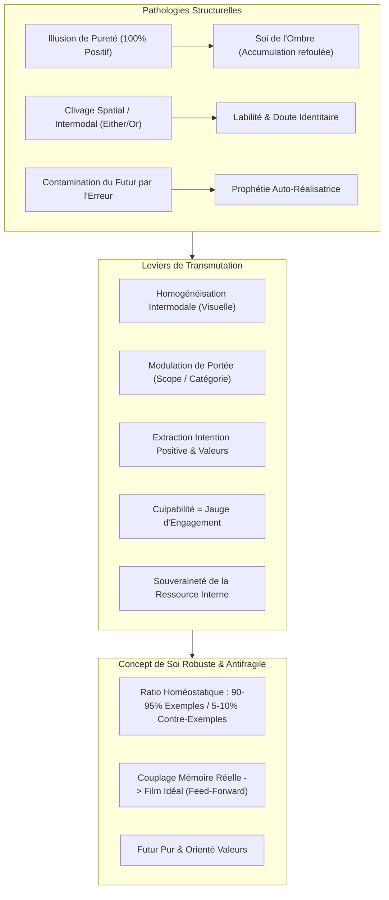

# Transforming Yourself - Mistakes Counterexamples Values Demos
**Formateur :** Damon Cart | **ID :** `damon-cart-transforming-yourself-mistakes-counterexamples-values-demos` | **Tranches :** 6

Voici la **synthèse architecturale ultra-dense et structurée** du cours de Damon Cart (*Transforming Yourself - Mistakes, Counterexamples, Values & Demos*), modélisée selon les canons avancés de la modélisation cognitive et du *Self-Concept*.

---

# Synthèse Architecturale du Cours : *Transforming Yourself* (Damon Cart)

---

## 1. Thèse Centrale & Philosophie du Cours

### Vision spécifique de Damon Cart vs Approche Standard
Dans la PNL et le développement personnel conventionnels, l'erreur, le regret ou le contre-exemple sont presque toujours abordés comme des **pathologies ou des croyances limitantes à éradiquer, neutraliser ou refouler** par de l'ancrage positif, du *swish* superficiel ou de la pensée affirmative.

Damon Cart (dans la lignée directe des travaux de Steve Andreas sur le *Self-Concept* et *Six Blind Elephants*) prend le contre-pied absolu de cette posture :
1. **L'Antifragilité identitaire par l'incorporation de l'anomalie :** Une identité 100 % positive est neurologiquement rigide, narcissique et hyper-vulnérable au moindre échec réel (choc de réalité). Le contre-exemple n'est pas un ennemi : il est le **vaccin immunitaire de l'identité**.
2. **Le Découplage Identité / Comportement :** L'acte n'est jamais la personne. L'erreur n'invalide pas la qualité identitaire ($Q$), elle en circonscrit le domaine de validité empirique.
3. **Le Réveil cybernétique du regret et de la culpabilité :** La douleur émotionnelle consécutive à une erreur n'est pas une condamnation morale mais la **preuve irréfutable de l'attachement à la valeur violée**. Si la valeur n'était pas vitale pour le sujet, il ne ressentirait aucune douleur. Le regret est un instrument de mesure cybernétique de haute précision.

### Le Fil Rouge Méthodologique
Toutes les interventions du cours reposent sur un unique mouvement en trois temps :
1. **Éliciter et Dé-cliver la structure perceptive :** Rendre visible l'architecture interne (sous-modalités, position spatiale, format sensoriel) des contre-exemples isolés ou projetés dans l'ombre.
2. **Homogénéiser et Transmuter :** Rétablir une compatibilité sensorielle (traduire les voix/émotions en paramètres visuels comparables), remonter à l'intention positive/valeur source, et injecter la ressource manquante.
3. **Réintégrer sous ratio homéostatique (5 % à 10 %) :** Réancrer l'erreur dans le passé (purification absolue du futur), la relier structurellement à une boucle d'apprentissage futur (*feed-forward*), et sceller la base de données pour rendre l'identité stable, perméable au feedback et fonctionnelle en action.

---

## 2. Carte des Concepts & Leviers Émergents

### Inventaire des Mécanismes Clés
* **Vaccin de l'Identité & Résilience de Généralisation (`#anti_fragile_identity`) :** L'intégration dosée de contre-exemples empêche l'effondrement binaire d'une qualité face aux anomalies du quotidien.
* **Le Soi de l'Ombre (`#shadow_self_accumulation`) :** Accumulation toxique des erreurs déniées dans un compartiment hors-conscience, risquant un effondrement brutal (*identity crash*).
* **Clivage Spatial & Alternance Bipolaire (`#either_or_sorting`) :** Séparation physique ou modale des succès et des échecs générant une instabilité thymique (*mood swings*) au lieu d'une auto-évaluation équilibrée.
* **Homogénéisation Intermodale Trans-Structurelle (`#homogeneisation_submodale`) :** Nécessité de convertir des signaux disparates (ex: voix critique auditive ou malaise viscéral) dans le format sensoriel dominant de la base de données (généralement visuel) pour permettre le traitement unifié.
* **Kinesthésique Évaluative vs Kinesthésique Primaire (`#kinesique_evaluative_vs_primaire`) :** L'émotion ou le malaise kinesthésique n'est qu'un symptôme déclenché par une image/voix subconsciente ; le traitement requiert de remonter au déclencheur causal.
* **Ratio d'Homéostasie Identitaire (5 % à 10 %) (`#homeostatic_ratio`) :** Dosage mathématique idéal (1 contre-exemple atténué pour 10 à 20 exemples positifs) garantissant perméabilité au feedback sans dilution de la certitude.
* **Asymétrie Temporelle & Purification du Futur (`#purification_du_futur`) :** Le passé contient les alertes et les apprentissages ; le futur doit demeurer exclusivement aligné sur la trajectoire désirée pour éviter l'effet idéomoteur d'échec.
* **Exclusion Contextuelle Négociée (`#inhibition_du_feedback_en_action`) :** Neutralisation du contre-exemple pendant l'acte de performance ; convention d'apparition réservée à la préparation amont et au débriefing aval.
* **Recalibrage par Modulation de Portée (*Scope & Category*) :**
  - *Scope temporel/spatial* : Voir le bénéfice à long terme ou l'impact élargi d'un acte étiqueté négatif à court terme.
  - *Inclusion du Soi* : S'inclure soi-même dans la catégorie des personnes ayant droit à l'aide ou à la bienveillance.
  - *Méta-catégorie supra-ordonnée* : Fusionner deux comportements opposés (action vs repos) sous une valeur supérieure commune.
* **Couplage Structurel Mémoire / Film Idéalisé (`#feed_forward_coupling`) :** Attacher spatialement le souvenir réel (assombri, petit) au film de correction idéal (lumineux, attractif) pour transformer le passé en déclencheur d'apprentissage futur.
* **Déracinement du Pivot Isomorphe (`#first_worst_anchor`) :** Transformer le souvenir pivot (le tout premier ou le pire) pour restructurer en cascade toute la chaîne catégorielle de contre-exemples par résonance.
* **Souveraineté des Ressources Internes (`#internal_state_sovereignty`) :** Dissocier l'état interne somatique du stimulus environnemental d'origine pour en faire une capacité autonome mobilisable à volonté.

---

## 3. Tableau Récapitulatif des Techniques & Démonstrations

| Technique / Exercice | Objectif Opératoire | Déclencheur / Indication | Séquence Résumée |
|---|---|---|---|
| **Audit Structural du Contre-Exemple** | Cartographier l'encodage neuro-cognitif des erreurs pour détecter clivages et incongruences. | Qualité instable, sentiment de doute, labilité émotionnelle (*either/or*), perfectionnisme rigide. | 1. Localiser la base d'exemples ($Q$). 2. Localiser les contre-exemples. 3. Comparer sous-modalités et formats sensoriels. 4. Mesurer le ratio volumétrique et la distance somatique. |
| **Homogénéisation Intermodale Trans-Structurelle** | Convertir une critique auditive ou un affect kinesthésique en format visuel pour intégration. | Présence d'une voix critique ou d'une sensation d'échec isolée incompatible avec la base visuelle. | 1. Identifier la kinesthésique évaluative ou la voix. 2. Remonter à l'image déclenchante sous-jacente. 3. Traduire l'information en objet/scène visuelle statique et bordée. 4. Insérer dans l'espace de la base de données. |
| **Recadrage par Modulation de Portée (*Scope Shifting*)** | Démontrer que le comportement d'échec honore en réalité la qualité sous un autre cadre. | Contre-exemple rigide générant culpabilité ou sentiment d'hypocrisie (ex: "J'ai dit non"). | 1. Élargir l'axe temporel (bénéfice futur). 2. Élargir l'espace relationnel (impact sur autrui). 3. Réinclure le "Soi" dans la catégorie des bénéficiaires. 4. Reclassifier l'événement comme exemple valide. |
| **Méta-Catégorisation Supra-Ordonnée** | Résoudre une polarité interne où deux besoins vitaux s'annulent mutuellement. | Dilemme ou conflit de valeurs (ex: productivité vs procrastination/épuisement). | 1. Extraire la valeur du comportement A (ex: accomplissement). 2. Extraire la valeur du comportement B (ex: préservation vitale). 3. Créer une catégorie chapeau intégratrice. 4. Aligner les stratégies sous cette nouvelle identité. |
| **Transmutation Cybernétique du Regret** | Convertir la culpabilité paralysante en carburant d'alignement et de mise à jour des critères. | Rumination persistante, remords auto-punitif après un échec ou un faux pas. | 1. Calibrer l'intensité du regret somatique. 2. Établir l'équivalence : Douleur = Force de la valeur bafouée. 3. Découpler l'acte de l'identité. 4. Dériver les nouveaux critères de guidance comportementale. |
| **Transformation et Ré-édition du Contre-Exemple Unitaire (Couplage *Feed-Forward*)** | Convertir un souvenir d'erreur en signal d'apprentissage automatique sans falsifier l'histoire. | Souvenir toxique isolé venant saboter l'assurance ou la certitude d'une qualité identitaire. | 1. Éliciter le souvenir réel ; extraire son intention positive. 2. Identifier et ancrer souverainement la ressource manquante. 3. Créer le film idéal corrigé avec la ressource. 4. Réduire/assombrir la mémoire réelle et l'attacher (cordon/flèche) au film idéal. 5. Tester le déclencheur d'ajustement. |
| **Déracinement du Pivot Isomorphe (*First/Worst Sweep*)** | Nettoyer d'un coup toute une catégorie de contre-exemples répétitifs par effet de bascule (*flip*). | Série répétitive de contre-exemples partageant la même structure (ex: phobie de l'échec en public). | 1. Identifier la matrice commune de la catégorie. 2. Isoler le souvenir pivot (le premier ou le pire). 3. Appliquer la ré-édition complète sur ce pivot. 4. Vérifier la résonance cognitive et le recalibrage instantané de l'ensemble de la série. |
| **Négociation Temporelle de Performance** | Protéger la bande passante cognitive et motrice pendant l'exécution d'un geste critique. | Sabotage ou doute intervenant *pendant* l'action (sport, négociation, prise de parole, chirurgie). | 1. Reconnaitre la fonction de vigie du contre-exemple. 2. Proposer un contrat temporel strict : silence absolu pendant l'action. 3. Programmer son intervention exclusive en phase de préparation et de débriefing. 4. Vérifier l'écologie interne. |
| **Purification Projective du Futur** | Empêcher la projection inconsciente de l'échec dans la ligne temporelle future. | Présence d'images de ratés ou d'incertitudes dans la projection d'actions à venir. | 1. Inspecter la représentation visuelle du futur. 2. Balayer et extraire tout contre-exemple ou simulation d'erreur. 3. Reclasser l'erreur dans la mémoire passée (avec son couplage feed-forward). 4. Verrouiller le futur sur l'orientation pure des critères de valeur. |

---

## Extractions Détaillées par Tranche (Opératoire & Verbatim)

## --- Tranche 1 / 6 ---

Voici l'extraction et la modélisation intégrale de la substance opératoire de cette première tranche, conformément aux règles d'ingénierie et d'ontologie émergente.

---

### 1. Mécanismes & Principes Actifs

#### A. Le Contre-Exemple comme Ancre de Réalité et Vaccin de l'Identité
* **Principe actif :** Dans la structure cognitive du *Self-Concept* (modélisé originellement par Steve Andreas), une qualité identitaire ("Je suis X") est encodée sous la forme d'une généralisation basée sur une base de données d'exemples (*database*). Une généralisation pure (100% d'exemples positifs, zéro exception) est neurologiquement fragile : la moindre anomalie empirique ou le moindre échec extérieur menace de faire s'effondrer l'ensemble de la structure par contradiction binaire. L'incorporation dosée de contre-exemples (les fois où l'individu n'a pas manifesté la qualité valorisée ou a fait une erreur) immunise le système nerveux : la généralisation ne prétend plus être un absolu mathématique, mais une tendance probabiliste robuste ("La majorité de qui je suis est X, même si j'ai parfois fait le contraire").
* **Tags émergents :** `#counter_example` `#generalization_resilience` `#database_immunization` `#anti_fragile_identity` `#grounded_self`

#### B. La Vulnérabilité de la « Pureté » et la Genèse du Soi de l'Ombre (*Shadow Self*)
* **Principe actif :** L'illusion de pureté (recherche obsessionnelle de perfection identitaire) opère comme un leurre dopaminergique addictif qui déconnecte du réel. Sur le plan cognitif, maintenir une base de données pure face à la réalité quotidienne exige le refoulement actif, le déni ou l'hyper-défense arrogante/narcissique (rejet agressif du feedback). Les contre-exemples rejetés ne disparaissent pas : ils s'accumulent dans un espace perceptif séparé, alimentant un "Soi de l'ombre" (*shadow self*). Plus la confrontation à la réalité est différée, plus le "crash" neurologique et identitaire futur sera violent lorsque la divergence deviendra intenable.
* **Tags émergents :** `#purity_addiction` `#narcissistic_defense` `#shadow_self_accumulation` `#identity_crash` `#denial_mechanism`

#### C. L'Architecture Spatiale et le Clivage Émotionnel (*Either/Or Split*)
* **Principe actif :** Stocker les exemples positifs et les contre-exemples dans des localisations spatiales distinctes (ex: exemples positifs devant soi, contre-exemples derrière ou sur les côtés) ou sous des modalités sensorielles différentes (ex: voir les succès, entendre des voix critiques pour les échecs) crée une bascule attentionnelle alternée de type *soit/soit* (*either/or*). L'esprit ne peut pas comparer ni contextualiser simultanément les deux informations : il saute d'un état euphorique (focalisation exclusive sur la base positive) à un état dépressif ou anxieux (focalisation exclusive sur la base négative clivée). C'est le fondement structurel des qualités "ambiguës" ("Des fois je le suis, des fois pas") et, à l'extrême, de la labilité thymique ou cyclothymique.
* **Tags émergents :** `#spatial_splitting` `#either_or_sorting` `#cross_modal_fragmentation` `#ambiguous_quality_structure` `#attention_bipolarity`

#### D. Le Ratio d'Homéostasie Identitaire (5 % à 10 %) et la Hiérarchie des Sous-Modalités
* **Principe actif :** Pour qu'un contre-exemple serve de balise corrective sans détruire la généralisation positive, il doit obéir à une double contrainte :
  1. **Contrainte volumétrique :** Représenter environ 5 à 10 % de la masse mémorielle globale de la qualité.
  2. **Contrainte analogique (Sous-modalités) :** Être visuellement ou sensoriellement subordonné aux exemples positifs (plus petit, plus sombre, plus plat, détouré/encadré, sépia/terne). Si le contre-exemple est aussi éclatant, grand ou proche que les exemples positifs, le système attentionnel est submergé, inversant la valence de l'identité (l'individu s'identifie alors au défaut : "Je suis cruel", "Je suis incompétent").
* **Tags émergents :** `#submodality_hierarchy` `#homeostatic_ratio` `#salience_attenuation` `#bordered_counter_examples`

#### E. Transmutation Sémantique de la Culpabilité en Engagement envers la Valeur
* **Principe actif :** Le sentiment négatif (culpabilité, honte, remords) consécutif à une erreur découle directement de la collision entre le comportement exécuté et la valeur sous-jacente. Sur le plan neurologique et cognitif, la douleur émotionnelle est la preuve irréfutable de l'attachement à la valeur : si la personne ne valorisait pas profondément la bienveillance, agir avec cruauté ne provoquerait aucun affect négatif. Ce principe découple l'identité de l'acte : l'erreur devient un marqueur somatique de l'engagement envers la valeur inverse, ce qui dissout la spirale de dévalorisation tout en renforçant la motivation corrective.
* **Tags émergents :** `#negative_affect_reframing` `#value_commitment_marker` `#guilt_to_alignment_conversion` `#identity_behavior_decoupling`

---

### 2. Protocoles, Techniques & Démonstrations (Étape par Étape)

#### Protocole 1 : Audit Structural du Contre-Exemple
* **Intention / Indication :** Découvrir comment l'inconscient du sujet traite et cartographie ses erreurs et manquements par rapport à une qualité identitaire stabilisée.
* **Mise en place & Pré-framing :** Cadrer l'exploration comme une pure observation phénoménologique. Interdiction absolue de modifier la moindre sous-modalité à ce stade pour éviter un effondrement d'état (*crash*) brutal ou une déstabilisation identitaire prématurée.

* **Séquence d'actions pas à pas :**
  * **Étape 1 - Évocation de l'antithèse :** Pour la qualité valorisée travaillée (ex: *Intelligence*), amener le sujet à chercher les moments réels où il a fait exactement l'opposé (ex: *moments stupides, erreurs de jugement*).
  * **Étape 2 - Test d'intégration primaire :** Les contre-exemples sont-ils déjà visibles/perceptibles *à l'intérieur* de la base de données principale d'exemples positifs, ou sont-ils absents / non-perçus ?
  * **Étape 3 - Cartographie de la modalité et de la localisation :**
    - Sont-ils dans la même modalité (ex: visuels) mais à un autre endroit (en bas, à droite, à gauche, derrière) ?
    - Sont-ils dans une modalité différente (ex: exemples positifs en images visuelles, contre-exemples sous forme de voix auditives critiques ou de sensations corporelles tactiles/proprioceptives) ?
  * **Étape 4 - Analyse différentielle des sous-modalités :** Comparer les caractéristiques analogiques :
    - Luminosité (terne vs brillant)
    - Taille (plus petit vs plus grand)
    - Profondeur (plat vs 3D)
    - Délimitation (bordure/cadre vs vue panoramique)
    - Tonalité chromatique (sépia/jaunâtre vs couleurs vives)
  * **Étape 5 - Test d'écologie (pour ceux ayant déjà des contre-exemples intégrés) :**
    - Retirer temporairement les contre-exemples de la base (les masquer ou les décaler).
    - Comparer l'état interne : la qualité paraît-elle "pure" mais fragile, ou était-elle plus solide, ancrée et durable *avec* les contre-exemples ?
    - Réintégrer immédiatement les éléments en fin de test.

* **Signes de calibration :**
  - Mouvements oculaires d'accès (regard vers l'arrière ou vers le bas pour localiser les erreurs).
  - Tensions faciales ou grimaces de dégoût/rejet lors de l'évocation des erreurs (marqueur d'un clivage de pureté).
  - Micro-affaissements posturaux si les contre-exemples sont trop volumineux ou trop prépondérants.

---

#### Protocole 2 : Intégration Sécurisée des Contre-Exemples (Cas : Même modalité, localisation différente)
* **Intention / Indication :** Rendre une qualité identitaire indestructible, ancrée, réaliste et totalement ouverte au feedback en fusionnant les erreurs dans la base de données de référence.
* **Mise en place & Pré-framing :** Cadrage explicite : *"Nous ne cherchons pas la pureté mais la solidité et la durabilité. La vie réelle est imparfaite."* Avertissement impératif : déplacer les contre-exemples un par un, lentement, avec ajustement sous-modalitaire préalable.

* **Séquence d'actions pas à pas :**
  * **Étape 1 - Atténuation sous-modalitaire préventive :** Avant tout déplacement, modifier l'image du contre-exemple :
    - Réduire sa taille.
    - Diminuer la luminosité (la rendre plus sombre/terne).
    - L'aplatir (enlever le relief) ou la passer en noir et blanc / sépia.
    - Lui appliquer un cadre/une bordure distincte.
  * **Étape 2 - Translation lente et calibrée :** Rapprocher doucement le contre-exemple atténué en direction de la base de données positive.
    - *Règle de sécurité :* Si au cours du déplacement l'image prend de la force, grossit ou attire toute l'attention : **STOP immédiat**. Reculer l'image à sa position d'origine, ré-atténuer drastiquement les sous-modalités, puis reprendre.
  * **Étape 3 - Insertion et évaluation somatique unitaire :**
    - Insérer l'unique contre-exemple au milieu des représentations positives.
    - Calibrer le ressenti global : *"Est-ce que la qualité globale se sent plus forte, plus ancrée, plus durable ?"*
  * **Étape 4 - Répétition incrémentale sous surveillance de seuil :**
    - Intégrer un deuxième, puis un troisième contre-exemple, toujours un à un.
    - Maintenir le ratio cible de **5 % à 10 %** de contre-exemples par rapport à la masse d'exemples positifs.
  * **Étape 5 - Détection du point de bascule et régulation :**
    - Si le sujet signale une perte de certitude ou un affaiblissement de la qualité (glissement vers l'ambiguïté), extraire immédiatement le dernier contre-exemple introduit pour revenir au point d'équilibre optimal.

* **Signes de calibration :**
  - Respiration qui s'approfondit et s'ancre dans l'abdomen (signe de passage de la tension perfectionniste au relâchement réaliste).
  - Décontraction des muscles des épaules et des mâchoires.
  - Sourire d'évidence ou d'apaisement face au souvenir d'erreurs passées, entourées par les preuves de succès.

---

### 3. Heuristiques, Subtilités & "Sagesse du Praticien"

#### A. Arbres de Décision & Règles Opératoires Conditionnelles
* **Si** le sujet rapporte une sensation de "pureté absolue" en retirant ses contre-exemples, **alors** recadrer immédiatement que la pureté est un piège instable et vérifier la fragilité de la qualité face à une critique imaginaire.
* **Si** le contre-exemple devient trop lumineux, trop grand ou accaparant lors de son déplacement vers la base, **alors** stopper immédiatement et le ramener à son point d'origine, car l'intégrer à haute intensité écraserait la généralisation positive.
* **Si** le sujet exprime un clivage d'humeur radical (euphorie un jour, abattement le lendemain sur une même compétence), **alors** chercher deux bases de données spatialement opposées qui commutent en boucle fermée sans jamais communiquer.
* **Si** le sujet se plaint d'une qualité "ambiguë" (*"Parfois je le suis, parfois non"*), **alors** vérifier s'il a soit trop de contre-exemples (> 15-20%), soit des contre-exemples stockés dans un conteneur spatial distinct qui rivalise avec les exemples positifs.
* **Si** le sujet manifeste une résistance à intégrer une bavure par attachement à son perfectionnisme, **alors** utiliser la clause de permission : *"C'est juste une exploration temporaire, nous pourrons tout remettre exactement à sa place après."*

#### B. Distinctions Sensorielles Critiques
* **Kinesthesique Évaluatif vs Tactile/Proprioceptif :** Ne jamais confondre l'affect émotionnel consécutif à une représentation (l'évaluation somatique : "Je me sens mal / fier") avec la modalité kinesthésique d'encodage du souvenir (pression physique, tension tactile, mouvement musculaire proprioceptif). L'évaluation émotionnelle est omniprésente ; la modalité d'encodage kinesthésique d'un contre-exemple est un canal sensoriel spécifique.

#### C. Postulats & Philosophie Opératoire de Damon Cart
1. **L'imperfection est le socle de la robustesse :** Une structure identitaire qui n'a jamais intégré l'échec est une structure en sursis. Le succès répété sans historique d'erreurs (cf. l'homme qui a perdu un million de dollars) détruit l'acuité contextuelle et la capacité de correction stratégique.
2. **Tout comportement négatif douloureux est un hommage à la valeur :** Se sentir coupable ou dévasté par une erreur prouve la vitalité de l'idéal que l'on porte. Sans cet idéal, l'erreur laisserait indifférent.
3. **Le déni est une dette cognitive à taux usuraire :** Dissimuler ou expulser les contre-exemples hors de son champ de conscience ne protège pas l'ego, cela ne fait que repousser le moment du règlement de comptes avec la réalité (*reckoning*), garantissant une souffrance décuplée lors de l'inévitable collision avec les faits.
4. **La résistance au feedback est une pathologie de base de données :** Le narcissisme et l'arrogance ne sont pas des excès de confiance, mais des mécanismes d'évitement désespérés générés par des bases de données immaculées mais ultra-fragiles qu'une simple critique menace d'annihiler.

---

### 4. Pépites Verbatim & Patterns Linguistiques (MOT À MOT EN V.O.)

#### Pépite 1 : Le Recadrage de l'Affect Négatif en Engagement envers la Valeur
> *"When people come to me and they say, I feel terrible because I did XYZ. Well we elicit the value and we find out what it is that they do value instead, that they would rather be acting or rather have behaved. Once we elicit that value, then what I tell them is, you're feeling bad about acting the opposite of what you value is just your commitment to that value. That's an extraordinary reframe. Think about that. When you feel bad about something, that's just an indication of your commitment to the opposite."*

* **[Analyse du Pattern] :**
  - **Recadrage de sens / Redéfinition d'équivalence complexe :** Cart prend le prédicat somatique négatif ("feeling bad", traditionnellement encodé comme marqueur de défaillance ou de culpabilité) et l'associe par équivalence directe (*X is just Y*) à un attribut noble et constructif ("your commitment to that value").
  - **Présupposition d'alignement identitaire :** La structure grammaticale présuppose que le sujet est intrinsèquement une bonne personne, puisque la souffrance n'est pas le symptôme d'une noirceur morale, mais la preuve vivante d'une loyauté inviolable envers la vertu opposée.
  - **Inversion de polarité kinesthésique :** Ce glissement syntaxique transforme instantanément une énergie de dévalorisation paralysante en une force d'action positive tournée vers l'expression future de la valeur.

---

#### Pépite 2 : La Dissolution du Déni et l'Inévitabilité du Crash
> *"When it comes to denial, people are basically saving their databases. It doesn't completely avoid the crash. It just postpones it and it creates a shadow self. This can be devastating to people later on because at some point, there will be a reckoning. At some point, you have to reconcile reality and your beliefs and your generalizations about yourself. This can be extremely painful. Denial is just putting this stuff off and the more you put it off, the more painful that crash is going to be when it does happen and it will happen."*

* **[Analyse du Pattern] :**
  - **Métaphore informatique opérationnelle :** Assimiler le mécanisme psychologique de défense du déni à une sauvegarde logicielle précaire (*"saving their databases"*) matérialise l'opération cognitive sous une forme concrète et modifiable.
  - **Présupposition temporelle absolue et double lien inéluctable :** Utilisation répétée d'adverbes temporels déterministes (*"at some point"*, *"when it does happen and it will happen"*). La syntaxe élimine l'illusion de contrôle : l'évitement est recadré non pas comme une solution, mais comme une amplification garantie du traumatisme futur.
  - **Rupture de pattern sur le bénéfice secondaire :** En liant la prolongation du déni à l'augmentation mécanique de la douleur terminale, Cart brise le bénéfice immédiat de la fuite et pousse l'inconscient à préférer une régulation immédiate, même inconfortable.

---

#### Pépite 3 : La Déconstruction de l'Illusion de Pureté par la Relativisation Contextuelle
> *"Usually what happens is having counter examples surrounded by positive examples puts the counter examples in perspective. Yes, I screwed up that time, but there have been so many other times when I've done so much better. [...] Counter examples without the context of positive examples makes counter examples seem worse than they really are. Like I said, if you put all your attention on one thing, the negative, your world becomes that or you feel like you don't have this quality. This will help you put your quality and your experiences in perspective."*

* **[Analyse du Pattern] :**
  - **Utilisation du connecteur d'effacement (*"Yes... but..."*) en séquence inversée :** Au lieu d'utiliser le "mais" pour effacer le positif, Cart valide l'échec dans une proposition courte (*"Yes, I screwed up that time"*) pour immédiatement saturer l'espace attentionnel avec la clause dominante (*"but there have been so many other times..."*).
  - **Encadrement spatial linguistique (*Gestalt foreground/background*) :** Les erreurs sont sémantiquement décrites comme "entourées" (*surrounded*) par les succès. Le pattern syntaxique force l'inconscient à reléguer l'erreur au statut de détail au sein d'une toile de fond ultra-majoritaire, empêchant la déformation cognitive par focalisation isolée.
  - **Truisme d'attention sélective :** Empilement d'une règle universelle (*"Whatever your focus is, that's what your world becomes"*) qui valide logiquement l'intérêt de la structure d'intégration proposée.

## --- Tranche 2 / 6 ---

### 1. Mécanismes & Principes Actifs

* **Homogénéisation Intermodale Trans-Structurelle (Règle d'équivalence décimale/fraction)**
  * **Principe actif :** Deux encodages neuro-cognitifs situés dans des modalités sensorielles distinctes (ex. une base d'exemples positifs visuelle face à un contre-exemple sous forme de voix critique auditive ou d'évaluation kinesthésique) fonctionnent comme des systèmes incompatibles. Le système nerveux ne peut pas intégrer ni pondérer deux signaux qui ne partagent pas le même format de calcul sensoriel. Cette dissonance sensorielle empêche l'agrégation, crée une scission structurelle et déclenche des bascules brutales d'humeur (*wild mood swings*) ou une instabilité identitaire chronique. L'inconscient traite les modalités différentes comme des compartiments isolés : pour intégrer une critique dans un corpus visuel, il est neurologiquement indispensable de traduire au préalable le signal auditif ou kinesthésique en paramètres visuels (visage, posture, forme graphique, intensité lumineuse).
  * **Tags :** `#conversion_intermodale #homogeneisation_submodale #resolution_fracture_sensorielle #stabilisation_identitaire`

* **Décodage de la Sensation Évaluative vs Kinesthésique Proprioceptive/Tactile**
  * **Principe actif :** Dans l'auto-évaluation identitaire, les contre-exemples dits "kinesthésiques" ne sont quasiment jamais des données sensorielles primaires directes (toucher, température, proprioception — sauf chez l'athlète de haut niveau calibrant un geste mécanique). Ce sont des kinesthésiques évaluatives (émotions, sentiments de malaise, "intuition"), c'est-à-dire des réponses physiologiques réflexes déclenchées par une représentation interne inconsciente préalable (une image fugitive ou une voix interne non conscientisée). Tenter d'intégrer une kinesthésique évaluative directement échoue systématiquement car on manipule un symptôme physiologique et non la représentation causale. En faisant remonter le sujet au déclencheur interne sous-jacent (visuel ou auditif), le praticien neutralise la boucle émotionnelle réactive et récupère le matériau représentatif brut réintégrable.
  * **Tags :** `#kinesique_evaluative_vs_primaire #remontee_au_declencheur_causal #neutralisation_affective_identitaire #calibrage_somatique`

* **Rapport Critique d'Intégration et Seuil Homéostatique (Ratio 5-10%)**
  * **Principe actif :** Pour conférer solidité, résilience et perméabilité au feedback à une qualité sans l'effondrer, les contre-exemples intégrés dans la banque de données doivent représenter un ratio précis de 5 à 10 % (soit environ 1 contre-exemple atténué pour 10 exemples positifs). Si la banque exclut totalement les contre-exemples (0 %), le sujet bascule dans une rigidité narcissique ou une mégalomanie fragile ("drunk or high on positive examples"). À l'inverse, si le volume de contre-exemples dépasse le seuil critique ou si les contre-exemples sont sur-dimensionnés, le filtre identitaire bascule du statut de "certitude fonctionnelle" à "qualité ambiguë/douteuse", paralysant l'agentivité du sujet.
  * **Tags :** `#ratio_homeostatique_5_10 #dosage_immunitaire_cognitif #seuil_ambiguite_identitaire #anti_perfectionnisme`

* **Asymétrie Temporelle et Purification Projective du Futur**
  * **Principe actif :** Le modèle du Self-Concept repose sur une ligne temporelle intégrée (passé, présent, futur). Les contre-exemples n'ont une fonction régulatrice saine que s'ils sont ancrés dans le *passé* (servant alors de système d'alerte, de référence d'apprentissage et de preuve d'auto-correction). Si un individu projette des contre-exemples dans la représentation de son *futur*, le système neurologique de programmation motrice et comportementale traite ces représentations comme des cibles d'intention (loi de l'effet idéomoteur). Il est structurellement impératif de conserver un futur "pur", axé exclusivement sur l'état désiré et aligné aux valeurs. Les erreurs passées intégrées suffisent à activer le signal d'alerte contextuel sans qu'il soit nécessaire de contaminer la simulation du futur.
  * **Tags :** `#purification_du_futur #asymetrie_temporelle #boucle_retroactive_vs_proactive #inhibition_auto_prophétique`

* **Exclusion Contextuelle Négociée (Périphérie de Performance vs Rétroaction)**
  * **Principe actif :** Durant l'exécution motrice ou cognitive de haute précision (chirurgie, sport de haut niveau, négociation commerciale), le focus attentionnel requiert une bande passante totale orientée vers le geste juste. La présence active d'un contre-exemple pendant l'action sature l'attention de travail et engendre la prophétie autoréalisatrice de l'échec. L'inconscient/la partie porteuse du contre-exemple n'est pas réprimée (ce qui provoquerait un retour sous forme de sabotage), mais conventionnée via une négociation temporelle : son signal n'est sollicité qu'*en amont* (phase de préparation technique) et *en aval* (debriefing/étalonnage), excluant formellement son apparition *pendant* l'acte.
  * **Tags :** `#negociation_temporelle_de_performance #segmentation_attentionnelle #inhibition_du_feedback_en_action #protection_de_haute_performance`

* **Recalibrage de Généralisation par Modulation du Champ (Scope)**
  * **Principe actif :** Une identité s'articule autour d'une généralisation cognitive qui extrait des similitudes entre des événements distincts. Lorsqu'un contre-exemple vient menacer l'identité ("J'ai refusé d'aider = je ne suis pas bienveillant"), c'est la conséquence d'un cadre de généralisation trop rigide ou déformé. 
    - *Rétrécissement de cadre (Narrowing Scope)* : Isoler les conditions limites contextuelles ("Je suis bienveillant, sauf quand je suis épuisé ou sous pression"), ou révéler qu'un prétendu défaut relève d'une valeur supérieure concurrente (ex: "manque de motivation" = "préservation homéostatique de la santé").
    - *Élargissement de cadre (Widening Scope)* : Étendre l'axe temporel (ce qui semble néfaste à court terme est un acte de bienveillance à long terme, ex: éducation parentale) ou élargir le champ des bénéficiaires en s'incluant soi-même comme sujet légitime de la valeur ("Je fais partie des êtres humains qui méritent ma bienveillance").
  * **Tags :** `#modulation_du_scope #recadrage_par_la_generalisation #conflit_de_valeurs_homeostatique #auto_inclusion_identitaire`

---

### 2. Protocoles, Techniques & Démonstrations (Étape par Étape)

#### Protocole A : Intégration Trans-Modale & Spatialisation des Contre-Exemples
* **Intention / Indication :** Présence d'un contre-exemple stocké dans une modalité différente (souvent une voix critique ou une tension) et/ou une localisation spatiale séparée de la banque d'exemples positifs.
* **Mise en place & Pré-framing :** Cadrer que le contre-exemple n'est pas un ennemi mais une pièce manquante indispensable à la stabilité de l'identité. Si le contre-exemple est en dehors du canal visuel, acter la nécessité technique de standardiser les données dans la modalité visuelle pour permettre l'assemblage.
* **Séquence d'actions pas à pas :**
  1. **Localisation et identification modale :** Cartographier la position spatiale exacte et la modalité primaire de la banque d'exemples positifs (ex: Rolodex, collage ou matrice ordonnée en face de soi) et du contre-exemple (ex: voix critique derrière la tête).
  2. **Extraction de la racine perceptive (Décodage kinesthésique/auditif) :** 
     - Si auditif : Demander à qui appartient la voix, identifier les traits visuels de l'émetteur ou transformer l'onde sonore en forme visuelle concrète.
     - Si kinesthésique : Rechercher l'image ou le son initial dont la sensation n'est que la réponse évaluative.
  3. **Translation et modulation submodale préalable :** Rendre la nouvelle représentation visuelle du contre-exemple discrète, atténuée (plus petite, grisée, moins lumineuse, désaturée) par rapport aux exemples positifs.
  4. **Glissement spatial progressif (Drag & Drop unitaire) :** Prendre un seul contre-exemple à la fois. Le faire glisser lentement depuis sa localisation isolée vers la structure de la base d'exemples positifs. Interdiction absolue d'accélérer ou de transférer une masse compacte (risque d'effondrement ou de sidération).
  5. **Vérification du ratio et intégration :** Insérer le contre-exemple atténué au sein des positifs (viser un ratio d'environ 1 pour 10).
  6. **Contrôle d'intégrité du futur :** Vérifier que la ligne temporelle future reste pure de tout contre-exemple inséré.
* **Signes de calibration :** 
  - Posture du sujet : le déplacement du contre-exemple doit générer un relâchement respiratoire, un ancrage physique au sol (*grounded*), sans sursaut d'effondrement postural ni contraction faciale.
  - Test de bascule : le sujet doit pouvoir observer simultanément le contre-exemple sans que l'image positive ne perde sa prévalence.

#### Protocole B : Calibration en Direct (Démonstration sur Lula - "Cute")
* **Intention / Indication :** Déterminer le statut structurel des contre-exemples relatifs à une qualité solidement établie ("Cute").
* **Séquence opératoire observée :**
  1. **Sondage spatial :** Le formateur demande où se situent les moments où elle n'était pas "cute". Calibration du geste vague de la main de Lula au même endroit que ses exemples positifs.
  2. **Interrogation modale & Discrimination évaluative :** Lula annonce du "kinesthésique". Damon Cart interroge immédiatement : *"Est-ce une sensation évaluative interne ou un toucher tactile ?"* Lula recalibre : sensation évaluative interne.
  3. **Régression vers le déclencheur :** Le formateur pose la condition causale : *"Pour avoir ce sentiment, tu dois d'abord voir ou entendre quelque chose. Qu'est-ce qui le déclenche ?"* Lula valide qu'elle fait les deux (visuel et auditif).
  4. **Isolation et test comparatif d'intensité :**
     - Instruction : Isoler l'auditif (couper le visuel).
     - Instruction : Isoler le visuel (couper l'auditif).
     - Question : *"Lequel est le plus fort ?"*
  5. **Lecture physiologique immédiate :** Avant même la verbalisation, le formateur valide le canal dominant à partir du changement postural/micro-mouvements corporels du sujet (*"I can already tell by the way your body shifted"*), confirmant l'auditif.
  6. **Diagnostic de complétude :** Même modalité et même localisation générale que les exemples positifs = le contre-exemple est déjà fonctionnellement intégré. La qualité est certifiée résiliente et prête à recevoir du feedback constructif.

#### Protocole C : Négociation Interne de Performance (Exclusion Temporelle Ciblée)
* **Intention / Indication :** Sujets dont les contre-exemples interviennent de manière intrusive pendant l'exécution d'une tâche à haut enjeu (chirurgie, prise de parole, vente, compétition martiale).
* **Mise en place & Pré-framing :** Poser le postulat que la partie génératrice du contre-exemple a une intention positive indispensable (préservation de l'excellence, apprentissage). Seul le timing de son expression est inadapté.
* **Séquence d'actions pas à pas :**
  1. **Délimitation du périmètre de performance :** Définir la fenêtre temporelle exacte de l'action pure où aucune distraction n'est tolérée (ex: les 45 minutes de la présentation de vente).
  2. **Ouverture de négociation avec la partie :** Communiquer avec la part portant les contre-exemples : reconnaître formellement sa valeur et l'utilité critique de ses alertes.
  3. **Fixation du calendrier de feed-forward (Phase amont) :** Déterminer le délai nécessaire à la prise en compte du feedback pour se préparer (ex: 1 mois avant pour la préparation physique en jiu-jitsu, 3 jours avant pour une présentation). Demander à la partie de délivrer tous les avertissements durant cette phase.
  4. **Future-Pacing sans interférence :** Visualiser l'exécution de la tâche à venir en état de fluidité absolue, sans aucun contre-exemple dans le champ perceptif de l'action.
  5. **Fixation du calendrier de débriefing (Phase aval) :** Sanctuariser un temps après la performance pour examiner les erreurs survenues, extraire les corrections et enrichir la banque passée.
* **Signes de calibration :** Alignement du ton de voix, sensation interne d'apaisement et d'absence de conflit intérieur ; disparition de l'anxiété de performance anticipée.

#### Protocole D : Recadrage de la Généralisation par Modulation de Scope
* **Intention / Indication :** Blocage sur 3 à 5 contre-exemples récurrents qui semblent disqualifier une qualité positive (ex: "Je ne suis pas bienveillant", "Je suis paresseux").
* **Séquence d'actions pas à pas :**
  1. **Agrégation analytique :** Regrouper 3 à 5 contre-exemples maximum pour éviter la saturation cognitive.
  2. **Extraction de patterns :** Identifier le facteur commun reliant systématiquement ces situations (ex: état de fatigue, sentiment de coercition, urgence imposée).
  3. **Option 1 - Rétrécissement du champ (Narrowing Scope) :** 
     - Redéfinir la généralisation identitaire avec des clauses d'exception explicites : *"Je suis une personne bienveillante, excepté quand je suis épuisé ou sous pression."*
     - Requalifier le contre-exemple comme l'expression d'une autre qualité/valeur vitale (ex: "manque de motivation" = préservation de l'énergie et de la santé physique).
  4. **Option 2 - Élargissement temporel du champ (Widening Scope - Axe Temps) :**
     - Recadrer l'action négative à court terme en fonction de sa finalité à long terme (ex: refuser un plaisir immédiat à un enfant = structurer son hygiène de vie et son métabolisme futur).
  5. **Option 3 - Élargissement relationnel du champ (Widening Scope - Auto-Inclusion) :**
     - Intégrer le sujet lui-même dans le champ d'application de sa propre valeur (ex: pour un sujet ultra-empathique : *"Tu es un être humain, tu fais partie des personnes qui doivent recevoir ta bienveillance"*).
* **Signes de calibration :** Rupture d'état cognitive (léger état de sidération/confusion suivi d'un rire de soulagement ou d'un affaissement des épaules), réorganisation du discours avec de nouvelles frontières sémantiques.

---

### 3. Heuristiques, Subtilités & "Sagesse du Praticien"

#### Règles Conditionnelles d'Intervention (If/Then)
* **Si** le sujet prétend avoir un contre-exemple exclusivement "kinesthésique", **alors** investiguer immédiatement s'il s'agit d'une sensation évaluative (émotionnelle) ou primaire (tactile/proprioceptive), **parce que** 99 % des contre-exemples kinesthésiques sont des réponses émotionnelles causées par une image ou un son inconscient qui en est le véritable moteur.
* **Si** la banque de données d'exemples positifs est visuelle et que le contre-exemple est auditif (ex: voix critique), **alors** convertir impérativement la voix en image (visage, émetteur, objet symbolique) avant tout déplacement, **parce que** deux modalités sensorielles différentes sont incommensurables et ne peuvent pas fusionner dans un même espace cognitif.
* **Si** l'on déplace un contre-exemple vers la base d'exemples positifs, **alors** le faire glisser unitairement, très lentement, et en le réduisant en intensité/taille, **parce qu'**un contre-exemple qui s'agrandit brutalement devant le sujet fait crasher le système nerveux et détruit la certitude de la qualité.
* **Si** après l'intégration d'un contre-exemple le sujet ressent un doute ou une perte de solidité, **alors** arrêter l'ajout de contre-exemples et recalibrer la base positive, **parce que** le seuil de bascule vers l'ambiguïté a été franchi.
* **Si** le sujet conçoit son futur, **alors** interdire formellement l'intégration de contre-exemples dans la représentation de la ligne future, **parce que** les contre-exemples dans le futur agissent comme des cibles neurologiques auto-réalisatrices au lieu de simples alertes basées sur l'apprentissage passé.
* **Si** un client affirme qu'il est "paresseux" ou "non-motivé", **alors** rejeter immédiatement l'existence du concept (*"I don't believe in laziness, you'll have to prove it to me"*), **parce que** ce recadrage de pattern interrompt la transe de dévalorisation et force l'esprit du sujet à chercher la valeur sous-jacente (santé, repos, besoin de pause).

#### Pièges Classiques & Erreurs de Débutant
* **L'erreur du gavage de contre-exemples :** Croire que plus on intègre d'erreurs, plus on devient humble ou résilient. Résultat : la qualité positive s'effondre dans l'incertitude et l'ambiguïté.
* **L'amalgame identitaire :** Confondre l'acte avec l'identité. Le praticien s'assure en permanence que l'erreur reste un problème d'information ou de comportement ("what I did / I didn't have good information") et non une définition de la personne ("who I am").
* **Laisser les contre-exemples s'exprimer pendant la performance :** Permettre à une part d'envoyer des feedbacks négatifs pendant l'action, ce qui détourne le focus attentionnel et déclenche l'erreur redoutée.
* **Ignorer la partie au lieu de négocier :** Tenter de faire taire une voix critique au lieu de négocier son heure d'intervention. La partie est non-négociable, seul son calendrier d'intervention l'est.

#### Postulats Opératoires de Damon Cart
* **Toutes les parties sont utiles :** Aucune partie de soi n'est jetable ou mauvaise ; l'unique variable à calibrer est le moment temporel (*when*) où elle transmet son information.
* **L'erreur n'est pas ontologique :** Savoir que l'on vaut quelque chose permet d'assumer pleinement ses erreurs sans s'effondrer.
* **La non-exclusion garantit la fin de la répétition :** Les gens qui répètent continuellement la même erreur sont ceux qui excluent leurs contre-exemples de leur base de données. L'intégration de l'erreur est ce qui installe le système d'alerte biologique.
* **L'altruisme inclut le soi :** La bienveillance qui exclut l'opérateur lui-même est une anomalie logique de scope.

---

### 4. Pépites Verbatim & Patterns Linguistiques (MOT À MOT EN V.O.)

#### Verbatim 1 : Séparation Ontologique & Recadrage de l'Erreur
> "I can admit when I'm wrong. I can admit when I got something mixed up or it didn't go right because I also know what my value is. I know what I intended. I know I'm not a bad person. It just didn't work out and I can make that correction. It's not about who I am. It's about what I did or I didn't have good information, but I can always correct that."

* **[Analyse du Pattern] :**
  - **Désimbrication des niveaux logiques (Niveau Comportement vs Niveau Identité) :** Utilisation d'une structure de clivage linguistique rigide (`It's not about who I am. It's about what I did`). L'erreur est immédiatement réduite à un manque de données techniques (`didn't have good information`), dissociant la valeur de l'être de la validité de l'action.
  - **Présupposition de réparabilité universelle :** L'usage répété de l'opérateur modal de possibilité couplé à l'adverbe temporel (`can always correct that`) installe une certitude absolue d'auto-correction future, éliminant tout sentiment de culpabilité paralysante.

#### Verbatim 2 : L'Incommensurabilité Modale (Métaphore Mathématique de Steve Andreas)
> "The easiest modality, and I think I've already mentioned this, is the visual modality. Since you can simultaneously take in more information, Steve will use the example that trying to integrate a voice and an image is like trying to add decimals and fractions. You can't really add them together. You have to transform them so that you can put them in a level or a state in which you can then transform them or add them or complete the equation."

* **[Analyse du Pattern] :**
  - **Métaphore Isomorphique Structurante :** L'analogie mathématique (`decimals and fractions`) contourne les résistances rationnelles en imposant une contrainte logique indiscutable : l'incompatibilité de calcul sans conversion préalable.
  - **Autorité par référence et truisme opératoire :** Légitimation par l'invocation du fondateur (`Steve will use the example`) combinée à un truisme d'impossibilité (`You can't really add them together`), forçant l'accord inconscient du sujet à opérer la transmutation visuelle.

#### Verbatim 3 : Rupture de Pattern par Rejet de Nominalisation ("Laziness")
> "And I get this a lot with clients who tell me they're unmotivated or they're lazy or they want to overcome laziness to really get their attention. I'll say something like 'Well, I don't believe in laziness. I don't believe it exists. You're going to have to prove that to me' and it's just a way of catching their attention and opening their mind. It's kind of a little stunning to say okay, now I have to prove I'm lazy to my coach."

* **[Analyse du Pattern] :**
  - **Rupture de pattern sémantique et inversion de charge de la preuve :** Le client arrive avec la nominalisation "paresse" encapsulée comme une réalité immuable. En affirmant son inexistence ontologique (`I don't believe it exists`), le praticien produit un effet de sidération (*stunning*), brisant la transe problème.
  - **Dé-nominalisation par mise au défi comportemental :** La commande enchâssée implicite (`prove that to me`) force le client à chercher des preuves sensorielles concrètes, ce qui dissout immédiatement l'étiquette identitaire au profit de causes biologiques sous-jacentes (besoin de repos, épuisement).

#### Verbatim 4 : Négociation de Rôle avec la Partie (Inviolabilité de l'Intention vs Flexibilité Temporelle)
> "All parts of you are useful. However, when that part provides that particular information, the when is negotiable. The part is not negotiable. We need all our parts, but when it provides that information is what we're going to work with here."

* **[Analyse du Pattern] :**
  - **Double contrainte bienveillante et présupposition d'utilité universelle :** Le postulat d'acceptation inconditionnelle (`All parts of you are useful`, `The part is not negotiable`) désamorce toute polarisation défensive de l'inconscient.
  - **Redéfinition par déplacement de critère (De l'existence au timing) :** Déplacement linguistique chirurgical : le débat ne porte plus sur la légitimité de la critique, mais uniquement sur sa chronologie (`the when is negotiable`). La partie gagne la reconnaissance de son statut en échange de sa coopération temporelle.

#### Verbatim 5 : Recadrage Inclusif de la Catégorie Sémantique (L'Auto-Inclusion de l'Empathique)
> "I run into this a lot, especially with people who they call empaths, people who are so empathetic to others. They feel like they must be selfless and constantly give. And what I have to get them to understand is that it's a wonderful idea to want to help people, to serve people. You also have to understand that you too are a people. You're a person as well. So by definition, you need to give some of that to yourself too."

* **[Analyse du Pattern] :**
  - **Validation préalable (Pacing / Utilisation de la valeur du sujet) :** Ratification du cadre moral du sujet (`it's a wonderful idea to want to help people`), ce qui empêche le rejet de la suggestion.
  - **Inclusion tautologique imparable dans la catégorie sémantique :** Recadrage logique par ré-inclusion dans l'ensemble de référence (`You too are a people. You're a person as well`). Si la règle universelle est "aider les gens", et que le sujet appartient mathématiquement à la classe "les gens", la déduction logique (`by definition`) force l'auto-compassion sans transgresser le système de valeurs initial.

## --- Tranche 3 / 6 ---

### 1. Mécanismes & Principes Actifs

- **Recadrage par Élargissement de Portée Spatio-Temporelle (*Widening the Scope in Space & Time*)**
  *Principe actif :* Le système nerveux évalue la congruence ou l'échec d'un comportement à l'intérieur d'un cadre perceptif étroit (souvent immédiat et localisé). En élargissant la fenêtre temporelle (*time scope*), un comportement étiqueté comme un contre-exemple négatif à court terme (ex. refuser une glace à son enfant = « méchant/cruel ») se révèle être un exemple probant de la valeur à long terme (protéger sa santé future et son métabolisme). En élargissant la fenêtre spatiale (*space scope*), une action perçue comme un manque d'égards immédiat (demander de baisser la musique) devient un acte de considération envers un tiers non visible (quelqu'un qui dort dans une autre pièce). Ce levier neurologique déplace le point d'évaluation du cortex préfrontal et fait basculer la valence affective de la mémoire.
  *Tags libres :* `#elargissement_de_portee` `#scope_shifting` `#recadrage_temporel` `#recadrage_spatial` `#recadrage_de_taille_de_decoupage`

- **Inclusion de Soi dans la Portée Catégorielle (*Self-Inclusion in Category Scope*)**
  *Principe actif :* Chez les profils empathiques ou ultra-aidants, une distorsion de catégorisation exclut le sujet de son propre critère d'application (« aider les gens » s'applique à autrui, mais « soi-même » n'est pas traité comme faisant partie de la catégorie « gens »). En forçant la réinclusion logique du « Soi » dans la classe référentielle, le refus d'aider autrui cesse d'être encodé comme un contre-exemple d'égoïsme pour devenir un exemple conforme de la qualité (« être bienveillant envers un être humain : moi-même »).
  *Tags libres :* `#inclusion_du_soi` `#resolution_paradoxe_aidant` `#cloture_categorielle`

- **Intention Positive comme Attracteur et Équivalence Valeur-Intention (*Positive Intent as Primary Value*)**
  *Principe actif :* Postulat opératoire de la PNL stipulant que tout comportement, si destructeur soit-il en sortie (*output/expression*), procède d'une tentative adaptative d'honorer une valeur ou un besoin fondamental à sa source. Le comportement dysfonctionnel résulte d'une distorsion sur la trajectoire d'expression motrice/relationnelle, non de l'intention sous-jacente. L'intention positive et la valeur sont structurellement équivalentes : en remontant au vecteur source, le praticien annule le rejet identitaire et fournit un rail de guidage pour réencoder le souvenir.
  *Tags libres :* `#intention_positive_source` `#equivalence_valeur_intention` `#decouplage_intention_comportement`

- **Catégorisation Supra-Ordonnée Intégratrice (*Integrating Scope / Overarching Meta-Category*)**
  *Principe actif :* Au lieu d'opposer binairement un exemple (motivation) et un contre-exemple (paresse), le système cognitif crée une méta-catégorie d'ordre supérieur englobant les deux polarités comme des stratégies complémentaires (ex. « Répondre avec flexibilité à l'ensemble de mes besoins vitaux »). La « paresse » cesse de détruire l'identité d'efficacité : elle est requalifiée en stratégie neurologique de récupération et de régénération, restaurant la congruence interne.
  *Tags libres :* `#meta_categorisation_englobante` `#resolution_de_polarites` `#integration_dialectique`

- **Fonction Régulatrice du Sentiment de Culpabilité/Regret (*Guilt as Value-Commitment Gauge*)**
  *Principe actif :* La culpabilité et le regret ne sont pas des pathologies à éradiquer par suppression émotionnelle, mais des signaux somato-émotionnels cybernétiques indiquant la violation d'une valeur propre. L'intensité du ressenti douloureux est strictement proportionnelle à l'importance de la valeur bafouée. La prise de conscience de ce ratio convertit la rumination auto-punitive passive en énergie motrice (carburant d'amendement, alignement futur, mise à jour des critères).
  *Tags libres :* `#calibration_de_valeur_par_culpabilite` `#cybernetique_emotionnelle` `#transmutation_du_regret`

- **Détection des Conflits de Valeurs en Polarité (*Dilemma Polarity Values Elicitation*)**
  *Principe actif :* Lorsqu'une action passée génère un regret persistant sans qu'une intention supérieure n'apparaisse d'emblée, l'individu était souvent confronté à un dilemme sans issue (*double bind*). En explicitant la valeur sous-jacente au choix A et la valeur sous-jacente au choix B, l'incongruence se transforme en problème de ressources : l'individu n'a pas « failli moralement », il a manqué de la méta-ressource requise pour honorer simultanément les deux exigences.
  *Tags libres :* `#explicitation_de_polarites` `#depassement_du_double_lien` `#arbitrage_de_criteres`

- **Poste de Travail Mental et Régulation de la Distance Kinesthésique (*Mental Workstation Spatial Anchoring*)**
  *Principe actif :* L'activation d'un souvenir négatif ou d'un contre-exemple à une distance proximale déclenche une saturation kinesthésique (effondrement d'état par submersion limbique). La spatialisation du souvenir à une distance intermédiaire (« devant soi, pas trop près ») préserve la dissociation réflexive : le cortex visuel et exécutif analyse et manipule le matériel mnésique sans déclencher la boucle réflexe amygdalienne.
  *Tags libres :* `#station_de_travail_mentale` `#gestion_distance_critique` `#dissociation_operatoire`

- **Ré-édition Mnésique Guidée par les Ressources Manquantes (*Memory Rescripting / Video Editing*)**
  *Principe actif :* La mémoire autobiographique est malléable et reconstructive. En identifiant la ressource interne manquante lors de l'événement initial (patience, affirmation de soi, curiosité), le sujet ré-encode mentalement la scène en injectant cette ressource. La nouvelle représentation visuelle/auditive s'exécute selon l'intention positive d'origine.
  *Tags libres :* `#rescripting_mnesique` `#injection_de_ressources_internes` `#re-encodage_neurographique`

- **Chaînage Associatif Asymétrique et Sauvegarde Écologique du Fait (*Chaining vs. History Erasing*)**
  *Principe actif :* La substitution totale d'un souvenir par un fantasme crée une amnésie du contexte qui expose le sujet à reproduire la même erreur. Damon Cart maintient le souvenir originel, mais réduit ses sous-modalités (petit, terne, sombre, dé-saturé) et le relie structurellement (liaison spatiale, flèche, chaîne ou fil) au nouveau film ré-édité (grand, lumineux, coloré). Le souvenir initial devient ainsi le déclencheur (*trigger*) automatique d'une bascule attentionnelle vers la réponse adaptée.
  *Tags libres :* `#chainage_submodal` `#preservation_ecologique_du_signal` `#ancrage_de_redirection`

---

### 2. Protocoles, Techniques & Démonstrations (Étape par Étape)

#### Protocole A : Catégorisation et Redéfinition de Portée des Contre-Exemples
* **Intention / Indication :** Quand le sujet possède des contre-exemples qui polluent la base de données de sa qualité identitaire (ex. « Je ne suis pas quelqu'un de bienveillant »).
* **Mise en place & Pré-framing :** Avertir le sujet de ne pas manipuler un trop grand nombre de contre-exemples simultanément pour éviter la submersion affective. Adopter une attitude de curiosité et d'amusement exploratoire.
* **Séquence pas à pas :**
  1. *Regroupement sélectif :* Isoler un petit groupe de contre-exemples partageant une similitude.
  2. *Extraction du critère de généralisation :* Identifier le point commun structurel qui a servi à créer cette catégorie négative.
  3. *Test de Portée Temporelle (*Widening Time Scope*) :* Examiner l'action sur une ligne de temps élargie. Ce qui était négatif à court terme sert-il une valeur positive à long terme ?
  4. *Test de Portée Spatiale (*Widening Space Scope*) :* Élargir le champ spatial et contextuel. L'action répondait-elle aux besoins de personnes extérieures au champ direct ?
  5. *Test d'Inclusion du Soi :* Si l'action semblait hostile à autrui (ex. poser une limite), s'agissait-il d'un acte de soin ou de respect envers soi-même ?
  6. *Re-catégorisation :* Si le comportement valide une autre valeur légitime (santé, respect de soi), sortir le souvenir de la pile des contre-exemples et l'archiver dans la base de données de cette nouvelle qualité positive.
* **Signes de calibration :** Détente faciale, respiration qui s'amplifie, rire de surprise ou insight spontané (« En fait j'étais juste épuisé »).

---

#### Protocole B : Alchimie de la Culpabilité & Résolution des Conflits de Polarités
* **Intention / Indication :** Présence d'un sentiment persistant de culpabilité, d'auto-reproche ou de remords suite à une transgression passée.
* **Mise en place & Pré-framing :** Cadrer la culpabilité non comme une tare, mais comme la preuve irréfutable de l'attachement viscéral du sujet à la valeur violée.
* **Séquence pas à pas :**
  1. *Évaluation de charge :* Mesurer l'intensité de la culpabilité pour calibrer le niveau d'engagement envers la valeur transgressée.
  2. *Recherche d'intention supérieure :* Vérifier si, au moment des faits, le comportement tentait de poursuivre une valeur encore plus haute.
  3. *Cartographie du dilemme (si absence de valeur supérieure évidente) :*
     - Poser l'option A : Quelle valeur le sujet cherchait-il à satisfaire en agissant ainsi ?
     - Poser l'option B (la polarité non suivie) : Quelle valeur cherchait-il à protéger sur le versant opposé ?
  4. *Extraction de la ressource intégratrice :* Poser la question générative : *« Quelle ressource personnelle t'aurait permis d'honorer simultanément ces deux valeurs sans avoir à sacrifier l'une pour l'autre ? »*
  5. *Action réparatrice / Alignement futur :* Traduire l'énergie du constat soit par une réparation directe (excuses, dédommagement), soit par une décision d'encodage comportemental pour l'avenir (*pay it forward*).
* **Signes de calibration :** Disparition de la posture d'affaissement/auto-châtiment, réalignement vertébral, tonalité de voix plus posée et orientée action.

---

#### Protocole C : Transformation Complète du Contre-Exemple par Ré-édition et Chaînage Visuel
* **Intention / Indication :** Contre-exemple résiduel incongruent persistant qui contredit la qualité identitaire désirée (Q).
* **Mise en place & Pré-framing :** Installer la notion de station de travail mentale dissociée pour garantir la sécurité neuro-émotionnelle.
* **Séquence pas à pas :**
  1. *Extraction vers la Station de Travail :* Faire sortir un contre-exemple de la base de données interne et le placer dans l'espace virtuel face à soi (« assez près pour travailler dessus, assez loin pour ne pas être submergé »).
  2. *Élicitation de l'Intention Positive :* Accéder à l'intention originelle constructive. Si blocage : inducteur léger / transe conversationnelle (« Attends la réponse... Demande à cette partie de toi ce qu'elle voulait de positif »). Re-cadrer les formulations négatives (« ce que je ne voulais pas ») en formulation positive projective (« ce que tu voulais à la place »).
  3. *Conversion de l'Attribution Externe en Ressource Interne :* Si le sujet nomme un manque externe (argent, comportement de l'autre), appliquer la question de bascule : *« Qu'est-ce que cette ressource externe t'aurait apporté en toi ? »* pour extraire la ressource endogène (affirmation de soi, patience, courage, humour, etc.).
  4. *Ré-édition du Film (Montage Vidéo) :* Réécrire la scène imaginaire où le sujet intègre cette ressource interne et réalise pleinement son intention positive. Valider l'écologie et la congruence de ce nouveau comportement.
  5. *Configuration Submodale Asymétrique :*
     - Nouveau film (transformé) : le rendre grand, très lumineux, éclatant, en couleurs vives.
     - Film original (historique) : le rendre petit, terne, sombre, dé-saturé.
  6. *Liaison Structurelle (Chaînage) :* Attacher les deux représentations (côte à côte au contact direct, ou reliées par une corde, une flèche ou une chaîne).
  7. *Test de Redirection Attentionnelle :* Vérifier que dès que l'attention heurte le souvenir réel terne, le regard et le cerveau sont automatiquement aspirés vers le film ressource lumineux.
  8. *Réintégration :* Replacer l'ensemble connecté dans la base de données d'exemples de la qualité identitaire.
* **Signes de calibration :** Dilatation pupillaire lors du passage au film lumineux, micro-mouvements oculaires d'accès visuel construit, expiration de soulagement.

---

#### Protocole D : Démonstration Réelle sur Sujet (Damon Cart & Lulu)
* **Intention / Déclencheur :** Démonstration pratique en direct d'un cas où l'analyse du contre-exemple produit une transformation spontanée précoce.
* **Mise en place :** Reprise d'une qualité identitaire préexistante (désignée par l'ancre « Q »).
* **Séquence observée en direct :**
  1. *Spatialisation :* Damon demande à Lulu d'extraire un contre-exemple spécifique d'un domaine de vie clair et de l'installer sur son poste de travail mental dissocié en avant.
  2. *Lecture sensorielle :* Activation du film visuel et de la piste auditive (relevée comme plus puissante par Damon).
  3. *Élicitation de l'intention positive :* Lulu formule son intention : *« Je voulais parler à cette personne »*. Damon valide le non-nuisible de l'intention source.
  4. *Obstacle d'attribution externe & Redirection :*
     - *Lulu :* « Et s'il ne manque aucune ressource interne, mais une ressource externe ? »
     - *Damon (recadrage immédiat) :* Recadre sur l'impossibilité de contrôler l'externe et questionne : *« Qu'est-ce que cette ressource externe t'aurait apporté ? »*
     - *Lulu (insight spontané) :* Identifie la ressource interne et déclare : *« Dès que j'ai la ressource interne, je sais que je n'ai plus besoin de parler à cette personne. C'est OK. »*
  5. *Gestion de l'effondrement prématuré du contre-exemple :*
     - Lulu annonce que ce n'est déjà plus un contre-exemple car son attitude a muté.
     - Damon calibre la transformation spontanée, mais la maintient dans le cadre technique pour achever la reconstruction visuelle : concevoir le film ré-édité guidé par la ressource interne.
* **Signes de calibration relevés par le formateur :** Rupture du schéma défensif chez Lulu, changement soudain de tonalité, posture qui se détend, réévaluation cognitive immédiate avant même la fin du processus.

---

### 3. Heuristiques, Subtilités & "Sagesse du Praticien"

- **Règle de Sauvegarde Écologique contre le Révisionnisme Mnésique :**
  *Condition :* Si le sujet souhaite uniquement garder le film modifié en détruisant mentalement le souvenir réel de sa faute.
  *Action :* Interdire formellement l'amnésie délibérée de l'erreur.
  *Justification :* Détruire l'enregistrement factuel de la bévue supprime le signal d'alerte écologique et prédispose le sujet à commettre à nouveau la même maladresse. Le fait historique doit rester présent sous forme dé-saturée pour servir de balise d'apprentissage.

- **Heuristique de Bascule d'Attribution (Externe -> Interne) :**
  *Condition :* Si le client affirme : *« Il ne me manquait rien en moi, c'est juste que je n'avais pas d'argent / la météo était mauvaise / l'autre a crié »*.
  *Action :* Demander immédiatement : *« Si tu avais possédé cet élément extérieur, quel état interne cela t'aurait-il procuré ? »*
  *Justification :* Le sujet projette son sentiment d'impuissance sur des variables hors de contrôle. Ce recadrage extrait la ressource interne dont l'absence réelle a provoqué le comportement inadapté.

- **Heuristique de Gestion de la Proximité Critique :**
  *Condition :* Si le sujet commence à montrer des signes de détresse somatique, de tétanie ou de perte de moyens lors de l'évocation d'un contre-exemple.
  *Action :* Reculer immédiatement l'image mentale sur le poste de travail virtuel.
  *Justification :* La distance spatiale régit directement le niveau d'association neuro-émotionnelle. Un souvenir négatif trop proche active la sidération émotionnelle et inhibe les capacités d'analyse de l'inconscient.

- **Heuristique de Conversion du Format d'Objectif (Négatif -> Positif) :**
  *Condition :* Quand on demande l'intention positive et que le client répond par l'évitement : *« Je ne voulais pas être rejeté »* ou *« Je ne voulais pas passer pour un idiot »*.
  *Action :* Rétorquer sans valider : *« Nous savons ce que tu ne voulais pas. Qu'est-ce que tu voulais à la place ? »*
  *Justification :* Le cerveau ne peut pas piloter un comportement vers une négation. L'intention doit impérativement être encodée sous forme d'attracteur positif vers lequel mobiliser les ressources.

- **Heuristique du Déroulement Anticipé en Séance (Transformation Spontanée) :**
  *Condition :* Si, pendant l'investigation, le sujet réalise l'inutilité de son ancien comportement et dit : *« En fait ce n'est plus un problème, le contre-exemple s'est dissous »*.
  *Action :* Reconnaître l'insight mais verrouiller la procédure : lui faire exécuter la création explicite du film ré-édité avec la ressource pour consolider le réseau neuronal de réponse future.

---

### 4. Pépites Verbatim & Patterns Linguistiques (MOT À MOT EN V.O.)

> **"You can't just keep giving it away because if your value is to help people, to give to people, to uplift people, to support people, you have to include yourself in that equation. It's not fair to leave yourself out and it goes contrary to your definition of helping people because you are a person."**

* **[Analyse du Pattern]** : *Piège logique par inclusion catégorielle et empilement de truismes.* Damon Cart utilise les valeurs déclarées du sujet (« help people », « uplift people ») comme levier de contrainte logique. En posant la prémisse tautologique irréfutable (« you too are a person »), il crée un double lien constructif : continuer à s'ignorer soi-même devient une violation directe de sa propre valeur d'aide aux personnes.

---

> **"The strength of your bad feelings is a good indication of the importance to you of the quality that you violated. If it didn't matter to you, you wouldn't have any feelings about it. The recognition of this actually strengthens your quality and motivates you to do something about it."**

* **[Analyse du Pattern]** : *Équivalence complexe et recadrage somatosensoriel de sens.* L'affect négatif viscéral (la souffrance morale de la culpabilité) est sémantiquement re-connecté à un indicateur de loyauté morale (« good indication of the importance »). La négation contrefactuelle (« If it didn't matter... you wouldn't have any feelings ») dissout le jugement moral auto-destructeur pour réorienter l'énergie somatique en pulsion motrice d'alignement.

---

> **"What personal resource would make it possible for you to manifest both those qualities even in those situations in which you previously had to choose between them?"**

* **[Analyse du Pattern]** : *Présupposition d'intégration et rupture de dilemme.* La structure de la question présuppose syntaxiquement l'existence d'une ressource (« What personal resource would make it possible... ») capable de concilier des contraires autrefois perçus comme mutuellement exclusifs. L'adverbe temporel « previously » relègue l'impossibilité dans un passé révolu, ouvrant un espace de recherche trans-dérivationnelle pour le système nerveux.

---

> **"And sometimes it takes them dropping into a somewhat hypnotic state and I'll just ask them, I say, okay, wait for the answer. Ask this part of you, what was the positive intent in acting this way?"**

* **[Analyse du Pattern]** : *Induction conversationnelle par dissociation de partie et commande enchâssée d'attente.* L'injonction « wait for the answer » bloque la réponse analytique intellectualisée du conscient et force le sujet à orienter son attention vers l'intériorité (transe de recherche inconsciente). L'externalisation « Ask this part of you » retire la culpabilité du « Moi » global pour la transférer à un sous-système porteur d'une intention saine.

---

> **"We know what you didn't want. What did you want instead?"**

* **[Analyse du Pattern]** : *Rupture de pattern par tranchant linguistique.* Damon interrompt brutalement la boucle cognitive de rumination axée sur l'évitement (« what you didn't want ») pour forcer une réorientation téléologique vers un but désiré (« want instead »). La brièveté de la formule impose un basculement attentionnel instantané.

---

> **"What resource are resources within yourself, were you not connecting with? What had you connected with it, had you connected this resource to your positive intent? You would have fulfilled your positive intent."**

* **[Analyse du Pattern]** : *Empilement d'antécédents contrefactuels et présupposition d'abondance interne.* Cart postule formellement que la ressource existe déjà à l'intérieur du sujet, le seul problème n'étant qu'un défaut de connexion momentané. La structure conditionnelle passée (« had you connected... you would have fulfilled ») restaure la perception de compétence : l'échec n'était pas un déficit ontologique, mais une simple déconnexion fonctionnelle.

---

> **"So pull it out in front of you, but not too close. You don't want this to overwhelm the person. Just close enough that you can work with it, but not so close that it overwhelms you."**

* **[Analyse du Pattern]** : *Suggestion spatiale de sécurité et modulation dissociative.* L'instruction réitère deux fois la limite kinesthésique critique (« not too close », « not so close that it overwhelms you »). La syntaxe installe un cadre opératoire où le sujet garde le plein contrôle exécutif de sa distance émotionnelle, inhibant l'emballement du système nerveux autonome.

---

> **"So you can't control the external. You can only control the internal. You can only control your mood, your behavior, your attitude, your mindset, right? So one way we can do this is you can think about what that outer resource would have given you."**

* **[Analyse du Pattern]** : *Focalisation sur le locus de contrôle interne et chaîne de dérivation métaphorique.* Utilisation d'un truisme philosophique stoïcien (« can't control external / can only control internal ») renforcé par un tag question confirmatif (« right? »), suivi d'une translation : la ressource matérielle illusoire est instantanément convertie en équivalent neuro-chimique interne (« what that outer resource would have given you »).

## --- Tranche 4 / 6 ---

### 1. Mécanismes & Principes Actifs

- **Transformation Spontanée par Réévaluation de l'Intention Positive et des Ressources**
  - *Principe actif* : Lorsqu'un sujet conscientise l'intention positive sous-jacente à un comportement d'échec et y associe la ressource interne manquante à l'époque, le système nerveux reclassifie instantanément l'événement. Le « contre-exemple » n'est plus codé comme une violation de la qualité d'identité ($Q$), mais comme une tentative valide (bien que sous-optimale) d'honorer cette même qualité. Le souvenir perd son statut d'élément invalidant pour devenir une preuve supplémentaire de la qualité.
  - *Tags* : `#spontaneous_transformation` `#positive_intent_reframe` `#false_counter_example` `#cognitive_reclassification`

- **Couplage Structurel Mémoire Réelle / Film Idéalisé (Feed-Forward vs Feedback)**
  - *Principe actif* : Le cerveau ne doit pas effacer la trace épisodique réelle (ce qui provoquerait un déni ou une déconnexion écologique), mais modifier la hiérarchie attentionnelle. En liant le souvenir réel (réduit, assombri, désaturé) à un nouveau film comportemental idéal (grand, lumineux, coloré, attractif) via une attache spatiale (cordon, flèche, contiguïté), l'attention visuelle bascule automatiquement vers le comportement désiré si le souvenir passé est réactivé. Le passé sert de signal déclencheur (*feedback* d'ajustement) qui déverse son énergie neurologique directement dans le modèle d'action future (*feed-forward*).
  - *Tags* : `#feed_forward_coupling` `#structural_linking` `#submodality_contrast` `#attentional_funneling` `#ecological_preservation`

- **Généralisation par Déracinement du Pivot Isomorphe (First/Worst Heuristic)**
  - *Principe actif* : Les croyances limitantes et contre-exemples catégoriels sont organisés sous forme de réseaux sémantiques ancrés sur un noyau central (souvent la *première fois*, inattendue et traumatique, ou la *pire fois*, hyper-saturée émotionnellement). Parce que les autres contre-exemples du groupe partagent la même matrice perceptive (critères, affects, contexte), transformer la représentation du souvenir pivot entraîne l'effondrement ou la bascule (*flip*) de l'ensemble de la catégorie par résonance cognitive sans avoir à traiter chaque mémoire unitairement.
  - *Tags* : `#category_pivot_transformation` `#isomorphic_unraveling` `#first_worst_anchor` `#gestalt_shift` `#bulk_generalization`

- **Souveraineté des Ressources Internes vs Dépendance Contextuelle Externe**
  - *Principe actif* : Le sujet confond souvent une *ressource interne somatique* (sentiment de connexion, d'amour, de sécurité) avec son *déclencheur environnemental* (la présence d'amis, un groupe de soutien). En guidant le sujet pour qu'il réactive l'état kinesthésique à partir d'une mémoire quelconque, puis en lui faisant constater qu'il ressent l'état *ici et maintenant* sans le stimulus physique présent, le système nerveux dissocie l'état interne de la condition externe. La ressource redevient une capacité générative autonome mobilisable à volonté.
  - *Tags* : `#internal_state_sovereignty` `#state_stimulus_decoupling` `#kinesic_self_generation` `#generative_resource_anchoring`

- **Dosage Homéostatique du Ratio d'Exemples / Contre-Exemples (5–10% Rule)**
  - *Principe actif* : Un concept de soi constitué à 100% d'exemples positifs devient rigide, dogmatique, fragile et vulnérable au moindre choc de réalité (effet « pensée positive toxique » ou hubris). L'intégration délibérée de 5 à 10% de contre-exemples (diminués et couplés à des solutions d'apprentissage) confère à l'identité une robustesse biologique : elle tolère l'erreur, intègre le feed-back et s'adapte sans s'effondrer.
  - *Tags* : `#homeostatic_balance` `#identity_robustness` `#counter_example_ratio` `#anti_fragility`

---

### 2. Protocoles, Techniques & Démonstrations (Étape par Étape)

#### Protocole A : Transformation et Ré-édition d'un Contre-Exemple Unitaire

* **Intention / Indication** : Transformer un souvenir d'erreur ou d'échec qui invalide le sentiment d'identité ($Q$) en un guide comportemental d'apprentissage futur sans effacer la réalité historique.
* **Mise en place & Pré-framing** :
  - Expliquer au sujet qu'il ne s'agit pas de se mentir sur ce qui s'est passé, mais de construire un système d'orientation pour le futur (*feed-forward*).
  - Installer une « station de travail virtuelle » dans l'espace personnel, à une distance confortable pour éviter la submersion kinesthésique.
* **Séquence d'actions pas à pas** :
  1. *Élicitation de l'Intention Positive* : Pointer l'attention sur l'événement et demander : « Sous ce comportement ou cette erreur, quelle était ton intention positive profonde ? Quel besoin ou valeur cherchais-tu à honorer ? »
  2. *Extraction de la Ressource Interne Manquante* : Identifier la qualité interne (détermination, amour, connexion, calme) qui, si elle avait été disponible, aurait permis de réaliser l'intention positive.
  3. *Vérification de l'Inhérence de la Ressource* : Faire revivre au sujet un moment où cette ressource a existé, ancrer la sensation corporelle et faire valider qu'elle appartient au système nerveux du sujet dès maintenant.
  4. *Ré-édition du Film (New Movie)* : Créer mentalement un nouveau film de l'événement où le sujet entre avec la ressource interne active et guidé par l'intention positive. Observer le déroulement alternatif souhaité.
  5. *Ajustement Submodalitaire* :
     - Nouveau film : grand, lumineux, en couleurs vives, attractif (*compelling*).
     - Ancien souvenir : réduit en taille, assombri, décoloré (noir et blanc), placé en périphérie.
  6. *Couplage Structurel* : Lier spatialement les deux représentations (côte à côte, ou reliées par un cordon/flèche allant de l'ancien vers le nouveau) afin que toute attention portée sur l'ancien bascule automatiquement sur le nouveau.
  7. *Intégration dans la Base de Données* : Déposer ce double format dans la base de données de la qualité positive $Q$ et laisser s'intégrer.
* **Signes de calibration** :
  - Posture qui se détend, soupir de soulagement cognitif.
  - Verbalisation de détachement : « Ce qui est fait est fait, mais je sais comment faire la prochaine fois. »
  - Absence de charge négative lors du rappel du souvenir originel.

---

#### Protocole B : Regroupement et Transformation en Masse de Contre-Exemples (*Bulk Transformation*)

* **Intention / Indication** : Présence de multiples contre-exemples récurrents dans un même domaine de vie (ex: relations, performance, argent) qui semblent relever du « même problème sous des décors différents ».
* **Mise en place & Pré-framing** :
  - Expliquer que l'esprit humain fonctionne par généralisation à partir d'un événement fondateur ou exacerbé.
  - Traiter le nœud central libère automatiquement les branches dérivées.
* **Séquence d'actions pas à pas** :
  1. *Extraction du Paquet (Grouping)* :
     - Demander au sujet de sortir entre 3 et 5 contre-exemples (ni plus de 5 pour éviter l'écrasement, ni moins de 3 pour établir la catégorie).
     - Les déposer temporairement dans un endroit sûr de l'espace spatial externe (pas droit devant le visage).
  2. *Recherche des Facteurs Communs (Communalities)* :
     - Explorer les similarités contextuelles, thématiques, mais surtout structurales et somatiques (ex: même sentiment évaluatif, mains moites, sensations thermiques, même codage de brillance ou de couleur).
  3. *Sélection du Pivot : Le Premier ou le Pire (First or Worst)* :
     - Identifier le tout premier événement (choc initial inattendu) ou le pire (charge émotionnelle maximale).
  4. *Isolement sur la Station de Travail* :
     - Déplacer cet exemple pivot vers la zone de travail.
     - Calibrer la distance : si l'affect négatif monte trop, repousser l'image au loin.
  5. *Contrôle d'Écologie / Congruence* :
     - Poser la question : « Est-ce qu'une partie de moi a une objection à changer cela ? » Définir les limites contextuelles nécessaires (ex: préserver la loyauté de couple, l'éthique professionnelle).
  6. *Transformation de l'Élément Pivot* :
     - Appliquer le Protocole A (Intention positive $\rightarrow$ Ressource interne $\rightarrow$ Nouveau film $\rightarrow$ Couplage structurel).
  7. *Test de Résonance et de Généralisation (Category Flip)* :
     - Réinsérer l'exemple pivot transformé au sein du groupe des contre-exemples restants.
     - Demander au sujet d'observer les autres représentations : ont-elles changé d'apparence, perdu leur intensité, basculé dans une nouvelle perception ?
  8. *Boucle de Rétroaction conditionnelle* :
     - Si tout a basculé : le travail de groupe est accompli.
     - Si certains contre-exemples résistent : les extraire, identifier leur critère de divergence (ils appartiennent souvent à une sous-catégorie ou à une autre qualité non identifiée), et transformer leur propre pivot.
* **Signes de calibration** :
  - Modification spontanée des submodalités des autres images du groupe (elles deviennent floues, s'éloignent, pâlissent sans intervention directe).
  - Déclaration de confusion suivie de rire ou d'évidence (« En fait, ça n'a plus rien à voir »).
  - Respiration ventrale ample et réalignement postural.

---

### 3. Heuristiques, Subtilités & "Sagesse du Praticien"

- **Si le sujet requalifie spontanément le contre-exemple en cours d'exploration ("False Counter-Example")**
  - $\rightarrow$ *Action* : Valider la guérison/recadrage spontané, mais demander immédiatement un second contre-exemple bien réel pour dérouler le protocole complet.
  - *Raison* : L'apport de métaconscience suffit parfois à transformer une mémoire ambiguë ; or, pour ancrer la compétence opératoire et traiter les vrais échecs comportementaux (« là où j'ai vraiment merdé »), il faut confronter un matériel qui résiste à la simple analyse.

- **Si le sujet affirme manquer d'une ressource externe (ex: "J'ai besoin du soutien d'une communauté de femmes")**
  - $\rightarrow$ *Action* : Poser la question de remontée d'état : « Qu'est-ce que cela te procurerait ? » $\rightarrow$ Obtenir la valeur kinesthésique (ex: « Me sentir connectée et soutenue ») $\rightarrow$ Éliciter un souvenir où cet état a existé (même anecdotique, ex: manger des chips avec des amies) $\rightarrow$ Démontrer que l'état est actuellement présent dans son corps sans que la scène extérieure ne soit réelle.
  - *Raison* : Dissoudre l'illusion de dépendance contextuelle. L'inconscient n'a pas besoin de l'infrastructure externe pour générer la neurochimie de la ressource.

- **Si le souvenir sur la station de travail devient émotionnellement envahissant (*overwhelming*)**
  - $\rightarrow$ *Action* : Faire repousser physiquement/visuellement l'image au loin dans l'espace avant de continuer.
  - *Raison* : La distance spatiale réduit immédiatement l'intensité kinesthésique (désactivation du réflexe de sidération limbique) et rétablit l'accès au néocortex et aux ressources créatives.

- **Si certains contre-exemples ne basculent pas après la transformation du "pire/premier"**
  - $\rightarrow$ *Action* : Ne pas forcer. Isoler ces éléments récalcitrants et chercher leur dénominateur commun spécifique.
  - *Raison* : La généralisation ne s'applique qu'aux éléments perçus comme strictement similaires. S'ils ne basculent pas, c'est qu'ils constituent une catégorie d'apprentissage distincte, reliée à une autre facette de l'identité ou à un conflit de valeurs différent.

- **Erreur de débutant : Chercher "ce qu'il y a de positif dans une catastrophe"**
  - *Correction de Damon Cart* : Ne jamais demander « Qu'est-ce qui est positif dans ce désastre ? » (ce qui suscite cynisme et rejet), mais demander : « Quelle était l'**intention positive** profonde qui animait ton comportement à ce moment-là ? » Même les pires conduites proviennent d'une tentative maladroite de protection, de survie, d'affirmation ou de lien.

- **Erreur de débutant : Effacer ou supprimer le contre-exemple d'origine**
  - *Correction de Damon Cart* : Ne jamais faire disparaître l'erreur. Un self-concept sain conserve la mémoire de ses défaillances pour calibrer son action future. Le contre-exemple doit être conservé, mais réduit, assombri et verrouillé structurellement au film correctif.

---

### 4. Pépites Verbatim & Patterns Linguistiques (MOT À MOT EN V.O.)

#### Extrait 1 : Désamorçage de la projection externe et auto-génération de la ressource
> **« Now, is that actually happening right now? No. Does that answer your question? Okay. You just felt it. Okay. But you didn't need it to happen. Right. I was telling you, it does exist inside of you. You're not dependent on a community of women to feel that. You can feel it. You can conjure it. You just did. »**
* **[Analyse du Pattern]** :
  - *Rupture de pattern et truisme immédiat* : Confrontation brutale mais bienveillante entre l'expérience sensorielle présente (« You just felt it ») et l'absence matérielle de la cause extérieure (« not actually happening right now »).
  - *Présupposition d'autonomie générative* : Utilisation du verbe actif « conjure » (évoquer, faire apparaître par magie) couplée à la preuve irréfutable du passé immédiat (« You just did »), détruisant instantanément la croyance de dépendance environnementale.

#### Extrait 2 : Recadrage de la fonction de la mémoire d'erreur (Feed-forward vs Auto-dépréciation)
> **« We don't want to deceive you into thinking that what actually happened didn't happen. What this is mainly about is guiding your behavior in the future, so that you can say, oh, I know what I did, and I know what I want to do instead. Right? [...] So you have your feedback system, which is the memory of what didn't work out, the counter example, and you have your feed-forward system, how I know I want to behave. »**
* **[Analyse du Pattern]** :
  - *Double pré-framing d'intégrité et de congruence* : En affirmant « We don't want to deceive you », le praticien élimine toute résistance liée à la peur du déni ou de la pensée magique.
  - *Recadrage cybernétique (Feedback $\rightarrow$ Feed-forward)* : Reclassification fonctionnelle de la culpabilité en simple donnée informationnelle de trajectoire. La structure syntaxique oppose symétriquement « what I did » à « what I want to do instead », orientant la neurologie vers la solution motrice future.

#### Extrait 3 : Requalification de la catastrophe en intention positive sous-jacente
> **« It's not really the question we're asking. What is the positive intent is the question we're asking? Because again, you look deep down, you will find that even though things didn't go well, even though you behaved badly or poorly or whatever it is, that deep down there was a positive intent you were trying to fulfill. »**
* **[Analyse du Pattern]** :
  - *Distinction de niveau logique (Comportement vs Intention)* : Utilisation de concessions répétées (« even though things didn't go well, even though you behaved badly ») pour valider le jugement critique du sujet, immédiatement suivies par la clause restrictive fondamentale (« deep down there was a positive intent »).
  - *Présupposition spatiale et temporelle* : L'expression « deep down » réitérée agit comme une commande de transe conversationnelle invitant le sujet à descendre sous la couche des jugements conscients de surface pour contacter le moteur motivationnel profond.

#### Extrait 4 : Induction de bascule de catégorie par métaphore de programmation
> **« You're looking at the group, you're finding the commonality, pulling out the worst one into your workstation, you're transforming it, and then you're popping it back into the group and then they should transform. [...] Sometimes what will just happen is all of the counter-examples flip. »**
* **[Analyse du Pattern]** :
  - *Langage kinesthésique et spatial d'action directe* : Emploi d'actions physiques concrètes (« pulling out », « workstation », « popping it back ») qui contournent la théorisation intellectuelle pour agir directement sur l'organisation des sous-modalités dans l'espace péripersonnel.
  - *Suggestion post-hypnotique de bascule globale* : Le verbe « flip » (basculer d'un coup sec) associé à « what will just happen » présuppose une réorganisation automatique, spontanée et sans effort conscient de la totalité du système mnésique.

## --- Tranche 5 / 6 ---

### 1. Mécanismes & Principes Actifs

- **Autonomie de la ressource interne (*Resource Internalization & Sovereignty*)**  
  *Principe actif* : Le cerveau confond souvent le déclencheur contextuel externe (la présence physique d'un groupe, la validation d'autrui) avec l'état neurophysiologique généré en réponse. En faisant revivre au sujet un souvenir où la ressource était vécue, puis en lui faisant constater que ce souvenir est activé *ici et maintenant* sans la présence physique des stimuli d'origine, le praticien brise la dépendance causale externe. L'inconscient intègre que l'état kinesthésique provient de son propre câblage neurologique et devient donc invocable à volonté (*self-generated state*).  
  *Tags* : #souverainete_interne #decouplage_stimulus_reponse #auto_generation_ressource #illusion_de_dependance_externe

- **Appariement structurel et dominance de saillance (*Structural Binding & Salience Asymmetry*)**  
  *Principe actif* : Lorsque deux représentations visuelles internes sont liées (par proximité spatiale, lien symbolique, corde ou flèche), le système attentionnel et mnésique les traite comme une unité fonctionnelle unique (*chunking relationnel*). En augmentant drastiquement les sous-modalités critiques du nouveau film (taille, luminosité, couleur) et en réduisant celles du fait brut (rapetissé, obscurci), le nouveau pattern devient la cible préférentielle du système réticulé activateur. Le souvenir factuel historique reste accessible pour les apprentissages factuels, mais ne capture plus la charge affective ni la commande motrice future.  
  *Tags* : #appariement_structurel #saillance_visuelle_asymetrique #liaison_spatiale #guidage_comportemental_anticipatoire

- **Contamination par généralisation du contre-exemple transformé (*Generalization Inoculation & Dominance*)**  
  *Principe actif* : Les contre-exemples d'une croyance identitaire ne sont pas des données isolées ; ils forment un cluster mnésique partageant une même signature affective/structurelle. Lorsqu'un contre-exemple pilier (le pire ou le premier chronologique) est restructuré avec sa ressource manquante puis réinjecté dans le cluster, la généralisation la plus puissante "contamine" le reste du groupe. Si la nouvelle structure intégrée est plus robuste que la charge traumatique d'origine, l'ensemble du cluster de contre-exemples bascule et s'aligne automatiquement par réévaluation mnésique rétroactive (*reconsolidation de la mémoire*).  
  *Tags* : #contamination_de_generalisation #reorganisation_de_cluster #reconsolidation_mnesique #effet_domino_representionnel

- **Alignement Valeurs - Qualités de Concept de Soi (*Values-to-Identity Mapping*)**  
  *Principe actif* : Une valeur nominale (ex: gentillesse, liberté, paix) opère comme un critère de sélection et de décision, mais reste extérieure au sentiment de soi si elle n'est pas codée comme une qualité prédicative intégrée ("*Je suis une personne paisible/gentille*"). L'estime de soi et le sentiment de cohérence émergent de l'adéquation entre ce qu'un individu valorise au plus haut point et les qualités stables qu'il s'attribue dans son concept de soi. Le déficit d'alignement engendre le syndrome de l'imposteur ou une vacuité existentielle : poursuivre une valeur qu'on ne croit pas incarner maintient une tension de manque perpétuel.  
  *Tags* : #transposition_valeur_identite #nominalisation_vers_predicat #fondation_estime_de_soi #congruence_existentielle

- **Chunking ascendant vers le critère ultime (*Upward Chunking to Core Value*)**  
  *Principe actif* : En questionnant récursivement l'utilité et la fonction d'un objet, d'un comportement ou d'un statut ("*Qu'est-ce que cela t'apportera ?*"), on force le système nerveux à remonter l'arbre des finalités. Le sujet quitte les niveaux logiques inférieurs (environnement, comportement, capacités) pour atteindre les méta-états et valeurs sommitaux (paix, joie, liberté). Le sommet de la hiérarchie est détecté neurologiquement par l'incapacité cognitive à trouver un conteneur plus grand ou par la redescente automatique vers des critères concrets (*chunking down*).  
  *Tags* : #chunking_ascendant #exhaustion_hierarchique #meta_valeurs #redescente_criterielle

---

### 2. Protocoles, Techniques & Démonstrations (Étape par Étape)

#### Protocole A : Intégration et Diffusion du Contre-Exemple Transformé

* **Intention / Indication** : Neutraliser un groupe de contre-exemples sabotant une qualité du concept de soi en transformant un exemple pivot pour contaminer positivement toute la catégorie.
* **Mise en place & Pré-framing** : S'assurer que le sujet a identifié la ressource interne manquante, a créé le film alternatif de réponse idéale et a lié le fait passé avec le nouveau comportement.
* **Séquence d'actions pas à pas** :
  1. *Étalonnage du lien visuel* : Faire lier le film de l'événement factuel (réduit, obscurci) au nouveau film d'apprentissage (grand, lumineux, coloré). Vérifier qu'ils forment une paire inséparable via un lien spatial direct ou symbolique (flèche, cordon).
  2. *Réinsertion dans le cluster source* : Prendre la paire transformée et la replacer physiquement/visuellement dans la pile de contre-exemples d'origine.
  3. *Test de réévaluation du cluster* : Demander immédiatement ce qui arrive aux autres contre-exemples de la pile :
     - *Scénario nominal* : Les autres s'illuminent, se réduisent ou adoptent spontanément la même ressource.
     - *Scénario de résistance* : Si les autres s'obscurcissent ou réclament leur propre film (cas où le cluster contient 2 ou 3 piliers majeurs distincts), répéter le processus sur le "premier" ou le "pire" cas restant jusqu'à apaisement complet.
  4. *Réintégration dans la base de données positive* : Déposer un par un les contre-exemples neutralisés directement dans la base d'exemples de la qualité désirée.
  5. *Test d'intégrité de la qualité* : Évaluer la solidité de la qualité identitaire. Si la base positive devient terne à l'insertion d'un contre-exemple, extraire immédiatement ce dernier : la généralisation négative est encore dominante et demande un travail additionnel de ressourcement.
* **Signes de calibration** :
  - Modification spontanée des sous-modalités du cluster (éclaircissement, éloignement).
  - Détente musculaire faciale et kinesthésique ("*That feels much better*", "*stronger*").
  - Si la base s'assombrit (*dim*), calibration d'un rejet/écrasement par la généralisation négative.

---

#### Protocole B : Élicitation et Hiérarchisation des Valeurs pour le Concept de Soi

* **Intention / Indication** : Identifier les piliers de motivation et de sens d'un client afin de sélectionner chirurgicalement les prochaines qualités identitaires à installer ou consolider.
* **Mise en place & Pré-framing** : Cadrer l'exercice comme une exploration des boussoles internes inconscientes qui guident chaque choix de vie.
* **Séquence d'actions pas à pas** :
  1. *Élicitation de base* : Demander : "*What do you want?*" (ou partir d'un objectif/problème précis apporté par le sujet).
  2. *Pivot vers le positif* : Si le sujet formule une négation ("*Je ne veux plus être triste*"), pivoter : "*What do you want instead?*".
  3. *Ascension vers la valeur* :
     - Poser la question de récursion : "*What's important about [X]?*"
     - Enchaîner avec la question d'utilité terminale : "*What will [X] do for you?*" (variantes : "*What will that allow you to be / do / have?*").
  4. *Boucle de rétroaction personnelle* : Si le sujet oriente la réponse vers autrui ("*Aider les autres à être heureux*"), ramener la question à son système somatique : "*When you're able to help people have that, what does that do for you?*".
  5. *Identification du plateau sommital* : Arrêter l'ascension dès que :
     - Le sujet n'arrive plus à nommer une abstraction supérieure ("*C'est juste ça, c'est génial*").
     - Le sujet redescend vers des comportements concrets ou des critères de vérification.
  6. *Classement comparatif binaire (*Pairwise Ranking*) :
     - Prendre deux valeurs (ex: Joie vs Bonheur) : "*Entre X et Y, si tu ne devais en avoir qu'une seule, laquelle dois-tu absolument avoir ? Laquelle englobe l'autre ?*".
     - Conserver la valeur gagnante et la comparer à la suivante (ex: Joie vs Liberté), jusqu'à obtenir un ordre strict de la 1ère à la dernière valeur.
* **Signes de calibration** :
  - Emphase vocale, accentuation tonale sur un mot spécifique (révélateur de charge affective).
  - Blocage cognitif et silences prolongés à l'approche de la valeur faîtière.
  - Bascule du regard vers le bas/intérieur ou gestuelle d'évidence somatique.

---

#### Protocole C : Test de Transposition Identitaire (*Cross-Referencing to Self-Concept*)

* **Intention / Indication** : Diagnostiquer instantanément le statut d'une qualité dans le système de croyance du client (inexistante, ambiguë ou certaine).
* **Mise en place & Pré-framing** : Prendre la liste ordonnée des valeurs fondamentales élicitées.
* **Séquence d'actions pas à pas** :
  1. *Conversion grammaticale* : Transformer la valeur (nom abstrait) en qualité personnelle (adjectif/prédicat identitaire).  
     *(Ex: Paix $\rightarrow$ paisible ; Joie $\rightarrow$ joyeux ; Passion $\rightarrow$ passionné).*
     - *Cas particulier de la Liberté* : Nécessite une contextualisation préalable : "*Libre de quoi, pour faire/être/avoir quoi ?*" car elle dépend de sous-qualités instrumentales.
  2. *Sondage identitaire direct* : Poser la question directe sans fioriture : "*Es-tu une personne [qualité] ?*" (ou en auto-questionnement : "*Suis-je [qualité] ?*").
  3. *Diagnostic selon le temps et la forme de réponse* :
     - **Réponse immédiate, congruente ("Oui")** : Qualité certaine $\rightarrow$ ressource stable déjà opérationnelle.
     - **Hésitation, balancement cognitif ("Parfois oui, parfois non")** : Qualité ambiguë $\rightarrow$ travail de transformation des contre-exemples et restructuration du template.
     - **Réponse négative ("Non")** : Absence de qualité ou pôle inversé $\rightarrow$ travail lourd sur la négation et création d'une nouvelle base de données positive ex nihilo.
* **Signes de calibration** :
  - Micro-mouvements oculaires d'accès mnésique hésitant (signe d'ambiguïté).
  - Baisse du tonus vocal, micro-hochements contradictoires de la tête.
  - Fluidité et vitesse de réponse (la certitude est neuro-végétative et quasi-instantanée).

---

### 3. Heuristiques, Subtilités & "Sagesse du Praticien"

- **Heuristique de la Généralisation Dominante** :  
  *Règle* : Si lors de l'intégration d'un contre-exemple dans la base de données positive, l'ensemble des exemples positifs s'assombrit (*turns dim*), **interrompre immédiatement l'intégration et ré-extraire le contre-exemple**.  
  *Raisonnement* : La généralisation négative est plus puissante que le template positif. Forcer l'intégration contamine et effondre la certitude du sujet au lieu de l'enrichir. Le contre-exemple requiert un ressourcement interne plus profond avant toute fusion.

- **Heuristique de la Jalouse Fratrie de Contre-Exemples** :  
  *Règle* : Si un cluster de contre-exemples refuse de se transformer d'un bloc après l'insertion du pire cas transformé, identifier les deux autres points nodaux du groupe : le *premier chronologique* et le *deuxième pire*.  
  *Raisonnement* : Les événements fondateurs (l'origine temporelle) et les traumatismes secondaires retiennent une charge idiosyncrasique qui résiste à la diffusion globale. Dès que ce trio (premier, pire, deuxième pire) est traité individuellement par un nouveau film, le reste des contre-exemples bascule sans effort.

- **Heuristique de la Projection Altruiste comme Paravent** :  
  *Règle* : Si le sujet déclare vouloir quelque chose pour les autres ("*Aider les autres à avoir plus de conscience/bonheur*"), **inverser immédiatement le vecteur pour le ramener à son intériorité**.  
  *Raisonnement* : Le sujet projette à l'extérieur ce qu'il est incapable de s'accorder ou de valider en lui-même. Si ce n'était pas vitalement important pour lui, il n'investirait pas son énergie à vouloir le produire chez autrui.

- **Heuristique du Conteneur Hiérarchique de Valeur** :  
  *Règle* : Pour hiérarchiser deux valeurs apparemment équivalentes (ex: Joie vs Bonheur), tester la relation d'inclusion : "*Laquelle est le conteneur de l'autre ? Est-ce que X peut exister sans Y, ou est-ce que vivre X implique automatiquement Y ?*".  
  *Raisonnement* : La valeur supérieure est celle qui englobe structurellement la seconde sans dépendre d'elle.

- **Heuristique de la Redescente vers les Critères** :  
  *Règle* : Si en demandant ce qui est important au-delà d'une valeur, le sujet commence à décrire des conditions contextuelles ("*Il y a moins de violence, plus d'égalité*"), cesser de monter : vous avez dépassé le sommet et le sujet fournit ses *critères d'évidence*.  
  *Raisonnement* : Le système cognitif ne trouvant plus d'abstraction plus vaste pour contenir l'état, il redescend naturellement dans les niveaux logiques inférieurs pour justifier empiriquement la présence de la valeur.

- **Heuristique de l'Ambiguïté Démasquée** :  
  *Règle* : Si à la question "*Es-tu [qualité] ?*", le sujet hésite ou commence par "*Ça dépend*", ne jamais accepter cela comme une affirmation partielle. C'est le marqueur formel d'une qualité ambiguë (*ambiguous quality*) dont la base de données est encombrée de contre-exemples non résolus.

---

### 4. Pépites Verbatim & Patterns Linguistiques (MOT À MOT EN V.O.)

#### Extrait 1 : Découplage de la dépendance externe
> **Damon Cart** : *"Now, is that actually happening right now? No. Does that answer your question? Okay. You just felt it. But you didn't need it to happen. Right. I was telling you, it does exist inside of you. You're not dependent on a community of women to feel that. You can feel it. You can conjure it. You just did. Now you could say, well, I made you do it, but no, I didn't. I can't make you do that. I just asked you questions and you accessed it. So therefore you can access this anytime you want. You can access emotional connection and you can access support. So go ahead and do that."*

* **[Analyse du Pattern]** :  
  - *Empilement d'évidences et rupture causale* : Utilisation d'un contraste temporel immédiat ("*happening right now? No*") suivi d'une affirmation de fait indiscutable ("*You just felt it*").  
  - *Dégagement de responsabilité de l'opérateur (Reframing d'agence)* : En anticipant l'objection ("*Now you could say, well, I made you do it, but no, I didn't*"), Damon bloque toute attribution externe de l'état au praticien.  
  - *Présupposition d'universalité temporelle* : La conjonction causale "*So therefore you can access this anytime you want*" transforme une expérience ponctuelle induite par questionnement en une compétence permanente et disponible sous commande volontaire (*"conjure it"*).

---

#### Extrait 2 : Établissement de la domination sous-modalitaire
> **Damon Cart** : *"You either want to put it side by side. You want to make your movie you just created much bigger, put the smaller movie next to it. Or if that's not working for you, you just want to make sure that they're attached. You can attach them with a cord. You can do an arrow. Just making sure that these two stay together. So what actually happened and what the new movie is of how you want to be in the future. And remember to make this one more compelling. Bigger brighter colors, though what actually happened, dim that down, make it smaller. So if you ever need to go and access that information, you can, but you don't want to take up much of your attention."*

* **[Analyse du Pattern]** :  
  - *Faux choix permissif (Double lien d'action)* : L'alternative "*side by side / cord / arrow*" donne au sujet l'illusion d'une totale liberté créative tout en imposant la contrainte neurologique non-négociable : l'attachement indissociable des deux représentations (*"stay together"*).  
  - *Préservation écologique de l'apprentissage* : En cadrant l'ancien événement sous la forme "*if you ever need to go and access that information, you can*", il élimine toute résistance défensive de l'inconscient face à la suppression de l'expérience vécue.  
  - *Commandes enchâssées par contraste sous-modalitaire* : L'impératif fonctionnel de guidage attentionnel ("*dim that down, make it smaller / more compelling*") réalloue la saillance neurologique vers le comportement futur.

---

#### Extrait 3 : Recentrage du vecteur projectif altruiste
> **Damon Cart** : *"Now notice she's focusing this externally. And what will naturally start to happen is it's going to go more, this is going to get more personal for her. Right. So when you're able to help people have greater awareness and more happiness. What does that do for you? I notice I'm taking it back to her. I will have more awareness and happiness. So not surprising. Oftentimes people will say I want to help people do this, this and this. Right. And actually this is a value of theirs personally because if it wasn't, it wouldn't be important for you to help other people do it."*

* **[Analyse du Pattern]** :  
  - *Interruption de pattern de déflection* : Le sujet tente de déporter le centre de gravité de l'intervention vers une population tierce ("*help people have greater awareness*"). Damon intercepte ce mouvement et utilise la clause de réinjection personnalisée : "*What does that do for you?*".  
  - *Truisme d'implication identitaire* : Le recadrage logique ("*if it wasn't, it wouldn't be important for you to help other people do it*") détruit la façade altruiste désintéressée pour réaligner le sujet avec son besoin égoïque légitime, rendant le travail sur le concept de soi direct et accessible.

---

#### Extrait 4 : Élicitation de l'inclusion structurelle des valeurs
> **Damon Cart** : *"And then you're going to rank the values. You're going to ask yourself, if these are your values you're working with, you will ask yourself, out of joy and happiness, which value do I absolutely have to have? And you might say, okay, I need to have joy because joy is a bigger container than happiness. Happiness fits in the joy not the other way around. In other words, I can't experience happiness without joy, but I could experience joy without happiness or when I experience joy, happiness is implicit."*

* **[Analyse du Pattern]** :  
  - *Métaphore spatiale de contenance* : L'utilisation du prédicat spatial "*bigger container*" force l'esprit du sujet à évaluer ses valeurs non plus sur un plan affectif flou, mais sous forme d'ensembles topologiques emboîtés (*"fits in"*).  
  - *Modalité de nécessité absolue* : L'expression interrogative "*which value do I absolutely have to have?*" force une décision binaire sans compromis, neutralisant la tendance cognitive à la conciliation vague ("*les deux sont importantes*").  
  - *Implication unilatérale délibérée* : La formulation "*happiness is implicit*" crée un ancrage linguistique démontrant que la poursuite de la valeur supérieure résout automatiquement les exigences de la valeur subordonnée.

## --- Tranche 6 / 6 ---

### 1. Mécanismes & Principes Actifs

- **Plafond Hiérarchique de Valeur (*Top-Level Value Ceiling*)**
  - **Principe actif :** Lorsque le questionnement itératif (*« What does that do for you? / What's important about that? »*) cesse de produire une abstraction supérieure et génère un blanc cognitif, une tautologie (*« It's just being peaceful, it's just great »*) ou une redescente immédiate vers des critères/comportements, le sujet a atteint son niveau logique terminal pour ce contexte. Le système nerveux ne dispose plus de méta-cadre au-dessus ; la valeur devient une fin en soi autosuffisante.
  - **Tags :** `#top_level_value` `#plafond_de_valeur` `#saturation_d_abstraction` `#valeur_terminale`

- **Distinction Valeur vs Critère / Exemples de Manque**
  - **Principe actif :** Une valeur est une nominalisation d'état désiré de haut niveau logique (ex: *awareness*). Lorsqu'un sujet tente de la définir, il descend souvent en niveau logique en énonçant des critères de vérification sensorielle ou des contre-exemples de manque (ex: *« ne pas médire »*, *« admettre qu'on a commis une violence »*). Le praticien ne doit pas confondre la valeur elle-même avec ses critères de validation ou ses contextes d'absence.
  - **Tags :** `#valeur_vs_critere` `#nominalisation_d_etat` `#verification_sensorielle` `#logical_levels_shift`

- **Enchâssement Cadre-dans-Cadre (*Frame Encompassment*)**
  - **Principe actif :** Pour arbitrer entre deux valeurs concurrentes lorsque le sujet hésite ou se sent bloqué, la cognition évalue l'inclusion catégorielle : *« Quelle valeur est le cadre englobant qui rend l'autre possible ? »*. Le cerveau compare quel état peut exister à l'intérieur de l'autre (ex: le calme peut exister à l'intérieur du cadre du bonheur, faisant du bonheur un niveau logique plus vaste).
  - **Tags :** `#frame_encompassment` `#enchassement_de_cadres` `#condition_de_possibilite` `#arbitrage_de_valeurs`

- **Élimination de la Nominalisation d'Activité au profit de l'État Interne**
  - **Principe actif :** Les formulations d'activités/comportements (ex: *helping people*) sont des moyens opérationnels et non des valeurs sources. Elles masquent une fin supérieure (*self-actualization*, *fulfillment*). Si une activité est classée dans les valeurs, elle crée une friction hiérarchique car elle dépend de conditions externes, contrairement aux états d'être qui dépendent de la structure interne.
  - **Tags :** `#activite_vs_valeur` `#moyen_vs_fin` `#depouillement_comportemental` `#fulfillment_state`

- **Pont Valeurs-Identité : Conversion Valeur -> Qualité de Concept de Soi**
  - **Principe actif :** Les valeurs représentent ce à quoi le système accorde de l'importance (*ce que je désire/poursuis*), tandis que les qualités du concept de soi représentent la structure d'encodage identitaire (*ce que je suis*). Quand une personne installe comme certitude identitaire les qualités exactes qu'elle valorise le plus, son alignement interne, son estime de soi et sa congruence comportementale augmentent de façon géométrique sans effort de volonté.
  - **Tags :** `#pont_valeur_qualite` `#alignement_identitaire` `#self_concept_link` `#congruence_organique`

- **Topographie Spatiale de la Qualité Ambiguë (*Ambiguous Quality Left-Right Shift*)**
  - **Principe actif :** Lorsqu'une qualité identitaire est ambiguë (ex: *« je suis conscient à 60% »*), le système neurologique stocke les exemples positifs dans un hémisphère/champ visuel spatial distinct des contre-exemples négatifs. Interrogé sur l'identité, le sujet effectue une saccade oculaire ou un balancement corporel droite-gauche : il consulte un fichier spatial, puis l'autre, sans intégration unifiée.
  - **Tags :** `#qualite_ambigue` `#saccade_oculaire_spatiale` `#non_integration_contre_exemples` `#spatial_sorting`

- **Typologie des États Identitaires : Certaine, Ambiguë, Non-Qualité, Opposée**
  - **Principe actif :** Face à l'interrogation d'une qualité (*« Es-tu une personne X ? »*), le système nerveux répond selon 4 topologies d'encodage :
    1. *Certaine* : Base de données d'exemples accessible, généralisée, stable.
    2. *Ambiguë* : Exemples positifs et contre-exemples non fusionnés, oscillation d'accès (ex: 60/40, balancement gauche-droite).
    3. *Non-Qualité* : Absence totale d'encodage ou de pertinence ; le concept n'existe pas comme descripteur de soi (vide conceptuel).
    4. *Qualité Opposée (Identification négative)* : Présence active et robuste d'une base de contre-exemples avec certitude d'être le contraire (ex: « Non, je ne suis pas ancrée »).
  - **Tags :** `#taxonomie_identitaire` `#certaine_vs_ambigue` `#non_qualite` `#qualite_opposee`

---

### 2. Protocoles, Techniques & Démonstrations (Étape par Étape)

#### Protocole 1 : Hiérarchisation Tournoi par Enchâssement de Cadre (*Values Tournament Hierarchy*)
* **Intention / Indication :** Déterminer avec une précision chirurgicale l'ordre absolu d'importance des valeurs d'un individu dans un contexte donné.
* **Mise en place & Pré-framing :**
  - Recueillir la liste brute des valeurs dans les mots stricts du sujet (aucun synonyme du praticien).
  - Prévenir que les valeurs sont contextuelles et évolutives dans le temps (éviter de figer le sujet dans une boîte rigide).
* **Séquence d'actions pas à pas :**
  - **Étape 1 (Duel initial) :** Prendre la valeur 1 et la confronter à la valeur 2 : *« Si tu ne pouvais en avoir qu'une seule des deux, laquelle prendrais-tu ? »*
  - **Étape 2 (Question de condition de possibilité en cas de conflit/blocage) :** Si le sujet hésite ou bloque, poser le levier d'enchâssement : *« Laquelle dois-tu impérativement avoir pour rendre l'autre possible ? »* ou *« Est-ce que [Valeur A] prend place à l'intérieur du cadre de [Valeur B], ou l'inverse ? »*
  - **Étape 3 (Progression du vainqueur) :** Faire progresser la valeur gagnante contre la suivante dans la liste. Si une nouvelle valeur bat le champion en cours, elle prend la tête du tournoi et affronte les restantes jusqu'à élire le numéro 1 incontesté (ici : *Awareness*).
  - **Étape 4 (Re-bouclage descendant) :** Reprendre les perdantes et réitérer le duel pour déterminer le rang 2, 3, 4, etc.
  - **Étape 5 (Purge des activités) :** Si une valeur se révèle être une action (ex: *helping people*), la challenger (*« Qu'est-ce qui est important dans le fait d'aider les gens ? »*) pour extraire la valeur d'état sous-jacente (*fulfillment*), puis réinsérer cet état au bon rang hiérarchique.
  - **Étape 6 (Calibration de validation) :** Relire la hiérarchie finale complète dans l'ordre exact et calibrer la résonance somatique du sujet.
* **Signes de calibration :**
  - Hochements de tête continus et spontanés lors de la récitation des valeurs dans ses propres mots.
  - Ralentissement du débit vocal et micro-blocage respiratoire lorsque le sujet atteint une décision difficile d'enchâssement.

#### Protocole 2 : Pontage Valeurs -> Diagnostic du Concept de Soi (*Values-to-Qualities Cross-Referencing*)
* **Intention / Indication :** Éviter de choisir arbitrairement des qualités à travailler ; cartographier l'état d'encodage du concept de soi directement sur les valeurs cardinales du sujet.
* **Mise en place & Pré-framing :** Expliquer que certaines valeurs se traduisent directement en qualités d'être (*awareness -> aware person*), tandis que d'autres sont des états résultants (*fulfillment* qui émerge de l'alignement des autres qualités).
* **Séquence d'actions pas à pas :**
  - **Étape 1 :** Prendre la valeur la plus haute (ex: *Awareness*) et la transmuter en question d'identité : *« Es-tu une personne [Qualité] ? »* (*Are you an aware person?*).
  - **Étape 2 :** Calibrer immédiatement la micro-cinématique physique AVANT toute verbalisation (mouvement des yeux, oscillation corporelle, hésitation).
  - **Étape 3 :** Classifier la réponse selon la grille diagnostique :
    - Si pourcentage/flottement/balancement corporel -> Catégoriser **Qualité Ambiguë** (nécessite l'intégration des contre-exemples).
    - Si "Non" catégorique et spontané -> Catégoriser **Qualité Opposée** (identification active au contraire).
    - Si "Oui" immédiat, posé et stable -> Catégoriser **Qualité Certaine** (nécessite au maximum un simple réglage fin/*tuning*).
  - **Étape 4 :** Répéter pour chaque valeur transposable en prédicat d'identité.
  - **Étape 5 :** Établir le plan d'intervention : transformer les ambiguïtés et oppositions prioritaires sur ces qualités spécifiques, car elles libèrent l'accès direct aux valeurs ultimes du sujet.
* **Signes de calibration :**
  - Saccade oculaire gauche-droite ou mouvement de tête pendulaire lors d'une qualité ambiguë.
  - Voix ferme, sans micro-hésitation, posture statique lors d'une qualité certaine ou d'une identification nette à l'opposé.

---

### 3. Heuristiques, Subtilités & "Sagesse du Praticien"

- **L'heuristique de l'Archéologue vs Client Averti :**
  - *Règle :* Un sujet habitué au développement personnel monte trop vite aux méta-valeurs abstraites et s'y fige. Un sujet non entraîné donne des "miettes de pain" (*breadcrumbs*) comportementales.
  - *Action praticien :* Avec un client ordinaire, adopter une posture d'archéologue : fouiller patiemment dans les fragments concrets et remonter la chaîne des nominalisations pas à pas. Avec un client averti, vérifier qu'il ne saute pas les étapes intermédiaires par simple vernis intellectuel.

- **L'heuristique de l'Usage Strict des Mots du Client :**
  - *Si* le praticien tente de reformuler ou de substituer un synonyme à la valeur énoncée (ex: remplacer *peacefulness* par *serenity*),
  - *Alors* la connexion neuro-affective chute instantanément et la hiérarchie devient artificielle,
  - *Parce que* la valeur est codée linguistiquement et somatiquement sous l'étiquette sémantique exacte choisie par l'inconscient du sujet.

- **Heuristique de Détection des Qualités Ambiguës :**
  - *Si* en demandant *« Are you an X person? »*, le sujet hésite et balance son regard ou ses mains de gauche à droite,
  - *Alors* il s'agit d'une qualité ambiguë où les contre-exemples sont stockés dans un conteneur spatial séparé des exemples positifs,
  - *Parce que* le cerveau consulte alternativement deux bases de données opposées sans synthèse unifiée.

- **Heuristique de l'Activité Déguisée en Valeur :**
  - *Si* une valeur formulée décrit une action relationnelle externe (ex: *helping people*),
  - *Alors* refuser de la classer telle quelle comme valeur terminale et poser : *« Qu'est-ce que cela fait pour toi ? »*,
  - *Parce qu'*une activité n'est qu'un véhicule comportemental servant à générer un état interne (ex: *fulfillment*).

- **Heuristique de l'Effet Émergent (Fulfillment) :**
  - *Si* une valeur terminale est un état global d'accomplissement (*fulfillment*),
  - *Alors* ne pas chercher à l'installer isolément comme une qualité spécifique du concept de soi,
  - *Parce qu'*elle émerge mécaniquement comme une résultante systémique dès lors que les qualités hiérarchiques sous-jacentes (*awareness, groundedness, peace*) sont stabilisées.

- **Postulat Philosophique & Éthique de Damon Cart :**
  - Connaître la hiérarchie des valeurs d'une personne confère un pouvoir d'influence massif (*« wrap it in these values »*).
  - Si l'utilisation des valeurs sert un objectif purement unilatéral, elle bascule dans la manipulation destructrice. Elle ne doit être employée que dans une dynamique de mutualité absolue où le sujet et le praticien atteignent ensemble leurs objectifs respectifs.

---

### 4. Pépites Verbatim & Patterns Linguistiques (MOT À MOT EN V.O.)

* **Extrait 1 : Test d'arbitrage par condition de possibilité**
  > « And another way of asking this, because sometimes people are going to have a hard time saying which value they would take over the other. And what you can ask them is, what one do you have to have in order to have the other? »
  * **[Analyse du Pattern]** : Présupposition logique de subordination. En introduisant la structure *"have to have in order to"*, le praticien force le système cognitif à délaisser la préférence émotionnelle immédiate pour rechercher la dépendance fonctionnelle, révélant quelle valeur sert de fondation logique à l'autre.

* **Extrait 2 : Déconstruction de la subordination par enchâssement de cadre**
  > « So is groundedness a bigger frame that encompasses peace or is peacefulness a bigger frame that encompasses groundedness? »
  * **[Analyse du Pattern]** : Double lien spatialisé et recadrage catégoriel (*category inclusion*). La syntaxe contraint l'inconscient à modéliser les deux valeurs sous forme de récipients tridimensionnels (*frames*), réduisant le conflit interne à une simple question géométrique d'emboîtement (laquelle englobe laquelle).

* **Extrait 3 : Extraction de la valeur derrière l'action**
  > « So that other people can realize who they are and just, can just be who they are. Okay. And what does that do for you? »
  * **[Analyse du Pattern]** : Recadrage de centrage interne (*perceptual shift*). Face à un sujet qui extériorise son focus vers les autres (*"other people can realize..."*), le praticien brise le cadre externe avec une question directe recentrant l'énergie neurologique sur la boucle proprioceptive du sujet (*"for you"*), ramenant l'activité à l'état interne recherché.

* **Extrait 4 : Calibrage d'identité vs ambiguïté**
  > « So, what is your feeling about that, or are you an aware person? »
  * **[Analyse du Pattern]** : Question directe de prédicat d'identité (*Identity Predication Inquiry*). Le passage de la nominalisation (*awareness*) à l'adjectif d'identification (*aware person*) force l'accès immédiat à la structure du Concept de Soi. L'hésitation somatique qui s'ensuit expose instantanément le conflit d'encodage (exemples vs contre-exemples).

* **Extrait 5 : Boucle vertueuse Alignement Valeurs - Concept de Soi**
  > « So if we take these, and we install them as qualities, as certain qualities, then she will have a stronger sense of herself, and being the exact same things that she values or having the same qualities that she values, and then she will likely behave more in line with these values, which will make her feel even more fulfilled and happier, and you'll have a sense of meaning and purpose when your behavior is in alignment with your values. »
  * **[Analyse du Pattern]** : Empilement de truismes et chaînage de causalité progressive (*cause-effect stacking* : *"if... then... and then... which will... and you'll..."*). Ce pattern syntaxique induit une transe de certitude logique reliant l'identité (qualité installée), le comportement aligné, l'affect (accomplissement) et le sens métaphysique (*meaning and purpose*).
