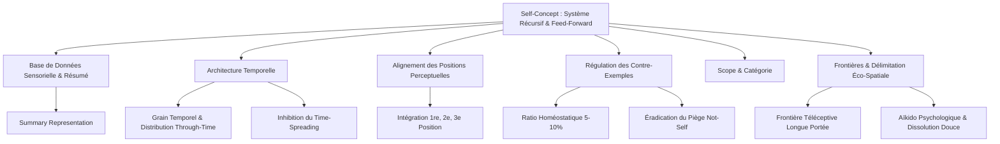

# Transforming Yourself - Source Supports
**Formateur :** Damon Cart | **ID :** `damon-cart-transforming-yourself-source-supports` | **Tranches :** 4

## Synthèse Architecturale du Cours

---

### 1. Thèse Centrale & Philosophie du Cours

#### Vision spécifique de Damon Cart vs. Approche standard
L'approche standard en développement personnel et en PNL classique traite l'identité de façon déclarative, compensatoire ou narrative (affirmations positives verbales, modification d'états d'âme ponctuels, recadrage de croyances isolées ou tentative de « forcer » l'estime de soi). 

La posture de Damon Cart — s'inscrivant dans la filiation directe du modèle *Self-Concept* de Steve Andreas — est rigoureusement **cybernétique, structurelle et éco-spatiale** :
1. **L'identité comme base de données sensorielle :** Le concept de soi n'est ni un concept abstrait, ni un dialogue intérieur. C'est une architecture computationnelle inconsciente encodée sous forme d'une base de données d'expériences mémorielles (images, sons, kinesthésies) spatialement distribuée et résumée par une représentation sommaire (*Summary Representation*).
2. **Découplage Estime vs Concept de Soi :** L'estime de soi n'est pas une compétence qu'on entraîne ; c'est un simple épiphénomène affectif, un tableau de bord. Elle émerge spontanément dès lors que la base de données du concept de soi est solidifiée et structurellement alignée sur les valeurs du sujet. Vouloir booster l'estime sans transformer la structure du concept de soi génère une surcompensation fragile (arrogance, compensation narcissique).
3. **Non-confrontation & Aïkido Psychologique :** Plutôt que de « briser » (*shatter*) les croyances, forcer la volonté ou détruire les blocages (ce qui provoque un rebond homéostatique et polarise le système nerveux), l'intervention opère par dissolution douce (*melting*), réappropriation de l'Ombre (*re-owning*), réalignement spatial et intégration de la fonction protectrice.

#### Fil rouge méthodologique
Le fil conducteur reliant chaque intervention repose sur une règle systémique invariante :  
**Éliciter l'organisation spatiale et temporelle actuelle du système nerveux $\rightarrow$ Tester les contre-exemples et l'homéostasie $\rightarrow$ Recalibrer la syntaxe sous-modale (position, temps, frontière, catégorie) $\rightarrow$ Installer un système projectif autonome (*feed-forward*).**

Le travail s'effectue toujours sur le *contenant* (la forme, la géométrie, la distribution) plutôt que sur le *contenu* dramatique de l'histoire personnelle. Dès que la structure est corrigée, le comportement découle naturellement d'un savoir intérieur direct (*inner knowing*), rendant la validation externe caduque.

---

### 2. Carte des Concepts & Leviers Émergents



#### Liste structurée des concepts clés :

* **Système Récursif & Référant à Soi (`Self-Referring & Recursive System`) :** Boucle cybernétique où chaque expérience vécue est filtrée par le concept de soi préexistant, validant en retour la structure qui l'a interprétée.
* **Représentation Sommaire & Base de Données (`Summary Representation & Database`) :** La synthèse gestualisée/spatiale d'une qualité (ex. un film ou une image composite) qui sert d'index d'accès rapide à des centaines de micro-souvenirs sensoriels.
* **Système Feed-Forward & Continuité Spatio-Temporelle (`Feed-Forward & Through-Time Continuity`) :** Mécanisme prédictif du système nerveux projetant le concept de soi dans l'avenir, créant un pont neurologique d'action spontanée sans délibération.
* **Calibrage du Grain Temporel (`Chunk Size of Time`) :** Modulation de la durée encodée des exemples (secondes pour la vivacité, années pour la constance) assurant réactivité et stabilité.
* **Contamination Émotionnelle Étalée (`Time Spreading`) :** Biais consistant à étaler un micro-incident négatif sur une période temporelle vaste (« journée pourrie »). Le levier consiste à confiner l'incident à sa fenêtre objective.
* **Alignement Géométrique des Positions Perceptuelles :** Encodage obligatoire d'une qualité sous 3 angles : Soi incarné (1re position), Impact sur autrui (2e position) et Observateur méta (3e position).
* **Ratio Homéostatique de Contre-Exemples (5–10 %) :** Taux critique de contre-exemples intégrés (atténués et miniaturisés) indispensable pour immuniser la qualité contre la fragilité dogmatique sans basculer dans le doute.
* **Topographie de l'Ambiguïté :** Cartographie spatiale des conflits identitaires déclinée en 3 formats (superposition sur la même coordonnée, clivage spatial ou clivage transmodal).
* **Piège Neurologique du « Non-Moi » (`Not-Self` Trap) :** Incapacité du cerveau à encoder une négation sans activer l'image de ce qui est nié, générant l'Ombre refoulée, l'hypervigilance et la projection paranoïaque.
* **Ajustement de Champ & Recatégorisation (`Scope & Category`) :** Déplacement de cadre requalifiant un échec ou un contre-exemple en simple « manque d'information » ou en compétence contextuelle distincte.
* **Frontières du Soi & Détection Téléceptive (`Boundaries of Self`) :** Lisière sensorielle régulant l'inclusion/exclusion du Moi. Son extension spatiale active les sens à distance (vue/ouïe) pour anticiper sans sidération tactile/kinesthésique.
* **Écologie de Dissolution vs Confrontation :** Remplacement de l'attaque frontale des symptômes par la liquéfaction douce des rigidités avec préservation de leur intention protectrice originelle.
* **Économie Métabolique du Clivage :** Récupération de l'énergie nerveuse consommée par le refoulement pour restaurer la bande passante exécutive du sujet.
* **Aïkido Psychologique :** Inclusion du perturbateur à l'intérieur du champ relationnel élargi pour désamorcer l'alarme amygdalienne et manœuvrer avec un minimum d'effort.

---

### 3. Tableau Récapitulatif des Techniques & Démonstrations

| Technique / Exercice | Objectif Opératoire | Déclencheur / Indication | Séquence Résumée |
|---|---|---|---|
| **Élicitation & Alignement du Gabarit Positif** | Découvrir l'organisation sous-modale native d'une qualité robuste et certaine chez le sujet. | Début de travail sur une qualité absente, faible ou confuse ; besoin d'un étalon de mesure. | 1. Éliciter une qualité certaine existante.<br>2. Localiser la représentation sommaire et la base de données.<br>3. Mapper sous-modalités (distance, dimensions, luminosité, localisation spatiale).<br>4. Relever la distribution temporelle (passé, présent, futur). |
| **Recodage / Construction d'une Qualité Identitaire** | Installer une nouvelle qualité absente ou renforcer une qualité déficitaire jusqu'au savoir intérieur (*inner knowing*). | Le sujet se plaint d'un manque de confiance, d'incapacité perçue (« Je ne suis pas créatif / persévérant »). | 1. Sélectionner la qualité alignée avec les valeurs.<br>2. Rassembler des souvenirs d'expériences réelles (passé proche, lointain).<br>3. Formater et aligner chaque exemple sur le gabarit positif élicité.<br>4. Générer une représentation sommaire.<br>5. Projeter des simulations dans le futur (*feed-forward*). |
| **Inoculation du Ratio de Contre-Exemples (5–10 %)** | Immuniser une qualité contre la rigidité dogmatique ou l'effondrement au premier échec. | Qualité arrogante, perfectionnisme cassant, ou au contraire peur viscérale de défaillir. | 1. Sélectionner 1 ou 2 contre-exemples réels.<br>2. Appliquer les opérateurs de réduction : miniaturiser, décolorer, éloigner ou déplacer en marge périphérique.<br>3. Intégrer au cadre global comme marge d'apprentissage ou feedback normal (5 à 10 % du volume total). |
| **Résolution de l'Ambiguïté Identitaire** | Unifier les polarités oscillantes (« Parfois je le suis, parfois non ») en une certitude stable. | Hésitation identitaire, bascule instable d'un état à son opposé selon le contexte. | 1. Cartographier l'espace : détecter si superposition, clivage spatial ou clivage modal.<br>2. Recatégoriser les contre-exemples (Scope & Category).<br>3. Aligner spatialement l'ensemble des exemples validés sur le gabarit de la qualité positive. |
| **Désactivation du « Not-Self » & Réappropriation de l'Ombre** | Supprimer la projection paranoïaque et la tension interne causées par la définition de soi par la négative. | Formulation réactive (« Je veux cesser d'être faible/lâche »), phobie d'un trait personnel refoulé. | 1. Identifier la qualité positive d'approche (*toward*) masquée par la négation (*away-from*).<br>2. Rendre visible la représentation inconsciente niée.<br>3. Récupérer l'intention positive de protection.<br>4. Dissoudre la frontière interne et réintégrer l'énergie aliénée (*re-owning*). |
| **Recalibrage du Grain Temporel & Réduction du Time-Spreading** | Empêcher la contamination d'un événement négatif ponctuel sur la ligne temporelle globale. | Dramatisation, biais de récence (« J'ai tout raté aujourd'hui / cette année »). | 1. Identifier la durée réelle de l'incident (*chunk size* factuel : ex. 15 minutes).<br>2. Réduire le cadre spatial temporel à ses bornes réelles.<br>3. Réinsérer les exemples positifs masqués avant et après l'événement.<br>4. Rétablir le continuum *through-time*. |
| **Intégration Tri-Positionnelle** | Équilibrer l'expression d'une qualité pour éviter l'égocentrisme ou l'oubli de soi. | Qualité vécue uniquement de l'intérieur (arrogance) ou uniquement à travers le regard d'autrui (dépendance). | 1. Éliciter la qualité en 1re position (ressenti intéroceptif).<br>2. Glisser en 2e position (effet perçu/ressenti chez l'autre).<br>3. Passer en 3e position (vue d'ensemble systémique).<br>4. Fusionner les trois perspectives dans la base de données. |
| **Ajustement Éco-Spatial des Frontières du Soi** | Calibrer la perméabilité et la portée des frontières psychiques pour optimiser la sécurité et la clarté relationnelle. | Épongisme émotionnel, sensation d'agression rapide, ou au contraire isolement rigide et armure relationnelle. | 1. Localiser la frontière sensorielle actuelle (distance, épaisseur, texture, matière).<br>2. Tester la perméabilité aux signaux entrants/sortants.<br>3. Élargir spatialement la frontière pour activer les modalités téléceptives (vue/ouïe anticipatrices).<br>4. Remplacer la rigidité par une flexibilité semi-perméable écologique. |
| **Dissolution Douce des Barrières Internes** | Lever les blocages somatiques et divisions esprit/corps sans rebond défensif. | Nœuds somatiques, résistance interne, sentiment de coupure avec une partie de soi. | 1. Accueillir la zone de blocage et son intention de préservation.<br>2. Abandonner tout effort de cassure ou de passage en force.<br>3. Introduire un processus de ramollissement/liquéfaction (*melting*) sous-modal.<br>4. Réactiver la circulation sensorielle et récupérer les ressources bloquées. |
| **Aïkido Psychologique & Connexion Inversive** | Neutraliser une attaque externe ou un stimulus déstabilisant par inclusion systémique. | Tendance à se recroqueviller, sidération, perte de moyens face au conflit. | 1. Observer la contraction réflexe (réduction de frontière, tension).<br>2. Respirer et étendre délibérément la frontière pour englober l'interlocuteur/stimulus menaçant.<br>3. Établir la connexion somatosensorielle plutôt que la rupture.<br>4. Rediriger le flux relationnel à partir d'un état interne centré et stable. |

---

## Extractions Détaillées par Tranche (Opératoire & Verbatim)


## --- Tranche 1 / 4 ---

Voici l’extraction intégrale, opératoire et rigoureuse de la tranche 1/4 du cours **"Transforming Yourself - Source Supports"** de **Damon Cart** (fondé sur les travaux de **Steve Andreas**).

---

### 1. Mécanismes & Principes Actifs

#### A. Architecture Systémique du Self-Concept (Niveaux Logiques & Récursion)
* **Terme exact :** `Self-Referring & Recursive System` / `Large Generalization`
* **Tags libres émergents :** `#cybernetique_identitaire #boucle_recursive #niveau_logique_englobant #auto_validation_somatique`
* **Principe actif :**
  Contrairement à la perception d'un objet externe (qui ne modifie pas les propriétés intrinsèques de l'objet lorsqu'on le pense), le *Self-Concept* est à la fois l'observateur, le créateur de la représentation et l'objet représenté (`Subject & Object`). Cette structure auto-référentielle produit une boucle de rétroaction permanente : l'idée que le sujet se fait de lui-même pilote directement le tonus musculaire, l'accès aux ressources neurologiques et le comportement extérieur, qui vient à son tour reconfirmer la représentation initiale. 
  Parce qu'il s'agit du plus haut niveau de généralisation interne (`Identity`), toute altération de sa structure se répercute par cascade descendante sur les croyances, capacités et comportements subordonnés, sans nécessiter d'intervention contextuelle spécifique.

#### B. Découplage Structurel : Estime de Soi vs Concept de Soi
* **Terme exact :** `Self-Concept vs. Self-Esteem Alignment`
* **Tags libres émergents :** `#epiphenomene_affectif #alignement_valeurs #indicateur_de_bord #illusion_de_l_affirmation`
* **Principe actif :**
  L'estime de soi n'est pas une entité psychologique traitable directement ; c'est un **épiphénomène**, une évaluation affective résultante (`How you feel about the generalization`). 
  - Si le *Self-Concept* (ce que la personne perçoit être) n'est pas aligné avec ses *Valeurs* (ce qui compte intrinsèquement pour elle), le système nerveux génère une incongruence affective perçue comme une « basse estime de soi ».
  - Tenter de gonfler l'estime de soi par des affirmations verbales directes échoue ou génère de l'arrogance/narcissisme (surcompensation d'une structure interne fragile). Lorsque le concept de soi est solidifié et aligné structurellement avec les valeurs, la haute estime de soi émerge de façon **automatique et inconsciente**, sans effort volontaire.

#### C. Encodage par Base de Données Somatosensorielle & Représentation Sommaire
* **Terme exact :** `Summary Representation & Experience Database`
* **Tags libres émergents :** `#indexation_multimodale #compression_mnesique #representation_sommaire #densite_d_information`
* **Principe actif :**
  Pour savoir instantanément "qui il est" sans recalculer l'intégralité de sa biographie, le cerveau utilise une **Représentation Sommaire** (une icône visuelle, un ressenti cénesthésique ou un marqueur auditif synthétique). Cette représentation condense une **base de données sous-jacente** composée d'expériences mémorisées. 
  La robustesse d'un trait identitaire dépend directement de la volumétrie, de la modalité et de l'organisation spatio-temporelle de cette base de données : plus les exemples sont nombreux, multimodaux et spatialement accessibles, plus le sentiment de certitude (`solidity/certainty`) est inébranlable face aux contestations externes.

#### D. Système Feed-Forward & Continuité Spatio-Temporelle
* **Terme exact :** `Feed-Forward System` / `Continuity Across Time & Space`
* **Tags libres émergents :** `#projection_proactive #invariance_structurelle #distribution_temporelle #immunite_identitaire`
* **Principe actif :**
  Le *Self-Concept* ne se contente pas d'enregistrer le passé (système de feedback) ; il projette une trajectoire identitaire dans le futur (`feed-forward`). 
  - En distribuant des représentations d'une qualité dans le passé, le présent ET le futur, le cerveau crée une **continuité d'identité** indépendante des contextes fluctuants. 
  - **Immunité identitaire :** lorsqu'une erreur ou un échec survient, une base de données temporelle robuste confine l'événement au niveau du comportement circonscrit (*"J'ai fait une erreur à 14h00"*) sans contaminer l'identité (*"Je suis un raté"*).

#### E. Sensibilité au Feedback & Auto-Correction Cybernétique
* **Terme exact :** `Self-Correcting & Responsive to Feedback`
* **Tags libres émergents :** `#boucle_de_correction #discernement_d_ecart #solidite_flexible #ecologie_dynamique`
* **Principe actif :**
  Un concept de soi sain n'est ni rigide/arrogant ni flou/poreux. Plus la base de données interne est riche en contextes variés et multimodaux (notamment en mode associé), plus le système nerveux devient sensible au moindre écart entre l'action réelle et la valeur identitaire. 
  Cette détection précoce d'écart déclenche une motivation homéostatique immédiate à réajuster le comportement, permettant au sujet d'être véritablement auto-correcteur sans effondrement émotionnel.

---

### 2. Protocoles, Techniques & Démonstrations (Étape par Étape)

---

#### PROTOCOLE 1 : Découverte & Cartographie de la Structure du Self-Concept
* **Intention / Indication :** Révéler le codage submodal et spatial inconscient par lequel le sujet sait avec certitude qu'il possède une qualité positive stable.
* **Mise en place & Pré-framing :** 
  Cadrer sur le **comment** (processus d'encodage) et non sur le **pourquoi** (histoire/justification). 
  Consigne : *"Ne cherchez pas pourquoi vous êtes ainsi. Observez comment vous savez que vous l'êtes dans votre système interne."*

##### Séquence d'actions pas à pas :

1. **Sélection de la qualité cible :**
   - Choisir une qualité identitaire de portée intermédiaire (`Intermediate Scope`) : ni trop vaste (*"enfant de l'univers"*), ni trop étroite (*"bon joueur d'échecs"*). Exemples : *aimant, honnête, persévérant, intelligent, résilient*.
   - Condition requise : Le sujet doit être **absolument certain** de posséder cette qualité et cette qualité doit être alignée avec ce qu'il aime en lui.

2. **Élicitation de la Représentation Sommaire :**
   - Poser la question de processus : *"Comment sais-tu que tu es [qualité] ?"*
   - Inviter le sujet à fermer les yeux pendant 5 minutes d'exploration silencieuse : 
     *"Quelle est la première image, le premier son ou la première sensation qui résume ou représente pour toi cette certitude d'être [qualité] ?"*

3. **Excavation de la Base de Données sous-jacente :**
   - Faire reculer la représentation sommaire pour observer ce qui la soutient :
     *"Derrière ou autour de ce symbole/cette image, où sont rangés les exemples de ta vie qui prouvent que tu es ainsi ?"*

4. **Audit selon la Checklist Structurelle :**
   - **Quantité d'exemples :** Évaluer le volume (1, 5, 20, 100, une infinité en réseau ?).
   - **Localisation Spatiale :** Où flottent ces souvenirs dans l'espace péripersonnel (devant, derrière, en arc de cercle, au centre de la poitrine, à gauche, à droite) ?
   - **Simultanéité vs Séquentialité :** Les exemples apparaissent-ils tous en même temps (tableau panoramique/collage) ou l'un après l'autre (film/défilement) ?
   - **Modalités :** Présence de visuel (films/photos couleur), auditif (voix, tonalités), kinesthésique (tactile, proprioceptif) ?
   - **Position Perceptive (Association vs Dissociation) :** Dans chaque exemple, le sujet se voit-il de l'extérieur (dissocié) ou revit-il la scène à travers ses propres yeux (associé) ?
   - **Submodalités critiques :** Distance, luminosité, taille des images, netteté, mouvement.

* **Signes de calibration du praticien :**
  - Mouvements oculaires d'accès (balayages spatiaux précis indiquant l'emplacement des banques d'images).
  - Déglutition, relâchement des micro-tensions faciales et posture symétrique lors du contact avec la certitude.
  - Vitesse de réponse : un arrêt réflexif fluide sans hésitation verbale indique une structure stable.

---

#### PROTOCOLE 2 : Test de Résistance & Intensification Structurelle
* **Intention / Indication :** Tester la solidité d'une qualité, identifier les leviers submodaux critiques de certitude et renforcer la structure par manipulation de paramètres unilatéraux.
* **Mise en place & Pré-framing :**
  Règle absolue : **Un seul changement à la fois**. Revenir à l'état de référence entre chaque variation pour mesurer l'impact isolé.

##### Séquence d'actions pas à pas :

1. **Variation Volumétrique :**
   - Faire doubler ou tripler mentalement le nombre d'exemples dans l'espace : observer l'effet somatique sur la solidité.
   - Soustraire ou masquer des exemples : calibrer l'effritement du sentiment de certitude.

2. **Translation Spatiale :**
   - Déplacer le bloc ou le collage de souvenirs d'un mètre vers la droite, vers la gauche, plus près ou plus loin.
   - Identifier la coordonnée spatiale optimale qui confère le sentiment d'évidence absolue.

3. **Bascule de Format (Simultané vs Séquentiel) :**
   - Si les souvenirs défilent séquentiellement : les figer et les déployer tous en même temps sur un mur d'écrans simultanés. (Calibrer le gain d'impact global).
   - Si les souvenirs sont simultanés : zoomer séquentiellement sur un exemple pour extraire le détail procédural.

4. **Bascule Associé / Dissocié :**
   - Faire passer le sujet d'associé à dissocié (se voir agir) puis inversement (réintégrer son corps). Noter la différence d'accès émotionnel et kinesthésique.

5. **Ajustement Submodal Fin :**
   - Augmenter la taille, la luminosité, la saturation des couleurs, rapprocher les images clés jusqu'à atteindre le seuil de solidité maximale (`most real, solid & true`).

* **Signes de calibration du praticien :**
  - Changement de la fréquence respiratoire (respiration plus profonde et ventrale lors du pic de solidité).
  - Tonus vocal plus posé, intonation descendante sur les assertions d'identité.

---

#### PROTOCOLE 3 : Alignement Temporel & Encodage Feed-Forward
* **Intention / Indication :** Empêcher qu'une qualité ne reste cantonnée au passé ou ne devienne caduque. Créer une continuité temporelle ininterrompue et installer l'auto-correction future.
* **Mise en place & Pré-framing :**
  Expliquer que l'identité saine s'étend à travers le temps (`Through-Time Continuity`).

##### Séquence d'actions pas à pas :

1. **Scan de la Ligne du Temps des Exemples :**
   - Interroger le sujet sur la distribution chronologique :
     *"Y a-t-il des exemples dans le passé lointain (enfance), le passé récent, le présent immédiat ?"*
     *"Y a-t-il déjà des représentations de cette qualité dans le futur ?"*

2. **Distribution Temporelle Équilibrée :**
   - Si un segment temporel est vide (ex: adolescence ou dernières années), inviter l'inconscient à récupérer des micro-moments oubliés manifestant cette qualité et les insérer dans le vide temporel.

3. **Injection Feed-Forward (Futurisation Opératoire) :**
   - Générer intentionnellement des représentations futures de soi manifestant la qualité :
     *"Construis 3 à 5 représentations futures, dans des contextes variés (professionnel, intime, imprévu), où tu te vois manifester naturellement [qualité]."*
   - **Submodalité de sécurité écologique :** Garder les images futures **légèrement floues ou ouvertes aux détails** (`somewhat vague & uncertain`) pour préserver l'adaptabilité contextuelle et éviter la rigidité obsessionnelle.

4. **Variation de l'Échelle Temporelle (`Chunk Size of Time`) :**
   - Mixer des exemples de durées très différentes :
     - Événements de quelques secondes (réaction spontanée, regard bienveillant).
     - Événements de plusieurs heures ou journées (résolution d'un problème complexe).
     - Périodes de plusieurs années (fidélité, persévérance sur un projet de vie).
   - Intégrer ce mélange pour densifier la texture temporelle de l'identité.

5. **Test d'Écologie & Congruence :**
   - Imaginer une situation future où un comportement inadéquat se produit :
     Calibrer si le sujet ressent immédiatement le signal d'écart somatique tout en maintenant son sentiment d'identité intact.

* **Signes de calibration du praticien :**
  - Orientation du regard vers le vecteur futur du sujet (souvent en haut à droite ou vers l'avant selon la Time-Line).
  - Micro-hochements de tête affirmatifs automatiques signant l'acceptation inconsciente de la continuité.

---

### 3. Heuristiques, Subtilités & "Sagesse du Praticien"

#### Règles Conditionnelles d'Intervention (SI / ALORS)
1. **SI** le sujet a une estime de soi effondrée,  
   **ALORS** ne jamais travailler directement sur l'estime de soi ou sur des affirmations positives,  
   **PARCE QUE** l'estime de soi est une résultante d'un niveau logique supérieur ; il faut réparer le concept de soi et son alignement avec les valeurs pour que l'évaluation affective s'ajuste d'elle-même.
2. **SI** le sujet présente des comportements d'arrogance, d'égocentrisme ou de supériorité,  
   **ALORS** poser l'hypothèse diagnostique d'un concept de soi **faible, incertain et ambigu**,  
   **PARCE QUE** l'auto-importance est la tentative consciente et compensatoire de masquer un vide structurel sous-jacent issu de la comparaison aux autres.
3. **SI** la base de données du sujet ne contient que des exemples du passé,  
   **ALORS** la qualité s'éteindra dans le futur face aux imprévus ; il est impératif d'installer activement des représentations feed-forward dans l'espace futur.
4. **SI** les représentations du futur sont trop précises, hyper-détaillées et rigides,  
   **ALORS** faire baisser la netteté et introduire du flou artistique,  
   **PARCE QUE** une représentation future rigide brise l'écologie systémique et empêche l'adaptation aux rétroactions réelles du milieu.
5. **SI** le sujet est systématiquement dissocié dans ses souvenirs de compétence/qualité,  
   **ALORS** il ne dispose que d'informations visuelles et manque de retours kinesthésiques/auditifs internes ; il faut l'entraîner à s'associer pour restaurer la pleine sensibilité somatosensorielle aux écarts.
6. **SI** le sujet fait une erreur comportementale et commence à paniquer ou à s'auto-déprécier,  
   **ALORS** recadrer immédiatement du niveau Identité au niveau Comportement :  
   *"C'est ce que tu as fait à cet instant précis, ce n'est pas ce que tu es à travers le temps."*

#### Pièges Classiques & Erreurs de Débutant
- **Le piège du contenu ("Why") :** Se perdre dans les anecdotes de vie et les justifications rationnelles au lieu de cartographier la structure submodale spatio-temporelle ("How").
- **Le piège de la comparaison sociale :** Construire une identité relative (*"Je suis plus gentil que Pierre"*). Tout concept de soi fondé sur la comparaison isole, crée l'insécurité permanente et bascule inévitablement dans le narcissisme ou le sentiment d'infériorité. L'identité saine est **absolue et intransitive** (*"Je suis bienveillant"*).
- **Le piège de la fausse spiritualité ("No-Self") :** Prétendre détruire ou dissoudre l'ego/le soi par rejet mystique ne fait qu'augmenter l'auto-conscience névrotique (`self-consciousness`). Le système nerveux humain a besoin d'une structure identitaire stable et fonctionnelle pour naviguer dans le monde sans angoisse de fragmentation.
- **La suppression d'un bloc temporel :** Croire qu'on n'a pas manifesté une qualité durant une période sombre. Le praticien sait que le sujet oublie simplement les micro-exemples ; la qualité était latente ou manifestée à un niveau microscopique.

#### Postulats Opératoires de Damon Cart & Steve Andreas
- Le concept de soi est un artefact accidentel et chaotique (`haphazard`) forgé dans l'enfance par l'approbation et le rejet social ; l'ingénierie PNL permet d'en reprendre le contrôle délibéré.
- Un concept de soi robuste n'est pas blindé contre les attaques : il est **élastique, résilient et auto-correcteur**.
- La liberté psychologique ne consiste pas à n'avoir aucune identité, mais à avoir une identité si solidement établie au niveau inconscient qu'on peut l'oublier totalement pour entrer en état de flow (`unconscious and automatic`).

---

### 4. Pépites Verbatim & Patterns Linguistiques (V.O. & Analyse)

> **Verbatim :**  
> *"If your self-concept is the map of your self, your values are the headlights."*  
- **[Analyse du Pattern]** :  
  **Métaphore spatiale & projection dynamique.** En associant le concept de soi à une carte (statique/structurelle) et les valeurs à des phares (orientés vers l'avant, éclairant la nuit), la syntaxe présuppose que le mouvement dans la vie est impossible sans les deux : la carte définit le terrain de qui l'on est, mais les valeurs indiquent où porter le regard et l'action.

---

> **Verbatim :**  
> *"Your self-concept is a belief you cannot escape, which makes it more important than your beliefs about others and the world. Self-concept goes with you everywhere and affects everything you experience."*  
- **[Analyse du Pattern]** :  
  **Quantificateurs universels (`cannot escape`, `everywhere`, `everything`) & Truisme inévitable.** Ce pattern linguistique force le système cognitif à capituler face à la primauté du travail identitaire. La structure syntaxique lie l'ubiquité du soi à l'obligation absolue de le transformer en priorité.

---

> **Verbatim :**  
> *"When you make an image of yourself, you are both the maker of the image and that which the image represents. Your self-concept both refers to itself & acts on itself."*  
- **[Analyse du Pattern]** :  
  **Boucle autoréférentielle paradoxale (Sujet/Objet enchâssé).** Rupture de la logique linéaire de cause à effet. En désignant l'individu simultanément comme l'artisan et la matière, cette formule induit une confusion hypnotique légère qui contourne le facteur critique pour ouvrir la plasticité de l'identité.

---

> **Verbatim :**  
> *"When your self-concept is not aligned with your values, you will experience low self-esteem. When your self-concept is aligned with your values, you can enjoy high self-esteem."*  
- **[Analyse du Pattern]** :  
  **Parallélisme isomorphique & Cause-à-effet conditionnelle (`When X... you will / you can`).** Ce double lien linguistique redéfinit l'estime de soi d'un problème mystérieux/médicalisé en une simple conséquence mécanique d'alignement géométrique interne.

---

> **Verbatim :**  
> *"When you have a solid sense of who you are and you behave in a way that doesn’t align with your values, it only says something about what you did, not who you are."*  
- **[Analyse du Pattern]** :  
  **Scission de niveaux logiques (Comportement vs Identité) & Recadrage restrictif (`it only says...`).** L'utilisation de l'adverbe restrictif *"only"* couplé à la disjonction entre le verbe d'action (`what you did`) et le verbe d'état identitaire (`who you are`) anéantit instantanément le réflexe de culpabilité identitaire ou de honte toxique, libérant le système pour l'auto-correction.

---

> **Verbatim :**  
> *"Self-importance is actually the conscious half of an uncertain and ambiguous self-concept."*  
- **[Analyse du Pattern]** :  
  **Recadrage par redéfinition d'équivalence complexe (`Sleight of Mouth: Redefinition`).** Ce pattern prend un comportement perçu comme une force ou un excès de confiance (l'arrogance/l'ego) et le requalifie syntaxiquement comme le symptôme direct d'une fragilité structurelle inconsciente (`uncertain and ambiguous`). Cela désamorce toute tentation de posture narcissique chez le praticien ou le client.

---

> **Verbatim :**  
> *"Whenever we make images of the future, it’s wise to allow for this by making them somewhat vague & uncertain."*  
- **[Analyse du Pattern]** :  
  **Présupposition permissive enchâssée (`it's wise to allow`) & Contre-suggestion submodale.** Contrairement aux injonctions simplistes de la PNL classique prônant la netteté absolue ("VAKOG précis"), l'injection de qualificatifs atténuateurs (`somewhat vague & uncertain`) agit comme un amortisseur cybernétique sur l'inconscient, empêchant le sujet de sombrer dans l'anxiété de performance ou la rigidité compulsive face à l'imprévu.


## --- Tranche 2 / 4 ---

Voici l’extraction chirurgicale et l’analyse opératoire de la tranche 2/4 du cours **"Transforming Yourself - Source Supports"** de **Damon Cart** (fondé sur les travaux de modélisation du Concept de Soi de Steve Andreas).

---

### 1. Mécanismes & Principes Actifs

#### A. Architecture Temporelle du Concept de Soi
* **Distribution Temporelle & Robustesse Diachronique** :
  * *Principe actif* : Un concept de soi robuste ne repose pas sur une accumulation statique d'exemples synchroniques, mais sur un continuum temporel (*through-time process*) équilibré (passé lointain, passé récent, présent, futur). L'encodage d'exemples dans le futur agit comme un pont neurologique projectif, garantissant que l'identité persiste au-delà du présent immédiat.
  * *Impact neurologique/cognitif* : La distribution temporelle étendue confère une stabilité immunologique au système identitaire face aux retours critiques. Au lieu de s'effondrer comme un château de cartes sous l'effet du biais de récence (*armchair quarterback*), le système contextualise chaque incident dans une trajectoire globale.
  * *Tags* : `#time_distribution` `#through_time_continuity` `#future_paced_examples` `#temporal_robustness`

* **Calibrage du Grain Temporel (Chunk Size of Time)** :
  * *Principe actif* : Les exemples qui constituent la base de données possèdent des durées représentées variables (d'une fraction de seconde à des décennies). Les qualités éphémères/dynamiques (spontanéité, vivacité) s'encodent typiquement dans des micro-durées (secondes/minutes), tandis que les qualités de fond (loyauté, persévérance) s'ancrent dans des macro-durées (mois/années).
  * *Impact cognitif* : Avoir un panachage délibéré de tailles de grains temporels au sein d'une même base de données permet d'éviter l'inertie (incapacité à réagir vite) tout en prévenant la volatilité émotionnelle.
  * *Tags* : `#chunk_size_of_time` `#duration_encoding` `#temporal_granularity`

* **Étirement Temporel & Contamination Émotionnelle (Time Spreading)** :
  * *Principe actif* : Tendance cognitive spontanée à étaler une affectation négative ponctuelle (un événement désagréable de 10 minutes) sur l'ensemble d'un cadre temporel supérieur ("une mauvaise journée", "une année noire"), annihilant rétroactivement et proactivement tous les contre-exemples positifs de cette période.
  * *Impact cognitif* : L'étalement temporel est une généralisation destructive qui détruit la sélectivité de l'encodage mnésique. Inverser ce levier permet de réduire la portée spatio-temporelle des incidents ou, au contraire, d'étendre la sensation d'une réussite passée vers le futur.
  * *Tags* : `#time_spreading` `#temporal_generalization` `#affect_dilution`

#### B. Architecture du Contenu & Positions Perceptuelles
* **Alignement Géométrique des Positions Perceptuelles (1re, 2e, 3e Position)** :
  * *Principe actif* : Un concept de soi équilibré encode la qualité selon trois perspectives distinctes : l'expérience vécue incarnée (Soi / 1re), l'impact somato-émotionnel ressenti par l'interlocuteur (Autre / 2e) et l'observation méta déconnectée (Observateur / 3e).
  * *Impact neurologique* : 
    * 1re position seule = égocentrisme, cécité relationnelle, arrogance.
    * 2e position seule = dépendance affective, perte des frontières du soi, effacement des repères internes.
    * 3e position seule = dissociation stérile, intellectualisation sans ressenti kinesthésique d'incarnation.
    * *Règle spatiale de neutralité* : L'observateur doit être positionné à équidistance exacte du Soi et de l'Autre, sur un même plan horizontal (hauteur égale). Une élévation crée une posture de supériorité/mépris ; une position basse encode la soumission/infériorité.
  * *Tags* : `#perceptual_positions_alignment` `#equidistant_observer` `#spatial_leveling`

* **Bipolarité Symbolique vs Spécificité Sensorielle (Iconic vs Detailed)** :
  * *Principe actif* : Les représentations métaphoriques/iconiques condensent une forte charge de sens et servent de représentations-sommaires (synthèse de la base de données). En revanche, elles sont totalement inopérantes pour guider une action motrice concrète en temps réel car elles manquent de spécificité sensorielle (VAKOG).
  * *Tags* : `#iconic_vs_sensory` `#summary_representation` `#operational_specification`

* **Modélisation par Assimilation d'Autrui & Risque de Contamination** :
  * *Principe actif* : Intégrer des représentations de figures extérieures dans sa propre base de données permet d'adopter leurs compétences. Cependant, le système nerveux a tendance à copier le package complet (défauts, tics, névroses, postures toxiques) faute d'un découpage précis (*chunking down*) des comportements valorisés.
  * *Tags* : `#other_people_modeling` `#behavioral_filtering` `#charismatic_mimicry_bias`

#### C. Ingestion, Utilisation & Transformation des Contre-Exemples
* **Le Ratio d'Immunité Réaliste (5 % à 10 % de Contre-Exemples)** :
  * *Principe actif* : Une base de données 100 % pure de pensées/exemples positifs génère une structure fragile, rigide et névrotique. Le moindre échec menace de faire s'effondrer toute la structure identitaire, conduisant au déni, à la paranoïa ou à la création d'une *ombre refoulée* (*shadow self*).
  * *Impact neurologique/cognitif* : L'incorporation contrôlée de 5 % à 10 % de contre-exemples (souvenirs d'erreurs, de faiblesses) agit comme un vaccin cognitif. Cela confère de la plasticité au système et stabilise l'estime de soi en la rendant résiliente au feedback correctif.
  * *Tags* : `#counterexample_ratio_5_10` `#shadow_self_prevention` `#psychological_immunity`

* **Dissociation Topologique & Bipolarisation Émotionnelle** :
  * *Principe actif* : Lorsque les contre-exemples sont relégués dans une modalité distincte (ex: exemples en images devant soi, mais critiques en voix auditives derrière la tête) ou dans un espace séparé non intégré, le sujet fonctionne en boucle binaire (tout blanc ou tout noir / instabilité maniaco-dépressive).
  * *Impact cognitif* : Réunir les représentations dans la même modalité (ramener l'auditif en visuel) et dans le même espace kinesthésique/visuel supprime le conflit polarisé.
  * *Tags* : `#spatial_modality_split` `#either_or_polarization` `#bipolar_representation_shift`

* **Recadrage par Ajustement de Portée (Scope : Rétrécissement, Élargissement, Intégration)** :
  * *Principe actif* : Une erreur n'est une erreur que dans un cadre spatial, temporel ou téléologique restreint.
    * *Rétrécissement de portée* : Définir des limites strictes à l'application de la qualité (ex: être directif au travail, mais pas à la maison).
    * *Élargissement de portée* : Intégrer le long terme (ex: refuser un plaisir immédiat à quelqu'un paraît dur à court terme, mais constitue une preuve d'amour/bienveillance à long terme ; se préserver du temps pour soi n'est pas de l'égoïsme mais la condition pour être disponible ensuite).
    * *Intégration méta-systémique* : Deux comportements opposés (ex: action vs farniente) répondent en réalité à une intention positive commune supérieure (flexibilité et équilibre écologique de vie).
  * *Tags* : `#scope_adjustment` `#narrowing_scope` `#widening_scope` `#overarching_category`

---

### 2. Protocoles, Techniques & Démonstrations (Étape par Étape)

#### Protocole 1 : Audit et Réalignement des Positions Perceptuelles
* **Intention / Indication** : Renforcer une qualité instable, supprimer l'arrogance (excès de 1re position), la codépendance (excès de 2e position) ou la froideur intellectualisée (excès de 3e position).
* **Mise en place & Pré-framing** : Faire fermer les yeux au sujet et lui faire déployer sa base de données d'exemples d'une qualité cible.
* **Séquence opératoire** :
  1. *Inventaire des points de vue* : Identifier depuis quel angle chaque exemple est perçu. S'agit-il d'images associées (1re), des yeux de la personne en face (2e), ou d'un regard extérieur neutre (3e) ?
  2. *Détection du déficit* : Relever la position absente ou minoritaire.
  3. *Inclusion délibérée* :
     - Pour un souvenir clé, inviter le sujet à glisser dans la peau de l'interlocuteur pour ressentir ce que produit sa qualité chez l'autre (2e).
     - Puis créer une caméra externe (3e) pour observer la dynamique interactionnelle complète.
  4. *Alignement géométrique et spatial* :
     - Calibrer la position 3 : Placer l'observateur à **égale distance** entre Soi (1re) et l'Autre (2e).
     - Égaliser les hauteurs : Ajuster le point de vue de l'observateur pour qu'il soit exactement au même niveau que les protagonistes (supprimer toute plongée de supériorité ou contre-plongée d'infériorité).
  5. *Intégration kinesthésique* : Faire circuler la conscience du sujet à travers les 3 positions successivement jusqu'à ce que la transition soit fluide et immédiate.
* **Signes de calibration** :
  - Disparition des micro-tensions asymétriques du cou (signe d'un observateur trop haut ou décentré).
  - Détente musculaire et respiration diaphragmatique lors du passage par l'observateur équidistant.
  - Réponses émotionnelles plus douces et nuancées (fin des jugements manichéens).

---

#### Protocole 2 : Intégration et Dosage Submodal des Contre-Exemples (5-10%)
* **Intention / Indication** : Sortir du perfectionnisme névrotique, éliminer la peur panique de l'échec, stabiliser une qualité vulnérable au moindre faux pas.
* **Mise en place & Pré-framing** : Valider que la perfection est un standard dysfonctionnel qui fragilise le concept de soi. Poser que les erreurs sont les garde-fous de la compétence.
* **Séquence opératoire** :
  1. *Cartographie spatiale & submodale des contre-exemples* :
     - Localiser où sont stockées les erreurs par rapport à la base de données positive (sont-elles à l'écart ? en arrière ? sous forme de voix critique ?).
  2. *Unification de modalité* :
     - Si le contre-exemple est auditif (voix interne), le transcrire en image visuelle de la situation concrète où l'erreur a eu lieu.
     - Si le contre-exemple est kinesthésique (sensation de malaise), remonter à l'événement sensoriel originel qui a provoqué ce jugement.
  3. *Atténuation submodale préventive* :
     - Avant tout déplacement, réduire la saillance du contre-exemple : le rétrécir, baisser la luminosité, le rendre plus plat (2D), ternir les couleurs (ton sépia ou brun-jaune) ou lui ajouter un cadre rigide.
  4. *Translation progressive & prudente* :
     - Rapprocher lentement le contre-exemple atténué vers la périphérie de la base de données positive.
     - *Règle d'arrêt* : Si l'image se remet à briller, grandit ou menace d'écraser les exemples positifs, stopper immédiatement et la reculer.
  5. *Insertion contextuelle* :
     - Placer le contre-exemple au milieu de plusieurs images positives pour le noyer dans un contexte de réussite globale.
  6. *Dosage volumétrique* :
     - Vérifier la proportion : les contre-exemples doivent occuper entre 5 % et 10 % du volume perceptif total.
  7. *Interdiction temporelle stricte* :
     - **Ne jamais insérer de contre-exemples dans les représentations du futur**. Le futur doit rester composé d'intentions congruentes et d'exemples positifs ouverts.
* **Signes de calibration** :
  - Relâchement des trapèzes et soupir de soulagement ("je n'ai plus besoin d'être parfait").
  - Test de provocation : quand on confronte le sujet à une critique passée, il sourit au lieu de se raidir ou de se justifier agressivement.

---

#### Protocole 3 : Négociation Temporelle des Contre-Exemples pour la Haute Performance
* **Intention / Indication** : Préparer un athlète, un orateur ou un artiste avant une performance de pointe, en désactivant le doute sans supprimer la capacité d'apprentissage.
* **Mise en place & Pré-framing** : Reconnaître la fonction utile des signaux d'erreur tout en définissant des fenêtres d'exclusion strictes.
* **Séquence opératoire** :
  1. *Identification de la partie vigilante* : Repérer l'instance interne (voix, image) qui brandit les souvenirs d'échecs passés.
  2. *Accusé de réception & Validation de l'intention positive* : Remercier explicitement cette part pour sa fonction de protection et son apport d'informations critiques.
  3. *Négociation du timing d'accès* :
     - Poser un accord contractuel : "Les contre-exemples sont indispensables **AVANT** l'épreuve (pour ajuster la préparation) et **APRÈS** l'épreuve (pour débriefer et corriger). Pendant l'exécution, ils doivent être parqués hors du champ attentionnel pour garantir une concentration totale."
  4. *Parcage temporaire* : Reléguer visuellement ces représentations dans un sas ou derrière un écran étanche pendant toute la durée de la performance.
* **Signes de calibration** :
  - Clarté du regard, regard focalisé vers l'avant.
  - Absence de mouvements oculaires erratiques vers les zones de dialogue interne critique (souvent en bas à gauche).

---

#### Protocole 4 : Transformation par Regroupement et Traitement du Pire Cas (The "Worst First" Shift)
* **Intention / Indication** : Dissoudre rapidement un groupe dense de contre-exemples récurrents sans avoir à les traiter un par un.
* **Mise en place & Pré-framing** : Expliquer que le cerveau généralise les apprentissages à partir de patterns communs.
* **Séquence opératoire** :
  1. *Regroupement thématique* : Rassembler une grappe de contre-exemples similaires (attention à ne pas en empiler trop d'un coup pour éviter la submersion kinesthésique).
  2. *Extraction du dénominateur commun* : Identifier le motif récurrent (ex: "perte de sang-froid sous pression temporelle").
  3. *Sélection de la cible pivot* : Trouver au sein de ce groupe soit le **premier événement** (la source), soit le **pire événement** (le pic d'intensité).
  4. *Identification de l'intention et des ressources manquantes* :
     - Quelle était l'intention positive sous-jacente lors de cet événement ?
     - De quelle ressource interne (calme, clarté, ancrage, recul) le sujet avait-il besoin pour honorer cette intention ?
  5. *Montage vidéo interne (Re-editing)* :
     - Faire rejouer la scène en injectant la ressource. Le sujet visualise la façon idéale dont il aurait aimé réagir dans le passé et dont il réagira à l'avenir dans un contexte identique.
  6. *Appariement côte à côte (Double Encodage)* :
     - Garder la mémoire réelle, mais la rendre petite, sombre et fixe (témoin objectif de ce qui s'est produit).
     - Placer à côté, en contact direct, la nouvelle version modélisée : grande, lumineuse, vivante, attrayante.
  7. *Test de généralisation* :
     - Passer en revue les autres contre-exemples de la même grappe.
     - Vérifier s'ils ont été automatiquement recalibrés par contagion de la ressource. Si certains résistent, traiter le résidu isolément avec une ressource complémentaire.
  8. *Réintégration finale* : Réinsérer le diptyque dans la base de données globale.
* **Signes de calibration** :
  - Accélération du traitement cognitif (le sujet balaie les souvenirs suivants sans réactivité somatique).
  - Micro-hochements de tête validant l'intégration congruente.

---

### 3. Heuristiques, Subtilités & "Sagesse du Praticien"

#### Règles Conditionnelles Directes (Si [X] -> Alors [Y] parce que [Z])
1. **Si le sujet exprime de la culpabilité ou du regret face à un comportement passé** :
   - *Alors* : Valider immédiatement la force du sentiment comme la preuve irréfutable de son attachement à une valeur fondamentale violée, puis chercher la seconde valeur rivale qui motivait son acte à l'époque.
   - *Parce que* : La culpabilité n'est pas un défaut de caractère, mais la friction entre deux valeurs légitimes non intégrées dans un cadre de pensée trop étroit.
2. **Si les contre-exemples sont séparés des exemples à la fois par la localisation ET par la modalité** :
   - *Alors* : Interdiction formelle de les déplacer directement vers la base de données. Il faut d'abord convertir la modalité (ex: voix -> image), stabiliser l'image, puis entamer la translation spatiale pas à pas.
   - *Parce que* : Une double dissonance (spatiale + sensorielle) provoque des bascules identitaires violentes (*mood swings*) si on force le rapprochement sans homogénéisation préalable.
3. **Si le sujet possède un concept de soi entièrement composé de symboles ou de métaphores (ex: un blason, un animal totem)** :
   - *Alors* : Conserver le symbole comme image-sommaire (*summary representation*), mais exiger l'adjonction immédiate d'exemples sensoriels concrets (photos/vidéos VAKOG spécifiques).
   - *Parce que* : Les métaphores donnent du sens global mais ne contiennent aucun protocole comportemental précis : le sujet "sait" qu'il a la qualité mais ne sait pas comment l'exécuter dans le monde réel.
4. **Si un individu restreint tous ses exemples d'excellence à un ou deux contextes de vie exclusifs (ex: l'athlète de haut niveau ou la mère au foyer)** :
   - *Alors* : Transposer délibérément la structure sous-jacente de cette qualité dans d'autres contextes de vie inexplorés (*mapping across*).
   - *Parce que* : En cas de rupture contextuelle (retraite sportive, départ des enfants), le sujet subit un effondrement identitaire brutal par absence de diversification de sa base de données.

#### Pièges Classiques & Erreurs de Débutant
* **Le piège de l'éradication des erreurs** : Chercher à éliminer 100 % des contre-exemples pour créer une "confiance absolue". Résultat : le sujet développe une paranoïa inconsciente et rejette agressivement toute critique extérieure pour empêcher sa base de données de s'effondrer.
* **La projection de contre-exemples dans le futur** : Glisser des images de soi en train d'échouer dans la ligne temporelle future sous prétexte de "réalisme". Règle d'or : Les contre-exemples appartiennent au passé pour informer ; le futur doit demeurer fluide, ouvert et orienté vers la trajectoire désirée.
* **L'inégalité spatiale de l'Observateur** : Laisser le sujet positionner l'observateur au-dessus de la scène. Cela installe un surmoi jugeant, condescendant ou culpabilisant, détruisant la neutralité épistémique nécessaire à la résolution de problème.

---

### 4. Pépites Verbatim & Patterns Linguistiques (MOT À MOT EN V.O.)

#### Verbatim 1 : L'immunité par l'intégration de l'imperfection
> *"Having a few counterexamples in your database actually makes the quality stronger. A database with some counterexamples is less pure, but it’s more real & that makes it stronger."*
* **[Analyse du Pattern]** : **Paradoxe recadrant et présupposition d'équivalence complexe**. L'énoncé associe la "perte de pureté" à l'augmentation de la "force" et de la "réalité". Par ce recadrage conversationnel, Cart brise la croyance limitante perfectionniste (pureté = invulnérabilité) en redéfinissant l'impureté comme le garant somatique et écologique de la solidité psychique.

#### Verbatim 2 : La nature pragmatique de l'identité
> *"…it’s not a matter of finding the truth, but a matter of finding a representation that serves you well in being & becoming who you want to be."*
* **[Analyse du Pattern]** : **Rupture épistémologique et nominalisation réorientée vers le processus**. Utilisation du pattern *"Not X, but Y"* qui disqualifie la quête ontologique stérile d'une "vérité absolue" sur soi pour y substituer un critère d'utilité opérationnelle cybernétique. L'utilisation conjointe des verbes continus *"being & becoming"* installe une présupposition de mouvement identitaire perpétuel.

#### Verbatim 3 : La dialectique de la culpabilité
> *"When you feel guilt about harming someone it means you violated one or more of your values. The strength of your bad feelings is a good indication of the importance to you of the quality that you violated- if it didn’t matter to you, you wouldn’t have any feelings about it."*
* **[Analyse du Pattern]** : **Recadrage de contenu par redéfinition sémantique du feedback kinesthésique**. Cart prend le symptôme le plus aversif (le malaise kinesthésique de la culpabilité) et le requalifie instantanément en preuve irréfutable de l'alignement moral et de la noblesse des valeurs du sujet. La clause conditionnelle finale (*"if it didn’t matter..."*) enferme le sujet dans un piège logique bienveillant où son tourment devient l'étalon de son intégrité.

#### Verbatim 4 : L'illusion de la dissociation protectrice
> *"Having a pure database of positive examples will make you reject feedback because one counterexample could crash your database; fear and denial. Denial doesn’t avoid the crash, it just postpones it creating a shadow self."*
* **[Analyse du Pattern]** : **Liaison causale déterministe et métaphore structurelle**. Utilisation du prédicat informatique *"crash your database"* qui matérialise le concept de soi sous forme d'architecture logicielle. L'enchaînement syntaxique rapide *"fear and denial"* suivi de l'avertissement métaphorique *"creating a shadow self"* confronte le sujet aux conséquences systémiques inévitables de la fuite, détruisant l'attrait du déni.

#### Verbatim 5 : La double trace mnésique liée
> *"Arrange them so that the new version gets more of your attention (usually by making it bigger, brighter, and more colorful) while the actual version is still present, less interesting, but still reminds you of what actually happened."*
* **[Analyse du Pattern]** : **Contraste submodal asymétrique simultané**. Contrairement au *Swish* classique qui efface ou remplace l'image initiale, Cart impose ici le maintien conjoint des deux représentations reliées physiquement. L'emploi d'adjectifs comparatifs de gradient (*"bigger, brighter, more colorful"* vs *"less interesting"*) guide la saillance visuelle et l'attention sélective vers l'apprentissage opératoire tout en préservant l'intégrité historique factuelle.


## --- Tranche 3 / 4 ---

### 1. Mécanismes & Principes Actifs

- **Architecture de la Base de Données Identitaire (Structure, Temps, Contenu)**
  - *Principe actif :* Le concept de soi n'est pas une pensée abstraite, mais un encodage neurologique structuré sous forme de base de données d'expériences mémorielles (images, sons, kinesthésies). Une qualité identitaire stable repose sur une organisation cohérente en sous-modalités (taille, distance, association/dissociation), une distribution temporelle (exemples passés et projections futures) et un ratio sain de contre-exemples (5 à 10 %). L'esprit inconscient utilise cette gestalt spatiale et sensorielle comme un gabarit de référence instantané pour générer le comportement sans délibération consciente.
  - *Tags :* `#database_identitaire` `#template_positif` `#organisation_mnésique` `#submodalites_spatiales`

- **Le Rôle Homéostatique du Ratio de Contre-Exemples (5–10 %)**
  - *Principe actif :* L'absence totale de contre-exemples dans une qualité identitaire produit du dogmatisme, de l'arrogance ou de la fragilité psychologique (le moindre faux pas détruit la croyance). À l'inverse, un excès de contre-exemples dissout la certitude. Un ratio contrôlé de 5 à 10 % de contre-exemples intégrés — réduits en taille et atténués en sous-modalités — confère au système sa résilience, son adaptabilité et son réalisme sans déclencher de bascule vers le doute.
  - *Tags :* `#ratio_contre_exemples` `#resilience_identitaire` `#immunite_psychologique`

- **Système Feed-Forward et Autonomie de la Connaissance Interne**
  - *Principe actif :* Le concept de soi opère comme un système cybernétique *feed-forward* : il projette vers l'avant une prédiction motrice et comportementale. Lorsqu'une qualité est solidement encodée, elle produit un « savoir intérieur » (*inner knowing*) immédiat qui rend la validation externe obsolète. Le besoin compulsif de réassurance n'est que le signal d'une base de données vide, instable ou non consolidée.
  - *Tags :* `#systeme_feed_forward` `#inner_knowing` `#independance_validation`

- **Topographie de l'Ambigüité (Les Trois Formats d'Encodage)**
  - *Principe actif :* L'ambiguïté identitaire (ex. : « Parfois je suis courageux, parfois non ») provient soit d'une parité numérique entre exemples et contre-exemples, soit d'un conflit d'intensités sensorielles. L'inconscient cartographie cette ambiguïté selon 3 architectures : (1) même modalité et même localisation spatiale (conflit de superposition), (2) même modalité mais localisations séparées (clivage spatial), ou (3) modalités sensorielles différentes dans des localisations distinctes (clivage transmodal). La résolution exige l'alignement sur le gabarit positif unique.
  - *Tags :* `#cartographie_ambiguite` `#clivage_modalitaire` `#architecture_spatiale`

- **Le Piège Neurologique de la Négation (« Not Self ») et Genèse de la Paranoïa**
  - *Principe actif :* Le système nerveux ne peut pas encoder directement une négation sémantique sans d'abord activer la représentation de l'acte nié. Dire « Je ne suis pas cruel » force le cerveau à générer une image de cruauté, puis à lui appliquer un opérateur d'inhibition ou d'évitement. Le conscient retient la négation abstraite (« je suis gentil »), mais l'inconscient est continuellement stimulé par l'image kinesthésique et visuelle de la cruauté. Ce désalignement conscient/inconscient engendre le clivage de l'Ombre (*shadow self*). Quand l'esprit est saturé d'images négatives dont il tente de s'éloigner sans direction d'approche positive (*toward*), la pression interne est projetée sur l'environnement externe : c'est la racine cognitive de l'hypervigilance et de la paranoïa.
  - *Tags :* `#piege_de_la_negation` `#not_self` `#shadow_self` `#projection_paranoiaque` `#orientation_toward_away`

- **Recatégorisation et Redéfinition du Champ d'Application (Scope & Category)**
  - *Principe actif :* Un contre-exemple n'est souvent pas le contraire de la qualité visée, mais la manifestation d'une toute autre catégorie logique ou d'une limitation de champ temporel/spatial (ex. : l'ignorance n'est pas le contraire de l'intelligence, c'est un manque factuel d'information). En déplaçant la frontière catégorielle ou en ajustant la portée spatio-temporelle (*scope*), l'expérience négative cesse d'attaquer la qualité identitaire et devient soit neutre, soit un exemple d'une autre compétence.
  - *Tags :* `#recategorisation` `#ajustement_scope` `#distinction_categorielle`

- **Régulation Éco-Spatiale des Frontières du Soi (Boundaries of Self)**
  - *Principe actif :* La démarcation kinesthésique et visuelle entre ce qui relève de « moi » et « non-moi » régit l'intimité et la résilience psychologique. Une frontière absente ou hyper-perméable dissout l'identité par sur-identification à la position « autre » (perte des besoins propres, dépendance). Une frontière opaque, rigide et cassante isole l'individu dans un sentiment d'enfermement et d'hostilité du monde. La manipulation délibérée des sous-modalités (épaisseur, texture, analogique vs numérique, teinte) réétalonne directement le système de filtrage relationnel.
  - *Tags :* `#frontieres_du_soi` `#cartographie_spatiale` `#permeabilite_relationnelle` `#mapping_across`

---

### 2. Protocoles, Techniques & Démonstrations (Étape par Étape)

#### Protocole 1 : Construction d'une Qualité Identitaire Complètement Nouvelle

* **Intention / Indication :** Quand le sujet a une absence totale de concept de soi sur un trait (ni positif, ni négatif), souffre de dépendance à la validation externe (« Suis-je aimable ? »), ou désire incarner une valeur cardinale qu'il n'a jamais consolidée sous forme d'identité stable.
* **Mise en place & Pré-framing :** Expliciter que posséder une qualité, c'est détenir une certitude interne qui ne demande plus aucune preuve sociale. S'assurer au préalable que la case n'est pas déjà occupée par une croyance négative active (qui exigerait une transformation préalable).
* **Séquence d'actions pas à pas :**
  1. **Sélection & Définition du Contenu :**
     - Sélectionner la qualité (via la hiérarchie des valeurs, un besoin d'approbation externe, ou une plainte récurrente de l'entourage convertie en trait positif, ex. « distrait » -> « présent »).
     - Poser la question de clarification : *« Que veux-tu dire exactement par ce mot ? »*
  2. **Vérification de Non-Interférence de Base :**
     - Vérifier qu'il n'existe pas déjà une base de données négative ou ambiguë enkystée pour ce mot.
     - *Test projectif :* Imaginer un tiers disant au sujet : *« Tu es quelqu'un de très [qualité] »* et observer la réponse cognitive/somatique immédiate.
  3. **Vérification de Congruence Écologique :**
     - Vérifier auprès de toutes les parties inconscientes : *« Une partie de toi a-t-elle la moindre objection à ce que tu possèdes cette qualité de façon permanente ? »* Traiter toute objection avant d'avancer.
  4. **Élicitation du Gabarit Positif de Référence (Positive Template) :**
     - Identifier une qualité positive solide, incontestable et déjà certaine chez le sujet.
     - Cartographier rigoureusement sa structure sous-modalitaire : position dans l'espace, nombre d'images, taille, distance, luminosité, modalités (V, A, K), association vs dissociation.
  5. **Mise au Point du Gabarit (Tune-up) :**
     - Optimiser ce gabarit : intégrer des positions perceptives enrichies, ajouter une continuité temporelle vers le futur, et calibrer l'espace pour accueillir 5 à 10 % de contre-exemples intégrés.
  6. **Construction & Remplissage de la Nouvelle Base de Données :**
     - Rassembler des souvenirs passés (même minimes) correspondant à la nouvelle définition.
     - Envisager des scénarios futurs réalistes.
     - Transposer l'intégralité de ces représentations dans le format spatial et sous-modalitaire exact du gabarit positif optimisé.
  7. **Test Opératoire Direct :**
     - Poser frontalement la question : *« Es-tu [qualité] ? »*
     - Calibrer l'absence totale de délibération intellectuelle : la réponse doit jaillir sous forme d'un savoir interne évident et spontané.
  8. **Vérification Finale de Congruence :**
     - Valider l'écologie somatique globale suite à l'intégration du nouveau trait.
* **Signes de calibration :** Regard qui accède immédiatement à la zone spatiale du gabarit sans vagabondage oculaire ; détente musculaire faciale ; voix assurée et descendante (ton assertif) lors du test « Es-tu... ? » ; absence de surcompensation verbale ou de justification.

---

#### Protocole 2 : Transformation d'une Qualité Ambiguë en Qualité Positive

* **Intention / Indication :** Le sujet dit : « Parfois je le suis, parfois non », se sent incertain, surcompense par de l'arrogance/overconfidence, ou possède une quantité similaire d'exemples et de contre-exemples.
* **Mise en place & Pré-framing :** Expliquer que l'auto-concept sert à créer notre futur (*feed-forward*) et non à subir l'historique du passé. Le travail consiste à réassigner et transformer la masse de contre-exemples pour restaurer la directionnalité interne.
* **Séquence d'actions pas à pas :**
  1. **Élicitation du Gabarit Positif Certain :**
     - Identifier et cartographier la structure sous-modalitaire d'une qualité positive déjà stable et certaine.
  2. **Tune-up du Gabarit Positif :**
     - Enrichir le gabarit de référence (ajout de sous-modalités critiques, de continuité temporelle et de perspectives perceptives).
  3. **Élicitation de la Structure de la Qualité Ambiguë :**
     - Déterminer comment sont encodés les exemples et les contre-exemples (fusionnés dans le même espace, clivés dans deux zones distinctes, ou encodés dans des modalités sensorielles différentes).
  4. **Contrôle d'Écologie (Congruence Check) :**
     - Poser la question : *« Une partie de toi s'oppose-t-elle à ce que cette qualité devienne une dimension positive et claire de ton identité ? »* Lever les objections par recadrage ou ajout de ressources.
  5. **Examen, Tri et Recatégorisation des Contre-Exemples :**
     - Prendre les contre-exemples et vérifier leur véritable nature : expriment-ils un manque de la qualité, ou incarnent-ils une toute autre compétence/situation (ex. : manque d'information, prudence, respect du contexte) ?
     - Donner un nom distinct à cette nouvelle catégorie et l'extraire de la base de données.
  6. **Alignement des Exemples Positifs sur le Gabarit :**
     - Prendre tous les exemples positifs existants et les convertir rigoureusement au format sensoriel et spatial du gabarit positif certain.
  7. **Regroupement et Métamorphose des Contre-Exemples Restants :**
     - Regrouper les contre-exemples résiduels par familles de similarité.
     - Identifier le pire contre-exemple du groupe.
     - Le transformer (par recadrage de sens, intégration de ressources ou changement de perspective) en exemple positif d'apprentissage ou de compétence.
     - Vérifier la généralisation automatique de cette transformation à toute la grappe.
     - Réinsérer ces représentations transformées dans la base de données principale.
  8. **Réajustement Sémantique du Label :**
     - Réviser le mot ou le nom de la qualité pour s'assurer qu'il décrit fidèlement la nouvelle base de données consolidée.
  9. **Relecture Rétrospective (Looking Back) :**
     - Regarder le fonctionnement passé depuis ce nouvel état interne et relever le contraste kinesthésique.
  10. **Test d'Identité & Contrôle Somatique :**
      - Question : *« Es-tu [qualité] ? »* Calibrer les micro-signes non verbaux d'évidence.
  11. **Vérification Finale de Congruence Inconsciente.**
* **Signes de calibration :** Diminution des micro-tensions dues au doute ; regard stable centré sur la localisation du gabarit ; respiration abdominale profonde ; absence du pattern de sur-affirmation ou d'agitation verbale caractéristique de l'incertitude.

---

#### Protocole 3 : Métamorphose d'une Qualité Rejetée ou Indésirable (Unwanted Quality)

* **Intention / Indication :** Affirmation explicite de dévalorisation identitaire : *« Je suis [X], mais j'aimerais ne pas l'être »* (ex. : « Je suis maladroit », « Je suis socialement inadapté »).
* **Mise en place & Pré-framing :** Présupposition centrale : si un comportement indésirable est produit avec régularité, c'est qu'il manifeste une intention positive ou une valeur fondamentale inconsciente. On ne détruit rien, on extrait la valeur et on reconfigure la base mnésique.
* **Séquence d'actions pas à pas :**
  1. **Élicitation & Optimisation du Gabarit Positif Certain :**
     - Activer et perfectionner la structure de certitude positive du sujet.
  2. **Élicitation de la Structure de la Qualité Négative :**
     - Découvrir comment le sujet code mentalement ses échecs et ses manifestations indésirables.
  3. **Vérification Écologique Approfondie :**
     - *« Est-ce qu'une partie de toi a une objection à ce que tu intègres l'opposé positif de ce trait dans ton identité ? »* Identifier les gains secondaires de la négation.
  4. **Extraction de la Valeur Inconsciente et Recatégorisation :**
     - Examiner l'ensemble des contre-exemples pour isoler la valeur motrice sous-jacente (ex. : la « maladresse sociale » cache souvent une quête d'authenticité ou de protection).
     - Si l'ensemble manifeste une autre valeur positive, renommer la qualité globale sous cet angle opératoire.
  5. **Érection d'une Base de Données Positive Séparée (Ne jamais mélanger) :**
     - **Interdiction absolue** d'injecter des exemples positifs directement au sein de la base de données négative existante (risque d'annihilation ou de contamination).
     - Créer une structure d'accueil neuve, basée sur le gabarit positif, complètement séparée spatialement.
     - Éliciter des micro-exemples de la qualité désirée, même les plus triviaux et minuscules, et les disposer dans ce nouveau réceptacle.
  6. **Transformation des Contre-Exemples par Paquets (Chunking) :**
     - Regrouper les expériences négatives résiduelles par similarité.
     - Transformer le pire cas de chaque paquet via apport de ressources et recadrage d'intention.
     - Transférer les représentations métamorphosées au sein de la nouvelle base de données positive.
  7. **Dénomination Finale & Synthèse Identitaire :**
     - Attribuer un libellé linguistique précis et positif qui capture l'essence du nouveau système de mémoire.
  8. **Revue Temporelle (Timeline Generalization) & Relecture Rétrospective :**
     - Observer l'ancien passé depuis le nouvel encodage pour effacer la charge résiduelle.
  9. **Test d'Assignation Identitaire :** *« Es-tu [nouvelle qualité] ? »*
  10. **Contrôle Écologique Ultime.**
* **Signes de calibration :** Relâchement massif du tonus postural (épaules qui descendent) ; changement de coloration de la peau ; accès oculaire direct vers le nouvel emplacement spatial sans décrochage vers l'ancienne zone négative.

---

#### Protocole 4 : Recalibrage et Transposition des Frontières du Soi (Boundaries Mapping Across)

* **Intention / Indication :** Difficulté à entrer en relation (sentiment d'isolement, froideur, retrait) ou sentiment d'intrusion permanent (absence de limites, éponge émotionnelle).
* **Mise en place & Pré-framing :** Cadrer la frontière non comme un mur matériel immuable, mais comme une interface neurologique de traitement de l'information modulable en temps réel par les sous-modalités.
* **Séquence d'actions pas à pas :**
  1. **Élicitation Comparative des Deux États :**
     - *Expérience A (Connexion profonde) :* Explorer un souvenir de communion relationnelle où la frontière était douce, large ou invisible. Noter rigoureusement les sous-modalités V-A-K (ex. : lumineux, associé, corps entier, chaud, ouvert, contours flous, proche, mouvement, souple).
     - *Expérience B (Déconnexion / Rupture) :* Explorer une situation de déconnexion où la frontière était rigide, distante ou bloquante. Noter les sous-modalités V-A-K (ex. : sombre, dissocié, partiel, noir et blanc, fermé, arêtes dures, distant, immobile, froid, staccato).
  2. **Préservation du Contenu et Isolation des Paramètres :**
     - Garder intact le contenu factuel de la situation conflictuelle/déconnectée (les mêmes personnes, le même lieu, les mêmes paroles).
  3. **Transposition Systématique des Sous-Modalités (Mapping Across) :**
     - Appliquer méthodiquement, un à un, les descripteurs sensoriels de la Connexion sur la scène de Déconnexion :
       * Passer de sombre à lumineux.
       * Dissoudre les bords durs pour adopter des contours doux et ouverts.
       * Réassocier le sujet dans la perception globale de son corps.
       * Remplacer le silence ou le son staccato par la cadence fluide de la connexion.
  4. **Stabilisation et Expérimentation Cognitive :**
     - Maintenir le sujet dans cette nouvelle configuration sensorielle jusqu'à ce que la gestalt du souvenir change de signification.
  5. **Pont vers le Futur (Future Pace) :**
     - Projeter cette nouvelle configuration de frontière dans la prochaine interaction similaire avec les personnes concernées.
* **Signes de calibration :** Respiration qui s'amplifie et devient synchrone ; micro-mouvements corporels d'ouverture (mains qui s'ouvrent, tête qui se redresse) ; adoucissement des traits péri-oculaires.

---

### 3. Heuristiques, Subtilités & "Sagesse du Praticien"

- **L'Heuristique du Pire Cas (The "Worst One" Shortcut) :**
  - *Règle :* Ne traitez jamais les contre-exemples un par un de manière linéaire.
  - *Action :* Regroupez-les par parenté structurelle, isolez le pire contre-exemple du groupe (le plus chargé affectivement), appliquez la transformation complète sur celui-ci, puis testez la généralisation.
  - *Raison :* Le système nerveux organise les catégories autour d'un cas exemplaire extrême. Dès que le prototype le plus toxique est transmuté, la structure de la catégorie s'effondre et les cas subordonnés s'alignent automatiquement.

- **Heuristique de la Surcompensation et du Doute (Overconfidence as Uncertainty) :**
  - *Règle :* Plus un sujet crie haut et fort qu'il est compétent, confiant ou supérieur, plus sa certitude identitaire interne est fragile ou inexistante.
  - *Action :* Lorsque vous observez une intensité excessive, une rigidité ou une mise en avant tapageuse d'un trait, n'achetez pas le cadre : traitez la qualité comme une qualité ambiguë ou négative compensée. L'identité réelle opère comme un truisme silencieux : celui qui est réellement quelque chose n'a aucun besoin de le prouver.

- **La Règle de Non-Contamination des Réceptacles :**
  - *Règle :* N'essayez jamais d'insérer des exemples positifs au sein de l'emplacement spatial d'une base de données négative.
  - *Raison :* La signature sous-modalitaire du conteneur négatif (sombre, dissocié, disqualifiant) va immédiatement dégrader et absorber les nouveaux exemples positifs. Bâtissez toujours un gabarit récepteur vierge, sain et séparé, avant d'y transvaser quoi que ce soit.

- **L'Heuristique de Détection des Qualités Inexistantes :**
  - *Règle :* Si le sujet requiert constamment la réassurance d'autrui ET que l'affirmation directe « Tu es [X] » provoque un vide cognitif (*it won't compute*), la qualité n'est ni négative ni blessée : elle n'a simplement jamais été assemblée.
  - *Action :* Ne perdez pas de temps en fouille traumatique ou en déconstruction d'histoire ; passez directement au protocole de construction d'une qualité neuve.

- **La Règle du Micro-Exemple (Loosening the Criteria) :**
  - *Règle :* Face à une qualité négative tenace, ne cherchez pas des victoires éclatantes pour contrebalancer le passé.
  - *Action :* Abaissez délibérément le seuil de validation pour admettre les micro-occurrences microscopiques du comportement souhaité.
  - *Raison :* Les grands exploits sont souvent disqualifiés comme des anomalies statistiques par l'inconscient du sujet. Les micro-exemples quotidiens passent sous le radar critique et constituent un ciment mnésique infiniment plus dense et durable pour ériger le gabarit.

- **L'Heuristique de Réponse au « Not-Self » Linguistique :**
  - *Règle :* Quand un client dit « Je ne veux pas être anxieux » ou « Je ne suis pas quelqu'un de brutal ».
  - *Action :* Convertir immédiatement la négation en opérateur positif : *« Donc cela signifie que tu veux être serein / que tu es doux ? »*, puis exiger instantanément des preuves actives : *« Quand tu es doux, que fais-tu concrètement ? »*
  - *Raison :* Briser le pattern hypnotique de négation qui maintient le focus attentionnel du cerveau rivé sur l'évitement du problème.

---

### 4. Pépites Verbatim & Patterns Linguistiques (MOT À MOT EN V.O.)

> **"Does any part of me have any objection to this change?"**
- **[Analyse du Pattern]** Question d'écologie interne standardisée formulée en présupposition d'autorisation. Le recours à l'expression « any part » fragmente le système psychique en sous-personnalités autonomes, offrant un canal d'expression sécurisé pour contourner les défenses du conscient et intercepter les résistances homéostatiques avant la consolidation.

---

> **"If you didn't utilize your self-concept in order to change your future, then you would be trapped by your past."**
- **[Analyse du Pattern]** Double lien temporel structuré en implication logique (« If... then »). Cette formulation impose un recadrage coercitif : refuser de remodeler activement son concept de soi revient à accepter volontairement l'emprisonnement par son passé. Cela transforme le travail de restructuration en un impératif de survie psychologique.

---

> **"When you presuppose an ability, you don't even think about it, you just do it. Overconfidence is actually a sign of uncertainty."**
- **[Analyse du Pattern]** Redéfinition paradoxale couplée à un truisme comportemental. L'énoncé détruit l'illusion selon laquelle l'effort volontaire et l'affirmation de soi ostentatoire équivalent à de l'assurance, recadrant l'hyper-contrôle comme un marqueur clinique d'insécurité sous-jacente.

---

> **"A stable self-concept can only be based on who you are & the satisfactions of living a life that exemplifies your values without comparing yourself to others."**
- **[Analyse du Pattern]** Suggestion restrictive (« can only be based ») qui désactive le métaprogramme de référence externe (comparaison sociale). L'usage de prédicats intégrateurs (« exemplifies your values ») lie intimement l'estime de soi à l'alignement kinesthésique interne des valeurs, rendant l'individu structurellement imperméable au jugement extérieur.

---

> **"When your self-concept is solidly based on your own experience, then no one can take it away & you are safe from disrespect, humiliation, anger & hurt- and all the turmoil & suffering that results from it."**
- **[Analyse du Pattern]** Chaînage de présuppositions d'inviolabilité avec empilement de truismes émotionnels. La clause temporelle « When your self-concept is... » installe l'opération comme un fait acquis, et la suite énumère les boucliers psychologiques (« safe from... »), créant une puissante motivation d'approche (*toward*) vers l'autonomie identitaire.

---

> **"If you're more clear about what you don't want & who you are not, you will naturally, unconsciously gravitate toward that clarity."**
- **[Analyse du Pattern]** Commande d'avertissement hypnotique fondée sur la mécanique attentionnelle. L'adverbe « naturally, unconsciously » présuppose que l'esprit inconscient contourne la négation rationnelle pour foncer mécaniquement vers la cible imagée la plus nette, même si elle représente la terreur du sujet.

---

> **"Thinking of yourself as 'not cruel' results in your thinking of being cruel... Since the unconscious doesn't respond to negation, it will respond to whatever is negated."**
- **[Analyse du Pattern]** Formulation de rupture de croyance par démonstration psycholinguistique directe. Le formateur explicite la mécanique de la commande négative inversée, révélant au sujet que son identité morale consciente dissimule et alimente en réalité une obsession inconsciente pour l'acte réprouvé.

---

> **"If someone says they are not cruel you can reply by saying 'That must mean you're kind.' Ask for evidence & they will tell you what they don't do so then ask them what do they do."**
- **[Analyse du Pattern]** Séquence de recadrage conversationnel immédiat. L'affirmation « That must mean... » agit comme une équivalence complexe imposée qui force le saut de la négation vers l'affirmation positive, suivi immédiatement d'une rupture du pattern d'évitement par la demande d'actes moteurs sensoriellement vérifiables (« what do they do »).

---

> **"Changing the belief of impossibility into possibility can transform envy, inferiority, & unhappiness into eager motivation."**
- **[Analyse du Pattern]** Recadrage alchimique nominalisé. Le formateur convertit des affects K négatifs passifs (« envy, inferiority, unhappiness ») en un vecteur d'action kinesthésique orienté vers l'avenir (« eager motivation »), par la seule bascule du cadre de croyance (« impossibility into possibility ») via le frame du « Comme si » (*As if*).

---

> **"You are not done until you have pulled it all together into that inner knowing that will stay with you & guide your future behavior."**
- **[Analyse du Pattern]** Suggestion post-hypnotique enchâssée sous la forme d'un critère d'achèvement temporel (« You are not done until... »). Le prédicat « inner knowing » ancre un état de certitude viscérale, tandis que les verbes d'action future (« will stay with you & guide ») installent une boucle cybernétique permanente d'auto-guidage inconscient.


## --- Tranche 4 / 4 ---

### 1. Mécanismes & Principes Actifs

#### A. Le Principe de Délimitation Frontalière du Concept de Soi
* **Mécanisme neurologique et cognitif :** Les frontières (*boundaries*) ne sont pas de simples métaphores discursives ; elles constituent la syntaxe spatiale et sensorielle par laquelle le système nerveux délimite ce qui appartient à l'identité (« Moi ») et ce qui est relégué au champ externe (« Non-Moi » ou « Autre »). Lorsque les frontières sont trop perméables ou faibles (sur-utilisation de la « position autre »), l'individu assimile la charge émotionnelle d'autrui au détriment de ses signaux intéroceptifs. À l'inverse, une frontière rigide et hyper-épaisse génère de la dissociation spatiale, isolant le sujet de ses pairs et réduisant la variabilité comportementale face à la nouveauté.
* **Principe actif :** En modifiant consciemment les attributs spatiaux et submodaux (épaisseur, texture, distance, perméabilité) de cette frontière, le praticien recalibre le filtre d'inclusion/exclusion de l'information dans le schéma identitaire.
* **Tags :** `#frontiere_du_soi` `#geographie_identitaire` `#inclusion_exclusion` `#permeabilite_relationnelle`

#### B. La Détection Sensorielle Précoce et l'Étendue Spatio-Temporelle
* **Mécanisme neurologique et cognitif :** Chaque modalité sensorielle encode la distance de l'information de manière différentielle : la vue encode la longue distance, l'ouïe la moyenne distance, et le kinesthésique le contact immédiat. Une frontière interne ou externe située trop près du corps physique force le système nerveux à réagir en urgence réflexe (mode sympathique de survie), car le signal de menace n'est traité qu'à l'impact tactile/kinesthésique.
* **Principe actif :** Étendre la frontière géographiquement vers l'extérieur permet d'anticiper la capture d'informations via les modalités téléceptives (vue/ouïe), éliminant la sensation de surprise et l'hyper-réactivité défensive.
* **Tags :** `#latence_reactionnelle` `#modalites_teleceptives` `#tampon_spatio_temporel` `#prospective_sensorielle`

#### C. L'Écologie de Préservation de Fonction Protectrice vs. Dissolution Forcée
* **Mécanisme neurologique et cognitif :** Les séparations internes (blocages corporels, scissions esprit/corps, rejet de pulsions) et externes opèrent comme des solutions de survie adaptatives face à des blessures passées. Tenter de « briser » (*shatter*) ou « détruire » un blocage ou une croyance limitante génère un rebond homéostatique violent (polarisation des parties, anxiété aiguë, résistance somatique). 
* **Principe actif :** L'approche écologique postule que la frontière possède une intention protectrice. Le changement opère par liquéfaction, ramollissement ou dissolution douce (*melting/dissolving*), préservant la fonction de sécurité tout en éliminant les effets secondaires délétères (perte de sensation, rigidité, fatigue).
* **Tags :** `#ecologie_interne` `#dissolution_douce` `#preservation_fonctionnelle` `#anti_confrontation_directe`

#### D. Le Coût Neurologique du Clivage Interne (Épuisement des Ressources)
* **Mécanisme neurologique et cognitif :** Tout clivage ou conflit interne (ex. : rejeter sa colère, aliéner une pulsion sexuelle, séparer la tête du corps, maintenir une rancune active envers un tiers absent) mobilise et verrouille des réseaux neuronaux distincts pour maintenir la barrière de séparation active. 
* **Principe actif :** Cette énergie métabolique et computationnelle étant bloquée par la scission, le sujet dispose de moins de bande passante cognitive pour traiter les défis réels du présent. La réintégration et la réappropriation (*re-owning*) des éléments aliénés libèrent ces circuits, rendant ces ressources immédiatement opérationnelles.
* **Tags :** `#charge_cognitive_de_scission` `#recuperation_de_ressources` `#reappropriation_de_l_ombre` `#integration_somatique`

#### E. L'Aïkido Psychologique : Connexion comme Pivot de Levier
* **Mécanisme neurologique et cognitif :** Face à une agression ou une difficulté, le réflexe primaire consiste à se contracter, réduire ses frontières et se déconnecter (staccato, sombre, tendu, petit). Cet état inhibe le cortex préfrontal au profit de la sidération amygdalienne.
* **Principe actif :** S'inspirer des arts martiaux orientaux en conservant la connexion avec la force adverse. En intégrant l'opposant ou le stimulus difficile à l'intérieur de sa frontière élargie, la menace cesse d'être « étrangère ». Le sujet conserve son répertoire complet de ressources et peut rediriger la trajectoire de l'interaction avec un effort minimal (*minimal force for maximum result*).
* **Tags :** `#aikido_neurologique` `#alignement_sur_la_force` `#expansion_englobante` `#inclusion_tactique`

---

### 2. Protocoles, Techniques & Démonstrations (Étape par Étape)

---

#### PROTOCOLE 1 : Exploration et Ajustement des Frontières Externes (External Boundaries)

* **Intention / Indication :** Sentiment d'envahissement relationnel, incapacité à poser des limites, timidité paralysante, isolement rigide, ou perte de soi dans la relation (fusion/dépendance).
* **Mise en place & Pré-framing :** Cadrage par le « Comme si » (*As-If Frame*). L'inconscient matérialise spatialement la frontière dès qu'on le sollicite sous forme métaphorique sensorielle.

```
                    ┌────────────────────────────────────────┐
                    │    1. Cadrage "Comme Si" & Localisation│
                    │   (Visualisation spatiale de la limite)│
                    └───────────────────┬────────────────────┘
                                        ▼
                    ┌────────────────────────────────────────┐
                    │  2. Diagnostic Analogique/Digital      │
                    │    (Épaisseur, couleur, perméabilité)  │
                    └───────────────────┬────────────────────┘
                                        ▼
                    ┌────────────────────────────────────────┐
                    │  3. Préservation de l'Intention        │
                    │    (Identifier le rôle de sécurité)    │
                    └───────────────────┬────────────────────┘
                                        ▼
                    ┌────────────────────────────────────────┐
                    │  4. Calibration Expérimentale          │
                    │   (Tester couleur, taille, distance)   │
                    └───────────────────┬────────────────────┘
                                        ▼
                    ┌────────────────────────────────────────┐
                    │  5. Pont vers le Futur (Pacing)        │
                    │   (Validation somatique sous contrainte│
                    └────────────────────────────────────────┘
```

##### Séquence d'actions pas à pas :
1. **Élicitation via le cadre « Comme si » :**
   - Demander au sujet : *"Si vous aviez une frontière autour de vous, à quoi ressemblerait-elle ? Où se situe-t-elle dans l'espace ?"*
   - Noter le nombre de frontières (unique ou multiples/en couches).
2. **Caractérisation Submodale & Fonctionnelle :**
   - Identifier les sous-modalités visuelles (forme, couleur, texture, clarté, distance du corps), auditives (bruit de la frontière, son ambiant) et kinesthésiques (température, consistance, rigidité/élasticité).
   - Tester si la frontière est *digitale* (système tout-ou-rien, porte fermée/ouverte) ou *analogique* (gradient continu d'épaisseur/perméabilité).
   - Éliciter les règles de transfert : *"Qu'est-ce qui a le droit de passer à travers, et qu'est-ce qui est bloqué ?"*
3. **Audit Écologique & Intention Positive :**
   - Poser : *"Quelle est la fonction positive protectrice de cette frontière ? De quoi vous protège-t-elle spécifiquement, et avec quelle efficacité ?"*
   - Éliciter les effets secondaires indésirables : *"En quoi cette frontière génère-t-elle des coûts, de la solitude ou des limitations ?"*
4. **Laboratoire d'Ajustement Submodal :**
   - Inviter le sujet à modifier un seul paramètre à la fois :
     * Faire varier la **distance** (l'éloigner du corps pour créer une détection anticipée).
     * Faire varier l'**épaisseur** ou la **texture** (remplacer le verre/béton rigide par une matière souple mais impénétrable).
     * Ajuster la **couleur** ou la **perméabilité** sélective.
   - À chaque modification, calibrer immédiatement le ressenti interne : le système nerveux valide-t-il la sécurité tout en gagnant en flexibilité ?
5. **Intégration & Pont vers le Futur (Future Pace) :**
   - Tester la nouvelle frontière dans une situation perçue auparavant comme menaçante ou déstabilisante.
   - Vérifier que la protection est intacte sans exiger d'effort conscient crispé.

* **Signes de calibration du praticien :**
  - Passage d'une respiration claviculaire courte à une respiration diaphragmatique ample lors de l'éloignement de la frontière.
  - Décontraction des muscles masséters, baisse des épaules.
  - Micro-mouvements des yeux explorant la nouvelle périphérie spatiale.

---

#### PROTOCOLE 2 : Établissement Somatique du Rapport par Inclusion Frontalière

* **Intention / Indication :** Créer un rapport profond, instantané et non intrusif avec un individu ou un groupe, sans saturer l'attention consciente par du pacing/mirroring comportemental mécanique.
* **Mise en place & Pré-framing :** Recadrer le rapport : ce n'est pas un acte de mimétisme mécanique (« je dois synchroniser ma posture »), mais une expansion de la géographie identitaire où l'autre cesse d'être externe.

##### Séquence d'actions pas à pas :
1. **Accès à la Conscience de sa Propre Frontière :**
   - Repérer la forme et les bords de son propre espace personnel.
2. **Dilatation et Ouverture Douce :**
   - Au lieu de projeter de l'énergie ou de scruter l'autre, assouplir la bordure avant de sa frontière.
   - Étendre doucement le périmètre spatial pour englober la personne ou le groupe dans son propre espace délimité.
3. **Maintien de l'Inclusion :**
   - Garder la personne à l'intérieur de la frontière élargie.
   - Observer comment l'attention bascule spontanément et sans effort sur les micro-signaux de l'autre.
4. **Vérification du Feedback Relationnel :**
   - Constater l'alignement physiologique réflexe : la respiration et les gestes se synchronisent de manière autonome sans intervention volontaire.

* **Signes de calibration du praticien :**
  - Synchronisation respiratoire inconsciente et spontanée.
  - Adoucissement du regard du sujet/client (passage en vision périphérique).
  - Absence totale de rigidité dans la posture (fin du tracking analytique conscient).

---

#### PROTOCOLE 3 : Détection et Dissolution des Scissions Internes (Mind/Body/Heart Split)

* **Intention / Indication :** Somatisations, douleurs chroniques rejetées, sur-intellectualisation (« être coupé de son corps »), honte ou rejet de parties pulsionnelles (désir, colère, tristesse).
* **Mise en place & Pré-framing :** Tout ce que l'on repousse à l'intérieur de soi devient une source de souffrance et de perte d'énergie. La scission esprit/corps est un artifice mental cartésien non biologique.

##### Séquence d'actions pas à pas :
1. **Cartographie des Ruptures Internes :**
   - *"Si vous aviez une frontière à l'intérieur de votre corps, où serait-elle située ? Que sépare-t-elle ?"* (Exemple classique : le cou, coupant la tête pensante du tronc émotionnel).
   - Repérer la texture de la barrière (plaque métallique, mur de glace, vide).
2. **Audit des Ressources Aliénées :**
   - Identifier ce qui est rejeté de l'autre côté de la barrière (ex. : douleur, pulsion sexuelle, agressivité, vulnérabilité).
   - Reformuler : cette part isolée détient de l'énergie vitale coupée du reste du système.
3. **Dissolution Écologique de la Barrière :**
   - Ne jamais forcer le passage avec un bélier imaginaire.
   - Suggérer la fonte progressive, la perméabilisation thermique ou l'évaporation de la démarcation interne.
4. **Expansion Neurologique Esprit-Corps-Cœur :**
   - Inviter le sujet à concevoir l'esprit non plus enfermé dans la boîte crânienne, mais s'écoulant dans tout le réseau nerveux, irriguant chaque cellule jusqu'au bout des doigts et des orteils.
   - Faire de même avec le centre cardiaque : déployer l'espace du cœur jusqu'aux limites complètes du corps physique.
5. **Test d'Ancrage Somato-Sensoriel :**
   - Dans cet état d'unification interne, demander au sujet de toucher un objet physique ou une personne à proximité.
   - Calibrer la différence de qualité de présence kinesthésique et de transmission tactile.

* **Signes de calibration du praticien :**
  - Flush cutané (revascularisation périphérique consécutive à la baisse du tonus sympathique).
  - Déglutition réflexe, relâchement du diaphragme et de la gorge.
  - Voix qui descend dans les graves, résonance pectorale accrue.

---

#### PROTOCOLE 4 : Transposition Submodale de Déconnexion à Connexion (Mapping Across)

* **Intention / Indication :** Résoudre un conflit interpersonnel latent, une rancœur tenace ou une réactivité toxique envers une personne sans exiger une réconciliation naïve dans le monde réel.
* **Mise en place & Pré-framing :** La déconnexion réside dans votre propre système nerveux, pas chez l'autre. Le but n'est pas de faire une confiance aveugle à quelqu'un de malveillant, mais de récupérer vos propres circuits neuronaux et vos choix de réponse en traitant la scène sous la syntaxe neuro-sensorielle de la ressource.

##### Séquence d'actions pas à pas :
1. **Élicitation de l'État de Déconnexion (Contenu Problématique) :**
   - Choisir une situation problématique avec un individu absent. Conserver strictement le contenu factuel (le contexte, l'action, les personnes).
   - Éliciter et noter les sous-modalités exactes dans les 3 registres (ex. : sombre, dissocié, partiel, noir et blanc, rigide, distant, staccato, voix interne « C'est naze »).
2. **Élicitation d'un État de Connexion Neutre ou Positif (État Ressource) :**
   - Évoquer un souvenir d'extrême connexion avec quelqu'un d'autre (ou la même personne à une autre époque).
   - Extraire le tableau différentiel submodal (ex. : lumineux, associé, corps entier, couleur, bords souples, proche, mouvement fluide, voix interne « C'est génial »).
3. **L'Opération de Mapping Across :**
   - Tout en maintenant le contenu visuel et auditif de la situation conflictuelle d'origine, modifier délibérément et un à un les leviers submodaux pour les aligner sur la matrice de « Connexion » :
     * Rapprocher l'image, adoucir ses contours (*soft edges*).
     * Injecter de la couleur et de la luminosité.
     * Passer de l'arrêt sur image au mouvement fluide (*smooth movement*).
     * S'associer pleinement dans le corps entier (*whole body*).
     * Remplacer le ton staccato ou le silence tendu par un paysage sonore détendu et continu.
4. **Stabilisation et Extraction d'Apprentissage :**
   - Demeurer dans la nouvelle représentation sensorielle de la scène.
   - Poser : *"Qu'est-ce que vous apprenez de cette situation maintenant que vous l'expérimentez avec l'intégralité de vos ressources neuronales ?"*
5. **Future Pace (Pont vers le Futur) :**
   - Se projeter lors de la prochaine interaction réelle avec cette personne. Valider que le sentiment de puissance calme et de flexibilité stratégique est disponible.

* **Signes de calibration du praticien :**
  - Disparition des micro-asymétries faciales (mépris, dégoût).
  - Regard défocalisé profond, signalant le réarrangement synaptique.
  - Posture assise qui s'ouvre (buste redressé sans tension, bras décroisés).

---

### 3. Heuristiques, Subtilités & "Sagesse du Praticien"

#### Règles Opératoires & Conditionnelles
* **Règle de Traitement de la Menace :** *Si le sujet se sent vulnérable ou agressé par l'extérieur -> Alors étendre la frontière pour englober la source de menace dans son système, Car on ne peut pas être en guerre contre ce qui fait partie de soi.*
* **Règle de Réponse Défensive :** *Si la frontière perçue est collée à la peau physique -> Alors l'éloigner immédiatement de plusieurs mètres, Parce que les canaux téléceptifs (visuel/auditif) offrent le temps de traitement cognitif que le canal kinesthésique ne permet pas.*
* **Règle de Résistance Écologique :** *Si une frontière interne refuse de bouger ou si le sujet panique à l'idée de la dissoudre -> Alors cesser toute poussée mécanique et honorer explicitement sa fonction protectrice, Car forcer une frontière génère une réaction de panique immunitaire psychique.*
* **Règle de Sécurité du Mapping Across :** *Si le sujet craint que la connexion le rende manipulable par une personne toxique -> Alors recadrer fermement : « Être connecté ne signifie pas faire confiance aveuglément, cela signifie opérer avec 100 % de son cerveau au lieu de 20 % ».*

#### Pièges Classiques & Erreurs de Débutant
1. **L'illusion du passage en force (« Breakthrough / Shattering ») :** Croire qu'une transformation profonde nécessite de briser violemment des murs mentaux. Les approches spectaculaires créent des traumatismes secondaires ou des résistances compensatoires. La véritable maîtrise opère par liquéfaction et réalignement subtil.
2. **La confusion entre Rapport et Copie Posturale Mécanique :** S'épuiser à synchroniser son corps de manière consciente (matching/mirroring scolaire) alors que l'inclusion de l'autre dans sa frontière spatiale induit une synchronisation physiologique globale, élégante et totalement inconsciente.
3. **Le réflexe d'auto-amputation en cas de souffrance :** Face à une douleur corporelle ou émotionnelle, le réflexe humain ordinaire est de s'en dissocier et de dresser un mur. Ce clivage pérennise la douleur en la privant des flux de régulation du système global. L'intervention consiste toujours à explorer, modéliser et réintégrer le signal.
4. **L'inversion paradoxale des ressources :** Observer comment, par un bug neurologique universel, les êtres humains s'amputent de leurs meilleures facultés sensorielles (se rétrécissent, s'assombrissent, se figent) pile au moment précis où la crise exigerait le maximum de clarté, de souplesse et de présence.

#### Postulats Fondamentaux de Damon Cart
* **La non-dualité phénoménologique :** Tout ce que nous labellisons comme « monde extérieur » ou « autrui » est une construction neuro-computationnelle prenant place sous notre voûte crânienne. Nous sommes simultanément un univers isolé et interconnecté à la totalité.
* **L'ameublement de l'esprit (*Furnishing the mind*) :** Entretenir des représentations internes sombres, violentes ou mesquines revient à tapisser les murs de son salon avec des scènes d'horreur. L'hygiène mentale d'excellence consiste à peupler consciemment son théâtre intérieur d'expériences riches de beauté, de vérité et de puissance.

---

### 4. Pépites Verbatim & Patterns Linguistiques (MOT À MOT EN V.O.)

---

#### Pépite 1 : La Métaphore Martiale de l'Inclusion
> **"In Eastern Martial Arts, the fundamental principle is to stay connected with the destructive force that is attacking you & then rather than opposing it directly, use this connection to change the direction of the force. Minimal force for maximum result."**

* **[Analyse du Pattern]** : Utilisation d'un isomorphisme métaphorique kinésique à fort impact. La juxtaposition d'*« attacking »* et de *« stay connected »* crée un oxymore comportemental qui court-circuite le réflexe défensif binaire (fuite/combat). La clausule finale *« Minimal force for maximum result »* ancre une règle d'efficience énergétique au niveau du système de croyances du praticien.

---

#### Pépite 2 : L'Interrogation Paradoxale sur la Privation de Ressources
> **"Now isn't it interesting that in a situation of difficulty, where you need to cope with a challenge & you want to have access to all of your resources, you throw most of them away! Wouldn't it be easier to solve problems in a state of connection?"**

* **[Analyse du Pattern]** : Double question rhétorique négative avec amorçage d'évidence (*« Now isn't it interesting that... »* et *« Wouldn't it be easier... »*). Cette structure syntaxique piège l'intellect en exposant l'absurdité du comportement défensif habituel (l'isolement/la rétraction) sans générer de réactance psychologique directe, grâce à l'attitude d'étonnement bienveillant.

---

#### Pépite 3 : Le Cadrage « Comme Si » pour Accéder à l'Inconscient
> **"Since these boundaries are mostly unconscious, use the 'As if' frame. 'If I had a boundary, what would it be like?'"**

* **[Analyse du Pattern]** : Utilisation du contournement logique par le conditionnel modal (*« As if frame »*). En demandant à l'esprit d'imaginer une fiction hypothétique, la formulation lève toute résistance liée au rationalisme (« Mais je ne vois rien, ce n'est pas réel ») et libère la production immédiate de métaphores spatiales par l'hémisphère droit.

---

#### Pépite 4 : La Désolidarisation entre Connexion et Confiance Naïve
> **"You don't have to trust someone you shouldn't trust. It only means that you would stay connected & resourceful with that person- & have more choices about how you interact with them, not fewer."**

* **[Analyse du Pattern]** : Recadrage de distinction et négation permissive (*« You don't have to... »*). Cart désactive la confusion critique entre la *sécurité comportementale* (garder son discernement) et l'état *neuro-fonctionnel interne* (rester associé à ses capacités). La double négation et l'opposition *« more choices [...] not fewer »* verrouille la permission inconsciente d'entrer en transe de connexion sans sentiment de vulnérabilité.

---

#### Pépite 5 : L'Écologie vs. Le Mythe du « Shattering »
> **"When you respect the positive function of a boundary, then change comes through a gentle melting, dissolution, or changing of the barrier, rather than breaking through it."**

* **[Analyse du Pattern]** : Présupposition causale (*« When you respect... then change comes... »*) couplée à un choix de prédicats kinesthésiques somatiques à basse tension tonique (*« gentle melting, dissolution »*). Cela opère une dissociation thérapeutique directe avec la rhétorique agressive de type développement personnel dur (*« breaking through », « shattering »*), programmant le système nerveux pour une régulation parasympathique sans heurts.

---

#### Pépite 6 : La Réconciliation Somato-Mentale Tridimensionnelle
> **"Think of your mind flowing out & extending throughout your whole body, into every cell, right out to your fingertips & your toes so that your mind becomes exactly as large as your body. Now touch something or someone nearby this way."**

* **[Analyse du Pattern]** : Induction somatique directe par commandes enchâssées et cascade de focalisation spatiale descendante (*« flowing out »*, *« every cell »*, *« fingertips »*, *« toes »*). La phrase se conclut par une instruction comportementale immédiate au présent impératif (*« Now touch... »*), qui convertit instantanément une expérience d'imagination mentale en une réalité kinesthésique externe vérifiable.

---

#### Pépite 7 : L'Ameublement de l'Espace Mental
> **"Imagine what it would be like to put photos & paintings of unpleasant events all over the walls of your home & office. Yet that is what many people do in their minds. Why not furnish your mind with powerful experiences?"**

* **[Analyse du Pattern]** : Analogie spatiale domestique concrète projetée dans le champ du self-concept. L'absurdité visuelle de tapisser ses murs physiques de scènes traumatisantes induit une rupture de pattern vis-à-vis des ruminations internes. La métaphore *« furnish your mind »* (reméubler son esprit) installe une sous-modalité d'agentivité matérielle : le sujet redevient le décorateur souverain de sa propre architecture psychique.
