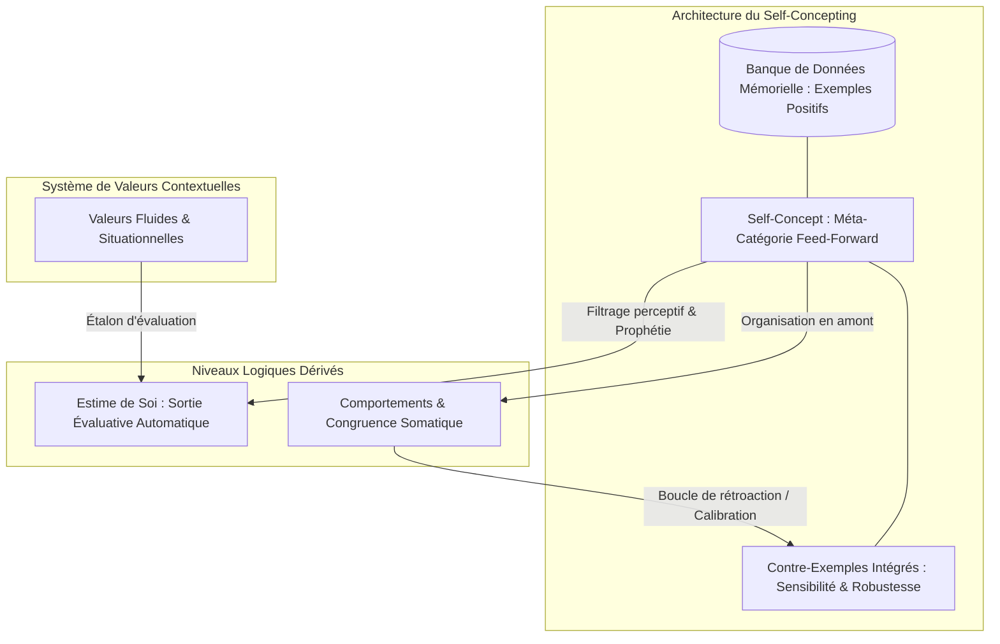
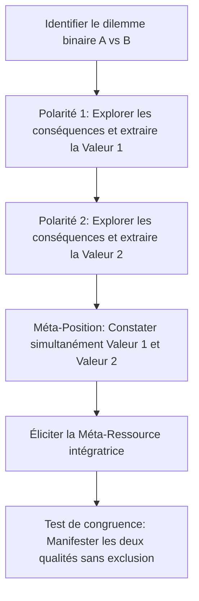
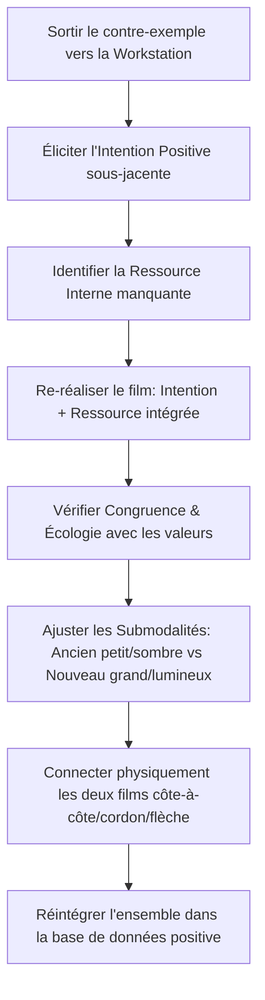

# Transforming Yourself - Transcripts
**Formateur :** Damon Cart | **ID :** `damon-cart-transforming-yourself-transcripts` | **Tranches :** 29

## Synthèse Architecturale du Cours : *Transforming Yourself* (Damon Cart)

---

### 1. Thèse Centrale & Philosophie du Cours

#### Vision spécifique de Damon Cart vs Approche Standard du Développement Personnel
* **Dé-nominalisation radicale (*Self-Concepting*) :** Le développement personnel standard traite l'identité et l'estime de soi comme des entités statiques à « réparer », « gonfler » ou reprogrammer à coup d'affirmations verbales positives. Damon Cart dénonce cette posture comme génératrice de surcompensation narcissique et de fragilité structurelle (*shaky self-concept*). L'identité n'est pas une chose, mais une activité computationnelle continue : un verbe d'actualisation mnésique (*self-concepting*).
* **Le Statut Dérivé de l'Estime de Soi :** L'estime de soi n'est **jamais** un levier d'intervention direct. C'est un sous-produit neurologique passif et automatique calculé en temps réel par l'évaluation du concept de soi au regard du système de valeurs contextuelles. Intervenir directement sur l'estime de soi sans modifier la structure de la base de données produit soit de l'arrogance compensatoire, soit de l'inhibition.
* **Le « Mensonge Utile » (*Useful Lie / Accurate Map*) :** Le concept de soi n'a pas à refléter une « vérité ontologique absolue » (inaccessible par nature en raison des filtres universels d'omission, de distorsion et de généralisation). Il s'agit d'une ingénierie de modélisation pragmatique : substituer un accident historique dysfonctionnel par une cartographie opératoire robuste, résiliente et cybernétiquement sensible aux contre-exemples.

#### Fil Rouge Méthodologique
Toutes les interventions convergent vers une seule dynamique cybernétique : **passer d'un système réactif en boucle fermée (feed-back homéostatique/défensif) à un système proactif en boucle ouverte (feed-forward téléologique)**.  
Pour cela, le praticien :
1. Découvre la topologie spatiale et submodale de la banque de données d'une qualité (emplacement, granularité, temporalité).
2. Immunise la qualité contre le dogmatisme et la fragilité en y intégrant structurellement des contre-exemples dosés.
3. Aligne cette architecture sur des valeurs contextuelles fluides (et non des dogmes sociétaux introjectés).
4. Ancre le fonctionnement au niveau inconscient (le *flow*), où l'auto-observation paralysante s'effondre pour laisser place à l'action congruente.

---

### 2. Carte des Concepts & Leviers Émergents



#### A. Épistémologie & Métaprogrammes Identitaires
* **Nominalisation vs Processus Récursif (*Self-Concepting*) :** Restitue au système nerveux sa plasticité en considérant l'identité comme un algorithme actif d'échantillonnage autobiographique.
* **Filtres Universels & Réduction Cartographique :** Omission, distorsion et généralisation sélectionnent les traces mnésiques. Le concept de soi est la seule méta-croyance transportable en permanence (généralisation spatio-temporelle absolue).
* **Boucle Sujet-Objet & Récursivité Neurologique :** L'esprit observant modifie immédiatement la physiologie observée. Toute modification de la structure identitaire réécrit l'état somatique et induit une naturalisation rétroactive (*amnésie du changement*).
* **Téléologie Feed-Forward vs Feed-Back Thermostatique :** L'identité mature ne compense pas le passé : elle projette un attracteur futur qui tire et coordonne les comportements en amont de l'action.

#### B. Psychodynamique de la Valeur et de l'Estime
* **Couplage Concept de Soi ↔ Système de Valeurs :** L'estime est le quotient d'adéquation entre l'identité perçue et les valeurs actives dans un contexte précis.
* **Plasticité Situationnelle vs Pyramide Rigide :** Rejet des hiérarchies absolues (type Maslow). Les valeurs sont des priorités contextuelles distribuées (modèle tactique fluide).
* **Introjection Normative & Faux Soi :** L'écrasement des valeurs endogènes pour satisfaire des injonctions externes nécessite une inhibition motrice et somatique chronique, source majeure de dépressivité et de rupture de milieu de vie.
* **L'Arrogance comme Symptôme de Fragilité :** L'affirmation outrancière et l'égocentrisme trahissent l'absence de base de données stable face aux contre-exemples.

#### C. Variables Structurelles & Cybernétiques
* **Paradoxe de Durabilité d'Andreas :** Une qualité identitaire n'est durable et robuste que si elle intègre la sensibilité à ses propres manquements (inclusion de contre-exemples). Le blindage sans contre-exemples produit le cassage brutal (*shattering*).
* **Modulation du Contenu de la Base de Données (*Content Variables*) :**
  - *Granularité sensorielle vs Symboles abstraits :* Les souvenirs doivent être des vidéos/scènes sensorielles riches, non de simples étiquettes conceptuelles.
  - *Dispersion contextuelle et temporelle :* Présence d'exemples dans divers contextes et sur une large ligne temporelle.
  - *Filtrage des imperfections de modèle :* Capacité à extraire la compétence observée chez autrui sans adopter ses névroses annexes (*indexation de possibilité* vs comparaison hiérarchique).
* **Tri-Positionnement Perceptuel & Géométrie Neutre :** Utilisation rigoureuse des positions 1, 2 et 3. La position 3 (observateur) requiert une stricte isométrie de distance et d'altitude par rapport aux positions 1 et 2 pour éviter les biais de complaisance ou de domination.

---

### 3. Tableau Récapitulatif des Techniques & Démonstrations

| Technique / Exercice | Objectif Opératoire | Déclencheur / Indication | Séquence Résumée |
|---|---|---|---|
| **Dénominalisation du Soi (*Self-Concepting Inquiry*)** | Dissoudre la rigidité identitaire et restaurer la plasticité neurale. | Déclarations ontologiques figées (« Je suis comme ça », « Je suis anxieux de nature »). | 1. Relever la nominalisation.<br>2. Transposer linguistiquement le substantif en verbe actif continu.<br>3. Mettre au jour les opérations de sélection/omission mnésique qui sous-tendent ce maintien. |
| **Swish Pattern Structurel Décontextualisé (Andreas / Cart)** | Généralisation trans-contextuelle instantanée d'une nouvelle identité. | Habitudes compulsives, limitations de réponses localisées, blocages récurrents. | 1. Éliciter l'image déclic (Position 1, associée au stimulus d'amorce).<br>2. Construire une *Self-Image* cible dissociée, évolutive, **dépourvue de comportement précis et de tout contexte physique**.<br>3. Exécuter le Swish à vitesse sub-seconde avec effacement d'écran (reset blanc/neutre).<br>4. Tester l'amorce. |
| **Audit & Alignement Axiologique (Valeurs Contextuelles)** | Résoudre l'effondrement de l'estime de soi ou le conflit d'introjection. | Crise de sens, sabotage inconscient, sentiment d'imposture, dispersion d'énergie. | 1. Éliciter les valeurs endogènes actives dans le contexte cible.<br>2. Nettoyer les valeurs introjectées (injonctions parentales/sociales toxiques).<br>3. Vérifier le ratio d'alignement comportemental (règle des 3/3 de Cart).<br>4. Reconfigurer la hiérarchie de manière fluide et situationnelle. |
| **Élicitation & Cartographie Spatiale de la Qualité** | Rendre consciente la topologie mémorielle qui soutient un trait de personnalité. | Qualité instable, doute identitaire, ou désir de modéliser une force interne. | 1. Sélectionner une qualité perçue comme certaine et solide.<br>2. Identifier l'emplacement spatial, la distance, la luminosité et le format des souvenirs qui la prouvent.<br>3. Cartographier la distribution temporelle et contextuelle de ces représentations. |
| **Recalibrage du Contenu de la Base de Données (*Database Tuning*)** | Solidifier une qualité floue ou trop dépendante de symboles abstraits. | Croyance sur soi vulnérable, représentations mnésiques statiques, vides ou stéréotypées. | 1. Localiser la base de données de la qualité.<br>2. Remplacer les symboles ou étiquettes verbales par des scènes sensorielles riches et incarnées.<br>3. Disperser les exemples à travers le temps (passé lointain, récent, présent) et des contextes variés.<br>4. Ajuster la taille et la position des images pour une congruence somatique maximale. |
| **Inoculation Cybernétique de Contre-Exemples** | Immuniser le concept de soi contre l'arrogance, l'aveuglement et l'effondrement (*shattering*). | Perfectionnisme névrotique, arrogance compensatoire, susceptibilité critique extrême. | 1. Identifier les moments où la qualité n'a pas été manifestée (contre-exemples réels).<br>2. Transformer ces contre-exemples non en négation du trait, mais en indicateurs de contexte d'apprentissage ou de feedback opérationnel.<br>3. Encoder ces scènes dans un format submodal spécifique (souvent plus petit, latéralisé, avec bordure de neutralité) au sein de la base de données principale. |
| **Indexation de Possibilité (Anti-Comparaison)** | Extraire le potentiel de réussite d'autrui sans déclencher d'infériorité ou d'arrogance. | Jalousie, comparaison descendante/ascendante toxique, dévalorisation face aux pairs. | 1. Repérer le pattern de comparaison relative (« meilleur/pire que »).<br>2. Dissocier la valeur de l'être de la compétence manifestée.<br>3. Recadrer la réussite d'autrui comme une simple preuve d'existence de la capacité dans le système nerveux humain (*benchmark de possibilité*).<br>4. Transposer la stratégie fonctionnelle dans son propre système sans le packaging névrotique du modèle. |
| **Tri-Positionnement Perceptuel Isométrique (Règle d'Andreas)** | Détection objective des écarts de performance et auto-correction sans réactivité égotique. | Biais d'auto-complaisance, conflits relationnels répétés, incapacité à évaluer son impact. | 1. Calibrer l'ancrage somatique en Position 1 (Self pur).<br>2. Se déplacer physiquement en Position 2 (Autre, absorption kinesthésique complète).<br>3. Se déplacer en Position 3 (Observateur neutre) : vérifier l'isométrie absolue (stricte équidistance et même altitude par rapport à 1 et 2).<br>4. Extraire le décalage (*discrepancy*) factuel sans jugement moral, puis réintégrer l'apprentissage en Position 1. |

---

## Extractions Détaillées par Tranche (Opératoire & Verbatim)


## --- Tranche 1 / 29 ---

Voici l'extraction et la modélisation intégrale de la substance opératoire de cette première tranche.

---

### 1. Mécanismes & Principes Actifs

#### A. Nominalisation vs Processus Récursif Vivant (*Self-Concepting*)
* **Principe actif :** Le terme « concept de soi » (*self-concept*) opère linguistiquement comme un substantif figé (une nominalisation au sens du Métamodèle PNL). Or, le système nerveux ne stocke pas une entité statique : il exécute un processus continu de sélection, de rappel et de pondération d'expériences. Traiter l'identité comme un verbe continu (« *self-concepting* ») désolidifie la rigidité cognitive et restitue au système nerveux son degré de liberté : ce qui est une activité en cours peut être modifié, réorienté ou mis à jour à chaque cycle de traitement perceptif.
* **Tags :** `#denominalisation` `#self_concepting` `#processus_dynamique` `#plasticite_identitaire`

#### B. Métaprogramme de Filtrage Identitaire : Omission, Distorsion, Généralisation
* **Principe actif :** La quantité brute d'informations autobiographiques excède la bande passante cognitive consciente. Le concept de soi est une structure de réduction de données qui agit comme une carte (au sens korzybskien). La structure identitaire actuelle n'est pas « la vérité » de l'individu, mais un agrégat résultant de trois filtres universels :
  - *Omission :* Élagage de milliers d'heures d'expériences incongruentes avec l'auto-évaluation dominante.
  - *Généralisation :* Déduction d'un trait ou d'une règle absolue à partir d'un échantillon restreint d'occurrences passées.
  - *Distorsion :* Réinterprétation des faits pour valider le modèle interne préexistant.
* **Tags :** `#filtres_universels` `#carte_du_territoire` `#reduction_d_entropie` `#agregat_autobiographique`

#### C. Multimodalité de la Représentation de Soi
* **Principe actif :** Réduire la modélisation identitaire à l'expression « image de soi » (*self-image*) est un piège technique. Le concept de soi est un encodage synesthésique et multisensoriel combinant des configurations visuelles (emplacement, taille, distance, association/dissociation des images souvenirs), des prédicats et tonalités auditives (dialogue interne critique ou validant), et des ancrages kinesthésiques somatiques stables.
* **Tags :** `#multimodalite_submodale` `#au_dela_de_l_image_de_soi` `#encodage_synesthesique`

#### D. Généralisation Spatio-Temporelle et Prophétie Auto-Réalisatrice Inévitable
* **Principe actif :** Si une croyance sur le monde ou sur autrui peut être neutralisée par une relocalisation géographique (s'isoler, changer de pays, fuir un contexte toxique), le concept de soi est la seule méta-croyance transportable en permanence : le sujet ne peut pas s'échapper de lui-même. En conséquence, les filtres d'évaluation identitaire sélectionnent activement dans l'environnement les preuves confirmant l'auto-évaluation interne (boucle de rétroaction prophétique).
* **Tags :** `#meta_croyance_inviolable` `#generalisation_spatiotemporelle` `#boucle_retroactive_identitaire`

#### E. Genèse Aléatoire vs Ingénierie Consciente de l'Identité
* **Principe actif :** Chez l'individu non entraîné, le concept de soi s'est structuré de manière chaotique et accidentelle (*haphazard*) : injonctions de figures d'autorité (parents, enseignants), expériences aléatoires mal catégorisées, conditionnement sociétal. L'intervention ne cherche pas à débattre rationnellement d'une « vérité » ontologique introuvable, mais à substituer une « illusion dysfonctionnelle » par une « construction opératoire élégante et robuste » (*useful lie / accurate map*).
* **Tags :** `#genese_accidentelle` `#ingenierie_identitaire` `#realignement_de_carte`

---

### 2. Protocoles, Techniques & Démonstrations (Étape par Étape)

#### Protocole : Cadre d'Assimilation Linéaire et Auto-Exploration Phénoménologique
* **Intention / Indication :** Prévenir le court-circuitage intellectuel chez les praticiens déjà formés à la PNL qui tentent de « sauter aux techniques » sans avoir stabilisé l'infrastructure sous-jacente.
* **Mise en place & Pré-framing :**
  - Fixer une cadence neurologique d'assimilation : minimum 1 vidéo/module tous les deux jours, idéalement 1 par jour (~1 heure dédiée). Éviter le micro-dosage hebdomadaire (dilution synaptique) et le surdosage compulsif (indigestion sans exploration somatique).
  - Verrouiller l'accès aux démonstrations : interdiction d'observer la démonstration finale avant d'avoir traversé l'exercice d'exploration brute, pour neutraliser l'imitation de surface et forcer la découverte proprioceptive.
* **Séquence d'actions pas à pas :**
  1. *Étape 1 : Suspension des modèles tiers.* Mettre de côté l'imitation des réponses du formateur ou des collègues.
  2. *Étape 2 : Exploration phénoménologique directe.* Réaliser l'exercice d'inventaire sans instruction rigide a priori pour découvrir la manière singulière dont son propre système nerveux organise les données (« *the truth will be found in your experience* »).
  3. *Étape 3 : Cartographie du fonctionnement actuel.* Identifier « comment je fais ce que je fais » avant toute tentative de changement.
  4. *Étape 4 : Confrontation à la démonstration.* Ne visionner la démonstration qu'après l'auto-exploration pour contraster la structure et raffiner le calibrage.
* **Signes de calibration :**
  - Ralentissement du débit verbal du sujet (passage d'une réponse intellectuelle rapide à une recherche kinesthésique interne).
  - Mouvements oculaires d'accès submodal (balayages spatiaux pour localiser les souvenirs).
  - Émergence de prises de conscience structurelles plutôt que d'explications narratives de contenu.

---

### 3. Heuristiques, Subtilités & "Sagesse du Praticien"

1. **Règle d'accès à la démonstration :**
   * *Si* le sujet/client veut voir ou savoir « comment les autres font » avant d'explorer son propre matériel -> *alors* refuser fermement l'accès au modèle externe, *parce que* le cerveau choisit la voie de moindre résistance (l'imitation mimétique) et court-circuite l'accès à son encodage sensoriel natif.
2. **Règle de cumulativité structurelle :**
   * *Si* le praticien saute des étapes préliminaires sous prétexte qu'elles semblent simples ou conceptuelles -> *alors* les protocoles avancés (qualités ambiguës, ombres, limites relationnelles) s'effondrent, *parce que* l'architecture du modèle de Steve Andreas est strictement cumulative.
3. **Gestion du paradoxe de la « Vérité » :**
   * *Si* le sujet s'enferme dans l'objection « mais est-ce que je ne suis pas juste en train de me mentir ou de fabriquer une fausse identité ? » -> *alors* recadrer l'absolu : l'identité actuelle est déjà une fiction cognitive accidentelle créée par omissions et distorsions. La question n'est jamais « est-ce vrai ? », mais « est-ce une carte utile, écologique et opérante ? ».
4. **Piège du débutant / dérive du développement personnel :**
   * Confondre l'accumulation de « Pourquoi » (inspiration, motivation, explication causale) avec la maîtrise du « Comment » (mécanique submodale, structure de filtrage, encodage sensoriel). Sans la technologie opératoire du « comment », le changement reste aléatoire et éphémère.

---

### 4. Pépites Verbatim & Patterns Linguistiques (MOT À MOT EN V.O.)

#### Pépite 1 : Présupposition d'inévitabilité et truisme de progression
> « *I'm so looking forward to you having your personal transformations.* »
* **[Analyse du Pattern]** : Présupposition linguistique temporelle et factuelle (« *having your personal transformations* »). Le formateur ne conditionne pas la réussite (« *if you have* »), il valide grammaticalement la survenue inéluctable de la transformation dans le futur, tout en plaçant son attention sur le sentiment anticipé de gratitude/plaisir.

#### Pépite 2 : Métaphore du rythme et double lien d'équilibre
> « *It's kind of like riding a bike. If you ride too fast, you might miss something. If you ride too slow, you might fall over. So set a realistic pace for yourself.* »
* **[Analyse du Pattern]** : Utilisation d'une métaphore somatosensorielle universelle (le vélo) structurée comme un encadrement dialectique : deux extrêmes indésirables (trop vite = omission / trop lent = chute/abandon). Cela produit un guidage comportemental qui force l'adhésion à la voie médiane définie par le praticien (« *a realistic pace* »).

#### Pépite 3 : Déplacement de l'autorité vers l'expérience somatique
> « *The truth will be found in your experience. So I don't want you to take my experience. I want you to find your experience.* »
* **[Analyse du Pattern]** : Rupture de dépendance à la figure d'autorité et induction d'une boucle de recherche transdérivative. En répétant la polarité « *my experience* » vs « *your experience* » et en l'adossant au nominal abstrait « *the truth* », le formateur ancre que la seule validation valide pour le système nerveux du sujet réside dans ses propres données proprioceptives.

#### Pépite 4 : Commande d'autonomie et nominalisation réversible
> « *Your self-concept is a belief you cannot escape, which is why self-concept is so important. It's even more important than your beliefs about others and the world. Why? Because your self-concept goes with you everywhere and affects everything you experience.* »
* **[Analyse du Pattern]** : Empilement de truismes incontestables suivi d'une boucle question/réponse auto-validée (érogèse). L'argumentation enferme la cognition : prémisse 1 (on ne peut pas fuir sa propre présence), prémisse 2 (le filtre colore chaque perception), conclusion implicite (travailler sur cette structure est la priorité neurologique absolue).

#### Pépite 5 : Recadrage épistémologique et déstabilisation de la certitude
> « *The self-concept that you have now is only one of many possible ones that you could create from your wealth of experience, and that means you can change it whenever it doesn't serve you well. (...) And in a sense, everything is a lie because you have to take a perspective on something. You can't know objective absolute truth. So is it a more or less useful lie? Is it a more or less accurate lie?* »
* **[Analyse du Pattern]** : Recadrage de contexte radical (*reframing*). En redéfinissant toute perception comme un point de vue subjectif (donc par définition non absolu, métaphorisé par « *a lie* »), il fait sauter les défenses critiques du sujet face au sentiment d'imposture. L'évaluation glisse de l'axe binaire « Vrai / Faux » (qui paralyse le changement) vers l'axe pragmatique « Utile / Précis / Fonctionnel » (qui libère l'action de modélisation).


## --- Tranche 2 / 29 ---

### 1. Mécanismes & Principes Actifs

- **La Métaphore Métabolique de l'Identité (Nourriture Neurologique)**
  Le concept de soi n'est pas une entité statique ni une donnée biologique innée : c'est le résultat d'un métabolisme informationnel continu. Tout comme le corps physique est constitué moléculairement des nutriments ingérés, le concept de soi est constitué des expériences vécues et des souvenirs sélectionnés. Si l'input est toxique, carencé ou biaisé, la structure identitaire qui en émerge présente les mêmes défaillances fonctionnelles.
  *Tags :* `#metabolisme_identitaire #input_output_cognitif #assimilation_mnemonique`

- **Filtrage PNL & Réduction Cartographique (Généralisation, Sélection, Omission, Distorsion)**
  La masse d'informations sensorielles et mémorielle accumulée au fil de la vie dépasse la bande passante cognitive consciente. Le système nerveux applique obligatoirement les trois filtres fondamentaux modélisés par la PNL : omission (*deletion*), distorsion (*distortion*) et généralisation (*generalization*). Le concept de soi est une carte portative et simplifiée. Une carte exacte à 1:1 inclurait chaque grain de terre et deviendrait inutilisable. La portabilité et l'utilité fonctionnelle de l'identité exigent la compression de données.
  *Tags :* `#reduction_cartographique #filtres_universels #compression_mémorielle #carte_vs_territoire`

- **Le Mensonge Utile vs Illusion de la Vérité Absolue**
  Aucun individu ne peut appréhender la « réalité objective » de qui il est. Tout concept de soi est une perspective construite, donc sur le plan ontologique, une forme d'illusion ou de « mensonge ». La question thérapeutique ou de transformation n'est pas « Est-ce vrai ? », mais « Est-ce un mensonge utile, fonctionnel et précis ? ». La flexibilité identitaire repose sur la désillusion de la vérité absolue, tout en évitant l'invention pure non étayée d'expériences de référence.
  *Tags :* `#mensonge_utile #relativisme_fonctionnel #perspective_subjective #deconstruction_absolue`

- **Architecture Hiérarchique des Niveaux Logiques (Bateson / Andreas / Cart)**
  L'extrait opérationnalise une hiérarchie stricte d'emboîtement cognitif :
  1. *Niveau 0 : Expériences de référence sensorielles directes* (les événements vécus).
  2. *Niveau 1 : Qualités / Traits d'identité* (première généralisation regroupant les dénominateurs communs d'expériences spécifiques : ex. « je suis gentil »).
  3. *Niveau 2 : Concept de Soi* (généralisation de rang supérieur regroupant l'ensemble des qualités perçues).
  4. *Niveau 3 : Estime de Soi* (méta-évaluation évaluative : « Est-ce que j'aime ou non cette généralisation globale de moi ? »).
  *Conséquence neurologique :* Tenter de modifier l'estime de soi directement est une erreur de niveau logique. L'estime de soi est une réaction émotionnelle dérivée et automatique qui recalcule le score dès que le concept de soi s'aligne sur les valeurs.
  *Tags :* `#hierarchie_batesonienne #niveaux_logiques_identitaires #meta_evaluation #qualites_agregees`

- **Le Couplage Concept de Soi ↔ Système de Valeurs**
  Les valeurs agissent comme des phares (*headlights*) ou une boussole interne : elles définissent les catégories d'expériences qui fournissent du sens. 
  - Lorsque les actions et le concept de soi reflètent les valeurs intrinsèques : l'estime de soi grimpe automatiquement.
  - Lorsque le sujet agit à l'opposé de ses valeurs (ex. valorise la bienveillance mais agit avec cruauté) : l'estime s'effondre.
  - La valeur est contextuelle : dans un cadre de combat militaire, la dureté ou la cruauté peut élever l'estime si elle correspond à la valeur contextuelle de survie ou de devoir.
  *Tags :* `#boussole_axiologique #alignement_valeurs_identite #estime_automatique #relativite_contextuelle`

- **La Surcharge de Façade et la Crise de Milieu de Vie (Faux Soi Inconscient)**
  Dans la première moitié de l'existence, les individus intègrent par imprégnation les valeurs parentales, sociétales et culturelles. Ce conditionnement installe un « Faux Soi » (*false self*), piloté par des injonctions déontiques (« je devrais / il faut »). Lorsque ces valeurs empruntées cessent d'être fonctionnelles, le système entre en crise. L'inconscient peut saboter délibérément l'atteinte d'objectifs extérieurs (dépression, épuisement, auto-sabotage à la ligne d'arrivée) par sagesse adaptative pour stopper la poursuite d'un système de valeurs étranger.
  *Tags :* `#crise_de_milieu_de_vie #faux_soi #sabotage_inconscient_salvateur #introjection_valeurs`

- **Psychodynamique de la Compensation : Fragilité Identitaire vs Confiance Réelle**
  L'arrogance, la grandiosité et le comportement égocentrique ne sont pas des excès d'estime de soi ou de confiance, mais des mécanismes compensatoires visant à masquer un concept de soi structurellement fragile et instable (*shaky self-concept*). La confiance authentique dérive de l'exposition répétée au territoire réel (compétence factuelle éprouvée).
  *Tags :* `#surcompensation_narcissique #fragilite_structurelle #arrogance_comme_symptome #confiance_eprouvee`

---

### 2. Protocoles, Techniques & Démonstrations (Étape par Étape)

#### Protocole 1 : L'Ancrage Factuel des Attributions Identitaires (Contre-Attaque des Affirmations Vides)
* **Intention / Indication :** À utiliser systématiquement pour installer une qualité solide, contrer l'illusion des affirmations positives toxiques ("je suis fort", "je suis confiant"), ou calibrer l'éducation / le feedback thérapeutique.
* **Mise en place & Pré-framing :** Cadrer que l'inconscient et le système nerveux rejettent toute étiquette sans preuve sensorielle vécue. Traiter les affirmations sans preuves comme du bruit ou un piège narcissique (effet « mathématiciens américains surconfiants mais incompétents »).
* **Séquence d'actions pas à pas :**
  * *Étape 1 : Énonciation de la qualité cible.* Définir le prédicat d'identité que le sujet tente d'acquérir ou de valider (ex. « Tu es un enfant responsable / Je suis une personne fiable »).
  * *Étape 2 : Conjonction causale explicite (« Parce que... »).* Verrouiller l'étiquette par un connecteur de causalité strict afin d'interdire la généralisation flottante.
  * *Étape 3 : Révocation du flou et extraction d'une expérience de référence sensorielle directe.* Raccrocher l'énoncé à une décision, un comportement comportementalement vérifiable et contextualisé dans le temps/espace.
    - *Exemple opérateur :* « Tu as cette qualité *parce que* hier, quand tu avais l'option de rester dehors après la tombée de la nuit, tu as pris l'initiative de rentrer sans que j'aie à te le demander. »
  * *Étape 4 : Vérification de la prise d'empreinte.* Vérifier que le sujet connecte le sentiment interne d'identité directement au rappel kinesthésique/visuel de l'acte et non à l'approbation de l'opérateur.
* **Signes de calibration :** Regard qui s'oriente vers la remémoration interne (accès visuel/kinesthésique remémoré), micro-mouvements de tête verticaux (validation somatique), absence de sourire de convenance ou de posture de quémandeur d'approbation externe.

#### Protocole 2 : Diagnostic Différentiel et Neutralisation du « Faux Soi » de Milieu de Vie
* **Intention / Indication :** Sujet bloqué, dépressif, en crise de milieu de vie, qui s'épuise à poursuivre des buts ou qui abandonne juste avant de franchir la ligne d'arrivée.
* **Mise en place & Pré-framing :** Recadrer l'échec ou la baisse d'énergie non pas comme un manque de volonté, mais comme une manifestation protectrice de la sagesse inconsciente qui refuse de continuer à investir dans les valeurs des autres.
* **Séquence d'actions pas à pas :**
  * *Étape 1 : Cartographie des « Shoulds » (Opérateurs modaux de nécessité).* Faire verbaliser les règles de vie du sujet. Tracker chirurgicalement chaque occurrence de « je devrais », « il faudrait », « on attend de moi que ».
  * *Étape 2 : Traçage de l'origine de l'imprégnation.* Identifier quelle autorité historique (parents, religion, sous-culture professionnelle) est le propriétaire originel de l'injonction.
  * *Étape 3 : Test de résonance axiologique (Autosuffisance vs Échappatoire).* 
    - Si l'activité mène à une demande compulsive de stimulation/anesthésie (écrans, alcool, nourriture, shopping) -> Qualifier l'état en *Auto-indulgence / Échappatoire* (*Self-indulgence/Escape*).
    - Si l'activité nourrit le système nerveux et produit du sens durable même en l'absence de public -> Qualifier en *Accomplissement de Soi* (*Self-fulfillment*).
  * *Étape 4 : Déconnexion du driver externe et extraction des valeurs directes.* Cesser immédiatement de fixer des objectifs de contenu (*achieving goals*) et basculer sur l'élucidation des valeurs intrinsèques qui guident l'orientation.
* **Signes de calibration :** Soulagement musculaire respiratoire profond (décompression thoracique), relâchement de la mâchoire lors du recadrage (« votre inconscient refuse de réussir ce qui vous détruit »), changement du débit vocal (ralentissement).

---

### 3. Heuristiques, Subtilités & "Sagesse du Praticien"

- **L'Inutilité d'Attaquer l'Estime de Soi en Frontal :**
  *Règle :* Ne tentez JAMAIS d'augmenter directement l'estime de soi d'un client. C'est l'équivalent cognitif de dire à quelqu'un d'enfoncé dans la dépression : *« Sois heureux »*. 
  *Raison :* L'estime de soi est un épiphénomène, un output d'évaluation automatique. Si l'on modifie le concept de soi (la structure de données) et qu'on l'aligne sur ses valeurs, l'estime de soi monte instantanément et sans effort conscient.

- **Le Piège de l'Atteinte Compulsive d'Objectifs (*Achievement Loop Trap*) :**
  *Règle :* Si un sujet rapporte être très doué pour accomplir des objectifs, mais que la satisfaction dure moins de 24 heures avant qu'un vide apparaisse, interdiction de lui faire fixer un nouvel objectif.
  *Raison :* Le sujet substitue la compétence mécanique d'accomplissement à la résonance de valeur. Il carbure à l'estime externe (*other-esteem*). Il doit être réorienté vers l'alignement de son concept de soi.

- **L'Auto-Sabotage à la Ligne d'Arrivée comme Signal de Préservation :**
  *Règle :* Si un client n'arrive pas à franchir la dernière étape d'un projet majeur malgré ses compétences, faire l'hypothèse d'une intervention conservatoire de l'inconscient.
  *Raison :* L'inconscient sait que valider ce succès enfermerait le sujet dans une vie et un rôle bâtis sur des valeurs qui ne sont pas les siennes.

- **Dépistage de la Fausse Confiance vs Arrogance dans le Milieu de la PNL :**
  *Règle :* Dès qu'un praticien ou un sujet affiche de l'arrogance ou une assurance démesurée après avoir appris des techniques de recadrage, diagnostiquer immédiatement une fragilisation du concept de soi (*shaky self-concept*).
  *Raison :* La plasticité nouvellement découverte de l'esprit permet de manipuler les représentations, mais sans ancrage dans l'expérience de terrain, le système compense le manque de fondations solides par une posture de supériorité.

- **Distinction entre Différence de Valeurs et Faible Estime de Soi :**
  *Règle :* Ne jamais attribuer un comportement déviant (ex. le jeune qui fait des tags/graffitis illégaux) à un prétendu manque d'estime de soi.
  *Raison :* Le sujet peut avoir une très haute estime de lui-même parce que son comportement honore parfaitement ses propres valeurs (ex. courage de braver la loi + créativité plastique). Le problème réside dans l'expression comportementale ou le conflit de valeurs avec le reste du monde, pas dans son niveau d'estime interne.

---

### 4. Pépites Verbatim & Patterns Linguistiques (MOT À MOT EN V.O.)

#### Pépite 1 : La Relativité du « Mensonge Utile »
> « And in a sense, everything is a lie because you have to take a perspective on something. You can't know objective absolute truth. So is it a more or less useful lie? Is it a more or less accurate lie? So when I say that, a lot of people don't like the sound of that, but you have to let go of absolute truth. You will never know what that is. I'm not saying that you should just make stuff up either, but what your self-concept is made of is a selection and collection of information and what you're going to learn is how exactly you do that. »

* **[Analyse du Pattern] :**
  - *Rupture de pattern et déstabilisation cognitive :* L'association de l'identité personnelle au mot « lie » (mensonge) crée un choc épistémique immédiat qui court-circuite la rigidité dogmatique du client.
  - *Double contrainte recadrante :* En posant l'alternative « more or less useful lie » vs « accurate lie », l'orateur force l'esprit du sujet à abandonner la recherche d'une identité ontologique fixe au profit du critère d'utilité pragmatique.
  - *Allégement de la culpabilité inconsciente :* Si l'identité actuelle n'est qu'une sélection arbitraire parmi des millions d'expériences, la modifier n'est plus une trahison de soi, mais un simple recalibrage d'échantillonnage.

#### Pépite 2 : L'Allégorie Sensorielle de la Carte Portative
> « You don't want a map to be exactly the territory, then it takes away the whole point of having a map, a map you can pull up on your phone. But if you wanted to make it 100% accurate, then you would need all the dirt, all the size and the details. The whole point of it is that you can access it in the palm of your hand, whereas if you're in the territory, you can't see that from that perspective. The result of that is it helps keep you oriented. »

* **[Analyse du Pattern] :**
  - *Métaphore isomorphique kinesthésique/visuelle :* Utilisation de l'image moderne et familière de la carte sur smartphone (« in the palm of your hand ») pour naturaliser le processus d'omission d'informations.
  - *Recadrage fonctionnel de l'imperfection :* L'absence de détails (ne pas voir « all the dirt ») n'est plus présentée comme un manque, mais comme la condition sine qua non de la fonctionnalité.
  - *Suggestion enchâssée d'orientation :* Prépare le système nerveux du sujet à accepter une simplification de son histoire de vie afin de restaurer sa capacité d'action immédiate.

#### Pépite 3 : La Métaphore des Phares dans l'Obscurité
> « Your self-concept is the map of yourself. Your values are the headlights. Krishnamurti, one of a philosopher who I read a lot of his books once said, you have to become a light unto yourself in a dark world. The world can be very dark. It can feel very dark at times, especially when you don't have a sense of self, or you don't know where to go, or you don't know what to do. One thing is to know and understand what your values are. Your values shine the light in the dark. But if you don't know what they are, then you have no headlights. »

* **[Analyse du Pattern] :**
  - *Empilement analogique cohérent :* Extension du schéma spatial Carte + Boussole + Véhicule. Le concept de soi est la carte, mais les valeurs deviennent les phares (*headlights*), séparant la structure statique (la carte) de la dynamique projective dans le temps (les phares éclairent ce qui vient).
  - *Appel à l'autorité philosophique (Krishnamurti) + Pacing émotionnel :* Validation de l'expérience d'angoisse et de vide (« The world can feel very dark at times ») suivie immédiatement de la ressource manquante sous forme de métaphore visuelle haute intensité (« shine the light in the dark »).
  - *Présupposition d'amnésie résoluble :* L'expression « if you don't know what they are, then you have no headlights » présuppose que les phares existent déjà dans le véhicule, et qu'il s'agit seulement de les allumer en identifiant les valeurs.

#### Pépite 4 : La Sagesse Protectrice du Sabotage Inconscient
> « Now, some of us won't even achieve the goal. And the reason for that is, it's not fulfilling our values. We're trying to fulfill the other values, the external values. And as a result, we can't quite cross the finish line because actually there's a deeper inner wisdom within us, saying, you know what, we don't want to succeed at this. This is like your unconscious, not wanting to succeed at something because it's not making you happy. It's making you miserable. »

* **[Analyse du Pattern] :**
  - *Recadrage d'intention positive radical :* L'échec répété et l'incapacité à « franchir la ligne d'arrivée » sont extraits du cadre de la tare ou du déficit personnel pour être réinsérés dans le cadre de la « sagesse intérieure profonde » (*deeper inner wisdom*).
  - *Personnification et split de parties :* Découplage entre l'ego conscient qui s'acharne (« trying so hard to prove something ») et l'inconscient protecteur qui freine. Ce pattern désamorce instantanément la haine de soi et l'autocritique pour ouvrir la voie à la coopération écologique entre les parties.


## --- Tranche 3 / 29 ---

Voici l'extraction et l'analyse modélisatrice intégrale de la tranche 3/29 du séminaire *Transforming Yourself* de Damon Cart.

---

### 1. Mécanismes & Principes Actifs

#### 1.1 La Triangulation Pathologique : Arrogance vs Self-Concept Ébranlé
* **Terme de Damon Cart :** *Arrogance / Overconfidence as a sign of a weak self-concept*
* **Tags :** `#arrogance_compensatoire #self_concept_shaky #boucle_surcompensation #distinction_estime_concept`
* **Principe actif :** L'arrogance et l'égocentrisme ne sont pas des excès d'estime de soi, mais des mécanismes de défense homéostatiques face à un *self-concept* instable (*shaky*). Lorsque l'individu manipule artificiellement des représentations internes positives sans structure sous-jacente solide (notamment l'intégration des contre-exemples), le système nerveux compense la fragilité structurelle par une hyper-affirmation extérieure rigide. L'estime de soi authentique est un sous-produit neurologique passif et automatique d'un concept de soi congruent et aligné sur les valeurs du sujet, et non une cible d'intervention directe.

#### 1.2 La Plasticité Situationnelle des Valeurs vs Hiérarchie Rigide
* **Terme de Damon Cart :** *Contextual / Fluid Values vs Rigid Hierarchy*
* **Tags :** `#valeurs_situationnelles #anti_maslow #hierarchie_dynamique #arbitrage_ecologique`
* **Principe actif :** Contrairement au modèle figé de la pyramide de Maslow, le système de guidage humain fonctionne selon une hiérarchie contextuelle et distribuée (analogue au modèle militaire israélien vs américain décrit par Cart). Une valeur dominante en contexte standard (ex: formation, accomplissement) s'efface instantanément devant une priorité physiologique ou contextuelle immédiate (ex: aller aux toilettes, danger immédiat). Tenter de cristalliser une hiérarchie absolue de valeurs génère une rigidité cognitive et des conflits d'arbitrage insolubles.

#### 1.3 Le Conflit Introjection Sociale vs Structure Identitaire Endogène
* **Terme de Damon Cart :** *External Values vs Personal Values*
* **Tags :** `#introjection_normative #inhibition_reponse_naturelle #conflit_valeur_survie #drain_d_estime`
* **Principe actif :** L'adoption aveugle de valeurs parentales ou culturelles incompatibles avec la structure interne du sujet exige une *inhibition active des réponses somatiques et comportementales naturelles*. Cette inhibition chronique engendre une chute directe de l'estime de soi et un épuisement psychique. Damon Cart illustre cela par son passage dans les assurances : vouloir satisfaire une valeur (la Liberté) en écrasant les deux autres (Passion et Joie) entraîne l'échec opérationnel, car le système nerveux refuse d'engager ses ressources métaboliques complètes sur un alignement partiel (1/3).

#### 1.4 Les Quatre Piliers Systémiques du Self-Concept
* **Termes de Damon Cart :** 
  1. *Large Generalization (Category / Belief)*
  2. *Continuity across Time and Space*
  3. *Feed-Forward System oriented toward the Future*
  4. *Recursive System*
* **Tags :** `#macro_generalisation #continuite_spatio_temporelle #systeme_feed_forward #recursivite_identitaire`
* **Principe actif :**
  * **Macro-généralisation / Catégorie :** Le concept de soi est une méta-catégorie qui subsume des sous-généralisations appelées « qualités ». Chaque qualité est l'étiquette linguistique d'une banque de données expérientielles mémorisées.
  * **Continuité spatio-temporelle :** C'est le cadre invariant de référence interne. Peu importe les ruptures d'environnement, d'âge ou de contexte (de 3 ans à 40 ans, de Santa Cruz à l'Asie), le système maintient l'index linguistique et sémantique « Moi ». Sans cet invariant, le système nerveux sombrerait dans le chaos perceptif à chaque nouvelle stimulation.
  * **Système Feed-Forward :** Contrairement au simple *feedback* (boucle rétroactive basée sur le passé), le *feed-forward* est une projection anticipatrice. Détenir la qualité « persistant » oriente en amont les calculs de probabilité comportementaux face aux obstacles futurs.
  * **Récursivité :** La structure se prend elle-même comme objet de référence et modifie ses propres règles d'évaluation.

#### 1.5 La Topologie des Niveaux Logiques et Effet Cascade Top-Down
* **Terme de Damon Cart :** *Higher Logical Level vs Contextual Responses (Bateson/Andreas)*
* **Tags :** `#niveaux_logiques #bateson_andreas #changement_top_down #asymetrie_vectorielle`
* **Principe actif :** Les interventions thérapeutiques classiques (désensibilisation de phobie, arrêt d'une habitude) opèrent à un niveau logique bas, contextuel et déclenché par un stimulus précis (*stimulus-response*). Les modifications à ce niveau ne remontent presque jamais pour transformer l'identité (*bottom-up* inopérant). En revanche, modifier une sous-généralisation du *self-concept* réorganise l'ensemble des réponses comportementales subordonnées de manière globale, durable et non-contextuelle (*effet cascade top-down*), provoquant des réorganisations spontanées et imprévues (ex: la conduite automobile pacifiée de l'homme qui a cessé de se percevoir comme un « enfant pauvre »).

---

### 2. Protocoles, Techniques & Démonstrations (Étape par Étape)

#### Protocole A : Arbitrage Décisionnel Complexe par Alignement de Valeurs
* **Intention / Indication :** Face à un dilemme où satisfaire autrui est impossible (conflits d'intérêts multipolaires) ou lors d'un choix existentiel/d'achat paralysé par des micro-variables.
* **Mise en place & Pré-framing :** Accepter le postulat qu'il est impossible de contrôler les réactions extérieures ni d'obtenir un gain absolu pour tous. Le seul critère de paix neurologique nocturne (*« be able to sleep at night »*) est l'alignement sur ses critères internes.
* **Séquence pas à pas :**
  1. **Dégagement perceptif (Step Back) :** S'extraire de l'urgence relationnelle ou de l'analyse des détails superficiels (ex: les décibels et les 3 boutons de l'aspirateur).
  2. **Extraction du critère noyau :** Poser la question de clarification : *« Qu'est-ce qui a réellement de la valeur pour moi ici et maintenant ? »*
  3. **Filtrage des options parasites (Test de Réalité Comportemental) :** Se projeter dans l'usage réel : *« Vais-je concrètement utiliser ce compromis ? Vais-je me demander un jour si je veux que ma moquette soit juste "moyennement propre" ? Non. »* Éliminer l'option complexe coûteuse si elle ne sert aucun critère opérant.
  4. **Décision axée sur les valeurs & Acceptation des retombées :** Exécuter le choix aligné en assumant qu'une tierce personne puisse être mécontente.
  5. **Observation du tri écologique passif :** Constater comment l'affirmation des valeurs clarifie le système social (ex: l'interlocutrice aux intentions cachées qui s'exclut d'elle-même).
* **Signes de calibration :** Bascule de l'agitation mentale vers une cohérence posturale, respiration plus basse, disparition de l'hésitation cognitive, certitude interne indépendante du résultat externe.

---

### 3. Heuristiques, Subtilités & "Sagesse du Praticien"

#### Règles conditionnelles extraites :
* **RÈGLE 1 (Diagnostic d'arrogance) :** *SI* un individu (particulièrement un praticien PNL) manifeste de l'arrogance, de la condescendance ou une sur-confiance ostentatoire, *ALORS* ne le calibre pas comme « trop confiant », *MAIS* comme ayant un *self-concept* structurellement fragile et instable en surcompensation névrotique.
* **RÈGLE 2 (Changement de niveau logique) :** *SI* le client vient pour un problème de comportement isolé (peur contextuelle, tic), le traiter au niveau contextuel ; *MAIS SI* l'on veut un changement qui irradie l'ensemble de la vie sans régresser, *ALORS* intervenir directement sur les généralisations du concept de soi.
* **RÈGLE 3 (Contre-exemples indispensables à la robustesse) :** *SI* une qualité attribuée au self-concept se prétend absolue (ex: « Je suis 100% persistant, sans exception »), *ALORS* elle est fragile et pathologique. *CAR* toute généralisation saine contient et tolère explicitement ses propres exceptions (savoir abandonner quand cela ne fonctionne pas).
* **RÈGLE 4 (Écologie du changement identitaire) :** *SI* tu modifies une sous-généralisation identitaire, *ALORS* sois prêt à voir muter des comportements périphériques non anticipés (ex: style de conduite, relations, seuil de tolérance). Surveille impérativement l'écologie avant d'ancrer le changement.

#### Pièges classiques & Erreurs de débutant :
* **Le piège de la pyramide de Maslow :** Croire que les valeurs de l'être humain sont organisées selon un ordre hiérarchique universel et fixe. Le système nerveux réorganise ses priorités de manière dynamique et situationnelle.
* **Le piège de la sur-sélection d'une valeur au détriment des autres :** Tenter de faire réussir un projet de vie sur une seule valeur isolée (ex: sur-investir la Liberté en sacrifiant la Passion et la Joie) mène inévitablement à l'épuisement et à l'auto-sabotage inconscient.
* **Le piège du Swish mal enseigné :** Utiliser le *Swish Pattern* standard comme un simple outil de conditionnement comportemental pour casser une mauvaise habitude, en passant à côté de sa véritable fonction découverte par Steve Andreas : une reprogrammation de la trajectoire identitaire (*self-concept swish*).

---

### 4. Pépites Verbatim & Patterns Linguistiques (MOT À MOT EN V.O.)

#### Pépite 1 : La Déconstruction du Mirage de l'Arrogance
> « But then you might say, well, I know somebody who is really arrogant or overconfident or egotistical and that is different because arrogance, overconfidence, egocentric behavior are signs of a weak self-concept. A person when a person acts this way, it means their self-concept is actually very shaky. And so what they're doing is they're overcompensating by becoming arrogant, by becoming overconfident and egocentric. »

* **[Analyse du Pattern]** : 
  * **Pacing & Leading par objection anticipée** (*« But then you might say... »*) : Cart intercepte l'objection cognitive de l'auditeur avant même qu'elle ne devienne un doute conscient.
  * **Recadrage par Redéfinition (Sleight of Mouth / Redefine)** : Il dissocie l'apparence de force (arrogance) pour la relier sémantiquement à son opposé structurel (*« signs of a weak self-concept »*, *« very shaky »*).
  * **Modèle cause-effet inversé** : Il réétiquette la sur-confiance non comme une cause de supériorité, mais comme un symptôme d'impuissance (*overcompensating*).

---

#### Pépite 2 : La Nature Écologique des Exceptions dans la Généralisation
> « When I say I am persistent, you're making a large generalization about your entire life, even though you're not always persistent. Actually, it's not good to always be persistent. Sometimes it's really wise to understand that it's time to quit something, something that's not serving you well or it's just not working. So persistence in this case is a generalization with exceptions and generalizations always have exceptions, that's why they're not facts. »

* **[Analyse du Pattern]** :
  * **Normalisation paradoxale et recadrage de critère** (*« Actually, it's not good to always be persistent »*) : Rupture de pattern sur la vertu absolue de la persistance.
  * **Recadrage d'utilité contextuelle** (*« Sometimes it's really wise to understand that it's time to quit »*) : Redéfinit l'abandon non comme un échec, mais comme une marque de sagesse adaptative (*wise*).
  * **Présupposition ontologique libératrice** (*« generalizations always have exceptions, that's why they're not facts »*) : Cart injecte une flexibilité cognitive majeure dans la structure de croyance du client : une identité n'est pas un fait immuable, mais une catégorisation sémantique tolérante aux anomalies.

---

#### Pépite 3 : L'Invariant Spatio-Temporel du « Moi »
> « You are the same person even as you change your behavior from one place to another or from one year to the next. Your self-concept goes with you no matter where you go and it's been with you ever since you can remember having memories at all... you even say things like when I was three years old instead of when he or she was three years old, think about that, when you were three... everything is so different, but you still refer to your younger self as you. »

* **[Analyse du Pattern]** :
  * **Truisme linguistique hypnotique** (*« you even say things like when I was three years old instead of when he or she was three »*) : Cart pointe une anomalie syntaxique invisible que chacun pratique, provoquant un arrêt du dialogue interne (rupture de pattern de la conscience ordinaire).
  * **Double induction de continuité** : En guidant l'attention de l'auditeur vers sa mémoire de 3 ans tout en maintenant le marqueur d'identité présent (*« you »*), il installe une transe d'intégration temporelle où le concept de soi émerge comme la seule constante invariante à travers le temps et l'espace.

---

#### Pépite 4 : L'Asymétrie des Niveaux Logiques (Top-Down vs Bottom-Up)
> « So when you change something on a very low level, like a simple response, you get rid of an irrational fear of heights, for example, when you change that, it doesn't usually go up the logical levels and change your self-concept or change who you are. What we're going to be working with though is we're going to be working with that higher level where we're actually changing aspects of the self-concept, what that does is it's going to affect your behavior, so when you change behavior, it doesn't usually go up... but when you change your self-concept, it's going to affect your behavior because your behavior is on a lower logical level. »

* **[Analyse du Pattern]** :
  * **Empilement de contrastes logiques (Antithèse)** : Comparaison directe entre le travail comportemental superficiel (bas niveau) et le travail structurel identitaire (haut niveau).
  * **Présupposition de levier systémique irrésistible** : En affirmant que le haut niveau *« is going to affect your behavior »*, il installe la certitude implicite que les comportements problématiques s'aligneront automatiquement dès lors que le niveau supérieur sera réorganisé.
  * **Commande enchâssée d'ouverture au changement** : Prépare le terrain réceptif du sujet à un travail en profondeur qui dépassera la simple résolution de symptômes locaux.


## --- Tranche 4 / 29 ---

### 1. Mécanismes & Principes Actifs

- **Généralisation Trans-Contextuelle de l'Identité (Le Vrai Swish Pattern)**
  *Principe actif* : Dans la structure d'origine modélisée par Steve Andreas, l'image cible (Self-Image) dans le Swish ne doit contenir **aucun comportement spécifique** et **aucun contexte précis**. Lier l'image de soi idéale à une action ou un lieu (ex. aller à la salle de sport au lieu de fumer) conditionne le changement à la disponibilité physique de ce contexte (inopérant au milieu de la nuit). Une image dissociée de soi pure, dépourvue d'activité et de cadre spatiotemporel, opère au niveau logique de l'identité : elle se généralise instantanément à l'ensemble des contextes de vie.
  *Tags* : #swish_structurel #decontextualisation_identitaire #generalisation_large #niveau_logique_identite

- **Système Feed-Forward vs Système Feed-Back (Téléologie Neurologique)**
  *Principe actif* : Un système de feed-back (homéostatique, métaphore du thermostat) ne fait que réagir aux écarts passés pour ramener le système à un état préexistant ; il maintient l'organisme dans ses limites actuelles. Le système feed-forward projette une configuration idéale dans le futur et agit de manière proactive pour guider le devenir. Le concept de soi fonctionne comme un système feed-forward : l'identité projetée tire les comportements et les stratégies vers l'actualisation de ce potentiel, organisant la cognition en amont de l'action.
  *Tags* : #feed_forward #teleologie_neurologique #thermostat_cybernetique #retro_planification #direction_futur

- **Récursivité et Boucle Sujet-Objet (Auto-Référence Neurologique)**
  *Principe actif* : Contrairement à la perception d'un objet externe inerte (ex. un mur), le concept de soi est récursif : l'individu est simultanément le sujet qui observe/génère la représentation et l'objet représenté. Toute idée entretenue sur soi réagit immédiatement sur le système nerveux, modifiant l'état neuro-somatique, la posture et les micro-comportements. Cela génère soit une boucle d'amplification vertueuse (ressources -> succès -> renforcement de l'identité), soit une prophétie autoréalisatrice négative (focalisation sur l'anxiété -> simulation interne de l'échec -> parasitage moteur -> échec réel).
  *Tags* : #recursivite_identitaire #boucle_sujet_objet #auto_reference #boucle_amplification_somatique

- **Instantanéité du Shift Épistémique vs Inertie de la Matière**
  *Principe actif* : La réorganisation d'une structure de compréhension ou d'une généralisation identitaire est discontinue et quasi instantanée (bascule de type insight / bifurcation de phase). Si l'accumulation préparatoire d'informations prend du temps, le re-cadrage de la gestalt identitaire s'opère en un instant. Dès que le concept de soi commute, l'ensemble des sous-systèmes associés se réaligne immédiatement, bien que l'implémentation matérielle dans le monde physique (perte de poids, acquisition de compétences, flux financier) soit soumise à une inertie temporelle linéaire.
  *Tags* : #bifurcation_epistemique #changement_instantane #insight_gestaltique #inertie_materielle

- **Projection de l'Identité sur la Carte du Monde**
  *Principe actif* : Les croyances déclarées à propos du monde extérieur (« le monde est écrasant, chaotique ») sont des rétro-projections directes du concept de soi (« je suis petit, impuissant, sans ressources »). Modifier la carte du monde sans toucher à l'identité maintient le sujet dans un sentiment d'impuissance externe. En inversant la prémisse pour identifier la croyance sous-jacente sur soi-même, le levier de contrôle redevient interne.
  *Tags* : #retro_projection_monde #croyance_miroir #locus_de_controle_interne #presupposition_identitaire

- **Amnésie du Changement (Naturalisation Rétroactive)**
  *Principe actif* : Lorsqu'une croyance identitaire est transformée en profondeur, la nouvelle structure réécrit la cohérence de l'expérience présente. Le sujet vit tellement dans la nouvelle évidence perceptuelle qu'il oublie son état de fonctionnement antérieur ou affirme : « Ça a toujours été comme ça ». Le système nerveux élimine la trace du conflit pour maintenir une continuité subjective stable.
  *Tags* : #amnesie_du_changement #naturalisation_retroactive #reecriture_narrative #coherence_du_present

- **Critères Cybernétiques d'un Concept de Soi Sain**
  *Principe actif* : Un concept de soi fonctionnel repose sur 5 piliers :
  1. *Durabilité / Résilience* : Maintien de l'estime et de l'identité même lors des crashs d'état émotionnel temporaires.
  2. *Exactitude fonctionnelle (Accuracy)* : Correspondance suffisante avec la réalité/les feedbacks environnementaux (évitement du délire d'auto-grandiosité).
  3. *Auto-correction & Sensibilité au Feedback* : Capacité à ajuster sa trajectoire sans effondrement ni déni face aux erreurs ou contradictions.
  4. *Automaticité non auto-consciente* : Fonctionnement fluide en arrière-plan (mode *flow*), libérant la mémoire de travail de tout dialogue interne de validation.
  5. *Connexion vs Séparation* : Préservation du lien empathique avec autrui, excluant l'arrogance défensive ou le sentiment de supériorité.
  *Tags* : #criteres_steve_andreas #resilience_identitaire #exactitude_carte_territoire #automaticite_flow #connexion_vs_arrogance

- **Inutilité et Dangerosité des Affirmations Non Fondées**
  *Principe actif* : Répéter des déclarations verbales positives (« Je suis extraordinaire ») sans base de données d'expériences de référence concrètes crée une structure fragile. Pire : le cerveau détecte l'incongruence entre la déclaration verbale et les données sensorielles stockées, ce qui déclenche une contre-affirmation interne (« Non, c'est faux »), générant un conflit de parties, une division de l'attention et un effondrement brutal au premier obstacle.
  *Tags* : #echec_affirmations #incongruence_verbale #base_de_reference_absente #conflit_de_parties

---

### 2. Protocoles, Techniques & Démonstrations (Étape par Étape)

#### Protocole 1 : Le Swish Pattern Génératif Décontextualisé (Modèle Steve Andreas)
* **Intention / Indication** : Habitudes compulsives, déclencheurs automatiques non désirés (tabac, boulimie, réactions réflexes).
* **Mise en place & Pré-framing** : Expliquer au sujet que l'objectif n'est pas de substituer un comportement par un autre (ce qui créerait une dépendance contextuelle), mais d'accéder à l'identité globale de celui qui a déjà résolu ce problème.
* **Séquence d'actions pas à pas** :
  1. *Élicitation de l'image déclencheur (Cue Image)* : Identifier l'image exacte vue à la première personne (associée) juste avant que la compulsion démarre (ex. la main tenant la cigarette, la porte du frigo).
  2. *Construction de la Self-Image Décontextualisée* :
     - Créer une image de soi dissociée (on se voit soi-même dans l'image).
     - Règle absolue : **Aucun comportement** (le soi idéal n'est pas en train de faire du sport, de méditer ou de refuser un geste).
     - Règle absolue : **Aucun contexte** (fond neutre, pas de salle de sport, pas de décor spécifique).
     - Qualité de l'image : Représentation d'une personne qui a déjà évolué au-delà de cette difficulté, incarnant les ressources, la maturité et les choix désirés.
  3. *Exécution cinétique (Le Swish)* :
     - Placer la *Cue Image* grande, lumineuse, au centre du champ visuel.
     - Placer la *Self-Image* sous forme d'un petit point sombre et lointain au centre.
     - Simultanément, faire rétrécir et disparaître la *Cue Image* pendant que la *Self-Image* grandit instantanément, devient nette, lumineuse et s'impose à l'esprit (bruitage rapide : « Swish ! »).
  4. *Rupture d'état (Break State)* : Ouvrir les yeux, regarder un détail neutre, effacer l'écran mental.
  5. *Répétition & Conditionnement* : Répéter l'opération 5 à 7 fois à vitesse croissante, en veillant à toujours repartir de l'image 1 vers l'image 2 (boucle unidirectionnelle).
* **Signes de calibration** : Difficulté croissante du sujet à retrouver la *Cue Image*, confusion passagère, changement de tonus postural, micro-sourire lors de l'évocation du déclencheur, élargissement du regard.

#### Protocole 2 : Rétro-Planification par Feed-Forward (NASA Moonwalk Protocol)
* **Intention / Indication** : Définition d'objectifs, élaboration d'une identité financière/professionnelle, alignement stratégique d'une vision de vie.
* **Mise en place & Pré-framing** : Présenter la métaphore de la mission Apollo : on ne planifie pas en partant du présent en ajoutant des briques au hasard, on s'installe dans la finalité accomplie pour regarder en arrière.
* **Séquence d'actions pas à pas** :
  1. *Projection dans le résultat terminal* : Transporter le sujet à la date future voulue (ex. dans 1 an, 5 ans) où l'identité et les résultats sont pleinement stabilisés.
  2. *Ancrage de l'Identité Terminale* : Éliciter précisément qui il est devenu, ses critères, son système de valeurs incarné.
  3. *Downside / Backwards Planning (Marche arrière temporelle)* :
     - Depuis ce futur réalisé, regarder vers le présent.
     - Identifier l'étape immédiatement antérieure qui a permis cette réalisation.
     - Dérouler la chaîne causale pas à pas à rebours jusqu'au moment présent : Étape N-1 -> Étape N-2 -> Action immédiate requise aujourd'hui.
  4. *Bouclage du Feed-Forward* : Vérifier que l'identité actuelle intègre la certitude téléologique de la destination finale.
* **Signes de calibration** : Respiration stabilisée et profonde, alignement vertical de la colonne vertébrale, discours orienté certitude/processus plutôt que doute/effort.

#### Protocole 3 : Audit Épistémique & Inversion Miroir Monde/Soi
* **Intention / Indication** : Sentiment d'impuissance, plainte sur la lourdeur ou la dureté du monde extérieur, externalisation du locus de contrôle.
* **Mise en place & Pré-framing** : Poser comme postulat que toute description globale de l'environnement révèle le cadre identitaire sous-jacent qui rend cette description possible.
* **Séquence d'actions pas à pas** :
  1. *Verbalisation de la plainte externe* : Recueillir la croyance limitante sur le monde (ex. « Le monde est écrasant et menaçant »).
  2. *Application de la question de dérivation identitaire* : Poser la question miroir :
     *« What belief about yourself would have to be in place in order for you to believe that? »*
  3. *Calibrage de la faille identitaire* : Faire émerger le jugement sur soi (ex. « Je me sens petit, faible, incapable de faire face »).
  4. *Redirection du focus* : Abandonner le travail sur le monde extérieur pour traiter directement la structure interne du concept de soi.
* **Signes de calibration** : Silence réflexif marqué (pause transdermique), réorientation du regard vers le bas (dialogue interne / kinesthésique), relâchement du blâme externe, reconnaissance de la vulnérabilité interne.

#### Protocole 4 : Journaling d'Ancrage et Prévention de l'Amnésie
* **Intention / Indication** : Fixation des apprentissages, matérialisation des étapes de changement, traçabilité de l'évolution identitaire.
* **Mise en place & Pré-framing** : Établir un contrat d'écriture manuscrite pour contourner l'illusion d'immutabilité cognitive (« J'ai toujours été ainsi »).
* **Séquence d'actions pas à pas** :
  1. *Inventaire Initial Pré-Changement (Free-writing)* : Noter sans filtre l'état présent : niveau de revenus, vie sentimentale, relations, croyances sur le monde, croyances sur soi.
  2. *Journaling Post-Session* : Après chaque intervention/vidéo, rédiger à la main (idéalement jusqu'à trois pages) pour décharger l'expérience sensorielle.
  3. *Relecture Rétroactive à Terme* : À la fin du processus, relire l'inventaire initial pour confronter l'esprit à l'écart structurel entre le soi passé et le soi présent.
* **Signes de calibration** : Surprise cognitive du sujet lors de la relecture, dissociation nette d'avec l'ancien modèle identitaire (« C'était une autre personne »).

---

### 3. Heuristiques, Subtilités & "Sagesse du Praticien"

- **L'Heuristique du Contexte Zéro dans l'Image Idéale** :
  *Règle* : Si le sujet insère une action ou un décor dans l'image cible d'un Swish -> **Supprimer immédiatement le comportement et le décor**, car tout comportement contextualisé limite la généralisation neurologique et crée une dépendance environnementale incompatible avec le niveau identitaire.
- **L'Heuristique de l'Inversion Miroir** :
  *Règle* : Si le sujet déclare une croyance sur l'impossibilité ou l'agressivité du monde extérieur -> **Ne pas argumenter sur la réalité du monde**. Demander immédiatement : *« Que dois-tu croire sur toi-même pour percevoir le monde ainsi ? »*. La plainte cosmologique est toujours un masque identitaire.
- **L'Heuristique de la Négation Somatique** :
  *Règle* : Si le sujet tente de supprimer un état par une injonction négative (« Je ne veux pas être nerveux », « Ne sois pas maladroit ») -> **Interrompre le processus**. Le système nerveux est forcé de simuler sensoriellement la maladresse ou la nervosité pour en traiter la négation, activant la boucle récursive motrice qui produit l'échec redouté.
- **L'Heuristique de l'Exactitude Écologique (vs Grandiosité)** :
  *Règle* : Ne jamais construire un concept de soi omnipotent ou fantasmatique (ex. se croire joueur de football professionnel ou être le plus intelligent de la pièce sans compétence réelle). Le concept de soi doit être *suffisamment exact* (*accurate enough*) pour s'ajuster au territoire sans créer de rupture avec les feedbacks des pairs.
- **L'Heuristique de l'Échec des Affirmations** :
  *Règle* : Si un client utilise des affirmations devant un miroir sans expériences de référence sensorielles réelles -> **Lui faire cesser l'exercice**. L'incongruence active un conflit interne (« C'est faux »), divise l'attention et fabrique une carapace fragile qui s'effondrera au premier rejet extérieur.
- **L'Heuristique de l'Auto-Correction (Thermostat Identitaire)** :
  *Règle* : Un concept de soi robuste ne signifie pas ne jamais échouer ; il signifie être capable de percevoir l'erreur de trajectoire (*« Ce comportement ne correspond pas à mes valeurs »*) et d'utiliser le feedback sans effondrement d'estime personnelle.
- **L'Heuristique de Non-Conscience de Soi (Le Test du Flow)** :
  *Règle* : Un individu qui doit se répéter consciemment *« Je suis résilient, je suis confiant »* n'a pas encodé la qualité. La marque d'un concept de soi sain est son **automaticité inconsciente** : la qualité s'exprime sans focalisation réflexive.

---

### 4. Pépites Verbatim & Patterns Linguistiques (MOT À MOT EN V.O.)

* **Citation 1** :
  > *"Because you want this to spread across as many contexts as you possibly can. If you have an ideal image of yourself, the person who you want to become, the person who has already resolved whatever problems you're dealing with, well, you want that ideal you to generalize to all areas of your life. But if you contextualize it and also put a behavior in there... every time you want a cigarette, you might not be able to get to a gym... So then you break the pattern and then you go back into smoking."*
  * **[Analyse du Pattern]** : Présupposition causale et double lien temporel. Cart utilise la formulation nominalisée *"the person who has already resolved"* (présupposition d'accomplissement déjà réalisé dans le futur) couplée à une déconstruction logique de l'ancrage contextuel. L'enchaînement argumentatif démontre l'échec inévitable du comportement substitutif via un scénario de rupture de pattern.

* **Citation 2** :
  > *"When you change a generalization that is generalized so widely, and that affects changing your self concept, that change will radiate throughout your life and through all of your experiences, and it's just an amazing thing when it happens, and it will happen for you if you follow this program and you do the exercises."*
  * **[Analyse du Pattern]** : Suggestion métaphorique dissipative (*"radiate throughout"*) suivie d'un empilement de truismes et d'un pont vers le futur impératif conditionnel (*"and it will happen for you if..."*). Le passage de la description générale ("an amazing thing") à la certitude personnelle ("it will happen for you") opère un verrouillage hypnotique d'engagement.

* **Citation 3** :
  > *"Think about not even having to think about who you're trying to become all the time. It doesn't even have to be so conscious. Once you program in a quality of how you want to be and we create that feed-forward system, which I'm going to show you how to do, you don't have to be so conscious of it. You will naturally do it."*
  * **[Analyse du Pattern]** : Commande cachée de décharge consciente et induction de transe par saturation de la négation de l'effort (*"not even having to think"*, *"doesn't even have to be so conscious"*). Utilisation d'un rythme répétitif facilitant le transfert d'action vers l'inconscient, scellé par l'adverbe présuppositionnel *"naturally"*.

* **Citation 4** :
  > *"When I make an image of myself, I'm the maker of the image and that which the image represents. I'm both a subject and object in this process and a closed loop that both refers to itself and acts on itself. So soak that in, your self-concept both refers to itself and acts on itself."*
  * **[Analyse du Pattern]** : Rupture de pattern conceptuelle par boucle étrange (paradoxe auto-référentiel sujet/objet). Cart impose une surcharge cognitive pour suspendre le jugement critique, puis délivre une suggestion somatique directe d'absorption kinesthésique profonde : *"So soak that in"*.

* **Citation 5** :
  > *"If you think the world is overwhelming, that's probably because you think of yourself as small and powerless. If you have that belief, what belief about yourself would have to be in place in order for you to believe that? It's a very good question to ask yourself, what do I have to believe in order to believe that?"*
  * **[Analyse du Pattern]** : Recadrage Sleight of Mouth par changement de niveau logique (Redéfinition / Conséquence interne). Cart démantèle la projection de réalité en opérant une rétroflexion grammaticale : l'adjectif attribué au monde ("overwhelming") est converti en attribut identitaire projeté ("small and powerless"). La question enchâssée force une recherche transdérivationnelle interne.

* **Citation 6** :
  > *"Hey, remember you came to me for this thing or you believe that? And I'll go, 'Oh yeah, but yeah, I don't believe that anymore.' And I'll say, 'Well, yeah, you used to believe that...' And I'll go, 'Well, yeah, but it was kind of always that way.' It's this weird thing that happens when you change these beliefs. It often gives you a sense of like, well, this is how it always was."*
  * **[Analyse du Pattern]** : Pré-cadrage de l'amnésie post-hypnotique et normalisation du re-câblage identitaire par dialogue rapporté. Cart utilise la dissociation conversationnelle pour préparer le sujet à effacer le souvenir du problème, installant la présupposition que la nouvelle identité semblera avoir toujours été présente.

* **Citation 7** :
  > *"If you're not connecting actual reference experiences to what you're talking about in your own experiences in your life, you can build yourself up, give yourself sort of a flimsy sense of having whatever quality... but the moment you walk out your front door and somebody flips you off, cuts you off in traffic, or says something mean to you... it's going to crumble, because there's nothing holding it in place, there's no reference experiences, no meat in it, it will just fall apart."*
  * **[Analyse du Pattern]** : Métaphore de fragilité structurelle kinesthésique (*"flimsy"*, *"crumble"*, *"no meat in it"*, *"fall apart"*). Cart détruit la crédibilité des techniques d'affirmation pure en créant un contraste sensoriel brutal entre l'illusion verbale en miroir et le choc d'un ancrage kinesthésique réel imprévu de l'environnement extérieur.


## --- Tranche 5 / 29 ---

### 1. Mécanismes & Principes Actifs

- **Fragilité du blindage verbal et conflit de sous-personnalités** :
  L’affirmation positive non indexée à des contre-exemples ou à une base de données d'expériences réelles crée une scission interne immédiate. Dès qu'une affirmation contredit le standard interne (`"I am super successful"` face à une réalité perçue inverse), le système nerveux active une polarité réactive inconsciente (*« Non, c'est faux »*). La tentative de supprimer cette partie dissidente consomme de la bande passante attentionnelle, installe un état de tension continue et fragilise l'identité, qui s'effondre au premier choc avec le réel.
  *#verbal_affirmation_fragility #internal_part_polarization #suppression_conflict*

- **La matrice Quadrant Compétence vs Confiance** :
  L'efficacité comportementale dépend de l'adéquation exacte entre la compétence somatique/procédurale (la capacité neurologique à exécuter) et la confiance cognitive (la représentation interne de cette capacité) :
  1. *Basse Compétence / Basse Confiance* : Précision adaptative. L'inconfort et la nervosité constituent la « sagesse interne » (*inner wisdom*), signal proprioceptif alertant le sujet de son manque d'expérience pour préserver sa survie.
  2. *Haute Compétence / Haute Confiance* : Précision congruence. Boucle vertueuse ascendante menant aux accomplissements majeurs.
  3. *Haute Compétence / Basse Confiance* : Inexactitude par déficit. La personne sur-pratique mais sous-réalise (*choking*), inhibée par la peur de l'échec et la sur-focalisation sur l'évaluation externe.
  4. *Basse Compétence / Haute Confiance* : Inexactitude par inflation délirante (complexe de l'adolescent / dérive d'arrogance en stage PNL). Dangerosité comportementale majeure pour le sujet et son entourage.
  *#competence_confidence_matrix #inner_wisdom_anxiety #choking_mechanism #inflated_self_peril*

- **Sensibilité rétroactive comme condition de durabilité (Paradoxe d'Andreas)** :
  Contrairement à la croyance intuitive selon laquelle un concept de soi robuste serait imperméable et rigide (au risque de basculer dans l'arrogance ou le narcissisme), Steve Andreas a découvert que les mécanismes encodant la durabilité rendent simultanément le concept de soi ultra-sensible et plastique aux retours d'erreurs (*corrective feedback*). La sensibilité n'est pas une fragilité affective (s'effondrer au moindre reproche), mais une acuité sensorielle fine détectant l'incongruence entre le comportement réel et la valeur identitaire afin d'ajuster l'action en temps réel.
  *#andreas_durability_sensitivity_paradox #cybernetic_feedback_loop #updating_self_concept*

- **Transmutation Réaction vs Réponse (Délai Cybernétique)** :
  La *réaction* est une chaîne réflexe retardée (déni initial $\rightarrow$ choc $\rightarrow$ colère $\rightarrow$ victimisation $\rightarrow$ effondrement). La *réponse* intègre instantanément l'écart sensoriel brut sans charge de dramatisation (*« Ça craint, voilà les faits, comment je réajuste ? »*), maintenant l'homéostasie du système.
  *#feedback_latency #response_vs_reaction #reality_calibration*

- **Concept de Soi Inconscient vs Auto-Conscience Paralysante (Dualité Observateur/Observé)** :
  Toute focalisation consciente sur le « Soi » durant l'action (*self-consciousness*) fracture la bande passante exécutive. En référence à Jiddu Krishnamurti et aux états de *flow*, l'état de performance maximale et de connexion exige que le concept de soi devienne purement procédural et inconscient (comme la conduite automobile automatisée). Être conscient de soi réactive l'observateur interne critique, scinde l'attention et génère l'erreur d'exécution (*choking*).
  *#unconscious_self_concept #flow_state_mechanics #krishnamurti_split_collapse*

- **Inhibition par Déconnexion Spatiale (Association vs Dissociation en Temps Réel)** :
  La dissociation visuelle en temps réel (regard défocalisé, sensation d'être hors du corps, posture de spectateur de sa propre vie) projette l'image de soi à distance, coupant la kinesthésie partagée avec autrui. Ce mécanisme protecteur (utile face aux phobies et traumatismes) devient destructeur lorsqu'il est chronicisé : il empêche l'empathie, l'accordage affectif et renforce le sentiment d'isolement social.
  *#realtime_dissociation #spatial_self_distance #empathic_disconnection*

- **Comparaison Hiérarchique vs Indexation de Possibilité** :
  - *Comparaison hiérarchique (Supériorité/Infériorité)* : Évalue la valeur intrinsèque de l'être par rapport à autrui. Elle installe une dépendance externe négative (regarder vers le bas pour se rassurer, regarder vers le haut et se sentir insuffisant), créant arrogance ou honte.
  - *Indexation de possibilité (Modélisation saine)* : Utilise la réussite d'autrui non comme étalon de valeur, mais comme simple preuve de faisabilité neuro-comportementale (*« S'il l'a fait, le système nerveux humain en est capable, donc je peux apprendre le chemin »*).
  *#hierarchical_comparison_trap #possibility_indexing #vicarious_learning*

---

### 2. Protocoles, Techniques & Démonstrations (Étape par Étape)

#### Protocole d'Assainissement du Concept de Soi : Précision, Feedback et Intégration Inconsciente

* **Intention / Indication** :
  Indiqué chez le client souffrant d'incongruence identitaire (affirmations creuses, décalage compétence/confiance, rigidité défensive, sur-réflexivité paralysante, syndrome de l'imposteur ou arrogance compensatoire).
* **Mise en place & Pré-framing** :
  Cadrer la nervosité non comme un défaut à éradiquer, mais comme l'émergence d'une sagesse interne signalant un seuil d'apprentissage. Recadrer le concept de soi idéal comme une structure totalement inconsciente au moment de l'action, fluide et ouverte aux micro-corrections régulières.

* **Séquence d'actions pas à pas** :

  1. **Audit de la Matrice Compétence/Confiance** :
     - Cartographier la position du sujet sur la qualité ciblée dans les 4 quadrants :
       * Si *Haute Compétence / Basse Confiance* $\rightarrow$ aller explorer la base de données de souvenirs réels occultés ou minimisés.
       * Si *Basse Compétence / Haute Confiance* $\rightarrow$ dégonfler l'illusion, confronter au feedback concret et réorienter vers la pratique délibérée.
       * Si *Basse Compétence / Basse Confiance* $\rightarrow$ valider la précision du système, prescrire l'acquisition de compétences procédurales.
  
  2. **Installation de la Boucle de Feedback Cybernétique (La Jauge d'Huile)** :
     - Identifier les signaux d'alerte contextuels que le client a pris l'habitude de masquer (le « scotch sur le voyant moteur »).
     - Dissocier l'erreur de l'identité : calibrer la rétroaction comme un simple ajustement d'action conforme aux valeurs, et non comme une invalidation de la personne.
     - Pratiquer la transition *Réaction $\rightarrow$ Réponse* : face à une anomalie, suspendre le commentaire intérieur négatif (*« Pourquoi moi ? »*) et passer à l'interrogation somatique et opératoire (*« Que s'est-il passé ? Comment réajuster la trajectoire ? »*).

  3. **Débrayage de l'Auto-Conscience (Passage en Automatisme Inconscient)** :
     - Faire revivre une expérience de performance ou de jeu spontané (enfance, flow, sport) où le concept de soi opérait sans observateur interne.
     - Calibrer l'absence de monitoring conscient durant l'exécution de la tâche.
     - Structurer la boucle d'apprentissage en deux temps hermétiques :
       * *Phase Action* : Exécution en immersion complète (associé, sans auto-évaluation verbale).
       * *Phase Débriefing* : Évaluation différée, à froid, basée sur des critères sensoriels factuels, suivie d'une répétition mentale future intégrant la correction.

  4. **Neutralisation de la Comparaison Hiérarchique** :
     - Si le sujet s'évalue contre autrui (axe supérieur/inférieur), interrompre la kinesthésie d'évaluation de valeur.
     - Transmuter la référence externe en *point d'appui de possibilité* : déplacer le focus de la comparaison de statut vers la modélisation des opérations comportementales de la personne observée.

* **Signes de calibration** :
  - Relâchement du tonus facial et disparition du regard vitreux (réduction de la dissociation en temps réel).
  - Respiration ventrale stable lors de l'évocation des retours négatifs ou des erreurs passées (absence de réaction défensive).
  - Alignement kinesthésique spontané : passage d'un discours affirmatif forcé et surtendu à une évidence posturale détendue et posée.

---

### 3. Heuristiques, Subtilités & "Sagesse du Praticien"

- **Heuristique de la Nervosité Légitime** :
  *Si* un client demande d'éliminer la nervosité ou le trac face à un domaine où il n'a aucune expérience mesurable, *alors* ne supprimez pas cette réaction émotionnelle par ancrage ou recadrage aveugle. Traitez-la comme une alerte cybernétique saine (*inner wisdom*) indiquant qu'une compétence réelle doit d'abord être construite.
- **Règle du Scotch sur le Témoin Moteur** :
  *Si* le sujet nie ou esquive un retour d'erreur évident pour préserver son image, *alors* interrompez le pattern défensif en lui montrant qu'ignorer le signal détruit le moteur. L'acceptation rapide du feedback est le seul garant de l'intégrité à long terme.
- **Heuristique de la Sensibilité Constructive** :
  *Plus* un concept de soi est solide et résilient, *plus* il est perméable et ultra-réactif aux feedbacks correctifs. Si un concept de soi se rigidifie face aux critiques, c'est la preuve formelle qu'il s'agit d'une coquille vide (arrogance compensatoire, narcissisme défensif).
- **Règle de l'Automatisation Post-Changement** :
  *Ne demandez jamais* au client de « penser à pratiquer » activement son nouveau concept de soi au quotidien. Une fois l'écologie vérifiée et les sous-modalités installées, le travail doit tourner en tâche de fond inconsciente, tout comme la conduite automobile.
- **Heuristique du Dépiégeage Spirituel (Le piège du "Non-Soi")** :
  *Si* un client utilise un bagage spirituel non-duel pour affirmer qu'il « ne doit pas avoir d'ego ou de concept de soi », *recadrez* cela comme une commande négative toxique (*« Ne pensez pas à un éléphant rose »*). Démontrez que viser l'absence de soi induit paradoxalement une auto-conscience hypertrophiée. La véritable non-dualité fonctionnelle consiste simplement à ne plus être auto-centré lors de l'action.

---

### 4. Pépites Verbatim & Patterns Linguistiques (MOT À MOT EN V.O.)

> **"Well, if they're not really successful by their own standards, there will be a part of them that will say, well, no, you're not, and then they have to suppress that part of themselves. So now you've got a conflict going, and with a conflict, it always divides who you are, which creates pain and suffering, and also divides your focus."**
- **[Analyse du Pattern]** : Déconstruction logique d'une cause à effet. Utilisation d'un cadre de scission des parties (*conflict divides who you are*) pour démontrer l'effet neuro-cognitif iatrogène de la pensée positive forcée : la suppression d'une polarité engendre inévitablement un coût énergétique et une fragmentation de l'attention.

> **"And in some cases, not all cases, well, I would say most cases, what I tell them is that nervousness is your inner wisdom, calling attention and saying, you shouldn't be confident about this because you have no experience in it or you have very little experience in it."**
- **[Analyse du Pattern]** : Recadrage de sens et nominalisation valorisante (*inner wisdom*). La tonalité affective négative (l'anxiété/le trac) est redéfinie syntaxiquement comme un messager de sécurité interne hautement intelligent, transformant la résistance du client en respect pour son propre système somatique.

> **"Steve uses this metaphor about you driving a car and then you see the oil pressure warning light goes on and instead of pulling over at a garage and getting your oil changed and filled, you just put a piece of tape over it. And as the car is breaking down bit by bit, you're just ignoring it and finding ways to pretend like it's not happening until, of course, the whole thing falls apart."**
- **[Analyse du Pattern]** : Isomorphisme métaphorique de bon sens. La métaphore du ruban adhésif sur le témoin d'huile contourne le facteur critique pour exposer l'absurdité du déni d'adaptation, rendant l'évitement du feedback immédiatement insensé et dangereux pour la survie du système.

> **"All of the processes that make the self-concept durable also make it sensitive and responsive to feedback... When I say sensitive, I don't mean like sensitive like any little bit of feedback makes me crumble. No, it's being strong in a sensitive way, meaning you can detect when something isn't congruent and then you can do something about it."**
- **[Analyse du Pattern]** : Distinction de catégorie par redéfinition sémantique du terme *sensitive*. Cart neutralise d'abord la connotation de vulnérabilité névrotique (*crumble*) pour y substituer une définition cybernétique de haute précision sensorielle (*detection of incongruence*), réconciliant solidité et plasticité adaptative.

> **"So when you say to yourself, don't have a self. It's like a negative command. Just like don't think of blue or don't think of pink elephants. Well, in order to know what I'm talking about, you have to think about those things. So if I say don't have a self, now you're going to be overly conscious about having a self and then how to get rid of that self, which is more of the self."**
- **[Analyse du Pattern]** : Révélation d'une commande négative paradoxale et boucle autoréférentielle. Cart utilise le classique truisme de l'éléphant rose pour exposer l'impasse cognitive de l'injonction spirituelle du « non-soi », prouvant que l'effort de dissolution du moi est précisément l'acte d'auto-conscience le plus rigide qui soit.

> **"If they're able to accomplish it, then I believe that I can do it too. It kind of gives you like a foothold into doing as well as they're doing or gives you the sense that it's possible. Now you're not really comparing your value to them or their value to you or if you're better than them or not. You're just kind of using the fact that..."**
- **[Analyse du Pattern]** : Recadrage de la comparaison sociale d'un cadre d'évaluation ontologique (valeur intrinsèque de l'être) vers un cadre épistémique d'existence de preuve (*foothold of possibility*). L'existence d'autrui n'est plus une menace hiérarchique, mais une information confirmant les capacités du potentiel humain.


## --- Tranche 6 / 29 ---

### 1. Mécanismes & Principes Actifs

#### A. Le piège de la comparaison interindividuelle vs Modélisation fonctionnelle
* **Principe actif :** L'évaluation de l'identité par comparaison relative (« *Je suis meilleur/pire que X* ») indexe la valeur personnelle sur un point de repère externe et instable. Neurologiquement et cognitivement, cela polarise le système dans une boucle de rétroaction descendante ou défensive :
  - Soit l'arrogance/supériorité (focalisation sur l'infériorité perçue d'autrui), qui restreint l'apprentissage (« regarder en arrière ou vers le bas ») et conditionne l'identité au simple fait d'être « un peu moins pire que l'autre ».
  - Soit l'infériorité/dévalorisation, générant inadéquation, honte et impuissance.
  Le levier opératoire consiste à désamorcer la comparaison ontologique (valeur d'être) pour ne conserver qu'une comparaison de faisabilité (*possibility benchmark*) : percevoir la réussite d'autrui non comme une mesure de supériorité, mais comme une preuve d'existence de la compétence (*foothold into doing*), ce qui ouvre le champ des possibles sans toucher à la structure du self.
* **Tags libres émergents :** `#comparaison_relative_toxique` `#possibility_benchmark` `#preuve_de_faisabilite` `#decohabitation_valeur_performance`

#### B. La structure linguistique présuppositionnelle de l'identité
* **Principe actif :** La formulation syntaxique d'une qualité identitaire code directement son autonomie ou sa dépendance relationnelle. L'utilisation de prédicats ou de substantifs hiérarchiques (« *Je suis roi* », « *Je suis le plus gentil* », « *Je suis un saint* ») contient la présupposition existentielle obligatoire de sujets dominés ou de personnes inférieures. 
  À l'inverse, l'attribution absolue (« *Je suis bienveillant* ») ancre la qualité dans la physiologie et la structure interne sans créer d'asymétrie relationnelle ni de déshumanisation. À l'extrême, la comparaison d'infériorité mène à la déshumanisation et à la violence collective (l'autre étant catégorisé comme « sous-humain » ou « démon »).
* **Tags libres émergents :** `#presupposition_hierarchique` `#encodage_absolu_vs_relatif` `#syntaxe_identitaire` `#deshumanisation_par_categorisation`

#### C. L'Égotisme comme mécanisme de compensation d'un Self instable
* **Principe actif :** La posture, l'arrogance et la quête permanente de louanges (*narcissism / posturing*) ne sont pas les signes d'un trop-plein d'estime de soi, mais l'exact envers : la surface consciente compensatoire d'un concept de soi profondément ambigu, fracturé et instable. 
  L'individu en doute permanent externalise sa boucle de validation en cherchant des preuves extérieures compulsives (admiration, création de sectes, mise en scène). Lorsque la base de données interne d'une qualité est congruente et solide, le système nerveux n'éprouve aucun besoin homéostatique de proclamer ou de prouver sa valeur : il irradie une présence stable et intègre les feedbacks correctifs sans effondrement somatique ni défensivité.
* **Tags libres émergents :** `#egotisme_compensatoire` `#self_concept_ambigu` `#boucle_de_validation_externe` `#resilience_aux_feedbacks` `#rayonnement_congruent`

#### D. La modulation du contenu de la base de données (*Content Variables*)
* **Principe actif :** Après les variables de processus (submodalités, organisation spatiale) et de temps (lignes temporelles, dispersion), le contenu brut des représentations mémorielles sélectionnées détermine l'expression comportementale de la qualité :
  1. *Positions perceptuelles (1ère, 2ème, 3ème)* : L'accès aux 3 positions permet la complétude informationnelle. La 1ère ancre le vécu ; la 2ème (position d'autrui) génère l'empathie, valide l'impact du comportement et permet le modelage (*modeling*) ; la 3ème (observateur neutre) permet le calibrage métacognitif, la détection des écarts (*discrepancies*) et la régulation émotionnelle.
  2. *Détails réalistes vs Métaphores/Symboles* : Les représentations sensorielles spécifiques (détails kinesthésiques, ombres, bruits de fond) ancrent l'individu dans la réalité tangible et logique ; les représentations métaphoriques/symboliques synthétisent et abstractisent. Un excès de symboles déconnecte du réel ; un excès de détails bruts limite la flexibilité créative.
  3. *Inclusion de modèles externes et filtrage des imperfections* : L'intégration de figures inspirantes (parents, héros historiques) enrichit la base de données par identification. Si les défauts ou traits toxiques du modèle ne sont pas activement dissociés/supprimés de la représentation, le système les copie par contagion.
  4. *Généralisation contextuelle* : Les contextes de vie (professionnel, familial, social) présents dans la base de données déterminent où et quand la qualité s'exprime. Une qualité cantonnée à un seul contexte restreint l'identité.
  5. *Distorsions et biais somatosensoriels* : Les représentations de soi déformées dans les souvenirs (se voir plus petit, difforme = marqueur de honte ; se voir magnifié, sans défaut = marqueur d'orgueil ; voir depuis le ventre = dissociation/traumatisme) créent des dysfonctionnements dans l'action et l'évaluation de soi.
* **Tags libres émergents :** `#triangulation_perceptuelle` `#filtrage_d_imperfection_de_modele` `#granularite_sensorielle_vs_symbole` `#dispersion_contextuelle` `#distorsion_morphologique_interne`

---

### 2. Protocoles, Techniques & Démonstrations (Étape par Étape)

#### Protocole d'Exploration et de Recalibrage du Contenu de la Base de Données (Self-Concept)

* **Intention / Indication :** 
  À utiliser après avoir configuré les variables spatiales et temporelles d'une qualité, pour éliminer les biais d'encodage, enrichir la robustesse de l'identité, tester la résilience au feedback et assurer la généralisation de la qualité à travers tous les contextes de vie.
* **Mise en place & Pré-framing :**
  - Conserver strictement la **même qualité** identitaire intermédiaire explorée dans les modules précédents.
  - Prévenir le sujet : faire varier un paramètre de contenu à la fois (*single variable test*) pour observer son effet net sur le sentiment d'identité.

* **Séquence d'actions pas à pas :**

  * **Étape 1 : Cartographie des Positions Perceptuelles**
    - Faire observer les exemples constituant la base de données de la qualité.
    - Vérifier quelle position domine : Est-ce 100% en 1ère position (associé dans son propre corps) ? Y a-t-il une 3ème position (observateur neutre regardant la scène) ? Y a-t-il une 2ème position (dans la peau de l'autre regardant le sujet) ?
    - *Test de modification* : 
      - Si la 2ème position est absente, inviter le sujet à entrer dans le corps de l'interlocuteur dans le souvenir et à se regarder manifester la qualité. Calibrer : l'autre reçoit-il vraiment la qualité ?
      - Si la 3ème position est absente, faire flotter le sujet en observateur neutre (caméra témoin). Détecter les écarts de comportement (*discrepancies*).
      - Tester le retrait ou l'ajout d'une seule position à la fois pour calibrer l'effet sur la stabilité de la qualité.

  * **Étape 2 : Équilibrage Réalisme Sensoriel vs Synthèse Métaphorique**
    - Évaluer le degré de granularité : Les exemples sont-ils des vidéos/photos réalistes ultra-détaillées (texture des tissus, reflet de la lumière sur les bras, bruit du frigo) ou des symboles abstraits (formes, lumières, drapeaux, icônes) ?
    - *Action correctrice* :
      - Si le sujet n'a que des détails bruts : condenser un exemple sous forme de symbole ou d'icône représentant cette qualité et l'intégrer dans la base.
      - Si le sujet n'a que des symboles métaphoriques (déconnexion du tangible) : lui faire déployer des détails sensoriels spécifiques V-A-K réalistes dans ses représentations.

  * **Étape 3 : Filtrage et Assainissement des Modèles Externes**
    - Identifier si des représentations d'autres personnes (parents, figures historiques comme Gandhi, Einstein, Mandela) sont présentes dans la base de données pour coder cette qualité.
    - Repérer les comportements ou traits parasites indésirables associés à ces modèles (ex: Einstein décoiffé/négligé, défauts parentaux).
    - *Opération chirurgicale* : Modifier visuellement l'image du modèle pour enlever activement tout attribut ou défaut non désiré (ex: peigner Einstein, habiller proprement, retirer l'agressivité du parent), ne laissant dans la représentation que l'essence pure de la qualité modélisée.

  * **Étape 4 : Balayage et Expansion Contextuelle**
    - Extraire 3 à 5 domaines de vie majeurs (travail, famille, mentorat/enseignement, relations, loisirs).
    - Vérifier la répartition des exemples : la qualité est-elle confinée à un seul contexte (ex: uniquement au travail) ?
    - Si un contexte est absent ou sous-représenté : transférer ou générer des exemples démontrant la qualité dans ces contextes déficitaires où elle est écologique et souhaitée.

  * **Étape 5 : Détection et Correction des Distorsions / Biais Corporels**
    - Comparer l'image interne que le sujet a de lui-même dans les souvenirs avec une photo objective au même âge.
    - Traquer les anomalies : taille anormale (se voir plus petit/ratatiné sous l'effet de la honte, ou démesurément grand sous l'effet de l'orgueil), altérations morphologiques, regard provenant d'un point non oculaire (ex: voir depuis le ventre).
    - Réajuster la représentation vers une morphologie proportionnée, réaliste et congruente.

* **Signes de calibration :**
  - Stabilité respiratoire lors du passage en position d'observateur (baisse du tonus défensif).
  - Absence de micro-mouvements de recul ou d'agitation lorsqu'une divergence (*discrepancy*) est aperçue depuis la 3ème position.
  - Décontraction faciale lors du nettoyage des traits négatifs des modèles externes.

---

### 3. Heuristiques, Subtilités & "Sagesse du Praticien"

#### Règles conditionnelles ("Si... Alors... Parce que...")
1. **Si** le sujet formule sa qualité sous forme comparative (« *Je suis plus patient que lui* ») ou hiérarchique (« *Je suis un leader/roi* »), **alors** recadrer immédiatement vers une formulation absolue (« *Je suis patient* »), **parce que** toute identité relative génère une dépendance névrotique à l'infériorité d'autrui et rend le concept de soi vulnérable.
2. **Si** le sujet démontre une attitude vantarde, théâtrale ou un besoin compulsif d'affirmer son identité (*posturing*), **alors** ne pas chercher à dégonfler l'ego directement, mais aller chercher l'ambiguïté sous-jacente dans sa base de données, **parce que** l'arrogance est la compensation consciente d'un doute interne profond.
3. **Si** le sujet s'effondre émotionnellement face à une critique ou un feedback négatif, **alors** auditer la durabilité de sa base de données (manque d'exemples de contre-exemples bien intégrés ou absence de 3ème position), **parce qu'un** Self solide et congruent intègre le feedback comme une simple donnée d'ajustement sans menacer l'être.
4. **Si** le sujet ne possède aucune 2ème position dans sa base de données, **alors** lui apprendre progressivement à emprunter la perspective d'autrui, **parce que** l'absence de 2ème position anesthésie l'empathie, bloque le modelage et empêche de vérifier si la qualité est perçue par l'environnement.
5. **Si** le sujet manifeste une représentation interne de lui-même physiquement déformée (plus petit, courbé, laid), **alors** suspecter un encodage de honte (*shame distortion*) ; **si** l'image est angélique et sans défaut, suspecter un encodage d'orgueil (*pride distortion*).
6. **Si** un modèle externe intégré dans la base possède des tares comportementales, **alors** nettoyer visuellement la représentation du modèle pour n'en garder que la compétence cible, **parce que** le système nerveux copie le pack global (qualité + tares) par induction inconsciente.

#### Pièges classiques & Erreurs de débutant
- **Le piège du faux confident charismatique :** Confondre une assurance compensatoire (séductrice mais fragile, terreau des dynamiques sectaires) avec une solidité interne tranquille (qui ne cherche ni approbation, ni disciples).
- **L'isolement critique :** S'entourer uniquement de personnes complaisantes par peur de la blessure narcissique. Le praticien et le sujet doivent activement rechercher des pairs capables de donner un feedback chirurgical et direct.
- **La dérive purement symbolique :** Laisser un sujet vivre dans un système 100% métaphorique (comme le participant portant des ornements orientaux cité par Damon Cart). Sans ancrage dans des détails sensoriels spécifiques du quotidien, la qualité ne s'opérationnalise pas dans les actions réelles.

---

### 4. Pépites Verbatim & Patterns Linguistiques (MOT À MOT EN V.O.)

#### Pépite 1 : Le double tranchant de la comparaison et le recadrage en faisabilité
> *"When you're constantly comparing yourself to others to make yourself feel good and superior, you're looking behind you, you're looking down, you're not going forward... If you're friends with someone or you have a colleague or an associate who is accomplishing something that you want to accomplish a healthy comparison, sort of like well if they're able to accomplish it, then I believe that I can do it too. It kind of gives you like a foothold into doing as well as they're doing or gives you the sense that it's possible."*
* **[Analyse du Pattern] :** Damon Cart utilise une métaphore spatiale d'orientation corporelle (*"looking behind you, looking down, not going forward"*) pour lier somatiquement la comparaison descendante à la régression et à l'immobilité. Il opère ensuite un glissement de cadre (*reframing*) : il convertit la structure toxique de comparaison d'égos en une modélisation d'accès cognitif (*"foothold into doing"* / *"gives you the sense that it's possible"*), transformant un marqueur d'infériorité/supériorité en un pur accélérateur de croyance en la faisabilité.

#### Pépite 2 : La présupposition relationnelle des étiquettes identitaires
> *"When we think about qualities of who we are, be careful how you make statements. I am kind rather than I am kinder than he is. Obviously I am kinder than he is is a comparison. A healthy self-concept focuses on qualities that you have without comparisons that result in you're feeling better or worse than other people. In general, avoid using words that presuppose some sort of comparison. If you say I am a king, that presupposes that there are subjects. I am a Nobel Prize winner or I am a saint presupposes that there are people who are not..."*
* **[Analyse du Pattern] :** Déconstruction linguistique directe. Damon Cart met en évidence les présuppositions structurales des quantifieurs comparatifs (*"kinder than"*) et des étiquettes nominalisées exclusives (*"king", "saint"*). Il démontre comment le choix d'un mot installe subconsciemment une dialectique maître/esclave ou supérieur/inférieur qui vicie le concept de soi à sa racine.

#### Pépite 3 : Le paradoxe de l'égotisme et la signature de la solidité
> *"Self-importance is actually the conscious half of an uncertain and ambiguous self-concept... A self-important person is actually in a lot of doubt about who they are and they're seeking external evidence to support who they believe themselves to be... When you know who you are and you're comfortable with it, there is no need to announce it to anyone or brag about it. When you are solid and congruent with your self-concept, you know who you are, you don't have to go posture, you don't have to brag about it, you don't have to tell people how important you are, you don't need praise."*
* **[Analyse du Pattern] :** Recadrage de polarité (*reversal of cause and effect*) brisant le truisme populaire associant arrogance et haute estime de soi. La formulation s'appuie sur une série de négations associées à la solidité (*"no need to announce"*, *"don't have to posture"*, *"don't need praise"*), ce qui produit une suggestion d'apaisement et d'autonomie émotionnelle, désamorçant l'urgence compulsive de validation externe.

#### Pépite 4 : La 2ème position comme condition biologique de l'humanité
> *"Second or other position is what makes us human. The ability to cultivate compassion and sympathy by stepping into someone else and the ability to learn and model others... A psychopath can't do this. The reason they can do what they do and harm people and hurt people and even kill people without any emotion about it or feeling guilty about it is because they don't have a sense of second position."*
* **[Analyse du Pattern] :** Utilisation d'un contraste extrême (utilisation du contre-exemple psychopathologique) pour créer un ancrage puissant sur la valeur vitale de la 2ème position. L'argument lie la capacité neurologique de projection kinesthésique (*"stepping into someone else"*, *"I feel your pain"*) à la moralité fondamentale et à la capacité de modélisation rapide.

#### Pépite 5 : La dissociation en observateur comme générateur de rétroaction chirurgicale
> *"Seeing yourself have the quality from someone else's perspective and from a neutral observer perspective are powerful ways to strengthen your quality. Again, it goes back to discrepancy. When you took second position or when you took observer position, you might have realized that you weren't really exemplifying that quality as much as you thought you were. This is good information to know because, again, when you know that, then there's that motivation to do more, do better."*
* **[Analyse du Pattern] :** Recadrage d'inconfort : Damon Cart redéfinit l'illusion brisée ou la faille aperçue (*discrepancy*) non comme un échec ou un déclencheur de honte, mais comme une source pure de rétroaction (*"good information to know"*) menant à la motivation. L'utilisation du point de vue d'observateur neutre permet de suspendre la charge affective pour ne traiter que l'information cybernétique de correction comportementale.


## --- Tranche 7 / 29 ---

### 1. Mécanismes & Principes Actifs

- **Détection des Écarts par Tri-Positionnement Perceptuel (*Discrepancy Sensitivity*)**
  - **Principe actif** : L'accès aux positions 2 (*Other*) et 3 (*Observer*) neutralise le biais de confirmation inhérent à la position 1 (*Self*). En observant le soi depuis l'extérieur, le système nerveux accède à un décalage d'information (*discrepancy*) entre l'évaluation interne idéalisée et l'impact comportemental effectif. Ce décalage crée une tension homéostatique qui génère une motivation endogène d'auto-correction, tout en réduisant la réactivité de l'ego grâce à la dissociation.
  - **Tags** : #discrepancy_feedback_loop #perceptual_triangulation #objective_self_correction

- **Alignement Somatique et Géométrique des Positions (Règle d'Andreas)**
  - **Principe actif** : Une position perceptive n'est fonctionnelle que si elle est purement incarnée. Si le sujet perçoit depuis un point situé à 10 cm au-dessus de ses orbites ou n'a pas les sensations kinesthésiques/proprioceptives correspondant à sa posture (debout/assis), il se trouve dans un état « hybride » ou contaminé. Sur le plan spatial, la position 3 doit être strictement équidistante des positions 1 et 2 et à hauteur identique (isométrie d'altitude) : toute asymétrie de distance induit un biais de partialité, et toute variation de hauteur projette une relation de supériorité/infériorité qui fausse la neutralité.
  - **Tags** : #perceptual_alignment #somatic_proprioceptive_locking #spatial_neutrality_geometry

- **Dissociation Analgésique et Résolution de Problème par Sortie de Cadre (*Outside the Box*)**
  - **Principe actif** : La position observateur désactive l'arc réflexe limbique lié à la douleur (physique ou émotionnelle) en déconnectant l'évaluation sensorielle directe de la boucle nociceptive/affective. Face à un problème où le sujet se sent « coincé » (*stuck*), la position 3 permet de percevoir l'interaction globale et de briser la focalisation en tunnel imposée par le stress.
  - **Tags** : #dissociative_analgesia #cognitive_defusion #stuckness_breaker

- **Pathologie du Verrouillage Monopositionnel (*Position Fixation Traps*)**
  - **Principe actif** : Chaque position perceptive présente une ombre structurelle si elle est figée :
    - *Position 1 exclusive* : Arrogance, égocentrisme, cécité relationnelle, perte totale d'empathie.
    - *Position 2 exclusive* : Codépendance, perte de frontières identitaires, dilution du Soi dans le besoin d'autrui.
    - *Position 3 exclusive* : Dépersonnalisation, anesthésie affective, statut de spectateur passif de sa propre existence.
    L'intégrité psychique repose sur la fluidité et la perméabilité dynamique entre ces trois modes.
  - **Tags** : #monoposition_pathology #codependency_mechanism #perceptual_agility

- **Fonction Économique et Intégratrice de l'Icône/Métaphore (*Summary Representation*)**
  - **Principe actif** : Les exemples sensoriels spécifiques et détaillés fournissent la recette procédurale (« comment faire »), mais sont contextuellement rigides. Le symbole ou l'icône fonctionne comme une abstraction compressée (l'icône d'appareil photo ouvrant une galerie) ou « la poignée sur la valise ». Il permet la portabilité de l'identité : le sujet peut entrer dans des contextes totalement inconnus (où aucun exemple précis n'existe) en transportant la gestalt de la qualité grâce à la charge sémantique de l'icône.
  - **Tags** : #symbolic_compression #summary_representation #cross_context_portability

- **Filtrage Écologique des Modèles Externes (*De-biasing Models*)**
  - **Principe actif** : Le système nerveux mime par neurones miroirs l'ensemble des représentations encodées. Si un modèle externe (ex. parent, figure charismatique, mentor comme Bandler) est intégré sans filtre dans la base de données du Soi, le cerveau absorbe ses défauts, ses tics ou ses pathologies (narcissisme, traits antisociaux). Pour éviter la reproduction aveugle de « clones dysfonctionnels », le praticien doit éditer chirurgicalement les représentations pour ne conserver que la microstructure de la qualité désirée.
  - **Tags** : #role_model_editing #mimetic_contagion_filtration #charismatic_shadow_stripping

- **Généralisation Trans-Contextuelle vs Cloisonnement Thématique**
  - **Principe actif** : Le concept de Soi transcende l'espace et le temps. Confiner une compétence à un contexte unique (ex. le militaire du film *The Hurt Locker*, incapable d'acheter des céréales au supermarché sans menace vitale) crée une fragilité adaptative majeure. L'enrichissement de la base de données consiste à cartographier (*map across*) la qualité vers les contextes carencés, tout en préservant le discernement contextuel (savoir ne pas l'activer si inapproprié).
  - **Tags** : #cross_context_mapping #hurt_locker_syndrome #identity_continuity

- **Pivot Intention vs Attente (*Intention vs Expectation Reframe*)**
  - **Principe actif** : La comparaison descendante génère de l'arrogance/fierté narcissique (*false positive self* + *shadow negative self*), la comparaison ascendante génère de la honte (*false negative self* + *shadow positive self*). L'attente (*expectation*) repose sur une mesure externe rigide hors de contrôle. L'intention reconnecte immédiatement le sujet à la valeur intrinsèque et à l'action immédiate, éliminant la boucle d'auto-dépréciation névrotique.
  - **Tags** : #pride_shame_axis #intention_vs_expectation #intrinsic_value_pivot

---

### 2. Protocoles, Techniques & Démonstrations (Étape par Étape)

#### Protocole A : Audit et Calibrage Géométrique des Positions Perceptives
* **Intention / Indication** : À utiliser dès que le sujet explore une qualité et rapporte une sensation de flou, un manque de feedback réaliste ou un biais d'évaluation.
* **Mise en place & Pré-framing** : Damon Cart s'appuie sur le modèle de Tamara et Mark Andreas. L'objectif est de s'assurer que chaque perspective est pure et non contaminée.
* **Séquence d'actions pas à pas** :
  1. *Élicitation de la Position 1 (Self)* : Vérifier que le sujet est pleinement associé. Ses yeux voient-ils depuis ses propres orbites ? Ses oreilles entendent-elles depuis ses tympans ? Sent-il ses appuis corporels réels ?
  2. *Déplacement en Position 2 (Autre)* : Faire glisser le sujet dans le corps de l'interlocuteur recevant la qualité. 
     - *Test d'alignement somatique* : « Est-ce que ton regard part bien des orbites de cette personne ? Ses oreilles ? Sa posture ? »
  3. *Déplacement en Position 3 (Observateur Neutre)* :
     - *Vérification spatiale* : L'observateur doit être positionné à équidistance exacte entre le Soi et l'Autre.
     - *Vérification altimétrique* : L'observateur doit être exactement à la même hauteur que les deux protagonistes (corriger immédiatement toute position plongeante ou en contre-plongée).
  4. *Détection du Décalage (Discrepancy Check)* : Demander : « Depuis cette position neutre, est-ce que cette personne dégage vraiment cette qualité ? Qu'est-ce qui manque ? Qu'est-ce qui doit être ajusté ? »
  5. *Réintégration* : Ramener les informations corrigées en Position 1.
* **Signes de calibration** :
  - *Désalignement* : Micro-mouvements oculaires erratiques, regard dirigé vers un point externe au corps visualisé, posture corporelle figée ou non synchrone avec l'état rapporté.
  - *Alignement réussi* : Respiration synchronisée avec la position, stabilisation du tonus musculaire, relâchement facial immédiat lors du passage en Position 3 neutre.

---

#### Protocole B : Compression Symbolique d'un Exemple Sensoriel en Métaphore / Icône
* **Intention / Indication** : Utilisé lorsque la base de données contient trop d'exemples spécifiques et manque d'un résumé portatif (*summary representation*) mobilisable dans des situations inédites.
* **Mise en place & Pré-framing** : Expliquer que l'icône fonctionne comme une icône d'application sur smartphone : elle compresse une bibliothèque entière sous un symbole simple.
* **Séquence d'actions pas à pas** :
  1. *Sélection d'un exemple sensoriel riche* : Prendre une représentation concrète, colorée et spécifique de la qualité en action.
  2. *Drainage progressif des sous-modalités* :
     - Évacuer les couleurs pour passer en noir et blanc / nuances de gris.
     - Éliminer les détails texturés, les traits d'arrière-plan et les singularités physiques (ex. supprimer les traits du visage pour ne garder qu'une silhouette minimale, comme le panneau de chantier ou le smiley).
  3. *Réduction géométrique* : Réduire l'image à des lignes simples, des formes épurées et stables.
  4. *Ancrage et Test de Portabilité* : Faire entrer le sujet dans cette icône/métaphore épurée et tester son transport mental dans un contexte futur totalement inconnu.
* **Signes de calibration** : Sensation de légèreté corporelle, disparition de la surcharge cognitive visuelle, réponse d'accès rapide lors de l'évocation du symbole.

---

#### Protocole C : Édition Chirurgicale des Modèles Externes (*Role Model Stripping*)
* **Intention / Indication** : Lorsque le sujet a intégré des figures externes (parents, mentors charismatiques) dans sa base de données et commence à reproduire leurs défauts ou névroses.
* **Mise en place & Pré-framing** : « Nous devenons ce que nous représentons. Il faut nettoyer le modèle pour ne garder que la qualité pure sans absorber la pathologie. »
* **Séquence d'actions pas à pas** :
  1. *Identification du modèle* : Isoler l'image du modèle dans la base de données (ex. mentor NLP, parent).
  2. *Isolation du comportement spécifique* : Zoomer exclusivement sur le comportement précis exemplifiant la qualité (ex. l'acte de générosité ou la compétence technique).
  3. *Suppression des défauts (*Editing out flaws*)* : Flouter, découper ou effacer visuellement les traits de personnalité indésirables, les attitudes arrogantes, polarisantes ou réactives.
  4. *Appropriation de la structure* : Remplacer l'image du modèle par soi-même exécutant l'action épurée.
* **Signes de calibration** : Rupture du rapport fusionnel ou d'idolâtrie (décongestion émotionnelle), posture du sujet qui redevient souveraine et non mimétique.

---

#### Protocole D : Réalignement Intentionnel contre le Piège Comparatif (Honte / Orgueil)
* **Intention / Indication** : Blocage du sujet dans la comparaison sociale, sentiment de nullité face à un objectif irréaliste (*lofty expectation*).
* **Mise en place & Pré-framing** : Désamorcer l'axe Honte/Orgueil en redéfinissant l'attente externe en intention interne opérationnelle.
* **Séquence d'actions pas à pas** :
  1. *Mise au jour de l'attente névrotique* : « Quel objectif ou attente t'amène à te déprécier ? » (Exemple de Cart : « Résoudre la pauvreté en Inde »).
  2. *Extraction de la valeur / de l'intention pure* : « Quelle était ton intention fondamentale en posant cet objectif ? » (Réponse : « Aider les gens »).
  3. *Micro-action immédiate sous contrôle total* : « Dès la fin de cet échange, peux-tu franchir ta porte et accomplir un acte d'aide envers quelqu'un ? »
  4. *Focalisation sur la satisfaction phénoménologique* : Ancrer la sensation somatique de satisfaction immédiate, imperméable à toute comparaison statistique ou externe.
* **Signes de calibration** : Rire de décharge cognitive (*pattern interrupt*), baisse visible de la charge de tension sur les épaules, réorientation vers l'environnement immédiat.

---

### 3. Heuristiques, Subtilités & "Sagesse du Praticien"

- **Heuristique de l'Erreur Vidéo (Principe de Rétroaction Brutale)** :
  * *Règle* : Si le sujet croit posséder une qualité mais manque de congruence, le forcer à se voir et s'entendre en position 3 (comme Damon Cart montant ses vidéos YouTube quotidiennes). L'exposition répétée aux erreurs manifestes brise l'illusion sans nécessiter d'argumentation rhétorique du praticien.
  
- **Heuristique de la Distance et de l'Altitude en Position 3** :
  * *Règle* : Si la position 3 est trop proche de la position 1, le sujet conserve son biais narcissique. Si elle est trop proche de la position 2, il bascule dans la complaisance pour autrui. Si elle est surélevée, il adopte une posture de jugement condescendant. La neutralité exige impérativement : **Équidistance + Même Altitude**.

- **Heuristique du Parentage Conscient vs Réaction Inconsciente** :
  * *Règle* : Si le sujet n'a pas encodé d'images riches et détaillées de son comportement souhaité dans un rôle nouveau (ex. être parent), son système nerveux exécutera automatiquement le programme par défaut le plus disponible (ses propres parents), y compris les schémas qu'il déteste consciemment. *Le manque de spécification interne produit la réactivité automatique.*

- **Heuristique de la Balance Icône / Détail** :
  * *Règle* : Une base de données constituée uniquement d'icônes/métaphores rend le sujet inspiré mais incompétent sur le terrain (il ne sait pas quoi faire de ses mains). Une base constituée uniquement de détails sensoriels paralyse le sujet dans tout contexte imprévu. *L'icône sert de poignée générale, le détail sensoriel sert d'outil chirurgical.*

- **Heuristique du Piège de l'Imitation Charismatique (L'Effet Clone de Bandler)** :
  * *Règle* : Ne jamais laisser un client modéliser globalement un individu charismatique. Les personnalités hautement charismatiques compensent souvent des traits psychopathiques ou narcissiques extrêmes par une virtuosité contextuelle. En copiant la personne entière, l'étudiant absorbe les failles sans avoir le talent pour les porter.

- **Heuristique du Ratio de Sécurité Écologique des Distorsions** :
  * *Règle* : Ne pas chercher à supprimer 100 % des distorsions ou des biais de perception. Une légère distorsion stabilisatrice est naturelle. Le seuil pathologique est franchi lorsque l'image est tellement démesurée (ex. géant ou minuscule) qu'elle déstabilise la structure globale et rend la base de données chancelante (*wobbly*).

---

### 4. Pépites Verbatim & Patterns Linguistiques (MOT À MOT EN V.O.)

#### Pépite 1 : Le Double Biais de la Position Observateur Asymétrique
> "Observer position should be equidistant from self and other in order to provide an unbiased viewpoint. If your observer position is closer to your self position, you will probably take the bias of yourself. Remember observer position is neutral and then the same if you're closer to the other position, you will probably start to take on the bias of that other position. Observer should be equidistant in the same height and again, all positions should be at the same height. If one is taller than the other, then you have the superiority and inferiority come into play here, this will muddy things up."

* **[Analyse du Pattern]** : Damon Cart utilise ici un **recadrage géométrique spatial strict** traduit en conséquences cognitives directes (*cause-effet structurel* : distance = biais, hauteur = relation de pouvoir). La syntaxe opère par élimination d'ambiguïté (« *this will muddy things up* » agit comme une suggestion négative implicite pour verrouiller l'exigence de neutralité). L'emploi de termes absolus (*should be*, *must be aligned*) contraste avec le style permissif habituel, signalant un prérequis d'ingénierie non négociable.

---

#### Pépite 2 : L'Icône Smartphone comme Métaphore d'Accès d'Archive
> "When you get on your computer or you get on your phone, you have all these symbols that are symbolic of the app. So if you think about like looking on your smartphone and you see the camera icon, well that icon is one small image, but when you press it, it opens up a library of all of your photos and all of your videos. So that's what an icon can work really well for. It can summarize many, many things all at once. That's what we call it a summary representation. While icons are not good for showing you what to actually do, detailed representations provide only one way to manifest that quality in a particular situation. What metaphors do is it helps you carry meanings from one context to another."

* **[Analyse du Pattern]** : Déploiement d'une **métaphore isomorphique contemporaine** (l'icône d'application mobile et l'ouverture de la base d'images). Ce pattern opère une défocalisation de l'abstraction théorique de Steve Andreas vers une réalité neuro-ergonomique familière. La formulation pose une **distinction binaire fonctionnelle** nette (*icons summarize* vs *detailed representations instruct*), créant chez l'auditeur une cartographie immédiate de l'architecture de sa mémoire de travail.

---

#### Pépite 3 : Le Diagnostic du Clone Charismatique
> "Problem with imitating charismatic people. A lot of times, charismatic people are also quite flawed people. And in some cases, charismatic people are actually on the anti-social slash psychopath side... What I saw was something I was not interested in at all. And that was people, especially his resource coaches... who had been to a lot of the trainings in there... a lot of them would imitate Bandler. They were like clones of Bandler... The result is that they were becoming him or they acting like him in a sense becoming him. And this didn't make them better though. This made them actually worse because for one thing, they couldn't pull off what Bandler could pull off not only in skill, but even in charisma. So what they ended up looking like was more just like clones, uninteresting clones who were not nearly as skilled as Bandler."

* **[Analyse du Pattern]** : **Démystification par rupture d'autorité** et **inversion de valeur**. Damon Cart prend la figure fondatrice (Bandler) comme contre-exemple d'écologie comportementale. L'empilement péjoratif (*clones*, *uninteresting clones*, *acting like him*, *anti-social slash psychopath*) fonctionne comme un ancrage aversif pour neutraliser la tendance hypnotique naturelle des élèves à la contagion mimétique aveugle.

---

#### Pépite 4 : La Désescalade Radicale : De l'Inde au Pas de Porte
> "I was coaching a woman who was down on herself because so many goals she had set early in life. She had not achieved. And now she's in her early 30s. And I said, okay, well, what's one of your goals? She said, I wanted to end poverty in India. And I was like, okay, wow, that's huge... And so I asked her, I said, well, what was your intent in setting a goal like that? She said, well, I wanted to help people. I said, well, after this call, could you go right outside of your front door and help someone? She was like, yeah, absolutely. Okay, why don't we start there? She could fulfill her intent, which is a value, intention is a value. She could fulfill her intent by walking out her front door very quickly versus holding herself to this lofty expectation of ending poverty in India."

* **[Analyse du Pattern]** : **Rupture d'échelle de Chunking** (du macrocosme inaccessible au microcosme immédiat) combinée à une **transmutation de critère** (Attente = objectif externe non maîtrisé vs Intention = valeur interne immédiatement incarnable). L'injonction « *could you go right outside of your front door and help someone?* » court-circuite la boucle dépressive de comparaison en forçant une réponse binaire somatique et kinesthésique à coût cognitif nul.

---

#### Pépite 5 : Questions Conversationnelles d'Élicitation Structurée (Le Devoir Terrain)
> "Start a conversation with someone and ask them about a quality that's important to them that they also believe is true about them. You could say, do you have a mental picture of blank, whatever the quality is that is important to them, or a feeling or internal voice that lets you know you are blank again, whatever the quality is. Do you have lots of examples of being whatever the quality is? Do you have examples of being blank in the future? Do you know what it's like to be someone else receiving your blank? So by now you should be understanding what I'm doing here. And then you could go with do you have examples of blank at work as well as at home?"

* **[Analyse du Pattern]** : **Séquence de calibration conversationnelle invisible**. Damon Cart installe un protocole formel de modélisation sous les traits d'un dialogue anodin. Les questions sont ordonnées selon un gradient neuro-logique précis :
  1. *Représentation primaire V-A-K* (« mental picture, feeling, internal voice »),
  2. *Volume de la base de données* (« lots of examples »),
  3. *Projection temporelle / pont vers le futur* (« in the future »),
  4. *Position 2 relationnelle* (« someone else receiving »),
  5. *Distribution contextuelle* (« at work as well as at home »).
  La présupposition sous-jacente (« *they won't be upset with you... this is a very pleasant thing* ») élimine toute anxiété de performance chez le praticien débutant.


## --- Tranche 8 / 29 ---

### 1. Mécanismes & Principes Actifs

- **Exploration Multi-Perspectiviste de la Base de Données Identitaire (Positions Perceptuelles)** :
  L'ancrage d'une qualité du soi ne dépend pas uniquement de l'expérience subjective directe (1ère position). En projetant la conscience dans la 2ème position (le récepteur de la qualité) et la 3ème position (observateur neutre désintéressé au niveau des yeux), le sujet recueille de nouvelles métadonnées expérientielles. Cette injection d'informations décorrélées du biais de confirmation interne densifie la représentation neuronale du trait, rendant le concept de soi plus objectif, robuste et résistant au doute.
  *Tags : #positions_perceptuelles #triangulation_identitaire #multi_perspective_enrichment #calibration_objective*

- **Densification Métaphorique et Symbolique du Concept de Soi** :
  L'encodage d'un concept de soi repose sur deux modalités d'accès : le détail spécifique épisodique (précision contextuelle, rigide et lourd en bande passante) et la condensation symbolique/métaphorique (accès global instantané). Intégrer un symbole ou une métaphore au sein de la base de données agit comme une macro-généralisation ou un fichier compressé haute densité : le système nerveux accède immédiatement à la certitude globale de la qualité sans avoir à réactiver la totalité des traces épisodiques individuelles. L'ancrage somatique de ce symbole (ex. le projeter sur différentes parties du corps) stabilise le ressenti kinesthésique de certitude.
  *Tags : #compression_symbolique #macro_generalisation #somatisation_du_symbole #densite_informationnelle*

- **Intégration d'Exemplaires Externes Épurés (Modélisation de Figures Tiers)** :
  L'introduction de modèles externes (figures historiques, personnalités décédées) dans la base de données interne renforce la validité de la qualité. Le principe actif exige une dissociation sélective : importer uniquement la sous-modalité/comportement lié à la qualité cible, en filtrant délibérément les habitudes parasites ou non écologiques (ex. le cigare de Freud).
  *Tags : #modelisation_vicariante #filtrage_ecologique #exemplaire_epure #external_exemplar_integration*

- **Généralisation Trans-Contextuelle vs Cloisonnement (Context Cloaking)** :
  Un trait identitaire stable doit être distribué de manière panoramique sur tous les contextes majeurs de vie. Lorsqu'un contexte présente un déficit ou une amnésie sélective de la qualité, cela signale un conflit d'écologie ou une résistance secondaire. À l'inverse, masquer mentalement tous les contextes sauf un (*cloaking*) effondre instantanément le sentiment de solidité de la qualité, prouvant que la certitude du concept de soi est fonction directe de son étalement contextuel.
  *Tags : #cross_contextual_spreading #context_cloaking #ecologie_contextuelle #solidite_distribuee*

- **Biais et Distorsions Perceptuels Adaptatifs** :
  Les distorsions mnésiques (taille augmentée lors du sentiment de supériorité, rapetissement lors d'infériorité, amplification du volume auditif) ne sont pas des dysfonctionnements, mais des modulateurs de valence submodale. Tant qu'elles n'induisent pas de délire déconnecté du réel (*accurate enough*), ces distorsions soutiennent l'intensité affective et la solidité du trait.
  *Tags : #distorsions_positives #submodal_biases #amplification_adaptative #etalonnage_perceptif*

- **Distinction Neuro-Fonctionnelle Kinesthésique (Proprioceptive/Tactile vs Évaluative)** :
  Confusion structurelle majeure chez les praticiens : confondre le canal kinesthésique d'entrée (stimulus tactile ou proprioceptif externe/mémorisé) avec le kinesthésique évaluatif (sensation viscérale, thoracique ou abdominale intervenant obligatoirement en fin de boucle de décision). Toute intuition ou "ressenti" résulte en amont d'un traitement visuel, auditif ou tactile inconscient. Traiter le kinesthésique évaluatif comme un canal perceptif primaire aveugle le praticien sur la structure de recueil d'information du sujet.
  *Tags : #kinesthesique_evaluatif #kinesthesique_proprioceptif #boucle_de_decision #demystification_intuition*

- **Niveau d'Abstraction Identitaire : "I AM" vs "DO / HAVE"** :
  Le travail sur le concept de soi n'opère ni au niveau comportemental (*ce que je fais* = métier), ni au niveau matériel (*ce que j'ai* = caractéristiques physiques), ni au niveau des méga-généralisations spirituelles/cosmiques (*je suis un enfant de Dieu* = niveau trop abstrait, pauvre en distinctions et opérationnellement stérile). L'intervention efficace cible l'échelon intermédiaire : traits, attitudes et capacités (*I am kind, resilient, intelligent*), zone optimale combinant large portée comportementale et calibrage expérientiel précis.
  *Tags : #portee_intermediaire #hierarchie_logique #etre_vs_faire #echelon_optimal_de_changement*

- **Représentation Sommaire (Summary Representation)** :
  Face à une étiquette linguistique, le cerveau ne consulte pas un dictionnaire sémantique textuel : il projette un hologramme de synthèse instantané (une image unique, un mot auditif condensé ou un déclencheur somatique) qui compresse et résume l'ensemble des expériences stockées.
  *Tags : #summary_representation #hologramme_identitaire #compression_semantique #acces_synaptique_rapide*

---

### 2. Protocoles, Techniques & Démonstrations (Étape par Étape)

#### A. Protocole d'Enrichissement par Triangulation des Positions Perceptuelles
* **Intention / Indication** : Densifier une qualité déjà présente mais vécue uniquement en 1ère position associée ; objectiver le trait et intégrer l'impact relationnel.
* **Mise en place & Pré-framing** : S'assurer que le sujet a sélectionné un exemple de sa qualité où il est totalement associé (1ère position). Définir la 3ème position comme une caméra neutre, sans aucun enjeu, strictement au niveau des yeux (*eye level*).
* **Séquence d'actions pas à pas** :
  1. *Activation 1ère position* : Faire accéder le sujet à un souvenir précis incarnant la qualité. Calibrer l'association.
  2. *Translation en 2ème position* : Donner l'instruction de flotter hors de son corps physique et d'atterrir dans le corps de l'interlocuteur/récepteur. Se regarder soi-même à travers les yeux de l'autre.
  3. *Extraction d'informations 2ème position* : Recueillir les impressions sensorielles de l'autre (ex. perception de l'impact, intensité, agacement ou inspiration).
  4. *Translation en 3ème position* : Flotter hors de la 2ème position pour se placer en observateur neutre (position caméra, hauteur des yeux). Observer l'interaction des deux protagonistes sans parti pris.
  5. *Intégration somatique* : Rassembler toutes les données extraites en 2e et 3e positions, flotter à nouveau et réintégrer la 1ère position dans son propre corps.
  6. *Test & Validation* : Vérifier l'impact sur la qualité (renforcement ou affaiblissement).
* **Signes de calibration** : Modifications du tonus postural, mouvements oculaires lors des sauts de perspective, verbalisation spontanée de métadonnées ("j'ai vu que ça l'agaçait", "je me sens plus calme et certain").

#### B. Protocole d'Intégration d'un Symbole Métaphorique dans la Base de Données
* **Intention / Indication** : Apporter une macro-généralisation stabilisatrice lorsque la base de données ne contient que des détails spécifiques froids.
* **Mise en place & Pré-framing** : Travailler avec une qualité tenue secrète par le sujet si nécessaire (travail de contenu aveugle : "qualité Q").
* **Séquence d'actions pas à pas** :
  1. *Élicitation métaphorique* : Demander : *"Quel serait pour toi un symbole ou une métaphore pour cette qualité ?"*
  2. *Validation interne* : Laisser émerger le symbole sans exiger sa divulgation verbale (garder le symbole secret préserve l'écologie).
  3. *Intégration structurelle* : Inviter le sujet à insérer ce symbole dans sa base de données (soit en agençant ses souvenirs spécifiques à l'intérieur du symbole, soit en apposant le symbole sur différentes zones de son corps).
  4. *Évaluation de solidité* : Calibrer le changement d'état kinesthésique (calme, certitude, solidité accrue).
* **Signes de calibration** : Ralentissement du rythme respiratoire, ancrage kinesthésique spontané (ex. le sujet touche ou localise le symbole sur son buste), traits du visage apaisés.

#### C. Protocole de Test par Rétraction Contextuelle (*Context Cloaking*)
* **Intention / Indication** : Démontrer au sujet l'impact direct de la distribution contextuelle sur la solidité de son identité, ou diagnostiquer un blocage d'écologie sur un contexte exclu.
* **Mise en place & Pré-framing** : Cartographier les contextes où la qualité opère vs ceux où elle est absente.
* **Séquence d'actions pas à pas** :
  1. *Cartographie* : Vérifier si la qualité est présente dans tous les contextes majeurs (travail, famille, social, etc.) ou s'il existe une exception.
  2. *Élicitation de l'exception* : Si un contexte manque, vérifier si le trait y a déjà existé par le passé (récupération de traces amnésiques).
  3. *Test de cloaking* : Donner l'instruction de jeter un "manteau d'invisibilité" mental (*cloak*) sur tous les contextes de sa vie sauf un seul. Réduire la qualité à ce contexte unique.
  4. *Mesure kinesthésique* : Demander : *"Dans cet état réduit à un seul contexte, le sentiment de posséder la qualité est-il plus fort ou affaibli ?"*
  5. *Restitution* : Retirer le manteau et réétaler la qualité sur l'ensemble de la ligne de vie.
* **Signes de calibration** : Affaissement corporel immédiat lors de la restriction à un contexte unique ; ré-expansion respiratoire lors de la réouverture contextuelle.

---

### 3. Heuristiques, Subtilités & "Sagesse du Praticien"

- **Règles Conditionnelles d'Intervention** :
  * *Si* le sujet affirme qu'une information lui vient par "pure intuition" ou "ressenti direct", *alors* interrompre la croyance magique et forcer la rétro-ingénierie sensorielle : *"Qu'as-tu vu, entendu ou touché juste avant d'avoir cette sensation dans le ventre ou la poitrine ?"*
  * *Si* la base de données du sujet ne contient que des détails spécifiques froids, *alors* injecter un symbole métaphorique pour condenser et stabiliser la certitude.
  * *Si* la base de données ne contient que des métaphores floues, *alors* exiger des micro-détails sensoriels contextuels pour empêcher le délire ou l'illusion d'auto-persuasion sans ancrage réel.
  * *Si* l'on introduit un modèle externe (héros, mentor, figure historique), *alors* isoler strictement le trait recherché et filtrer explicitement les traits toxiques ou contre-productifs (ex. le cigare de Freud).
  * *Si* le sujet dit *"Parce que..."* en réponse à une question de processus (*Comment sais-tu que...*), *alors* stopper net l'élaboration discursive : il a basculé dans la justification de contenu et s'éloigne de sa structure interne.
  * *Si* la 3ème position perceptuelle est explorée, *alors* verrouiller impérativement la hauteur des yeux (*eye level*) : une 3ème position vue de trop haut induit du mépris ou de la dissociation froide ; vue de trop bas, elle induit de l'impuissance.

- **Rythme Biologique et Écologie du Changement** :
  * *Règle d'intégration neuronale* : Interdiction de transformer ou renforcer un trait identitaire tous les jours. Le système nerveux sature et le mécanisme disjoncte (expérience de burnout vécue par Damon Cart).
  * *Cadence thérapeutique optimale* : Limiter le recodage profond du concept de soi à **une fois par semaine ou une fois toutes les deux semaines**. Le cerveau exige ce délai pour reconfigurer son réseau associatif comportemental dans le monde réel.

- **Pièges Classiques & Erreurs de Débutant** :
  * *L'illusion du "profil kinesthésique"* : Croire qu'un sujet qui prend ses décisions "au feeling" traite l'information primaire en kinesthésique. Tout individu passe par le V, l'A ou le K-tactile avant de générer le K-évaluatif viscéral.
  * *Le choix d'une qualité instable pour démarrer l'entraînement* : Vouloir réparer une blessure immédiatement en choisissant un trait fragile. Règle absolue pour l'apprentissage : toujours calibrer d'abord sur une qualité solide, indiscutable et valorisée.
  * *Le piège de la question "Pourquoi"* : Demander *"Pourquoi ?"* lorsqu'un client résiste réactive les mécanismes de défense de l'enfance et force le système nerveux à fabriquer des justifications logiques qui bétonnent l'objection au lieu de la dissoudre.

---

### 4. Pépites Verbatim & Patterns Linguistiques (MOT À MOT EN V.O.)

* **Citation 1 : Enchaînement de Prémisses Structurales (Élicitation sans Contenu)**
  > "Do you have examples of being blank in the future? Do you know what it's like to be someone else receiving your blank? [...] do you have examples of blank at work as well as at home?"
  * **[Analyse du Pattern]** : Utilisation d'un cadre linguistique vide (*blank* / variable X). Damon Cart utilise des interrogations fermées en surface (*Do you have...*) qui fonctionnent comme des présuppositions structurales d'existence : elles contraignent le système nerveux à rechercher neurologiquement l'existence de la structure (projection future, 2ème position, distribution contextuelle) sans jamais polluer le contenu sémantique du sujet.

* **Citation 2 : Induction Dissociative et Guidage Spatial vers la 2ème Position**
  > "Take one of your examples, go ahead and associate into it, and then float up out of your body and associate into second position. So whoever was talking to you or whoever you were, the main player in this memory, other than yourself. And look back at yourself in this memory and just gather up whatever information."
  * **[Analyse du Pattern]** : Commande séquentielle liée par conjonction simple (*and then*). Utilisation du prédicat spatial kinesthésique *"float up out of your body"* pour court-circuiter l'analyse cognitive et induire une catalepsie/lévitation mentale. L'injonction finale *"just gather up whatever information"* est un truisme permissif qui réduit l'anxiété de performance et contourne le facteur critique en validant n'importe quel retour phénoménologique comme utile.

* **Citation 3 : Neutralisation d'Affect par Réduction Métaphorique (3ème Position)**
  > "Go ahead and float up out of your body and just go to a neutral position. You are a neutral observer, you have no stake in this whatsoever. And just gather up whatever information. You're watching these two people interact."
  * **[Analyse du Pattern]** : Suggestion directe d'extinction émotionnelle ("no stake in this whatsoever"). Recadrage perceptuel par scission d'identité ("watching these two people interact") : Damon Cart dépossède le sujet de son incarnation ("these two people" au lieu de "yourself and the other") pour forcer une 3ème position chirurgicale et désamorcer toute réactivité émotionnelle.

* **Citation 4 : Métaphore du Manteau pour Induire une Amnésie Contextuelle Sélective**
  > "So let's narrow Q to only one context and just cloak. You can imagine like a cloak you're cloaking the other areas of your life where you have Q. And you only imagine you only have Q in one area of your life, one context."
  * **[Analyse du Pattern]** : Utilisation de la nominalisation métaphorique *"a cloak"* transformée immédiatement en prédicat actif répété (*"cloaking"*). Cette commande hypnotique suspend temporairement l'accès synaptique aux réseaux de mémoire des autres contextes de vie pour faire ressentir physiquement le rétrécissement de l'identité en temps réel.

* **Citation 5 : Déconstruction de la Sémantique Interne vs Évidence Sensorielle**
  > "For example, if I say chair, what did you just do? How do you know what a chair is? I can tell you, you didn't go into your internal dictionary and scrambled through the pages and say, okay, chair, chair, chair and then find a definition [...] you saw or heard something or you felt something."
  * **[Analyse du Pattern]** : Rupture de pattern par réfutation par l'absurde (métaphore du dictionnaire feuilleté frénétiquement). Empilement de négations ("you didn't go...", "you did not do that") pour détruire l'illusion intellectualisée du fonctionnement mental, suivi d'une assertion prescriptive catégorique ("you saw or heard something or you felt something") réorientant immédiatement l'attention du sujet sur le canal sensoriel brut.


## --- Tranche 9 / 29 ---

### 1. Mécanismes & Principes Actifs

* **La Représentation Sommaire comme Poignée d'Accès Cognitif (#summary_representation #suitcase_handle #cognitive_index)** :
  * *Principe actif* : Le cerveau ne consulte pas un dictionnaire sémantique textuel pour valider un concept ou une qualité identitaire ; cela saturerait la mémoire de travail et ralentirait excessivement le traitement de l'information. L'inconscient compresse des centaines d'expériences sous la forme d'un prototype perceptuel unique (visuel, auditif ou kinesthésique). Cette représentation sommaire agit comme la « poignée d'une valise » : un index mnésique immédiat qui pointe vers un réseau distribué d'exemples sans obliger le sujet à tous les charger en conscience au repos.
* **La Base de Données Expérientielle comme Racine de l'Identité (#experiential_database #evidential_scaffolding #identity_substructure)** :
  * *Principe actif* : La certitude identitaire repose sur la densité et la structure des données sensorielles qui sous-tendent la représentation sommaire. C'est l'encodage structural de ces preuves (et non le contenu déclaratif) qui génère le sentiment de solidité, de vérité ou de fragilité d'une qualité du concept de soi.
* **La Bande Passante des Modalités Sensorielles (#modality_bandwidth #visual_parallel_processing #sensory_bottleneck)** :
  * *Principe actif* : La modalité visuelle possède la plus grande bande passante neurologique pour le traitement simultané d'informations (capacité à appréhender des formes, des couleurs et des scènes spatialisées multiples en un coup d'œil). À l'inverse, l'auditif et le kinesthésique sont intrinsèquement séquentiels ou vite saturables (difficulté majeure à discriminer plus de deux voix superposées ou plus de trois stimulations tactiles simultanées). Basculer une base de données vers le visuel permet d'augmenter le volume de preuves traitables sans surcharger le système cognitif.
* **Architecture d'Accès : Simultanéité vs Séquentialité (#simultaneous_vs_sequential #density_vs_detail)** :
  * *Principe actif* : 
    * *Présentation simultanée* (mur d'images, collage, icônes) : Génère un impact immédiat de certitude par la masse et le volume perçus des données (« *wall of examples* »), mais au prix d'une perte de résolution et de micro-détails.
    * *Présentation séquentielle* (Rolodex, jeu de cartes défilant) : Offre une haute fidélité sensorielle et un accès granulaire à chaque souvenir unitaire, mais exige un balayage temporel.
* **Spatialisation dans l'Espace Personnel (#spatial_encoding #personal_space_mapping)** :
  * *Principe actif* : Les représentations internes ne flottent pas dans un vide abstrait ; elles sont ancrées dans des coordonnées tridimensionnelles précises autour du corps (gauche/droite, hauteur, distance, azimut). Le système nerveux attribue une valeur de vérité, de familiarité ou de solidité en fonction de l'emplacement dans cette matrice kinesthésico-spatiale. Déplacer ces coordonnées modifie instantanément le gradient de certitude somatique.
* **Effet de Contexte et Décontextualisation (Déliaison de Contexte) (#context_stripping #stage_effect #identity_generalization)** :
  * *Principe actif* : Lorsqu'une scène comportementale est dépouillée de son arrière-plan physique (fond noir, mise sur scène), le système cognitif ne peut plus conditionner la réponse à un environnement restreint. Le pattern s'universalise et se généralise à l'ensemble des domaines de vie. Inversement, l'absence de contexte peut générer un défaut d'écologie si la qualité devient incontrôlable en contexte inapproprié.
* **Association vs Dissociation comme Régulateur de Réalité (#perceptual_position_reality #association_solidity #temporal_anchoring)** :
  * *Principe actif* : Être associé dans une preuve active les circuits neuro-somatiques primaires (proprioception, émotions viscérales, perception à la 1re personne), rendant l'expérience indubitablement « réelle » et solide. Être dissocié introduit une distance cognitive de spectateur, utile pour l'évaluation et l'écologie temporelle, mais qui atténue la certitude immédiate. La flexibilité (capacité à commuter entre les deux à volonté) est indispensable pour éviter soit l'illusion désincarnée, soit l'enfermement dans le passé au détriment de la présence.
* **Découplage Hédonique vs Solidité Structurelle (#durability_over_hedonics #certainty_vs_pleasure)** :
  * *Principe actif* : L'objectif de la structure du concept de soi n'est pas le bien-être émotionnel transitoire (« se sentir bien/heureux »), mais la robustesse, la durabilité et la certitude inébranlable. Amplifier des sous-modalités simplement pour le plaisir esthétique affaiblit souvent l'ancrage réaliste de la qualité.

---

### 2. Protocoles, Techniques & Démonstrations (Étape par Étape)

#### Protocole A : Découverte du Concept de Soi (Extraction de la Structure)

* **Intention / Indication** :
  * Cartographier comment le sujet code la certitude absolue d'une qualité positive déjà stable chez lui, afin d'extraire son modèle neurologique opérant.
* **Mise en place & Pré-framing** :
  * *Pré-cadrage de normalisation* : Prévenir le sujet que la question semblera étrange au début, car elle force à amener à la conscience un mécanisme fondamentalement inconscient situé à la frontière du conscient/inconscient.
  * *Contrat de discrétion* : Si le travail se fait avec un partenaire, consigne absolue de **rester hors contenu** (*stay out of content*). Ne jamais révéler la qualité explorée, uniquement la forme et les coordonnées sensorielles.
* **Séquence d'actions pas à pas** :
  1. **Sélection de la qualité source** : Choisir une qualité personnelle dont le sujet est certain à 100 % et qu'il apprécie (ex: bienveillant, intelligent, compétent).
  2. **Élicitation de la Représentation Sommaire** :
     * Poser la question directrice : *« Comment sais-tu que tu es [Qualité] ? Qu'est-ce qui t'apparaît immédiatement ? »*
     * Localiser la « poignée de la valise » : une image unique, un mot, un son ou une sensation immédiate qui synthétise tout.
  3. **Déballage de la Base de Données (Ouvrir la Valise)** :
     * Inviter le sujet à regarder ce qui soutient cette représentation sommaire : *« Quels sont les exemples concrets qui composent et soutiennent cette image ? »*
  4. **Cartographie Structurelle (La Checklist Process)** :
     * *Nombre d'exemples* : Compter le nombre de preuves accessibles (1, 5, 30, 100+).
     * *Localisation spatiale* : Situer précisément les exemples dans l'espace personnel (devant, gauche, droite, haut, bas, distance) ou sur le corps.
     * *Mode de présentation* : Identifier si les exemples sont simultanés (collage, mosaïque, icônes) ou séquentiels (Rolodex, cartes à jouer).
     * *Modalités* : Vérifier la présence du visuel, auditif, kinesthésique (tactile/proprioceptif, et non évaluatif).
     * *Position perceptive* : Noter si le sujet est associé (vu à travers ses propres yeux) ou dissocié (se voit dans la scène).
* **Signes de calibration** :
  * Micro-mouvements oculaires et saccades vers les zones de l'espace personnel où sont stockées les images.
  * Ralentissement de la voix lors de l'accès à la marge de l'inconscient.
  * Changement de tonus postural dès que la représentation sommaire est activée.

---

#### Protocole B : Ajustement & Optimisation Structurelle de la Base de Données

* **Intention / Indication** :
  * Tester et calibrer les leviers structurels pour maximiser la solidité, la durabilité et la certitude de la qualité.
* **Mise en place & Pré-framing** :
  * Règle absolue de la variable unique : **un seul changement à la fois**. Si deux sous-modalités sont modifiées simultanément, le praticien et le sujet perdent la traçabilité causale de l'effet.
  * Rassurer sur la sécurité : Le système nerveux rejette naturellement les changements qui dégradent la congruence ; le sujet ne restera jamais « bloqué » dans un état altéré négatif.
* **Séquence d'actions pas à pas** :
  1. **Test du Volume (Nombre d'exemples)** :
     * Ajouter artificiellement des exemples dans la base de données -> Évaluer le gain de certitude.
     * Réduire ou retirer des exemples -> Constater la perte de solidité.
  2. **Test du Mode d'Affichage (Simultané vs Séquentiel)** :
     * Si la base est séquentielle : Déployer tous les exemples simultanément devant soi comme un mur ou un panneau d'icônes. Calibrer l'impact du volume global.
     * Si la base est simultanée : Les empiler et les feuilleter un par un (type Rolodex). Calibrer le gain de détails et d'information granulaire.
  3. **Isolation et Substitution de Modalités** :
     * Si la représentation est mixte (Visuelle + Auditive) : Retirer l'auditif pour tester le visuel pur. Réintroduire l'auditif et couper le visuel.
     * Transformer une base purement auditive ou kinesthésique en images visuelles pour tester l'augmentation de la capacité de traitement.
  4. **Expérimentation Spatiale** :
     * Déplacer le bloc ou le flux d'exemples dans l'espace personnel (plus près, plus loin, plus haut, décentré). Repérer la zone de résonance maximale de solidité.
  5. **Bascule Perceptive (Associé / Dissocié)** :
     * Forcer l'association dans les exemples (revivre la scène de l'intérieur, ressentir le corps, voir par ses yeux). Calibrer le niveau de réalité somatique.
     * Tester la dissociation (se regarder de l'extérieur). Noter la baisse de charge et l'introduction de perspective. Valider la capacité de va-et-vient volontaire.
  6. **Sélection du Template Optimal** : Conserver la configuration structurelle qui génère la sensation la plus « solide, grounded, durable et certaine ».
* **Signes de calibration** :
  * Modification immédiate de la respiration (plus profonde et ventrale lors d'un encodage solide).
  * Alignement kinesthésique (stabilité de la nuque et des épaules, sensation d'ancrage au sol).
  * Réponses verbales nettes sans hésitation sur le sentiment d'évidence (*« C'est juste vrai »*).

---

#### Protocole C : Déliaison de Contexte (Généralisation sur Scène)

* **Intention / Indication** :
  * Généraliser une compétence ou une qualité à l'ensemble des domaines de la vie du sujet, sans qu'elle reste cloisonnée à une situation spécifique.
* **Mise en place & Pré-framing** :
  * Avertir le sujet que l'expérience élimine les frontières habituelles de déclenchement.
* **Séquence d'actions pas à pas** :
  1. Choisir un exemple représentatif de la qualité dans la base de données.
  2. S'assurer que le sujet visualise la scène (convertir le son ou la sensation en image si nécessaire).
  3. Demander au sujet de faire disparaître l'environnement physique et l'arrière-plan de la mémoire :
     * *« Imagine que l'arrière-plan devient totalement noir, comme si tu étais sur une scène de théâtre vide. »*
  4. Laisser le sujet observer son comportement isolé de tout décor.
  5. Calibrer l'effet somatique de généralisation : la certitude de pouvoir manifester ce comportement n'importe où, n'importe quand.
  6. **Contrôle d'écologie** : Vérifier si cette qualité doit effectivement s'appliquer partout ou si certains contextes exigent son inhibition (ex: assertivité au travail vs à l'église).
* **Signes de calibration** :
  * Dilatation pupillaire, sensation d'ouverture corporelle, posture redressée.

---

### 3. Heuristiques, Subtilités & "Sagesse du Praticien"

* **Gestion du Ratio Confiance / Compétence** :
  * *Si* le sujet affiche une confiance massive adossée à une image sommaire géante mais que sa base de données ne contient qu'un ou deux exemples, *alors* diagnostiquer une configuration « haute confiance / basse compétence » (fragilité narcissique ou illusion). Le travail consiste à faire émerger ou construire une base de données factuelle plus large.
* **Traitement de la Surcharge Cognitive** :
  * *Si* l'ajout d'exemples multiples génère de la confusion ou un sentiment d'écrasement chez le sujet, *alors* le problème n'est pas le nombre d'exemples mais leur mise en forme spatiale. Restructurer immédiatement les exemples sous forme séquentielle (cartes, Rolodex) ou les miniaturiser en icônes bien ordonnées pour restaurer la lisibilité.
* **Règle de Confusion Topographique** :
  * *Si* le sujet, interrogé sur la localisation (*« Où vois-tu cela ? »*), commence à décrire le lieu physique réel du souvenir (la cuisine, le bureau), *alors* interrompre immédiatement le contenu : clarifier qu'il s'agit de coordonnées géométriques dans son champ de vision personnel et subjectif (à 30 cm devant les yeux, à gauche, au niveau du front).
* **Règle de Conduite du Changement Structurel (Safety Guarantee)** :
  * *Si* le sujet craint de dégrader son fonctionnement interne en déplaçant ses représentations, *alors* le rassurer avec l'heuristique de congruence : l'écologie du système nerveux conserve spontanément ce qui fonctionne mieux et replace automatiquement les éléments à leur position d'origine si le changement est inconfortable ou inefficace.
* **Distinction Fondamentale : Sensation Évaluative vs Sensation Somatosensorielle** :
  * Ne jamais confondre le *sentiment évaluatif* (jugement émotionnel global, ex: « je me sens fier », « je me sens bien ») avec le *kinesthésique somatosensoriel* (tactile, proprioceptif, tension musculaire, poids, température). Seul le somatosensoriel brut sert de preuve constitutive dans la base de données.
* **Écueil du « Piège de l'Imagination »** :
  * *Si* le sujet doute de la validité du travail en affirmant : *« Mais j'invente tout cela, ce n'est pas réel »*, *alors* le recadrer sur la rétroaction somatique : si une modification structurelle subjective provoque instantanément un changement physique de tension ou de solidité ressenti dans le corps, ce processus est neurologiquement actif et opérant, indépendamment de son statut de fiction ou de mémoire.

---

### 4. Pépites Verbatim & Patterns Linguistiques (MOT À MOT EN V.O.)

#### Pépite 1 : La Métaphore Isomorphique de la Valise et de la Poignée
> « What I'm getting at here is the chair that you saw is sort of like the handle to the suitcase. And inside the suitcase is your database of all the different types of chairs, real and imagined that you have in your mind. We do this about ourselves in much the same way. We make summary representations of many, many experiences, but all we have to do is go to that one summary representation and just by looking at it or hearing it or feeling it, we know that we've had lots of experience in this area. »

* **[Analyse du Pattern]** : 
  * *Analogie structurelle et recadrage d'accessibilité* : Utilisation d'un objet du quotidien (la valise) pour rendre immédiatement compréhensible une architecture cognitive complexe.
  * *Présupposition d'existence* : L'expression « *all we have to do is go to that one summary representation* » présuppose que le raccourci existe déjà et qu'il fonctionne parfaitement de manière automatique.
  * *Généralisation permissive* : « *real and imagined* » valide implicitement que les simulations mentales ont la même valeur neuro-fonctionnelle que les souvenirs réels pour structurer la base de données.

---

#### Pépite 2 : Déconstruction de la Recherche Sémantique
> « If I say chair, what did you just do? How do you know what a chair is? I can tell you, you didn't go into your internal dictionary and scrambled through the pages and say, okay, chair, chair, chair and then find a definition and say, okay, a chair is an object used for sitting on it, usually has for it, you did not do that because if you did that, it would take you forever to respond to what I'm saying and into what anybody's saying. It would take you forever to do anything or to make sense of words. No, you saw or heard something or you felt something. »

* **[Analyse du Pattern]** : 
  * *Rupture de pattern par réduction à l'absurde* : Mise en scène théâtrale d'un traitement textuel conscient pour démontrer son impossibilité computationnelle en temps réel.
  * *Truisme et double contrainte temporelle* : « *it would take you forever* » installe un fait évident pour forcer le sujet à admettre l'alternative proposée (« *No, you saw or heard something or you felt something* »), le guidant directement vers l'expérience sensorielle pure (VAK).

---

#### Pépite 3 : Induction à la Frontière Conscient / Inconscient
> « What I'm asking you to do, especially if you're new to NLP, may seem a little bit strange because this stuff is usually unconscious and you're right on that edge, you're right on the edge of conscious and unconscious. So if it seems a little confusing at first, that's okay. »

* **[Analyse du Pattern]** : 
  * *Pré-cadrage de normalisation et pacing émotionnel* : L'utilisation de « *may seem a little bit strange* » et « *that's okay* » désamorce la résistance face à l'inhabituel.
  * *Suggestion hypnotique de seuil de transe* : La répétition rythmée de la phrase spatiale « *you're right on that edge, you're right on the edge of conscious and unconscious* » agit comme une induction en guidant l'attention du sujet précisément à l'interface où les processus automatisés émergent dans la conscience observatrice.

---

#### Pépite 4 : La Technique de Déliaison de Contexte (Context Stripping)
> « See yourself doing the task or whatever it was that lets you know that this quality is a certain quality of yours. And then imagine the background going black like you're on a stage, and so there's no particular context. You can do that for a moment and see what happens. More than likely what happens is you feel like you could do this behavior in any context because when we take the context away, the feeling is that it will generalize to any area of your life. »

* **[Analyse du Pattern]** : 
  * *Instruction sous-modalitaire directive* : Commande directe de modification visuelle (« *imagine the background going black* »).
  * *Métaphore théâtrale de focalisation* : L'image de la scène de spectacle (« *like you're on a stage* ») isole le comportement de ses contingences environnementales.
  * *Suggestion post-hypnotique enchâssée* : L'affirmation « *More than likely what happens is you feel like you could do this behavior in any context* » installe par anticipation le résultat somatique et cognitif attendu, programmant la généralisation de la ressource.

---

#### Pépite 5 : Recadrage de la Réalité Subjective contre le Doute
> « Some of you might be thinking, well, I just made this up really, didn't I? [...] Well, when you go to change things and sometimes in just experimenting, you change something and it feels very uncomfortable or you change something and it feels so much stronger, you're not making that up. That's actually happening. And this is our subjective experience at play. We tend to think, well, if it's just subjective, then it's trivial. No, no, no. This is as real to you as anything else. »

* **[Analyse du Pattern]** : 
  * *Lecture de pensée préemptive (Pacing)* : Verbaliser à voix haute l'objection interne exacte du sujet (« *I just made this up really, didn't I?* ») crée une syntonie immédiate.
  * *Recadrage par la preuve somatique somatosensorielle* : Oppose le doute intellectuel à la réalité physique du système nerveux (« *it feels very uncomfortable or [...] so much stronger, you're not making that up* »).
  * *Élévation de critère* : Destruction de l'équivalence complexe populaire « *subjectif = insignifiant/imaginaire* » par une affirmation d'autorité catégorique (« *No, no, no. This is as real to you as anything else* »).


## --- Tranche 10 / 29 ---

### 1. Mécanismes & Principes Actifs

* **Bande passante sensorielle et traitement simultané vs séquentiel**
  * *Principe actif* : Le canal visuel possède une capacité de traitement spatial simultané quasi illimitée (permettant d'avoir des dizaines d'exemples sous les yeux en même temps sous forme de mosaïque ou d'icônes), là où le kinesthésique et l'auditif saturent très vite lors de stimulations concurrentes (ex: 4 personnes qui touchent en même temps, ou plusieurs voix simultanées qui créent de la confusion et de la surcharge cognitive). Pour structurer une base de données d'identité stable et vaste, le format spatial/visuel est le plus maniable neurologiquement, bien que l'auditif ou le kinesthésique puissent être les moteurs initiaux de certitude chez certains profils.
  * *Tags émergents* : `#large_bandwidth_visual` `#spatial_simultaneity` `#sensory_overload_threshold`

* **Indice de réalité par association vs prise de recul dissociée**
  * *Principe actif* : L'état associé active le circuit intéroceptif et sensorimoteur direct (système nerveux autonome, sentiment d'y être, charge kinesthésique pleine), ce qui code l'expérience comme « réelle », « certaine » et « solide ». La dissociation introduit une distance spatiale et cognitive, désactivant la boucle émotionnelle directe. Cependant, l'association continue dans le passé induit une dissociation du moment présent (« vivre dans le passé »). L'enjeu de stabilité n'est pas d'être fixé dans l'un ou l'autre, mais de posséder la *flexibilité somato-spatiale* d'entrer (associer pour éprouver/alimenter la certitude) et de sortir (dissocier pour observer/synthétiser sans être submergé).
  * *Tags émergents* : `#association_reality_coding` `#present_moment_dissociation_risk` `#perceptual_flexibility`

* **Sous-modalités directrices d'attention (Attention-grabbing Submodalities)**
  * *Principe actif* : Des sous-modalités visuelles telles que la taille (large), la saturation des couleurs (colorful) et la proximité spatiale (close) agissent comme des déclencheurs attentionnels primaires. Elles maximisent la capture attentionnelle du cortex, ce qui est interprété au niveau métacognitif comme « important », « prégnant » et « certain ». À l'inverse, l'image réduite, décolorée ou éloignée perd son pouvoir d'appel attentionnel et donc sa crédibilité subjective.
  * *Tags émergents* : `#attention_grabbers` `#submodality_weighting` `#salience_coding`

* **Principe d'addition sans soustraction (Structure Preservation)**
  * *Principe actif* : Lors de l'ingénierie de la structure mentale d'un sujet, il ne faut jamais détruire ou retirer ce qui fonctionne déjà (l'architecture existante de la base de données). On modélise ce qui est présent, puis on procède par expansion incrémentale : greffer de nouvelles options (ex: ajouter du visuel à un canal auditif fort) sans désactiver la modalité source de conviction.
  * *Tags émergents* : `#additive_modeling` `#structure_preservation` `#non_destructive_upgrade`

* **Le rôle de synthèse des émotions vs précision de l'information (Sensory vs Evaluative)**
  * *Principe actif* : Damon Cart sépare rigoureusement le kinesthésique tactile/proprioceptif (sensoriel brut) du kinesthésique émotionnel/évaluatif. Les émotions et sentiments fonctionnent de manière analogue aux métaphores : ils compressent et résument d'immenses volumes de données sous un symbole ou un ressenti holistique unique, mais au prix de la perte totale des détails opératoires. Prendre des décisions ou coder une identité uniquement sur la base de l'émotion coupe l'accès aux faits empiriques sous-jacents et aveugle la cognition face au réel.
  * *Tags émergents* : `#emotion_as_data_compression` `#sensory_based_vs_evaluative` `#decision_clarity`

* **Localisation spatiale comme intégrateur transmodal (Spatial Anchoring Integration)**
  * *Principe actif* : La localisation n'est pas une sous-modalité périphérique ; elle est le dénominateur commun de toutes les modalités (le son a une origine spatiale, l'image un emplacement, le kinesthésique un lieu somatique ou extrapersonnel). C'est la cohérence spatiale qui permet au cerveau d'intégrer des flux hétérogènes en un percept unifié (ex: voir quelqu'un là où sa voix résonne).
  * *Tags émergents* : `#cross_modal_spatial_binding` `#spatial_coordinate_system` `#perceptual_integration`

* **Densité de la base de données et boucle de sensibilité au feedback (The Steve Andreas Paradox)**
  * *Principe actif* : Paradoxe fondamental modélisé par Steve Andreas : contrairement à l'intuition commune où une conviction solide rendrait sourd aux critiques, un concept de soi robuste (fondé sur une volumineuse base de données d'exemples sensoriels fins et contextualisés) accroît considérablement la sensibilité au feedback correctif. Plus la grille de lecture est riche et précise (comme l'attention sélective déclenchée après l'achat d'une voiture spécifique), plus le moindre décalage entre le comportement réel et la qualité valorisée est détecté instantanément. La personne solide accueille l'erreur comme une opportunité d'ajustement sans menace identitaire, à l'inverse de la « fausse confiance » narcissique (base pauvre, rigide, fragile, qui doit nier ou supprimer les erreurs pour ne pas s'effondrer).
  * *Tags émergents* : `#feedback_sensitivity_loop` `#counter_intuitive_robustness` `#narcissistic_fragility_vs_true_confidence` `#larger_scope_generalization`

---

### 2. Protocoles, Techniques & Démonstrations (Étape par Étape)

#### Protocole A : Mapping de Structure d'une Qualité Identitaire Sans Contenu (Content-Free Quality Mapping)

* **Intention / Indication** :
  * Modéliser l'architecture neurologique précise par laquelle un sujet sait avec certitude absolue qu'il possède une qualité identitaire ($Q$), sans avoir besoin de connaître le contenu sémantique ou biographique.
* **Mise en place & Pré-framing** :
  * Établir le cadre d'un travail purement axé sur le processus (*content-free*).
  * Remplacer le nom de la qualité par la variable neutre « $Q$ ».
  * Calibrer la congruence initiale pour s'assurer que le sujet choisit une qualité dont il ne doute pas.
* **Séquence d'actions pas à pas** :
  1. *Test de Congruence Initiale* :
     * Poser la question directe : « Est-ce que tu es $Q$ ? »
     * Observer la réponse verbale et non-verbale immédiate (absence d'hésitation, verticalité de la tête, voix posée).
  2. *Élicitation de la modalité d'accès primaire* :
     * Demander : « Comment sais-tu que tu es $Q$ ? »
     * Noter la réponse sensorielle brute (ex: voix externes, images intérieures, sensations tactiles).
  3. *Comptage et volumétrie de la base de données (Database Size)* :
     * Demander : « Combien d'exemples as-tu en conscience à cet instant ? » (Exemple Lulu : 30).
  4. *Stress-test de la volumétrie (Sensibilité au volume)* :
     * Réduire artificiellement la base : « Que se passe-t-il si tu en masques 20 et que tu n'en gardes que 10 ? »
     * Calibrer la chute de certitude / confiance.
     * Rétablir immédiatement la base complète pour restaurer l'état ressource.
  5. *Localisation spatiale (Personal Space Location)* :
     * Demander : « Où se trouvent ces exemples dans ton espace personnel ? »
     * Calibrer le geste moteur spontané (ex: main pointant vers la droite à une hauteur précise).
  6. *Organisation temporelle / spatiale (Simultané vs Séquentiel)* :
     * Demander si les exemples apparaissent tous ensemble (écran d'icônes, collage) ou un par un (effet rolodex, paquet de cartes).
     * Tester la flexibilité : suggérer brièvement le mode opposé (ex: passer de séquentiel à simultané) et calibrer les réactions (surcharge, confusion, ou renforcement).
  7. *Isolement et hiérarchisation des modalités (Cross-Modality Stripping)* :
     * Détecter les modalités secondaires (ex: sons + bribes de films mentaux).
     * Isoler le visuel : « Retire le son et regarde uniquement le film. »
     * Isoler l'auditif : « Retire le film et écoute uniquement le son. »
     * Comparer l'impact métacognitif : « Lequel te donne le sentiment le plus fort d'être $Q$ ? »
  8. *Test d'association / dissociation* :
     * Vérifier si le sujet perçoit l'expérience depuis l'intérieur (associé) ou se voit de l'extérieur (dissocié).
* **Signes de calibration** :
  * *Congruence du « Oui »* : Latence nulle, absence de micro-mouvements latéraux des yeux ou d'inclinaison hésitante de la tête.
  * *Perte de certitude* : Ralentissement du débit vocal, baisse de tonus postural dès que le nombre d'exemples est réduit.
  * *Surcharge cognitive (Overwhelm)* : Clignements rapides, soupir, rétraction physique quand un système séquentiel auditif est forcé en simultané.

---

#### Protocole B : Expansion de la Base de Données par Micro-Exemples et Scope Élargi

* **Intention / Indication** :
  * Renforcer un concept de soi fragile ou instable, souvent bloqué par des standards trop élevés (le sujet ne valide sa qualité que lors d'exploits héroïques ou rares).
* **Mise en place & Pré-framing** :
  * Établir que la certitude identitaire durable ne repose pas sur 3 ou 4 « coups d'éclat » grandioses, mais sur la densité de micro-décisions quotidiennes réparties sur des contextes multiples.
* **Séquence d'actions pas à pas** :
  1. *Inventaire des macros-exemples existants* :
     * Noter si la personne s'appuie sur une poignée d'exploits (ex: diplômes, médailles, sauvetages).
  2. *Élargissement de la grille (Scope Expansion)* :
     * Redéfinir la métrique d'observation : intégrer des actions minimes, ordinaires, spontanées (ex: se garer sous un lampadaire pour la prudence/intelligence, faire un signe de la main ou céder le passage pour la gentillesse).
  3. *Diversification contextuelle (Cross-Contextual Seeding)* :
     * Injecter activement dans la base de données des exemples issus de contextes variés : travail, famille, étrangers, âges divers, cultures différentes, et comportements de la qualité orientés *envers soi-même*.
  4. *Intégration des anomalies (Large Scope Feedback)* :
     * Cadrer les erreurs comportementales non pas comme des annulations identitaires, mais comme des données de calibrage d'un système qui s'auto-corrige.
* **Signes de calibration** :
  * Soupir de soulagement physiologique (baisse de la tension de performance liée aux « exploits » obligatoires).
  * Posture plus détendue et stable face à l'évocation d'un échec passé.

---

### 3. Heuristiques, Subtilités & "Sagesse du Praticien"

* **Heuristique de l'anticipation inconsciente** :
  * *Règle* : Si le praticien guide un travail rigoureux sur les sous-modalités, alors l'inconscient du sujet tend à anticiper spontanément les modifications structurelles bénéfiques avant même qu'elles soient verbalisées.
  * *Action* : Observer attentivement le sujet ; dès qu'un réaménagement interne s'opère de lui-même, valider le processus plutôt que de forcer une consigne devenue inutile.

* **Heuristique de l'écologie de l'erreur (Steve Andreas / Damon Cart)** :
  * *Règle* : *Si* un individu prétend avoir une confiance inébranlable dans une qualité *mais* rejette, nie ou attaque tout feedback contradictoire $\rightarrow$ *alors* il s'agit d'une construction narcissique fragile, reposant sur une base d'informations pauvre et défensive.
  * *Règle inverse* : *Si* un individu possède une base de données d'exemples riche et multi-sensorielle $\rightarrow$ *alors* il est naturellement réceptif aux retours négatifs, car l'erreur ne menace pas son identité : elle l'informe simplement sur l'ajustement comportemental à opérer.

* **Heuristique de l'étalonnage multiculturel des modalités** :
  * *Règle* : Ne jamais présupposer universellement la dominance visuelle. Les cultures occidentales (USA, Canada, Australie) surinvestissent généralement le canal visuel, alors que d'autres ancrages culturels (ex: chinois) privilégient fréquemment le canal auditif pour coder la certitude d'un fait. Calibrer sans a priori.

* **Heuristique du test de solidité par privation (Subtractive Stripping Test)** :
  * *Règle* : Pour isoler le véritable moteur de certitude d'une expérience synesthésique (ex: audio-visuelle), retirer une modalité à la fois. Si le retrait de l'image ne modifie en rien le sentiment interne de réalité mais que le retrait du son détruit la conviction, l'auditif est le pivot central du pattern.

* **Heuristique des micros-exemples vs méga-exemples** :
  * *Piège débutant* : Croire que rassembler 3 victoires majeures suffit à asseoir une identité.
  * *Correction* : Les méga-exemples créent un seuil d'exigence inaccessible au quotidien (« Je ne suis intelligent que si je gagne un prix »). Les micro-exemples créent une trame de fond inébranlable par leur fréquence et leur accessibilité constante.

---

### 4. Pépites Verbatim & Patterns Linguistiques (MOT À MOT EN V.O.)

* **Cadrage sur la solidité par l'information sensorielle vs l'illusion affirmative** :
  > *"Because you're trying to build yourself up, and it's not, you're not using sensory-based experience, you're not using experience at all, you're just telling yourself something, and then like I said, somebody could tell you the opposite, and then it shatters it r, more than likely, something that happens in your life will contradict that. So what happens when, based on what you've explored already, something contradicts that? How will you know when that happens, and what will you do?"*
  * **[Analyse du Pattern]** : Présupposition d'effondrement inévitable des autosuggestions verbales pures (*« you're just telling yourself something... then somebody could tell you the opposite, and then it shatters it »*). L'enchaînement de questions ouvertes projette le sujet dans l'épreuve future du réel pour créer une rupture de pattern vis-à-vis des méthodes d'affirmations positives simplistes et diriger son attention vers la nécessité d'une structure empirique sensorielle.

* **Normalisation de l'imperfection et recadrage du feedback (Steve Andreas)** :
  > *"So let me say that again, having a large number of examples makes the self-concept stronger and more durable at the same time that it makes it more sensitive to feedback. So this is what Steve was talking about, how happy he was to discover that strength and sensitivity to feedback go together because what he had originally expected was that a strong self-concept would be less sensitive to feedback than a weak one. This is how you can identify false confidence when there's a person who's acting very confidently about something but is not sensitive to feedback..."*
  * **[Analyse du Pattern]** : Recadrage paradoxal couplé à une distinction conceptuelle nette (*« strength and sensitivity to feedback go together »*). En redéfinissant la sensibilité au feedback non comme une vulnérabilité mais comme la preuve ultime de la force, Damon désarme la résistance à l'erreur et redéfinit l'inflexibilité non pas comme de la force, mais comme de la fausse confiance.

* **Validation hypnotique de l'autonomie inconsciente** :
  > *"As you experiment with these changing elements and trying out different things, your unconscious mind is also paying attention. And if it thinks it would be a good idea, it sometimes just goes ahead and changes what you do spontaneously. As I'm working with people a lot of times, before I can even tell them to do the next thing, their minds usually already do it because it's like their unconscious goes, oh, okay, I understand what's going on here, and I like this change, and so it just happens."*
  * **[Analyse du Pattern]** : Suggestion indirecte d'autonomie avec amorçage de transe. Utilisation d'un pont temporel (*« As you experiment... your unconscious mind is also paying attention »*) liant l'effort conscient à une action inconsciente spontanée. La métaphore rapportée (*« it's like their unconscious goes, oh, okay... and so it just happens »*) délègue le changement à l'inconscient tout en réduisant l'effort volontaire.

* **Test de privation sensorielle en direct (Live Stripping Command)** :
  > *"So now that you have that, now I want you to take away the sound and only see the movie. Yes, I can do that. Okay. And then flip it again, take away the movie and only hear the sound. Yes. Okay. Which one was the stronger sense of Q?"*
  * **[Analyse du Pattern]** : Commandes directes simples d'exclusion sensorielle (*« take away the sound »*, *« take away the movie »*). L'utilisation de questions comparatives fermées (*« Which one was the stronger sense of Q? »*) contraint l'interlocuteur à accéder directement à l'évaluation somatique différentielle sans passer par une intellectualisation du contenu.


## --- Tranche 11 / 29 ---

Voici l'extraction et la modélisation intégrale de la matière opératoire contenue dans la tranche 11/29.

---

### 1. Mécanismes & Principes Actifs

#### 1. Le Test d'Isolation Modalitaire de Certitude
* **Principe actif :** Lorsque plusieurs modalités sensorielles coexistent dans la base de données d'un sujet (ex. images/films et sons/voix), le cerveau accorde souvent un poids d'autorité différentiel à l'une d'entre elles pour générer le prédicat de certitude identitaire. En retirant sélectivement le canal auditif pour ne laisser que le visuel, puis en coupant le visuel pour ne laisser que l'auditif, le praticien force le système nerveux à révéler quel système de représentation soutient la conviction profonde de posséder la qualité (« Qu'est-ce qui procure le sentiment de certitude le plus fort ? »). Si la suppression de l'image n'altère en rien la certitude, le visuel est un simple accessoire cognitif, tandis que l'auditif constitue le vecteur structurel fondamental.
* **Tags :** #isolation_modalitaire #test_de_certitude_differentielle #ancrage_sensoriel_dominant #epistemologie_subjective

#### 2. Le Prédicat Temporel et l'Assomption Culturelle du Traitement
* **Principe actif :** Damon Cart relève une corrélation entre les cultures d'origine et le système de représentation privilégié pour le Self-Concept (les Occidentaux étant majoritairement visuels, tandis que les cultures asiatiques/chinoises manifestent fréquemment une prédominance auditive dans la structuration identitaire). Sur le plan neurologique, l'encodage auditif impose un traitement séquentiel (écouter les voix les unes après les autres, ou saturation rapide si simultanéité), contrairement au traitement visuel simultané (champ spatial large, accès synchrone à de multiples éléments).
* **Tags :** #empreinte_culturelle_de_traitement #séquentialité_auditive #traitement_simultané_vs_séquentiel #bande_passante_cognitive

#### 3. Continuité Diachronique de l'Identité (Time Continuity)
* **Principe actif :** Le sentiment d'un Soi robuste et unifié repose sur l'illusion cognitive de la continuité à travers le temps. Bien que la matière biologique, les rôles sociaux et les croyances d'un individu changent radicalement entre 5 ans, 25 ans et 60 ans, l'utilisation inconsciente du pont linguistique et conceptuel (« quand j'étais... », « quand je serai... ») unifie ces différents états sous une seule et même entité identitaire. En distribuant les contre-exemples et les preuves d'une qualité dans le passé, le présent et le futur, le Self-Concept devient indestructible : il transcende l'instant présent et résiste aux échecs ponctuels.
* **Tags :** #continuité_identitaire_diachronique #pont_temporel #défense_contre_l_obsolescence #unification_du_Soi

#### 4. Le Système « Feed-Forward » et Phares Prédictifs (Headlights into the Future)
* **Principe actif :** Les exemples futurs intégrés dans la base de données ne sont pas de simples visualisations de succès passifs ; ils fonctionnent comme des filtres prédictifs neuro-cognitifs. En programmant comment le Soi va manifester une qualité dans des contextes à venir, le cerveau s'ajuste pour détecter instantanément tout écart de trajectoire. C'est l'analogie des phares de voiture : la projection éclaire la route ; dès que le comportement dévie dans le noir, une discordance interne alerte la conscience.
* **Tags :** #système_feed_forward #phares_cognitifs #sensibilité_à_la_divergence #prédiction_comportementale_active

#### 5. Cloaking / Occultation Réversible (Maintien de l'Écologie)
* **Principe actif :** Pour évaluer l'impact structurel d'une composante temporelle (ex. soustraire tous les exemples passés ou futurs), le système nerveux peut manifester une résistance homéostatique immédiate (peur de perdre une part de soi). L'utilisation de l'occultation (« drap noir », « cloaking », mur temporaire) permet de suspendre temporairement l'accès à un sous-ensemble de données sans le détruire, rassurant ainsi l'écologie interne par la garantie contractuelle de réversibilité.
* **Tags :** #occultation_temporaire #cloaking_réversible #protection_écologique #suspension_d_accès

#### 6. Spreading (Généralisation par Étirement Temporel)
* **Principe actif :** Le cerveau humain a tendance à nominaliser ou étiqueter des tranches temporelles entières (« une mauvaise journée », « une année pourrie ») à partir d'un événement négatif isolé, par un mécanisme de contagion évaluative. En expérimentant délibérément l'étirement (spreading) d'une qualité identitaire positive sur des durées courtes ou très longues (jour, semaine, année), le praticien apprend au sujet à saturer la ligne temporelle avec la qualité, découplant l'identité des micro-fluctuations événementielles.
* **Tags :** #étirement_temporel #spreading #contagion_qualitative #macro_cadrage_temporel

#### 7. Découplage Identité vs Comportement par Réattribution du Feedback
* **Principe actif :** Lorsque la base d'exemples est riche, variée et uniformément répartie dans le temps, la qualité devient perçue comme intrinsèque et indépendante de l'environnement. Dès lors, un écart ou un faux-pas cesse d'être une remise en cause ontologique (« je suis un raté ») pour devenir une simple donnée d'ajustement comportemental (« ce que j'ai fait n'a pas fonctionné »).
* **Tags :** #découplage_être_faire #boucle_de_rétroaction #immunité_identitaire #recalibrage_cybernétique

#### 8. Granularité Externe Floue vs Clarté Interne des Valeurs (Vagueness Heuristic)
* **Principe actif :** Fixer des détails contextuels externes hyper-spécifiques dans les projections futures (ex. décor exact, somme exacte, rôle rigide) induit une cécité d'accomplissement : l'individu actualise la valeur sous-jacente sans la reconnaître car la forme matérielle diffère du fantasme. Damon Cart démontre qu'un exemple futur robuste doit être cristallin sur l'attitude, la posture interne et la valeur, mais délibérément flou sur le décorum externe afin de permettre une généralisation souple face au réel.
* **Tags :** #flou_contextuel_volontaire #cristallisation_des_valeurs #cécité_d_accomplissement #élasticité_générative

---

### 2. Protocoles, Techniques & Démonstrations (Étape par Étape)

#### Protocole A : Étalonnage des Sous-Modalités d'un Modèle Auditif Pur

* **Intention / Indication :** Déterminer la structure précise et les sous-modalités critiques d'une base de données identitaire lorsqu'un sujet encode sa certitude sous forme auditive.
* **Mise en place & Pré-framing :** Cadrer que même si le visuel existe, nous cherchons la modalité qui porte le sentiment d'évidence et de solidité irréductible.

**Séquence d'actions pas à pas :**
1. **Test de dominance :**
   * Demander au sujet d'accéder à un souvenir-preuve où coexistent image/film et son/voix.
   * *Consigne 1 :* « Coupe le son et garde uniquement le film. »
   * *Consigne 2 :* « Coupe le film et garde uniquement le son. »
   * *Question de test :* « Lequel des deux portait la sensation de certitude la plus forte ? »
   * *Vérification par soustraction :* « Est-ce que le fait de retirer l'image diminue d'une quelconque manière ta certitude ? » (Si non -> l'auditif est le socle opératoire).
2. **Vérification de l'association/dissociation auditive :**
   * Vérifier si le sujet entend depuis l'intérieur de l'expérience (associé, en présence directe de l'interaction) ou en tant qu'observateur extérieur.
   * Vérifier si ce paramètre est stable sur un échantillon large de souvenirs (ex. « Est-ce le cas pour tous tes exemples ? »).
3. **Cartographie des sous-modalités auditives :**
   * *Localisation spatiale & Hauteur :* D'où vient le son ? À quelle hauteur dans l'espace proche du corps ?
   * *Volume :* Évaluer sur une échelle de 1 à 10 (ex. niveau 6).
   * *Tonalité / Pitch :* Voix aiguë vs voix grave/profonde.
   * *Texture / Énergie :* Voix chuchotée, résonante, narrative ou exclamative ? (Ex. « C'est une exclamation, un 'Wow' plein d'énergie »).
   * *Émotion sous-jacente :* Quel est l'état affectif véhiculé par le timbre (surprise, admiration, inspiration) ?
4. **Vérification du mode de défilement :**
   * Confirmer si les exemples auditifs arrivent un par un (succession séquentielle) ou en simultané (la saturation auditive empêchant généralement le multi-flux simultané).
5. **Enregistrement du gabarit (Template) :**
   * Formaliser les critères précis : ce gabarit servira de matrice d'installation pour implanter toute nouvelle qualité ou solidifier une qualité ambiguë.

* **Signes de calibration observés par le formateur :**
  * Spontanéité de la réponse du sujet lorsqu'on lui fait basculer son/film.
  * Micro-mouvements de la tête et gestes des mains localisant la provenance spatiale de la voix entendue (hauteur, angle).
  * Alignement du ton de la voix du sujet avec l'énergie du son décrit (ex. intonation qui monte sur « exclamation / wow »).

---

#### Protocole B : Exploration et Réglage de la Variable Temporelle (Time Auditing)

* **Intention / Indication :** Renforcer la durabilité, la résilience et la continuité temporelle d'un Self-Concept en équilibrant sa base de données à travers le passé, le présent et le futur.
* **Mise en place & Pré-framing :** Interdiction stricte de changer de qualité en cours de route. Maintenir la même qualité cible pour isoler l'effet exclusif de la variable temporelle. Prévenir le sujet que des résistances peuvent surgir lors de la manipulation des souvenirs et pré-cadrer le contrat de réversibilité expérimentale.

**Séquence d'actions pas à pas :**
1. **Audit des fenêtres temporelles (Past / Present / Future) :**
   * Examiner la base de données : où se trouvent les exemples ? (Uniquement dans le passé ? Passé et présent ? Aucun dans le futur ?).
   * Si aucun exemple au présent : étendre la portée (*chunk size*) de la définition subjective du présent (ex. intégrer ce matin, les deux dernières semaines, les routines quotidiennes).
2. **Audit de la distribution temporelle :**
   * Vérifier si les exemples sont répartis harmonieusement tout au long de la vie ou regroupés en un amas compact (*cluster*).
   * Repérer les zones de vide temporel (trous chronologiques) et vérifier leur écologie.
3. **Audit de la taille de bloc temporel (Chunk Size) :**
   * Déterminer la durée de la représentation d'accès : le souvenir est-il un instantané (seconde), une scène (minutes), une période (jours, mois, années) ?
   * Valider si la taille de bloc choisie est la représentation la plus écologique et porteuse de sens.
4. **Test d'occultation et de soustraction (Cloaking) :**
   * Demander au sujet d'occulter temporairement une tranche temporelle (ex. masquer tous les exemples passés par un rideau sombre).
   * Calibrer la résistance ou le changement dans le sentiment d'existence de la qualité.
   * Rassurer les parties internes : « Nous sommes juste en train d'expérimenter, tout sera remis en place à la fin. »
5. **Injection d'exemples futurs (Feed-Forward Installation) :**
   * Si la personne n'a aucun exemple futur : lui faire construire 2 à 3 projections dans des contextes à venir où elle manifeste cette qualité.
   * *Règle de construction :* Attitude, valeur et posture ultra-claires ; environnement et détails extérieurs volontairement semi-flous.
   * *Test de certitude :* Évaluer si l'ajout du futur rend la qualité plus solide, plus certaine, plus intégrée.
6. **Test d'étirement (Spreading) :**
   * Faire étaler la qualité sur une journée complète, un mois, une année, en observant comment le filtre modifie l'interprétation des micro-événements contextuels.
7. **Rétablissement écologique :**
   * Réintégrer les éléments masqués. Valider le niveau global de certitude et d'auto-correction face au feedback extérieur.

* **Signes de calibration observés par le formateur :**
  * Tension musculaire ou hésitation vocale lors de la soustraction d'une zone temporelle (signal de protestation écologique).
  * Respiration qui s'amplifie et posture qui s'ancre lors de l'insertion d'exemples futurs bien calibrés (manifestation somatique de la certitude).

---

### 3. Heuristiques, Subtilités & "Sagesse du Praticien"

* **Si** le sujet hésite sur la modalité dominante (visuel vs auditif), **alors** forcez un basculement binaire immédiat en coupant alternativement l'un puis l'autre canal, **parce que** le système nerveux ne peut pas maintenir la même intensité d'évaluation s'il est privé de son pilote de certitude.
* **Si** la modalité dominante est auditive, **alors** ne forcez jamais le sujet à empiler des exemples simultanés (comme on le ferait avec une galerie d'images), **parce que** le canal auditif humain sature rapidement en multi-flux et nécessite un défilement séquentiel (un par un).
* **Si** un client veut changer de qualité en plein milieu des exercices de modulation temporelle, **alors** refusez immédiatement et renvoyez-le au début du processus avec la nouvelle qualité, **parce que** mélanger les variables empêche le système nerveux d'attribuer le changement ressenti à la manipulation temporelle.
* **Si** le sujet prétend n'avoir aucun exemple de la qualité dans le présent, **alors** élargissez son cadrage temporel subjectif (*scope*) pour englober ce matin, les deux dernières semaines, ou des micro-actes anodins (se lever du lit, brossage de dents pour la motivation), **parce que** la définition du présent n'est pas une mesure d'horloge mais un découpage arbitraire de l'esprit.
* **Si** le sujet ressent une angoisse ou une résistance lors de la soustraction expérimentale d'une tranche de souvenirs, **alors** introduisez la métaphore du rideau/cloaking et formulez le pacte d'invariance écologique (« nous testons simplement, nous remettrons tout en place »), **parce que** l'inconscient interprète la suppression cognitive comme une menace pour l'intégrité de l'identité.
* **Si** le sujet crée des exemples futurs, **alors** rendez les détails contextuels externes délibérément semi-flous tout en verrouillant l'attitude et les valeurs internes, **parce qu**'un excès de précision environnementale engendre le piège du fantasme rigide : le sujet atteint son objectif de vie sans s'en rendre compte car le décor réel ne ressemble pas au cliché mental.
* **Si** le sujet projette un fantasme démesuré dans le futur sans continuité avec son présent (ex. devenir milliardaire sans être millionnaire), **alors** recadrez-le immédiatement pour enraciner l'exemple dans une réalité sensorielle et des valeurs compréhensibles, **parce que** l'inconscient rejette les constructions dont il ne comprend ni la substance kinesthésique ni les mécanismes d'accès.
* **Piège classique des débutants :** Confondre « se sentir bien » (*feeling good*) et « être certain » (*feeling solid/certain*). Un praticien débutant cherche l'euphorie émotionnelle du client, alors que l'architecte du Self-Concept recherche l'immutabilité structurelle et la résilience face aux tempêtes.
* **Postulat philosophique de Damon Cart :** Le temps n'a pas d'existence objective dans l'appareil psychique ; c'est une pure construction subjective. Ce que nous prenons pour des événements extérieurs nous déterminant n'est que le résultat d'un assemblage interne de représentations que nous pouvons réorganiser à volonté pour servir notre autonomie.

---

### 4. Pépites Verbatim & Patterns Linguistiques (MOT À MOT EN V.O.)

#### Pépite 1 : Le Double Isolement de Contrôle Modalitaire
> « So now that you have that, now I want you to take away the sound and only see the movie. […] And then flip it again, take away the movie and only hear the sound. […] Which one was the stronger sense of Q? »

* **[Analyse du Pattern] :** Structure de double contrainte opérationnelle avec présupposition temporelle (« now that you have that »). L'utilisation de l'adverbe restrictif « only » force le système nerveux à focaliser toute sa bande passante sur un unique canal sensoriel à la fois. La question finale n'est pas ouverte (« comment te sens-tu ? ») mais comparative et sélective (« Which one was the stronger sense of Q? »), présupposant obligatoirement qu'une des deux modalités surpasse l'autre en force de conviction.

---

#### Pépite 2 : La Suspension Écologique par Contrat Réversible
> « If that happens, just assure that part of you that you're just experimenting, you're going to put everything back the way it was, unless you find something better, so if you find something better, and it works better, of course, you're going to stick with that. But in general, you're just experimenting, so assure any parts of you that get a little concern, a little scared, or have some resistance that this is just an exercise… »

* **[Analyse du Pattern] :** Utilisation d'un pattern de recadrage des parties en hypnose conversationnelle. Damon Cart applique une truelle linguistique de permission : répétition du truisme d'innocuité (« just experimenting », « just an exercise ») couplée à une échappatoire évolutive habile (« unless you find something better... of course you're going to stick with that »). Cela désamorce l'alerte de l'amygdale tout en ouvrant une brèche d'apprentissage permissif : l'inconscient accepte l'inconfort temporaire parce que le cadre contractuel garantit la sécurité absolue ou l'amélioration mesurable.

---

#### Pépite 3 : Le Recadrage Cybernétique Fondamental (Failure vs Feedback)
> « Failure is an evaluation. It's making a decision about what we're calling a certain event. It has a sense of like a closed door, like the case is shut, it's over, it's done. There's no going back. But when you change failure to feedback, suddenly it's just about something that happened. It's something you did, which means now it's open to change. With a solid sense of self […] when you do something that doesn't align with who you are and it deviates from that continuity, then you just realize, okay, this is something I did. This is not something that I am. I'm not a failure. I just happen to not do well this time. »

* **[Analyse du Pattern] :** Dénominalisation et désimbrication des niveaux logiques (Environnement / Comportement vs Identité). Cart utilise des métaphores kinesthésiques et spatiales d'enfermement (« closed door », « case is shut », « no going back ») pour démonter le prédicat linguistique « failure ». Il le transite vers un prédicat d'ouverture (« open to change ») en transformant l'état figé en un simple processus comportemental (« something you did »). La chute syntaxique scelle le découpage ontologique : passage de « I am [X] » à « I did [Y] », neutralisant toute charge culpabilisante destructrice pour l'identité.

---

#### Pépite 4 : La Métaphore des Phares et la Boucle d'Auto-Correction
> « This is what we want because now you have sort of like those headlights that I was telling you about. You have headlights into the future of how you want to be, which when you deviate, when you go into the dark and you deviate away from the light that you're projecting into the future, you're going to know it much better. You've made these predictions and when things don't align, something will go off inside of you that will indicate this and you'll say, oh, okay, I've deviated here, I need to get back on track. »

* **[Analyse du Pattern] :** Enchaînement de métaphores spatiales dynamiques (obscurité vs faisceau lumineux) servant de commande post-hypnotique pour un réflexe cybernétique d'auto-correction. L'utilisation du marqueur indéterminé somato-sensoriel (« something will go off inside of you ») est une suggestion ouverte typiquement ericksonienne : elle prépare l'inconscient à créer son propre signal d'alarme proprioceptif dès qu'une déviation comportementale se produit dans le monde réel, débouchant sur une boucle de réajustement automatique (« get back on track »).

---

#### Pépite 5 : La Déconstruction du Piège de Précision Externe (Los Angeles Breakdown)
> « Your goals may show up. They're more likely to show up in qualities and your attitudes and the values you're looking to fulfill than they are in the exact point-for-point way that you thought it would happen. When you're making future examples, see yourself representing the quality that you value about yourself, but make the external details a little more vague, so you allow that to generalize to many different possibilities. »

* **[Analyse du Pattern] :** Prescription paradoxale de non-précision sensorielle (« make the external details a little more vague ») qui démantèle un dogme naïf de la PNL standard (« be hyper-specific »). Cart utilise un contraste entre la rigidité structurelle interne (attitude, valeur fermement ancrées) et la flexibilité du décor extérieur (flou artistique des circonstances). Ce pattern syntaxique (« allow that to generalize ») libère le système neurologique de la névrose de contrôle matériel pour le recentrer sur l'état d'être génératif.


## --- Tranche 12 / 29 ---

Voici l'analyse opératoire intégrale de la tranche 12/29 du cours *Transforming Yourself* par Damon Cart, structurée selon les règles strictes d'ingénierie du Self-Concept.

---

### 1. Mécanismes & Principes Actifs

#### A. Dissociation Terminale Obligatoire du Futur & Préservation du Moteur Motivationnel
- **Principe actif :** Le système nerveux s'oriente vers un but par tension différentielle entre l'état présent et l'état désiré (modèle TOTE / vecteur d'écart). Si un sujet s'associe (vision en 1ère personne, kinesthésique interne) dans une représentation future où l'objectif est atteint et y reste, l'inconscient enregistre neurologiquement que la récompense est déjà acquise (*consummatory state*). Le stimulus dopaminergique s'éteint, provoquant l'affaissement de la motivation proactive. La dissociation (se voir de l'extérieur, en 3ème personne, dans le futur) crée un gradient de désir inachevé qui pousse l'organisme à converger vers l'image.
- **Rôle temporaire de l'association :** L'association dans le futur reste utile uniquement comme outil ponctuel de rétro-ingénierie décisionnelle (*reverse-planning*) : ressentir l'état terminal puis regarder vers le présent pour cartographier le chemin parcouru. La boucle DOIT obligatoirement se refermer par une dissociation.
- **Tags libres émergents :** `#gradient_motivationnel_dissocie` `#dopamine_completion_bias` `#swish_terminal_dissociation` `#retro_ingénierie_future`

#### B. Flou Stratégique des Exemples Futurs (Low-Detail Future Representations)
- **Principe actif :** La rigidité d'une représentation future sur-détaillée (chiffres exacts, scénarios millimétrés) génère une double vulnérabilité : (1) elle entre en collision avec les variables exogènes incontrôlables du réel, provoquant la déception ou la désillusion identitaire (« Si ce n'est pas exactement ainsi, alors je n'ai pas cette qualité »), et (2) elle restreint le champ de détection d'opportunités. En codant les exemples futurs avec un niveau de détail modéré et une part de flou (*somewhat vague and uncertain*), la représentation sert de boussole attentionnelle orientée vers des **valeurs** et des **attitudes** plutôt que d'agenda rigide. Cela confère au système la flexibilité nécessaire pour s'adapter tout en préservant le sentiment d'identité.
- **Tags libres émergents :** `#flou_strategique_future` `#boussole_attitudinale` `#anti_rigidite_identitaire` `#encodage_directionnel`

#### C. Écologie Interne (Congruence) vs Écologie Externe
- **Principe actif :** Damon Cart distingue et redéfinit l'écologie :
  - **Écologie externe :** Impact systémique de la transformation sur le milieu relationnel, social et matériel (conjoint, enfants, collègues, statut économique). Tout changement perturbe l'homéostasie du système environnant.
  - **Écologie interne (Congruence) :** Alignement des sous-parties de la psyché du sujet. La « résistance » n'est pas un sabotage, mais une objection d'homéostasie portée par une partie du système signalant un coût caché ou un dommage collatéral non anticipé. Future-pacer sert de simulateur de collision : l'émergence d'une tension kinesthésique ou somatique lors de la projection signale le refus d'une partie qu'il convient de négocier et d'intégrer.
- **Tags libres émergents :** `#ecologie_vs_congruence` `#resistance_comme_signal_homeostatique` `#simulateur_de_collision_future` `#intention_positive_du_frein`

#### D. Distribution Temporelle Continue (Through-Time Distribution) & Sensibilité au Feedback
- **Principe actif :** Une qualité identitaire stable repose sur une trame temporelle ininterrompue : « Je l'ai toujours eue (passé), je l'ai maintenant (présent), et je l'aurai toujours (futur) ». L'absence d'exemples dans une époque donnée fragilise le concept de soi ou le fige dans une distorsion temporelle.
  - **Le syndrome du « Armchair Quarterback » :** Si les exemples sont cantonnés à une fenêtre passée étroite (ex. les années glorieuses au lycée), le Self-Concept est insensible au feedback correctif. L'individu s'auto-attribue une qualité d'athlète tout en étant sédentaire depuis 30 ans.
  - Élargir la distribution temporelle à l'ensemble de la timeline force le système à confronter ses représentations aux données réelles de chaque époque. Cette ouverture induit soit une actualisation honnête de l'identité, soit l'activation d'actions correctives concrètes au présent pour réaligner le comportement avec l'identité revendiquée.
- **Tags libres émergents :** `#distribution_temporelle_continue` `#syndrome_armchair_quarterback` `#sensibilite_feedback_correctif` `#mise_a_jour_identitaire`

#### E. Granularité Temporelle Multi-Échelle (Time Chunk Sizing)
- **Principe actif :** La flexibilité d'une qualité dépend de la variété de ses formats d'encodage temporel. Si une qualité (ex. l'intelligence ou l'athlétisme) n'est encodée que sous forme de micro-moments (un mot d'esprit de 3 secondes) ou exclusivement sous forme de macro-processus (un mémoire rédigé sur 2 ans), l'accès à la qualité est bridé dans les contextes de durée inverse. Encoder la qualité à travers des tailles d'échantillons variées (secondes, heures, mois, années) dote l'inconscient d'une plasticité opérationnelle totale : la personne est capable d'incarner la qualité aussi bien dans l'instantané que dans l'endurance.
- **Tags libres émergents :** `#granularite_temporelle` `#micro_macro_chunking_temporel` `#plasticite_d_incarnation`

#### F. Propagation Temporelle Émotionnelle (Time Spreading) & Biais de Négativité Évolutif
- **Principe actif :** Phénomène cognitif par lequel une évaluation affective locale (un incident négatif à la fin d'un voyage, une matinée difficile, un divorce houleux) est étendue rétroactivement ou prospectivement sur l'intégralité d'une période temporelle (« Mes vacances ont été gâchées », « Ma journée est pourrie », « Mon mariage a été un désastre », « Ma vie est un échec »). 
  - **Mécanisme neurologique :** Dérive du biais de négativité de survie (vigilance permanente face aux prédateurs). L'affect saillant oblitère la mémoire des sous-ensembles neutres ou positifs de la séquence temporelle.
  - Déconstruire ce spreading via la focalisation sur les contre-exemples internes restaure l'exactitude de la carte mentale et prévient les états dépressifs généralisés.
- **Tags libres émergents :** `#time_spreading` `#generalisation_retroactive` `#obliteration_temporelle` `#biais_survie_sabre_tooth`

---

### 2. Protocoles, Techniques & Démonstrations (Étape par Étape)

#### Protocole 1 : Encodage et Calibrage des Exemples Futurs (Future-Pacing Dissocié & Congruence Check)
* **Intention / Indication :** Consolider durablement une qualité dans le Self-Concept, créer une attraction vers l'état désiré sans saturer la dopamine prématurément, tester la congruence interne et l'écologie systémique.
* **Mise en place & Pré-framing :** Cadrer que le futur n'est pas une fantaisie déconnectée (type milliardaire magique), mais une projection ancrée dans les valeurs, les attitudes et les capacités réelles. Les représentations doivent être délibérément semi-floues.
* **Séquence d'actions pas à pas :**
  1. **Sélection de l'attitude / valeur :** Identifier la qualité ou le comportement à projeter dans l'avenir.
  2. **Construction de l'exemple futur :** Construire une représentation visuelle/auditive de soi manifestant cette qualité.
     * *Règle de précision :* Garder la scène légèrement indéterminée (*vague/uncertain*) quant aux détails logistiques stricts, tout en la centrant sur l'attitude et l'expression des valeurs.
  3. **Option exploration (Reverse-Planning temporaire) :**
     * Si besoin de clarté sur le plan d'action : s'associer brièvement dans l'image future.
     * Regarder vers le présent et identifier les étapes franchies pour en arriver là.
  4. **Dissociation terminale obligatoire :** Sortir du corps futur. Se placer dans la position d'observateur présent et voir son corps futur en train d'agir dans l'espace en face de soi.
  5. **Épreuve d'Écologie & Congruence (Simulateur de Collision) :**
     * Scanner les réactions somatiques et kinesthésiques instantanées à la vue de cette image.
     * *Test externe :* Quelles sont les répercussions collatérales sur l'entourage proche, la famille, le travail ?
     * *Test interne :* Y a-t-il une tension, un blocage ou un recul ?
  6. **Traitement de l'objection (si résistance) :**
     * Accueillir la part résistante sans forcer ni disqualifier.
     * Demander : *« Quelle est ton intention positive pour moi ici ? De quoi me protèges-tu ? »*
     * Négocier l'adaptation de l'image future pour honorer cette intention protectrice.
  7. **Ancrage dissocié dans la timeline :** Déposer l'image ajustée et dissociée dans le couloir futur de la timeline.
* **Signes de calibration :** Regard qui s'oriente vers l'avant dans l'espace ; relâchement de la posture (congruence) ; sensation d'attraction motrice vers l'avant sans sentiment de satiété immédiate ; disparition des micro-tensions musculaires faciales ou thoraciques.

---

#### Protocole 2 : L'Épreuve par Soustraction Temporelle (Calibration de Continuité)
* **Intention / Indication :** Diagnostiquer la solidité d'une qualité du Self-Concept et mesurer le degré de continuité à travers le temps.
* **Mise en place & Pré-framing :** Faire tester le contraste expérimental en retirant temporairement des blocs d'expérience vécue.
* **Séquence d'actions pas à pas :**
  1. Choisir la qualité en cours de renforcement.
  2. Localiser sur la timeline mentale l'ensemble des exemples passés, présents et futurs.
  3. Sélectionner un bloc temporel entier (ex. enfance, adolescence, ou une tranche de 5-10 ans).
  4. Déconnecter ou retirer artificiellement tous les exemples de cette qualité sur cette période ciblée.
  5. Calibrer la sensation interne du concept de soi : constater l'effondrement de la certitude identitaire ou son affaiblissement.
  6. Réintégrer le bloc d'exemples, ré-élargir le scope de la définition de la qualité pour valider qu'elle a toujours existé sous une forme ou une autre.
* **Signes de calibration :** Hésitation tonale, froncement des sourcils et perte d'assise posturale lors de la soustraction ; reprise d'un souffle régulier et raffermissement du tonus lors de la restauration intégrale.

---

#### Protocole 3 : Entraînement à la Variation de Granularité (Time Chunking Expansion/Contraction)
* **Intention / Indication :** Dé-rigidifier le codage temporel d'une qualité identitaire pour la rendre accessible sur n'importe quel horizon de durée.
* **Mise en place & Pré-framing :** Utiliser la métaphore cinématographique (réduction d'un scénario de 100 pages à une page, puis à 3 phrases, une phrase, un mot).
* **Séquence d'actions pas à pas :**
  1. **Sélection médiane :** Choisir dans sa base de données un exemple représentatif de la qualité ayant une durée intermédiaire (ex. un événement d'1 à 2 heures).
  2. **Micro-Chunckage (Rétrécissement) :**
     * Zoomer à l'intérieur de cet exemple pour isoler les fractions de secondes ou les micro-moments précis où la qualité s'est manifestée à l'état pur.
     * Réduire la représentation à un instant T (un éclair, une fulgurance, un mot).
  3. **Macro-Chunckage (Extension temporelle) :**
     * Reprendre l'exemple initial.
     * Remonter en amont : *Qu'est-ce qui s'est passé avant cette période qui a amorcé et préparé cette qualité ?* Intégrer les heures, jours ou semaines préalables dans le cadre de l'exemple.
     * Avancer en aval : *Qu'est-ce qui a suivi cet événement qui continue d'en être le déploiement direct ?*
     * Étendre la représentation temporelle jusqu'à ce qu'elle englobe plusieurs mois ou une année complète d'expression continue.
  4. **Stabilisation multi-échelles :** Répéter avec d'autres durées pour valider que le système est capable d'activer la qualité instantanément tout comme de la maintenir sur le long cours.
* **Signes de calibration :** Fluidité des micro-mouvements oculaires passant du focus étroit (détail) à une défocalisation panoramique (vue globale de la ligne du temps).

---

#### Protocole 4 : Déconstruction du "Time Spreading" Émotionnel Négatif
* **Intention / Indication :** Neutraliser la contamination rétroactive ou prospective d'un événement douloureux ou stressant sur une tranche de vie complète (journée, vacances, relation, existence).
* **Mise en place & Pré-framing :** Faire prendre conscience du mécanisme évolutif automatique de généralisation négative (« sabre-tooth tiger ») pour désamorcer la culpabilité et réengager la responsabilité opératoire.
* **Séquence d'actions pas à pas :**
  1. **Identifier l'énoncé de sur-généralisation :** Repérer les formules du type : *« Ma journée a été pourrie »*, *« Mes vacances ont été gâchées »*, *« Tout s'est effondré »*.
  2. **Circonscrire la rupture temporelle :** Isoler l'incident déclencheur précis (la perte des bagages, une dispute le matin, un divorce final).
  3. **Cartographie des contre-exemples internes :**
     * Scanner la période temporelle globale encadrant l'incident.
     * Poser les questions de réassignation factuelle : *« Que s'est-il passé pendant les 6 jours précédents ? Était-ce 100% mauvais à chaque minute ? »*
     * Forcer le système perceptif à exhumer les faits concrets neutres ou positifs qui ont été recouverts par la couche émotionnelle.
  4. **Rupture de la propagation :** Dissocier l'évaluation de l'événement localisé de l'évaluation de la période englobante. Restreindre le cadre de l'incident à sa stricte durée réelle (ex. 2 heures de stress au lieu de 7 jours de vacances).
  5. **Réancrage de la complexité :** Encoder la période comme un ensemble hétérogène (6 jours de repos et 2 heures de gestion logistique pénible).
* **Signes de calibration :** Rupture du pattern de soupir d'accablement ; respiration plus ample ; reprise d'un discours nuançant les prédicats absolus (« toujours », « jamais », « totalement »).

---

### 3. Heuristiques, Subtilités & "Sagesse du Praticien"

#### Règles Conditionnelles Directes ("Si... Alors... Parce que...")
1. **Si** le sujet formule un exemple futur déconnecté de sa réalité présente (ex. vouloir devenir milliardaire sans être encore millionnaire), **alors** recadrer vers les attitudes, valeurs et comportements intermédiaires concrets, **parce que** l'inconscient ne peut pas stabiliser une identité basée sur une fantaisie sans repères somatiques et expérientiels réels.
2. **Si** le sujet s'associe dans son futur pour explorer un but, **alors** lui imposer systématiquement de ressortir et de se dissocier à la fin de l'intervention, **parce que** l'association prolongée dans l'objectif atteint éteint la tension motrice et dissout la motivation d'action.
3. **Si** le sujet ressent une résistance ou un blocage somatique lors de la création d'exemples futurs, **alors** ne jamais chercher à forcer ou éliminer cette réaction, mais la traiter comme un test de congruence interne en investiguant son intention positive, **parce que** toute résistance est une part du système protégeant un équilibre fonctionnel.
4. **Si** un individu maintient un concept de soi basé exclusivement sur une gloire passée (le *Armchair Quarterback*), **alors** l'obliger à élargir la distribution temporelle de ses exemples jusqu'au présent, **parce que** la confrontation à l'absence de manifestations actuelles force le système soit à actualiser l'identité, soit à relancer le comportement.
5. **Si** un changement de vie majeur nécessite l'abandon d'un comportement destructeur (ex. alcoolisme), **alors** interrompre la règle de distribution temporelle continue pour ce comportement, cantonner les exemples exclusivement dans le passé et saturer le futur d'exemples de la nouvelle identité, **parce que** continuer à s'auto-désigner comme « alcoolique abstinent » perpétue l'encodage identitaire du problème.
6. **Si** un sujet a tendance à généraliser une déconvenue locale à une période entière (*time spreading* négatif), **alors** réduire drastiquement la taille du cadre temporel (*chunk down*) autour de l'incident, **parce que** le système nerveux a hérité d'un biais de survie qui amplifie la menace au détriment des données factuelles neutres ou positives.

#### Pièges Classiques & Corrections Immédiates
- **Le piège de l'objectif sur-spécifié dans le futur :** Construire des images du futur avec trop de détails minutieux. Correction : Les garder délibérément semi-vagues (*somewhat vague and uncertain*). Le futur doit guider l'attention vers la réalisation des valeurs et prédire une direction générale, non imposer un script rigide non écologique.
- **La confusion entre écologie et congruence :** Confondre les protestations de l'entourage externe avec les tiraillements internes. Correction : Traiter l'écologie comme l'impact sur le macro-système (famille, collègues) et la congruence comme l'accordage des micro-parties intérieures.
- **L'illusion de la permanence de la qualité :** Croire qu'on n'a pas manifesté une qualité parce qu'on ne l'exprimait pas de la même manière à 3 ans. Correction : Élargir la définition (*scope*) de la qualité pour repérer ses formes embryonnaires ou archaïques dans l'enfance.

---

### 4. Pépites Verbatim & Patterns Linguistiques (MOT À MOT EN V.O.)

#### Pépite 1 : Le Double Recadrage Fantaisie vs Réalité et Présupposition d'Apprentissage
> « What I am going to say is that if you're not yet a millionaire, a leap in a fantasy like that is probably not going to work out too well for you, it's probably not going to give you what you want. Most people, unless you made millions, most people don't have a sense of what being a billionaire really means. [...] If you don't really understand what that's all about, if you don't really understand the value behind it and what it means to be a billionaire, it's probably not going to happen. So, ground this in reality. »

* **[Analyse du Pattern]** : Recadrage de contenu par ancrage de critères de réalité. Cart utilise une modalisation épistémique progressive (*« probably not going to work out »*) pour éviter de braquer le sujet tout en détruisant l'illusion de la pensée magique. L'emploi répété de *« have a sense of »* déplace le critère du chiffre intellectuel (les zéros) vers une expérience somatosensorielle interne que l'inconscient peut cartographier. L'injonction finale *« ground this in reality »* agit comme une commande directe d'ancrage somatique.

---

#### Pépite 2 : La Commande Enchâssée de Plasticité Temporelle & Présupposition Évolutive
> « The other thing to remember, too, is your future examples can change. Your qualities can change as you get older, as you get wiser. You might want to make changes to this, so you're not stuck in anything. You might want to even work on a quality after we've worked with this quality of flexibility, of intelligence, so that you program into your future the ability to change, to adapt, and to be smart enough to update your goals... »

* **[Analyse du Pattern]** : Enchaînement de truismes et de présuppositions temporelles (*« as you get older, as you get wiser »* lie automatiquement le vieillissement à l'acquisition inévitable de sagesse). Utilisation de formes permissives engageantes (*« You might want to... »*) qui masquent des commandes directes d'installation métacognitive (*« program into your future the ability to change »*). L'installation de la méta-qualité de flexibilité agit comme une clause de sauvegarde systémique contre toute rigidification ultérieure du Self-Concept.

---

#### Pépite 3 : Le Mécanisme Paradoxal de la Dissociation Motivationnelle
> « You can associate into a future example, already having what you want, and looking back on yourself in the present and asking, okay, how did I get here, and that can help you with planning. [...] But you always want to disassociate from future examples or if you're future pacing, you always want to end by disassociating. Why is this? Because when you see yourself out there, just like the swish pattern, when you see yourself out there in front of you, having what you want, this is what motivation is, this will compel you to move toward it. But if you associate into a future example, and you give yourself a sense of already having it, and then you stay there, there's a good chance that you won't move forward. You'll have a sense of, well, I've already got it, it can actually take away motivation. »

* **[Analyse du Pattern]** : Révélation d'un contre-intuitif opératoire par contraste spatial et kinesthésique. Cart utilise une causalité explicite (*« because when you see yourself out there... this will compel you »*) couplée à une référence technique stabilisatrice (*« just like the swish pattern »*). La distinction syntaxique entre *« being associated »* (consommation du résultat, extinction du drive) et *« seeing yourself out there »* (dissociation visuelle, tension d'écart) agit comme un reconditionnement précis des sous-modalités du travail de futurisation.

---

#### Pépite 4 : Normalisation de la Résistance par Réassignation d'Intention Positive
> « When I feel resistance to a change, I know that's my congruence coming up and saying, we might have a problem here. We need to look into this first, not saying that the change is all bad, but we need to check it out, and whatever part of us is resisting that, we need to find out what its positive intent is for us, not just shrug it off or not try to get rid of it, not say, oh I don't know what it is about this part of me that's sabotaging me, that's not what we want to do, we want to welcome this part of ourselves because all parts of ourselves are important. And then ask it, what is the positive intent here? »

* **[Analyse du Pattern]** : Recadrage de sens et métaphore d'accueil des parties (modèle Core Transformation). Rupture du pattern classique de combat contre soi-même (*« not say... that's sabotaging me »*). Cart personnifie la sensation de résistance somatique en un messager de congruence (*« saying, we might have a problem here »*). L'utilisation de verbes d'inclusion et d'injonctions douces (*« welcome this part »*, *« all parts of ourselves are important »*) désactive l'hyper-réactivité de l'amygdale et engage le canal de communication intérieur.

---

#### Pépite 5 : Recadrage Évolutif du Biais de Négativité
> « And some people might say, well, why do we do this? Why do we have, why do we focus on the negative and the unpleasantness? Actually this might have been... it makes sense to me. [...] Because when we actually had to hunt for food, and we didn't have the protections that we have today in civilization, we might have had to keep the idea that that saber-tooth tiger might just be around the corner all the time so that we could avoid those types of life-threatening possibilities. [...] The ones who didn't do this are the ones who died, and their genes didn't get passed on. So this might be why we do it. The great thing is that once we're aware of it, we can change it. We're not stuck this way. »

* **[Analyse du Pattern]** : Déculpabilisation totale par recours au cadre évolutionniste (survie adaptative des ancêtres). En normalisant la tendance au *time spreading* négatif comme un héritage génétique d'évitement du danger (*« saber-tooth tiger »*), il libère le sujet de l'étiquette pathologique ou dépressive. Une fois le mécanisme validé dans sa fonction de survie primaire, il injecte une présupposition d'affranchissement immédiat par la prise de conscience (*« once we're aware of it, we can change it. We're not stuck this way »*).


## --- Tranche 13 / 29 ---

### 1. Mécanismes & Principes Actifs

#### 1. Levier de Continuité Temporelle et Remplissage des Vides (Timeline Gap Filling)
- **Principe actif** : L'identité et le concept de soi reposent sur une perception d'homogénéité et de continuité dans le temps. Lorsqu'un individu observe sa timeline et identifie des "vides" (*gaps* de plusieurs mois, d'une année, ou de journées entières) où la qualité semble absente, le système nerveux encode une fragilité ou une intermittence du trait ("Je ne suis pas fondamentalement X, puisque pendant l'année Y je ne l'étais pas"). En contraignant la mémoire épisodique à dénicher des micro-manifestations de la qualité à l'intérieur de ces zones d'exclusion, le système cognitif résorbe l'amnésie sélective négative et rétablit une représentation ininterrompue du soi.
- **Tags libres émergents** : `#continuite_temporelle` `#resorption_des_vides` `#unbroken_timeline` `#recherche_micro_preuves`

#### 2. Recadrage de la Taille de Découpage Temporel (Chunk Size Expansion / Compression)
- **Principe actif** : La majorité des gens encodent leurs réussites sous forme d'instants ultra-compressés (< 1 minute, *sound bites*, franchissement de ligne d'arrivée) et isolent ces moments du contexte préparatoire. En étirant le cadre temporel (*frame expansion* à 1 heure, 1 jour, 1 semaine), on force le système nerveux à inclure la phase de friction, d'hésitation et d'effort préliminaire (*buildup*). Le combat ou le doute n'est plus encodé comme une "absence de la qualité", mais comme la condition préalable indispensable à son émergence (ex: la peur n'est pas le contraire du courage, mais le composant nécessaire qui rend le courage possible). À l'inverse, savoir compresser une longue histoire en un point nodal unique ancre l'essence sémantique pure sans dispersion.
- **Tags libres émergents** : `#chunk_size_temporel` `#expansion_de_cadre` `#buildup_integration` `#reintegration_de_la_friction`

#### 3. Élargissement de Critère et Définition Lâche (Loosening the Definition)
- **Principe actif** : Un seuil de critère (*standard*) trop rigide ou élitiste ampute la base de données interne du concept de soi en rejetant 95 % des occurrences réelles au profit d'événements "héroïques" rares. En assouplissant la définition pour y inclure les "petites choses" (*the little stuff*) dès l'enfance préverbale (avant 1 an, histoires racontées par les parents) ou dans les routines ordinaires, on densifie exponentiellement le réseau associatif soutenant la croyance d'identité.
- **Tags libres émergents** : `#assouplissement_de_critere` `#densification_de_preuves` `#standard_reduction` `#preverbal_anchoring`

#### 4. Projection Synesthésique Linéaire (Spreading via Color Infusion)
- **Principe actif** : La diffusion d'un prédicat analogique continu (une couleur, un son, une fréquence) sur l'ensemble de la timeline court-circuite la validation digitale/analytique au cas par cas. Le vecteur perceptif (ici la couleur violette) traverse l'axe passé-présent-futur, saturant le canal spatial et kinesthésique d'un signal invariable d'appartenance à la qualité ("j'ai toujours été Q").
- **Tags libres émergents** : `#diffusion_synesthesique` `#color_infusion_timeline` `#percolation_submodale` `#saturateur_analogique`

#### 5. Effet Feed-Forward par Alignement Futur (Future Pacing as Self-Fulfilling Prophecy)
- **Principe actif** : Une structure de concept de soi purement adossée au passé (90 % de représentations passées, 0 % de futures) opère exclusivement en système *feedback* (constat rétrospectif). En installant délibérément 3 à 5 représentations sensorielles dans le futur, le cerveau crée des attracteurs perceptifs moteurs. Le mécanisme cognitif bascule en mode *feed-forward* : la perception anticipée oriente le filtre attentionnel et pré-programme les patrons comportementaux conformes à la qualité.
- **Tags libres émergents** : `#feed_forward_system` `#attracteur_comportemental` `#future_pacing_identitaire` `#realignement_tri_temporel`

#### 6. Effondrement Catégoriel par Pivot Hiérarchique (Counter-Example Grouping & Keystones)
- **Principe actif** : Les généralisations limitantes ne sont pas un agrégat aléatoire : elles s'organisent en arborescences autour d'un nœud d'ancrage fondamental : le **premier** contre-exemple (l'irruption imprévue de l'échec/traumatisme) ou le **pire** contre-exemple (l'impact kinesthésique maximal). En regroupant les contre-exemples par similarité structurelle, le praticien n'a pas besoin de traiter chaque contenu individuellement : transformer l'élément pivot (*keystone*) propage automatiquement la réévaluation à l'ensemble de la grappe par contagion de similarité catégorielle.
- **Tags libres émergents** : `#regroupement_categoriel` `#contre_exemple_pivot` `#premier_ou_pire` `#effondrement_par_similarite`

---

### 2. Protocoles, Techniques & Démonstrations (Étape par Étape)

#### Protocole A : Équilibrage et Expansion Temporelle du Concept de Soi (Changing Time & Distribution)

* **Intention / Indication** :
  À utiliser lorsque le sujet a un concept de soi déséquilibré : ancré quasi exclusivement dans le passé (manque de projection motrice), fragmenté par des "trous de mémoire" temporels (périodes creuses perçues comme une négation de la qualité), ou hyper-compressé en instants éphémères déconnectés du contexte réel de vie.
* **Mise en place & Pré-framing** :
  Cadrer la démarche comme une **pure exploration sans enjeu** (*"We're not trying to really change anything, this is more exploratory"*). Cela désactive l'hyper-vigilance et les résistances analytiques du sujet.

* **Séquence d'actions pas à pas** :

  1. **Audit de Répartition Temporelle :**
     - Demander : *"Quand tu penses à ces exemples de [Qualité Q], se situent-ils dans le passé, le présent ou le futur ?"*
     - Quantifier la distribution (ex: 27 passé, 3 présent, 0 futur).
  2. **Assouplissement de la Frontière du Présent & Injection de Preuves Actuelles :**
     - Élargir la définition du présent (la journée en cours, le mois écoulé).
     - Demander : *"S'est-il produit quelque chose aujourd'hui qui pourrait être considéré comme Q ?"* Faire entrer 2 ou 3 micro-exemples.
     - Calibrer le changement de sous-modalité (souvent bascule de l'auditif vers le visuel) et tester la solidité (*"Est-ce que ça rend Q plus fort ou plus faible ?"*).
  3. **Futurisation Opératoire (Feed-Forward Injection) :**
     - Proposer : *"Que se passerait-il si tu plaçais 5 exemples dans le futur ?"*
     - Guider : Imaginer des contextes à venir où vivre cette qualité (transposition directe de l'expérience passée vers des scénarios futurs).
     - Vérifier la sensation d'accroissement de la force de Q.
  4. **Comblement des Vides Temporels (Gap Filling) :**
     - Localiser l'agencement spatial de la timeline (Passé / Présent / Futur dans l'espace personnel).
     - Scanner la timeline : repérer les périodes vides perçues comme "non-Q" (jours, mois, années).
     - *Règle de gestion* : Si une grande période (une année) déclenche un blocage de contexte/écologie, rétrograder sur une unité temporelle plus petite (une journée ou une période isolée).
     - Trouver des micro-manifestations de Q à l'intérieur même de ce trou : *"Y avait-il des moments dans cette journée où tu as été Q, même infimes ?"*
     - Valider visuellement et kinesthésiquement que le trou est comblé et que le trait en ressort renforcé.
  5. **Étirement du Découpage (Chunk Size Expansion) :**
     - Déterminer la durée encodée des exemples (souvent < 1 minute).
     - Étendre la focale : *"Que s'est-il passé 30 minutes avant et 30 minutes après ?"*
     - Face aux distractions ou doutes émergeant dans le cadre élargi, requalifier les événements préalables comme une **montée en tension nécessaire** (*buildup*) et une **surabondance d'obstacles surmontés** (*overcoming challenges*).
     - Étendre progressivement la fenêtre temporelle : d'une minute -> à 1 heure -> à 1 jour -> à 1 semaine complète.
  6. **Infusion Synesthésique Rétroactive (Spreading via Color) :**
     - Éliciter une ancre analogique liée à la qualité (ex: couleur violette).
     - Reculer sur la ligne du temps jusqu'aux origines (au-delà de 2-3 ans, jusqu'aux récits parentaux de la petite enfance avant 1 an).
     - Faire traverser cette couleur de manière ininterrompue depuis l'origine, à travers chaque étape de vie, jusqu'au présent, puis la faire jaillir vers le futur.

* **Signes de calibration** :
  - Fluidité du débit verbal lors du passage d'un inventaire arithmétique (passé) à l'imagination active (futur).
  - Bascule de modalité : passage d'un encodage auditif flou à un accès visuel spontané et lumineux lors de l'évocation d'événements récents.
  - Test kinesthésique binaire répété systématiquement : *"Does that strengthen or weaken?"* (Recherche de sourires de détente, redressement postural, validation verbale immédiate).

---

#### Protocole B : Transformation par Grappes de Contre-Exemples (Grouping & Transforming Counter-Examples)

* **Intention / Indication** :
  À utiliser face à des plaintes chroniques ou répétitives ("C'est toujours pareil", accumulation de contre-exemples invalidant une qualité identitaire). Évite le travail fastidieux et inefficace au cas par cas.
* **Mise en place & Pré-framing** :
  Expliquer au sujet comment le cerveau crée les généralisations : par détection de similarités et omission des distinctions singulières. Annoncer que le traitement du pivot structurel entraînera l'effondrement de toute la catégorie d'un seul coup.

* **Séquence d'actions pas à pas** :

  1. **Regroupement par Similarité de Surface :**
     - Rassembler tous les exemples perçus comme identiques en dynamique (même schéma relationnel ou d'échec, malgré des lieux ou personnes différents).
  2. **Extraction de l'Élément Keystone (Le Premier ou le Pire) :**
     - Isoler dans la grappe :
       * **Le premier** : l'expérience inaugurale, hautement traumatique/marquante car imprévue (*unexpected*).
       * **Le pire** : l'occurrence ayant l'intensité négative ou l'impact kinesthésique le plus destructeur.
  3. **Transformation Ciblée du Keystone :**
     - Appliquer le protocole de transformation d'erreur / recadrage spécifique uniquement sur cette scène choisie.
  4. **Réintégration et Test de Contagion Catégorielle :**
     - Replacer l'exemple transformé au sein du groupe de contre-exemples.
     - Constater la réévaluation spontanée des scènes associées.
  5. **Audit des Résidus Non-Transformés :**
     - Identifier les contre-exemples qui résistent et ne basculent pas.
     - *Diagnostic* : Ces résistances signalent qu'ils n'appartiennent **pas** à la même sous-catégorie ou qu'ils concernent une autre qualité.
     - Extraire la nouvelle similarité commune à ces éléments réfractaires, repérer leur propre "premier/pire", et réitérer la transformation.
  6. **Contrôle des Frontières Écologiques de Généralisation :**
     - S'assurer que le recadrage ne dépasse pas son cadre fonctionnel (ex: libération sexuelle circonscrite au couple conjugal, sans dissolution des limites relationnelles saines).

* **Signes de calibration** :
  - Décoloration affective instantanée lors de l'évocation des scènes secondaires de la même catégorie.
  - Haussement d'épaules ou confusion cognitive ("En fait, ce n'était pas si grave", "Ça n'a plus la même charge").

---

### 3. Heuristiques, Subtilités & "Sagesse du Praticien"

#### Règles Conditionnelles Directes
- **SI** le sujet encode 90 % de ses exemples dans le passé et 0 % dans le futur, **ALORS** injecter 3 à 5 représentations futures construites, **PARCE QUE** sans exemples futurs, le système nerveux n'a aucun schéma moteur de guidage (*feed-forward*) et reste bloqué en analyse rétrospective passive.
- **SI** le sujet tente de combler un vide temporel long (ex: une année) et que cela affaiblit la qualité ou déclenche un conflit de contexte ("J'étais Q au travail mais pas en couple"), **ALORS** abandonner temporairement l'échelle macro pour redescendre à une micro-période (une journée précise), **PARCE QU'**une brèche trop large active des enjeux écologiques complexes qui détournent l'attention du pattern structurel.
- **SI** en élargissant la fenêtre temporelle (*chunk size expansion*), le sujet signale un affaiblissement de la qualité dû à des perturbations ("J'ai fait plein de choses non-Q avant le moment"), **ALORS** recadrer ces événements en amont non comme des contradictions mais comme le *buildup* nécessaire et l'adversité requise pour faire émerger la qualité, **PARCE QUE** la maîtrise ou le courage n'existent que par la présence du défi surmonté.
- **SI** après transformation du premier/pire contre-exemple, certains éléments du lot refusent de basculer, **ALORS** ne pas forcer le recadrage sur ces éléments : chercher le critère discriminant qui les unit, **PARCE QU'**ils forment une catégorie distincte rattachée à une autre facette ou à une autre qualité identitaire.
- **SI** un sujet peine à trouver des représentations visuelles nettes car son profil de traitement est à prédominance auditive, **ALORS** utiliser un pont synesthésique simple (attribuer une couleur analogique à la qualité globale), **PARCE QU'**une onde de couleur continue est plus facile à étaler spatialement sur une timeline qu'une collection d'images discrètes.

#### Pièges et Erreurs Détectés
- **Le piège de la définition hyper-sélective ("Big Stuff Trap") :** Réserver l'attribution de la qualité aux seuls exploits mémorables (trophée, triomphe). Erreur : cela crée un concept de soi fragile, intermittent et exigeant des doses d'adrénaline constantes. Solution : habituer le sujet à chasser les micro-occurrences ordinaires.
- **Le piège de la séparation illusoire des qualités :** Isoler une qualité (ex: le courage) en croyant qu'elle exclut son affect antagoniste (la peur). Découverte de Damon Cart : le système cognitif fonctionne en unité organique ; exclure la peur détruit la définition fonctionnelle du courage.
- **L'illusion de la vérité historique vs représentation utile :** S'enfermer dans le "vrai" factuel du passé (*"Est-ce que j'étais vraiment comme ça à 8 mois ?"*). Postulat de Steve Andreas cité par Cart : le travail sur le concept de soi ne consiste pas à exhumer une vérité archéologique, mais à bâtir une structure de représentations qui sert l'actualisation et l'évolution de la personne.
- **La généralisation toxique sans écologie :** Laisser une transformation identitaire s'étendre sans garde-fous contextuels (ex: supprimer toute inhibition sans vérifier les limites sociales ou relationnelles).

---

### 4. Pépites Verbatim & Patterns Linguistiques (MOT À MOT EN V.O.)

#### Pépite 1 : La dissolution de la fragmentation identitaire
> *"So in other words, qualities are not separate. They're not functioning in an isolated way. Your qualities all comprise and support one unified self-concept. [...] So we may single out a particular quality for attention, as like we've been doing in this training, and that is only because your mind has difficulty grasping the whole. But we can work effectively with smaller chunks of the whole. So just keep that in mind that even though we're separating these things out, you are one unified self-concept."*

* **[Analyse du Pattern]** : Recadrage de découpage (*chunking reframe*) combiné à une présupposition d'intégrité systémique. Cart justifie la méthode analytique ("isoler une qualité") comme une concession didactique temporaire faite aux limites computationnelles de l'esprit conscient ("your mind has difficulty grasping the whole"), tout en réaffirmant par suggestion directe répétée ("you are one unified self-concept") que la totalité intégrée préexiste et n'a jamais été scindée.

---

#### Pépite 2 : La relativité de la réalité temporelle
> *"It's just like the past, present, and future. These are all representations that actually exist in the present. [...] The fact that we are able to think of all these different time frames in the same moment means the past enters the present and future, and determines our present and future responses, and our future images also enter the present in the past in the same way. [...] It's not a matter of finding the truth, but a matter of finding a representation that serves you well in being and becoming who you want to be."*

* **[Analyse du Pattern]** : Citation de Steve Andreas opérant une rupture de cadre épistémologique (*epistemological reframe*). L'utilisation de boucles d'équivalences complexes ("the past enters the present... future images enter the present") produit une surcharge de la logique linéaire. La phrase finale scelle le recadrage pragmatique fondamental : dissociation explicite entre "la vérité" (cadre limitant invalidé) et "une représentation opératoire" (cadre générateur validé), libérant le sujet de la culpabilité ou du doute factuel.

---

#### Pépite 3 : Le démantèlement du piège des "grands moments"
> *"Start looking for the little stuff, because the little stuff counts more. So if you think of, if you only applied Q to the moments where it was the big stuff, then your standard for the big stuff of experiencing Q is really, really high, but you probably experienced Q on lower levels quite a bit. And so having a range would actually make this much more powerful. So recognizing the finer details are the smaller times that you're Q will actually make it even more powerful."*

* **[Analyse du Pattern]** : Présupposition enchâssée et inversion paradoxale de valeur ("the little stuff counts more"). Cart utilise un double connecteur comparatif pour réduire la charge d'exigence liée aux événements majeurs ("your standard... is really high") et normaliser la présence diffuse du trait ("you probably experienced Q on lower levels quite a bit"). Le truisme lie la finesse d'observation à la puissance du sentiment identitaire ("recognizing the finer details... will make it even more powerful").

---

#### Pépite 4 : Requalification du conflit en préparation nécessaire (Buildup Reframe)
> *"So I got this, so it's not, the distraction is not like a brushing my teeth kind of irrelevant to Q, but I felt like there are moments where my Q was being challenged. [...] So this is important too. So a challenge and getting beyond a challenge can make you feel stronger about a quality, rather than weaker about a quality. So do you feel like now that you include the time where you were being challenged, that that takes away from being Q, or does that strengthen being Q? [...] Draw a frame around it and call it a time frame, so see all of that in the time frame, that leading up to that moment where you go, wow, I feel Q."*

* **[Analyse du Pattern]** : Recadrage de sens et manipulation de cadre spatial/temporel (*perceptual reframing*). Face au doute du sujet qui voyait l'épreuve comme une invalidation de la qualité, Cart injecte une nouvelle relation de cause à effet : l'adversité n'est plus une soustraction mais le catalyseur de la force. L'expression impérative métaphorique *"Draw a frame around it"* matérialise une frontière gestaltiste qui englobe la lutte comme partie constitutive du triomphe.

---

#### Pépite 5 : Induction de percolation continue sur la Ligne du Temps
> *"So go back to your earliest memories, maybe prior to one years old. And you can take a little creative freedom here and imagine some of this and then take that purple color and pass it through your entire life, whether you see a timeline or you actually have a sense of yourself growing up through the years with this brilliant purple color, letting you know that you've always been Q and you grew up being Q, making Q stronger as you cultivated a deeper sense of Q into the present. And when you get to the present, you can see that you not only continue to be Q by watching this purple color move into your future, you become stronger in Q."*

* **[Analyse du Pattern]** : Suggestion métaphorique continue avec double lien de perception (*"whether you see a timeline or you actually have a sense..."*) et autorisation d'affabulation thérapeutique (*"take a little creative freedom here"*). L'induction déploie un empilement de présuppositions temporelles inaltérables (*"always been Q", "grew up being Q"*) couplées à des participes présents à cinétique cumulative (*"letting you know", "making Q stronger", "watching this purple color move"*), verrouillant le continuum identitaire depuis l'amnésie infantile jusqu'au futur lointain.

---

#### Pépite 6 : Le mécanisme du pivot dans les généralisations négatives
> *"When it comes to counter-examples, the first one is often the worst one. That's usually because something unexpected happened and not just that something unexpected happened, something unexpectedly bad happened. That's the worst. [...] The thing that really anchors this generalization in place is how bad it is. [...] When you transform the worst one, or the first one, and maybe they're the same, it tends to transform all of the examples, because all of the examples, like I said, are sort of based on that worst one or that first one."*

* **[Analyse du Pattern]** : Déconstruction linguistique de l'apprentissage traumatique par truisme évolutif. Cart isole la composante neurologique de l'ancrage : l'imprévisibilité d'un événement négatif multiplie l'impact de l'encodage émotionnel ("unexpectedly bad"). L'explication prépare une commande de généralisation inversée : en intervenant sur l'origine temporelle ou l'acmé émotionnelle ("the worst one or the first one"), le lien de dépendance logique s'effondre de lui-même ("are sort of based on that... it tends to transform all of the examples").


## --- Tranche 14 / 29 ---

Voici l'extraction opératoire intégrale de la tranche 14/29 du séminaire *Transforming Yourself* de Damon Cart.

---

### 1. Mécanismes & Principes Actifs

#### A. Généralisation par Similarité et Rupture par le Cas Critique ("First or Worst")
* **Principe actif :** Le cerveau encode les généralisations identitaires en extrayant un dénominateur commun (conceptuel, contextuel ou sous-modal) à travers plusieurs incidents et en occultant délibérément les distinctions singulières. Un groupe de contre-exemples forme ainsi un réseau neuronal cohérent soutenu par un nœud d'ancrage primaire : le *tout premier* (choc initial souvent non préparé, créant la catégorie) ou le *pire* (impact émotionnel maximal servant d'étalon supérieur de la menace). En appliquant la transformation de la mémoire (réécriture guidée par l'intention positive et les ressources) directement sur ce nœud critique, la règle de catégorisation s'effondre pour l'ensemble du groupe. Le nouvel encodage propage instantanément ses sous-modalités à tous les souvenirs partageant cette même structure.
* **Tags :** #isomorphisme_mnésique #noeud_d_ancrage #first_or_worst #propagation_de_changement #effondrement_de_generalisation

#### B. Rapport de Force entre Bases de Données Mentales (Dominance Sous-Modale)
* **Principe actif :** Lorsqu'un contre-exemple est réintroduit dans la base de données positive, il se produit un test de congruence et de dominance neurologique. Si les contre-exemples possèdent une charge d'intensité sous-modale supérieure (taille, luminosité, proximité) ou une généralisation négative plus solidement charpentée que la base positive, l'intégration brute contamine le système : les exemples positifs "s'éteignent" (dimming). Le praticien doit traiter et réduire le contre-exemple *avant* toute tentative d'intégration pour éviter le crash de la base de données.
* **Tags :** #seuil_de_saturation #dominance_sous_modale #crash_de_base #contamination_mnesique #dosage_ecologique

#### C. Dissociation Contenu / Capacité Somatique Interne (Ressource vs Compétence)
* **Principe actif :** Damon Cart sépare rigoureusement la compétence externe (ex. savoir piloter un avion, nécessitant un apprentissage factuel) de la ressource interne / état ressource (se sentir soutenu, en sécurité, connecté). L'état interne ne dépend d'aucun facteur contextuel ou relationnel externe actuel : dès lors qu'un être humain a ressenti un état une seule fois dans sa vie (ou peut en modéliser l'expérience kinesthésique), la circuiterie neurologique et neurochimique existe déjà. L'illusion d'incomplétude vient d'une dépendance perceptive à l'environnement. Réactiver le souvenir somatique suffit à prouver au système nerveux son autosuffisance immédiate.
* **Tags :** #autosuffisance_neurologique #etat_ressource_vs_skill #souverainete_somatique #circuit_preexistant

#### D. Liaison Sémiotique Duale (Ancien / Nouveau Film Connecté)
* **Principe actif :** Tenter d'effacer une mémoire passée crée un conflit d'intégrité et de conservation d'information (perte des apprentissages). Le mécanisme opératoire consiste à coupler neurologiquement la trace mnésique historique (laissée intacte mais désamorcée sous-modalement : petite, sombre, noir et blanc) au film de correction comportementale future (grand, lumineux, coloré) via un lien physique visualisé (cordon, flèche). Le regard et l'attention qui tombent sur l'ancien événement sont immédiatement réacheminés, par réflexe conditionné de transfert d'attention, vers le modèle projectif attractif.
* **Tags :** #routage_attentionnel #redirection_synaptique #double_encodage #conservation_d_apprentissage #aimant_attentionnel

#### E. Élicitation des Valeurs comme Compilateur de Qualités Identitaires
* **Principe actif :** Les valeurs inconscientes dictent l'arbitrage comportemental. Lorsqu'un individu n'évalue pas consciemment ses valeurs fondamentales, le choix d'une qualité à développer dans son self-concept reste arbitraire ou superficiel. En cartographiant la hiérarchie des valeurs (ex: la bienveillance) puis en la rétro-croisant avec la structure de l'identité sous forme d'auto-évaluation congruente (*"Suis-je quelqu'un de bienveillant ?"*), on transforme un idéal abstrait en une qualité incarnée. L'estime de soi découle directement de l'alignement comportemental sur des qualités reflétant les valeurs suprêmes du sujet.
* **Tags :** #hierarchie_des_valeurs #transposition_valeur_qualite #alignement_identitaire #compilateur_de_sens #auto_concept_organique

---

### 2. Protocoles, Techniques & Démonstrations (Étape par Étape)

#### Protocole 1 : Traitement et Regroupement des Contre-Exemples par le Cas Critique ("Grouping & Transforming the Worst/First")

* **Intention / Indication :** Présence d'un groupe d'échecs, d'erreurs ou de contre-exemples récurrents qui sapent une qualité identitaire ($Q$) dans un contexte spécifique de vie, ou sensation que le même problème se répète sous différents visages.
* **Mise en place & Pré-framing :**
  - Clarifier que la qualité $Q$ existe globalement chez le sujet, mais qu'elle flanche dans un contexte précis.
  - S'assurer que le sujet installe ses souvenirs dans un espace périphérique sécurisé ("safe space") et non directement en face de ses yeux, pour éviter la submersion émotionnelle immédiate.
* **Séquence d'actions pas à pas :**
  1. **Extraction de l'échantillon :** Demander au sujet d'extraire entre 3 et 5 contre-exemples de ce contexte (jamais plus de 5, jamais moins de 3), en incluant obligatoirement :
     - Le tout premier incident (*first*).
     - Le pire incident absolu (*worst*).
  2. **Localisation spatiale de sécurité :** Poser ces 3 à 5 représentations dans un espace visuel temporaire, à distance de confort.
  3. **Identification du dénominateur commun :** Rechercher ce qui unit ce groupe :
     - Contexte de vie / déclencheur commun.
     - Évaluation kinesthésique (ex: peur, sensation de froid, solitude).
     - Sous-modalités communes (ex: films très colorés, grande taille, clarté).
  4. **Sélection et isolation du cas pivot :** Choisir le *pire* (ou le *premier* s'ils sont distincts, ou celui qui a créé la rupture). Déplacer cette représentation unique vers le plan de travail mental ("virtual workstation"), à distance modulable selon l'intensité émotionnelle ressentie.
  5. **Élicitation de l'intention positive :**
     - Demander au sujet de contacter l'intention positive profonde qui animait son comportement lors de cette scène (sans besoin de révéler le contenu factuel au praticien).
     - Vérifier la congruence : aucune condamnation morale du comportement, focus exclusif sur l'objectif adaptatif recherché.
  6. **Recherche et activation somatique des ressources manquantes :**
     - Identifier les ressources internes absentes lors de l'incident.
     - *Si le sujet prétend manquer d'une ressource interne (ex: soutien affectif) :* faire retrouver un souvenir où cette ressource a été éprouvée (même fugacement). Calibrer le changement physiologique pour valider que la ressource est réactivée *ici et maintenant* sans dépendance externe.
  7. **Réédition du film (New Movie) :**
     - Réécrire mentalement la scène en injectant les ressources activées et en satisfaisant l'intention positive.
     - Calibrer : le nouveau film doit non seulement faire se sentir mieux, mais susciter l'évocation directe et solide de la qualité $Q$.
  8. **Arrimage sous-modal (Binding) :**
     - Réduire drastiquement le film originel (diminuer la taille, assombrir, passer en noir et blanc).
     - Maximiser les sous-modalités attractives du nouveau film (grand, lumineux, couleurs saturées).
     - Lier physiquement les deux films (cordon, ligne, flèche) pour créer un aiguillage automatique du regard vers la nouvelle version.
  9. **Test de bascule de la généralisation :**
     - Réinsérer ce souvenir transformé au sein du groupe de 3 à 5 contre-exemples restés dans l'espace sécurisé.
     - Observer l'effet de contagion : les autres contre-exemples se modifient-ils spontanément (perte d'intensité, bascule en nouveau film) ?
     - *Si oui :* la généralisation est dissoute.
     - *Si non :* traiter le second cas critique (le premier cas chronologique ou le deuxième pire) et répéter le processus.
  10. **Intégration écologique dans la base positive :**
      - Glisser un par un les contre-exemples transformés dans la base de données positive du self-concept.
      - Vérifier que la qualité globale $Q$ s'en trouve renforcée et non atténuée.
* **Signes de calibration :**
  - À l'étape 4 : Si la respiration se bloque ou que le corps recule, repousser immédiatement l'image vers l'arrière du champ visuel pour stopper la saturation kinesthésique.
  - À l'étape 6-7 : Relâchement musculaire, soupir d'intégration, micro-sourire lors de l'activation somatique de la ressource interne.
  - À l'étape 9 : Changement spontané du ton de la voix ("C'est curieux, je ne vois plus la scène de la même façon"), décoloration ou éloignement des autres images du groupe.

---

### 3. Heuristiques, Subtilités & "Sagesse du Praticien"

* **Heuristique de saturation mnésique :**
  * *Règle :* Ne jamais intégrer plus d'un contre-exemple à la fois dans la base positive sans avoir vérifié ses sous-modalités.
  * *Conditionnel :* Si un contre-exemple est trop volumineux ou trop saturé lors de son introduction $\rightarrow$ alors il contamine l'ensemble de la base et fait pâlir (*turn dim*) les exemples positifs $\rightarrow$ parce que le système nerveux traite la taille et l'éclat comme un indice hiérarchique de vérité biologique prioritaire.
* **Heuristique du quota d'étanchéité (5 à 10%) :**
  * *Règle :* Maintenir un taux de contre-exemples résiduels d'environ 5% à 10% au sein de la base de données de la qualité.
  * *Raison :* Une base de données 100% positive crée un self-concept naïf, fragile et rigide, incapable de tolérer l'erreur. La présence de 5 à 10% d'erreurs intégrées et transformées confère au self-concept sa solidité, son réalisme et sa résilience.
* **Heuristique de segmentation temporelle pour la haute performance :**
  * *Règle :* Si le sujet doit exécuter une tâche critique (performance sportive, prise de parole, négociation) $\rightarrow$ exclure temporairement l'accès aux contre-exemples par négociation interne.
  * *Modalité :* Les contre-exemples ne doivent être consultés qu'*avant* (pour la préparation et l'anticipation) ou *après* (pour l'analyse d'erreur et le débriefing), jamais *pendant* l'action sous peine de provoquer l'hésitation neuromusculaire.
* **Heuristique du décalage de généralisation :**
  * *Règle :* Si après la réinsertion du cas pivot transformé, certains contre-exemples refusent de basculer $\rightarrow$ alors ils n'appartiennent pas à la même classe d'équivalence $\rightarrow$ parce qu'ils reposent sur un autre dénominateur commun ou renvoient en réalité à une autre qualité identitaire. Il faut réexaminer leur spécificité pour former un nouveau sous-groupe.
* **Heuristique de restriction contextuelle de l'écologie :**
  * *Règle :* Veiller à ce que la dissolution d'une généralisation inhibitrice ne déborde pas au-delà de son périmètre fonctionnel. Par exemple, désactiver des blocages sexuels ou affectifs doit pouvoir être circonscrit au cadre du couple conjugal et ne pas se généraliser de manière chaotique à l'ensemble des relations sociales.
* **L'écueil du débutant sur les ressources :**
  * L'erreur classique du sujet est de croire qu'il a besoin d'éléments externes (l'approbation d'un groupe, la présence d'autrui) pour réparer une mémoire passée. Damon Cart interrompt fermement cette dépendance : *si le sujet sait ce que fait cette présence extérieure, c'est qu'il possède déjà en lui l'encodage somatique de cette sensation*. Le travail doit se faire sur la réactivation autonome de ce ressenti somatique.

---

### 4. Pépites Verbatim & Patterns Linguistiques (MOT À MOT EN V.O.)

#### Verbatim 1 : Distinction Fondamentale entre Compétence Externe et Ressource Interne
> "When you think about core resources, so there's skills like, I don't know how to fly a plane, then if I can go and learn how to fly a plane, that's not the resource that I'm talking about. That's a skill. But we're talking about the inner resources. You have all the resources you already need, that makes you a complete whole human being. And all of us are complete whole human beings. We may not feel like it. We may not be accessing those resources, but they're there."
* **[Analyse du Pattern] :** Damon Cart utilise une métaphore de contraste extrême ("fly a plane") pour tracer une frontière nette entre habileté technique et état neurophysiologique. La phrase repose sur un postulat ontologique absolu (*"You have all the resources you already need"*), renforcé par une répétition en boucle de complétude (*"complete whole human being"*). Il valide l'expérience sensorielle erronée du sujet (*"We may not feel like it"*) tout en opérant une présupposition d'existence inaltérable (*"they're there"*), coupant court à toute négociation victimaire.

#### Verbatim 2 : Induction Conversationnelle d'Autonomie Somatique
> "So what would that do for you?  
Makes me feel more emotionally connected and supported.  
Okay. So have you ever felt emotionally supported and connected?  
Yes, I have.  
How do you know?  
I see me and my friends, you know, lying on the bed, eating potato chips...  
Okay. So when you see that memory, what do you feel?  
I feel emotionally connected and supported.  
Okay. Now, is that actually happening right now?  
No.  
Does that answer your question? Okay. You just felt it. But you didn't need it to happen. Right. I was telling you, it does exist inside of you. You're not dependent on a community of women to feel that. You can feel it. You can conjure it. You just did."
* **[Analyse du Pattern] :** Séquence magistrale de démonstration par l'expérience immédiate (Pattern de Référence à Soi / Élicitation d'État en temps réel). 
  - Cart pose une question de calibration kinesthésique d'étalonnage (*"How do you know?"*) qui force le système nerveux du sujet à retrouver les index de computation visuels et somatiques. 
  - Dès que la réponse physiologique est ancrée dans le présent du cabinet, il brise le pattern d'illusion causale externe par un double constat d'évidence (*"Is that actually happening right now? No."*).
  - Il enchaîne sur une commande d'agentivité directe (*"You can feel it. You can conjure it. You just did."*), transformant un souvenir contextuel en un interrupteur neurologique interne disponible à volonté.

#### Verbatim 3 : Présupposition et Instruction Spatiale de Contrôle Sous-Modal
> "Just make sure you shrink that down, turn it down, turn it black and white, connect the two somehow so that if your attention ever falls onto the old memory that immediately goes to the bigger brighter, this is what I want to happen, new edited version."
* **[Analyse du Pattern] :** Empilement d'instructions sous-modales impératives à déclenchement séquentiel (*"shrink that down, turn it down, turn it black and white"*). Cart implante un réflexe conditionné de transfert attentionnel fondé sur un double déclencheur temporel et directionnel : l'utilisation de *"if your attention ever falls... that immediately goes to..."* programme une redirection synaptique inévitable. L'ancien souvenir devient un pont automatique vers l'attracteur visuel dominant ("bigger brighter").

#### Verbatim 4 : Élicitation Structurale Débarrassée du Contenu Émotionnel
> "You probably, not probably, you had a positive intent here. Do you know what that positive intent was? Yeah. So you're pretty clear about that. All right. So she doesn't need to tell me because we can work purely from structure."
* **[Analyse du Pattern] :** Correction conversationnelle immédiate et affirmation autoritaire (*"You probably, not probably, you had..."*) qui élimine le doute et présuppose l'intention positive comme une vérité axiomatique du système. L'intervention pose une frontière méthodologique essentielle : en affirmant *"she doesn't need to tell me because we can work purely from structure"*, Cart neutralise toute dérive narrative ou cathartique, focalisant l'inconscient du sujet uniquement sur la manipulation de ses représentations structurales.


## --- Tranche 15 / 29 ---

Voici l'extraction exhaustive et l'analyse opératoire de la tranche 15/29 du séminaire *Transforming Yourself* de Damon Cart.

---

### 1. Mécanismes & Principes Actifs

#### 1. Le pont Valeurs-Identité (Cross-Referencing Values to Qualities)
- **Principe actif :** En PNL classique (Dilts), les valeurs et l'identité occupent deux niveaux logiques distincts. Damon Cart identifie la cause neurologique et cognitive du manque d'estime de soi, de confiance ou de sens : une dissonance critique où l'individu chérit des valeurs absolues (ex. la paix, la joie, la passion), mais dont la base de données d'exemples de son concept de soi (*Self-Concept*) ne contient pas ces qualités sous forme de certitude. En convertissant une valeur nominalisée (abstrait : *joy*) en prédicat/qualité identitaire (incarné : *am I a joyful person?*), on active immédiatement l'accès aux contre-exemples et à la structure de certitude/ambiguïté interne.
- **Effet sur le système nerveux :** Si la valeur suprême n'est pas codée comme une certitude identitaire, chaque tentative d'action crée une friction neuro-affective (sentiment d'illégitimité, syndrome de l'imposteur, vacuité de sens).
- **Tags libres :** #cross_referencing_values_to_qualities #pont_valeur_identite #alignement_concept_de_soi #source_de_sens

#### 2. L'emboîtement de cadres (Frame Containment & Logical Chunking)
- **Principe actif :** Pour hiérarchiser deux valeurs d'abstraction équivalente qui entrent en concurrence apparente, l'arbitrage direct échoue souvent par blocage logique. Cart utilise la métaphore spatiale et cognitive du « contenant » (*container frame*) : quelle valeur contient l'autre ? L'une peut-elle exister sans l'autre ? La valeur subordonnée est celle qui nécessite la présence de la valeur cadre pour être actualisée.
- **Effet sur le système nerveux :** Réduit la surcharge cognitive et la double contrainte interne en réorganisant les réseaux neuronaux en hiérarchie d'inclusion naturelle (la valeur englobante apporte la sécurité somatique nécessaire à l'expression de la seconde).
- **Tags libres :** #frame_containment #contenant_cognitif #hierarchie_d_inclusion #arbitrage_de_cadre

#### 3. Le filtrage Activité vs Valeur intrinsèque (Process/Activity Discarding)
- **Principe actif :** Les sujets confondent couramment les stratégies comportementales externes (*helping people*, *having a PhD*) avec des états terminaux d'être. Une activité requiert des conditions extérieures instables, ce qui rend le système nerveux vulnérable à l'impuissance apprise. En remontant la chaîne (« Que procure cette activité pour *toi* ? »), le praticien dissout le comportement instrumental pour toucher la valeur d'état brut (*fulfillment*, *peace*), seule transposable en qualité d'être.
- **Effet sur le système nerveux :** Décrochage du locus de contrôle externe vers le locus de contrôle interne.
- **Tags libres :** #filtrage_activite_vs_valeur #nominalisation_terminale #locus_de_controle_interne

#### 4. Le piège de la contextualisation obligatoire : Le cas de la "Liberté"
- **Principe actif :** Contrairement aux qualités intrinsèques (*peaceful*, *joyful*), la liberté n'est pas une qualité du soi, mais une relation opératoire contextuelle d'absence d'entrave (*free from*) ou de permission (*free to*). Tenter d'installer "libre" comme qualité identitaire pure produit un non-sens neurologique (le cerveau ne sait pas sur quel critère vérifier l'absence de contrainte sans contexte). Pour devenir opératoire, la liberté doit être décomposée en qualités requises pour naviguer ce contexte (ex. courage, résilience, clarté).
- **Effet sur le système nerveux :** Empêche la boucle d'ambiguïté insoluble (« Suis-je libre ? Dans quel contexte ? »).
- **Tags libres :** #predicat_contextuel_vs_qualite #deconstruction_de_la_liberte #suppression_de_contexte

---

### 2. Protocoles, Techniques & Démonstrations (Étape par Étape)

#### Protocole d'Élicitation, Hiérarchisation et Pontage Valeurs-Qualités

* **Intention / Indication :** Manque de sens (*purpose*), faible estime de soi, conflit interne sur les priorités de vie, ou préparation indispensable avant d'installer/transformer une qualité du concept de soi.
* **Mise en place & Pré-framing :** Cadrer que les valeurs ne sont pas les devoirs imposés par la société ou la famille, mais les balises internes menant au sentiment de complétude. Avertir que le modèle obtenu est contextuel et évolutif (non figé pour l'éternité).

##### Séquence d'actions pas à pas :

1. **Élicitation ascendante (Chunking Up) :**
   - Poser la question d'amorce : *« What do you want? »* (ou partir de l'objectif matériel/problème apporté par le sujet).
   - Si le sujet exprime ce qu'il ne veut pas, pivoter immédiatement : *« What do you want instead? »*.
   - Prendre la réponse nominalisée et demander : *« What's important about [X]? »* ou *« What will having/doing [X] do for you? »*.
   - Si le sujet externalise (ex. *« I want to help people »*), réorienter immédiatement vers l'intériorité : *« When you help them do that, what does that do for you? »*.
   - Répéter jusqu'à toucher le plafond logique (le sujet commence à redescendre vers des critères, des exemples, ou dit simplement : *« It's just great, there's nothing beyond that »*). Noter les 5 à 7 valeurs clés avec les **mots exacts** du sujet.

2. **Élimination des activités et critères :**
   - Vérifier la liste : si un élément est une action ou une méthode (*helping people*), réinterroger pour extraire l'état sous-jacent (*fulfillment*) et biffer l'action de la liste.

3. **Hiérarchisation par paires et inclusion de cadre (Tournament Ranking) :**
   - Prendre la première valeur (A) et la comparer à la deuxième (B) : *« If you could only have one, which one do you absolutely have to have? »*.
   - En cas d'hésitation ou de blocage, appliquer la règle du grand cadre : *« Which one do you have to have in order to have the other? »* ou *« Which is the larger container frame that encompasses the other? »*.
   - La valeur gagnante est ensuite comparée à la troisième (C), et ainsi de suite jusqu'au bout de la liste. La gagnante absolue devient la valeur n°1.
   - Répéter l'opération avec les valeurs restantes pour déterminer les positions 2, 3, 4, etc.

4. **Calibrage de l'ordre hiérarchique :**
   - Relire la liste hiérarchique au sujet dans l'ordre strict. Observer l'acquiescement somatique profond.

5. **Pontage vers le Concept de Soi (Cross-Referencing) :**
   - Transformer chaque valeur nominalisée en question d'identité prédicative :
     * Valeur : *Joy* $\rightarrow$ *« Are you a joyful person? »*
     * Valeur : *Peace* $\rightarrow$ *« Are you a peaceful person? »*
     * Valeur : *Groundedness* $\rightarrow$ *« Are you a grounded person? »*
   - Sonder la réponse interne :
     * **Certain & Congruent (immédiat) :** Qualité déjà active et stable.
     * **Hésitation / Balancement (*« Sometimes yes, sometimes no »*) :** Qualité ambiguë (nécessite le protocole de clarification d'ambiguïté).
     * **Non catégorique :** Absence de la qualité ou identité inverse (nécessite le protocole d'installation ou de traitement des contre-exemples massifs).

* **Signes de calibration observés par le formateur :**
  - **Emphase tonale :** Accentuation de la voix, intonation appuyée ou micro-ralentissement sur un mot particulier, trahissant une valeur sans qu'elle soit explicitement nommée.
  - **Hochement de tête continu :** Validation somatique de transe légère lorsque le praticien répète textuellement les mots du sujet (effet de résonance linguistique).
  - **Regard vers le bas / Pause réflexive :** Élicitation en cours d'un niveau d'abstraction supérieur.
  - **Débit qui accélère avec description factuelle :** Descente vers le niveau des critères/exemples (redescente dans les niveaux logiques).

---

### 3. Heuristiques, Subtilités & "Sagesse du Praticien"

#### Règles conditionnelles (Si... Alors... Parce que...) :
- **Si** le sujet formule ce qu'il ne veut pas (*« I don't want to be sad »*), **alors** pivoter instantanément avec : *« What do you want instead? »*, **parce que** le système nerveux ne peut pas s'orienter vers une négation sans d'abord activer la représentation de l'état indésirable.
- **Si** le sujet formule une intention tournée vers autrui (*« I want to help people have awareness »*), **alors** ramener la question à son impact personnel (*« When you do that, what does that do for you? »*), **parce que** toute projection altruiste est alimentée par une valeur égoïque terminale qui cherche sa satisfaction.
- **Si** le sujet hésite entre deux valeurs d'égale importance apparente, **alors** changer de levier linguistique et demander : *« Laquelle devez-vous posséder pour rendre l'autre possible ? »* ou *« Laquelle est le plus grand conteneur ? »*, **parce que** la relation n'est pas linéaire mais systémique (l'une est le cadre, l'autre le contenu).
- **Si** le sujet commence à donner des exemples de comportements négatifs ou des définitions concrètes, **alors** reconnaître qu'on a dépassé le sommet de la hiérarchie et qu'il redescend dans les niveaux logiques (critères), **parce que** l'esprit qui sature au sommet abstrait redescend automatiquement vers le concret pour tenter de délimiter le concept.
- **Si** à la question *« Am I [quality]? »*, le sujet répond par un non immédiat ou un conflit, **alors** c'est l'explication exacte de sa souffrance ou de son déficit d'estime de soi : sa plus haute valeur n'est pas reconnue en lui.

#### Pièges classiques & Erreurs de débutant :
- **Le piège de la paraphrase :** Remplacer le mot du client par un synonyme "plus élégant" (ex. remplacer *peaceful* par *serein* ou *tranquille*). Erreur fatale : le mot exact est l'ancre neuro-linguistique précise du réseau sémantique du sujet. Remplacer le mot détruit la résonance.
- **Confondre activité et valeur :** Laisser *helping people* ou *doing research* dans la liste finale des valeurs. Une activité dépend du contexte extérieur ; une valeur est un état d'être souverain.
- **Tenter de traiter la "Liberté" comme une qualité simple :** Demander *« Are you free? »* génère de la confusion. La liberté requiert toujours une assignation contextuelle (*free from what? free to do what?*).

#### Postulats philosophiques de Damon Cart :
- L'estime de soi et le sens de la vie ne proviennent pas de la réussite extérieure, mais de l'alignement entre ses valeurs suprêmes et les qualités certaines de son concept de soi.
- Les valeurs universelles les plus hautes (*peace, joy, freedom*) sont communes à presque tous les êtres humains ; seule la carte subjective des critères pour y accéder diffère.

---

### 4. Pépites Verbatim & Patterns Linguistiques (MOT À MOT EN V.O.)

#### 1. L'alignement Valeur-Identité comme source de certitude
> "Steve talks about when you act in a way that is an alignment with a quality that you value experiencing self-esteem and confidence, that is absolutely true. When you start aligning your behavior in such a way that you're behaving in alignment with a quality that happens to be one of your highest values, this is where we start to get a sense of greater meaning and greater purpose in life."

- **[Analyse du Pattern]** : **Empilement de truismes et présupposition d'inévitabilité.** Cart utilise une chaîne d'équivalences complexes (*act in alignment with a quality* = *behaving in alignment with a value* = *experience self-esteem* = *greater meaning*). L'utilisation de l'adverbe « absolutely true » scelle la prémisse, créant un cadre d'autorité où l'alignement comportemental entraîne automatiquement le basculement identitaire.

---

#### 2. Le recadrage du locus de contrôle (De l'altruisme à l'état interne)
> "Client: What's important about that is that I can help people to have more awareness of themselves.
> Damon Cart: So when you're able to help people have greater awareness and more happiness, what does that do for you?"

- **[Analyse du Pattern]** : **Pivoting / Réorientation du focus perceptuel.** Damon Cart valide la nominalisation de la cliente (*greater awareness and more happiness*), utilise une conjonction temporelle créant une présupposition d'action acquise (*when you're able to...*), puis enchaîne instantanément avec un retour réflexif direct (*what does that do for you?*). Ce pattern désamorce l'écran de fumée projectif pour isoler la valeur motrice interne.

---

#### 3. Le pattern du Grand Conteneur (Inclusion Frame)
> "Which one do you have to have in order to have the other? [...] Is groundedness a bigger frame that encompasses peace or is peacefulness a bigger frame that encompasses groundedness?"

- **[Analyse du Pattern]** : **Double lien spatialisant et recadrage d'emboîtement (Spatial Containment Framing).** Plutôt que de forcer un choix binaire de préférence linéaire (« Qu'est-ce que tu aimes le plus ? » qui induit un dilemme), Cart structure la cognition de la cliente sous forme de conteneurs dimensionnels (*bigger frame that encompasses*). La syntaxe force le cerveau à tester mentalement la relation d'inclusion systémique : A dans B, ou B dans A.

---

#### 4. Le test de diagnostic identitaire instantané
> "Then you want to cross reference them as how would these values show up as qualities in a self-concept or in more specifically your self-concept and then ask yourself am I whatever the quality is and of course if you're working with someone else you would say are you whatever the quality is your response to that question is going to guide the next step which is do I need to build in a completely new quality that I feel like I don't possess do I need to take an ambiguous quality and transform it into a certain quality or do I really believe not only do I not possess this quality I'm actually the opposite of this quality..."

- **[Analyse du Pattern]** : **Question d'amorce ontologique & Arbre décisionnel hypnotique.** La formulation directe *« Am I [quality]? »* court-circuite l'intellectualisation et sollicite une réponse somatique réflexe (congruence immédiate vs hésitation). L'enchaînement en flux rapide sans rupture offre à l'inconscient du praticien une cartographie diagnostique instantanée en trois branches exclusives : qualité absente, qualité ambiguë, ou qualité opposée verrouillée par négation.


## --- Tranche 16 / 29 ---

### 1. Mécanismes & Principes Actifs

- **Dé-nominalisation de l'Activité vers la Valeur Fondamentale**
  - *Principe actif* : Lorsqu'un sujet formule une valeur sous forme d'action comportementale (ex. *« helping people »*), le système nerveux traite un processus externe dépendant du contexte plutôt qu'un critère d'évaluation interne. En appliquant la question méta-modèle de remontée de niveau logique (*« What's important about [activity]? »* puis *« What does that do for you? »*), le praticien dissout la stratégie comportementale pour atteindre la valeur terminale (ex. *« fulfillment »*, *« happiness »*). Cette valeur terminale sert ensuite de réceptacle stable pour l'alignement identitaire.
  - *Tags libres émergents* : `#denominalisation_action_valeur #remontee_niveau_logique #hierarchie_criterielle #valeur_terminale_vs_activite`

- **Alignement Croisé Valeurs ➔ Qualités d'Identité (Cross-referencing Values to Qualities)**
  - *Principe actif* : Une valeur (*ce qui est important*) stimule la motivation, mais ne garantit pas la solidité du Soi. Transformer une valeur abstraite en qualité identitaire (*« Qui je suis de manière stable »*) convertit une quête externe en certitude neuro-cognitive interne. Lorsque l'identité incarne la valeur (*être conscient*, *être calme*), les comportements s'alignent automatiquement sans conflit de volonté ni sentiment de vide, éradiquant le besoin de compensation externe.
  - *Tags libres émergents* : `#alignement_valeur_identite #cross_referencing #incarnation_qualite #stabilisation_du_soi`

- **La Taxonomie Tripartite des Qualités du Self-Concept**
  - *Principe actif* : Dans l'architecture cognitive de Steve Andreas et Damon Cart, le rapport à une qualité ne se résume pas à « oui/non ». Le système nerveux encode l'évaluation de soi selon trois états structuraux :
    1. *Qualité Certaine (Certain Quality)* : Base de données positive massive, organisée selon un template spatial stable, avec contre-exemples intégrés comme qualifications.
    2. *Qualité Ambiguë (Ambiguous Quality)* : Nombre équivalent d'exemples positifs et de contre-exemples non intégrés, stockés dans deux emplacements spatiaux distincts (générant un conflit spatial gauche/droite et une hésitation somato-motrice).
    3. *Qualité Non-Existante (Non-existent / Non-quality)* : Absence totale d'encodage structurel. L'information n'a aucun emplacement de stockage mental (*« nowhereland »*). Elle se distingue rigoureusement de la *Qualité Négée / Opposée (Negated Quality)*, où le sujet possède une base de données active confirmant l'opposé (ex. *« Je suis non-aimable »*).
  - *Tags libres émergents* : `#taxonomie_tripartite_self_concept #qualite_ambigue_vs_non_existante #structure_de_stockage_absente #nowhereland_cognitif`

- **Origine Structurelle de la Dépendance et de la Cocréation du « Besoin de Validation Externe »**
  - *Principe actif* : Le comportement d'insécurité relationnelle, de recherche compulsive de compliments ou de dépendance affective (*needy / codependent*) ne résulte pas d'un déficit d'amour ou d'attention, mais d'un **déficit d'organisation structurelle de l'information**. Lorsque l'inconscient ne possède pas d'« index de classement » spatial/sensoriel pour une qualité (ex. *aimable*), les stimuli externes validants (un compliment, une preuve d'amour) traversent le champ sans s'ancrer et disparaissent immédiatement. L'individu doit donc réclamer en boucle une validation externe pour compenser l'évaporation instantanée de la donnée.
  - *Tags libres émergents* : `#mecanisme_structurel_de_la_dependance #absence_d_index_cognitif #evaporation_du_feedback #structure_du_besoin_de_reassurance`

- **Transposition Isomorphique de Template Positif (Structural Isomorphism)**
  - *Principe actif* : Le cerveau ne sait pas créer une nouvelle qualité à partir de rien sans modèle neuro-fonctionnel. Le protocole utilise l'isomorphisme : cartographier la structure submodale et spatiale d'une qualité pour laquelle le sujet a déjà une certitude absolue (ex. *l'intelligence*, encodée sous forme de 50 voix sous l'oreille, ou un jeu de cartes/dossiers visuels), puis forcer le système nerveux à collecter des souvenirs compatibles avec la nouvelle qualité et à les ranger **strictement au même format et aux mêmes coordonnées spatiales**. Le sentiment de certitude est une propriété émergente de la *structure*, non du contenu.
  - *Tags libres émergents* : `#isomorphisme_structurel #transposition_submodale #propriete_emergente_de_certitude #template_spatial_preexistant`

- **Niveau d'Abstraction Intermédiaire (Intermediate Scope)**
  - *Principe actif* : Une qualité d'identité ne peut être ni une compétence comportementale étroite (ex. *« savoir conduire »* : trop spécifique, n'informe pas l'identité globale) ni une abstraction spirituelle/cosmique déconnectée (ex. *« enfant de Dieu »* : trop vaste, ne pilote aucun comportement incarné). Elle doit opérer au niveau intermédiaire (ex. *curieux, présent, aimable, posé*) pour servir de filtre de généralisation fonctionnel à travers une variété de contextes de vie.
  - *Tags libres émergents* : `#niveau_d_abstraction_intermediaire #intermediate_scope #calibrage_niveau_logique`

---

### 2. Protocoles, Techniques & Démonstrations (Étape par Étape)

#### Protocole A : Élicitation et Hiérarchisation des Valeurs par Élimination Diadique (Pairwise Comparison)

* **Intention / Indication** : Identifier les valeurs motrices suprêmes d'un sujet afin de sélectionner les qualités identitaires à consolider ou implanter, garantissant ainsi un alignement congruence/estime de soi sans friction interne.
* **Mise en place & Pré-framing** : 
  - Recueillir une liste brute de 5 à 6 valeurs/aspirations.
  - Prévenir le sujet que les activités comportementales seront épurées pour révéler les états d'être sous-jacents.
* **Séquence d'actions pas à pas** :
  1. *Épuration de l'activité vers la valeur* : Identifier si un item est une action (ex. *« helping people »*). Poser la question de liaison : *« What's important about [action]? »* puis *« And what does that do for you? »*. Remplacer l'action par l'état terminal obtenu (ex. *« fulfillment »*).
  2. *Comparaison binaire descendante* : Prendre le premier item de la liste et le confronter au suivant : *« Which one do you absolutely have to have, which one's more important? »*.
  3. *Progression de l'échelon* : Si l'item A bat l'item B, confronter A à l'item C. Si l'item C bat l'item A, abandonner A, placer C au sommet temporaire et confronter C aux items restants jusqu'à identifier la valeur absolue n°1.
  4. *Tri complet par réitération* : Répéter le processus pour classer l'intégralité des valeurs (rangs 1 à 6).
* **Signes de calibration** :
  - Changement de tempo dans la voix lors du passage d'une valeur instrumentale (activité) à une valeur terminale (soupir, décélération, accès kinesthésique interne profond).
  - Rapidité de la réponse verbale lors de la confrontation binaire (hésitation = valeurs d'ordre très proche ou ambiguïté).

---

#### Protocole B : Diagnostic de l'État Structurel d'une Qualité (Testing for Non-Existent vs Negated vs Ambiguous)

* **Intention / Indication** : Déterminer si la qualité ciblée est Absente (Non-existante), Négée (Opposée), Ambiguë, ou Certaine, avant d'engager toute technique d'implantation.
* **Mise en place & Pré-framing** : Formuler une question d'identité directe sous la forme : *« Are you a [Qualité] person? »*.
* **Séquence d'actions pas à pas** :
  1. Poser la question au présent identitaire pur : *« Are you an aware person? »* / *« Are you a grounded person? »*.
  2. Observer la micropause, la kinesthésie faciale et les micromouvements oculaires et corporels avant toute réponse verbale.
  3. *Classifier selon la réponse somato-verbale* :
     - *Ambiguë* : Hésitation, oscillation motrice latérale (gauche-droite), réponse fractionnée (*« 60% »*, *« plupart du temps mais je pourrais faire mieux »*).
     - *Négée (Opposée active)* : Réfutation immédiate, ton catégorique (*« No. I'm not »*). Présence d'une base de données d'expériences prouvant le contraire.
     - *Non-existante* : Absence de réaction de rejet, mais absence totale de repère interne. La suggestion *« ne calcule pas »* (*doesn't compute*), le sujet a l'air surpris, vide ou perplexe, sans négation combative.
     - *Certaine* : Congruence immédiate (*« Yes »* franc, posture stable, aucune oscillation).
* **Signes de calibration** :
  - Le *balayage spatial oculaire/corporel (left-to-right shift)* : Indique sans équivoque une qualité ambiguë. Le sujet regarde littéralement dans une direction spatiale où sont stockés les exemples positifs, puis dans une autre direction où sont isolés les contre-exemples non intégrés.

---

#### Protocole C : Construction d'une Nouvelle Qualité du Self-Concept (Building a New Quality)

* **Intention / Indication** : Implanter durablement une qualité valorisée mais structurellement non-existante (aucun encodage préalable, aucune base de données conflictuelle).
* **Mise en place & Pré-framing** :
  - S'assurer que le sujet a sélectionné une qualité au niveau d'abstraction intermédiaire.
  - Vérifier impérativement l'absence de base de données négative ou ambiguë préexistante.
* **Séquence d'actions pas à pas** :
  1. *Définition sémantique interne* : Demander au sujet : *« What do you mean by that word? »* pour fixer le cadre de tri.
  2. *Contrôle de Congruence & Écologie (Congruence Check)* :
     - Poser : *« Do you want this quality as a stable, certain part of your identity? »*.
     - Sonde des parties résistantes : *« Is there any part of you that resists it? That doesn't want it? »*.
     - Si résistance (ex. *peur de blesser les autres, paraître supérieur*) : Extraire l'intention positive (*« What is the positive intent of the fear? »*).
     - Recadrage d'interconnexion : Recadrer la qualité pour qu'elle serve la connexion humaine au même niveau d'égalité, et non la supériorité. Négocier avec la partie réfractaire jusqu'à accord complet.
  3. *Vérification de virginité de la base (Database Check)* : S'assurer que le sujet n'a pas déjà de souvenirs accumulés d'échecs sur cette qualité. (Si une base négative existe, stopper ce protocole et basculer sur la transformation de base de données).
  4. *Rappel du Template Positif Élicité (Positive Template)* : Réactiver la structure spatiale et sous-modale précise d'une qualité dont le sujet est déjà absolument certain (ex. dossiers en cascade à 45° à droite, carrousel d'images, disposition d'icônes ou voix auditives sous l'oreille).
  5. *Collecte d'expériences de référence (Gathering experiences)* : Guider le sujet pour aller rechercher dans son histoire personnelle des moments réels où il a manifesté cette qualité (même minimes).
  6. *Disposition isomorphique dans le template* : À mesure que chaque souvenir émerge, ordonner au sujet de le ranger physiquement/visuellement/auditivement **strictement dans la configuration de son template positif de certitude**.
  7. *Ajustement et consolidation (Tune-Up)* :
     - Ajouter des exemples projetés dans le futur.
     - Varier les positions perceptuelles (se voir agir depuis l'extérieur, voir les réactions des autres).
     - Incorporer des métaphores ou symboles stabilisateurs si le template d'origine en comportait.
  8. *Test d'Intégration Identitaire* : Poser la question au présent : *« Are you a [Qualité] person? »*. Calibrer le délai de traitement somatique et le sentiment de certitude immédiat.
* **Signes de calibration** :
  - Disparition de l'hésitation ou de la recherche dans le vide.
  - Réorganisation posturale spontanée (redressement, ancrage au sol, symétrie faciale).
  - État de confusion passagère suivi d'un soulagement : signe que le système nerveux réorganise ses accès mémoriels vers le nouvel emplacement.

---

### 3. Heuristiques, Subtilités & "Sagesse du Praticien"

- **L'Heuristique de l'Activité vs Valeur** :  
  *« Si un sujet énonce une valeur sous forme d'action comportementale (ex: aider les gens, faire du sport), alors ne la classe JAMAIS directement dans la hiérarchie des valeurs. Fais-la monter de niveau logique par la question 'What does that do for you?', car une action n'est qu'un véhicule temporel, pas un critère de valorisation interne. »*

- **L'Heuristique du Décalage Spatial dans l'Ambiguïté (Left-Right Shift)** :  
  *« Si lors de la question 'Are you [Quality]?', le sujet balance la tête, les mains ou le regard d'un côté puis de l'autre avant de parler, alors tu sais immédiatement que la qualité est AMBIGUË. Ce mouvement corporel traduit physiquement la non-intégration des contre-exemples, logés dans un secteur spatial distinct des exemples positifs. »*

- **L'Heuristique de l'Arrêt sur Base Préexistante (Database Collision)** :  
  *« Si le sujet affirme 'Non, je ne suis pas [Qualité]' (qualité négée) ou commence à lister des dizaines de contre-exemples vifs, alors ARRÊTE IMMÉDIATEMENT le protocole d'implantation d'une nouvelle qualité. On ne bâtit pas sur un marécage : tenter d'empiler des exemples positifs sur une base négative active ne crée au mieux qu'une qualité ambiguë conflictuelle. Bascule d'abord sur la transformation des contre-exemples. »*

- **L'Heuristique de l'Accroche Éthique (Influence vs Manipulation)** :  
  *« Si tu veux influencer ou persuader quelqu'un, emballe ta proposition directement dans le vocabulaire exact de ses valeurs fondamentales. Mais si cette utilisation ne sert pas simultanément les objectifs authentiques du sujet, cela bascule dans la manipulation destructrice d'écologie. »*

- **L'Heuristique du Calibrage du « Non-Compute »** :  
  *« Si un sujet reçoit un compliment ou une déclaration d'appréciation et qu'il n'exprime ni gratitude, ni rejet, mais reste hébété comme si l'information glissait dans un vide sidéral, alors ne conclus pas à de la fausse modestie. Diagnostique une absence totale de structure de stockage interne (Non-existent quality). »*

- **L'Heuristique de l'Égalité Relationnelle dans le Self-Concept** :  
  *« Toute qualité identitaire construite pour se positionner en SUPÉRIORITÉ ou en INFÉRIORITÉ par rapport aux autres déclenche l'opposition immédiate des parties protectrices de l'écologie. Pour lever les résistances inconscientes, cadre systématiquement la nouvelle qualité comme un vecteur de CONNEXION horizontale avec autrui. »*

---

### 4. Pépites Verbatim & Patterns Linguistiques (MOT À MOT EN V.O.)

#### Pépite 1 : La Remontée de Niveau Logique (Dé-nominalisation de l'action)
> **Damon Cart :** « So I could say, well, what's in, because she's raising this as a concern, what's important about helping people? »  
> **Sujet :** « So that other people can realize who they are and just, can just be who they are. »  
> **Damon Cart :** « Okay. And what does that do for you? »  
> **Sujet :** « Um, kind of, um, self-actualization, like, um, living my full potential. »  
> **Damon Cart :** « Okay. And what's important about living your full potential? »  
> **Sujet :** « It's, um, like, I would feel a sense of fulfillment. »  
> **Damon Cart :** « And what would that do for you? »  
> **Sujet :** « Happiness. »
* **[Analyse du Pattern]** : Enchaînement de questions méta-modèle en boucle récursive (*« What's important about X? »* alterné avec *« What does that do for you? »*). La syntaxe force le passage progressif d'un comportement tourné vers autrui (*« helping people »*) à une conséquence externe (*« other people realize »*), puis à un état identitaire d'actualisation (*« full potential »*), pour atteindre la valeur nominalisée finale (*« fulfillment »* puis *« happiness »*). Le présupposé sous-jacent est qu'aucune action n'est sa propre fin ; le comportement n'est qu'un moyen de transport somatique vers une valeur.

#### Pépite 2 : La Présupposition de Causalité Identité-Comportement
> **Damon Cart :** « So if we take these, and we install them as qualities, as certain qualities, then she will have a stronger sense of herself, and being the exact same things that she values or having the same qualities that she values, and then she will likely behave more in line with these values, which will make her feel even more fulfilled and happier, and you'll have a sense of meaning and purpose when your behavior is in alignment with your values. And it will, it'll increase your self-esteem and your confidence, it will increase your self-esteem and your confidence when you feel more certain about these qualities, because you value them so much. »
* **[Analyse du Pattern]** : Empilement hypnotique d'équivalences complexes et de clauses causales temporelles (*« If we take these... then she will have... and then she will likely behave... which will make her feel... and you'll have... when you feel... »*). Damon Cart bascule subtilement de la troisième personne (*« she will »*) à la seconde personne immersive (*« you'll have »*, *« your behavior »*), induisant une transe d'identification directe chez l'auditeur. La répétition rythmique en cascade (*« it'll increase your self-esteem and your confidence, it will increase... »*) ancre la suggestion que la certitude structurelle engendre mécaniquement le comportement congruent.

#### Pépite 3 : Le Diagnostic Verbal de la Qualité Non-Existante
> **Damon Cart :** « In this case, with the lovable example, it's not that the person feels unlovable, it's just they don't feel lovable. They don't negate it. If somebody says, I love you, they don't say, no, you don't, or don't say that, you're lying, or no, I'm not a lovable person, so that would be a negated quality. Here is not having the quality at all, so when someone says that they love this person, they don't have any place to put that reference experience. It's sort of like it goes off into nowhereland. It just gets lost. That information just isn't filed or categorized... »
* **[Analyse du Pattern]** : Utilisation d'une négation contrastive pour dissocier deux structures cognitives couramment confondues (*« not that... it's just they don't... »*). Damon emploie une métaphore spatiale concrète (*« nowhereland »*, *« not filed or categorized »*, *« don't have any place to put »*) pour matérialiser l'absence d'encodage submodal. Cela déculpabilise le sujet : le problème n'est pas un manque d'amour reçu, mais l'absence d'une boîte aux lettres mentale pour le réceptionner.

#### Pépite 4 : La Négociation Écologique des Parties & Recadrage d'Égalité
> **Damon Cart :** « So what is the positive intent of this part of you that is scared? What is the positive intent of the fear? »  
> **Sujet :** « Don't want to hurt other people. »  
> **Damon Cart :** « OK, so if you could have Q in such a way that it wouldn't hurt other people, would that be OK with the other part? »  
> **Sujet :** « OK, yes, fair. »  
> **Damon Cart :** « So one of the ways in which this whole structure of this model is created is done in such a way that we want it to connect ourselves more with other people, not less. And we don't want to be superior to other people or inferior to other people. We want to be connected. We want to be on the same level as people. So now I know what this quality is. But whenever you think of this quality, does it put you in a place of being superior to people or do you want to have Q in such a way that you connect with people more? »  
> **Sujet :** « I want to have Q in such a way that I connect with people more. »  
> **Damon Cart :** « OK, so assure this part of you that has some resistance and is scared that the purpose of what we're going to do is so that you connect with people more, which means when you identify and connect with people more, it's much less likely that you would hurt them. »
* **[Analyse du Pattern]** : Séquence classique de négociation entre parties issue du recadrage en 6 pas, couplée à un double lien d'égalisation. Cart commence par extraire l'intention positive (*« What is the positive intent... »*), applique un cadrage conditionnel fermant l'objection (*« if you could have Q in such a way... would that be OK? »*), puis utilise une fausse alternative polaire orientée (*« Does it put you in a place of being superior... or do you want to connect with people more? »*). Il conclut par une suggestion enchâssée d'incompatibilité logique irréfutable : *« se connecter davantage implique qu'il est beaucoup moins probable de blesser »*, dissolvant instantanément la peur de la partie inconsciente réfractaire.


## --- Tranche 17 / 29 ---

Voici l'analyse modélisatrice et opératoire de la tranche 17/29 du cours *Transforming Yourself* de Damon Cart (basé sur les travaux de Steve Andreas).

---

### 1. Mécanismes & Principes Actifs

#### A. Le Tri-Positionnement Perceptuel comme Décodeur Sémantique Externe
* **Principe actif :** Lorsqu'un sujet ne possède pas la qualité dans son concept de soi, les rétroactions positives externes (« On me dit souvent que je suis Q ») sont rejetées ou incomprises car le sujet tente de les traiter depuis sa première position (qui est aveugle à cette qualité). En dissociant le sujet en 2nde position (se mettre à la place de l'autre observant le sujet) puis en 3e position (méta-observateur neutre de l'interaction), le système nerveux contourne l'autocensure identitaire et accède aux critères comportementaux réels perçus par autrui. De retour en 1re position, le sujet peut encoder ces données sensorielles en micro-exemples concrets.
* **Tags :** `#perceptual_positions_decoding` `#second_position_data_mining` `#bypassing_identity_blindspots`

#### B. La Règle de Dissociation Obligatoire sur les Projections Futures
* **Principe actif :** Si le sujet s'associe kinesthésiquement et visuellement (1re position) dans des représentations d'actions futures trop intenses, le cerveau reçoit le signal d'accomplissement prématuré (« drive reduction » neurologique). Cela diminue drastiquement la dopamine et la tension motivationnelle dans le présent, créant un faux sentiment de complétude. La consigne d'exploration associée suivie d'une dissociation impérative avant archivage préserve l'attracteur motivationnel tout en validant la structure temporelle.
* **Tags :** `#future_dissociation_rule` `#dopaminergic_drive_preservation` `#dissociated_attractor`

#### C. La Somatisation de l'Écologie / Alignement Spatial Déviant
* **Principe actif :** Quand un exemple futur génère une douleur physique ou résiste à entrer dans la localisation du template positif (« when I move down here, I feel some pain »), le système nerveux signale un conflit de critères ou une menace identitaire. Plutôt que de forcer la modification sous-modalitaire (qui déclencherait une abreaction ou un rejet), le praticien interroge la somatisation en 2nde position pour en extraire l'intention positive (la sécurité). Une fois la condition écologique intégrée au contenu représenté, la localisation spatiale accepte naturellement l'exemple sans résistance somatique.
* **Tags :** `#somatic_ecology_signal` `#spatial_resistance_diagnostic` `#intention_reframing_in_situ`

#### D. L'Immunisation Identitaire par Intégration des Contre-Exemples
* **Principe actif :** Une identité fondée exclusivement sur des exemples positifs crée un concept de soi « pur » mais structurellement fragile (rigide, hypersensible à la moindre erreur, dogmatique ou « dans les nuages »). Le concept de soi robuste et antifragile nécessite l'inclusion d'une proportion minoritaire de contre-exemples transformés (erreurs assumées, ressourcées et reliées à l'intention positive). Les contre-exemples intégrés servent d'ancres d'humilité, de réalité terrestre et de résilience : ils empêchent l'effondrement identitaire lorsqu'un échec survient.
* **Tags :** `#antifragile_self_concept` `#counter_example_immunization` `#groundedness_vs_purity`

#### E. Le Chaînage Opératoire de Ressource : Symptôme vs Racine
* **Principe actif :** Lorsqu'un sujet cherche une ressource pour corriger un contre-exemple, il propose souvent des états secondaires ou des symptômes de l'alignement (ex: « confiance », « croire en moi », « espoir »). Ces états ne sont pas des ressources génératives premières : la confiance est le *résultat* de l'alignement avec une capacité antérieure. Le praticien force le rétro-pédalage jusqu'à identifier la compétence structurelle manquante (ici : la capacité d'établir des limites / « setting boundaries »).
* **Tags :** `#root_resource_vs_symptom` `#subordinate_resource_chaining` `#boundary_setting_leverage`

---

### 2. Protocoles, Techniques & Démonstrations (Étape par Étape)

#### Protocole 1 : Construction d'une Nouvelle Qualité Identitaire (Partie 2 : Remplissage de la Base de Données)
* **Intention / Indication :** Quand le sujet veut installer une qualité $Q$ inexistante ou incertaine dans son identité, après avoir extrait le template sous-modalitaire d'une qualité certaine.
* **Mise en place & Pré-framing :** Cadrer la qualité non pas comme une quête de supériorité, mais comme un moyen de connexion horizontale avec autrui. Vérifier la congruence écologique immédiate (peur de blesser les autres).

* **Séquence d'actions pas à pas :**
  1. **Contrôle d'écologie & négociation interne :**
     - Demander : *« Is there any part of you that resists it? »*
     - Isoler la peur, extraire l'intention positive (*« Don't want to hurt other people »*).
     - Rassurer la partie : la qualité servira la connexion et l'attention/conscience (*awareness*).
  2. **Collecte du Passé (10 exemples) :**
     - Demander un souvenir où le sujet a manifesté $Q$ de manière alignée.
     - Ajuster la représentation dans la localisation spatiale et les sous-modalités exactes du template de certitude (volume, tonalité, position).
     - Étendre la recherche à des micro-exemples quotidiens : monter à 5, puis 10 exemples passés.
  3. **Collecte du Présent via Décentration (10 exemples) :**
     - Demander 10 occurrences récentes du présent.
     - *Si le sujet ne croit pas aux feedbacks reçus :* lui faire adopter la 1re position, puis la 2nde position (dans les yeux/oreilles de l'interlocuteur qui dit qu'il est $Q$), puis la 3e position (observateur), puis retour en 1re position.
     - Encoder les découvertes dans le template (audition + vision).
  4. **Projection dans le Futur (10 exemples) :**
     - Créer 10 situations futures où $Q$ sera manifesté.
     - *Règle critique :* S'associer pour calibrer si nécessaire, mais **se dissocier impérativement** avant d'archiver la représentation dans le template.
     - *Gestion de résistance/douleur somatique :* Si le déplacement vers le template déclenche une douleur corporelle, questionner la douleur en 2nde position, extraire son besoin de sécurité, et modifier le scénario futur pour y inclure explicitement cette sécurité avant repositionnement spatial.
  5. **Bilan de la base :** 30 exemples équilibrés dans le temps (10 passé, 10 présent, 10 futur).

* **Signes de calibration :**
  - Fluidité d'accès aux souvenirs (le débit s'accélère à mesure que le template attire les données).
  - Détente corporelle après négociation de l'écologie (disparition des tensions/douleurs somatiques lors du déplacement spatial).
  - Validation du « Oui » congruant (ton de voix posé, tête droite, micro-mouvements affirmatifs).

---

#### Protocole 2 : Neutralisation & Intégration du Contre-Exemple Critique
* **Intention / Indication :** Traiter les échecs passés, erreurs ou comportements inverses à la qualité $Q$ qui créent du doute, de la honte ou de la fragilité dans le concept de soi.
* **Mise en place & Pré-framing :** Localiser les contre-exemples sans les modifier prématurément pour éviter un crash d'état émotionnel.

* **Séquence d'actions pas à pas :**
  1. **Cartographie des contre-exemples :**
     - Repérer la localisation spatiale (ex: différente de la base positive) et les sous-modalités (ex: grisâtre, sombre, vide kinesthésique).
     - Dénombrer (environ 5) et identifier le « pire » (*worst*) ou le « premier » (*first*).
  2. **Extraction & Distance de sécurité :**
     - Rapprocher le pire contre-exemple à une distance manipulable, sans déclencher d'abréaction.
  3. **Rétro-ingénierie de l'intention positive :**
     - Demander l'intention positive sous-jacente à ce comportement erroné.
     - Convertir toute formulation négative (« ne pas faire X ») en intention affirmative orientée objectif (« faire la paix »).
  4. **Injection de la Ressource Racine :**
     - Déterminer la ressource manquante exacte (refuser les concepts-symptômes comme « confiance » ou « croyance » ; remonter à une capacité instrumentale concrète, ex: « capacité à poser des limites »).
  5. **Création du Film Ressourcé (New Movie) :**
     - Rejouer la scène en injectant la ressource racine, accomplissant ainsi l'intention positive initiale.
     - Vérifier la compellingness (attractivité) : luminosité, taille, bande-son auditive riche.
     - Dégrader l'ancien souvenir (noir et blanc, rapetissé, estompé).
     - **Lier/accrocher** (*link*) explicitement le nouveau film ressourcé à l'ancien contre-exemple.
  6. **Contagion de groupe & Dissolution de l'amnésie :**
     - Réintroduire le film transformé au milieu des 4 autres contre-exemples.
     - Calibrer le phénomène de transformation en chaîne (ex: fractionnement visuel des autres écrans).
  7. **Absorption dans la Base de Données Positive :**
     - Déposer un par un les contre-exemples transformés au sein de la base de données positive (dans la zone du passé uniquement, **jamais dans le futur**).
     - Sortir le sujet de l'euphorie contemplative pour l'ancrer dans le réel intégré.

* **Signes de calibration :**
  - Sensations somatiques de picotement (« tingling »), signe de réorganisation neurovégétative.
  - Amnésie spontanée temporaire sur les autres erreurs (preuve de saturation cognitive et de reconfiguration synaptique).
  - Posture ancrée (« grounded »), fin du regard fuyant ou rêveur.

---

### 3. Heuristiques, Subtilités & "Sagesse du Praticien"

#### Règles Conditionnelles Opératoires (Si -> Alors -> Parce que)
* **Si** le sujet verbalise que les autres lui attribuent la qualité mais qu'il « ne la sent pas » ou n'y croit pas,
  **Alors** ne pas argumenter rationnellement, mais lui faire expérimenter la 2nde position perceptuelle (entrer dans le corps de l'autre),
  **Parce que** son concept de soi actuel applique un filtre de suppression en 1re position ; seule la perspective de l'autre permet d'accéder aux données comportementales brutes sans distorsion identitaire.
* **Si** le sujet tente d'intégrer un souvenir futur et rapporte une douleur somatique ou un blocage corporel,
  **Alors** stopper immédiatement le forçage spatial, adopter la 2nde position vis-à-vis de cette douleur et questionner son intention positive,
  **Parce que** la douleur est l'expression d'une objection écologique inconsciente (peur du danger) ; forcer le sous-modalitaire sans lever l'objection crée un rejet ou une anxiété somatisée.
* **Si** le sujet propose comme ressource nécessaire « la confiance », « croire en moi » ou « l'espoir »,
  **Alors** rejeter ces étiquettes et poser la question : *« Qu'est-ce qui doit être présent avant cela pour que la confiance apparaisse ? »*,
  **Parce que** la confiance n'est qu'un épiphénomène kinesthésique d'un alignement de valeurs et de compétences réelles ; elle ne peut servir d'opérateur de changement direct.
* **Si** le sujet s'absorbe de manière extatique ou euphorique dans son nouveau film ressourcé (« I could stay there forever »),
  **Alors** interrompre la contemplation et imposer immédiatement la phase d'intégration des contre-exemples dans la base,
  **Parce que** l'euphorie signale une déconnexion de la réalité (dissociation non intégrée) qui compromet la pérennité du concept de soi au premier retour sur terre.
* **Si** un sujet retire tous ses contre-exemples et déclare que sa qualité paraît plus « pure »,
  **Alors** lui faire tester la solidité et la durabilité de cette pureté face aux aléas réels,
  **Parce que** la pureté identitaire est synonyme de fragilité catastrophique ; la résilience exige l'inclusion d'erreurs recyclées qui immunisent le système contre l'autodérision ou le syndrome de l'imposteur.

#### Pièges Classiques & Erreurs de Débutant
1. **L'Association dans les projections futures du concept de soi :** Laisser le sujet vivre les exemples futurs en 1re position sans le dissocier avant l'archivage. *Conséquence :* Perte d'énergie d'action dans le présent.
2. **Placer des contre-exemples dans la zone du futur :** Les contre-exemples (même transformés) doivent être archivés exclusivement dans le passé. Les placer dans le futur programme neurologiquement l'anticipation d'échecs.
3. **Confondre kinesthésique viscéral/tactile et kinesthésique évaluatif :** Damon Cart rappelle vigoureusement que les sensations émotionnelles évaluatives (se sentir bien, se sentir mal) ne constituent pas une sous-modalité de stockage d'information, mais une réaction affective secondaire. Seules les sensations tactiles ou proprioceptives comptent comme modalités d'encodage de base.
4. **Bannir ou effacer les erreurs :** Tenter de faire disparaître les souvenirs d'erreurs pour obtenir une perfection factice. L'approche d'Andreas/Cart enseigne que le contre-exemple est le carburant de l'antifragilité dès lors qu'il est réencodé avec sa ressource racine.

---

### 4. Pépites Verbatim & Patterns Linguistiques (MOT À MOT EN V.O.)

#### Pépite 1 : Le Recadrage Préemptif d'Écologie (Égalité vs Supériorité)
> « So one of the ways in which this whole structure of this model is created is done in such a way that we want it to connect ourselves more with other people, not less. And we don't want to be superior to other people or inferior to other people. We want to be connected. We want to be on the same level as people. So now I know what this quality is. But whenever you think of this quality, does it put you in a place of being superior to people or do you want to have Q in such a way that you connect with people more? »
* **[Analyse du Pattern]** : Utilisation d'un faux choix / double lien guidé (*« does it put you... or do you want to have Q in such a way... »*) encadré par des truismes égalitaires (*« on the same level »*). La formulation neutralise l'objection inconsciente que « grandir = écraser autrui », en liant structurellement l'adoption de la qualité $Q$ à l'augmentation de la connexion relationnelle.

---

#### Pépite 2 : La Présupposition de Protection par l'Identification
> « OK, so assure this part of you that has some resistance and is scared that the purpose of what we're going to do is so that you connect with people more, which means when you identify and connect with people more, it's much less likely that you would hurt them. »
* **[Analyse du Pattern]** : Présupposition causale complexe (*« which means when... it's much less likely »*). Damon Cart redéfinit le lien de causalité : la connexion et l'identification à l'autre rendent mécaniquement impossible le fait de lui nuire intentionnellement. Cela valide et apaise la partie effrayée par une équivalence logique irréfutable pour l'inconscient.

---

#### Pépite 3 : La Commande de Dissociation Future pour Préservation Motivante
> « Now here's the thing about when you're creating future examples. If you want to go and explore the different positions and you want to associate into the future, that's all fine. Just make sure before you leave the example that you disassociate, only from future examples, because with future examples, if you associate into them and you don't disassociate, you can give yourself the sense of already having done something that you haven't, and it can actually decrease motivation. »
* **[Analyse du Pattern]** : Suggestion pédagogique assortie d'une clause d'autorisation permissive (*« that's all fine »*) immédiatement verrouillée par une commande restrictive impérative (*« Just make sure before you leave... that you disassociate »*). L'explication du mécanisme neurologique (diminution du sentiment d'incomplétude / perte de motivation) sert de truisme persuasif forçant l'application de la sous-modalité dissociée.

---

#### Pépite 4 : Rétrogradage Linguistique de la Fausse Ressource
> « Confidence is sort of the, the symptom of being aligned with, yeah, aligned with your values. [...] Once you have the access to what you need, once the missing piece is put into place, then you'll believe, then you'll know who you are. So it's the piece, the step that comes before that. »
* **[Analyse du Pattern]** : Métamodèle appliqué et rupture de nominalisation. Damon démonte la nominalisation « confiance » en la qualifiant d'effet de bord (*« symptom »*), introduisant une présupposition temporelle séquentielle stricte (*« Once... then... »*). Il force le client à descendre dans la chaîne des conditions préalables pour atteindre l'élément déclencheur concret.

---

#### Pépite 5 : Recadrage de la Pénibilité Cognitive en Marqueur d'Efficacité
> « It's kind of good when you struggle a little bit. Because then you know that this is working. [...] That's not, the point is not to struggle. But you, you're stretching now. You're, you're realizing you have to reach to access something. So this is part of the transformation. »
* **[Analyse du Pattern]** : Recadrage de sens (*Reframing*). L'effort, la confusion et le blocage cognitif du sujet (*« struggle »*) sont immédiatement rattachés à une preuve kinesthésique d'efficacité thérapeutique (*« you know that this is working »*, *« you're stretching »*). Cela empêche le sujet de basculer dans le découragement et ancre somatiquement la neuroplasticité en cours.

---

#### Pépite 6 : Déconstruction de l'Illusion de Pureté Identitaire
> « When you tried that out, removing your counter examples is the quality stronger and more solid with or without the counter examples? This can also trip people up a little bit because when they remove the counter examples, they do often get a sense of the quality being pure. And that's normal because when you have a pure database of positive examples, you're going to have that pureness. [...] but we're not looking for purity here. What we're looking for is does it make it stronger, more solid, more durable? Actually having a few counter examples in your database actually makes the quality stronger. »
* **[Analyse du Pattern]** : Clivage conceptuel et recadrage de critère. Damon Cart oppose la « pureté » (*purity* — concept fragile, rigide, idéalisé) à la « solidité / durabilité » (*stronger, more solid, more durable* — critères écologiques réels). Par un empilement d'assertions d'autorité vérifiables par l'expérience (*« Actually having a few counter examples... makes the quality stronger »*), il désamorce la résistance du client à intégrer ses erreurs passées dans son identité.


## --- Tranche 18 / 29 ---

### 1. Mécanismes & Principes Actifs

#### 1. Le Piège de la Pureté vs la Robustesse par Intégration
* **Principe actif :** Une base de données identitaire composée à 100 % d'exemples positifs procure une sensation séduisante de « pureté », mais crée une structure cognitive hyper-fragile. Dans le système nerveux, l'absence totale de contre-exemples prive l'individu de modèle d'erreur ; le moindre feedback négatif menace alors de faire s'effondrer l'ensemble de la généralisation identitaire (*« Si j'ai échoué une fois, c'est que je ne suis pas cette qualité »*). L'intégration de 5 à 10 % de contre-exemples désamorcés confère une résilience homéostatique : le sujet constate qu'il incarne la qualité *malgré* des ratés ponctuels. L'identité passe d'un état absolu/dogmatique à un état résilient et ancré dans le réel (*grounded*).
* **Tags :** #fragilité_par_pureté #robustesse_identitaire #ancrage_au_réel #résilience_structurelle #homéostasie_de_soi

#### 2. Différenciation Submodale d'Importance (Hiérarchisation Attentionnelle)
* **Principe actif :** Le cerveau encode la pertinence et la désirabilité par des sous-modalités visuelles analogiques : la brillance, la taille, le relief, l'absence de cadre et la saturation des couleurs signalent ce qui a de la valeur et dirige l'attention. Les contre-exemples intégrés doivent impérativement être codés en sous-modalités atténuées (plus petits, ternes, sépia/noir et blanc, plats, avec cadre). Cela permet au système nerveux de conserver l'accès à l'information sans déclencher de bascule de l'attention sélective vers l'état indésirable (ce sur quoi l'attention se focalise tend à se reproduire par boucle idéomotrice et prophétie autoréalisatrice).
* **Tags :** #codage_submodal #désaccentuation_visuelle #gradient_de_proéminence #direction_attentionnelle

#### 3. Dissociation Spatio-Modale et Instabilité de l'Humeur
* **Principe actif :** Lorsque les exemples positifs et les contre-exemples sont stockés dans des localisations spatiales distinctes (ex. : positifs devant, contre-exemples à gauche) ou dans des modalités sensorielles hétérogènes (ex. : positifs en images panoramiques devant, contre-exemples sous forme de voix critique interne à l'arrière du crâne), le cerveau ne peut pas les évaluer simultanément. Il fonctionne en mode alternatif binaire (*either/or*), créant des oscillations émotionnelles rapides (états dépressifs/maniaques au sens fonctionnel, ou passage d'une surconfiance aveugle au doute paralysant). L'alignement dans une modalité commune (privilégiant la vision synchrone) permet un traitement d'information unifié.
* **Tags :** #scission_spatio_modale #bipolarité_fonctionnelle #traitement_synchrone_vs_séquentiel #unification_de_modalité

#### 4. Recadrage Identitaire de la Culpabilité en Preuve d'Engagement
* **Principe actif :** L'affect négatif (culpabilité, honte, remords) consécutif à un écart de conduite est neuro-sémantiquement converti : au lieu d'être interprété comme la preuve d'un défaut ontologique (*« Je suis mauvais/cruel »*), il est recadré comme l'indicateur direct de la force de la valeur transgressée (*« Si je me sens mal d'avoir été dur, c'est la preuve irréfutable de mon attachement fondamental à la bienveillance »*). Cela neutralise le crash identitaire et recentre le système sur l'apprentissage opératoire.
* **Tags :** #recadrage_sémantique_profond #transmutation_de_la_culpabilité #preuve_de_valeur #alignement_critériologique

#### 5. Principe d'Asymétrie Temporelle (Pureté Future vs Intégration Passée)
* **Principe actif :** Si le passé et le présent exigent l'inclusion de contre-exemples pour asseoir la robustesse et calibrer les alertes d'évitement, la projection future doit rester exempte de contre-exemples pré-programmés. Insérer des représentations d'échecs dans l'espace temporel futur crée une commande inconsciente de guidage vers l'obstacle. Le système doit aborder le futur avec une intention pure d'alignement, le système d'alerte rétroactif (passé) suffisant à corriger la trajectoire en temps réel dès qu'une déviation se présente.
* **Tags :** #asymétrie_temporelle #pureté_du_futur #système_d_alerte_rétroactif #guidage_téléologique

---

### 2. Protocoles, Techniques & Démonstrations (Étape par Étape)

#### Protocole A : Intégration de Contre-Exemples (Même Modalité, Localisation Séparée)
* **Intention / Indication :** Quand le sujet a des contre-exemples dans la même modalité (généralement visuelle), mais isolés hors de la base de données principale, créant une ambiguïté (*« Je le suis parfois, parfois non »*) ou une fragilité perfectionniste.
* **Mise en place & Pré-framing :** Rassurer les parties internes réticentes : *« C'est une exploration temporaire, nous pourrons tout remettre à sa place »*. Cadrer que l'objectif n'est pas la pureté, mais la solidité, la durabilité et l'enracinement dans la réalité (*groundedness*).
* **Séquence pas à pas :**
  1. **Repérage et préparation du contre-exemple :** Identifier un contre-exemple situé en dehors de la base de données.
  2. **Désaccentuation submodale :** Avant tout déplacement, modifier les sous-modalités du contre-exemple pour le rendre nettement moins proéminent que les exemples positifs (le rendre plus petit, plus sombre, plat, en noir et blanc ou sépia, et ajouter un cadre autour).
  3. **Translation lente et contrôlée :** Déplacer lentement ce contre-exemple unique vers la base de données positive.
  4. **Contrôle de proéminence en transit :** Si, durant le mouvement, l'image grossit, devient plus vive ou attire excessivement l'attention : interrompre le mouvement, reculer l'image à sa position initiale, accentuer la désaccentuation, puis reprendre.
  5. **Fusion et calibration somato-émotionnelle :** Une fois le contre-exemple inséré parmi les exemples positifs, faire une pause. Demander au sujet de vérifier : *« Comment vous sentez-vous ? La qualité est-elle plus solide, plus enracinée ? »*
  6. **Répétition unitaire (titrage) :** Répéter le processus image par image jusqu'à atteindre un quota optimal de 5 à 10 % de contre-exemples.
  7. **Vérification du point de bascule :** Si à un moment la qualité commence à s'affaiblir ou à redevenir ambiguë, retirer immédiatement le dernier contre-exemple introduit.
* **Signes de calibration :** Détente posturale (épaules qui descendent, expiration profonde, disparition des mimiques de crispation faciale typiques du perfectionnisme), voix plus posée, sensation d'évidence tranquille.

#### Protocole B : Intégration Trans-Modale (Modalité Différente, Localisation Différente)
* **Intention / Indication :** Cas très fréquent où les exemples positifs sont visuels (devant soi) et les contre-exemples se manifestent sous forme auditive (voix critique interne derrière la tête) ou kinesthésique évaluative (sensation de malaise interne).
* **Mise en place & Pré-framing :** Expliquer l'analogie d'additionner des fractions et des décimales : pour intégrer deux éléments, il faut les traduire dans le même langage sensoriel. Préconiser la conversion vers le canal visuel car il permet le traitement simultané d'informations multiples.
* **Séquence pas à pas :**
  1. **Conversion de modalité :**
     - *Si Auditory-Digital / Voix :* Transformer le message ou le ton de la voix en une image/scène visuelle symbolisant l'événement ou l'erreur commise.
     - *Si Kinesthésique évaluatif (sentiment de malaise/intuition d'échec) :* Remonter la chaîne sensorielle pour identifier l'événement visuel ou auditif externe ayant déclenché cet état évaluatif, puis cristalliser cet événement sous forme d'image.
  2. **Ajustement submodal préventif :** Traiter la nouvelle image générée : la rétrécir, baisser la luminosité, la rendre plate, l'encadrer.
  3. **Intégration spatiale prudente :** Amener lentement cette représentation visuelle atténuée depuis sa position d'origine vers la base de données positive principale.
  4. **Étalonnage somatique :** Calibrer la réaction corporelle au moment de l'intégration. Vérifier si la voix interne s'est éteinte ou si le ressenti corporel s'est apaisé.
  5. **Poursuite séquentielle :** Traiter les autres voix/sensations une par une selon le même protocole.
* **Signes de calibration :** Baisse immédiate du dialogue interne négatif, alignement du regard (disparition des accès oculaires kinesthésiques descendants ou auditifs latéraux lors de l'évocation des erreurs).

---

### 3. Heuristiques, Subtilités & "Sagesse du Praticien"

* **Règle du Ratio Optimal (5 % à 10 %) :**
  * *Si* la base de données contient 0 % de contre-exemples $\rightarrow$ *Alors* le sujet est déconnecté du réel, dogmatique, intolérant au feedback et menacé par un effondrement psychologique violent au premier échec.
  * *Si* la proportion de contre-exemples dépasse 10-15 % $\rightarrow$ *Alors* la qualité bascule de « certaine » à « ambiguë » (*« Je le suis parfois, parfois non »*), voire bascule dans l'identité inverse (*« Je suis incapable / cruel »*).
* **Règle de Gestion du Kinesthésique :**
  * *Si* le sujet affirme que son contre-exemple est « purement kinesthésique » $\rightarrow$ *Alors* 9 fois sur 10, il s'agit d'une émotion d'évaluation secondaire (K-evaluative), causée par une image ou un son inconscient. Il faut contraindre le sujet à remonter à l'événement déclencheur (*« Qu'avez-vous vu ou entendu juste avant de ressentir cela ? »*). Seuls les athlètes de haut niveau possèdent de réels contre-exemples tactiles/proprioceptifs d'alignement corporel.
* **Heuristique de Protection Future :**
  * *Si* le sujet tente d'insérer des contre-exemples dans sa ligne temporelle ou sa base de données future $\rightarrow$ *Alors* STOP immédiat. Le futur doit rester une projection pure du comportement désiré. Les erreurs passées intégrées constituent à elles seules le radar passif nécessaire pour corriger la trajectoire sans polluer le guidage inconscient.
* **Heuristique de Traitement de la Résistance :**
  * *Si* le sujet grimace ou résiste à l'idée d'ajouter un contre-exemple par peur de gâcher la « pureté » $\rightarrow$ *Alors* ne pas forcer. Utiliser le cadrage de l'expérience temporaire (*« On teste juste, on remettra tout en place après »*) et le recadrage du réalisme (*« La vie est brute, désordonnée ; nous cherchons la solidité, pas la pureté d'un rêve »*).
* **Heuristique de Feedback vs Échec :**
  * *Si* une personne réagit par l'agressivité ou la fuite face à une critique (profils narcissiques ou arrogants) $\rightarrow$ *Alors* poser l'hypothèse structurelle qu'elle possède une base de données pure non-intégrée. Elle ne fuit pas la critique elle-même, mais la destruction totale de son identité que provoquerait l'intrusion d'un contre-exemple.

---

### 4. Pépites Verbatim & Patterns Linguistiques (MOT À MOT EN V.O.)

#### 1. Le Pré-framing de Sécurisation par Désactivation de l'Enjeu
> "Remember, tell that part of yourself. We're just experimenting. We're just exploring. We'll put everything back. What I really want you to do is contrast your experience of your database with counter examples and without counter examples so that you know what that's like."
* **[Analyse du Pattern] :** Damon Cart utilise ici un triple fractionnement de la menace : (1) délégation de la parole à une partie protectrice (*« tell that part of yourself »*), (2) minimisation sémantique de l'action via des verbes d'état transitoire (*« experimenting »*, *« exploring »*), et (3) garantie explicite de réversibilité temporelle (*« We'll put everything back »*). Cela abaisse le seuil de vigilance homéostatique de l'inconscient pour permettre l'essai comparatif sans déclencher de panique défensive.

#### 2. Le Recadrage Transmutatif de la Culpabilité
> "When people come to me and they say, I feel terrible because I did XYZ. Well we elicit the value and we find out what it is that they do value instead, that they would rather be acting or rather have behaved. Once we elicit that value, then what I tell them is, you're feeling bad about acting the opposite of what you value is just your commitment to that value. That's an extraordinary reframe."
* **[Analyse du Pattern] :** Équivalence complexe et recadrage de sens (*redefine pattern*). La structure syntaxique prend un symptôme kinésique négatif (*« feeling bad »*) rattaché à une conduite passée réprouvée et redéfinit l'expérience comme une nominalisation positive d'ordre supérieur (*« your commitment to that value »*). L'émotion négative n'est plus la preuve d'une indignité personnelle, mais la mesure somatique directe de l'intensité de la valeur morale hébergée par le sujet.

#### 3. La Métaphore Didactique Trans-Modale
> "Steve will use the example that trying to integrate a voice and an image is like trying to add decimals and fractions. You can't really add them together. You have to transform them so that you can put them in a level or a state in which you can then transform them or add them or complete the equation."
* **[Analyse du Pattern] :** Métaphore d'isomorphisme mathématique. Elle contourne la résistance logique du client qui refuse de toucher à son dialogue interne en intellectualisant l'obstacle sous forme d'une incompatibilité syntaxique formelle (fractions vs décimales). L'inconscient accepte l'injonction logique de conversion de format (*« transform into visual »*) comme une simple opération de bon sens technique, contournant la valeur affective du discours critique.

#### 4. La Prescription d'Asymétrie Temporelle
> "The one area where you do want some purity is in your future. And the reason for that is you have the feedback system, meaning you have the counter examples integrated into your past examples. You know this is where you come from. This is how you have corrected mistakes in the past. Going into the future, those mistakes from the past will alert you to possible mistakes in the future. You will make mistakes in the future. That is a given... You not put counter examples into your future, leave that out your future. Database is about how you want to be, not how you don't want to be."
* **[Analyse du Pattern] :** Empilement de truismes et commande négative de direction téléologique. Cart normalise l'inévitabilité de l'erreur (*« That is a given »*), désamorçant le perfectionnisme, tout en posant une interdiction formelle et répétitive de projection (*« You not put... leave that out »*). L'agencement syntaxique ancre le passé comme un réservoir cybernétique d'autorégulation (*« feedback system »*) et verrouille le futur comme un champ exclusif d'attraction positive, évitant l'effet de rebond attentionnel sur ce que le sujet souhaite fuir.


## --- Tranche 19 / 29 ---

Voici l'extraction et la modélisation intégrale de la substance opératoire de cette tranche 19/29 de *Transforming Yourself* par Damon Cart.

---

### 1. Mécanismes & Principes Actifs

- **La pureté de la base de données future vs rétroaction du passé** :
  L'encodage du futur dans le concept de soi ne doit contenir aucun contre-exemple explicite. Le système nerveux utilise les représentations futures comme un template d'orientation et de guidage téléologique. Injecter des contre-exemples dans la ligne future force l'attention exécutive à générer des erreurs artificielles par prophétie autoréalisatrice (effet idéomoteur). La résilience et l'apprentissage ne viennent pas de l'anticipation d'erreurs futures dans le modèle, mais de l'intégration des contre-exemples dans la base passée, qui agit comme un système d'alerte et de rétroaction automatique sans polluer l'intention directionnelle.
  *Tags :* #purete_base_future #template_teleologique #boucle_retroaction_passee #anti_prophetie_autorealisatrice

- **L'intégration structurelle des contre-exemples (Ratio 5-10% et homogénéité modale/spatiale)** :
  Un concept de soi sans contre-exemples est rigide, fragile et sujet à l'effondrement psychologique au moindre échec perçu. Pour conférer durabilité (*durability*), crédibilité (*credibility*) et réceptivité au feedback, les contre-exemples doivent être codés dans la même modalité sensorielle et le même espace tridimensionnel que les exemples positifs, mais sous forme atténuée (taille réduite, points, désaturation/niveaux de gris) à hauteur de 5 à 10 % du volume total de la base de données.
  *Tags :* #ratio_contre_exemples_5_10 #stabilite_identitaire #homogeneite_spatiale #attenuation_submodalitaire

- **Éligibilité temporelle du feedback / Négociation des fenêtres de performance** :
  Pendant une performance exécutive de haute précision (chirurgie, athlétisme, vente, prise de parole), toute irruption d'un contre-exemple sature la mémoire de travail et détourne le focus attentionnel vers l'évitement de l'erreur, déclenchant le geste parasite. La fonction du contre-exemple (le signal d'apprentissage) est 100 % légitime, mais son timing doit faire l'objet d'une négociation interne : activation autorisée exclusivement **avant** (phase de préparation/calibrage) et **après** (débriefing/mise à jour du modèle), avec exclusion stricte **pendant** l'action.
  *Tags :* #negociation_fenetre_feedback #isolation_temporelle_performance #exclusion_attentionnelle #reprogrammation_temporelle_parties

- **Redéfinition du Scope (Portée) et Catégorisation multiniveau (Steve Andreas / Cart)** :
  Une généralisation identitaire regroupe des expériences selon des critères de similitude. Les contre-exemples ne sont souvent que des artefacts créés par une frontière de catégorie mal calibrée.
  1. *Rétrécissement du Scope (Narrowing)* : Définir des frontières d'exception conditionnelles ("Je suis bienveillant sauf quand mes ressources physiologiques sont épuisées").
  2. *Élargissement temporel ou spatial du Scope (Widening)* : Recontextualiser le comportement sur une échelle macro (ex: refuser une glace à son enfant est désagréable à t=0, mais relève d'une haute bienveillance sur 20 ans).
  3. *Inclusion de soi dans le Scope (Self-inclusion)* : Rétablir la symétrie relationnelle (le donneur fait partie intégrante de la catégorie "humains méritant de l'attention").
  4. *Intégration sous une méta-catégorie (Overarching Category)* : Fusionner deux comportements opposés (motivation vs paresse) sous une intention fonctionnelle supérieure unifiée (ex: autorégulation homéostatique des besoins).
  *Tags :* #recalibrage_de_scope #narrowing_scope #widening_scope_temporal_spatial #meta_categorisation_unifiante #inclusion_de_soi

- **Transmutation fonctionnelle de la Culpabilité et du Regret** :
  La culpabilité et le regret ne sont pas des punitions ontologiques méritées, mais des indices de calibration kinesthésiques purs. L'intensité de la charge négative mesure exactement l'intensité de l'adhésion du système nerveux à la valeur violée. En dissociant la charge émotive de l'auto-flagellation, l'énergie kinesthétique est convertie en carburant pour l'action réparatrice immédiate (*amends*) ou pour la réévaluation de la hiérarchie des valeurs lors de la prise de décision passée.
  *Tags :* #transmutation_culpabilite #indicateur_de_valeur_violee #reparation_comportementale #biofeedback_moral

---

### 2. Protocoles, Techniques & Démonstrations (Étape par Étape)

#### Protocole A : Intégration Manuelle Sécurisée des Contre-Exemples dans la Base Positive
* **Intention / Indication** : Contre-exemples localisés hors de la base de données positive ou encodés dans une modalité discordante (provoquant du déni, de l'instabilité ou un sentiment d'illégitimité).
* **Mise en place & Pré-framing** : Avertir formellement le sujet qu'amener brutalement un contre-exemple devant soi peut provoquer un effondrement d'état (*crash*).
* **Séquence d'actions pas à pas** :
  1. *Élicitation spatiale et modale* : Repérer l'emplacement et le format sensoriel des contre-exemples (ex: un amas auditif ou visuel sur le côté).
  2. *Traduction visuelle unifiée* : Si les contre-exemples sont auditifs (voix), les convertir en représentations visuelles ("À qui appartient cette voix ? À quoi ressemble cette personne ?").
  3. *Atténuation submodalitaire préalable* : Réduire la brillance, passer en noir et blanc, estomper ou réduire la taille du contre-exemple sous forme de petit point ou d'image semi-transparente.
  4. *Translation unitaire et lente* : Prendre un seul contre-exemple à la fois, le faire glisser lentement depuis sa périphérie vers l'espace de la base positive (rolodex, collage ou grille).
  5. *Insertion au bon ratio (5-10%)* : Déposer un contre-exemple tous les dix exemples positifs (ex: 3 contre-exemples pour une base de 30).
  6. *Vérification de l'intégration* : Faire feuilleter la base. Le sujet doit ressentir une solidité accrue et une ouverture au feedback sans perte de certitude.
* **Signes de calibration** : Respiration stable, absence de sursaut ou de recul corporel lors de l'insertion, alignement postural, confirmation kinesthétique d'apaisement.

---

#### Protocole B : Négociation Interne du Timing de Rétroaction (Fenêtrage de Performance)
* **Intention / Indication** : Sujets parasités par l'irruption de doutes, d'erreurs passées ou de contre-exemples en pleine action critique (sport, prise de parole, chirurgie, closing).
* **Mise en place & Pré-framing** : Postulat que la partie générant le contre-exemple possède une fonction protectrice et pédagogique essentielle, non négociable. Seul le *moment d'émission* est négociable.
* **Séquence d'actions pas à pas** :
  1. *Identification de la performance cible* : Délimiter précisément la fenêtre temporelle d'action où le focus doit être total (zéro interférence).
  2. *Dialogue et reconnaissance de la partie* : Reconnaître la haute valeur de l'information apportée par le contre-exemple.
  3. *Négociation des fenêtres amont et aval* :
     - Convenir du délai de préparation requis en amont (ex: 1 mois pour une compétition sportive, 3 jours pour une vente).
     - Autoriser le signal d'alerte uniquement durant cette phase de préparation pour adapter le protocole d'entraînement.
     - Poser l'interdiction d'émettre pendant la performance.
     - Ouvrir une fenêtre de débriefing post-performance pour analyser les écarts.
  4. *Future pacing purifié* : Programmer la visualisation de la performance dans le futur : le sujet s'y voit performer impeccablement, sans aucune interférence d'erreurs anticipées.
* **Signes de calibration** : Soulagement musculaire, sensation d'alignement intérieur, regard focalisé, disparition de l'hésitation somatique.

---

#### Protocole C : Restructuration par Déplacement de Scope (Portée) & Recatégorisation
* **Intention / Indication** : Contre-exemples toxiques bloquant l'adoption d'une qualité (ex: "J'ai dit non, donc je ne suis pas bienveillant", "Je me repose, donc je suis paresseux").
* **Mise en place & Pré-framing** : Exposer que toute généralisation découle de similarités regroupées et que ces frontières peuvent être ajustées.
* **Séquence d'actions pas à pas** :
  1. *Regroupement restreint* : Sélectionner un groupe de 3 à 5 contre-exemples récurrents (jamais plus de 5 pour éviter la surcharge cognitive).
  2. *Extraction du pattern commun* : Identifier le dénominateur commun reliant ces contre-exemples.
  3. *Application des 4 opérations de Scope* :
     - **Option 1 (Narrowing)** : Poser la condition d'exception contextuelle : *"Je suis X, sauf dans les contextes où Y (ex: épuisement, pression extrême)"*.
     - **Option 2 (Widening temporel/spatial)** : Dézoomer à l'échelle temporelle longue ou à l'ensemble du système social pour constater que le comportement localement négatif produit un bénéfice global positif.
     - **Option 3 (Inclusion de soi)** : Réintégrer le sujet dans la catégorie bénéficiaire de sa propre valeur (*"Je fais partie des humains envers qui je dois être bienveillant"*).
     - **Option 4 (Reclassification en base positive tierce)** : Vérifier si le contre-exemple n'est pas l'expression directe d'une autre valeur vitale (ex: préserver sa santé). Si oui, extraire ce souvenir et le transférer dans la base positive de cette valeur spécifique.
  4. *Intégration méta-catégorielle* : Si deux comportements semblent antagonistes (ex: action vs repos), définir le cadre englobant (ex: *"Prendre soin de l'ensemble de mes besoins vitaux"*).
* **Signes de calibration** : Rupture de pattern (rires, soupirs, hochements de tête d'évidence), décharge de tension faciale, repositionnement spontané du buste.

---

### 3. Heuristiques, Subtilités & "Sagesse du Praticien"

- **Règle absolue sur la base future** :
  *Si* le client veut intégrer des contre-exemples dans sa représentation du futur, *alors* stopper net l'intervention et sanctuariser la base future. *Parce que* le futur est un guide vectoriel d'intention ; y projeter l'erreur force la machine neurologique à générer la panne au lieu de se reposer sur la détection rétroactive du passé.
- **Règle de conversion sensorielle** :
  *Si* les contre-exemples sont auditifs (voix intérieures critiques), *alors* les traduire systématiquement en imagerie visuelle (personnifier la voix, matérialiser le visage) avant de les déplacer. *Parce que* la spatialisation visuelle offre un contrôle submodalitaire beaucoup plus fin et réduit la contagion kinesthétique par rapport au canal auditif direct.
- **Règle du dosage homéopathique** :
  *Si* le client intègre ses contre-exemples en bloc, *alors* le stopper et imposer le geste un par un, lentement, jusqu'à 5-10 % maximum. *Parce qu'*une arrivée massive de contre-exemples à proximité immédiate du champ visuel central fait crasher l'état interne et détruit la certitude identitaire au lieu de la consolider.
- **Règle de tri des sensations (Kinesthésique évaluatif vs tactile)** :
  *Si* le sujet annonce que ses contre-exemples sont kinesthésiques, *alors* vérifier immédiatement s'il s'agit d'un kinesthésique tactile pur ou évaluatif (émotion/jugement). Dans 99 % des cas, le kinesthésique évaluatif n'est qu'une conséquence déclenchée par un signal auditif ou visuel préliminaire non conscientisé. Toujours faire remonter la séquence à son déclencheur sensoriel primaire.
- **Heuristique de la paresse comme ressource** :
  *Si* un client apporte le label "paresseux" ou "non motivé", *alors* refuser d'emblée la validité ontologique du concept (*"Je ne crois pas à la paresse, prouvez-moi qu'elle existe"*). *Parce que* cela brise le pattern d'étiquetage figé et force le client à chercher l'intention positive sous-jacente (stratégie de régénération physiologique ou protection d'une autre valeur).
- **Heuristique du levier de culpabilité** :
  *Si* le sujet se noie dans la culpabilité ou le regret, *alors* recadrer la souffrance comme la preuve mathématique de la puissance de son engagement envers la valeur violée. Utiliser cette tension non comme un instrument d'auto-punition passive, mais comme le propulseur d'une réparation comportementale.

---

### 4. Pépites Verbatim & Patterns Linguistiques (MOT À MOT EN V.O.)

* **Sanctuarisation de la ligne future** :
  > "Do not integrate counter examples into your future. Remember, we worked with time, past, present, and future. The one area where you do want some purity is in your future. And the reason for that is you have the feedback system, meaning you have the counter examples integrated into your past examples. You know this is where you come from. This is how you have corrected mistakes in the past. Going into the future, those mistakes from the past will alert you to possible mistakes in the future. You will make mistakes in the future. That is a given."
  * **[Analyse du Pattern]** : Présupposition temporelle d'inévitabilité couplée à une commande de sanctuarisation (*"do you want some purity"*). En affirmant *"You will make mistakes in the future. That is a given"*, Cart élimine le perfectionnisme pathologique par truisme irréfutable, libérant le sujet du besoin de coder l'erreur dans son template d'action future.

* **Démontage de la nominalisation "Paresse" par rupture de pattern** :
  > "And I get this a lot with clients who tell me they're unmotivated or they're lazy or they want to overcome laziness to really get their attention. I'll say something like why don't believe in laziness? I don't believe it exists. You're going to have to prove that to me and it's just a way of catching their attention and opening their mind. It's kind of a little stunning to say okay, now I have to prove I'm lazy to my coach."
  * **[Analyse du Pattern]** : Rupture de pattern radicale et renversement du fardeau de la preuve. En refusant la nominalisation ("laziness") comme une réalité existante, Cart force le sujet à sortir du cadre passif de l'identité pour basculer dans la description comportementale et contextuelle, ouvrant l'espace à une recatégorisation fonctionnelle (récupération, santé).

* **Inclusion obligatoire de soi dans la catégorie des bénéficiaires** :
  > "You also have to understand that you too are a people. You're a person as well. So by definition, you need to give some of that to yourself too. You can't just keep giving it away because if your value is to help people, to give to people, to uplift people, to support people, you have to include yourself in that equation. It's not fair to leave yourself out and it goes contrary to your definition of helping people because you are a person."
  * **[Analyse du Pattern]** : Double lien logique implacable fondé sur la redéfinition de catégorie. En posant le truisme *"you too are a person"*, il crée une contradiction directe dans le modèle du monde de l'altruiste compulsif : exclure ses propres besoins revient logiquement à violer sa propre valeur fondamentale d'"aider les gens".

* **Recadrage unifiant de comportements polaires** :
  > "So examples of motivation and laziness may both be examples of flexibly paying attention to all your needs, which is a more important, larger quality that integrates the two. Motivation is what caters to your need to accomplish, to improve, to gain, to make progress. And the laziness part is catering to the need that you need to take time off, you need to play, you need to relax, you need to have fun. Laziness is your strategy for rejuvenation."
  * **[Analyse du Pattern]** : Recadrage de sens par chunking-up (méta-catégorie intégrative). Cart neutralise la polarité conflictuelle (motivation vs paresse) en les redéfinissant comme deux sous-stratégies équivalentes et complémentaires au service d'un méta-objectif homéostatique vital (*"flexibly paying attention to all your needs"*), concluant par une métaphore fonctionnelle réhabilitante (*"Laziness is your strategy for rejuvenation"*).

* **Transmutation de la culpabilité en vecteur d'engagement** :
  > "When you feel guilt about harming someone, it means you violated one or more of your values. This strength of your bad feelings is a good indication of the importance to you of the quality that you violated. If it didn't matter to you, you wouldn't have any feelings about it. The recognition of this actually strengthens your quality and motivates you to do something about it. Suddenly, this puts fuel into doing something about it."
  * **[Analyse du Pattern]** : Recadrage de contenu opérant par équivalence complexe (*sentiment d'intensité de la faute = mesure de l'engagement envers la valeur*). Ce levier extrait instantanément le sujet du piège de l'auto-dépréciation stérile pour injecter la charge kinesthétique dans une boucle d'action réparatrice (*"puts fuel into doing something about it"*).


## --- Tranche 20 / 29 ---

Voici l’analyse modélisatrice intégrale de la tranche 20/29 du séminaire *Transforming Yourself* de Damon Cart.

---

### 1. Mécanismes & Principes Actifs

#### A. Recadrage Structurel Culpabilité / Regret en Indice de Valeur Violée
* **Principe actif :** La culpabilité (*guilt*) et le regret ne sont pas des punitions ou des pathologies affectives, mais des signaux cybernétiques d’erreur de trajectoire. Damon Cart opère un recadrage neuro-sémantique fondamental : l'intensité de la souffrance ressentie face à une faute passée est directement proportionnelle à l'intensité de l'engagement neurologique du sujet envers la valeur transgressée. En dissociant la complaisance masochiste (« rester assis dans la mauvaise sensation ») de la fonction de signal, le système nerveux transforme une sidération auto-punitive en énergie de mobilisation (action correctrice, réparation, pardon ou ajustement futur).
* **Tags émergents :** `#signal_cybernetique_affectif` `#recadrage_culpabilite_valeur` `#transmutation_du_regret` `#engagement_axiologique`

#### B. La Structure des Dilemmes : Conflit de Valeurs sur les Polarités
* **Principe actif :** Dans un dilemme perçu comme perdant-perdant (« quoi que je fasse, les conséquences sont négatives »), le blocage cognitif résulte d'une focalisation sur les comportements visibles plutôt que sur la structure profonde des critères. Chaque branche de la polarité comportementale cherche à satisfaire une valeur spécifique et légitime. En élargissant le cadre perceptuel (*widening the scope*), le praticien identifie les valeurs sous-jacentes à chaque branche, permettant au système d'accéder à une méta-ressource capable de manifester simultanément les deux qualités sans exclusion mutuelle.
* **Tags émergents :** `#elargissement_de_portee_scope` `#resolution_de_polarites` `#meta_ressource_integratrice` `#conflit_de_criteres`

#### C. L’Intention Positive comme Guide de Reconstruction de la Réalité Interne
* **Principe actif :** Tout comportement inadéquat, violent ou en rupture avec la qualité identitaire souhaitée (ex. cruauté versus gentillesse) est issu d'une distorsion en sortie (*mangled and twisted on its way out*) d'une intention positive fondamentale (ex. recherche d'équité). L'esprit ne peut pas encoder durablement un nouveau pattern comportemental à partir d'une négation (« ce que je ne voulais pas »). L'extraction de l'intention positive oriente le système vers ce qu'il cherchait à accomplir positivement, fournissant la trajectoire téléologique pour ré-éditer le film mémoriel.
* **Tags émergents :** `#intention_positive_teleologique` `#direction_d_accomplissement` `#distorsion_comportementale_de_sortie` `#reconstruction_de_modele`

#### D. Extraction de la Ressource Interne vs Échappatoire Externe
* **Principe actif :** Lorsque le sujet justifie l'échec d'un comportement par un manque de ressource externe (argent, circonstances, attitude d'un tiers), son locus de contrôle est externalisé, ce qui neutralise toute plasticité neuronale. Le principe consiste à poser la question passerelle : *« Qu'est-ce que cette ressource extérieure vous aurait apporté / permis de ressentir ? »*. Cette question convertit instantanément une excuse contextuelle en un état neuro-affectif interne manquant (patience, affirmation de soi, résilience, clarté).
* **Tags émergents :** `#transmutation_externe_interne` `#locus_de_controle_interne` `#identification_de_ressource_manquante`

#### E. Double Encodage Submodalitaire : Couplage Cybernétique « Feedback / Feed-Forward »
* **Principe actif :** Supprimer ou halluciner l'absence d'une erreur passée crée une amnésie dangereuse risquant la répétition du comportement. Pour éviter cela, le système nerveux doit conserver la trace mémorielle de l'erreur tout en orientant l'action motrice vers la réponse idéale. Damon Cart utilise un encodage spatial et submodalitaire couplé :
  1. *Mémoire réelle (Feedback) :* Réduite en taille, assombrie, désaturée ou en noir et blanc (perte de saillance attentionnelle).
  2. *Mémoire ré-éditée (Feed-forward) :* Agrandie, lumineuse, saturée en couleurs (haute saillance attentionnelle et attraction motrice).
  3. *Lien synaptique visuel :* Reliées physiquement (contact bord à bord, cordon, flèche directionnelle).
  Dès que l'attention du sujet effleure le souvenir de l'erreur, le couplage submodalitaire déclenche un basculement réflexe automatique (semblable à un enchaînement Swish/Chain) vers le film d'action compétente.
* **Tags émergents :** `#couplage_feedback_feedforward` `#chaine_submodalitaire_reflexe` `#preservation_de_la_donnee_factuelle` `#ancrage_spatial_workstation`

#### F. Détection des « Faux Contre-Exemples » (*False Counter-Examples*)
* **Principe actif :** Souvent, un souvenir classé comme un contre-exemple négatif (invalidant une qualité) n'était qu'un problème d'interprétation ou de manque de cadre. Dès que le sujet reconnecte l'intention positive et la ressource interne, le souvenir change rétroactivement de catégorie cognitive : le sujet réalise qu'il n'avait pas violé la qualité, ou que le comportement répondait en fait à la qualité elle-même sous une autre facette. Le contre-exemple est alors réintégré directement dans la base de données positive.
* **Tags émergents :** `#faux_contre_exemple` `#recadrage_categoriel_spontane` `#mise_a_jour_de_base_de_donnees`

#### G. Étiologie de la Qualité Incertaine / Ambiguë (*Uncertain Quality*)
* **Principe actif :** Une qualité identitaire devient instable, tremblante ou incertaine selon deux mécanismes de structure interne :
  1. *Ratio quantitatif :* La base de données contient une parité approximative (50/50) entre exemples positifs et contre-exemples (au lieu du ratio stable de 90-95% positifs / 5-10% contre-exemples intégrés).
  2. *Intensité submodalitaire disproportionnée :* Même avec seulement 5 à 10% de contre-exemples, si ces derniers sont encodés de façon gigantesque, ultra-lumineuse et hyper-présente par rapport aux exemples positifs, ils captent toute la bande passante attentionnelle et déstabilisent la certitude identitaire.
* **Tags émergents :** `#qualite_incertaine` `#ratio_submodalitaire` `#saillance_dysfonctionnelle` `#fragilite_identitaire`

---

### 2. Protocoles, Techniques & Démonstrations (Étape par Étape)

#### Protocole A : Résolution des Dilemmes et Réconciliation de Valeurs
* **Intention / Indication :** Quand le sujet est bloqué dans un choix binaire polarisé (ou une décision passée douloureuse) où chaque issue semble générer des pertes, de la culpabilité ou du regret.
* **Mise en place & Pré-framing :** Cadrer que la souffrance ou le sentiment d'impasse découle d'un conflit de valeurs où une valeur haute a été sacrifiée au profit d'une autre, ou que la situation a été mal comprise à l'époque.



* **Séquence d'actions pas à pas :**
  1. *Sélection du dilemme :* Isoler la situation de blocage ou le souvenir de décision conflictuelle.
  2. *Exploration de la première polarité :* Plonger dans le choix A. Poser la question : *« Si je fais ce choix, quelle est la valeur profonde que je cherche à accomplir ? »*.
  3. *Exploration de la seconde polarité :* Basculer dans le choix B. Poser la question : *« Si je fais cet autre choix, quelle est la valeur profonde que je cherche à accomplir de ce côté ? »*.
  4. *Élargissement de la perspective (Scope Widening) :* Mettre côte à côte la valeur suivie et la valeur sacrifiée. Reconnaître la légitimité des deux.
  5. *Intégration par Méta-Ressource :* Poser la question générative : *« Quelle ressource personnelle rendrait possible la manifestation de ces deux qualités, même dans les situations où tu devais auparavant choisir entre elles ? »*.
* **Signes de calibration :** Détente musculaire faciale, respiration diaphragmatique relâchée, sortie du regard figé en tunnel, réévaluation cognitive du problème.

---

#### Protocole B : Transformation d'un Contre-Exemple (Montage Vidéo Feedback / Feed-Forward)
* **Intention / Indication :** Traiter un comportement passé où le sujet a transgressé sa propre qualité/valeur, transformant le remords stérile en compétence comportementale future intégrée au Concept de Soi.
* **Mise en place & Pré-framing :** Utiliser la station de travail mentale (*virtual workstation*). Ne pas travailler trop près du corps pour éviter l'effondrement kinesthésique (*state crash*). Prévenir que l'objectif n'est pas d'effacer l'histoire, mais de générer une compétence d'action.



* **Séquence d'actions pas à pas :**
  1. *Extraction vers la station de travail :* Prendre un contre-exemple dans la base de données mémorielle et le placer devant soi, à distance intermédiaire (champ visuel confortable, ni trop près pour ne pas être submergé, ni trop loin pour rester engagé).
  2. *Élicitation de l'intention positive :*
     - Visionner le film (visuel et auditif).
     - Poser la question à la partie de soi ayant agi : *« Quelle était ton intention positive dans cette situation ? Où essayais-tu d'aller de manière constructive ? »*.
     - Recadrer toute réponse négative (« je ne voulais pas X ») en formulation positive d'objectif (« que voulais-tu à la place ? »).
  3. *Identification de la ressource interne manquante :*
     - Demander : *« Quelle ressource interne t'a manqué, qui, si tu l'avais connectée à ton intention positive, t'aurait permis de l'accomplir avec succès ? »*.
     - Si le sujet nomme un manque externe (argent, autrui), appliquer le recadrage : *« Qu'est-ce que cela t'aurait apporté en toi ? »* pour extraire l'état interne (patience, affirmation, humour, discernement).
  4. *Re-création / Montage du nouveau film (Feed-Forward) :*
     - Ré-éditer mentalement la scène en injectant la ressource interne identifiée et en guidant l'action par l'intention positive.
     - Produire un comportement aligné avec la qualité et les valeurs.
  5. *Vérification écologique & Congruence :* Vérifier si ce nouveau film est pleinement cohérent avec le système de valeurs global du sujet.
  6. *Couplage submodalitaire et spatial :*
     - Prendre le souvenir factuel d'origine : le rendre plus petit, plus sombre, voire en noir et blanc.
     - Prendre le film ré-édité : le rendre plus grand, lumineux, net et coloré.
     - Connecter structurellement les deux représentations : les accoler bord à bord, ou placer une flèche, une corde ou un lien direct de l'ancien vers le nouveau.
  7. *Réintégration dans la base de données :* Réinsérer ce double bloc encodé au sein de la base de données des exemples positifs de la qualité.
* **Signes de calibration :**
  - Changement de posture (redressement sans rigidité).
  - Soulagement visible (« sensation d'un poids immense retiré »).
  - Validation du feed-forward : lorsque le sujet repense à l'événement négatif, ses yeux s'orientent automatiquement vers la représentation lumineuse du comportement ressourcé.

---

### 3. Heuristiques, Subtilités & "Sagesse du Praticien"

#### Règles Conditionnelles d'Intervention
* **Si** le sujet verbalise une intention positive sous forme d'évitement (*« Je ne voulais pas que ça se passe comme ça »* ou *« Je ne voulais pas être rejeté »*), **alors** interrompre immédiatement le pattern et demander : *« Nous savons ce que tu ne voulais pas ; que voulais-tu à la place d'une manière positive ? »*, **parce que** le système nerveux ne peut pas construire un feed-forward sur une commande négative.
* **Si** le sujet affirme qu'il lui manquait une ressource matérielle ou externe (*« Je n'avais pas assez d'argent »*, *« La personne était toxique »*), **alors** demander : *« Qu'est-ce que cette ressource externe t'aurait procuré en toi ? »*, **parce que** l'agentivité neuro-sémantique repose exclusivement sur des états internes contrôlables.
* **Si** le sujet a tendance à être submergé émotionnellement par le contre-exemple, **alors** ajuster immédiatement la distance proxémique interne en reculant l'image sur la station de travail, **parce que** la proximité spatiale sous-modalitaire active l'amygdale et fait effondrer l'état de ressource (*state crash*).
* **Si** en cours d'exploration, le sujet dit spontanément : *« En fait, je réalise que j'étais déjà dans la qualité, je n'avais pas fauté »*, **alors** valider la découverte du « faux contre-exemple » et le reclasser immédiatement dans la base positive sans forcer une ré-édition artificielle.
* **Si** le nouveau film ré-édité efface complètement l'événement d'origine au point de faire croire au sujet que l'erreur n'a jamais eu lieu, **alors** ré-injecter impérativement le couplage visuel avec la mémoire réelle assombrie, **parce que** l'amnésie de la faute supprime la boucle de rétroaction et augmente le risque de récidive comportementale.

#### Pièges Classiques & Erreurs de Débutant
1. *Le piège de la complaisance masochiste :* Laisser le client ressasser la honte ou la culpabilité en croyant que souffrir rachète la faute. Damon Cart insiste : se punir ne sert à rien et n'aide personne.
2. *L'effacement hallucinatoire de l'histoire :* Tenter de réécrire le passé comme dans une amnésie hypnotique totale. C'est une faute méthodologique grave : l'erreur réelle doit rester encodée comme donnée de feedback factuelle.
3. *L'urgence à décharger le contenu :* Vouloir ré-éditer le film avant d'avoir formellement extrait l'intention positive ET la ressource interne. Sans ces deux composantes, le nouveau film n'est qu'une coquille vide dénuée d'écologie.

---

### 4. Pépites Verbatim & Patterns Linguistiques (MOT À MOT EN V.O.)

#### Pépite 1 : Recadrage du Regret en Mesure d'Engagement Axiologique
> **« Now you have this very powerful understanding that when you feel guilty about something or you regret something, this means you violated one of your own values. When you can recognize this and accept that and understand that the degree to what you feel bad about it is actually the degree of your commitment to that value. Suddenly, this puts fuel into doing something about it. »**
* **[Analyse du Pattern] :**
  - *Équivalence complexe et recadrage sémantique :* Établit une équivalence directe entre la douleur ressentie et l'intensité du respect de la valeur (`degré de souffrance = degré d'engagement`).
  - *Présupposition temporelle et ontologique :* « Now you have this very powerful understanding » verrouille l'acquisition irréversible d'un nouveau cadre de référence.
  - *Métaphore motrice somatique :* « puts fuel into doing something about it » transmute une émotion statique et paralysante (culpabilité) en vecteur cinétique d'action immédiate.

#### Pépite 2 : Élargissement du Cadre sur les Polarités Décisionnelles
> **« Look at both polarities one at a time and go a little bit deeper and ask yourself, if I go with this decision or this choice, what is the value that I'm looking to fulfill by doing this? And then once you've understood that, go to the other polarity and go deeper... What personal resource would make it possible for you to manifest both those qualities even in those situations in which you previously had to choose between them? »**
* **[Analyse du Pattern] :**
  - *Distinction de portée (Scope widening) :* Dépasse le conflit binaire de surface pour atteindre la structure sous-jacente des critères profonds.
  - *Présupposition d'apprentissage et de transcendance :* L'utilisation du passé « you previously had to choose between them » présuppose que la contrainte d'exclusion mutuelle appartient déjà à une étape révolue.
  - *Question générative d'accès à la méta-ressource :* Force le cerveau à synthétiser un état interne capable de satisfaire simultanément deux critères jusque-là perçus comme incompatibles.

#### Pépite 3 : Réorientation Directe du Non-Vouloir vers la Trajectoire Téléologique
> **« And a lot of times they'll say something about, well, I didn't want this or I didn't want that. Well, we know what you didn't want. What did you want instead? We want to reframe it into the positive way. Where were they trying to go with this? What were they trying to do? What were they trying to accomplish in a positive way? »**
* **[Analyse du Pattern] :**
  - *Rupture de pattern conversationnelle :* Cart coupe net la boucle d'évitement (« We know what you didn't want ») pour court-circuiter l'échappatoire du client.
  - *Questionnement directionnel exclusif :* « What did you want instead? » impose une recherche transdérivationnelle vers un état désiré.
  - *Répétition hypnotique orientée but :* Empilement de questions équivalentes (« Where were they trying to go... What were they trying to accomplish... ») qui sature l'attention consciente pour forcer la construction d'un modèle d'action constructif.

#### Pépite 4 : Commande d'Intégration Somatique et Métaphore du Réglage Submodalitaire
> **« Arrange them so that the new version gets more of your attention, usually by making a bigger brighter and more colorful while the actual version is still present, less interesting, but still reminds you of what actually happened. Now put it back in your database so it is integrated with the positive examples... and just let it settle and integrate where it wants to go. »**
* **[Analyse du Pattern] :**
  - *Prescription submodalitaire différentielle :* Création d'un contraste neurologique asymétrique majeur (`brighter/bigger/colorful` vs `dimmer/less interesting`).
  - *Double lien intégratif :* L'erreur passée continue d'exister en tant qu'information brute (« still reminds you »), désamorçant toute panique morale ou tentative de déni.
  - *Suggestion indirecte et permissivité éricksonienne :* « let it settle and integrate where it wants to go » transfère le contrôle de l'intégration au traitement autonome et inconscient du système nerveux central.


## --- Tranche 21 / 29 ---

Voici l'extraction et l'ingénierie intégrale de la tranche 21/29 du cours *Transforming Yourself* de Damon Cart.

---

### 1. Mécanismes & Principes Actifs

#### 1. La Nature Structurale de l'Ambigüité Identitaire (Ratio & Poids Submodalitaire)
- **Principe actif** : L'incertitude quant à une qualité identitaire (*« Suis-je X ? Parfois oui, parfois non »*) ne découle pas d'un manque de compétence réelle, mais de l'architecture de la base de données interne. L'ambiguïté émerge selon deux dynamiques :
  1. *Ratio quantitatif équilibré* : présence d'un volume sensiblement égal d'exemples positifs et de contre-exemples (trades inverses stockés au même niveau logique).
  2. *Asymétrie d'intensité submodalitaire (Salience)* : même avec seulement 5 à 10 % de contre-exemples, si ceux-ci sont encodés sous forme d'images hyper-lumineuses, géantes, rapprochées, ou via une voix critique tonitruante (souvent liée à des événements traumatiques ou des réprimandes d'enfance), ils écrasent neurologiquement la masse des exemples positifs ordinaires.
- **Tags libres émergents** : `#ratio_base_de_donnees` `#hypertrophie_submodalitaire` `#saillance_du_contre_exemple` `#ambiguite_identitaire`

#### 2. Topologie Spatio-Modale des Contre-Exemples (Les 3 Configurations Critiques)
- **Principe actif** : L'organisation spatiale et modale détermine la stabilité ou la fracturation du concept de soi :
  - *Configuration 1 (Intégrée)* : Exemples et contre-exemples cohabitent dans le même emplacement spatial et le même système de représentation (ex. champ visuel frontal partagé).
  - *Configuration 2 (Séparée iso-modale)* : Même modalité (ex. visuel), mais les contre-exemples sont scindés et relégués dans un emplacement distinct de l'espace personnel.
  - *Configuration 3 (Dissociation hétéro-modale & projection spatiale traumatique)* : Exemples positifs sous forme visuelle devant soi, et contre-exemples sous forme auditive venant de l'arrière (au-dessus de l'épaule). Cette topologie reproduit l'encodage développemental de l'enfant pris sur le fait par une figure parentale/scolaire dominante en hauteur derrière lui (*« Qu'est-ce que tu fais là ? »*).
- **Tags libres émergents** : `#topologie_spatiale` `#dissociation_hetero_modale` `#ancrage_developpemental_retro_auditif` `#architecture_de_base`

#### 3. Décontamination Catégorielle : Incompétence vs Ignorance Contextuelle
- **Principe actif** : De nombreux contre-exemples ne contestent pas la qualité visée, mais traduisent une confusion logique entre *absence d'information* et *défaut de capacité*. Confondre ne pas savoir le japonais avec un manque d'intelligence est une erreur de catégorisation. En isolant le contexte (absence d'apprentissage préalable), le contre-exemple perd son statut de preuve réfutante et devient la condition initiale normale d'un apprentissage futur.
- **Tags libres émergents** : `#decontamination_categorielle` `#recalibrage_contexte_vs_capacite` `#recadrage_pre_requis_apprentissage`

#### 4. Le Système *Feed-Forward* vs *Feed-Back* et la Vérité Téléologique
- **Principe actif** : Un Self-Concept opérant ne se contente pas d'enregistrer le passé (*feed-back* statique qui piège le sujet dans son historique), il fonctionne comme un système prédictif prospectif (*feed-forward*). L'intégration d'un film futur alternatif (après une erreur passée) ne relève pas de la fabulation historique : le film n'est pas vrai quant au passé factualisé, mais il est *opérationnellement vrai* quant à la trajectoire d'intention et à l'identité future choisie. 
- **Tags libres émergents** : `#systeme_feed_forward` `#verite_teleologique` `#emancipation_historique` `#encodage_directionnel`

#### 5. Sémiologie de la Fausse Certitude : L'Arrogance comme Symptôme de Base Instable
- **Principe actif** : Une compétence authentiquement intégrée au niveau de l'identité est *présupposée* : elle n'a besoin d'aucune charge attentionnelle consciente, d'aucune validation externe et d'aucune revendication verbale. L'arrogance, l'hyper-conscience d'un trait ou la vantardise répétée sont des tentatives homéostatiques de compensation d'une base de données fracturée ou incertaine.
- **Tags libres émergents** : `#arrogance_compensatoire` `#competence_presupposee` `#economie_cognitive_identitaire`

---

### 2. Protocoles, Techniques & Démonstrations (Étape par Étape)

#### Protocole : Transformation d'une Qualité Ambiguë en Qualité Certaine

* **Intention / Indication** :
  À utiliser lorsqu'un individu hésite sur un trait de personnalité valorisé (*« Parfois je suis généreux/intelligent/attentif, parfois non »*), lorsque l'estime de soi chute en raison d'injonctions normatives (*« Je devrais être plus X que je ne le suis »*), ou en cas de présence de voix critiques invalidantes.
* **Mise en place & Pré-framing** :
  - Vérifier que la qualité est alignée avec les valeurs du sujet (pas nécessairement la valeur n°1, mais un trait valorisé).
  - Prévenir le sujet qu'une qualité ambiguë abrite structurellement plus de contre-exemples et donc plus d'objections inconscientes (valeurs en conflit, protections obsolètes).
  - Calibrer en amont la structure du *Template Positif Certain* préalablement modélisé.

```
   [Qualité Ambiguë] ──> Elicitation spatiale & submodale
           │
           ▼
   [Tri de Contenu] ──> Contre-exemple réel OU simple manque d'apprentissage ?
           │             └─> Si faux contre-exemple : Recadrage & déplacement
           ▼
   [Congruence Check 1] ──> Négociation des intentions positives
           │
           ▼
   [Alignement Structurel] ──> Injection des exemples dans le Template Positif
           │
           ▼
   [Transformation par Lots] ──> Conversion 3 à 5 contre-exemples à la fois
           │
           ▼
   [Calibration & Test] ──> Calibration non-verbale au postulat "Es-tu [X] ?"
```

* **Séquence d'actions pas à pas** :

  1. **Élicitation du Template Positif Initial** :
     - Réactiver la structure de représentation de la qualité déjà solide et stable (emplacement spatial, modalités, sous-modalités, position perceptuelle, simultanéité vs séquentialité).

  2. **Cartographie de la Qualité Ambiguë (Audit de 5 minutes)** :
     - Explorer comment la qualité instable est représentée.
     - Identifier la configuration parmi les 3 topologies :
       * *Type 1* : Exemples et contre-exemples intégrés dans la même modalité et le même lieu.
       * *Type 2* : Même modalité, mais contre-exemples isolés dans un autre lieu.
       * *Type 3* : Modalités différentes et lieux différents (ex: visuel devant / voix critique derrière).

  3. **Congruence Check Initial (Détection des Résistances Systémiques)** :
     - Poser la question interne : *« Est-ce qu'une partie de moi s'oppose à ce que je possède cette qualité de façon totalement certaine et sans ambiguïté ? »*
     - Si objection : isoler l'intention positive de la partie (programme ancien), négocier son intégration dans le nouvel encodage sans tenter de la supprimer en force.

  4. **Purge et Recadrage Catégoriel des Contre-Exemples** :
     - Passer au crible le contenu des contre-exemples.
     - Isoler les faux contre-exemples (ex: incompétence liée à une absence d'exposition/apprentissage et non à un défaut identitaire).
     - Recadrer ces éléments comme étapes de départ d'une trajectoire d'apprentissage et les transférer hors de cette base de données (ou les reclasser).

  5. **Restructuration du Bloc Positif dans le Template** :
     - Prendre tous les exemples positifs de la qualité ambiguë et les transférer physiquement/submodalitairement dans la forme exacte et l'emplacement spatial du *Template Positif Certain*.

  6. **Transformation Groupée des Contre-Exemples Résiduels (Batches de 3 à 5)** :
     - Extraire les contre-exemples restants par petits groupes (maximum 3 à 5 à la fois pour ne pas saturer l'espace de travail).
     - Appliquer le protocole de transformation : créer le nouveau film prospectif (*comment j'agis dorénavant*), réduire l'intensité/taille/luminosité de l'ancien souvenir et l'indexer comme un simple rappel d'apprentissage attaché au nouveau film.
     - Réinsérer ces nouveaux exemples transformés dans la base de données principale.

  7. **Réévaluation Nominale (Check Summary / Re-labelling)** :
     - Vérifier le libellé linguistique de la qualité. En passant de l'ambiguïté à la certitude, le sens profond se modifie souvent. Ajuster le mot si un terme plus précis émerge.

  8. **Comparaison Contrastive d'État** :
     - Regarder en arrière et mesurer la différence kinesthésique et proprioceptive entre l'ancienne représentation incertaine et la configuration actuelle.

  9. **Test Somatique et Calibration Non-Verbale** :
     - Poser (ou faire poser par le praticien) la question directe : *« Es-tu [Nom de la Qualité] ? »*
     - Observer l'immédiateté de la réponse sans calcul conscient.

  10. **Congruence Check Écologique Terminal** :
      - Vérifier une dernière fois si la totalité du système accepte la configuration finale stabilisée.

* **Signes de calibration** :
  - *Postures & Micro-mouvements* : Disparition des oscillations physiques d'avant en arrière (qui matérialisaient littéralement le conflit *« parfois oui / parfois non »*).
  - *Visuel / Réflexe oculaire* : Accès direct et immobile au lieu du template, sans balayage hésitant ni regard vers l'arrière/latéral (traque des voix critiques).
  - *Vasomoteur & Tonus* : Absence de pâleur ou de rougissement soudain ; détente musculaire faciale lors de l'énoncé du test identitaire. Réponse affirmative fluide, sans sur-affirmation forcée ni délai de traitement cognitif.

---

### 3. Heuristiques, Subtilités & "Sagesse du Praticien"

- **Règle du Ratio d'Objection** :
  *Si* la base de données d'une qualité comporte une abondance de contre-exemples, *alors* attends-toi obligatoirement à rencontrer une résistance ou des objections écologiques plus fortes lors du check de congruence, *parce que* l'inconscient a empilé ces contre-exemples pour préserver des résultats et des protections adaptatives essentielles.

- **Règle de l'Origine Spatiale des Voix Critiques** :
  *Si* le sujet rapporte une voix critique venant de derrière et du dessus de l'épaule qui invalide sa certitude, *alors* traite-la comme une empreinte kinesthésique/auditive de subordination infantile (parents, professeurs) *parce que* la taille physique de l'enfant plaçait mécaniquement l'origine acoustique de la réprimande dans cet angle précis.

- **Règle de Sauvegarde de l'Apprentissage (Attachement Mémoriel)** :
  *Si* le sujet hésite ou craint de « s'illusionner » en créant un nouveau film comportemental futur, *alors* ne supprime pas l'ancien contre-exemple : diminue sa luminosité/taille et attache-le comme un sous-dossier d'apprentissage en arrière-plan du nouveau film, *parce que* le système nerveux a besoin d'avoir la preuve qu'il a tiré la leçon de l'erreur passée pour valider le nouveau choix.

- **Règle du Diagnostic d'Insécurité par l'Hyper-Revendication** :
  *Si* un sujet ou client insiste de manière outrancière, arrogante ou répétée sur une de ses qualités (ou s'en vante constamment), *alors* présuppose immédiatement que la qualité sous-jacente est encodée comme incertaine ou fragile dans sa base de données submodalitaire, *parce que* la véritable certitude identitaire opère sous le seuil de conscience comme une évidence passive.

- **Règle de Limite de Charge Cognitive (Chunking de Transformation)** :
  *Si* l'on doit transformer une masse importante de contre-exemples, *alors* interdiction formelle d'en extraire plus de 3 à 5 simultanément vers l'espace de travail (*workstation*), *parce que* saturer la mémoire de travail kinesthésique et visuelle empêche l'intégration submodalitaire fine et déclenche un rejet confusionnel.

- **Postulat Philosophique de Damon Cart (Immunité du Self-Concept)** :
  Un concept de soi solide repose exclusivement sur la congruence entre l'expérience vécue et ses propres valeurs, sans jamais recourir à la comparaison sociale descendante ou ascendante. Dès lors que l'encodage structurel est autonome, l'individu devient structurellement imperméable à l'humiliation, au rejet et au mépris d'autrui, car il n'exige plus aucune confirmation externe pour valider ce qu'il sait être vrai.

---

### 4. Pépites Verbatim & Patterns Linguistiques (MOT À MOT EN V.O.)

#### Pépite 1 : La Déconstruction du Faux Contre-Exemple
> « If you step into a classroom where it's something you have not learned at all, let's say, like Japanese or learning Chinese or something like that, you might feel ignorant, but that's not necessarily unintelligent. It just means you lack the knowledge, so it doesn't mean you're unintelligent. It just means you don't have knowledge about this. [...] If you think about not knowing something, that's the start of eventually knowing something. You have to start with not knowing, so it's just part of the process of becoming more and more knowledgeable. It's not unintelligence. »

* **[Analyse du Pattern]** :
  - *Distinction de Catégories (Sleight of Mouth)* : Damon opère une scission sémantique rigoureuse entre le prédicat d'identité (*unintelligent*) et un état contextuel transitoire d'information (*lack of knowledge*).
  - *Recadrage Temporel & Téléologique* : En redéfinissant « ne pas savoir » non pas comme une absence ou un échec, mais comme la phase chronologique obligatoire et initiale (*« that's the start of eventually knowing »*), il transforme un déclencheur de honte en une preuve de potentiel d'évolution.

#### Pépite 2 : L'Autorisation Éthique du Feed-Forward
> « Some of you might be thinking, when I create this new movie, when I transform a counter example and I'm creating this new movie, the new movie isn't really true. It's true that this is who you want to be. It may not be true of that's what actually happened, but it's true of who you want to be going forward. That truth absolutely does matter because again, you don't want to be a product of your past. You want to be able to decide where you want to go. If you didn't utilize your self-concept in order to change your future, then you would be trapped by your past. »

* **[Analyse du Pattern]** :
  - *Préemption d'Objection (Pacing)* : Cart verbalise en amont le doute moral/cognitif interne du sujet (*« the new movie isn't really true »*), neutralisant ainsi le réflexe d'auto-sabotage.
  - *Redéfinition du Concept de Vérité* : Substitution d'une vérité historico-factuelle passée par une vérité directionnelle et intentionnelle (*« it's true of who you want to be going forward »*).
  - *Double Lien Émancipatoire* : Il confronte le sujet à un choix exclusif : soit accepter la validité neurologique du film prospectif, soit accepter d'être emprisonné à vie par son passé (*« trapped by your past »*), forçant ainsi l'engagement kinesthésique dans le changement.

#### Pépite 3 : La Présupposition de la Compétence Silencieuse
> « When you presuppose an ability, you don't even think about it. You just do it. If you think about the people who are really good at what they do, they don't feel the need to brag about it. They don't feel the need to go on and on about it because they are very certain about it. [...] So they don't have a sense of it being so strong that quality because it's just presupposed and that kind of confidence comes with just a knowing, not a wanting to be or a desperation to be that way. »

* **[Analyse du Pattern]** :
  - *Désactivation du Forçage Volontaire* : Utilisation du contraste linguistique entre *« just a knowing »* (état somatique passif, stable, intégré) et *« wanting to be / desperation »* (effort conscient symptomatique du doute).
  - *Présupposition Enchâssée de Maîtrise* : En décrivant l'invisibilité cognitive du talent (*« you don't even think about it, you just do it »*), il induit que le relâchement de la vigilance consciente est l'indice par excellence de la solidité d'une qualité identitaire.

#### Pépite 4 : L'Induction de l'Autonomie Radicale
> « When your self concept is solidly based on your own experience, then no one can take it away and you are safe from disrespect, you're safe from humiliation, anger, hurt and all the turmoil and suffering that results from it. You take you wherever you go and you don't need confirmation, in other words, externally that you are who you believe yourself to be. This is perhaps one of the most powerful things you could possibly do and become. »

* **[Analyse du Pattern]** :
  - *Empilement de Truismes Libérateurs* : Séquence d'affirmations sécurisantes consécutives (*safe from disrespect, safe from humiliation...*).
  - *Focalisation Interne Inébranlable* : La formule *« You take you wherever you go »* agit comme une commande post-hypnotique de boucle fermée : le référentiel de validation devient entièrement endogène, désamorçant toute dépendance au regard d'autrui par installation d'une certitude kinesthésique auto-entretenue.


## --- Tranche 22 / 29 ---

Voici l'extraction opératoire intégrale de la tranche 22/29 du cours *Transforming Yourself* par Damon Cart.

---

### 1. Mécanismes & Principes Actifs

#### A. Codage spatial et modalité critique des contre-exemples non intégrés
- **Principe actif :** Une qualité identitaire ambiguë résulte d'une séparation spatiale et sous-modale de la base de données interne. Les exemples positifs de la qualité sont stockés dans un espace précis, tandis que les contre-exemples sont stockés dans un autre lieu sous forme d'expériences isolées et non contextualisées. Tant que les contre-exemples restent dissociés de la base de données positive globale, l'accès attentionnel à l'un de ces contre-exemples déclenche un basculement complet de l'état identitaire (« Je ne suis pas cette qualité »), activant l'insécurité et l'incongruence. De plus, la sous-modalité dominante (visuelle vs auditive) peut être asymétrique entre exemples et contre-exemples, amplifiant la charge affective négative (ex. : voix critique internalisée très forte).
- **Tags libres :** `#spatial_database_segregation` `#unintegrated_counter_examples` `#cross_modality_dominance` `#perceptual_switching`

#### B. Intention positive protectrice et négociation de rôle avec une partie
- **Principe actif :** La résistance somatique ou visuelle au déplacement d'un souvenir (ex. : le souvenir « refuse d'aller à droite » ou sensation de peur/blocage) signale une objection écologique d'une partie interne. Cette partie opère selon des règles strictes ou rigides de survie/sécurité (ex. : « cette qualité ne compte que si elle sauve ta vie » ou « ne pas s'illusionner pour éviter le danger »). Forcer le changement sans intégrer cette partie entraîne un retour élastique (*snap back*). L'intervention repose sur le recadrage de l'intention positive (la sécurité) et la réattribution d'une tâche fonctionnelle explicite (ex. : devenir la sentinelle d'alerte en cas de manque réel de la qualité), transformant le sabotage en vigilance coopérative.
- **Tags libres :** `#part_role_renegotiation` `#ecology_alarm_system` `#snap_back_prevention` `#congruence_boundary`

#### C. Ré-étiquetage catégoriel et désenchevêtrement séquentiel (Cause vs Effet)
- **Principe actif :** Les sujets regroupent souvent sous l'étiquette « contre-exemple de Q » des comportements qui ne sont en réalité pas l'opposé de la qualité, mais :
  1. Des manifestations d'une autre qualité ressource (ex. : calme) ;
  2. Un comportement par défaut en l'absence de Q ;
  3. La réaction consécutive (séquence temporelle cause/effet) aux conséquences de ne pas avoir eu Q.
  En déconstruisant la chaîne séquentielle, le praticien permet au système cognitif de recatégoriser l'événement : le comportement n'annule pas la qualité identitaire globale, réduisant la masse critique des vrais contre-exemples.
- **Tags libres :** `#category_relabeling` `#sequential_unbundling` `#cause_effect_distinction` `#scope_clarification`

#### D. Ré-empreinte relationnelle et transmission de ressource interne (*Re-imprinting*)
- **Principe actif :** Un contre-exemple majeur persistant (traumatisme précoce d'autorité, figure parentale hostile/critique) bloque l'intégration parce que le jeune moi (à l'âge critique, ex. : 6 ans) manquait des ressources internes nécessaires pour traiter l'agression sans en faire une blessure identitaire. En identifiant simultanément l'intention positive du jeune moi ET l'intention positive de la figure d'autorité (ex. : la mère), puis en injectant les ressources internes manquantes aux deux protagonistes dans une nouvelle scène générative, la charge de mémoire se décharge de son affect paralysant.
- **Tags libres :** `#early_imprint_resolution` `#dual_positive_intent` `#internal_resource_delivery` `#relational_reimprinting`

#### E. Couplage cybernétique feed-forward (Connexion Mémoire Réelle / Nouveau Film)
- **Principe actif :** Pour éviter le déni psychologique ou l'amnésie dissociative (qui fragiliserait l'identité face au réel), la mémoire factuelle d'origine n'est pas effacée. Elle est réduite en sous-modalités (petite, sombre, en arrière-plan) et couplée structurellement (par un cordon, une bordure ou une proximité spatiale) au nouveau film ressource (grand, lumineux, sonore). Ce lien physique/visuel constitue une boucle de *feed-forward* : le système reconnaît l'historique tout en adoptant le nouveau comportement ressource comme trajectoire par défaut.
- **Tags libres :** `#feed_forward_coupling` `#non_deceptive_reframing` `#dual_trace_binding` `#structural_submodalities`

#### F. Propagation de la transformation par généralisation de cluster
- **Principe actif :** Dès lors qu'un cluster de contre-exemples partage une invariance structurelle ou de contenu (ex. : la voix criarde de la mère), traiter l'élément racine (le premier ou le pire) modifie la règle de généralisation du système nerveux. L'apaisement du noyau se répercute instantanément sur l'ensemble du groupe sans qu'il soit nécessaire de traiter les autres contre-exemples individuellement.
- **Tags libres :** `#cluster_generalization` `#first_worst_anchor` `#ripple_transformation`

---

### 2. Protocoles, Techniques & Démonstrations (Étape par Étape)

#### Protocole : Transformation d'une Qualité Ambiguë en Qualité Certaine (Parties 1 & 2)

##### Intention / Indication
Transformer une qualité d'identité instable, fluctuante ou ambiguë (qualité « Q ») en une qualité solide, stable et inconditionnelle, immunisée contre les variations extérieures.

##### Mise en place & Pré-framing
- Maintenir le travail au niveau de la structure et du processus : désigner la qualité par la lettre « Q » pour éviter l'enlisement dans le contenu narratif.
- Pré-requis : Avoir préalablement modélisé le gabarit positif (*positive template*) d'une qualité certaine chez le sujet (localisation spatiale, sous-modalités dominantes, nombre d'exemples requis, intégration des contre-exemples).

##### Séquence d'actions pas à pas

1. **Élicitation de la structure de la qualité ambiguë (Q) :**
   - Demander au sujet : *« Comment sais-tu que tu es Q ? »*
   - Localiser dans l'espace les représentations positives de Q.
   - Vérifier le nombre d'exemples spontanément accessibles (noter s'ils sont inférieurs au gabarit de certitude, ex. : 10 vs 30).
   - Tester la modalité dominante (séparer le visuel de l'auditif pour évaluer ce qui porte la certitude).

2. **Élicitation de la structure des contre-exemples :**
   - Demander au sujet : *« Où places-tu les exemples où tu n'étais pas Q (ou l'opposé de Q) ? »*
   - Cartographier la localisation spatiale et tester la modalité critique (ex. : voix auditive externe vs images fixes).

3. **Test préliminaire de translation spatiale & Détection d'objection :**
   - Inviter le sujet à déplacer les exemples de Q dans l'emplacement du gabarit certain.
   - Si un blocage somatique, une résistance ou une impossibilité se manifeste, stopper immédiatement la translation : passer en négociation de parties.

4. **Négociation écologique avec la partie résistante :**
   - Établir le contact avec la partie objectrice (observer les micro-changements posturaux, vocaux, gestuels).
   - Extraire l'intention positive fondamentale (souvent la sécurité, la survie ou la protection contre l'auto-illusion).
   - Valider et accepter son intention sans entrer en lutte : *« Tu as raison, ce n'est pas toujours facile... »*.
   - Réassigner un rôle valorisant à la partie : lui confier la tâche officielle de devenir le radar/système d'alarme vigilant du sujet.
   - Demander l'accord formel de la partie pour continuer.

5. **Expansion quantitative de la base de données positive :**
   - Déplacer les exemples positifs validés dans l'emplacement du gabarit.
   - Traiter tout affect émergeant (ex. : deuil/tristesse liée au temps perdu : rassurer en soulignant que le changement commence maintenant).
   - Éliciter et faire entrer de nouveaux exemples jusqu'à atteindre le seuil de certitude du gabarit (ex. : passer de 10 à 25-30 exemples).
   - En cas de résistance de type « ces nouveaux exemples sont triviaux », recadrer la définition rigide de la partie : chaque micro-exemple consolide la sécurité globale.

6. **Déconstruction & Recatégorisation des contre-exemples :**
   - Examiner les contre-exemples résiduels.
   - Tester s'ils relèvent d'une autre qualité positive distincte (ex. : le calme) ou d'une réaction consécutive (séquence temporelle).
   - Si le contre-exemple est anodin, l'intégrer directement dans la base de données positive de Q (permettant la nuance : *« Parfois je ne suis pas Q, et cela rend mon identité réelle »*).

7. **Traitement du noyau traumatique / Imprint (si résistance vive/douloureuse) :**
   - Isoler les contre-exemples à charge affective intense (« le premier ou le pire »).
   - Rechercher les invariants structurels (ex. : présence constante de la voix critique parentale).
   - Amener l'événement sur la table de travail (*workstation*).
   - Identifier l'intention positive de l'enfant à l'époque.
   - Identifier l'intention positive de la figure d'autorité (parentale).
   - Identifier la ressource interne manquante pour le jeune moi (ex. : communication assertive, sécurité interne).
   - Identifier la ressource manquante pour la figure d'autorité.
   - Générer un nouveau film complet où les deux protagonistes possèdent ces ressources internes.
   - Amplifier les sous-modalités du nouveau film (augmenter le volume, la luminosité, la netteté) jusqu'à ce qu'il génère un sentiment intense de Q.

8. **Verrouillage par Feed-Forward & Effet Cluster :**
   - Lier visuellement/spatialement la scène d'origine (réduite, assombrie) avec le nouveau film ressource (grand, brillant).
   - Réinjecter ce bloc consolidé dans l'amas des contre-exemples restants.
   - Vérifier la transformation globale instantanée du cluster.

##### Signes de calibration observés par le formateur
- Changements de posture corporelle et d'orientation de la tête.
- Modifications de la tonalité vocale (inflexions enfantines ou d'autorité parentale, débit ralenti ou saccadé).
- Micro-gestes non verbaux spontanés (geste de la main mimant une figure d'autorité).
- Respiration et déglutition (libération de la tension somatique après la ré-empreinte).
- Fluidité ou blocage lors du balayage des yeux vers les zones spatiales assignées.

---

### 3. Heuristiques, Subtilités & "Sagesse du Praticien"

#### Règles conditionnelles ("Si... Alors...")
- **Si** le sujet tente de déplacer une représentation mentale et dit *« Ça ne veut pas y aller »* ou ressent une douleur/tension, **alors** ne force jamais la translation sous-modale : arrête-toi et élicite immédiatement l'intention positive de la partie qui résiste, car tout forçage provoquera un retour élastique (*snap back*).
- **Si** la voix et la gestuelle du sujet changent subitement lors de l'expression d'un doute, **alors** interroge-le sur la figure d'autorité qu'il mime inconsciemment (ex. : mère, professeur), car la résistance est une injonction parentale introjetée.
- **Si** une sensation de tristesse émerge après le déplacement des souvenirs positifs dans le gabarit, **alors** valide l'écologie du deuil : le système réalise qu'il aurait pu vivre ainsi depuis toujours ; rassure-le en ancrant que le travail débute aujourd'hui.
- **Si** le sujet dit que ses contre-exemples représentent une autre qualité positive (ex. : être calme), mais bloque lors du rangement dans cette qualité, **alors** vérifie la chronologie : le calme était souvent la réaction d'adaptation *consécutive* au problème, et non le comportement original.
- **Si** un contre-exemple est trop chargé émotionnellement pour être simplement déplacé dans la base positive, **alors** dérive immédiatement vers un protocole de ré-empreinte (*re-imprinting*) sur le « premier ou le pire » souvenir du cluster.
- **Si** un cluster de contre-exemples partage une modalité dominante identique (ex. : la voix de la mère), **alors** ne traite pas chaque souvenir un par un : traite l'événement souche et laisse la généralisation neurologique dissoudre les autres.
- **Si** le nouveau film ressource est créé, **alors** ne supprime jamais le souvenir factuel d'origine : relie-les ensemble (feed-forward) pour que l'apprentissage soit ancré dans le réel et non dans l'illusion.

#### Pièges classiques & Erreurs de débutant
- *Vouloir psychoanalyser ou faire du contenu :* Se perdre dans les détails anecdotiques de l'histoire familiale au lieu de guider le déplacement des sous-modalités et des espaces de représentation.
- *Croire qu'une identité solide exclut les contre-exemples :* Tenter d'effacer tous les moments où le sujet n'a pas manifesté la qualité. Un concept de soi robuste intègre les contre-exemples comme des nuances banales (*« Parfois je ne suis pas Q, et c'est normal »*).
- *Confondre écologie et congruence :* L'écologie concerne l'impact du changement sur le système externe et les relations ; la congruence est l'harmonie et l'alignement strictement internes entre toutes les parties du sujet.

#### Postulats philosophiques de Damon Cart
- Un concept de soi stable ne peut être fondé que sur son expérience directe et ses valeurs vécues, jamais sur la comparaison sociale ou l'approbation extérieure.
- Être immunisé contre l'humiliation ou le mépris ne vient pas d'un blindage, mais d'une base de données interne tellement solide qu'aucun jugement externe ne peut altérer la certitude de qui l'on est.
- La résistance interne n'est jamais un ennemi : c'est un mécanisme de sécurité hautement intelligent qui a simplement besoin d'une définition plus nuancée et d'un nouveau rôle.

---

### 4. Pépites Verbatim & Patterns Linguistiques (MOT À MOT EN V.O.)

#### Pépite 1 : Suggestion post-hypnotique d'immunité identitaire
> « When your self concept is solidly based on your own experience, then no one can take it away and you are safe from disrespect, you're safe from humiliation, anger, hurt and all the turmoil and suffering that results from it. You take you wherever you go and you don't need confirmation, in other words, externally that you are who you believe yourself to be. »
- **[Analyse du Pattern]** : Utilisation d'un empilement de truismes et d'une clause temporelle en *« When... then... »* créant une présupposition d'inévitabilité. Répétition anaphorique de *« you're safe from... »* qui installe un ancrage linguistique de sécurité absolue, couplé à la métaphore spatiale *« You take you wherever you go »*, éliminant toute dépendance à la validation externe.

#### Pépite 2 : Recadrage de rôle et négociation écologique
> « And let's give that part a job and let that part, ask that part if it's willing to be that additional awareness that says it sounds the alarm that you don't have Q when you think you do. »
- **[Analyse du Pattern]** : Métaphore fonctionnelle (*« sounds the alarm »*) combinée à une question d'autorisation permissive (*« if it's willing to be... »*). Ce pattern transforme une force d'opposition (le doute paralysant) en une ressource fonctionnelle cybernétique (un capteur d'alarme), évitant le clivage psychologique et intégrant la partie dans l'écologie du système.

#### Pépite 3 : Recadrage intégratif de la granularité (Micro-exemples)
> « Yeah, so the other thing I would tell this part of you is that by recognizing the times, the smaller times when you're a Q, it'll enhance Q to the point where you'll be even safer. »
- **[Analyse du Pattern]** : Recadrage par liaison de critères (*« by recognizing... it'll enhance... to the point where you'll be even safer »*). Le formateur connecte l'action refusée par la partie (prendre en compte les petits exemples) avec le critère fondamental de la partie (la sécurité maximale), neutralisant l'objection par utilisation de sa propre valeur motrice.

#### Pépite 4 : Normalisation cybernétique de la non-perfection
> « Because remember when we did it with your certain quality, well, actually when we elicit your certain quality, your counter examples were already integrated in there, which is usually what a certain quality is. You can accept the times when you weren't Q and actually that makes it even stronger and more realistic. »
- **[Analyse du Pattern]** : Recadrage paradoxal. Damon Cart redéfinit le contre-exemple non plus comme une preuve d'échec ou d'absence d'identité, mais comme la condition sine qua non de la robustesse et du réalisme du concept de soi (*« makes it even stronger »*), désamorçant l'exigence perfectionniste et le clivage identitaire.

#### Pépite 5 : Enchâssement Feed-Forward par liaison spatiale
> « So we don't want to forget what actually happens because this is not about deceiving yourself. So you want to make sure the new movie is big, bright, colorful, compelling, or whatever it is that makes, it withdraws your attention to it. And then what actually happened, smaller, darker, and make sure that you are connected somehow. So if they're apart, then we're only looking at one or the other, but if they're connected, we know, oh yeah, there was that time that there was this, but this is who I want to be. This is the feed forward system. »
- **[Analyse du Pattern]** : Présupposition de contraste sous-modal couplée à un ancrage syntaxique d'orientation future. En reliant structurellement le souvenir d'origine atténué au nouveau film amplifié, il crée un pont cybernétique (*« this is who I want to be »*) : la conjonction adversative *« but »* efface le poids de l'ancien événement au profit de la directionnelle d'identité désirée, tout en satisfaisant le besoin d'honnêteté écologique du système (*« not about deceiving yourself »*).


## --- Tranche 23 / 29 ---

### 1. Mécanismes & Principes Actifs

- **Intégration du Feed-Forward par pontage spatial et modal (Actual Event vs. New Movie)**
  - *Principe actif :* L'esprit critique rejette les auto-suggestions purement positives s'il y a tentative d'effacement de l'événement historique (« deceiving yourself »). En associant spatialement et visuellement l'événement d'origine (réduit, assombri) au film de la ressource interne (agrandi, lumineux, captivant) par un lien physique/énergétique direct (corde, contact bord à bord), le système nerveux crée une structure de feed-forward : l'événement douloureux devient le déclencheur contextuel automatique de l'identité désirée plutôt qu'un point de rupture de l'estime de soi.
  - *Tags :* #feed_forward_anchoring #counter_example_bridging #submodality_contrast #reality_check_integration

- **Représentation Sommaire et Catégorisation Prototypique (Summary Representation / Prototype)**
  - *Principe actif :* Le cerveau encode une catégorie identitaire abstraite (« Je suis Q ») de la même manière qu'un objet concret (ex. une chaise) : à travers une représentation synthèse unique (image, voix, son, sensation) qui sert d'index d'accès à une base de données expérientielle vaste. Cette « representation summary » valide la généralisation inconsciente stable sans saturer la mémoire de travail de tous les souvenirs simultanés.
  - *Tags :* #summary_representation #prototypical_categorization #identity_indexing #gestalt_anchor

- **Asymétrie Neurologique de la Négation L-Inconsciente et Commande Négative**
  - *Principe actif :* Pour nier linguistiquement une proposition ou une identité (« Je ne suis pas cruel », « Ne renverse pas le lait »), le système nerveux doit d'abord fabriquer la représentation sensorielle interne de l'état ou du comportement visé afin d'en traiter le sens conceptuel. La négation consciente ultérieure ne supprime pas l'activation neurologique de la cible négative ; l'inconscient, qui opère par résonance sensorielle directe et orientation de l'attention, s'aligne sur le contenu perçu.
  - *Tags :* #negation_priming #negative_command #milton_model_reverse #unconscious_sensory_affirmation

- **Scission Identitaire par Négation Consciente vs. Affirmation Inconsciente (Genèse de l'Ombre et Paranoïa)**
  - *Principe actif :* Définir son identité par la négative (« I am not [X] ») crée une fracture structurelle : l'esprit conscient ressent une satisfaction morale temporaire d'opposition (« Je vaux mieux que ça »), tandis que l'inconscient maintient en boucle la charge sensorielle de [X]. Le sujet manifeste alors des comportements compulsifs en contradiction avec son idéal conscient. Dès que le sujet juge, réprime et condamne cette charge sensorielle polarisée, il crée l'« ombre » psychologique (*shadow self*). Portée à l'extrême à l'échelle relationnelle et sociale, la projection défensive de ces images négatives internes sur l'environnement externe produit une vigilance persécutive délirante : la paranoïa.
  - *Tags :* #shadow_self_bifurcation #conscious_unconscious_split #projection_mechanism #paranoia_etiology #rejection_judgment_loop

- **Désactivation de l'Envie/Infériorité par le Cadre « Comme si » (As-If Frame Future Pacing)**
  - *Principe actif :* Le fait de valoriser une qualité sans croire la posséder (« not-self positively valued ») déclenche une comparaison ascendante toxique (jalousie, baisse d'estime de soi, extériorisation du lieu de contrôle). L'introduction du cadre « Comme si » (*As-If Frame*) lève l'interdit logique et permet au système nerveux de faire l'essai neurologique de la ressource dans le futur, convertissant un sentiment d'impossibilité et de déficience en une tension dynamique d'apprentissage et de motivation orientée vers un but (*toward*).
  - *Tags :* #as_if_frame #possibility_shift #envy_to_motivation #counter_quality_reframe

- **Effet de Levier par l'Intention Positive Commune (Grouping Leverage via Meta-Outcome)**
  - *Principe actif :* Une qualité indésirable maintenue de manière récurrente est la preuve fonctionnelle qu'une valeur cardinale tente continuellement de se manifester à travers une stratégie comportementale inadaptée. En identifiant l'intention positive motrice commune sous-jacente à un ensemble de contre-exemples, le praticien acquiert un levier méta : il n'a plus besoin de traiter les souvenirs un par un, mais recadre et transforme toute la classe d'exemples d'un seul geste structurel.
  - *Tags :* #positive_intent_leverage #pattern_generalization #meta_outcome #bulk_transformation

---

### 2. Protocoles, Techniques & Démonstrations (Étape par Étape)

#### Protocole A : Finalisation et Intégration de la Qualité Transformée (Fin de Démonstration)
* **Intention / Indication :** Clôturer le recodage d'une qualité (Q) issue de contre-exemples transformés, stabiliser la nouvelle certitude identitaire et intégrer les contre-exemples comme matériau d'apprentissage.
* **Mise en place & Pré-framing :** S'assurer que le nouveau film est attrayant, que le feed-forward est soudé à l'événement réel (sans auto-illusion), et que le sujet est prêt à incorporer les expériences dans la base de données positive.
* **Séquence d'actions pas à pas :**
  1. *Test d'attraction et de congruence submodale :* Vérifier que le nouveau film amplifie le ressenti de la qualité Q. Régler les sous-modalités (luminosité, taille, volume sonore de la voix ressource).
  2. *Pontage Feed-Forward :* Lier spatialement le souvenir réel (petit, sombre) et le film ressource (grand, éclatant) par un cordon ou un contact bord à bord.
  3. *Réintégration dans le groupe :* Replacer ce contre-exemple transformé dans le groupe des autres contre-exemples.
  4. *Migration dans la base de données positive :* Prendre les contre-exemples transformés (ex. un lot de 5) et les faire glisser/déposer un à un dans le template des exemples positifs de Q.
  5. *Vérification du Prototype / Représentation Sommaire :*
     - Calibrer le signal global qui émerge lorsque le sujet dit « I am Q » (image prototypique, voix ou son synthétique).
     - Vérifier si l'étiquette verbale de la qualité a muté ou si les valeurs suprêmes sont toujours alignées.
  6. *Calibration Temporelle et Congruence Somatique :*
     - Confronter le sujet au contraste temporel (« Il y a une heure, tu doutais de cette qualité ; maintenant tu en es certain »).
     - Tracker les réorganisations physiques (sensations corporelles, bascule gauche/droite, sentiment d'étrangeté).
  7. *Écologie et Détection des Parties Résiduelles :*
     - Demander directement s'il y a une résistance ou si une part s'oppose à cette certitude.
     - Démêler l'incongruence réelle de la simple surprise physiologique liée à la rapidité du changement.

* **Signes de calibration observés :**
  - Changement postural et sensations asymétriques (« my left part of my body is like all the parts are switched »).
  - État de transe de récupération/guérison (« This is very healing. I just want to stay here »).
  - Débit verbal ralenti, soupirs, désorientation agréable post-transformation (« feeling really different »).
  - Ton de voix affirmatif net lors de la validation (« I am » au lieu de « I believe I am more Q »).

---

#### Protocole B : Recadrage et Démantèlement du « Non-Soi » et des Projections Négatives (Linguistique & Spatial)
* **Intention / Indication :** Traiter un sujet qui s'enferme dans une définition négative de son identité (« Je ne suis pas cruel », « Je ne veux plus être paresseux ») ou qui projette une hostilité paranoïaque sur son environnement.
* **Mise en place & Pré-framing :** Cadrer la négation comme une limitation linguistique qui surcharge l'inconscient d'images toxiques et prive le système d'options vers lesquelles tendre (*towards*).
* **Séquence d'actions pas à pas :**
  1. *Interception de l'Énoncé Négatif :* Repérer le prédicat négatif identitaire (« I am not [X] »).
  2. *Pivot Nominal Direct vers la Polarité Positive :* Refléter instantanément l'équivalence positive implicite pour éclairer la ressource masquée : « If you are not [X], that must mean you are [Y] ».
  3. *Extraction et Élicitation des Preuves Comportementales :*
     - Si le sujet décrit ce qu'il s'abstient de faire (« I don't curse, I don't beat people »), bloquer la description par soustraction.
     - Poser l'injonction d'action positive : « If you don't do those things, what do you do instead? Give me evidence. »
  4. *Recodage de l'Index de Base de Données :*
     - Remplacer l'étiquette sommaire négative par le nom de la valeur positive (ex: passer de « Non-cruel » à « Bienveillant »).
     - Remplacer les images internes de cruauté évitée par des représentations sensorielles directes d'actes de bienveillance.
  5. *Test d'Aperception du Monde :* Vérifier que la perspective de l'environnement s'ouvre sur des opportunités et des choix au lieu d'une posture défensive/critique.

* **Signes de calibration :**
  - Arrêt brutal du pattern de justification négative (rupture d'accès oculaire vers les images d'évitement).
  - Réorientation de la recherche interne vers des souvenirs positifs concrets (accès sensoriels V/K constructifs).
  - Détente du tonus musculaire (dissolution de la vigilance défensive).

---

#### Protocole C : Conversion de la Non-Possession d'une Qualité Valorisée via le Cadre « Comme si »
* **Intention / Indication :** Sujet qui admire et valorise une qualité (humour, gentillesse, intelligence), mais s'auto-dévalorise en croyant en être dépourvu, générant envie, jalousie et sentiment d'infériorité.
* **Mise en place & Pré-framing :** Expliquer que l'absence actuelle perçue peut simplement être une compétence non cultivée, et que l'anticipation de la possibilité future change radicalement l'état interne présent.
* **Séquence d'actions pas à pas :**
  1. *Élicitation de la Carence Valorisée :* Nommer la qualité admirée chez autrui mais niée pour soi (« What is the quality you value but believe you do not possess? »).
  2. *Interruption de la Comparaison Descendante/Ascendante :* Mettre en évidence que la focalisation externe prive le sujet de ses propres ressources.
  3. *Application du Cadre « Comme si » (As-If Frame) :*
     - Poser la question directive : « What would it be like if you think of having that quality someday? What would it be like to act as if you possessed [Quality]? »
  4. *Expansion Sensorielle Interne :* Laisser le système nerveux générer les sous-modalités internes de l'expérience simulée (posture, tonalité, ressenti).
  5. *Conversion de Croyance (Impossibilité -> Possibilité Future) :* Ancrer l'idée de développement progressif (« I will get there, it is possible, I just need to cultivate it ») pour transmuter l'envie en motivation active.

---

### 3. Heuristiques, Subtilités & "Sagesse du Praticien"

- **Distinction entre Résistance et Étonnement Somatosensoriel :**
  - *Heuristique :* Si le client rapporte une peur ou une étrangeté physique après une transformation fulgurante (« It feels a little scary / My parts are switched »), ne présumez **pas** d'une incongruence ou d'une objection écologique inconsciente. C'est l'adaptation proprioceptive normale du système nerveux face à une modification subite de schéma corporel.
  - *Action du praticien :* Dépaqueter l'expérience (« Unpack that »). Demander : « When you say it's scary, what's scary about it? ». Si la réponse est purement sensorielle/inhabituelle (« It's just my body sensations totally changed »), normaliser l'expérience et valider le calibrage sans relancer une recherche d'objection inutile.

- **Le Calibrage Linguistique de l'Affirmation Identitaire :**
  - *Heuristique :* Si le sujet répond « I definitely believe that I'm more Q », il est encore dans le processus intellectuel ou comparatif.
  - *Action :* Challenger immédiatement le prédicat pour forcer le basculement ontologique direct : « More Q or are you Q? ». N'accepter la clôture de la phase que sur un « I am » congruent, net et sans qualificatif de degré.

- **Le Rôle Vital du Lien Feed-Forward (Non-Deception Rule) :**
  - *Heuristique :* Ne laissez jamais le client isoler ou effacer le souvenir traumatique/négatif d'origine en ne gardant que le film ressource. Si les deux sont dissociés dans l'espace mental, le sujet retombe dans le déni.
  - *Règle :* Les relier physiquement (corde, contact spatial) en gardant l'historique plus petit et plus sombre : l'événement passé informe le système, le film ressource guide l'action future.

- **Démantèlement des Quantificateurs Universels sur l'Identité Négative :**
  - *Heuristique :* Lorsque le sujet énonce une négation identitaire globale (« I am always mean, I am never kind »), considérez cet énoncé comme la frontière rigide de sa carte du monde.
  - *Règle :* Ne jamais valider l'absence totale d'exemples positifs. Pousser à l'extrême par la réduction à l'absurde métamodèle : « Il n'y a jamais eu une seule fois dans toute votre vie où vous avez été gentil, jamais de chez jamais ? ». L'inconscient est forcé d'accéder à l'exception, brisant l'universalité du pattern.

- **La Constance Comportementale comme Signe d'une Intention Positive Fondatrice :**
  - *Postulat philosophique de Damon Cart :* Une mauvaise habitude récurrente n'est pas un dysfonctionnement aléatoire ; sa régularité prouve qu'elle tente d'exprimer une valeur essentielle. L'intention positive est le résultat valorisé avant son incarnation concrète. Identifier cette intention permet de basculer un bloc entier de contre-exemples d'un seul coup.

---

### 4. Pépites Verbatim & Patterns Linguistiques (MOT À MOT EN V.O.)

> **"Can you make this movie like so compelling, so good that when you look at it, you're like, wow, yes, this is exactly it. And it makes me feel very Q."**
- **[Analyse du Pattern]** : Présupposition d'évidence et suggestion post-hypnotique enchâssée sous forme de citation rapportée (*reported speech / quote pattern*). En énonçant « you're like, wow, yes, this is exactly it », le formateur induit chez le sujet l'état d'acquiescement kinesthésique et visuel total sans passer pour une injonction autoritaire directe.

---

> **"So if they're apart, then we're only looking at one or the other, but if they're connected, we know, oh yeah, there was that time that there was this, but this is who I want to be. This is the feed forward system."**
- **[Analyse du Pattern]** : Double lien spatial et recadrage de structure (*spatial sorting reframe*). L'utilisation de « but this is who I want to be » immédiatement après le rappel du contre-exemple passé opère une bascule syntaxique où le souvenir douloureux perd sa charge d'identité pour devenir une simple coordonnée historique contextuelle qui propulse vers l'avant.

---

> **"More cute or are you cute? — I am."**
- **[Analyse du Pattern]** : Interruption de pattern linguistique et calibration de niveau logique (Bateson/Dilts). Cart refuse le comparatif d'amélioration (« more Q »), qui maintient le sujet au niveau des comportements ou des capacités relatives, et force par un choix dichotomique l'installation au niveau identitaire pur (« I am »).

---

> **"So if I said I don't want you to think about becoming very relaxed right now, well what you have to do in order to know what I'm talking about, you have to access that feeling of becoming relaxed even though I'm telling you not to."**
- **[Analyse du Pattern]** : Commande négative ericksonienne classique du Modèle de Milton (*Negative command / paradoxical suggestion*). L'interdiction consciente (« I don't want you to think about... ») contourne le facteur critique, tandis que le syntagme nominal lié à l'état désiré (« becoming very relaxed right now ») active l'expérience kinesthésique immédiate chez l'auditeur.

---

> **"Someone says they are not cruel. You can reply by saying, that must mean you're kind and now you're sort of shining light on the part that they weren't accessing..."**
- **[Analyse du Pattern]** : Équivalence complexe conversationnelle prescriptive (*Conversational complex equivalence reframe*). L'opérateur modal de nécessité déguisé (« that must mean... ») force une refonte immédiate de la catégorie sémantique, obligeant le système cognitif de l'interlocuteur à quitter la négation défensive pour habiter le prédicat positif opposé.

---

> **"What would it be like then to think as if I was kind? What's that like? Now you start to get a sense of accessing that kindness from within..."**
- **[Analyse du Pattern]** : Question d'orientation transdérivationnelle couplée au cadre « Comme si » (*As-if query with presupposed internal access*). La question « What's that like? » présuppose que la bascule intérieure a déjà eu lieu. L'enchaînement avec « Now you start to get a sense... » est une commande temporelle présente d'ancrage somatique de la ressource.

---

> **"There was never a time when you were nice to someone, never ever. Of course there is. So you want to go into your database and find those positive examples. They exist."**
- **[Analyse du Pattern]** : Réduction par l'absurde du quantificateur universel (*Meta-model challenge by exaggeration*) suivie d'un truisme et d'une commande directe de recherche transdérivationnelle (« go into your database and find... They exist »). La clôture brève « They exist » élimine le doute et réinstalle la certitude ontologique de la ressource.


## --- Tranche 24 / 29 ---

Voici l’analyse chirurgicale et opératoire de la tranche 24/29 de *Transforming Yourself* par Damon Cart.

---

### 1. Mécanismes & Principes Actifs

#### A. Le Regroupement par Intention Positive Transversale (*Bulk Reframing by Shared Valued Outcome*)
*   **Principe Actif :** Une généralisation négative identitaire (ex. « Je suis mesquin ») est maintenue par un réseau dense de contre-exemples comportementaux. Tenter de transformer chaque comportement un par un épuise les ressources cognitives du sujet. Cependant, la persistance systématique d'un comportement inefficace signale neurologiquement une **tentative répétée de manifester une valeur sous-jacente**. L'intention positive n'est rien d'autre que l'état/résultat désiré avant sa manifestation phénoménologique. En extrayant le dénominateur commun (l'intention ou le résultat valorisé) partagé par toute une grappe de contre-exemples, le praticien crée un bras de levier cognitif : il découple l'intention (la valeur honorée) de la stratégie motrice défaillante (le comportement inadapté). Le recadrage ne porte plus sur l'acte, mais sur l'effort de manifestation de la valeur, permettant de basculer l'ensemble de la grappe vers une polarité identitaire valorisée en une seule opération.
*   **Tags :** `#bulk_reframing` `#shared_positive_intent` `#intention_behavior_decoupling` `#cognitive_leverage`

#### B. La Dé-consolidation par Dérivation Bipolaire (*Database Segregation & Ambiguity Phase*)
*   **Principe Actif :** Une erreur critique consiste à tenter d'insérer des exemples positifs directement au sein de la base de données négative. Le cerveau applique le filtre perceptif et les critères de tri dominants de la structure négative existante, rejetant ou distordant les nouvelles données positives. L'opérateur force l'activation d'un **espace neural distinct** : l'évocation du *Positive Template* (le gabarit spatial, sous-modal et structurel pré-établi de la certitude positive). En créant une base de données parallèle (même avec 2 à 4 micro-exemples), le système cognitif bascule d'une polarité négative fixe à un état **ambigu** (présence simultanée de représentations concurrentes). L'ambiguïté est un état de fluidité synaptique indispensable : elle suspend la certitude du « Je suis X [négatif] » et rend la structure malléable avant la fusion des contre-exemples réévalués.
*   **Tags :** `#database_segregation` `#positive_template_activation` `#ambiguity_induction` `#perceptual_plasticity`

#### C. L'Élargissement des Critères d'Inclusion Perceptive (*Loosening Criteria & Micro-Evidence*)
*   **Principe Actif :** Les auto-concepts négatifs et les rigidités perfectionnistes sont verrouillés par des critères d'admissibilité démesurés (ex. : « Pour être créatif, il faut être Mozart » ; « Pour être gentil, il faut être un saint »). Ce seuil ultra-sélectif filtre systématiquement la réalité quotidienne, privant le système nerveux de rétroaction positive. En abaissant le seuil critique (considérer qu'un simple « bonjour » ou un signe de tête est une manifestation de bienveillance), l'inconscient peut indexer une multitude de micro-occurrences réparties dans le temps et l'espace. En neurologie de l'apprentissage, un réseau de milliers de micro-exemples contextualisés et diversifiés offre un ancrage synaptique et identitaire infiniment plus stable, résilient et pérenne qu'une poignée de macro-exploits isolés.
*   **Tags :** `#criteria_loosening` `#micro_evidence_accumulation` `#perfectionism_countermeasure` `#structural_resilience`

#### D. La Représentation Sommaire Condensée (*Summary Representation as Holographic Handle*)
*   **Principe Actif :** La mémoire de travail ne peut maintenir active une infinité de souvenirs de référence. L'auto-concept résout ce goulet d'étranglement par une compression symbolique : la « représentation sommaire » (l'analogie de la « poignée de la valise »). Une seule image, sensation ou son condense et indexe l'intégralité des possibilités passées, présentes et futures associées à la qualité. Activer la poignée convoque instantanément l'ensemble du réseau neuronal sous-jacent.
*   **Tags :** `#summary_representation` `#symbolic_compression` `#holographic_handle` `#cognitive_economy`

#### E. L'Arrimement Identitaire comme Clôture Systémique (*Identity-Level Metacarping*)
*   **Principe Actif :** Tout changement technique (recadrage, ancrage, désensibilisation) restreint au niveau du comportement ou du contexte reste volatil. Damon Cart postule que tout travail de changement doit être englobé dans un cadre supérieur : l'auto-concept. Dès lors qu'une intervention contextuelle réussie est assemblée comme une brique de preuve soutenant une qualité d'identité, elle devient généralisée, ubiquitaire et permanente (« *goes with them everywhere* »).
*   **Tags :** `#identity_nesting` `#macro_frame_coaching` `#permanent_generalization`

#### F. La Désidentification Égoïque Métacognitive (*Self-Concept as a Functional Lie*)
*   **Principe Actif :** L'auto-concept est une construction sémiotique et phénoménologique, pas la réalité ontologique de l'individu. En faisant manipuler au sujet l'architecture spatiale de son identité, le formateur installe une position méta absolue : « Si j'observe et modifie mon auto-concept dans l'espace, qui est le "Je" qui observe ? ». Ce recul dissout l'adhérence égoïque rigide. La transformation devient fluide parce que le sujet cesse de défendre une identité perçue comme vitale pour embrasser un modèle opérationnel malléable.
*   **Tags :** `#metacognitive_detachment` `#ego_decoupling` `#functional_illusion` `#spatial_awareness`

---

### 2. Protocoles, Techniques & Démonstrations (Étape par Étape)

#### Protocole : Transformation d'une Qualité Dévalorisée / Non Désirée (*Transforming an Unwanted Quality*)

##### 1. Intention / Indication
*   **Indication :** Le sujet s'attribue une qualité identitaire négative solide et douloureuse (« Je suis nul », « Je suis mesquin », « Je suis socialement maladroit »), structurée par une base de données de contre-exemples rigide.
*   **Déclencheur :** Déclaration d'un défaut identitaire perçu comme immuable ou répétition de comportements auto-sabotants maintenus par une croyance sur soi.

##### 2. Mise en place & Pré-framing
*   **Découpage contextuel (*Chunking Down*) :** Réfuter les étiquettes absolues non opérationnelles (« Je suis une personne horrible »). Forcer le sujet à préciser les composantes comportementales et contextuelles concrètes (« Je suis socialement maladroit »).
*   **Présupposition de polarité :** Cadrer que le rejet d'une qualité négative présuppose mathématiquement la valorisation de son opposé (ex. Rejeter la bêtise = valoriser l'intelligence).
*   **Postulat d'intention positive :** Poser l'axiome que la répétition d'un comportement inadapté traduit un effort légitime pour manifester une valeur réelle.

##### 3. Séquence d'actions pas à pas

*   **Étape 1 : Récupération du Gabarit Positif (*Positive Template*)**
    *   Faire réapparaître la structure spatiale et sous-modale de certitude absolue (établie au début du travail sur l'auto-concept).
    *   Vérifier le réglage fin (*tuning*) : enrichir en modalités sensorielles, intégrer des positions perceptuelles multiples, étendre aux exemples futurs.

*   **Étape 2 : Élicitation de la Base de Données Négative**
    *   Localiser la base de données de la qualité non désirée dans l'espace personnel : Où se trouve-t-elle ? Est-ce visuel, auditif, kinesthésique ? Quelle forme prend l'empilement des contre-exemples ?

*   **Étape 3 : Vérification Écologique Préliminaire (*Congruence Check*)**
    *   Demander : *« Est-ce qu'une partie de toi s'oppose à ce que l'opposé positif de cette qualité devienne une partie intégrante et certaine de ton identité ? »*
    *   Si objection : suspendre la séquence, appliquer un recadrage, développer des compétences comportementales ou accéder aux ressources nécessaires jusqu'à alignement complet.

*   **Étape 4 : Tentative de Redéfinition Globale ou Groupée (*Direct Re-description*)**
    *   Examiner les représentations de la base négative. Demander : *« Ces expériences illustrent-elles en réalité une autre qualité que tu valorises ? »*
    *   *Option A (Idéale mais rare) :* Redécrire toute la qualité sous un jour positif et séparer la base de données.
    *   *Option B (Classique) :* Identifier des sous-groupes partageant une même intention positive et les renommer.
    *   *Option C (La plus fréquente / Repli systématique) :* Si la redéfinition échoue, passer immédiatement à l'Étape 5.

*   **Étape 5 : Construction d'une Base de Données Positive Parallèle**
    *   **Règle critique :** Ne JAMAIS mélanger les exemples positifs dans la base de données négative. Ouvrir un emplacement spatial vierge conforme au *Positive Template*.
    *   Extraire les rares exemples positifs existants (même seulement 2 ou 3) de la qualité opposée valorisée et les installer dans le nouveau gabarit.
    *   **Assouplissement des critères (*Loosening Criteria*) :** Faire entrer délibérément les micro-exemples (ex. : avoir dit bonjour, avoir eu une intention bienveillante fugitive). Multiplier les micro-références à travers divers contextes et relations.
    *   *État résultant :* Le sujet glisse dans un état de qualité **ambiguë** (compétition entre l'ancienne base négative et la nouvelle base positive émergente).

*   **Étape 6 : Groupement et Bascule des Contre-Exemples (*Bulk Transformation*)**
    *   Isoler des sous-groupes de contre-exemples dans la base négative partageant la même intention positive sous-jacente.
    *   Prendre l'exemple le plus représentatif (le premier ou le pire du groupe).
    *   Reconnaître et honorer l'intention positive et l'effort déployé (« *It's the thought that counted* »).
    *   Transformer sa représentation (le recadrer comme une tentative imparfaite d'honorer la valeur) et le réinsérer dans le groupe : observer la bascule (*flip*) de l'ensemble du sous-groupe.
    *   Transférer les exemples transformés dans la nouvelle base de données positive. Répéter jusqu'à épuisement de la base négative.

*   **Étape 7 : Synthèse par Représentation Sommaire (*Summary Representation*)**
    *   Passer en revue l'ensemble de la nouvelle base de données positive désormais consolidée.
    *   Sélectionner une représentation unique (visuelle, auditive ou somatique) qui sert de condensé holistique (« la poignée de la valise ») représentant l'infinité des occurrences passées et futures de cette nouvelle qualité.

*   **Étape 8 : Rétrospection Différentielle & Test Écologique**
    *   Regarder en arrière vers l'ancien état : *« Quelles différences remarques-tu entre ce que tu vis maintenant et ce que tu vivais avant ? »*
    *   Calibrer la réponse à la question de test : *« Es-tu [Nouvelle Qualité Positive] ? »*
    *   Vérifier une dernière fois la congruence globale : aucune partie ne doit résister.

*   **Étape 9 : Généralisation sur la Ligne du Temps (*Timeline Integration & Aging*)**
    *   Remonter la ligne temporelle jusqu'au premier souvenir d'enfance (souvent vers l'âge de 3 ans) où cette qualité existait sous une forme brute.
    *   Faire grandir le sujet en diffusant cette qualité à travers l'enfance, l'adolescence, l'âge adulte, en s'arrêtant pour abreuver spécifiquement les contextes de manque.
    *   Projeter la qualité dans le futur jusqu'au grand âge (incorporation spontanée du *future pace*).

##### 4. Signes de Calibration
*   **Congruence du "Oui" :** Ne doit pas être une réponse précipitée ou réflexe, mais un **« Oui » posé, solide, sans hésitation verbale**, accompagné d'une stabilisation motrice (immobilité corporelle, arrêt des micro-mouvements d'agitation).
*   **Shift neurovégétatif :** Ralentissement et approfondissement du rythme respiratoire, déglutition, détente musculaire des trapèzes et du visage, modification du tonus de la peau.
*   **Fluorescence spatiale :** L'attention oculaire et la gestuelle se déplacent spontanément de l'ancien emplacement de la base négative vers le quadrant spatial du *Positive Template*.

---

### 3. Heuristiques, Subtilités & "Sagesse du Praticien"

#### Règles Conditionnelles & Arbres de Décision
*   **Si** le sujet formule un auto-jugement globalisant (« Je suis une mauvaise personne »), **alors** refuser impérativement d'opérer à ce niveau et forcer un découpage vers le bas (*chunk down*) vers des contextes comportementaux précis (« Qu'est-ce qui fait de toi une mauvaise personne ? » $\rightarrow$ « Je suis socialement maladroit »), **parce que** les macro-généralisations n'offrent aucune prise spatiale, contextuelle ou comportementale.
*   **Si** le sujet peine à trouver des exemples positifs pour amorcer la nouvelle base, **alors** attaquer immédiatement ses critères de sélection et les abaisser drastiquement, **parce que** le filtre perfectionniste disqualifie les micro-preuves qui sont pourtant les plus stables neurologiquement.
*   **Si** la tentative de redéfinition directe de l'ensemble de la base négative échoue, **alors** ne pas insister : rétrograder immédiatement vers l'élicitation d'une base positive séparée (Étape 5), **parce que** la friction cognitive signale que la charge de contre-exemples est trop dense pour un recadrage frontal.
*   **Si** un contre-exemple refuse de basculer, **alors** chercher l'intention positive au niveau du « résultat valorisé avant manifestation » et non de la forme comportementale, **parce que** l'attachement au comportement masque le but téléologique réel du système.
*   **Si** une transformation locale/contextuelle réussit via un protocole PNL tiers, **alors** ne jamais clore la séance sans l'avoir immédiatement assemblée comme une preuve alimentant une qualité de l'auto-concept, **parce que** sans cette intégration identitaire, le changement reste confiné à son contexte d'élicitation.

#### Pièges Classiques & Erreurs de Débutant
*   **L'erreur de contamination de base :** Injecter des souvenirs positifs dans l'espace spatial de la base de données négative. Résultat : le filtre négatif préexistant vampirise et neutralise l'impact des ressources.
*   **L'acharnement monothématique (*Slamming processes*) :** Croire qu'un protocole technique doit marcher à tout prix. La posture de Damon Cart est fluide : tester une approche, si elle coince, bifurquer sans affect tout en gardant le cap sur le gabarit d'identité cible.
*   **La recherche du spectaculaire :** Préférer quelques souvenirs intenses et héroïques plutôt qu'une constellation de micro-exemples banals. La solidité d'un auto-concept provient de la multiplicité des occurrences à travers l'espace, le temps et les relations, non de l'intensité émotionnelle isolée.

#### Postulats Opératoires de Damon Cart
*   *« Behind every behavior, even the bad ones, there is a positive intent. »* La répétition constante d'un comportement indésirable est la signature d'une tentative désespérée de matérialiser une valeur fondamentale.
*   *L'auto-concept est un mensonge fonctionnel utile :* Aucune conceptualisation ne peut encapsuler la totalité de l'être. En réalisant que l'auto-concept n'est qu'un schéma, le client s'en détache sainement (dissolution de l'ego) et acquiert la liberté totale de le remodeler en temps réel.
*   *L'obsolescence programmée du coach :* Un travail d'auto-concept réussi installe une boussole interne (« *inner knowing* ») pérenne qui guide les comportements futurs. Le client n'a plus besoin du praticien pour ce domaine.

---

### 4. Pépites Verbatim & Patterns Linguistiques (MOT À MOT EN V.O.)

#### Pépite 1 : Le Recadrage de la Persistance Comportementale
> « If you consistently behave in a particular way, that is a pretty good indication that you are actually manifesting an important value. This throws people sometimes. This is the same thing that I explained that behind every behavior, even the bad ones, there is a positive intent. Even if you're behaving in a way that you don't like, but you're doing it consistently, know that that consistency is at least an attempt to manifest something of value that you value. »

*   **[Analyse du Pattern] :** Utilisation d'une **équivalence complexe** liant la « cohérence/répétition » d'un comportement néfaste à la « manifestation d'une valeur importante ». Cart utilise un truisme d'acceptation (*« Even if... but... know that... »*) qui contourne la culpabilité réflexe en recadrant l'entêtement névrotique en loyauté envers une valeur supérieure. Présupposition que la consistance motrice est la preuve matérielle d'une intention d'ordre élevé.

#### Pépite 2 : Découplage Téléologique (Intention vs Stratégie)
> « When we tap into what the intent is, the intent is the valued outcome before it has manifested. In between, you might have some behavior that's not working. Based on a strategy that's not working, your intent isn't being fulfilled, you're not reaching the outcome because the behavior that you're choosing to engage in isn't getting you there. [...] But when you tap into what's driving the behavior and the outcome that you want, the behavior becomes something you can easily change or throw out and replace with something else. »

*   **[Analyse du Pattern] :** **Rupture de pattern et scission catégorielle**. Cart sépare chirurgicalement l'intention (définie comme un état futur désiré pur) du comportement intermédiaire (réduit au statut de simple « stratégie jetable »). L'enchaînement syntaxique désamorce l'identification rigide au comportement en employant des verbes de désengagement délibérément banalisants (*« easily change or throw out and replace »*), libérant instantanément le système cognitif de la paralysie du choix.

#### Pépite 3 : Métaphore Isomorphe de l'Effort Honoré (« It's the thought that counted »)
> « When you hear people say something like it's the thought that counted. [...] And usually when people say this, the thought that counts is when somebody gives a gift that is for some reason inappropriate and they didn't know any better. And then we say, oh, well, it's the thought that counted. This can work the same way. You can use your efforts, even the behaviors that you didn't like, didn't work out for you. And you can see that that effort was actually you trying to achieve or fulfill some positive intent. It just wasn't turning out that way. And you can honor that intent and honor the effort that you put behind it. »

*   **[Analyse du Pattern] :** **Transposition métaphorique d'ancrage culturel**. Cart emprunte une convention sociale universellement validée (l'indulgence bienveillante face à un cadeau maladroit mais sincère) pour l'appliquer à l'auto-jugement intrapsychique. La structure de suggestion opère par résonance somatique : « honorer l'effort » neutralise la honte ou le mépris de soi, transformant une erreur passée en une preuve d'engagement affectif maladroit, ouvrant la voie à la métamorphose du souvenir.

#### Pépite 4 : La Métaphore de la Poignée Holographique
> « Remember, the summary representation is that one representation that lets you know, it's the handle on the suitcase, let you know that there's so many more inside the suitcase. [...] and it was one chair, but somehow in that representation, you just know that it represents all the chairs you've ever seen and all the possibilities of chairs you could imagine. [...] It somehow represents kindness and all the possibilities of kindness, all the times you've experienced kindness, but giving and receiving and all the possibilities of being kind into the future. Find a representation that does all of that in just a single summary representation. »

*   **[Analyse du Pattern] :** **Empilement de truismes et induction de compression cognitive**. L'analogie matérielle de la poignée de valise (*handle on the suitcase*) installe une commande cachée d'accès instantané : manipuler le contenant permet de déplacer la totalité du contenu sans effort. Cart élargit ensuite le champ temporel et relationnel par une structure tridimensionnelle (*« giving and receiving and all the possibilities... into the future »*), forçant l'inconscient à synthétiser un symbole multimodal hautement dense.

#### Pépite 5 : Dissolution Métacognitive de l'Égo
> « And I think one of the most wonderful things about this model and practicing it, one of the benefits that I received that you won't find in the book, I told Steve about this and he agreed, the more you do this work, the more you start to see that your self-concept is in a sense a lie. The reason it's a lie is because it's a concept, it's not real. And it couldn't possibly capture the entire truth of who you are. No concept can. [...] It's a healthy detachment of from you and your self-concept because you're working on your self-concept. So who's doing the work on the self-concept? It's the true you. »

*   **[Analyse du Pattern] :** **Dé-nominalisation radicale et boucle autoréférentielle de désidentification**. En qualifiant l'auto-concept de « mensonge » (*a lie*), Cart crée un choc de défocalisation. Il pose ensuite une question paradoxale réflexive (*« Who's doing the work on the self-concept? It's the true you »*) qui projette instantanément le sujet dans une posture méta-spirituelle d'observateur pur. Ce recadrage philosophique dissout l'anxiété de performance liée au changement personnel : modifier son identité cesse d'être une menace existentielle pour devenir un jeu plastique de recalibrage conceptuel.


## --- Tranche 25 / 29 ---

### 1. Mécanismes & Principes Actifs

- **Régulation de l'Auto-Concept en Temps Réel et Activation Émergente des Ressources :**
  Lorsqu'une décision consciente de transformation identitaire (« qui je veux être ici ») est prise en situation, le système neurologique réorganise spontanément l'accès aux banques de mémoire autobiographique. Des souvenirs de référence auparavant inaccessibles ou amnésiques (les moments où le père s'amusait en vacances) sont recrutés sans effort analytique pour soutenir l'identité déclarée.
  *#recrutement_mnesique_inconscient #auto_concept_temps_reel #alignement_identitaire*

- **Dissolution du Doute par Assouplissement Catégoriel (Loosening the Definition) :**
  La résistance à intégrer un contre-exemple ou un fait récent provient d'un filtre de tri trop étroit (« c'est trop récent, donc ça ne compte pas »). En dilatant les critères d'éligibilité de la catégorie (« est-ce qu'un fait récent prouve aussi la présence de la qualité ? »), la barrière critique cède instantanément (*snap* cognitif), permettant le basculement spatial du souvenir vers la base de certitude.
  *#assouplissement_categoriel #criteres_de_tri #seuil_d_inclusion*

- **Transmutation par Découverte d'Intention Positive / Recadrage de Contenu :**
  Un comportement disqualifié (ex: « ne pas être gentil ») change d'identité de base lorsqu'on analyse le contexte physiologique sous-jacent (la fatigue). L'événement n'est plus classé comme « méchanceté », mais comme « autoprotection/soin de soi ». Le sens de l'échantillon bascule d'une preuve de défaut vers une preuve d'ajustement adaptatif.
  *#recadrage_d_intention #reclassification_comportementale #auto_bienveillance*

- **Ressource Pont (Bridge Resource) vs Ressource Déclenchante :**
  Une ressource générique socialement valorisée (ex: le « courage ») peut agir comme un déclencheur négatif (trigger) si elle implique d'affronter une menace sans protection. La ressource structurelle profonde nécessaire à la levée de l'inhibition n'est pas le passage en force (courage), mais un état somatosensoriel viscéral de *sécurité interne* (*inner safety*), condition sine qua non pour réencoder le souvenir cinématographique.
  *#securite_interne #ressource_pont #antidote_somatique*

- **Ancrage Spatial et Topologique des Frontières du Soi (Boundaries of the Self) :**
  La frontière personnelle n'est pas un concept verbal abstrait, mais une structure spatio-géométrique projetée dans l'espace péripersonnel (distance, forme, rigidité, porosité, couleur). Cette interface neurologique régule les généralisations d'inclusion (« ce qui est moi / nous ») et d'exclusion (« ce qui est non-moi / l'autre / l'ennemi »), déterminant directement le degré de menace perçue, la distance physique tolérée et l'identification affective.
  *#geometrie_peripersonnelle #frontieres_du_soi #inclusion_exclusion #projection_somatosensorielle*

---

### 2. Protocoles, Techniques & Démonstrations (Étape par Étape)

#### Protocole A : Transformation d'une Qualité Non Désirée (Negatively Valued Quality)

* **Intention / Indication :** Quand le sujet s'identifie à une caractéristique de lui-même qu'il n'aime pas ($Q^-$), créant une baisse d'estime de soi ou une oscillation conflictuelle ($Q^+$ vs $Q^-$).
* **Mise en place & Pré-framing :** Cadrer la qualité comme un simple composant fractionné (*chunked down*) du concept de soi. Poser des symboles neutres ($Q^-$ et $Q^+$) pour décharger l'affect. S'assurer que le gabarit (*template*) de certitude à droite est déjà calibré.

* **Séquence d'actions pas à pas :**
  1. **Élicitation de la structure de $Q^-$ :**
     - Modalités : Images (simultanées ou séquentielles ? carrousel, deck de cartes ou mosaïque ?), localisation spatiale, sous-modalités (luminosité, taille), association vs dissociation, dialogue interne.
  2. **Vérification de l'écologie / Non-résistance :**
     - Valider l'absence d'objection à incarner l'opposé ($Q^+$).
  3. **Élicitation et Transfert des Exemples de $Q^+$ :**
     - Localiser les souvenirs où $Q^+$ s'est manifesté.
     - Si résistance au transfert (« c'est trop récent ») : assouplir la définition de la catégorie pour inclure l'expérience récente.
     - Transférer les représentations de $Q^+$ dans l'espace de certitude (à droite).
  4. **Traitement de la Pile de $Q^-$ :**
     - Tenter un recadrage global (décontextualisation ou normalisation de la réaction face aux circonstances).
     - Identifier l'exemple « premier ou pire » (*first or worst*).
     - Déplacer cet exemple pivot sur le plan de travail central.
  5. **Récupération d'Intention & Implantation de Ressource Somatique :**
     - Extraire l'intention positive d'origine.
     - Calibrer la ressource manquante exacte (ex: rejeter le « courage », installer la « sécurité interne »).
  6. **Re-tournage dissocié du film :**
     - Rejouer l'événement en dissociation, imprégné de l'intention positive et de la ressource de sécurité.
     - Valider que le nouveau film renforce l'état $Q^+$.
  7. **Rétrogradation de l'Ancien Souvenir & Couplage :**
     - Rétrograder le souvenir factuel d'origine : le rendre minuscule, sombre, distant (simple référence archivée).
     - Relier visuellement l'ancien et le nouveau film (côte à côte, fil conducteur, flèche).
     - Réinjecter l'ensemble dans la pile des exemples négatifs.
  8. **Vérification de la contagion systémique :**
     - Vérifier si tous les autres exemples de $Q^-$ changent automatiquement par résonance avec la nouvelle ressource.
     - Transférer tous les exemples transmutés un à un dans la base de certitude à droite.
  9. **Recadrage Sémantique & Test Écologique :**
     - Demander si le mot $Q^+$ est toujours adéquat ou s'il doit être renommé.
     - Tester la pertinence de la catégorie initiale (souvent perçue après coup comme totalement hors sujet ou dépassée).

* **Signes de calibration :**
  - Fluidification du regard et mouvement corporel lors du basculement d'une image d'un espace à l'autre (*"It went through"*, déclic/soulagement).
  - Réaction aversive nette si la mauvaise ressource est proposée (resserrement postural, dénégation vive sur le "courage").
  - Relaxation du visage et respiration diaphragmatique dès que la « sécurité interne » est nommée et connectée.
  - Décrochage émotionnel complet (*"I don't care"*, non-pertinence de l'ancien enjeu) signifiant l'intégration neurologique.

---

#### Protocole B : Cartographie et Exploration des Frontières Externes (External Boundaries)

* **Intention / Indication :** Difficultés relationnelles (codépendance, perte de soi en position 2, claustration, anxiété en foule, incapacité à l'intimité, rigidité défensive).
* **Mise en place & Pré-framing :** Cadrer le travail comme une exploration ludique de la réalité subjective. Utiliser le cadre du *comme si* (*As-if frame*).

* **Séquence d'actions pas à pas :**
  1. **Activation du Cadre du "Comme Si" :**
     - Guider l'attention vers l'espace entourant le corps physique : *"Si tu pouvais voir ta frontière, à quoi ressemblerait-elle ?"*
  2. **Audit Géométrique & Submodal :**
     - Unicité ou pluralité : y a-t-il une seule frontière ou plusieurs enveloppes concentriques ?
     - Localisation et périmètre : à quelle distance exacte du corps physique se situe-t-elle ?
     - Morphologie et matière : rigide, flexible, poreuse, cassante, fluide, épaisse ?
     - Modalités sensorielles : couleur, transparence, luminosité, sons associés, température.
  3. **Cartographie de Tri (Inclusion vs Exclusion) :**
     - Tester ce qui est englobé à l'intérieur (idées, objets, proches, symboles culturels/nationaux) vs ce qui est repoussé à l'extérieur (étrangers, menaces, éléments perçus comme "non-moi").
  4. **Comparaison Contrastive de Contextes :**
     - Calibrer la frontière en situation de menace vs en situation d'aisance et de ressource.

* **Signes de calibration :**
  - Orientation kinesthésique des mains traçant spontanément dans l'air le contour de l'espace péripersonnel.
  - Fixation du regard dans le vide à la distance exacte où la frontière est visualisée.

---

### 3. Heuristiques, Subtilités & "Sagesse du Praticien"

- **Règle du Déplacement Sélectif (Un par un vs En masse) :**
  *Si* le sujet déplace des exemples positifs vers sa base de données, *alors* il peut les déplacer par blocs entiers ; *mais si* le sujet manipule des contre-exemples ou des événements traumatiques/négatifs, *alors* il faut impérativement procéder un par un (*"counter examples can be scary if they all blow up on you"*).
- **Règle du Rejet de Ressource et Biais Moral :**
  *Si* une ressource standard (ex: le courage) provoque une exacerbation du stress ou un rejet chez le sujet (*"it triggers me even more"*), *alors* abandonner immédiatement le concept sans insister. Ne jamais forcer une ressource "héroïque" là où le système nerveux réclame une base somatique de sécurité biologique primitive (*safety*).
- **Règle de l'Origine des Ressources (Internes vs Externes) :**
  *Si* le sujet formule une ressource dépendant de l'environnement (ex: "savoir que quelqu'un va m'aider"), *alors* la recadrer immédiatement vers une capacité intrapersonnelle (la certitude interne, le sentiment viscéral d'être en sécurité en soi-même, indépendamment de la réponse extérieure).
- **Règle de la Dissociation Protectrice au Re-tournage :**
  *Si* le sujet crée le nouveau film réparateur, *alors* maintenir la dissociation visuelle (se voir dans le film) pour réguler la charge émotionnelle et structurer l'intégration métacognitive. L'association n'est tolérée que brièvement pour vérifier la réponse kinesthésique.
- **Piège Classique du Débutant : La Rationalisation vs La Transformation :**
  Dire « tout le monde aurait réagi comme ça dans ce contexte » atténue la culpabilité intellectuelle (*takes the harshness away*), mais ne reconfigure pas la structure submodale profonde de l'auto-concept. Cela détend la surface sans transformer le template neurologique.
- **Règle de l'Indifférence Terminale (Critère de Succès Écologique) :**
  Lorsque le recodage d'une qualité négative est achevé, le sujet ne célèbre pas forcément bruyamment son nouveau trait ; il réalise fréquemment que le conflit initial était insignifiant (*"I don't care, it's completely irrelevant"*), car son attention a été réabsorbée par ses valeurs fondamentales dominantes.

---

### 4. Pépites Verbatim & Patterns Linguistiques (MOT À MOT EN V.O.)

> *"When I decided to make that change, my unconscious went in and found the necessary reference experiences to bring that in, to support that."*
- **[Analyse du Pattern]** : Présupposition d'autonomie inconsciente et nominalisation fonctionnelle. La décision consciente est posée comme un simple déclencheur d'un processus automatique où l'inconscient opère comme une entité active et bienveillante de recherche et de soutien.

> *"So what happens when you loosen that definition, that positive Q can be very present examples as well as really old examples, there are many different types of examples of positive Q. So what happens when you open that definition more?"*
- **[Analyse du Pattern]** : Question ouverte avec présupposition de changement cinétique (*"what happens when you loosen..."*). Utilise l'empilement d'équivalences complexes pour forcer l'élargissement des critères cognitifs d'inclusion du sujet tout en court-circuitant le veto rationnel.

> *"Was there something you were afraid of? What were you afraid of? If you asked for help, what was the bad thing that might have happened?"*
- **[Analyse du Pattern]** : Pacing et descente vers la structure profonde par questionnement directif. L'utilisation du conditionnel passé (*"what might have happened"*) délimite la peur comme un fantasme projectif non advenu, forçant l'esprit à extraire la menace imaginaire racine.

> *"I'm plugging in the resource of safety, feeling safe, following, guiding the movie with your positive intent. And also keeping in mind that the movie you want to make here is a movie that will make you feel more positive cure."*
- **[Analyse du Pattern]** : Commandes enchâssées et nominalisations en cascade (*"feeling safe"*, *"guiding the movie"*). Répétition rythmée du prédicat de sécurité couplée à une suggestion directe de direction cognitive qui oriente l'état interne vers le résultat attendu.

> *"Now, there is the movie of what actually happened. I want to shrink that down, make it darker. You just want to, all it is is a small reference of what actually happened... we want the new movie to be really compelling and to absorb your attention and draw your attention more so than the small movie of what actually happened."*
- **[Analyse du Pattern]** : Manipulation submodale directe assortie d'un recadrage de statut mnésique. L'ancien événement traumatique/négatif est dégradé linguistiquement et visuellement (*"shrink down"*, *"all it is is a small reference"*), tandis que la construction ressource est investie par des prédicats magnétiques forts (*"compelling"*, *"absorb your attention"*, *"draw your attention"*).

> *"What would it be like if you could see your boundary? What would it be like as if you knew exactly where your boundary was, the shape of it, the color of it, etc. Or if I had a boundary, what would it be like?"*
- **[Analyse du Pattern]** : Utilisation du cadre du "Comme si" (*As-if frame*) combiné à des présuppositions spatiales. L'interrogation au conditionnel désamorce l'objection critique du sujet (« je ne sais pas » ou « ça n'existe pas ») et sollicite directement le cortex visuel et spatial pour halluciner une structure psychogéographique mesurable.


## --- Tranche 26 / 29 ---

Voici l'analyse d'ingénierie opératoire de la tranche 26/29 du cours *Transforming Yourself* de Damon Cart.

---

### 1. Mécanismes & Principes Actifs

#### 1. La Frontière du Soi comme Métaphore Spatiale Opératoire
* **Principe actif** : La frontière n'est pas une simple idée abstraite ; elle est codée dans le système nerveux sous forme de sous-modalités analogiques ou digitales (forme, couleur, épaisseur, distance, perméabilité). Le cerveau traite l'espace délimité autour du corps physique comme une extension directe du Soi biologique. Modifier les paramètres de cette délimitation reconfigure immédiatement la réponse neuro-affective et les seuils d'alerte défensive.
* **Tags** : #metaphore_spatiale #encodage_neuro_perceptif #frontiere_du_soi #extension_identitaire

#### 2. L'Expansion Frontière vs Synchronisation Analytique (Rapport Holistique)
* **Principe actif** : L'effort conscient d'appariement (*matching/mirroring*) focalise l'attention sur soi-même (état d'hyper-vigilance et d'auto-évaluation interne : *« Est-ce que je le fais bien ? »*), ce qui génère une rupture de contact et un signal de fausseté ou d'agression perçu inconsciemment par l'interlocuteur. À l'inverse, l'élargissement topologique de la frontière pour y inclure l'autre bascule l'attention à 100 % sur lui. L'inconscient prend le relais : la synchronisation posturale, vocale et respiratoire émerge alors spontanément et de manière fluide.
* **Tags** : #rapport_holistique #inclusion_topologique #desactivation_monologue_interne #synchronisation_emergente

#### 3. Écologie Protectrice & Résistance au Changement
* **Principe actif** : Toute configuration de frontière (même rigide, opaque ou distante) remplit une intention positive de survie ou de préservation d'intégrité. Tenter d'éradiquer une frontière sans préserver ou remplacer son mandat protecteur active automatiquement une résistance homéostatique (anxiété, fermeture réflexe).
* **Tags** : #intention_positive #ecologie_systemique #preservation_protectrice #securite_somatique

#### 4. Asymétrie Sensorielle de Détection d'Alerte
* **Principe actif** : Les canaux sensoriels possèdent des portées temporelles et spatiales divergentes :
  - *Visuel* : Portée longue distance + champ périphérique ultra-sensible au mouvement (héritage adaptatif de détection précoce des prédateurs).
  - *Auditif* : Moyenne portée, discrimination de localisation intermédiaire.
  - *Kinesthésique (tactile/proprioceptif)* : Portée nulle (contact immédiat).
  Une frontière purement kinesthésique informe le système nerveux du danger au moment même de l'impact physique, forçant une réaction défensive de panique ou de rupture. L'intégration de sous-modalités visuelles et auditives restitue une marge de régulation anticipée.
* **Tags** : #asymetrie_sensorielle #vision_peripherique #detection_precoce #gradient_de_reponse

#### 5. Les Deux Polarités de l'Absence de Frontière (« No Boundaries »)
* **Principe actif** : Ne pas avoir de frontière active deux réalités neurologiques radicalement opposées :
  1. *Vulnérabilité / Intrusion* : Le monde extérieur traverse directement le système sans filtre de sécurité, générant un sentiment d'invasion.
  2. *Inclusion / Identification Universelle* : Le système englobe l'environnement extérieur au point qu'il n'y a plus d'« altérité menaçante » (l'extérieur devient le Soi).
* **Tags** : #double_polarite #permeabilite_vs_inclusion #dissolution_limite #securite_par_inclusion

#### 6. Dérive Fusionnelle et Co-dépendance par Lacune Interne
* **Principe actif** : Lorsqu'un individu ressent un vide identitaire (absence de certaines qualités de soi ou de satisfaction de valeurs fondamentales), il étend compulsivement sa frontière pour annexer une tierce personne afin de vivre par procuration ce qu'il croit manquer. La perte de l'autre est alors traitée comme une amputation littérale d'une partie du Soi, basculant vers l'obsession ou la vindicte.
* **Tags** : #co_dependance #projection_identitaire #amputation_du_soi #compensation_externe

---

### 2. Protocoles, Techniques & Démonstrations (Étape par Étape)

#### Protocole 1 : Cartographie et Modulation des Frontières Externes

* **Intention / Indication** : Sentiment de vulnérabilité, rigidité relationnelle, difficulté à ajuster sa proximité avec autrui, sensation d'intrusion ou isolement affectif.
* **Mise en place & Pré-framing** : Prévenir le sujet qu'il s'agit d'une métaphore visuelle/spatiale. S'il hésite, lever l'auto-censure par une suggestion de cadrage : *« Si vous pouviez la voir, à quoi ressemblerait-elle ? »*.
* **Séquence pas à pas** :
  1. **Élicitation de la Structure Actuelle** :
     - *Quantité & Localisation* : Y a-t-il une seule frontière ou plusieurs ? Où se situent-elles dans l'espace ?
     - *Modalités sensorielles* : Est-elle visuelle (couleur, éclat), auditive (sonorité, vibration), kinesthésique (texture tactile, sensation de balance proprioceptive) ?
     - *Mode de transition* : Est-elle analogique (spectre graduel, continu) ou digitale (tout-ou-rien, on/off, blanc ou noir) ?
     - *Filtrage* : Qu'est-ce qui est autorisé à entrer ? Qu'est-ce qui est bloqué ?
     - *Variations contextuelles* : Comment varie-t-elle selon les contextes (professionnel, intime, social, familial) ?
  2. **Extraction de l'Intention Positive** :
     - De quoi cette frontière protège-t-elle spécifiquement ?
     - Quels sont les effets indésirables, les limitations ou les conséquences problématiques du codage actuel ?
  3. **Expérimentation des Sous-modalités** :
     - *Couleurs* : Tester systématiquement le spectre (rouge, violet, jaune, vert, etc.) et calibrer le retentissement somatique interne.
     - *Forme géométrique* : Passer d'un ovale/cercle à un carré, un rectangle ou une forme 3D (pyramide).
     - *Épaisseur* : Réduire (de quelques centimètres à un millimètre) ou épaissir (jusqu'à plusieurs dizaines de centimètres).
     - *Distance* : Repousser la frontière au loin ; la resserrer tout contre le corps physique.
     - *Enrichissement sensoriel* : Si la frontière est purement visuelle, ajouter une texture tactile ou une tonalité auditive (et vice versa).
  4. **Sélection et Écologie** :
     - Identifier les modifications qui apportent un soulagement ou des ressources tout en maintenant la fonction protectrice. Le sujet n'a aucune obligation de revenir à la configuration antérieure s'il trouve un encodage plus écologique.
* **Signes de calibration** : Modifications de la fréquence respiratoire lors des variations d'épaisseur/distance, détente des micro-muscles péri-orbitaires, déglutition, tonalité de voix lors de la description de l'état interne.

---

#### Protocole 2 : Établissement Instantané du Rapport par Extension de Frontière

* **Intention / Indication** : Difficulté à entrer en rapport, sentiment d'étrangeté ou de séparation vis-à-vis d'un interlocuteur, anxiété de performance lors d'échanges commerciaux, d'interventions publiques ou de séances d'accompagnement (présentiel ou distanciel).
* **Mise en place & Pré-framing** : Cadrer l'exercice comme une expérience purement interne. L'interlocuteur n'a pas besoin d'être informé de la démarche.
* **Séquence pas à pas** :
  1. **Désactivation de la focalisation interne** :
     - Éteindre le dialogue intérieur réflexif (*« Est-ce que je synchronise bien ? Qu'est-ce que je vais répondre ? »*).
  2. **Élargissement spatial** :
     - Représenter visuellement/somatiquement sa propre frontière.
     - Étendre délicatement et souplement cette frontière pour y inclure l'interlocuteur (ou le groupe/l'audience tout entière).
  3. **Focalisation totale de l'attention** :
     - Placer toute l'acuité sensorielle sur les manifestations de l'autre (mouvements oculaires, rythme respiratoire thoracique/abdominal, modulations tonales, prédicats sensoriels).
  4. **Autorisation de l'ajustement automatique** :
     - Laisser le corps s'ajuster de manière inconsciente sans forcer la copie gestuelle.
* **Signes de calibration** : Concomitance spontanée des postures (*mirroring* involontaire), sourires synchrones, baisse de tension dans la voix de l'autre, fluidité accrue de la communication.

---

#### Protocole 3 : Transfert de Frontière Ressources sur Situation de Blocage (Mental Run)

* **Intention / Indication** : Tensions relationnelles, conflit non résolu, blocage avec un collègue ou un proche tout en évitant l'escalade défensive.
* **Mise en place & Pré-framing** : Rassurer la partie protectrice du sujet : *« C'est une expérience imaginaire, rien n'est cassé, on peut tout remettre en place à tout moment »*.
* **Séquence pas à pas** :
  1. **Ancrage de l'État Ressource** :
     - S'associer pleinement dans un souvenir où le sujet était en excellent rapport et en sécurité avec un ami proche (V-A-K complet).
     - Repérer la configuration précise de la frontière dans cette situation (forme, texture, distance, perméabilité).
  2. **Évocation du Contexte Problématique** :
     - Visualiser la personne avec laquelle le rapport est rompu ou conflictuel.
     - Constater la mise à l'écart spontanée (personne placée loin à l'extérieur de la frontière, rétractation défensive).
  3. **Greffe Topologique Expérimentale** :
     - Étendre la frontière ressource (issue de l'étape 1) autour de la personne problématique, ou appliquer sa configuration sensorielle au contexte conflictuel.
     - Observer l'émergence d'empathie ou de nouveaux choix sans abaisser les seuils de vigilance nécessaires.
  4. **Pont vers le Futur (Future Pace)** :
     - Tester mentalement la prochaine interaction avec cette personne sous cette nouvelle configuration et valider l'équilibre entre ouverture et protection.
* **Signes de calibration** : Adoucissement de l'expression faciale, relâchement des épaules, absence de sursaut défensif à l'évocation de la personne antagoniste.

---

### 3. Heuristiques, Subtilités & "Sagesse du Praticien"

* **Si** le sujet a une frontière uniquement kinesthésique,  
  **Alors** inviter impérativement l'intégration du canal visuel (forme, couleur) et auditif,  
  **Parce que** la détection tactile ne s'active qu'à l'impact physique, privant le sujet de marge d'anticipation protectrice.

* **Si** le sujet tente de supprimer brutalement une frontière limitante et rencontre un blocage massif,  
  **Alors** explorer et préserver l'intention positive de protection avant toute modification,  
  **Parce que** le système nerveux refuse de désarmer tant que sa fonction adaptative n'est pas assurée par un codage plus écologique.

* **Si** le praticien se sent maladroit, « self-conscious » ou crispé en tentant de synchroniser ses gestes avec le client,  
  **Alors** cesser immédiatement le calibrage analytique et étendre simplement sa frontière pour y englober le client,  
  **Parce que** chercher à « bien faire » ramène l'attention sur soi-même, ce qui détruit le rapport et induit de la méfiance chez l'interlocuteur.

* **Si** une personne manifeste une dépendance affective aiguë ou une obsession relationnelle suite à un rejet,  
  **Alors** orienter le travail sur le concept de soi et les qualités internes déficitaires plutôt que sur la relation elle-même,  
  **Parce que** le besoin dévorant provient d'une tentative externe de combler un vide ou une négation identitaire interne.

* **Erreur classique du débutant en PNL** : Vouloir synchroniser consciemment tous les canaux en même temps (yeux, gestes, respiration, mots). Conséquence : le sujet se sent épié, copié, et développe un réflexe de fuite ou de rejet (*« creeped out »*).

* **Postulat philosophique de Damon Cart** : Le rapport n'est pas une fabrication artificielle créée par la PNL, mais un phénomène biologique naturel préexistant. La métaphore spatiale de la frontière permet d'enclencher ce phénomène de manière globale plutôt que fragmentaire.

---

### 4. Pépites Verbatim & Patterns Linguistiques (MOT À MOT EN V.O.)

#### Pépite 1 : Présupposition d'action immédiate sans contrainte de méthode
> *"Something about the practice opens up boundaries and this is one of the reasons why people practice the style of yoga is because there is a sense of opening your boundaries and letting life in... but actually what I'm going to show you here you can completely jump past that you don't have to practice yoga and you can just adjust your boundary however you want."*

* **[Analyse du Pattern]** :  
  - *Présupposition d'accessibilité et de contrôle direct* : L'expression `jump past that` et `you can just adjust` installe la présupposition que l'état recherché par des années de discipline physique peut être atteint instantanément par un acte mental simple.
  - *Défocalisation de la cause extérieure* : Déplace le pouvoir du rituel (le yoga) vers l'agentivité interne du sujet (`however you want`).

---

#### Pépite 2 : Dérivation de l'objection par la modalité contrefactuelle
> *"Remember if you have trouble with this ask yourself if I could see it what would it look like"*

* **[Analyse du Pattern]** :  
  - *Conditionnel contrefactuel (« As-if frame »)* : L'utilisation de `if I could see it what would it look like` contourne la résistance logique du sujet prétendant « ne rien voir ». Elle force l'accès à l'imagerie inconsciente en feignant l'hypothèse fictionnelle, court-circuitant ainsi l'inhibition du censeur critique.

---

#### Pépite 3 : Commandes d'ouverture et induction de synchronisation inconsciente
> *"Instead of trying to match and mirror and pace a person, open your boundary and expand it to gently and softly include someone else or a group, your attention will automatically and unconsciously focus on them and most of your specific behaviors will tend to match them without even having to think about it."*

* **[Analyse du Pattern]** :  
  - *Adverbes d'adoucissement kinesthésique* : L'enchaînement `gently and softly` modifie le tonus neuromusculaire du praticien pour éviter toute extension agressive ou intrusive.
  - *Double commande enchâssée d'automatisation* : L'usage couplé de `automatically and unconsciously focus` et `without even having to think about it` transfère l'exécution du rapport du conscient vers les mécanismes sous-corticaux de résonance motrice.

---

#### Pépite 4 : Cadrage d'infaillibilité et de sécurité expérimentale
> *"And again, this is all experimenting. So if you run up against any resistance, just assure that's that part of you as resisting that you're just trying things out and you can put anything back the way it was. Nothing gets stuck and nothing gets broken and then if it does get broken, you can always go back and fix it."*

* **[Analyse du Pattern]** :  
  - *Dissociation des parties* : L'expression `that part of you as resisting` sépare l'identité du sujet du signal de résistance, neutralisant l'auto-jugement.
  - *Empilement de truismes rassurants & Permissivité réversible* : Les propositions `Nothing gets stuck and nothing gets broken` suivies de la clause de sauvegarde `you can always go back and fix it` éliminent le risque perçu, débloquant l'accès à l'expérimentation profonde.


## --- Tranche 27 / 29 ---

Voici l'extraction opératoire complète et modélisée de la tranche 27/29 du séminaire *Transforming Yourself* de Damon Cart (basé sur les travaux de Steve Andreas).

---

### 1. Mécanismes & Principes Actifs

#### A. La Dilatation des Frontières Élargies et Seconde Position Universelle
* **Principe actif :** En PNL classique, la 2nde position est restreinte aux congénères humains. Damon Cart (via Judith DeLozier et Steve Andreas) étend le champ d'identification aux éléments inanimés et naturels (arbres, rivières, roches) jusqu'à l'Univers entier. Neurologiquement et conceptuellement, l'illusion d'une frontière stricte entre le « soi » et le « non-soi » génère une relation d'opposition (« struggle against »). Quand la frontière mentale (*boundary*) s'étend pour englober l'objet ou l'opposant, le système nerveux passe d'un état de friction/défense à un état de coordination systémique unifiée (analogie des danseurs ou de l'interception martiale de Bruce Lee).
* **Tags :** `#dissolution_frontiere_externe` `#identification_non_humaine` `#seconde_position_elargie` `#interception_systemique` `#oneness_cognitif`

#### B. Les Frontières Internes Corporelles (*Body Blocks*) et la Désidentification Morale
* **Principe actif :** De la même manière que nous plaçons des frontières envers le monde extérieur, le système nerveux isole certaines régions du corps physique ou certaines fonctions (sexualité, organes génitaux, cœur, viscères, cerveau vs corps) par le jugement ou la condamnation morale. Cette tentative d'amputer le « soi » de zones jugées inacceptables crée des blocs somatosensoriels (*body blocks* encodés en V-A-K). Isoler ces signaux coupe la personne du feedback et de ses ressources vitales, pouvant alimenter des dysfonctionnements physiologiques et psychosomatiques.
* **Tags :** `#frontiere_interne` `#body_blocks` `#desidentification_morale` `#scission_esprit_corps` `#reappropriation_ombre`

#### C. Préservation de l'Intention Positive et Évolution Moléculaire de la Frontière
* **Principe actif :** Vouloir « briser » (*shatter*) brutalement une frontière ou une croyance limitante relève d'une dynamique de force qui réactive les défenses inconscientes. Une frontière interne a toujours été érigée pour une fonction de protection. Le principe opératoire consiste à respecter et maintenir intacte cette fonction de sécurité tout en modifiant la structure de la matière de la frontière (ex: passer d'un plastique rigide et hermétique à une membrane poreuse et gélatineuse), restaurant la circulation des flux d'informations et d'émotions sans générer de trauma.
* **Tags :** `#preservation_fonction_positive` `#dissolution_douce` `#permeabilite_de_membrane` `#recodage_submodalitaire_organique`

#### D. L'Extension Pan-Somatique de l'Esprit (*Heart-Mind-Body Continuum*)
* **Principe actif :** L'illusion commune localise l'esprit exclusivement dans la boîte crânienne, créant une asymétrie de taille et d'importance (tête dominante, corps récepteur passif). En réétendant la conscience cognitive et la présence de l'esprit (*mind*) et du cœur (*heart*) à l'intégralité des cellules, orteils et doigts, le praticien annule la scission dualiste cartésienne. Au niveau supérieur, la réalisation que tout ce qui est perçu comme « externe » est de toute façon encodé à l'intérieur du système nerveux dissout le sentiment d'isolement existentiel.
* **Tags :** `#expansion_pan_somatique` `#continuum_coeur_esprit_corps` `#resolution_scission_cartesienne` `#epistemologie_interne`

#### E. Structuration Submodalitaire du Lien : Connexion vs Déconnexion
* **Principe actif :** L'état de déconnexion relationnelle (conflit, rejet, rancœur) s'encode systématiquement par des frontières rigides, opaques et saillantes, accompagnées de sous-modalités distanciées, sombres, étouffées ou désassociées. À l'inverse, l'état de connexion se traduit par des frontières transparentes, perméables ou infiniment dilatées, avec un encodage associé, lumineux, riche en couleurs et pleinement somatisé. La mise en contraste rigoureuse de ces deux matrices permet le transfert ultérieur (*mapping across*).
* **Tags :** `#contraste_submodalitaire` `#matrice_connexion_deconnexion` `#encodage_frontiere_relationnelle`

---

### 2. Protocoles, Techniques & Démonstrations (Étape par Étape)

#### Protocole 1 : Exploration et Transformation des Frontières Internes (*Internal Boundaries*)

* **Intention / Indication :** Détection d'un blocage corporel, d'un rejet d'une part de soi (sexualité, vulnérabilité émotionnelle, douleur chronique), ou d'une dissociation tête/corps (*cerebral split*).
* **Mise en place & Pré-framing :** Cadrer l'exploration avec le cadre du « Comme si » (*As-if frame*) pour contourner la rationalisation consciente. Préciser qu'une frontière interne n'est pas un défaut mais une tentative de protection maladroite. Interdiction de forcer ou de détruire la barrière.

* **Séquence d'actions pas à pas :**
  1. **Scan et Localisation :**
     - « Si vous aviez une frontière à l'intérieur de votre corps, où serait-elle située ? Que sépare-t-elle ? » (Ex: entre la tête et le buste, autour du cœur, autour des organes génitaux).
  2. **Élicitation des Sous-Modalités de la Frontière :**
     - *Visuel :* Épaisseur, forme, taille, couleur, transparence, degré d'opacité.
     - *Kinesthésique :* Texture, température, dureté, rigidité (ex: plastique dur, pierre, mur, gélatine).
     - *Auditif :* Y a-t-il un son, une tonalité, un silence dense associé ?
  3. **Identification de la Fonction Positive :**
     - « De quoi cette frontière vous protège-t-elle ? Quelles en sont les conséquences positives ? Quelles sont les limitations ou coûts négatifs ? »
  4. **Négociation et Transformation Douce de la Matière :**
     - Valider et remercier l'intention protectrice.
     - Au lieu de détruire la frontière, modifier ses sous-modalités pour la rendre fonctionnelle : assouplir la matière, la rendre poreuse, semi-perméable, adaptable (ex. de Cart : passer d'un plastique rigide entourant le cœur à une membrane gélatineuse et poreuse permettant l'échange émotionnel dans les deux sens).
  5. **Réintégration et Test Écologique :**
     - Vérifier la sensation corporelle globale. Les ressources autrefois aliénées/rejetées redeviennent-elles accessibles ?
  6. **Pont vers le Futur (*Future Pace*) :**
     - Projeter cette nouvelle configuration interne dans des contextes autrefois conflictuels ou stressants.

* **Signes de calibration :**
  - Relâchement des tensions musculaires périphériques (épaules, mâchoire).
  - Approfondissement spontané du cycle respiratoire vers l'abdomen.
  - Réchauffement ou recoloration cutanée des zones autrefois isolées.

---

#### Protocole 2 : Dissolution de la Scission Esprit-Corps (*Mind-Body Reunification*)

* **Intention / Indication :** Personnes hyper-cérébrales coupées de leurs ressentis somatiques, ou personnes submergées par leurs émotions sans recul réflexif.
* **Mise en place & Pré-framing :** Poser le postulat que la séparation esprit/corps est une pure construction linguistique et cognitive.

* **Séquence d'actions pas à pas :**
  1. **Calibration de la Croyance Initiale :** Observer où le sujet localise son esprit (généralement dans la boîte crânienne, perçu comme bien plus petit que le corps).
  2. **Expansion Pan-Somatique de l'Esprit :**
     - « Imaginez votre esprit commencer à s'écouler et à s'étendre à travers tout votre corps... dans chaque cellule... jusqu'au bout de vos doigts et à l'extrémité de vos orteils... de sorte que votre esprit devienne exactement aussi grand que votre corps physique. »
  3. **Ancrage Kinesthésique Externe :**
     - Pendant que l'esprit occupe tout le volume physique, inviter le sujet à tendre le bras et toucher un objet ou une personne à proximité. Calibrer la qualité de présence tactile.
  4. **Intégration du Centre Cardiaque (*Heart-Mind-Body*) :**
     - « Faites de même avec votre cœur : étendez l'espace de votre cœur de la même manière dans l'ensemble du corps, pour expérimenter le continuum Cœur-Esprit-Corps unifié. »
     - Toucher à nouveau un élément extérieur sous cette configuration. Noter le changement perceptif immédiat.
  5. **Dilatation Épistémique Universelle :**
     - Amener le sujet à réaliser que toute perception de l'environnement n'existe neurologiquement qu'à l'intérieur de son propre système nerveux, annulant la frontière d'isolement avec l'extérieur.

* **Signes de calibration :**
  - Posture qui s'élargit, sortie du regard fixe ou dissocié vers le haut (abandon du mode de traitement purement interne cognitif).
  - Présence somatique ancrée, voix plus grave et posée.

---

#### Protocole 3 : Analyse Contrastive des Sous-Modalités (Connexion vs Déconnexion)

* **Intention / Indication :** Préparation au *Mapping Across* pour résoudre des difficultés relationnelles, ressentiments ou sentiment d'exclusion/isolement social.
* **Mise en place & Pré-framing :** Choisir une cible d'intensité égale (ex: 8/10 en intensité de connexion vs 8/10 en intensité de déconnexion) pour comparer des expériences structurellement calibrables. Idéalement, commencer avec une même personne vécue sous ces deux états à des moments différents.

* **Séquence d'actions pas à pas :**
  1. **Évocation de l'Expérience A (Connexion Profonde) :**
     - Recontacter un moment où les frontières étaient tenues, inexistantes ou englobantes.
     - Éliciter et noter les sous-modalités précises :
       * *Visuel :* Luminosité, saturation des couleurs, clarté, champ panoramique, association (vue à travers ses propres yeux).
       * *Auditif :* Clarté des voix, spatialisation, absence de bruits parasites ou ton chaud.
       * *Kinesthésique :* Chaleur, ouverture thoracique, contact tactile franc, proprioception fluide.
  2. **Rupture de Pattern (*Break State*) :** Mouvement physique ou question neutre.
  3. **Évocation de l'Expérience B (Déconnexion Sévère) :**
     - Recontacter une situation de rupture de lien, d'exclusion ou de conflit où la frontière était épaisse et marquée.
     - Noter les sous-modalités contrastées : assombrissement ou pâleur, désassociation, étroitesse du champ auditif (ou bruits étouffés), sensation de blindage, texture rigide ou froide.
  4. **Tableau Comparatif :** Lister méticuleusement les sous-modalités motrices directrices (*driver submodalities*) qui basculent entre les deux états.

* **Signes de calibration :**
  - Asymétrie posturale marquée entre l'état A (buste ouvert, respiration ample) et l'état B (micro-tensions, fermeture des épaules, regard fuyant ou focalisation étroite).

---

### 3. Heuristiques, Subtilités & "Sagesse du Praticien"

* **Heuristique de la Dépendance Relationnelle :**
  * *Règle :* Si une personne développe un schéma de besoin excessif (*needy*) ou une obsession (« cette personne va me compléter »), *alors* ne traitez pas la relation extérieurement : allez chercher les « trous » ou négations internes (*internal lacks*) dans son concept de soi. Aucun objet externe ne peut combler durablement un vide structurel interne.
* **Heuristique de la Modification Non-Violente :**
  * *Règle :* Si le client utilise un langage de rupture guerrière (« détruire mes blocages », « briser mes croyances »), *alors* recadrez immédiatement vers un modèle de dissolution ou d'assouplissement de membrane. Tout ce qui est combattu par la force se renforce par réaction de protection inconsciente.
* **Heuristique du Rejet Somatique et des Ressources Cachées :**
  * *Règle :* Si le sujet exprime du dégoût ou une forte répulsion envers une partie de son corps ou une impulsion interne (ex: sexualité, agressivité saine), *alors* identifiez cette partie comme contenant une ressource aliénée essentielle. Ne tentez pas d'éliminer la partie ; réhabilitez sa fonction et réintégrez-la.
* **Heuristique de la Pureté Dangereuse :**
  * *Règle :* Si un sujet sépare hermétiquement ses contre-exemples pour maintenir une qualité de soi « pure » (ex: « Je suis quelqu'un de parfait / pur » en rejetant toute ombre), *alors* sachez que cette structure est fragile et bipolaire. La vraie solidité identitaire n'émerge que par l'intégration contextuelle des contre-exemples au sein de la même frontière.
* **Piège classique du débutant :** Croire qu'il faut supprimer toute frontière. Une frontière interne n'est pas dysfonctionnelle par nature ; c'est son hermétisme, sa rigidité submodalitaire et son incapacité à filtrer intelligemment qui créent la pathologie.

---

### 4. Pépites Verbatim & Patterns Linguistiques (MOT À MOT EN V.O.)

#### Pépite 1 : La Membrane Poreuse du Cœur
> "The clearness of the plastic was I guess a wanting of my heart wanting to see my heart wanting to be a part of what was going on around it but at the same time I was so protective of my emotions and feelings that I encased it like to preserve it and what I realized was the plastic was really thin and it wasn't really protecting it it was just a false sense of protecting my emotions and as soon as I realized this I turned the plastic into something that was a little more gelatinous and porous meaning it was soft it wasn't rigid because it was porous it allowed things to come into it and allowed things to come out of it."

* **[Analyse du Pattern] :**
  * *Recadrage métaphorique et sous-modalitaire :* Damon Cart utilise sa propre modélisation pour installer un pont sémantique entre une sous-modalité kinesthésique/visuelle (plastique fin et transparent) et une fonction psychodynamique (désir de contact vs peur de la blessure).
  * *Désactivation par prise de conscience de futilité :* La phrase « it was really thin and it wasn't really protecting it » retire la valeur adaptative de la rigidité sans attaquer la part protectrice.
  * *Réencodage sensoriel précis :* L'introduction des termes « gelatinous », « porous », « soft » réinstalle la dynamique de flux (« come into it / come out of it »), restaurant la bidirectionnalité émotionnelle.

#### Pépite 2 : L'Illusion de l'Extériorité et l'Englobement Pan-Cognitif
> "What if your heart mind body included everything that you experienced so that all of that is felt as being inside you and part of you? Take a moment to let that sink in. Everything you experience does take place in your heart, mind, body. Even when you think of it as occurring outside of you, how would you even know it was occurring outside of you if it wasn't happening inside your mind?"

* **[Analyse du Pattern] :**
  * *Question de présupposition enveloppante :* « What if your heart mind body included everything... » contourne la critique logique par une invitation conditionnelle douce.
  * *Commande d'intégration temporelle :* « Take a moment to let that sink in » induit une transe légère de traitement interne profond.
  * *Questionnement épistémologique en boucle réflexive :* « how would you even know it was occurring outside of you if it wasn't happening inside your mind? » constitue une rupture de pattern logique imparable qui force l'esprit du sujet à effondrer la distinction binaire interne/externe pour s'ancrer dans une phénoménologie intégrée.

#### Pépite 3 : La Dissolution Martiale de l'Opposition
> "Bruce Lee used to say that he wouldn't really fight his opponent. He would intercept his opponent. The way he thought about it was that he and the opponent were one, kind of like they were dancing. If you ever seen great dancers, it's almost like they know what each other is going to do before they do and that's because they're certainly in each other's boundaries and they're certainly identifying with each other and not working against each other. They're not two parts. They're one whole."

* **[Analyse du Pattern] :**
  * *Métaphore d'autorité et recadrage d'action :* L'évocation de Bruce Lee et de la danse transforme un contexte d'agression/survie en contexte de synchronisation et d'harmonie.
  * *Truismes empilés et analogie corporelle :* L'image des danseurs prépare l'acceptation neurologique de la télépathie comportementale (« know what each other is going to do before they do »).
  * *Recadrage d'identité systémique :* La conclusion « They're not two parts. They're one whole » reprogramme la définition de l'interaction conflictuelle en effaçant la ligne de démarcation du combat.


## --- Tranche 28 / 29 ---

### 1. Mécanismes & Principes Actifs

- **La déconnexion comme scission neurologique interne (et non fait objectif)** :
  La déconnexion perçue vis-à-vis d'un tiers n'est pas une entité physique externe, mais une configuration neurologique subjective (`#internal_neurological_split` `#subjective_separation`). Lorsqu'une personne se sent déconnectée d'autrui (même absent de la pièce), son système nerveux alloue une part de sa bande passante à la représentation isolée de la personne et une autre part à des émotions réactives (colère, blessure, peur). Cette division interne mobilise et fige des ressources cognitives et somatiques, réduisant drastiquement les choix comportementaux face à la situation réelle.

- **Le rétrécissement du champ attentionnel en situation de crise & boucle de panique** :
  Face à une menace perçue ou une douleur (physique ou émotionnelle), le réflexe biologique d'évitement pousse à se recroqueviller (`pulling in boundaries`, `#tunnel_focus_isolation`). Ce rétrécissement focal isole le sujet de ses ressources internes. La panique est définie précisément comme l'état d'accès zéro aux ressources internes causé par cette rétraction extrême, créant une boucle de rétroaction négative : la sensation d'impuissance aggrave le rétrécissement, qui aggrave l'impuissance (`#panic_resource_starvation_loop`).

- **Dissolution somato-spatiale des affects comprimés (Espace gravitationnel & décompression)** :
  Les affects bloqués (ex. colère) sont codés kinesthésiquement sous forme d'implosion compacte, dense et à mouvement lent (`#affective_implosion`). En maintenant la localisation somatique précise et en générant un méta-espace externe doté d'une attraction gravitationnelle d'ouverture, la compression cesse mécaniquement : l'affect se segmente et se dissout dans l'espace environnant (`#gravitational_unfolding_dissolution`).

- **Sous-modalités motrices / conductrices (*Driver Submodalities*)** :
  Toutes les sous-modalités n'ont pas la même charge d'entraînement neurologique. Certaines sous-modalités maîtresses agissent comme des leviers systémiques : modifier la luminosité (*brightness*) entraîne automatiquement l'activation de la saturation colorimétrique (*color*), et modifier le mouvement débloque la texture sonore (`#driver_submodalities` `#neurological_entrainment`).

- **Confusion entre Rapport/Connexion et Seconde Position Fusionnelle** :
  Le blocage écologique majeur lors du passage à la connexion provient souvent d'une contamination perceptive : le sujet confond être en connexion (`1st position connected`) et absorber l'état émotionnel de l'autre (`2nd position absorption`). Le sujet croit devoir s'ouvrir sans filtre, devenant perméable à la détresse ou à l'agressivité de l'autre. Le principe actif réside dans le verrouillage strict de la première position associée (`associated 1st position`) combiné à une frontière interne sélective (`#selective_internal_boundary` `#perceptual_position_differentiation`), maintenant le calme somatique tout en percevant l'autre.

---

### 2. Protocoles, Techniques & Démonstrations (Étape par Étape)

#### Protocole : *Mapping Across* de Déconnexion à Connexion

* **Intention / Indication** :
  À utiliser lorsqu'un sujet est bloqué dans une relation conflictuelle, une rancœur, une incapacité à négocier ou un retrait émotionnel vis-à-vis d'un individu (présent ou absent). Permet de restaurer la flexibilité comportementale et l'accès aux ressources sans exiger de soumission ni d'accorder une confiance aveugle.

* **Mise en place & Pré-framing** :
  1. *Dissocier Connexion et Confiance* : Poser explicitement que se connecter neurologiquement ne signifie pas prêter de l'argent, baisser sa garde ou faire confiance à quelqu'un de non fiable.
  2. *Cadrage de réversibilité absolue* : Présenter l'intervention comme une pure expérience de laboratoire mental. Si le résultat déplaît au sujet, les sous-modalités initiales peuvent être immédiatement restaurées.
  3. *Métaphore des arts martiaux / Aïkido* : Rester connecté à la force adverse permet de rediriger l'énergie avec un effort minimal (Bruce Lee : intercepter, ne pas s'opposer de front).

* **Séquence d'actions pas à pas** :

  - **Étape 1 : Élicitation de la baseline de Connexion**
    Faire accéder à un souvenir où le sujet se sent profondément connecté à quelqu'un. Répertorier ses sous-modalités spécifiques :
    - *Visuel* : Lumineux, couleurs vives, grand angle/ouvert, contours doux, mouvement continu (film), proximité spatiale.
    - *Auditif* : Sons ambiants calmes, tonalité douce, absence de stridence.
    - *Kinesthésique/Proprioceptif* : Associé (dans son corps complet), détendu, sensation d'expansion/espace.

  - **Étape 2 : Élicitation de la cible de Déconnexion**
    Faire penser à la personne/situation problème sans changer le contenu (mêmes faits, même contexte). Relever les sous-modalités de déconnexion :
    - *Visuel* : Sombre, gris/brunâtre, noir et blanc, contours durs, distance, fixité (image arrêtée).
    - *Auditif* : Silence tendu ou bruit assourdissant/staccato.
    - *Kinesthésique* : Dissocié (hors du corps) ou partiellement incarné, crispation, rétrécissement somatique.

  - **Étape 3 : Transposition analogique progressive (*Mapping Across*)**
    En conservant l'image exacte de la personne difficile, transférer une à une les sous-modalités de connexion sur cette représentation :
    1. Monter la luminosité et injecter de la couleur vive.
    2. Adoucir les contours (*soft edges*).
    3. Rapprocher l'image à distance de contact visuel.
    4. Réintroduire du mouvement fluide (transformer l'image fixe en film).
    5. Ajuster le canal auditif (remplacer le silence lourd ou le vacarme par un son apaisé, continu).
    6. Détendre les tensions corporelles.

  - **Étape 4 : Gestion des bifurcations écologiques et frontières internes**
    - Si le sujet bloque sur l'ouverture (*"I don't want to be open to this person"*) : segmenter l'ouverture (ouvrir sa propre frontière sans supprimer la protection).
    - Si le sujet absorbe les émotions négatives de l'autre : recadrer la position perceptive. Réancrer fermement le sujet en **1ère position associée** (*"Stay fully associated in your own body, do not go into 2nd position"*). Activer une frontière interne (paroi transparente/membrane protectrice) laissant passer la compréhension sans absorber l'affect.

  - **Étape 5 : Test & Pont vers le futur (*Future Pace*)**
    - Vérifier l'état interne : *"Do you have a connection now? How does it feel?"*
    - Simuler une interaction future où la personne est d'humeur massacrante : observer si la réponse comportementale interne reste calme et compréhensive.
    - Valider l'écologie finale : vérifier si le sujet souhaite conserver cet état intégré ou revenir en arrière.

* **Signes de calibration** :
  - *Blocage / Écologie* : Rigidité de la mâchoire, fixité du regard, déclarations de refus (*"No, I don't want to be open"*), larmes montantes signalant une bascule involontaire en 2nde position.
  - *Intégration réussie* : Abaissement visible des épaules, respiration abdominale profonde retrouvée, tonalité vocale plus basse et apaisée, formulation spontanée de compréhension de l'autre sans perte de sécurité personnelle (*"I feel calm, no matter what feeling comes from her"*).

---

### 3. Heuristiques, Subtilités & "Sagesse du Praticien"

- **Heuristique de Définition Sémantique (*Meaning Chunking*)** :
  *Si* le sujet dit *"Je ne me sens toujours pas connecté"*,
  *Alors* ne pas insister sur les sous-modalités, mais demander immédiatement : *"What does it mean to you to feel connected?"*
  *Parce que* le sujet utilise souvent une équivalence complexe limitante (ex: *Connexion = Confiance aveugle / Sécurité totale*). En redéfinissant la connexion par une analogie plus large (la connexion au monde ou à la nature sans en manger les champignons toxiques), on fait sauter le verrou sémantique.

- **Heuristique de Dissociation vs Association** :
  *Si* le sujet vit une détresse aiguë ingérable, utiliser la dissociation comme outil temporaire de mise à distance perspective.
  *Cependant*, si le sujet doit résoudre un problème en temps réel ou affronter une crise relationnelle, proscrire la dissociation : elle coupe des ressources viscérales. Il doit rester pleinement incarné et ancré dans son corps.

- **Heuristique de Dérive en Seconde Position** :
  *Si* le sujet commence à pleurer ou manifeste une angoisse subite en ouvrant le canal de connexion,
  *Alors* diagnostiquer une fuite en 2nde position (projection empathique non filtrée).
  *Action* : Donner l'instruction directive ferme de verrouiller la 1ère position : *"Stay fully associated in yourself, don't go second position"*, et intercaler une frontière interne transparente.

- **Heuristique du Changement Systémique** :
  *Postulat de Damon Cart* : Le comportement d'autrui est en partie une réponse directe à nos signaux micro-comportementaux. Modifier sa représentation interne modifie la posture externe non verbale, ce qui force mécaniquement le système relationnel à modifier sa réponse.

- **Droit d'Inventaire et de Réversibilité** :
  Rassurer le sujet en amont : le cerveau refuse le changement s'il craint d'être piégé (*"Your face might stay that way"*). Donner la garantie explicite : *"If I break it, I can fix it"* et lui laisser la décision souveraine de garder ou d'annuler le changement à la fin du processus.

---

### 4. Pépites Verbatim & Patterns Linguistiques (MOT À MOT EN V.O.)

#### Pattern 1 : Recadrage de la Déconnexion Objective en Événement Neurologique Interne
> "This disconnection is occurring in your neurology. This is not an objective fact that you're disconnected from the person... The representation of the person you feel disconnected from is clearly in your mind since they are not in the room. Isn't that interesting? You can just think about somebody who you feel disconnected from and you feel that disconnection, but they're not even in the room. You're just imagining it."

* **[Analyse du Pattern]** : Dé-nominalisation et désimbrication cognitive. Cart attaque la croyance que la "déconnexion" est une propriété de la relation externe par une question rhétorique d'évidence sensorielle (*"they're not even in the room"*). En ramenant la relation à une simple occupation d'espace neurologique subjectif, il redonne au sujet 100 % du contrôle opératoire sur l'état.

#### Pattern 2 : Distinction Analogique entre Connexion et Vulnérabilité (Recadrage par analogie)
> "Think about being connected with the universe. You know, we like to talk about that. There are certainly elements in the universe you wouldn't want to trust. You wouldn't want to go around just eating mushrooms out of the ground. Because some might be poisonous and they can kill you. But at the same time, you can still have a sense of being connected with the world."

* **[Analyse du Pattern]** : Recadrage par métaphore analogique et rupture d'équivalence complexe (*Connexion = Vulnérabilité/Danger*). L'image concrète des champignons vénéneux introduit un truisme irréfutable : la préservation de soi (le discernement critique) peut parfaitement coexister au sein d'un état de connexion global.

#### Pattern 3 : Fractionnement et Négociation d'Ouverture sous Sauvegarde Écologique
> "Allow yourself to feel open to this person, but not in a way that makes you vulnerable or that they can hurt you."

* **[Analyse du Pattern]** : Double contrainte positive et commande couverte sous négation protectrice. L'injonction d'ouverture (*"Allow yourself to feel open"*) est immédiatement sécurisée par une clause de non-vulnérabilité. Cela court-circuite la résistance de l'amygdale tout en autorisant le système nerveux à tester l'état d'ouverture somatique.

#### Pattern 4 : Recadrage de Rôle Thérapeutique / Posture Martiale
> "A therapist has to hold a space of being open, connected, but they're not going to trust that person. You know, they're not going to want to be alone with that person without protection. So you can still protect yourself at the same time being open and connected to the person and more understanding."

* **[Analyse du Pattern]** : Utilisation d'une métaphore de rôle archétypal (le thérapeute face au psychopathe). La conjonction de coordination temporelle *"at the same time"* normalise la simultanéité de deux états perçus jusqu'alors comme incompatibles : une posture de bienveillance/compréhension totale et un dispositif défensif intransigeant.

#### Pattern 5 : Recalibrage Directif de Position Perceptive
> "Stay fully associated, don't go second position. [...] So there is a knowing of I feel calm, no matter what feeling comes from her."

* **[Analyse du Pattern]** : Commande conversationnelle directe couplée à une présupposition d'état de certitude somatique (*"there is a knowing of I feel calm"*). En employant la nominalisation ontologique *"a knowing"*, Cart ancre la stabilité kinesthésique indépendamment du comportement de l'interlocuteur (*"no matter what feeling comes from her"*), coupant net la contagion émotionnelle.


## --- Tranche 29 / 29 ---

Voici l'extraction exhaustive, structurée et opératoire de la tranche 29/29 de *Transforming Yourself* par Damon Cart.

---

### 1. Mécanismes & Principes Actifs

#### 1. Différenciation 1ère Position vs 2ème Position Involontaire (Frontière de l'Empathie Perméable)
* **Principe actif :** L'épuisement émotionnel ou la peur de la connexion (« *I always end up feeling their feelings* ») ne provient pas d'un excès d'empathie, mais d'une projection neurologique inconsciente et incontrôlée en **2ème position perceptuelle** (s'associer dans la physiologie et l'état interne de l'interlocuteur). En basculant en 2ème position face à un individu hostile ou toxique, le système nerveux du sujet importe et subit le cocktail neurochimique de l'autre. Le levier consiste à ré-ancrer rigoureusement le sujet en **1ère position associée** (pleinement dans son propre corps, ses propres sensations de calme) tout en ouvrant le canal sensoriel de connexion vers l'autre.
* **Tags :** `#premiere_position_pure` `#empathie_toxique_vs_choisie` `#tri_perceptuel` `#frontiere_interne`

#### 2. Ségrégation Spatiale Somatosensorielle : « Core » vs Périphérie
* **Principe actif :** Pour dissoudre la polarité binaire étanche (« mur de verre épais avec vide » vs « inondation affective totale »), le système nerveux apprend à segmenter spatialement l'impact somatique : le **centre (core)** reste ancré dans la certitude du calme et de l'intégrité identitaire, tandis que les émotions et projections de l'autre sont reléguées aux canaux de la **périphérie sensorielle** où elles « glissent » ou « traversent » sans impacter le centre névralgique. Cela permet une semi-perméabilité : connectivité relationnelle maintenue sans submersion viscérale.
* **Tags :** `#spatialisation_somatique` `#core_calm` `#filtration_peripherique` `#membrane_semi_permeable`

#### 3. Métaphore Isomorphique de l'Écologie Interne : « L'Esprit comme Demeure » (*Furnishing the Mind*)
* **Principe actif :** Le cerveau traite les représentations internes (images, sons, dialogues mentaux) comme des stimuli réels générant des réponses neuroendocriniennes (cortisol, adrénaline face à la violence fictionnelle ou informationnelle). Damon Cart utilise l'isomorphisme de la maison : nous choisissons scrupuleusement les tableaux que nous accrochons dans notre salon physique, mais la plupart des individus polluent leur salon mental avec des images d'horreur, de violence ou de peurs anticipatoires sous prétexte « d'éviter le danger ». Le principe actif est la **sélection délibérée des stimuli d'enrichissement** pour calibrer le système réticulé activateur (RAS) vers la ressource plutôt que vers la paranoïa d'évitement.
* **Tags :** `#ecologie_attentionnelle` `#ameublement_mental` `#diète_informationnelle` `#isomorphisme_spatial`

#### 4. Auto-Concept d'Écologie Interne (Transposition de la Méthodologie Steve Andreas)
* **Principe actif :** L'installation d'une qualité d'auto-concept ne se limite pas à un trait comportemental (ex: être confiant, créatif), elle s'applique à la gestion métacognitive de son propre esprit : la qualité d'« *être déterminé à vivre dans un esprit rempli de beauté, de vérité et de plaisir* ». En utilisant la structure de l'auto-concept (banque de contre-exemples transformés, exemples positifs multi-contextuels représentés de manière durable), l'hygiène mentale devient une identité stable plutôt qu'une discipline de volonté épuisante.
* **Tags :** `#meta_auto_concept` `#steve_andreas_lineage` `#qualite_ecologique` `#architecture_identitaire`

---

### 2. Protocoles, Techniques & Démonstrations (Étape par Étape)

#### Protocole : Connexion Préservée avec Maintien de l'Intégrité Somatique (Sortie de 2ème Position Subie)

* **Intention / Indication :** Quand un sujet déclare ne pas pouvoir se connecter aux personnes difficiles ou toxiques sans être « inondé » ou parasité par leurs émotions négatives, et qu'il n'a pour seule défense qu'un blocage dissociatif rigide (ex: un mur de verre hermétique avec du vide).
* **Mise en place & Pré-framing :** Cadrer que la protection et la connexion ne sont pas mutuellement exclusives. Expliciter le mécanisme de la 2ème position involontaire pour déculpabiliser le sujet, et proposer un essai en restant strictement dans son propre corps (1ère position).

* **Séquence d'actions pas à pas :**
  1. **Diagnostic du pattern de submersion :** Identifier si le sujet passe involontairement en 2ème position (*"It sounds like you're actually going to second position with the other person, which will then bring in lots of their feelings"*).
  2. **Rappel des sous-modalités ressources de connexion :** Rappeler le template de connexion du sujet (pleinement associé, détendu, lumineux, tout le corps en couleur, ouvert, bords souples, mouvement, silencieux, fluide).
  3. **Instruction d'ancrage strict en 1ère position :** Faire visualiser la personne difficile en imposant la consigne : *"Stay fully associated, don't go second position"* (Rester dans son propre corps, interdiction d'aller voir/ressentir depuis l'autre).
  4. **Calibration et spatialisation du ressenti :**
     - Vérifier la présence du calme au centre : *"In my core, like I know I feel calm"*.
     - Permettre aux émotions de l'autre d'exister sans toucher le centre : les diriger vers la périphérie corporelle (*"pass through the side sort of parts of the peripheral of the body"*).
  5. **Recadrage du coût attentionnel :** Valider que cette configuration demande initialement un focus conscient et de l'entraînement, comparé au réflexe binaire mur/submersion.
  6. **Future Pacing contextuel réaliste (Calibration des critères) :**
     - Projeter le sujet dans une situation future minimale réaliste (ex: croiser la personne dans un couloir ou un café, sans exiger une proximité amicale intime / "Disneyland").
     - Tester la capacité à exécuter le pattern somatique (calme au core + flux en périphérie) dans cette interaction future courte.
     - Valider l'écologie : *"At the same time, and stay protected."*

* **Signes de calibration :**
  * Respiration qui descend au niveau abdominal/core dès que la consigne de non-2ème position est intégrée.
  * Changement de posture : relâchement des épaules tout en maintenant le buste redressé (ancrage au centre).
  * Verbalisation spontanée de la réduction de menace : *"not afraid of her anymore, that's a good thing"*.
  * Réalisme du sujet : il ne prétend pas adorer la personne, mais valide la faisabilité fonctionnelle (*"It takes a lot of work, but it works"*).

---

### 3. Heuristiques, Subtilités & "Sagesse du Praticien"

1. **Règle du Diagnostic de Perméabilité Émotionnelle :**
   * *Si* le sujet dit : « Je ne peux pas me connecter à cette personne parce que je ressens immédiatement toutes ses émotions négatives »,
   * *Alors* diagnostiquer une bascule automatique en **2ème position**,
   * *Parce que* la connexion saine s'opère d'un Soi (1ère position) vers un Autre, alors que l'éponge émotionnelle abandonne sa 1ère position pour habiter le champ somatique d'autrui.

2. **Règle de Calibration des Objectifs Relationnels (Anti-Angélisme) :**
   * *Si* le sujet réussit à rester calme face à une personne toxique mais exprime qu'il « ne partirait pas en vacances avec elle »,
   * *Alors* ne JAMAIS forcer une acceptation totale ou une amitié factice. Calibrer le résultat sur des contextes écologiques (passer à côté au travail, dire bonjour au café).
   * *Parce que* forcer un niveau d'intimité irréaliste détruit la confiance du sujet dans sa nouvelle frontière interne.

3. **Heuristique du Focus Conscient Initial :**
   * *Si* le sujet dit : « Ça marche, mais ça demande beaucoup de travail et d'attention focalisée »,
   * *Alors* normaliser et féliciter l'effort sans chercher à prétendre que c'est instantanément passif.
   * *Parce que* tout recâblage de frontière somatique passe d'abord par la phase d'incompétence consciente / compétence consciente avant de devenir un réflexe automatisé.

4. **Piège du Praticien — La Dissociation Hermétique :**
   * L'erreur classique est de valider le « mur de verre avec du vide » comme une solution saine. C'est une stratégie d'évitement traumatique ou phobique qui isole le sujet et le maintient dans la peur latente de l'intrusion. La solution mature est une membrane relationnelle où le *Core* reste souverain et la périphérie traite les signaux sans les absorber.

5. **Postulat Philosophique de Damon Cart / Steve Andreas sur l'Écologie Mentale :**
   * La surconsommation d'images traumatisantes (news sensationnalistes, fiction hyper-violente) sous prétexte de « rester informé » ou de « regarder la réalité en face » est un dysfonctionnement attentionnel. Votre système nerveux réagit aux stimuli internes que vous y logez ; choisir de meubler son esprit de beauté, de vérité et de ressources n'est pas du déni, c'est de l'ingénierie d'état d'esprit et de la préservation de souveraineté.

---

### 4. Pépites Verbatim & Patterns Linguistiques (MOT À MOT EN V.O.)

#### Pépite 1 : La consigne de non-bascule perceptuelle
> "It's a fully associated, don't go second position."
* **[Analyse du Pattern]** : Commande directe et négative opérationnelle. Cart bloque fermement l'ancienne habitude cognitive (le basculement projectif chez l'autre) tout en préservant l'association somatosensorielle en 1ère position. Cela force le système nerveux à dissocier pour la première fois l'état d'association personnelle de l'absorption des données émotionnelles de l'environnement.

---

#### Pépite 2 : La métaphore isomorphique de l'ameublement mental
> "In other words, if your internal experience was a home, the home that you go to to feel safe, to feel comfortable, what kind of experiences would you furnish in that home? Imagine what it would be like to put photos and paintings of unpleasant events all over the walls of your home in office."
* **[Analyse du Pattern]** : Analogie spatiale isomorphique couplée à un recadrage par l'absurde (reductio ad absurdum). En transposant l'activité mentale invisible (ruminations, images anxiogènes) dans un contexte physique visible et tactile (accrocher des photos d'horreurs sur les murs de son salon), Cart rend instantanément évident le non-sens de la négligence mentale, créant un puissant levier d'évitement de l'ancien comportement.

---

#### Pépite 3 : Le recadrage anti-déni et l'ancrage spatial intérieur/extérieur
> "So the point of this is you can at least keep these things out of the home you live in, which is your mind. So I'm not encouraging denial. All I'm saying is let your mind be a powerful, comfortable, uplifting, positive place for you to live and let all the horrors be out there in the world, not inside you."
* **[Analyse du Pattern]** : Pré-empting d'objection (« I'm not encouraging denial ») suivi d'une différenciation spatiale nette (*in here* vs *out there*). La structure syntaxique délimite la frontière : la réalité extérieure existe (« out there in the world »), mais le droit de veto souverain s'exerce sur le seuil de la porte intérieure (« not inside you »). Empilement de prédicats kinesthésiques valorisants (« powerful, comfortable, uplifting »).

---

#### Pépite 4 : La suggestion d'encodage identitaire (Direct quote de Steve Andreas)
> "How about building in yourself a personal quality of being determined to live in a mind filled with beauty, truth and pleasure and begin now to collect experiences that nourish you and assemble them just as you do for any other quality inside yourself."
* **[Analyse du Pattern]** : Suggestion permissive d'ouverture (« How about... ») encapsulant une commande d'installation d'auto-concept à niveau identitaire (« building in yourself a personal quality »). L'adverbe temporel « begin now to collect » constitue une commande enchâssée temporelle immédiate, reliée au processus cognitif d'agrégation d'exemples (« assemble them just as you do for any other quality »), généralisant l'intégralité du séminaire *Transforming Yourself* en une méta-compétence de vie durable.
