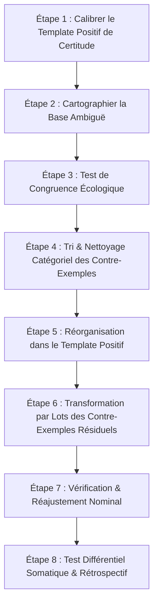

# Transforming Yourself - Transforming An Uncertain Quality Demos
**Formateur :** Damon Cart | **ID :** `damon-cart-transforming-yourself-transforming-an-uncertain-quality-demos` | **Tranches :** 3

# Synthèse Architecturale du Cours : Transforming Yourself – Transforming An Uncertain Quality Demos (Damon Cart)

---

## 1. Thèse Centrale & Philosophie du Cours

### Vision spécifique de Damon Cart & Ruptures avec l'approche standard
Dans l'orthodoxie classique de la PNL et du développement personnel, l'ambiguïté identitaire ou le manque de confiance est souvent traité via des rustines d'affirmation verbale, de l'ancrage de ressources kinésthésiques à répétition, ou une tentative d'écrasement/amnésie des souvenirs douloureux.

Damon Cart (s'appuyant sur les travaux fondateurs de Steve Andreas sur le *Self-Concept Model*) propose une approche cybernétique et topologique radicalement opposée :
* **L'identité comme base de données neuro-spatiale :** Une qualité identitaire (« Je suis $Q$ ») n'est ni une croyance intellectuelle ni une volonté magique ; c'est un ensemble structuré de micro-représentations expérientielles spatialisées. L'ambiguïté n'est pas un manque de volonté, mais un **bruit statistique ou modal dans la base de données interne** (ratio d'exemples/contre-exemples instable, asymétrie de saillance, ou intrusion auditive introjectée).
* **Le Self-Concept comme boucle *Feed-Forward* vs *Feed-Back* :** Contrairement au déterminisme historique où l'on reste prisonnier de ses traces mnésiques passées (boucle fermée de *feed-back* régressif), Damon Cart conçoit le Soi comme une mécanique *anticipative* (*feed-forward*). L'expérience passée ne sert que de carburant pour générer un schéma projectif futur.
* **Le principe de Présupposition Somatique vs Surcompensation :** La certitude identitaire réelle est **transparente et silencieuse** (on ne « prouve » pas qu'on respire ou qu'on est capable de lire). Dès qu'un individu manifeste de l'arrogance, de la vantardise ou de l'hyper-volontarisme, cela traduit invariablement une base de données interne fissurée qui cherche à compenser par la validation extérieure.
* **Intégrité factuelle et écologie du système :** Il ne s'agit jamais d'édulcorer ou de falsifier le passé (déni psychotique ou gaslighting interne). La mémoire factuelle est conservée, mais son statut logique, son chaînage temporel et sa saillance sub-modale sont recodés afin de transformer les obstacles en compétences d'adaptation.

### Fil rouge méthodologique
Le fil conducteur unifiant toutes les démonstrations suit une rigueur chirurgicale d'ingénierie cognitive :
1. **Cartographie différentielle :** Éliciter l'architecture spatiale et sub-modale d'une qualité certaine de référence ($Q_{certain}$) et la confronter à la qualité ambiguë ($Q_{ambiguë}$).
2. **Purification & Tri catégoriel :** Discriminer ce qui relève de faux contre-exemples (erreurs de contexte vs incompétence réelle, ou émergence d'une *autre* qualité).
3. **Résolution des nœuds massifs :** Si des contre-exemples majeurs bloquent l'écologie (traumatismes relationnels racines « *first/worst* », voix critiques introjectées), négocier avec les parties inconscientes et exécuter une ré-empreinte systémique (*Re-imprinting* à double dotation de ressources).
4. **Alchimie & Chaînage Feed-Forward :** Lier le fait historique au comportement ressourcé projectif.
5. **Intégration trans-structurelle & Compression :** Rapatrier les éléments transformés dans le gabarit certain ($template$) et cristalliser une **représentation sommaire prototype** (*Summary Representation*), tout en accompagnant l'inévitable réalignement proprioceptif.

---

## 2. Carte des Concepts & Leviers Émergents

### A. Architecture de la Base de Données & Métrique Interne
* **Ratio Critique (90-95% / 5-10%) :** Une certitude identitaire robuste requiert une écrasante majorité d'exemples positifs consolidés et une infime marge de contre-exemples assimilés comme système d'apprentissage.
* **Saturation par les Contre-Exemples :** Seuil de bascule où le ratio approche le 50/50 ou subit une contamination de surface rendant la généralisation impossible.
* **Saillance Sub-modale Parasite :** Phénomène où un contre-exemple, même numériquement marginal, prend le dessus neurologique en raison d'une taille démesurée, d'un contraste aveuglant ou d'une intensité auditive disproportionnée.
* **Représentation Sommaire (*Summary Representation / Prototype Catégoriel*) :** Image, son ou symbole compressé agissant comme un index holographique. Le cerveau n'interroge pas des milliers d'items un par un : il invoque ce prototype pour certifier l'accès instantané à la qualité.

### B. Topologie, Modalités & Biais Logiques
* **Topologie de l'Ambiguïté :** Répartition spatiale éclatée des représentations mentales (ex: positifs devant à gauche, contre-exemples suspendus derrière la nuque ou à droite).
* **Asymétrie Modale & Voix Critique Introjectée :** Différence de canal d'expression où la certitude est encodée en visuel stable, tandis que le contre-exemple est tenu par un ancrage auditif critique externe (ex: voix parentale punitive).
* **Erreur de Cadrage Logique (Contexte vs Identité) :** Confusion épistémique consistant à prendre une absence d'information contextuelle (ne pas parler une langue jamais apprise) pour un déficit identitaire global (être stupide).
* **Dérivation vers une Qualité Émergente (*Different Quality Sorting*) :** Discrimination montrant qu'un prétendu échec comportemental était en réalité l'expression réussie d'une *autre* valeur ou qualité (ex: le sang-froid au détriment de l'expressivité émotionnelle).

### C. Cybernétique du Recodage & Résolution Systémique
* **Système *Feed-Forward* (Anticipatif) :** Mécanique de projection qui informe le système nerveux de la réponse future adoptée à partir de la leçon tirée, cassant le déterminisme mémoriel rétrospectif.
* **Chaînage Différentiel (*Spatial/Submodality Tethering*) :** Maintien du souvenir historique factuel (réduit, distant, sombre) relié par un ancrage au film futur ressourcé (lumineux, attractif, expansif).
* **Négociation Part-to-Part & Restitution de Rôle de Sécurité :** Traitement de la résistance inconsciente en réassignant à la partie protectrice un mandat d'alarme/vigilance biologique (détecter quand $Q$ requiert attention plutôt que de saboter la qualité).
* **Réduction Macro-Structurelle (*Cluster Transformation*) :** Regroupement de multiples contre-exemples par leurs invariants structurels pour traiter l'ensemble en un seul acte opératoire.
* **Neuro-Re-imprinting par Double Dotation de Ressources :** Dissociation d'une scène originelle (*first/worst*) avec injection rétroactive et simultanée de ressources à la fois dans le Soi enfant et dans l'Autre agresseur/défaillant pour dissoudre le blocage relationnel.
* **Désorientation Proprioceptive Post-Transformationnelle (*Neurological Re-mapping Shock*) :** Période d'adaptation transitoire du schéma corporel et du tonus musculaire résultant de la chute d'une tension psychique historique, à ne pas confondre avec un doute écologique.

---

## 3. Tableau Récapitulatif des Techniques & Démonstrations

| Technique / Exercice | Objectif Opératoire | Déclencheur / Indication | Séquence Résumée |
|---|---|---|---|
| **Calibrage Spatial & Modal de Référence** | Identifier l'architecture sub-modale et topologique d'une qualité déjà certaine ($Q_{certain}$). | Phase diagnostique initiale ; point d'appui et étalon de mesure du sujet. | 1. Éliciter une qualité incontestable. 2. Localiser la base d'exemples dans l'espace péripersonnel (distance, forme, luminosité). 3. Repérer la *Summary Representation* de référence. |
| **Tri & Dérivation Catégorielle (*Quality Rerouting*)** | Dépolluer la base de données de $Q_{ambigu}$ en réattribuant les faux contre-exemples. | Présence de contre-exemples qui expriment une autre ressource ou relèvent d'une méprise contextuelle. | 1. Analyser le contre-exemple contesté. 2. Isoler la chaîne causale. 3. Vérifier si le comportement valida une autre compétence (ex: calme, vigilance). 4. Re-labelliser et extraire l'élément du template de $Q$. |
| **Recadrage Contexte vs Qualité** | Dissoudre l'impact identitaire d'un échec perçu lié à un simple manque de données. | Contre-exemple fondé sur une incompétence purement circonstancielle ou technique. | 1. Identifier le cadre contextuel exact. 2. Démontrer l'impossibilité logique d'exécuter la tâche sans apprentissage préalable. 3. Déplacer l'événement vers la catégorie « données d'apprentissage acquises ». |
| **Réduction Macro-Structurelle (*Clustering*)** | Traiter d'un bloc une nuée de contre-exemples pour éviter la saturation cognitive. | Accumulation excessive de contre-exemples (au-delà de 4 ou 5) épuisant le sujet. | 1. Recenser les similitudes invariantes (même voix critique, même tonalité, même lieu). 2. Fusionner la série en une seule macro-structure représentationnelle. 3. Appliquer la transformation sub-modale au cluster complet. |
| **Négociation de Rôle avec la Partie Gardienne** | Lever le veto inconscient bloquant l'intégration d'un contre-exemple dans le gabarit certain. | Résistance tenace, sentiment de danger biologique ou perte de contrôle si l'ambiguïté disparaît. | 1. Identifier la partie bloquante et son critère rigide de survie. 2. Valider son intention positive protectrice. 3. Lui proposer un nouveau mandat officiel : devenir le système d'alarme/vigilance qui s'active si la qualité fait défaut. 4. Vérifier l'écologie somatique. |
| **Traitement de la Voix Critique Introjectée** | Neutraliser le canal d'intensité auditif aversif masquant le système visuel. | Contre-exemple maintenu actif par une voix externe intrusive (mère, père, figure d'autorité). | 1. Localiser l'origine spatiale et les paramètres de la voix (tonalité, tempo, volume). 2. Dissocier la source auditive de l'identité du sujet. 3. Moduler ses sous-modalités (distance, filtre, tempo comique) ou re-sourcer l'émetteur d'origine. |
| **Neuro-Re-imprinting Racine (*First/Worst Node*)** | Guérir le traumatisme développemental originel à la source du doute structurel. | Contre-exemple massif non négociable qualifié de « toxique », « effrayant » ou fondateur du doute. | 1. Remonter au souvenir le plus ancien ou le plus intense (*first/worst*). 2. Se dissocier en méta-position d'observateur. 3. Identifier l'intention positive et les ressources manquantes pour le jeune Soi ET pour l'Autre. 4. Transfuser simultanément ces ressources rétroactives dans la scène. 5. Vérifier la transformation de l'interaction. |
| **Chaînage Feed-Forward Différentiel** | Créer une dynamique anticipative neurologique sans falsifier la véracité mémorielle. | Post-résolution d'un contre-exemple ; verrouillage de l'apprentissage comportemental futur. | 1. Conserver le fait historique atténué (cadre petit, sombre, distant). 2. Générer à côté un film projectif ressourcé (grand, lumineux, vibrant) montrant la réaction future. 3. Connecter spatialement les deux éléments (pont temporel/lien neuro-visuel). |
| **Transmutation & Intégration Trans-Structurelle** | Inverser la polarité de la preuve et sceller la certitude identitaire. | Phase terminale après résolution et chaînage de tous les contre-exemples ciblés. | 1. Prendre la représentation transformée/ressourcée. 2. La translater spatialement dans le *template* de la base de données positive de $Q$. 3. Condenser la base de données mise à jour en une *Summary Representation* prototype. 4. Calibrer et stabiliser la dérive proprioceptive corporelle. |

---

---

## 0. Sommaire Sémantique & Index des Lignes

- **Tranche 1 [Lignes 81-231]** : Transformation d'une Qualité Ambiguë en Qualité Certaine — *Protocole :* Transformation d'une Qualité Ambiguë en Qualité Certaine | *Mécanisme :* Le Ratio Critique et la Granularité de la Base de Données | *Verbatim :* Présupposition d'Évolution Inéluctable et Cadre d'Expertise
- **Tranche 2 [Lignes 233-366]** : Transformation d'une Qualité Ambiguë en Qualité Certaine (Parties 1 & 2) — *Protocole :* Transformation d'une Qualité Ambiguë en Qualité Certaine (Parties 1 & 2) | *Mécanisme :* Traitement et Dérivation des Contre-Exemples vers une Qualité Émergente | *Verbatim :* Préservation de la Structure Pure & Évitement du Contenu
- **Tranche 3 [Lignes 368-462]** : Clôture du Self-Concept Recode — Re-imprinting du Contre-Exemple Racine, Chaînage Feedforwar... — *Protocole :* Clôture du Self-Concept Recode — Re-imprinting du Contre-Exemple Racine, Chaînage Feedforward & Intégration

---

## Extractions Détaillées par Tranche (Opératoire & Verbatim)

## Tranche 1 / 3 : Transformation d'une Qualité Ambiguë en Qualité Certaine

Voici l'analyse opératoire intégrale de la tranche 1/3 de la formation de Damon Cart, structurée selon les exigences strictes d'ingénierie du Self-Concept.

---

### 1. Mécanismes & Principes Actifs

#### A. Le Ratio Critique et la Granularité de la Base de Données
* **Principe actif :** Une qualité identitaire n'est pas une idée abstraite ; elle est codée neuro-linguistiquement sous la forme d'une banque d'exemples expérientiels (base de données interne). Une qualité « certaine » et résiliente requiert une écrasante majorité d'exemples positifs consolidés, tempérée par 5 à 10 % de contre-exemples intégrés. 
* **Dysfonctionnement de l'ambiguïté :** L'ambiguïté ou l'incertitude identitaire apparaît lorsque la proportion de contre-exemples devient trop volumineuse (souvent proche du ratio 50/50) OU lorsque les contre-exemples, bien que minoritaires en nombre, possèdent une saillance sub-modale disproportionnée (images gigantesques, lumineuses, sons percutants ou voix critiques assourdissantes). Le système nerveux est alors submergé par le signal d'erreur, ce qui déstabilise la généralisation identitaire.
* **Tags :** `#ratio_base_de_donnees` `#saturation_contre_exemples` `#saillance_submodale_parasite` `#seuil_stabilite_identitaire`

#### B. Typologie Topologique et Modale de l'Ambiguïté
Damon Cart dégage 3 configurations spatiales et sensorielles précises régissant la représentation d'une qualité incertaine :
1. **Intégrée mono-modale, même localisation :** Exemples et contre-exemples cohabitent dans le même espace (ex. champ visuel frontal) sous la même modalité. L'ambiguïté vient de la confusion et du volume des contre-exemples.
2. **Mono-modale, localisations dissociées :** La même modalité est utilisée, mais les contre-exemples sont relégués hors du champ principal de la base de données (ex. exemples devant, contre-exemples sur le côté ou isolés).
3. **Cross-modale & multi-spatiale (Hétéromodale) :** Les exemples positifs sont visualisés (souvent devant), tandis que les contre-exemples sont auditifs et positionnés hors champ, très typiquement **derrière le sujet, au-dessus de l'épaule**. Cart relie ce pattern à la neurologie développementale de l'enfance : l'autorité parentale ou professorale qui surprend l'enfant par derrière installe une voix critique rétrospective qui court-circuite la vision positive de soi.
* **Tags :** `#topologie_de_l_ambiguite` `#ancrage_spatial_retrospectif` `#voix_critique_posterieure` `#incongruence_cross_modale`

#### C. Le Concept de Soi comme Système « Feed-Forward » (Anticipatif)
* **Principe actif :** Un système cybernétique basé uniquement sur le *feed-back* enferme le sujet dans ses traces mnésiques passées (« être le produit de son passé »). Le *Self-Concept* fonctionne comme un système *feed-forward* : il projette des représentations futures de la manière dont l'individu réagira pour consolider la trajectoire identitaire.
* **Fonction du contre-exemple transformé :** Transformer un contre-exemple ne consiste pas à falsifier le passé, mais à extraire l'apprentissage du passé pour coder un film futur (« ce que je ferai dorénavant »). Ce film projectif informe immédiatement le système nerveux de la nouvelle réponse comportementale disponible.
* **Tags :** `#systeme_feed_forward` `#projection_identitaire_future` `#recodage_prospectif` `#rupture_determinisme_passe`

#### D. Le Paradoxe de la Surcompensation (Overconfidence = Uncertainty)
* **Principe actif :** La certitude identitaire authentique s'exprime par la **présupposition** : ce qui est intégré est transparent pour la conscience. Dès lors qu'un trait est bruyant, arrogant, sur-revendiqué ou sans cesse verbalisé, il trahit une insécurité interne. L'arrogance ou la vantardise est la signature comportementale d'une base de données interne fracturée cherchant validation extérieure pour compenser un manque de certitude structurelle.
* **Tags :** `#presupposition_somatique` `#arrogance_comme_marqueur_d_incertitude` `#alignement_competence_confiance` `#transparence_identitaire`

#### E. L'Erreur de Catégorisation Contexte / Qualité
* **Principe actif :** De nombreux contre-exemples apparents ne sont pas des négations de la qualité, mais des erreurs de cadrage ou de catégorisation logique. Confondre l'absence d'information dans un contexte neuf (ex: ne pas parler japonais) avec un manque d'intelligence globale crée un faux contre-exemple polluant la base de données. L'identification du contexte réel dissout la nature d'opposition du souvenir.
* **Tags :** `#erreur_de_cadrage_logique` `#confusion_contenu_competence` `#recontextualisation_categorielle`

---

### 2. Protocoles, Techniques & Démonstrations (Étape par Étape)

#### Protocole : Transformation d'une Qualité Ambiguë en Qualité Certaine

* **Intention / Indication :** À utiliser pour toute qualité identitaire valorisée mais instable (« parfois je le suis, parfois non », oscillation selon les contextes ou les personnes), ou lorsqu'une compétence réelle souffre d'un déficit d'assurance interne (incongruence compétence/confiance).
* **Mise en place & Pré-framing :** 
  * Choisir une qualité que le sujet **valorise** explicitement (alignement avec la hiérarchie des valeurs).
  * Informer le sujet qu'une qualité ambiguë abrite de nombreux contre-exemples porteurs d'intentions positives et d'apprentissages anciens, ce qui rendra le travail de négociation interne et de tri plus dense qu'une simple implantation.
  * Assigner un label ou nom de code (ex. "Qualité Q") pour travailler purement sur la structure et le processus sans se noyer dans le contenu.

##### Séquence d'actions pas à pas :

* **Étape 1 : Réactivation et étalonnage du Template Positif (Certitude)**
  * Révoquer la structure de la base de données d'une qualité où le sujet est 100% certain (emplacement spatial, simultanéité/séquentialité, distance, luminosité, sous-modalités kinesthésiques et auditives, positions perceptuelles).
  * *Règle :* Ce gabarit sert d'architecture de référence neuro-structurelle.

* **Étape 2 : Élicitation de la Structure de la Qualité Ambiguë (5 minutes max en exploration pure)**
  * Explorer la représentation sensorielle sans rien modifier :
    * Où sont situés les exemples positifs ?
    * Où sont situés les contre-exemples ?
    * Déterminer le modèle structurel parmi les 3 cas : (1) Même modalité/même lieu, (2) Même modalité/lieux séparés, ou (3) Modalités différentes/lieux différents (ex: images devant, voix critiques derrière).

* **Étape 3 : Contrôle de Congruence (Test d'Écologie Systémique)**
  * Poser la question directe au système inconscient : *« Est-ce qu'une partie de moi s'oppose à ce que je possède cette qualité de façon totalement certaine et univoque ? »*
  * *Si résistance :* Ne pas forcer. Éliciter l'intention positive de la partie protectrice (généralement un vieux programme de sécurité de l'enfance), honorer son message, négocier son intégration dans les critères futurs de la qualité.

* **Étape 4 : Décontamination et Nettoyage Catégoriel des Contre-Exemples**
  * Examiner le contenu des contre-exemples par grappes :
    * Est-ce une vraie violation de la qualité, ou simplement une situation d'apprentissage / un contexte d'incompétence temporaire par manque d'information ?
    * Si c'est un contexte hors-champ : recadrer l'expérience (ex: « ne pas savoir » = « début du processus d'apprentissage ») et expulser l'élément de cette base vers un autre registre d'apprentissage, ou le convertir en exemple positif de curiosité/apprentissage.

* **Étape 5 : Migration des Exemples Positifs dans le Template de Certitude**
  * Prendre la totalité des exemples positifs validés de la qualité ambiguë.
  * Les transposer activement dans la forme, la disposition spatiale, l'éclairage et les sous-modalités exactes du Template Positif défini à l'Étape 1.

* **Étape 6 : Traitement par Lots (*Batching*) et Recodage des Contre-Exemples Restants**
  * Extraire les contre-exemples authentiques par petits groupes de **3 à 5 éléments maximum**.
  * Déplacer ces éléments sur le « poste de travail » mental (*workstation*).
  * *Mécanisme de transformation :* Tamiser/diminuer la saillance de l'erreur passée, extraire la leçon, générer le film projectif (*feed-forward movie*) de la réponse idéale future, adjoindre la trace atténuée de l'erreur comme repère d'apprentissage, et réintégrer le tout au sein de la base de données principale.

* **Étape 7 : Audit Nominal et Vérification Sémantique**
  * Réévaluer le nom donné à la qualité.
  * Observer si l'intégration de la certitude a altéré le sens ou la portée de la qualité (ex: "gentillesse naïve" devenue "bienveillance affirmée"). Ajuster le terme pour qu'il résonne avec la nouvelle configuration neurologique.

* **Étape 8 : Test Différentiel et Future Pace**
  * Comparer l'expérience somatique présente à l'expérience passée de l'ambiguïté.
  * Projeter l'utilisation de cette qualité dans des contextes futurs autrefois déstabilisants pour calibrer la solidité du système *feed-forward*.

* **Signes de calibration du formateur :**
  * *Passage du doute à la certitude :* Déglutition, relâchement des micro-tensions faciales, respiration descendant vers l'abdomen.
  * *Disparition de la focalisation consciente :* Le sujet cesse d'argumenter ou d'analyser la qualité ; il commence à la traiter comme une évidence banale (*« presupposed »*).
  * *Calibration spatiale :* Disparition des mouvements oculaires ou céphaliques trahissant une écoute vers l'arrière (déconnexion de la voix critique dorsale).

---

### 3. Heuristiques, Subtilités & "Sagesse du Praticien"

* **Règle du Batching de Contre-Exemples :**
  > *Si* le sujet doit transformer une grande masse de contre-exemples,  
  > *Alors* ne traiter que des lots de **3 à 5 représentations à la fois** sur le poste de travail mental,  
  > *Parce que* saturer la mémoire de travail au-delà de 5 unités entraîne un décrochage attentionnel et réactive la confusion identitaire.

* **Règle du Lien Mnésique du Contre-Exemple (*The Anchor-Mistake Rule*) :**
  > *Si* le sujet crée le nouveau film comportemental futur (*new movie*),  
  > *Alors* il est préférable de conserver l'image originale de l'erreur passée attachée au nouveau film (en la rendant plus petite, terne et lointaine),  
  > *Parce que* supprimer totalement la mémoire source de l'erreur prive le système nerveux du signal d'apprentissage qui a motivé l'adaptation feed-forward.

* **Règle de Détection de l'Incertitude par l'Arrogance :**
  > *Si* un individu ou un client sur-verbalise une qualité, se vante bruyamment ou fait preuve d'arrogance,  
  > *Alors* diagnostiquer immédiatement une qualité structurellement incertaine et fragile,  
  > *Parce que* la véritable compétence intégrée s'accompagne d'une économie cognitive totale : elle est présupposée et ne réclame aucune validation externe.

* **Règle de l'Émergence des Résistances lors du Future Pace :**
  > *Si* une objection inconsciente peine à émerger au simple test de congruence déclaratif,  
  > *Alors* lancer immédiatement le pont vers le futur (*future pace*) en demandant au sujet d'incarner cette identité dans les situations critiques à venir,  
  > *Parce que* c'est au moment où le système *feed-forward* tente d'écrire la trajectoire future que les anciens mécanismes d'adaptation et les programmes de protection s'activent pour manifester leur intention positive.

* **Règle de la Voix Critique Postérieure :**
  > *Si* le contre-exemple se manifeste sous forme d'une voix critique venant de derrière l'épaule,  
  > *Alors* identifier qu'il s'agit d'un encodage d'autorité infantile périmé et déplacer spatialement cette voix sur le plan de travail frontal pour la traiter en modalité objective,  
  > *Parce qu'une* voix située derrière le champ visuel exploite un angle mort kinesthésique et proprioceptif qui empêche le sujet de la confronter rationnellement.

---

### 4. Pépites Verbatim & Patterns Linguistiques (MOT À MOT EN V.O.)

#### Pépite 1 : Présupposition d'Évolution Inéluctable et Cadre d'Expertise
> « By this time you know more about how you create your self-concept and how people create their self-concept, then most anyone will ever understand in their entire lifetime. »
* **[Analyse du Pattern]** : Présupposition temporelle double (*« By this time »*) couplée à un cadre de contraste extrême (*« more than most anyone... in their entire lifetime »*). Ce pattern installe une autorité thérapeutique profonde chez l'apprenant, tout en ancrant implicitement l'identité d'expert légitime, ce qui réduit d'emblée la résistance au changement.

#### Pépite 2 : Rupture du Déterminisme et Recadrage Temporel
> « If you don't have a feed-forward system, then you're only looking to the past for information... If you didn't utilize your self-concept in order to change your future, then you would be trapped by your past. »
* **[Analyse du Pattern]** : Utilisation d'un double lien négatif / structure conditionnelle en contre-factualité (*« If you didn't... then you would be trapped »*). Ce pattern linguistique provoque une rupture de pattern immédiate sur la nostalgie ou la rumination du passé en l'associant à l'enfermement (*« trapped »*), rendant l'orientation vers le futur (*feed-forward*) neuro-sémantiquement indispensable.

#### Pépite 3 : Définition Opératoire de la Vérité Subjective (Le Vrai Projectif)
> « Some of you might be thinking, when I create this new movie, when I transform a counter example and I'm creating this new movie, the new movie isn't really true. It's true that this is who you want to be. It may not be true of that's what actually happened, but it's true of who you want to be going forward. That truth absolutely does matter because again, you don't want to be a product of your past. »
* **[Analyse du Pattern]** : Pacing & Leading avec anticipation d'objection par lecture de pensée (*« Some of you might be thinking... »*), suivi d'un redéploiement sémantique du prédicat « vrai » (*redefining* de Sleight of Mouth). Damon Cart scinde le concept de vérité en deux catégories logiques distinctes : la factualité historique vs l'intentionnalité téléologique, validant la construction identitaire comme une vérité fonctionnelle supérieure.

#### Pépite 4 : Commande Enchâssée et Décrochage de la Conscience Active
> « When you presuppose an ability, you don't even think about it. You just do it. If you think about the people who are really good at what they do, they're really good at something. They don't feel the need to brag about it... that kind of confidence comes with just a knowing, not a wanting to be or a desperation to be that way. »
* **[Analyse du Pattern]** : Utilisation d'une chaîne de truismes observationnels menant à une commande indirecte d'accès à l'état de certitude (*« just a knowing »*). L'opposition entre *« knowing »* et *« desperation to be »* induit une défocalisation de l'ego conscient au profit d'un ancrage somatique silencieux et intégré.

#### Pépite 5 : Neutralisation de la Résistance par Normalisation Bienveillante
> « An abundance of counter examples are there for a reason. For some reason, you're unconscious, put them there... So know that that's normal. Let this surprise you. It's nothing to be frustrated about. This is normal. This is transforming yourself. »
* **[Analyse du Pattern]** : Empilement de suggestions de normalité (*« normal... for a reason... this is normal »*) couplé à une réorientation de l'état interne par injection de curiosité (*« Let this surprise you »*). Ce recadrage élimine le réflexe de lutte contre les parties réfractaires du Soi, créant le climat d'accueil nécessaire à la négociation des parties et à l'écologie du système.

## Tranche 2 / 3 : Transformation d'une Qualité Ambiguë en Qualité Certaine (Parties 1 & 2)

Voici l’analyse modélisatrice chirurgicale de la tranche 2/3 du cours de Damon Cart (*Transforming Yourself - Transforming An Uncertain Quality Demos*).

---

### 1. Mécanismes & Principes Actifs

#### A. Traitement et Dérivation des Contre-Exemples vers une Qualité Émergente
- **Principe actif :** Dans la structure d'une qualité ambiguë, certains souvenirs étiquetés à tort comme « contre-exemples » ne sont pas des négations de la qualité visée ($Q$), mais des réalisations positives d'une *autre* valeur ou qualité (ex: le calme en situation de crise). Tenter d'intégrer de force ces éléments dans la base de données de $Q$ génère un conflit neurologique de catégorisation. En discriminant la causalité (« j'ai mal réagi, puis j'ai géré avec calme »), on libère l'espace sémantique et spatial de la qualité cible en évitant la contamination des banques de données mnésiques.
- **Tags émergents :** `#different_quality_sorting #database_purification #causal_chain_decoupling #counter_example_rerouting`

#### B. Négociation Part-to-Part & Restitution de Rôle de Sécurité
- **Principe actif :** Lorsqu'une partie inconsciente bloque le déplacement spatial d'un exemple vers le gabarit certain, elle opère sous l'autorité d'un critère rigide de survie (« être $Q$ n'est valide que si cela sauve la vie »). La résistance s'amplifie si le praticien tente de forcer le passage ou d'ignorer la mise en garde. En assignant à cette partie un mandat explicite (« devenir le système d'alarme/vigilance qui signale quand $Q$ n'est pas présent »), l'inconscient n'a plus besoin de maintenir l'ambiguïté pour assurer la sécurité biologique.
- **Tags émergents :** `#part_negotiation #secondary_gain_preservation #role_reassignment #biological_alarm_subsystem #rigorous_criteria_softening`

#### C. Asymétrie Modale des Contre-Exemples (Auditif vs Visuel)
- **Principe actif :** Damon Cart met en évidence que la qualité certaine et les contre-exemples de la qualité ambiguë ne diffèrent pas seulement par leur encodage spatial (localisation), mais par leur modalité dominante d'impact. Pour le sujet, les contre-exemples douloureux sont massivement encodés en auditif critique introjecté (la voix maternelle hurlante/critique), agissant comme des ancrages aversifs immédiats qui submergent le canal visuel. Identifier le canal d'intensité permet d'intervenir chirurgicalement sur la source de l'incongruence.
- **Tags émergents :** `#submodality_dominance #modal_asymmetry #introjected_auditory_anchor #critical_voice_processing`

#### D. Généralisation par Recensement de Caractéristiques Communes
- **Principe actif :** Face à une accumulation de contre-exemples (au-delà de 4 ou 5), le traitement unitaire sature la mémoire de travail et épuise le sujet. En isolant une constante structurelle (taille, couleur, tonalité) ou thématique (la voix de la mère présente dans chaque scène), le cerveau opère une réduction dimensionnelle : le groupe de contre-exemples devient une seule macro-structure traitable d'un bloc au lieu d'une infinité d'échecs atomisés.
- **Tags émergents :** `#commonality_grouping #macro_structural_generalization #cluster_transformation #auditory_pattern_reduction`

#### E. Ré-empreinte Intentionnelle de l'Origine Épistémique (« First/Worst »)
- **Principe actif :** Lorsque des contre-exemples massifs résistent à l'intégration spatiale directe (qualifiés de « tiger » ou de « painful »), ils sont ancrés dans une immaturité développementale (l'enfant de 6 ans face à une figure d'attachement furieuse). En appliquant la ré-empreinte (Re-imprinting selon Dilts) :
  1. Séparation des intentions positives (enfant vs parent),
  2. Elicitation et injection de ressources internes distinctes pour chacun,
  3. Ré-encodage du film biographique enrichi des deux côtés,
  la charge phobique/traumatique s'effondre, rendant le souvenir immédiatement intégrable comme un simple point d'apprentissage contextuel dans le gabarit positif.
- **Tags émergents :** `#reimprinting_pivot #first_or_worst_node #dual_positive_intent #developmental_resource_transfusion #counter_example_neutralization`

---

### 2. Protocoles, Techniques & Démonstrations (Étape par Étape)

#### Protocole : Transformation d'une Qualité Ambiguë en Qualité Certaine (Parties 1 & 2)

##### Intention / Indication
- Transformer une qualité d'identité instable, sujette au doute ou oscillante, en une qualité solide, résiliente et automatique du concept de soi, en synchronisant sa base de données avec le gabarit d'une qualité déjà certaine.

##### Mise en place & Pré-framing
- **Cadrage sur le Processus Pur :** Nommer la qualité $Q$ afin d'opérer hors-contenu et d'éviter les bavardages narratifs ou la psycho-analyse.
- **Activation du Gabarit Positif Certain :** Réactiver l'emplacement spatial, les sous-modalités (sons, images, positions perceptuelles 1-2-3) de la qualité certaine déjà modélisée.

##### Séquence d'actions pas à pas

1. **Élicitation de la Structure de la Qualité Ambiguë :**
   - Demander la localisation spatiale des exemples de $Q$.
   - Quantifier les exemples immédiatement accessibles (ex: ~10).
   - Localiser spatialement les contre-exemples (opposé de $Q$).
   - Évaluer la hiérarchie sensorielle : isoler le visuel sans son, puis l'auditif sans visuel, pour mesurer le canal dominant.

2. **Test de Déplacement Spécifique & Congruence Check Immédiat :**
   - Inviter le sujet à glisser spatialement les exemples positifs de $Q$ vers le gabarit de la qualité certaine.
   - *Si résistance/refus :* Traiter immédiatement l'objection inconsciente (Part Work).

3. **Négociation avec la Partie Réfractaire (Critères & Rôle) :**
   - Éliciter l'intention positive de la partie qui bloque (« *What is its positive intent?* »).
   - Expliciter le critère sous-jacent (ex: « $Q$ ne s'applique que dans les contextes de survie »).
   - Recadrer l'exercice : inclure les petits exemples permet de bâtir la compétence pour être encore plus en sécurité.
   - Attribuer une nouvelle fonction de surveillance : la partie devient l'observateur officiel/l'alarme en cas d'inattention, au lieu de bloquer l'identité.
   - Valider l'accord écologique.

4. **Densification de la Base de Données Positive :**
   - Faire migrer les 10 exemples dans l'espace certain.
   - Traiter toute réaction de deuil rétrospectif (« tristesse de ne pas l'avoir eu avant ») par un accord temporel bienveillant (« mieux vaut maintenant que jamais »).
   - Récupérer 15 à 20 exemples positifs supplémentaires pour atteindre la masse critique identifiée lors du gabarit de référence (~30 exemples).

5. **Traitement et Tri des Contre-Exemples :**
   - **Voie A (Faux contre-exemples / Qualité distincte) :** Tester si les contre-exemples appartiennent en réalité à une autre qualité (ex: le calme post-crise). Si non intégrables dans cette autre base en raison d'une confusion cause/effet, les rétablir comme des comportements par défaut en l'absence de $Q$.
   - **Voie B (Intégration directe des contre-exemples ordinaires) :** Prendre un contre-exemple simple (« moments où je n'étais pas $Q$ ») et le glisser dans la base de données positive. Il agit comme borne contextuelle sans affaiblir la certitude globale.
   - **Voie C (Contre-exemples traumatiques / Introjects massifs) :** Si déplacer un contre-exemple provoque de la douleur (« *tiger* », conséquences vitales perçues) :
     - Éliciter la modalité dominante (ici : voix critique introjectée).
     - Grouper les contre-exemples par leurs points communs structurels ou contextuels (ex: la voix de la mère qui hurle).
     - Isoler l'événement fondateur ou le plus intense (« *the worst or the first* »).

6. **Résolution par Ré-empreinte (Re-imprinting Pivot) sur le Contre-Exemple Racine :**
   - Faire venir la scène sur l'espace de travail neutre.
   - Identifier l'âge du sujet (vulnérabilité développementale).
   - Éliciter l'intention positive du jeune soi.
   - Éliciter l'intention positive de la figure parentale/d'autorité.
   - Identifier la ressource interne manquante pour le sujet à cet âge.
   - Identifier la ressource interne manquante pour la figure parentale.
   - Vérifier la divergence des besoins (« ce que vous vouliez vs ce qu'elle voulait »).
   - Rejouer mentalement la scène entière en dotant simultanément le sujet et la figure parentale de leurs ressources respectives.
   - Vérifier le changement de tonalité kinesthésique et visuelle (« *Much better* »).

##### Signes de calibration
- Changement de prosodie (tonalité de voix qui devient plus grave, plus lente, ou qui s'adoucit).
- Gestes métaphoriques spontanés (posture rigide d'autorité qui se détend).
- Modifications autonomes (changement de couleur de peau, clignements des yeux, micro-mouvements faciaux).
- Fluidité kinesthésique lors des translations spatiales d'images mentales.

---

### 3. Heuristiques, Subtilités & "Sagesse du Praticien"

- **Heuristique du Découplage Causal vs Qualité Propre :**
  *Si* le sujet pense qu'un contre-exemple est en fait une autre qualité positive (ex: *Calmness*), *alors* vérifie si ce comportement est intervenu *en réaction* à l'erreur ou s'il s'agissait du comportement direct. Souvent, la personne confond le sang-froid déployé pour réparer un dégât avec l'absence de la qualité initiale.
- **Heuristique de la Partie « Gendarme de Survie » :**
  *Si* une partie refuse d'intégrer des exemples sous prétexte qu'ils sont « futiles » ou « non productifs », *alors* c'est qu'elle opère avec une définition hyper-rigide de la qualité (« ça ne compte que si ma vie est en jeu »). N'essaie pas d'affaiblir son standard : montre-lui que la répétition des petits exemples renforce précisément la sécurité ultime qu'elle recherche.
- **Heuristique de l'Asymétrie Sensorielle des Contre-Exemples :**
  *Si* le canal auditif domine sur un contre-exemple douloureux, *alors* présume la présence d'une voix d'autorité introjectée (parent, enseignant). Le travail ne se fera pas sur les sous-modalités visuelles de la base, mais sur la désactivation de l'auditif critique via la ré-empreinte.
- **Heuristique du Seuil Numérique de Traitement :**
  *Si* le sujet a 4 ou 5 contre-exemples banals, glisse-les un par un. *Si* une masse surgit soudainement (« *a lot* »), arrête immédiatement le traitement individuel : cherche la généralisation commune (structurelle ou thématique) et attaque le « premier ou le pire ».
- **Heuristique du Respect du Secret du Contenu :**
  *Si* le sujet identifie la ressource de ré-empreinte en interne, ne lui demande jamais de la nommer à voix haute. La verbalisation force le traitement cortical et analytique, ce qui ralentit la réorganisation somatosensorielle inconsciente.
- **Postulat Philosophique de Damon Cart :**
  *Un Self-Concept sain n'est jamais étanche aux erreurs :* Les contre-exemples intégrés ne détruisent pas la qualité, ils lui donnent son ancrage dans le réel. Ce qui rend une personne instable, c'est l'isolement spatial de ses échecs, créant un système binaire où l'on bascule brutalement de « je suis tout » à « je ne suis rien ».

---

### 4. Pépites Verbatim & Patterns Linguistiques (MOT À MOT EN V.O.)

#### Pépite 1 : Préservation de la Structure Pure & Évitement du Contenu
> "Now again we're going to call this Q and the reason for that is so we can stay out of content and stay in process and structure. Now there may be times when we have to then go into content if she gets stuck, if that happens then we'll work through that but that's the only reason why you'd want to get into content."
- **[Analyse du Pattern]** : *Pré-framing d'abstraction structurelle et prescription de cadre.* Damon Cart neutralise le biais de narration du sujet en remplaçant la valeur par une variable algébrique ($Q$). L'inconscient est forcé de manipuler la syntaxe neurologique (espace, sous-modalités, bases de données) sans pouvoir fuir dans la justification autobiographique ou l'analyse intellectuelle.

#### Pépite 2 : Recadrage de la Tristesse Rétroactive (Présupposition Temporelle)
> "Sometimes this happens, but it's better now that it's starting now rather than waiting any longer, but we're doing it now. So you can sure that sad part of it by saying that, well, at least we're doing it now, because you could have gone your whole life without it."
- **[Analyse du Pattern]** : *Empilement d'ancrages temporels (« now ») et truisme de contraste existentiel.* Utilisation répétée du marqueur de présent (« starting now », « doing it now », « at least we're doing it now ») confronté à une boucle contrefactuelle négative (« you could have gone your whole life »). La tristesse du temps perdu est instantanément convertie en soulagement d'échapper au pire scénario possible.

#### Pépite 3 : Attribution de Rôle Sécuritaire à la Partie Réfractaire
> "And let's give that part a job and let that part, ask that part if it's willing to be that additional awareness that says it sounds the alarm that you don't have Q when you think you do. That's, that's much better. So is it willing to take on that role? Yes. And then, in taking on that role, is it now willing to allow us to move forward with this?"
- **[Analyse du Pattern]** : *Double lien d'action et valorisation de statut inconscient.* Damon Cart ne cherche pas à réduire au silence la partie protectrice ; il élève son statut en la nommant « conscience additionnelle » et « système d'alarme ». Le pattern enchaîne deux questions fermées présupposant l'accord séquentiel : accepter la promotion du rôle entraîne logiquement l'autorisation de débloquer le processus.

#### Pépite 4 : Normalisation de la Vulnérabilité Développementale (Dédramatisation)
> "Now at this time, how old were you in this situation? Six. Okay. So at this time, you may not have possessed that resource because, and that's why a lot of these events, very, very early on are very traumatic for young children's because they're, they don't have all the resources to handle these situations, especially when someone, a loved one, the person who they depend on for a little life is angry at them."
- **[Analyse du Pattern]** : *Déculpabilisation ontologique par dissociation d'âge et truisme développemental.* Déplacement de l'attribution d'échec (« je suis incompétente ») vers un fait universel du développement cérébral (« à six ans, personne n'a les ressources »). La formule présuppose que l'adulte d'aujourd'hui possède naturellement les ressources nécessaires, ouvrant la voie à la transmission symbolique du Re-imprinting.

#### Pépite 5 : Recadrage Intégratif du Contre-Exemple
> "It doesn't affect this at all. It shouldn't. Because remember when we did it with your certain quality, well, actually when we elicit your certain quality, your counter examples were already integrated in there, which is usually what a certain quality is. You can accept the times when you weren't Q and actually that makes it even stronger and more realistic. Right. It just feels like, okay, sometimes I'm not."
- **[Analyse du Pattern]** : *Inversion de valence logique et normalisation d'imperfection.* Cart redéfinit la nature même d'une certitude saine : un contre-exemple n'est plus la preuve qu'on n'est pas $Q$, mais la preuve que notre identité est robuste et réaliste. L'acception de la variabilité contextuelle détruit la fragilité du perfectionnisme névrotique.

## Tranche 3 / 3 : Clôture du Self-Concept Recode — Re-imprinting du Contre-Exemple Racine, Chaînage Feedforwar...

### 1. Mécanismes & Principes Actifs

- **Neuro-Re-imprinting par double dotation de ressources (Self & Autre)** :
  * *Principe actif* : Dans un traumatisme précoce ou un contre-exemple biographique, l'enfant n'encode pas seulement sa propre détresse, mais aussi l'agression/la colère du parent comme une menace vitale, faute de modèle mental de la cognition d'autrui (*Theory of Mind* immature). En dissociant la scène, en extrayant l'intention positive de la mère ET celle de l'enfant, puis en injectant rétroactivement les ressources internes manquantes dans les *deux* agents neurologiques simultanément, le système nerveux décharge la charge d'insécurité relationnelle. Le souvenir n'est plus un ancrage d'incompétence ou de rejet, mais un scénario résolu.
  * *Tags* : #re_imprinting #double_resourcing #positive_intent_uncoupling #interpersonal_neurobiology

- **Système Feedforward par chaînage différentiel de sous-modalités** :
  * *Principe actif* : La réécriture du passé ne doit pas être une amnésie ou un déni délirant (ce qui briserait l'écologie et la confiance du système critique). En liant le souvenir factuel (conservé plus petit, sombre, distant) au film alternatif ressourcé (grand, lumineux, coloré, attirant) par un connecteur spatial ou physique (cordon, contact), le cerveau apprend une règle d'anticipation (*feedforward*) : « Cet événement s'est produit ainsi, et voilà précisément la personne que je deviens et la compétence que je déploie à partir de là ».
  * *Tags* : #feedforward_architecture #submodalities_contrast #grounded_truth #spatial_tethering

- **Intégration trans-structurelle des contre-exemples transformés dans la base de données positive** :
  * *Principe actif* : La certitude identitaire (Self-Concept) repose sur une accumulation volumétrique et qualitative d'exemples congruents. En déplaçant physiquement/visuellement les contre-exemples transformés directement dans le gabarit (*template*) de la base positive, on inverse la polarité de la preuve : ce qui servait d'objection interne devient une preuve supplémentaire de la qualité $Q$.
  * *Tags* : #counter_example_transmutation #database_integration #structural_reorganization

- **Représentation Sommaire / Prototype Catégoriel (Summary Representation)** :
  * *Principe actif* : Le système cognitif compresse les concepts généraux sous forme de prototype unique (l'image générique d'une « chaise » qui synthétise l'ensemble des chaises possibles). Pour l'identité, « Je suis $Q$ » ne nécessite pas de scanner mentalement 500 souvenirs à la seconde : l'esprit convoque une représentation sommaire (image, son, voix ou synesthésie) qui agit comme un index holographique validant immédiatement la certitude interne.
  * *Tags* : #summary_representation #cognitive_prototype #identity_indexing #data_compression

- **Désorientation proprioceptive post-transformationnelle (Neurological Re-mapping Shock)** :
  * *Principe actif* : Lorsqu'une croyance centrale identitaire bascule en quelques minutes, la distribution tonique, la posture et le schéma corporel se réalignent instantanément. Cette nouveauté somatique radicale est fréquemment interprétée par le sujet comme « bizarre » ou « effrayante ». Ce n'est pas une résistance écologique inconsciente, mais un temps d'accommodation neurosensoriel face à une nouvelle configuration corporelle.
  * *Tags* : #proprioceptive_shift #somatosensory_update #homeostatic_lag #false_incongruence

---

### 2. Protocoles, Techniques & Démonstrations (Étape par Étape)

#### Protocole : Clôture du Self-Concept Recode — Re-imprinting du Contre-Exemple Racine, Chaînage Feedforward & Intégration

* **Intention / Indication** : À utiliser lorsqu'un contre-exemple majeur (souvent biographique/familial) persiste et bloque la cristallisation de la certitude sur une qualité identitaire ($Q$).
* **Mise en place & Pré-framing** : Cadrer que l'enfant manquait de ressources de traitement face à la détresse/colère parentale, et qu'il ne s'agit pas d'effacer la réalité mais d'enrichir le réseau de ressources sans s'auto-duper.
* **Séquence d'actions pas à pas** :
  1. *Extraction des intentions positives croisées* :
     - Vérifier la conscience de l'intention positive de soi-même dans la scène d'origine.
     - Vérifier la conscience de l'intention positive de l'autre protagoniste (la mère).
  2. *Élicitation des ressources internes manquantes* :
     - Identifier la ressource interne qui manquait au sujet pour accomplir son intention positive (ex: capacité à communiquer).
     - Identifier la ressource interne manquante chez l'autre protagoniste pour accomplir la sienne.
     - *Règle* : Ne pas forcer les ressources à être identiques (elles sont souvent radicalement distinctes).
  3. *Génération du nouveau film ressourcé* :
     - Rejouer la scène en injectant simultanément ces deux ressources respectives.
     - Ajuster les sous-modalités (augmenter le volume de la voix, la clarté visuelle) jusqu'à ce que le film soit pleinement captivant et induise un sentiment direct de la qualité $Q$.
  4. *Liaison Feedforward (Ancrage Réalité vs Identité Désirée)* :
     - Réduire le souvenir original (plus petit, plus sombre).
     - Rendre le nouveau film ressourcé grand, lumineux, attrayant.
     - Relier structurellement les deux représentations dans l'espace mental (par un cordon, une bordure en contact, etc.) afin d'empêcher la scission perceptuelle.
  5. *Intégration dans la Base de Données Positive* :
     - Replacer l'exemple transformé avec les autres contre-exemples.
     - Prendre un échantillon de contre-exemples transformés (ex: 5 exemples) et les déposer/fusionner un par un dans le gabarit (*template*) de la base de données positive de $Q$.
  6. *Calibration du Prototype / Représentation Sommaire* :
     - Éliciter la représentation sommaire globale de la qualité (l'image/le son prototype qui condense « Je suis $Q$ »).
     - Vérifier la stabilité du nom de la qualité (qui est souvent l'une des valeurs les plus hautes du sujet).
  7. *Test de Congruence & Calibration de l'Effet Somatique* :
     - Vérifier la réponse à la question binaire directe : « Es-tu $Q$ ? ».
     - Sonder toute sensation de peur ou d'hésitation pour séparer la résistance réelle d'un simple vertige proprioceptif de réorganisation neurologique.

* **Signes de calibration** :
  - Fluidité et vitesse de réponse sans hésitation cognitive.
  - Bascule du discours de la comparaison (« Je suis *plus* $Q$ ») à l'affirmation identitaire ontologique (« Je *suis* $Q$ »).
  - Modifications observables du tonus musculaire, de la respiration et signalement spontané d'un décalage sensoriel corporel unilatéral (ex: « le côté gauche de mon corps s'est réinstallé »).

---

### 3. Heuristiques, Subtilités & "Sagesse du Praticien"

- **Distinction : Réassurance vs Base de Données Identitaire** :
  * *Règle* : Si le sujet dit « Je me sens beaucoup mieux », ce n'est pas suffisant. Le praticien ne cherche pas un simple soulagement émotionnel, mais une modification fonctionnelle de la structure de preuve : l'expérience doit nourrir explicitement la base de données de la qualité $Q$.
- **Le piège du contenu inutile (Content-Free Stance)** :
  * *Règle* : Si le sujet demande s'il doit nommer la ressource à haute voix, lui laisser le choix total. Le praticien n'a pas besoin de connaître le contenu intime pour guider la structure du Re-imprinting.
- **Règle de l'Intégrité de la Réalité (Non-Deception Rule)** :
  * *Règle* : Ne jamais effacer ou détruire le contre-exemple d'origine. Si on tente de le supprimer, le doute ressurgira. On doit *lier* le fait historique au modèle ressourcé pour que le système sache : « Cela s'est produit, et voici ce que j'en ai extrait pour définir qui je suis ».
- **Correction linguistique : Du Comparatif à l'Ontologie** :
  * *Règle* : Si le sujet dit « I'm *more* Q » (comparatif / dynamique d'effort), l'interrompre immédiatement pour calibrer l'état ontologique : « More Q? Or are you Q? ». L'identité stable ne s'évalue pas en échelle relative, elle est un état d'être catégoriel binaire.
- **Démystification de la "Peur" post-transformationnelle** :
  * *Règle* : Si le sujet signale qu'il trouve le changement « un peu effrayant » (*a little scary*), ne pas présupposer un problème d'écologie ou une part réfractaire. Déballer l'expérience sensorielle. Si la réponse est « mes sensations corporelles ont totalement changé », recadrer immédiatement comme une accommodation physiologique normale à la rapidité de la transformation.

---

### 4. Pépites Verbatim & Patterns Linguistiques (MOT À MOT EN V.O.)

> **"When you look at your mother and you check in with her positive intent, what was she missing as a resource?"**
- **[Analyse du Pattern]** : Présupposition enchâssée incontournable (*presupposition of positive intent*). L'existence d'une intention positive chez la mère n'est pas soumise à débat ou à condition (« est-ce qu'elle en avait une ? ») : elle est posée comme un fait temporel accompli (« when you look... and check in »), ce qui neutralise le réflexe de blâme et force l'inconscient à chercher exclusivement la ressource manquante.

> **"So we don't want to forget what actually happens because this is not about deceiving yourself. So you want to make sure the new movie is big, bright, colorful, compelling... And then what actually happened, smaller, darker, and make sure that they are connected somehow."**
- **[Analyse du Pattern]** : Prémisse d'intégrité cognitive couplée à une commande de contraste sous-modal direct. L'utilisation du « we don't want to deceive yourself » valide le système critique du sujet, tandis que le calibrage simultané des sous-modalités (grand/lumineux vs petit/sombre) et l'impératif de connexion spatiale (« connected somehow ») reprogramment la dominance attentionnelle de l'hémisphère visuel.

> **"More Q? Or are you Q?"**
- **[Analyse du Pattern]** : Rupture de pattern linguistique par double contrainte de clarification. Cette intervention coupe net la nominalisation comparative (« plus de $Q$ », qui maintient le sujet dans une trajectoire d'effort ou de manque partiel) pour forcer un saut quantique vers l'affirmation identitaire catégorielle absolue (« Je suis $Q$ »).

> **"Did you see every chair that you've ever seen in your life before? Or did you see one chair? ... That summary representation lets you know that if you open that box, there would be many different types of chairs."**
- **[Analyse du Pattern]** : Métaphore isomorphe et truisme d'amorçage cognitif. En faisant valider une vérité évidente et universelle sur le fonctionnement de la mémoire sémantique (l'accès à un concept via un prototype unique), il installe le cadre sans résistance pour que le sujet applique exactement cette même mécanique de compression mentale à sa qualité identitaire $Q$.

> **"Well, just an hour ago, you weren't certain about it. And probably for most of your life, and now here you are, certain that you're Q."**
- **[Analyse du Pattern]** : Recadrage temporel à fort contraste (*temporal pacing and leading*). Mise en tension dramatique de deux lignes temporelles (« pour la majeure partie de ta vie » vs « maintenant ici »). Ce contraste ancre la permanence de la transformation en marquant la discontinuité irréversible entre l'ancien état de doute et l'état présent de certitude.

