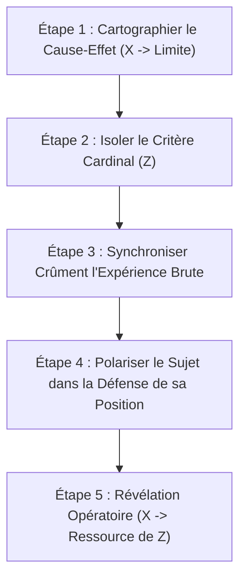

# Phoenix - Therapeutic Patterns of Milton H. Erickson
**Formateur :** David Gordon & Maribeth Meyers-Anderson | **ID :** `david-gordon-maribeth-meyers-anderson-phoenix-therapeutic-patterns-of-milton-h-erickson` | **Tranches :** 17

Voici la synthèse architecturale ultra-dense et structurée du cours de David Gordon & Maribeth Meyers-Anderson, prête à servir d'en-tête et de fondation à votre fiche maîtresse.

---

# Synthèse Architecturale du Cours : *Phoenix – Therapeutic Patterns of Milton H. Erickson*
**Formateurs :** David Gordon & Maribeth Meyers-Anderson

---

### 1. Thèse Centrale & Philosophie du Cours

#### A. Vision spécifique de Gordon & Meyers-Anderson vs Approche standard
* **Le refus radical de l’anthropomorphisme théorique et de l'effet Pygmalion :** Là où les écoles traditionnelles (psychanalyse, AT, CBT, approches corporelles) découpent arbitrairement l'expérience du patient à travers le prisme de leur propre modèle (plaquant ce qui a marché pour le thérapeute sur le patient), Gordon & Meyers-Anderson formalisent l'approche ericksonienne comme une **modélisation phénoménologique pure**. Chaque système nerveux décode la réalité selon des filtres uniques (*« No two people understand the SAME sentence the same way »*). Le praticien inhibe toute projection dogmatique pour cartographier exclusivement le modèle du monde du patient.
* **Incompétence explicative du conscient vs Sagesse auto-organisatrice de l'inconscient :** Le conscient consulte précisément parce qu'il a épuisé son répertoire d'adaptation. Ce que le patient formule comme la cause, la nature ou l'explication de son problème est structurellement la liste de ce qui **ne fonctionne pas**. L'approche ne cherche ni l'insight intellectuel ni l'analyse étiologique (qui ne font que réifier le problème sans réorganiser les circuits neuronaux).
* **Restitution absolue d'agentivité (« Giddyup ») :** Contrairement à la transe directive de foire ou au paternalisme médical, le thérapeute ericksonien refuse d'incarner l'artisan du changement. Son travail se réduit à borner le cadre, briser les fixations et donner l'impulsion motrice (*point the nose in the right direction and say "Giddyup"*). La guérison est endogène, autonome et générative.

#### B. Fil rouge méthodologique unificateur
* **L'amorçage minimal non linéaire (Effet Boule de neige / Avalanche) :** L'inconscient n'exige pas une reconstruction globale immédiate mais une brisure de pattern microscopique acceptée par l'écologie du patient. Une micro-déviation initiale déclenche une cascade auto-organisée d'adaptations nouvelles.
* **Le principe d'utilisation intégrale :** Rien n'est rejeté, combattu ou invalidé (symptôme, résistance, opposition, délire, posture physique, environnement naturel ou fixation négative). Tout matériel apporté par le sujet devient le levier ou le carburant même de la résolution.
* **Le multiplexage communicationnel :** L'intervention n'est pas une séquence rigide d'étapes déconnectées, mais la superposition synchronisée de signaux verbaux (prédicats, présuppositions, métaphores), para-verbaux (ton, tempo) et somato-spatiaux (proxémie, miroirs analogiques, ancrages), contournant l'hémisphère gauche critique sans susciter de réactance.

---

### 2. Carte des Concepts & Leviers Émergents

```
                          [ MODÈLE DU MONDE DU SUJET ]
                                       │
            ┌──────────────────────────┴──────────────────────────┐
            ▼                                                     ▼
   [ ARCHITECTURE DU RAPPORT ]                           [ DYNAMIQUE DU CHANGEMENT ]
   ├─ Rapport Sémantique / Invalidation Zéro             ├─ Court-circuit de l'Insight Étiologique
   ├─ Harmonisation des Prédicats (VAK)                  ├─ Amorce Minimale (Effet Boule de Neige)
   ├─ Miroir Analogique Direct & Croisé                  ├─ Autonomie Générative (Anti-dépendance)
   ├─ Pacing Micro vs Macro-Comportemental               ├─ Redirection Attentionnelle Massive
   └─ Isomorphisme Expressif (Niveau Réel)               └─ Gamification & Fractionnement Somatique
                                       │
                                       ▼
                       [ UTILISATION & CADRAGE STRATÉGIQUE ]
                       ├─ Polarité Réactive & Opposition Délibérée
                       ├─ Externalisation du Cadre (Non-Réactance)
                       ├─ Reframing Identitaire & Partage de Stigmate
                       ├─ Pattern Interrupt Absurde (Humour Déstabilisateur)
                       └─ Clôture Frontalière (Refus du Cadeau Vénéneux)
```

#### Écosystème des Leviers :
1. **Rapport Sémantique & Invalidation Zéro :** Réponse symétrique stricte aux axiomes du patient. Toute contestation du cadre du sujet déclenche une réactance homéostatique ; l'acceptation intégrale annule le seuil de menace neurobiologique.
2. **Harmonisation des Prédicats Sensoriels (VAK) :** Traitement de l'information à coût computationnel nul dans le cortex du patient en réutilisant ses verbes et adjectifs directeurs.
3. **Miroir Analogique Direct & Croisé (*Cross-Over Mirroring*) :** Synchronisation physiologique furtive (rythme respiratoire calé sur le ton de voix, clignement calé sur un hochement), instaurant un biofeedback relationnel sous le radar de la vigilance critique.
4. **Distinction Micro vs Macro-Pacing :** Le micro-pacing opère sous le seuil conscient (sécurité automatique) ; le macro-pacing (imiter un état émotionnel intense ou une posture globale) n'est opératoire que s'il est validé par une congruence absolue d'intention au service du sujet, sous peine d'être perçu comme une parodie agressive.
5. **Isomorphisme Expressif & Rencontre au Niveau Réel :** Utilisation du code de communication réel du patient (du jargon d'atelier aux bruits/salade de mots psychotiques) pour rompre l'isolement neurologique sans exiger de translation cognitive préalable.
6. **Utilisation des Polarités Réactives :** Pour les personnalités opposantes, prescription de micro-paliers d'impossibilité ou de résistance, convertissant l'énergie de défi en levier d'action thérapeutique dont le sujet reste l'unique vainqueur.
7. **Fractionnement Géométrique / Gamification :** Déstructuration de la linéarité d'une tâche écrasante par un redécoupage visuo-spatial ludique, neutralisant l'inhibition motrice et la fatigue anticipatoire.
8. **Utilisation Écologique de l'Environnement (ex. Violettes Africaines) :** Ancrage de la tâche comportementale dans un élément végétal, matériel ou contextuel déjà présent dans la vie du sujet pour forcer une connexion au réseau social externe.
9. **Reframing par Partage de Stigmate :** Neutralisation du statut d'infériorité ou d'anormalité par auto-inclusion du praticien dans la catégorie stigmatisée (*« nous les estropiés »*), réalignant instantanément le statut social.
10. **Clôture Frontalière (Cadeau Vénéneux) :** Herméticité psychologique face aux attaques ou projections verbales : le stimulus hostile non accepté reste la charge et la propriété exclusive de l'émetteur.

---

### 3. Tableau Récapitulatif des Techniques & Démonstrations

| Technique / Exercice | Objectif Opératoire | Déclencheur / Indication | Séquence Résumée |
|---|---|---|---|
| **Le Cheval Égaré (*Stray Horse*)** | Maintenir la trajectoire adaptative sans présumer de la solution finale ; redirection attentionnelle minimaliste. | Sujet déviant continuellement vers des ruminations, digressions, défenses ou faux problèmes. | 1. Observer la dérive hors de la voie.<br>2. Intervenir uniquement par micro-contrainte attentionnelle ramenant sur la route.<br>3. Laisser l'inconscient avancer par ses propres moyens jusqu'à destination. |
| **Fractionnement Géométrique (*Field Division*)** | Dissoudre la paralysie motrice et la surcharge cognitive face à un volume de travail massif. | Sujet submergé, découragé ou procastinateur face à une tâche perçue comme un bloc écrasant. | 1. Interrompre l'exécution séquentielle/linéaire habituelle.<br>2. Réorganiser la tâche en découpages géométriques/diagonales visuo-spatiales.<br>3. Transformer l'affect de contrainte laborieuse en dynamique de jeu somatique. |
| **Sanctuarisation du Rôle & Restitution du Cadre** | Éviter la réactance et l'affrontement autoritaire ; activer l'auto-régulation systémique. | Collectif, groupe ou patient défiant l'autorité ou cherchant le bras de fer institutionnel. | 1. Déclarer la souveraineté totale du groupe sur son propre espace (*« C'est votre école »*).<br>2. Restreindre strictement son propre périmètre fonctionnel (*« Je ne fais qu'enseigner ici »*).<br>3. Laisser le système créer sa propre régulation interne par nécessité vitale. |
| **Amorce Minimale / Dérive Déterministe (*Snowball*)** | Enclencher un processus cumulatif de guérison sans affronter la masse du problème. | Blocage massif, chronicité névrotique, sentiment d'impasse globale. | 1. Découper un micro-comportement réalisable immédiatement.<br>2. Faire valider et exécuter cette micro-action par le sujet.<br>3. Laisser l'effet d'avalanche réorganiser les patterns voisins de façon auto-adaptative. |
| **Greffe Comportementale Écologique (*African Violets*)** | Réorienter la charge attentionnelle vers l'extérieur et réinsérer socialement sans psychologisation. | Dépression grabataire, repli autistique, isolement social sévère avec focalisation morbide. | 1. Identifier un point d'intérêt latent microscopique dans le biotope du sujet (ex. boutures).<br>2. Prescrire une tâche exponentielle de soin et de distribution à autrui.<br>3. Connecter mécaniquement le sujet à la communauté par le biais du don d'objets réels. |
| **Prescription de l'Opposition (*Polarity Utilization*)** | Exploiter l'inversion vectorielle chez le sujet réfractaire pour atteindre l'objectif du changement. | Profils oppositionnels, provocateurs, refusant d'obtempérer à toute suggestion directe. | 1. Valider l'impossibilité pour le praticien d'imposer quoi que ce soit.<br>2. Prescrire au sujet de résister ou défier sur un seuil microscopique précis.<br>3. Laisser le patient prouver son autonomie en accomplissant le palier comportemental désiré. |
| **Miroir Croisé (*Cross-Over Mirroring*)** | Établir un biofeedback relationnel sous le radar de la vigilance critique. | Sujet analytique, méfiant, hyper-vigilent ou prompt à détecter l'imitation directe. | 1. Calibrer un oscillateur biologique du sujet (respiration, pulsation, clignement, rythme de pied).<br>2. Transduire ce rythme dans un canal analogique différent (rythme vocal, hochement, tempo des gestes).<br>3. Guider subtilement l'état en faisant varier la fréquence de sortie. |
| **Partage de Stigmate & Désensibilisation Immédiate** | Pulvériser la dramatisation victimaire et requalifier instantanément le statut social. | Honte toxique liée à un handicap, une difformité, une cicatrice ou une faiblesse perçue. | 1. Nommer crûment le trait tabou sans périphrases ni condescendance empathique.<br>2. S'inclure explicitement dans la catégorie stigmatisée aux côtés du patient (*« nous autres »*).<br>3. Réancrer le sujet dans un statut de pairs partageant la même réalité opérationnelle. |
| **Pattern Interrupt Absurde & Dédramatisation par l'Humour** | Casser une boucle de culpabilité ou d'obsession en créant une incongruence cognitive brutale. | Fixation névrotique rigide, honte disproportionnée autour d'un incident passé mineur. | 1. Introduire un stimulus inattendu, incongru ou anonyme pointant l'absurdité du drame.<br>2. Déclencher le rire ou la sidération pour briser l'affect tragique.<br>3. Réorienter l'attention libérée vers des comportements d'action constructive. |
| **Clôture Frontalière du Don Rejeté** | Immuniser le sujet contre le venin projectif, les insultes ou les attaques de l'entourage. | Sujet perméable à la critique, blessé par l'hostilité verbale ou le mépris d'autrui. | 1. Cadrer l'agression verbale comme un objet ou un paquet physique offert par autrui.<br>2. Poser la règle de propriété : refuser d'ouvrir ou de saisir le paquet.<br>3. Renvoyer mentalement l'agression à l'émetteur, qui en reste l'unique porteur et propriétaire. |

---

## Extractions Détaillées par Tranche (Opératoire & Verbatim)


## --- Tranche 1 / 17 ---

### 1. Mécanismes & Principes Actifs

#### A. Rejet de la projection théorique & Respect du modèle du monde
- **Principe actif** : Erickson pose comme axiome neurologique et sémantique que chaque système nerveux décode la réalité selon des filtres uniques (*« No two people who understand the SAME sentence the same way »*). Projeter une grille théorique dogmatique (Freud, théories universelles) équivaut à un anthropomorphisme thérapeutique : on plaque l'illusion d'une norme sur un individu dont la carte interne est radicalement distincte. Le levier consiste à inhiber la projection du praticien pour cartographier exclusivement le concept que le sujet a de lui-même (*« their concept of themselves »*).
- **Tags libres** : `#idiosyncrasie_radicale` `#anti_anthropomorphisme` `#cartographie_de_soi` `#non_projection_theorique`

#### B. La Métaphore Isomorphique de Guidage Minimaliste (Le « Cheval Égaré »)
- **Principe actif** : L'inconscient du sujet possède l'orientation, les ressources et la destination biologique/adaptative vers l'équilibre, mais son attention consciente s'égare dans des boucles de déviation (champs secondaires, ruminations, défenses). Le thérapeute n'a pas besoin de connaître le contenu de la guérison ni la destination finale. Son unique travail neuro-attentionnel consiste à borner la route : chaque fois que le sujet sort du canal de progression (*« start into a field »*), une micro-traction attentionnelle (*« keep his attention on the road »*) le ramène sur la voie médiane. Le moteur reste 100 % autonome et inconscient.
- **Tags libres** : `#guidage_attentionnel_minimaliste` `#direction_endogene` `#isomorphisme_de_la_trajectoire` `#contrainte_de_cadre`

#### C. Externalisation du Cadre Disciplinaire & Restitution de l'Autonomie Somatique/Groupale
- **Principe actif** : Lorsqu'une autorité impose une régulation, le système nerveux réagit par la réactance psychologique (bras de fer, sabotage, escalade de défi). En déclarant que l'espace appartient intégralement aux sujets (*« This is YOUR school. YOU run the school »*) tout en sanctuarisant uniquement sa propre fonction (*« I only teach here »*), l'intervenant élimine le levier de rébellion contre le cadre. Le besoin de structure et de survie du groupe se retourne alors vers les pairs : le système s'auto-régule et génère ses propres mécanismes de contrainte interne sans usure pour le thérapeute/éducateur.
- **Tags libres** : `#evitement_de_reactance` `#auto_regulation_systemique` `#responsabilisation_radicale` `#sanctuarisation_du_role`

#### D. Fractionnement Géométrique & Gamification de la Charge (Le « Champ de Pommes de Terre »)
- **Principe actif** : Face à une tâche perçue comme un bloc monolithique accablant (30 rangées infinies), le cerveau active une réponse d'inhibition comportementale ou de découragement (surcharge cognitive). En brisant le pattern d'exécution linéaire (rangée par rangée) au profit d'un découpage sécant en diagonales et figures géométriques, le traitement neurologique de l'effort bascule d'une contrainte laborieuse (« hard work ») vers une tâche visuo-spatiale ludique (« play/making designs »). Le travail physique reste identique, mais le recadrage gestuel et kinesthésique neutralise la fatigue anticipatoire.
- **Tags libres** : `#fractionnement_geometrique` `#gamification_somatique` `#rupture_de_lineicite` `#redirection_attentionnelle`

#### E. Synergie Multiplexée vs Séquentialité des Techniques
- **Principe actif** : L'efficacité ericksonienne ne repose pas sur l'application séquentielle d'outils isolés (une induction, puis un recadrage, puis une tâche), mais sur la superposition simultanée de plusieurs patterns verbaux, non-verbaux, spatiaux et relationnels (tonalité, proxémie, calibrage, présuppositions, tâches). L'isolement analytique n'est qu'un artefact pédagogique ; sur le plan opératoire, l'effet de bascule thérapeutique émerge de l'interaction synchrone des signaux.
- **Tags libres** : `#multiplexage_communicationnel` `#synchronisme_multicanal` `#holisme_operatoire`

---

### 2. Protocoles, Techniques & Démonstrations (Étape par Étape)

#### Protocole 1 : Le Recadrage d'Action par Découpage Non-Linéaire (Pattern « Field Division »)
* **Intention / Indication** : Sujet paralysé, submergé par une tâche, un sevrage, un apprentissage ou un devoir colossal perçu comme insurmontable.
* **Mise en place & Pré-framing** : 
  1. Valider l'amplitude réelle de la tâche (ne pas minimiser : « trente rangées, c'est immense »).
  2. Établir la finalité valorisante (rémunération, gain, nourriture).
* **Séquence d'actions pas à pas** :
  - **Étape 1 : Interdiction de l'approche linéaire épuisante.** Bloquer le mode par défaut (*« You have them hoe row by row and the field is STILL as big »*).
  - **Étape 2 : Traçage de ruptures diagonales.** Prescrire une première coupure transversale nette traversant tout l'espace d'un coin à l'autre (*« Have them hoe a diagonal line, from here to here »*).
  - **Étape 3 : Sous-compartimentation géométrique.** Faire tracer des lignes transversales supplémentaires et médianes pour fragmenter l'espace en motifs distincts (*« across and down the middle and kept cutting that field down into little pieces »*).
  - **Étape 4 : Ancrage du jeu esthétique.** Focaliser l'attention sur la création de formes plutôt que sur l'enlèvement de terre (*« making more and more designs, and it's FUN to make designs »*).
* **Signes de calibration** : Disparition des soupirs, accélération de la motricité, regard focalisé sur l'achèvement de la cellule géométrique en cours plutôt que sur l'horizon lointain.

---

#### Protocole 2 : L'Intervention par Délégation de la Frontière (Pattern « Okinawa Dropouts »)
* **Intention / Indication** : Groupe ou individu hostile, antisocial, habitué au rapport de force avec l'autorité institutionnelle (délinquance, addictions, provocations publiques).
* **Mise en place & Pré-framing** :
  1. Base 100 % volontaire : lever toute contrainte externe de présence (*« Entirely voluntary. You had to walk or take a bus »*).
  2. Définition étanche du rôle : l'intervenant ne fait qu'une seule chose et refuse toute interférence dans son domaine réservé (*« I only teach here. I will NOT allow anybody to interfere »*).
  3. Transfert de souveraineté : déclaration formelle de possession (*« This is YOUR school. YOU run the school »*).
* **Séquence d'actions pas à pas** :
  - **Étape 1 : Observation impassible de la provocation.** Face à un comportement transgressif public (ex: défi de l'armoire/réfrigérateur pour se droguer), ne pas réagir en gendarme moral. Ne pas manifester d'affolement ni de colère.
  - **Étape 2 : Identification du sous-système de responsabilité.** Repérer le sujet du groupe à qui la zone ou l'outil a été formellement ou tacitement assigné (le responsable de la cuisine).
  - **Étape 3 : Question d'éveil d'autorité territoriale.** Poser une question directe qui active son territoire et le sentiment de son statut (*« George, are you going to let these two bums misuse your kitchen? »*).
  - **Étape 4 : Retrait immédiat.** Laisser le système pairs/pairs appliquer sa propre régulation physique et verbale sans intervenir.
* **Signes de calibration** : Le sujet tiers redresse le buste, s'approprie le lieu vocalement (*« I sure ain't! »*), prend le contrôle de la scène ; l'autorité extérieure reste vierge de tout conflit.

---

### 3. Heuristiques, Subtilités & "Sagesse du Praticien"

#### Règles Conditionnelles Directes
1. **Règle de l'Orientation Inconsciente :**
   * *SI* le patient part dans des ruminations ou des impasses sans rapport avec la guérison,
   * *ALORS* ne cherchez pas à lui dicter sa vie ou sa destination, donnez une simple impulsion de recentrage sur la route principale,
   * *PARCE QUE* l'inconscient du sujet connaît le chemin du retour ; le praticien n'a besoin que de maintenir l'attention éveillée sur la trajectoire (*« The HORSE knew. All I did was keep his attention on the road »*).

2. **Règle de l'Individuation Absolue :**
   * *SI* vous vous surprenez à expliquer le comportement d'un sujet par un système global ou une typologie rigide,
   * *ALORS* arrêtez immédiatement et cherchez quelle est **sa** perception propre de lui-même et de son langage corporel/verbal,
   * *PARCE QUE* deux individus ne reçoivent jamais la même phrase de la même manière, et appliquer un dogme universel revient à confondre un fermier du Dakota avec un champion de ping-pong new-yorkais.

3. **Règle de l'Isomorphisme Émotionnel Brut :**
   * *SI* un sujet traverse une bascule affective puissante et s'effondre en larmes de gratitude ou d'affection,
   * *ALORS* ne maintenez pas une distance clinique froide et asymétrique : rejoignez-le sur le même plan d'humanité sans posture supérieure (*« He kissed me and cried, so I kissed him and cried »*).

#### Pièges Classiques du Débutant
- **Le piège de la fascination pour la transe formelle :** Croire qu'Erickson soignait uniquement via des inductions hypnotiques classiques yeux fermés. La majorité de ses interventions cliniques décisives étaient non formelles, conversationnelles et comportementales.
- **Le piège du mimétisme vocal creux :** Copier le ton, les pauses ou la voix d'Erickson sans calibrer le système de rétroaction du sujet en face.
- **Le piège de l'outil isolé :** Tenter d'appliquer une technique (recadrage, tâche) comme une entité mécanique déconnectée du rapport, de la tonalité et de l'interrelation globale des patterns.

---

### 4. Pépites Verbatim & Patterns Linguistiques (MOT À MOT EN V.O.)

#### Pépite 1 : La rupture du prisme théorique et le recadrage perceptif
> *"Now, the first consideration in dealing with patients, clients or subjects is to realize that EACH of them is an individual. There are no two people alike. No two people who understand the SAME sentence the same way, and so in dealing with people you try not to fit them to YOUR concept of what they should be . . . You should try to discover what THEIR concept of themselves happens to be . . . I was watching a TV program on the lure of the dolphins in which scientists were trying to discover the way in which the dolphin functions, its intelligence. And the tendency on the part of the scientist was to anthropoMORPHIZE the dolphin . . . instead of trying to understand the dolphin as a dolphin, not as another form of mankind. Now, hand me that reindeer . . . Dan Goleman described it as a plain glass paperweight. He didn't see my reindeer frozen in the iceberg . . . Now LANGUAGE is not just something that is SPOKEN. And dolphins can, communicating, alter their positions of their bodies . . . streamline their bodies in various forms in order to communicate . . . or to receive communication. And people do the same thing . . ."*

- **[Analyse du Pattern]** :
  - **Empilement de truismes et quantification universelle inversée** : Erickson commence par des postulats indiscutables (*« EACH... No two people alike... »*) pour installer un « yes-set » cognitif avant de détruire les constructions théoriques du thérapeute.
  - **Rupture de pattern et commutation attentionnelle abrupte** : En plein discours abstrait sur la communication, il coupe net par une commande motrice déroutante (*« Now, hand me that reindeer... »*), ce qui crée une surcharge et une suspension de l'esprit critique de l'auditoire.
  - **Métaphore de la projection projective (Le presse-papier vs Le renne)** : En opposant le regard plat du journaliste scientifique (*« a plain glass paperweight »*) à sa propre hallucination/vision de la structure interne (*« my reindeer frozen in the iceberg »*), il installe de manière analogique l'idée que les praticiens ordinaires sont aveugles aux réalités profondes logées sous la surface visible des comportements.
  - **Présupposition d'isomorphisme non verbal** : La dérivation des dauphins vers les humains lie analogiquement la posture physique à la syntaxe linguistique, prédisposant l'auditeur à calibrer le corps comme un message continu.

---

#### Pépite 2 : L'attribution de compétence inconsciente (Le cheval égaré)
> *"Now I'll give you an illustration from every day life. I was returning from high school one day and a runaway horse with a bridle on sped past a group of us into a farmer's yard looking for a drink of water. The horse was perspiring heavily. And the farmer didn't recognize it so we cornered it. I hopped on the horse's back. Since it had a bridle on, I took hold of the tick rein and said, 'Giddy-up.' Headed for the highway. I knew the horse would turn in the right direction. I didn't know what the right direction was. And the horse trotted and galloped along. Now and then he would forget he was on the highway and start into a field. So I would pull on him a bit and call his attention to the fact the highway was where he was SUPPOSED to be. And finally, about four miles from where I had boarded him, he turned into a farm yard and the farmer said, 'So THAT'S how that critter came back. Where did you find him?' I said, 'About four miles from here.' 'How did you know you should come HERE?' I said, 'I didn't know. The HORSE knew. All I did was keep his attention on the road.' I think that's the way you do psychotherapy. . ."*

- **[Analyse du Pattern]** :
  - **Métaphore isomorphique de la relation Conscient/Inconscient** : Le cheval représente les ressources inconscientes autonomes et la mémoire adaptative refoulée ; le cavalier représente l'ego thérapeutique conscient qui renonce à l'omniscience.
  - **Double négation d'omniscience / Décharge de la responsabilité téléologique** : La répétition insistante de l'ignorance consciente (*« I didn't know what the right direction was... I didn't know. The HORSE knew »*) installe une commande indirecte chez le thérapeute pour qu'il cesse de diriger le contenu du changement.
  - **Ancrage linguistique du rôle de recadrage minimum** : L'expression restrictive *« All I did was keep his attention on the road »* réduit l'acte thérapeutique à une simple fonction de garde-fou cybernétique (feedback négatif d'erreur de trajectoire).
  - **Chute conclusive à valeur de truisme définitif** : La clôture *« I think that's the way you do psychotherapy... »* opère une liaison rétroactive instantanée entre l'histoire sensorielle vécue (le cheval en sueur, la bride, la route) et la posture clinique du praticien.

---

#### Pépite 3 : La fragmentation transformationnelle (Le champ de pommes de terre)
> *"Now how do you do a hard piece of work? Bert and Lance planted a garden in Michigan for me, and I paid for the garden produce the same price I paid at the vegetable stand . . . That's how they got their spending money—they WORKED for it. I had a potato patch. Thirty rows—LONG rows—you know how potatoes are planted, they're planted in hills . . . one potato, one potato, one potato . . . and you hoe the dirt UP around the base of the plant, and the potato will form underground. Thirty long rows, and to HOE them is a great big job. How can you get two little boys to hoe a great big field? You have them hoe row by row and the field is STILL as big . . . Have them hoe a diagonal line, from here to here, and hoe a diagonal line here and across and down the middle and kept cutting that field down into little pieces, and making more and more designs, and it's FUN to make designs. They transferred hard work into play."*

- **[Analyse du Pattern]** :
  - **Rythme hypnotique et répétition monotone** : L'énumération saccadée (*« one potato, one potato, one potato... »*) induit kinesthésiquement et auditivement l'ennui de la tâche répétitive, chargeant émotionnellement le problème avant de délivrer la solution.
  - **Questionnement rhétorique à double contrainte implicite** : *« How can you get two little boys to hoe a great big field? »* crée une impasse dans le modèle mental de l'auditeur.
  - **Démonstration de recadrage kinesthésique et visuel par le geste** : Les marqueurs déictiques et spatiaux (*« from here to here, and hoe a diagonal line here and across and down the middle »*) forcent le système nerveux à réorganiser la représentation visuo-spatiale du labeur.
  - **Recadrage sémantique de conclusion** : La conversion explicite de catégorie (*« They transferred hard work into play »*) nominalise le processus de transmutation de l'effort par altération de la forme géométrique.


## --- Tranche 2 / 17 ---

Voici l'extraction opératoire complète et rigoureuse de la **Tranche 2/17** du séminaire / ouvrage *Phoenix - Therapeutic Patterns of Milton H. Erickson* par David Gordon & Maribeth Meyers-Anderson.

---

### 1. Mécanismes & Principes Actifs

#### A. Le Piège de Pygmalion Thérapeutique & la Projection Isomorphique
- **Principe actif :** Tout système de croyances et toute école thérapeutique (Analyse Transactionnelle, Thérapie Rationnelle-Émotive, approches corporelles ou spirituelles) découpent arbitrairement la réalité perceptuelle. Lorsqu'un thérapeute applique ce qui l'a aidé lui-même (méditation, affirmation de soi, découpage Parent/Adulte/Enfant), il impose les contraintes de sa propre carte du monde. L'efficacité s'effondre car le problème du patient n'est pas structurellement isomorphe à celui du praticien. L'intervention ericksonienne n'impose aucun cadre normatif : elle est calibrée exclusivement dans et par le modèle du monde du patient.
- **Tags libres :** `#effet_pygmalion_therapeutique` `#isomorphisme_structurel_illusoire` `#projection_du_modele_du_monde` `#clonage_therapeutique`

#### B. La Défaillance du Savoir Conscient & L'Épuisement des Ressources Conscientes
- **Principe actif :** Le patient consulte lorsqu'il a épuisé l'intégralité de ce qu'il *sait consciemment* faire. Ce qu'il verbalise comme "la cause" ou "la nature" de son problème est structurellement faussé, car s'il connaissait la véritable nature du blocage, il l'aurait déjà résolu avec ses stratégies habituelles d'adaptation. Les explications du patient représentent uniquement la liste exacte de ce qui **ne fonctionne pas**.
- **Tags libres :** `#epuisement_du_repertoire_conscient` `#incompetence_explicative_du_patient` `#fausse_attribution_etiologique`

#### C. L'Initiation d'une Dérive Déterministe Minimale (L'Effet Boule de Neige / Avalanche)
- **Principe actif :** L'inconscient du patient n'a pas besoin d'une restructuration globale immédiate, mais d'une brisure de pattern, aussi infime soit-elle. Le patient recherche *un* changement. En introduisant un micro-changement qu'il valide et accepte sans en mesurer l'amplitude, le praticien déclenche un processus cumulatif non linéaire qui s'auto-amplifie en s'adaptant à l'écologie interne du sujet (« comme une boule de neige qui devient une avalanche épousant la forme de la montagne »).
- **Tags libres :** `#effet_boule_de_neige` `#amorce_minimale` `#avalanche_auto_organisee` `#changement_non_lineaire`

#### D. L'Absence de Planification Rigide & La Réactivité Délibérée à l'Inconscient
- **Principe actif :** Prévoir et structurer le contenu d'une séance avant qu'elle n'ait lieu contraint le thérapeute à filtrer les stimuli du patient selon son propre biais cognitif. Erickson préconise une structure lâche, ouverte et indéterminée, où l'inconscient du praticien répond directement et en temps réel aux signaux émis par le patient. Cette absence d'anticipation permet au patient de projeter et réorganiser ses propres configurations inconscientes réprimées.
- **Tags libres :** `#navigation_emergente` `#structure_lache` `#reponse_inconsciente_en_temps_reel` `#ecoute_sans_a_priori`

#### E. L'Utilisation Écologique de l'Environnement Naturel (L'Exemple des Violettes Africaines)
- **Principe actif :** Le travail thérapeutique en cabinet est artificiel. Le levier de guérison durable consiste à identifier un centre d'intérêt latent, minuscule ou marginal déjà présent dans le milieu de vie du sujet (ex. trois feuilles de violettes), et à en faire l'infrastructure d'une tâche comportementale massive. L'activité réoriente la totalité de la charge attentionnelle et du temps du sujet vers l'extérieur, connectant mécaniquement l'individu à son réseau social naturel sans intellectualisation du symptôme dépressif.
- **Tags libres :** `#utilisation_environnementale` `#redirection_attentionnelle_massive` `#greffe_comportementale_ecologique` `#tache_generatrice_de_lien`

#### F. Le Paradoxe de la Responsabilité & L'Épreuve du Cadre ("Giddyup")
- **Principe actif :** Bien qu'Erickson soit ultra-directif dans la mise en scène, le contrôle et l'attribution des tâches, l'agentivité causale est entièrement restituée au patient. Si le thérapeute s'attribue l'effort ou le mérite du changement, le patient retombe dans une position passive d'objet réparé. Le praticien se contente de pointer la direction et de donner l'impulsion motrice (« point her nose in the right direction and said "Giddyup" »).
- **Tags libres :** `#restitution_d_agentivite` `#impulsion_motrice_giddyup` `#responsabilisation_stricte`

#### G. La Réfutation de l'Aversion Artificielle vs La Motivation Réelle (Cas du Fumeur)
- **Principe actif :** Forcer un comportement par aversion ou hypnose autoritaire est instable dans le temps si les gains secondaires et le désir réel d'arrêt ne sont pas alignés. Le refus assumé du praticien (« Vous ne m'avez donné aucune preuve que vous voulez arrêter ») brise le jeu relationnel du patient (qui cherche à prouver que le thérapeute échoue ou à satisfaire un tiers comme son épouse) et teste la réalité de son engagement.
- **Tags libres :** `#refus_de_complicite_du_symptome` `#test_de_congruence_motivationnelle` `#preservation_du_gain_secondaire`

---

### 2. Protocoles, Techniques & Démonstrations (Étape par Étape)

#### Protocole 1 : La Redirection Comportementale Environnementale (Modèle "African Violet Queen")
* **Intention / Indication :** Dépression sévère d'isolement, retrait social, rumination morbide chez un sujet disposant de ressources matérielles mais désengagé de toute activité vivante.
* **Mise en place & Pré-framing :** 
  * Se rendre dans le biotope réel du patient (ou faire explorer minutieusement son habitat).
  * Repérer un élément vivant ou reproductible déjà existant dans les habitudes du sujet, même minime, qui suscite un embryon de soin ou d'attention positive.
* **Séquence d'actions pas à pas :**
  1. *Calibration de l'environnement :* Scanner les pièces jusqu'à identifier un germe d'action productive (ici : boutures de violettes africaines).
  2. *Prescription d'amplification exponentielle :* Ordonner l'acquisition massive de matériel d'empotage et de plantes (acheter des centaines de pots, multiplier les boutures).
  3. *Liaison structurelle avec les rituels sociaux de la communauté :* Associer systématiquement l'envoi d'une plante produite à chaque micro-événement social extérieur (naissances, mariages, baptêmes, maladies, deuils, kermesses de paroisse).
  4. *Occupation saturante :* La maintenance quotidienne de 200 plantes consomme mécaniquement le temps cognitif disponible pour la rumination dépressive.
  5. *Désengagement du thérapeute :* Donner l'impulsion initiale ("Giddyup") et laisser le réseau social en expansion prendre le relais du renforcement.
* **Signes de calibration :** Réorientation de l'axe attentionnel (de l'intériorité fermée vers la croissance externe des plantes), absorption motrice quotidienne, feedback social externe validant le nouveau statut identitaire (de "femme isolée et dépressive" à "Reine des Violettes").

---

#### Protocole 2 : L'Épreuve Paradoxale d'Engagement & Monétisation du Symptôme
* **Intention / Indication :** Consultation pour sevrage (tabac, habitude compulsive) sous la pression d'un tiers (conjoint), sans motivation intrinsèque congruente.
* **Mise en place & Pré-framing :** Cadrer la séance en déclarant que le thérapeute recherche activement des indices d'un désir réel d'arrêt, et constater ouvertement leur absence.
* **Séquence d'actions pas à pas :**
  1. *Autorisation paradoxale du comportement :* « Fumez autant que vous le désirez. »
  2. *Contrainte financière et matérielle immédiate :* Pour chaque cigarette allumée, déposer l'équivalent monétaire en pièces de monnaie (cents/nickels) dans un bocal en verre transparent.
  3. *Taxation journalière fixe :* Déposer chaque jour l'équivalent en monnaie du coût théorique de sa consommation maximale.
  4. *Observation de l'incongruence :* Suivre l'émergence d'une motivation de substitution (plaisir d'accumuler de l'argent) vs l'écologie du patient (manque de confort, privation du plaisir de tousser, goût des aliments retrouvé perçu comme dérangeant).
* **Signes de calibration :** Aveu de non-congruence (« I'm still trying to sell the goddamn lie that I want to quit smoking »). Le praticien observe si le patient réclame le changement pour lui-même ou pour maintenir une fiction sociale.

---

#### Protocole 3 : L'Auto-Résolution Inconsciente Délimitée avec Amnésie Post-Transe
* **Intention / Indication :** Anxiété aiguë invalidante, insomnie, perte de poids chez un sujet à haut potentiel intellectuel ("brilliant female resident") incapable d'accéder consciemment à l'origine de son conflit intrapsychique.
* **Mise en place & Pré-framing :** Conclure un accord formel où le sujet dicte le cadre d'inviolabilité et délègue l'intégralité de l'arbitrage décisionnel à son esprit inconscient pendant le sommeil hypnotique, sans intrusion du thérapeute.
* **Séquence d'actions pas à pas :**
  1. *Induction et isolation temporelle :* Transe hypnotique profonde, allongée. Consigne de laisser l'inconscient examiner la totalité du problème sans interférence consciente, avec un temps indéterminé mais auto-régulé (1 à 2 heures).
  2. *Pointage régulier non intrusif :* Le praticien se présente à intervalles stricts (toutes les heures) pour demander uniquement si le processus inconscient est achevé.
  3. *Verrouillage d'amnésie post-hypnotique structuré :* Avant le réveil, instruction d'amnésie totale du travail effectué pendant la transe.
  4. *Déclencheur post-hypnotique d'expulsion (Ancrage de rupture) :* Suggestion d'une phrase banale de départ dite sur le ton de la conversation courante (« I believe there is something you ought to know »).
  5. *Amnésie et décharge émotionnelle :* Le réveil provoque un choc de désorientation temporelle et spatiale (« que fait cet homme chez moi à 23h ? »), déclenchant l'expulsion immédiate du thérapeute, garantissant l'absence de rationalisation consciente.
  6. *Intégration autonome différée :* La résolution inconsciente (écriture symbolique d'un manuscrit pour/contre sur un choix conjugal) s'exécute dans la vie réelle sans interférence de la volonté consciente, l'amnésie se levant d'elle-même des mois plus tard dans un contexte de bien-être absolu.
* **Signes de calibration :** Absence de verbalisation pendant la transe ; rougeur/flush cutané violent et panique motrice au réveil servant de sas de protection à l'amnésie ; disparition des symptômes anxieux dans les semaines qui suivent ; levée spontanée du souvenir lors d'un état de plénitude somatique.

---

### 3. Heuristiques, Subtilités & "Sagesse du Praticien"

#### Heuristiques Opératoires (Règles "Si -> Alors")
- **Si** le patient décrit verbalement son problème avec une clarté analytique impeccable, **alors** considère cette explication comme un leurre conscient, **parce que** s'il savait réellement ce qui dysfonctionne, il aurait déjà mobilisé ses stratégies de régulation.
- **Si** tu ressens le besoin de planifier minutieusement le déroulé de la prochaine séance, **alors** neutralise ce plan et adopte une structure lâche, **parce que** toute planification rigide impose tes critères a priori et t'empêche de calibrer la réponse vivante et immédiate du système nerveux du sujet.
- **Si** un changement doit être initié chez un patient réticent ou débordé, **alors** amorce le changement le plus minuscule possible sans en mesurer l'étendue avec lui, **parce que** l'inconscient accepte l'existence du changement en tant que tel et l'amplifie selon sa propre morphologie psychique (principe de l'avalanche).
- **Si** un sujet sollicite de l'aide pour un sevrage mais montre des signes d'incongruence, **alors** confronte-le au fait qu'il ne fournit aucune preuve de vouloir changer, **parce que** cela désamorce le piège de la demande par procuration (conjoint, médecin) et force le positionnement de son désir réel.
- **Si** un patient intègre des apprentissages profonds en état de transe, **alors** restitue-lui 100 % du crédit de la réussite, **parce que** l'appropriation identitaire du changement empêche la dépendance au thérapeute et stabilise le résultat dans la durée.

#### Pièges Classiques & Erreurs de Praticiens Corrigées
- **Le syndrome du clone :** Croire qu'une solution (méditation, affirmation de soi, prise de recul) efficace pour le thérapeute est transposable au client. Le praticien ne doit jamais enseigner sa propre philosophie de vie, mais utiliser les éléments singuliers de celle du client.
- **La recherche de la faute ou de la culpabilité :** Erickson élimine les concepts de *Blame* (blâme) et *Guilt* (culpabilité). Tout dysfonctionnement provient d'un déficit ou d'une inadéquation des expériences d'apprentissage antérieures, jamais d'une malice délibérée ou d'une fatalité génétique. Condamner ou plaindre fige le système.
- **La dépendance aux techniques standardisées :** Erickson ne réussit pas parce qu'il maîtrise des "techniques hypnotiques" ou des "traitements par type de trouble", mais parce qu'il subordonne chaque geste technique au modèle du monde unique du sujet.

---

### 4. Pépites Verbatim & Patterns Linguistiques (MOT À MOT EN V.O.)

#### Pépite 1 : La Métaphore de l'Avalanche et de la Montagne
> **« Now patients that come to you, come to you because they don't know exactly WHY they come. They have problems, and if they knew what they WERE they wouldn't have come. And since they don't know what their problems REALLY are they can't tell you. They can only tell you a rather confused account of what they think. And you listen with YOUR background and you don't know what they are saying, but you better know that you don't know. And then you need to try to do SOMETHING that induces a change in the patient . . . any little change, because that patient wants a change, however small, and he will accept that AS a change. He won't stop to measure the EXTENT of that change. He will accept that as a change and then he will follow that change and the change will develop in accord with his own needs . . . It's much like rolling a snowball down a mountainside. It starts out a small snowball, but as it rolls down it gets larger and larger . . . and it becomes an avalanche that fits the shape of the mountain. »**

* **[Analyse du Pattern]** : 
  * *Empilement d'évidences et de truismes épistémologiques :* Déconstruction en boucle fermée de la validité de la parole du patient (« if they knew what they WERE they wouldn't have come », « since they don't know [...] they can't tell you »).
  * *Défamiliarisation du cadre de référence de l'écoutant :* « you better know that you don't know » neutralise instantanément les filtres interprétatifs du thérapeute.
  * *Distinction nominale vs quantitative :* Le sujet valide le prédicat "changement" sans évaluer sa métrique ("extent").
  * *Isomorphisme naturel auto-organisateur :* La métaphore de la boule de neige devenant une avalanche « that fits the shape of the mountain » installe une présupposition d'adaptation écologique absolue : l'énergie vient de la gravité (inconscient du patient) et le chemin est déterminé par la topographie naturelle du sujet, sans guidage volontaire du praticien.

---

#### Pépite 2 : La Transe de Non-Planification et la Navigation Inconsciente
> **« I always trust my unconscious. Now, too many psychotherapists try to plan what thinking they will do instead of waiting to see what the stimulus they receive is and then letting their unconscious mind RESPOND to that stimulus . . . I don't attempt to structure my psychotherapy except in a vague, general way. And in that vague, general way the patient structures it. He structures it in accordance with his own needs. And the loose structure I create allows him to discover, bit by bit, some of the things he's repressed, doesn't know about himself. There are a lot of things we know that we don't know we know, but we need to KNOW that we know it . . . You trust your unconscious. It is a very delightful way of living, a very delightful way of accomplishing things. How many people plan to go to the Grand Canyon? They go from here to there. Now if I wanted to go to the Grand Canyon, I'd drive here, turn right, turn left . . . I'd eventually wind up in the Grand Canyon, I will have seen a lot of OTHER places. So whenever I went out driving on the desert on Sunday morning I'd turn right and left at random . . . I hit a LOT of places I didn't KNOW existed. »**

* **[Analyse du Pattern]** :
  * *Contraste d'états :* Opposition entre le contrôle cognitif rigide (« plan what thinking they will do ») et la fluidité somatique d'attente réceptive (« letting their unconscious mind RESPOND »).
  * *Double contrainte / Boucle autoréférentielle sur les niveaux de savoir :* « There are a lot of things we know that we don't know we know, but we need to KNOW that we know it » surcharge le cortex conscient par emboîtement méta-cognitif, forçant un lâcher-prise vers le niveau primaire d'intégration inconsciente.
  * *Métaphore spatiale de dérive heuristique :* L'histoire de la conduite dans le désert sans itinéraire pour aller au Grand Canyon recadre l'errance non pas comme une perte de temps, mais comme un protocole d'exploration de ressources insoupçonnées (« hit a LOT of places I didn't KNOW existed »).
  * *Suggestion indirecte identitaire :* « It is a very delightful way of living » installe la confiance dans l'inconscient non pas comme un outil clinique, mais comme une posture d'existence globale.

---

#### Pépite 3 : La Prescription d'Amplification Absolue (Violettes Africaines)
> **« I told her, "I want you to buy every African violet plant in view for yourself . . . those are yours. I want you to buy a couple hundred potting pots for you to sprout new African violets, and you buy a couple hundred gift pots. As soon as the sprouts are well rooted, for every birth announcement you send an African violet; for every Christening; for every engagement; for every wedding; for every sickness; for every death; every Church bazaar." And one time she had two hundred African violets . . . and if you take care of two hundred African violets you've got a day's work cut out. And she became the African Violet Queen of Milwaukee with endless numbers of friends. Just that one little interview. I just pointed her nose in the right direction and said "Giddyup". And she did all the rest of the therapy. »**

* **[Analyse du Pattern]** :
  * *Directivité autoritaire et impératifs absolus :* « I want you to buy every [...] », « those are yours », « you buy a couple hundred ». Utilisation d'un cadre directif sans négociation pour sidérer la passivité dépressive.
  * *Cadence par anaphore et balayage exhaustif des cycles de vie :* Énumération rythmée (« for every birth... for every Christening... for every engagement... for every wedding... for every sickness... for every death... every Church bazaar ») qui rattache mécaniquement le patient à chaque jalon émotionnel de la communauté humaine.
  * *Double lien comportemental :* Prendre soin de 200 pots de plantes empêche physiquement l'immobilité dépressive (« you've got a day's work cut out »).
  * *Ancrage verbal de démarrage dynamique :* « Giddyup » (hue !) traite métaphoriquement la patiente comme une monture robuste prête à galoper dès qu'elle a le bon alignement, éliminant tout étiquetage pathologique ou victimisant.

---

#### Pépite 4 : La Confrontation Paradoxale et l'Expulsion Post-Hypnotique
> **« At the end of the hour I said, "I'm sorry sir, but in this whole hour of interview you've given me NO evidence that you really want to quit smoking." [...] I said, "You're wasting your time, but I'll spend another hour with you HOPING TO FIND evidence that you want to quit smoking." At the end of the hour I said, "The truth is that you don't want to quit smoking." »**
> 
> *suivi de l'ancrage chez la résidente :*
> 
> **« and then just before you leave you say to me, 'I believe there is something you ought to know.' [...] And I said in the form of chit chat, "There is something you ought to know." She flushed and said, "Dr. Erickson, get out of here!! GET OUT!! Leave go away right away NOW get out of here!!!" So I took my departure. »**

* **[Analyse du Pattern]** :
  * *Rupture radicale du pattern d'attente du client :* Le patient s'attend à être convaincu, soigné ou admonesté. L'affirmation catégorique de l'absence de preuve (« NO evidence that you really want to quit ») détruit son rôle de client passif et met à nu l'incongruence entre le discours conscient et la volonté réelle.
  * *Déclencheur conversationnel anodin à haute charge dissociative :* « There is something you ought to know » est délivré sur le ton du « chit chat » (bavardage informel), créant un contraste saisissant entre la légèreté prosodique et la charge explosive du réveil émotionnel.
  * *Amnésie par choc somatique et expulsion :* La réaction violente de rejet (« get out of here!! GET OUT!! ») sert de sas d'amnésie parfait : la patiente expulse le témoin de sa transe pour sceller le secret de son travail inconscient jusqu'à ce que la décision (épouser Jim) soit concrétisée et intégrée dans la réalité.


## --- Tranche 3 / 17 ---

Voici l'extraction et l'analyse modélisatrice intégrale de la tranche 3/17 selon vos règles d'ingénierie opératoire.

---

### 1. Mécanismes & Principes Actifs

*   **Autonomie Thérapeutique Générative vs Dépendance Remédiante**
    *   *Principe actif* : La thérapie classique se piège dans la remédiation d'un symptôme unique en créant une dépendance structurelle au thérapeute (« Je ne change que sous guidance extérieure »). L'approche ericksonienne assigne systématiquement au sujet des actions motrices et concrètes dans le monde réel. Ce faisant, le système nerveux encode la kinesthésie de l'auto-efficacité (*self-efficacy*) : le sujet attribue la source causale du changement à ses propres opérations comportementales, devenant un individu capable de s'auto-réparer et d'engendrer de nouvelles ressources sans intervention tierce.
    *   *Tags libres* : `#changement_generatif #autonomie_causale #attribution_interne #desengagement_remediant`

*   **Inutilité Thérapeutique de l'Insight Conscient (Court-circuit étiologique)**
    *   *Principe actif* : La compréhension rationnelle et biographique de l'origine d'un trouble n'apporte qu'un soulagement cathartique éphémère ou une satisfaction intellectuelle. Les circuits neuronaux maintenant le pattern symptomatique opèrent hors du champ de la déduction consciente. Chercher le « pourquoi » réifie le problème et consomme du temps sans modifier l'organisation des réponses inconscientes. Le changement survient par une réorganisation fonctionnelle immédiate de la perception et du comportement, sans qu'aucun insight historique ne soit requis.
    *   *Tags libres* : `#court_circuit_etiologique #depassement_de_l_insight #dissociation_cause_resolution #reorganisation_implicite`

*   **Reframing Identitaire par Redéfinition Catégorielle & Partage de Stigmate**
    *   *Principe actif* : Lorsqu'un sujet s'isole dans un rôle de victime ou d'infirme (« le mutilé »), le praticien brise le cadre en s'incluant lui-même dans la catégorie stigmatisée (« nous les estropiés »). Cette manœuvre réalise un double mouvement neurologique : elle pulvérise le tabou linguistique entourant le déficit (désensibilisation par immersion directe) et requalifie immédiatement le statut social du sujet en le liant d'égal à égal à une figure d'autorité et de compétence (un professeur réputé).
    *   *Tags libres* : `#reframing_identitaire #partage_de_stigmate #pulverisation_de_tabou #realignement_de_statut`

*   **Flexibilité Comportementale et Variabilité du Répertoire Réactionnel**
    *   *Principe actif* : La psychopathologie se définit opérationnellement comme un rétrécissement rigide du choix comportemental dans un contexte donné (ex. mutisme anxieux face à une opportunité relationnelle). La santé psychologique est l'élargissement des degrés de liberté internes : être capable de mobiliser l'inhibition ou l'action selon la pertinence contextuelle. Le rôle du praticien est d'élargir continuellement le registre adaptatif du système nerveux du sujet.
    *   *Tags libres* : `#flexibilite_adaptative #multiplication_des_choix #reponse_contextuelle #loi_de_variete_requise`

*   **Défamiliarisation Absurde et Réinitialisation par l'Humour (Pattern Interrupt)**
    *   *Principe actif* : La gravité névrotique fige le sujet dans une boucle de honte ou de rumination par hyper-focalisation sur un détail microscopique. L'introduction d'un élément d'humour incongru (ex. une carte postale anonyme pointant l'absurdité du drame) crée une rupture brutale de schéma cognitif (*pattern interrupt*). Le rire libère la charge affective en délestant l'événement de son poids tragique et reconnecte l'individu à sa réserve de ressources émotionnelles bloquées.
    *   *Tags libres* : `#humour_desinhibiteur #rupture_d_affect_grave #pattern_interrupt_absurde #relance_dopaminergique`

*   **Principe de Non-Réception du Cadeau Vénéneux (Clôture Frontalière)**
    *   *Principe actif* : Une insulte, une projection ou un mépris ne possède de pouvoir délétère que si le récepteur l'accepte et l'internalise comme composante de son identité. En cadrant explicitement l'attaque comme un « présent refusé », la frontière psychique reste hermétique : le stimulus hostile demeure l'entière propriété et le fardeau exclusif de l'émetteur.
    *   *Tags libres* : `#cloture_frontaliere #refus_d_internalisation #immunite_relationnelle #renvoi_projectif`

*   **Rapport comme Alignement Symétrique au Modèle du Monde (Non-Sympathie)**
    *   *Principe actif* : Le rapport thérapeutique ne repose pas sur la complaisance, la gentillesse sociale ou la sympathie affective, mais sur la capacité du praticien à épouser de façon chirurgicale la structure cognitive, le mode de traitement de l'information (pensée linéaire vs associative) et les prédicats linguistiques du sujet. La confiance émerge lorsque le sujet vérifie inconsciemment que le praticien opère à l'intérieur de sa propre carte du monde.
    *   *Tags libres* : `#rapport_structurel #synchronisation_cognitive #isomorphisme_de_pensee #calibration_des_predicats`

---

### 2. Protocoles, Techniques & Démonstrations (Étape par Étape)

#### Protocole 1 : L'Auto-Résolution Inconsciente par Épuisement Dialectique (Le Manuscrit des Pour et Contre)
*   **Intention / Indication** : Sujet paralysé par un conflit intérieur majeur (décision existentielle, mariage, carrière), tiraillé entre des critères socio-culturels conscients rigides et une attirance inconsciente réelle.
*   **Mise en place & Pré-framing** : Le sujet demande une transe prolongée en toute autonomie (1 à 2 heures). Le praticien intervient uniquement comme un garant sécurisant du cadre externe (gardien du temps) et n'interfère pas dans le contenu intrapsychique.
*   **Séquence d'actions pas à pas** :
    1.  *Induction et isolement* : Le sujet entre en transe profonde avec une durée indéterminée fixée par lui-même, en déléguant au praticien la vérification horaire de son état.
    2.  *Projection kinesthésique et visuelle du conflit* : Déroulement halluciné ou symbolique d'un document structuré en deux colonnes exhaustives (*Pros* et *Cons*).
    3.  *Processus d'annihilation bilatérale* : Le sujet apparie chaque argument rationnel négatif à un argument positif équivalent et les biffe un par un jusqu'à épuisement complet des objections réelles ou imaginaires.
    4.  *Verrouillage par amnésie post-hypnotique* : Le praticien installe une amnésie délibérée à l'éveil (« Tu n'as pas besoin de te souvenir ») associée à une phrase déclencheuse d'ancrage contextuel.
    5.  *Déclenchement externe* : Au moment opportun du départ, le praticien prononce la formule d'activation anodine (« Il y a quelque chose que vous devriez savoir »), libérant instantanément la certitude motrice inconsciente sans justification rationnelle immédiate.
*   **Signes de calibration** : Rougeur somatique subite (*flushing*), décharge émotionnelle explosive (sidération, colère réactionnelle chassant le praticien), rupture nette de la relation thérapeutique suivie, des mois plus tard, de l'intégration comportementale fluide dans la vie réelle.

#### Protocole 2 : L'Élévation par Stigmate Partagé (La Manœuvre des Escaliers)
*   **Intention / Indication** : Sujet replié sur lui-même, hypersensible et associant son identité à un traumatisme ou déficit corporel (amputation, cicatrice, infirmité), fuyant le regard d'autrui.
*   **Mise en place & Pré-framing** : Préparation environnementale discrète sans que le sujet sache qu'il est la cible. Mobiliser des tiers pour créer un contexte écologique contraignant (fausse panne d'ascenseur, rumeur de farce pour réunir le groupe).
*   **Séquence d'actions pas à pas** :
    1.  *Mise en tension contextuelle* : Bloquer artificiellement la voie d'évitement habituelle (l'ascenseur) au moyen de complices, obligeant le groupe à stagner sur le palier.
    2.  *Création de la sous-catégorie d'appartenance* : S'adresser directement au sujet isolé en adoptant le descripteur tabou avec une décontraction absolue : *"Let's us cripples hobble up stairs and leave the able-bodied to wait for the elevator."*
    3.  *Action motrice conjointe* : Entamer immédiatement l'ascension physique des escaliers côte à côte avec le sujet, incarnant l'action difficile sans dramatisation.
    4.  *Délivrance environnementale synchronisée* : Dès que le duo a initié l'ascension, les complices libèrent l'ascenseur pour le reste du groupe. Le sujet monte avec une figure d'autorité reconnue tandis que les autres restent passifs.
*   **Signes de calibration** : Disparition de la posture défensive, réintégration du contact visuel, reprise spontanée des conversations sociales à la fin de l'heure et démantèlement définitif de l'attitude de repli.

#### Protocole 3 : La Prescription d'Absurdité à Distance (La Carte Postale Thérapeutique)
*   **Intention / Indication** : Névrose de honte enkystée depuis des années suite à un incident social humiliant ou ridicule, accompagnée de phobies ou d'évitements secondaires.
*   **Mise en place & Pré-framing** : Obtenir de l'entourage le récit factuel précis sans rien laisser paraître au patient désigné. Valider auprès de l'informateur que le sujet a possédé, par le passé, un sens de l'humour désormais verrouillé.
*   **Séquence d'actions pas à pas** :
    1.  *Rupture de cadre par tiers absolu* : Envoyer un message impersonnel ou une carte postale provenant d'une ville lointaine où le sujet ne connaît personne, signée d'un inconnu.
    2.  *Formulation laconique et directe* : Mentionner explicitement et de manière pseudo-médicale le danger exact de l'incident dérisoire (ex. « Les périls de bâiller en décapotable »).
    3.  *Effet de sidération et de conspiration bienveillante* : Laisser le sujet confronter son entourage à la découverte stupéfiante du message. L'incongruité totale du fait déstabilise la boucle de honte.
    4.  *Bascule humoristique spontanée* : Le rire incontrôlé dissout l'attribution dramatique et libère immédiatement les comportements d'évitement.
*   **Signes de calibration** : Éclat de rire explosif et prolongé, désamorçage immédiat du tabou familial, réintroduction des conduites normales (fin des aversions alimentaires ou sociales).

#### Protocole 4 : L'Ancrage de Réalité Tautologique et Pont Vers le Futur (La Réplique des Six Mois)
*   **Intention / Indication** : Patient délirant ou hospitalisé en boucle de déni systématique et revendication permanente (« Je n'ai rien à faire ici »).
*   **Mise en place & Pré-framing** : Aligner l'ensemble du personnel soignant ou de l'entourage pour supprimer toute tentative d'argumentation rationnelle ou de justification institutionnelle.
*   **Séquence d'actions pas à pas** :
    1.  *Réponse miroir invariante* : À chaque proclamation du patient affirmant « Je ne devrais pas être ici », répondre invariablement et sans affect : *"But you are here."*
    2.  *Attente du seuil de rupture cognitive* : Maintenir la prescription jusqu'à ce que le sujet s'approprie la tautologie avec exaspération (« Je SAIS que je suis là ! »).
    3.  *Validation et Recadrage Opératoire* : Dès l'obtention de cet aveu de réalité, intervenir personnellement : valider l'énoncé et pivoter immédiatement vers le futur : *"That's right you are here. Now that you are here what do you want to do about LEAVING here?"*
*   **Signes de calibration** : Passage de la plainte passive/agressive à la formulation active d'un plan d'action réaliste (recherche d'emploi, participation aux tâches, cessation du harcèlement des soignants).

---

### 3. Heuristiques, Subtilités & "Sagesse du Praticien"

*   **Règle d'Attribution Causale** :
    *   *Si* le client attribue son changement au génie du praticien (*"You fixed me"*), *alors* l'intervention est incomplète ou porteuse de rechute potentielle.
    *   *Règle* : Forcer le client à poser des gestes concrets dans son environnement afin qu'il s'approprie la causalité de sa guérison (*"I, the client, am doing things to change myself"*).

*   **Règle du Diagnostic Temporel** :
    *   *Si* un problème est ancré dans le passé, *alors* cesser immédiatement de fouiller les causes biographiques.
    *   *Raison* : Le passé est immuable. Le seul lieu d'application d'un levier thérapeutique est le présent tourné vers l'action future (*"Now that you are here, what do you want to do about leaving here?"*).

*   **Heuristique de la Rigidité Systémique** :
    *   *Si* un client ou un collègue manifeste une indignation face à un comportement anodin (ex. manière de couper un toast, façon de marcher dans les bois), *alors* il révèle une rigidité de carte du monde.
    *   *Intervention* : Pousser l'incongruité à l'extrême (ex. manger le toast entier sans le couper) pour forcer son système nerveux à élargir son seuil de tolérance à la variabilité.

*   **Règle de Calibration Typologique de la Pensée (Straight-line vs Scattered)** :
    *   *Si* le client a une pensée linéaire (*straight line thinking*), *alors* masquer les ressources ou délivrer les interventions de façon séquentielle, ordonnée et prévisible selon ses propres critères.
    *   *Si* le client a une pensée associative ou dispersée (*scattered thinking*), *alors* utiliser des détours, des métaphores multipolaires et disséminer les suggestions dans des recoins inattendus de la conversation.

*   **Heuristique de Protection Émotionnelle (Le Cadeau Rejeté)** :
    *   *Si* une personne vous agresse verbalement ou projette sa négativité, *alors* traitez ses paroles comme un colis dont vous refusez la livraison. Si vous ne l'ouvrez pas et ne le prenez pas chez vous, il reste intégralement dans les bras de l'expéditeur.

---

### 4. Pépites Verbatim & Patterns Linguistiques (MOT À MOT EN V.O.)

#### Verbatim 1 : L'Ancrage Post-Hypnotique Implicite
> *"I'll be through in less than half an hour and when you come to awaken me tell me I don't have to remember . . . but just talk casually with me, and then just before you leave you say to me, 'I believe there is something you ought to know.' [...] And I said in the form of chit chat, 'There is something you ought to know.' "*

*   **[Analyse du Pattern]** :
    *   *Présupposition d'amnésie sélective* (*"tell me I don't have to remember"*), dissociant le traitement conscient de l'intégration inconsciente.
    *   *Rupture de pattern contextuelle* : Utiliser une conversation banale (*chit chat*) comme vecteur de délivrance d'un stimulus critique.
    *   *Commande d'activation à retardement* (*"There is something you ought to know"*), syntagme vide de contenu sémantique spécifique servant de contenant projectif. La transe inconsciente préalable a préparé la réponse (« Je vais épouser Jim ») ; la phrase agit comme un déclencheur post-hypnotique direct qui projette violemment la décision dans le champ de la conscience.

#### Verbatim 2 : L'Inclusion Provocatrice et la Désensibilisation Égalitaire
> *"Let's us cripples hobble up stairs and leave the able-bodied to wait for the elevator."*

*   **[Analyse du Pattern]** :
    *   *Surgissement du mot tabou interdit* (*"cripples"*, *"hobble"*), pulvérisant le non-dit protecteur et la complaisance phobique de l'entourage.
    *   *Inclusion égalitaire / Double lien d'identification* (*"Let's us..."*) : Erickson s'associe à l'étudiant dans la même classe d'infirmité motrice, transformant un stigmate honteux en une confrérie d'action.
    *   *Recadrage de polarité / Renversement de statut* : La manœuvre classe les personnes valides en groupe d'attente passif et subordonné (*"leave the able-bodied to wait"*), tandis que les « infirmes » prennent l'initiative active, héroïque et pionnière d'escalader les étages.

#### Verbatim 3 : Le Pivot Tautologique de Réalité
> *"I pestered the nurses explaining, 'I'm locked up here for no reason at all. I don't belong here.' So I instructed the entire ward personnel everytime he says 'I don't belong here,' I said, 'reply to him simply 'But you are here'.' After about six months [...] John said, 'I KNOW I'M HERE!!' [...] 'That's right you are here. Now that you are here what do you want to do about LEAVING here?' "*

*   **[Analyse du Pattern]** :
    *   *Pacing absolu par truisme irréfutable* (*"But you are here"*) : Aucun débat argumentatif sur les raisons de l'internement. Répétition d'une vérité sensorielle brute et indiscutable.
    *   *Ratification de l'aveu* (*"That's right you are here"*) : Congruence immédiate dès que le patient cède sur la réalité de son état présent.
    *   *Présupposition de changement et pont temporel vers le futur* (*"Now that you are here what do you want to do about LEAVING here?"*) : Utilisation de la subordonnée temporelle (*"Now that..."*) liant l'acceptation de la situation présente à la transition motrice obligatoire vers l'objectif futur (*"LEAVING here"*), forçant le passage d'une position de plainte stérile à une responsabilité opératoire.

#### Verbatim 4 : Le Recadrage du Présent Toxique Non-Accepté
> *"Pat, when someone gives you a present and you don't want it, what do you do? Do you take it?" Pat said, "I sure don't!" The rabbi said, "You've offered me a present of insults, I don't want it, so keep it for yourself."*

*   **[Analyse du Pattern]** :
    *   *Analogie isomorphique / Isomorphisme métaphorique* : Assimilation d'un comportement linguistique hostile à la transaction physique d'un objet matériel (« un cadeau »).
    *   *Piège d'engagement logique préalable* : Erickson/le rabbin fait valider une règle universelle et indiscutable sur le plan matériel (*"Do you take it? - I sure don't!"*).
    *   *Substitution conceptuelle et renvoi réflexif direct* : Une fois la prémisse validée par l'interlocuteur, elle est appliquée rétroactivement à l'agression : l'insulte reste la propriété matérielle de l'offenseur, annulant instantanément tout impact kinesthésique interne chez le récepteur.


## --- Tranche 4 / 17 ---

### 1. Mécanismes & Principes Actifs

- **Définition Opératoire du Rapport Sémantique / Réponse Symétrique au Modèle du Monde**
  - **Principe actif :** Le rapport n'est ni la sympathie, ni la séduction, ni la complaisance émotionnelle. Il est défini comme la capacité du praticien à émettre une *réponse symétrique* au modèle du monde du sujet. Le système nerveux humain perçoit immédiatement toute tentative de correction, de minimisation ou de dispute logique de son modèle du monde comme une agression ou une invalidation sensorielle directe, ce qui déclenche une rupture de contact et active le mécanisme de résistance (homéostasie défensive). En validant et en opérant strictement à l'intérieur des paramètres sémantiques et perceptifs du sujet, le praticien annule le seuil de menace neurobiologique et devient perçu comme une extension cohérente de l'écologie cognitive du patient.
  - **Tags émergents :** `#rapport_symmetrique` `#modele_du_monde_invariant` `#invalidation_zero` `#alignement_epistemologique`

- **Harmonisation des Prédicats Sensoriels (Systèmes Représentationnels Directeurs)**
  - **Principe actif :** L'attention consciente d'un sujet s'appuie préférentiellement sur un système sensoriel dominant (Visuel, Auditif ou Kinesthésique). Le cortex encode cette spécialisation dans le lexique d'action et de relation : les verbes, adverbes et adjectifs (prédicats). Lorsque le praticien calibre et réutilise le système de prédicats du sujet, le cerveau du patient traite l'information entrante avec un coût computationnel quasi nul. L'interlocuteur est neurologiquement expérimenté comme quelqu'un qui « parle littéralement sa langue », contournant les filtres critiques et induisant une confiance immédiate.
  - **Tags émergents :** `#predicate_matching` `#calibrage_vak` `#compatibilite_neurologique` `#traitement_cognitif_isomorphe`

- **Miroir Analogique Direct & Rétroaction Subconsciente (Analogical Mirroring)**
  - **Principe actif :** L'imitation directe des micro-comportements analogiques non verbaux (rythme respiratoire, micro-mouvements, tonus musculaire, hauteur et débit vocal) fait du praticien un miroir externe et synchronisé du système nerveux autonome du patient. Cette congruence analogique devient une source subconsciente de feedback : le sujet synchronise inconsciemment ses oscillateurs biologiques et son état interne sur la présence du thérapeute.
  - **Tags émergents :** `#analogical_mirroring` `#synchronisation_autonome` `#biofeedback_relationnel` `#micro_comportements`

- **Miroir Croisé (Cross-Over Mirroring)**
  - **Principe actif :** Le praticien réplique le rythme, l'amplitude ou la fréquence d'une modalité analogique du patient (ex. battement de pied, pulsation visible, fréquence respiratoire) via un canal de sortie totalement différent (ex. modulation de la hauteur ou du volume de la voix, hochement de tête discret). Ce mécanisme permet d'éviter l'éveil de la vigilance critique ou le risque que le patient prenne conscience d'une imitation gestuelle directe (ce qui briserait le rapport). La résonance physiologique est transférée dans le champ paraverbal ou somatique subtil, maintenant le couplage neuro-comportemental sous le seuil de conscience.
  - **Tags émergents :** `#cross_over_mirroring` `#transduction_analogique` `#isomorphisme_frequentiel` `#furtivite_relationnelle`

- **Démonstration de Compréhension Structurelle vs Commisération**
  - **Principe actif :** Erickson substitue la compréhension opératoire (démontrer par l'action ou les mots que l'on saisit la logique interne et les contraintes du monde du patient) à la commisération passive (pitié ou empathie sentimentale). La démonstration d'intelligibilité fournit au patient la certitude que toute intervention future prendra racine dans son contexte réel, éliminant par anticipation la peur de l'injonction hors-sol ou de la coercition.
  - **Tags émergents :** `#comprehension_vs_commiseration` `#validation_contextuelle` `#fondation_operationnelle`

- **Utilisation des Polarités Réactives et Réponses d'Opposition (Polarity Response Utilization)**
  - **Principe actif :** Les sujets défiants ou opposants possèdent une règle de fonctionnement interne où toute contrainte extérieure déclenche automatiquement le vecteur inverse. Tenter de les forcer renforce la fixation d'opposition. En affirmant l'impossibilité pour le praticien d'imposer son contrôle et en prescrivant négativement des paliers microscopiques de résistance (« tu ne peux même pas le déplacer d'un pouce »), le praticien canalise l'énergie d'opposition du sujet pour accomplir l'objectif thérapeutique exact, tout en laissant le sujet propriétaire de sa victoire comportementale.
  - **Tags émergents :** `#polarity_response` `#utilisation_opposition` `#inversion_vectorielle` `#autonomie_prescrite`

- **Validation Intégrale des Croyances Déliantes et Dérivation Comportementale (Content Rapport)**
  - **Principe actif :** Les croyances (qu'elles soient fonctionnelles, névrotiques ou psychotiques) constituent les stratégies d'adaptation et les règles de survie les plus vigoureusement défendues par l'appareil psychique. Vouloir convaincre un sujet de l'absurdité de sa croyance crée un double lien destructeur : soit il rejette le thérapeute (incompétent/hostile), soit il invalide son propre appareil perceptif (effondrement narcissique ou repli paranoïaque). Erickson valide formellement le *contenu* de la croyance (ex: "Tu es Jésus", "Tu vas entrer en orbite"), intègre le système de délires comme prémisse indiscutable, puis *dérive les implications comportementales* de cette croyance vers des tâches physiques épuisantes, structurantes ou socialement adaptatives. La croyance s'épuise ou se réorganise d'elle-même face à la réalité physique de la prescription.
  - **Tags émergents :** `#content_rapport` `#acceptation_premisse_delirante` `#derivation_comportementale` `#epuisement_isomorphe`

- **Chunking Comportemental : Micro-Behaviors vs Macro-Behaviors**
  - **Principe actif :** Distinction opérationnelle du niveau d'ajustement :
    1. *Micro-comportements* (tonus, micro-inflexions vocales, rythme respiratoire) : non surveillés par la conscience du sujet ; leur appariement crée un rapport subconscient immédiat sans filtre cognitif.
    2. *Macro-comportements* (thèmes de conversation, déambulation expressive, jeux de mots, postures délibérées) : engageant directement l'attention consciente du sujet. Leur matching explicite démontre une convergence d'intérêts et de rythme dans l'arène consciente, préparant le terrain pour l'introduction de recadrages structurels.
  - **Tags émergents :** `#micro_behaviors` `#macro_behaviors` `#chunking_relationnel` `#seuil_conscience`

---

### 2. Protocoles, Techniques & Démonstrations (Étape par Étape)

#### Protocole 1 : Utilisation de la Réponse de Polarité (Opposition Défensive)
* **Intention / Indication :** Patient, enfant ou partenaire en rébellion active, refusant une consigne directe (« Tu ne peux pas m'obliger à... »), bloqué dans un schéma d'opposition systématique.
* **Mise en place & Pré-framing :** Céder immédiatement et totalement sur le rapport de force. Aucune tentative de coercition, d'autorité ou d'argumentation rationnelle.
* **Séquence d'actions pas à pas :**
  1. *Accepter et valider l'impossibilité de contraindre :* Confirmer explicitement au sujet l'incapacité du praticien à lui faire faire l'action requise.
  2. *Poser une borne négative restrictive ultra-courte :* Déclarer une impossibilité encore plus stricte et absurde (ex: « Je suis certain que je ne peux pas t'y contraindre, et je ne pourrais même pas t'empêcher de bouger cet objet d'un simple pouce »).
  3. *Attendre la contre-démonstration :* Laisser le sujet prouver son pouvoir en défiant la borne minimale (il bouge de deux pouces, puis trois).
  4. *Enchaîner par un guidage par interdiction spatialisée :* Déclarer que le sujet est totalement incapable d'amener l'objet vers un repère spatial précis situé sur la trajectoire de l'objectif (ex: « Tu ne pourrais absolument pas le déplacer près de cette chaise-là »).
  5. *Clôture de la séquence :* Guider par interdictions négatives successives jusqu'à ce que le comportement final désiré soit accompli par pure volonté d'auto-affirmation du sujet.
* **Signes de calibration :** Regard de défi, tension musculaire orientée vers l'action de désobéissance, mouvement moteur immédiat contredisant l'interdiction verbale du thérapeute.

#### Protocole 2 : Prescription Structurée d'Isolement / Clarification Relationnelle
* **Intention / Indication :** Conflit de couple enlisé depuis des années dans une bataille d'accusations mutuelles stériles (ex: désaccord rigide sur les choix de vie, vacances, divorce larvé).
* **Mise en place & Pré-framing :** Refuser catégoriquement d'entrer dans l'arbitrage du bien/mal ou du tort/raison (« Est-il équitable ? A-t-elle raison ? »). Renvoyer la divergence à une expérimentation de réalité.
* **Séquence d'actions pas à pas :**
  1. *Écouter les deux positions antagonistes sans trancher :* Calibrer la rigidité de chaque partenaire.
  2. *Valider l'hypothèse d'un des partenaires sous forme d'épreuve empirique :* Prendre le désir divergent de l'un comme base et donner l'illusion à l'autre que ce désir va se disqualifier de lui-même (ex: « Si votre femme pense que telle destination lui convient, laissons-lui l'occasion de découvrir que ce n'est peut-être pas le cas »).
  3. *Prescrire des actions physiquement disjointes :* Envoyer les protagonistes réaliser leur action de manière autonome et séparée, sans jamais mentionner la séparation ou le divorce.
  4. *Maintenir un cadre neutre face aux tests de transfert :* Lorsque les sujets appellent au milieu de la nuit pour accuser le praticien d'avoir orchestré une issue radicale (divorce), recadrer immédiatement sur le strict contenu explicite convenu (« Nous n'avons parlé que de vacances »).
  5. *Consolidation de l'autonomie décisionnelle :* Laisser les parties assumer l'entière propriété et la responsabilité de leur choix final sans interventionnisme moral.
* **Signes de calibration :** Culpabilisation déplacée sur le praticien (appels tardifs traduisant l'évacuation de la tension interne), prise de décision indépendante actée sans ambivalence résiduelle.

#### Protocole 3 : Intégration et Dérivation du Délire de Grandeur (Cas « Jésus Christ »)
* **Intention / Indication :** Patient psychotique ou fixé sur une croyance identitaire rigide, non négociable rationnellement, refusant les tâches du monde réel.
* **Mise en place & Pré-framing :** Aucun diagnostic contradictoire, aucun rappel à la réalité factuelle. Accepter à 100 % le rôle assumé par le sujet dans sa cosmologie.
* **Séquence d'actions pas à pas :**
  1. *Adopter le lexique théologique/mythologique du patient :* Engager la conversation sur l'œuvre divine, les dons faits par Dieu à l'homme et la nature.
  2. *Connecter une activité mondaine aux prérogatives divines :* Amener le sujet sur le lieu d'intervention (ex: court de tennis en terre battue) et formuler le besoin en termes d'exercice des facultés octroyées par Dieu.
  3. *Créer une incongruité sacrée sur un détail physique :* Pointer les aspérités matérielles (ex: les creux et bosses sur le terrain) et affirmer avec conviction que Dieu ne peut pas souhaiter une telle imperfection.
  4. *Faire appel à la mission fondamentale de l'identité adoptée :* Demander si le sujet peut employer ses talents pour niveler et lisser le terrain au nom de sa mission (servir l'humanité).
  5. *Relier une compétence historique de l'identité à une seconde tâche :* Mobiliser un attribut pragmatique de la figure identifiée (ex: « Jésus était charpentier ») pour réquisitionner le sujet sur des tâches matérielles adaptatives (construction de bibliothèques).
* **Signes de calibration :** Baisse du tonus défensif paranoïaque, acceptation polie de la requête, engagement physique continu et méticuleux dans l'effort productif.

#### Protocole 4 : L'Épreuve de Réalité Dérivée et l'Épuisement de l'Idée Obsédante (Cas « Mise en Orbite »)
* **Intention / Indication :** Obsession anxieuse aiguë délirante ou phobique intraitable par la logique, résistant aux dérivations attentionnelles simples (comptage de pas, mémorisation de rues).
* **Mise en place & Pré-framing :** S'installer avec le patient, cesser de lutter contre l'obsession, et formaliser verbalement l'inévitabilité de sa survenue : l'ériger en « destinée ».
* **Séquence d'actions pas à pas :**
  1. *Normaliser et séquencer la finalité de l'angoisse :* Comparer le délire aux lois physiques réelles (les astronautes se mettent en orbite, mais tout vol orbital a une fin et ils reviennent sur Terre).
  2. *Instaurer la double-contrainte d'anticipation :* Poser l'injonction : « Puisque c'est ta destinée d'aller en orbite, autant en finir maintenant ».
  3. *Prescription de l'épreuve ordalique physique :* Ordonner au sujet de s'équiper de matériel d'expédition (gourde d'eau, pastilles de sel) et de marcher 14 heures par jour sur la crête des montagnes environnantes, au soleil.
  4. *Ancrage de compte-rendu contraignant :* Obliger le patient à venir pointer chaque soir à une heure fixe (22h30) pour déclarer verbalement qu'il n'est « pas encore en orbite ».
  5. *Résultat somatique et cognitif :* Le sommeil s'installe par épuisement physique direct ; le doute sur la réalité de l'orbite commence à émerger spontanément dans l'esprit du sujet, sans qu'aucun thérapeute n'ait argumenté.
  6. *Phase d'extinction progressive et réinsertion :* Autoriser un déplacement géographique sous réserve de maintenir la surveillance en montagne en cas d'alerte, menant à l'auto-disqualification définitive du délire par le sujet lui-même.
* **Signes de calibration :** Régulation du sommeil, transpiration liée à l'effort physique et non à la panique panique sympathique, émergence verbale du doute spontané (« dubious »), déclaration d'auto-rectification cognitive (« c'était une idée psychotique délirante »).

---

### 3. Heuristiques, Subtilités & "Sagesse du Praticien"

- **L'Heuristique de l'Harmonisation Asymétrique :**
  * *Si* le praticien s'efforce d'être « sympathique » ou de plaire au client, *alors* il confond complaisance sociale et rapport opératoire, *parce que* le rapport exige une résonance chirurgicale avec la structure de traitement de l'information du patient, non une approbation de façade.

- **L'Heuristique de l'Impasse Épistémologique (Le Dilemme du Patient Confronté) :**
  * *Si* tu confrontes un sujet en lui disant que sa perception de lui-même est fausse (ex: la belle-mère qui se croit « bienveillante » alors que ses enfants la voient « intrusive »), *alors* tu détruis inévitablement l'alliance :
    - Soit le sujet refuse ton diagnostic et te rejette comme incompétent/aveugle (rupture du lien de confiance).
    - Soit le sujet accepte ton verdict et apprend à douter de ses propres appareils sensoriels et de son intuition, ce qui engendre névrose de dépendance et effondrement de l'auto-efficacité.
  * *Règle :* Ne confronte jamais le modèle du monde ; modifie les options comportementales à l'intérieur de la croyance existante.

- **L'Heuristique de la Primauté de la Croyance sur le Comportement :**
  * *Si* tu demandes à un individu de changer ses croyances, il résistera jusqu'à la mort (autant d'hommes ont été tués au nom de la « paix » qu'au nom de la « haine »).
  * *Si* tu préserves sa croyance intacte tout en lui proposant un nouveau comportement comme étant la meilleure manière d'incarner fidèlement cette croyance, il adoptera le comportement sans résistance.

- **L'Heuristique du Calibrage et de l'Effacement de l'Intervention :**
  * *Si* deux personnes en conflit cherchent à faire du thérapeute le juge de leur discorde, *alors* le praticien doit prescrire une divergence expérimentale concrète tout en refusant le cadrage arbitral, *afin que* la décision finale leur appartienne entièrement et qu'ils déchargent leur ressentiment sur le thérapeute plutôt que de s'enfermer dans une lutte de pouvoir mutuelle destructrice.

- **L'Heuristique du Seuil de Furtivité du Miroir :**
  * *Si* tu apparies des micro-comportements (tonus, micro-inflexions, rythme respiratoire), tu peux être direct car ces éléments échappent à l'attention consciente du sujet.
  * *Si* tu apparies un macro-comportement visible ou une stéréotypie motrice (un battement continu de pied), utilise obligatoirement le miroir croisé (ex: modulation du tempo vocal ou hochement de tête) pour éviter d'être démasqué et perçu comme un imitateur moqueur.

---

### 4. Pépites Verbatim & Patterns Linguistiques (MOT À MOT EN V.O.)

#### Pépite 1 : La Leçon du Restaurant (Rencontre au Niveau de l'Autre)
> "I know what babies do. Pretty soon the baby started to look around. He looked in my direction and I ducked, and very quickly I ducked again. Pretty soon the baby and I were having a nice game of peek-a-boo. We lingered, and when the parents left the baby waved bye-bye to me. The parents nearly fell over. But you meet the patient at the patient's level."
* **[Analyse du Pattern] :** Rupture de pattern et utilisation de l'écologie développementale du sujet. Alors que les adultes (parents, serveuse) tentent d'imposer un cadre social adulte (« butter up ») déclenchant le repli défensif du bébé, Erickson attend l'orientation spontanée de l'attention du sujet, puis synchronise son comportement sur le jeu analogique primaire de l'enfant (*peek-a-boo* / disparition-réapparition). La suggestion finale opère comme un truisme d'apprentissage universel : la rencontre thérapeutique n'exige pas que le sujet s'élève au niveau du praticien, mais que le praticien s'abaisse ou s'adapte strictement au niveau cognitif et comportemental présent du patient.

#### Pépite 2 : La Contre-Suggestion de Contrainte Motrice
> "A defiant child, one of my children, told me, 'You can't make me put this book in the bookcase.' I told him I was sure I couldn't MAKE him, and that I couldn't even keep him from moving that book an inch. He showed me—he could move it TWO inches, THREE inches. He COULDN'T move it over near that chair. He showed me. That chair, this chair. And he put the book in the bookcase."
* **[Analyse du Pattern] :** Utilisation de la polarité réactive et prescription de paradoxe moteur. Erickson valide d'abord la négation du sujet par un truisme (« I was sure I couldn't MAKE him »), désamorçant instantanément la lutte de pouvoir. Puis, il pose une présupposition d'impuissance négative du thérapeute couplée à un défi implicite (« couldn't even keep him from moving that book an inch »). En accentuant vocalement les distances et les interdictions (« He COULDN'T move it over near that chair »), chaque consigne négative devient une commande cachée irrésistible de franchissement pour le système nerveux de l'enfant qui cherche à affirmer sa souveraineté, aboutissant à l'exécution complète de la tâche finale.

#### Pépite 3 : L'Injonction Paradoxale de Séparation Pré-Divorce
> "I said, 'Well, if your wife thinks North Dakota is good enough for her, let her discover that maybe it ISN'T.' So he obligingly agreed to go on vacation by himself . . . while she went to North Dakota. And one night at 2 A.M. I got a call from Wyoming. He said, 'Did you send me on vacation separately so I'd get a divorce from my wife!?' I said, 'We only discussed vacations.' He said, 'Oh', hung up, so did I."
* **[Analyse du Pattern] :** Recadrage de complaisance tactique et dissociation spatio-temporelle. Erickson utilise la volonté du mari d'avoir raison pour lui faire accepter l'inacceptable (partir en vacances séparément) sous le prétexte de donner une leçon à sa femme (« let her discover that maybe it ISN'T »). Face à l'irruption du dévoilement nocturne, la réponse d'Erickson (« We only discussed vacations ») est une neutralisation littérale rigoureuse (refus d'entrer dans la métacognition culpabilisante ou l'interprétation téléologique), contraignant les deux individus à assumer la totale paternité interne de leur décision d'émancipation.

#### Pépite 4 : Suggestion d'Évolution Relationnelle sans Obligation
> "So I told them, 'You both seem to be very nice people. You ought to be good friends, and maybe in time you'll discover something more.' And that placed them under NO obligation to commit themselves. It did put them under obligation to discover something more."
* **[Analyse du Pattern] :** Double lien permissif et présupposition temporelle d'évolution. La formulation associe un truisme d'évidence (« You both seem to be very nice people ») à une suggestion de base sécurisante (« You ought to be good friends ») et y adjoint un connecteur de possibilité temporelle indéterminée (« maybe in time you'll discover something more »). Le verbe de processus perceptif « discover » présuppose que ce « quelque chose de plus » préexiste déjà et n'attend qu'à être dévoilé. En libérant consciemment le couple de toute obligation d'engagement immédiat (« NO obligation to commit »), Erickson crée une obligation inconsciente inévitable orientée vers la recherche active d'indices amoureux.

#### Pépite 5 : L'Enrôlement Sacré de l'Activité Rénovatrice
> "We made a lot of comments about the trees that God had made, the beautiful grass, the creations of the earth itself, and then I noticed that there were some rough spots on that dirt court and I told him I was sure that God didn't want those rough spots there and could he in some way succeed in having the tennis ground leveled carefully and smoothed out? He said he certainly would TRY, he was there to serve Mankind."
* **[Analyse du Pattern] :** Empilement de truismes théologiques isomorphiques et projection de mandat spirituel. Erickson ratifie d'abord l'univers mental du patient schizophrène en focalisant l'attention sur les créations divines tangibles (arbres, herbe). Il introduit ensuite la tâche thérapeutique sous forme d'une anomalie théologique (« God didn't want those rough spots there »), transformant un travail servile de jardinage en une obligation mystique sacrée. La question modale ouverte (« could he in some way succeed... ») sollicite l'autorité du patient, qui valide son statut en acceptant la tâche par fidélité à sa mission rédemptrice (« serve Mankind »).

#### Pépite 6 : La Prescription de Destinée et l'Ordalie Orbitale
> "And finally I realized I couldn't do anything for him except settle down with him and EXPLAIN to him, 'Now apparently it is your destiny to go into orbit. Now the astronauts go into orbit, and there is always an end to the orbit . . . they come back to earth again. And as long as you are going to go into orbit why not get it OVER with?'"
* **[Analyse du Pattern] :** Recadrage de destin inévitable, analogie stabilisatrice et commande d'anticipation ordalique. Au lieu de nier l'obsession paranoïaque d'aller en orbite, Erickson utilise le modal d'évidence fataliste (« apparently it is your destiny »), rejoignant l'illusion de certitude du sujet. Il introduit immédiatement une analogie de réassurance physiologique et mécanique incontestable : les astronautes montent, mais l'orbite a une fin inhérente et ramène toujours sur Terre (ancrage d'un retour garanti). Enfin, la question interrogative rhétorique finale (« why not get it OVER with? ») agit comme une commande déguisée poussant le sujet à forcer l'événement redouté par une action épuisante, transformant l'angoisse d'attente passive en une quête active qui finira par s'autodétruire par saturation somatique.


## --- Tranche 5 / 17 ---

### 1. Mécanismes & Principes Actifs

- **Découpage Micro vs Macro-Comportemental & Seuils de Conscience**
  - **Principe actif :** Le système nerveux filtre en permanence les entrées sensorielles via la bande passante de l'attention consciente (7 ± 2 fragments). Les *micro-comportements* (tonalité, tempo, micromouvements faciaux, clignement, serrement des mâchoires) opèrent en dessous du seuil de perception consciente : les synchroniser (*mirroring*) crée une résonance neurologique involontaire perçue comme un état de sécurité et de familiarité. À l'inverse, les *macro-comportements* (déambuler avec colère, faire des jeux de mots, crier, s'agiter) occupent directement le focus conscient du sujet. Refléter un macro-comportement sans la micro-congruence exacte est immédiatement décodé par l'hémisphère gauche ou l'amygdale comme de la moquerie ou de la parodie. Si la synchronisation macro est investie d'une intention congruente perçue comme étant *au bénéfice du sujet*, elle valide brutalement la réalité du client et crée un rapport de profondeur extrême.
  - **Tags émergents :** `#micro_vs_macro_pacing` `#seuil_attentionnel` `#validation_neurologique` `#congruence_d_intention`

- **Isomorphisme Comportemental & Rencontre au Niveau Réel**
  - **Principe actif :** Tenter de forcer un sujet dans un canal de communication supérieur (métalangage d'adulte pour un enfant, syntaxe rationnelle pour un psychotique en salade de mots, discours abstrait pour un profil autistique) déclenche une rupture de contact ou une défense d'incompréhension. L'isomorphisme consiste à adopter le code d'émission exact du système nerveux du sujet (grognements, borborygmes, salade de mots). En entendant son propre système de codage utilisé par un autre, le sujet sort de son isolation neurologique : le canal devient bidirectionnel sans exiger qu'il modifie d'abord sa structure cognitive.
  - **Tags émergents :** `#isomorphisme_expressif` `#synchronisation_de_code` `#rencontre_au_niveau_source`

- **Pacing Culturel et Sous-Culturel (Légitimation du Monde Interne)**
  - **Principe actif :** La carte du monde d'un individu est façonnée par son milieu d'appartenance (enfance, milieu carcéral, monde universitaire, marginalité). Utiliser les règles, symboles et valeurs de cette sous-culture (ex. l'existence indubitable des monstres pour un enfant de 5 ans, la "fée de croissance", ou le code d'honneur d'un détenu) court-circuite le rejet de la figure d'autorité. La validation de la réalité subjective du sujet évite le débat stérile sur la "réalité objective" et installe le praticien à l'intérieur du modèle opératoire du patient.
  - **Tags émergents :** `#pacing_sous_culturel` `#legalite_du_monde_interne` `#utilisation_ontologique`

- **Le Touchstone (La Pierre de Touche) & L'Alchimie du Cadre de Référence**
  - **Principe actif :** Les entrées sensorielles brutes sont neutres. La réponse émotionnelle, somatique et comportementale découle exclusivement du critère ou de la signification attribuée par le cadre de référence (*frame*). Lorsqu'un événement (ex. insomnie) est catégorisé sous le critère "malédiction / problème", le système nerveux génère dread, frustration et activation sympathique. La reformulation instantanée d'un cadre (*reframe*) détruit l'équation de départ : "insomnie" n'est plus un dysfonctionnement organique mais un "bonus d'heures mal utilisées". Ce basculement perceptuel dépolarise l'angoisse de performance du sommeil et libère de nouvelles options comportementales et physiologiques.
  - **Tags émergents :** `#cadre_de_reference` `#touchstone_criteriel` `#alchimie_perceptuelle` `#recadrage_de_sens`

---

### 2. Protocoles, Techniques & Démonstrations (Étape par Étape)

#### Protocole 1 : Utilisation Isomorphique de la "Salade de Mots" / Comportements Chaotiques
* **Intention / Indication :** Patient mutique, psychotique, ou enfermé dans un langage désorganisé (ex. schizophrénie, régressions sévères) rendant tout interrogatoire conventionnel impossible.
* **Mise en place & Pré-framing :** Cesser toute tentative de ramener rationnellement le sujet au langage conventionnel. Cartographier le pattern d'émission du sujet sans jugement moral.
* **Séquence d'actions pas à pas :**
  1. *Étape 1 (Collecte et modélisation) :* Faire relever mot à mot les fragments verbaux ou vocaux du sujet (tempo, tonalité, absence apparente de syntaxe logique).
  2. *Étape 2 (Production d'un matériel équivalent) :* Composer un discours dans la même structure syntaxique anarchique, similaire en forme mais distinct dans le contenu concret.
  3. *Étape 3 (Entrée en interaction) :* Dès la première émission de salade de mots par le sujet, répondre immédiatement avec un volume et une intensité équivalents de salade de mots construite.
  4. *Étape 4 (Maintien de l'interaction) :* Poursuivre le dialogue sur ce registre jusqu'à ce que le sujet sature ou manifeste une incongruité face à l'absurdité du miroir (ex. interruption lucide du sujet : *"Why don't you talk sense?"*).
  5. *Étape 5 (Raccordement immédiat au rationnel) :* Valider instantanément la demande de clarté et poser une question historique ou médicale simple.
  6. *Étape 6 (Gestion des rechutes par contingence) :* Si le sujet rechute dans la salade de mots en cours d'interrogatoire, basculer à la seconde même en salade de mots jusqu'au rétablissement de la communication lucide.
* **Signes de calibration :** Interruption brutale du pattern répétitif par le sujet, fixation visuelle, changement de tonus postural, question directe questionnant le sens de la conversation.

---

#### Protocole 2 : Prescription Métaphorique Externalisée (Cas des Fées de Croissance / Enfance)
* **Intention / Indication :** Troubles du comportement chez l'enfant (vols, mensonges, peurs nocturnes) où les remontrances parentales logiques échouent et créent culpabilité ou dissimulation.
* **Mise en place & Pré-framing :** Allier les parents pour qu'ils respectent scrupuleusement la réalité magique de l'enfant sans trahir la mise en scène.
* **Séquence d'actions pas à pas :**
  1. *Étape 1 (Canal tiers) :* Transmettre la lettre par un circuit indirect (ex. au bureau du père, puis déposée mystérieusement au sol de la chambre à minuit).
  2. *Étape 2 (Validation ontologique et description sensorielle exhaustive) :* La lettre émane d'une entité du monde de l'enfant (la "fée des 7 ans"). Elle décrit une anatomie extravagante mais hyper-sensorielle (oreilles le long de la queue, yeux partout) justifiant qu'elle "sait tout".
  3. *Étape 3 (Normalisation de l'erreur) :* Cadrer l'acte fautif non pas comme un crime, mais comme une simple "erreur" inhérente au fait de grandir (*"You've been making mistakes... After you make them, you CORRECT them"*).
  4. *Étape 4 (Tâche paradoxale de réalignement somatique/rituel) :* Ordonner une tâche bizarre mais gourmande et précise (manger des pancakes au beurre de cacahuète et babeurre), consolidant l'autorité bienveillante de l'entité.
  5. *Étape 5 (Bouclage et transmission temporelle) :* Lors de l'anniversaire suivant, déclarer la passation à la fée suivante (fée des 8 ans) validant que toutes les erreurs ont été corrigées.
* **Signes de calibration :** Disparition immédiate des comportements de dissimulation, absence de honte, fierté de "corriger" ses erreurs, engagement spontané dans la correspondance.

---

#### Protocole 3 : Engagement par la Contrainte Paradoxale sur l'Honneur Sous-Culturel (Cas Paul / Ex-Détenu)
* **Intention / Indication :** Sujet marginalisé, réfractaire à l'autorité institutionnelle, envoyé sous contrainte et testant l'intervenant par le rejet agressif répétitif.
* **Mise en place & Pré-framing :** Refuser d'engager une thérapie classique de bureau ou de formuler des conseils moraux. Attendre que le sujet épuise ses boucles de rejet et atteigne un seuil d'épuisement physique/moral.
* **Séquence d'actions pas à pas :**
  1. *Étape 1 (Accusé de réception sans affect) :* Encaisser le rejet agressif (*"You know where you can shove that"*) sans la moindre réaction défensive, jusqu'à ce que la réalité extérieure rejette le sujet.
  2. *Étape 2 (Mise à disposition d'un asile rudimentaire) :* Offrir un abri conforme à la dureté de son univers (un vieux matelas dehors, un robinet, une boîte de haricots).
  3. *Étape 3 (Le double lien sur l'honneur) :* Poser l'interdiction de fuite en inversant le rapport de force : *"If you want me to confiscate your boots you'll have to beg me to"*. Ne pas confisquer les bottes place la rétention du sujet sous la garde exclusive de son propre honneur de taulard.
  4. *Étape 4 (Exposition à un environnement non corrompu / Effet miroir) :* Laisser le sujet au contact de personnes authentiques, sans jugement et bienveillantes, issues d'un monde qu'il ne comprend pas, déclenchant une réévaluation interne spontanée.
  5. *Étape 5 (Autonomie décisionnelle progressive) :* Ne donner que des validations d'action d'étape en étape ($25 pour retaper la voiture, choix du travail, démarche vers les Alcooliques Anonymes).
* **Signes de calibration :** Maintien sur place malgré les bottes aux pieds, ouverture verbale progressive, soins apportés aux animaux/tâches, prise d'initiative de sobriété sans ordre explicite du thérapeute.

---

### 3. Heuristiques, Subtilités & "Sagesse du Praticien"

- **Heuristique du Miroir de Macro-Comportement :**
  - *Condition :* Si le client s'engage dans un macro-comportement extrême (sautiller, crier, faire des blagues non-stop, borborygmer).
  - *Action :* Ne jamais adopter un micro-comportement d'ironie, d'amusement supérieur ou d'analyse distante.
  - *Raison :* Le macro-comportement est perçu consciemment. La moindre trace de dérision dans les micro-indices rompt le rapport de manière irréversible. Le praticien doit éprouver et manifester un plaisir réel et congruent à participer à l'expérience.

- **Heuristique de Dévaluation du Diagnostic Médical/Théorique :**
  - *Règle :* Si le thérapeute s'adresse au patient avec le vocabulaire de son doctorat (ça, moi, surmoi, conscient/inconscient), le patient le reçoit comme du bruit inintelligible (*"potatoes, corn or hash"*).
  - *Action :* Parler exclusivement la langue des symptômes et des constructions sémantiques du sujet. Rencontrer les gens à leur niveau plutôt que d'exiger qu'ils s'élèvent au métalangage du clinicien.

- **Heuristique du Réalisme Magique Infantile :**
  - *Condition :* Face à la terreur d'un enfant (monstres sous le lit).
  - *Piège de débutant :* Rationaliser ("les monstres n'existent pas"), ce qui oblige l'enfant à douter soit de sa propre santé mentale, soit du jugement de ses parents.
  - *Action :* Valider l'existence des monstres, puis ajouter une clause fonctionnelle à leur écologie ("ils ont peur des couvertures et du lait"). La réalité subjective est acceptée, puis manipulée via ses propres lois internes.

- **Heuristique du "Giddy-up" (Cadre de Changement Éricksonien) :**
  - *Postulat :* Les patients veulent *du* changement, mais ils ignorent *quel* changement et *comment* le produire.
  - *Règle opérationnelle :* Ne forcez pas la direction exacte du changement. Mettez en place une situation favorable où les options toxiques habituelles sont neutralisées, donnez l'impulsion (*"giddy-up"*), et maintenez simplement leur tête orientée vers la route (*"keep their nose on the road"*).

---

### 4. Pépites Verbatim & Patterns Linguistiques (MOT À MOT EN V.O.)

#### Pépite 1 : Le Recadrage Alchimique de l'Insomnie
> "Insomnia is your misuse of time . . . those are bonus hours. While you are awake in bed start thinking about all of the pleasant things that you want to do, that you have done, and you'll find that they are bonus hours, not insomnia hours. So you'll find yourself with thoughts of something pleasant, your body will become accustom to the bed, and you'll go to sleep."

* **[Analyse du Pattern]** :
  - **Redéfinition nominale brutale :** Remplacement de l'étiquette pathologique subie (*"insomnia"*) par une qualification d'action (*"misuse of time"*) puis un gain net de ressource (*"bonus hours"*).
  - **Présupposition temporelle & Cause à effet :** L'usage du marqueur *"While you are awake in bed"* présuppose l'état d'éveil comme une donnée temporelle neutre et transitoire, vidée de toute angoisse de résultat.
  - **Empilement de truismes et progression physiologique :** *"thoughts of something pleasant"* -> *"your body will become accustom to the bed"* -> *"and you'll go to sleep"*. La conjonction de coordination lie une action mentale accessible à une adaptation proprioceptive automatique, pour aboutir de façon inévitable au sommeil par glissement inconscient.

---

#### Pépite 2 : L'Isomorphisme du Non-Sens
> "You MEET people at their own level, just as you don't discuss philosophy with a baby learning to talk . . . you make NOISES at the baby."

* **[Analyse du Pattern]** :
  - **Analogie de calibrage basique :** Utilisation d'un truisme développemental irréfutable (l'échange pré-verbal avec le nourrisson) pour désamorcer l'orgueil intellectuel du clinicien.
  - **Rupture de cadre sur la posture thérapeutique :** Réduction de l'intervention à sa plus pure fonction de signal neurobiologique (*"make NOISES"*), désencombrée de tout besoin de contenu sémantique adulte.

---

#### Pépite 3 : Le Recadrage de la Faute chez l'Enfant (La Fée de Croissance)
> "I hear everything, I see everything. And I think you've been making mistakes. Of course you're apt to make some mistakes. After you make them, you CORRECT them."

* **[Analyse du Pattern]** :
  - **Omniscience bienveillante :** *"I hear everything, I see everything"* induit une surveillance totale qui décourage d'emblée la dissimulation sans susciter la panique de la punition.
  - **Normalisation développementale (Modalisation permissive) :** *"Of course you're apt to make some mistakes"* efface l'étiquette identitaire négative ("voleuse") au profit d'un comportement universel et inévitable à cet âge.
  - **Liaison séquentielle impérative par présupposition :** *"After you make them, you CORRECT them"*. L'usage de l'adverbe temporel *"After"* présuppose l'acte de réparation comme l'unique suite naturelle et logique de l'erreur, transformant une infraction morale en simple opportunité d'apprentissage technique.

---

#### Pépite 4 : Le Double Lien sur l'Honneur Carcéral
> "Paul, I've shoved it. Now the only thing I can do for you is tell you I've got a big back yard. There is an old mattress out there, you can sleep on that. If you're cold, and I don't think it will be cold, my wife will furnish you a blanket. If it rains, and I don't think it is going to rain, you can pull your mattress under the eaves. But you stay in that back yard and think things over. And Paul, if you want me to confiscate your boots you'll have to beg me to."

* **[Analyse du Pattern]** :
  - **Pacing de l'insulte & Déstabilisation :** Reprendre textuellement le verbe agressif du patient (*"I've shoved it"*) neutralise instantanément le levier d'opposition du sujet.
  - **Suggestions négatives couplées (Pacing sensoriel futur) :** *"If you're cold, and I don't think it will be cold..."* / *"If it rains, and I don't think it is going to rain..."*. L'anticipation des inconforts assortie d'un doute minimisant programme la résilience physique du sujet et bloque toute victimisation logistique.
  - **Double lien inversé d'immobilisation :** *"If you want me to confiscate your boots you'll have to beg me to"*. Dans le code carcéral, retirer les bottes empêche le détenu de s'évader. En refusant de les confisquer à moins d'une supplication (inacceptable pour l'orgueil d'un bouncer ex-détenu), Erickson utilise les bottes restées aux pieds comme le cadenas psychologique de son engagement moral à rester.


## --- Tranche 6 / 17 ---

Voici l’extraction intégrale et opératoire de la substance de cette tranche (6/17) de l'ouvrage *Phoenix - Therapeutic Patterns of Milton H. Erickson* par David Gordon & Maribeth Meyers-Anderson.

---

### 1. Mécanismes & Principes Actifs

#### A. Neutralité intrinsèque du stimulus sensoriel (*Indifference of Experiential Input*)
* **Principe actif :** Tout événement extérieur ou processus interne n'est que de la « donnée brute » (*data*), neutre et dépourvue de polarité morale ou émotionnelle intrinsèque. La terreur ou l'enthousiasme face à un examen, l'horreur ou la joie de danser ne résident pas dans l'activité, mais dans les critères appliqués au stimulus.
* **Impact neuro-cognitif :** Le système nerveux n'encode pas le monde tel qu'il est, mais génère une réponse comportementale et somatique conditionnée par le filtre interprétatif activé à l'instant $T$.
* **Tags :** #neutralite_du_stimulus #donnee_brute #filtre_perceptif #epistemologie_ericksonienne

#### B. Les Critères comme Opérateurs de Décision & de Réponse (*Criteria as Evaluation Standards*)
* **Principe actif :** Les critères sont des règles et standards hautement valorisés par l'individu (consciemment ou inconsciemment), servant à déterminer la signification personnelle d'une expérience. 
* **Dynamique circulaire Croyance-Comportement (L'Œuf et la Poule) :** Les comportements consolident les généralisations qui, en retour, dictent les comportements ultérieurs. Il est impossible d'altérer un comportement durable sans impacter la structure de critères qui le justifie.
* **Tags :** #criteres_de_tri #boucle_croyance_comportement #modele_du_monde #standards_d_evaluation

#### C. Le Mécanisme de Tri Perceptif (*Sorting & Re-Sorting*)
* **Principe actif :** À mesure que des informations pénètrent le champ de conscience, le sujet parcourt sa base de données interne pour extraire les critères d'évaluation pertinents (analogie du tri du linge : par type, par couleur, par taille).
* **Levier opératoire :** Bien qu'un sujet utilise par habitude un filtre rigide dans un contexte donné (ex. l'insomnie vue comme un « trouble à éliminer »), il dispose déjà, dans d'autres contextes, d'infinies autres manières de trier. Il suffit d'activer un critère préexistant et de l'appliquer au contexte problématique pour forcer un reclassement immédiat de l'expérience (ex. insomnie triée comme « opportunité d'avoir du temps libre »).
* **Tags :** #sorting_re_sorting #tri_perceptif #changement_de_cadre #activation_de_criteres

#### D. La Conversion Passif en Actif (*Sorting for Assets / Liability to Asset*)
* **Principe actif :** Un trait de caractère, une particularité physique ou un comportement ne constituent une limitation ou une tare que sous l'égide d'un cadre de référence restrictif. Le levier consiste à identifier un désir fondamental ou une valeur cardinale du sujet, puis à recontextualiser la prétendue « anomalie » comme étant la **ressource indispensable** ou l'instrument physique/psychologique direct permettant d'atteindre ce but.
* **Effet d'avalanche comportementale (*Snowball into Avalanche*) :** La nouvelle signification attribuée à la caractéristique modifie l'attitude et la posture interne du sujet. Ce changement analogique suscite de nouvelles réponses dans l'environnement relationnel, lesquelles viennent confirmer et ancrer la nouvelle croyance.
* **Tags :** #conversion_passif_actif #liability_into_asset #reorientation_de_sens #boucle_retroactive_positive

#### E. Le Pacing Radical par Validation Crue (*Radical Pacing & Credibility Anchor*)
* **Principe actif :** Le rapport thérapeutique ne repose pas sur la complaisance, l'amabilité ou la réassurance verbale (« mais non, tu es très bien »), qui ne font qu'amplifier la résistance et la méfiance. Le rapport s'établit lorsque le client acquiert la certitude absolue de la véracité des jugements du praticien. En énonçant la réalité perçue par le patient avec une franchise dénuée de détour (en accord exact avec l'autocritique du sujet), le praticien gagne le crédit nécessaire pour que ses suggestions ultérieures soient gobées sans filtre critique.
* **Tags :** #pacing_radical #verite_crue #ancrage_de_credibilite #rupture_de_reassurance

---

### 2. Protocoles, Techniques & Démonstrations (Étape par Étape)

#### Protocole : « Re-Sorting d'une Tare en Ressource » (*The Cradle Reframe Protocol*)

* **Intention / Indication :** 
  * Blocage identitaire ou comportemental fondé sur un complexe corporel, un trait psychologique ou un symptôme perçu comme une tare disqualifiante empêchant l'accès à un désir de vie profond.
  * Échec des tentatives classiques de réassurance et présence de bénéfices secondaires ou de symptômes de dérivation (ex. hoquet de conversion, évitement social).

* **Mise en place & Pré-framing :**
  * **Observation naturaliste préalable :** Repérer en amont les intérêts fondamentaux, les joies réelles et les désirs secrets du sujet à travers ses comportements spontanés (ex. observer pendant un an l'engagement de la technicienne auprès des enfants des visiteurs).
  * **Rupture de complaisance & Cadrage autoritaire de l'attention :** Fermer la porte, supprimer les préliminaires de politesse sociale pour stopper l'analyse réflexive habituelle du sujet et imposer un focus auditif total.

* **Séquence d'actions pas à pas :**
  1. **Étape 1 : Le Pacing Brutal de la Réalité subjective (Validation non-édulcorée)**
     * Nommer la tare sans atténuation, dans les termes mêmes que le sujet redoute ou s'applique en secret : valider le fait qu'elle est réelle, voyante et indésirable, mais qu'elle fait partie intégrante de lui.
     * *Effet :* Établissement d'une crédibilité inattaquable. Le praticien ne cherche pas à « faire plaisir », il voit la même chose que le sujet.
  2. **Étape 2 : Élicitation et Liaison Causale du Désir Fondamental**
     * Formuler explicitement la valeur cardinale du sujet (déduite de l'observation) et expliciter le diagnostic limitant qu'il portait : relier son sentiment d'obstacle à sa caractéristique (*« Tu veux X, et tu as peur que [Tare] soit la barrière... »*).
  3. **Étape 3 : Déclaration de l'Erreur de Tri Perceptif (*Marking the Error*)**
     * Asséner que l'évaluation est fausse, non pas sur le plan des faits, mais sur le plan de la grille de lecture (*« ...that's your error »*). Créer une alliance immédiate : le sujet désire ardemment que le praticien ait raison de dire qu'il a tort.
  4. **Étape 4 : Injection du Nouveau Cadre & Recadrage d'Attribut (Passif $\to$ Actif)**
     * Reclasser la tare anatomique ou caractérielle en un organe de fonction noble, sacralisé ou fonctionnel, indispensable pour satisfaire son désir secret (ex. le bassin proéminent requalifié en « berceau pour enfants » via l'autorité du *Cantique des Cantiques*).
     * Poser l'équation de sélection : les partenaires alignés avec ses désirs authentiques chercheront précisément cet attribut comme une qualité suprême.
  5. **Étape 5 : Prescription du Symptôme & Double Lien de Guérison Décalée**
     * Ordonner au sujet de continuer son symptôme (le hoquet) immédiatement après le départ du praticien, afin de préserver l'autonomie et le secret du patient.
     * Poser une fenêtre temporelle décalée (ex. 22h30 - 23h00) pour la disparition du symptôme, garantissant que personne ne puisse attribuer la guérison à l'intervention directe du psychiatre (préservation de l'ego et du contrôle du sujet).

* **Signes de calibration :**
  * Silence attentionnel profond et fixité du regard pendant la délivrance du recadrage (*« She listened quietly »*).
  * Disparition du symptôme de dérivation dans le créneau horaire prescrit.
  * Réorientation motrice et analogique : modification de la démarche (fin des coups de hanches agressifs), ouverture relationnelle spontanée, accomplissement ultérieur de l'objectif (mariage, maternité).

---

### 3. Heuristiques, Subtilités & "Sagesse du Praticien"

* **L'heuristique de l'antidote à la réassurance :**
  * *Si* un client exprime un complexe physique ou caractériel,
  * *Alors* ne jamais le contredire ni tenter de le rassurer (« Mais non, ce n'est pas si grave, tu es charmant(e) »),
  * *Parce que* cela force inconsciemment le sujet à défendre son sentiment d'infériorité, détruit la confiance envers le thérapeute perçu comme manipulateur ou hypocrite, et fige le problème.

* **L'heuristique de la vérité crue (*The Straightforward Truth*) :**
  * *Règle :* Utiliser des termes descriptifs crus et directs plutôt que de « tourner autour du pot » (*pussyfoot around*).
  * *Justification opérationnelle :* La franchise chirurgicale prouve au patient qu'on ne le ménage pas ; dès lors qu'il se sait évalué sans complaisance sur sa tare, il accepte les suggestions positives ultérieures avec le même degré de certitude absolue.

* **L'heuristique de l'alignement sur les désirs secrets (*Secret Desires Calibration*) :**
  * *Règle :* Ne jamais inventer une ressource hors-sol. Le nouveau cadre d'évaluation doit obligatoirement être indexé sur une valeur ou un désir secret déjà présent et puissant chez le patient (ici : l'instinct maternel déduit de son comportement bénévole).
  * *Conditionnelle :* Si le nouveau cadre ne sert pas une finalité hautement désirée par le patient, le recadrage reste un jeu intellectuel stérile sans portée somatique ni comportementale.

* **L'heuristique du contournement du crédit thérapeutique :**
  * *Règle :* Donner au patient une porte de sortie pour que la résolution du symptôme paraisse lui appartenir ou être le fruit du hasard/temps, plutôt qu'une victoire du clinicien (*« ...that way nobody will say a psychiatrist cured you, that my interview was an utter failure »*).
  * *Justification :* Cela supprime le réflexe de défi (*oppositional reflex*) et permet au sujet d'intégrer le changement sans capituler face à une figure d'autorité.

---

### 4. Pépites Verbatim & Patterns Linguistiques (MOT À MOT EN V.O.)

#### Pépite 1 : Le Pacing Brutal et l'Élicitation de l'Erreur d'Évaluation
> *"Keep your mouth shut! Listen! I've got a few things to say to you and I want you to listen 'cause you need an understanding. I KNOW you've got the biggest fanny in creation. I KNOW you don't like it but it IS yours. And you like children, therefore you'd like to get married, have children of your own. And you're afraid that great big fanny of yours is a barrier . . . that's your error. You haven't read the Song of Solomon. You SHOULD have read your bible. The pelvis is mentioned as the cradle of children."*

* **[Analyse du Pattern] :**
  * **Commandes négatives & Rupture de pattern initiale :** *"Keep your mouth shut! Listen!"* stoppe toute tentative de verbalisation défensive ou de politesse conversationnelle, plongeant le sujet dans une focalisation interne étroite.
  * **Pacing sans compromis (*Truth Pinning*) :** Répétition de *"I KNOW..."* combiné à des absolus (*"the biggest fanny in creation"*). Valide la perception douloureuse du sujet pour créer un rapport d'autorité inébranlable.
  * **Équivalence complexe & Pacing du désir :** *"And you like children, therefore you'd like to get married..."* : utilisation du connecteur logique *"therefore"* pour lier un fait observé incontestable à une déduction identitaire profonde.
  * **Rupture par l'invalidation du diagnostic :** *"...that's your error"* : crée un vide cognitif subit. Le sujet est suspendu à l'explication.
  * **Recours à l'autorité archétypale & Recadrage de sens :** Mobilisation du *Cantique des Cantiques* et de la Bible pour transmuter l'objet honteux (*"fanny"*) en terme noble et protecteur (*"pelvis"*, *"cradle of children"*).

#### Pépite 2 : La Redéfinition du Choix du Partenaire & L'Ordre Caché de Sélection
> *"The man who will want to marry you will not see a great big fat fanny . . . he'll see a wonderful cradle for children. Men who want to father children DO want a nice cradle for the child."*

* **[Analyse du Pattern] :**
  * **Présupposition d'inévitabilité future :** *"The man who will want to marry you..."* ne pose pas la question du *si*, mais présuppose catégoriquement l'existence et l'arrivée future de cet homme.
  * **Négation avec contraste perceptif :** *"will not see... he'll see..."* : désactive l'ancien filtre visuel négatif au moment précis où le nouveau descripteur à haute valeur affective (*"wonderful cradle for children"*) est ancré.
  * **Emphase phonétique / Marqueur de certitude (*Modal operator of certainty*) :** *"DO want a nice cradle"* : renforce la vérité universelle de la prémisse, forçant l'esprit du sujet à trier les futurs prétendants selon ce critère exclusif.

#### Pépite 3 : Le Double Lien Temporel et la Préservation du Statut
> *"You can think it over. After I leave keep on hiccupping. There is no reason for anybody except you and I to know you don't NEED those hiccups. You have something of great VALUE so let your hiccups disappear around 10:30 tonight, 11 o'clock, that way nobody will say a psychiatrist cured you, that my interview was an utter failure."*

* **[Analyse du Pattern] :**
  * **Injonction paradoxale / Prescription du symptôme :** *"After I leave keep on hiccupping"* retire au symptôme sa fonction de résistance inconsciente.
  * **Présupposition de non-nécessité :** *"...to know you don't NEED those hiccups"* glisse furtivement l'information que le besoin sous-jacent est déjà obsolète et résolu par le nouveau sens acquis.
  * **Valorisation identitaire :** *"You have something of great VALUE"* : substitution directe de la tare en trésor.
  * **Double lien temporel & Dégagement de responsabilité :** *"let your hiccups disappear around 10:30 tonight, 11 o'clock"* offre une illusion de choix temporel (10h30 ou 11h00), tout en présupposant la disparition totale et inéluctable.
  * **Alliance subversive contre le système hospitalier :** *"...that way nobody will say a psychiatrist cured you, that my interview was an utter failure"* scelle un pacte secret avec le patient contre le monde médical extérieur, lui offrant la victoire morale tout en obtenant la rémission clinique complète.


## --- Tranche 7 / 17 ---

Voici l'analyse modélisée et opératoire de la tranche 7/17 du cours *Phoenix - Therapeutic Patterns of Milton H. Erickson* par David Gordon & Maribeth Meyers-Anderson.

---

### 1. Mécanismes & Principes Actifs

#### A. Le Levier de Polarisation et Contre-Intention (Polarity Defense Induction)
* **Principe actif** : Lorsque le thérapeute propose directement une réévaluation bienveillante ou rassurante ("Mais non, tu n'es pas laide / ce n'est pas grave"), le sujet en état mou ou tiède répond par un acquiescement superficiel (*"Yeah, I suppose you're right"*) sans réorganisation interne. Pour qu'une nouvelle perspective s'impose avec la force d'une **révélation neuro-émotionnelle**, Erickson commence par amener le sujet à **défendre activement et vigoureusement sa propre position limitante** ou son identité (ex: l'accuser d'être irrespectueuse envers Dieu, ou de vol). 
* **Effet neurologique/cognitif** : Mobiliser l'énergie de défense crée une tension d'engagement maximale (engagement comportemental et affectif total). Dès lors que le thérapeute fait pivoter le cadre à 180° en utilisant le critère même défendu par le sujet, la tension accumulée s'effondre et se canalise instantanément dans le nouveau cadre. Le basculement passe de l'opposition farouche à l'adhésion jubilatoire (*relief/insight*).
* **Tags libres** : `#polarization_defense` `#charge_avant_decharge` `#force_de_revelation` `#effet_de_bascule` `#ressort_neurocognitif`

#### B. La Dérivation Cause-Effet sur Critère Cardinal (Sorting for Assets via Cardinal Values)
* **Principe actif** : Le client souffre d'une croyance limitante formulée sous forme d'équivalence complexe ou de cause à effet : $X \rightarrow Y$ (ex. : *« Mon gros fessier ($X$) cause mon manque d'attractivité ($Y$) »* ; *« Avoir pété en public ($X$) me rend inapte à la vie sociale ($Y$) »*).
* Si le facteur $X$ est immuable, trop coûteux à modifier, ou hors de contrôle, le thérapeute préserve $X$ intact et court-circuite le lien pour greffer $X$ directement sur un **critère ou un désir d'ordre supérieur** ($Z$) déjà solidement ancré dans le modèle du monde du client (ex. : *avoir des enfants*, *la vénération du chef-d'œuvre divin*) : $X \rightarrow Z$.
* **Effet neurologique/cognitif** : Le symptôme/défaut passe du statut de parasite cognitif ("blight/eyesore") à celui de ressource instrumentale indispensable ("wonderful cradle", "admirer le chef-d'œuvre de Dieu"). Ce changement de prisme conceptuel modifie la posture somatique et les micro-comportements, transformant en retour les rétroactions de l'environnement social.
* **Tags libres** : `#recadrage_cause_effet` `#derivation_de_critere` `#symptome_comme_ressource` `#sorting_for_assets` `#alchimie_perceptive`

#### C. L'Indissociabilité Rapport / Recadrage ("The Wheel and the Grease")
* **Principe actif** : Gordon et Meyers-Anderson énoncent la formule canonique : *« The new perspective is the wheel, rapport the grease »*. Proposer un recadrage brillant sans calibrer ni synchroniser le modèle du monde de l'autre glisse sans mordre. Inversement, le rapport seul n'offre aucune motricité.
* **Effet neurologique/cognitif** : Erickson synchronise le client en validant crûment ses perceptions les plus redoutées (confirmer l'énormité des fesses, valider le tabou absolu des gaz). Dès lors que le patient ressent : *"Cet homme voit exactement ce que je vois et ne cherche pas à me ménager"*, l'autorité perceptive d'Erickson devient inattaquable. Le patient peut alors accepter la suite sans résistance.
* **Tags libres** : `#rapport_comme_lubrifiant` `#congruence_analogique` `#synchronisation_de_perceptions_brutes` `#infaillibilite_du_praticien`

#### D. Le Schéma Inverse : Connexion aux Conséquences Répugnantes (Sorting for BIG Liabilities)
* **Principe actif** : Lorsque le comportement du sujet est nocif pour lui ou autrui, mais qu'il le juge acceptable, valorisant ou qu'il refuse d'en changer (ex: alcoolisme valorisé comme virilité, refus d'un enfant de manger des épinards, succion du pouce), le thérapeute ne cherche pas à convaincre par la morale. Il relie le comportement ou le refus à un état **inacceptable, avilissant ou humiliant** dans la carte du monde du sujet (ex: refuser les épinards = *"tu n'es pas assez grand, pas assez fort"*).
* **Effet neurologique/cognitif** : Utilisation de la réactance psychologique. L'interdit ou l'invalidation de l'identité motrice pousse le système nerveux du sujet à exécuter précisément le comportement désiré pour rétablir son statut identitaire.
* **Tags libres** : `#sorting_for_big_liabilities` `#reactance_inversee` `#connexion_repugnante` `#pivot_identitaire`

---

### 2. Protocoles, Techniques & Démonstrations (Étape par Étape)

#### Protocole 1 : L'Algorithme de Recadrage de Perspective (Sorting for Assets Algorithm)

* **Intention / Indication** :
  * Le client présente une croyance limitante reliant un trait physique ou un comportement ($X$) à l'impossibilité d'atteindre un état désiré ($Y$).
  * Ce trait $X$ est **hors de contrôle**, impossible à changer rapidement, ou ne justifie pas l'investissement en temps/énergie requis pour le modifier physiquement.
* **Mise en place & Pré-framing** :
  * Écoute passive et non-interférente. Interdiction formelle de rassurer le sujet ou de contester son défaut.



* **Séquence d'actions pas à pas** :
  1. **Étape 1 : Cartographier la relation Cause-Effet énoncée.**
     * Identifier formellement la causalité limitante selon le client : *« Mon trait $X$ m'empêche d'obtenir / cause mon échec $Y$ »*.
  2. **Étape 2 : Isoler un critère cardinal hautement valorisé ($Z$).**
     * Identifier dans la carte du monde du client une valeur, une aspiration ou une identité sacrée qui est soit bloquée par ce problème, soit disponible pour y être connectée (ex. : vouloir fonder une famille, être une vraie catholique dévouée, le goût des friandises).
     * *Vérification impérative* : S'assurer que le sujet y accorde une valeur extrême (questions répétées sur sa dévotion/sincérité).
  3. **Étape 3 : Synchroniser crûment l'expérience brute (Pacing sans complaisance).**
     * Reformuler et valider explicitement la réalité du trait $X$ sans minimisation. Affirmer au client qu'on est pleinement conscient de la laideur, de l'ampleur ou de la gravité perçue du trait.
  4. **Étape 4 : Polariser le sujet dans la défense de sa position.**
     * Provoquer délibérément le sujet en l'accusant d'être dans l'erreur, en faute ou indigne du critère $Z$ (ex. : *"Vous êtes irrespectueuse envers Dieu"*, *"Tu es une voleuse"*).
     * Attendre et calibrer la réaction de révolte et de défense véhémente de son intégrité ou de sa croyance.
  5. **Étape 5 : Expliciter la nouvelle connexion causale ($X \rightarrow Z$).**
     * Délivrer avec une **congruence analogique absolue** la nouvelle causalité : démontrer de manière indiscutable comment le trait physique $X$ est l'instrument parfait au service direct du critère cardinal $Z$ (ex. : le fessier comme berceau pour bébés ; le sphincter anal comme chef-d'œuvre d'ingénierie de Dieu ; les taches de rousseur comme cannelle sur le visage).
  6. **Étape 6 : Prescription comportementale d'ancrage (Utilization Task).**
     * Donner une tâche physique engageante exploitant le nouveau cadre (ex. : manger des haricots nus pour admirer l'œuvre divine).

* **Signes de calibration** :
  * *Étape 3* : Soulagement visible et augmentation instantanée du rapport (le sujet se détend car il n'a plus besoin d'argumenter pour convaincre le praticien de son "défaut").
  * *Étape 4* : Rigidification posturale, tonus vocal plus ferme, regard direct, indignation, refus véhément de l'étiquette d'erreur/faute.
  * *Étape 5* : Rupture de pattern, état de sidération/transe spontanée, dilatation pupillaire, relâchement neuro-musculaire soudain du visage, disparition du pattern défensif au profit d'un sourire ou d'un réalignement postural complet.

---

### 3. Heuristiques, Subtilités & "Sagesse du Praticien"

#### Règles Conditionnelles Opératoires
* **RÈGLE DU CHOIX THÉRAPEUTIQUE (Corps vs Perspective)** :
  * *SI* la cause du problème est modifiable sans effort disproportionné et qu'il est utile de la changer $\rightarrow$ *ALORS* orienter l'intervention vers la modification du comportement ou du corps.
  * *SI* la cause est hors de contrôle, immuable, ou requiert un temps dont le thérapeute ne dispose pas $\rightarrow$ *ALORS* NE PAS toucher au trait physique/comportemental : modifier la perspective en transformant le trait en ressource directe pour une valeur supérieure.
* **RÈGLE D'OR CONTRE LA RÉASSURANCE TIÈDE** :
  * *SI* un client apporte un trait qu'il juge honteux ou disqualifiant (ex. : fesses énormes, flatulence publique) $\rightarrow$ *NE JAMAIS* le rassurer en disant que "ce n'est pas grave" ou que "tout le monde le fait".
  * *PARCE QUE* cela brise le rapport : cela invalide sa souffrance et démontre au patient que le thérapeute ne comprend pas la gravité de sa carte du monde.
* **HEURISTIQUE DE CHARGE AVANT RÉVÉLATION (Anti-Wishy-Washy)** :
  * *SI* vous proposez une nouvelle perspective à un sujet qui n'est pas engagé émotionnellement dans sa position $\rightarrow$ *ALORS* la réponse sera molle (*"Oui, c'est vrai, vous avez raison"*) et le comportement extérieur ne changera jamais.
  * *PAR CONSÉQUENT* : Toujours pousser le sujet à défendre sa position avec force juste avant de livrer le recadrage, afin que le basculement ait l'intensité d'une illumination irréversible.
* **RÈGLE DE VALIDATION DU CRITÈRE CATALYSEUR** :
  * *SI* vous choisissez un domaine pour servir de levier (ex. : la religion catholique, le désir de maternité) $\rightarrow$ *ALORS* vérifiez et questionnez intensément l'authenticité de cette valeur AVANT d'effectuer la greffe métaphorique. Si la valeur n'est pas viscéralement sacrée pour le sujet, le recadrage s'effondrera.
* **RÈGLE DE CONGRUENCE ANALOGIQUE DU PRATICIEN** :
  * Lorsque vous formulez le nouveau lien causal (même s'il paraît absurde ou factuellement arbitraire), votre voix, votre regard, votre physiologie et la séquence d'idées doivent dégager une certitude inébranlable. Si le praticien laisse transparaître une hésitation ou un second degré, le patient classe l'intervention comme une flagornerie insincère.

#### Différence Cruciale : "Prescribing the Symptom" vs "Reorientation"
* Dans la prescription du symptôme (thérapie brève classique), on ordonne d'amplifier le comportement pour en faire un fardeau ou activer la rébellion du client.
* Dans la réorientation ericksonienne analysée ici, **on ne demande pas d'amplifier le défaut** (Erickson n'a pas dit à la femme de grossir des hanches, ni à l'insomniaque de ne jamais dormir) : on lui donne une nouvelle fonction relationnelle et sacrée qui modifie son utilisation somatique et son statut perceptif.

---

### 4. Pépites Verbatim & Patterns Linguistiques (MOT À MOT EN V.O.)

#### Pépite 1 : La Confrontation sur le Respect Divin (Affaire de la flatulence)

> **« Do you ordinarily expect God to do sloppy work? »**  
> She said, **« How can you speak so disrespectfully? »**  
> I said, **« YOU'RE THE ONE that's disrespectful!! »**  
> She said, **« I am not. »**  
> I said, **« I can PROVE you are. »**

* **[Analyse du Pattern]** : 
  * *Présupposition et Piège logique* : La question initiale présuppose que si l'anatomie humaine produit des gaz, soit Dieu a fait un travail bâclé, soit la flatulence est parfaite. 
  * *Renversement de polarité identitaire* : Erickson prend instantanément le dessus moral en renvoyant l'accusation d'irrespect sur elle (*« YOU'RE THE ONE that's disrespectful!! »*). Il crée une rupture de pattern totale qui la force à entrer dans un cadre défensif (*« I am not »*).
  * *Création de boucle ouverte d'autorité* : *« I can PROVE you are »* suspend le jugement et focalise l'attention du sujet sur la preuve imminente, préparant le système nerveux à recevoir l'explication anatomique comme une sentence indiscutable.

---

#### Pépite 2 : L'Alchimie Anatomique du Rectum en Chef-d'Œuvre

> **« You say God fashioned man after His own image. These illustrations show you in detail some of God's handiwork. I think the rectal sphincter is the most marvelous piece of engineering and I don't know any human engineer who can fashion a valve that holds solids, liquids and air and can emit downward just air. I think you ought to respect God's handiwork. And I want you to show some respect for God's handiwork. »**

* **[Analyse du Pattern]** :
  * *Pacing serré sur ses prémisses* : *« You say God fashioned man... »* utilise les propres mots dogmatiques du sujet comme point d'ancrage.
  * *Recadrage de contenu par nominalisation technique* : Le "pet honteux" est transformé en *« the rectal sphincter »* et *« the most marvelous piece of engineering »*.
  * *Empilement de critères sensoriels indiscutables* : La description fonctionnelle (*« holds solids, liquids and air and can emit downward just air »*) force l'esprit du sujet à visualiser la complexité mécanique, rendant impossible tout dégoût immédiat.
  * *Double commande enchâssée impérative / Répétition hypnotique* : *« you ought to respect God's handiwork »* enchaîné sur *« I want you to show some respect for God's handiwork »*. Le comportement autrefois jugé pécheur devient une obligation pieuse.

---

#### Pépite 3 : La Prescription Thérapeutique des Haricots (Whistle Berries)

> **« I want you to go back to your apartment and bake some beans flavored with garlic and onion. And get into the nude. Beans are called whistle berries in the Navy and I want you to eat plenty of whistle berries... I want you to make LOUD ones, soft ones, BIG ones, small ones. I want you to prance around the apartment admiring God's handiwork. »**

* **[Analyse du Pattern]** :
  * *Désensibilisation par le grotesque somatique* : L'association de la nudité, des haricots à l'ail et à l'oignon et de l'expression populaire *« whistle berries »* brise le cadre solennel et mortifère de sa honte pour y substituer un univers quasi carnavalesque.
  * *Sous-modalités auditives et spatiales fractionnées* : *« LOUD ones, soft ones, BIG ones, small ones »* déconstruit le bloc monolithique du traumatisme en le fragmentant en variations auditives contrôlables.
  * *Jonction kinésique et cognitive paradoxale* : *« Prance around the apartment admiring God's handiwork »* associe une motricité légère et joyeuse (*prance*) à la valeur théologique suprême (*admiring God's handiwork*), scellant neuro-émotionnellement la réorientation.

---

#### Pépite 4 : L'Attaque Frontale de Ruth (Cinnamon Face)

> Ruth came stalking in defiantly and scowled.  
> I said, **« You're a thief! »**  
> She knew she wasn't.  
> I said, **« Oh yes, you steal. I know you steal . . . I have PROOF of it. »**  
> And she denied that emphatically.  
> **« I have PROOF. I even know where you WERE when you stole. You listen, I'll tell you, and you'll know you are guilty. »**  
> [...]  
> **« You are in the kitchen, standing on a kitchen table, reaching up to the cookie jar for cinnamon cookies, and some cinnamon fell on your face. Cinnamon face! »**

* **[Analyse du Pattern]** :
  * *Pacing de l'hostilité par surenchère (Shock Induction)* : Ruth s'attend à être jugée sur son apparence ou prise en pitié ; Erickson lui inflige une accusation d'une tout autre nature (*« You're a thief! »*), ce qui absorbe 100 % de sa bande passante attentionnelle.
  * *Polarisation combative* : En affirmant avec insistance posséder des preuves irréfutables (*« I have PROOF... you'll know you are guilty »*), il la pousse à mobiliser toute son énergie pour contester l'accusation.
  * *Glissement métaphorique ultra-sensoriel (Synesthésie)* : Les taches de rousseur (source de haine de soi et de moqueries) deviennent de la *cannelle* tombée d'une boîte à gâteaux. La cannelle évoque l'enfance, le goût sucré, l'épice appréciée de tous, transformant instantanément le stigmate social en marqueur de gourmandise et de complicité espiègle.

---

#### Pépite 5 : La Provocation d'Incapacité sur Bert (Sorting for BIG Liabilities)

> My son, Bert, at the manly age of five . . . feeling his importance as a citizen, said, **« I'm not going to eat any of THAT stuff!! »** . . . referring to a bowl of spinach.  
> And I said, **« Of COURSE not. You're not old enough, not strong enough, not big enough! »**  
> Mother started protesting, **« He is TOO old enough big enough strong enough. »**  
> And you know on whose side Bert was . . .

* **[Analyse du Pattern]** :
  * *Pacing paradoxal par amplification du refus* : *« Of COURSE not »* valide immédiatement le refus de l'enfant, désamorçant la lutte frontale d'autorité.
  * *Négation du statut identitaire revendiqué* : Erickson associe le fait de refuser les épinards au manque d'âge et de force (*« You're not old enough, not strong enough, not big enough! »*). Or, le critère cardinal de Bert à cet instant précis est son sentiment d'importance virile et d'autonomie.
  * *Double contrainte triangulaire (Triangulation systémique)* : La fausse protestation de la mère (*« He is TOO old... »*) place l'enfant face à un dilemme : continuer de refuser les épinards valide le jugement d'infériorité d'Erickson ; manger les épinards prouve sa virilité et donne raison à sa mère. L'action désirée (manger les épinards) devient le seul moyen d'affirmer son identité d'adulte fort.


## --- Tranche 8 / 17 ---

### 1. Mécanismes & Principes Actifs

* **La Conversion de Passif / Recadrage par Mise en Péril d'un Critère Majeur (*Sorting for Liabilities / Sorting for BIG Liabilities*)**
  * *Principe actif* : C'est le miroir structurel inverse du tri pour atouts (*Sorting for Assets*). Au lieu d'attacher un comportement non désiré à un état cible désirable, le praticien prend un comportement jugé acceptable, tolérable ou minimisé par le sujet (mais objectivement destructeur ou inadapté) et l'associe de manière causale à une conséquence inacceptable ou répugnante selon le modèle du monde spécifique de ce sujet. Le système nerveux n'est pas motivé par des faits abstraits ou des normes morales extérieures, mais par la préservation de ses propres critères cardinaux d'identité ou de survie.
  * *Tags libres* : `#sorting_for_liabilities` `#cause_consequence_artificielle` `#menace_identitaire` `#levier_aversif_cible`

* **L'Élévation Préalable de Sécurité et le Piège de Polarité (*Pacing-to-Polarity / Pendulamic Shift*)**
  * *Principe actif* : Avant d'introduire la connexion aversive, le thérapeute commence par valider, ratifier et amplifier la légitimité du comportement ou de la perspective actuelle du client (« tu as parfaitement le droit de faire cela »). Ce ratissage (*pacing*) neutralise instantanément la réactance psychologique (la réponse en polarité habituelle face aux injonctions parentales ou médicales) et procure un sentiment profond de soulagement et de sécurité. Une fois le sujet stabilisé au point culminant de cette validation, l'introduction abrupte ou présupposée de la nouvelle équivalence complexe génère un basculement interne pendulaire violent (*pendulamic shift*). La recherche naturelle de sens du cerveau l'oblige à attribuer une importance capitale à ce qui vient de provoquer une telle secousse kinesthésique interne, scellant l'intégration de la nouvelle perspective.
  * *Tags libres* : `#pendulamic_shift` `#desarmement_reactance` `#ancrage_de_securite_puis_rupture` `#saturation_kinesique`

* **L'Équivalence Complexe Présupposée Évitant la Réactance (*Implicit Presupposition Binding*)**
  * *Principe actif* : Lorsqu'une idée menaçante est assénée directement (« Si tu suces ton pouce, tu es un bébé »), la conscience critique l'attaque et la rejette. En intégrant l'équivalence comportementale au sein d'une structure temporelle ou permissive apparemment anodine (« Tant que tu es un petit enfant... »), l'esprit conscient est occupé à accepter la permission de surface pendant que l'inconscient avale sans filtre la présupposition structurelle sous-jacente : sucer son pouce = statut de tout petit bébé incompatible avec le statut convoité de grand de sept ans.
  * *Tags libres* : `#presupposition_enchassee` `#contournement_critique` `#equivalence_complexe_furtive`

* **L'Objectif Écran / Le Levier Spécieux (*Specious Goal / Surrogate Motivation*)**
  * *Principe actif* : Dans les cas d'obésité morbide, d'addiction ou d'impasse comportementale où les risques vitaux réels (crise cardiaque, mort prématurée) sont balayés par le biais cognitif d'invulnérabilité personnelle (« la mort n'arrive qu'aux autres »), le praticien greffe le changement sur une préoccupation collatérale immédiate, obsessionnelle et hautement investie émotionnellement (ex. : la sécurité d'une petite sœur). Ce but spécieux fournit le carburant métabolique et volitionnel initial sans confronter frontalement le déni du patient. Une fois la bascule physique amorcée, la fierté d'une image corporelle restaurée prend le relais de manière pérenne.
  * *Tags libres* : `#specious_goal` `#levier_vicariant` `#bypassing_denial` `#relais_motivationnel`

* **La Tâche d'Épreuve Expérientielle Isomorphe (*Experiential Tasking / Kinesthetic Metaphor*)**
  * *Principe actif* : Erickson ne débat pas intellectuellement avec les rigidités cognitives (surprotection paternelle, intellectualisme psychanalytique stérile). Il prescrit une action somatique concrète dans le monde physique (l'ascension de Squaw Peak). L'expérience neuromusculaire directe (l'épuisement physique du père face à l'endurance naturelle de son fils de quatre ans) s'impose comme une évidence phénoménologique irréfutable qui disloque la croyance limitante sans passer par la dispute verbale.
  * *Tags libres* : `#experience_isomorphe` `#epreuve_somatique` `#retroaction_biomecanique` `#recadrage_in_situ`

* **L'Humiliation Bienveillante / Réponse Sociale Amplifiée (*Coordinated Social Mirroring*)**
  * *Principe actif* : Face à un symptôme ritualisé qui résiste aux sanctions directes en s'abritant derrière des excuses polies et la manipulation du corps enseignant (les retards chroniques de Jane), Erickson modifie radicalement l'écologie sociale en orchestre une réponse silencieuse, respectueuse et unanime (le « salaam » généralisé). En inversant la transaction (transformer l'infraction en intronisation ridicule et théâtrale à chaque porte franchie), le gain secondaire inconscient de capter passivement l'attention est transformé en un coût kinesthésique et social insoutenable, brisant le pattern en une seule journée sans une seule parole de reproche.
  * *Tags libres* : `#social_mirroring` `#salaam_pattern` `#suppression_gain_secondaire` `#saturation_relationnelle`

* **Le Tri pour Pertinence (*Sorting for Relevance*)**
  * *Principe actif* : Troisième grand pattern génératif modélisé par Gordon et Meyers-Anderson : au lieu d'imposer ou de suggérer le contenu de la perspective (comme dans le tri pour atouts ou pour passifs), le praticien crée et configure un environnement d'expériences contrastées (ex. : assigner alternativement un sommet aride et un jardin botanique luxuriant à deux conjoints) au sein duquel le sujet est contraint d'extraire et de structurer par lui-même une nouvelle grille de lecture de sa propre existence.
  * *Tags libres* : `#sorting_for_relevance` `#auto_generation_de_cadre` `#induction_environnementale`

---

### 2. Protocoles, Techniques & Démonstrations (Étape par Étape)

#### Protocole 1 : Le Recadrage par Incompatibilité de Critère Majeur (*Sorting for BIG Liabilities*)

* **Intention / Indication** :
  À utiliser lorsqu'un patient adopte un comportement nuisible mais personnellement acceptable, toléré ou valorisé, et qu'il n'éprouve aucune motivation à changer (ex. : habitudes d'automutilation douce, compulsions alimentaires, tics, habitudes de régression, déni des conséquences).
* **Mise en place & Pré-framing** :
  Identifier l'écologie du patient sans la juger. Éviter toute injonction morale (« c'est mal d'agir ainsi ») ou tout appel à des données objectives abstraites (statistiques de santé).
* **Séquence d'actions pas à pas** :
  * **Étape 1 : Détection opératoire du pattern à modifier**
    Identifier pour soi-même le comportement précis qui limite l'évolution du sujet, en s'assurant qu'il est modifiable et qu'il est utile pour son système de le faire.
  * **Étape 2 : Extraction du Critère Cardinal Vulnérable**
    Identifier dans le modèle du monde du client un critère, une issue, un comportement ou un statut d'une valeur inestimable pour lui, susceptible d'être présenté comme mis en péril par le comportement inadéquat (ex. : chez le petit garçon, son accession au statut respecté de « grand de 7 ans »).
  * **Étape 3 : Pacing & Verrouillage de Sécurité (*Setup*)**
    Ratifier et valider totalement le comportement problématique. Prendre le parti du sujet contre son entourage si nécessaire. Établir une adhésion inconditionnelle pour créer un état interne de sécurité, de soulagement et de confiance maximale en la neutralité du praticien.
  * **Étape 4 : Injection Causale ou Présuppositionnelle de l'Incompatibilité**
    Rendre explicite — par une présupposition linguistique, un double lien ou une métaphore d'action — la relation de cause à effet : le maintien du comportement entraîne automatiquement la déchéance ou l'invalidation du critère cardinal (ex. : « Tant que tu es un petit bébé de 6 ans, continue... mais les grands de 7 ans ne font pas ça »).
* **Signes de calibration** :
  * Étape 3 : Relâchement musculaire, sourire de soulagement, posture défensive qui s'affaisse, regard complice vers le praticien (fin de la réactance).
  * Étape 4 : Suspension respiratoire subite (*freeze*), immobilité faciale, micro-expression de stupeur ou de dilemme interne, réorganisation silencieuse des repères internes (le *pendulamic shift* somatique).

---

#### Protocole 2 : L'Épreuve Expérientielle Directe Isomorphe (*Experiential Tasking*)

* **Intention / Indication** :
  Clients enfermés dans une intellectualisation défensive, une rationalisation psychanalytique sans fin, ou une distorsion projective sur les capacités d'un tiers (ex. : parent surprotecteur).
* **Mise en place & Pré-framing** :
  Cadrer l'action physique non comme une thérapie ou une épreuve de force, mais sous le prétexte d'un apprentissage ou d'une « éducation » sensorielle directe.
* **Séquence d'actions pas à pas** :
  * **Étape 1 : Prescription comportementale précise et non négociable**
    Prescrire une tâche kinesthésique concrète se déroulant en dehors du cabinet (ex. : escalader Squaw Peak avec son jeune enfant de 4 ans sans le porter).
  * **Étape 2 : Cadrage de l'intention invisible**
    Donner pour unique consigne d'observation : « Vous y allez pour recevoir une éducation, et vous reviendrez me raconter votre éducation demain. »
  * **Étape 3 : Confrontation kinesthésique à la réalité du terrain**
    Le sujet expérimente dans ses muscles, son souffle et ses yeux le décalage flagrant entre son schéma mental (croire l'enfant fragile) et le retour sensoriel direct (l'enfant court partout, le père s'effondre de fatigue).
  * **Étape 4 : Débriefing & Cristallisation du Recadrage**
    Attendre que le client formule lui-même la conclusion logique de l'épreuve (« Il se débrouille mieux tout seul que moi-même ») avant de sceller le recadrage thérapeutique.
* **Signes de calibration** :
  Posture penaude à l'entrée du cabinet le lendemain (*feeling very sheepish*), regard humble, soupir de résignation face à l'évidence sensorielle vécue, abandon spontané des défenses verbales antérieures.

---

### 3. Heuristiques, Subtilités & "Sagesse du Praticien"

* **La règle de non-intervention sur les « faits » et la morale** :
  * *Heuristique* : Ne combattez jamais la réalité factuelle, les lois médicales ou les jugements de bien/mal du client. Ce sont les justifications du problème, pas les leviers du changement.
  * *Condition* : Si le client fume ou s'alimente mal tout en sachant que c'est dangereux pour la santé $\rightarrow$ n'argumentez jamais sur la santé. Attachez le comportement à un enjeu relationnel ou identitaire immédiat et intolérable (la perte d'un conjoint, l'abandon d'un enfant dans l'ignorance).

* **La gestion de la réactance chez l'enfant et le patient hostile** :
  * *Heuristique* : *« Si le sujet est hostile parce qu'on lui a annoncé que vous alliez le forcer à changer $\rightarrow$ commencez par attaquer ou neutraliser les commanditaires du changement devant lui. »*
  * *Application* : En interdisant aux parents médecins/infirmiers d'interférer avec « son » patient, Erickson s'allie instantanément avec le désir inconscient de rébellion de Billy, convertissant un ennemi en allié attentif.

* **La formulation présupposée versus l'assertion frontale** :
  * *Heuristique* : *« Si vous devez imposer une relation cause-effet destructrice pour le symptôme $\rightarrow$ enchâssez-la sous forme de présupposition temporelle et donnez l'ordre apparent de continuer le symptôme. »*
  * *Mécanisme* : Dire « arrête de sucer ton pouce si tu veux être grand » provoque un bras de fer d'autorité. Dire « Tant que tu es un petit enfant, je veux que tu continues » active l'orgueil de l'enfant qui choisira d'arrêter de lui-même pour prouver qu'il est grand. Erickson préserve ainsi le sentiment d'autonomie et de compétence personnelle du client.

* **Le piège de la cible clinique prématurée** :
  * *Erreur classique de débutant* : Tenter de faire maigrir une personne obèse en lui parlant d'esthétique ou de santé cardiaque.
  * *Règle ericksonienne* : Offrez d'abord un « objectif spécieux » (*specious goal*) facilement acceptable par son obsession du moment (ex. : être capable de courir vite pour protéger sa petite sœur d'un accident imaginaire). Attendez que les premiers kilos soient perdus et que le plaisir d'une nouvelle silhouette apparaisse pour basculer l'intervention sur l'image de soi.

* **Le postulat de l'action contre l'archéologie mentale** :
  * *Philosophie Gordon / Erickson* : L'introspection et la recherche de traumatismes lointains (« *dig into a long forgotten past that CAN'T be changed* ») sont bien souvent une perte de temps stérile comparées à la mise en place d'expériences correctrices directes orientées vers le présent et le développement futur.

---

### 4. Pépites Verbatim & Patterns Linguistiques (MOT À MOT EN V.O.)

#### Pépite 1 : Le Pacing Écologique et le Double Lien Temporel face à Billy

> « Now, Billy is MY patient, and Mother you are a nurse and you know a nurse should not interfere with a doctor's orders. And Doctor, you're a physician and you know you don't interfere with another doctor's patient. »
>
> « Billy, I have something to say to you. Your father and mother wanted me to come out here and put you in trance and make you stop sucking your thumb. But Billy, EVERY six year old boy, EVERY six year old girl is entitled to suck their thumbs as much as they want to. Of course, the day is COMING when you'll be a big seven year old and you won't want to suck your thumb when you're a big kid, seven years old. As long as you're a little kid and want to suck yourself I want you to keep sucking your thumb. »

* **[Analyse du Pattern]** :
  * *Exclusion de l'autorité parentale par conformité aux rôles* : Erickson utilise les titres professionnels des parents (*nurse*, *physician*) pour leur interdire d'intervenir en utilisant leurs propres règles déontologiques médicales, ce qui séduit immédiatement l'enfant en posture d'opposition.
  * *Validation universelle (*Pacing maximal*)* : L'emploi du quantificateur universel en majuscules (*EVERY six year old boy...*) accorde une permission solennelle et retire tout statut transgressif au comportement.
  * *Présupposition temporelle inéluctable* : La formule *« Of course, the day is coming when you'll be a big seven year old »* injecte comme une certitude absolue l'avènement des sept ans.
  * *Double lien identitaire / Injonction paradoxale orientée* : *« As long as you're a little kid [...] I want you to keep sucking your thumb »*. La poursuite du symptôme est désormais explicitement liée à la condition intolérable d'être un « petit bébé » (*little kid*). Pour grandir dans son identité de garçon fort, Billy n'a pas d'autre choix que d'éteindre le comportement de sa propre initiative.

---

#### Pépite 2 : La Confrontation Aversive de la Mère Boulimique

> « I'm sorry for your poor kids growing up in ignorance . . . never discovering what the Botanical Gardens look like, and to never ONCE have the chance to climb Squaw Peak, never ONCE going to the Grand Canyon, never once seeing the Petrified Forest or the Painted Desert or the Meteor Crater or Casa Grande or Pueblo Grande or old Tucson. I think it's terrible to do that to your kids. Now go home and paste to your mirror a piece of paper that bears the wording 'Let the damn kids grow up ignorant' and leave it there. You have good reason NOT to look in the mirror. But they'll be no way for you to forget what's on that paper pasted on the mirror. »

* **[Analyse du Pattern]** :
  * *Amplification aversive par accumulation sensorielle* : Erickson refuse de compatir à sa culpabilité alimentaire (« *I'm too busy EATING!* ») et réoriente brutalement le coût de son inertie sur une litanie de lieux précis non visités (*Grand Canyon*, *Petrified Forest*, *Painted Desert*), transformant sa compulsion en crime d'abandon éducatif.
  * *Ancrage visuel et kinesthésique d'évitement* : L'ordre de coller la phrase choc (*« Let the damn kids grow up ignorant »*) sur le miroir crée un stimulus inévitable. Si elle regarde le miroir pour se maquiller ou vérifier son apparence, elle est foudroyée par la phrase ; si elle évite le miroir, l'évitement lui rappelle sans cesse la phrase.
  * *Détournement du narcissisme vers l'action parentale* : Deux ans plus tard, lorsqu'elle demande la levée de la punition, Erickson opère un recadrage attentionnel permanent : regarder non pas son reflet corporel (*« look not in the mirror »*), mais le développement concret de ses enfants.

---

#### Pépite 3 : Le Recadrage par Objectif Spécieux chez l'Adolescente Obèse

> « Now you are NOT an elephant. An elephant can run very fast. Someone who's human and very fat, they can't run fast. And you ought to KNOW that. And you could tire very easily. And your kid sister can climb a mountain much more easily than YOU CAN, and so you say you're WORRIED about your sister . . . I think you OUGHT to be. 'Cause you're in NO shape to look after her! You have to be able to move RAPIDLY to take care of her! »

* **[Analyse du Pattern]** :
  * *Destruction de la rationalisation corporelle par rupture de métaphore* : *« you are NOT an elephant »*. L'éléphant est massif mais puissant et rapide ; l'humain obèse est lent et s'épuise. Erickson détruit toute complaisance ou illusion protectrice.
  * *Utilisation de l'obsession protectrice comme levier* : L'adolescente a peur que sa jeune sœur ne meure ou n'ait un accident. Erickson ratifie son angoisse en la validant (*« I think you OUGHT to be »*), mais la relie directement à son surpoids : son incapacité physique à courir vite met directement la vie de sa sœur en danger.
  * *Création d'un but spécieux transitoire* : La perte de poids n'est plus demandée pour elle-même (ce qui heurtait le déni), mais comme un impératif fonctionnel de sauvetage (*« move RAPIDLY to take care of her »*), installant un moteur comportemental puissant en contournant la résistance.

---

#### Pépite 4 : La Prescription de Tâche Éducative au Juriste Surprotecteur

> « I want you and David to climb Squaw Peak, and what YOU'RE climbing for is to get an education . . . and come in tomorrow and tell me about your education. »

* **[Analyse du Pattern]** :
  * *Pré-cadrage de saturation cognitive* : Le terme *« education »* installe une quête de sens chez ce juriste habitué à l'intellect. Il ne sait pas ce qu'il cherche, ce qui le place en état de transe d'apprentissage et de recherche interne pendant toute l'ascension.
  * *Épreuve de réalité somato-sensorielle* : En refusant qu'il porte son fils de 4 ans, Erickson organise la démonstration par les faits : la fatigue musculaire du père face à l'agilité débordante de l'enfant (*« Hurry up, Daddy, hurry up! »*) pulvérise la croyance en la vulnérabilité du petit sans qu'Erickson ait eu besoin de prononcer un seul mot d'analyse psychologique.

---

#### Pépite 5 : L'Envoi Croisé des Psychanalysés à Squaw Peak et aux Jardins Botaniques

> « Is this you first trip west? [...] Being that the landscape is a lot different than Philadelphia then you ought to discover a few things about this world in which you live. So, Doctor, I will assign you to climb Squaw Peak, alone, this afternoon . . . you come in tomorrow and report your experience. And wife, I assign you to visit the Botanical Gardens and come in tomorrow with your husband and report upon your visit to the Botanical Gardens. »
>
> « All right. Now I'm going to assign you a different task to be done independently. Doctor YOU'LL visit the Botanical Gardens and wife you'll climb Squaw Peak and come in tomorrow and report on it. »

* **[Analyse du Pattern]** :
  * *Rupture du pattern d'intellectualisation* : Après 13 ans et 6 ans de psychanalyse trois fois par semaine sans résolution, Erickson extrait le couple de la parole spéculative en exploitant la nouveauté géographique de l'Arizona (*« the landscape is a lot different »*) pour justifier des tâches hors-cadre.
  * *Protocole de tri pour la pertinence (*Sorting for Relevance*)* : En envoyant chacun vivre une expérience sensorielle opposée (l'aridité ardue de la montagne vs la contemplation passive et organisée des plantes), puis en inversant strictement les rôles le lendemain, Erickson confronte leurs filtres perceptifs subjectifs. Le mari trouve de la transcendance et de la richesse partout où il va ; l'épouse réplique de l'ennui et de la rancœur quel que soit l'environnement. Cette assignation croisée prépare le terrain pour que chacun prenne conscience que leur souffrance ne provient pas du contenu de leur passé, mais de la structure de leurs processus attentionnels internes.


## --- Tranche 9 / 17 ---

### 1. Mécanismes & Principes Actifs

#### A. Exploitation de la Présupposition Contextuelle Globale
- **Principe actif** : Tout individu engagé dans un cadre thérapeutique contraignant (déplacement géographique lointain, coût financier élevé, réputation d'excellence de l'intervenant) opère sous une présupposition inconsciente majeure : *tout ce qui se passe dans ce cadre a un sens direct et utile pour la résolution du problème*. 
- **Mécanisme neurologique & cognitif** : Le système nerveux humain est un appareil de recherche de cohérence et de complétion de patterns (*transderivational search*). En prescrivant une tâche apparemment déconnectée du problème (ex. monter une colline, visiter un jardin botanique), le praticien force le cerveau du patient à projeter son matériel problématique sur l'expérience extérieure. Le sujet est contraint de générer lui-même le lien sémantique et métaphorique, éliminant toute résistance frontale puisque le sens émerge de sa propre structure interne.
- **Tags libres** : `#presupposition_contextuelle` `#recherche_transderivationnelle` `#projection_isomorphe` `#sens_auto_genere`

#### B. Isomorphisme Expérientiel & Psychothérapie Symbolique
- **Principe actif** : Plutôt que de formuler des injonctions verbales abstraites ("prenez du recul", "voyez la répétition de votre couple"), le praticien prescrit ou évoque des tâches sensori-motrices et spatiales qui partagent la structure formelle de la problématique ou de la solution souhaitée.
- **Mécanisme cognitif** : 
  - *Squaw Peak* : Ascension ardue, sentiment d'effort épuisant, couronné par une vue panoramique globale à 360° du désert (changement de perspective, méta-position, rupture de l'enfermement).
  - *Jardins Botaniques* : Déambulation au milieu d'une multitude de spécimens épineux classés de manière ordonnée (métaphore vivante de l'examen minutieux de détails répétitifs, piquants et stériles).
  - Le sujet expérimente somatiquement et visuellement l'état avant même de pouvoir le conceptualiser intellectuellement. La réorientation cognitive s'ancre dans une expérience somatosensorielle réelle.
- **Tags libres** : `#psychotherapie_symbolique` `#isomorphisme_somatocognitif` `#ancrage_spatial` `#recadrage_par_l_epreuve`

#### C. Extraction de Ressources Inconscientes enfouies (Savoir Inconscient vs Contrôle Volontaire)
- **Principe actif** : Séparer le savoir conscient défaillant ("essayer de contrôler volontairement son sphincter") des automatismes réflexes déjà câblés dans le tronc cérébral et le système nerveux autonome.
- **Mécanisme somato-réflexe** : Le sujet possède déjà la compétence motrice recherchée (inhiber la miction), mais sous un déclencheur involontaire archaïque (le réflexe de sursaut / *freeze response* face à une intrusion territoriale). En connectant ce réflexe de sidération à la fonction sphinctérienne via une simulation mentale vivace, le praticien réactive la boucle neuromusculaire sans passer par l'effort conscient inhibiteur (la loi de l'effort inversé).
- **Tags libres** : `#reflexe_de_sursaut` `#ressource_archaïque` `#court_circuit_volitif` `#biofeedback_inconscient`

#### D. Fractionnement du Rituel Temporel et Pessimisme Thérapeutique Prescrit
- **Principe actif** : Prévenir la rechute et contourner la pression de performance en imposant un rythme de progression exponentiellement difficile et des attentes basses.
- **Mécanisme cognitif & dynamique** : Déclarer qu'obtenir deux réussites d'affilée est "dur", trois "bien plus dur", et quatre "extrêmement difficile", avec une interdiction implicite de guérir avant six mois, crée une double contrainte :
  1. Si le patient échoue temporairement, il valide la prédiction du praticien (pas de découragement, conformité au protocole).
  2. Si le patient réussit plus vite, il dépasse le cadre pour prouver sa propre autonomie face à l'autorité (réactance thérapeutique constructive).
- **Tags libres** : `#pessimisme_therapeutique` `#prescription_du_rythme` `#immunisation_a_l_echec` `#paradoxe_de_la_performance`

#### E. Hallucination Hypnotique & Réorientation Vivantielle Équifinale (Time Distortion & Pseudo-Orientation)
- **Principe actif** : Dans un état de transe somnambulique profonde, le cerveau ne distingue pas une expérience sensorielle vécue d'une hallucination multisensorielle intensément guidée.
- **Mécanisme temporel & existentiel** : Utiliser la distorsion temporelle pour condenser des années d'expériences de vie (exploration de la nature, contact avec la maternité/reproduction animale, immensité de l'océan, souvenirs passés et futurs) en quelques minutes. Cela sature l'espace cognitif du sujet avec des marqueurs de vitalité, court-circuitant la boucle fermée de l'idéation suicidaire en installant des projections futures implicites sans jamais aborder directement le thème du suicide.
- **Tags libres** : `#distorsion_temporelle` `#hallucination_guidée` `#imagerie_prospectiviste` `#saturation_vitale`

#### F. Inévitabilité des Patterns Comportementaux (Automatisme & Rigidité Structurelle)
- **Principe actif** : Les êtres humains ne créent pas chaque comportement *ex nihilo* ; ils exécutent des sous-routines séquentielles automatiques (patterns) déclenchées par des stimuli contextuels (ex. orientation spatiale à une table, poignée de main).
- **Mécanisme neurologique** : Les réseaux neuronaux encodent des scripts moteurs et relationnels pour économiser l'énergie cognitive. L'observation fine des micro-comportements spatiaux et relationnels (calibration) permet de déduire la structure globale de l'apprentissage primaire du sujet (ex. être enfant unique via le besoin d'une place spatiale spécifique) sans recourir à l'anamnèse verbale.
- **Tags libres** : `#script_moteur` `#rigidite_pattern` `#calibration_micro_spatiale` `#economie_cognitive`

---

### 2. Protocoles, Techniques & Démonstrations (Étape par Étape)

#### Protocole 1 : L'Intervention par Tâche Métaphorique Croisée (Couples / Blocages Relationnels)
- **Intention / Indication** : Couples enkystés dans un schéma répétitif de reproches mutuels où le dialogue direct renforce la défense de chaque ego.
- **Mise en place & Pré-framing** : 
  1. Établir le cadre contextuel : valider l'investissement consenti (temps, distance, argent).
  2. Suspendre tout débat ou discussion sur les griefs relationnels ("Je ne discuterai pas de cela").
  3. Cadrer les devoirs comme des expériences de découverte perceptuelle indépendantes.
- **Séquence pas à pas** :
  - **Étape 1 : Affectation asymétrique opposée** : Assigner à chacun une tâche physique solitaire radicalement distincte (Partenaire A : tâche globale/hauteur ; Partenaire B : tâche détaillée/enfermement dans les détails).
  - **Étape 2 : Débriefing phénotypique** : Faire rapporter séparément l'expérience sans interpréter le sens psychologique ; calibrer la résonance du sujet avec la tâche.
  - **Étape 3 : Inversion des tâches** : Assigner la tâche de l'autre à chacun pour créer le contraste direct et forcer la confrontation avec le pattern inverse.
  - **Étape 4 : Débriefing de confrontation** : Recueillir les rapports ; observer si le sujet subit la tâche comme une torture ou une révélation.
  - **Étape 5 : Prescription du libre choix** : Demander à chacun de choisir lui-même son action pour le jour suivant. Observer l'auto-sélection du pattern.
  - **Étape 6 : Clôture abrupte / Choc thérapeutique** : Renvoyer brutalement les sujets à leur vie ("Votre psychothérapie est terminée"), créant un vide relationnel que leur nouvel apprentissage moteur et symbolique comble immédiatement par une action autonome (rupture ou réalignement).
- **Signes de calibration** : Les métaphores spontanées employées par les sujets lors du débriefing ("nouvelle perspective", "toujours la même chose encore et encore", "moment de triomphe au sommet puis rechute").

---

#### Protocole 2 : L'Élicitation Réflexe d'un Verrouillage Neuromusculaire (Traitement de l'Énurésie / Incontinence)
- **Intention / Indication** : Énurésie rebelle, perte de contrôle vésical suite à traumatisme, sur-médication et sentiment d'impuissance acquise chez l'enfant ou l'adulte.
- **Mise en place & Pré-framing** :
  1. Isoler le patient (exclure parents et figures de pression culpabilisante).
  2. S'aligner sur l'impuissance des autorités médicales antérieures : "Je ne peux rien faire pour vous, les autres médecins ont échoué, je suis comme eux".
  3. Déplacer l'agentivité : "Vous seule possédez le savoir, mais c'est un savoir que vous ignorez posséder".
- **Séquence pas à pas** :
  - **Étape 1 : Fixation oculaire & Induction sensorielle** : Faire fixer un objet inanimé neutre (presse-papier), interdire parole et mouvement, ratifier les changements autonomes en cours (rythme respiratoire, cardiaque, tension musculaire).
  - **Étape 2 : Réactivation de l'apprentissage inconscient stocké** : Rappeler l'apprentissage de l'écriture (passage de l'effort conscient difficile à la gravure permanente et automatique d'images mentales motrices).
  - **Étape 3 : Question-choc d'accès somatique** : Poser une question fermée et viscérale contenant une rupture d'intimité brutale : *"Si vous étiez sur les toilettes, en train d'uriner, et qu'un homme inconnu passait sa tête par la porte, que feriez-vous ?"*
  - **Étape 4 : Ancrage du mot-réflexe** : Dès l'expulsion de la réponse somatique (*"I'd freeze"*), ratifier immédiatement : *"Exactement, vous savez donc comment stopper la miction instantanément"*.
  - **Étape 5 : Fractionnement du calendrier de réussite** : Prescrire l'impossibilité d'une guérison immédiate ; étaler les paliers d'efforts (1 lit sec en 2 semaines, 2 consécutifs très durs, consolidation finale seulement entre 3 et 6 mois).
  - **Étape 6 : Normalisation de l'omission** : Autoriser le patient à être "trop occupé" pour s'entraîner, en suggérant que le corps gérera les répétitions de manière autonome.
- **Signes de calibration** : Réponse verbale instantanée non intellectualisée ("Freeze"), modification brutale du tonus postural lors de la visualisation du stimulus d'intrusion, ratification du soulagement et du trouble cognitif.

---

#### Protocole 3 : Promenade Hallucinatoire de Réinjection Vitale (Désamorçage d'Urgence du Suicide)
- **Intention / Indication** : Patient suicidaire déterminé, ayant planifié la date, distribué ses biens et fermé ses options relationnelles.
- **Mise en place & Pré-framing** :
  1. Maintenir l'engagement pris avec le sujet malgré la panique du système institutionnel environnant (défense absolue du lien de confiance).
  2. Cadrage du cadre comme démonstration neutre d'hypnose (couverture fonctionnelle).
- **Séquence pas à pas** :
  - **Étape 1 : Induction somnambulique par fractionnement moteur spatial** : Guider la montée sur scène pas à pas (*"marchez lentement... au milieu de la scène, transe profonde... arrivée à moi, transe somnambulique profonde"*).
  - **Étape 2 : Hallucination visuelle et auditive orientée vers la nature vivante** : Transporter le sujet dans un jardin botanique/arboretum ; faire commenter les formes, les fleurs, la luxuriance du monde vivant.
  - **Étape 3 : Collision avec les représentations de la maternité et de l'avenir** : Amener le sujet au zoo ; focaliser impérativement sur les petits animaux (le bébé kangourou dans la poche, les bébés tigres), mobilisant les circuits d'attachement et de continuité biologique.
  - **Étape 4 : Pseudo-orientation temporelle sur la plage** : Guider vers l'océan ; ancrer spatialement le lieu comme réceptacle de mémoires heureuses passées ET matrice de futurs souvenirs heureux. Ouvrir sur les "mystères de l'océan" (vastitude, non-résolution, désir de découvrir ce qui vient).
  - **Étape 5 : Amnésie et renvoi à la vie sans sermon** : Utiliser la distorsion temporelle pour intégrer l'expérience ; réveiller le sujet, le remercier comme simple participant, et ne donner aucune directive morale sur le suicide.
- **Signes de calibration** : Verbalisation fluide et spontanée pendant l'hallucination somnambulique (le sujet commente de lui-même ce qu'il voit), mouvements oculaires d'exploration réelle, relâchement de la rigidité motrice dépressive.

---

### 3. Heuristiques, Subtilités & "Sagesse du Praticien"

#### Heuristiques Conditionnelles (Si [X] -> Alors [Y] parce que [Z])
1. **Si** le patient consulte avec une longue histoire d'échecs médicaux et une attente passive d'une solution extérieure, **alors** déclarez-vous immédiatement aussi incompétent et impuissant que tous ses prédécesseurs, **parce que** cela détruit le pattern de dépendance et oblige le patient à localiser le locus de contrôle en lui-même.
2. **Si** vous voulez faire changer un modèle du monde limitant sans déclencher de résistance dialectique, **alors** créez une expérience sensorielle concrète (réelle ou hallucinatoire) possédant la structure isomorphe de la solution, **parce que** le système nerveux intègre la conclusion de l'expérience comme une vérité biologique irréfutable, et non comme l'opinion d'un thérapeute.
3. **Si** vous élaborez une tâche comportementale assignée, **alors** laissez le patient en extraire ses propres significations sans jamais lui dicter la morale de l'histoire, **parce que** la projection transdérivationnelle du sujet est infiniment plus précise et congruente avec sa carte du monde que vos interprétations théoriques.
4. **Si** un patient est rigide, poli, convenable et bloqué dans son expression, **alors** faites-lui commettre un acte transgressif secret (ex. proférer des insultes grossières au thérapeute), **parce que** la connaissance interne d'avoir enfreint le tabou dissout le statut d'infériorité et modifie automatiquement sa posture relationnelle face aux figures d'autorité.
5. **Si** vous observez un individu choisir un comportement apparemment aléatoire (ex. choisir une place à table), **alors** ne tentez pas de formuler prématurément la règle théorique ; attendez de voir comment le pattern se répète et se dévoile de lui-même, **parce que** les humains sont gouvernés par des micro-habitudes spatiales et motrices rigides issues de leur écologie familiale.

#### Pièges Classiques & Erreurs Corrigées
- **Le piège du "Pourquoi"** : Vouloir comprendre intellectuellement l'étiologie psychodynamique d'un comportement est une perte de temps clinique. Ce qui compte n'est pas le *pourquoi* un commutateur allume la lumière, mais l'*agencement des contingences* qui produit systématiquement l'état On ou Off.
- **Le piège de la prescience prescriptive** : Dire au patient : "Allez en haut de cette montagne pour voir à quel point vos problèmes de couple sont insignifiants". Si vous faites cela, le patient résistera ou intellectualisera. La tâche doit rester apparemment neutre pour que la découverte appartienne à l'inconscient du sujet.
- **La fausse conception du don de l'intuition** : Considérer l'intuition ericksonienne comme une grâce magique innée. L'intuition clinique n'est que la reconnaissance inconsciente de micro-patterns, acquise par l'expérimentation constante de stimuli et l'observation rigoureuse du feedback chez le client.

---

### 4. Pépites Verbatim & Patterns Linguistiques (MOT À MOT EN V.O.)

#### Pépite 1 : La Double Assignation Métaphorique Croisée
> "Being that the landscape is a lot different than Philadelphia then you ought to discover a few things about this world in which you live. So, Doctor, I will assign you to climb Squaw Peak, alone, this afternoon . . . you come in tomorrow and report your experience. And wife, I assign you to visit the Botanical Gardens and come in tomorrow with your husband and report upon your visit to the Botanical Gardens."
- **[Analyse du Pattern]** : 
  - **Présupposition de découverte liée au cadre** : *"Being that the landscape is a lot different... then you ought to discover"* lie causalement la simple différence géographique à une obligation d'apprentissage personnel interne.
  - **Déliaison conjugale** : L'utilisation du mot *"alone"* brise l'entité pathologique du couple fusionnel.
  - **Assignation ordonnée sans objectif avoué** : Obligation d'action suivie de l'injonction de rendre compte (*"report your experience"*), ce qui oriente l'attention des deux sujets vers l'observation de leurs propres états internes durant la tâche.

---

#### Pépite 2 : La Clôture Thérapeutique Paradoxale
> "Fine, you've now completed your psychotherapy. Go back to the airport and return to Philadelphia."
- **[Analyse du Pattern]** : 
  - **Rupture brutale de pattern (Pattern Interrupt)** : Les patients s'attendent à des semaines d'analyse de leurs conflits conjugaux ; Erickson décrète la fin immédiate après trois jours d'expériences motrices sans un mot d'analyse verbale.
  - **Présupposition de complétion** : *"you've now completed your psychotherapy"* impose le postulat absolu que le processus de changement interne a eu lieu et qu'il est déjà total.
  - **Éjection physique** : L'ordre de retourner à l'aéroport force les patients à confronter immédiatement la réalité de leur dynamique dans l'espace clos du vol de retour.

---

#### Pépite 3 : Le Dédouanement de l'Intervenant face au Choix Écologique
> "I've never discussed divorce with EITHER of you. I'm not going to take any responsibility for it now."
- **[Analyse du Pattern]** : 
  - **Refus de la triangulation névrotique** : Le mari tente d'enrôler le thérapeute comme arbitre moral pour contrôler sa femme. Erickson oppose un truisme irréfutable : le mot divorce n'a jamais été prononcé en thérapie.
  - **Restitution intégrale de la responsabilité** : En refusant d'assumer la paternité de la séparation, il contraint chaque membre du couple à assumer son autonomie nouvellement découverte lors des ascensions et déambulations solitaires.

---

#### Pépite 4 : L'Utilisation de l'Impuissance pour Activer le Savoir Inconscient
> "Well, I'm like other doctors, I can't help either . . . but YOU can. There's something you know and you don't know you know—as soon as you know what it is that you don't know you will be able to have a dry bed."
- **[Analyse du Pattern]** : 
  - **Rapport par désarmement paradoxal** : S'associer aux échecs précédents détruit la méfiance de la jeune fille face à une nouvelle autorité médicale menaçante.
  - **Emboîtement linguistique d'ambiguïté épistémique** : La formule *"There's something you know and you don't know you know—as soon as you know what it is that you don't know"* plonge instantanément l'hémisphère dominant dans une boucle de surcharge cognitive (transe de confusion).
  - **Liaison temporelle d'inévitabilité** : *"as soon as you know... you will be able to"* lie la résolution logique du paradoxe intérieur à la régulation biologique du symptôme (*dry bed*).

---

#### Pépite 5 : La Question d'Accès Somatique Ultra-Spécifique
> "If you were sitting on the toilet in the bathroom, urinating, and a strange man poked his head in the doorway, what would you do?"
- **[Analyse du Pattern]** : 
  - **Violation de contexte et choc hallucinatoire** : Évoquer l'intimité physique directe (uriner) combinée à une intrusion masculine menaçante force le système nerveux à exécuter immédiatement la simulation motrice associée à la survie territoriale.
  - **Court-circuit des justifications conscientes** : La question ne laisse aucune place au débat intellectuel ; elle accède directement au réflexe d'inhibition myotatique des sphincters.

---

#### Pépite 6 : La Fixation Ancrante du Verrouillage Somatique
> "That's right, now you know that you can STOP urinating, and if the same man moved on you'd start urinating again, and now you know you can stop it . . . just freeze."
- **[Analyse du Pattern]** : 
  - **Ratification et nominalisation d'état** : L'affirmation *"That's right"* valide que la réponse viscérale constitue la preuve irréfutable de la compétence neuromusculaire.
  - **Généralisation du contrôle réflexe** : Association directe entre le verbe d'urgence involontaire (*"freeze"*) et la commande motrice volontaire d'interruption du flux urinaire.

---

#### Pépite 7 : La Graduation Temporelle Contre-Performante
> "Now I don't expect you to have a dry bed immediately, but I wouldn't be surprised if you had at least ONE dry bed within two weeks. Getting TWO dry beds in succession is going to be hard work, getting THREE much harder, getting FOUR in succession is really difficult, and I don't think you'll have a PERMANENTLY dry bed within three months, but it would surprise me very much if you DIDN'T have a permanently dry bed within six months."
- **[Analyse du Pattern]** : 
  - **Pacing de l'attente du sujet** : Désarmer la pression immédiate (*"I don't expect you to have a dry bed immediately"*).
  - **Suggestion indirecte par litote négative** : *"I wouldn't be surprised if..."* introduit l'attente du succès comme une évidence sans la formuler comme une exigence.
  - **Cadre de difficulté progressive (Framing de l'effort)** : Qualifier le cumul des succès de tâche ardue défie le patient tout en rendant toute rechute transitoire normale et attendue.
  - **Double négation conclusive** : *"it would surprise me very much if you DIDN'T have a permanently dry bed within six months"* verrouille la certitude inconsciente de la guérison totale dans un horizon temporel étendu et réaliste.

---

#### Pépite 8 : L'Induction par Déplacement Spatial Progressif
> "Kim, will you please come up to the stage . . . walk slowly, not too fast . . . by the time you get to the middle of the stage you'll be in a fairly deep trance, and when you get to ME you'll be in a profound somnambulistic trance."
- **[Analyse du Pattern]** : 
  - **Liaison spatio-temporelle cinétique (Kinesthetic Linking)** : Les étapes de la profondeur hypnotique sont directement indexées sur la progression physique des pas du sujet sur le plancher.
  - **Graduation des marqueurs d'état** : Départ (marche lente) -> Milieu de scène (*"fairly deep trance"*) -> Destination finale au niveau du praticien (*"profound somnambulistic trance"*). Le mouvement spatial agit comme un inducteur analogique continu.

---

#### Pépite 9 : La Pseudo-Orientation Temporelle Océanique
> "Then told her to walk to the beach, look it over . . . the place for so many happy memories, and a place for many FUTURE happy memories. And she could look at the ocean and marvel at the vastness of the ocean . . . all the mysteries of the ocean."
- **[Analyse du Pattern]** : 
  - **Parallélisme temporel d'ancrage** : Lier la reconnaissance des souvenirs heureux passés à la génération inéluctable de souvenirs heureux futurs (*"a place for many FUTURE happy memories"*). Cela annule directement la commande de suicide (qui présuppose l'absence d'avenir).
  - **Élargissement spatial infini (Deep Trance Fractionation)** : La métaphore de la vastitude et des mystères de l'océan substitue à l'enfermement mortifère du patient le sentiment d'émerveillement face à l'inconnu non encore advenu.


## --- Tranche 10 / 17 ---

### 1. Mécanismes & Principes Actifs

- **La Séquentialité Automatisée Libératrice de Conscience**
  * *Principe actif :* Le système nerveux organise les séquences motrices et cognitives complexes en macro-programmes ou chaînes comportementales rigides (« patterns »). Cette automatisation a pour fonction biologique d'économiser l'attention consciente (la bande passante de la mémoire de travail) pour d'autres stimuli environnementaux ou représentations internes. Dès qu'un contexte est perçu, la séquence préprogrammée s'exécute de façon déterministe. 
  * *Tags :* `#automatisation_comportementale #economie_attentionnelle #boucle_contextuelle #macro_programme_neurologique`

- **La Décontextualisation / Inadéquation Contextuelle du Comportement**
  * *Principe actif :* Le problème psychopathologique ou comportemental n'est pas le comportement en soi (qui possède toujours une validité et une utilité adaptative dans un contexte d'origine, ex. : la peur panique utile face au vide, la déférence utile pour l'harmonie conjugale), mais sa transposition erronée dans un contexte inopérant (la réunion de direction, la scène de concert). L'intervention ne vise jamais la suppression ou l'extinction du pattern, mais sa **recontextualisation** : le cantonner à son cadre écologique et importer/générer le pattern adapté au contexte cible.
  * *Tags :* `#recontextualisation #utilite_ecologique #transposition_de_pattern #inadequation_contextuelle`

- **L'Isomorphisme Croyance-Comportement (Les Deux Faces de la Pièce)**
  * *Principe actif :* Les généralisations, croyances et critères mentaux d'un individu sélectionnent et déclenchent des séquences comportementales précises. Réciproquement, toute modification contrainte ou induite de la séquence comportementale (pattern physique) oblige le système cognitif à réorganiser ses critères et à générer de nouvelles généralisations congruentes avec l'expérience physique vécue. L'action motrice redéfinit la carte du monde.
  * *Tags :* `#isomorphisme_croyance_action #recadrage_par_l_action #reorganisation_des_criteres #boucle_neuro_cognitive`

- **Le Principe de Rupture Structurelle par l'Effort (Taxe Énergétique)**
  * *Principe actif :* Plusieurs symptômes disparates (tabac, alcoolisme, boulimie) reposent souvent sur une seule et même métastructure comportementale : la recherche de gratification immédiate via le chemin de moindre dépense énergétique. En couplant la satisfaction du symptôme à une contrainte physique exponentielle (fractionnement minimaliste des unités de consommation + marche obligatoire), le gain secondaire s'effondre face au coût énergétique, inversant la balance bénéfice/inconfort sans interdire formellement le comportement.
  * *Tags :* `#taxation_comportementale #reduction_a_l_unite_minimale #loi_du_moindre_effort_inversee #coordination_somatique`

- **L'Actation Somatique Synchrone (Le Corps Joue ce que la Bouche Dit)**
  * *Principe actif :* Le patient ne fait pas que narrer son problème au niveau digital (mots) ; sa physiologie, sa posture, ses micro-mouvements et sa prosodie rejouent et révèlent en temps réel dans l'ici-et-maintenant la structure exacte du problème. Le corps « trahit » l'organisation inconsciente par des micro-comportements récurrents et protecteurs (enroulement, croisement des membres, intonations anormalement accentuées).
  * *Tags :* `#enaction_somatique #isomorphisme_postural #fuite_non_verbale #calibrage_synchrone`

- **L'Obstruction Somatique Stratégique (Le Réflexe Déviateur Inconscient)**
  * *Principe actif :* L'inconscient peut installer un micro-comportement moteur involontaire (ex. : éternuement déclenché au toucher) servant de bouclier pour empêcher la détection d'une pathologie organique ou d'une menace intolérable, en exploitant la politesse ou les réflexes sociaux des tiers (les médecins retirent leurs mains).
  * *Tags :* `#bouclier_somatique #manoeuvre_evitante_inconsciente #reflexe_interrupteur #symptome_ecran`

---

### 2. Protocoles, Techniques & Démonstrations (Étape par Étape)

#### Protocole 1 : Extraction et Validation de Pattern Comportemental par Contraste

* **Intention / Indication :** Dépasser le contenu discursif (les étiquettes, les justifications, les émotions floues) pour extraire la séquence mécanique opératoire d'un problème.
* **Mise en place & Pré-framing :** Cadrer l'investigation non pas sur les « pourquoi » (qui génèrent des justifications et du contenu stérile), mais sur le « comment précisément ».
* **Séquence d'actions pas à pas :**
  1. *Fixation des Bornes :* Identifier l'événement déclencheur environnemental initial (le stimulus de départ) et le point d'arrêt final de la séquence.
  2. *Élicitation de l'Exemple 1 :* Faire décrire la chaîne d'actions, de réponses internes et externes sur un premier épisode spécifique (ex. le dîner de la veille).
  3. *Élicitation de l'Exemple 2 (Contraste) :* Interroger le sujet sur une occurrence distincte du même contexte ou d'un contexte voisin (ex. le déjeuner de la veille).
  4. *Filtrage par Soustraction :* 
     - Éliminer les éléments divergents (ex. : manger des raviolis vs une salade = contenu contextuel non prédictif).
     - Isoler l'élément invariant récurrent (ex. : choisir systématiquement un restaurant situé au coin de la rue = pattern de proximité / moindre effort).
  5. *Test de Confirmation (Exemple 3 ou Test Moteur Direct) :* Vérifier la validité du pattern sur une 3e occurrence ou obliger le sujet à rejouer le pattern pour s'assurer qu'il est prédictif.
* **Signes de calibration :** 
  - Présence d'un invariant postural, spatial ou décisionnel chez le client à chaque réitération.
  - Décrochage émotionnel lorsque le praticien pointe la mécanique plutôt que l'histoire personnelle.

---

#### Protocole 2 : Prescription d'Ordalie par Décomposition en Unités Minimales (Cas du Policier)

* **Intention / Indication :** Patients poly-dépendants ou compulsifs fonctionnant sur l'accès facile et la gratification immédiate à faible dépense motrice.
* **Mise en place & Pré-framing :**
  - Utilisation du rapport culturel / sous-culturel : s'appuyer sur l'identité profonde du sujet (ex. ancien policier rompu à la rigueur et à la discipline).
  - Absence totale d'interdiction (évitement de la réactance psychologique).
* **Séquence d'actions pas à pas :**
  1. *Cartographie de l'accessibilité :* Identifier comment le client se procure ses gratifications (ex. épicerie du coin, 3 cartouches de cigarettes d'un coup, restaurant d'à côté).
  2. *Dérégulation du volume d'achat :* Réduire l'acquisition à l'unité indivisible minimale absolue (1 paquet de cigarettes à la fois, nourriture pour 1 seul repas sans restes, 1 seul verre d'alcool par établissement).
  3. *Imposition d'une friction spatiale / énergétique maximale :*
     - Obliger le sujet à aller chercher chaque paquet à l'autre bout de la ville à pied.
     - Obliger à faire les courses 3 fois par jour.
     - Obliger à boire le premier verre dans un bar à 1,5 km, et le second dans un autre bar distant de 1,5 km supplémentaire.
  4. *Recadrage par l'identité :* Présenter l'intervention comme une pure question de discipline martiale / professionnelle.
* **Signes de calibration :**
  - Colère immédiate et jurons (« swearing eloquently ») : marque d'une friction psychique intense mais signe qu'il n'y a aucune brèche logique dans l'injonction pour refuser.
  - Respect scrupuleux de la prescription dans le mois qui suit, débouchant sur une remise en forme globale et un respect profond envers le praticien.

---

#### Protocole 3 : Calibration Forcée par Répétition Physique Décontextualisée (Cas de la Phobie en Avion)

* **Intention / Indication :** Valider si une configuration corporelle (posture défensive, gestuelle) observée lors de l'évocation d'un symptôme est un artefact fortuit ou un pattern structurel lié au problème réel sous-jacent.
* **Mise en place & Pré-framing :** Aucune explication préalable pour empêcher le contrôle conscient ou la préparation d'une posture de façade.
* **Séquence d'actions pas à pas :**
  1. *Observation du pattern incident :* Repérer une posture spécifique inhabituelle (ex. bras et jambes étroitement croisés/verrouillés en position fœtale protectrice) lors d'un énoncé verbal à double sens ("my husband is taking me abroad").
  2. *Interruption et Réinitialisation motrice :* Donner une instruction absurde mais anodine : demander à la patiente de se lever, de quitter la pièce, de revenir et de se rasseoir.
  3. *Vérification du pattern postural :* Calibrer si la cliente réadopte spontanément et au millimètre près le même verrouillage physique protecteur.
  4. *Pré-cadrage de confrontation autorisée :* Établir le contrat d'investigation : « Vous venez voir un psychiatre car vous ne comprenez pas votre problème... Je vais vous poser une question impolie, pas gentille, mais capitale. Êtes-vous prête à répondre honnêtement ? »
  5. *Attaque chirurgicale du contenu caché :* Verbaliser directement l'inavouable déduit du pattern corporel et linguistique ("Does your husband know about your love affair?").
* **Signes de calibration :** 
  - Restitution motrice spontanée et identique de la posture lors du retour dans la pièce.
  - Stupeur et confirmation immédiate du client ("How do you know?").

---

### 3. Heuristiques, Subtilités & "Sagesse du Praticien"

- **L'Heuristique Contenu vs Pattern :**
  * *Règle :* Ne jamais travailler au niveau du contenu discursif apporté par le client (personnes, lieux, étiquettes symptomatiques, émotions nommées, justifications causales). Le contenu génère des rationalisations infinies. Travailler exclusivement sur la *forme*, la *séquence temporelle* et *l'organisation mécanique* des comportements.

- **Règle du Triple Exemple (Calibration de Pattern) :**
  * *Règle :* Une occurrence est une action isolée. Deux occurrences avec un point commun offrent une hypothèse de pattern. Trois occurrences confirment la prédictibilité d'un pattern de comportement.

- **La Règle de l'Écologie Contextuelle :**
  * *Règle :* Ne jamais chercher à détruire ou éliminer un comportement, car tout comportement possède une utilité vitale dans un contexte approprié. L'objectif thérapeutique est de confiner le comportement à son contexte pertinent et d'accéder au comportement requis pour le contexte en souffrance.

- **Règle du Contournement de la Résistance par l'Autorisation Absolue :**
  * *Règle :* Ne dites jamais à un patient d'arrêter de fumer, de boire ou de trop manger s'il s'est construit dessus. Dites-lui : *« Vous pouvez fumer tout ce que vous voulez, boire tout ce que vous voulez »*, mais assortissez l'accès au produit d'un protocole d'acquisition si lourd qu'il impose le changement physiologique désiré.

- **Heuristique de la Détection Clinique Involontaire :**
  * *Règle :* Si un patient consulte un nombre anormalement élevé de spécialistes (ex. 26 médecins) sans résultat pour un symptôme diffus, cherchez le comportement invariant et insolite qu'il adopte systématiquement durant les examens cliniques pour saboter l'investigation (ex. éternuer dès qu'on palpe la zone pathologique).

---

### 4. Pépites Verbatim & Patterns Linguistiques (MOT À MOT EN V.O.)

#### Pépite 1 : Le Double Sens Phonétique et la Révélation de l'Affaire
> « Madame, you see a psychiatrist for problems because you don’t understand your problem and therefore you can’t really describe it. Now . . . and you should tell your psychiatrist everything possible if he is to help you. I’m going to ask you a question . . . it isn’t a nice question . . . it’s an impolite question, but it is very pertinent and you need to answer it. Are you willing? » She said, « Yes. » I said, « Madame, does you husband know about your love affair? »

* **[Analyse du Pattern]** :
  - *Truisme d'autorité et dissociation cognitive :* « You see a psychiatrist... because you don't understand your problem » prive le patient de son autorité consciente sur son propre diagnostic et légitime l'intervention directive du thérapeute.
  - *Empilement de pré-cadres restrictifs :* « It isn't a nice question... it's an impolite question, but it is very pertinent ». L'avertissement crée une tension dramatique maximale (boucle ouverte) qui focalise l'attention et oblige à un engagement verbal préalable (« Are you willing? » -> « Yes »).
  - *Exploitation de l'ambiguïté phonétique / polysémique inconsciente :* Erickson a calibré l'accentuation de « aBROAD » (à l'étranger vs « a broad » = une femme/maîtresse en argot américain), couplée à la posture de fermeture pudique des cuisses (« protective cover-up »), pour déduire immédiatement l'infidélité sexuelle dissimulée derrière la phobie de l'avion.

---

#### Pépite 2 : La Prescription Énergétique Paradoxale (Ordalie Douce)
> « Well, you are an ex-policeman and you want to correct your blood pressure and your obesity, emphysema, and you buy your cigarettes three cartons at a time. Now your therapy isn’t going to require very much. You can do all the smoking you want . . . buy your cigarettes one package at a time by walking to the other side of town to get the package. As for doing your own cooking, well you haven’t much to do so shop three times a day. Buy only enough for one meal but no left-overs. As for dining out, there are a lot of good restaurants a mile or two away . . . that’ll give you a chance to walk. As for your drinking . . . I see no objection to your drinking. There are some excellent bars a mile away. Get your first drink in one bar, your second drink in a bar a mile away. And you’ll be in excellent shape before very long. »

* **[Analyse du Pattern]** :
  - *Appel à l'identité et congruence culturelle :* « You are an ex-policeman... » active le cadre de référence interne du devoir, de la rigueur et de l'obéissance aux ordres sans discussion possible.
  - *Atténuation feinte de l'effort :* « Now your therapy isn't going to require very much » pose une fausse facilité qui désarme la méfiance consciente.
  - *Permission paradoxale (Élimination de la réactance) :* « You can do all the smoking you want... As for your drinking, I see no objection... ». En accordant une autorisation sans limite sur le symptôme, le praticien annule le combat d'ego tout en introduisant une condition logistique draconienne (« by walking to the other side of town », « buy one package at a time »).
  - *Présupposition temporelle finale de guérison :* « And you’ll be in excellent shape before very long » ancre la finalité physiologique incontournable comme conséquence inévitable de la séquence imposée.

---

#### Pépite 3 : Le Diagnostic Postural Militaire à Vue
> « Louie, you’re the fool. That man is standing right there at the side corridor. » He said, « How do you know? » I said, « He’s standing there, hands at his side, looking straight ahead, his heels are six inches away from the floorboard. The man has spent ten years in prison. » Louie said, « You’re wrong, he spent twelve years. »

* **[Analyse du Pattern]** :
  - *Lecture micro-comportementale pure (Somatisation du conditionnement) :* Erickson décode la trace physique directe d'un environnement passé institutionnel (l'alignement des talons à 6 pouces de la plinthe, posture réglementaire rigide des pénitenciers). 
  - *Principe sous-jacent :* Les habitudes motrices répétées sur de longues périodes s'inscrivent de façon indélébile dans le tonus et le schéma corporel (« People are forever betraying themselves... People show things so easily »).

---

#### Pépite 4 : Recadrage Radical du Corps et Destruction de la Plainte Narcissique
> She said, « I don’t want to mingle with society lopsided the way I am. » I said, « Of course, you can be lopsided if you WANT to be. There’s no law against your buying a falsie the same size as the other breast, a bra to hold it in place, and learn to elevate your left shoulder so that the increased weight of your left breast doesn’t tilt you. » I met her five years later . . . she said, « Which breast did I have removed? » I said, « Your shoulders are level. I don’t know. »

* **[Analyse du Pattern]** :
  - *Validation littérale déstabilisante :* « Of course, you can be lopsided if you WANT to be » prend l'affirmation de la cliente au pied de la lettre, transformant une fatalité subie en un choix grotesque et volontaire.
  - *Pragmatisme opératoire dédramatisant :* « There's no law against... » pulvérise le tabou de la mutilation cancéreuse par une solution matérielle triviale (la prothèse amovible / "falsie") couplée à un apprentissage neuromusculaire correctif (« learn to elevate your left shoulder »).
  - *Amnésie opératoire et validation somatique à long terme :* « Your shoulders are level. I don't know » scelle la symétrie corporelle et l'effacement définitif du traumatisme au profit de l'équilibre postural présent.


## --- Tranche 11 / 17 ---

### 1. Mécanismes & Principes Actifs

#### Démonstration Comportementale Isomorphe en Cabinet ("Doing what they talk about")
- **Principe actif** : Le système nerveux ne compartimente pas hermétiquement le récit verbal et la motricité somatique. Lorsqu'un patient décrit une situation problématique, son corps (tonus, micro-mouvements, direction du regard, intonation, posture) réactive et exécute en temps réel la structure comportementale du problème. Tout comportement en cabinet (sélection du fauteuil, entrée dans la pièce, gestion du paiement) est une projection motrice directe de son modèle du monde.
- **Tags** : #isomorphisme_somatique #reproduction_motrice #demonstration_in_situ #micro_comportements_revelateurs

#### Délimitation Temporelle Bordée (Anchoring Beginning-End)
- **Principe actif** : La mémoire autobiographique d'un problème est souvent confuse, redondante et saturée d'interprétations secondaires. En obligeant la calibration à s'ancrer strictement sur deux points fixes — le déclencheur environnemental initial (*trigger*) et le point de clôture comportementale (*end*) —, le praticien neutralise le bruit narratif et réduit la charge cognitive de traitement. Il peut alors balayer d'avant en arrière (*forward/backward chaining*) pour cartographier la séquence algorithmique précise sans se perdre dans le contenu.
- **Tags** : #bornage_temporel #chainage_retrograde #neutralisation_du_bruit #reduction_de_complexite

#### Épreuve de Réalité Comportementale In Situ (In-Office Behavioral Testing)
- **Principe actif** : L'accès aux patterns par le biais du récit verbal présente un biais de déclaration et de distorsion cognitive. En recréant au sein même de la consultation le contexte déclencheur (ex. imposer une contrainte de performance temporelle), le praticien court-circuite les rationalisations du sujet et force son système nerveux à manifester spontanément la boucle motrice habituelle.
- **Tags** : #test_de_pattern_in_situ #provocation_contextuelle #calibration_dynamique #stress_test_ecologique

#### Homéostasie Systémique et Effet « Boule de Neige » (The Snowball / Engine Recalibration)
- **Principe actif** : Un schéma comportemental fonctionne comme un moteur mécanique ou un système cybernétique régulé par des boucles de rétroaction (*feedforward/feedback loops*). Modifier même une infime composante mécanique brise l'équilibre du système entier, forçant une réadaptation générale. Introduire un changement microscopique contourne les résistances conscientes, les sabotages internes et le conflit de volontés (*clash of wills*), tout en générant un sentiment d'auto-efficacité (*self-sufficiency*) chez le patient.
- **Tags** : #cybernetique_comportementale #amorce_minimale #effet_avalanche #rupture_homeostasique #auto_efficacite

#### Injection dans des Canaux Comportementaux Naturels (Naturally Occurring Behaviors)
- **Principe actif** : L'extinction d'un comportement problématique ne s'obtient pas par la prohibition ou l'effort volontaire, mais par la substitution motrice via des patterns d'action écologiques et auto-entretenus. Erickson n'invente pas un rituel artificiel : il sélectionne une activité déjà présente ou naturellement gratifiante (faire pousser des violettes, skier, désherber un jardin) dont les conséquences interpersonnelles ou physiologiques (rétribution sociale, fatigue musculaire saine, privation de stimuli gâchettes) génèrent mécaniquement l'état interne désiré.
- **Tags** : #canalisation_comportementale #retroaction_environnementale #utilisation_des_predilections #renforcement_auto_entretenu

#### Éradication du Stimulus Gâchette par Rupture Environnementale (Stimulus Deprivation)
- **Principe actif** : De nombreux troubles compulsifs (dermatillomanie, picking de l'acné) reposent sur une boucle stimulus-réponse conditionnée par un artefact contextuel précis (le miroir). Retirer radicalement l'artefact de l'environnement tout en mobilisant l'attention et les mains dans une tâche motrice incompatible (ski, froid, natation) prive le pattern de son amorce visuelle et éteint la boucle opérante par désuétude.
- **Tags** : #privation_de_stimulus #extinction_de_boucle #incompatibilite_motrice #controle_de_stimulus

---

### 2. Protocoles, Techniques & Démonstrations (Étape par Étape)

#### Protocole 1 : Extraction et Étalonnage d'un Pattern Comportemental Récurrent
* **Intention / Indication** : Identifier la structure algorithmique inconsciente sous-tendant un problème répétitif, au-delà des explications rationnelles fournies par le patient.
* **Mise en place & Pré-framing** : Observer le sujet dès l'accueil physique sans grille de lecture plaquée (*"Don't have any preconceived idea"*).
* **Séquence d'actions pas à pas** :
  1. *Élicitation de l'occurrence 1* : Demander la description factuelle d'un épisode spécifique du problème. Poser les questions de traçage : Qui a réagi à quoi ? Quand ? Où ? De quelle manière exacte ? Dans quel ordre séquentiel ?
  2. *Calibration somato-verbale* : Repérer les corrélations directes entre les mots prononcés et les micro-actes physiques synchrones (inflexions vocales, gestes parasites, tensions faciales).
  3. *Pose des ancres de début et de fin* : Isoler le déclencheur contextuel initial extérieur (*trigger*) et l'état d'arrêt comportemental final.
  4. *Élicitation de l'occurrence 2 (Contraste)* : Faire décrire un second contexte similaire.
  5. *Filtrage par synchronie* : Comparer les deux séquences pour extraire les invariants (les éléments identiques dans la cinématique).
  6. *Élicitation de l'occurrence 3 (Validation)* : Si des divergences subsistent, injecter un troisième exemple pour sceller le statut de « Pattern ».
  7. *Remplissage bidirectionnel* : Naviguer d'avant en arrière entre le début et la fin pour récupérer les éléments d'action manquants.
* **Signes de calibration** : Apparition des mêmes patterns micro-moteurs (ton de voix, rythme respiratoire, posture) lors de l'évocation de chaque occurrence ; congruence entre le récit de l'action passée et l'attitude présente dans le bureau.

#### Protocole 2 : Le Test de Provocation In Situ (Stress-Test de Pattern)
* **Intention / Indication** : Vérifier sans délai la validité d'un pattern identifié et observer directement la réponse motrice du sujet en conditions réelles.
* **Mise en place & Pré-framing** : Le praticien doit adopter une posture rigoureusement congruente avec la consigne donnée pour éviter que le patient ne se sente piégé, jugé ou moqué (*"put on, put down, or put out"*).
* **Séquence d'actions pas à pas** :
  1. *Formulation de l'hypothèse* : Isoler le contexte pivot du pattern (ex: la pression d'une performance demandée).
  2. *Création de la réplique contextuelle* : Imposer sur-le-champ une tâche analogue en cabinet (ex: *"Je veux que vous entriez en transe dans exactement quinze minutes"* ou *"Prenez deux minutes pour me résumer l'histoire de votre famille"*).
  3. *Observation de la cinématique de réponse* :
     - Si le sujet reproduit la séquence (ex: acquiesce, hésite, temporise, disperse le temps et échoue au délai) -> Pattern validé.
     - Si le sujet ne reproduit pas le pattern -> Identifier la variable différentielle entre le contexte réel et le test (affinement contextuel).
  4. *Débriefing expérientiel (optionnel)* : Révéler le test a posteriori pour utiliser la démonstration fraîche comme matériel de calibration de l'expérience interne.
* **Signes de calibration** : Ralentissement psychomoteur, décalage temporel entre l'accord verbal et l'exécution, comportements d'évitement ou de fractionnement de la tâche.

#### Protocole 3 : L'Intervention Comportementale Naturelle Dérivée (Format Ericksonien)
* **Intention / Indication** : Sortir un sujet d'un état d'immobilité, de dépression ou d'impasse comportementale sans confrontation directe ni psychanalyse de l'origine du trouble.
* **Mise en place & Pré-framing** : Repérer un levier d'action, une habileté, un intérêt ou une prédisposition préexistante chez le sujet (ex: aimer jardiner, soigner une plante, bricoler).
* **Séquence d'actions pas à pas** :
  1. *Étape 1 - Définition de l'outcome comportemental* : Déterminer avec précision l'état cible et les interactions interpersonnelles nécessaires pour briser l'isolement ou la rumination.
  2. *Étape 2 - Identification de l'activité porteuse naturelle* : Trouver une tâche physique concrète qui produit *naturellement* et *mécaniquement* ces interactions chez n'importe quel individu l'exécutant.
  3. *Étape 3 - Amplification et injonction opératoire* : Utiliser le rapport et un cadrage d'autorité bienveillant pour prescrire l'action à une échelle massive (ex: passer de 3 violettes à 200 pots de violettes offerts à chaque événement social de la communauté ; aller skier sans miroir).
  4. *Étape 4 - Reddition de comptes régulière* : Exiger un rapport d'action quotidien ou périodique (*"report for duty"*) pour sceller l'engagement moteur.
* **Signes de calibration** : Engagement physique effectif dans l'action, bascule de la rumination vers l'activité orientée but, réactivation de la rétroaction positive par l'environnement social.

---

### 3. Heuristiques, Subtilités & "Sagesse du Praticien"

#### Règles Conditionnelles
- **Si** le patient décrit un problème avec confusion, **alors** ne tentez pas de comprendre immédiatement le sens de ses propos : identifiez d'abord la première action déclenchante physique et le résultat final observable, **parce que** les explications conscientes sont toujours incomplètes, redondantes et saturées d'erreurs d'attribution.
- **Si** vous voulez valider un pattern comportemental, **alors** ne vous fiez pas à une accumulation infinie d'anecdotes verbales : construisez une micro-situation dans votre cabinet qui reproduit les contraintes du contexte problème, **parce que** l'observation directe du corps en action est le seul canal non falsifiable.
- **Si** vous engagez un test comportemental in situ, **alors** incarnez une congruence totale avec la consigne, **parce que** si le patient perçoit un jeu de rôle ou une moquerie, sa réaction répondra à la relation thérapeutique et non au contexte testé.
- **Si** vous devez choisir l'ampleur d'une intervention, **alors** visez toujours l'intervention la plus minuscule possible capable de dévier la trajectoire, **parce que** les patients résistent aux changements globaux massifs mais acceptent docilement les micro-ajustements triviaux.
- **Si** un patient est englué dans la plainte somatique ou dépressive, **alors** prescrivez une action physique concrète mobilisant cette même énergie vers une production utile, **parce que** l'organisme humain ne peut pas maintenir simultanément un investissement moteur intense et un état de rumination mélancolique passive.

#### Pièges Classiques & Corrections
- *Le piège de la projection catégorielle préalable* : Erickson insiste : chercher à plaquer a priori une catégorie (ex: *"un comportement de garçon de ferme"* ou *"un comportement de citadin"*) aveugle le praticien. La calibration exige l'accumulation agnostique de micro-indices minimaux observés sans préjugé.
- *Le piège du débat avec le contenu du problème* : Tenter de convaincre un patient que sa dépression ou son blocage n'a pas lieu d'être déclenche un affrontement stérile (*clash of wills*). Il faut agir à la périphérie, sur des zones insignifiantes en apparence (acheter des pots, enlever les miroirs, trier du bois).
- *L'illusion prédictive* : Être capable d'imaginer ou de modéliser une intervention qui fonctionne sur le papier ne valide pas son efficacité réelle. Seule la réponse de l'environnement et du système du sujet constitue une donnée valide. Tout résultat, y compris l'absence de changement, est une information calibrable.

---

### 4. Pépites Verbatim & Patterns Linguistiques (MOT À MOT EN V.O.)

#### Pépite 1 : La rémanence contextuelle du pattern
> "Long association on the farm had left its trace and meeting her evoked that pattern. And you watch people, and I wonder what their patterns are going to be . . . don't have any preconcieved idea. Look for one little bit of evidence, and another bit of evidence, pretty soon it adds up. You learn patterns by adding minimal bits of information and all observations. And when you look for a farm boy pattern of behavior you're limiting yourself. And if you look for a city boy pattern of behavior you're limiting yourself."
- **[Analyse du Pattern]** : 
  - Glissement pronominal stratégique (*"you watch people, and I wonder..."*) opérant une dissociation légère et invitant l'inconscient de l'auditeur à adopter la posture d'observation curieuse du maître.
  - Commande enchâssée et suggestion d'attitude interne : *"don't have any preconcieved idea"*.
  - Répétition syntaxique incrémentale (*"one little bit... another bit... minimal bits"*) créant un rythme hypnotique mimant le processus neurologique d'accumulation d'indices.
  - Double avertissement en structure parallèle (*"And when you look for X you're limiting yourself / And if you look for Y you're limiting yourself"*), verrouillant la nécessité d'une calibration purement inductive et sans présupposé.

#### Pépite 2 : La métaphore isomorphe de l'avalanche
> "Now when patients come to you they come to you because they don't know why exactly they come. They have problems . . . if they knew what they were they wouldn't have to come, and since they don't know what their problems really are they can't tell you. They can only tell you a rather confused account of what they think, and you listen with your background and you don't know what they're saying but you better know that you don't know. And then what you need to do is try to do something that induces a change in the patient—any little change. Because the patient wants a change however small, and he will accept that as a change. He won't stop to measure the extent of that change. He'll accept that as a change and then follow that change and the change will develop in accordance with his own needs. It's much like rolling a snowball down a mountain side. It starts out a small snowball, but as it rolls down it gets larger and larger . . . and starts an avalanche that fits to the shape of the mountain."
- **[Analyse du Pattern]** :
  - Empilement de truismes et tautologies circulaires en boucle logique (*"if they knew... they wouldn't have to come... since they don't know... they can't tell you"*), induisant une sidération cognitive par saturation de l'hémisphère analytique.
  - Suggestion directe de posture épistémologique : *"you better know that you don't know"*, imposant au praticien le vide mental nécessaire à l'écoute réelle.
  - Nominalisation et anaphore du mot *"change"* répété sept fois en cascade progressive, ancrant l'inévitabilité de l'évolution.
  - Métaphore structurale isomorphe (*"snowball down a mountain side"* / *"avalanche that fits to the shape of the mountain"*) intégrant une présupposition d'autonomie écologique : la montagne (l'inconscient et la physiologie du patient) dicte la trajectoire finale, l'intervention n'étant que l'impulsion cinétique minimale initiale.

#### Pépite 3 : La prescription d'action métaphorique et interpersonnelle (La Dame aux Violettes)
> "I told her, 'I want you to buy every African violet plant in view for yourself . . . those are yours. I want you to buy a couple hundred potting pots for you to sprout new African violets, and you buy a couple hundred gift pots. As soon as the sprouts are well rooted, for every birth announcement you send an African violet, for every Christening, for every engagement, for every wedding, for every sickness, for every death, every Church bazaar.' And one time she had two hundred African violets . . . and if you take care of two hundred African violets you've got a days work cut out. And she became the African Violet Queen of Milwaukee with endless number of friends. Just that one little interview. I just pointed her nose in the right direction and said 'giddyup.' And she did all the rest of the therapy."
- **[Analyse du Pattern]** :
  - Injonction d'autorité directe et non négociable (*"I want you to buy..."*) surcadrant le comportement sans laisser d'espace au doute.
  - Rupture d'échelle quantitative (*"a couple hundred"*), saturant l'espace attentionnel de la patiente et interdisant structurellement la passivité dépressive par surcharge logistique.
  - Énumération exhaustive des transitions de la vie humaine liée aux rituels sociaux d'église (*birth, Christening, engagement, wedding, sickness, death, bazaar*), programmant linguistiquement la réintégration obligatoire et permanente du sujet dans le tissu relationnel de sa communauté.
  - Commande métaphorique cavalière (*"pointed her nose in the right direction and said 'giddyup'"*), présupposant que l'énergie vitale est déjà intacte et qu'il suffit de réorienter la traction du système nerveux.

#### Pépite 4 : Utilisation et recadrage de l'énergie somatique
> "Certainly you ache and pain, and you might as well put that energy into positive action. I know a couple who have a nice yard. They want to plant a nice flower garden and they both work and they don't have time for the garden so you're going to work away at that flower garden until it is all ready for planting. And you'll inquire with the couple what they want planted and you'll plant it. And see to it it gets well started and you're to report for duty every day as if you were reporting to me. And each day I want you to drop by and tell me how you've performed."
- **[Analyse du Pattern]** :
  - Ratification somatique immédiate (*"Certainly you ache and pain"*), créant un rapport de synchronisation irréfutable avec la réalité corporelle du patient.
  - Recadrage alchimique instantané par conjonction de coordination (*"and you might as well put that energy into positive action"*) : la douleur et la plainte sont redéfinies non plus comme un handicap passif, mais comme un gisement de combustible énergétique mobilisable pour le travail.
  - Utilisation du futur indicatif directif (*"you're going to work... you'll inquire... you'll plant it"*), éliminant toute modalité de conditionnel ou de choix délibéré.
  - Double lien de subordination et redevabilité externe (*"report for duty every day as if you were reporting to me"*), exploitant la dynamique de transfert médical pour astreindre le sujet à une discipline motrice quotidienne incompatible avec la dépression du fauteuil à bascule.


## --- Tranche 12 / 17 ---

Voici l'analyse d'ingénierie modélisatrice de la tranche 12/17 du cours *Phoenix - Therapeutic Patterns of Milton H. Erickson* par David Gordon & Maribeth Meyers-Anderson.

---

### 1. Mécanismes & Principes Actifs

* **Boucle Rétroactive Comportement-Croyance (Cybernetic Bidirectionality)**
  * *Principe actif* : Le système cognitivo-comportemental fonctionne selon une relation cybernétique circulaire : si une croyance/perspective dicte et justifie un comportement, l'exécution forcée ou fortuite d'un comportement modifie directement le cadre de référence interne. Le comportement génère un retour d'expérience environnemental concret qui s'impose au système nerveux sans que les défenses critiques de l'intellect ne puissent le disqualifier.
  * *Tags libres* : `#boucle_cybernetique_bidirectionnelle` `#ancrage_par_le_reel` `#auto_renforcement_ecologique`

* **Apprentissage par Essai Unique & Persistance Opérante (One-Trial Learning Economy)**
  * *Principe actif* : Le cerveau humain est conçu pour économiser la dépense cognitive via la généralisation immédiate. Un comportement qui produit une récompense (même aléatoire, rare ou disproportionnée, ex: cabine téléphonique, scarification pour capter l'attention) s'installe comme un automatisme stable. L'inadaptation clinique provient souvent d'une persistance mécanique d'un comportement autrefois efficace dans un contexte qui a changé.
  * *Tags libres* : `#apprentissage_par_essai_unique` `#economie_cognitive_de_conduite` `#cristallisation_fonctionnelle`

* **Conversion du Symptôme / Défaut en Levier Opérant (Liability-to-Asset Transmutation)**
  * *Principe actif* : Le patient utilise systématiquement ses « défauts », « déficits » ou « symptômes » perçus comme des justifications causales de son échec (ex. : les dents du bonheur, la syncope/le trac). En insérant précisément ce « défaut » physique ou comportemental comme l'instrument mécanique indispensable à l'exécution de l'expérience corrective, le praticien neutralise la valence négative du symptôme et le recadre définitivement comme un agent actif d'efficacité.
  * *Tags libres* : `#transmutation_du_handicap` `#tri_sur_les_ressources_involontaires` `#utilisation_ericksonienne_directe`

* **Expérience Non Prédictible & Préservation de la Réalité Écologique (Unpredicted Real-World Epiphany)**
  * *Principe actif* : Si le praticien annonce au sujet ce qu'il est censé comprendre (« vas lui parler, tu verras qu'il te trouve attirante »), l'intellect du patient filtre l'événement comme une manipulation ou un effet placebo/suggestion. En masquant la finalité réelle sous un faux prétexte (ex. : « faire une farce pour avoir un bon souvenir avant d'en finir ») ou sous une contrainte absurde (ex. : les serviettes), le résultat relationnel émerge comme un fait brut du monde extérieur, forçant une mise à jour spontanée et indélébile de la carte du monde.
  * *Tags libres* : `#dissimulation_du_gain_therapeutique` `#effet_de_veracite_brute` `#contournement_du_facteur_critique`

* **Externalisation et Spatialisation de l'Anxiété (Spatialized Anxiety Externalization & Double-Bind)**
  * *Principe actif* : La peur abstraite (le trac paralysant) est condensée, projetée hors du corps et fragmentée sur des points discrets dans l'espace physique (les serviettes colorées). Le choix n'est plus « Jouer vs Fuir », mais « S'évanouir sur la serviette 1 vs la serviette 2 vs la serviette 3 ». Cette surcharge de micro-décisions locales distrait l'attention consciente, lie le symptôme à une topographie rigide et conduit mécaniquement le sujet à la position finale (le tabouret de piano) où l'acte attendu devient la seule issue physique logique.
  * *Tags libres* : `#spatialisation_du_symptome` `#fragmentation_de_la_panique` `#double_lien_topographique`

---

### 2. Protocoles, Techniques & Démonstrations (Étape par Étape)

#### Protocole : La Séquence Computationnelle Rétrograde d'Intervention Comportementale (The Snowball Computation)

* **Intention / Indication** :
  * Indiqué chez les patients enfermés dans une perspective rigide (« je ne suis pas aimable », « le monde est hostile »), où la persuasion verbale ou l'analyse des antécédents polarise la résistance et s'avère stérile.
* **Mise en place & Pré-framing** :
  * Maintenir un pacing strict du modèle du monde du patient (accepter ses prémisses extrêmes, y compris suicidaires ou absurdes, sans jamais argumenter ni confronter directement).
  * Créer une brèche de flexibilité en insérant une intention compatible avec son modèle mais décalée par rapport au problème (ex. : « avoir un bon souvenir », « faciliter le décollage »).

* **Séquence d'actions pas à pas (Ingénierie inverse)** :
  1. **Définition de l'aboutissement final** :
     * Déterminer avec précision : Quel est le comportement contextualisé cible que le sujet doit manifester ?
     * Déterminer quelle croyance/perspective présuppose *naturellement* ce comportement cible.
  2. **Identification de l'expérience formatrice universelle** :
     * Isoler quelle expérience concrète du monde réel installerait spontanément cette croyance chez *n'importe quel être humain* (ex. : recevoir une réaction spontanée d'attraction sans calcul ni flatterie).
  3. **Conception de l'amorce comportementale paradoxale** :
     * Identifier l'action initiale décalée que le sujet peut exécuter pour précipiter cette expérience.
     * *Règle d'or d'ingénierie* : Intégrer dans l'action le trait ou le « défaut » que le patient accuse d'être la cause de son malheur (ex. : cracher de l'eau à travers l'espace entre ses dents).
  4. **Mobilisation par le Rapport et le Recadrage Instrumental** :
     * Motiver l'exécution de l'action en utilisant un faux prétexte parfaitement cohérent avec la pathologie ou l'état présent (masquer l'objectif thérapeutique sous un habillage ludique, rituel ou fataliste).
  5. **Laisser l'interaction s'auto-organiser (L'effet boule de neige)** :
     * Laisser le retour du monde réel déborder les prévisions du sujet sans interférer ni débriefer analytiquement.

* **Signes de calibration** :
  * Le sujet cesse d'argumenter sur son impossibilité de changer et se focalise sur les modalités pratiques de la tâche prescrite.
  * Acceptation de la tâche sous l'angle du non-sens ou de la futilité apparente (« ça ne servira à rien mais je peux le faire »).

---

#### Protocole : Prescription de Tâche par Déplacement & Double Lien Spatial (L'Ordonnance des Serviettes)

* **Intention / Indication** :
  * Phobies de performance, trac invalidant, évitement phobique extrême où l'angoisse bloque l'accès physique à l'espace d'action (scène, prise de parole, examen).
* **Mise en place & Pré-framing** :
  * Poser un cadre paradoxal de dédramatisation : « Votre problème est très simple ».
  * Ne pas chercher à supprimer l'angoisse ni le symptôme (l'évanouissement/la panique), mais prescrire leur occurrence sous conditions matérielles précises.

* **Séquence d'actions pas à pas** :
  1. **Matérialisation et Discrétisation** :
     * Prescrire l'acquisition d'objets physiques très spécifiques, hétérogènes et colorés (ex. : serviettes de bain rouges, vertes, bleues, à fleurs).
  2. **Cartographie de la Trajectoire Phobique** :
     * Disposer ces objets en ligne continue depuis le point d'entrée jusqu'au siège d'action (scène, tabouret, estrade).
     * Placer les deux derniers éléments directement sur les supports d'action (le tabouret et l'instrument/pupitre).
  3. **Création du Double Lien de Choix Forcé (Bind)** :
     * Formuler l'injonction décisionnelle : À chaque étape, le sujet n'a pas à choisir s'il joue ou non, mais sur *laquelle* des serviettes il va manifester son symptôme : *« Vas-tu t'évanouir sur la rouge ou préfères-tu attendre la verte ? »*
  4. **Progression par Report Perpétuel** :
     * Le sujet avance pas à pas en débattant du point de défaillance. Arrivé au support d'action, l'impossibilité ergonomique et sociale d'y exécuter le symptôme force l'assise fonctionnelle.
  5. **Bascule Opératoire** :
     * Les objets ayant absorbé toute la disponibilité cognitive du sujet, l'action automatisée (jouer de la musique, parler) s'exécute par défaut.

* **Signes de calibration** :
  * Passage d'une angoisse diffuse/paralysante à une préoccupation méticuleuse, pointilleuse et procédurale (déplacement du focus attentionnel de l'intéroception vers l'extéroception).

---

### 3. Heuristiques, Subtilités & "Sagesse du Praticien"

* **Heuristique de Non-Polarisation** :
  * *Règle* : Si le patient affirme une conclusion terminale irrévocable (ex. : « je vais me suicider en août », « la thérapie ne marchera pas »), **alors** valider intégralement son échéance et s'aligner sur son postulat, **parce que** contredire le patient cristallise sa position, détruit le rapport et le force à prouver qu'il a raison jusqu'à l'extrême.
* **Heuristique de Flexibilité Opératoire** :
  * *Règle* : Si le sujet pose un problème binaire fermé (« Vivre ou Mourir », « Réussir ou Échouer »), **alors** bifurquer sur un élément sensoriel ouvert (« Avoir un bon souvenir », « Choisir la couleur »), **parce qu'** un dilemme binaire prive le praticien de toute manœuvrabilité, alors qu'une expérience qualitative ouvre une infinité de comportements possibles.
* **Heuristique de Vérité Expérientielle** :
  * *Règle* : Ne JAMAIS vendre ou expliquer la conclusion thérapeutique à l'avance.
  * *Piège classique du débutant* : Croire que faire comprendre intellectuellement au patient la cause de son blocage suffit à le guérir, ou lui annoncer à quoi sert l'exercice prescrit. L'expérience n'a d'impact restructurant que si le sujet croit que le dénouement relève du hasard, de la réalité brute ou d'une conséquence imprévue.
* **Heuristique du Pivot par l'Obstacle (Sorting for Assets)** :
  * *Règle* : Si le client pointe un trait spécifique comme étant l'origine de son incapacité, **alors** faire de ce trait exact l'outil mécanique central de l'intervention, **parce qu'** à l'avenir, toute résurgence de ce trait réactivera le souvenir triomphant ou comique de l'expérience réparatrice au lieu de l'impuissance passée.

---

### 4. Pépites Verbatim & Patterns Linguistiques (MOT À MOT EN V.O.)

#### Pépite 1 : Le Pacing Fataliste et l'Injonction Paradoxale
> *"So why not really play some prank on somebody?" I persuaded her that what she ought to do is go to the water cooler, take a mouthful of water, and when the young man approached her she should squirt him with water. She said, "That won't do any good." I said, "No, but it'll be a nice memory to carry to your grave."*

* **[Analyse du Pattern]** :
  * **Pacing sans friction & validation du destin funeste** : En répondant « *No, but it'll be a nice memory to carry to your grave* », Erickson élimine toute résistance en acceptant pleinement l'évaluation négative du sujet (« *That won't do any good* »).
  * **Présupposition d'action** : L'utilisation de « *it'll be a nice memory* » présuppose que l'action va se dérouler et qu'elle aura une valence positive interne, tout en maintenant le cadre du suicide intact (« *carry to your grave* »).
  * **Défocalisation thérapeutique** : L'acte thérapeutique provocateur est déguisé en simple farce sans enjeu (« *prank* »), empêchant toute anxiété de performance chez la patiente.

---

#### Pépite 2 : La Déconstruction du Trac par Double Lien Topographique
> *"Well, your problem is very simple. I want you to buy a stack of colored towels . . . red, green, blue, purple, flowered and so on. When you get home you very carefully spread them out across the stage floor, and save the last two for the piano seat and the last towel you put on top of the piano. Then you send out invitations for a piano concert and have the entire auditorium filled. And when it comes time to go out on stage you stop and look at the first towel . . . do you want to FAINT on that one, or would you prefer to faint on the second one?"*

* **[Analyse du Pattern]** :
  * **Cadre de dépréciation de la complexité** : L'ouverture « *your problem is very simple* » brise le statut grandiose d'un traumatisme vieux de dix ans chez un homme fortuné.
  * **Prescription du symptôme avec surcharge d'incongruités visuelles** : L'énumération de détails sensoriels spécifiques (« *red, green, blue, purple, flowered* ») ancre le sujet dans une tâche procédurale obsessionnelle qui draine l'énergie anxieuse.
  * **Double lien de décision illusoire (Illusion of Choice)** : « *do you want to FAINT on that one, or would you prefer to faint on the second one?* ». Le postulat d'évanouissement est accepté, mais il est soumis à un arbitrage séquentiel qui le suspend à chaque pas, rendant paradoxalement l'acte de jouer inévitable une fois le tabouret atteint.


## --- Tranche 13 / 17 ---

### 1. Mécanismes & Principes Actifs

#### Déplacement des Critères Décisionnels par Éléphant Blanc Comportemental
* **Principe actif :** Le pianiste phobique de la scène est bloqué par une surcharge de critères hautement émotionnels et paralysants (*« Suis-je prêt ? Vais-je faire honte à mes professeurs ? Que vaut ma personne si j'échoue ? »*). Erickson ne cherche pas à débattre de la peur ni de l'évanouissement. Il accepte le symptôme comme un fait acquis (présupposition d'action), mais déplace toute la charge cognitive sur le choix de la serviette appropriée (*« Veux-tu t'évanouir sur la rouge, la bleue ou la violette ? »*). 
* Le sujet ne dispose d'**aucun critère préétabli** pour évaluer la pertinence d'une couleur de serviette pour s'évanouir. L'esprit conscient entre en boucle d'évaluation insoluble d'une serviette à l'autre tout au long de la scène, avançant mécaniquement vers le piano sans pouvoir résoudre le problème. Arrivé au tabouret, la logistique physique rend l'évanouissement absurde et inconfortable : il s'assoit et commence à jouer.
* *Tags émergents :* #deplacement_criteriel #saturation_analytique_absurde #presupposition_du_symptome #pont_d_action_sans_critere

#### Ordalie Comportementale Adjointe (Burdensome Contingency)
* **Principe actif :** Distinct de la simple « prescription du symptôme » (qui se heurte aux résistances ou aux justifications du sujet), ce mécanisme consiste à **laisser le comportement compulsif ou symptomatique intact**, mais à lui **menotter une tâche additionnelle extrêmement fastidieuse, répétitive ou coûteuse** (*contingent burden*).
* Le système nerveux fait un calcul économique immédiat : le coût énergétique et la pénibilité de la tâche adjointe dépassent largement le gain secondaire ou le confort de l'habitude compulsive. Dès lors que le sujet ne peut plus accomplir le symptôme sans subir la corvée (enrouler un cheveu arraché autour d'une allumette, cirer le parquet toute la nuit, lire Dostoïevski debout au manteau de la cheminée), l'inconscient choisit d'éteindre le comportement compulsif pour échapper à la corvée.
* *Tags émergents :* #ordalie_comportementale #menotte_comportementale #cout_operatoire_dissuasif #rejet_organique_du_symptome

#### Pacing de la Posture Contestataire et Recadrage d'Opposition
* **Principe actif :** Face à un patient habitué à l'échec thérapeutique, méfiant ou animé par une dynamique perverse de défi (*« Vous n'arriverez pas à m'aider »*), Erickson neutralise l'opposition en formulant un interdit ou un avertissement : *"You won't like my remedy"*.
* En soulignant le possessif (*MY remedy*), il présuppose deux choses : d'une part, il valide l'attente du patient que le remède sera désagréable (évitement de la déception), et d'autre part, il suggère qu'un jour le sujet préfèrera *son propre* remède (l'arrêt autonome du comportement).
* *Tags émergents :* #pacing_de_la_mefiance #recadrage_d_opposition #implication_tonale #preservation_d_integrite

#### Intégration Syntaxique Inconsciente vs Instrumentalisation Technique
* **Principe actif :** Meyers-Anderson et Gordon décortiquent le piège de la technicisation : réduire les patterns ericksoniens à des outils mécaniques extérieurs pousse le praticien à faire entrer le client de force dans la technique, au lieu d'ajuster sa communication à la singularité du sujet.
* Les patterns thérapeutiques doivent devenir une syntaxe inconsciente intégrée, opérant simultanément et organiquement, tout comme la grammaire native est maniée avec fluidité sans effort de calcul conscient. La métaphore de la danse du serpent Hopi illustre le franchissement nécessaire : la préparation formelle s'efface devant l'engagement direct et congruent dans l'expérience en temps réel.
* *Tags émergents :* #syntaxe_inconsciente #depassement_de_la_technique #congruence_organique #snake_dance

---

### 2. Protocoles, Techniques & Démonstrations (Étape par Étape)

#### Protocole A : La Tâche Adjointe Menottée (Ordalie Ericksonienne pour Comportements Compulsifs)

* **Intention / Indication :** 
  * Habitudes compulsives, tics, trichotillomanie, insomnies chroniques avec rumination, rongement d'ongles, rituels répétitifs.
  * Patients ayant un long passif d'échecs thérapeutiques et des justifications argumentées pour maintenir leur problème.

* **Mise en place & Pré-framing :**
  * Établir le rapport en validant pleinement le comportement actuel (ne jamais ordonner l'arrêt ni minimiser le problème).
  * Poser un cadre d'avertissement solennel : affirmer avec autorité et congruence que la solution existe, mais qu'elle sera pénible (*"You won't like my remedy"*).
  * Obtenir l'engagement formel du sujet à tester la procédure sur une durée définie (ex: 30 jours) avant d'en dévoiler la modalité précise.

* **Séquence d'actions pas à pas :**
  * **Étape 1 : Validation et Pacing du Symptôme.** Accepter explicitement la compulsion ou l'incapacité (ex: convenir avec l'insomniaque qu'il restera éveillé de 23h à 5h30).
  * **Étape 2 : Sélection de la Charge Rébarbative Pertinente.** Identifier une tâche soit universellement pénible (rester debout sans bouger, tâches répétitives méticuleuses), soit hautement aversive pour ce sujet précis (cirer le parquet pour l'homme qui déteste cela), tout en restant plausible et cohérente avec son univers (ex: lire les classiques qu'il regrettait de n'avoir jamais lus).
  * **Étape 3 : Scellement du Double Lien Opératoire (Handcuffing).** Lier de manière indissociable le symptôme et la tâche : 
    * *Si* la compulsion survient ou si le sommeil ne vient pas après 15 minutes, *alors* la corvée doit démarrer immédiatement sans dérogation.
  * **Étape 4 : Escalade de Saturation (Over-Correction).** Si le sujet tente de négocier ou d'alléger la corvée, augmenter la contrainte ou la rigueur de précision (ex: arracher non pas une poignée, mais *un seul cheveu, le plus long, et l'enrouler très proprement en spirale autour d'une allumette*).
  * **Étape 5 : L'Ordonnance Sentinelle (Mise en Place de la Menace Latente).** Dès que le symptôme cède (le sujet dort, arrête d'arracher ses cheveux), installer un objet sentinelle dans son champ visuel immédiat (ex: le réveil lumineux à côté de la boîte de cire et du chiffon de polissage sur la commode). Le réveil déclenche la règle : si à 15 minutes les yeux sont ouverts, la nuit de cirage commence.

* **Signes de calibration :**
  * Écœurement somatique et lassitude visible du sujet lorsqu'il évoque la tâche adjointe.
  * Abandon spontané de la compulsion exprimé par une prise d'indépendance (*"Je ne veux plus rien avoir à faire avec mes cheveux !"*).
  * Réduction radicale de la latence d'endormissement ou disparition du geste compulsif pour éviter l'obligation d'effectuer l'astreinte.

---

#### Protocole B : La Trajectoire à Choix Déplacé (Traversée Phobique par Saturation Opératoire)

* **Intention / Indication :** 
  * Trac paralysant, angoisse de performance, phobie d'exposition, blocage moteur lié à la peur de défaillir en public.

* **Mise en place & Pré-framing :**
  * Réduire la complexité du problème à une mécanique spatiale ultra-concrète (*"Your problem is very simple"*).
  * Ne jamais contester la légitimité du symptôme craint (l'évanouissement est acté comme inévitable ou légitime).

* **Séquence d'actions pas à pas :**
  * **Étape 1 : Matérialisation Chromatique et Spatiale.** Ordonner au sujet de baliser le chemin physique redouté avec des objets concrets et contrastés (des serviettes de bain multicolores étalées de l'entrée de la scène jusqu'au siège et sur le piano).
  * **Étape 2 : Injection du Double Lien Illusoire.** Au moment d'entrer en scène, imposer un dilemme focalisé uniquement sur l'accessoire : *"Veux-tu t'évanouir sur la rouge, ou préfères-tu t'évanouir sur la deuxième ?"*
  * **Étape 3 : Progression Incrémentale sans Résolution.** Le sujet avance pas à pas, renouvelant le même débat stérile à chaque repère au sol (*dois-je défaillir sur celle-ci ou la suivante ?*).
  * **Étape 4 : Butée Physique et Bascule Opératoire.** À destination (le tabouret), constater l'impossibilité biomécanique de s'évanouir convenablement sur place. Le corps s'installe naturellement dans la posture fonctionnelle (s'asseoir). L'acte bloqué (jouer du piano) est exécuté.
  * **Étape 5 : Ancrage de la Référence d'Expérience.** La performance réalisée en public devient la nouvelle empreinte neurologique de référence, annulant dix ans d'évitement.

* **Signes de calibration :**
  * Avancée motrice continue malgré la présence d'affects d'anxiété.
  * Rupture de la tension musculaire au moment où le sujet s'assoit au piano.
  * Réception du feed-back environnemental (applaudissements, soulagement somatique post-performance).

---

### 3. Heuristiques, Subtilités & "Sagesse du Praticien"

#### Règles Conditionnelles d'Intervention
* **Si** un client a passé des années à rationaliser son symptôme et à consulter de nombreux spécialistes sans succès, **alors** abstiens-toi formellement de discuter de l'origine passée ou de la signification psychologique du problème, **parce que** toute discussion analytique renforce son cadre de référence d'impuissance et provoque une bataille stérile sur le contenu.
* **Si** tu prescris une tâche adjointe pour dégoûter le client de son symptôme, **alors** veille à ce que cette tâche ait une résonance de légitimité logique immédiate dans sa vision du monde, **parce que** si la corvée apparaît arbitraire ou absurde (ex: marcher à reculons), le client doutera de ta compétence et sabotera l'instruction.
* **Si** un enfant ou un sujet opposant revendique l'adoption d'un comportement indésirable par conformisme social ou esprit de rébellion (*"Je veux me ronger les ongles pour faire comme les autres"*), **alors** amplifie l'exigence en transformant le caprice en travail intensif et chronométré, **parce que** la contrainte programmée détruit la jouissance transgressive de l'acte.
* **Si** le sujet a vaincu l'insomnie ou la compulsion après une ou deux nuits de contrainte, **alors** installe l'objet de l'ordalie (boîte de cire, réveil, livre) en pleine vue dans la pièce, **parce que** le stimulus environnemental agit comme un ancrage dissuasif permanent maintenant l'inhibition du symptôme.

#### Pièges Classiques & Erreurs de Débutant
* **Confondre ordalie adjointe et prescription directe du symptôme :** Dire à une femme de s'arracher les cheveux 3 fois plus souvent déclenche un refus immédiat ou une détresse insurmontable. Erickson ne prescrit jamais le symptôme brut ; il le laisse intact et lui attache une contrainte mécanique si méticuleuse (*wind it in a neat coil around a match stick*) que l'acte devient intolérable.
* **Le piège de la fascination pour la technique :** Traiter les modèles d'Erickson comme des recettes algorithmiques figées. L'intervention ne fonctionne que si elle est adossée à une calibration d'acier du modèle du monde du client et à une congruence totale du praticien.

#### Postulats Opératoires de David Gordon & Maribeth Meyers-Anderson
* *L'Inutilité Thérapeutique de la Cause :* Il est superflu de connaître l'étiologie ou la symbolique inconsciente d'un comportement compulsif ; il suffit d'en modifier l'agencement opératoire dans le présent pour que le système se réorganise de lui-même.
* *Le Recyclage des Obstacles :* Le symptôme ou la préoccupation majeure du patient (la peur de s'évanouir, le désir d'être à la mode) contient en lui-même le levier et la dynamique nécessaires à sa propre désactivation.
* *La Puissance de l'Expérience de Référence :* Une seule confrontation réussie dans l'environnement réel (jouer son concert sur scène devant une salle comble) pèse infiniment plus lourd neurologiquement que des centaines d'heures de délibération introspective.
* *L'Intégrité de la Présence :* Quand un patient demande à sa fille pourquoi les gens exécutent les ordres insolites d'Erickson, la réponse clinique fondamentale demeure : *"Because they know I mean it"* (autorité naturelle et congruence absolue non négociable).

---

### 4. Pépites Verbatim & Patterns Linguistiques (MOT À MOT EN V.O.)

#### Verbatim 1 : L'Alternative Illusoire sur la Ligne de Serviettes
> "When you get home you very carefully spread them out across the stage floor, and save the last two for the piano seat and the last towel you put on top of the piano. Then you send out invitations for a piano concert and have the entire auditorium filled. And when it comes time to go out on stage you stop and look at the first towel . . . do you want to FAINT on that one, or would you prefer to faint on the second one?"
* **[Analyse du Pattern]** : 
  * **Double lien (Double Bind) & Présupposition d'action :** La question ne porte jamais sur l'éventualité de défaillir (*"Vas-tu t'évanouir ?"*), mais exclusivement sur le support matériel du malaise (*"sur celle-ci ou sur la deuxième ?"*). L'action d'avancer vers la scène est totalement présupposée par la succession temporelle ordonnée (*"When you get home... Then you send out... And when it comes time..."*).
  * **Adverbe de calibrage comportemental :** L'emploi de *"very carefully"* réquisitionne l'attention consciente du sujet sur le soin maniaque de l'agencement spatial, détournant l'énergie psychique de l'angoisse anticipatoire.

#### Verbatim 2 : L'Épuisement de l'Opposition par Contrainte Temporelle
> "Well the other girls have a big start on you. You'll have to do a lot of work to catch up with them. So why not, twice a day, for fifteen minutes at a time, you sit down and chew away at your fingernails, get caught up with the other girls." She said, "Fifteen minutes is not long enough, I'll need at least a half an hour." I said, "I think fifteen minutes is enough." She said, "No, I'm going to do it for half an hour." So I said, "I'll furnish the clock and you can time yourself."
* **[Analyse du Pattern]** : 
  * **Pacing du motif et Recadrage en Travail :** Erickson accepte le désir social de l'enfant (*"catch up with the other girls"*) mais le recadre immédiatement en labeur astreignant (*"a lot of work"*).
  * **Psychologie inversée par sous-enchère :** En proposant délibérément un temps qu'il affirme *"suffisant"* (15 minutes), il pousse le réflexe de rébellion de la fille à surenchérir vers une punition deux fois plus lourde (30 minutes). En acceptant et en fournissant l'instrument de mesure (*the clock*), il transfère l'entière responsabilité de la contrainte sur le sujet, transformant le plaisir compulsif en corvée rigide.

#### Verbatim 3 : La Métaphore Médicale contre la Substitution de Symptôme
> "Now who NEEDS symptoms? Symptom substitution . . . Oh, that's a nice superstition, that's really a nice one. If you break your leg and then put it in a cast to heal do you have to break your arm? If you get that corrected then do you have to have your ribs broken? Who NEEDS symptoms? You go along with the behavior but you make the patient wish, 'I don't want this behavior.' And you make most progress that way."
* **[Analyse du Pattern]** : 
  * **Réfutation par Analogie Somatique Réductrice :** Dévaluation du dogme psychanalytique de la "substitution de symptôme", ramené au rang de *"superstition"*.
  * **Questions Rhétoriques en Empilement :** L'analogie des fractures successives force le système cognitif de l'auditeur à constater l'absurdité du raisonnement causal classique.
  * **Commande enchâssée d'auto-désir :** L'utilisation de la citation directe intériorisée (*"make the patient wish, 'I don't want this behavior'"*) implémente directement dans la structure linguistique la posture de rejet organique du symptôme par le sujet lui-même.

#### Verbatim 4 : L'Injonction Paradoxale de Minutie Extrême
> "I could correct that for her 'ONLY YOU WON'T LIKE MY remedy. I want you to give it a trial for thirty days . . . Pull out ONE hair, just one, and wind it VERY carefully around a match stick. Make certain you wind it in a neat coil. One hair each day . . . And try to select the longest hair.'"
* **[Analyse du Pattern]** : 
  * **Accentuation Tonale et Implication d'Identité :** En insistant sur *"MY remedy"*, Erickson crée une rupture : si le patient rejette *le remède du thérapeute*, il est contraint de trouver *sa propre* solution d'arrêt.
  * **Fractionnement et Surcharge Obsessionnelle :** Erickson fragmente le geste compulsif global en une micro-tâche hautement ritualisée et fastidieuse (*"Pull out ONE hair... wind it VERY carefully... neat coil... longest hair"*). L'énergie impulsive est neutralisée par des exigences de motricité fine et de sélection délibérée, vidant le comportement compulsif de tout soulagement pulsionnel.

#### Verbatim 5 : L'Ordalie Nocturne Conditionnelle
> "If you are going to stay awake from 11 to 5, stay awake standing at the mantle piece reading Dickens."
> [...]
> "Go to bed at your usual time and fifteen minutes after you go to bed, if you can read the time on that clock, get up and read Dickens standing at the mantle piece."
* **[Analyse du Pattern]** : 
  * **Utilisation de l'Énergie Symptomatique :** La proposition transforme un état passif subi (*stay awake*) en un impératif comportemental actif et fatigant (*stay awake standing*).
  * **Liaison Conditionnelle Temporelle (Contingency Anchor) :** La formule *"if you can read the time on that clock, get up..."* connecte la perception visuelle de l'éveil à l'inconfort immédiat de la station debout. Le sommeil devient le seul refuge biologique possible pour éviter l'obligation posturale.

#### Verbatim 6 : La Présence et la Congruence Thérapeutique Ultime
> "Daddy, why do people DO the crazy things you tell them to do?" I said, "Because they know I mean it."
* **[Analyse du Pattern]** : 
  * **Truisme de Congruence Inébranlable :** Clôture linguistique absolue ne laissant place à aucune contestation ou méta-commentaire. 
  * **Transmission de Certitude Inconsciente :** L'affirmation *"Because they know I mean it"* encapsule le fondement non-verbal de l'hypnose ericksonienne : l'absence totale de dissonance interne chez le praticien, qui sature le système perceptif du patient et garantit l'observance thérapeutique de l'injonction comportementale.


## --- Tranche 14 / 17 ---

Voici l'extraction opératoire intégrale de la **tranche 14/17** de *Phoenix - Therapeutic Patterns of Milton H. Erickson* (David Gordon & Maribeth Meyers-Anderson).

---

### 1. Mécanismes & Principes Actifs

#### 1. Le Pattern comme Syntaxe Comportementale Inconsciente vs Technologie Appliquée
* **Principe actif** : L'échec thérapeutique survient dès lors que le praticien tente de faire entrer le patient de force dans une « technique ». Les modèles descriptifs identifiés chez Erickson ne sont pas des protocoles rigides qu'il applique consciemment, mais des motifs intégrés à son comportement continu — comparables à la syntaxe linguistique qu'un locuteur utilise pour formuler une phrase sans calculer consciemment chaque règle grammaticale. 
* **Impact cognitif/neurologique** : Le traitement conscient est limité par la bande passante attentionnelle. Seul un déploiement inconscient et automatique des patterns permet d'émettre simultanément sur les canaux verbaux et analogiques (non-verbaux, para-verbaux) une communication multi-niveaux cohérente et congruente.
* **Tags émergents** : `#inconscious_syntax` `#automatic_pattern_utilization` `#multi_level_communication` `#anti_technique_fallacy`

#### 2. Rapport de Contenu par Appariement du Critère Central (Content Rapport)
* **Principe actif** : Le rapport ne consiste nullement à être « apprécié » ou « sympathique », mais à donner au sujet l'expérience viscérale et incontestable qu'on opère à l'intérieur même de son modèle du monde. Chez Lori, l'identité repose sur l'absence totale de péché (*sin free*), la piété et l'obéissance rigoureuse à ce qui est « convenable et approprié » (*right and proper*).
* **Impact cognitif** : En adoptant lui-même une obsession rigoureuse pour ce qui est convenable, juste et punissable, Erickson neutralise toute possibilité de rébellion ouverte. Le sujet ne peut refuser une consigne sans violer son propre critère identitaire suprême.
* **Tags émergents** : `#content_rapport` `#criterion_matching` `#model_of_the_world_alignment` `#proper_conduct_leverage`

#### 3. Épuisement de l'Espoir Hospitalier & Neutralisation du Sabotage Parental (Double Reframe)
* **Principe actif** : En validant d'emblée la terreur absolue de la mère (« 50 anorexiques hospitalisées, 50 mortes ») et en associant le protocole hospitalier à la « dignité professionnelle » et au « respect du médecin », Erickson brise la généralisation selon laquelle une prise en charge classique et polie sauvera sa fille.
* **Impact neurologique/comportemental** : Maximiser le sentiment d'impuissance initiale augmente l'ouverture et la réactivité du système à des options radicales. En disqualifiant d'avance la « respectabilité médicale », il prépare et autorise des interventions ultérieures hétérodoxes sans que la famille n'intervienne. La signature de la décharge transfère tacitement l'entière responsabilité psychologique sur la mère.
* **Tags émergents** : `#pacing_worst_fears` `#discrediting_dignified_treatment` `#unorthodox_compliance_paving` `#responsibility_shift`

#### 4. Rupture de Pattern Relationnel & Redéfinition du Statut d'Impropriété
* **Principe actif** : Dans le système familial anorexique, la mère phagocyte l'expression de la fille en répondant à sa place, tandis que la fille punit la mère de façon passive-agressive (gémissements nocturnes). Erickson laisse le pattern se répéter 3 jours pour le rendre indiscutable, puis le brise violemment en sommant la mère de « fermer sa gueule » (*shut her trap*).
* **Impact systémique et identitaire** : La fille constate que la figure d'autorité maternelle n'est ni omnipotente ni irréprochable. La mère peut agir de manière incorrecte et mériter le blâme, ce qui ouvre dans la carte du monde de l'adolescente la possibilité de légitimer la colère et la désobéissance.
* **Tags émergents** : `#interactional_pattern_disruption` `#systemic_reordering` `#mother_chastisement` `#expansion_of_permissible_behavior`

#### 5. Utilisation du Critère de Punition pour Court-Circuiter le Refus Alimentaire
* **Principe actif** : Pour une anorexique vertueuse, « manger » est une défaite et une transgression de contrôle. En requalifiant la nourriture en « punition méritée » pour avoir troublé le sommeil maternel, Erickson résout le paradoxe : manger devient un devoir moral rigide de soumission à la justice.
* **Impact somatique et physiologique** : L'estomac et le système digestif reçoivent les nutriments (*œufs brouillés*, *sandwich au fromage fondu*) sous l'étiquette psychologique d'un châtiment. La physiologie reprend sa fonction autonome de digestion sans que l'ego anorexique n'ait capitulé sur son vœu d'abstinence.
* **Tags émergents** : `#food_as_punishment` `#somatic_bypass` `#criterion_utilization` `#paradoxical_nutrition`

#### 6. Prescription de Tâche Orale et Conséquence Biologique Inéluctable (Sow's Ear)
* **Principe actif** : Erickson refuse l'autorité sur l'alimentation (champ de bataille habituel), mais revendique une autorité médicale incontestable sur l'hygiène buccale. Il fait promettre un brossage strict suivi d'un bain de bouche à l'huile de foie de morue pure (*raw cod liver oil*), sans avaler.
* **Impact neuro-gustatif** : Le dégoût sensoriel absolu déclenche un réflexe viscéral : le système nerveux recherche désespérément n'importe quelle matière pour neutraliser et racler le gras fétide des papilles gustatives. La volonté de ne pas manger est submergée par une pulsion physiologique d'ingestion.
* **Tags émergents** : `#prescribed_oral_hygiene` `#gustatory_ordeal` `#biological_drive_induction` `#unavoidable_appetite`

#### 7. Isomorphisme Métaphorique Multi-Niveaux (Homophonie Minor / Miner & Approvisionnement)
* **Principe actif** : La narration de l'épicerie du camp minier utilise le glissement phonétique *miner* (mineur de fond) / *minor* (enfant mineure, Lori). Le calcul semestriel des denrées et l'invention d'une tarte inédite à la cannelle s'adressent directement aux processus inconscients de régulation nutritive.
* **Impact inconscient** : L'histoire contourne l'analyse consciente en activant la curiosité, tout en implantant des commandes enchâssées pour ordonner la vie, évaluer ses besoins nutritionnels et ressentir le désir d'aliments riches et savoureux.
* **Tags émergents** : `#phonetic_ambiguity` `#isomorphic_metaphor` `#embedded_supply_command` `#appetite_novelty_priming`

#### 8. Forçage de la Démonstration Comportementale d'Incongruence (Double Traitement Menteur/Lâche)
* **Principe actif** : Démanteler l'illusion de « sainteté » en piégeant la patiente dans une contradiction comportementale. En l'accusant d'être menteuse et lâche, puis en exigeant qu'elle le frappe, Erickson accule le sujet : taper doucement est un mensonge kinesthésique ; fuir et revenir essuyée est une simulation de sérénité.
* **Impact émotionnel** : Élargissement forcé du registre affectif. La patiente sort de son unique registre (la douceur docile) et se retrouve contrainte d'éprouver et d'extérioriser la colère, la honte, la rancune et la fuite.
* **Tags émergents** : `#virtue_shattering` `#behavioral_confrontation` `#kinesthic_lie_trap` `#emotional_range_expansion`

#### 9. Tri sur les Passifs Lourds & Symétrie du Problème (Sorting for BIG liabilities)
* **Principe actif** : Erickson déplace le statut d'anorexique pathologique individuelle vers un problème de sous-poids partagé au sein de la famille. En humiliant la mère sur son propre poids insuffisant (118 livres pour 1m70), il institue Lori comme surveillante de l'assiette de sa mère.
* **Impact cognitif et d'apprentissage** :
  1. La condition de Lori perd sa spécificité dramatique et incurable pour devenir une simple question de régulation pondérale transitoire.
  2. En supervisant l'assiette maternelle, Lori installe activement dans son propre répertoire comportemental les critères d'évaluation et de nutrition dont elle aura besoin pour elle-même.
* **Tags émergents** : `#sorting_for_big_liabilities` `#problem_symmetrization` `#relational_role_reversal` `#vicarious_skill_installation`

#### 10. Prescription de Culpabilité Structurée & Sortie du Statut Christique
* **Principe actif** : En ordonnant d'emporter le flacon d'huile de foie de morue au Grand Canyon tout en interdisant à la mère de le rappeler ensuite, Erickson sait avec certitude que Lori va « oublier » volontairement le flacon.
* **Impact psychologique** : L'acte de désobéissance délibérée brise définitivement l'identification inconsciente au Christ ou à la sainte immaculée. Lori fait l'expérience d'être pécheresse par sa propre volonté, ce qui ouvre la porte à une identité humaine ordinaire, capable de désirs et de transgressions.
* **Tags émergents** : `#engineered_disobedience` `#christ_complex_collapse` `#inevitable_slip` `#ego_humanization`

---

### 2. Protocoles, Techniques & Démonstrations (Étape par Étape)

#### Protocole 1 : Recadrage de la Nourriture en Châtiment d'une Faute Morale
* **Intention / Indication** : Anorexie restrictive sévère, patient rigidifié dans une piété immaculée et un déni du besoin nutritif.
* **Mise en place & Pré-framing** : 
  1. Identifier le critère central du sujet (ex: « Je suis quelqu'un de bien, qui ne fait aucun mal »).
  2. Isoler un comportement réel où le sujet a causé un tort objectif à autrui (ex: gémir la nuit et réveiller sa mère).
* **Séquence d'actions pas à pas** :
  * **Étape 1 : Élicitation et aveu de la transgression**
    * Interroger le sujet sur le comportement gênant. Obtenir la confirmation qu'il a bien eu lieu (« Je ne voulais pas la réveiller »).
  * **Étape 2 : Imputation de responsabilité par règle universelle**
    * Poser comme vérité générale : troubler le repos d'autrui est une offense. Quiconque offense autrui doit légitimement être puni.
    * Faire valider verbalement ce principe par le sujet (qui ne peut refuser sans renier son critère d'équité).
  * **Étape 3 : Délégation de l'exécution punitive**
    * Déclarer sa propre neutralité : « Tu ne m'as pas offensé moi, tu as offensé ta mère. C'est donc à ta mère de te punir raisonnablement et convenablement. »
  * **Étape 4 : Conversion de l'aliment en instrument de supplice**
    * Renvoyer le sujet en salle d'attente. Ordonner au parent de préparer immédiatement un aliment riche et dense (ex: deux œufs brouillés, sandwich au fromage rôti).
    * Notifier au sujet que cet aliment constitue la punition requise pour sa faute.
  * **Étape 5 : Administration sous surveillance**
    * Faire consommer l'aliment jusqu'à la dernière miette sous contrôle direct.
* **Signes de calibration** :
  * Soumission docile et silencieuse du sujet.
  * Absence de réflexe de rejet ou de nausée psychogène, l'aliment étant métabolisé sous le cadre cognitif du châtiment expiatoire.

#### Protocole 2 : L'Épreuve Gustative d'Hygiène Buccale (Sow's Ear Ordeal)
* **Intention / Indication** : Blocage complet de l'appétit, lutte d'influence stérile autour de l'alimentation entre le médecin, la famille et l'adolescente.
* **Mise en place & Pré-framing** :
  * Abandonner ostensiblement tout contrôle sur l'alimentation : déclarer que ce que le sujet mange ou refuse relève exclusivement de sa liberté personnelle.
  * Restreindre le mandat thérapeutique à un domaine médical strict et non négociable : la propreté dentaire et buccale.
* **Séquence d'actions pas à pas** :
  * **Étape 1 : Obtention d'un accord sur un cadre non spécifié**
    * Poser une question ambiguë (« Acceptez-vous cela ? ») reliant le désengagement de l'alimentation à l'obligation de soins dentaires stricts.
  * **Étape 2 : Prescription du rinçage d'épreuve**
    * Accorder le libre choix du dentifrice fluoré (illusion de liberté).
    * Imposer un bain de bouche obligatoire après chaque brossage (3 fois par jour) avec une substance fétide et tenace : de l'huile de foie de morue pure crue (*raw cod liver oil*).
    * Interdiction absolue d'avaler la moindre goutte de dentifrice ou d'huile.
  * **Étape 3 : Déclenchement de la réaction physiologique**
    * La rémanence de l'huile force le système sensoriel à réclamer un agent abrasif ou absorbant pour nettoyer la bouche (pain, nourriture quelconque).
* **Signes de calibration** :
  * Promesse solennelle du sujet scellée par son propre système de valeurs.
  * Émergence d'une pulsion impérieuse d'ingestion pour éliminer le goût fétide.

#### Protocole 3 : Inversion Rôle/Statut par Détection des Passifs Communs
* **Intention / Indication** : Dé-cristalliser le rôle de « malade désignée » au sein d'une dyade toxique parent-enfant.
* **Mise en place & Pré-framing** : Convoquer le parent en présence de l'enfant sous prétexte de bilan médical.
* **Séquence d'actions pas à pas** :
  * **Étape 1 : Élicitation publique des données morphologiques du parent**
    * Demander taille et poids actuels du parent. Relever les écarts par rapport aux normes sanitaires réelles.
  * **Étape 2 : État de choc émotionnel et accusation d'incongruence**
    * Entrer dans un état d'indignation calculée : pointer l'hypocrisie du parent à amener son enfant pour sous-nutrition alors que le parent est lui-même sévèrement dénutri.
  * **Étape 3 : Requalification du problème**
    * Réduire le diagnostic d'anorexie à un simple état contingent : « Il est néfaste d'être sous-alimenté, et vous l'êtes toutes les deux ».
  * **Étape 4 : Inversion hiérarchique de surveillance**
    * Donner l'ordre formel à l'enfant de contrôler l'assiette du parent à chaque repas.
    * Obligation pour l'enfant de dénoncer tout manquement du parent dès le lendemain au praticien.
* **Signes de calibration** :
  * Rougeur, confusion et effondrement de la supériorité morale du parent.
  * Redressement attentionnel de l'enfant qui adopte une posture active d'observateur critique de la nutrition d'autrui.

#### Protocole 4 : Double Lien d'Objectif Pondéral & Illusion de Choix
* **Intention / Indication** : Reconditionnement de la sortie de thérapie sans susciter de résistance sur la reprise de poids.
* **Mise en place & Pré-framing** : Valider que le sujet déteste être en thérapie et qu'il souhaite ardemment rentrer chez lui.
* **Séquence d'actions pas à pas** :
  * **Étape 1 : Présupposition temporelle de fin de prise en charge**
    * Présupposer comme acquis que le séjour à Phoenix a une fin, et que le départ est indexé sur un chiffre sur la balance.
  * **Étape 2 : Délimitation de la fourchette de négociation**
    * Proposer un chiffre haut (ex: 85 livres), entendre le désir du sujet (ex: 75 livres), fixer un compromis ou valider le choix bas en intégrant la marge de fluctuation physiologique (+1,5 livre de variance quotidienne).
  * **Étape 3 : Verrouillage conditionnel de non-rechute**
    * Poser la condition contractuelle : autorisation de rentrer dès le poids atteint, sous réserve formelle d'un gain supplémentaire obligatoire (ex: 5 livres le premier mois à la maison), sous peine de réexpédition immédiate chez Erickson sous mandat d'autorité parentale.
* **Signes de calibration** :
  * Choix immédiat par le sujet du poids le plus bas de la fourchette (le sujet croit remporter la négociation).
  * Engagement corporel vers l'atteinte rapide du seuil pour échapper aux contraintes de la thérapie.

---

### 3. Heuristiques, Subtilités & "Sagesse du Praticien"

#### Règles Conditionnelles Directes (Si... Alors...)
* **Si** le patient fonde son identité sur la perfection morale (*sin free*), **alors** n'utilisez jamais la persuasion ou la flatterie ; utilisez la rigueur absolue de son propre code de convenance pour ordonner les prescriptions thérapeutiques.
* **Si** un parent répond systématiquement aux questions posées à son enfant, **alors** laissez le pattern s'installer plusieurs fois afin qu'il devienne irréfutable, puis brisez-le sèchement par une sommation d'autorité (« *Shut your trap* ») pour réorganiser la frontière relationnelle.
* **Si** le patient refuse de s'alimenter, **alors** ne négociez jamais la nourriture comme un bénéfice ou un soin ; présentez-la comme un châtiment obligatoire lié à une offense commise par le patient.
* **Si** le patient accepte docilement une provocation verbale sans réagir, **alors** poussez-le à une action physique directe (ex: « Frappe mon bras ») afin de forcer son système nerveux à manifester extérieurement l'affect réprimé (colère, agressivité).
* **Si** vous voulez vous assurer qu'un sujet accomplira un acte de rupture identitaire salutaire, **alors** imposez-lui une règle d'astreinte contraignante (ex: emporter l'huile de foie de morue au Grand Canyon) dont l'oubli constitue une faute inévitable : le sujet transgressera de lui-même pour son propre confort, s'appropriant ainsi son statut d'être imparfait.
* **Si** le patient utilise son symptôme comme levier de chantage émotionnel sur sa famille, **alors** liez la poursuite ou la fin du traitement à une règle externe purement mécanique et indépendante des réactions familiales.

#### Pièges Classiques & Erreurs de Débutant
* **Le piège de la réassurance précoce** : Rassurer une famille terrifiée en disant « tout va bien se passer » détruit le rapport d'entrée de jeu. La famille conclut que le praticien ne mesure pas la gravité du cas. Il faut apparier l'angoisse maximale pour gagner la direction du processus.
* **Confondre le rapport avec la sympathie** : Chercher à être aimé du patient empêche les manœuvres de confrontation et d'épreuve (*ordeals*). Le rapport opératoire exige seulement que le patient reconnaisse que vous parlez la langue exacte de ses critères internes.
* **Vouloir appliquer des patterns comme des "techniques" extérieures** : Tenter d'exécuter un pattern éricksonien de manière consciente et mécanique détruit la synchronisation analogique. Les patterns doivent être intégrés au niveau inconscient jusqu'à devenir aussi naturels que la syntaxe de la langue maternelle.

#### Postulats Philosophiques & Cadres de Pensée
* **L'estomac ne distingue pas le motif psychologique** : Que l'aliment soit ingéré par gourmandise ou par châtiment, les sucs gastriques, les calories et les nutriments opèrent de façon strictement biochimique. L'inconscient corporel prend le relais dès que l'interdit psychologique est contourné.
* **Élargissement du répertoire adaptatif** : La pathologie réside dans la rigidité d'une réponse unique (ex: la piété inaltérable de Lori face à toute situation). La guérison exige de balayer l'éventail complet des états humains : colère, honte, ennui, culpabilité, surprise, plaisir gustatif.

---

### 4. Pépites Verbatim & Patterns Linguistiques (MOT À MOT EN V.O.)

#### Pépite 1 : La Disqualification de l'Efficacité Médicale Classique
> "I've seen about fifty Anorexia nervosa patients in hospital situations and they all died. And in the hospital they are treated professionally, with dignity . . . properly, with the doctor's self-respect maintained carefully."
* **[Analyse du Pattern]** : Liaison implicite dévastatrice par empilement de truismes. Erickson associe le respect scrupuleux des convenances professionnelles (« *professionally, with dignity, properly* ») à une mortalité de 100% (« *they all died* »). L'effet syntaxique détruit dans l'esprit du parent la validité de la médecine institutionnelle et pré-cadre l'obligation absolue d'accepter une thérapie hétérodoxe, rude et non conventionnelle.

#### Pépite 2 : Le Transfert Présuppositionnel de Responsabilité
> "Now I want you to sign an agreement that I've explained to you fully about Anorexia nervosa, and the hazard to life that it is for your daughter. And then I want you to sign another agreement that in no way will you hold ME responsible in case your daughter dies. And you will let me do whatever I wish with your daughter."
* **[Analyse du Pattern]** : Emphase tonale et commande d'exclusion (« *in no way will you hold ME responsible* »). En dégageant formellement sa propre personne par un document dénué de valeur juridique, la syntaxe force l'inconscient de la mère à combler le vide : si le médecin n'est en rien responsable de la mort imminente, c'est la mère qui porte l'entière responsabilité vitale. La clause « *do whatever I wish* » constitue une capitulation sous cadre d'autorité totale.

#### Pépite 3 : La Soumission de l'Offenseur sous le Cadre Moral
> "Well Lori, when anybody whimpers and keeps another person awake they are offending against that person. And people who offend knowingly against another person should be punished."
* **[Analyse du Pattern]** : Formulation de truisme universalisant (*quantificateur universel* : « *anybody* », « *people who offend* ») combinée à une présupposition d'intentionnalité (« *knowingly* »). En acquiesçant à la règle générale de moralité (offenser autrui mérite punition), Lori valide sans s'en rendre compte la prémisse cachée : elle a agi sciemment et doit être châtiée.

#### Pépite 4 : La Confusion Délibérée d'Autorité sur l'Indécidable
> "Your mother brought you here for me to improve your eating habits. What you eat is your business, none of mine. I'm a doctor and I'm only entitled to look after your health and you seem to be in good health, but you may be neglecting some things. Now whether you EAT or not is none of MY business, but as a doctor it IS my business to know that you brush your teeth three times a day. And, you ought to use a mouth wash to loosen the detritus in your mouth and to wash it out and you're not to swallow the toothpaste OR the mouth wash. Now do you agree to THAT?"
* **[Analyse du Pattern]** : Rupture d'attente par abandon de cadre (« *What you eat is your business, none of mine* »), suivie d'un recadrage sur l'hygiène somatique. Utilisation maîtresse du déictique non spécifié (« *agree to THAT?* ») : le mot « *THAT* » est structurellement ambigu. Il agrège simultanément le désengagement d'Erickson sur la nourriture et l'obligation d'un brossage triple associé au bain de bouche. L'interdiction (« *not to swallow* ») renforce paradoxalement l'accent sur l'espace buccal.

#### Pépite 5 : La Métaphore Isomorphique de la Mine et de la Provision
> "I told her how my mother ran a boarding house for a mining camp. I explained how the freight train came to the miner's camp only twice a year which meant you ordered your flour, salt, pepper, baking powder, sugar everything six months in advance. The trick of the job is to figure how much you need of all those things."
* **[Analyse du Pattern]** : Ambiguïté phonétique interlinguale et trans-dérivée (*miner* / *minor* = mineur de fond / jeune fille mineure). Commande enchâssée adressée à l'inconscient de Lori (« *figure how much you need of all those things* ») pour l'amener à calculer et réguler ses apports de nourriture sur six mois. L'anecdote installe un modèle interne de prévision des stocks corporels sans jamais mentionner directement son anorexie.

#### Pépite 6 : Le Double Piège de Démonstration Comportementale
> "That's right Lori, now you've proved it. You merely tapped my arm and that is a non-verbal lie because you're implying that a tap is a hit. And you're too much of a coward to REALLY hit my arm."
* **[Analyse du Pattern]** : Recadrage de comportement kinésique en disqualification identitaire (« *non-verbal lie* »). Quel que soit le geste moteur accompli par la patiente, Erickson le classe dans l'une de ses deux catégories prédictives : frapper légèrement prouve qu'elle ment ; fuir la pièce prouve qu'elle est lâche. Le piège syntaxique accule la patiente à abandonner sa façade de perfection vertueuse.

#### Pépite 7 : L'Illusion de Choix sous Présupposition Temporelle
> "I think you should be thinking about how much you should weigh in order to go home. Now I might want you to weigh 85 pounds. You might prefer to weigh 75 pounds. We might compromise on 80 pounds. [...] Now you choose your weight. And when you reach those weights you can go home."
* **[Analyse du Pattern]** : Présupposition d'action inéluctable (« *when you reach those weights* ») et illusion de choix dans un intervalle fermé (85, 75 ou 80 livres). La structure grammaticale ne laisse aucune place à la question : « Allez-vous prendre du poids ? », mais uniquement à : « Quel chiffre choisissez-vous d'atteindre pour obtenir votre libération ? ». Le contrôle anorexique est réorienté vers l'atteinte d'un palier physiologique de sortie.


## --- Tranche 15 / 17 ---

Voici l’extraction intégrale, opératoire et modélisée de la tranche 15/17 du séminaire *Phoenix - Therapeutic Patterns of Milton H. Erickson* par David Gordon & Maribeth Meyers-Anderson.

---

### 1. Mécanismes & Principes Actifs

#### A. Tri sur Gros Passifs / Injonction Systémique à Risque Majeur (*Sorting for BIG liabilities*)
- **Principe actif :** Dans les dynamiques familiales homéostatiques (ici l'anorexie), le symptôme est entretenu par des bénéfices secondaires, des réactivités croisées et des obsessions partagées (ex. le contrôle du poids). Erickson intervient en reliant arbitrairement mais implacablement un comportement mineur ou idiosyncrasique d'un membre de la famille à une conséquence existentielle disproportionnée (mettre en jeu la vie de sa fille). En induisant un choc moral et une culpabilité écrasante sur ce « gros passif », Erickson brise le cadre de référence habituel du parent/fratrie, rend immédiatement intenable leur posture antérieure et les force à adopter un comportement de soutien actif.
- **Tags libres :** `#sorting_for_big_liabilities` `#choc_de_recadrage` `#rupture_homeostatique` `#culpabilite_strategique` `#recadrage_systemique`

#### B. Inversion des Droits Constitutionnels (*Constitutional Rights Inversion*)
- **Principe actif :** Pour neutraliser le pattern de rejet/abstinence alimentaire chez le patient anorexique (qui utilise le « non » comme unique levier de pouvoir relationnel), le praticien transforme l'acte de donner et de recevoir en impératif éthique et constitutionnel absolu. Refuser de la nourriture ne relève plus du contrôle de soi ou de l'ascèse, mais d'une violation active et coupable des droits constitutionnels de ses proches à donner. L'obstination de l'anorexique est ainsi retournée contre son propre bénéfice relationnel.
- **Tags libres :** `#constitutional_rights_inversion` `#double_lien_moral` `#prescription_du_don` `#neutralisation_du_rejet`

#### C. Délégation Définitive à la Conscience Individuelle (*Conscience Attribution & Autonomy Handover*)
- **Principe actif :** Une fois le comportement-cible réamorcé en contexte naturel (manger du gâteau de mariage sans contrainte), Erickson coupe net la relation de dépendance thérapeutique et le contrôle parental en proclamant que le poids relève désormais exclusivement d'un dialogue interne entre la patiente et sa conscience. L'absence d'obligation de rendre des comptes retire tout carburant oppositionnel au symptôme.
- **Tags libres :** `#autonomy_handover` `#conscience_anchoring` `#depossession_du_controle_externe` `#extinction_oppositionnelle`

#### D. Métaphore Isomorphique du Cheval Échappé (*Runaway Horse Utilization / Inherent Unconscious Trajectory*)
- **Principe actif :** L'inconscient du sujet possède déjà la direction de sa propre résolution et la mémoire de son fonctionnement écologique ; le rôle du praticien n'est jamais de déterminer la destination ni d'imposer un chemin, mais d'orienter et de canaliser l'attention du sujet sur « la grand-route » chaque fois qu'il dévie dans les bas-côtés (les impasses cognitives ou névrotiques). La traction et la motricité appartiennent au sujet, la surveillance du cadre appartient au praticien.
- **Tags libres :** `#runaway_horse_principle` `#inherent_trajectory` `#guidage_attentionnel_pur` `#non_intervention_sur_le_fond`

#### E. Intervention Unitaire Décisive par Effraction Identitaire (*The Gentleman Criterion / The Single Pivot Intervention*)
- **Principe actif :** Le cas de « Joe » démontre qu'une structure criminelle récalcitrante, réfractaire à des années de violence carcérale et d'isolement, pivote instantanément lorsqu'une proposition extérieure s'aligne exactement sur son désir tout en posant une condition d'éligibilité identitaire explicite (*« You can if you're a gentleman »*). Cette simple phrase installe un présupposé d'action (il est possible d'y aller) subordonné à un changement complet d'identité (être un gentleman). L'énergie de la pulsion est immédiatement convertie en discipline d'action pour satisfaire le critère.
- **Tags libres :** `#single_pivot_intervention` `#gentleman_criterion` `#recadrage_d_identite` `#canalisation_motivationnelle` `#effet_de_levier_minimal`

#### F. Calibrage et Syntonie par le Langage Expérientiel Propre (*Matching the Subject's Experiential Reality*)
- **Principe actif :** L'hypnose ne consiste pas à débiter des suggestions standardisées, mais à modéliser la carte du monde du sujet (son niveau de silence, son rythme, ses seuils de tolérance au bavardage) et à n'utiliser que ses propres paramètres de communication. L'inconfort ou la rupture de rapport provient souvent d'une surabondance verbale qui s'écarte de la réalité perceptive du patient.
- **Tags libres :** `#experiential_language_matching` `#calibrage_sublingual` `#epuration_verbale` `#economie_suggestive`

---

### 2. Protocoles, Techniques & Démonstrations (Étape par Étape)

#### Protocole 1 : Le Double Lien du Poids et la Clôture Systémique de l'Anorexie
* **Intention / Indication :** Cas d'anorexie mentale sévère en phase d'émancipation post-hospitalière, où le refus alimentaire sert d'arme de contrôle relationnel contre les parents.
* **Mise en place & Pré-framing :** Créer une illusion de choix total sur les chiffres tout en verrouillant impitoyablement les conséquences contractuelles.
* **Séquence d'actions pas à pas :**
  1. *Fixation de l'illusion de choix :* Faire négocier au patient et au parent leur poids cible de sortie en intégrant explicitement la marge de variance physiologique quotidienne (1,5 livre) :  
     `"Now you choose your weight. And when you reach those weights you can go home."`
  2. *Verrouillage contractuel d'autorité :* Poser l'injonction post-retour : obligation de prendre 5 livres le premier mois, sous mandat formel donné au parent de ramener le sujet en consultation/contrainte en cas d'échec.
  3. *Sort des gros passifs familiaux (Père) :* Interroger le parent sur son propre rapport au poids. Relier son comportement mineur (ex. être 5 livres en dessous de son poids) à la mise en danger de mort de son enfant. Déclencher une honte réparatrice.
  4. *Inversion des devoirs de la fratrie :* Reprocher sévèrement aux frères et sœurs de respecter le refus alimentaire du sujet, en qualifiant leur passivité de « vol des droits constitutionnels de leur sœur à recevoir des cadeaux ».
  5. *Inversion de culpabilité chez le patient :* Convoquer le patient et lui reprocher de priver ses proches de leur droit constitutionnel de lui offrir des choses. Obtenir sa soumission compliante.
  6. *Épreuve écologique non surveillée :* Mettre le sujet en situation sociale (ex. mariage) sans surveillance directe apparente, mais avec calibrage discret des pairs. Valider l'ingestion spontanée d'aliments symboliques (gâteau de mariage).
  7. *Passation d'autonomie :* Adresser un écrit formel déchargeant tout tiers de la surveillance du poids et confiant la responsabilité exclusive à la conscience du sujet :  
     `"What you weigh is nobody's business except yours and your conscience's."`
* **Signes de calibration :**
  - Acceptation silencieuse et posture repentante du parent et de la fratrie.
  - Accord soumis de la patiente (`"meekly agreed"`).
  - Prise alimentaire spontanée et décontractée en contexte festif sans regard direct du thérapeute.
  - Évolution physique documentée à distance (photos scolaires, vacances).

---

#### Protocole 2 : Le Modèle du "Runaway Horse" (Canalisation de la Résolution Inconsciente)
* **Intention / Indication :** Face à un patient en crise, désorienté ou emporté par un symptôme incontrôlable dont le thérapeute ignore consciemment l'origine ou l'issue finale.
* **Mise en place & Pré-framing :** Accepter délibérément l'incompétence quant au chemin exact ; postuler que la mémoire somato-inconsciente sait exactement où se trouve l'équilibre.
* **Séquence d'actions pas à pas :**
  1. *Prise en charge de la motricité existante :* Entrer dans le mouvement du symptôme sans chercher à le freiner frontalement (`"hopped on the horse's back... took hold of the rein"`).
  2. *Impulsion vers la structure :* Donner le signal d'avancement tout en canalisant vers un cadre général (la grand-route) : `"headed for the highway"`.
  3. *Surveillance des bordures :* Laisser le sujet trotter et galoper selon son rythme propre. N'intervenir que lorsqu'il décroche de l'axe de progression pour s'égarer dans les détails non pertinents (`"pull on him a bit and call his attention to the fact the highway was where he was supposed to be"`).
  4. *Arrivée spontanée :* Laisser le processus se conclure dans son environnement écologique naturel (l'inconscient ramène le cheval à sa propre ferme).
* **Signes de calibration :**
  - Le sujet maintient sa progression sans résistance active.
  - Les écarts attentionnels sont réduits par de légères tractions correctives jusqu'à l'atterrissage sur la solution.

---

### 3. Heuristiques, Subtilités & "Sagesse du Praticien"

#### Règles conditionnelles ("Si... Alors...")
- **Si** le patient utilise son corps ou son alimentation pour punir ou contrôler son entourage,  
  **Alors** déconnecte totalement l'enjeu du regard familial, lie l'obligation à un contrat thérapeutique strict (arbitraire et incontournable), puis rends le patient uniquement comptable devant sa propre conscience.
- **Si** un parent ou un proche maintient un comportement rigide ou obsessionnel qui entretient indirectement le symptôme du patient,  
  **Alors** amplifie ce trait jusqu'à le désigner comme un « gros passif » responsable de la destruction du patient (*"gambling against your daughter's life"*), pour saturer le parent de honte et forcer un changement d'attitude immédiat.
- **Si** le patient refuse les dons ou la nourriture sous prétexte de « ne pas le mériter »,  
  **Alors** requalifie son refus en spoliation égoïste des droits constitutionnels de ses proches à donner, inversant ainsi le statut moral de son comportement.
- **Si** tu ignores comment résoudre le problème ou quelle direction donner à la thérapie,  
  **Alors** fais confiance au mouvement propre de l'inconscient du patient : monte sur le processus, garde simplement l'attention du patient orientée sur la route principale, et laisse son système trouver la destination.
- **Si** un sujet est hautement résistant, agressif ou considéré comme irrécupérable,  
  **Alors** repère son désir immédiat le plus authentique et pose une seule condition qui redéfinit son identité à la racine (*"You can if you're a gentleman"*).
- **Si** tu conçois une induction hypnotique pour une personne spécifique,  
  **Alors** adapte la densité verbale et le vocabulaire à son mode d'expression habituel : parle peu à un silencieux, sous peine de déclencher chez lui une saturation aversive.

#### Pièges classiques & Erreurs de débutant
- *Erreur :* Croire que le thérapeute doit savoir à l'avance où le patient doit aller.  
  *Correction d'Erickson :* Le thérapeute est ignorant de la destination exacte ; seul le système du patient sait comment revenir chez lui.
- *Erreur :* Tenter d'appliquer des années de psychanalyse, de thérapie rogérienne ou de Gestalt à des cas où seule compte la motivation interne immédiate du patient.
- *Erreur :* Parler excessivement lors d'une séance avec un sujet taiseux, créant une surcharge cognitive et un rejet du rapport hypnotique.
- *Erreur :* Craindre de confronter durement l'entourage (`"don't be afraid to tell a mother to keep her trap shut and mean it"`). La protection de l'espace thérapeutique du patient exige parfois une brutalité opératoire vis-à-vis des parents toxiques.

---

### 4. Pépites Verbatim & Patterns Linguistiques (MOT À MOT EN V.O.)

#### Pépite 1 : Le double lien du poids et l'illusion de choix
> **"Now I might want you to weigh 85 pounds. You might prefer to weigh 75 pounds. We might compromise on 80 pounds. And Mother, I think you ought to weigh 130 pounds. You may decide on 125 pounds. But bear in mind the daily variance of weight is about a pound and a half. Now you choose your weight. And when you reach those weights you can go home."**
- **[Analyse du Pattern]** :  
  - *Illusion de choix & double lien :* L'alternative proposée porte sur *le chiffre précis* (75, 80 ou 85 livres), ce qui présuppose de façon indiscutable que la prise de poids et l'atteinte d'un plancher sont acquises.  
  - *Fractionnement et ancrage de réalité :* L'introduction du détail scientifique trivial (la variance d'une livre et demie) détourne l'attention critique de l'enjeu clinique pour focaliser le traitement sur un micro-calcul arithmétique.  
  - *Conditionnement d'émancipation :* Subordination du retour au foyer à l'atteinte d'un seuil chiffré, liant directement liberté physique et conformité pondérale.

---

#### Pépite 2 : L'amplification du gros passif paternel
> **"In other words, you have gambled being five pounds underweight against your daughter's life!! What do you think about yourself, gambling in that fashion? Are you ashamed?"**
- **[Analyse du Pattern]** :  
  - *Équivalence complexe brutale :* Établit un lien causal direct entre un écart de poids personnel minime et bénin (5 livres) et le meurtre/sacrifice potentiel de sa fille.  
  - *Question fermée orientée vers l'affect négatif :* L'interrogation n'ouvre aucun débat logique mais force l'acceptation de l'étiquette (« gambling in that fashion ») et induit directement l'état somatique de honte réparatrice.

---

#### Pépite 3 : Le recadrage constitutionnel des interactions familiales
> **"Lori, in the past your brother and sister and parents have often offered you things to eat—candy, fruit—you always refuse them. Are you aware that you are depriving them of their constitutional rights to GIVE you things?! Now aren't you ashamed of yourself?"**
- **[Analyse du Pattern]** :  
  - *Changement de cadre éthique (Reframing via nominalisation légale) :* L'acte de refuser de la nourriture est requalifié en acte illégal de spoliation d'autrui (« depriving them of their constitutional rights »).  
  - *Prise de conscience forcée :* La question présuppositionnelle (« Are you aware that... ») postule comme un fait objectif indiscutable la réalité de cette atteinte aux droits, détruisant la posture sacrificielle du patient.

---

#### Pépite 4 : L'ordonnance de souveraineté et décharge thérapeutique
> **"What you weigh is nobody's business except yours and your conscience's. Your weight lies between you and your conscience. You don't have to report your weight."**
- **[Analyse du Pattern]** :  
  - *Rupture définitive de pattern interactionnel :* Suppression radicale de tout public pour le symptôme. Si personne d'autre ne s'en soucie, l'abstinence ne peut plus servir d'outil de manipulation relationnelle.  
  - *Personnification et intériorisation :* Le poids est placé en tiers exclusif avec la « conscience », forçant une régulation interne autonome. La négation (« You don't have to report ») libère le patient tout en fermant la porte à l'opposition.

---

#### Pépite 5 : La métaphore du cheval et la guidance attentionnelle
> **"I knew the horse would turn in the right direction . . . I didn't know what the right direction was. And the horse trotted and galloped along. Now and then he would forget he was on the highway and start into a field. So I would pull on him a bit and call his attention to the fact the highway was where he was supposed to be. And finally, about four miles from where I boarded him, he turned into a farm yard and the farmer said, 'So that's how that critter came back! Where did you find him?' I said, 'About four miles from here.' 'How did you know you should come here?' I said, 'I didn't know, the horse knew . . . all I did was keep his attention on the road.' I think that's the way you do psychotherapy."**
- **[Analyse du Pattern]** :  
  - *Métaphore isomorphique de la relation conscient/inconscient :* Le cavalier (le thérapeute ou l'esprit conscient) est dénué de téléologie absolue ; le cheval (les processus inconscients du patient) détient la mémoire de son foyer et l'énergie motrice.  
  - *Rétrécissement de l'intervention thérapeutique :* L'action thérapeutique est épurée de toute prétention analytique ou réparatrice pour se limiter à un simple rappel de cadre (« call his attention to the fact the highway was where he was supposed to be »).  
  - *Pointe d'enseignement (Truisme final) :* L'intégration finale scelle le protocole clinique par une vérité d'évidence expérientielle.

---

#### Pépite 6 : La condition pivot de Susie à Joe
> **"You can if you're a gentleman."**
- **[Analyse du Pattern]** :  
  - *Conditionnement d'identité ultra-économique :* Ne contient aucune interdiction, aucun reproche moral sur le passé violent ou criminel, aucun sermon.  
  - *Présupposition d'autorisation et exigence d'état :* Valide l'accès à la relation (« You can ») tout en subordonnant immédiatement cet accès à l'adoption sans faille d'une identité normative (« if you're a gentleman »). Le sujet doit mobiliser l'ensemble de ses ressources internes pour habiter ce cadre s'il veut obtenir ce qu'il convoite.

---

#### Pépite 7 : Le postulat fondamental de l'autonomie thérapeutique
> **"All the psychotherapy Joe received was; 'You can if you're a gentleman'. He didn't need psychoanalysis for several years. He didn't need Carl Rogers indirect psychotherapy, he didn't need five years of Gestalt therapy, all he needed was a simple statement . . . 'You can if you're a gentleman'. Psychotherapy has to occur within the patient, everything has to be done by the patient, and the patient has to have a motivation."**
- **[Analyse du Pattern]** :  
  - *Éradication des métamodèles théoriques rigides :* Répétition rythmée réfutant l'utilité des approches scolaires longues au profit d'un ancrage motivationnel direct.  
  - *Postulat d'auto-organisation :* Affirmation que la transformation est un travail strictement endogène (« has to occur within the patient ») qui requiert uniquement la présence d'un levier motivationnel authentique et congru.


## --- Tranche 16 / 17 ---

### 1. Mécanismes & Principes Actifs

#### A. La Projection Projective du Sens (L'Inévitabilité Associative)
* **Principe actif** : L'esprit humain ne traite pas une narration comme un ensemble de données neutres mais comme un patron de résonance interne. Lorsqu'un narrateur livre des détails sensoriels spécifiques (odeur de boue, poisson cuit dans des feuilles, nuit dans un arbre), l'inconscient de l'auditeur comble immédiatement les vides en activant ses propres réseaux neuronaux de mémoire épisodique (souvenirs d'enfance, pique-niques, bivouacs, saveurs oubliées). Le récit n'a pas besoin de correspondre au problème du patient : le travail thérapeutique s'effectue dans l'attribution de sens (*meaning-making*) et dans les associations que le sujet projette sur le stimulus.
* **Tags émergents** : `#transderivational_search` `#conception_projection` `#isomorphisme_associatif` `#stimulus_ouvert` `#recherche_transderivationnelle`

#### B. La Décomposition Fonctionnelle Radicale (Réductionnisme Opératoire)
* **Principe actif** : Face à une tâche perçue comme monumentale (calculer 1 000 coefficients de corrélation en un week-end sur une machine mécanique sans connaître la statistique), la surcharge cognitive paralyse l'agent par un biais de complexité perçue. Erickson ramène la structure du problème à ses opérations primaires fondamentales : toute mathématique complexe se réduit à l'addition ou la soustraction. En découplant la compétence technique globale de son unité minimale d'exécution, l'inhibition motrice et intellectuelle est levée.
* **Tags émergents** : `#deconstruction_atomique` `#reductionnisme_operatoire` `#levage_d_inhibition` `#structure_minimale_du_probleme`

#### C. L'Amorçage Perceptif Négatif et Cécité au Cadre (*Frame-Blindness*)
* **Principe actif** : Lorsqu'un cadre de référence (*frame of reference*) verbal ou conceptuel est imposé à l'esprit conscient (rechercher un livre spécifique nommé « *Human Laterality* » ayant une couverture « *rouge vif* »), le système d'attention descendante (*top-down processing*) filtre et supprime activement toute entrée sensorielle ascendante (*bottom-up*) qui contredit un des prédicats du cadre. Même si le titre exact est lu mot à mot sur la tranche, le cerveau annule la reconnaissance sémantique si la couleur perçue (bleue) diverge de l'attente induite. L'hallucination négative n'est pas une anomalie magique, mais le résultat direct de l'écrasement de la perception brute par une contrainte de cadre.
* **Tags émergents** : `#frame_of_reference` `#negative_hallucination` `#cecite_attentionnelle_cadree` `#ecrasement_top_down` `#tri_perceptif_exclusif`

#### D. L'Aïkido Psychologique : L'Absorption et Recadrage Opératoire de la Provocation
* **Principe actif** : Lorsqu'un sujet tente de déséquilibrer ou d'agresser le praticien (le prodige remettant une feuille blanche avec insolence pour saboter le cours), réagir sur le plan affectif ou punitif valide la relation conflictuelle voulue par le sujet. Erickson absorbe l'attaque sans aucune résistance : il traite la feuille blanche non pas comme un refus ou une insulte, mais comme une production clinique réelle et soumise. En pointant deux erreurs purement méthodologiques/légales (absence de signature et de date) et en reliant la rigueur du rendu à l'exactitude d'une lame de pathologie, il contraint le sujet à adopter son propre standard de perfectionnisme professionnel pour sauver la face, transformant l'opposition en investissement maximal.
* **Tags émergents** : `#utilisation_de_la_resistance` `#aikido_relationnel` `#recadrage_d_identite_metier` `#inversion_de_piege` `#non_resistance_strategique`

#### E. L'Acte Manqué comme Signal Inconscient d'Incomplétude (*Incubation Somato-Mnésique*)
* **Principe actif** : L'oubli sélectif d'un emplacement (un manuscrit introuvable dans ses quatre rangements habituels) n'est pas traité comme une défaillance neurologique mais comme un comportement moteur orienté par un but inconscient : bloquer la finalisation prématurée d'une tâche. En suspendant la panique consciente et en adoptant une posture de confiance interrogative (*« Mon inconscient essaie de me dire quelque chose »*), le praticien permet aux réseaux associatifs implicites d'attendre les stimuli environnementaux requis (l'arrivée d'un nouveau groupe d'étudiants, la venue d'un patient oublié) pour compléter la matière avant validation.
* **Tags émergents** : `#lapsus_memoriel_utile` `#confiance_inconsciente` `#incubation_latente` `#synchronisation_stimulus_reponse`

#### F. La Régression de Perspective et Décentration Visuelle (Spatialité Cognitive)
* **Principe actif** : La perception humaine habituelle se fige dans la hauteur des yeux d'adulte et dans une logique linéaire. L'observation d'un enfant qui regarde le paysage la tête entre les jambes ou qui mesure le rapport d'échelle avec un géant (Bateson) active une plasticité du schéma spatial. Changer physiquement l'angle d'alignement vestibulaire et oculaire brise l'ancrage habituel des significations contextuelles et réinitialise les possibilités d'apprentissage.
* **Tags émergents** : `#decentration_spatiale` `#changement_de_perspective_somatique` `#rupture_vestibulaire` `#plasticite_d_echelle`

---

### 2. Protocoles, Techniques & Démonstrations (Étape par Étape)

#### Protocole 1 : Démonstration de l'Hallucination Négative et des Limites du Cadre de Référence
* **Intention / Indication** : Démontrer à un patient ou un groupe d'élèves à quel point leurs croyances et leurs cadres mentaux filtrent, déforment et effacent la réalité objective, et comment ils s'auto-aveuglent à leurs propres ressources.
* **Mise en place & Pré-framing** : Le formateur donne une instruction longue et très précise sur une tâche de lecture/recherche dans une bibliothèque, en saturant l'esprit du sujet de critères préconçus.
* **Séquence d'actions pas à pas** :
  1. **Installation du faux critère discriminant** : Désigner un rayonnage et donner le titre exact d'un livre existant (*Human Laterality*), en y associant une modalité visuelle fausse mais affirmée avec autorité (*« Couverture rigide, rouge vif éclatant »*).
  2. **Envoi du sujet dans le champ perceptif** : Inviter le sujet à s'approcher du rayonnage sous le regard du groupe.
  3. **Calibration de l'échec et verrouillage du cadre** : Observer le sujet balayer le rayon sans voir le livre (qui est en réalité bleu). Constater l'invisibilité de l'objet.
  4. **Contrainte séquentielle (Force brute)** : Ordonner au sujet de lire à voix haute chaque titre du rayonnage, de gauche à droite, un par un. Le sujet lit le titre exact sans que son cerveau y attache la reconnaissance de l'objet recherché, car la couleur bleue est exclue par le critère « rouge vif ».
  5. **Déclaration d'inexistence par le sujet** : Attendre que le sujet affirme formellement : *« Le livre n'est pas là »*.
  6. **Rupture par substitution de critère chez un pair** : Demander à un deuxième sujet de trouver le livre en lui donnant le critère visuel véridique (*« Il est bleu »*). Le deuxième sujet extrait le livre en une fraction de seconde.
  7. **Débriefing intégratif** : Relier l'expérience à l'existence quotidienne : ce à quoi nous sommes aveugles, sourds ou insensibles simplement parce que notre cadre mental n'inclut pas cette forme d'information.
* **Signes de calibration** : Fixité du regard du sujet 1, mouvements saccadés sautant par-dessus l'objet, lecture machinale du titre sans sursaut de reconnaissance, ton catégorique de l'affirmation d'absence, stupeur du groupe observant le contraste.

#### Protocole 2 : L'Utilisation Totale d'une Provocation d'Opposant (Neutralisation Aïkido)
* **Intention / Indication** : Désamorcer instantanément un sujet hostile, passif-agressif ou défiant qui cherche à humilier le praticien par une action absurde ou provocatrice (ex. remettre une copie blanche, refuser une tâche de manière insolente).
* **Mise en place & Pré-framing** : Ne manifester aucune surprise, aucune colère, aucune altération respiratoire face au comportement provocateur.
* **Séquence d'actions pas à pas** :
  1. **Réception impassible du stimulus** : Prendre le document ou l'absence de production sans changer d'expression faciale.
  2. **Recadrage formel sans lecture de contenu** : Poser immédiatement un cadre technique supérieur : *« Sans même avoir besoin de lire ce travail, je relève deux erreurs »*.
  3. **Pointage de faits irréfutables et objectifs** : Énoncer deux règles basiques oubliées par le sujet dans sa tentative de provocation (ex : *« Vous n'avez pas mis de date, et vous n'avez pas signé »*). L'agression est requalifiée en négligence technique par le sujet.
  4. **Attribution d'une métaphore de haute compétence** : Lier la future tâche à l'identité professionnelle valorisée par le sujet (ex : comparer la critique d'un livre de psychiatrie à la rigueur de l'analyse d'une coupe histologique/pathologique).
  5. **Réassignation de la tâche avec date butoir inchangée** : Renvoyer le sujet à son devoir pour la séance suivante sous ce nouveau cadre de prestige.
* **Signes de calibration** : Disparition immédiate du sourire narquois du sujet, déglutition réflexe, redressement postural traduisant la piqûre d'amour-propre professionnel, obéissance méticuleuse lors du rendu suivant.

#### Protocole 3 : Transe d'Auto-Hypnose pour Simplification Stylistique et Résolution de Blocage
* **Intention / Indication** : Résoudre une impasse intellectuelle, une écriture confuse, lourde ou un problème dont la formulation consciente est trop complexe.
* **Mise en place & Pré-framing** : Se libérer un créneau de temps défini (ex. 2 heures). Accepter l'ignorance totale de ce que l'inconscient va faire pendant la période.
* **Séquence d'actions pas à pas** :
  1. **Décharge de la volonté consciente** : S'asseoir ou s'adosser confortablement en posant l'intention globale de laisser l'inconscient réorganiser l'information.
  2. **Induction par bascule d'attitude** : Prononcer la formule interne de lâcher-prise (*« Je vais simplement m'adosser et entrer en transe »*) et cesser tout effort intentionnel.
  3. **Amnésie fonctionnelle de l'action intermédiaire** : Laisser le corps exécuter des micro-actions sans supervision de l'égo (dans le cas d'Erickson : feuilleter et trier mécaniquement des boîtes de bandes dessinées d'enfants).
  4. **Réveil et mise en attente sans interprétation immédiate** : Constater le résultat somatique/matériel (les piles de bandes dessinées sur le bureau) sans chercher compulsivement à analyser la logique rationnelle de l'événement.
  5. **Émergence ultérieure de la clé opératoire** : Reprendre le travail ultérieurement ; observer l'amorce spontanée qui monte à la conscience (*« Et Riri dit à Loulou... »*). Extraire le méta-modèle sous-jacent : la clarté universelle, la concision et la précision absolue accessibles à tous les niveaux de compréhension.
  6. **Exécution fluide** : Rédiger ou résoudre le problème avec une simplicité épurée.
* **Signes de calibration** : Sensation de temporalité compressée (1h45 perçue comme un instant), absence de fatigue intellectuelle, clarté soudaine et débit d'écriture immédiat sans ratures.

---

### 3. Heuristiques, Subtilités & "Sagesse du Praticien"

#### Règles Conditionnelles d'Intervention
* **Si** un patient ou un interlocuteur formule une offre généreuse mais disproportionnée qui touche à ses moyens de subsistance (comme les pêcheurs donnant un poisson de grande valeur), **alors** refuser fermement l'objet précieux et demander à la place un substitut de valeur marchande nulle mais d'utilité identique (le poisson bon marché) **parce que** cela préserve l'équilibre relationnel, élimine toute dynamique de dette inconsciente et positionne le praticien comme quelqu'un qui respecte l'écologie de l'autre tout en comblant son propre besoin.
* **Si** un cadre rigide et protocolaire s'oppose à vous par pur formalisme (comme l'académie de psychiatrie en smoking), **alors** ne pas tenter d'imiter le formalisme ni de s'y soumettre ; assumer pleinement son statut d'« étranger aux usages locaux » pour énoncer avec une transparence brutale les vérités que personne n'ose formuler **parce que** l'étiquette d'excentricité ou d'extériorité offre une liberté de confrontation thérapeutique totale sans rupture du rapport.
* **Si** vous voulez mobiliser les ressources d'une population ou d'un environnement inconnu (comme les enfants et parents lors d'un pique-nique au bord de la rivière), **alors** installez-vous à la lisière visible de leur territoire en manifestant un comportement singulier, intrigant et non menaçant (lire un livre dans une langue inconnue) **parce que** la curiosité spontanée brise toutes les défenses sociales, amène l'autre à initier le contact de son plein gré et vous place en position de recevoir aide et nourriture sans avoir à demander.
* **Si** un individu toxique, vaniteux ou mégalomane cherche à vous détruire ou à détruire autrui (comme « Little Lyle »), **alors** ne pas échafauder de complot conscient ni réagir à chaud ; attendre patiemment que le milieu fournisse le stimulus exact et laisser l'inconscient délivrer la réplique clinique minimale tirée du savoir public commun **parce que** l'auto-destruction du mégalomane s'opère toujours par ses propres excès ; le praticien n'a besoin que d'un miroir linguistique neutre pour que le piège se referme.

#### Pièges Classiques & Erreurs de Débutant
* **Le piège de la préméditation intellectuelle chez le thérapeute** : L'erreur majeure du praticien débutant est de planifier à l'avance ce qu'il va dire, comment il va restructurer la pensée du patient et quelle métaphore il va construire. La règle d'Erickson est inverse : *attendre de recevoir le stimulus brut du patient et laisser la réserve expérientielle de l'inconscient sélectionner la réponse appropriée*. Planifier consciemment coupe de la calibration temps réel.
* **L'erreur de l'explication intellectualisée** : Vouloir être « profond » en utilisant un vocabulaire abscons et théorique. L'inconscient intègre les structures simples, concises et directes (le modèle de la bande dessinée pour enfants). Plus le message est sophistiqué en surface, plus il rencontre la résistance analytique du patient.
* **Croire que le contenu de l'histoire compte plus que les associations du patient** : Débattre de la véracité ou de l'exactitude des détails d'une métaphore est une illusion. Peu importe ce que le thérapeute raconte objectivement ; la thérapie réside exclusivement dans les connexions projectives que le patient tisse entre l'histoire et sa propre histoire de vie.

---

### 4. Pépites Verbatim & Patterns Linguistiques (MOT À MOT EN V.O.)

#### Pépite 1 : La Projection Transdérivationnelle Inévitable
> **« And while I'm telling you each of you are going to relate it so some picnic experience of your own, your childhood, your past, or some particular trip or to some unusual dinner you had. You really don't know how you're going to remember, what I've told you about my canoe trip. Yet you'll remember your own associations. It really doesn't make much difference what you say to a patient. These are conceptions he places upon what you say and that's where the therapy lies. »**

* **[Analyse du Pattern]** :
  * *Présupposition temporelle et conjonction de liaison* (*« And while I'm telling you each of you are going to relate it... »*) : lie l'écoute passive à un processus actif inévitable de recherche interne.
  * *Double lien d'amnésie et de mémoire sélective* (*« You really don't know how you're going to remember... Yet you'll remember your own associations »*) : décharge l'esprit conscient du besoin de retenir les faits du conteur tout en commandant à l'inconscient de lier l'histoire à ses propres souvenirs significatifs.
  * *Truisme et recadrage de la fonction thérapeutique* (*« It really doesn't make much difference what you say... and that's where the therapy lies »*) : décentre radicalement l'importance du message délivré au profit de la réponse projective du sujet.

---

#### Pépite 2 : La Simplification Réductrice Débloquant la Compétence
> **« Why should I say I couldn't do it? All mathmetics is plus or add, plus or subtract. And an adding machine can do it much more rapidly than a pen or pencil and much more accurately. Now people should not assume they can't do things until they look at the thing in a simplified way and decide what they can really do, because they can usually do a lot more than they think they can do. »**

* **[Analyse du Pattern]** :
  * *Question rhétorique destructrice de limitation* (*« Why should I say I couldn't do it? »*) : invalide immédiatement la position d'impuissance acquise.
  * *Redéfinition par équivalence complexe minimale* (*« All mathematics is plus or add, plus or subtract »*) : compresse un domaine jugé intimidant (statistiques multi-variables, extraction de racines carrées) en deux opérations de niveau primaire.
  * *Comparaison avantageuse et déplacement d'effort* (*« an adding machine can do it much more rapidly... and much more accurately »*) : transfère la charge de calcul sur l'outil matériel, libérant l'esprit de l'angoisse d'incompétence.
  * *Suggestion universelle enchâssée* (*« they can usually do a lot more than they think they can do »*) : présuppose une rupture entre la croyance identitaire limitante (*« think they can »*) et la réserve réelle de potentiel (*« really do »*).

---

#### Pépite 3 : La Déconstruction du Cadre Perceptif
> **« Now that classmate had searched for that book with a certain frame of reference and that frame of reference included a hard cover, a bright red color and the two words Human Laterality. Those are distinctive words, they were only a mere part of the frame of reference in which he was searching and hence they were separate and did not form a part of a red colored, hard covered book frame of reference. Just reading the two words was not sufficient, and we do that all the time in our life experiences. We are blind to things, we fail to hear things, we fail to feel things, we fail to smell things, we fail to taste things. »**

* **[Analyse du Pattern]** :
  * *Nommage explicite du méta-concept* (*« frame of reference »*) : intellectualise d'abord le piège perceptif pour fixer l'attention consciente.
  * *Explication de la cécité par dissociation contextuelle* (*« they were separate and did not form a part of a red colored... frame of reference »*) : démontre chirurgicalement comment la modalité visuelle dominante élimine la modalité sémantique.
  * *Généralisation par anaphore sensorielle* (*« We are blind to things, we fail to hear things, we fail to feel things, we fail to smell things, we fail to taste things »*) : induction par balayage systématique du VAKOG. Ce pattern d'énumération des déficits perceptifs prépare le sujet à accepter que sa réalité actuelle n'est qu'une fraction tronquée de ce qui est disponible.

---

#### Pépite 4 : L'Utilisation Transférentielle de la Transe et l'Expansion Temporelle/Spatiale
> **« As for your conscious living you tend to select certain parts and remain unaware of other things. And in hypnotic trance you can in an intentional way, without knowing it, so direct your attention that you can see people with your eyes closed, you can hear people talking in the room that is entirely silent, you can transport yourself in thought from California, to Maine, and listen to the sound of the ocean waves on the coast even if you've never heard ocean waves . . . »**

* **[Analyse du Pattern]** :
  * *Contraste Conscient/Inconscient* (*« As for your conscious living... And in hypnotic trance... »*) : sépare la limitation de veille de l'omniscience de la transe.
  * *Paradoxe linguistique délibéré* (*« in an intentional way, without knowing it »*) : court-circuite la logique formelle en unissant la volonté dirigée et l'involontaire inconscient.
  * *Suggestions de phénomènes hypnotiques majeurs emboîtés* :
    - Hallucination visuelle positive (*« see people with your eyes closed »*)
    - Hallucination auditive positive (*« hear people talking in the room that is entirely silent »*)
    - Décorporation / Dissociation spatiale (*« transport yourself in thought from California, to Maine »*)
    - Création de réalité sensorielle pure sans référent antérieur (*« listen to the sound of the ocean waves... even if you've never heard ocean waves »*).

---

#### Pépite 5 : L'Absorption Aïkido du Défi
> **« Without reading it I've noticed you've made two mistakes. You've failed to date it and you haven't signed it. So next Monday when you hand it in bear in mind that a book review is like a report on a pathological slide. »**

* **[Analyse du Pattern]** :
  * *Rupture de pattern par préemption* (*« Without reading it I've noticed you've made two mistakes »*) : détruit l'attente du provocateur (qui espérait voir le professeur perplexe ou irrité en découvrant la page blanche).
  * *Focalisation sur le cadre réglementaire trivial* (*« failed to date it and you haven't signed it »*) : ignore superbement l'absence de texte (le piège) pour traiter la feuille comme un document officiel incomplet.
  * *Présupposition temporelle d'obéissance* (*« So next Monday when you hand it in... »*) : ne demande pas si le devoir sera refait, pose comme un fait acquis son rendu futur.
  * *Analogie d'ancrage d'excellence* (*« a book review is like a report on a pathological slide »*) : lie la tâche méprisée (psychiatrie) au domaine d'excellence et d'orgueil suprême du sujet (la pathologie), rendant impossible tout travail médiocre sans déchoir de son propre standard.

---

#### Pépite 6 : L'Attente du Stimulus et la Réplique Inconsciente Parfaite
> **« I said, "All I know is what I read in newspapers" . . . I knew my unconscious mind was intelligent and I could rely upon it to say the right thing, do the right thing at the right moment and Lyle furnished the right stimulus, and the vast accumulation of knowledge I had in my unconscious immediately selected the right one . . . Now too many psychotherapists try to plan what thinking they will do instead of waiting to see what the stimulus they receive is and then letting their unconscious mind respond to that stimulus. »**

* **[Analyse du Pattern]** :
  * *Utilisation d'un élément de culture populaire comme munition chirurgicale* (*« All I know is what I read in newspapers »*) : neutralise l'arrogance d'un rival public en le renvoyant à l'humiliation de son article de journal, sans jamais prononcer une seule parole agressive.
  * *Empilement d'affirmations de confiance dans le traitement inconscient* (*« I knew my unconscious mind was intelligent... rely upon it to say the right thing, do the right thing at the right moment »*) : installe la présupposition que l'inconscient possède une puissance computationnelle et stratégique infiniment supérieure au calcul conscient.
  * *Injonction opératoire pour les thérapeutes* (*« instead of waiting to see what the stimulus they receive is and then letting their unconscious mind respond »*) : prescription de la posture fondamentale ericksonienne : suspension de l'intention consciente, réceptivité totale au stimulus externe, et confiance absolue dans la réponse émergente.


## --- Tranche 17 / 17 ---

### 1. Mécanismes & Principes Actifs

- **Détection des Micro-Prémisses Développementales & Projection de Trajectoire de Vie**
  * **Principe actif :** Le système nerveux et l'appareil perceptivo-moteur d'un jeune enfant manifestent déjà la structure formelle de ses méta-programmes futurs (ex. orientation spatiale, recherche de perspective multi-angle, fascination pour les échelles de distance cosmiques). En observant sans projeter immédiatement de sens (« *I didn't know what it meant then* »), le praticien repère les patterns kinesthésiques et cognitifs fondamentaux (regarder à l'envers entre ses jambes, cartographier l'espace, mémoriser des distances astronomiques). Ces micro-comportements constituent les précurseurs d'une identité en construction (l'exploratrice internationale qui prend racine partout).
  * **Tags :** `#micro_premisses_developpementales` `#meta_programmes_spatiaux` `#cartographie_identitaire` `#semis_longue_portee`

- **Ordalie Non-Punitive par Amplification de Politesse & Rupture de Sommeil (Conditionnement Aversif Bienveillant)**
  * **Principe actif :** Pour installer un ancrage mnésique ou comportemental indélébile sans entrer dans une lutte d'ego (bras de fer parent/enfant ou thérapeute/client), le praticien utilise l'inconfort contextuel extrême combiné à une politesse et des excuses impeccables (« *apologized very profusely* »). En réveillant le sujet au cœur de la nuit (3h du matin) après l'avoir valorisé en amont, la charge de friction neurologique liée au fait de s'habiller et de sortir la poubelle (deux fois de suite, jusqu'à la dernière miette oubliée) surcharge le système d'un coût disproportionné face à l'oubli. L'absence d'agressivité chez l'émetteur neutralise toute rébellion défensive : l'énergie de frustration est entièrement redirigée vers la tâche et l'auto-régulation future.
  * **Tags :** `#ordalie_ericksonienne` `#amplification_de_politesse` `#surcharge_aversive_douce` `#extinction_de_lamnesie_selective`

- **Déframage Absurde & Ancrage Mnésique par Confusion Opératoire**
  * **Principe actif :** Face à une posture sociale rigide, condescendante ou fausse (le serveur imposant un accent français opaque), l'injonction comportementale absurde (mélanger de la vinaigrette industrielle sur de la glace pilée et ordonner de la jeter) court-circuite instantanément les schémas cognitifs prévisibles (colère, plainte, capitulation). Ce geste crée une boucle ouverte mnésique indélébile chez l'interlocuteur. Des années plus tard, la seule réapparition contextuelle réactive le souvenir et contraint à une compétence irréprochable et un profond respect inconscient.
  * **Tags :** `#deframage_absurde` `#boucle_ouverte_mnesique` `#court_circuit_social` `#recadrage_operatoire`

- **Désensibilisation Contextuelle Déguisée par Substitution de Cadre (Bypass Phobique par le Jeu)**
  * **Principe actif :** La phobie ou l'inhibition viscérale (peur de l'immersion, sensation d'étouffement due à la pression hydrostatique sur la cage thoracique) est déclenchée par le cadre d'évaluation conscient (« je vais dans une piscine, je risque de me noyer »). En transposant l'action motrice exacte sous un cadre compétitif ludique (attraper des pommes avec les dents dans une baignoire), l'attention consciente est accaparée par l'objectif du jeu. Le système nerveux exécute l'immersion forcée sans déclencher l'alarme amygdalienne. Le réflexe est neutralisé par apprentissage incident.
  * **Tags :** `#substitution_de_cadre` `#desensibilisation_incidente` `#absorption_ludique` `#bypass_amygdalien`

- **Rupture d'Adieu Pathologique & Recadrage par Provocation Émotionnelle (« You're a coward »)**
  * **Principe actif :** Lorsque des étudiants ou des patients entrent dans un état régressif de séparation (stase émotionnelle, dépendance à la figure du maître, deuil anticipé paralysant), la politesse convenue (« merci pour tout ») fossiliserait la dépendance. L'attaque verbale frontale, paradoxale et inattendue (« *You're a coward! And I have proof!* ») crée un choc transfixiant (sidération). Ce choc brise net la posture victimaire ou sentimentale, réactive l'inconscient sur ses propres ressources latentes et verrouille l'autonomie en forçant le sujet à intégrer que le maître sait qu'il sait.
  * **Tags :** `#rupture_dadieu` `#choc_provocatif` `#court_circuit_de_dependance` `#postulat_de_competence_inconsciente`

---

### 2. Protocoles, Techniques & Démonstrations (Étape par Étape)

#### Protocole A : L'Ordalie Nocturne d'Ancrage de Responsabilité
* **Intention / Indication :** Quand un sujet affirme solennellement sa capacité/autonomie (« je suis assez grand pour faire X »), mais retombe rapidement dans la procrastination ou l'oubli passif.
* **Mise en place & Pré-framing :**
  1. Exprimer des doutes initiaux pour forcer le sujet à sur-affirmer son engagement.
  2. Valider le contrat formel : donner un jour précis de démarrage sans insister.
* **Séquence d'actions pas à pas :**
  - *Étape 1 (Le constat silencieux) :* Laisser le sujet oublier sans intervenir immédiatement sur le coup ; enregistrer les défaillances répétées (ex. vendredi et samedi).
  - *Étape 2 (L'inconfort asymétrique) :* Attendre une heure où le coût énergétique et sensoriel est maximal (ex. 3h du matin).
  - *Étape 3 (L'inversion de faute) :* Réveiller le sujet en présentant des excuses appuyées et sincères (« Pardonne-moi de ne pas t'avoir rappelé ta tâche »).
  - *Étape 4 (L'exécution sous contrainte polie) :* Demander l'habillage complet et l'exécution rigoureuse de la tâche, sans un mot de reproche.
  - *Étape 5 (Le doublement ordalique) :* Attendre que le sujet se soit recouché et retombe en sommeil profond. Le réveiller à nouveau pour une imperfection microscopique oubliée (une miette/un déchet résiduel).
  - *Étape 6 (L'évacuation de tension sans représailles) :* Laisser le sujet évacuer sa frustration motrice seul dans son coin (ex. shooter dans le couvercle de la poubelle) sans le punir ni intervenir.
* **Signes de calibration :** Regard songeur/pensif au retour (« *thoughtfully undressed* »), intégration viscérale du coût de la négligence, fin définitive des rappels.

---

#### Protocole B : Désensibilisation Sensorielle Régressive par Dérivation d'Objectif (Bobbing for Apples)
* **Intention / Indication :** Phobies intéroceptives (sensation d'oppression thoracique dans l'eau, peur panique de l'immersion céphalique).
* **Mise en place & Pré-framing :** Ne jamais annoncer qu'on traite la peur de l'eau. Réduire l'échelle spatiale (baignoire domestique au lieu du grand bassin).
* **Séquence d'actions pas à pas :**
  - *Étape 1 :* Remplir la baignoire d'eau et y déposer des cibles flottantes attractives (pommes).
  - *Étape 2 :* Définir une règle du jeu claire et purement externe : attraper l'objet avec les dents sans utiliser les mains.
  - *Étape 3 :* Laisser la frustration de l'échec initial intensifier la focalisation compétitive.
  - *Étape 4 :* Le sujet, pour bloquer la cible fuyante, est forcé d'enfoncer la tête entière et de plaquer la pomme au fond de l'eau.
  - *Étape 5 :* Verrouiller l'apprentissage incident : le système nerveux a éprouvé l'immersion complète sans signal de détresse car l'attention était fixée sur la préhension.
* **Signes de calibration :** Acharnement moteur, passage de l'hésitation à la détermination kinesthésique, immersion répétée spontanée sans halètement panique.

---

#### Protocole C : La Clôture Provocatrice de Fin de Cycle (« The Coward Framing »)
* **Intention / Indication :** Fin de séminaire, fin de thérapie, ou séparation imminente où le sujet glisse vers l'idolâtrie, l'effusion sentimentale larmoyante ou la peur d'être abandonné sans ressources.
* **Mise en place & Pré-framing :** Laisser monter la tension de départ et l'adieu conventionnel (« *I want to thank you...* »).
* **Séquence d'actions pas à pas :**
  - *Étape 1 (Interruption brutale) :* Couper net la tentative d'adieu conventionnel par une accusation identitaire choquante (« *You're a coward! And I have proof!* »).
  - *Étape 2 (Maintien de la sidération) :* Soutenir le regard, laisser le silence figer le sujet dans un état de transe stupéfaite.
  - *Étape 3 (Délivrance de la présupposition ontologique) :* Asséner la formule d'autonomie : « *Your unconscious knows and so do you.* »
  - *Étape 4 (Extension spatiale au reste du groupe) :* Tourner un regard perçant vers les observateurs/pairs pour les englober dans la même prise de conscience.
  - *Étape 5 (Validation kinesthésique du déblocage) :* Laisser le sujet intégrer le choc et poser son geste d'affection/départ dépouillé de toute dépendance infantile.
* **Signes de calibration :** Faciès figé, bouche entrouverte (« *aghast, speechless* »), état de choc (« *shell-shocked* »), puis bascule vers un apaisement lucide et une autonomie ancrée.

---

### 3. Heuristiques, Subtilités & "Sagesse du Praticien"

- **L'heuristique du « Savoir sans savoir » (Unconscious Competence Premise) :**
  * *Règle :* Si le client est en détresse face à une décision ou un départ -> *ne jamais lui apporter une réponse intellectuelle toute faite*, car il sait déjà ce dont il a besoin mais il ignore consciemment qu'il le sait. Créez uniquement la situation contextuelle qui l'oblige à en faire l'expérience.
- **L'heuristique de l'ordonnance non-conflictuelle (Polite Relentlessness) :**
  * *Règle :* Si vous devez imposer une discipline stricte à un sujet rebelle ou négligent -> *excusez-vous abondamment de vos propres manquements tout en exigeant l'exécution totale de sa tâche*. Plus vous êtes humble et courtois dans la forme, plus l'impact aversif de la tâche repose directement sur la conscience du sujet, sans qu'il puisse fabriquer un alibi de persécution.
- **L'heuristique du recadrage métaphorique par l'action (The French Dressing Rule) :**
  * *Règle :* Si un individu utilise une prétention de façade pour masquer son incompétence ou son mépris -> *répondez par une séquence d'actions déroutantes et parfaitement exécutables qui mettent en scène l'absurdité de sa posture*. L'impact d'une action énigmatique marque la mémoire à vie, là où une dispute verbale s'oublie le jour même.
- **L'heuristique des racines mobiles (Portable Roots) :**
  * *Règle :* La sécurité interne d'un individu ne réside pas dans la stabilité de son environnement physique, mais dans sa capacité à « emporter ses racines avec lui » et à les planter n'importe où (« *wherever they hang their hat—they put down their roots* »).
- **Piège classique du praticien :** Croire que la thérapie doit être un « travail massif » (*massive job*). Le piège consiste à vouloir accompagner le client à chaque pas, au lieu de semer des graines (*plant seeds*) et de le renvoyer brutalement à sa propre souveraineté inconsciente.

---

### 4. Pépites Verbatim & Patterns Linguistiques (MOT À MOT EN V.O.)

#### Pépite 1 : La Présupposition Temporelle de Signifiance Rétroactive
> « And she surveyed the entire hospital grounds that way standing upright and then bent double. I didn't know what it meant then. [...] And I didn't recognize the significance THEN. »

* **[Analyse du Pattern] :** L'accentuation répétée sur le déictique temporel « *THEN* » (souligné en majuscules) installe une présupposition d'apprentissage inévitable. Dire « je ne comprenais pas la signification *ALORS* » présuppose avec certitude qu'une signification profonde existait déjà et qu'elle s'est déployée dans le futur. Cela éduque l'inconscient de l'auditeur à percevoir les comportements bizarres actuels comme les embryons de compétences futures.

---

#### Pépite 2 : Le Recadrage par Définition Analogique de la Sécurité
> « And her family, her two sons and daughter, they always take their roots with them. And wherever they hang their hat—they put down their roots. And they're as secure as they can be. »

* **[Analyse du Pattern] :** Métaphore spatiale paradoxale (oxymore conceptuel). Des « racines » sont traditionnellement fixes dans la terre natale ; Erickson redéfinit la racine comme un bagage transportable (« *take their roots with them* »). L'équivalence complexe entre « accrocher son chapeau » (acte éphémère de voyageur) et « prendre racine » ancre l'homéostasie interne indépendamment de toute instabilité géographique externe.

---

#### Pépite 3 : La Séquence de Suggestion Directe d'Oppression Hydrostatique
> « Your body FEELS so different. First TIME you go into the water, the water reaches your chest level, you come to discover it's difficult to breathe. You haven't got the ordinary body pressures. Got a new set of pressures. »

* **[Analyse du Pattern] :** Empilement de truismes sensoriels et fractionnement kinesthésique. Erickson utilise des verbes de perception au présent (« *FEELS* », « *come to discover* ») pour revivifier l'intéroception somatique brute. La répétition du mot « *pressures* » opère un glissement sémantique imperceptible entre la pression physique de l'eau sur la cage thoracique et la pression psychologique de la peur.

---

#### Pépite 4 : L'Équivalence Complexe du Jeu comme Dissolution de la Phobie
> « They assume they were only playing a game . . . they were learning. »

* **[Analyse du Pattern] :** Recadrage de niveau logique supérieur par contraste binaire. L'ellipse (« . . . ») marque une suspension temporelle qui force l'esprit conscient à réévaluer toute l'expérience précédente. Le verbe « *assume* » dévalorise la perception consciente de surface (« ils croyaient simplement jouer »), tandis que « *they were learning* » valide l'installation silencieuse de la compétence au niveau neurologique profond.

---

#### Pépite 5 : Le Recadrage Brutal de Séparation & Déclaration d'Autonomie
> « Maribeth fluttered and said, "Dr. Erickson", leaned her head forward, then reached for my hand. She started to say, "I want to thank you . . .", but I said, "You're a coward!! And I have proof!" Oh, she was aghast—speechless! I knew she knew, but SHE didn't know she knew. And I said, "You're unconscious knows and so do you." »

* **[Analyse du Pattern] :** 
  - **Rupture de pattern sensorimoteur :** Au moment exact où l'étudiante avance la tête et tend la main dans une séquence de gratitude convenue, Erickson détruit le script social par un choc auditif à valence agressive (« *You're a coward!!* »).
  - **Double contrainte cognitive (« I have proof! ») :** Cette phrase bloque toute contestation logique immédiate et force le sujet à une recherche transdérivationnelle interne intense (« De quoi parle-t-il ? »).
  - **Empilement de niveaux épistémiques :** « *I knew she knew, but SHE didn't know she knew* ». Ce jeu sur les métaniveaux de connaissance dissocie la conscience aveugle de la clairvoyance inconsciente.
  - **Suggestion d'alignement identitaire :** « *Your unconscious knows and so do you.* » La conjonction « *and* » fusionne l'inconscient et le conscient dans une autorité partagée, expulsant définitivement l'élève hors du nid thérapeutique vers sa propre autonomie d'action.
