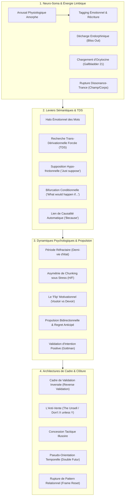

# Forbidden Secrets of Conversational Hypnosis - Transcripts
**Formateur :** David Snyder | **ID :** `david-snyder-forbidden-secrets-of-conversational-hypnosis-transcripts` | **Tranches :** 4

Voici la synthèse architecturale condensée, hautement structurée et modélisée pour servir de tête de pont à la fiche maîtresse du cours.

---

# Synthèse Architecturale du Cours : *Forbidden Secrets of Conversational Hypnosis* (David Snyder)

---

## 1. Thèse Centrale & Philosophie du Cours

### Vision spécifique & posture opératoire
La posture de David Snyder dans ce séminaire rompt radicalement avec deux écoles traditionnelles :
1. **Rupture avec l'hypnose clinique / ericksonienne passive :** Il désacralise l'hypnose de cabinet (induction par relaxation progressive, paupières lourdes, métaphores nébuleuses). Pour Snyder, la transe n'est pas un sommeil artificiel mais une dynamique conversationnelle quotidienne régie par une formule neuro-cognitive stricte : **Transe = Absorption sensorielle + Foyer d'attention dirigé**.
2. **Rupture avec la PNL rhétorique et logico-analytique :** Contrairement à la manipulation linguistique purement syntaxique (Milton Model désincarné), Snyder ancre chaque schéma verbal dans la **neuro-chimie somatique immédiate**. Le corps et le système limbique priment toujours sur le néocortex (*« First you feel it, then you think about it »*).

Sa vision repose sur une prémisse biologique : **le néocortex est paresseux, coûteux métaboliquement et prompt à la surcharge**. L'être humain ne cherche pas l'anesthésie cognitive morne (*numb out*), mais un état de libération endorphinique (*bliss out*) où l'obligation de penser analytiquement est suspendue. L'hypnose conversationnelle selon Snyder n'est pas une imposition de volonté, mais l'art d'orchestrer des pics et des creux émotionnels (*peaks & valleys*), d'activer la neuro-chimie viscérale (dopamine, ocytocine, endorphines) et de laisser le système nerveux s'auto-persuader à travers ses propres critères profonds.

### Le fil rouge méthodologique : *The Emotional Propulsion & Frame Engine*
Toutes les interventions présentées dans le cours obéissent à un cycle cybernétique invariant :
1. **Contournement du Facteur Critique par Saturation ou Dérivation :** Utilisation de postulats hypo-frictionnels (*« Just suppose »*, *« What would happen if... »*), de lexique viscéralement polarisant ou de ruptures de patterns énergétiques/somatiques pour bypasser la garde analytique.
2. **Amplification Somato-Émotionnelle & Élicitation de Critères :** Pompage des émotions brutes jusqu'aux critères identitaires profonds (*Values Chaining*), transformation de l'arousal physiologique amorphe via un étiquetage sémantique délibéré (*labeling*).
3. **Propulsion Bidirectionnelle & Verrouillage Temporel :** Conjonction de l'aversion à la perte (douleur du regret anticipé / Zeigarnik) et de la traction du plaisir (possession virtuelle), cristallisée par une pseudo-orientation temporelle (le sujet se retourne depuis le futur vers le présent, codant le choix comme un fait accompli).
4. **Capture du Cadre & Verrouillage d'Engagement :** Inversion de la dynamique de validation (*Reverse Validation Frame*, *The Unsell*) pour contraindre l'interlocuteur à se qualifier, activant son biais de cohérence interne.

---

## 2. Carte des Concepts & Leviers Émergents

### Écosystème des leviers clés
* **Arousal Physiologique Amorphe & Tagging Émotionnel :** Le système nerveux s'active de manière indifférenciée sous tension ; le praticien fournit l'étiquette verbale qui transmute le trac ou la peur en excitation, désir ou certitude.
* **Le Halo Émotionnel & la TDS Polarisante :** Les mots opèrent comme des déclencheurs somatiques immédiats, forçant l'inconscient à sonder ses archives viscérales bien avant que le néocortex ne filtre le sens contextuel.
* **Le "Bliss Out" vs "Numb Out" :** Exploitation du besoin structurel du cerveau de désactiver le contrôle préfrontal via des montées émotionnelles pour accéder à la passivité réceptive.
* **Le "Flip" Motivationnel :** La bascule fatale de l'opérateur modal de désir (*« I want »*) vers la nécessité (*« I need / I have to »*), qui coupe la dopamine au profit du cortisol et engendre la réactance interne.
* **Asymétrie de Chunking sous Stress :** Divergence neurologique fondamentale face à la menace (généralisation / *Chunk-Up* masculin vs micro-analyse chirurgicale / *Chunk-Down* féminin) exigeant un calibrage précis pour éviter la rupture de rapport.
* **Loi du Regret Anticipé & Possession Préalable :** Création d'une tension de Zeigarnik en retirant mentalement un bénéfice déjà expérimenté, générant une force motrice d'évitement deux fois plus puissante que l'attraction seule.
* **Reverse Validation & The Unsell :** Déplacement de l'autorité par retrait délibéré du besoin d'approbation et suspension de l'offre, forçant la cible à surmonter sa propre réactance en se qualifiant activement.
* **Pseudo-Orientation Temporelle du Fait Accompli :** Questionnement présuppositionnel orienté passé-futur (*« À quel moment as-tu réalisé... ? »*) qui convertit une suggestion en un souvenir synthétique déjà validé.

---

## 3. Tableau Récapitulatif des Techniques & Démonstrations

| Technique / Exercice | Objectif Opératoire | Déclencheur / Indication | Séquence Résumée |
|---|---|---|---|
| **Emotional Arousal Tagging** | Réécrire l'état interne en exploitant l'excitation neurovégétative non étiquetée. | Sujet présentant tachycardie, tremblements, trac ou stress avant une action. | 1. Calibrer l'activation physique. 2. Valider l'intensité sans nommer la peur. 3. Réétiqueter immédiatement le stimulus : *« Ce que ton corps ressent là, c'est l'adrénaline pure de l'excitation/succès »*. 4. Canaliser l'énergie vers le comportement cible. |
| **Trans-Derivational Visceral Priming** | Court-circuiter le facteur critique et abaisser les inhibitions par résonance somatique. | Résistance analytique, froideur intellectuelle, posture de contrôle néocorticale. | 1. Intégrer de façon conversationnelle des termes viscéraux/polarisants (*seduce, crave, magnetic, orgasmic*). 2. Calibrer les micropupilles, rougeurs ou changements respiratoires induits par la TDS. 3. Enchaîner sur la suggestion opératoire pendant que le filtre est submergé. |
| **Oxytocin Loading (Gallbladder 21)** | Induire un état neurochimique d'attachement, d'abandon des défenses et de confiance immédiate. | Établissement de rapport profond, désarmement de la méfiance, travail de couple/séduction. | 1. Synchroniser le rythme respiratoire et le ton de voix sur une tonalité chaude/englobante. 2. Ancrage somatique par contact/pression subtile sur des points de libération (notamment zone VB21/épaules). 3. Évoquer des thèmes de protection, d'abri et de résonance partagée. |
| **Dissonance-Trance par Impulsion Énergétique** | Provoquer une sidération cognitive (catalepsie / arrêt de pensée) par conflit sensoriel. | Sujet hyper-rationnel, besoin d'induction instantanée sans hypnose formelle. | 1. Établir une focalisation visuelle stricte. 2. Envoyer une projection d'impact somatique/énergétique à distance perçue par le système proprioceptif. 3. Laisser le conflit vision (rien ne touche) vs sensation (impact ressenti) paralyser le néocortex en transe cataleptique. |
| **Le Cadre de Validation Inversée (*Reverse Validation*)** | Inverser la polarité d'autorité et contraindre l'autre à chercher l'approbation du praticien. | Négociation, résistance hiérarchique, profils narcissiques, tests d'autorité. | 1. Suspendre tout signe d'assentiment ou de quête d'approbation. 2. Adopter un silence évaluatif neutre ou poser une question de qualification (*« Qu'est-ce qui me prouve que tu es prêt pour ça ? »*). 3. Maintenir le cadre jusqu'à ce que le sujet fournisse des arguments pour se justifier. |
| **Neutralisation par le *"Just Suppose"*** | Dissoudre la réactance et la méfiance face aux suggestions de changement. | Blocage sur le mot « imaginer », cynisme, objections logiques immédiates. | 1. Constater le point de friction. 2. Formuler l'hypothèse sans enjeu : *« Supposons un instant, purement par jeu de logique, que... »*. 3. Vérifier l'absorption du sujet dans le déroulement mental de la supposition acceptée. |
| **Pseudo-Orientation Temporelle Hybride (Double Futur)** | Générer une propulsion d'action irrésistible en encodant le futur désiré comme un souvenir rétrospectif. | Procrastination, indécision critique, hésitation d'achat ou d'engagement. | 1. **Futur d'Échec** : Projeter à 1 an dans les conséquences intolérables du non-choix (amplification Zeigarnik). 2. **Futur de Succès** : Transporter à 1 an dans la réussite totale de l'action. 3. **Regard Rétrospectif** : Faire regarder le présent en arrière : *« En regardant en arrière, à quel moment exact as-tu réalisé que c'était la meilleure décision ? »* |
| **The Unsell (*Anti-Vente Paradoxale*)** | Éliminer la pression perçue, booster la crédibilité et forcer le sujet à insister pour s'engager. | Clôture de négociation, réticence d'achat, sensation d'être "vendu". | 1. Énoncer une clause restrictive ferme : *« N'achète pas ceci / Ne signe pas à moins que tu sois absolument prêt à en assumer la discipline »*. 2. Retirer physiquement ou verbalement l'offre de la table. 3. Laisser la réactance inversée agir (le sujet se qualifie : *« Mais attendez, je suis tout à fait prêt »*). |
| **La Concession Tactique Illusoire** | Verrouiller un accord irréversible via le principe de cohérence/engagement de Cialdini. | Gestion d'objections dures, désaccord contractuel ou relationnel. | 1. Pacer rigoureusement l'objection de l'interlocuteur jusqu'à plein accord. 2. Faire mine de concéder du terrain en reformulant l'accord : offrir comme "concession" ce que l'on voulait obtenir dès le départ. 3. Obtenir la validation explicite ; l'interlocuteur assume désormais le poids moral du respect du cadre. |
| **The "What Would Happen If... Because" Whammy** | Injecter une suggestion d'action dans le système moteur sans déclencher de barrière critique. | Résistance à une directive directe, besoin d'amorcer une action concrète sans friction. | 1. Formuler la structure conditionnelle : *« Que se passerait-il si tu prenais [Action]... »* (force la simulation mentale). 2. Enchaîner sans pause avec la conjonction causale : *« ...parce que [Raison liée aux valeurs du sujet] »*. 3. Laisser l'heuristique de conformité valider le comportement. |
| **Values Chaining (Élicitation Récursive de Critères)** | Aligner une action sur les leviers motivationnels identitaires ultimes du sujet. | Manque de motivation, conflit interne de valeurs, closing haute valeur. | 1. Identifier un bénéfice de premier niveau (*« Qu'est-ce qui te plaît là-dedans ? »*). 2. Itérer récursivement la sonde : *« Et quand tu as [Bénéfice], qu'est-ce qui est réellement important à propos de ça ? »*. 3. Répéter jusqu'à émergence d'un critère somatique terminal (liberté, sécurité, fierté, intégrité). 4. Lier l'action demandée à ce critère racine. |
| **Désescalade par Intention Positive (Gottman attunement)** | Éteindre instantanément la réactivité de l'amygdale lors d'un conflit agressif. | Conflit verbal ouvert, colère du partenaire/client se sentant invalidé. | 1. Interrompre toute argumentation logique ou justification immédiate. 2. Renvoyer le sentiment d'avoir été entendu : *« Je vois parfaitement ce que tu essaies de faire de positif pour nous/moi à travers ça »*. 3. Maintenir fermement ses propres frontières comportementales tout en validant l'émotion de l'autre. |
| **Pattern Interrupt Frame Change** | Briser net une boucle d'attaque verbale réflexe en forçant un recadrage d'attachement. | Escalade de reproches, dispute toxique, agression relationnelle stérile. | 1. Stopper la réponse attendue (défense ou contre-attaque). 2. Insérer une rupture sidérante et décalée : *« Parle-moi comme à quelqu'un que tu aimes »*. 3. Calibrer la sidération (arrêt du pattern), puis réinstaller le cadre d'échange constructif. |

---

## Extractions Détaillées par Tranche (Opératoire & Verbatim)

## --- Tranche 1 / 4 ---

### 1. Mécanismes & Principes Actifs

- **Le Halo Émotionnel des Mots (Emotional Associations vs. Dictionary Definition)**
  - *Principe actif* : Le sens d'un mot opère au niveau néocortical (conscient), mais sa charge affective et son conditionnement d'usage activent directement le système limbique et les filtres perceptuels inconscients. La charge émotionnelle d'un vocable neutralise ou amplifie le message indépendamment de sa définition académique stricte (ex. « persuasion » perçu comme positif vs. « manipulation » perçu comme abusif, alors que leur structure d'influence est identique).
  - *Tags émergents* : `#halo_emotionnel #association_affective #charge_semantique_limbique #contournement_critique`

- **Arousal Physiologique Amorphe & Tagging Émotionnel (Physiological Arousal Labeling)**
  - *Principe actif* : Le système nerveux autonome produit des réponses d'excitation physiologique quasi indifférenciées (tachycardie, vasodilatation/pupilles dilatées, mains moites, accélération ventilatoire) communes à la peur, au trac, à la colère, à l'excitation sexuelle ou à l'enthousiasme. L'émotion vécue n'est pas inhérente à l'activation physique : elle résulte de l'« étiquette cognitive » (le *tag*) projetée sur cette activation. Tout niveau suffisant d'activation neurologique (*arousal*) surcharge le facteur critique et ouvre une fenêtre de suggestibilité où l'état peut être réécrit (*overwritten*) par simple réattribution verbale.
  - *Tags émergents* : `#arousal_physiologique #tagging_emotionnel #reecriture_d_etat #bypass_facteur_critique #transmutation_peur_excitation`

- **La Période Réfractaire Émotionnelle (Emotional Refractory Period / Formes-Pensées)**
  - *Principe actif* : Une émotion déclenchée agit comme une entité autonome dotée d'une demi-vie neurologique (*half-life*). Durant cette phase de latence, le système nerveux installe des filtres perceptuels fermés qui sélectionnent exclusivement les stimuli venant valider, entretenir et amplifier l'état initial (biais de confirmation somato-émotionnel). Vouloir forcer un changement brutal provoque une friction ; l'état cherche activement à s'auto-préserver.
  - *Tags émergents* : `#periode_refractaire #demi_vie_emotionnelle #auto_preservation_d_etat #filtre_perceptuel_circulaire #thought_forms`

- **Asymétrie Neurologique Homme/Femme sous Stress (Chunking Polarity)**
  - *Principe actif* : Sous contrainte émotionnelle ou agression perçue, la stratégie de traitement de l'information diverge selon la neurologie du sujet :
    - *Neurologie masculine* : Traitement automatique par généralisation/globalisation (*Chunk-Up* maximal, abstraction, vue d'ensemble macro, refus des détails pour fuir la surcharge).
    - *Neurologie féminine* : Traitement automatique par hyper-spécification (*Chunk-Down* chirurgical, analyse microscopique des détails, méticulosité critique, pointillisme relationnel).
    Tenter de pacifier une crise sans s'ajuster au niveau de découpage (*chunk size*) exact du sujet est interprété comme un déni d'empathie, réalimentant immédiatement la période réfractaire.
  - *Tags émergents* : `#asymetrie_de_chunking #segmentation_genre_stress #alignement_de_decoupage #chunk_up_global #chunk_down_anal`

- **Levier d'Aversion à la Perte & Effet Zeigarnik (Law of Anticipated Regret)**
  - *Principe actif* : La neurologie humaine sur-pondère la douleur de perdre par rapport au plaisir de gagner (le ratio subjectif est d'environ 2 unités de douleur pour 1 unité de plaisir). En faisant posséder virtuellement un état désiré au sujet (absorption sensorielle complète dans le résultat) avant de lui retirer brutalement par une projection temporelle négative (*anticipated regret*), on mobilise l'aversion à la perte pour éliminer les frictions d'engagement et créer une propulsion bidirectionnelle (fuite de la douleur + traction du plaisir).
  - *Tags émergents* : `#aversion_a_la_perte #loi_du_regret_anticipe #propulsion_bidirectionnelle #possession_mentale_prealable #elimination_de_friction`

- **Attraction Naturelle pour la Transe et Décharge Endorphinique (Trance Seeking)**
  - *Principe actif* : Le néocortex est une structure phylogénétiquement jeune et coûteuse métaboliquement. L'être humain cherche structurellement à « déconnecter » la pensée corticale analytique (*bliss out*, non pas *numb out*) pour se réfugier dans des états de transe limbique/reptilienne régis par les endorphines et la stimulation sensorielle intense (polarité, hyperboles, sensations viscérales).
  - *Tags émergents* : `#migration_vers_la_transe #bliss_out #economie_corticale #appetence_stimulus #hyperbole_limbique`

---

### 2. Protocoles, Techniques & Démonstrations (Étape par Étape)

#### Protocole 1 : Fractionnement Plaisir/Douleur & Regret Anticipé (Resistance Removal)
* **Intention / Indication** : Fermer une vente, lever une hésitation à l'action (en coaching, thérapie ou closing), débloquer un sujet paralysé par la peur d'investir ou de s'engager.
* **Mise en place & Pré-framing** : Synchroniser d'abord les doutes du sujet pour créer le consensus émotionnel. Ne pas pousser en avant (*resistance push*), mais éliminer la friction d'action par la possession mentale préalable.
* **Séquence d'actions pas à pas** :
  1. *Élicitation de la Douleur Actuelle* : Faire peindre le tableau des frustrations présentes (de préférence via des questions ciblées poussant le sujet à extraire son propre matériau neural).
  2. *Possession Sensorielle du Soulagement (VAK)* : Guider le sujet à s'absorber totalement dans l'expérience où le problème est résolu. Lui faire décrire ce que c'est que de vivre *déjà* avec la solution (vue, sons, sensations corporelles). Ancrer la pleine possession.
  3. *Retrait Brutal / Soustraction Mentale* : Rompre la visualisation et retirer l'état acquis : poser des questions de manque (« Que devient ta vie sans ça ? Qu'est-ce qui cesse d'arriver ? À quel point la situation empire-t-elle si tu ne l'as pas ? »).
  4. *Fractionnement Répété* : Alterner rapidement entre l'amplification du plaisir de l'avoir et l'abîme de la perte, en augmentant l'intensité à chaque cycle.
  5. *Verrouillage d'Urgence* : Lier la décision immédiate à la sauvegarde de l'état : l'inaction est désormais encodée neurologiquement comme une perte sèche immédiate.
* **Signes de calibration** : Passage d'un tonus passif/défensif à des micro-mouvements d'accroche (redressement du buste, déglutition, regard fixé, tension musculaire marquant la panique de la perte, soupir d'urgence à agir).

#### Protocole 2 : Désescalade Émotionnelle par Parallélisme & Ennemi Commun (Pacing de Direction)
* **Intention / Indication** : Désamorcer une colère violente, une dispute ou une réactivité toxique sans heurter la période réfractaire de l'interlocuteur.
* **Mise en place & Pré-framing** : Interdiction absolue de confronter la colère ou de rester en face-à-face polaire (collision frontale). Accepter que la cible apparente de la colère n'est qu'un déclencheur contingent (*final straw*).
* **Séquence d'actions pas à pas** :
  1. *Calibrage de Spécificité (Chunk Matching)* : Observer si le sujet est en mode global (homme) ou en hyper-détail (femme). Ajuster son propre discours exactement au même niveau de granularité.
  2. *Alignement de la Trajectoire Émotionnelle (Common Target)* : Épouser l'énergie de la colère mais la détourner immédiatement vers une cible externe commune (« Je suis tout aussi hors de moi que toi à propos de X »).
  3. *Ruptures d'État Successives & Dépressurisation (Fractional De-escalation)* : Ne pas viser un saut direct vers la sérénité. Introduire une rupture d'état brève -> laisser dépressuriser d'un cran -> re-synchroniser -> réintroduire une micro-rupture, jusqu'à atteindre un palier neutre.
  4. *Redirection par Présuppositions de Conscience (Awareness Categories)* : Injecter des prédicats d'attention pour réorienter le focus sans opposition frontale (« Tout en observant pourquoi nous sommes si furieux, réalise qu'il y a d'autres éléments cruciaux... »).
  5. *Recadrage Opératoire Minimal (Chunk-Down d'Action)* : Focaliser l'attention sur les micro-actions réalisables dans l'immédiat pour apaiser le système nerveux.
* **Signes de calibration** : Baisse du tonus vocal, respiration descendant des clavicules vers l'abdomen, relâchement des épaules, déverrouillage de la mâchoire, passage de phrases courtes et saccadées à des phrases plus ouvertes.

#### Protocole 3 : Réécriture d'État par Surcharge d'Arousal (State Overwriting)
* **Intention / Indication** : Convertir une anxiété de performance, un trac de scène ou une panique panique/peur en excitation et suggestibilité.
* **Mise en place & Pré-framing** : Observer les manifestations neurovégétatives du sujet (tremblements, rythme cardiaque accéléré, pupilles dilatées, mains moites). Traiter ces signaux non comme de la panique, mais comme un carburant d'excitation pure dénué d'orientation.
* **Séquence d'actions pas à pas** :
  1. *Saturation du Champ Attentionnel* : Maintenir le sujet sous un rythme d'interaction soutenu pour préserver la charge adrénergique sans lui laisser le temps de rationaliser.
  2. *Contestation / Négation Autoritique du Label Initial* : Déclarer avec une certitude absolue l'invalidité de son étiquette (« Non, tu n'as pas peur »).
  3. *Imposition Répétitive de l'Étiquette Cible (Overwriting)* : Répéter de manière cadencée et congruente l'étiquette alternative (« Tu es surexcité(e) », « C'est de l'excitation pure »).
  4. *Enchaînement Direct sur la Suggestion d'Action* : Dès que le facteur critique est dépassé, brancher immédiatement la commande hypnotique sur l'état d'excitation nouvellement installé.
* **Signes de calibration** : Modification du faciès (déraspation du masque de peur, apparition d'un sourire nerveux ou d'un éclat dans les yeux), posture qui s'ouvre, acceptation somatique du mot sans contradiction verbale.

---

### 3. Heuristiques, Subtilités & "Sagesse du Praticien"

- **Règle de Pacing de la Période Réfractaire** :
  * *Règle* : Si le sujet sort d'une explosion émotionnelle, **ne jamais** supposer que le calme apparent marque la fin du processus. Son système neurologique filtre encore activement la réalité pour relancer la charge. Attendre la purge complète de la demi-vie métabolique.
- **Direction vs. Intensité dans le Pacing de Colère** :
  * *Règle* : Si le sujet est en colère et que tu montes en intensité sans avoir préalablement orienté ta colère dans la même direction spatiale/conceptuelle que la sienne, tu crées un crash frontal. Si vous êtes furieux ensemble contre la *même chose*, tu obtiens le contrôle de la direction du flux émotionnel.
- **Ajustement de Granularité (Gender-Based Chunking Rule)** :
  * *Règle* : Si une femme sous stress devient maniaque ou pointilleuse sur des détails mineurs (siège des toilettes, bouchon de dentifrice), **ne jamais** tenter de la rassurer avec des considérations globales ou du recul philosophique. Il faut matcher son niveau de détail chirurgical (*chunk down*) avant de pouvoir déplacer son focus.
  * *Règle symétrique* : Si un homme sous stress s'exprime par généralités massives, **ne jamais** exiger de lui qu'il détaille les faits ou raconte sa journée par le menu sous peine de déclencher un blocage violent.
- **Heuristique de Polarité & Mots Tabous** :
  * *Règle* : En hypnose d'influence, préférer les mots qui divisent ou polarisent violemment (*polarizing words*) aux termes tièdes ou lisses. Tout ce qui déclenche une forte polarité signale une connexion nerveuse directe avec les mémoires ou les parties refoulées du sujet.
- **Push vs. Friction Removal** :
  * *Règle* : En persuasion, cesser de dépenser son énergie à « pousser » (*pushing*) le sujet vers la décision. Tout le gain d'efficacité réside dans l'élimination des frictions internes par la manipulation du regret anticipé et de l'aversion à la perte.
- **Piège Classique du Débutant** :
  * *Erreur* : Penser que l'utilisation de mots hypnotiques purement kinesthésiques repose uniquement sur le canal VAKO sensoriel.
  * *Correction de Snyder* : L'impact viscéral dépend de l'empreinte émotionnelle archaïque (cerveau reptilien/limbique) et non du système de représentation préféré. Des mots comme « terreur », « atrocité », « dégoût », « séduction » court-circuitent les prédicats sensoriels pour frapper directement le tronc cérébral.

---

### 4. Pépites Verbatim & Patterns Linguistiques (MOT À MOT EN V.O.)

#### Pépite 1 : La Captation Sensorielle par Séduction Viscérale
> "One of the things about hypnotic language that will absolutely seduce you into understanding and feeling how powerful it is, is the ability to capture and lead the imagination in such a way that people become utterly absorbed in the experience that you're describing. And it's such a sweet seduction that allows you to just relax into it. It just welcomes you inside and you find yourself drawn into it."

* **[Analyse du Pattern]** :
  - **Empilement de présuppositions de résultat** : *"that will absolutely seduce you into understanding and feeling"* pose comme un fait inévitable la compréhension et le ressenti futur.
  - **Nominalisation à charge viscérale & boucle d'absorption** : Utilisation du mot *"seduce"* / *"sweet seduction"* agissant sur le cerveau reptilien/limbique pour désarmer l'esprit critique.
  - **Commandes enchâssées et glissement de sujet** : *"allows you to just relax into it"*, *"welcomes you inside"*, *"find yourself drawn into it"*. Le formateur passe insensiblement de la description théorique du langage à une transe kinesthésique d'induction directe chez l'auditeur.

#### Pépite 2 : Pacing de Colère & Présupposition de Conscience
> "I know you're angry about X, Y, and Z, and as we focus on the reasons why we're both angry about that, realize there are other things that are important too."

* **[Analyse du Pattern]** :
  - **Truisme de Pacing initial** : *"I know you're angry about X, Y, and Z"* valide l'état sans opposition.
  - **Création d'un front commun / Éradication de la collision** : L'emploi de *"we both angry about that"* convertit une opposition duelle en alliance tactique face à une cible externe.
  - **Présupposition de catégorie d'attention (*Awareness Category*)** : Le verbe d'éveil *"realize"* présuppose la vérité incontestable de ce qui suit : *"there are other things that are important too"*. L'esprit inconscient est forcé d'explorer la catégorie des choses importantes sans débattre de leur existence.

#### Pépite 3 : Recadrage Réducteur & Transition vers l'Action (Chunk-Down Pacing)
> "You know what? I am as pissed off about this as you are, and I know there's not a lot we can do about it, so maybe what we need to do is really focus on the small things that we can do. What would those be?"

* **[Analyse du Pattern]** :
  - **Synchronisation d'intensité brute** : *"I am as pissed off about this as you are"* installe un rapport viscéral immédiat par équivalence d'état.
  - **Cadre d'impuissance partagée (Pacing du problème global)** : *"I know there's not a lot we can do about it"* désamorce l'escalade macro stérile.
  - **Bascule de Chunking par question ouverte fermée** : *"focus on the small things that we can do. What would those be?"* force le système nerveux à quitter la réactivité globale pour s'ancrer dans des détails opératoires précis, réduisant la tension limbique par l'action concrète.

#### Pépite 4 : Induction de la Perte Anticipée (Zeigarnik Loop Closing)
> "In their mind, you give it to them in their mind, and you supercharge it. You've got to visualizing, describing what their life would be like, having it, living it, being there. And then you say, what would your life be like without this? How would your life, what wouldn't be happening for you? How bad would your life actually get if you didn't have this? Because if you don't make that decision today to go for it, that's what's going to happen."

* **[Analyse du Pattern]** :
  - **Séquençage d'ancrage proprioceptif** : *"having it, living it, being there"* superpose des prédicats kinesthésiques continus au présent, installant la propriété psychologique complète.
  - **Interrogation en spirale négative (Soustraction brutale)** : L'enchaînement de questions *"what wouldn't be happening for you?"* et *"How bad would your life actually get...?"* active l'évitement de la douleur et l'aversion à la perte (2 unités de douleur contre 1 de gain).
  - **Cause-effet d'urgence temporelle** : *"Because if you don't make that decision today... that's what's going to happen"*. Encadre l'action présente comme l'unique rempart neurologique contre la douleur programmée de la dépossession.

## --- Tranche 2 / 4 ---

Voici l'analyse opératoire intégrale de la tranche 2/4 du cours **Forbidden Secrets of Conversational Hypnosis** de David Snyder.

---

### 1. Mécanismes & Principes Actifs

#### A. Le principe de Dérive Non-Corticale et Recherche de Transe (Bliss Out vs Numb Out)
* **Principe actif :** Contrairement à l'idée reçue selon laquelle les humains cherchent l'anesthésie ou l'engourdissement cognitif (*numb out*), Snyder postule que le système nerveux recherche un état de béatitude (*bliss out*) et une décharge d'endorphines qui libèrent de l'obligation de penser. Le cerveau humain tend naturellement vers le mode passif/automatique (*idle mode*), réduisant l'activité du cortex préfrontal pour basculer sur des programmes sous-corticaux et des habitudes pré-encodées.
* **Effet neurologique :** En provoquant des pics et des creux émotionnels (*peaks and valleys*), le praticien sature l'attention consciente, suspendant le traitement critique du néocortex. La charge émotionnelle coupe le filtre analytique et remet les rênes à l'inconscient.
* **Tags :** `#non_cortical_thinking #bliss_out #endorphin_rush #cortex_bypass #emotional_peaks_valleys`

#### B. Recherche Trans-Dérivationnelle Forcée (TDS) par Termes Sexuellement Polarisants
* **Principe actif :** L'usage d'un vocabulaire viscéralement chargé (ex. : *seduce*, *orgasmic*, *lust*) déclenche immédiatement une recherche trans-dérivationnelle (TDS) inconsciente. Le système nerveux est forcé de scanner ses mémoires somatiques et émotionnelles pour donner un sens au mot avant que l'intellect ne puisse rationaliser le contexte.
* **Effet sur l'inhibition :** L'activation viscérale précède la réflexion consciente (« *First you feel it, then you think about it* »). Cela abaisse le facteur critique et les défenses comportementales (*lowering inhibitions/guards*), rendant le sujet plus spontané et réduisant les barrières à l'action.
* **Tags :** `#trans_derivational_search #visceral_priming #inhibition_lowering #polarity_trigger #taboo_lexicon`

#### C. L'Oxytocine comme Déclencheur Neurochimique de Confiance et de Rapport Énergétique
* **Principe actif :** L'oxytocine est la molécule primaire du lien d'attachement (*pair bonding*), de la protection et de la confiance (*trust*). Induire une libération d'oxytocine court-circuite la méfiance rationnelle.
* **Vecteurs de déclenchement :**
  1. *Visuel / Somatique :* Images de bébés aux grands yeux (angle à 3/4), femmes attirantes et souriantes.
  2. *Soma-Points :* Stimulation indirecte via les oreilles, les mamelons, ou le point d'acupuncture VB21 (Vésicule Biliaire 21, trapèzes).
  3. *Reviviscence narrative :* Faire raconter ou décrire des événements passés intensément romantiques/plaisants (réactivation de l'empreinte neurochimique originale).
* **Tags :** `#oxytocin_loading #neurochemical_trust #somatic_anchoring #gallbladder_21 #pair_bonding`

#### D. La Rupture Inconscient/Conscient par Impulsion Énergétique et le Dissonance-Trance
* **Principe actif :** Lorsque deux niveaux de réalité entrent en conflit direct (ex. : le système nerveux proprioceptif/inconscient ressent un impact énergétique comme un objet solide, alors que la vision consciente néocorticale ne voit aucun contact physique à distance), le traitement cognitif s'interrompt net. Le conflit interne paralyse l'action motrice et plonge instantanément le sujet en état de transe stuporeuse ou cataleptique.
* **Tags :** `#conscious_unconscious_disconnect #auric_field_pulse #pattern_freeze #cognitive_dissonance_trance`

#### E. Pseudo-Orientation Temporelle par Présupposition du Fait Accompli
* **Principe actif :** Structurer une question sous la forme « À quel moment as-tu réalisé X ? » présuppose que X est une réalité objective indiscutable. La question ne porte pas sur la véracité de X (*Est-ce arrivé ?*), mais uniquement sur ses coordonnées temporelles (*Quand est-ce arrivé ?*).
* **Effet cognitif :** En cherchant la réponse, le cerveau se projette dans la ligne de temps interne où le résultat est déjà validé. Dès que le sujet cherche une date ou un moment, la croyance s'auto-installe.
* **Tags :** `#pseudo_orientation_in_time #foregone_conclusion #temporal_presupposition #internal_search_trap`

#### F. Le Modèle des 4 Piliers de l'Influence Hypnotique
* **Principe actif :** L'influence conversationnelle repose sur un trépied dynamique complété par l'adhésion :
  1. **Authority (Autorité) :** Détenue par celui qui pose les questions et pilote le cadre.
  2. **Attraction / Activity (Attraction / Énergie d'action) :** Énergie vitale, charisme kinesthésique projeté.
  3. **Affinity (Affinité / Rapport) :** Connexion aux critères et valeurs profondes de l'autre.
  4. **Acquiescence (Soumission / Conformité) :** Entraînement comportemental par la Loi de Conformité.
* **Loi de Conformité (*Law of Compliance*) :** Plus un individu se conforme à des micro-demandes successives, plus sa prédisposition neurobiologique à accepter des ordres d'envergure augmente.
* **Tags :** `#four_pillars_influence #law_of_compliance #criteria_value_linking #conversational_authority`

---

### 2. Protocoles, Techniques & Démonstrations (Étape par Étape)

---

#### PROTOCOLE 1 : Le "Having Found" Pattern (Modèle Militaire d'Influence)
* **Intention / Indication :** Orienter insidieusement la prise de décision, vendre une idée/un produit ou éliminer une objection en créant une relation de cause à effet inévitable entre une douleur réelle et la solution proposée.
* **Mise en place & Pré-framing :** Identifier au préalable un point de douleur ou une réalité négative indéniable dans le contexte du sujet (effet Zeigarnik : l'humain fuit la douleur en priorité), ainsi que l'action cible désirée.

* **Séquence d'actions pas à pas :**
  * **Étape 1 [Pacing de la douleur / Réalité externe] :** Synchroniser sur un aspect négatif ou instable indiscutable de la situation du sujet.
  * **Étape 2 [Leading vers l'action cible] :** Enchaîner directement sur l'action désirée présentée comme la conséquence logique ou le remède évident via la structure syntaxique « *Have you found that [Pacing Négatif] is yet another reason to [Leading Action]* ».
  * **Étape 3 [Vérification de l'effet interne] :**
    * *Si le sujet cherche des raisons :* Se taire et laisser l'équivalence complexe s'installer.
    * *Si le sujet répond par la négative ("No") :* Déployer immédiatement la boucle de rebond négatif : **« Not yet, huh? »** (qui réinjecte le présupposé que cela va inévitablement arriver et le renvoie en boucle de recherche interne).

* **Signes de calibration :** Regard qui défocalise (accès visuel/auditif interne en recherche), micro-hochements de tête, ralentissement respiratoire indiquant la recherche trans-dérivationnelle de validation.

---

#### PROTOCOLE 2 : Pseudo-Orientation Temporelle ("At What Point Did You Realize...")
* **Intention / Indication :** Verrouiller une vente, faire formaliser un engagement amoureux ou sceller un accord implicite sans laisser de place au doute.
* **Mise en place & Pré-framing :** Attendre ou susciter un signal d'intérêt ou une validation partielle du sujet.

* **Séquence d'actions pas à pas :**
  * **Étape 1 [Interrogation de la borne temporelle] :** Poser la question au passé en présupposant le résultat comme une évidence absolue : *« At what point did you realize that [Conclusion désirée déjà acquise] ? »*
  * **Étape 2 [Maintien strict du silence] :** Laisser le sujet traverser sa période réfractaire (temps de traitement interne, pouvant durer plusieurs dizaines de secondes). Ne surtout pas interrompre ce silence.
  * **Étape 3 [Écoute passive et amplification] :** Laisser le sujet verbaliser sa propre rationalisation. Plus il argumente pour situer le moment, plus il ancre son auto-persuasion.

* **Signes de calibration :** Silence réfractaire prolongé (regard figé, respiration suspendue, sidération corticale), suivi d'une réponse hésitante situant un moment précis dans le passé, validant l'état interne.

---

#### PROTOCOLE 3 : Déplacement de l'Autorité par le Ratio de Questionnement (Interview Blaster)
* **Intention / Indication :** Inverser l'équilibre du pouvoir hiérarchique ou commercial lors d'un entretien d'embauche, d'une négociation ou d'un conflit de cadre.
* **Mise en place & Pré-framing :** Adopter une attitude de curiosité sincère et une posture corporelle détendue pour ne pas déclencher une réaction défensive de domination frontale.

* **Séquence d'actions pas à pas :**
  * **Étape 1 [Accusé de réception souple] :** Valider brièvement la remarque ou la question de l'interlocuteur.
  * **Étape 2 [Retournement de question immédiat] :** Répondre par une question ouverte ou calibrée sur les critères et valeurs de l'interlocuteur.
  * **Étape 3 [Maintien du différentiel de questions] :** Veiller à ce que le nombre absolu de questions posées par le praticien dépasse systématiquement celui posé par la figure perçue d'autorité. L'inconscient attribue l'autorité suprême à la personne qui collecte l'information, non à celle qui la fournit.

* **Signes de calibration :** L'interlocuteur passe en position d'explication et de justification ; son corps se penche vers l'avant, le débit verbal s'allonge pour satisfaire les questions du praticien.

---

#### PROTOCOLE 4 : Broken Record (Disque Rayé Émotionnellement Neutre pour Frontières Relationnelles)
* **Intention / Indication :** Établir et maintenir une limite ou un cadre infranchissable face à un profil manipulateur ou insistant sans entrer en escalade émotionnelle.
* **Mise en place & Pré-framing :** Poser les règles du jeu dès le départ (*upfront boundaries*). Reconnaître que la gentillesse est souvent interprétée comme une faiblesse par les profils prédateurs.

* **Séquence d'actions pas à pas :**
  * **Étape 1 [Définition publique du cadre] :** Déclarer la limite fermement et calmement dès la mise en relation.
  * **Étape 2 [Neutralisation de la réponse affective] :** Verrouiller l'état interne (pas de colère, pas d'agressivité, pas de justification).
  * **Étape 3 [Itération du Disque Rayé] :** À chaque tentative de contournement ou de pression, répéter la même phrase sans variation tonale ni argumentation : *« This is what I said, this is what I can do. »*
  * **Étape 4 [Consistance et engagement] :** Laisser la pression psychologique retomber sur l'autre partie. La constance inébranlable force l'acceptation par le principe de cohérence cognitive.

* **Signes de calibration :** Absence de micro-tensions musculaires chez le praticien ; capitulation progressive de l'interlocuteur qui finit par se conformer aux termes initiaux.

---

### 3. Heuristiques, Subtilités & "Sagesse du Praticien"

#### Règles Conditionnelles :
* **Si** le sujet répond « Non » à une formule de type *Have you found that...*, **alors** répondre immédiatement avec le pattern : *« Not yet, huh? »*, **parce que** l'adverbe temporel « pas encore » présuppose l'inévitabilité future du phénomène et réinjecte le sujet dans une recherche interne de validation.
* **Si** vous posez une question de pseudo-orientation temporelle et que le sujet se tait, **alors** ne brisez sous aucun prétexte le silence (période réfractaire pouvant durer 30 secondes ou plus), **parce que** ce temps mesure l'intensité de la réorganisation neuronale et de l'installation de la suggestion.
* **Si** un client ou une cible tente de vous tester ou d'outrepasser un accord, **alors** refusez toute escalade émotionnelle et appliquez le mode « disque rayé », **parce que** manifester de la réactivité émotionnelle prouve au manipulateur qu'il a prise sur votre état interne (*« Attention is attention, whether it's good or bad »*).
* **Si** vous voulez séduire une femme ayant des enfants ou mariée avec un nourrisson, **alors** portez un intérêt passionné et sincère à l'enfant, **parce que** l'enfant est le déclencheur premier d'oxytocine ; se connecter à la source d'oxytocine de la cible transfère ce schéma d'attachement directement sur vous.
* **Si** vous observez des résistances ou une stagnation totale chez un sujet, **alors** cherchez le conflit entre sous-parties inconscientes ou entre le conscient et l'inconscient, **parce que** *« when parts of ourself are in conflict, the only direction we can go is nowhere »*.

#### Pièges Classiques & Erreurs de Débutant :
* **Vouloir être perçu comme « méchant » ou agressif pour poser des limites :** L'illusion véhiculée par la communauté de la séduction pousse souvent les hommes à devenir des « connards », créant une dissonance cognitive paralysante qui détruit leur congruence naturelle. L'autorité réelle est douce, détachée et inébranlable.
* **Le piège du script rigide :** Réciter un chapelet de patterns sans calibrer l'état somatique de la cible. Le succès de l'hypnose conversationnelle ne réside pas dans un flot verbal ininterrompu, mais dans la précision du timing : donner une micro-impulsion linguistique au moment exact où la cible est prête à basculer.
* **Le Yes-Set commercial mécanique :** Débiter des questions fermées appelant des « oui » artificiels. Le public contemporain y est hypersensibilisé. L'alternative consiste à lier systématiquement chaque truisme aux *critères et valeurs émotionnelles profondes* du sujet pour faire sauter le facteur critique.

#### Postulats Fondamentaux de David Snyder :
* **« You cannot not persuade. »** Toute communication suscite une réponse neuronale et comportementale. L'absence de direction consciente produit un résultat aléatoire ; l'influence est l'acte délibéré d'assumer la direction de cette réponse.
* **« He who asks the questions is the authority. »** L'équilibre psychologique d'un échange penche invariablement du côté de celui qui pilote l'interrogation, car il contraint l'autre à mobiliser ses ressources cognitives pour répondre.
* **« First you feel it, then you think about it. »** La réaction viscérale et émotionnelle précède toujours le traitement analytique néocortical. L'art du praticien consiste à allumer le feu somatique pour ensuite lui donner une rationalisation logique acceptable.

---

### 4. Pépites Verbatim & Patterns Linguistiques (MOT À MOT EN V.O.)

#### PÉPITE 1 : Injection Subliminale d'un Terme Tabou dans un Pitch Médical
> *"One of the most powerful things that will seduce you into understanding how our medical products can give you that safety and security that you're looking for is our no-excuse money-back guarantee, our double your money-back guarantee. If our equipment fails you for any reason whatsoever, we will give you double your investment back, plus a replacement, and that's our guarantee for you."*

* **[Analyse du Pattern] :**
  * **Violation sémantique délibérée & TDS :** Insertion du verbe hautement sexualisé *seduce* dans un univers sémantique sécuritaire/médical aseptisé. Ce contraste force une recherche trans-dérivationnelle viscérale immédiate.
  * **Enchaînement Cause-Effet :** Liaison de la sensation viscérale de séduction aux critères fondamentaux du prospect (*safety and security*).
  * **Dépassement du facteur critique :** L'impact émotionnel du mot court-circuite la méfiance, tandis que la suite de la phrase offre une rationalisation logique basée sur une garantie financière extrême (*double your money-back*).

---

#### PÉPITE 2 : Recadrage Émotionnel d'une Compétence par Projection d'Atmosphère
> *"One of the most seductive aspects of learning about what are the right colors for your home is understanding how these colors affect the emotions and those emotions affect how you work and how you relate with other people at home. And that means by learning how to play with colors in your home, you can custom design the atmosphere and the feelings that everybody around you has. And that's an amazing power to have, isn't it?"*

* **[Analyse du Pattern] :**
  * **Nominalisation polarisante :** Emploi de l'adjectif *seductive* comme prédicat d'un sujet anodin (*learning about colors*).
  * **Transduction en cascade :** Enchaînement séquentiel d'équivalences complexes : Couleurs $\rightarrow$ Émotions $\rightarrow$ Travail et Relations $\rightarrow$ Contrôle absolu sur l'entourage (*custom design the atmosphere and the feelings*).
  * **Tag Question de fermeture :** Clôture par un truisme d'accordage (*"And that's an amazing power to have, isn't it?"*) qui verrouille l'acceptation du recadrage identitaire de puissance.

---

#### PÉPITE 3 : Le Pattern Militaire "Have You Found" (Économie & Assurance)
> *"Have you found that with the perpetual state of unrest in the economy, and the random factors in today's environment that the possibility of upping your insurance is a really good one?"*

* **[Analyse du Pattern] :**
  * **Présupposition d'expérience universelle (*Awareness / Experiential Presupposition*) :** L'amorce *Have you found that...* présuppose que le fait est déjà une vérité constatée empiriquement par le sujet.
  * **Double Pacing Négatif (Évitement de douleur / Zeigarnik) :** *perpetual state of unrest in the economy* + *random factors in today's environment*.
  * **Leading vers l'action cible :** Conclusion fluide érigeant l'augmentation de la police d'assurance (*upping your insurance*) en unique choix logique face au chaos ambiant.

---

#### PÉPITE 4 : Pseudo-Orientation Temporelle Ultime (Verrouillage Amoureux / Vente)
> *"At what point did you realize you were totally in love with me?"*
> *(Variante commerciale : "At what point during this presentation did you realize this was a perfect fit for your company?")*

* **[Analyse du Pattern] :**
  * **Présupposition temporelle du fait accompli :** L'expression *At what point* déplace le champ d'interrogation du plan existentiel (*Est-ce le cas ?*) au plan chronologique (*Quand cela s'est-il produit ?*).
  * **Adverbe de totalité / Intensificateur :** *totally in love* / *perfect fit* impose une intensité d'engagement maximale pré-encodée dans la structure même de la phrase.
  * **Piège cognitif :** Pour déterminer la date d'apparition du sentiment ou de l'accord, le cerveau doit obligatoirement valider l'existence même de ce sentiment/accord dans son monde interne, scellant ainsi l'état désiré.

---

#### PÉPITE 5 : L'Interview Blaster (Renforcement d'Accord & Élicitation)
> *"Well, that's awesome. I'm curious, at what point did that realization hit you?"*

* **[Analyse du Pattern] :**
  * **Marqueur de curiosité adoucissant :** *I'm curious* désamorce toute agressivité perçue et positionne la question sous un angle d'investigation bienveillant.
  * **Verbe somatique d'impact :** Utilisation du verbe kinesthésique d'impact *hit you*, induisant l'idée d'un événement subconscient soudain, irrépressible et hors de contrôle volontaire.
  * **Délégation de l'auto-persuasion :** En incitant le recruteur à narrer la genèse de son impression favorable, le sujet pousse l'autorité à verbaliser et consolider ses propres arguments de recrutement.

## --- Tranche 3 / 4 ---

Voici l'extraction opératoire complète et rigoureuse de la tranche 3/4 du séminaire *Forbidden Secrets of Conversational Hypnosis* de David Snyder.

---

### 1. Mécanismes & Principes Actifs

#### A. Le Cadre de Validation Inversée (*Reverse Validation Frame*)
- **Principe Actif** : Exploite le besoin biologique et social d'approbation et la terreur sous-jacente du rejet ou de la perte de statut. Le praticien pose ses questions et structure son interaction de manière à ce que l'interlocuteur cherche son approbation plutôt que l'inverse. Dès que le sujet ressent que cette validation positive est menacée ou suspendue, son système nerveux entre en recherche de rétablissement homéostatique : il redouble d'efforts, fournit des arguments, concède des points et se qualifie pour regagner l'approbation perçue.
- **Différence Autorité Légale vs Perçue** : Ce cadre ne repose pas sur une autorité externe statutaire ("badge et pistolet"), mais sur une autorité psychologique conférée par le cadre lui-même. Même les personnalités narcissiques ou sociopathiques y réagissent, car leur ego ne tolère pas d'être perçu défavorablement sans réagir pour corriger cette perception.
- **Tags libres** : `#reverse_validation_frame #perceived_authority #social_approval_dependency #loss_of_status_threat`

#### B. La Transe Opératoire : Absorption + Foyer d'Attention (*Absorption & Focus*)
- **Principe Actif** : Snyder évacue le mysticisme de l'hypnose pour poser une équation neuro-cognitive stricte : **Transe = Absorption dans l'expérience + Foyer d'attention dirigé**. Dès qu'un individu est amené à dérouler un film interne (absorption) et que ses sens sont canalisés sur une idée ou un résultat précis (focalisation), le facteur critique est contourné. Que cela soit nommé hypnose, storytelling ou conversation informelle n'a aucune importance mécanique.
- **Tags libres** : `#trance_formula #absorption_focus #critical_factor_bypass #internal_movie_playback`

#### C. L'Évocation Délibérative et la Suppression de Résistance (*"Just Suppose"*)
- **Principe Actif** : Alors que le mot *"Imagine"* active souvent des alertes défensives ("on me manipule", "c'est un conte de fées") et que *"What if"* introduit de l'incertitude aléatoire et de la spéculation abstraite, *"Just suppose"* invite à un postulat purement logique, temporaire et non menaçant ("faisons juste une supposition"). Le système nerveux baisse la garde : aucune croyance n'est exigée, aucun engagement n'est demandé. Une fois la supposition acceptée au niveau cortical, le cerveau est forcé de simuler la scène pour la traiter, déclenchant l'absorption.
- **Tags libres** : `#just_suppose #resistance_neutralization #frictionless_pacing #hypothetical_frame`

#### D. La Pseudo-Orientation Temporelle Hybride (Zeigarnik + Double Futur)
- **Principe Actif** : Combinaison de l'effet Zeigarnik (tension psychologique générée par une boucle non résolue ou une opportunité manquée) et de la projection dans le temps. En faisant vivre d'abord les conséquences intolérables du non-choix, puis en projetant le sujet à 1 an dans un futur de réussite pour ensuite **regarder le présent en arrière**, le cerveau code cette réussite comme un souvenir rétrospectif plutôt que comme une projection incertaine. Le biais de cohérence interne s'aligne alors sur le choix désiré au présent.
- **Tags libres** : `#pseudo_orientation_in_time #future_pacing #zeigarnik_tension #bifurcation_futures`

#### E. L'Anti-Vente et Réduction de la Réactance Psychologique (*The Unsell / "Don't X unless Y"*)
- **Principe Actif** : La réactance psychologique est l'envie réflexe de faire l'inverse d'une injonction directe perçue comme une menace sur sa liberté. L'injonction négative paradoxale ("N'achète pas ceci à moins que...") retire l'opportunité de la table, supprime instantanément la pression perçue et pousse le sujet à se qualifier ("Attends, je suis quelqu'un de déterminé, je mérite d'acheter"). Cela positionne également le praticien comme ayant une intégrité totale (crédibilité par refus du compromis).
- **Tags libres** : `#unsell #psychological_reactance_removal #negative_pacing #qualification_reversal`

#### F. La Concession Tactique Illusoire et Cohérence/Engagement
- **Principe Actif** : Dans le schéma de cadrage d'accord, le praticien rythme la réalité et les objections de l'autre, puis offre une "concession" qui en réalité correspond exactement à ce qu'il souhaitait cadrer dès le départ. Dès lors que l'interlocuteur valide le cadre, la dynamique d'engagement et de cohérence (Cialdini) s'active : pour ne pas perdre la face ou briser le contrat moral, c'est l'autre qui porte le fardeau de tenter de modifier les règles, tandis que le praticien reste inébranlable.
- **Tags libres** : `#illusory_concession #commitment_and_consistency #frame_control #boundary_anchoring`

---

### 2. Protocoles, Techniques & Démonstrations (Étape par Étape)

#### Protocole 1 : La Matrice "Just Suppose" avec Pseudo-Orientation Temporelle
* **Intention / Indication** : Sortir un client/prospect de l'indécision, neutraliser les objections rationnelles sans confrontation, et l'orienter irréversiblement vers l'action présente.
* **Mise en place & Pré-framing** : Cadrer l'exercice comme une simple expérience de pensée neutre ("Juste pour quelques secondes...").
* **Séquence d'actions pas à pas** :
  1. **Activation de l'effet Zeigarnik négatif** :
     - Inviter le sujet à supposer qu'il ne saisit pas l'opportunité.
     - Lui faire verbaliser et décrire les conséquences pénibles et concrètes de l'inaction.
  2. **Interruption & Bascule** :
     - Couper la boucle négative et introduire un second "Just suppose".
  3. **Projection temporelle future (+1 an)** :
     - Projeter le sujet un an plus tard en supposant qu'il a agi aujourd'hui.
     - L'immerger dans la jouissance des bénéfices réels de cette décision.
  4. **Regard rétrospectif (Pseudo-orientation dans le temps)** :
     - Lui demander : *"Regarde aujourd'hui depuis ce futur à 1 an. Remarque ce qui a changé dans ta vie suite à cette décision."*
     - Intensifier la véracité sensorielle : *"Et suppose juste un instant que c'est absolument réel. Décris-moi ce que tu vois."*
  5. **Seconde itération future (+2 ans)** :
     - Le déplacer encore un an plus loin et lui faire à nouveau contempler l'accumulation des bénéfices.
  6. **Bascule au Présent & Prise de Décision** :
     - Revenir à l'instant présent : *"De retour ici et maintenant, quel futur a le plus de sens pour toi ?"*
     - Appel à l'action : *"Quelle est la prochaine étape concrète à poser aujourd'hui pour aller dans cette direction ?"*
* **Signes de calibration** :
  - Phase 1 : Tensions musculaires, regard fuyant ou baissé, micro-soupirs (connexion à la douleur).
  - Phase 3-4 : Relâchement facial, respiration plus profonde, hochements de tête affirmatifs, pupilles dilatées lors de l'accès visuel construit/mémorisé.

---

#### Protocole 2 : L'Élicitation Écho des Critères en Milieu Résistant
* **Intention / Indication** : À utiliser face à un client froid, très analytique, méfiant ou "corporate" (ex: PDG) chez qui une question ouverte directe sur les émotions/valeurs susciterait de la défiance.
* **Mise en place & Pré-framing** : Pré-cadrer son intention pour justifier la profondeur des questions : *"Ces questions peuvent paraître inhabituelles, mais mon métier consiste à entrer précisément dans la tête de mes clients pour m'assurer que je réponds à 100% à leurs impératifs."*
* **Séquence d'actions pas à pas** :
  1. **Détection du Point de Douleur** :
     - Demander ce qui manque : *"Qu'est-ce que vous n'obtenez pas actuellement avec votre système X ?"*
  2. **Rythmer ce qui est évident (Pacing)** :
     - Valider immédiatement l'enjeu sous-jacent : *"Évidemment que toucher telle cible est critique pour vous, je le comprends parfaitement..."*
  3. **La Technique de l'Écho (Echo Technique)** :
     - Répéter les termes exacts prononcés par le sujet, dans le même ordre et la même séquence phonétique/sémantique.
  4. **Creuser jusqu'à l'émotion ou la récursion** :
     - Continuer d'interroger la valeur (*"Qu'est-ce qui est important à ce sujet ?"*) jusqu'à observer un changement d'état émotionnel ou une boucle de répétition lexicale.
* **Signes de calibration** :
  - Rupture du masque formel ("corporate mask") ;
  - Modification de l'intonation (apparition de coloration émotionnelle) ;
  - Ralentissement du débit verbal lorsqu'il touche le critère fondamental.

---

#### Protocole 3 : L'Anti-Vente Structurée ("The Unsell")
* **Intention / Indication** : Désamorcer une objection anticipée, éliminer la réactance chez un client sceptique, ou établir un cadre d'autorité exclusive dans une négociation.
* **Mise en place & Pré-framing** : Prendre l'initiative de refuser la vente ou l'engagement avant que l'autre ne proteste.
* **Séquence d'actions pas à pas** :
  1. **Formule matricielle** : *"Ne fais pas [Action désirée / Achat] à moins que / si tu es [Objection / Identité médiocre / Manque d'engagement]."*
  2. **Nommer l'objection comme un critère de disqualification** :
     - Isoler les freins potentiels (argent, conjoint, flemme, peur) et les formuler sous forme d'une identité que le sujet refuse d'endosser.
  3. **Décrire vivement la perte associée à son comportement par défaut** :
     - Peindre de manière vivide le coût du statu quo.
* **Signes de calibration** :
  - Surpris/décontenancé (rupture de pattern de vente classique).
  - Redressement postural du sujet pour se justifier ou s'affirmer.

---

#### Protocole 4 : Cadrage de Négociation & Établissement de Limites ("I appreciate... But what would happen if...")
* **Intention / Indication** : Résoudre un conflit de cadre (commercial ou relationnel/dating) où l'interlocuteur demande plus sans concéder, tout en se positionnant comme le prix (*The Prize*).
* **Mise en place & Pré-framing** : Valider sincèrement le point de vue adverse (Pacing absolu) pour désactiver toute agressivité.
* **Séquence d'actions pas à pas** :
  1. **Pacer l'objection / la position** : *"J'apprécie totalement [Position de l'autre / Son désir / Ses limites]..."*
  2. **Introduire la condition hypothétique** : *"Mais que se passerait-il si, juste pour le temps de notre discussion, on [Action ou dynamique souhaitée]..."*
  3. **Connecter à ses critères & valeurs profondes** : *"...parce que tu sais/je sais qu'au fond tu cherches [Valeur/Bénéfice ultime de l'autre]..."*
  4. **Formuler le pacte bilatéral avec concession perçue** : *"Maintenant, si tu es prêt à [Action demandée], je serais prêt à [Ce que le praticien accorde / sa présence]."*
  5. **Tenir la frontière fermement** : Laisser l'autre face à son choix sans jamais capituler.
* **Signes de calibration** :
  - Silence de traitement cognitif (le sujet évalue le dilemme sans pouvoir accuser le praticien d'agressivité).
  - Acceptation verbale du compromis.

---

### 3. Heuristiques, Subtilités & "Sagesse du Praticien"

#### Heuristiques Conditionnelles (Si [X] -> Alors [Y] parce que [Z])
- **Si** un prospect commence par exprimer une plainte ou une frustration ("Je ne touche pas assez de médecins"), **alors** basculez immédiatement sur la douleur avant le désir (*"Qu'est-ce que vous n'obtenez pas actuellement de votre agence ?"*) **parce que** les individus fuient la douleur plus vite qu'ils ne poursuivent le plaisir et qu'ils expriment leurs critères d'abord par ce qui leur manque.
- **Si** vous faites face à un interlocuteur méfiant ou hermétique, **alors** utilisez immédiatement la *Technique de l'Écho* (répéter ses mots exacts, dans le même ordre) **parce que** cela stimule le sentiment inconscient d'être parfaitement compris sans exiger d'ouverture émotionnelle prématurée.
- **Si** un client résiste à une suggestion directe ou à *"Can you imagine"*, **alors** rétrogradez vers la douceur de *"Just suppose for a moment"* **parce que** l'hypothétique pur neutralise la réactance psychologique en enlevant tout enjeu d'adhésion immédiate.
- **Si** vous devez utiliser *"What if"*, **alors** vous devez impérativement saturer l'amont de pré-cadrage (*pre-framing*) **parce que** sans pré-cadrage, *"What if"* sonne comme une interrogation théorique abstraite qui stimule le doute au lieu d'embarquer l'esprit dans une transe narrative.
- **Si** vous voulez négocier ou séduire avec un maximum de levier, **alors** assumez sans complexe le rôle du "Prix" (*The Prize*) conféré par le désir de l'autre **parce que** capituler devant les demandes de l'autre pour lui faire plaisir détruit instantanément l'attraction et le respect qu'il vous portait.
- **Si** un accord relationnel ou commercial est validé sous vos règles et que l'autre cherche ultérieurement à le renégocier, **alors** ne cédez sous aucun prétexte **parce que** le biais d'engagement et de cohérence force l'autre à porter la responsabilité d'être celui qui casse le contrat ("the bad guy"), préservant votre intégrité et votre autorité.

#### Pièges & Erreurs de Débutant
- **Croire que certains sont "immunisés" au besoin d'approbation** : Tout être humain hors pathologie sociopathique lourde dépend de la validation sociale. Et même les sociopathes, du fait de leur composante narcissique majeure, surréagissent violemment à l'idée d'être mal perçus ou diminués.
- **Faire de la suggestion directe face à une dynamique de proximité (ex: parents/enfants)** : Provoque un pic instantané de réactance psychologique. L'injonction directe détruit la persuasion relationnelle.
- **Capituler par peur du conflit ou pour se faire aimer** : Dans toute relation (notamment amoureuse), dès que l'homme ou le praticien capitule face aux exigences d'adaptation de l'autre pour devenir "conforme", il devient prévisible et ennuyeux, ce qui provoque la rupture ou la perte de cadre.

---

### 4. Pépites Verbatim & Patterns Linguistiques (MOT À MOT EN V.O.)

#### Pépite 1 : La Bascule de Prise de Rendez-vous Thérapeutique
> "Your daughter's wedding is in two weeks. You want to make your sister-in-law jealous. Just suppose that we could get that weight off. Just suppose that we could just tap into your unconscious mind. Find the button that's keeping that weight on you and flip the switch. How quickly can you find yourself getting in here and talk to me so I can explain more fully how this works to you?"
* **[Analyse du Pattern]** : 
  - *Pacing initial* de la réalité et de la motivation inavouée de la cliente (le mariage, la jalousie de la belle-sœur).
  - *Double anaphore hypnotique* ("Just suppose... Just suppose...") qui contourne le doute rationnel quant à la perte de poids rapide.
  - *Métaphore mécanique/neurologique concrète* ("tap into your unconscious mind", "find the button", "flip the switch") qui crée une représentation kinesthésique et visuelle instantanée du changement facile.
  - *Présupposition temporelle et fausse alternative temporelle enchâssée* ("How quickly can you find yourself getting in here..."). La venue au cabinet n'est plus la question : seule la rapidité de l'action est interrogée.
  - *Commande motrice dissociative* ("find yourself getting in here").

---

#### Pépite 2 : La Pseudo-Orientation Temporelle Hybride (Double Futur & Regard Rétrospectif)
> "Now you can take just suppose, add in the Zeigarnik effect, just suppose for a moment that you didn't act on this opportunity. What are the horrible things that would happen as a result of not taking advantage of it and having to describe it? Now stop for a moment and suppose yet again that you did grab it. That you got all the things you really want that you know are totally important to you. And now it's a year in the future and you've been enjoying the fruits of that decision that you made just a moment ago. Look back on today and notice what's different in your life as a result of those decisions. And just suppose for a moment that it's not just in your imagination and it's absolutely true. Describe that to me. What does that look like for you? Now move a year in the future from that point and just suppose you could look back on that moment and see how your life has changed even from then. Coming back to the moment, which future looks better to you? Suppose you could make the right decision and get what you want today. Which one works for you? What's the next step we need to take, if any, to get you going in the right direction of where you want to go?"
* **[Analyse du Pattern]** :
  - *Contraste émotionnel par effet Zeigarnik* : force d'abord l'esprit à envisager la douleur et l'inachèvement de l'inaction ("horrible things that would happen").
  - *Rupture de pattern* ("Now stop for a moment") pour effacer l'état émotionnel précédent et réorienter l'attention.
  - *Déplacement temporel et ancrage rétrospectif* ("now it's a year in the future... that decision that you made just a moment ago"). L'acte d'achat/décision est traité syntaxiquement comme un événement *déjà révolu* dans le passé.
  - *Transe d'hallucination positive validée* ("not just in your imagination and it's absolutely true").
  - *Boucle récursive d'amplification* (+2 ans) qui ancre la trajectoire de vie.
  - *Faux choix orienté (Double Bind)* ("which future looks better to you?"). Le cadre ne permet plus de refuser le choix : il compare deux futurs où l'un est évidemment supérieur.
  - *Présupposition d'action immédiate* ("What's the next step we need to take...").

---

#### Pépite 3 : Le Cadrage "Would It Be Fair to Say" saturé de Critères
> "Would it be fair to say the reason you're here to learn these powerful language patterns is because there's something in your life that you really want? Would it be fair to say that getting that one thing would make you feel tremendously good because it's moving you in a direction that gets you something even more important? Would it be fair to say that if you would actually go through our program and get all of the skills that we're teaching you because you know the power behind it, that you could actually use these to take your business or your personal life to a whole new level?"
* **[Analyse du Pattern]** :
  - *Adoucisseur de cadrage équitable* ("Would it be fair to say...") : rend un refus socialement difficile, car refuser équivaudrait à accuser l'autre d'injustice ou de partialité.
  - *Nominalisations universelles non spécifiques* ("something in your life", "that one thing", "even more important") : force l'inconscient de l'auditeur à projeter ses propres désirs profonds dans les espaces vides du langage.
  - *Liaison de causalité hypnotique continue* ("because", "if you would... because... that you could actually").
  - *Empilement de truismes* validant progressivement la participation au programme.

---

#### Pépite 4 : L'Anti-Vente (The Unsell) sur Identité et Objections
> "Don't buy this course unless you're absolutely committed to making a change in your life, to changing your health. Don't buy this course if you're just looking for something that's going to sit on your bookshelf. Don't buy this course if you're truly not committed or the money needs to go somewhere else. Don't buy this course if you let the little things stop you from getting what you really want. Don't buy this course if the only excuse you have is that your wife won't like it."
* **[Analyse du Pattern]** :
  - *Structure syntaxique à injonction négative* ("Don't buy... unless / if...").
  - *Élimination de la réactance* : l'injonction retire l'acte d'achat, mettant le prospect en position de demandeur.
  - *Recadrage identitaire péjoratif des objections* : l'objection de l'argent ou du conjoint n'est plus une contrainte légitime, elle est recadrée comme une "petite chose" ("little things") ou une excuse médiocre ("only excuse you have that your wife won't like it"). Pour ne pas s'identifier à quelqu'un de faible ou non engagé, le client doit acheter.

---

#### Pépite 5 : La Formule "I Appreciate... What Would Happen If..." appliquée aux Limites Relationnelles
> "I appreciate that you want to have a relationship with me. I do. I think, you know, a lot of girls have told me that they'd like to be in a relationship with me. I appreciate your good taste. But what would happen if just for the sake of our discussion, if we decided to just go on with our friends with benefits type of relationship, and if we were to do that in a way that you could feel comfortable about it, because I know deep inside you're looking for somebody that you can fully connect and communicate to and be intimate with and share things with at a deep level in the long term. Now, if you'd be willing to entertain that kind of relationship with me, I'd be willing to continue to see you for as long as we're good together."
* **[Analyse du Pattern]** :
  - *Pacing d'acceptation totale avec auto-affirmation de statut ("The Prize Frame")* : "I appreciate your good taste", valide l'autre tout en établissant une haute valeur perçue.
  - *Adoucisseur hypothétique temporaire* ("just for the sake of our discussion") : abaisse les boucliers défensifs en faisant passer un changement structurel lourd pour une simple supposition de laboratoire.
  - *Connexion aux critères et valeurs profondes* ("fully connect and communicate... intimate... share things... deep level").
  - *Structure d'échange conditionnel asymétrique* ("Now, if you'd be willing to X, I'd be willing to Y") : présente l'octroi de son propre temps et de sa présence comme une concession majeure, inversant totalement le rapport de force.

## --- Tranche 4 / 4 ---

Voici l'analyse d'ingénierie opératoire de la tranche 4/4 du cours **"Forbidden Secrets of Conversational Hypnosis"** de David Snyder.

---

### 1. Mécanismes & Principes Actifs

#### 1. Le Pattern "What Would Happen If..." : Dérivation Hypothétique & Pont Temporel
- **Principe actif :** Le cerveau humain traite les structures hypothétiques en suspendant le filtre critique (l'esprit conscient). En posant la question conditionnelle *"What would happen if..."*, le système nerveux est obligé de simuler mentalement l'état futur désiré pour en évaluer les conséquences, acceptant ainsi la présupposition d'action sans déclencher la réactance psychologique.
- **Jonction causale ("Because") :** L'adjonction immédiate de la conjonction de causalité *"because"* crée un truisme d'acceptation automatique (heuristique de conformité de Langer). Le système nerveux valide l'instruction dès lors qu'un motif — même autoréférentiel ou centré sur les valeurs du sujet — lui est immédiatement accolé.
- **Tags émergents :** `#what_would_happen_if` `#future_pacing_hypothetique` `#bypass_facteur_critique` `#causality_linkage` `#barron_persuasion_whammy`

#### 2. L'Élicitation Rétroactive de Critères / Empilement Émotionnel (Values Chaining)
- **Principe actif :** Enchaîner une question de critère (*"What's important about that?"*) dès que le sujet décrit un bénéfice perçu permet de faire remonter la structure de surface cognitive vers la structure profonde neuro-émotionnelle. À chaque itération de la question, le sujet monte d'un niveau d'abstraction jusqu'à atteindre un critère identitaire ou de sécurité (ex. *"It actually works, and it's not some shit"*). L'état émotionnel s'auto-amplifie par bio-feedback interne.
- **Tags émergents :** `#values_elicitation` `#emotional_pumping` `#recursion_de_criteres` `#auto_persuasion`

#### 3. Le Méta-pattern du "Flip" Motivationnel (Rupture du Circuit de Récompense)
- **Principe actif :** La bascule d'un opérateur modal de désir (*"I want"*) vers un opérateur modal de nécessité (*"I have to" / "I need to"*) commute instantanément le système motivationnel dopaminergique (orienté récompense, fluide, à basse friction) vers le système d'évitement lié au cortisol et à la menace (peur, punition, contrainte). 
- **Engendrement de réactance :** L'obligation impose une contrainte perçue qui déclenche immédiatement la réactance psychologique de l'inconscient contre sa propre injonction consciente, bloquant l'action motrice.
- **Tags émergents :** `#the_flip` `#modal_operator_switch` `#reactance_interne` `#dopamine_vs_cortisol` `#procrastination_mechanics`

#### 4. La Validation de l'Intention Positive et Régulation du Conflit Relationnel
- **Principe actif :** La rupture relationnelle s'enracine dans le sentiment d'invalidation (perte de statut / de connexion). Chez une personne exprimant une frustration, injecter une solution logico-analytique brute est perçu par le système limbique comme un rejet de l'état émotionnel vécu.
- **Principe de Gottman / Neuro-influence :** Reconnaître et verbaliser explicitement que l'on perçoit l'intention positive de l'autre (*"feeling heard and understood"*) désactive l'amygdale. Le sentiment d'être influencé positivement par l'autre valide son investissement émotionnel tout en maintenant ses propres limites comportementales (*"boundaries"*).
- **Tags émergents :** `#positive_intention_validation` `#attunement_limbique` `#boundaries_preservation` `#gottman_variable`

#### 5. Rupture de Pattern Relationnel & Recadrage de Cadre (Pattern Interrupt Frame Change)
- **Principe actif :** Dans une dynamique d'escalade verbale, le cerveau active des boucles réflexes de défense/attaque. L'injection d'une phrase décalée orientée identité/attachement (ex. *"Talk to me like I'm someone you love"*) produit une sidération cognitive immédiate (rupture de pattern) qui force l'interlocuteur à changer d'ancrage relationnel et réinitialise son état interne.
- **Tags émergents :** `#pattern_interrupt` `#frame_reset` `#anchor_shift` `#desescalade_verbale`

---

### 2. Protocoles, Techniques & Démonstrations (Étape par Étape)

#### Protocole 1 : Le "What Would Happen If..." & Chaînage de Valeurs (Barron's Persuasion Whammy)

* **Intention / Indication :** Obtenir l'adhésion complète, la levée de résistance et l'engagement d'achat/d'action chez un prospect ou un sujet qui hésite encore.
* **Mise en place & Pré-framing :** Cadrer la discussion sous un angle de pure curiosité intellectuelle et de non-confrontation bienveillante (*"There's nothing confrontational, there's a sincere desire to know"*).
* **Séquence d'actions pas à pas :**
  1. **Injection de la commande sous cadre conditionnel :** Formuler la suggestion en utilisant la formule :  
     `"What would happen if [Action / Achat / Décision désirée]..."`
  2. **Verrouillage causal et greffe de bénéfices :** Ajouter immédiatement la conjonction causale :  
     `"...because [Raison logique + valeur d'anticipation ou de soulagement]?"`
  3. **Capture et miroir de la réponse du sujet :** Répéter verbatim le bénéfice énoncé par le sujet pour valider son accord neuro-cognitif.
  4. **Montée récursive en critères profonds :** Poser immédiatement la question d'approfondissement :  
     `"What's important about that?"` ou `"What would that do for you once you [Bénéfice]?"`
  5. **Verrouillage de la boucle :** Répéter l'étape 4 jusqu'à ce que le sujet touche un critère absolu (expression de soulagement ou certitude somatique).
  6. **Appel à l'action non-résistif :** Verrouiller l'action physique concrète par un double lien ou une transition logique :  
     `"So what's the next step that you'd take, if any, to get you that [Résultat]?"`
* **Signes de calibration :**
  - Dilatation pupillaire et sourire réflexe lors de la visualisation du résultat.
  - Ton de voix qui passe du cérébral hésitant à l'affirmation émotionnelle pleine et ancrée.
  - Posture corporelle qui se détend (diminution de la tension des épaules/visage = disparition de la résistance d'achat).

---

#### Protocole 2 : Inversion du Méta-Pattern de Procrastination ("Procrastination Blaster Mechanism")

* **Intention / Indication :** Dissoudre la résistance interne, le blocage ou le report d'action face à une tâche perçue comme lourde ou obligatoire (régime, sport, formalités, travail).
* **Mise en place & Pré-framing :** Exposer au sujet la différence entre motivation externe (centrée sur la douleur, l'obligation, la réactance) et motivation interne (centrée sur le désir, le plaisir, le gain).
* **Séquence d'actions pas à pas :**
  1. **Détection de l'opérateur modal de nécessité :** Intercepter dans le dialogue interne ou verbal les termes : *"I have to"*, *"I need to"*, *"I should"*.
  2. **Arrêt du "Flip" :** Identifier la bifurcation où le désir initial (*"I want that result"*) a muté en obligation coercitive (*"I have to do this boring task"*).
  3. **Recadrage sur le "Want" (Désir pur) :** Poser la question de focalisation :  
     `"Why do you really want this outcome?"`
  4. **Énumération des motivations de plaisir :** Lister toutes les raisons pour lesquelles le système nerveux désire le résultat final, en neutralisant l'obligation d'exécution.
  5. **Substitution linguistique directe :** Remplacer systématiquement dans le discours interne chaque occurrence de *"Je dois / Il faut"* par *"Je veux [Résultat] parce que..."*.
* **Signes de calibration :**
  - Chute de la sensation de pesanteur somatique (respiration thoracique qui descend en respiration abdominale).
  - Énergie motrice qui revient (volonté immédiate d'agir sans délai).

---

#### Protocole 3 : Désamorçage de Crise Conjugale / Relationnelle (Règle d'Attunement de Gottman)

* **Intention / Indication :** Conflit de couple aigu, récriminations ou reproches émis par le partenaire en état de saturation émotionnelle ("venting").
* **Mise en place & Pré-framing :** Désactiver impérativement le réflexe masculin de résolution de problème immédiate ("Fix-it / Sledgehammer syndrome").
* **Séquence d'actions pas à pas :**
  1. **Écoute somatique active :** Laisser le partenaire décharger son contenu émotionnel sans couper la parole et sans proposer la moindre solution technique.
  2. **Validation explicite de l'intention positive :** Renvoyer la perception claire que ses intentions sont bienveillantes et constructives pour la relation.
  3. **Attestation de compréhension perçue :** Communiquer verbalement et non-verbalement que son monde émotionnel est parfaitement compris et reçu (*"I get where you're coming from"*).
  4. **Ajustement subtil sans capitulation :** Ajuster de petits comportements périphériques en réponse à la demande tout en maintenant fermement ses valeurs fondamentales et ses limites (*"boundaries"*).
  5. **Recadrage de concision bilatérale :** Une fois le calme émotionnel rétabli, guider la communication vers une formulation claire, précise et concise des besoins mutuels.
* **Signes de calibration :**
  - Décompression respiratoire chez le partenaire (soupir d'apaisement).
  - Baisse du volume sonore et du rythme verbal.
  - Réduction de la posture défensive/accusatrice (mains qui s'ouvrent, contact visuel adouci).

---

### 3. Heuristiques, Subtilités & "Sagesse du Praticien"

- **Heuristique de la Résistance à la Vente :** *"Si tu poses les questions de critères et laisses le sujet verbaliser ce qui compte pour lui, il n'y a aucune résistance possible, parce qu'un individu ne résiste jamais à ses propres valeurs."*
- **Heuristique du "Fix-It Trap" :** *"Si une femme vient vers toi pour évacuer sa frustration et que tu lui donnes une solution pratique, tu augmentes le conflit par 10 ; donne-lui de la compréhension, elle trouvera ses propres solutions."*
- **Heuristique de l'Attractivité et des Limites (The Nice Guy Trap) :** *"Si tu capitules pour plaire ou éviter la confrontation, tu deviens prévisible ; dès que tu deviens malléable et prévisible, tu deviens ennuyeux et elle perd son respect pour toi."*
- **Heuristique des Opérateurs Modaux :** *"Dès que tu entends un opérateur modal de nécessité ('have to', 'must', 'need to'), le sujet ne passera pas à l'action car son système nerveux crée sa propre réactance psychologique."*
- **Heuristique de la Confrontation Saine :** *"Va chercher la confrontation de manière proactive et précoce quand le problème est encore minuscule, au lieu de temporiser et d'attendre qu'il explose en ressentiment destructeur."*
- **Heuristique du Cadrage Grand Public (Trojan Horse Framing) :** *"Ne donne pas de titres techniques ou ésotériques à tes séminaires (ex: 'Hypnose', 'PNL') ; nomme-les selon le bénéfice désirable direct (ex: 'Get Lucky for Life'), et fais-leur vivre l'expérience avant la théorie."*
- **Heuristique des Scripts Hypnotiques :** *"N'essaie pas de tout mémoriser d'un coup ; garde les structures squelettes affichées près de ton téléphone et injecte les données de ton interlocuteur au fil de l'eau."*

---

### 4. Pépites Verbatim & Patterns Linguistiques (MOT À MOT EN V.O.)

#### Pépite 1 : La Formule "What Would Happen If..." appliquée à la Vente
> *"So what would happen if you were to actually buy the DVD of this training, so you could in fact have this information on tap whenever you needed it, because you realize the value, because you recognize that there's information here that, while you were taking notes, probably went right by you, that you missed, because you've all had that experience, haven't you?"*

* **[Analyse du Pattern] :**
  - **Amorçage hypothétique :** *"What would happen if you were to actually buy..."* introduit l'acte d'achat sous couvert d'une simple supposition mentale irréelle du présent, contournant la garde critique.
  - **Présupposition temporelle & modale :** *"so you could in fact have..."* installe comme un fait accompli l'accès permanent aux compétences.
  - **Empilement de truismes et conjonctions causales :** Utilisation répétée de *"because you realize..."* et *"because you recognize..."*, liant l'achat à l'intelligence et au discernement du sujet.
  - **Tag question finale (Truisme universel) :** *"...haven't you?"* force une réponse affirmative interne par acquiescement somatique réflexe (nodding).

---

#### Pépite 2 : Dérivation Hypothétique en Contexte B2B / Entreprise
> *"So what would happen, what do you think would happen if we implemented this program? Just suppose for a moment that you made a decision to go ahead and buy this. And what if you did actually take this information, this program that we created for you, and you would use it? Because you saw inside all of the values and things that you really need and want for your company. What's that like? What would that do for you? If you were getting exactly what you came here for, what would that be like? What's important about that?"*

* **[Analyse du Pattern] :**
  - **Double suggestion permissive :** *"Just suppose for a moment that you made a decision to go ahead and buy this"* — l'injonction temporelle *"for a moment"* réduit le coût cognitif perçu de la décision.
  - **Présupposition d'appropriation :** *"this program that we created for you, and you would use it"* crée un pont futur kinesthésique où le client s'imagine déjà utilisateur.
  - **Boucle récursive d'interrogations sensorielles :** *"What's that like? What would that do for you? What's important about that?"* aspire l'attention du prospect vers son propre monde de valeurs subjectives, rendant le closing automatique et non-vendeur.

---

#### Pépite 3 : La Démonstration Live d'Élicitation Récursive de Valeurs
> **David :** *"Chris, what would happen if you stopped taking notes and bought the DVD?"*  
> **Chris :** *"I wouldn't be as stressed about missing anything and I'd probably hear more."*  
> **David :** *"Because you wouldn't be stressed about missing anything and you'd hear more, right? [...] What's important about that?"*  
> **Chris :** *"That it's the fact that I found it in the recordings and not in my own notes, and I was able to apply it, you know, in the outside world, and it makes it well worth it that I bought the DVD."*  
> **David :** *"What's that going to do for you once you can apply it out in the real world? What's important about that?"*  
> **Chris :** *"It means it actually works, and it's not some shit."*  
> **David :** *"Good. Excellent. So you feel really good about getting that DVD then. So what's the next step that you'd take, if any, to get you that DVD?"*

* **[Analyse du Pattern] :**
  - **Pacing & Leading par répétition verbatim :** David renvoie mot pour mot les termes exacts de Chris (*"Because you wouldn't be stressed... and you'd hear more"*) pour valider l'espace de consensus cognitif.
  - **Enchaînement récursif sur le critère :** L'itération mécanique de *"What's important about that?"* force l'émergence du critère ultime de Chris : la certitude d'efficacité pragmatique (*"it actually works"*).
  - **Présupposition de l'état émotionnel résultant :** *"So you feel really good about getting that DVD then"* ancre le ressenti positif à l'objet d'achat.
  - **Question de passage à l'acte non-menaçante :** *"So what's the next step that you'd take, if any..."* : l'inclusion de l'atténuateur *"if any"* annule le sentiment de pression commerciale tout en orientant l'esprit vers la logistique concrète de l'achat.

---

#### Pépite 4 : La Rupture de Pattern d'Escalade Relationnelle (Pattern Interrupt)
> *"Talk to me like I'm someone you love."*

* **[Analyse du Pattern] :**
  - **Effet de choc contextuel (Pattern Interrupt) :** Au cœur d'une dispute où les systèmes d'attaque/défense sont embrasés, l'injonction injecte une présupposition identitaire brutale : *tu m'aimes*.
  - **Double contrainte bienveillante (Double Bind implicite) :** Pour continuer à parler avec animosité, l'interlocuteur devrait admettre consciemment qu'il ne s'adresse pas à quelqu'un qu'il aime, ce qui fait s'effondrer le cadre conflictuel superficiel.
  - **Recadrage d'état (State Reframe) :** Force une réorientation synesthésique immédiate vers les circuits d'attachement et d'empathie.
