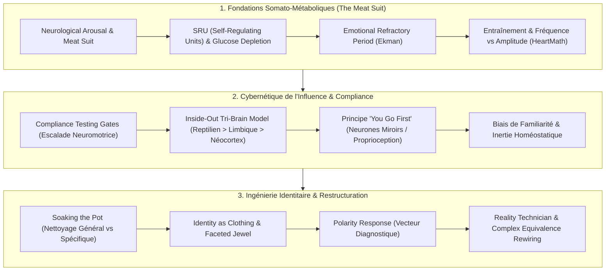
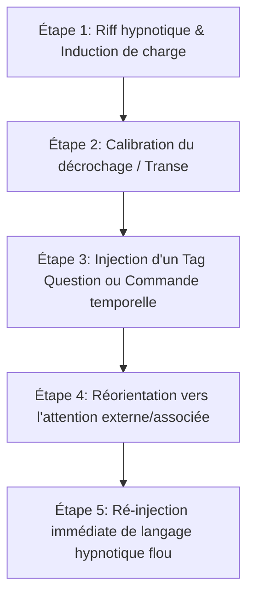
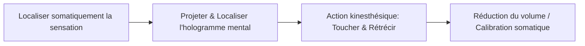
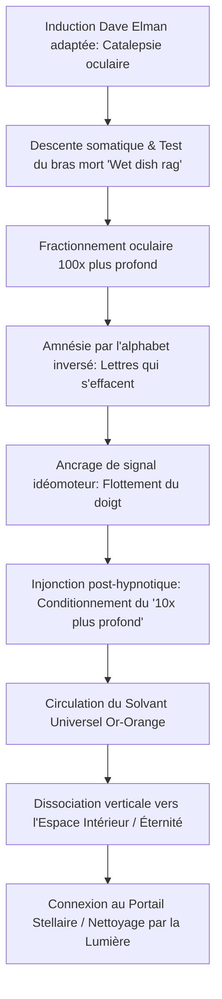
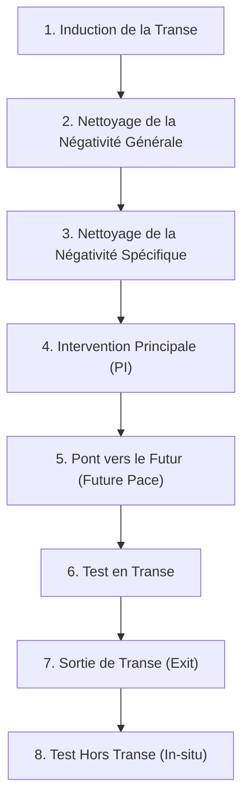

# Identity By Design - Transcripts
**Formateur :** David Snyder | **ID :** `david-snyder-identity-by-design-transcripts` | **Tranches :** 52

## Synthèse Architecturale du Cours : *Identity By Design* (David Snyder)

---

### 1. Thèse Centrale & Philosophie du Cours

#### A. Vision Spécifique et Rupture avec l'Approche Standard
Là où la PNL classique et l'hypnose ericksonienne traditionnelle abordent le changement par le haut (*top-down* : raffinement linguistique, métamodèle, recadrages sémantiques abstraits ou transes douces permissives), David Snyder impose une approche résolument **organique, somato-énergétique et bottom-up (« *Inside-Out* »)** :

1. **Le primat absolu du « *Meat Suit* » (le corps/système nerveux) :** L'état hypnotique n'est pas une adhésion intellectuelle mais une cascade neuro-somatique. Pour changer l'esprit, il faut d'abord saturer ou entraîner le système nerveux (*neurological arousal*). Le néocortex n'est qu'une machine à rationaliser *a posteriori* (« *rational lying brain* ») ce que le tronc cérébral (cerveau reptilien) et le système limbique ont déjà acté sous la pression de la neurochimie et des stimuli viscéraux.
2. **Désacralisation de l'Identité (« *Identity as Clothing* ») :** L'identité n'est ni sacrée, ni monolithique. C'est un agrégat de scripts automatisés, de costumes comportementaux enfilés par inertie et confort du connu (*Familiarity Default*). Le véritable centre opérationnel est un *joyau à facettes multiples* : le praticien est un « technicien de la réalité » (*Reality Technician*) dont le rôle est de tailler, permuter et reprogrammer ces costumes à la demande.
3. **Dissociation Transe vs Suggestibilité :** Contrairement au dogme classique associant suggestibilité et profondeur de relaxation, Snyder sépare la transe (état physiologique d'absorption) de la réceptivité critique. La suggestibilité s'obtient par l'escalade motrice et comportementale (*Compliance Escalation*), neutralisant la réactance psychologique par le jeu (*Playful State*) et l'infaillibilité affective.

#### B. Fil Rouge Méthodologique Unificateur
L'intégralité des interventions de *Identity By Design* obéit à une séquence cybernétique rigoureuse en 4 phases :
$$\text{Décharge / Nettoyage} \longrightarrow \text{Conformité Somatique} \longrightarrow \text{Amplification Viscérale} \longrightarrow \text{Verrouillage Identitaire}$$

* **Nettoyer d'abord le liant toxique :** « Faire tremper la casserole » (*Soaking the Pot* / *Taking out the Trash*) pour dissoudre la négativité générale avant d'attaquer les blocages spécifiques.
* **Obtenir la soumission neuromotrice :** Établir la boucle d'obéissance par des micro-instructions physiques (*Compliance Gates*), rendant le refus neurologiquement plus coûteux que l'action.
* **Guider par résonance directe (« *Go First* ») :** L'opérateur génère en lui-même l'amplitude émotionnelle et la certitude nécessaires pour écraser l'onde du sujet par couplage somato-sensoriel et neurones miroirs.
* **Recâbler les équivalences complexes et donner « Le Biscuit » :** Associer immédiatement le comportement cible à une libération dopaminergique (*The Cookie*) et à une validation interne autoréférentielle irréfutable.

---

### 2. Carte des Concepts & Leviers Émergents



#### A. Fondations Somato-Métaboliques
* **The Meat Suit & Neurological Arousal :** Court-circuit de la résistance critique par saturation sensorielle et activation viscérale.
* **SRU (Self-Regulating Units) :** Gestion de la volonté comme ressource métabolique finie (glucose/fatigue) qui capitule face au stress émotionnel contrôlé.
* **Période Réfractaire Émotionnelle (Ekman) :** Fenêtre d'environ 20 minutes durant laquelle le système nerveux ne perçoit et ne valide que les stimuli congruents avec l'émotion active.
* **Fréquence vs Amplitude :** Le calquage (rapport) n'est que la syntonie (fréquence) ; le lead s'opère par l'injection d'une intensité émotionnelle supérieure (amplitude) qui entraîne mécaniquement le sujet.

#### B. Cybernétique de l'Influence & Compliance
* **Compliance Testing Gate :** Chaîne de micro-instructions comportementales qui installe l'inconscient dans une inertie d'exécution motrice.
* **Architecture Tri-Cérébrale (Inside-Out) :** Adressage exclusif du reptilien (sécurité, contraste, binaire) et du limbique (désir, intensité) avant d'offrir une justification de complaisance au néocortex (*Plausible Deniability*).
* **« You Go First » & Résonance Proprioceptive :** Obligation pour le praticien de saturer son propre système de l'état cible afin de contaminer le champ neurologique du sujet via les neurones miroirs.
* **Biais de Familiarité :** Tendance du système à préférer une souffrance familière à un plaisir inconnu. Nécessite de surdimensionner le différentiel hédonique.
* **Hypnotist Disease :** Dédoublement analytique et hyper-vigilance critique du sujet observateur, à neutraliser par la directivité et le jeu.

#### C. Ingénierie de la Réalité & Architecture Identitaire
* **Soaking the Pot :** Nettoyage global préliminaire pour éliminer la friction somatique avant tout travail chirurgical spécifique.
* **Identity as Clothing (Le Joyau aux Facettes) :** Désidentification de l'observateur central vis-à-vis des rôles appris. L'ego n'est qu'un ensemble d'habits interchangeables.
* **Réponse de Polarité (Biofeedback Diagnostique) :** Tout rejet violent ou attraction disproportionnée signale une charge non intégrée ; la neutralité absolue valide seule la résolution.
* **Reality Technician :** Recâblage délibéré des liens de cause à effet ($X \to Y$) et des équivalences complexes ($X = Y$) pour ancrer l'estime de soi dans la compliance et la nouveauté.
* **The Cookie (Ancrage Hédonique) :** Clôture systématique par une décharge neurochimique gratifiante pour conditionner la répétition du pattern libéré.
* **Translogic & Hallucination de Cohérence :** Exploitation de la capacité du néocortex à fabriquer des rationalisations absurdes pour maintenir le sentiment de contrôle du sujet.

---

### 3. Tableau Récapitulatif des Techniques & Démonstrations

| Technique / Exercice | Objectif Opératoire | Déclencheur / Indication | Séquence Résumée |
|---|---|---|---|
| **Compliance Escalation Sequence** | Abaisser le facteur critique par inertie neuromotrice sans confrontation cognitive. | Ouverture de session, sujet analytique, résistant ou distrait. | 1. Donner 3 micro-ordres physiques bénins (ex. « déplacez-vous ici », « posez les mains là »).<br>2. Ratifier l'exécution sans félicitation excessive.<br>3. Augmenter l'intensité des consignes jusqu'à la fermeture des yeux / catalepsie. |
| **Soaking the Pot (Purge Somatique Globale)** | Dissoudre la friction émotionnelle de fond pour rendre les blocages spécifiques malléables. | Sujet rigide, surchargé de stress, présentant de multiples résistances diffuses. | 1. Guider une respiration profonde diaphragmatique avec focus somatosensoriel pur.<br>2. Évoquer une onde de décharge globale (chaleur/lumière/lourdeur).<br>3. Évacuer les toxines nerveuses sans analyser les causes narratives.<br>4. Vérifier l'abaissement du tonus musculaire général. |
| **Proprioceptive Resonance Lead (« You Go First »)** | Induire un état d'absorption profonde sans dépendance exclusive aux scripts verbaux. | Début d'induction formelle ou blocage sur le canal auditif. | 1. Le praticien stoppe son discours interne et accède physiquement à l'état visé.<br>2. Calage du rythme respiratoire et de la tonalité vocale sur cet état saturé.<br>3. Maintien du contact visuel/postural jusqu'au déclenchement des marqueurs miroirs chez le sujet. |
| **Polarity Vector Tracking** | Identifier chirurgicalement la racine névrotique ou le matériel refoulé sans anamnèse longue. | Sujet hésitant, ambivalent ou manifestant un dégoût/enthousiasme excessif. | 1. Présenter des stimuli contextuels contrastés.<br>2. Calibrer les micro-réactions neuro-végétatives (déglutition, respiration, micro-reculs).<br>3. Suivre le vecteur de charge maximale (l'angle où la réaction est la plus vive).<br>4. Traiter la polarité jusqu'à l'obtention d'une neutralité sensorielle complète. |
| **Internal Voice Morphing (Transfert vers Autonomie)** | Éviter la dépendance thérapeutique et ancrer le locus de contrôle à l'intérieur du sujet. | Fin d'intervention d'autorité ou d'installation d'une nouvelle croyance motrice. | 1. Établir la suggestion avec l'autorité vocale du praticien.<br>2. Faire localiser au sujet la voix dans son espace proprioceptif.<br>3. Guider la transformation acoustique de la voix : changer le timbre pour qu'elle adopte la voix la plus sage, puissante et intime du sujet lui-même.<br>4. Ratification identitaire autoréférentielle. |
| **Catalepsie Bipolaire (Flaccide vs Plastique)** | Verrouiller l'inhibition motrice pour libérer l'accès aux couches reptiliennes/inconscientes. | Test de profondeur de transe et suspension du contrôle néocortical. | 1. Isoler un membre (bras/main).<br>2. Commander soit l'épuisement total du tonus (flaccidité de « poupée de chiffon »), soit la suspension du signal moteur (verrouillage cataleptique).<br>3. Lier l'immobilité du membre à l'impossibilité pour le néocortex d'interférer avec le travail interne. |
| **Hedonic Cookie Rewiring** | Consolider neurologiquement l'expérience de changement par conditionnement dopaminergique. | Immédiatement après la résolution d'un conflit ou l'installation d'un pattern. | 1. Associer la nouvelle réponse comportementale à une sensation physique de soulagement ou d'euphorie.<br>2. Amplifier la kinesthésie interne (*spin*, intensité, pulsation).<br>3. Ancrer cette libération neurochimique comme la récompense naturelle de la nouvelle identité. |

---

---

## 0. Sommaire Sémantique & Index des Lignes

- **Tranche 1 [Lignes 152-248]** : Démonstration Éclair de Rupture de Croyance sur la Volonté ("Stand Up Demo") — *Protocole :* Démonstration Éclair de Rupture de Croyance sur la Volonté ("Stand Up Demo") | *Mécanisme :* Le Primat Physiologique (« Meat Suit » & Neuro-Arousal) | *Verbatim :* Injonction d'Absorption & Double Lien Temporel Implicite
- **Tranche 2 [Lignes 250-387]** : Le Pré-cadrage Fondamental d'Éradication de la Résistance (The 2-Phase Pre-Frame) — *Protocole :* Le Pré-cadrage Fondamental d'Éradication de la Résistance (The 2-Phase Pre-Frame) | *Mécanisme :* Le Principe de Compliance Incrémentale et Neurologique | *Verbatim :* La Régression d'Âge Conversationnelle Invisible
- **Tranche 3 [Lignes 389-570]** : Induction Elman Modulaire en 4 Balles Magiques (4 Magic Bullets) — *Protocole :* Induction Elman Modulaire en 4 Balles Magiques (4 Magic Bullets) | *Mécanisme :* Le Test de Conformité Échelonné (Compliance Testing Gate) | *Verbatim :* Le Pré-cadrage de la Triade d'Attente
- **Tranche 4 [Lignes 572-714]** : Le Recadrage Somatique de l'Hésitation (Désensibilisation de l'Approche / Street Hypnosis) — *Protocole :* Le Recadrage Somatique de l'Hésitation (Désensibilisation de l'Approche / Street Hypnosis) | *Mécanisme :* Le Biais de Familiarité & L'Inertie Homéostatique | *Verbatim :* Verbatim 1 : L'Amorçage par les Expériences Universelles et la Familiarité
- **Tranche 5 [Lignes 716-845]** : Diagnostics et Nettoyage par Suivi de Polarité (Polarity Tracking) — *Protocole :* Diagnostics et Nettoyage par Suivi de Polarité (Polarity Tracking) | *Verbatim :* Pattern 1 : Le Recadrage de la Justification Logique et de la Dénégation Plausible
- **Tranche 6 [Lignes 847-1034]** : Induction par Catalepsie Dissociée & Reroutage de Tension — *Protocole :* Induction par Catalepsie Dissociée & Reroutage de Tension | *Mécanisme :* Le Technicien de Réalité : Ingénierie du Contexte et des Équivalences Complexes | *Verbatim :* Citation 1 : Recadrage identitaire du praticien & Relativisme opérationnel
- **Tranche 7 [Lignes 1036-1193]** : Le Fractionnement Conversationnel Réactif & Inévitabilité de la Capture Attentionnelle et Ab... — *Protocole :* Le Fractionnement Conversationnel Réactif | *Mécanisme :* Inévitabilité de la Capture Attentionnelle et Absorption Non-Consciente | *Verbatim :* PÉPITE 1 : Le Piège de l'Attention Non-Évitable & Séquençage Somatique
- **Tranche 8 [Lignes 1195-1330]** : The Gray Room – General Negativity Clearing — *Protocole :* The Gray Room – General Negativity Clearing | *Verbatim :* Extrait 1 : Double lien de mémoire et dissolution des filtres
- **Tranche 9 [Lignes 1332-1448]** : L'Induction BOO (Scott Sandlin & David Snyder) — *Protocole :* L'Induction BOO (Scott Sandlin & David Snyder)
- **Tranche 10 [Lignes 1450-1599]** : Ancrage et Auto-Induction par Maîtrise Physiologique (State Control) — *Protocole :* Ancrage et Auto-Induction par Maîtrise Physiologique (State Control) | *Verbatim :* Verbatim 1 : L'amplification somato-vasculaire de la certitude
- **Tranche 11 [Lignes 1601-1759]** : La Ceinture d'Utilité d'États (Batman Utility Belt Construct) — *Protocole :* La Ceinture d'Utilité d'États (Batman Utility Belt Construct) | *Verbatim :* Verbatim 1 : L'Ancrage de Certitude Silencieuse
- **Tranche 12 [Lignes 1761-1914]** : La Régression Forcée sur Abréaction (« Bursting Dam Protocol ») — *Protocole :* La Régression Forcée sur Abréaction (« Bursting Dam Protocol ») | *Mécanisme :* Le « Pliage Émotionnel Primitif » et l'Accumulation par Priorisation Consciente | *Verbatim :* PÉPITE 1 : L'Amplification Balistique d'Abréaction
- **Tranche 13 [Lignes 1916-2028]** : Le Contrat Hypnotique Manifeste (Overt) & Le Tri des 4 Attitudes — *Protocole :* Le Contrat Hypnotique Manifeste (Overt) & Le Tri des 4 Attitudes
- **Tranche 14 [Lignes 2030-2134]** : La Technique du Spin Somato-Énergétique (Spin It and Win It) — *Protocole :* La Technique du Spin Somato-Énergétique (Spin It and Win It) | *Mécanisme :* Désensibilisation Linguistique Progressive (Linguistic Desensitization) | *Verbatim :* Le Verrouillage du Contrat Hypnotique
- **Tranche 15 [Lignes 2136-2304]** : Protocole d'Éradication / Transformation de la Douleur par Submodalités Opposées — *Protocole :* Protocole d'Éradication / Transformation de la Douleur par Submodalités Opposées | *Verbatim :* Le Recadrage Temporel Submodalitaire de la Douleur
- **Tranche 16 [Lignes 2306-2427]** : Protocole d'Anesthésie au Gant avec Sortie et Ancrage Post-Hypnotique — *Protocole :* Protocole d'Anesthésie au Gant avec Sortie et Ancrage Post-Hypnotique | *Verbatim :* Le Triptyque d'Autorisation et de Descente
- **Tranche 17 [Lignes 2429-2571]** : Construction & Empilement de Suggestions Hypnotiques par Descripteurs — *Protocole :* Construction & Empilement de Suggestions Hypnotiques par Descripteurs
- **Tranche 18 [Lignes 2573-2723]** : L'Extraction Somatique d'Énergie de Transe & Amplification Fractale — *Protocole :* L'Extraction Somatique d'Énergie de Transe & Amplification Fractale | *Verbatim :* Pattern 1 : Le Recadrage par Déresponsabilisation et Amnésie Conversationnelle
- **Tranche 19 [Lignes 2725-2851]** : Réglage d'Expectative et Contexte de Changement — *Protocole :* Réglage d'Expectative et Contexte de Changement | *Verbatim :* Extrait 1 : L'Inévitabilité par l'Expectative
- **Tranche 20 [Lignes 2853-3028]** : Désamorçage de Tension par l'Humour et Cadrage d'Incongruité (The Bandler Framing) — *Protocole :* Désamorçage de Tension par l'Humour et Cadrage d'Incongruité (The Bandler Framing) | *Mécanisme :* Leurre Chimique et Flexibilisation par le Rire (Oxytocin-Induced Programming Flexibility) | *Verbatim :* La Thèse d'Approfondissement selon Jerry Kein
- **Tranche 21 [Lignes 3030-3152]** : Test de Réceptivité "Bras Lourd / Bras Léger" (Imagination Game Framing) — *Protocole :* Test de Réceptivité "Bras Lourd / Bras Léger" (Imagination Game Framing) | *Verbatim :* La Présupposition Temporelle Permissive
- **Tranche 22 [Lignes 3154-3313]** : 1 : Le "Master and Commander" (Verrouillage Somatique d'État & Épreuve d'Impossibilité Neuro... — *Protocole :* 1 : Le "Master and Commander" (Verrouillage Somatique d'État & Épreuve d'Impossibilité Neurologique) | *Mécanisme :* Boucle Rétroactive Réciproque Corps-Esprit et Somatisation des Complexes | *Verbatim :* PÉPITE 1 : Le Défi de l'Incompatibilité Neurologique (Master & Commander Test)
- **Tranche 23 [Lignes 3315-3475]** : Le Test d'Écrasement Physiologique (Polarity Drill - Solo) — *Protocole :* Le Test d'Écrasement Physiologique (Polarity Drill - Solo) | *Mécanisme :* Le Principe de Primauté Physiologique (Engage the Meat) | *Verbatim :* La Directive d'Interruption par Impossibilité Physiologique
- **Tranche 24 [Lignes 3477-3604]** : Les Exercices d'Amplitude et Polarité Émotionnelle (Polarity & Amplitude Drills) — *Protocole :* Les Exercices d'Amplitude et Polarité Émotionnelle (Polarity & Amplitude Drills) | *Verbatim :* Verbatim 1 : L'injonction à l'effacement des étiquettes et truisme d'absorption
- **Tranche 25 [Lignes 3606-3769]** : Désamorçage Immédiat de l'Intimidation par le Calme Somatique (Démonstration Live Snyder / J... — *Protocole :* Désamorçage Immédiat de l'Intimidation par le Calme Somatique (Démonstration Live Snyder / Jacob) | *Mécanisme :* Proxémie de Domination et Violation Spatiale | *Verbatim :* La Clôture Immuable des Règles Évolutionnistes
- **Tranche 26 [Lignes 3771-3895]** : Le Protocole de la Séquence en Silos (The Snyder Silo Protocol) — *Protocole :* Le Protocole de la Séquence en Silos (The Snyder Silo Protocol) | *Mécanisme :* Le principe de Dé-identification Radicale et le Supraconscient Observateur | *Verbatim :* La Loi Fondamentale de Souveraineté Intérieure
- **Tranche 27 [Lignes 3897-4025]** : La Chambre Grise (The Gray Room) — Nettoyage de Négativité Générale — *Protocole :* La Chambre Grise (The Gray Room) — Nettoyage de Négativité Générale
- **Tranche 28 [Lignes 4027-4132]** : La Chambre Grise & Le Foyer de Feu (Gray Room Clearing) — *Protocole :* La Chambre Grise & Le Foyer de Feu (Gray Room Clearing) | *Mécanisme :* Le Pont Somatique et l'Écho Proprioceptif | *Verbatim :* Verbatim 1 : L'Isomorphisme Somatique du Froissement
- **Tranche 29 [Lignes 4134-4301]** : LE SOLVANT UNIVERSEL & LE RÉGÉNÉRATEUR UNIVERSEL (Universal Solvent & Rejuvenator) — *Protocole :* LE SOLVANT UNIVERSEL & LE RÉGÉNÉRATEUR UNIVERSEL (Universal Solvent & Rejuvenator) | *Verbatim :* Le Double Sens Chimique et Sémantique du Solvant
- **Tranche 30 [Lignes 4303-4442]** : Silo Standard d'Intervention Thérapeutique (Standard Intervention Silo) — *Protocole :* Silo Standard d'Intervention Thérapeutique (Standard Intervention Silo) | *Verbatim :* s Verbatim & Analyses
- **Tranche 31 [Lignes 4444-4573]** : La Technique du Cadre Magique pour Négativité Spécifique (The Magic Frame Technique) — *Protocole :* La Technique du Cadre Magique pour Négativité Spécifique (The Magic Frame Technique) | *Mécanisme :* Cognition réflexive et récursion du jugement d'identité | *Verbatim :* Définition du self-concept et dissonance relationnelle
- **Tranche 32 [Lignes 4575-4748]** : Le "Magic Frame" & Bucket Listing (Éradication Systémique par Généralisation) — *Protocole :* Le "Magic Frame" & Bucket Listing (Éradication Systémique par Généralisation) | *Mécanisme :* Le Principe du "Canari au Bazooka" vs "Mur de briques au pistolet à billes" | *Verbatim :* La Commande de Clôture Somato-Spatiale
- **Tranche 33 [Lignes 4750-4932]** : "The Gift" (Régression Générative & Ré-encodage Identitaire) — *Protocole :* "The Gift" (Régression Générative & Ré-encodage Identitaire) | *Verbatim :* Le Décompte du Pont Affectif Kinesthésique
- **Tranche 34 [Lignes 4934-5106]** : Le "Direct Drive" de Jerry Kein (Version Snyder avec Amplification Émotionnelle) — *Protocole :* Le "Direct Drive" de Jerry Kein (Version Snyder avec Amplification Émotionnelle) | *Mécanisme :* Le Direct Drive & la Répétition par Saturation Consciente | *Verbatim :* La Thesis Suggestion d'Ouverture de Séance
- **Tranche 35 [Lignes 5108-5254]** : Le "Direct Drive Suggestion Sequence" (Formule Snyder & Jerry Kein) — *Protocole :* Le "Direct Drive Suggestion Sequence" (Formule Snyder & Jerry Kein)
- **Tranche 36 [Lignes 5256-5421]** : Auto-Hypnose Direct Drive façon Jerry Kein (Méthode de la Fiche & du Lâcher-Prise) — *Protocole :* Auto-Hypnose Direct Drive façon Jerry Kein (Méthode de la Fiche & du Lâcher-Prise) | *Verbatim :* La Séparation Opératoire Conducteur / Passager
- **Tranche 37 [Lignes 5423-5577]** : A : Conditionnement de l'Auto-Hypnose par Ratio Précis (Méthode Jerry Kein / Snyder) — *Protocole :* A : Conditionnement de l'Auto-Hypnose par Ratio Précis (Méthode Jerry Kein / Snyder) | *Mécanisme :* Le Ratio Objectif/Subjectif & Ratification Inconsciente | *Verbatim :* L'Induction du Ratio Temporel et de la Ratification Inévitable
- **Tranche 38 [Lignes 5579-5738]** : « Pillars of Power » (Super-Cercle d'Excellence Tridimensionnel) — *Protocole :* « Pillars of Power » (Super-Cercle d'Excellence Tridimensionnel) | *Mécanisme :* Amplification Proprioceptive et Spatialisation Tridimensionnelle (« Pillars of Power ») | *Verbatim :* Induction Multisensorielle & Synchronisation VAKOG
- **Tranche 39 [Lignes 5740-5890]** : Séquence d'Interruption Directive "Stop, Start, Now" — *Protocole :* Séquence d'Interruption Directive "Stop, Start, Now" | *Mécanisme :* Rupture de Pattern Tri-Phasique Directive (Stop / Start / Now) | *Verbatim :* La Triade d'Interruption Directive en Temps Réel
- **Tranche 40 [Lignes 5892-6029]** : Le "Super Pattern" Opératoire ($X \to Y = Z$) — *Protocole :* Le "Super Pattern" Opératoire ($X \to Y = Z$) | *Verbatim :* La Boucle Récursive d'Installation
- **Tranche 41 [Lignes 6031-6138]** : Le "Gang-Bang" Hypnotique Multivocal (Multi-Voice Saturation Drill) — *Protocole :* Le "Gang-Bang" Hypnotique Multivocal (Multi-Voice Saturation Drill) | *Mécanisme :* Surcharge Sensorielle Multicanale & Court-Circuit du Facteur Critique | *Verbatim :* La Parabole Zen des Deux Moines et de la Geisha (Rupture & Métaphore Isomorphe)
- **Tranche 42 [Lignes 6140-6286]** : La Matrice d'Éternité & L'Installation de la Voix d'Autorité Primale (The Whammy of All Wham... — *Protocole :* La Matrice d'Éternité & L'Installation de la Voix d'Autorité Primale (The Whammy of All Whammies) | *Mécanisme :* Le principe d'« Over-Learning » & Transfert Sympathique Étroit | *Verbatim :* Pattern 1 : Le Recadrage de Désidentification Logique
- **Tranche 43 [Lignes 6288-6455]** : Le Processus Intégré "Voice of Authority & Womb of Eternity" — *Protocole :* Le Processus Intégré "Voice of Authority & Womb of Eternity" | *Mécanisme :* Bypass Mémoriel et Écriture Directe ("Pre-Conscious Inoculation") | *Verbatim :* Verbatim 1 : L'Arrimage Temporel et Acoustique de la Voix d'Autorité
- **Tranche 44 [Lignes 6457-6673]** : Protocole : Le Cercle Magique d'Imprégnation (DTI Mono-Exemplaire) — *Protocole :* Protocole : Le Cercle Magique d'Imprégnation (DTI Mono-Exemplaire) | *Mécanisme :* Résonance par Attention Soutenue & Absorption Neuro-cognitive | *Verbatim :* Le Recadrage de la Désidentification et de la Puissance Absolue
- **Tranche 45 [Lignes 6675-6838]** : A : La Cure Rapide de Phobie « À la David » (Fast Phobia Cure Hybrid) — *Protocole :* A : La Cure Rapide de Phobie « À la David » (Fast Phobia Cure Hybrid)
- **Tranche 46 [Lignes 6840-7043]** : A : Intégration Somato-Temporelle & Clôture Identitaire (Trance d'Installation Totale) — *Protocole :* A : Intégration Somato-Temporelle & Clôture Identitaire (Trance d'Installation Totale) | *Verbatim :* La Fusée des Transes et la Désidentification Totale
- **Tranche 47 [Lignes 7045-7205]** : Infiltration de Groupe et Ouverture Sociale par Iso-Physiologie Énergétique — *Protocole :* Infiltration de Groupe et Ouverture Sociale par Iso-Physiologie Énergétique | *Verbatim :* La Stratégie d'Arousal et la Métaphore de la Grenouille Bouillie
- **Tranche 48 [Lignes 7207-7331]** : Capture & Bouclage Attentionnel par Push-Pull (Attention Scarce Resource) — *Protocole :* Capture & Bouclage Attentionnel par Push-Pull (Attention Scarce Resource) | *Verbatim :* Le Cadre du "Prize" et le Test d'Agrément
- **Tranche 49 [Lignes 7333-7494]** : Installation et Déploiement du « Rockstar Metaframe » — *Protocole :* Installation et Déploiement du « Rockstar Metaframe » | *Mécanisme :* Le Verrouillage d'Attention comme Déclencheur Fondamental | *Verbatim :* Verrouillage du Cadre d'Attraction Hypnotique
- **Tranche 50 [Lignes 7496-7641]** : Désactivation Instantanée d'une Saisie par Inversion de Flux (Démo Grappling / Kyusho) — *Protocole :* Désactivation Instantanée d'une Saisie par Inversion de Flux (Démo Grappling / Kyusho) | *Mécanisme :* La Métaphore Porteuse/Informationnelle de l'Énergie | *Verbatim :* Verbatim 1 : La Bande Magnétique de l'Énergie
- **Tranche 51 [Lignes 7643-7771]** : A : La poignée de main hypnotique (Handshake Interrupt) – Variante David Snyder — *Protocole :* A : La poignée de main hypnotique (Handshake Interrupt) – Variante David Snyder | *Mécanisme :* L'interruption de programme moteur automatique (Handshake Interrupt) | *Verbatim :* La boucle cybernétique de renforcement et de réémergence
- **Tranche 52 [Lignes 7773-7875]** : d'Inversion Émotionnelle de la Polarité d'Ennui (The Curiosity Flip) — *Protocole :* d'Inversion Émotionnelle de la Polarité d'Ennui (The Curiosity Flip)

---

## Extractions Détaillées par Tranche (Opératoire & Verbatim)

## Tranche 1 / 52 : Démonstration Éclair de Rupture de Croyance sur la Volonté ("Stand Up Demo")

### 1. Mécanismes & Principes Actifs

#### A. Le Primat Physiologique (« Meat Suit » & Neuro-Arousal)
* **Principe actif :** L'état hypnotique n'est pas fondamentalement un phénomène intellectuel ou mental abstrait, mais une cascade neuro-somatique. Toute activation émotionnelle vive (*neurological arousal*) agit comme un court-circuit du néocortex : elle sature le système nerveux, suspend le facteur critique et ouvre directement la porte à la transe. Agir directement sur la physiologie (« *get the meat going* ») permet de modifier instantanément la cognition descendante (*top-down*).
* **Tags :** `#meat_suit` `#neurological_arousal` `#primat_somatique` `#court_circuit_neocortex`

#### B. Épuisement de la Volonté & Unités d'Auto-Régulation (SRU - Self-Regulating Units)
* **Principe actif :** La « volonté » n'est pas une vertu morale mais une ressource métabolique finie conditionnée par le sommeil et le taux de glucose circulant. Tout effort de régulation émotionnelle ou de réflexion analytique consomme activement ces SRU. Lorsque les réserves de glucose s'effondrent sous l'effet du stress ou de l'intensité émotionnelle, la résistance critique capitule, laissant le système nerveux sans défense face aux inputs directifs.
* **Tags :** `#self_regulating_units` `#glucose_depletion` `#effondrement_volonte` `#vulnerabilite_metabolique`

#### C. Période Réfractaire Émotionnelle & Distorsion des Filtres Perceptuels (Paul Ekman)
* **Principe actif :** Un état émotionnel agit comme un organisme parasitaire auto-reproducteur (*thought form / entity*). Dès qu'il est activé, il détourne les filtres perceptuels du sujet pour le contraindre à ne traiter que les stimuli environnementaux confirmant ou amplifiant cet état (durant sa période réfractaire de ~20 minutes). En provoquant délibérément une émotion précise, le praticien force le cerveau du sujet à sélectionner uniquement les données conformes à sa suggestion.
* **Tags :** `#emotional_refractory_period` `#filtres_perceptuels` `#autoperpetuation_emotionnelle` `#biais_d_attention_force`

#### D. L'Attelage Psycho-Physiologique : Fréquence vs Amplitude (Entraînement Somatique & HeartMath)
* **Principe actif :** Le simple rapport PNL (calquage postural, vocal, respiratoire) n'établit que la « fréquence » (la syntonie de base). Pour commander et guider le système nerveux de l'autre, il faut y injecter de l'« amplitude » : une intensité émotionnelle supérieure qui déborde et réécrit l'état de la cible par cohérence et entraînement physiologique direct (*entrainment*). Le système nerveux le plus saturé de certitude et d'énergie entraîne mathématiquement le plus faible.
* **Tags :** `#frequence_vs_amplitude` `#entrainment_somatique` `#coherence_physiologique` `#ecrasement_d_onde`

#### E. L'Axiome de la Transe comme Déviation d'État & Composants Universels
* **Principe actif :** Il n'existe pas d'état vigile « zéro » ; la conscience est un continuum en fluctuation permanente. La transe n'est pas un état binaire (on/off), mais **toute déviation de l'état présent** produisant une constellation de filtres orientés. La profondeur de transe se mesure au ratio de deux variables :
  1. Le niveau d'absorption dans l'expérience subjective.
  2. Le rétrécissement progressif et continu du focus attentionnel.
* **Tags :** `#continuum_de_transe` `#ratio_absorption_focus` `#deviation_d_etat` `#acceptable_selective_thinking`

#### F. Architecture en Silos & Loi du Renforcement Composé (*Compounding*)
* **Principe actif :** Les techniques hypnotiques ne doivent pas être utilisées de manière isolée mais chaînées en structures modulaires autonomes (« Silos »). Chaque technique poursuit un sous-objectif mécanique précis, capitalise sur les effets de la précédente et approfondit le seuil de conformité globale en exploitant la loi de sommation des stimuli (*compounding law*).
* **Tags :** `#silos_hypnotiques` `#law_of_compounding` `#chainage_operatoire` `#effet_cliquet`

---

### 2. Protocoles, Techniques & Démonstrations (Étape par Étape)

#### Démonstration Éclair de Rupture de Croyance sur la Volonté ("Stand Up Demo")
* **Intention / Indication :** Démolir instantanément l'objection/croyance populaire « *On ne peut pas me forcer à faire quelque chose contre mon gré sous hypnose* ».
* **Mise en place & Pré-framing :** Cadrer la rapidité du geste sans laisser le temps à l'esprit critique d'analyser le piège rhétorique.
* **Séquence d'actions pas à pas :**
  1. *Ordre kinésique direct et impératif :* « *Everybody stand up.* »
  2. *Création d'une tâche de distraction sociale :* « *Turn to the person next to you. Introduce yourself... Say hi, my name is...* »
  3. *Interruption et contre-ordre abrupte dès exécution :* « *Thank you. Okay, now sit your asses down.* »
  4. *Enfoncement du clou cognitif (Recadrage) :* « *Now, I've just dispelled the first rumor. I can in fact make you do something against your will.* »
* **Signes de calibration :** Exécution mécanique instantanée du groupe sans délibération consciente ; rupture de l'axe postural lors de l'injonction de se rasseoir ; sourires/sidération (choc cognitif confirmant la prise de contrôle).

#### Le Protocole du Premier Pré-Frame Hypnotique (Désamorçage de l'Inhibition Volontaire)
* **Intention / Indication :** Supprimer la peur de l'échec ou le scepticisme du sujet avant toute induction formelle.
* **Mise en place & Pré-framing :** Présenter l'intervention comme une mécanique biologique inévitable plutôt qu'un test de suggestibilité psychologique.
* **Séquence d'actions pas à pas :**
  1. *Neutraliser l'exigence de foi/croyance :* Poser que la croyance du sujet est hors de propos ; seule la certitude du praticien compte.
  2. *Légitimation scientifique matérialiste :* Activer l'autorité biomédicale (IRM, Harvard, scan cérébral).
  3. *Dénivelé de causalité :* Réduire l'induction à une série mécanique incontournable (« *4 étapes simples* ») où la conformité (*compliance*) garantit le résultat neurologique indépendamment de la volonté.
  4. *Ancrage sur l'amnésie naturelle du focus (Métaphore du cinéma) :* Réactiver le souvenir d'un film pour prouver que l'absorption est un phénomène inconscient dont le basculement échappe toujours au contrôle temporel analytique.
* **Signes de calibration :** Décélération respiratoire, relâchement des micro-tensions faciales, clignements de paupières plus lents, arrêt des questions rationnelles défensives.

---

### 3. Heuristiques, Subtilités & "Sagesse du Praticien"

#### Heuristiques Conditionnelles (If / Then)
* **Si** le sujet commence à rationaliser ou intellectualiser le processus, **alors** augmente l'intensité émotionnelle ou applique une contrainte physiologique directe, **parce que** l'arousal neurologique vide instantanément les réserves d'auto-régulation (SRU) et désactive le facteur critique.
* **Si** tu veux modifier l'état interne d'un sujet à distance, **alors** active d'abord cet état en toi avec une amplitude maximale avant de chercher le guidage verbal, **parce que** l'entraînement somatique (*entrainment*) force le système nerveux du sujet à s'aligner sur la source physiologique la plus puissante.
* **Si** le sujet affirme être imperméable à l'hypnose, **alors** ignore sa croyance et obtiens une séquence de micro-compliances physiques directes, **parce que** le système nerveux réagit aux stimuli indépendamment de l'accord conscient.
* **Si** tu perçois que les filtres d'un sujet rejettent tes suggestions (période réfractaire post-conflit ou état négatif), **alors** attends ou réinitialise la physiologie par un choc/mouvement, **parce que** tout état émotionnel en cours filtre agressivement l'environnement pour ne valider que sa propre chimie.

#### Pièges Classiques & Erreurs de Débutant
* **Le piège de l'induction magique :** Passer 80% de son énergie à se demander comment mettre le sujet en transe (ou s'enliser dans des inductions progressives lénifiantes, « *the progressive boredom induction* ») au lieu de savoir calibrer la transe et savoir exactement quoi faire une fois le sujet réceptif.
* **L'obsession linguistique formelle :** S'enfermer dans les formulations millimétrées (styles ericksoniens purs) en oubliant que la voix, la posture et l'état interne du praticien dictent 90% de la réponse neurologique.
* **Confondre Fréquence et Amplitude :** Se contenter d'imiter l'autre en miroir (rapport passif) sans jamais introduire la charge d'énergie nécessaire pour faire basculer son état (*amplitude push*).

#### Postulats Opératoires de David Snyder
* *« Anything outside of your awareness is outside of your control. »* (Ce qui échappe à ta conscience contrôle ton comportement à ton insu).
* *« The primary goal of the hypnotist is compliance. »* (La transe commence par l'obéissance neuromusculaire, pas par la philosophie).
* *« Certainty overrules confidence. »* (La certitude brute impose la soumission du système nerveux d'autrui ; la confiance n'est qu'un sentiment psychologique, la certitude est un impératif biologique).

---

### 4. Pépites Verbatim & Patterns Linguistiques (MOT À MOT EN V.O.)

#### A. Injonction d'Absorption & Double Lien Temporel Implicite
> « You go into the movie, you sit down, right? The lights go down, and an hour and a half, two hours later, you feel great, right? Can you tell me at what moment you became completely absorbed in that experience? Because if you can, you're lying. You weren't absorbed. »

* **[Analyse du Pattern]** : Utilisation d'un empilement de truismes (*pacing*) validés par des marqueurs d'assentiment (*"right?"*), suivi d'un piège logique en double lien (*double bind*). Si le sujet donne un moment précis, il invalide son absorption (car l'auto-observation prouve qu'il n'était pas absorbé) ; s'il admet son incapacité à le faire, il valide le présupposé que l'inconscient prend les commandes sans préavis conscient.

#### B. Commande Directe Dissimulée sous Autorité Médicale
> « If you tell them that hypnosis is a physiological process, you do four simple steps, you will in fact go into a profound state of hypnosis. »

* **[Analyse du Pattern]** : Shift pronominal stratégique : passage d'une directive pédagogique adressée au tiers (*"If you tell them..."*) à un glissement direct à la deuxième personne (*"you will in fact go into a profound state of hypnosis"*). La formulation associe une cause arbitraire (quatre étapes simples) à un effet inévitable via le marqueur de certitude absolue (*"in fact"*), constituant une commande post-hypnotique enchâssée d'approfondissement.

#### C. Cadrage d'Infaillibilité Matérialiste & Élimination de l'Objection de Foi
> « Hypnosis is a physiological process. It has nothing to do with whether you believe you can be hypnotized or not. That's a belief for you, the hypnotist. It does not matter if they believe they can be hypnotized. What matters is that you believe they can be hypnotized. »

* **[Analyse du Pattern]** : Pattern de dissociation par recadrage de critère. Snyder retire complètement le levier de contrôle à l'esprit critique du sujet en réduisant l'hypnose à un fait biologique brut (comme la digestion ou le réflexe rotulien). Parallèlement, il transfère l'exigence de congruence et de charge énergétique (*certainty*) sur le praticien via une antithèse symétrique (*"It does not matter if they... What matters is that you..."*).

#### D. Définition Opératoire de la Transe par Reclassification Sensorielle
> « A trance state is a constellation of physical and emotional characteristics or phenomena that turn on certain perceptual filters, turn off certain perceptual filters, and allow you to generate certain categories of phenomena. »

* **[Analyse du Pattern]** : Nominalisation dynamique et dé-mystification. En définissant la transe non comme un sommeil mais comme un basculement d'interrupteurs perceptuels (*"turn on... turn off"*), la phrase installe une présupposition d'utilité opératoire : contrôler l'accès aux phénomènes hypnotiques ne relève pas du don, mais d'une manipulation de curseurs physiologiques.

## Tranche 2 / 52 : Le Pré-cadrage Fondamental d'Éradication de la Résistance (The 2-Phase Pre-Frame)

Voici l'analyse opératoire intégrale de la tranche 2/52 du cours *Identity By Design* de David Snyder.

---

### 1. Mécanismes & Principes Actifs

#### A. Le Principe de Compliance Incrémentale et Neurologique
- **Principe actif** : L'état d'hypnose n'est pas conditionné par la croyance intellectuelle ou l'adhésion cognitive du sujet, mais par la soumission physiologique et comportementale à des ordres successifs. Chaque micro-consigne exécutée (changer de siège, lever la main, fermer les yeux) abaisse la résistance critique et engage la boucle d'obéissance neuromotrice. L'inconscient s'installe dans une inertie d'exécution où refuser devient neurologiquement plus coûteux que de continuer à obéir.
- **Tags** : #law_of_compliance #micro_instructions #engagement_neuromoteur #compliance_escalation #physiologie_vs_croyance

#### B. La Dissociation Transe / Suggestibilité (Le Modèle Sexuel Éjaculation/Orgasme)
- **Principe actif** : Tout comme la physiologie masculine distingue l'éjaculation de l'orgasme (deux processus concomitants mais distincts), Snyder pose que la *transe* (état physiologique d'absorption) et la *suggestibilité* (acceptation de consignes sémantiques) sont deux mécanismes séparés. Le praticien ne cherche pas à faire « croire » le sujet, il vise la production mécanique d'une transe par absorption, tout en laissant intact le libre arbitre apparent du sujet pour désarmer sa réactance psychologique.
- **Tags** : #dissociation_transe_suggestibilite #reactance_bypass #mecanisme_physiologique #compliance_first

#### C. L'Écologie du Cadre d'Absorption vs Perte de Contrôle
- **Principe actif** : L'analogie classique de l'autoroute (« vous conduisez et vous ratez votre sortie ») installe un pré-cadrage de panique et d'amnésie incontrôlée (« qui conduisait la voiture ? »), déclenchant le réflexe de défense du sujet. Snyder substitue ce cadre par des expériences positives de focalisation consentie et ludique : le cinéma (absorption esthétique) et le jeu d'enfant avec le bâton / Rambo (distorsion de réalité volontaire, ludique et gratifiante).
- **Tags** : #positive_preframe #absorption_ludique #conversational_age_regression #eradication_resistance #framing_sensoriel

#### D. Le Triplement de la Communication : Sémantique, Structure et Ancrage Somato-Émotionnel
- **Principe actif** : La communication opère à trois niveaux : (1) la définition du dictionnaire, (2) la structure syntaxique (le domaine de prédilection de la PNL traditionnelle), et (3) l'association émotionnelle/somatique logée dans le corps (« meat level »). L'influence réelle s'exécute au niveau viscéral : le choix d'un mot (« manipulation » vs « persuasion ») active instantanément des filtres perceptuels neuro-végétatifs avant même l'intervention du cortex préfrontal.
- **Tags** : #meat_level #emotional_association #somato_affective_filters #beyond_linguistic_structure #pnl_viscerale

#### E. Gestion Thérapeutique du Transfert et Réappropriation Interne
- **Principe actif** : Le transfert (dépendance, idéalisation, hyper-malléabilité du patient envers le thérapeute) n'est pas une anomalie à éviter, mais un puissant levier d'amplification de la suggestibilité. La règle éthique et technique consiste à utiliser temporairement ce levier pour graver le changement, puis à transférer la voix et l'autorité à l'intérieur du sujet (morphing auditif interne) pour que le résultat soit réattribué à sa propre identité.
- **Tags** : #transference_utilization #internal_voice_morphing #identity_silos #locus_of_control_shift #pouvoir_interne

#### F. Hypnotist Disease (Le Dédoublement Observateur-Juge)
- **Principe actif** : Phénomène d'interférence cognitive chez les profils analytiques ou les praticiens en position de sujet : une partie veut vivre l'état, tandis qu'une sous-personnalité dissidente reste en retrait pour disséquer la technique, juger le praticien ou chercher à copier le pattern. Ce pattern inhibe l'absorption somatique et doit être pré-cadré et neutralisé dès l'ouverture.
- **Tags** : #hypnotist_disease #analytical_interference #dissociation_critique #meta_observation_trap

---

### 2. Protocoles, Techniques & Démonstrations (Étape par Étape)

#### Protocole 1 : Le Pré-cadrage Fondamental d'Éradication de la Résistance (The 2-Phase Pre-Frame)
* **Intention / Indication** : À utiliser obligatoirement avant toute séance ou induction pour supprimer 80 à 90 % de la résistance consciente et éliminer la peur de perdre le contrôle.
* **Mise en place & Pré-framing** : Poser des questions fermées calibrées sollicitant un accord physique immédiat (hochement de tête, main levée).
* **Séquence d'actions** :
  1. *Régression d'âge conversationnelle positive* : Demander : « Combien d'entre vous ont déjà été des enfants ? Combien ont déjà joué à faire semblant ? ». Connecter le sujet au souvenir du bâton qui devient un fusil / une tasse de thé.
  2. *Normalisation par l'absorption narrative* : Évoquer l'expérience du cinéma : entrer, s'asseoir, les lumières s'éteignent, absorption totale du temps sans repère précis du basculement.
  3. *Verrouillage physiologique* : Poser le postulat : « L'hypnose est un processus physiologique prouvé par la science (scanners cérébraux). Cela n'a rien à voir avec votre croyance. Vous appliquez les consignes, votre système nerveux entre en transe ».
  4. *Garantie de souveraineté* : Enchâsser la clause de sécurité : « Peu importe la profondeur de votre transe, vous conservez à chaque instant le pouvoir total d'accepter ou de rejeter chaque suggestion ».
  5. *Liaison de proportionnalité* : Lier le résultat final au degré de participation ludique : « Dans la mesure où vous vous autorisez à jouer et à suivre ces consignes simples, dans cette exacte mesure le changement s'accomplit ».
* **Signes de calibration** : Relâchement des épaules, soupir respiratoire, arrêt du clignement défensif, hochements de tête d'assentiment franc.

---

#### Protocole 2 : L'Induction des « Quatre Balles Magiques » (The Four Magic Bullets / Bullet Point Induction)
* **Intention / Indication** : Induction rapide de transe somnambulique profonde par enchaînement direct de 4 tests de compliance physiques et mentaux. Remplacement chirurgical et épuré de l'induction d'Elman en moins de 90 secondes.
* **Mise en place & Pré-framing** : Valider le contrat hypnotique (« Avez-vous envie de ressentir cela ? Êtes-vous prêt à suivre des consignes simples ? »).
* **Séquence d'actions** :
  * **Étape 1 : Catalepsie des paupières (Test n°1)**
    * *Consigne* : Fermer les yeux. Détendre les paupières jusqu'à ce qu'elles soient si relâchées qu'elles refusent de fonctionner.
    * *Action & Test* : Demander au sujet de tester activement l'ouverture.
    * *Calibration* : Le sourcil se contracte légèrement mais la paupière reste scellée. Interrompre immédiatement le test : « Parfait, arrêtez de tester ».
  * **Étape 2 : Chute du bras & Relaxation somatique globale (Test n°2)**
    * *Consigne* : « Propagez cette relaxation du sommet du crâne jusqu'au bout des orteils. Dans un instant, je vais soulever votre main et la relâcher. Ne m'aidez pas, laissez-la tomber ».
    * *Action & Test* : Lever le poignet de 10 à 20 cm et lâcher d'un coup sec.
    * *Calibration* : Chute inerte immédiate (« wet noodle »). Absence totale de retenue musculaire ou d'aide volontaire à la descente.
  * **Étape 3 : Fractionnement masqué (Test n°3)**
    * *Consigne* : « Chaque fois que vous rouvrez et refermez les yeux, vous doublez et triplez ce niveau de relaxation physique ».
    * *Action* : Donner les ordres cadencés : « Ouvrez les yeux. Fermez les yeux. Ouvrez les yeux. Fermez les yeux. Ouvrez les yeux. Fermez les yeux, tout en bas ».
    * *Calibration* : Battement lourd des paupières, regard vitreux à l'ouverture, affaissement postural à la fermeture.
  * **Étape 4 : Amnésie mentale par épuisement de l'alphabet (Test n°4)**
    * *Consigne* : « Récitez l'alphabet à l'envers à partir de Z. À chaque respiration et à chaque battement de cœur, éloignez ces lettres, baissez le volume jusqu'à ce qu'elles disparaissent complètement ».
    * *Action & Signal idéomoteur* : « Quand elles ont totalement disparu, laissez ce doigt s'élever d'un mouvement inconscient sincère ».
    * *Calibration* : Mouvement micro-spasmodique ou lévitation fluide du doigt, immobilité faciale, respiration ventrale profonde.
* **Signes de calibration globaux** : Teint relâché, apnée brève suivie d'une profonde expiration, immobilité tonique des membres.

---

#### Protocole 3 : Réveil Intégratif et Générateur de Ressources (The 1-to-5 Generative Emergence)
* **Intention / Indication** : Sortie de transe conversationnelle avec verrouillage post-hypnotique, installation de créativité inconsciente et généralisation des compétences.
* **Séquence d'actions pas à pas** :
  * **1** : Lier la vitesse de réveil à la certitude interne : « Vous émergez seulement à la vitesse où vous savez que c'est vrai, où vous ressentez ces compétences ancrées en vous, ramenant une toute nouvelle réalité ».
  * **2** : Amplification décuplée : « Toutes mes suggestions, de moi à vous et de vous à votre inconscient, deviennent dix fois plus puissantes, dix fois plus permanentes ».
  * **3** : Installation de l'heuristique des 3 solutions : « Il y a toujours au moins 3 solutions pour surmonter n'importe quel obstacle. Votre esprit inconscient commence dès maintenant à trouver et appliquer automatiquement ces 3 solutions ».
  * **4** : Réattribution du mérite au sujet : « C'est pour vous. Vous avez fait le travail, vous avez intégré les exercices, vous avez acquis le savoir-faire ».
  * **5** : Réveil physique complet : « Ouvrez les yeux, l'esprit clair, calme assurance, prêt à agir dans le monde ».

---

### 3. Heuristiques, Subtilités & "Sagesse du Praticien"

- **L'Infaillibilité du Praticien (The "No Fuck-Up" Rule)** :
  * *Règle* : Le praticien ne peut jamais commettre d'erreur, SAUF s'il rompt son cadre émotionnel en laissant échapper un signe de doute ou un « oh shit ».
  * *Heuristique* : *« As long as you keep talking, they'll keep listening. As long as you're in control of your emotions, you'll be in control of their emotions »*. Le contrôle de son propre état somatique régit l'état du sujet.
- **La Transe comme Onde Sinusoïdale (The Sine Wave Dynamic)** :
  * *Heuristique* : La transe n'est pas un interrupteur on/off ni un processus linéaire. Elle fluctue en vagues d'intensité. Même 30 à 60 secondes après l'ouverture des yeux (« réveil »), le sujet est encore dans une fenêtre de haute suggestibilité. Les suggestions glissées pendant cette phase de débriefing s'imprègnent profondément.
- **La Règle d'Or de la Présupposition** :
  * *Règle* : *« Anything that presupposes trance causes a trance »*. Poser une question qui présuppose l'absorption force le système nerveux à exécuter l'état pour pouvoir comprendre ou répondre à la phrase.
- **La Règle du Test Systématique de Compliance** :
  * *Si* vous appliquez une induction ou une relaxation, *alors* testez physiquement le résultat immédiatement (bras mou, catalepsie, signal idéomoteur).
  * *Piège de débutant* : Réciter trois pages de scripts fleuris et supposer que le client est en transe sans jamais avoir vérifié la compliance physique. L'absence de test provient de la peur de découvrir qu'on a échoué.
- **L'Anti-Relaxation Progressive (« Progressive Boredom »)** :
  * Snyder qualifie la relaxation progressive de rituel anxiolytique pour l'hypnotiseur terrifié, et non pour le sujet. La transe rapide par paliers de conformité est infiniment plus robuste et clinique.
- **Le Sevrage du Transfert Thérapeutique** :
  * *Si* le sujet devient ultra-malleable et vous adule en disant « oui » à tout, *alors* utilisez cette phase pour installer le changement, puis faites migrer votre voix directive vers la sienne pour qu'il s'attribue l'intégralité du succès thérapeutique.

---

### 4. Pépites Verbatim & Patterns Linguistiques (MOT À MOT EN V.O.)

#### Pépite 1 : La Régression d'Âge Conversationnelle Invisible
> "How many people here have ever been children? Raise your hands. Good. How many of you have seen a movie more than once? Yeah, right on. So you go into the movie, you sit down, right? The lights go down, and an hour and a half, two hours later, you feel great, right? Can you tell me at what moment you became completely absorbed in that experience? Because if you can, you're lying. You weren't absorbed."
- **[Analyse du Pattern]** : Utilisation d'un empilement de truismes (*truisms*) et de questions fermées universelles contraignant à une validation kinesthésique (lever la main). Transition vers une régression d'âge conversationnelle sans rupture de cadre (« ever been children »). La question finale est un double lien avec présupposition d'absorption : prouver qu'on sait quand la transe a démarré démontre qu'on n'était pas absorbé ; admettre qu'on ne sait pas prouve qu'on a vécu une transe complète sans s'en rendre compte.

---

#### Pépite 2 : Le Recadrage d'Inévitabilité et de Souveraineté
> "Hypnosis is a physiological process. It has nothing to do with whether you believe you can be hypnotized or not. That's a belief for you, the hypnotist... Everyone can be hypnotized. They do not have to believe it. If you tell them that hypnosis is a physiological process, you do four simple steps, you will in fact go into a profound state of hypnosis. However, no matter how deep into hypnosis you go, you never lose your ability to accept or reject any suggestion you're given."
- **[Analyse du Pattern]** : Déconnexion de la croyance cognitive au profit de l'inévitabilité somatique (autorité scientifique/médicale). Suivi d'un recadrage paradoxal rassurant : le mot de liaison « However » introduit une suggestion enchâssée d'approfondissement (« no matter how deep into hypnosis you go ») tout en saturant la conscience de l'illusion de contrôle (« accept or reject any suggestion »). Plus le sujet se sent libre de refuser, plus il baisse sa garde.

---

#### Pépite 3 : Le Contrat Hypnotique Éclair et Focalisation Hédoniste
> "You. Come here. Have a seat. Now. I am a newbie, so. I know. But you like to feel good, don't you? Absolutely. Absolutely. Good. So while you contemplate what feeling good might be like for you, I'm going to explain a few things."
- **[Analyse du Pattern]** : Commande directe d'action (« Come here. Have a seat. Now »). Recadrage instantané de l'objection débutante (« I am a newbie ») par un truisme d'agrément lié à un tag question (« you like to feel good, don't you? »). Utilisation immédiate d'une présupposition temporelle (« while you contemplate... ») couplée à une commande enchâssée orientée vers une recherche transdérivationnelle interne de sensations agréables (« what feeling good might be like for you »), neutralisant l'esprit critique pendant que l'analytique écoute les explications techniques.

---

#### Pépite 4 : La Séquence des « Four Magic Bullets » (Directives de Test)
> "JP, just close your eyes for me. Relax your eyelids until you're sure they won't work. When you know they're still relaxed, they won't work, test them. Perfect. Now stop testing. Great. Spread that relaxation from the top of your head all the way down to the tips of your toes. In a moment I'm going to pick up your hand and drop it. Don't help me, just let it fall just so I know how relaxed you are... In a moment I'm going to ask you to open and close your eyes. Each and every time you close your eyes, I want you to double and triple this level of physical relaxation you're having. Just make it happen."
- **[Analyse du Pattern]** : Langage ultra-épuré (« Bullet point hypnosis »). La formulation de la catalepsie repose sur un lien causal conditionnel : la condition pour tester est d'être d'abord certain de l'impossibilité physique de bouger (« When you know... test them »). L'interruption de pattern (« stop testing ») valide la réussite avant même que le doute ne s'installe. Le fractionnement utilise une commande de liaison causale : l'action motrice banale de fermer les yeux devient la cause mécanique du redoublement de la transe somatique (« double and triple this level »).

---

#### Pépite 5 : Amnésie et Clôture Idéomotrice
> "I want you to begin to recite the alphabet backwards, starting with the letter Z. And with every breath you take and every beat of your heart, I want you to relax those letters further and further from your mind. Make them gone. Turn the volume all the way down. And when you know you've got them that relaxed, all I want you to do when they're completely gone is allow this finger to float up with honest unconscious movements and we'll continue with our session."
- **[Analyse du Pattern]** : Surcharge de la boucle phonologique (réciter l'alphabet à l'envers nécessite un effort cognitif élevé). Couplage de la disparition des chiffres à des constantes physiologiques automatiques autonomes (*pacing*) : « every breath you take and every beat of your heart ». Présupposition de disparition par manipulation de sous-modalités (« turn the volume all the way down »). La lévitation du doigt est cadrée comme la preuve indiscutable de l'amnésie complète, externalisant la réponse via un signal idéomoteur involontaire (« honest unconscious movements »).

---

#### Pépite 6 : La Suggestion Générative des Trois Solutions
> "Three. Because, JP, there's always at least three ways to overcome any situation, obstacle, or circumstance that you may face. Always at least three solutions to any problem you have to deal with, and your unconscious mind will now easily, effortlessly, and automatically begin to find and use your creative problem-solving abilities to come up with those three solutions in the easiest, naturalest, most optimal way for you and the good of all concerned."
- **[Analyse du Pattern]** : Ancrage du chiffre 3 du décompte de réveil directement sur une structure cognitive générative (le principe cybernétique requis : un système doit avoir au moins 3 choix pour être libre). Empilement d'adverbes éricksoniens d'automaticité (« easily, effortlessly, and automatically ») court-circuitant l'effort conscient et présupposant l'action proactive immédiate des ressources inconscientes.

## Tranche 3 / 52 : Induction Elman Modulaire en 4 Balles Magiques (4 Magic Bullets)

Voici l'analyse modélisée de la tranche 3/52 de la formation *Identity By Design* de David Snyder, structurée selon les exigences d'ingénierie opératoire.

---

### 1. Mécanismes & Principes Actifs

* **Le Test de Conformité Échelonné (Compliance Testing Gate)** :
  L'hypnose n'est pas un phénomène passif mais une négociation d'autorité et de permission entre deux systèmes nerveux. Tester la conformité à chaque étape agit comme un filtre : le sujet ne passe à l'étape suivante que s'il a exécuté la micro-consigne précédente. Si l'opérateur n'installe pas ce test, il avance « à l'aveugle » sans savoir si le système nerveux a accepté la commande motrice ou idéomotrice.
  *Tags :* #compliance_testing #filtre_neurologique #escalade_d_engagement #seuil_critique

* **Infaillibilité Opératoire & Autorité Émotionnelle (Emotional Infallibility & Framing)** :
  Le sujet calibre en permanence l'état émotionnel de l'hypnotiseur pour valider son propre niveau de sécurité. Tant que le praticien maintient le débit de parole et son calme interne, toute réaction imprévue ou « raté » est automatiquement recontextualisée par le sujet comme faisant partie du protocole. L'erreur n'apparaît que si l'opérateur brise son cadre par une marque somatique ou verbale de panique (*« unless you go, oh shit »*).
  *Tags :* #emotional_lead #cadre_infaillible #feedforward_affectif #autorite_naturelle

* **Élimination de la « Maladie de l'Hypnotiseur » (Hypnotist Disease Interruption)** :
  Chez les sujets analytiques ou les praticiens en position de sujet, l'attention se clive : une partie veut vivre l'état, tandis qu'une méta-partie reste en retrait pour décortiquer, juger, comparer ou évaluer la technique. Snyder traite cette part comme une sous-personnalité parasite à court-circuiter directement par une directive agressive et décomplexée (*« shut the fuck up »*), ramenant le focus sur l'absorption sensorielle et le plaisir.
  *Tags :* #hypnotist_disease #court_circuit_analytique #dissociation_parasite #commande_radicale

* **L'Anti-Sérieux comme Déverrouillage des Ressources (Playful Trance State)** :
  Le sérieux excessif induit un tonus musculaire rigide, une vigilance de menace (suractivation sympathique) et bloque l'accès aux réseaux neuronaux associatifs. L'attitude ludique abaisse le seuil de la résistance critique, induit la fluidité cognitive et aligne l'état du sujet sur celui du praticien via les neurones miroirs.
  *Tags :* #anti_serieux #etat_ludique #baisse_de_vigilance #neuroception_de_securite

* **Literalité Inconsciente & Épuration Linguistique (Unconscious Literalism)** :
  Plus la transe s'approfondit, plus l'esprit conscient s'efface et plus les processus inconscients traitent le langage au premier degré (mode littéral). Les tournures complexes, les ambiguïtés trop abstraites ou les doubles négations créent des confusions cognitives non maîtrisées. L'injonction opératoire doit être d'une simplicité enfantine (niveau CE2 / *third grader*).
  *Tags :* #literalite_inconsciente #epuration_syntaxique #consignes_ce2 #economie_de_mots

* **Ratification Autoréférentielle & Cohérence Identitaire (Self-Referential Ratification)** :
  En formulant la consigne sur des critères internes appartenant exclusivement au sujet (*« to the point where you know they won't work by your standards and definitions »*), l'opérateur transfère la responsabilité du résultat au sujet. Dès lors que le sujet teste et valide intérieurement le phénomène, le principe d'engagement et de cohérence (Cialdini) force l'inconscient à verrouiller l'état pour préserver son intégrité identitaire.
  *Tags :* #ratification_autoreferentielle #engagement_et_coherence #criteres_internes #verrouillage_identitaire

* **La « Récompense Neuro-Chimique » (The Cookie / Hedonic Anchoring)** :
  Associer systématiquement l'état hypnotique et la conformité à un afflux intense de plaisir somatique (endorphines, dopamine). L'inconscient apprend par conditionnement opérant direct : obéir aux instructions hypnotiques = explosion de sensation agréable (*« juicy trance »*). Cela garantit une motivation inconsciente féroce à entrer plus vite et plus profondément en transe lors des inductions ultérieures.
  *Tags :* #the_cookie #ancrage_hedonique #conditionnement_dopaminergique #amplification_somatique

* **Transduction Énergétique & Résonance Inter-Systèmes (Power Transducers & Signal Harmonization)** :
  Deux systèmes nerveux en interaction agissent comme des oscillateurs couplés. Snyder modélise les centres énergétiques (chakras) et la physiologie comme des transformateurs/abaisseurs de tension (*transducers*) qui modulent l'amplitude et la fréquence du signal. Si le praticien module son état interne, sa posture et son champ (signal clair), l'interaction avec le champ du sujet fait émerger un « troisième effet » dynamique (principe des battements binauraux transposé à la relation humaine).
  *Tags :* #transducteur_somatique #signal_clair #troisieme_effet #couplage_neuro_physiologique

* **Le Biais d'Attraction vers le Familier (The Familiarity Default & Hesitation Signal)** :
  Le cerveau humain privilégie systématiquement la sécurité homéostatique du familier, quitte à choisir une souffrance connue plutôt qu'un changement inconnu. Sur le plan de l'action, l'hésitation initiale (peur de l'approche, inconfort) n'est pas un signal d'arrêt, mais un simple marqueur d'entrée en jeu. Répéter l'action jusqu'à rendre l'inconfort familier (*« comfortable being uncomfortable »*) reconditionne le réflexe de fuite en réflexe d'assaut.
  *Tags :* #biais_du_familier #hesitation_comme_signal #habituation_de_l_inconfort #homéostasie

---

### 2. Protocoles, Techniques & Démonstrations (Étape par Étape)

#### Protocole : Induction Elman Modulaire en 4 Balles Magiques (4 Magic Bullets)

* **Intention / Indication** :
  Induction formelle rapide, testable et approfondissable à volonté. Utilisée pour obtenir un état de somnambulisme opératoire avec preuve somatique irréfutable pour le sujet et le praticien.
* **Mise en place & Pré-framing** :
  - Établir le contrat d'accord : *« Are you willing to just follow my instructions and have a great experience? »*
  - Désamorcer le bavardage analytique (Hypnotist Disease).
  - Poser la consigne de base : l'hypnotiseur guide, seul le sujet effectue l'action somatique.
* **Séquence d'actions pas à pas** :
  1. **Phase 0 : Respiration de décharge & Fermeture**
     - Inviter à fermer les yeux, inspirer profondément et relâcher sur un soupir audible.
  2. **Balle 1 : Catalepsie des Paupières (Eye Relaxation & Test)**
     - Focuser l'attention du sujet sur ses paupières.
     - Suggérer de détendre les muscles oculaires jusqu'au point où ils ne fonctionnent plus, au point où il faudrait y réinjecter de la tension pour les ouvrir.
     - Consigne autoréférentielle : *« When you know you've got them that relaxed, test them just to be sure. »*
     - Le sujet tente d'ouvrir (sourcils qui montent, paupières immobiles). Dès la validation : *« Perfect. Now stop testing. »*
     - Diffuser cette détente du sommet du crâne jusqu'au bout des orteils.
  3. **Balle 2 : Relâchement Corporel Somatique & Test de Chute (Body Relaxation & Hand Drop Test)**
     - Avertir : *« In a moment, not yet... »*
     - L'opérateur saisit la main gauche du sujet avec deux doigts. Consigne : ne pas aider, ne pas résister.
     - Lier le mouvement à la profondeur : *« Let that hand fall into your lap only at the rate and speed that you can double this wonderful feeling... »*
     - Lâcher la main. Vérifier l'atonie musculaire complète (la main doit tomber lourdement comme un poids mort). Réitérer une seconde fois pour doubler la détente.
  4. **Balle 3 : Fractionnement Oculaire (Fractionation & Deepening)**
     - Pré-cadrer le doublement : chaque fermeture d'yeux double la profondeur.
     - Répéter le cycle 3 fois de suite sur un tempo serré : *« Open your eyes. Deep sleep all the way down. »*
     - Renforcer verbalement : *« Better than I expected. »*
  5. **Balle 4 : Amnésie par Épuisement Mental (Mental Relaxation & Letter Dissolution)**
     - Demander au sujet de détendre son esprit aussi profondément que son corps.
     - Tâche cognitive inversée : visualiser l'alphabet à l'envers en partant de la lettre Z.
     - Lier à des métronomes internes : à chaque respiration descendante et chaque battement de cœur, rendre les lettres plus petites, plus sombres, inaudibles, jusqu'à les dissiper complètement hors de l'esprit.
     - Installer un signal idéomoteur de sortie : si la mâchoire est trop détendue pour parler, laisser le doigt flotter inconsciemment quand les lettres ont totalement disparu.
     - Calibrer le soulèvement du doigt : *« Perfect. Now drop ten times deeper. »*
  6. **Re-Fractionnement de Sécurisation (Fractionation Loop)**
     - Relancer une boucle d'ouverture/fermeture des yeux (*« Open your eyes / Deep sleep »*) pour sceller le palier de transe.
* **Signes de calibration** :
  - Balle 1 : Frivolation (battement rapide des paupières), absence de contraction des releveurs de la paupière lors du test.
  - Balle 2 : Atonie totale du bras (aucun portage musculaire résiduel, chute balistique).
  - Balle 3 : Yeux vitreux ou injectés de sang (*bloodshot eyes*), dilatation des capillaires, ralentissement de l'ouverture.
  - Balle 4 : Immobilité du corps, affaissement de la mâchoire, mouvement idéomoteur involontaire et fluide du doigt (mouvement saccadé/authentique et non délibéré).

---

#### Démonstration : La Récompense Sensorielle / Explosion Hédonique (Juicy State Anchor)

* **Intention / Indication** :
  Rémunérer le sujet pour sa conformité (*give the cookie*), installer un ancrage hédonique sur la transe et amplifier la réceptivité pour les apprentissages futurs.
* **Mise en place & Pré-framing** :
  - Autorisation : *« Would you like to feel even better? »*
  - Secret préservé (liberté absolue de contenu) : *« You don't have to tell me what it was... you can make it as exciting and as juicy as you want. »*
* **Séquence d'actions pas à pas** :
  1. Régression thématique : orienter vers un souvenir d'intense plaisir ou de jouissance (physique, émotionnel ou mixte).
  2. Compte d'intensification somatique :
     - *1* : Activation de l'énergie et localisation corporelle (*« feel that energy getting stronger »*).
     - *2* : Multiplicateur par 10 (*« ten times stronger than it's ever been »*).
     - *3* : Rupture de retenue / submersion (*« like the gates of a dam bursting forth, flooding your body with all that wonderful juice »*).
  3. Suggestion post-hypnotique de boucle vertueuse : lier chaque future transe (en tant que sujet ou hypnotiseur) au ressenti d'un plaisir décuplé et d'un apprentissage dix fois plus rapide.
* **Signes de calibration** :
  - Flush facial (rougeur soudaine sur les joues et le cou).
  - Respiration qui s'amplifie ou se suspend brièvement.
  - Sourire d'extase, relâchement profond des traits du visage.

---

#### Protocole : Réveil Génératif à 5 Temps (The Generative 5-Count Emergence)

* **Intention / Indication** :
  Sortie de transe intégrant la souveraineté du sujet, l'amplification des suggestions et la reprogrammation du choix comportemental.
* **Séquence pas à pas** :
  - **1** : Retour à la réalité extérieure en apportant une nouvelle réalité interne (le sentiment de puissance et de compétence).
  - **2** : Décuplement des suggestions (*« All my suggestions... are now ten times more powerful »*).
  - **3 (Le Chiffre du Choix)** : Déblocage génératif. L'inconscient reçoit la suggestion qu'il existe toujours au minimum **trois solutions** à tout problème rencontré, générées automatiquement selon ses propres critères.
  - **4** : Mérite et validation identitaire (*« You did the work. You made the investment. You deserve the rewards »*).
  - **5** : Réouverture des yeux, réorientation spatio-temporelle, constatation du contraste perceptif (*« notice how different the world appears to you now »*).

---

### 3. Heuristiques, Subtilités & "Sagesse du Praticien"

* **Règle de Progression sur Non-Conformité** :
  *« If they don't pass the test, they don't get to go to the next level. »*
  Ne jamais continuer à empiler des suggestions ou approfondir si le test de l'étape en cours n'est pas validé à 100 %.
* **Diagnostiquer le Refus du Sujet** :
  Si un sujet n'exécute pas une instruction, il n'y a que deux causes racines possibles :
  1. *Il a peur* (peur de la perte de contrôle, de l'inconnu).
  2. *Il n'a pas compris ce qu'il devait faire* (instruction trop floue ou langage trop complexe).
  *Action :* Revenir à une consigne ultra-simple, factuelle, dénuée de jargon.
* **Modularité Absolue des Composants** :
  Les 4 étapes de l'induction (yeux, corps, fractionnement, esprit) ne sont pas une formule magique linéaire rigide. Ce sont des modules interchangeables. Chaque module peut être utilisé indifféremment comme :
  - Une induction.
  - Un test de conformité.
  - Un approfondisseur (*deepener*).
  - Un outil de conviction pour le sujet (*convincer*).
* **Le Piège du Script Papier** :
  Garder les yeux collés sur un script écrit garantit l'échec du praticien. L'hypnose se passe sur le visage et dans le tonus du sujet. En lisant des notes, le praticien rate la frivolation, le rougissement facial, l'atonie musculaire et la dilatation capillaire. Réduire les aides-mémoires à 4 mots-clés sur une fiche bristol.
* **Gestion du Reflux Émotionnel & États de Crise** :
  Si un état émotionnel indésirable survient avec une période réfractaire bloquante : agir immédiatement sur la physiologie (posture, respiration, mouvement) pour forcer le basculement neurochimique avant tout travail verbal.
* **La Règle des 3 Premières Approches (Loi du Démarrage à Froid)** :
  Que ce soit en séduction ou en *street hypnosis* : les trois premières approches d'une session sont obligatoirement considérées comme des « brouillons à jeter » (*throwaways*). L'objectif n'est pas la réussite de l'interaction, mais la désensibilisation à l'hésitation.
* **Le Recadrage de l'Hésitation** :
  L'hésitation viscérale ressentie avant d'interagir n'est pas un signal d'arrêt ou de danger. C'est le marqueur somatique précis qui indique que le jeu commence.

---

### 4. Pépites Verbatim & Patterns Linguistiques (MOT À MOT EN V.O.)

#### 1. Le Pré-cadrage de la Triade d'Attente
> *"Want it to happen. Expect it to happen. Enjoy the process of allowing it to happen."*

* **[Analyse du Pattern]** :
  Structure triadique classique d'alignement motivationnel. Elle fait glisser le sujet du désir actif conscient (*Want*), vers la certitude inconsciente (*Expect*), pour finir par le lâcher-prise passif récepteur (*Allow*). L'utilisation du verbe *enjoy* associe immédiatement la soumission aux directives à une expérience de gratification hédonique.

#### 2. L'Amnésie par Épuisement Rétrograde
> *"I want you to imagine the alphabet, starting with the letter Z. And with each descending breath or each relaxing breath, with each beat of your heart, I want you to make the letters smaller, darker, harder to see. Turn the volume all the way down and relax those letters completely out of your mind."*

* **[Analyse du Pattern]** :
  Surcharge cognitive par inversion de tâche sur-apprise (l'alphabet à l'envers nécessite un effort conscient lourd qui fatigue l'hémisphère gauche). Couplage synesthésique et métronomique : les lettres sont liées aux fonctions vitales autonomes (*descending breath*, *beat of your heart*), transformant le rythme biologique en destructeur de représentations visuelles et auditives (*smaller, darker, turn the volume down*). L'amnésie est cadrée comme une conséquence naturelle de la détente (*relax those letters completely out of your mind*).

#### 3. L'Hypothèque Temporelle d'Inhibition
> *"Now in a moment, not yet, but in just a moment, I'm going to ask you to open and close your eyes, Steve. Each and every time you close your eyes, I want you to double this feeling."*

* **[Analyse du Pattern]** :
  Usage de la suspension temporelle en boucle (*"in a moment, not yet, but in just a moment"*). Cette formulation inhibe l'action motrice immédiate tout en focalisant l'anticipation nerveuse sur l'ordre qui suit. Elle sature la mémoire de travail et crée un double lien : lorsque l'action motrice banale (fermer les yeux) s'exécute enfin, elle déclenche automatiquement la commande interne associée (doubler la détente).

#### 4. Le Choix de Liberté Illimitée par Omission
> *"There was a time in your life, you don't have to tell me what it was, because you don't have to tell me what it was, you can make it as exciting and as powerful and as juicy as you want to make it."*

* **[Analyse du Pattern]** :
  Suggestion d'autorisation totale par élimination du filtre social de censure. Le truisme répété (*"you don't have to tell me"*) garantit l'anonymat psychologique complet au sujet, ce qui le libère instantanément de toute réserve morale ou pudeur. La conjonction causale implicite (*"because..."*) présuppose que le secret est précisément le carburant qui permet d'intensifier la charge érotique ou hédonique du souvenir (*juicy*).

#### 5. La Formule Générative du Trois (The Three Solutions Imprint)
> *"Three. Because, Stephen, there's always at least three solutions to any problem, situation, or circumstance that you may face. Always three answers to any question you need to solve. And your unconscious mind will now easily, effortlessly, and automatically come up with those three solutions in the easiest, natural, most optimal way for you to get what you want by your standards and definitions."*

* **[Analyse du Pattern]** :
  Ancrage conversationnel du chiffre 3 durant le réveil. Snyder brise la polarité binaire classique (problème / solution unique, ou dilemme soit-soit) en installant la règle heuristique des trois voies (modèle cybernétique de la flexibilité comportementale). L'adverbiation triple (*"easily, effortlessly, and automatically"*) contourne l'effort conscient, et la clôture autoréférentielle (*"by your standards and definitions"*) empêche tout rejet de la suggestion par le système de valeurs du sujet.

## Tranche 4 / 52 : Le Recadrage Somatique de l'Hésitation (Désensibilisation de l'Approche / Street Hypnosis)

Voici l'analyse opératoire intégrale de la tranche 4/52 du cours *Identity By Design* de David Snyder.

---

### 1. Mécanismes & Principes Actifs

#### A. Le Biais de Familiarité & L'Inertie Homéostatique
* **Principe actif :** Le cerveau humain opère par économie d'énergie et sécurité de survie : il sélectionne systématiquement par défaut ce qui lui est *familier*, même lorsque cet état ou cette situation engendre de la souffrance connue. Face à une bifurcation entre une douleur familière et une alternative inconnue (potentiellement plaisante mais génératrice d'incertitude), le système nerveux choisit le connu. La peur de la perte et de l'incertitude surpasse l'attrait du gain (aversion à la perte / mécanisme du cerveau reptilien).
* **Levier opératoire :** Pour déloger un comportement pathologique ou obsolète, il est insuffisant de promettre du plaisir futur ; le praticien doit concevoir un différentiel massif : rendre le plaisir de la nouveauté exponentiellement supérieur à la douleur familière, tout en neutralisant activement l'inconfort lié à l'inconnu.
* **Tags :** `#familiarity_default` `#aversion_a_la_perte` `#inertie_homeostatique` `#taking_out_the_trash`

#### B. Nettoyage de Négativité : Générale vs Spécifique (« Soaking the Pot »)
* **Principe actif :** L'inconscient accumule des couches de toxines émotionnelles, de tensions somatiques et de traumas mineurs non résolus (la « négativité générale »). Tenter de traiter directement un blocage ponctuel ou identitaire (« négativité spécifique ») sans préparation équivaut à récurer une casserole brûlée à sec : cela nécessite une force brute excessive et génère une friction thérapeutique intense.
* **Levier opératoire :** « Faire tremper la casserole » (*soaking the pot*) dissout le liant émotionnel global avant d'attaquer la cible. En procédant d'abord à une libération émotionnelle globale (décharge somatique, transe hédonique), le système nerveux se détend ; très souvent, la négativité spécifique se dissout d'elle-même ou n'oppose plus aucune résistance.
* **Tags :** `#soaking_the_pot` `#general_negativity_clearing` `#reduction_de_friction` `#ecologie_du_changement`

#### C. L'Architecture des Trois Cerveaux & La Communication « Inside-Out » (Bottom-Up)
* **Principe actif :** Le système nerveux est hiérarchisé du bas vers le haut :
  1. *Cerveau Reptilien (1er cerveau, le « Lézard », la « Viande ») :* Relié à la moelle épinière, au système proprioceptif et neuro-végétatif. Il ne traite ni concepts ni émotions complexes : il trie de façon binaire en stimulus primaires (*Food, Foe, Friend, Fornicate* / Manger, Tuer, Baiser, Fuir/Figer). Il réagit aux **contrastes**, aux signaux visuels bruts et aux kinesthésiques pures. Il déclenche la réponse somatique corporelle avant toute intervention consciente.
  2. *Système Limbique (2e cerveau) :* Reçoit la sensation somatique brute du reptilien et la traduit en émotion (peur, colère, désir, joie).
  3. *Néocortex (3e cerveau, le « Cerveau Rationnel Menteur ») :* Le plus récent, le plus énergivore, le moins bien informé en temps réel, mais celui qui s'imagine diriger. Sa seule fonction réelle dans la décision est de **générer un récit verbal a posteriori** pour justifier et rationaliser les impulsions générées par le tronc cérébral et le limbique.
* **Levier opératoire :** L'erreur mortelle du praticien ou communicant débutant est la communication « Top-Down » (de haut en bas : arguments, faits, données logiques adressés au néocortex dans l'espoir d'activer une émotion). La persuasion et l'hypnose puissante opèrent strictement de l'intérieur vers l'extérieur (« Inside-Out ») : impacter le corps et le reptilien (tonalité, signaux primaires, kinesthésie, contrastes), laisser le limbique ressentir, et laisser le néocortex justifier l'adhésion.
* **Tags :** `#three_brains_architecture` `#inside_out_communication` `#reptilian_primacy` `#rational_lying_brain`

#### D. La Transe comme Résonance Proprioceptive & Neurones Miroirs (« Go First »)
* **Principe actif :** La transe hypnotique n'est pas un phénomène scriptural ou purement linguistique : c'est un état neuro-physiologique interactif de focalisation et d'absorption. Via le système nerveux proprioceptif et le réseau des neurones miroirs, le sujet se synchronise de manière somatosensorielle sur l'état physiologique réel de l'opérateur.
* **Levier opératoire :** La règle absolue est « *You go first* » (Le praticien accède à l'état en premier). Si le praticien génère en lui-même l'état somatique et émotionnel exact (relaxation profonde, excitation, certitude), sa tonalité, sa micro-gestuelle et son champ proprioceptif imposent automatiquement cet état au sujet, rendant le choix précis des mots accessoire. À l'inverse, un script parfait débité avec un état incongru est rejeté par le cerveau reptilien du sujet.
* **Tags :** `#proprioceptive_hypnosis` `#mirror_neurons_resonance` `#go_first_principle` `#tonality_leverage`

#### E. La Logique de Transe (*Translogic*) & La Rationalisation d'Identité
* **Principe actif :** Le néocortex refuse d'admettre qu'il n'est pas le pilote. Lorsqu'une suggestion hypnotique ou une pulsion inconsciente s'exécute en décalage avec la réalité sensorielle objective (ex. : hallucination négative où le sujet ne voit pas la personne assise sur la chaise), le néocortex invente instantanément des motifs plausibles (« je n'ai pas envie de m'asseoir », « la chaise a l'air sale ») pour maintenir la cohérence de son identité et de son sentiment de libre arbitre.
* **Tags :** `#translogic` `#post_hoc_rationalization` `#identity_defense`

#### F. Le Trépied du Filtre de Résistance / Réactance
* **Principe actif :** L'être humain oppose un réflexe défensif instantané et viscéral à toute communication ou suggestion qui entre en collision frontale avec l'un des trois piliers suivants :
  1. *L'Identité (Qui je suis / Comment je me perçois).*
  2. *L'Image Sociale (Comment j'estime que les autres vont me percevoir).*
  3. *La Vérité Épistémique (Ce que je sais être vrai).*
* **Levier opératoire :** Tout ordre direct violant ce trépied déclenche de la réactance. Pour obtenir l'alignement, le praticien doit contourner ces piliers ou formuler la suggestion de telle manière qu'obéir et intégrer le changement devienne la preuve ultime qui renforce son identité, valide sa vérité et préserve son statut social.
* **Tags :** `#resistance_tripod` `#reactance_bypass` `#identity_preservation` `#compliance_mechanics`

---

### 2. Protocoles, Techniques & Démonstrations (Étape par Étape)

#### Protocole 1 : Le Recadrage Somatique de l'Hésitation (Désensibilisation de l'Approche / Street Hypnosis)
* **Intention / Indication :** Neutraliser la paralysie d'approche, le trac de rue ou la résistance du praticien au moment d'aborder un inconnu ou de lancer une induction impromptue.
* **Mise en place & Pré-framing :** Poser le postulat que les trois premières approches d'une session sont des « tirs d'échauffement jetables » (*throwaways*). Supprimer tout enjeu de résultat (que la personne accepte ou refuse d'être hypnotisée n'a aucune importance).
* **Séquence d'actions pas à pas :**
  1. *Étape 1 (Détection du signal somatique) :* Au moment d'engager le sujet, focaliser son attention interne sur la micro-hésitation ou la sensation de malaise viscéral (*uncomfortable feeling*).
  2. *Étape 2 (Recadrage fonctionnel) :* Remplacer la signification cognitive du signal : ce malaise n'est plus un *mur d'arrêt* (*barrier*), mais le *détonateur d'action* (*starting signal*).
  3. *Étape 3 (Conditionnement de familiarité) :* S'exposer délibérément jusqu'à ce que le malaise viscéral devienne un repère familier (*comfortable being uncomfortable*).
  4. *Étape 4 (Engagement mécanique) :* Avancer vers la cible dès que le signal d'hésitation apparaît, sans dialogue interne néocortical préalable.
* **Signes de calibration :** Absence de fuite oculaire chez le praticien, baisse de la tension trapèzes/gorge, passage immédiat du stimulus d'appréhension au mouvement physique vers l'autre.

---

#### Protocole 2 : L'Échauffement Thérapeutique Global (« Soaking the Pot »)
* **Intention / Indication :** Préparer un sujet encombré de tensions parasites ou de traumatismes diffus avant d'attaquer une phobie, une compulsion ou une identité limitante spécifique.
* **Mise en place & Pré-framing :** Utiliser la métaphore isomorphique de la casserole au fromage brûlé (soupe à l'oignon) qu'on laisse tremper dans l'eau tiède plutôt que de l'attaquer au sablon mécanique.
* **Séquence d'actions pas à pas :**
  1. *Étape 1 (Induction hédonique) :* Placer le sujet dans une première transe axée exclusivement sur le plaisir, le soulagement et le confort physiologique profond (principe : l'organisme fCustomise le soulagement de la douleur).
  2. *Étape 2 (Nettoyage de la négativité générale) :* Guider un processus global d'évacuation somatique (« taking out the trash ») sans chercher à analyser l'origine biographique des tensions. Laisser les charges musculaires et viscérales se libérer.
  3. *Étape 3 (Test de résidu) :* Calibrer ce qui subsiste. Si le problème spécifique est encore présent, son intensité a diminué et sa charge réactive a été isolée.
  4. *Étape 4 (Intervention spécifique) :* Appliquer le protocole ciblé (phobie, recodage de croyance, travail de parties) sur une structure désormais malléable.
* **Signes de calibration :** Respiration abdominale lente et profonde, relâchement visible du masséter et des muscles faciaux, soupirs spontanés, disparition de la posture défensive.

---

#### Protocole 3 : La Modulation Tonal-Gutturale pour l'Accès Reptilien Direct
* **Intention / Indication :** Briser le bavardage du néocortex menteur (*rational lying brain*) et provoquer une rupture de pattern immédiate ou une fixation instantanée de transe.
* **Mise en place & Pré-framing :** Cesser toute recherche de « jolis mots » ou d'argumentation logique. S'ancrer dans son propre corps (connexion avec sa moelle épinière et ses viscères).
* **Séquence d'actions pas à pas :**
  1. *Étape 1 (Induction de l'état interne chez l'opérateur) :* Le praticien accède en lui-même à une certitude absolue ou à une autorité primale calme (*Go First*).
  2. *Étape 2 (Émission vocale basse/gutturale) :* Abaisser le registre vocal vers les graves profonds, en résonance de poitrine/ventre (le « growl » à la Bandler).
  3. *Étape 3 (Délivrance de la commande temporelle) :* Envoyer l'injonction percutante (ex. : *"NOW!"*) avec une tonalité descendante abrupte au moment où le sujet marque une hésitation ou une surcharge sensorielle.
  4. *Étape 4 (Pacing immédiat de l'absorption) :* Ralentir aussitôt le tempo, basculer sur un ton chaleureux, enveloppant et apaisant pour récompenser le système reptilien par du confort.
* **Signes de calibration :** Arrêt immédiat du clignement des yeux ou fermeture spontanée des paupières, sursaut kinesthésique suivi d'une atonie musculaire brutale, accès direct à l'inconscient sans objection verbale.

---

### 3. Heuristiques, Subtilités & "Sagesse du Praticien"

#### Heuristiques Conditionnelles (Si [X] -> Alors [Y] parce que [Z]) :
* **Si** le sujet arrive avec un problème formulé de manière très claire et argumentée (*Presenting Problem*), **alors** traite-le d'emblée comme un symptôme et un mensonge du néocortex, **parce que** le néocortex ne comprend rien aux mécanismes de son propre cerveau reptilien ; il ne fait qu'inventer des histoires acceptables pour justifier ses patterns somatiques.
* **Si** un client hésite entre maintenir sa souffrance actuelle ou adopter un comportement nouveau et écologique, **alors** ne vends pas simplement les bénéfices futurs : amplifie d'abord drastiquement le coût et l'inconfort immédiat de conserver l'ancien comportement, **parce que** le système nerveux lutte plus férocement pour conserver ce qu'il a déjà (même si c'est pourri) que pour acquérir un gain potentiel incertain.
* **Si** ta tonalité vocale sonne fausse ou que le sujet résiste à tes suggestions, **alors** arrête de modifier ton texte ou tes phrases : modifie immédiatement ton état interne somatique, **parce que** la tonalité vocale découle de l'état du praticien ; une dissociation interne envoie un signal contradictoire capté instantanément par le cerveau reptilien du sujet.
* **Si** tu veux créer un impact persuasif ou hypnotique maximal, **alors** structure ton discours autour de contrastes nets (Avant / Après, Douleur / Libération) et de signaux kinesthésiques/visuels, **parce que** le cerveau reptilien ne traite pas les abstractions : il trie le monde à travers le contraste et la sensation corporelle.
* **Si** tu constates que le sujet refuse d'obtempérer à une consigne directe, **alors** vérifie lequel des trois verrous est heurté : sa perception de lui-même (*Identity*), la peur du regard des autres (*Reputation*), ou ce qu'il croit être vrai (*Truth*), et recadre l'action pour qu'elle valide ces trois dimensions au lieu de les heurter.

#### Pièges Classiques & Erreurs de Débutant :
* **Le piège de la verbosité (« Drowning the baby ») :** Les hypnotiseurs débutants sont amoureux de leurs mots et s'accrochent aux scripts écrits. Remplir le champ acoustique de verbiage étouffe la transe. La transe est un acte d'attention, de présence et de contagion neuro-physiologique.
* **L'illusion du sauveur :** Penser que le rôle de l'hypnotiseur est « d'aider ». Snyder recadre violemment ce postulat : l'objectif premier d'un hypnotiseur est **l'obtention de la compliance** (*compliance*). Tant que le sujet ne suit pas à la lettre les directives données, aucune aide n'est techniquement possible.
* **La fuite dans l'intellectuel :** Tenter de convaincre un client avec des statistiques, des explications cliniques et des théories causales (*Top-Down*). Cela active le néocortex défensif au lieu d'impacter le système viscéral qui décide réellement du changement.

---

### 4. Pépites Verbatim & Patterns Linguistiques (MOT À MOT EN V.O.)

#### Verbatim 1 : L'Amorçage par les Expériences Universelles et la Familiarité
> *"The brain is designed to make things familiar. The human mind defaults to what is familiar. Therefore, the most powerful hypnotic operators that you can use tend to be things that are familiar to the client or the patient or the subject. That's why when I ask things like, anybody here ever a child? Right? Ever go to a movie? Universal experiences that generate state or predicate states that are conducive to our outcome."*

* **[Analyse du Pattern] :** 
  * **Empilement de truismes incontestables** (*Pacing*) : Des questions telles que *"anybody here ever a child?"* ou *"Ever go to a movie?"* forcent une recherche transdérivationnelle instantanée et un "Oui" interne irrépressible.
  * **Prédication d'état (*State Predication*) :** En connectant le système nerveux du sujet à des souvenirs universels d'enfance ou de cinéma, Snyder induit clandestinement des états de régression, d'absorption visuelle, de suspension du jugement critique et de dissociation hypnotique naturelle sans jamais prononcer le mot « transe ».

---

#### Verbatim 2 : La Voix du Cerveau Primal (La Personnification du Lézard)
> *"Your reptile brain will generate an emotion that will cause you to act to satisfy the primal drive. So as they quote in the book, I am the reptile. I do not get angry. I make you angry so you'll do what I want. I do not get afraid. I make you afraid so you'll do what I want."*

* **[Analyse du Pattern] :**
  * **Prosopopée & Dissociation d'agentivité :** Snyder donne une voix consciente à la structure neurobiologique la plus primitive (*"I am the reptile"*).
  * **Recadrage de causalité (Inversion hiérarchique) :** L'illusion du contrôle conscient est pulvérisée. Le pattern démontre que l'émotion consciente ressentie n'est pas une décision identitaire, mais une marionnette chimique manipulée par l'inconscient profond (*"I make you angry so you'll do what I want"*). Cela libère le sujet de la culpabilité tout en désignant la cible exacte à reprogrammer.

---

#### Verbatim 3 : L'Interpellation de la Voix Interne et le Piégeage du Néocortex
> *"It is the part of you that thinks in language. It's the part of you that gives you your inner dialogue. It's that voice in your head that just said, what voice?"*

* **[Analyse du Pattern] :**
  * **Rupture de pattern autoréférentielle & Boucle temporelle fermée :** En énonçant *"It's that voice in your head that just said, what voice?"*, Snyder prédit et verbalise la réaction inconsciente exacte du sujet à la microseconde près.
  * **Ratification instantanée :** Lorsque la voix intérieure du sujet pose la question, elle prouve l'existence même de ce que Snyder décrit au moment exact où elle tente de le contester. Effet de confusion immédiat et validation incontournable de l'emprise du praticien.

---

#### Verbatim 4 : La Définition Neuro-Physiologique Pure de la Transe
> *"The ability to hypnotize goes back to your ability as a human being, through an act of intention and attention to create a reciprocal state of trance in another human being. A state of absorption and focus of attention. Now, that's a physiological, interactive, neurological process. Has nothing to do with the words coming out of your mouth."*

* **[Analyse du Pattern] :**
  * **Dévitalisation du cadre linguistique :** Déconstruction complète de la croyance limitante selon laquelle l'hypnose reposerait sur la mémorisation de formules magiques.
  * **Allitération & Couplage conceptuel :** L'association intentionnelle *"intention and attention"* définit la transe comme un phénomène de résonance biologique directe. La suggestion présuppose que dès lors que la présence corporelle et le focus sont installés, la transe d'autrui est une conséquence physique inévitable (*reciprocal state*).

---

#### Verbatim 5 : L'Injonction Gutturale et le Déclenchement Viscéral
> *"Because those guttural primal tones activate the reptilian brain and they stimulate a state change at the physiological level. What happens when you change the physiological state? Emotional state goes with it, perceptual filters shift, boom."*

* **[Analyse du Pattern] :**
  * **Enchaînement de cause à effet cinétique (*Causal Modeling*) :** Structure syntaxique implacable : Changement physiologique $\rightarrow$ Bascule émotionnelle $\rightarrow$ Déplacement des filtres perceptuels.
  * **Ponctuation onomatopéique de clôture (*Boom*) :** Utilisation d'un ancrage phonétique abrupt qui court-circuite toute délibération intellectuelle et simule acoustiquement l'instantanéité de la transformation somatique.

## Tranche 5 / 52 : Diagnostics et Nettoyage par Suivi de Polarité (Polarity Tracking)

### 1. Mécanismes & Principes Actifs

- **La règle du « Cerveau Reptilien » (Attraction Plaisir / Fuite Douleur)**
  *Principe actif* : Le système nerveux reptilien priorise mécaniquement l'évitement de la douleur par rapport à la recherche active de plaisir. Face à une menace ou à un coût cognitif, il déclenche un réflexe d'évitement. Si une situation exige une prise de conscience impliquant une douleur émotionnelle immédiate (affronter ses failles), le sujet préfère inconsciemment rester dans l'ignorance. De plus, l'analytique pure (calculs, réflexion intense) active les mêmes circuits neurologiques que la douleur physique (démontré par l'analogie du seau d'eau glacée). À l'inverse, l'état de transe et la mise en veille du facteur critique suppriment la douleur et génèrent un état de bien-être spontané.
  *Tags* : #reptile_brain #pain_vs_pleasure #cognitive_cost_as_pain #critical_factor_bypass

- **Primauté Émotionnelle et Justification Rétroactive (Emotional Driving & Cognitive Justification)**
  *Principe actif* : La prise de décision et l'action ne sont pas dictées par la logique, mais déclenchées par l'activation des pulsions primaires et des états émotionnels somatiques (« thinking from here, acting from here »). Une fois que l'intensité émotionnelle ou pulsionnelle est activée et amplifiée, le néocortex invente une rationalisation logique (« tweak reality ») pour justifier l'action. Plus la charge émotionnelle/primitif est forte, plus la justification rationnelle peut être fragile ou absurde (ex. le prétexte de « regarder une collection de timbres ») : le sujet se saisit du prétexte pour préserver sa « dénégation plausible » (*plausible deniability*).
  *Tags* : #primal_drives #emotional_amplification #plausible_deniability #post_hoc_rationalization #compliance_threshold

- **La Conscience Robotique par Défaut (Robotic Consciousness)**
  *Principe actif* : L'état par défaut de l'être humain est une transe éveillée automatique de basse énergie, pilotée par des scripts comportementaux appris et conditionnés. Penser de façon critique demande un effort métabolique que le cerveau cherche à économiser. Le praticien ne doit pas s'attendre à ce que les individus réfléchissent rationnellement : le fardeau de l'adaptation, du calibrage et de la flexibilité repose donc intégralement sur l'hypnotiseur (« the onus is on you »).
  *Tags* : #robotic_consciousness #default_trance #cognitive_laziness #practitioner_flexibility

- **Le Joyau aux Multiples Facettes & La Désidentification de l'Identité (Identity as Clothing)**
  *Principe actif* : Une identité n'est pas une entité figée mais une simple constellation de croyances et d'habitudes comportementales familières — un « costume » revêtu pour interagir avec un contexte précis. Le piège réside dans l'identification : lorsque le sujet fusionne avec son costume (ex. « le costume de la personne gentille »), ses réactions deviennent mécaniques, rigides et prévisibles. Le véritable centre de gravité conscient (*Center / Core Self*) est un joyau à facettes multiples. Chaque facette représente une identité ou un rôle contextuel que le praticien peut orienter vers la lumière à volonté sans jamais perdre son intégrité centrale.
  *Tags* : #identity_facets #identity_as_clothing #core_center #disidentification #pathological_trance_identities

- **La Réponse de Polarité comme Biofeedback Opératoire (Polarity as Diagnostic Vector)**
  *Principe actif* : Toute réaction affective polarisée (attraction viscérale ou rejet/dégoût intense) signale la présence active d'une part ou d'un matériel psychique non intégré dans le système du sujet. Ce qui n'existe pas dans le système ne produit aucune réaction (neutralité totale). La polarité indique au praticien la direction exacte où diriger l'intervention (« polarity tells you where to go »). Réprimer ou nier une polarité ne l'éteint pas : la dénégation continue de l'alimenter par charge d'attention négative.
  *Tags* : #polarity_response #emotional_vector #repressed_material #neutrality_as_clearance #internal_charge

- **Mindfulness Réelle vs Dissociation / Décrochage (« Shedding Out »)**
  *Principe actif* : La plupart des écoles (y compris des courants de PNL) confondent la présence attentive (*mindfulness*) avec la dissociation cognitive (création d'un écran ou d'un mur de verre entre soi et l'expérience). La dissociation rend le sujet fonctionnel en surface mais laisse la charge émotionnelle intacte dans le système, conduisant à des somatisations ou des explosions ultérieures. La pleine conscience authentique fonctionne comme le rocher dans un courant d'eau vive : elle accepte la traversée des sensations sans créer de barrière ni fuite mentale (« Albuquerque »).
  *Tags* : #dissociation_vs_mindfulness #shedding_out #somatic_integration #charge_accumulation

- **Le Miroir Magique Inconscient (The Magic Mirror)**
  *Principe actif* : Le système relationnel est une boucle cybernétique fermée de bio-communication inconsciente. Dès lors qu'un opérateur modifie sa propre physiologie, son état interne et son costume identitaire, le système neurologique de l'interlocuteur est contraint de se re-calibrer pour s'ajuster au champ relationnel émis. On ne change pas l'autre par la force directe : on change l'état intérieur en soi pour contraindre la réalité externe à se synchroniser.
  *Tags* : #magic_mirror #state_projection #somatic_resonance #unconscious_compulsion

- **Le Praticien comme « Technicien de la Réalité » (Reality Technician)**
  *Principe actif* : La moralité (bien/mal) est une distinction arbitraire hautement dépendante du contexte. L'hypnotiseur opère comme un ingénieur : il manipule le contexte, ce qui modifie la croyance, ce qui altère la perception, ce qui transforme finalement la réalité expérimentée.
  *Tags* : #reality_technician #context_engineering #belief_architecture #amoral_mechanics

---

### 2. Protocoles, Techniques & Démonstrations (Étape par Étape)

#### Protocole : Diagnostics et Nettoyage par Suivi de Polarité (Polarity Tracking)
* **Intention / Indication** : Identifier les parts refoulées, les conflits internes identitaires, les résistances ou les zones de charge traumatique chez le sujet ou chez le praticien lui-même.
* **Mise en place & Pré-framing** : Cadrer les réactions de dégoût, de peur ou d'attraction non pas comme des défauts moraux, mais comme des voyants lumineux d'un tableau de bord. Expliquer la métaphore de la puce d'émotions de Data : *« Je déteste ça... Servez-m'en un autre. »*
* **Séquence d'actions pas à pas** :
  1. *Exposition / Stimulation* : Présenter au sujet (ou évoquer intérieurement) une idée, un rôle ou un comportement tabou (ex. : capacité à manipuler, capacité à détruire, sexualité, statut de pouvoir).
  2. *Scan du Signal de Polarité* : Évaluer la réaction viscérale immédiate :
     - Si le sujet est neutre : le matériel est déjà intégré ou absent.
     - Si le sujet ressent une attraction vive ou une répulsion vive : le matériel est présent dans son système nerveux.
  3. *Interdiction de Fuite (« Shedding Out »)* : Empêcher le réflexe reptilien de fuite vers la distraction, la rationalisation ou la dissociation cognitive.
  4. *Posture du Rocher (Immersion Consciente)* : Guider le sujet à respirer et à maintenir son attention en plein centre de la charge somatique, sans chercher à la modifier :
     - Laisser le flux d'intensité passer au-dessus, autour et à travers, sans ériger de « vitre en plexiglas ».
  5. *Intégration & Neutralisation* : Maintenir la présence jusqu'à ce que la charge émotionnelle s'évapore et que le stimulus ne produise plus qu'un état d'acceptation neutre.
* **Signes de calibration** :
  - Déglutitions spontanées, relâchement du tonus musculaire du visage.
  - Fin des glissements du regard vers le haut/gauche (recherche de fuite dissociative).
  - Respiration ventrale stable au lieu d'une respiration bloquée dans le haut du thorax.

#### Technique : Shift de Facette Identitaire (« Suit of Clothes » Shift)
* **Intention / Indication** : Sortir d'un blocage d'influence ou d'un conflit de congruence pour s'adapter chirurgicalement à la cible sans perdre son centre.
* **Mise en place & Pré-framing** : Recadrer l'identité non pas comme « qui je suis authentiquement », mais comme un outil fonctionnel contextuel.
* **Séquence d'actions pas à pas** :
  1. *Ancrage au Centre (Core Center)* : Se connecter à la sensation somatique de son propre centre de gravité (conscience immuable, le « rocher »).
  2. *Diagnostic de la Cible (Question Opératoire)* : Se poser la question : *« De quelle facette de moi ai-je besoin pour amener cette personne précise à adopter le comportement souhaité de manière naturelle et fluide pour elle ? »*
  3. *Sélection et Revêtement du Costume* :
     - Choisir la posture, le débit vocal, le filtre de croyance et le pattern proxémique adaptés au contexte (ex. autorité policière, douceur thérapeutique, séducteur).
     - Revêtir ce rôle comme on enfile un manteau, en gardant la pleine conscience que ce n'est qu'une facette du joyau.
  4. *Engagement Congruent dans le Rôle* : Agir à 100% à travers cette facette sans conflit intérieur moralisateur.
  5. *Désidentification Immédiate post-interaction* : Une fois l'objectif atteint, retirer le costume et revenir au centre neutre pour éviter l'installation d'une « transe pathologique ».
* **Signes de calibration** :
  - Changement instantané du timbre de voix et de la micro-posture.
  - Réponse de compliance immédiate de l'interlocuteur sans friction ni perception d'incongruence.

---

### 3. Heuristiques, Subtilités & "Sagesse du Praticien"

- **Le Test Ultime de l'Hypnose : La Compliance Réelle**
  *Heuristique* : *« Peu importe la beauté de la technique ou le confort ressenti : la personne a-t-elle fait exactement ce que tu voulais qu'elle fasse ? »* Si le comportement cible n'est pas exécuté, l'hypnose n'a pas eu lieu. La compliance comportementale est l'unique métrique de vérité.

- **Le Rôle de la Défaillance d'Attention (Focus sur Soi vs Focus sur l'Autre)**
  *Heuristique* : *« Si tu es focalisé sur ce que tu veux et que tu projettes ton identité sur l'autre, tu échoues systématiquement. Si tu prêtes attention au sujet, il t'enseigne mot pour mot comment lui donner ce qu'il veut au fond de lui. »*

- **Pulsion Primitif vs Échafaudage Logique**
  *Heuristique* : *« Plus tu engages puissamment les pulsions primitives et les états émotionnels, moins ton discours a besoin d'avoir du sens. »* Si l'émotion est suffisamment forte, n'importe quel prétexte logique même minuscule suffit à déclencher l'action.

- **La Règle de l'Inconfort Émotionnel (Courir vers le Feu)**
  *Heuristique* : *« Deviens à l'aise avec le fait d'être mal à l'aise, et la vie devient facile. »* Les gens normaux courent vers l'ouest pour chercher un lever de soleil (la route de la facilité). Le praticien court à l'intérieur du bâtiment en flammes : il va droit dans l'inconfort somatique et la charge émotionnelle pour la dissoudre.

- **Erreur Classique du Débutant : La Fuite dans l'Abstraction Spirituelle**
  *Correction apportée* : Les personnes de la communauté métaphysique/développement personnel qui prétendent chercher « l'éveil » ou « l'élévation » cherchent en réalité un moyen anesthésique d'oublier leurs traumatismes (« bliss out and forget about their shit »). Si un outil n'a pas d'application concrète dans le monde physique, ce n'est que de la « masturbation intellectuelle ».

- **Piège de l'Attachement au Costume du « Type Bien »**
  *Correction apportée* : S'identifier au rôle de « la personne honnête, morale et congruente » crée une rigidité comportementale qui rend le sujet totalement prévisible et manipulable. Ne pas reconnaître sa part de manipulateur ou d'agresseur potentiel n'empêche pas son existence : cela la rend simplement inconsciente et incontrôlable.

---

### 4. Pépites Verbatim & Patterns Linguistiques (MOT À MOT EN V.O.)

#### Pattern 1 : Le Recadrage de la Justification Logique et de la Dénégation Plausible
> **« If you engender the emotional states, they will tweak reality to justify acting on it. The more powerfully you engage the primal drives, the more powerfully you engage the emotions, the less sense you have to make. And if you can deliver this part in a completely congruent manner, they will buy in hook, line, and sinker. »**
>
> * **[Analyse du Pattern]** : Présupposition causale absolue (*« If... they will »*) adossée à une loi d'amplification inverse (*« the more... the less »*). Snyder déconstruit la hiérarchie classique de la rationalité humaine : le néocortex est réduit à un serviteur rétroactif du système limbique/reptilien. L'expression idiomatique *« hook, line, and sinker »* (avaler l'hameçon, la ligne et le plomb) implante une commande d'absorption totale et sans esprit critique dès lors que la congruence non-verbale est verrouillée.

---

#### Pattern 2 : La Métaphore Iso-fonctionnelle du Joyau et des Costumes
> **« If you can think of your core identity, your core self, your center of consciousness as this brilliant shining jewel, but like any well-cut jewel, it has facets. What facet is catching the light at any given moment? What facet are you turning to show the world? It's not a question of being congruent or incongruent, it's a question of who do I need to be in this situation and how do I bring that aspect of myself out and express it... all your personas are, all your identities are, are just behaviors and beliefs that you've become used to... they are still just suits of clothes that he puts on. »**
>
> * **[Analyse du Pattern]** : Utilisation d'une métaphore spatiale et optique pour briser le piège de la nominalisation (« l'Identité »). Snyder transforme un concept réifié et rigide en un ensemble de sous-modalités dynamiques (facettes, lumière, vêtements). La question rhétorique *« Who do I need to be in this situation? »* opère une dissociation instrumentale : elle sépare l'observateur central (*Core Self*) de ses manifestations comportementales, détruisant la culpabilité de « faux-semblant » pour la remplacer par une flexibilité pragmatique.

---

#### Pattern 3 : Le Marqueur de Diagnostic par Polarité
> **« The way you find out if there is something in you or not is when you expose yourself to it or aspects of it, do you feel a polarization? Either like it or not like it. If you feel polarization in any direction, that means it's in you already. Polarization means that it's there. That's a part of you that either you're repressing or you're expressing... When you've cleared something, you become neutral, more or less. »**
>
> * **[Analyse du Pattern]** : Définition d'un équivalent complexe rigoureux (*Polarisation = Présence active* / *Neutralité = Résolution*). L'alternative binaire (*« either like it or not like it »*) supprime toute possibilité de déni intellectuel : l'affect viscéral est requalifié en preuve ontologique irréfutable. L'affirmation installe une heuristique d'investigation immédiate où le dégoût moral n'est plus une vertu, mais l'aveu d'une part refoulée.

---

#### Pattern 4 : La Métaphore du Rocher dans le Courant (Recadrage Somatique de la Présence)
> **« When we dissociate from something, we create this little screen, this little wall. It might be a clear glass, plexiglass wall. But we divorce ourselves, we create a barrier between the actual experience and our awareness... But think of a rock sitting in a fast-moving stream. The water's coming, it's flowing over, around, and through the rock. The rock doesn't resist, the rock doesn't fight, the rock doesn't seek to avoid. It accepts, it endures, and everything passes. That's mindfulness. »**
>
> * **[Analyse du Pattern]** : Rupture de pattern conceptuel par contraste kinesthésique et spatial. Snyder oppose l'image de la barrière rigide et artificielle (le plexiglas de la dissociation PNL classique) à une métaphore organique d'ancrage hydrodynamique (le rocher et l'eau). L'utilisation d'une chaîne de verbes de négation d'effort (*« doesn't resist, doesn't fight, doesn't seek to avoid »*) induit directement un état somatique de relâchement et de réceptivité sans compromettre la stabilité de l'axe central.

---

#### Pattern 5 : Le Recadrage Brutal sur l'Action et la Réalité Pratique
> **« The thing to understand is we're not talking about good or bad. Those are arbitrary distinctions, and they're extremely context dependent. You have to understand this. As a hypnotist, as a reality technician, your job is to manipulate or manage or engineer context, belief, and therefore perception and reality... If the shit ain't practical, it ain't worth your time. Because if you can't actually take it out and use it, it's masturbation. »**
>
> * **[Analyse du Pattern]** : Élimination du cadre moral par déplacement vers un cadre d'ingénierie systémique (*« reality technician »*). La séquence syntaxique emboîte une cascade d'équivalences de cause à effet : *Context -> Belief -> Perception -> Reality*. La chute utilise un vocabulaire volontairement cru et un ancrage choc (*« masturbation »*) pour briser la transe intellectualisante des stagiaires et forcer un recentrage somatique instantané sur la compétence comportementale mesurable.

## Tranche 6 / 52 : Induction par Catalepsie Dissociée & Reroutage de Tension

Voici l'analyse opératoire intégrale de la tranche 6/52 du cours *Identity By Design* de David Snyder, structurée selon les exigences strictes d'ingénierie et de modélisation.

---

### 1. Mécanismes & Principes Actifs

#### A. Le Technicien de Réalité : Ingénierie du Contexte et des Équivalences Complexes
* **Principe actif :** Il n'existe pas d'éthique ou de réalité objective dans l'expérience subjective : tout est fonction du contexte (#reality_technician, #context_engineering). La cognition humaine relie en permanence des stimuli arbitraires à des états internes via des équivalences complexes ($X = Y$) et des causes-effets ($X \to Y$). Le praticien prend le contrôle de cette mécanique pour lier la conformité (*compliance*) ou un comportement externe (ex: applaudissements, rires) à un gain identitaire interne (ex: boost direct d'estime de soi, plaisir neurochimique). Tout ce qui est récompensé est neurologiquement répété.
* **Tags :** `#reality_technician` `#context_engineering` `#complex_equivalence_rewiring` `#operant_reinforcement` `#matrix_perception`

#### B. La Catalepsie Bipolaire : Flaccidité vs Rigidité
* **Principe actif :** La catalepsie hypnotique n'est pas cantonnée à la rigidité plastique. Elle se présente sous deux états extrêmes d'inhibition motrice volontaire : l'hypotonie absolue (flaccidité/« loose & limp ») ou l'hypertonie ciblée (rigidité métallique). Le système nerveux peut être dissocié spatialement : détourner toute la tension résiduelle du corps vers un seul membre (armure/barre d'acier) draine instantanément le reste de la physiologie dans une détente profonde.
* **Tags :** `#catalepsy_flavors` `#flaccidity_vs_rigidity` `#somatic_tension_rerouting` `#hemispheric_somatic_dissociation`

#### C. « Peeling Back the Layers » : La Chute du Filtre de l'Imaginaire
* **Principe actif :** Pour installer un phénomène hypnotique sans déclencher de résistance critique (*critical factor bypass*), le praticien commence par inviter le sujet à « faire semblant » ou « imaginer » (#permissive_framing). Une fois l'absorption somatique initiée et l'idée acceptée sans menace pour l'esprit conscient, le praticien retire subitement le mot « imagine » et passe au mode déclaratif pur à l'indicatif présent (« Now it is »). La suppression soudaine du modalisateur d'illusion efface la frontière neurologique entre le simulacre et la réalité somatique, transformant la suggestion en paralysie ou catalepsie concrète.
* **Tags :** `#peeling_back_layers` `#filter_removal` `#permissive_to_direct_shift` `#absence_of_contrast` `#reptilian_stealth`

#### D. Fractionnement Temporel et Monopolisation Visuelle
* **Principe actif :** Entrer et sortir d'une transe brise l'équilibre homéostatique conscient ; à chaque replongée, le système nerveux descend plus profondément que l'état précédent (Loi du Fractionnement). Deux exigences mécaniques sous-tendent ce processus :
  1. *Rupture de cadence :* Empêcher le sujet d'anticiper le rythme d'ouverture/fermeture pour qu'il abandonne le pilotage conscient et s'en remette à l'autorité externe.
  2. *Monopolisation du champ visuel :* Saturer la fovéa du sujet pour éliminer le « squirrel effect » (distraction attentionnelle involontaire).
* **Tags :** `#law_of_fractionation` `#cadence_variation` `#field_of_vision_monopoly` `#squirrel_effect_inhibition` `#anti_anticipation`

#### E. Résonance Somatosensorielle et Miroir Magique
* **Principe actif :** En état de somnambulisme hypnotique, la perméabilité entre le système nerveux du sujet et celui de l'opérateur augmente drastiquement. L'incertitude du praticien active immédiatement le système d'alerte et d'auto-préservation du sujet. À l'inverse, l'ancrage d'une certitude somatique inébranlable chez l'hypnotiseur s'imprime directement dans le système nerveux du sujet par synchronisation neuro-végétative (#magic_mirror).
* **Tags :** `#magic_mirror` `#autonomic_resonance` `#somatic_certainty_transfer` `#somnambulism_receptivity`

#### F. Pseudo-Logique Circulaire et Neutralisation Critique (« Plausible Ridiculousness »)
* **Principe actif :** L'esprit conscient critique ne s'arrête pas devant l'absurdité si la syntaxe et la prosodie imitent parfaitement le discours rationnel et déductif (connecteurs : *parce que, donc, c'est pourquoi, puisque*). En délivrant une suite d'arguments pseudo-scientifiques avec un ton de voix posé et évident, l'esprit conscient tente d'analyser le sens, sature sa mémoire de travail et décroche en « zone out », laissant l'inconscient absorber la totalité des suggestions sans filtrage.
* **Tags :** `#plausible_ridiculousness` `#pseudo_logic` `#connective_stacking` `#auditory_saturation` `#critical_bypass`

---

### 2. Protocoles, Techniques & Démonstrations (Étape par Étape)

---

#### Protocole 1 : Induction par Catalepsie Dissociée & Reroutage de Tension
* **Intention / Indication :** Déclencher une transe profonde instantanée en exploitant la tendance paradoxale des sujets stressés à contracter leurs muscles plutôt qu'à les relâcher.
* **Mise en place & Pré-framing :**
  - Obtenir l'accord de sécurité somatique : position stable des pieds ancrés au sol.
  - S'assurer que le sujet autorise le guidage physique.
* **Séquence d'actions pas à pas :**
  1. *Ancrage postural :* « No matter what happens, your feet will in fact remain strong beneath you. »
  2. *Choc d'induction instantanée :* Rupture de pattern (mot-clé « Sleep ! » combiné à un geste descendant sans préavis).
  3. *Levage de tête et approfondissement :* Saisir doucement la nuque/tête, la mobiliser de haut en bas avec suggestion de descente « ten times deeper ».
  4. *Fractionnement des paupières :* Séries d'ouvertures/fermetures avec commande d'amplification (« double this trance state »).
  5. *Reroutage de tension (Bras d'acier) :*
     - Saisir la main droite du sujet.
     - Donner l'instruction d'absorber toute la tension corporelle inutile et de la faire converger dans ce bras.
     - Commencer par le cadre permissif : « Imagine this arm becoming like a rigid steel bar... »
     - Retirer le modalisateur : « Stiff, rigid, strong steel bar. I can't bend it. You can't bend it. »
  6. *Dissociation contro-latérale flasque :*
     - Pointer/toucher l'autre hémicorps (épaule, bras gauche, visage).
     - Suggérer que toute la tension quittant le côté gauche vient nourrir la rigidité du bras droit, rendant le côté gauche complètement mou, lourd et flasque (« loose and limp »).
  7. *Décharge en onde de plaisir (Release) :*
     - Pré-cadrer le tapotement libérateur : « When I tap your hand, all remaining tension drains out... »
     - Tapoter la main catalepsique au compte de 3.
     - Laisser déferler l'onde de plaisir somatique dans tout le système nerveux.
     - Ancrer ce plaisir à la réussite future des transes et apprentissages.
* **Signes de calibration :**
  - Rigidité catatonique et myotatique du bras testé (résistance mécanique sans tremblement conscient).
  - Atonie musculaire complète de l'autre bras et du visage (affaissement des traits, absence de micro-mimiques).
  - Respiration ventrale ralentie, flushing cutané.

---

#### Protocole 2 : Fractionnement de Calibrage et Test de Soumission (« Driver Test »)
* **Intention / Indication :** Déceler si le sujet suit réellement les ordres inconscients ou s'il intellectualise, anticipe et simule la transe pour garder le contrôle (« driving »).
* **Mise en place & Pré-framing :** Sujet debout ou assis, induit au préalable ou placé en posture de transe.
* **Séquence d'actions pas à pas :**
  1. Donner l'instruction claire : ouvrir et fermer les yeux sur commande explicite, chaque fermeture doublant/triplant la profondeur.
  2. *Variation de cadence :*
     - Rythme régulier initial : « Open... Close... Open... Close... »
     - Rupture de séquence : espacer imprévisiblement ou stopper les ordres : « Open... [silence] ».
  3. *Calibration de la réponse motrice :*
     - Si le sujet ferme les yeux de lui-même sans ordre : le sujet « conduit » (résistance de contrôle).
     - Si le sujet maintient les yeux ouverts dans le vide en attendant l'instruction : conformité somnambulique réelle.
  4. *Intervention correctrice (si le sujet conduit) :*
     - Soit le recadrer fermement et immédiatement : « Non, attends mon instruction. »
     - Soit briser la transe, recalibrer les attentes et recommencer le test.
* **Signes de calibration :**
  - Mouvement des paupières déclenché uniquement par la voix du praticien.
  - Regard fixe, pupilles légèrement dilatées, latence de traitement lors des ouvertures d'yeux.

---

#### Protocole 3 : Empreinte Identitaire du Modèle d'Excellence (Second-Position Imprinting)
* **Intention / Indication :** Transférer directement une compétence complexe (ici : assurance, compétence et calibration du maître hypnotiseur) dans la physiologie du sujet en transe.
* **Mise en place & Pré-framing :** Ancrage somatosensoriel actif (main du praticien sur l'épaule du sujet pour matérialiser le canal de communication).
* **Séquence d'actions pas à pas :**
  1. *Isolation dans le sanctuaire mental :* Prévenir que le retrait de la main isole le sujet dans son esprit pour traiter les apprentissages pendant que le praticien parle à l'assemblée.
  2. *Réactivation de l'expérience ressource :* Récupérer un souvenir net où le sujet a vu le praticien opérer avec une maestria absolue.
  3. *Dissociation spatiale (Flotter hors de soi) :* « Float up out of your body... »
  4. *Association en seconde position :* « ...and float down inside that practitioner... see through those eyes, feel the certainty, the facility... »
  5. *Intégration proprioceptive :* Faire vivre l'expérience depuis l'intérieur : entendre les mots sortir de sa propre bouche, ressentir les fluctuations de transe entre soi et le sujet.
  6. *Le Déclencheur Neurologique (« The Click ») :* Suggérer un « déclic » kinesthésique interne confirmant l'appropriation définitive de la compétence.
  7. *Fusion somatique avec le plaisir :* Lier ce déclic de certitude aux sensations de plaisir physique et émotionnel installées plus tôt.
  8. *Réassociation et Réintégration (Imprinting) :* Quitter le modèle, flotter à nouveau et réintégrer le corps d'aujourd'hui en gravant les apprentissages dans le système nerveux.
* **Signes de calibration :**
  - Micro-ajustement postural instantané (redressement du buste, épaules qui s'ouvrent).
  - Déglutition réflexe, relâchement des mâchoires lors du « click ».

---

### 3. Heuristiques, Subtilités & "Sagesse du Praticien"

#### Règles Conditionnelles (« Si X -> Alors Y parce que Z »)
* **Si le sujet anticipe la fermeture des yeux pendant le fractionnement :**
  * *Alors :* Interromps immédiatement le processus et rappelle-lui l'instruction (« Wait for me » ou réveille-le pour débriefer).
  * *Parce que :* Un sujet qui anticipe conserve le contrôle conscient analytique. En somnambulisme opératoire, le sujet doit dépendre exclusivement du guidage externe.
* **Si le sujet ouvre soudainement les yeux au milieu du protocole de transe :**
  * *Alors :* Ne panique pas et ne le crois pas réveillé ; dis immédiatement d'un ton calme et direct : « Close your eyes, all the way down ».
  * *Parce que :* Les sujets ouvrent souvent les yeux en état de somnambulisme sans être consciemment sortis de transe. Si tu paniques ou montres de la surprise, ta réaction le sortira définitivement de son état.
* **Si le sujet manifeste de la résistance ou s'avère incapable de relaxer son corps :**
  * *Alors :* Utilise la catalepsie par rigidité en saturant un membre avec toute sa tension résiduelle.
  * *Parce que :* Pour un sujet stressé en hypercontrôle, forcer la relaxation génère un conflit psychique ; lui demander de canaliser sa tension dans une rigidité métallique valide sa dynamique somatique et permet, par contraste dissociatif, de relâcher tout le reste.
* **Si tu sens que le sujet décroche ou part dans la lune (« zoning out ») pendant un discours hypnotique :**
  * *Alors :* Bascule en « fractionnement conversationnel » au lieu de lutter ou d'essayer de le réveiller.
  * *Parce que :* Le décrochage auditif prouve que le conscient a capitulé ; l'inconscient continue d'entendre et de cartographier les suggestions.

#### Pièges Classiques & Erreurs de Débutant
* **L'erreur de la voix doucereuse :** Croire qu'il faut parler doucement ou susurrer « tu t'endors... ». La transe opératoire moderne naît de la surprise, du contraste et de la certitude imposée sans préavis.
* **Le doute intérieur de l'opérateur :** Douter de sa propre technique. L'inconscient du sujet ressent immédiatement l'hésitation somatique du praticien. Le praticien doit projeter une certitude absolue pour que le « miroir magique » du système nerveux opère.
* **Confondre absence d'expression et absence de transe :** Penser que si le sujet n'affiche pas une réaction exubérante lors d'une suggestion de plaisir intense, la suggestion a échoué. Le mode d'expression dépend du contexte et du conditionnement du sujet.

#### Postulats Fondamentaux de David Snyder
* *« If the shit ain't practical, it's masturbation. »* : Rejet absolu des abstractions théoriques non testables immédiatement dans la chair ou sur le terrain.
* *« Anything that presupposes a trance causes a trance. »* : Tout comportement, test ou cadre linguistique qui pose la transe comme prérequis incontournable finit par la matérialiser.
* *« You'll never instill certainty in someone by being uncertain yourself. »* : La certitude somatique est le seul vecteur réel de transe et de suggestibilité.
* *« There are no rules, there are principles. »* : Les protocoles rigides sont des béquilles ; seul l'algorithme adaptable à l'idiosyncrasie du sujet assis en face est opératoire.

---

### 4. Pépites Verbatim & Patterns Linguistiques (V.O. & Analyse)

#### Citation 1 : Recadrage identitaire du praticien & Relativisme opérationnel
> « The thing to understand is we're not talking about good or bad. Those are arbitrary distinctions, and they're extremely context dependent. You have to understand this. As a hypnotist, as a reality technician, your job is to manipulate or manage or engineer context, belief, and therefore perception and reality. »

* **[Analyse du Pattern]** :
  * **Recadrage de rôle identitaire :** Snyder redéfinit le statut du praticien en écrasant l'étiquette scolaire de « hypnotist » au profit d'un titre opératoire mécaniste : « reality technician ».
  * **Trithème d'équivalence progressive :** Utilisation des verbes d'action graduelle (« manipulate or manage or engineer ») pour légitimer l'intervention psychologique.
  * **Enchaînement de cause à effet modal :** Pose la chaîne causale rigide : *Contexte $\to$ Croyance $\to$ Perception $\to$ Réalité*. La manipulation du contexte présuppose le contrôle total de la réalité perçue.

---

#### Citation 2 : Pré-suggestion de sécurité et induction par surprise
> « No matter what happens, your feet will in fact remain strong beneath you. Is that okay? That's okay. Okay. See this? Sleep! Deep sleep with every breath you take. Every beat of your heart. JP, you're just becoming more and more relaxed. »

* **[Analyse du Pattern]** :
  * **Présupposition de survenue inéluctable :** « No matter what happens » prépare l'inconscient à un choc imminent tout en sécurisant la base motrice.
  * **Boucle de validation forcée :** « Is that okay? That's okay. Okay. » Snyder pose la question et valide immédiatement la réponse lui-même, scellant la conformité.
  * **Rupture de pattern visuo-verbale :** « See this? Sleep! » Détournement visuel fugace suivi d'une commande directe abrupte avec baisse de tonus vocal.
  * **Synchronisation somatosensorielle (Pacing & Leading) :** Lie l'approfondissement aux fonctions vitales automatiques incontrôlables (« every breath you take, every beat of your heart »).

---

#### Citation 3 : Protocole d'approfondissement par fractionnement
> « In just a moment, I'm going to ask you to open and close your eyes. Each and every time you close your eyes, I want you to double this wonderful, juicy, trance state, ready to enjoy the most amazing process you've ever felt in a long, long time. Open your eyes. Deep sleep all the way down. »

* **[Analyse du Pattern]** :
  * **Structure temporelle distendue :** « In just a moment... not yet... but in just a moment... » sature la boucle d'attente du cortex frontal et induit un relâchement de vigilance.
  * **Double lien / Amplification exponentielle :** Chaque répétition d'un acte moteur simple (fermer les yeux) est sémantiquement verrouillée à un doublement mécanique de l'état de transe.
  * **Prédicats kinesthésiques immersifs :** Qualificatif atypique « juicy, trance state » qui sollicite des représentations sensorielles profondes et viscérales.

---

#### Citation 4 : La technique du « Peeling Back the Layers » (Suppression du filtre)
> « I want you to use that imagination. And I want you to take all the extra tension that you're not using to stand and make it flow up your body. And into this arm, I want you to imagine that arm becoming like a rigid steel bar. Imagine it becoming stronger, more rigid, more powerful, more unbendable. Stronger and stronger, deeper and deeper, rips in steel like a strong steel bar. I can't bend it. You can't bend it. Good. Now hand can continue to become more and more rigid, more and more solid. Well, this hand, this shoulder... »

* **[Analyse du Pattern]** :
  * **Amorçage permissif :** « I want you to use that imagination... imagine that arm becoming like... » Aucune menace pour l'esprit critique qui croit participer à un jeu mental abstrait.
  * **Empilement d'adjectifs et métaphore matérielle :** Ancrage analogique (« rigid steel bar, unbendable »).
  * **Élimination furtive du modalisateur (« Filter Removal ») :** Disparition totale de « imagine » remplacé par l'affirmation catégorique de réalité physique : « I can't bend it. You can't bend it. »
  * **Défi implicite (Challenge Suggestion) :** Scelle la catalepsie en posant l'impossibilité d'action comme un fait consommé.

---

#### Citation 5 : Pseudo-Logique Circulaire et Saturation Cognitive
> « He will tell you the moon is made of green cheese, and because it's made of green cheese, you can go even deeper into trance. And because you can go deeper into trance, it means that the gravity in this room affects you differently. Because we all know that light waves bounce around and different colors have different frequencies. And because of the frequencies in this room, the light is impacting us and changing the way our gravitational centers interact with the earth. And that's why the colors in this room change the way gravity affects you. »

* **[Analyse du Pattern]** :
  * **Chaînage de connecteurs causaux abusifs :** Utilisation systématique de conjonctions rationnelles (« because... and because... it means that... because we all know that... and that's why... »).
  * **Truismes scientifiques détournés :** Introduction de faits indéniables (« light waves bounce around, colors have different frequencies ») au sein d'une prémisse absurde (« moon made of green cheese »).
  * **Surcharge de la mémoire de travail :** La déduction logique interne est saturée d'arguments factuels mais incohérents entre eux, forçant l'esprit conscient à décrocher (« zone out ») pendant que la suggestion d'altération de la gravité s'infiltre dans le schéma corporel.

## Tranche 7 / 52 : Le Fractionnement Conversationnel Réactif & Inévitabilité de la Capture Attentionnelle et Ab...

Voici l'extraction intégrale et opératoire de la substance de la tranche 7/52 du cours **"Identity By Design"** de **David Snyder**.

---

### 1. Mécanismes & Principes Actifs

#### A. Inévitabilité de la Capture Attentionnelle et Absorption Non-Consciente
* **Principe actif :** Le système auditif et le traitement sémantique primaire ne possèdent pas d'obturateur volontaire (« *you can't shut off your hearing* »). Le conscient ne peut maintenir son focus que sur une bande passante extrêmement réduite (7 ± 2 éléments, souvent réduite à 1 ou 2 cibles somesthésiques précises). En saturant ou en orientant l'attention consciente vers des cibles somatosensorielles triviales (orteil, lobe de l'oreille, nez), le praticien monopolise l'espace de travail conscient, permettant aux suggestions profondes et aux commandes de s'imprimer directement dans le système nerveux sans filtrage critique. La résistance consciente n'annule pas l'impact neurologique : essayer de ne pas y penser active obligatoirement la représentation ciblée.
* **Tags :** `#unconscious_absorption` `#conscious_overload` `#auditory_gate_bypass` `#sensory_hijack` `#attentional_funneling`

#### B. Fractionnement Conversationnel Dynamique (Interne / Externe & Associé / Dissocié)
* **Principe actif :** La transe s'approfondit à chaque passage d'un état à un autre. Au lieu d'induire une descente linéaire statique, le praticien crée des oscillations rapides entre le monde intérieur (absorption, kinesthésie interne, rêverie) et le monde extérieur (questions de validation, présence sociale, commandes directes « *now* »). Ce va-et-vient répété épuise la vigilance du cortex préfrontal et multiplie exponentiellement le facteur de profondeur à chaque bascule.
* **Tags :** `#conversational_fractionation` `#internal_external_oscillation` `#state_cycling` `#trance_deepening` `#depth_multiplication`

#### C. Amplification Neurologique de la Menace & Modèle Holographique Somatique
* **Principe actif :** Par conception évolutive, l'amygdale et le cerveau reptilien surdimensionnent les dangers pour forcer l'action de survie (« *Nervous System Projection* »). Dans les états d'hyperexcitation (traumatismes, anxiété, profils sur le spectre autistique/Asperger), les représentations internes (hologrammes visuels et kinesthésiques) sont projetées à une distance critique trop proche (collées au visage) et à une taille gigantesque, maintenant le sujet en alarme constante (volume à 12/10). En intervenant directement sur la structure submodale spatiale (pointer la sensation somatique dans le corps, localiser l'image dans l'espace péripersonnel et la réduire physiquement), le niveau d'excitation neurologique redescend instantanément.
* **Tags :** `#nervous_system_projection` `#submodal_hologram_resizing` `#somatic_localization` `#reptilian_brain_override` `#peripersonal_space_coding`

#### D. Connexion par le Centre vs Fonction Locale (Loi Martiale de l'Analogie)
* **Principe actif :** Transposé de l'art martial interne (Aïkido/Tai Chi) à l'hypnose conversationnelle : agir depuis une fonction locale (articulation isolée, ou au niveau verbal : argumenter sur un mot ou une croyance de surface) crée une résistance et déstabilise la structure. Si le praticien s'aligne et agit depuis son propre centre kinesthésique/somatique, la force de l'autre est conduite et absorbée sans effort (« *conduct force rather than try to exert it* »). Au niveau hypnotique : « engager la viande » (*engage the meat*) signifie ancrer le travail dans la physiologie somatique profonde plutôt que dans le pur échange intellectuel. Les patterns vibratoires et structurels se répètent à tous les niveaux de la réalité (*As above, so below*).
* **Tags :** `#center_function_vs_local_function` `#law_of_analogy` `#somatic_conduction` `#engage_the_meat` `#biomechanical_isomorphism`

#### E. Dissociation Multiphase et Transmutation Métaphorique (Le Solvant Universel & L'Étoile/Inner Space)
* **Principe actif :** Le travail se déroule sur deux plans simultanés :
  1. *Nettoyage somatique descendant/ascendant :* L'induction d'une substance (« solvant universel » liquide or-orange) active une réponse kinesthésique idéomotrice autonome qui cible les mémoires corporelles traumatiques enkystées sans nécessiter de reviviscence narrative consciente.
  2. *Dissociation spatiale ascendante (Out-of-Body framing) :* Faire flotter la conscience hors du corps, au-dessus de la pièce, de la planète, jusqu'à un espace de velours noir (« *Inner Space* / Univers non-local »), éteint les boucles de rétroaction de l'identité conditionnée, plaçant le sujet dans une position méta-absolue d'auto-souveraineté où l'intention psychique reprogramme directement la réalité corporelle et future.
* **Tags :** `#universal_solvent` `#ideodynamic_scavenging` `#vertical_dissociation` `#inner_space_protocol` `#non_local_reprogramming`

---

### 2. Protocoles, Techniques & Démonstrations (Étape par Étape)

---

#### PROTOCOLE 1 : Le Fractionnement Conversationnel Réactif
* **Intention / Indication :** Maintenir le contrôle du canal hypnotique lorsque l'interlocuteur décroche (« *zones out* »), ou approfondir discrètement la transe en conversationnel sans rupture formelle.
* **Mise en place & Pré-framing :** Cadrer l'échange sous forme d'une discussion normale (« légèrement au nord du bon sens absolu »).



* **Séquence d'actions pas à pas :**
  1. **Phase de transe/riff :** Débiter un flux verbal multiniveau riche en présuppositions et suggestions de détente/apprentissage.
  2. **Calibration :** Détecter les signes de dissociation/transe interne (regard fixe, respiration ralentie, immobilité tonique).
  3. **Rappel par tag question :** Injecter une question d'accroche ou un marqueur temporel net (*"Does that make sense?", "Isn't it?", "Now."*) pour forcer le sujet à revenir instantanément dans le champ externe présent.
  4. **Bascule d'état :** Valider la prise de contact externe du sujet.
  5. **Re-plongée :** Ré-enchaîner immédiatement sur une suggestion descendante (« *And as you begin to notice...* »), doublant la profondeur de transe par l'effet de rebond du fractionnement.
* **Signes de calibration :** Clignements réflexes des paupières au retour externe, microsaccades oculaires, puis ré-affaissement postural plus profond dès la relance.

---

#### PROTOCOLE 2 : Réduction Holographique Somatique Express (Gestion de Surcharge / Crise)
* **Intention / Indication :** Attaques de panique, sidération phobique, surcharge sensorielle chez les sujets neuro-atypiques (autisme, Asperger) ou clients submergés par un affect traumatique.
* **Mise en place & Pré-framing :** Le problème n'est pas vous ; c'est le réglage d'usine de votre système nerveux qui met l'image trop près et trop fort.



* **Séquence d'actions pas à pas :**
  1. **Localisation somatosensorielle :** Demander au sujet (même non-verbal) de pointer du doigt l'endroit exact de son corps où réside la charge (*"Point to where you feel it"*).
  2. **Extraction spatiale :** Inviter le sujet à identifier l'image/l'hologramme qui correspond à cette sensation dans son espace visuel immédiat (*"Find the picture, touch the picture"*).
  3. **Manœuvre de réduction dimensionnelle :** Faire saisir ou repousser physiquement l'hologramme pour le réduire en taille microscopique (*"Shrink it down"*).
  4. **Vérification d'apaisement :** Constater le retour à la régulation vagale (respiration spontanée, détente faciale).
* **Signes de calibration :** Chute de l'hypervigilance motrice, relâchement des mâchoires, pupilles qui reprennent un diamètre normal.

---

#### PROTOCOLE 3 : Induction Formelle Complète & Déploiement du « Solvant Universel » (Démonstration sur Sheila/Michelle)
* **Intention / Indication :** Nettoyage profond de la négativité générale (*General Negativity Clearing*), réinitialisation émotionnelle et accès aux ressources non-locales.
* **Mise en place & Pré-framing :** Assurer la liberté de choix (*"Would you like to go into trance with me?"*), positionner le sujet sur une assise stable, pré-cadrer les bruits extérieurs comme des aides à l'apprentissage.



* **Séquence d'actions pas à pas :**
  1. **Catalepsie des yeux (Type Dave Elman) :** Fixer l'attention sur les muscles des yeux. Relâcher jusqu'à ce qu'ils ne fonctionnent plus sans réintroduire de tension. Relâcher la relaxation dans tout le corps, de la tête aux pieds.
  2. **Chute du bras / Test kinesthésique :** Lever la main gauche du sujet par les doigts ; exiger l'abandon musculaire total (*"like a wet dish rag"*). Relâcher le bras dans le giron pour doubler/tripler la détente.
  3. **Fractionnement oculaire :** Ouvrir et fermer les yeux plusieurs fois ; chaque fermeture multiplie la relaxation physique par 100.
  4. **Amnésie mentale (Décompte alphabétique inversé) :** Visualiser l'alphabet à l'envers depuis Z. Rendre chaque lettre plus petite, plus sombre, plus lointaine, jusqu'à disparition totale de toute pensée verbale.
  5. **Validation Idéomotrice Inconsciente :** Demander à l'inconscient de lever un doigt spontanément pour confirmer l'amnésie/vacuité mentale.
  6. **Verrouillage Post-Hypnotique Cumulatif :** Installer la suggestion que chaque transe future avec un guide de confiance sera 10x plus profonde et les suggestions 10x plus irrésistibles.
  7. **Infusion du Solvant Universel :** Guider un fluide liquide or-orange pénétrant par le chakra coronal, remplissant le corps comme un récipient creux, traquant magnétiquement tout stress, inflammation ou mémoire négative enkystée (consciente ou refoulée).
  8. **Dissociation Spatiale Verticale :** Faire flotter la conscience hors de la boîte crânienne, au-dessus du plafond, du bâtiment, de la Terre, jusqu'au vide chaleureux et protecteur de l'« Espace Intérieur » (*Inner Space* / univers non-local).
  9. **Reconnexion au Portail Stellaire :** Identifier l'étoile unique qui réagit/scintille (ancrage émotionnel de la joie/accueil inconditionnel, analogie du chien fidèle), laisser les rayons stellaires traverser et dissoudre l'intégralité des résidus de souffrance.
* **Signes de calibration :** Déglutition automatique, catalepsie spontanée de la nuque (tête tombante), lévitation idéomotrice fluide et asynchrone des doigts, respiration diaphragmatique lente, tremblements fins des paupières (REM).

---

### 3. Heuristiques, Subtilités & "Sagesse du Praticien"

#### Règles Conditionnelles Opératoires (IF / THEN / BECAUSE)
* **Si** le sujet verbalise une résistance ou une tentative d'analyse rationnelle (« j'entends tout / je résiste »), **alors** valider et intensifier la focalisation somatique sur un détail physiologique périphérique (le gros orteil droit, l'oreille, le nez), **parce que** le système nerveux ne peut pas empêcher l'activation neuronale de la zone nommée dès lors qu'il la comprend sémantiquement.
* **Si** le sujet est très intellectuel ou hyper-rigide, **alors** formuler la suggestion sous forme de permission modale et d'illusion de choix (*"Imagine you could look inside..."* au lieu de *"Look inside"*), **parce que** cela contourne le refus frontal de soumission à l'ordre direct.
* **Si** un client n'a pas manifesté une volonté claire de suivre les consignes lors de la phase d'évaluation préliminaire, **alors** refuser de le prendre en accompagnement (« *send him to people you hate* »), **parce que** le changement requiert que le sujet ait « suffisamment souffert » pour renoncer au contrôle de son système de défense.
* **Si** vous voulez transformer une croyance ou un état chez l'autre de manière indétectable par les experts PNL de surface, **alors** travaillez directement sur la kinesthésie corporelle et l'état de votre propre centre somatique (*"engage the meat"*), **parce que** la synchronisation inconsciente force le système nerveux du sujet à s'aligner sur la fréquence corporelle la plus stable et la plus détendue.
* **Si** lors de l'infusion du solvant universel le sujet manifeste des réactions somatiques atypiques (bâillements, larmes, sueurs, frissons, rires), **alors** normaliser instantanément sans interrompre la séquence (*"It doesn't matter, it's just a sign of your neurology getting rid of something"*), **parce que** toute tentative d'analyser la décharge risque de réassocier le conscient au trauma.

#### Distinctions & Postulats Fondamentaux de David Snyder
* **Douleur vs Souffrance :** La douleur est l'inconfort nécessaire traversé sur le chemin de l'évolution (courir vers le bâtiment en flammes pour dépasser le cerveau reptilien). La souffrance est l'usure chronique subie lorsqu'on s'enfuit devant la douleur.
* **Symptômes = Voyants du Tableau de Bord :** L'angoisse, le tourment et la dépression ne sont jamais la maladie ; ils sont les voyants lumineux qui indiquent où braquer la conscience opératoire.
* **Algorithme vs Recette :** Une technique stricte échoue dès que le contexte varie. Le praticien d'élite n'utilise pas de scripts figés mais des *heuristiques souples* ajustées à l'idiosyncrasie du sujet en face de lui.

---

### 4. Pépites Verbatim & Patterns Linguistiques (MOT À MOT EN V.O.)

#### PÉPITE 1 : Le Piège de l'Attention Non-Évitable & Séquençage Somatique
> *"The minute I start to riff using hypnotic language is you quickly begin to automatically understand how the power of hypnotic language can move you from one state of consciousness to another in such a way that you not only feel tremendously good, you can also relax and take all that information in and imprint it indelibly in your mind. And as you become aware of how those situations and those states and those words begin to affect you in a way that's wonderful, that allows you to become more empowered and imprints in you the ability to use them, you probably weren't aware of the sensation in the big toe of your right foot until I mentioned it and your mind went there. And as you focus on the sensation in your right toe, you may begin to notice how the lobe of your left ear starts to call your attention now. As you think about it like that, realize that even if you try to consciously resist where I call your attention to, it's still impossible to avoid noticing the tip of your nose."*
* **[Analyse du Pattern] :** 
  - **Empilement de liaisons causales douces (*"and as..."*, *"the minute..."*) :** Lie l'écoute passive à une compréhension automatique inconsciente.
  - **Prise d'otage proprioceptive irréfutable :** Utilisation de truismes sensoriels impossibles à rejeter (*"big toe of your right foot"*, *"lobe of your left ear"*, *"tip of your nose"*). Dès que le mot est prononcé, le cerveau est contraint d'allouer des ressources corticales somatosensorielles pour vérifier la zone.
  - **Double contrainte sur la résistance :** Affirmer qu'essayer de résister rend la prise de conscience encore plus inévitable (*"even if you try to consciously resist... it's still impossible to avoid noticing"*), transformant toute rébellion interne en preuve d'efficacité de l'induction.

---

#### PÉPITE 2 : Amnésie Dirigée & Commande Post-Hypnotique de Rêve Nocturne
> *"Later on, while you sleep and while you dream tonight, all of the things I've already impressed into your nervous system will begin to fire and create all of those new neural connections, and you'll find yourself learning things you didn't know you learned. You'll be able to imprint, and not only imprint, but to express what you've learned in whole new ways, because while you sleep and while you dream, your unconscious mind is learning even more directly than it is now. As you process those learnings, you'll awaken with a new scope of abilities that you may or may not notice right away, but everybody around you will. Isn't that a cool thing?"*
* **[Analyse du Pattern] :**
  - **Présupposition temporelle emboîtée :** Lie l'apprentissage intégratif à un processus physiologique inévitable (*"while you sleep and while you dream tonight"*).
  - **Effacement de la responsabilité d'effort conscient :** L'inconscient travaille seul pendant la nuit ; le conscient est libéré du besoin de mémoriser.
  - **Boucle de validation externe différée :** Le postulat que même si le sujet ne s'en rend pas compte, son entourage remarquera le changement (*"you may or may not notice right away, but everybody around you will"*), ce qui immunise le protocole contre le doute immédiat au réveil.
  - **Tag Question de clôture :** *"Isn't that a cool thing?"* force une validation affective globale qui scelle le pattern.

---

#### PÉPITE 3 : Fractionnement Oculaire et Déresponsabilisation Idéomotrice
> *"Now in a moment, not yet, but in just a moment, I'm going to pick up your left hand with the fingers of my right hand. I don't want you to help me or hinder me in any way, I just want you to let that hand fall into your lap only at the rate and speed that you can double, triple, maybe even quadruple the sense of physical relaxation. Want it to happen. Expect it to happen. Enjoy the process. Like a wet dish rag. That's right. Perfect. Deeper."*
* **[Analyse du Pattern] :**
  - **Suspension temporelle d'inhibition (*"not yet, but in just a moment"*) :** Crée une tension d'attente qui focalise l'esprit sur le signal à venir tout en différant la réaction critique.
  - **Liaison de taux et vitesse (*Rate & Speed Binding*) :** Lie une action mécanique involontaire (la gravité faisant tomber la main) à la vitesse de multiplication d'un état interne (*"only at the rate and speed that you can double, triple..."*). Le cerveau ne peut laisser tomber le bras sans exécuter le calcul d'approfondissement kinesthésique.
  - **Métaphore somatique d'impuissance agréable :** L'image de la « lavette mouillée » (*"like a wet dish rag"*) injecte une instruction kinesthésique directe d'effondrement du tonus postural sans passer par une analyse intellectuelle.

---

#### PÉPITE 4 : Amplification Récursive et Verrouillage d'Autorité Bienveillante
> *"Each and every time, close your eyes with the intention of going into trance, with the intention of going through a hypnotic process, whether it's through a process I'm leading with now, or with somebody whose guidance and expertise that you truly trust, you'll go ten times deeper than the time before, and every positive instruction that you've received, that you like, that gives you more of what you want, will become ten times more powerful, ten times more effective, ten times more irresistible in every way. Held onto, integrated, and facilitated by that part of your neurology that most wants, desires, can implement and express these changes in the way that's right and natural for you."*
* **[Analyse du Pattern] :**
  - **Conditionnement cumulatif à facteur 10 :** Chaque ré-entrée en transe amplifie mécaniquement la suggestibilité future d'un ordre de grandeur.
  - **Contournement de la réactance psychologique par le filtre d'acceptabilité :** En restreignant la commande aux seules suggestions qu'elle aime et qui lui donnent ce qu'elle veut (*"that you like, that gives you more of what you want"*), la barrière de protection consciente baisse totalement sa garde, ouvrant la voie à une acceptation inconditionnelle (*"irresistible in every way"*).
  - **Délégation à la partie compétente de la neurologie :** Décharge le moi volontaire en confiant la tâche à un sous-système neurologique autonome dédié à l'optimisation personnelle.

## Tranche 8 / 52 : The Gray Room – General Negativity Clearing

### 1. Mécanismes & Principes Actifs

* **La Pièce Grise / Chambre Matricielle (*The Gray Room*)**
  * *Principe actif* : Externalisation projective d'un espace mental d'archivage sous forme d'un conteneur symbolique fermé (pièce en dôme, œuf gris perlé) contenant un feu central transmutateur. Ce construct neurologique isole le sujet des stimuli externes et projette le matériel mnésique et émotionnel sous forme d'artefacts physiques manipulables (carrés de couleur, post-its, etc.). Le feu central sert d'intégrateur somato-énergétique : la destruction visuelle et kinesthésique d'un bloc négatif amplifie immédiatement une chaleur et une ressource positives dans le corps.
  * *Tags* : #gray_room #symbolic_container #externalisation_projective #transmutation_par_le_feu #egg_metaphor

* **Le Solvant Universel & Cascade Purgative (*Universal Solvent*)**
  * *Principe actif* : Métaphore de balayage fluide et somatosensoriel descendant (du sommet du crâne aux orteils) utilisant une teinte purgative spécifique (orange doré). Il agit en dissolvant les charges toniques, les tensions neuromusculaires résiduelles et les mémoires somatiques de stress ("gunk", "schmutz") avant de les évacuer par la plante des pieds dans la terre. Ce processus "nettoie" le système nerveux avant d'aborder des charges émotionnelles plus structurées.
  * *Tags* : #universal_solvent #purgative_metaphor #somatosensory_clearing #golden_orange_light #grounding_drain

* **Vivification Sensorielle & Implication Kinesthésique Réelle (*Vivification & Physical Manipulation*)**
  * *Principe actif* : Snyder exige que le sujet ne reste pas passif ("quiescent with drool"). Il force l'engagement moteur : pointer physiquement du doigt l'emplacement corporel de l'émotion avec une main, arracher le carré symbolique de la paroi avec la main dominante, le froisser physiquement et le jeter dans le foyer. L'acte moteur réel reprogramme la proprioception et désactive l'arc réflexe conditionné de l'émotion traumatique.
  * *Tags* : #vivification #proprioceptive_hook #somatic_pointing #motor_enactment #kinesthetic_interruption

* **Vérification Inversée / Test de Rupture (*Challenge Test / Notice What Happens Instead*)**
  * *Principe actif* : Suggestion paradoxale sous forme de défi direct : ordonner au sujet de ramener le problème ("Try to bring it back") immédiatement après la destruction symbolique. Face à l'impossibilité neurologique de régénérer l'état dissocié, le cerveau valide instantanément le changement comme réel et permanent ("You mean you're stuck being awesome?").
  * *Tags* : #challenge_test #notice_what_happens_instead #validation_neurologique #presupposition_d_echec_du_probleme

* **Empilement Modulaire d'Interventions en Silos (*Stacked Interventions / Silos*)**
  * *Principe actif* : Architecture non-linéaire où les techniques ne sont pas des scripts rigides mais des briques modulaires autonomes (*Silos*) combinables à volonté (ex. Induction -> Approfondissement -> Solvant Universel -> Matrice d'éternité / Étoile -> Chambre Grise -> Émergence). Chaque transition agit comme un fractionnement et un approfondissement cumulatif de l'état d'absorption du sujet.
  * *Tags* : #silo_architecture #modular_chaining #fractionation_deepening #stacked_interventions

* **Hologramme Mental : Conteneur vs Contenu (*Hologram Containers*)**
  * *Principe actif* : Tout pattern émotionnel ou traumatique stocké dans la neurologie est constitué de deux composantes distinctes : le **conteneur structural** (taille, forme géométrique, couleur, distance, emplacement spatial, sous-modalités physiques) et le **contenu narratif** (l'histoire, le dialogue interne, les faits). Agir directement sur la structure physique du conteneur (le froisser, le brûler, modifier ses frontières) dissout automatiquement la charge émotionnelle du contenu sans avoir besoin d'analyser l'histoire.
  * *Tags* : #container_vs_content #submodality_structure #holographic_neurology #content_free_clearing

---

### 2. Protocoles, Techniques & Démonstrations (Étape par Étape)

#### Protocole : The Gray Room – General Negativity Clearing

* **Intention / Indication** :
  * Nettoyage général des charges négatives, croyances limitantes, micro-traumatismes non résolus et filtres perceptifs limitants ("General Negativity Clearing").
  * Servir de zone de préparation (*staging area*) sécurisée ou d'évaluation avant d'engager une régression ou une intervention primaire lourde.
  * Traitement en entonnoir (*drill-down*) pour une problématique ciblée (perte de poids, phobie, blessure chronique).

* **Mise en place & Pré-framing** :
  * Pré-cadrage que l'inconscient sait exactement ce qui doit disparaître sans que le conscient ait besoin d'en analyser la cause : *"It's a myth that we have to know what every one of those colored squares represent."*
  * Définition des règles spatiales : les éléments sur le mur sont déjà prêts à être évacués (*"cleared for removal"*).

* **Séquence d'actions pas à pas** :
  1. **Induction & Transition Spatiale** :
     - Induire et approfondir la transe (au choix).
     - Transition vers un sas de sécurité / régénération (ex. matrice d'éternité / point de lumière stellaire / *womb of eternity*).
     - Entrée dans la pièce en dôme gris perlé (*dome-shaped room with pearly gray walls*), feu circulaire rugissant au centre.
  2. **Catégorisation Visuelle Projective** :
     - Faire observer les carrés colorés tapissant les murs.
     - Séparer nettement les polarités : un jeu de couleurs représente les ressources, forces et apprentissages positifs (conscients et inconscients) ; un autre jeu de couleurs représente les charges, blocages, croyances dévalorisantes et expériences limitantes.
  3. **Passes de Destruction Kinesthésique (Minimum 3 passes guidées)** :
     - *Localisation somatique* : Avec la main dominante, faire toucher un carré limitant. Avec l'autre main, faire **pointer physiquement** sur le corps l'endroit où résonne cette sensation négative.
     - *Arrachage & Déconnexion* : Arracher fermement le carré du mur, le froisser dans le poing. Suggérer que la sensation commence immédiatement à se dissoudre et à perdre son emprise neuronale.
     - *Transmutation par le Feu* : Lancer le papier froissé dans le feu central. Suggérer que les flammes doublent d'intensité et renvoient une onde de chaleur, d'énergie et de vitalité absorbée par chaque cellule.
     - *Test Somatique* : Vérifier la disparition de la charge corporelle. Donner la commande : *"Try to bring it back... notice what happens instead."*
  4. **Autonomisation & Balayage Global (*The Housecleaning Phase*)** :
     - Laisser le sujet nettoyer l'ensemble de la pièce à son propre rythme (en utilisant tout outil inconscient émergeant : aspirateur de feuilles, baguette magique, assistants, etc.).
     - Consigne de sécurité : vérifier sous les carrés positifs si des éléments négatifs n'y ont pas été "mal classés" (*misfiled*).
  5. **Phase d'Intégration & Expansion des Ressources** :
     - Une fois le dernier carré négatif brûlé, le feu nourri double en magnitude et irradie le corps.
     - Les carrés positifs restants se mettent à briller, grandissent, fusionnent et tapissent entièrement la surface de la pièce, enveloppant le sujet d'un bouclier de ressources.
     - Installation de suggestions post-hypnotiques de protection ("revêtement Téflon", imperméabilité aux influences négatives extérieures).
  6. **Test de Verrouillage & Sortie** :
     - Demander au sujet d'essayer d'éteindre cet état de ressource (*"Try to turn that stuff off... notice what happens instead"*).
     - Compte de réveil (1 à 5) avec suggestions de renforcement permanent, de génération automatique d'au moins 3 solutions à tout problème, et réassociation complète.

* **Signes de calibration** :
  * *Lacrimation (larmes réflexes)* : Indice précoce de décharge émotionnelle/catharsis silencieuse.
  * *Modifications respiratoires* : Passages d'une respiration bloquée ou superficielle à de grands soupirs d'évacuation lors du lancer dans le feu.
  * *Tonus moteur* : Mouvements des bras (arrachage, lancer) passant de gestes hésitants à des gestes rapides, résolus et amples.
  * *Fascia et micro-expressions faciales* : Lissage des traits du visage lorsque la pièce est inondée par la couleur des ressources positives.

---

### 3. Heuristiques, Subtilités & "Sagesse du Praticien"

* **Règles Conditionnelles (Si -> Alors -> Parce que)** :
  * *Si* le sujet affirme que le processus est terminé, *alors* défie-le immédiatement de faire revenir l'état problématique ou d'éteindre la ressource (*"Try to bring it back / Try to turn it off"*), *parce que* cela force le système nerveux à constater l'absence de l'état limitant, scelle le changement et responsabilise le sujet (s'il échoue à bloquer le changement, la réussite est verrouillée ; s'il a simulé la fin du processus, l'incongruence saute aux yeux immédiatement).
  * *Si* des émotions ou des larmes montent spontanément pendant le nettoyage (*detox/shedding*), *alors* ne ralentis pas et normalise immédiatement la purge (*"As it comes up, it comes out. As you feel it, you reveal it..."*), *parce que* l'émotion ne blesse que lorsqu'elle reste verrouillée à l'intérieur du corps ; la faire circuler permet son évacuation complète.
  * *Si* tu décris un espace hypnotique de manière tactique, *alors* place systématiquement les adjectifs descriptifs **avant** le nom qu'ils qualifient (ex. *"a dome-shaped room with pearly gray walls"* au lieu de *"a room that is dome-shaped..."*), *parce que* la grammaire anglaise (et la structure perceptive directe) prépare et sature le cortex sensoriel avant même que le concept de l'objet ne soit nommé, créant une hallucination kinesthésique et visuelle instantanée sans friction analytique.
  * *Si* tu installes une suggestion d'immunité ou de permanence, *alors* ancre-la sur des constantes physiologiques vitales automatiques (*"For as long as your heart continues to beat, for as long as your lungs continue to breathe..."*), *parce que* ces rythmes autonomes ne s'interrompront pas, garantissant un rappel et un renforcement inconscient en boucle continue (*compounding*).

* **Pièges Classiques & Erreurs de Débutant** :
  * *Vouloir analyser le contenu de chaque mémoire* : Croire qu'il est indispensable de conscientiser l'origine d'un blocage pour le dissoudre. Erreur : l'inconscient a déjà classé le dossier ; forcer l'analyse réactive le trauma au lieu de le nettoyer.
  * *L'illusion du script rigide* : Penser que l'efficacité réside dans la récitation mot à mot d'un texte plutôt que dans la complétion de chaque étape du silo structural.
  * *La passivité du client sur le fauteuil* : Laisser le sujet s'endormir dans une transe léthargique sans impliquer d'actions motrices et de vérifications en temps réel (*"Vivification gives you real-time feedback"*).

* **Postulats Fondamentaux de David Snyder** :
  * *"You don't fail as a hypnotist. You can't. Unless you quit."* (L'opérateur ne peut pas échouer techniquement si chaque phase est calibrée et validée par le sujet avant de passer à la suivante).
  * *"You've got to go first."* (Le praticien doit entrer dans l'état avant et plus profondément que son sujet pour que la contagion neuro-émotionnelle opère).
  * Les métaphores et les images mentales sont des contenants physiques réels pour l'énergie neurologique. Détruire la structure spatiale du contenant dissout l'énergie du trauma.

---

### 4. Pépites Verbatim & Patterns Linguistiques (MOT À MOT EN V.O.)

#### Extrait 1 : Double lien de mémoire et dissolution des filtres
> "All your powerful, positive, life-affirming, successful, creating resources. The ones you consciously remember. The ones you consciously understand, most importantly, Michelle, are the ones you unconsciously remember. The ones you unconsciously understand."
* **[Analyse du Pattern]** : Utilisation d'un double lien de prise de conscience couplé à une bifurcation conscient/inconscient. En plaçant l'emphase sur *"most importantly... the ones you unconsciously remember"*, le praticien court-circuite le contrôle conscient du sujet et valide l'existence de ressources dormantes automatiques. L'insertion du prénom ("Michelle") focalise l'attention et fait basculer la suggestion au niveau de l'identité profonde.

---

#### Extrait 2 : Dé-culpabilisation hypnotique & Autorisation de suppression
> "The secret things that have been installed inside of you without your knowledge, without your permission, guiding and manipulating the filters of your reality, so that you only pay attention to the certain things that keep those processes, those types of feelings and experiences occurring. The good thing is, is that it's on that wall, it's been cleared for removal."
* **[Analyse du Pattern]** : Recadrage externe dissociatif puissant. En définissant les patterns toxiques comme des éléments "installés sans permission", le praticien décharge le sujet de toute culpabilité ou identification au problème. La clause conclusive (*"it's on that wall, it's been cleared for removal"*) agit comme une présupposition d'expulsion irréversible : le simple fait que le pattern apparaisse sur la paroi implique qu'il est déjà condamné à la destruction.

---

#### Extrait 3 : Ancrage kinesthésique et dissociation destructrice
> "With your other hand, physically point to it. That's right. And when you're ready, and only when you're ready, I want you to rip that sucker right off the wall. Crumple it up in your hand. As you crumple it up in your hands, I want you to notice that feeling beginning to change, beginning to morph, to break up and to dissolve, to lose all connection to every part of your mind, body, and spirit..."
* **[Analyse du Pattern]** : Conjonction temporelle et subordination kinesthésique (*"As you crumple... I want you to notice..."*). L'action physique de froisser le papier est neurologiquement liée à la désintégration de l'état émotionnel interne. L'utilisation du double lien de timing (*"when you're ready, and only when you're ready"*) offre une fausse liberté de rythme tout en présupposant inévitablement l'action de destruction. L'emploi d'un terme familier et direct (*"that sucker"*) désacralise le trauma et brise toute posture d'impuissance.

---

#### Extrait 4 : Incantation rythmique de libération somatique
> "As it comes up, it comes out. As you feel it, you reveal it. As you reveal it, you heal it. Solved, dissolved, and resolved from the body. Solved, dissolved, and resolved from the mind."
* **[Analyse du Pattern]** : Rythme ternaire hypnotique, allitérations et rimes internes (*comes up / comes out, feel it / reveal it / heal it, solved / dissolved / resolved*). Cette cadence poétique agit comme un facilitateur de transe qui sature l'hémisphère gauche et neutralise la panique face aux réactions émotionnelles, transformant l'abréaction en un simple symptôme mécanique de guérison.

---

#### Extrait 5 : Installation du blindage identitaire (Métaphore Téflon)
> "Surrounding you, actually immunizing you, inoculating you, vaccinating you against the negativity of the world. So that from this moment on, for as long as your heart continues to beat, for as long as your lungs continue to breathe, anything from the outside world that tries to take this away from you in any way will simply be ignored, irrelevant, unable to affect you in any way without your permission... like water off a duck's back, have absolutely zero impact. Like you're coated in Teflon."
* **[Analyse du Pattern]** : Empilement de métaphores d'inviolabilité médicale et physique (*immunizing, inoculating, vaccinating, coated in Teflon*). La suggestion post-hypnotique est attachée aux fonctions autonomes vitales de survie (*heart continues to beat, lungs continue to breathe*), ce qui rend la protection permanente et non négociable pour le système nerveux autonome.

---

#### Extrait 6 : Suggestion post-hypnotique d'amplification exponentielle
> "Number two, all of my suggestions from me to you, from you to your very own other than conscious mind, are now ten times more powerful, ten times more positive, ten times more permanent. Locked into, accepted, assimilated, and facilitated by the part of your nervous system that keeps your heart beating and your lungs breathing."
* **[Analyse du Pattern]** : Métasuggestion d'amplification géométrique (*compounding*). Le formateur transfère la propriété de la suggestion à la relation interne du sujet avec son propre inconscient (*"from you to your very own other than conscious mind"*). L'utilisation de la règle des trois superlatifs (*"ten times more powerful, ten times more positive, ten times more permanent"*) ancre une autorité hypnotique pérenne.

---

#### Extrait 7 : Présupposition du choix génératif automatique
> "Number three, always at least three ways to overcome any situation, obstacle, or circumstance that you may face. Always at least three solutions to any problem you need to solve. And your other than conscious mind will now easily, effortlessly, and automatically generate those solutions in the quickest, easiest, most effective way."
* **[Analyse du Pattern]** : Règle cybernétique d'Ashby (loi de la variété requise) intégrée sous forme de programmation inconsciente directe. L'adverbe ternaire *"easily, effortlessly, and automatically"* installe la flexibilité comportementale comme une fonction réflexe par défaut face à tout futur obstacle, neutralisant par avance les états de sidération ou d'impuissance acquise.

## Tranche 9 / 52 : L'Induction BOO (Scott Sandlin & David Snyder)

### 1. Mécanismes & Principes Actifs

- **Structure Holographique et Fractale des Traumatismes (Conteneur vs Contenu)** :
  *Principe actif* : La mémoire traumatique n'est pas stockée comme une simple narration, mais sous la forme d'un « conteneur » géométrique et spatial d'énergie (taille, forme, localisation, proximité, couleur). L'intervention neuro-linguistique pure court-circuite le contenu (l'histoire, les faits traumatisants, le sens) pour manipuler uniquement les sous-modalités physiques du contenant. En réduisant ou altérant la géométrie spatiale du conteneur, on draine la charge énergétique sans risquer l'échauffement narratif ou la re-traumatisation.
  *Tags libres émergents* : `#conteneur_vs_contenu #geometrie_somato_spatiale #drainage_energetique_submodal #hologramme_fractal`

- **Contrat Hypnotique Overt et Effet d'Engagement-Cohérence** :
  *Principe actif* : Dès lors qu'un sujet verbalise explicitement son accord pour être hypnotisé (*« Oui, par toi, maintenant »*), la mécanique de consistance psychologique (Cialdini) verrouille ses mécanismes d'échappement inconscients (*« wiggle room »*). L'esprit conscient cède son rôle critique car il a validé l'autorité et le contexte de l'action.
  *Tags libres émergents* : `#verrouillage_d_engagement #suppression_du_wiggle_room #contrat_hypnotique_explicite`

- **Surcharge Cognitive Multicanale & Épuisement des SRU (Sensory Representation Units)** :
  *Principe actif* : L'esprit conscient dispose d'une bande passante critique limitée. En envoyant des flux d'informations simultanés sur de multiples canaux (linguistique complexe, volume de données, affect, imagerie spatiale, confusion délibérée), le système de tri (*parsing*) et de décomposition critique (le méta-modèle interne) est submergé. Les unités de traitement sensoriel s'effondrent comme des dominos, forçant le système nerveux à basculer directement en état d'absorption non critique.
  *Tags libres émergents* : `#surcharge_cognitive #saturation_des_sru #court_circuit_du_meta_modele #absorption_par_inondation`

- **Vecteur Linguistique MERV (Multiple Independently Targetable Reentry Vehicle)** :
  *Principe actif* : Analogie balistique militaire appliquée à la syntaxe : une phrase transporte une charge narrative de surface qui satisfait les attentes syntaxiques de l'esprit conscient, tandis qu'une sous-structure non verbale, tonale ou analogique délivre un impact direct et séparé à l'inconscient. Le conscient recompose ce qu'il s'attendait à entendre, pendant que l'inconscient exécute l'ordre dissimulé.
  *Tags libres émergents* : `#vecteur_merv #syntaxe_a_double_detente #dissociation_conscient_inconscient`

- **Marquage Analogique par Déplacement d'État Somatique (State-Driven Embedded Commands)** :
  *Principe actif* : Contrairement au marquage tonal classique (inflexion descendante), le praticien expérimenté change son propre état somato-neurologique pendant qu'il prononce les mots cibles. Le sujet capte ce micro-changement physiologique inconsciemment par résonance kinesthésique. Ne pouvant imputer rationnellement cette sensation corporelle aux paroles du praticien, le sujet l'attribue à sa propre intériorité (« C'est moi qui ressens ça »), éliminant toute résistance psychologique.
  *Tags libres émergents* : `#marquage_par_changement_d_etat #resonance_somatique #attribution_interne_involontaire`

- **Indépendance Contextuelle vs Dépendance d'État (Cross-Contextual Platform)** :
  *Principe actif* : L'apprentissage et les ressources psychologiques sont naturellement ancrés dans un contexte environnemental précis (tenue vestimentaire, salle de cours, rôle social). Supprimer les artefacts contextuels (par exemple les uniformes martiaux) empêche l'ancrage externe limitant et force la compétence à s'ancrer dans le système nerveux global de l'individu, garantissant la transférabilité instantanée du cabinet à la vie quotidienne.
  *Tags libres émergents* : `#deconditionnement_contextuel #ancrage_corporel_universel #transcontextualite`

- **Conditionnement Pavlovien par Circulation Hémodynamique** :
  *Principe actif* : Une fois qu'un état ressource intense de victoire et de puissance est suscité, le praticien l'intègre directement aux cycles physiologiques de base (respiration et pulsations cardiaques). En suggérant que chaque battement de cœur pompe l'émotion et la certitude dans l'arbre circulatoire avec le sang et l'oxygène, l'état psychologique devient une réalité biologique autonome et auto-renforçante.
  *Tags libres émergents* : `#couplage_hemodynamique #ancrage_cardio_respiratoire #somatisation_de_la_certitude`

---

### 2. Protocoles, Techniques & Démonstrations (Étape par Étape)

#### Protocole 1 : L'Induction BOO (Scott Sandlin & David Snyder)
* **Intention / Indication** : Provoquer une transe formelle rapide et ludique dès que le sujet a validé le contrat hypnotique explicite.
* **Mise en place & Pré-framing** : Obtenir au préalable un accord verbal franc et délimité. Annoncer exactement les trois étapes successives pour implanter la prophétie autoréalisatrice.
* **Séquence d'actions pas à pas** :
  1. *Énonciation du contrat* : Poser la question directe d'autorisation.
  2. *Pré-suggestion des 3 paliers* :  
     - « Le premier regard + BOO : tes paupières s'alourdissent, mais tu ne veux pas encore les fermer. »  
     - « Le deuxième regard + BOO : tes yeux sont tellement lourds, comme pleins de sable, tu ne veux toujours pas les fermer. »  
     - « Le troisième regard + BOO : tes yeux se ferment et tu plonges profondément en transe. »
  3. *Exécution 1* : Regarder droit dans les yeux, dire « BOO », observer l'alourdissement, rompre le contact visuel.
  4. *Exécution 2* : Répéter l'opération, observer l'aspect granuleux/clignement forcé, rompre le contact.
  5. *Exécution 3* : Fixer, prononcer « BOO » avec une tonalité descendante de commande : le sujet ferme les yeux et bascule en transe.
* **Signes de calibration** : Fixité du regard, clignements réflexes retardés, lourdeur des paupières, bascule posturale immédiate à la 3e frappe.

#### Protocole 2 : Le Rétrécissement Fractale du Conteneur Traumatique
* **Intention / Indication** : Désamorcer une abréaction ou vider une charge émotionnelle traumatique sans explorer l'histoire ni les contenus narratifs.
* **Mise en place & Pré-framing** : Cadrer le traumatisme non pas comme une identité ou un souvenir figé, mais comme un « récipient » d'ectoplasme/énergie autonome dans la neurologie.
* **Séquence d'actions pas à pas** :
  1. *Localisation & Morphologie* : Demander au sujet de repérer où se situe le traumatisme dans ou autour de son corps, sa taille, sa forme et sa couleur.
  2. *Isolation du Conteneur* : Porter l'attention exclusivement sur la paroi externe, le volume et la frontière du récipient (dissocier la forme du récit interne).
  3. *Manipulation Submodale Spatiale* : Réduire progressivement le conteneur en taille, modifier sa forme, l'éloigner spatialement ou altérer sa densité.
  4. *Observation du Rétro-Impact Fractal* : Vérifier que la charge énergétique s'évapore au fur et à mesure que les dimensions du conteneur diminuent.
* **Signes de calibration** : Diminution de la respiration thoracique haute, décoloration des rougeurs faciales, relâchement des mâchoires, soupir d'intégration.

#### Protocole 3 : Ancrage Hémodynamique de Victoire et Contrôle Physiologique
* **Intention / Indication** : Bâtir un état inébranlable de certitude, de puissance et de compétence totale, auto-entretenu par la physiologie cardiovasculaire.
* **Mise en place & Pré-framing** : Rupture de pattern initiale (faire lever les sujets, puis les rasseoir brusquement pour casser la posture statique).
* **Séquence d'actions pas à pas** :
  1. *Révocation du Souvenir Ressource* : Faire fermer les yeux. Guider le sujet vers un moment précis où il a planifié, exécuté et gagné haut la main (*« won big time »*).
  2. *Réassociation Corporelle Complète* :  
     - Entrer dans le corps du souvenir (*step in*).  
     - Adopter exactement la respiration de ce moment.  
     - Adopter la posture exacte.
  3. *Repérage Somatosensoriel* : Repérer où naît l'onde d'émotion dans le corps et par où elle se propage.
  4. *Couplage Cardiovasculaire* :  
     - Associer la circulation du sang et des nutriments à la diffusion de la certitude.  
     - Lier l'amplification de l'état à chaque inspiration et chaque battement de cœur (*« with every breath you take and every beat of your heart »*).
  5. *Test d'Interface avec la Réalité* :  
     - Ouvrir les yeux tout en maintenant l'état pour observer l'environnement externe à travers ce filtre de certitude.  
     - Refermer les yeux pour consolider l'autonomie du circuit interne.
* **Signes de calibration** : Amplification de l'amplitude respiratoire, redressement spontané de la colonne vertébrale, synchronisation du tonus musculaire, vasodilatation périphérique (visage détendu et plus coloré).

---

### 3. Heuristiques, Subtilités & "Sagesse du Praticien"

- **Heuristiques de Détection et de Calibrage** :
  * *Si un client verbalise son accord à demi-mot (« j'aimerais bien être hypnotisé ») -> Alors verrouiller immédiatement l'accord avec la double spécification (« par moi ? » et « maintenant ? »)* car le moindre flou syntaxique sert de porte de sortie inconsciente pour résister.
  * *Si une abréaction ou une réaction émotionnelle violente survient -> Alors passer instantanément à la manipulation de la géométrie du conteneur (forme, taille, distance) au lieu de creuser l'émotion ou l'histoire.*
  * *Si un sujet commence à analyser intellectuellement le processus -> Alors augmenter la charge cognitive (empiler les patterns de langage, le débit d'information ou des directives contradictoires) pour saturer ses SRU.*

- **Pièges Classiques & Erreurs de Débutant** :
  * *Le fétichisme du « Sexy »* : Se précipiter sur les commandes enchâssées (*embedded commands*) ou les doubles liens évidents (*double binds*) en contexte ordinaire. Étant les figures les plus connues de la PNL, elles agissent comme des drapeaux rouges pour toute personne un minimum avertie.
  * *L'approche par matraquage direct* : Tenter de forcer un changement d'état brutal de 180° au lieu de guider le sujet degré par degré. Tout changement trop abrupt déclenche le réflexe neuro-musculaire de recul et de défense.
  * *Vouloir changer le contenu narratif* : Croire que pour régler un traumatisme il faut comprendre l'histoire. C'est le conteneur physique et spatial qui maintient la charge énergétique, pas la sémantique de l'événement.
  * *L'ancrage vestimentaire/contextuel* : Pratiquer ou s'entraîner uniquement dans un cadre sanctuarisé ou dans une tenue spécifique, rendant les compétences dépendantes du décor au lieu de les intégrer à même la peau.

- **Postulats Fondamentaux de David Snyder** :
  * *« The minute you get somebody entranced, you just roll the dice »* : Dès qu'une transe s'ouvre, le praticien perd le contrôle absolu sur le type de réponse émergente ; il doit chevaucher la réponse neurologique plutôt que d'espérer la figer.
  * *« People don't resist what they think is themselves »* : Si le basculement d'état est induit par une modulation somatique invisible du praticien, le sujet s'attribue la source du ressenti et l'accepte sans la moindre barrière.
  * *« Plausible deniability is as good as a trance induction »* : Les individus n'ont pas peur de l'influence en soi, ils ont besoin d'une porte de sortie d'apparence rationnelle pour capituler en toute sécurité psychologique.

---

### 4. Pépites Verbatim & Patterns Linguistiques (MOT À MOT EN V.O.)

* **La Séquence de Verrouillage d'Engagement Total** :
  > « Would you like to be hypnotized? Yes. Would you like to be hypnotized by me? Yes. Would you like to be hypnotized now? Would you like to be hypnotized by me now, telling you to sleep? »
  * **[Analyse du Pattern]** : *Empilement d'engagements graduels et réduction de l'échappatoire.* Découpage vers le bas (*down-chunking*) qui élimine progressivement toutes les variables d'ajustement (Qui ? Quand ? Comment ?). La transition finale enchâsse une commande directe (*« telling you to sleep »*) sous le couvert d'une simple clarification du consentement.

* **La Suggestion Post-Hypnotique Sous Déguisement Phonétique** :
  > « And I go, fuck you very much. And I drive on. And she goes, you're welcome. »
  * **[Analyse du Pattern]** : *Substitution phonétique et amorçage sous le seuil d'alerte.* L'illusion acoustique s'appuie sur la cadence rythmique attendue (« thank you very much »). L'esprit conscient de l'interlocuteur complète automatiquement le motif contextuel prévu par automatisme social, tandis que la charge transgressive pénètre directement l'inconscient sans filtrage préalable.

* **La Commande Enchâssée Poly-Tonale Intégrée** :
  > « If you were to learn embedded commands... how would you know? »
  * **[Analyse du Pattern]** : *Présupposition d'action par subordination conditionnelle et marquage analogique.* La structure modale « If you were to... » contourne le facteur critique en posant une simple hypothèse cognitive. La pause microscopique, combinée à une inflexion de voix descendante sur « learn embedded commands », détache la formule du reste de la phrase et la transforme en impératif neurologique direct avant de remonter sur la question ouverte de conclusion.

* **L'Induction d'Intégration Hémodynamique** :
  > « That blood not only circulates nutrients and oxygen and all those things that keep you alive, your heart also begins to circulate those feelings, that level of certainty, that level of confidence, until with every breath you take and every beat of your heart, you're flooded with those feelings of power... »
  * **[Analyse du Pattern]** : *Liaison causale physiologique et truisme biologique amplificateur.* Utilisation du connecteur « not only... but also... » pour fusionner une fonction autonome indiscutable (circulation du sang, transport de l'oxygène) avec une réponse émotionnelle suggérée (certitude, confiance). Le tempo s'ancre sur des stimuli proprioceptifs permanents et involontaires (*breath/heartbeat*), rendant la montée en puissance de l'état inévitable et auto-génératrice.

## Tranche 10 / 52 : Ancrage et Auto-Induction par Maîtrise Physiologique (State Control)

### 1. Mécanismes & Principes Actifs

- **Contrôle d'État Physiologique (Somato-Kinésique)**
  - *Principe actif* : Le système nerveux est une boucle cybernétique bidirectionnelle où la posture, le rythme respiratoire et le tonus musculaire déclenchent mécaniquement les cascades neurochimiques associées à un état interne. Plutôt que de solliciter le néocortex (« le cerveau menteur rationnel ») et une volonté cognitive épuisable pour fabriquer un état, le praticien adopte directement la configuration physique exacte (schéma postural, patron respiratoire). En 30 à 60 secondes, l'état affectif s'installe par rétroaction proprioceptive automatique.
  - *Tags* : #state_control #physiological_state_control #bottom_up_neurology #somato_affective_loop

- **Entraînement Moléculaire & Physique de Résonance (Entrainment)**
  - *Principe actif* : Loi physique universelle selon laquelle deux systèmes oscillatoires en mouvement à proximité ont une tendance mécanique spontanée à synchroniser leurs fréquences (analogie des pendules d'horloges et des diapasons de même plage). Dans l'interaction humaine, cette synchronisation ne relève pas d'une empathie mentale abstraite mais d'une dynamique vibratoire réelle des systèmes nerveux. Lorsque deux personnes entrent en cohérence de fréquence, un canal de transmission d'information direct et bidirectionnel s'ouvre.
  - *Tags* : #entrainment #resonance #frequency_following_effect #coherence #biophysical_coupling

- **Système Proprioceptif & Neurones Miroirs (Transmission Pré-Consciente)**
  - *Principe actif* : Le système proprioceptif ne surveille pas uniquement la posture interne : il traite en continu l'espace, les champs électromagnétiques et les micro-variations environnementales sans interruption. Couplé au réseau des neurones miroirs (qui activent dans le système nerveux de l'observateur les mêmes aires motrices et affectives que celles observées), il absorbe et reproduit les états internes d'autrui bien avant que le néocortex n'en ait conscience. L'interlocuteur cale alors ses filtres perceptuels sur l'état du praticien et se met à le traiter conformément à ce que rayonne la physiologie de ce dernier.
  - *Tags* : #proprioceptive_nervous_system #mirror_neurons #preconscious_communication #radiance #perceptual_filter_shift

- **Distinction : Sensations (Kinesthetics) vs Émotions**
  - *Principe actif* : Les sensations sont des signaux somatiques purs, bruts et localisables (température, pression, direction, mouvement du flux sanguin). L'émotion est une étiquette cognitive contextuelle collée a posteriori sur un ensemble de sensations physiques. En modulant directement la composante sensorielle/kinesthésique (amplitude, localisation, intensité somatique), on amplifie la « poussée » (*push* / *amperage*) du signal nerveux sans saturer le système par des ruminations intellectuelles.
  - *Tags* : #kinesthetics_vs_emotions #sensation_level #signal_amplitude #amperage

- **Épuisement des SRU (*Sensory Recognition Units*) & Chute de Résistance**
  - *Principe actif* : La résistance consciente d'un sujet nécessite des ressources neurologiques et attentionnelles (SRU). Une activation émotionnelle intense ou une charge cognitive soudaine sature et vide le stock de SRU du néocortex. Lorsque le praticien synchronise d'abord sa fréquence (résonance), puis génère une émotion ou un état puissant, les SRU de la cible chutent drastiquement. Privé de la bande passante nécessaire pour filtrer ou s'opposer, le sujet voit ses filtres perceptuels basculer et sa résistance critique disparaître instantanément.
  - *Tags* : #sru_depletion #neurological_arousal #resistance_bypass #critical_factor_drop

- **Typologie d'Intégration Relationnelle : Rapport vs Vibing vs Cohérence**
  - *Principe actif* :
    1. *Rapport standard* : Synchronisation de fréquences à statut égal. Fragile car si le sujet plonge en abréaction sans que le praticien ne verrouille son propre état, le praticien est aspiré par la gravité de l'état négatif.
    2. *Vibing* : Partage de la même sphère énergétique ou excitation émotionnelle tout en maintenant un différentiel de statut explicite (un pôle haut / un pôle bas).
    3. *Cohérence* : Niveau d'entraînement physiologique profond (notamment cardio-neurologique, type HeartMath), fonctionnant au-delà des mots et des jugements de valeur, créant un transfert bilatéral immédiat d'information.
  - *Tags* : #rapport_vs_vibing_vs_coherence #status_gap #coherence #heartmath_dynamic

- **Certitude Opératoire & Absence de "Blip" sur le Radar (*Zero-Blip Delivery*)**
  - *Principe actif* : La certitude réelle ne réside pas dans l'intensité vocale, la tension musculaire ou la tentative de conviction (qui trahissent le doute du néocortex). Elle se caractérise par la totale neutralité de l'évidence : *« It just is »*. Quand un praticien « prépare » un ordre ou une induction instantanée, son corps émet un micro-signal de tension (« blip ») qui alerte le système défensif de la cible. L'autorité hypnotique pure supprime tout signal annonciateur : la commande ou la rupture est délivrée sans variation préalable de posture ni surcharge émotionnelle artificielle.
  - *Tags* : #certainty #zero_blip #master_and_commander #authority_posture #imperturbability

---

### 2. Protocoles, Techniques & Démonstrations (Étape par Étape)

#### Protocole 1 : Ancrage et Auto-Induction par Maîtrise Physiologique (*State Control*)
* **Intention / Indication** : Programmer de manière indélébile un état de certitude, de victoire ou de compétence absolue ; installer un « bouton d'éjection » somatique utilisable en moins de 30 secondes en situation de crise ou de négociation tendue.
* **Mise en place & Pré-framing** : Le sujet est debout. Cadrage : l'état n'est pas une idée mentale, c'est une configuration physique que le corps sait exécuter.
* **Séquence d'actions pas à pas** :
  1. *Reviviscence spatio-temporelle* : Orienter l'attention vers un souvenir précis où le sujet a conçu un plan, est passé à l'action et a triomphé sans ambiguïté.
  2. *Association somatique directe* : Ordonner au sujet d'entrer physiquement dans sa silhouette de l'époque (« step into the you of the moment »).
  3. *Verrouillage physiologique triple* :
     - Adopter la cadence et la profondeur respiratoire exacte de l'état ressource.
     - Ajuster la posture corporelle exacte (position des pieds, alignement du bassin, ouverture des épaules).
     - Laisser remonter les sensations physiques brutes.
  4. *Tracking kinesthésique & expansion circulatoire* :
     - Localiser le point de départ corporel de la sensation (ex: plexus, ventre).
     - Suivre sa trajectoire physique dans le corps.
     - Lier l'amplification de la sensation au débit sanguin et au rythme cardiaque : à chaque battement et chaque inspiration d'oxygène, le cœur pompe et diffuse physiquement cette certitude dans l'intégralité du réseau vasculaire.
  5. *Test en boucle sensorielle ouverte/fermée* :
     - Ouvrir les yeux tout en tenant la posture : regarder le monde extérieur depuis cet état de certitude.
     - Refermer les yeux : intensifier l'inondation physiologique. Tenter de la perdre et constater l'impossibilité de la dissiper tant que la posture et le souffle sont maintenus.
  6. *Post-suggestion et ancrage du déclencheur* : Fixer la règle selon laquelle, en situation de panique externe, il suffit de s'arrêter, respirer, adopter la posture et laisser l'état remonter automatiquement en 30 secondes chrono.
* **Signes de calibration** : Modification du patron respiratoire (respiration diaphragmatique plus ample), redressement spontané de la colonne vertébrale, coloration des tissus (vasodilatation périphérique), regard ancré sans micro-tremblement lors de l'ouverture des yeux.

---

#### Protocole 2 : Connect & Project (Influence Pré-Consciente)
* **Intention / Indication** : Désamorcer une cible hostile (juge, adversaire, client agressif), neutraliser les blocages relationnels sans confrontation verbale directe.
* **Mise en place & Pré-framing** : Interdiction absolue d'utiliser la force mentale, les visualisations forcées ou l'effort cognitif pour « pousser » de l'énergie vers l'autre (gaspillage de SRU). L'influence s'opère par induction de résonance.
* **Séquence d'actions pas à pas** :
  1. *Match & Mirror physique (Entraînement)* : Caler discrètement sa posture ou son rythme sur celui de l'interlocuteur pour capter sa fréquence et synchroniser les systèmes proprioceptifs.
  2. *Auto-génération d'état interne ressource* : Au lieu d'essayer d'influencer directement la personne, le praticien bascule dans son propre corps l'état cible désiré (amitié, bienveillance, certitude, alliance).
  3. *Stabilisation somatique* : Maintenir la sensation physique sans forcer, sans tension faciale, comme une simple présence.
  4. *Transfert par résonance* : Laisser les neurones miroirs et le système proprioceptif de l'interlocuteur absorber le signal émis par cohérence biologique.
  5. *Observation du basculement* : Attendre que les filtres perceptuels de la cible s'ajustent d'eux-mêmes à l'état du praticien.
* **Signes de calibration** : Détente faciale chez l'interlocuteur, rupture de la posture défensive (bras qui se desserrent, hochement de tête involontaire), adoucissement de la tonalité vocale, passage d'un regard suspicieux à un regard coopératif.

---

#### Protocole 3 : La Posture "Master and Commander" (Présence d'Autorité Inébranlable)
* **Intention / Indication** : Établir instantanément un statut d'autorité naturelle dans un groupe, une salle de réunion ou un espace public sans prononcer un seul mot de justification ni faire d'étalage de puissance.
* **Mise en place & Pré-framing** : Référence au capitaine de navire sur son gaillard d'arrière (analogie Russell Crowe) : il n'agit pas à la place des autres, il observe depuis l'évidence absolue qu'il dirige.
* **Séquence d'actions pas à pas** :
  1. *Installation de l'îlot d'imperturbabilité* : Ancrer un calme postural total où aucun stimulus extérieur ne peut faire tressaillir le système nerveux.
  2. *Posture de présence non-interventionniste* :
     - Se tenir droit, poids équitablement réparti, regard panoramique balayant la pièce.
     - Supprimer toute micro-agitation motrice (mains dans les poches nerveuses, ajustements de vêtements, hochements de tête de validation).
  3. *Suppression des justifications cognitives* : Bannir l'attitude du « regardez ce que j'ai ». L'autorité découle du principe fondamental : *« It just is »*.
  4. *Délivrance neutre des directives* : Si une consigne doit être donnée, la formuler sur un ton direct, sans montée tonale en fin de phrase, sans sur-intensité émotionnelle, en présupposant que l'exécution est la seule issue possible.
* **Signes de calibration** : Les individus autour s'écartent spontanément pour laisser le passage, s'alignent visuellement sur le praticien, ou viennent lui demander spontanément des directives ou de l'aide en le prenant pour la personne en charge.

---

### 3. Heuristiques, Subtilités & "Sagesse du Praticien"

- **Gestion des Abréactions & Rires Inattendus** :
  - *Règle* : Si le sujet part d'un fou rire ou d'une crise émotionnelle soudaine pendant l'induction -> *Ne jamais paniquer, ne montrer aucun trouble et l'intégrer instantanément par utilisation ericksonienne*.
  - *Principe* : Le rire n'est rien d'autre qu'une décharge spontanée de tension nerveuse. L'erreur du débutant est de croire qu'il a raté son induction. Il faut immédiatement enchaîner sur le même ton : *« And the more you laugh, the more you continue to relax... »*.

- **Le Postulat du Praticien Inébranlable** :
  - *Règle* : Quoi que fasse, dise ou manifeste le sujet (pleurs, rires, spasmes, silence de mort) -> *Adopter l'attitude interne : « Tout ce que tu as fait est exactement ce que je voulais que tu fasses »*.
  - *Piège* : Montrer la moindre surprise (« blip ») détruit la certitude perçue par le sujet et brise la transe. Le praticien ne doit afficher aucun blip sur son radar.

- **Le Piège du Rapport sans Contrôle d'État** :
  - *Règle* : Ne jamais établir de rapport kinesthésique profond avec un sujet traumatisé ou toxique tant que son propre état interne n'est pas solidement verrouillé par la physiologie.
  - *Raison* : Les états négatifs possèdent une force de gravité supérieure en raison de leur charge émotionnelle d'urgence. Si le praticien n'a pas un signal postural et somatique plus puissant que celui du patient, c'est l'état du patient qui happera et détruira la posture du praticien.

- **Erreur de Projection : Cognition vs Somatique** :
  - *Règle* : Ne jamais essayer de « projeter une intention » par la force de la pensée ou la visualisation mentale tendue.
  - *Raison* : L'effort mental active le néocortex, pompe les SRU du praticien et crée un signal crispé. Pour projeter un état, il faut l'incarner physiquement et physiologiquement dans son propre corps : la résonance physique fait le reste sans déperdition d'énergie.

- **Hiérarchie Corporelle & Respect des Fonctions** :
  - *Postulat philosophique de Snyder* : Le corps est un système hiérarchique et archétypal. La pathologie survient quand une instance prend en charge un rôle pour lequel elle n'est pas qualifiée (ex: le conscient qui tente de gérer les émotions ou les automatismes vitaux, comme un PDG qui voudrait faire tourner les machines de l'usine). La transe consiste à rétablir le rapport et la distribution des tâches entre le conscient et l'inconscient.

---

### 4. Pépites Verbatim & Patterns Linguistiques (MOT À MOT EN V.O.)

#### Verbatim 1 : L'amplification somato-vasculaire de la certitude
> « That blood not only circulates nutrients and oxygen and all those things that keep you alive, your heart also begins to circulate those feelings, that level of certainty, that level of confidence, until with every breath you take and every beat of your heart, you're flooded with those feelings of power, those feelings of certainty, of absolute and utter skill and confidence. »

* **[Analyse du Pattern]** :
  - **Empilement de truismes incontestables (Pacing physiologique)** : L'affirmation que le sang véhicule l'oxygène et les nutriments pour maintenir en vie est impossible à refuser pour le conscient.
  - **Glissement sémantique par double lien associatif (*Not only X, but Y*)** : Assimilation fonctionnelle immédiate entre une vérité biologique (transport de nutriments) et un phénomène hypnotique (transport de la certitude par le flux sanguin).
  - **Liaison rythmique subconsciente (*Every breath you take, every beat of your heart*)** : Greffe directe des suggestions de puissance et de compétence sur les oscillateurs biologiques autonomes du corps (battements cardiaques et cycle respiratoire), rendant l'ancrage automatique et auto-entretenu.

---

#### Verbatim 2 : Défi paradoxal et prescription de maintien
> « And now what I want you to do is while maintaining this state or allowing it to flood every level of your body and mind, try to do that. And realize you've learned something very important. »

* **[Analyse du Pattern]** :
  - **Double contrainte d'assimilation (*While maintaining... or allowing it to flood*)** : L'utilisation du « ou » offre une illusion de choix qui mène au même résultat : soit l'état reste stable, soit il inonde davantage le système.
  - **Injonction paradoxale d'impossibilité (*Try to do that*)** : L'utilisation du verbe « try » présuppose l'effort et l'échec de résister à l'envahissement de l'état.
  - **Présupposition temporelle d'apprentissage (*And realize you've learned*)** : La prise de conscience est posée comme un fait déjà accompli au passé composé, validant l'intégration de la compétence avant même que le conscient ait pu l'analyser.

---

#### Verbatim 3 : Ancrage de sécurité contextuelle et contraste d'autorité
> « And so when everyone around you is losing their head, going crazy, wondering what to do, all you'll do is stop. Take a breath. Remember the state most appropriate to getting the result that you want. Assume the physiology and allow the state to come flooding back on its own, faster, deeper. »

* **[Analyse du Pattern]** :
  - **Pacing de crise par contraste dissociatif** : Peinture d'un environnement extérieur chaotique (*« losing their head, going crazy »*) qui sert de déclencheur contextuel (*anchor*) à la réponse hypnotique.
  - **Fractionnement comportemental minimaliste (*Stop. Take a breath*)** : Commandes courtes en rupture de pattern moteur pour réinitialiser le système nerveux central.
  - **Séquence ordonnée vers l'involontaire** : Transition de l'action volontaire simple (*« Assume the physiology »*) vers la réponse autonome incontrôlable (*« allow the state to come flooding back on its own »*), renforcée par l'adverbe comparatif d'amplification (*« faster, deeper »*).

---

#### Verbatim 4 : Utilisation ericksonienne du rire abréactif
> « And the more you laugh, the more your eyes are closed and you continue to go into a wonderful state of relaxation. Just keep talking. »

* **[Analyse du Pattern]** :
  - **Structure d'équivalence complexe en feed-forward (*The more X, the more Y*)** : Transformation immédiate d'un symptôme potentiellement déstabilisant (le fou rire ou le gloussement de tension) en carburant direct de l'induction.
  - **Recadrage d'incongruité** : Le conscient du sujet perçoit son rire comme une rupture de transe ; le pattern linguistique rattache mécaniquement ce rire au maintien de l'occlusion oculaire et à la descente dans la relaxation.
  - **Absence totale de blip transactionnel** : L'absence de rupture dans le débit (*« Just keep talking »*) confirme au sujet que sa réaction était non seulement prévue, mais indispensable à son approfondissement.

## Tranche 11 / 52 : La Ceinture d'Utilité d'États (Batman Utility Belt Construct)

### 1. Mécanismes & Principes Actifs

- **Rayonnement Proprioceptif & Autorité Implicite (*Proprioceptive Radiance*)**
  - **Principe actif :** Le système nerveux humain capte en permanence des micro-indices posturaux, vestibulaires et kinesthésiques. Lorsqu'un individu adopte la posture interne et externe de celui qui « appartient au lieu et le supervise » sans effort de justification (la métaphore de *Master and Commander* ou du *Big Dog*), son corps émet un signal de certitude absolue. Ce signal contourne l'esprit critique d'autrui et active automatiquement le réflexe de soumission sociale et de suggestibilité : l'autorité perçue déclenche une obéissance immédiate sans passer par la contrainte.
  - **Tags :** #proprioceptive_radiance #postural_authority #certainty_anchor #first_pillar_influence

- **Boucle Conformité-Croyance (*Compliance Precedes Belief*)**
  - **Principe actif :** L'inconscient aligne ses cadres de croyance sur ses actes comportementaux. Exiger une conformité motrice ou attentionnelle directe (« faites ceci ») court-circuite la résistance analytique. Dès lors que le sujet se conforme physiquement à l'instruction de l'opérateur, son système cognitif rationalise l'action en adoptant la croyance sous-jacente qui la justifie. La compliance comportementale est le vecteur d'installation des croyances profondes.
  - **Tags :** #compliance_engineering #behavior_drives_belief #trance_mechanics

- **Résonance, Entraînement et Connexion Somato-Spatiale (*Resonance & Entrainment*)**
  - **Principe actif :** Deux systèmes nerveux en rapport étroit synchronisent leurs fréquences et leurs états autonomes. En modélisation énergétique et hypnose conversationnelle, entrer soi-même dans l'état visé (*Go First*) crée un champ d'entraînement (*entrainment*) où l'interlocuteur est absorbé dans la même dynamique physiologique. Lors d'un travail à distance ou imaginal (l'analogie du *hug* kinesthésique), l'intensité et l'amplitude de l'état interne de l'opérateur dictent la vitesse d'absorption du sujet.
  - **Tags :** #entrainment #autonomic_resonance #distance_rapport #go_first

- **Surcharge Procédurale PNL vs Flexibilité Hypnotique (*Programmer's Mindset vs Hypnotic Resilience*)**
  - **Principe actif :** Une formation PNL rigide sur-investit la syntaxe linéaire (scripts stricts étape par étape), ce qui génère une tension neurologique et une hyper-focalisation consciente chez le praticien, neutralisant sa calibration. L'approche hypnotique fondamentale enseigne que toute anomalie, interruption ou divergence est immédiatement récupérable par utilisation. L'échec procédural devient un simple point de départ vers un approfondissement.
  - **Tags :** #hypnotic_flexibility #procedural_overload #anti_scripting #state_over_process

- **Utilisation Tripartite des Stimuli Externes & Réactions : Formule A.M.A. (*Acknowledge - Meaning - Action*)**
  - **Principe actif :** Toute tentative d'ignorer un stimulus imprévu (bruit, intrusion, rire nerveux, pleurs) crée une friction cognitive chez le sujet. En validant immédiatement l'élément perturbateur (*Acknowledge*), en lui assignant une signification unilatérale de guérison ou de transe (*Meaning*), et en fournissant une instruction motrice ou attentionnelle consécutive (*Action*), l'opérateur convertit l'intrusion en levier d'amplification de l'état.
  - **Tags :** #utilization_formula #pacing_meaning_action #reframing_loop #environmental_leverage

- **Séquestration Neurologique des Charges Traumatiques & Décharge Somatique**
  - **Principe actif :** Le néocortex humain possède la faculté de stopper temporairement la réponse émotionnelle pour faire face à la menace immédiate, mais il néglige ensuite la décharge neuromusculaire que les mammifères exécutent instinctivement (tremblements post-traumatiques). Les tensions non évacuées s'accumulent sous forme de tensions musculaires et somatiques (*hot spots*). Lorsque la transe relâche la garde du néocortex, le système tend spontanément à expulser ces charges refoulées sous forme d'abréactions.
  - **Tags :** #somatic_sequestration #neurobiological_discharge #stress_accumulation #abreaction_dynamics

---

### 2. Protocoles, Techniques & Démonstrations (Étape par Étape)

#### Protocole 1 : La Ceinture d'Utilité d'États (*Batman Utility Belt Construct*)
* **Intention / Indication :** Disposer à volonté d'états ressources intenses sans dépense volontaire d'énergie consciente.
* **Mise en place & Pré-framing :** Cadrer la régulation des états non pas comme un effort mental (qui épuise le système), mais comme le déclenchement mécanique d'un construct somatique déjà chargé.
* **Séquence d'actions pas à pas :**
  1. *Sélection d'états :* Identifier 2 à 3 états physiologiques/émotionnels hautement stratégiques pour sa pratique ou sa vie quotidienne.
  2. *Évocation & Amplification :* Revivre 2 ou 3 souvenirs réels d'intensité maximale pour chaque état. Faire monter le pic kinesthésique.
  3. *Ancrage Somato-Spatial (Construct) :* Fixer physiquement et symboliquement cet état dans une zone corporelle spécifique (ex: ceinture d'utilité, manchette, brassard).
  4. *Déclenchement Kinesthésique Réflexe :* Associer un micro-geste d'activation (toucher la zone, actionner le construct) pour libérer l'état sur demande.
  5. *Rechargement & Entraînement (*Reloading*) :* En phase de repos, réactiver mentalement le construct pour y réinjecter de l'amplitude émotionnelle.
* **Signes de calibration :** Bascule posturale instantanée, dilatation pupillaire, changement de rythme ventilatoire sans effort visible ni tension faciale.

---

#### Protocole 2 : Harmonisation / Connexion Émotionnelle Bienveillante à Distance
* **Intention / Indication :** Apaiser, soutenir ou envoyer un état positif intense à un sujet distant sans interaction verbale immédiate.
* **Mise en place & Pré-framing :** Respecter une étanchéité énergétique absolue (*energy hygiene*). L'opérateur ne prend pas la négativité de l'autre, il génère un flux sortant puis coupe le lien pour éviter l'absorption réciproque par gravité du champ négatif.
* **Séquence d'actions pas à pas :**
  1. *Visualisation & Rapport Kinesthésique :* Visualiser la personne jusqu'à ressentir une résonance kinesthésique interne claire avec elle.
  2. *Absorption & Enjambement (*Step into*) :* Entrer en esprit dans son espace, ouvrir son centre cardiaque, générer et projeter un amour inconditionnel sous la forme d'une étreinte physique profonde (*hug*).
  3. *Sortie & Rupture Nette de Connexion :* Reculer, sortir immédiatement de son espace imaginal. Couper délibérément le lien kinesthésique et visuel.
  4. *Purification / Décharge :* Libérer résolument l'énergie (ex: secouer le corps, intention de rejet complet de toute adhérence, bain de sel ou rituel de nettoyage).
* **Signes de calibration :** Sensation de complétude et de saturation de l'opérateur, suivie d'une neutralité émotionnelle immédiate sans fatigue résiduelle.

---

#### Protocole 3 : Induction Ultra-Rapide par Fascination, Cohérence Somatique et Suggestions Enchâssées (Démonstration sur John)
* **Intention / Indication :** Démonstration en direct d'induction instantanée silencieuse, approfondissement multi-sensoriel et installation de ressources professionnelles massives.
* **Mise en place & Pré-framing :** David Snyder fixe le sujet dans les yeux, entre en transe le premier (*Go First*), puis verbalise l'accordage somatique.
* **Séquence d'actions pas à pas :**
  1. *Établissement du Champ de Cohérence :* Verrouillage du regard. L'opérateur ralentit sa respiration, synchronise le rythme cardiaque et respiratoire du sujet avec sa voix.
  2. *Pré-encadrement des Parasites Physiques :* Prévenir le contact tactile (main froide) en le recadrant instantanément comme signal de descente plus profonde.
  3. *Levée de Membre et Relâchement :* Saisie de la main gauche par les doigts ; relâchement du bras en « poupée de chiffon » (*rag doll*). Saisie de la tête avec suggestion de relâchement accru.
  4. *Compte Fractionné Ascendant (1 à 3) avec Commande de Doublement/Triplement :*
     - *1 :* Instruction de plonger dans le « lieu montagneux » (*mountain place*), quel que soit le sens du compte.
     - *2 :* Focalisation sur le circuit ascendant et descendant des sensations de plaisir et d'exaltation dans tout le corps.
     - *3 :* Déclencheur sonore (*Whoosh*) et ancrage d'ébullition interne (*percolate*).
  5. *Ancrage Postural de Référence :* Retrait de la main de l'épaule pour laisser le sujet stabiliser sa transe ; installation d'un ancrage tactile (le toucher de l'épaule réactivera le canal de communication).
  6. *Réveil Génératif & Installation d'Identité (Compte de 1 à 5) :*
     - *1 :* Retour à la réalité avec une réalité transformée.
     - *2 :* Amplification exponentielle : toutes les suggestions deviennent 10 fois plus puissantes, permanentes et auto-génératrices ; efficacité doublée/triplée.
     - *3 :* Règle heuristique inconsciente : génération instantanée et automatique d'au moins 3 solutions à tout problème futur.
     - *4 & 5 :* Réorientation complète avec réinitialisation somatique (équivalent de 8 heures de sommeil et 9 heures de massage), clarté mentale et activation motrice.
* **Signes de calibration :** Atonie musculaire complète des bras et de la nuque, catalepsie spontanée, respiration ventrale lente, flushing facial, réorientation lente avec sourire involontaire au réveil.

---

#### Protocole 4 : Gestion et Neutralisation d'une Abréaction Imprévue
* **Intention / Indication :** Réaction émotionnelle violente (sanglots, panique) hors du cadre défini lors de l'anamnèse, ou manque de qualification/autorisation pour la traiter.
* **Mise en place & Pré-framing :** Cadrer l'esprit inconscient : la scène s'efface immédiatement et l'attention bascule sur le rythme respiratoire.
* **Séquence d'actions pas à pas :**
  1. *Formule d'Interruption Universelle :* Énoncer sur un ton neutre et descendant : *"And the scene fades... and you tend to your breathing."*
  2. *Défocalisation Visuelle / Somatique :* Dissoudre l'image traumatique mentale et verrouiller la focalisation sur le souffle physiologique.
  3. *Sortie de Transe :* Ramener le sujet en sécurité à l'état de veille complet.
  4. *Clarification Éthique à l'État Conscient :* Interroger le sujet sur ce qui a émergé et demander son consentement explicite avant toute intervention thérapeutique ciblée.
* **Signes de calibration :** Apaisement immédiat du rythme cardiaque, cessation des spasmes respiratoires, relâchement des mâchoires, retour à un tonus postural normal.

---

### 3. Heuristiques, Subtilités & "Sagesse du Praticien"

#### Règles Conditionnelles & Arbres de Décision
- **SI** un événement imprévu surgit dans la pièce (intrusion d'un tiers, bruit de marteau-piqueur, rire nerveux du sujet) -> **ALORS** appliquer strictement la formule A.M.A. (*Acknowledge, Meaning, Action*) : nommer le bruit, lui assigner le sens d'un déclencheur de transe plus profonde, et ordonner au sujet de s'absorber davantage dans la voix du praticien.
- **SI** le praticien se surprend à sur-jouer l'autorité ou à vouloir « prouver » qu'il est dominant -> **ALORS** il retombe dans le syndrome du roquet (*little yippy dog/chihuahua*) ; il doit immédiatement relâcher sa musculature, cesser de micro-manager et incarner l'économie de mouvement du gros chien de ferme (*German Shepherd on the porch*).
- **SI** une émotion émerge pendant la transe qui dépasse le cadre fixé lors de l'entretien initial -> **ALORS** interdiction éthique absolue de plonger dedans sans autorisation expresse ; stopper l'abréaction (*And the scene fades*), sortir le sujet, et lui demander s'il souhaite travailler dessus.
- **SI** l'environnement de la séance risque d'être perturbé (bruit prévisible, mouvement) -> **ALORS** inoculer le sujet dès le pré-talk en intégrant ces perturbations potentielles comme preuve de l'autorité et du contrôle du processus.

#### Pièges Classiques & Erreurs de Débutant
- **Le piège du script PNL rigide :** Vouloir suivre une procédure syntaxique rigoureuse au mot près. Dès qu'un imprévu survient, le praticien panique car sa carte ne prévoit pas la bifurcation. L'antidote est la posture hypnotique : *« Tout ce qui arrive est exactement ce que j'attendais »*.
- **Le zèle thérapeutique non consenti (Le cas du dentiste) :** Croire que parce que l'on perçoit un blocage ou que l'on a un titre professionnel, on a le droit moral de « réparer » l'esprit d'un sujet sans sa demande explicite. L'esprit d'un être humain est sacré ; franchir ses frontières sans mandat détruit le rapport et constitue une violation éthique majeure.
- **La sur-volition épuisante :** Tenter de créer un état interne par la seule force de la volonté consciente. Cela fatigue le praticien et produit un état faible. Les états doivent être ancrés, conditionnés et libérés via des constructs réflexes.
- **L'illusion intuitive sans discernement :** Les sensitifs confondent souvent données intuitives réelles et projection/vœu pieux (*wishful thinking*), devenant des passoires émotionnelles incapables d'assumer la réalité matérielle.

#### Postulats Fondamentaux de David Snyder
- **« What's the goal of the hypnotist? Compliance. At the end of the day. »** Le travail hypnotique ne vise pas à convaincre ou débattre intellectuellement : l'obtention de la conformité motrice et attentionnelle reprogramme automatiquement la croyance.
- **« Go First » (La primauté de l'état) :** L'hypnotiseur ne donne pas d'ordre qu'il n'incarne pas d'abord somatiquement. Si le praticien n'est pas dans l'état, le sujet ne peut pas s'y accorder (*entrainment*).
- **L'inconscient comme réservoir adaptatif :** L'inconscient stocke les charges émotionnelles non digérées en attendant le moment sécurisé où le dialogue conscient/inconscient permettra d'en extraire la leçon et d'évacuer la charge.

---

### 4. Pépites Verbatim & Patterns Linguistiques (MOT À MOT EN V.O.)

#### Verbatim 1 : L'Ancrage de Certitude Silencieuse
> « Okay, so when you induce people, cultivate a state of whatever happened, that's perfectly right. It's exactly what I expected. You're doing great. Now do this. Certainty. You're not going out of your way to prove something. This is a table. It's not, this is a table. I am certain this is a table. The lady doth protest too much. »

* **[Analyse du Pattern]** : Recadrage ontologique et linguistique de la certitude. Snyder démontre la différence de sous-modalités vocales et d'impact suggestif entre une affirmation neutre/objective (*« This is a table »*) et une affirmation sur-investie émotionnellement par le doute (*« I am certain this is a table »*). En utilisant la citation shakespearienne (*« The lady doth protest too much »*), il met en garde contre l'effort de conviction qui communique inconsciemment au sujet l'exact inverse : l'insécurité de l'opérateur.

---

#### Verbatim 2 : L'Installation de Cadre d'Absorbtion Multi-Sensorielle (Induction de John)
> « In a moment, not yet, but in just a moment. I'm going to pick up your left hand with the fingers in my left hand. My hands might get a little cold because of the air conditioning, but that won't disturb you or distract you in any way. In fact, it'll just cause you to go even deeper into a wonderful state of trance. »

* **[Analyse du Pattern]** : Empilement de présuppositions temporelles et liaison de cause à effet (*cause-effect utilization*). La séquence *"In a moment, not yet, but in just a moment"* installe une anticipation motrice qui suspend le jugement conscient. L'utilisation du connecteur *"In fact, it'll just cause you to go even deeper"* convertit une sensation désagréable potentielle (la main froide) en un vecteur automatique d'approfondissement, éliminant toute possibilité de rupture de transe.

---

#### Verbatim 3 : Doublement Kinesthésique et Émergence Émotionnelle Anticipée
> « Now, not yet, but in just a moment, I'm going to count from one to three. When I reach the number three, I want you to double and triple the state of wonderful relaxation. I want it to happen. Expect it to happen. Enjoy the process of allowing it to happen. What's going to happen is when you reach that last number, when you reach that deep state, there's going to be a feeling that wells up inside of you. A feeling of tremendous pleasure, of tremendous joy and exhilaration. »

* **[Analyse du Pattern]** : Séquence d'impératifs gradués et hypothèque de réponse somatique. La triple déclinaison d'attitude (*« I want it to happen »* [intention] -> *« Expect it to happen »* [certitude/attente passive] -> *« Enjoy the process of allowing it to happen »* [lâcher-prise hédonique]) guide l'esprit critique vers une acceptation sans effort. La suggestion nominalisée d'un plaisir et d'une joie qui montent (*« wells up »*) crée une hallucination kinesthésique positive qui valide la profondeur de l'état.

---

#### Verbatim 4 : L'Utilisation Tripartite en Temps Réel (Bruit Extérieur)
> « The construction sounds you hear outside the office are simply the sounds of positive change. They won't disturb you, they'll just signal you that just like outside they're making improvements, inside you're making improvements too. »

* **[Analyse du Pattern]** : Isomorphisme métaphorique direct couplé à la formule A.M.A. (Reconnaissance -> Sens -> Action). Snyder prend le fait brut (bruits de chantier à l'extérieur), le requalifie sémantiquement en symbole de « changement positif », puis crée un pont analogique direct entre le monde externe et le monde interne (*« just like outside... inside you're making improvements too »*). Le parasite auditif devient le signal métronomique de la restructuration psychologique.

---

#### Verbatim 5 : Recadrage Somatique d'une Décharge Émotionnelle Spontanée
> « And the crying you're feeling is simply your body releasing something it's really ready to let go to. So as you continue to allow that process to happen, you'll notice how quickly it's fading. And that means you're healing. You're getting better. And that's a good feeling, isn't it? »

* **[Analyse du Pattern]** : Rythme de pacing-leading avec présupposition de finitude et boucle de validation. L'émotion brute (les pleurs) est immédiatement nettoyée de toute étiquette pathologique pour être définie comme une évacuation physiologique saine (*« simply your body releasing »*). L'inclusion temporelle *"as you continue... you'll notice how quickly it's fading"* impose l'estompement imminent de la décharge, liée sémantiquement à la guérison (*« that means you're healing »*), conclue par une question d'accrochage fermée (*tag question : « isn't it? »*) qui force l'accord kinesthésique.

---

#### Verbatim 6 : La Formule Universelle d'Interruption d'Abréaction
> « And the scene fades... and you tend to your breathing. »

* **[Analyse du Pattern]** : Commande directe minimale de neutralisation visuo-somatique. Le mot de liaison *"And"* raccroche l'instruction à l'expérience en cours sans heurter le sujet. L'effacement visuel déconnecte instantanément l'amygdale du stimulus traumatique interne, tandis que le basculement vers la respiration réancre immédiatement le sujet dans sa régulation autonome présente, désactivant la boucle d'abréaction.

---

#### Verbatim 7 : L'Inoculation Pré-Talk pour la Préservation des Frontières
> « If through the course of our session, something comes up that we didn't discuss, would you like me to help you resolve it, or would you like me to just put it off to the side and discuss it for a later time? »

* **[Analyse du Pattern]** : Double lien thérapeutique et contrat de souveraineté. En offrant une alternative claire entre résoudre ou mettre de côté, l'opérateur installe une sécurité totale chez le sujet. L'esprit inconscient sait qu'il ne sera pas forcé ni violé dans son intimité, ce qui paradoxalement abaisse les résistances et permet souvent au sujet de choisir l'option de résolution directe en toute autonomie.

## Tranche 12 / 52 : La Régression Forcée sur Abréaction (« Bursting Dam Protocol »)

Voici l'extraction et la modélisation opératoire intégrale de la tranche 12/52 du cours **"Identity By Design"** de David Snyder.

---

### 1. Mécanismes & Principes Actifs

#### A. Le « Pliage Émotionnel Primitif » et l'Accumulation par Priorisation Consciente
* **Principe actif :** Le système nerveux autonome humain ne distingue pas une agression physique immédiate (prédateur) d'une tension psychologique moderne. L'esprit conscient s'est développé comme un filtre de triage d'urgence (*triage mechanism*) : face à deux menaces simultanées, il force l'attention sur la plus critique et refoule temporairement l'autre (« mettre sous le canapé » ou « dans le placard »). Le dysfonctionnement survient parce que l'individu ne revient jamais retraiter la tension mise de côté (*we never revisit*). L'accumulation continue jusqu'à ce qu'un stimulus mineur déclenche une rupture de charge homéostatique : l'éruption ou l'abréaction.
* **Tags libres émergents :** `#primitive_threat_equivalence` `#conscious_triage` `#emotional_backlog` `#avalanche_threshold` `#abreaction_eruption`

#### B. Utilisation Radicale de l'Abréaction vs Évitement Orthodoxe
* **Principe actif :** Là où l'hypnose conventionnelle cherche à calmer ou interrompre une abréaction par réflexe défensif, l'approche opératoire de Snyder exploite l'abréaction comme un vecteur somato-émotionnel direct vers la source causale (l'événement racine / ISE). En amplifiant délibérément la charge kinesthésique (*Make it stronger*), le praticien transforme la crise émotionnelle en une balise de régression neuro-temporelle (*beacon calling back in time*). Le système nerveux, poussé à son paroxysme sensoriel, déverrouille l'accès direct aux circuits mnésiques refoulés.
* **Tags libres émergents :** `#abreaction_utilization` `#amplification_driving` `#somato_temporal_beacon` `#affect_bridge_accelerator`

#### C. Contrôle d'État du Praticien & Résonance Neurone-Miroir
* **Principe actif :** L'inconscient du sujet calibre en permanence le système nerveux de l'hypnotiseur. Si le praticien entre en réactivité émotionnelle, en panique ou en tension face aux décharges du sujet, le rapport s'effondre et la panique est amplifiée par projection mutuelle (« le miroir magique » / résonance somatique). La neutralité absolue du tonus vocal et postural (*Nothing changes, you actually get calmer*) force le système nerveux du sujet à s'entendre et s'aligner sur la stabilité physiologique de l'opérateur.
* **Tags libres émergents :** `#state_control_supremacy` `#magic_mirror_resonance` `#somatic_containment` `#anti_sympathetic_anchoring`

#### D. La Trinité des Inductions Instantanées & de Choc
* **Principe actif :** Une induction instantanée (moins d'une minute, souvent quelques secondes) repose neurologiquement sur l'articulation de trois facteurs synchronisés :
  1. **Focalisation attentionnelle univoque :** Mobiliser la conscience sensorielle dans une direction (regarder un doigt, un point de pression, un contact visuel).
  2. **Rupture subite de l'équilibre physique ou mental (*Loss of equilibrium*) :** Déstabiliser les canaux vestibulaires (mouvement de tête, poussée/traction douce, perte d'appui) ou créer une rupture de pattern comportemental socialement automatisé (poignée de main). Cette désorientation crée un vide de traitement cognitif (*gap*).
  3. **Commande impérative de substitution (*Startling command*) :** Le mot « *Sleep* » (ou une commande équivalente) injecté exactement au moment de la rupture offre au système nerveux une issue immédiate pour résoudre la confusion et s'effondrer dans l'état de sécurité et d'économie cognitive qu'est la transe.
* **Tags libres émergents :** `#equilibrium_deprivation` `#pattern_interrupt_gap` `#east_west_misdirection` `#startling_command_drop` `#sru_overload`

#### E. Le Monitoring Proprioceptif via la Tension Nucale
* **Principe actif :** Les muscles de la nuque et du cou sont les premiers à se contracter sous stress (réflexe de sursaut / protection de la gorge et des vertèbres cervicales) et les derniers à se relâcher lors du passage parasympathique. En maintenant un contact physique sur la nuque du sujet et en imprimant un micro-balancement rythmique, le praticien :
  - Évalue chirurgicalement la profondeur réelle de la transe par le tonus musculaire résiduel.
  - Entretient une micro-instabilité vestibulaire permanente qui empêche le réveil critique.
  - Active le mécanisme d'entraînement fréquentiel (*entrainment effect* / bercement rythmique).
* **Tags libres émergents :** `#cervical_tonus_gauge` `#vestibular_micro_drift` `#frequency_entrainment` `#somatosensory_monitoring`

#### F. La Transe comme État Biologique Naturel & Masque Hypnotique
* **Principe actif :** La transe n'est pas un sommeil comateux mais un état d'absorption focalisée naturelle. Ses marqueurs physiologiques (dilatation pupillaire, adoucissement du regard, affaissement des traits du visage) sont biologiquement identiques aux états amoureux, sexuels ou de jeu chez l'enfant. L'illusion sociétale selon laquelle « certaines personnes ne sont pas hypnotisables » provient de protocoles de relaxation rigides et non calibrés. Tout être humain doté d'une portée attentionnelle (*span of attention*) et d'un pouls est hypnotisable dès lors que la technique s'adapte à son système.
* **Tags libres émergents :** `#hypnotic_mask` `#pupillary_dilation` `#erotic_trance_equivalence` `#universal_hypnotizability`

---

### 2. Protocoles, Techniques & Démonstrations (Étape par Étape)

---

#### PROTOCOLE 1 : La Régression Forcée sur Abréaction (« Bursting Dam Protocol »)
* **Intention / Indication :** Quand une charge émotionnelle intense (larmes, tremblements, spasmes, panique) jaillit spontanément en séance ou lors d'un processus hypnotique, au lieu de la calmer, l'utiliser pour déraciner l'événement causal originel (ISE).
* **Mise en place & Pré-framing :** Maintenir un état interne de marbre. Poser une voix ultra-calme, ancrée et immuable. Ne jamais paniquer.
* **Séquence d'actions pas à pas :**
  - **Étape 1 - Localisation somatique :** Demander immédiatement : *« Where do you feel it? »* (Localiser l'épicentre physique).
  - **Étape 2 - Prescrire et intensifier le symptôme :** Ordonner d'augmenter le ressenti : *« Make it stronger. »*
  - **Étape 3 - Le compte d'amplification géométrique (1 à 5) :**
    - À 1 : Poser la règle de multiplication (*« Ten times stronger than the minute before »*).
    - À 2 : Utiliser la métaphore de rupture physique (*« Like the gates of a dam bursting forth »*).
    - À 3 : Transformer la sensation en vecteur temporel (*« Like a beacon calling you back in time to the very first scene, situation or event that has everything to do with this feeling »*).
    - À 4 : Pousser au seuil de rupture tolérable (*« Almost unbearable »*).
    - À 5 : Commande de bascule et d'atterrissage (*« BOOM, there's the feeling! »*).
  - **Étape 4 - Triage et interrogatoire instantané en haute vélocité :** Poser des questions binaires rapides pour forcer l'Inconscient à projeter le décor sans intervention analytique :
    - *« Inside or outside? »*
    - *« First impression: daytime or nighttime? »*
    - *« Give me a report, tell me what's happening. »*
* **Signes de calibration :** Respiration rapide qui se bloque puis bascule en respiration cathartique, relâchement du tonus d'opposition, production immédiate d'éléments mnésiques spontanés sans rationalisation consciente.

---

#### PROTOCOLE 2 : L'Induction « Heat Eye / Kiai » (Induction de Choc Cervicale)
* **Intention / Indication :** Démonstration, sujets expérimentés ou environnements saturés de bruit/distraction où une capture brutale du système nerveux est requise. *(Note : Déconseillé en première séance de thérapie).*
* **Mise en place & Pré-framing :** Le sujet est assis, pieds bien à plat au sol (sécurité physique obligatoire pour éviter l'éjection du fauteuil).
* **Séquence d'actions pas à pas :**
  - **Étape 1 - Rupture kinesthésique et vestibulaire soudaine :** Pousser la tête du sujet vers l'avant tout en criant de manière explosive : *« DEEP SLEEP! »*.
  - **Étape 2 - Sécurisation et prise en charge physique immédiate :** Poser immédiatement la main gauche derrière la nuque du sujet pour rattraper et soutenir la tête, empêchant le corps de basculer en avant.
  - **Étape 3 - Répétition des truismes rythmés :** Asséner des commandes directes en cadence : *« All the way down, deeper and deeper with every breath you take, every beat of your heart... »*.
  - **Étape 4 - Micro-mouvement oscillatoire nucale :** Masser et imprimer un léger balancement d'avant en arrière à la tête pour entretenir le déséquilibre vestibulaire et calibrer la tension des fibres musculaires.
  - **Étape 5 - Fractionnement paupières (Doublement d'état) :**
    - Annoncer la commande par un pré-lead : *« In a moment, not yet, but in just a moment, I'm going to ask you to open and close your eyes... Each time, doubling and tripling this state... »*.
    - Exécuter en rythme : *« Open your eyes... Close your eyes... Deep sleep all the way down... »* (Répéter 2 à 3 fois).
  - **Étape 6 - Ancrage spatial de communication :** Établir une règle de dissociation : *« When I remove my hand from the back of your neck, you'll know I'm talking to the audience. Next time you feel my hand, you'll know I'm talking to you. »*
* **Signes de calibration :** Absence totale de résistance musculaire dans le cou, chute de la mâchoire inférieure (*jaw drop*), immobilité du tronc, respiration diaphragmatique lente.

---

#### PROTOCOLE 3 : L'Induction du « Doigt Magique » (Fixation & Dissociation Orientée)
* **Intention / Indication :** Induction instantanée douce, rapide et ultra-efficace, applicable en thérapie comme en contexte informel.
* **Mise en place & Pré-framing :** Positionner le sujet en face de soi. Capter son attention visuelle sans préavis verbal lourd.
* **Séquence d'actions pas à pas :**
  - **Étape 1 - Fixation focalisée unilatérale :** Pointer un doigt devant les yeux du sujet en ordonnant : *« That finger? Look there. »*
  - **Étape 2 - Mouvement de distraction spatiale :** Déplacer le doigt pour forcer le regard à suivre une trajectoire non prédictible (mobilisation complète de l'attention visuelle).
  - **Étape 3 - Commande et rupture :** Casser brutalement le pattern visuel au moment où la tension/fixation oculaire culmine, baisser la main ou faire un geste de rupture et claquer verbalement : *« SLEEP! »*.
  - **Étape 4 - Approfondissement direct et compounding :** Enchaîner instantanément la parole sans pause pour occuper l'esprit critique : *« Deep sleep all the way down... Ten times deeper than a moment ago... »*.
* **Signes de calibration :** Fixité du regard qui « gèle », dérive de l'axe visuel, affaissement immédiat des épaules à la commande.

---

#### PROTOCOLE 4 : L'Induction par Point d'Acupression Somatique (Shen Men / Troisième Œil)
* **Intention / Indication :** Induction instantanée/rapide douce, élégante, orientée vers l'immense bien-être corporel, idéale pour des sujets sensibles, sceptiques ou en cabinet thérapeutique.
* **Mise en place & Pré-framing :** Installer le sujet confortablement assis. Justifier l'action par un truisme somatique (médecine chinoise / réflexologie).
* **Séquence d'actions pas à pas :**
  - **Étape 1 - Pré-attribution de sens (Suggestion causale en amont) :** Expliquer exactement ce que le point physique va produire avant de le toucher : *« In a moment, not yet, but in just a moment, I'm going to tap your Shen Men point right here, and that's going to cause you to relax ten times deeper than ever before because it's a pressure point that causes you to relax... »*.
  - **Étape 2 - L'ancrage somatique de rupture :** Poser le doigt avec une légère pression sur le point d'acupression (ex: poignet/oreille/front).
  - **Étape 3 - Utilisation des suggestions d'autrui (Vicarious Suggestion Harvesting) :**
    - Suggérer que toutes les suggestions entendues dans la pièce s'appliquent au sujet au décuple : *« All the suggestions that you heard me give to John, and all the suggestions you heard me give to all my other subjects are ten times more powerful for you... »*.
  - **Étape 4 - Réveil orienté ressource (Le Compte 1 à 5 Génératif) :**
    - De 1 à 5, lier chaque chiffre à une identité de compétence, à l'excitation du futur, et à la règle inconsciente des trois solutions obligatoires (*« Always at least three solutions to any problem »*).
* **Signes de calibration :** Lâcher-prise des muscles faciaux, micro-déglutition spontanée, rougeur ou pâleur cutanée par bascule vasomotrice, respiration qui s'approfondit.

---

### 3. Heuristiques, Subtilités & "Sagesse du Praticien"

#### Règles Opératoires Conditionnelles (If / Then)
* **Si** un sujet part en abréaction incontrôlée, **alors** ne tentez jamais de le distraire ou de lui dire « calme-toi » ; **intensifiez la sensation au maximum (1 à 5)** et transformez-la en pont affectif (*affect bridge*), **parce que** le système nerveux ne peut pas maintenir une tension paroxystique indéfiniment sans lâcher prise et révéler la mémoire racine refoulée.
* **Si** le sujet commence à entrer en transe, **alors** vous devez **continuer à parler sans discontinuer (*just keep talking*)**, **parce que** l'esprit en transe devient hautement dépendant des entrées sensorielles externes ; le silence trop précoce ramène la boucle de traitement interne conscient.
* **Si** vous réalisez une induction de choc (Heat Eye ou traction/secousse d'épaule), **alors** vous devez **impérativement sécuriser l'axe physique (retenir la tête ou caler l'épaule opposée)**, **parce que** le lâcher-prise vestibulaire combiné à la sidération fait perdre le tonus postural et risque de faire chuter le sujet de sa chaise.
* **Si** c'est la toute première fois qu'un sujet fait l'expérience de l'hypnose, **alors** n'utilisez **JAMAIS** d'induction de choc ou d'induction instantanée brutale ; préférez une induction douce et progressive (ex: les *4 Magic Bullets*), **parce que** la première expérience pré-cadre (*pre-frames*) toutes les suivantes : s'il associe la transe à un sursaut de peur ou de choc, il développera une résistance anticipatoire réflexe aux séances futures.
* **Si** vous voulez insérer une action physique (toucher la tête, fermer les yeux, manipuler le cou), **alors** appliquez la règle de triplication : **annoncez ce que vous allez faire avant de le faire, décrivez ce que vous faites pendant que vous le faites, et validez ce qui vient d'être fait après**, **parce que** le cerveau anticipe et valide l'acte à trois niveaux cognitifs, ce qui triple la puissance de la suggestion sans résistance.
* **Si** vous préparez une rupture de pattern ou une induction instantanée, **alors** **« Attaquez à l'ouest pendant que vous faites diversion à l'est » (*Feint east, attack west*)**, **parce que** l'esprit conscient ne peut traiter qu'un canal d'attention à la fois ; le choc doit surgir d'un angle complètement imprévisible (*avoid telegraphing*).

#### Pièges Classiques & Erreurs de Débutant
1. **L'obsession de la technique d'induction :** Les débutants s'angoissent sur la méthode à choisir. L'induction n'est qu'une porte mécanique sans valeur intrinsèque : la technique émerge spontanément du contexte et de la physiologie du sujet en face de soi.
2. **Le mythe académique du sujet « non-hypnotisable » :** Erreur historique héritée d'études standardisées (Stanford, etc.) où une bande audio uniforme était jouée à 100 personnes. Déduire que ceux qui ne réagissent pas sont inaptes à l'hypnose équivaut à déclarer que des patients sont incurables parce qu'un médicament unique ne soigne pas 100% des maladies. Tout être humain doué d'attention entre en transe ; seul le vecteur d'accès change.
3. **Le manque de contrôle d'état (*Piss-poor state control*) :** La majorité des praticiens novices ont peur de l'intensité émotionnelle de leurs clients et se réfugient dans de longues inductions soporifiques de relaxation progressive. Si le praticien n'a pas les « tripes » (*balls of steel*) de rester un roc absolu au milieu du chaos émotionnel d'un sujet, il contaminera la séance par résonance somatique négative.
4. **La confusion face au « regard d'amour » (*Hypnotic Mask*) :** Face à un sujet dont les pupilles se dilatent et dont le regard s'adoucit intensément, le débutant projette une ambiguïté relationnelle ou érotique et prend peur. C'est simplement le masque parasympathique universel de la transe et de l'absorption totale du nerf vague.

---

### 4. Pépites Verbatim & Patterns Linguistiques (MOT À MOT EN V.O.)

#### PÉPITE 1 : L'Amplification Balistique d'Abréaction
> « Where do you feel it? Make it stronger. I'm going to count to five. Every time I count to five, the feeling is going to get ten times stronger than the minute before. One. Ten times stronger. Two. Like the gates of a dam bursting forth, it's getting stronger and more powerful than you can possibly imagine. Three, like a beacon calling you back in time to the very first scene situation or event that has everything to do with this feeling. Four, almost unbearable. Five, boom, there's the feeling, inside or outside, first impression, daytime or nighttime. Give me a report, tell me what's happening. »

* **[Analyse du Pattern]** :
  - *Commande d'escalade géométrique & Présupposition temporelle :* « *Every time I count to five, the feeling is going to get ten times stronger* » pose l'augmentation exponentielle non pas comme une possibilité, mais comme une loi mécanique inévitable liée au compte.
  - *Métaphore de rupture isomorphique :* « *Like the gates of a dam bursting forth* » légitime la perte totale de contrôle conscient de la rétention émotionnelle.
  - *Liaison somato-mnésique :* « *Like a beacon calling you back in time...* » recadre la douleur/tension physique non plus comme un symptôme pathologique, mais comme un système de guidage radar infaillible vers la racine du problème.
  - *Double contrainte de saturation cognitive (Bypassing Analysis) :* En claquant à 5 « *Inside or outside? Daytime or nighttime?* », le conscient n'a pas le temps d'analyser le traumatisme : il est obligé de traiter des marqueurs submodaux basiques (spatial, temporel), livrant la mémoire brute sans filtrage défensif.

---

#### PÉPITE 2 : Le Modèle de Suspension & Triplication Préventive
> « In a moment, not yet, but in just a moment I'm going to pick up your head with the fingers of my left hand. That won't disturb you or distract you in any way. You'll just go deeper and deeper. All the way up. That's right. Now in a moment, not yet, but in just a moment, I'm going to ask you to open and close your eyes. Each and every time you close your eyes, you're going to find yourself doubling and tripling in this wonderful state... »

* **[Analyse du Pattern]** :
  - *Suspension attentionnelle par double négation temporelle :* « *In a moment, not yet, but in just a moment...* » gèle l'esprit conscient dans un état d'attente suspendue. Le cerveau se prépare à l'action future tout en inhibant l'action immédiate, ce qui génère une surcharge de traitement interne.
  - *Suggestion post-hypnotique d'invalidation du dérangement :* « *That won't disturb you or distract you in any way. You'll just go deeper and deeper.* » convertit n'importe quelle intrusion physique extérieure en carburant direct pour approfondir la transe (boucle d'utilisation ericksonienne).
  - *Compounding multiplicatif lié à un automatisme biologique :* « *Each and every time you close your eyes, you're going to find yourself doubling and tripling...* » ancre l'amplification exponentielle de l'état sur un réflexe corporel inévitable.

---

#### PÉPITE 3 : Le Recadrage de Sortie à Triple Solution
> « Always at least three solutions to any problem you make. There's always three ways to solve any situation you have to deal with. And your unconscious mind will now easily, effortlessly, and automatically give you those solutions in the most powerful, economical, and effective way for you and the good of all concerned... Feel yourself returning to this place we call reality, bringing with you a brand new reality. »

* **[Analyse du Pattern]** :
  - *Postulat génératif obligatoire (Structure de choix) :* L'affirmation dogmatique « *There's always three ways to solve any situation...* » pulvérise la structure neurologique du blocage (qui est souvent un dilemme binaire ou une impasse à 0 solution).
  - *Empilement d'adverbes permissifs :* « *Easily, effortlessly, and automatically...* » neutralise l'effort conscient et mandate la puissance de calcul parallèle de l'inconscient.
  - *Recadrage ontologique par glissement sémantique :* « *This place we call reality, bringing with you a brand new reality.* » dévalue la prétendue « réalité » objective extérieure (réduite à une simple étiquette linguistique : *« what we call reality »*) pour accorder le statut de réalité opératoire supérieure aux nouveaux encodages acquis en transe.

## Tranche 13 / 52 : Le Contrat Hypnotique Manifeste (Overt) & Le Tri des 4 Attitudes

### 1. Mécanismes & Principes Actifs

- **L'Invisibilité Opératoire de la Transe et Déconstruction du Mythe du "Légume"** (#stealth_trance #perceptual_defense_bypass #trance_demystification)  
  Le grand public et les sujets résistants associent la transe à un état de coma végétatif ou de perte totale de conscience. Cette méconnaissance joue en faveur du praticien : *« They can't resist what they can't perceive »*. Dès lors que le sujet cherche les signes caricaturaux d'une hypnose de foire sans les trouver, son facteur critique ne s'active pas. Le praticien opère en dessous du seuil de détection consciente, neutralisant d'emblée les défenses psychologiques.

- **L'Équivalence Neuro-Sémantique Amour/Attraction = Transe Somatique** (#hypnotic_mask #somatic_absorption #autonomic_shift)  
  L'amour, le désir et l'anticipation partagent la même signature neuro-végétative que la transe profonde : fixation oculaire, mydriase (dilatation des pupilles), adoucissement des traits du visage (*hypnotic mask*), rétrécissement du champ attentionnel et kinesthésie viscérale intense. En reconnaissant que tout état émotionnel est par définition une transe, le praticien s'autorise à le calibrer, le diriger et le manipuler via les principes universels du conditionnement hypnotique plutôt que de le subir ou de reculer face à lui.

- **L'Invariance Algorithmique vs Dispersion Technique** (#operators_over_techniques #cross_contextual_principles)  
  Une technique n'est qu'une instanciation superficielle et contextuelle d'un opérateur invariant. Les écoles mercantiles vendent des dizaines de « techniques » pour créer une dépendance d'achat. À l'inverse, maîtriser les algorithmes profonds de la compliance et de la transe permet d'ajuster l'action en temps réel à l'environnement, sans recourir à un script figé.

- **La Détection de Contraste par le Cerveau Reptilien / Proprioceptif** (#reptilian_radar #incongruence_detection #somatic_leakage)  
  Le système nerveux archaïque du sujet scanne en continu la sécurité de l'interaction via la détection de ruptures de pattern (*blips on the radar*). Si l'hypnotiseur ressent une tension interne (peur du rejet, trac, doute), celle-ci fuit instantanément dans ses micro-mouvements, son tonus postural et sa prosodie. Le système proprioceptif et reptilien de la cible capte ces signaux incohérents de manière pré-consciente et déclenche une réaction d'alarme/méfiance (*gut feeling* rouge).

- **Le Principe d'Indifférence Somatique de Derren Brown** (#normalcy_frame #unorthodox_suggestion_normalization)  
  Pour faire passer des commandes absurdes ou disproportionnées (ex. subtiliser le portefeuille ou la montre d'un passant), l'opérateur doit délivrer la suggestion disruptive sur le même tonus, le même rythme et la même absence totale d'inflexion dramatique qu'une banalité météorologique. L'absence de « pic » d'alerte dans la voix empêche le cerveau reptilien de la cible de traiter l'acte comme une anomalie.

- **La Dynamique d'Inertie de la Compliance (*Law of Compliance*)** (#compliance_momentum #fractional_stepping)  
  La compliance est un flux cinétique : chaque acceptation d'une micro-consigne abaisse la résistance pour la suivante et crée une inertie motrice inconsciente. En demandant des actions minuscules, gratuites et immédiatement récompensées (s'asseoir, prendre un stylo, retirer sa veste), le système nerveux intègre l'opérateur comme source légitime de commandement avant même le début formel de la transe.

- **L'Équivalence d'Absorption : Description Vivide vs Ordre Direct** (#vivid_description_override #specifically_vague #resistance_bypass)  
  L'injonction directe provoque un réflexe de recul et de réactance chez l'esprit conscient. À l'opposé, une description sensoriellement vivide mais « spécifiquement vague » force le sujet à mobiliser son propre système de représentation interne pour lui donner du sens. L'inconscient exécute l'image hallucinatoire créée sans percevoir d'ordre autoritaire extérieur.

- **Auditivisation Interne et Dérive Tonale du Texte Écrit** (#internal_voice_projection #email_tonality_bias #representational_transduction)  
  Le cerveau ne lit jamais passivement du texte : il le transduit en flux auditif interne via une voix projetée, qui génère ensuite des kinesthésies et des images. À l'état de fatigue ou au réveil, le sujet lit avec sa propre voix ronchonne ou stressée, attribuant à tort cette hostilité à l'émetteur du message.

---

### 2. Protocoles, Techniques & Démonstrations (Étape par Étape)

#### Protocole 1 : Le Contrat Hypnotique Manifeste (Overt) & Le Tri des 4 Attitudes
* **Intention / Indication** : Poser un cadre de travail étanche en séance formelle, neutraliser l'auto-sabotage du sujet et calibrer instantanément sa posture psychique vis-à-vis du changement.
* **Mise en place & Pré-framing** : Cadrage d'autorité bienveillante et répartition rigide des rôles.
  - Déclaration du praticien : *« Mon rôle est d'obtenir le changement pour lequel tu es venu et de garantir ta sécurité absolue tout au long du processus. Ton rôle est de suivre mes instructions et d'accepter mes suggestions sans délai, sans analyse critique et avec l'attitude adéquate. »*
* **Séquence d'actions pas à pas** :
  1. **Définition de l'attitude "Cendrillon" (L'idéal opératoire)** :
     - Formule mentale imposée au sujet : *« I love the suggestions David is giving me, I know they're going to work. »*
     - Explication au sujet : avec cet état d'esprit, chaque instruction propulse le système vers la résolution à vitesse exponentielle.
  2. **Audit et élimination des 3 Sœurs Maléfiques** :
     - *Sœur 1 (Le Rejet Honnête)* : *« I hate those suggestions, I won't follow them. »* -> Attitude saine car explicite. Si friction biologique/chimique ou bris de rapport, calibrer immédiatement ou référer à un confrère.
     - *Sœur 2 (L'Indifférence Émotionnelle)* : *« I don't care, maybe it works, maybe not. »* -> Traitement : injecter de l'intensité émotionnelle, répéter (*direct drive suggestion*) et rattacher la suggestion à une pulsion reptilienne ou limbique primaire. L'inconscient n'intègre le changement que par la perception de l'effort (répétition ou amplitude émotionnelle).
     - *Sœur 3 (L'Espoir / L'Auto-Sabotage)* : *« I love the suggestion, God I HOPE it works. »* -> Alerte rouge. L'espoir présuppose la quasi-certitude de l'échec. Exiger la substitution verbale active par la certitude de Cendrillon.
* **Signes de calibration** :
  - Fluidité de la réponse verbale du sujet lorsqu'on lui fait répéter la posture Cendrillon.
  - Absence de micro-expressions d'hésitation, de sourires nerveux ou de haussements d'épaules (qui trahissent la sœur "Espoir").

#### Protocole 2 : Le Test Somato-Linguistique du "Stylo de la Destinée" (*Blue Pen of Destiny*)
* **Intention / Indication** : Briser physiquement et instantanément le virus linguistique du verbe « Essayer » (*Try*) et faire prendre conscience au sujet de son mécanisme de non-engagement.
* **Mise en place & Pré-framing** : Faire saisir un stylo à la main.
* **Séquence d'actions pas à pas** :
  1. Demander au sujet de tenir le stylo horizontalement entre le pouce et l'index, bras tendu.
  2. Donner l'instruction paradoxale sur un ton autoritaire : *« Avec toute votre puissance, ESSAYEZ de le lâcher. »*
  3. Si le sujet lâche le stylo, stopper net l'exercice : *« Vous n'avez pas suivi la consigne. Je vous ai dit d'ESSAYER de le faire tomber, pas de le faire tomber ! »*
  4. Réinitialiser la posture : faire comprendre que l'action est binaire : soit le stylo tombe (action achevée), soit il reste entre les doigts (action non exécutée). L'acte d'« essayer » n'existe pas dans le système moteur ; c'est une construction sémantique visant à mimer l'effort tout en justifiant l'échec par avance.
* **Signes de calibration** :
  - Blocage moteur visible (micro-tremblements dans les doigts du sujet tentant de négocier la commande paradoxale).
  - Déclic cognitif (*Aha moment*) suivi d'un relâchement postural.

#### Protocole 3 : L'Amorçage de Compliance Invisible (*Covert Compliance Ladder*)
* **Intention / Indication** : Installer une dominance bienveillante et une obéissance automatique dès les 60 premières secondes d'une interaction (clinique, négociation ou rue).
* **Mise en place & Pré-framing** : S'assurer que le ton est d'un naturel absolu, exempt d'injonction cassante ou de théâtralité.
* **Séquence d'actions pas à pas** :
  1. Délivrer une séquence de 4 à 5 micro-demandes socialement anodines et à friction zéro :
     - *« Asseyez-vous juste ici. »*
     - *« Prenez ce stylo-là. »*
     - *« Enlevez votre veste. »*
     - *« Posez vos pieds à plat et détendez-vous un instant. »*
  2. Valider l'exécution passive ou active de chaque micro-mouvement.
  3. Fournir un micro-renforcement positif implicite ou explicite (*« Parfait », hochement de tête*). Le comportement récompensé se répète.
  4. Augmenter le degré d'exigence de la suggestion suivante : le canal de compliance étant amorcé, la cible poursuit l'exécution motrice sans résistance.
* **Signes de calibration** :
  - Vitesse et fluidité d'exécution sans délai de réflexion.
  - Synchronisation respiratoire avec le rythme des consignes du praticien.

---

### 3. Heuristiques, Subtilités & "Sagesse du Praticien"

- **L'Heuristique de l'Approche (*The Walk-Up Rule*)** :  
  *« Si le praticien reste coincé dans sa tête au lieu de calibrer l'autre -> il projette son anxiété sociale et crée la résistance. »*  
  Le problème majeur en hypnose de rue n'est pas le sujet mais la peur du rejet de l'opérateur. La solution consiste à adopter une posture de jeu (*playful state*). Le jeu décrète implicitement que l'échec n'a aucune conséquence négative : *« If you ain't having fun, you're not being effective. »*

- **L'Heuristique des Mots Toxiques (*Try, Hope, But*)** :  
  - **TRY (Essayer)** : Présuppose l'échec inévitable masqué sous un paravent socialement acceptable. Si un client dit *« Je vais essayer »*, le changement est déjà mort.  
  - **HOPE (Espérer)** : Présuppose des probabilités écrasantes contre soi et une impuissance totale face au résultat. L'inconscient choisit toujours la trajectoire la plus familière (souvent l'échec). Bannir l'espoir et exiger la certitude (*knowing*).  
  - **BUT (Mais)** : Efface neurologiquement tout ce qui précède dans la phrase. Si le client dit *« J'adore cette idée, mais... »*, il la rejette. Utiliser cette heuristique à dessein en inversant la syntaxe pour effacer le problème et mettre l'accent sur la solution.

- **La Règle de l'Impact Limbique / Reptilien** :  
  L'inconscient n'est sensible qu'à deux vecteurs pour graver une suggestion : **la répétition** (*compounding*) et **l'amplitude émotionnelle**. Une suggestion purement intellectuelle ou neutre ne produit aucune modification synaptique durable. Pour qu'une suggestion prenne, elle doit brancher directement un désir viscéral, un instinct de survie ou une impulsion hédonique.

- **L'Heuristique du Copywriting Hypnotique (Headlines & P.S.)** :  
  En lecture numérique, les individus scannent au lieu de lire en profondeur. Le flux attentionnel se concentre quasi exclusivement sur le **titre (l'accroche)** et le **Post-Scriptum (P.S.)**. Tout argument d'offre ou recadrage critique doit être exposé dans l'en-tête et réitéré avec force dans le P.S., assorti d'une urgence temporelle calendaire stricte (*date scarcity* plutôt que rareté numérique souvent non crue).

---

### 4. Pépites Verbatim & Patterns Linguistiques (MOT À MOT EN V.O.)

> **"When you try to fail by doing this, and you realize that you would have failed but something in your mind just took over and you did it differently, and it felt really good... you might hope to go back to that old way, but after you realize how good it felt to actually succeed, you realize trying to fail was kind of pointless to begin with."**
- **[Analyse du Pattern]** : Utilisation stratégique et thérapeutique des opérateurs toxiques (*try*, *hope*, *but*). Snyder effectue un double retournement : il ordonne d'« essayer d'échouer » (injonction paradoxale qui bloque la réactance), utilise le « but » pour effacer l'échec au profit d'un automatisme inconscient (*« something in your mind just took over »*), puis utilise l'« espoir » orienté vers le retour à l'ancien problème pour ancrer le caractère absurde et impossible de la rechute.

> **"And as you try to resist the fact that you've already been programmed to use these strategically, you can remember it's already too late."**
- **[Analyse du Pattern]** : Présupposition temporelle et double lien hypnotique. L'injonction d'« essayer de résister » présuppose que la résistance échouera nécessairement, tandis que le syntagme *« you've already been programmed »* pose l'apprentissage comme un fait accompli passé, scellé par l'assignation de fatalité temporelle *« it's already too late »*.

> **"Can you hold that for a minute? Can I have your watch, please? Can you hold this? Can I have your watch and your wallet? Thank you very much."**
- **[Analyse du Pattern]** : Empilement de requêtes avec submersion par mimétisme de familiarité (Pattern Derren Brown). Utilisation de requêtes de politesse standards (*« Can you... ? »*) mêlant de vraies demandes de service et des suggestions de spoliation sur la même ligne tonale plate, enchaînées sans pause permettant l'évaluation critique, et verrouillées immédiatement par une présupposition de clôture (*« Thank you very much »*).

> **"I am the hypnotist, you are the subject, my job is to get you the change that you came to me for and keep you safe through the entire process. Your job, as the subject, is to follow my instructions, accept my suggestions without question or pause, with the proper attitude."**
- **[Analyse du Pattern]** : Distribution asymétrique d'autorité et pose du contrat hypnotique. La structure binaire *« My job is X... Your job is Y »* crée un cadre d'équivalence morale et de réciprocité. Le syntagme *« without question or pause »* est une commande enchâssée interdisant l'activation du facteur critique, tandis que *« keep you safe »* apaise simultanément les alarmes du cerveau reptilien.

> **"What will your life be like once you have this problem handled? Imagine that for a moment... Can you imagine how good your life would be?"**
- **[Analyse du Pattern]** : Pseudo-orientation dans le temps (*Future Pace*) par question ouverte et présupposition d'accomplissement. La conjonction temporelle *« once you have this problem handled »* présuppose que la résolution du problème est une certitude inéluctable. La répétition de l'injonction imaginative force le système neuro-émotionnel à goûter kinesthésiquement aux bénéfices du changement avant même d'avoir entamé la technique.

## Tranche 14 / 52 : La Technique du Spin Somato-Énergétique (Spin It and Win It)

Voici l'analyse opératoire intégrale de la tranche 14/52 du cours **"Identity By Design"** de **David Snyder**.

---

### 1. Mécanismes & Principes Actifs

#### A. Désensibilisation Linguistique Progressive (*Linguistic Desensitization*)
- **Principe actif :** Le mot « douleur » (*pain*) est un mot chargé / ancré (*painted word*). En transe ou en état d'attention focalisée, l'entendre réactive immédiatement l'encodage somatosensoriel et nociceptif. Le praticien utilise le mot « pain » une seule fois au départ (comme un phare pour capter 100 % de l'attention), puis rétrograde systématiquement le terme : **Douleur (*Pain*) $\rightarrow$ Inconfort (*Discomfort*) $\rightarrow$ Énergie (*Energy*) $\rightarrow$ Sensation (*Sensation*)**. En modifiant l'étiquette linguistique, le système nerveux réinterprète les afférences sensorielles brutes sans déclencher la cascade d'alarme limbique.
- **Tags :** `#linguistic_desensitization` `#painted_words` `#semantic_reframing` `#nociceptive_downgrade`

#### B. Externalisation & Réification Somatosensorielle (*Somatic Objectification / Meat Soup Manipulation*)
- **Principe actif :** La douleur terrifie le sujet par sentiment d'impuissance (*uncontrollable*) et menace vitale. En demandant au sujet de pointer l'adresse physique (*physical address*), de projeter une modalité visuelle (couleur), puis d'extraire physiquement cette énergie pour la tenir à deux mains (*hold it in your hands*), le praticien crée une **hallucination négative** (la douleur n'est plus dans le corps) combinée à une **hallucination positive** (un objet manipulable existe dans l'espace péripersonnel). L'engagement moteur proprioceptif et moteur (« *meat soup* ») force le cerveau à traiter l'objet mental comme une réalité physique externe, brisant net la croyance d'incontrôlabilité.
- **Tags :** `#somatosensory_reification` `#externalization` `#hallucination_negative_positive` `#meat_soup_loop` `#proprioceptive_binding`

#### C. Inversion et Amplification de Spin Sous-modalitaire (*Spin Inversion & Kinesthetic Overdrive*)
- **Principe actif :** Toute sensation ou affect possède un pattern dynamique interne de mouvement ou de rotation (vecteur kinesthésique). Si tourner dans le sens A génère le symptôme X, inverser le sens de rotation impose neurologiquement l'expérience opposée (antalgie, soulagement ou plaisir). L'accélération exponentielle du spin inverse (*double it, triple it, until unstoppable*) surcharge le canal de traitement sensoriel, sature le système et ancre la nouvelle réponse avant sa réintégration somatique brutale (*slam it back in*).
- **Tags :** `#spin_technique` `#submodal_vectoring` `#bilateral_integration` `#kinesthetic_overdrive` `#neurological_saturation`

#### D. Boucle Réciproque d'Attention et Regard Directionnel (*Gaze Mirroring / Directed Attention*)
- **Principe actif :** Le regard du praticien verrouille la réalité hypnotique. Si l'opérateur vérifie le visage du sujet ou regarde ses notes, il introduit un bruit de calibration et détruit l'illusion. En fixant obstinément les mains du sujet avec une certitude absolue, le praticien force l'attention visuelle et proprioceptive du sujet à converger exactement sur le point où l'objet hallucinatoire est censé être manipulé.
- **Tags :** `#attentional_entrainment` `#practitioner_gaze_lock` `#hallucinatory_congruence`

#### E. Empilement de Sensibilisations & Étiologie de la Douleur Chronique (ISE / SSE / Méta-émotions)
- **Principe actif :** La douleur chronique non résolue est rarement issue du trauma physique originel seul ; elle est entretenue par une **émotion à propos de l'émotion** face à l'événement (conflit de vecteurs internes, manque de pardon ou d'acceptation). L'inconscient organise les traumatismes selon une chaîne chronologique : Événement Sensibilisant Initial (*ISE - Initial Sensitizing Event*), suivi d'Événements Sensibilisants Ultérieurs (*SSE - Subsequent Sensitizing Events*), jusqu'au motif de consultation (*Presenting Problem*), qui n'est qu'un symptôme superficiel sans lien direct apparent.
- **Tags :** `#meta_emotion_conflict` `#ISE_SSE_chain` `#vector_cross_purposes` `#presenting_symptom_distinction`

#### F. Contrat Hypnotique Ouvert & Accord Verbal (*Hypnotic Contract & Compliance Lock*)
- **Principe actif :** En hypnose formelle/ouverte, l'autorité et la compliance sont verrouillées par une démarcation explicite des rôles : le praticien garantit la sécurité et le changement ; le sujet s'engage à écouter et exécuter avec la bonne attitude. Obtenir un **accord verbal explicite** (*verbal assent*) crée un micro-engagement d'obéissance totale où toute instruction subséquente entraîne automatiquement la transe.
- **Tags :** `#hypnotic_contract` `#compliance_lock` `#role_demarcation` `#verbal_assent`

---

### 2. Protocoles, Techniques & Démonstrations (Étape par Étape)

#### Protocole : La Technique du Spin Somato-Énergétique (*Spin It and Win It*)

* **Intention / Indication :** Élimination rapide de douleurs aiguës ou chroniques (migraines, lombalgies, douleurs articulaires/mâchoire - sous réserve d'accord médical), soulagement d'états émotionnels négatifs, ou amplification d'états kinesthésiques extatiques (ex: orgasme corporel complet).
* **Mise en place & Pré-framing :** 
  - Faire lever le sujet (*Have a stand*). 
  - Ne jamais débattre de la légitimité du symptôme. Cadrer l'exercice comme une simple manipulation d'énergie et de sensations.

* **Séquence d'actions pas à pas :**
  1. **Localisation physique précise :** Demander au sujet de pointer physiquement du doigt l'emplacement exact de la douleur (*« Point to where you feel it »*).
  2. **Absorption interne & Détection de couleur :** Inviter le sujet à regarder l'endroit avec ses « yeux intérieurs ». Glisser le premier palier de désensibilisation : *« As you focus on the discomfort, notice there's a color associated with that energy »*.
  3. **Extraction kinesthésique à deux mains :** Ordonner au sujet de plonger ses mains dans le corps, de saisir toute l'énergie et de la sortir physiquement pour la tenir devant lui à deux mains (*« Reach in and take all that energy, bring it out... hold it in your hands and look at it »*).
  4. **Validation de l'illusion par choix illusoire :** Demander : *« Does the color change or stay the same? »* (Quelle que soit la réponse, le changement est validé et la transe est approfondie).
  5. **Détection du vecteur de Spin :** Demander : *« What direction is it spinning? »* (Si le sujet ne perçoit pas de spin, demander : *« Is it moving in any way? »*).
  6. **Inversion bimanuelle du Spin :** Faire pivoter physiquement les deux mains pour inverser la rotation dans le sens strictement opposé (*« Turn it so now it's the opposite of what it was »*).
  7. **Accélération exponentielle (Overdrive) :** Commander l'accélération : *« Double the spin. Triple it. Quadruple it. Let it keep doubling until it becomes unstoppable »*.
  8. **Réintégration somatique brutale :** Quand la rotation est irrésistible, ordonner de réinsérer l'énergie d'un geste sec dans l'emplacement d'origine (*« Slam it back into that space, and notice what happens »*).
  9. **Vérification & Généralisation :** Vérifier la disparition du symptôme par des questions fermées négatives présupposant l'absence de douleur (*« There's no pain, right? There's no discomfort, right? »*), puis amplifier : *« Make it spin faster until it's absolutely permanent... open your eyes and notice how good it feels »*.

* **Signes de calibration du praticien :**
  - Mouvement et tonicité des mains du sujet (s'assurer qu'il les bouge réellement et engage la boucle motrice).
  - Fixité du regard du sujet vers ses propres mains.
  - Changements physiologiques instantanés : relâchement des épaules, déglutition, modification du rythme respiratoire lors de la réinsertion.

---

### 3. Heuristiques, Subtilités & "Sagesse du Praticien"

#### Heuristiques Conditionnelles (If / Then)
- **Si** le sujet a une douleur aiguë ou chronique $\rightarrow$ **Alors** utiliser le mot « Pain » uniquement à l'étape 1 pour capter l'attention maximale, **Puis** le rétrograder immédiatement en « discomfort », « energy », « sensation » pour stopper la boucle nociceptive.
- **Si** le sujet dit que l'énergie ne tourne pas (*not spinning*) $\rightarrow$ **Alors** basculer avec flexibilité sur : *« Dans quelle direction est-ce que ça bouge ? »* ou traiter la forme/mouvement sans forcer le concept de rotation.
- **Si** le sujet hésite sur la couleur (*« Est-ce qu'elle a changé ou est restée pareille ? »*) $\rightarrow$ **Alors** valider immédiatement son observation (*« Perfect, you're doing it right »*), car seule compte l'absorption de l'attention dans le construit hallucinatoire.
- **Si** une douleur chronique revient sans cesse malgré le travail symptomatique $\rightarrow$ **Alors** chercher une méta-émotion (une émotion à propos de l'émotion de l'événement d'origine, souvent un manque de pardon ou une non-acceptation bloquant les vecteurs d'énergie).
- **Si** un client multiplie les demandes d'exceptions, d'attentions particulières ou de concessions avant même de commencer $\rightarrow$ **Alors** s'en séparer immédiatement (*Fire them*), car cela signale un bénéfice secondaire massif (*secondary gain*) et une résistance au changement.
- **Si** le praticien effectue l'extraction de l'énergie $\rightarrow$ **Alors** river son regard sur les mains du sujet et ne jamais regarder ailleurs (si le praticien n'hallucine pas l'objet, le sujet ne le fera pas).

#### Pièges & Erreurs de Débutant
- **Regarder le visage du client ou ses notes pendant le protocole :** Envoie un signal de doute ou d'incongruence qui brise instantanément l'adhésion du sujet au construit sensoriel.
- **Traiter la douleur sans couverture médicale :** Ne jamais intervenir sur une douleur physique sans accord écrit d'un médecin (*doctor's note*). La technique supprime le signal d'alarme sans guérir la pathologie sous-jacente.
- **Confondre symptôme de présentation et cause racine :** Le motif initial (*presenting problem*) est presque systématiquement un leurre ou un sous-produit éloigné d'un ISE (*Initial Sensitizing Event*).
- **Faux sentiment de culpabilité tarifaire :** Culpabiliser de facturer un tarif élevé (ex: 350 $/h) pour une intervention qui ne prend que 3 minutes. Le client paie le résultat (disparition définitive de la douleur) et non le temps passé.

#### Postulats & Philosophie de David Snyder
- **L'Hallucination est la norme cognitive :** L'hypnose ne traite pas de pathologies délirantes, mais d'hallucinations fonctionnelles autogénérées. Tout affect ressenti sans cause physiologique externe immédiate est techniquement une hallucination que l'on peut contrôler.
- **L'auto-renforcement par l'outil (*The Maya Principle*) :** Le premier devoir d'un praticien apprenant une technique d'hypnose est de l'utiliser sur lui-même pour devenir un meilleur hypnotiseur, renforçant ainsi la compétence de l'outil par l'outil.
- **Sélection des clients par le prix :** Des tarifs élevés éliminent les profils à fort bénéfice secondaire et augmentent l'implication et le taux de succès du sujet.

---

### 4. Pépites Verbatim & Patterns Linguistiques (MOT À MOT EN V.O.)

#### 1. Le Verrouillage du Contrat Hypnotique
> *"My job, hypnotist, get you changed, keep you safe. Your job, subject, listen, follow instructions with the right attitude. You ready to go into trance? Good."*
- **[Analyse du Pattern]** : Découpage binaire d'autorité et de rôles (*Role Demarcation*). Utilisation d'un double lien d'engagement : en acceptant la sécurité et le changement, le sujet valide l'obligation absolue de suivre les consignes. La question fermée finale amène un accord verbal immédiat (*verbal assent*) agissant comme un déclencheur d'obéissance totale.

#### 2. La Chaîne de Rétrogradation Linguistique
> *"As you focus on the discomfort, what I want you to begin to do now is I want you to notice there's a color associated with that energy. As you take, as you look at that energy, I want you to notice, I want you to make sure that you reach in and take all that energy. Bring it out of your dip and hold it in your hands and look at it."*
- **[Analyse du Pattern]** : Désensibilisation sémantique en cascade : glissement fluide de *discomfort* à *energy*. Emploi de commandes cachées enchâssées sous des présuppositions d'observation (*« notice there's a color »*, *« look at that energy »*) forçant l'esprit conscient à accepter l'existence matérielle de l'objet mental.

#### 3. L'Approfondissement par Illusion de Choix
> *"Did it change or stay the same?"*
- **[Analyse du Pattern]** : Faux choix binaire (*Double Bind / Illusion of Alternative*). Quelle que soit la réponse choisie par le sujet (changement ou stabilité), la présupposition fondamentale sous-jacente est validée : l'énergie existe, elle est visible, elle est dans ses mains et elle est sous son observation active.

#### 4. L'Inversion et la Saturation du Vecteur
> *"What direction is it spinning? What I want you to do is I want you to take it in both hands, and I want you to turn it so now it's the opposite of what it was. Good. Now I want you to double the spin. Triple it. Quadruple it. Let it keep doubling until it becomes unstoppable."*
- **[Analyse du Pattern]** : Présupposition spatiale incontournable (*« What direction... »* assume que le spin existe déjà). L'action bimanuelle impose une intégration inter-hémisphérique. L'empilement rythmique de commandes cinétiques en crescendo (*double, triple, quadruple, unstoppable*) crée une saturation kinesthésique empêchant toute analyse critique.

#### 5. L'Effacement Négatif et la Généralisation Post-Hypnotique
> *"When you know it's unstoppable, I want you to take it, slam it back into that space, and notice what happens. Notice how it's different. There's no pain, right? That's right. There's no discomfort, right? Yeah. And it'll just keep getting better. Now make it spin faster. Until it's absolutely permanent. When you know you've got it, open your eyes and notice how good it feels. Until it spreads all throughout your mind, all throughout your body."*
- **[Analyse du Pattern]** : Utilisation d'étiquettes de confirmation (*Tag Questions*) sous forme négative (*« There's no pain, right? »*) couplées au pacing immédiat (*« That's right »*), rendant le désaccord impossible. Transition directe vers une suggestion post-hypnotique de permanence temporelle et de diffusion corporelle globale (*somatosensory spreading*).

## Tranche 15 / 52 : Protocole d'Éradication / Transformation de la Douleur par Submodalités Opposées

### 1. Mécanismes & Principes Actifs

- **La Dépathologisation de l'Hallucination Hypnotique & Constructivisme Somatosensoriel** :
  *Principe actif* : Le cerveau ne fait pas de distinction neurologique fondamentale, en termes d'impact physiologique, entre une entrée sensorielle environnementale et un percept auto-généré sous focalisation intentionnelle. Snyder déconstruit le mot « hallucination » pour le vider de toute charge psychiatrique : toute sensation rappelée ou construite par un acte de volonté est une hallucination fonctionnelle. En recadrant l'expérience sous forme d'une construction volontaire et contrôlable, le sujet cesse de subir le symptôme comme une fatalité biologique et réintègre l'agentivité sur son propre système perceptif.
  *Tags* : #deconstruction_semantique #constructivisme_somatique #hallucination_volontaire #agentivite_sensorielle

- **La Métaphore Informatique du Système Nerveux (Codage Binaire & Submodalités)** :
  *Principe actif* : Toute douleur ou inconfort n'est qu'un signal brut neutre circulant dans le système nerveux (« 0 et 1 », données pures). C'est le système de décodage et d'interprétation de l'inconscient qui transforme ce signal en souffrance subjective (« le système nerveux joue Vivaldi ou Bach avec les mêmes notes »). Si l'on altère l'encodage (adresse neurologique, modalité, sens de rotation, immobilité vs vibration, température), l'interprétation perceptive change instantanément.
  *Tags* : #reencodage_neurologique #donnee_brute_vs_interpretation #submodalites_opposees #arbitraire_du_signal

- **Désensibilisation par Dérivation Sémantique et Échelle d'Arbitraire (SUDs Reframe)** :
  *Principe actif* : Remplacer le terme « douleur » (*pain*) par « sensation » ou « inconfort » (*discomfort*), tout en obligeant le sujet à localiser la sensation avec un doigt et à lui assigner un chiffre de 0 à 10, fractionne immédiatement la transe négative du sujet. Cette opération extrait l'individu de l'expérience fusionnelle du ressenti pour le positionner en observateur analytique externe, créant une dissociation instantanée.
  *Tags* : #dissociation_lexicale #echelle_arbitraire #fractionnement_somatique #decatastrophisation

- **L'Engagement Moteur et Somatique (« The Meat Suit Acting It Out »)** :
  *Principe actif* : Snyder s'oppose formellement au dogme de la PNL purement linguistique. Dès lors que le corps physique (« la combinaison de viande ») mime, manipule dans l'espace physique ou matérialise l'objet interne, l'expérience active les cortex moteur et prémoteur ainsi que les boucles proprioceptives. Cette somatisation extériorisée verrouille le changement dans la plasticité neurale beaucoup plus durablement et rapidement qu'une simple visualisation passive ou une manipulation discursive.
  *Tags* : #incarnation_motrice #meat_suit #kinesthique_agie #verrouillage_proprioceptif

- **Contournement des Mécanismes de Défense par Proxy Symbolique** :
  *Principe actif* : L'esprit inconscient possède des boucliers critiques contre des requêtes directes de soulagement (« Je souffre trop, c'est impossible que ça parte »). En revanche, il est incapable d'anticiper une menace ou de déployer des mécanismes de résistance face à une couleur, une forme géométrique, une vitesse de vibration ou une texture. En faisant sortir la douleur sous la forme d'un objet métaphorique/énergétique manipulable en dehors du corps, l'intervention modifie le symptôme par procuration (proxy) sans jamais heurter la croyance limitante frontale.
  *Tags* : #manipulation_par_proxy #neutralisation_du_facteur_critique #symbolisme_agissant #leurre_cognitif

- **Boucle d'Absorption Bidirectionnelle & Ré-amplification Continue** :
  *Principe actif* : Alterner rapidement des questions précises sur le phénomène hypnotique et reporter l'attention du sujet sur le praticien fait osciller le focus attentionnel entre interne et externe. Ce balayage attentionnel répété empêche le néocortex d'analyser la technique tout en validant et amplifiant continuellement la réalité de l'expérience sensorielle émergente.
  *Tags* : #boucle_d_absorption #focalisation_pendulaire #revalidation_recursive #saturation_analytique

- **Théorie du Portillon Somatosensoriel (Gate Control Theory) & Transformation de Sensation** :
  *Principe actif* : Le système nerveux possède une bande passante afférente limitée. En inondant délibérément les voies neurologiques avec une sensation de plaisir intense, d'engourdissement ou de froid extrême, le système de transmission médullaire et thalamique se sature. La sensation de plaisir prend le pas sur les nocicepteurs : tout stimulus potentiellement douloureux envoyé ultérieurement (pincement, torsion) est converti et interprété à travers le filtre exclusif du plaisir ou de l'anesthésie active.
  *Tags* : #gate_control #transformation_de_sensation #inondation_hedonique #substitution_afferente

- **Dissociation Corporelle Spatiale Radicale (Technique de la Main Fantôme)** :
  *Principe actif* : L'intégrité de la cartographie corporelle corticale (homoncule de Penfield) dépend de la concordance visuo-proprioceptive. En redéfinissant linguistiquement le membre comme un simple objet étranger (« *it's just a hand* ») et en projetant spatialement le membre réel ailleurs (sur le plafond, en mouvement actif), le cerveau déconnecte les voies de rétroaction somatosensorielle de la partie du corps restée sur la table, provoquant une analgésie dissociative locale instantanée.
  *Tags* : #main_fantome #dissociation_spatiale #rupture_homoncule #deconnexion_limbique

- **Saisie de Contrôle d'Urgence sous Choc Neurologique (Confusion & Autorité Absolue)** :
  *Principe actif* : En situation de panique aiguë, de blessure traumatique ou de choc, le cerveau bascule dans un état d'éveil neurologique exacerbé et de confusion massive où le facteur critique est suspendu. L'esprit inconscient recherche désespérément une figure régulatrice extérieure. Une posture d'autorité inébranlable, calme et directive permet de délivrer des ordres directs (ex. : arrêt immédiat d'une hémorragie, disparition de la douleur) qui sont exécutés au niveau autonome par les fonctions végétatives sans filtre conscient.
  *Tags* : #transe_traumatique #autorite_hypnotique #controle_vegetatif #inhibition_hemorragique

---

### 2. Protocoles, Techniques & Démonstrations (Étape par Étape)

#### A. Protocole d'Éradication / Transformation de la Douleur par Submodalités Opposées

* **Intention / Indication** : Gestion et suppression immédiate de douleurs aiguës ou chroniques (migraines, douleurs mandibulaires, dos, membres, douleurs oncologiques palliatives) chez un sujet souffrant au moment présent.
* **Mise en place & Pré-framing** : Cadrer la douleur comme une simple donnée neutre codée par le système nerveux. Prévenir que le travail va aller vite pour court-circuiter l'analyse mentale.
* **Séquence d'actions pas à pas** :
  1. *Localisation & Calibration de base* : Demander au sujet de pointer du doigt l'endroit précis de l'inconfort. « Sur une échelle de 0 à 10, évaluez cet inconfort / cette sensation. » (Dissociation linguistique immédiate).
  2. *Extraction et Symbolisation* : Faire matérialiser l'inconfort à l'extérieur du corps sous forme d'un objet, d'une forme énergétique, d'une couleur, d'une texture. Faire intervenir les mains du sujet pour tenir ou délimiter la forme physique de l'objet.
  3. *Audit des Submodalités du Construit* : Questionner précisément la structure sensorielle de l'objet : Est-ce immobile ou en mouvement ? Quelle couleur ? Quelle texture ? Quelle température ? Quel poids ?
  4. *Inversion Temporelle et Systémique vers l'Opposé* : Donner l'instruction de modifier chaque composante pour qu'elle devienne l'exact opposé de ce qu'elle était (« *Make it so it's the opposite of what it was* » en ancrant le passé). Si c'était immobile, le faire vibrer ou tourner ; si c'était chaud et rouge, le rendre glacé et bleu.
  5. *Activer l'Engagement Corporel (« Meat Suit »)* : Faire manipuler l'objet par les mains du sujet (le pétrir, le faire tourner, le mixer comme une pâte à gâteau) jusqu'à ce que la transformation sensorielle externe soit complète.
  6. *Réintégration / Ré-évaluation* : Faire constater la nouvelle structure, réintégrer ou dissoudre le construit, puis recalibrer la zone corporelle : « Sur une échelle de 0 à 10, où en est la sensation maintenant ? »
* **Signes de calibration** : Fluidité et relâchement des tensions faciales, mouvements spontanés des mains démontrant que le sujet interagit avec une masse réelle pour lui, modification du tonus musculaire, diminution instantanée du chiffre rapporté.

---

#### B. Protocole de l'Eye Lock & Transformation de Sensation (Waking Hypnosis)

* **Intention / Indication** : Analgésie chirurgicale / substitution sensorielle rapide en hypnose éveillée ou semi-éveillée ; démonstration irréfutable de la puissance hypnotique ; remplacement de l'inconfort par du plaisir.
* **Mise en place & Pré-framing** : Établir un cadre de certitude absolue. Expliquer au sujet de fixer les yeux du praticien sans dévier son attention.
* **Séquence d'actions pas à pas** :
  1. *Verrouillage Visuel (The Eye Lock)* : Fixer avec ses deux yeux l'un des yeux du sujet (sans jamais cligner des yeux : « *No blinky-minky* »). Soutenir le regard avec une certitude absolue jusqu'à percevoir la montée de tension mutuelle suivie du lâcher-prise neurologique du sujet (moment de soumission/transe).
  2. *Fixation et Imposition de Focus* : « *Focus your mind here. Wrap your mind on everything I'm about to tell you...* »
  3. *Suggestion Graduelle de Substitution Plaisir* : Annoncer précisément le protocole kinesthésique : « Dans un instant, je vais caresser ta joue trois fois. À chaque passage, une vague de plaisir incroyable va grandir. »
  4. *Exécution et Amplification* :
     - 1ère caresse sur la joue : Installer le relâchement et la sensation montante (« *An amazing rush of pressure* »).
     - 2ème caresse : Intensifier drastiquement (« *Intense, almost orgasmic* »).
     - 3ème caresse : Valider la submersion hédonique (« *Stronger and stronger* »).
  5. *Test de Substitution par Pression Nociceptive* : Pendant que le sujet est saturé de plaisir, appliquer une stimulation qui serait normalement inconfortable ou douloureuse (pincer fermement, presser la peau). Constater que le stimulus est converti en plaisir par le portillon somatosensoriel.
  6. *Rupture d'État & Test de Calibration Différentielle (CRITIQUE)* : Réveiller le sujet / le faire sortir de transe (« 1, 2, 3, sors de là »). Refaire la même stimulation nociceptive (pincement) à l'état vigile pour qu'il compare la différence physiologique nette et valide que la transe a bel et bien fonctionné.
* **Signes de calibration** : Dilatation pupillaire, rougissement du visage ou flush cutané (afflux sanguin lié au plaisir), apaisement respiratoire, hébétude agréable, absence de retrait lors du pincement. Lors du test post-transe : réaction de sursaut ou grimace au pincement attestant du contraste.

---

#### C. Protocole de la « Main Fantôme » (Ghost Hand Dissociation)

* **Intention / Indication** : Analgésie d'urgence, insensibilisation locale d'un membre pour petite chirurgie, brûlures, plaies ou compétition contre des éléments extrêmes (froid, feu).
* **Mise en place & Pré-framing** : Poser la main ou le membre ciblé à plat sur une table.
* **Séquence d'actions pas à pas** :
  1. *Déréférencement Identitaire de la Main* : Pointer la main posée sur la table et déclarer fermement qu'elle n'appartient plus au sujet. « *This hand right here is no longer your hand. It's just a hand. A piece of hand.* »
  2. *Projection Hallucinatoire Spatiale du Membre Réel* : Faire lever les yeux du sujet vers le plafond : « Votre vraie main est là-haut, au plafond. »
  3. *Activation Kinesthésique et Émotionnelle Externe* : Demander au sujet de voir sa vraie main au plafond bouger ses doigts, lui faire un signe, ou lui adresser un geste irrévérencieux (un doigt d'honneur / *flipping you off*).
  4. *Focalisation Visuelle et Dissociation* : Maintenir l'attention du sujet sur le mouvement kinesthésique hallucinatoire en hauteur, pendant que la main physique sur la table devient totalement insensible.
  5. *Test de Sensibilité* : Vérifier la neutralité tactile ou nociceptive sur la main matérielle.
* **Signes de calibration** : Sujet absorbé par la vision au plafond, regard défocalisé, perte de tonus postural dans la main posée sur la table, absence de clignement ou de micro-mouvements de défense de la main dissociée lors d'un contact physique direct.

---

#### D. Protocole d'Anesthésie au Gant (Glove Anesthesia classique modernisée)

* **Intention / Indication** : Insensibilisation locale profonde d'un membre, transférable ensuite par contact à n'importe quelle autre zone du corps ; utilisation comme convainqueur (*convincer*) absolu.
* **Mise en place & Pré-framing** : Induction rapide ou transe formelle déjà installée.
* **Séquence d'actions pas à pas** :
  1. *Fractionnement d'Approfondissement* : Faire ouvrir et fermer les yeux plusieurs fois au sujet sous commande directe (« *Sleep! Each time you close your eyes, double and triple this physical relaxation...* »).
  2. *Immersion Hallucinatoire Thermique* : Guider le sujet pour imaginer son bras et sa main plongés jusqu'au coude dans un seau d'eau glacée et de glace pilée.
  3. *Progression de l'Engourdissement* : Évoquer le froid pénétrant qui scelle les tissus, puis la sensation typique de picotement et d'engourdissement quand on tient un objet glacé trop longtemps (« *that kind of numbness when you hold onto something cold too long* »).
  4. *Signal Idéomoteur Inconscient* : Poser la suggestion : « Quand tu sais que ce bras est totalement engourdi, dépourvu de sensation, laisse ton pouce ou ton index bouger tout seul pour m'en informer. »
  5. *Test & Convinceur Somatique* : Toucher, gratter ou pincer fermement la main anesthésiée pour valider le zéro absolu de sensation.
  6. *Effacement Propre ou Conversion Ressource* : Retirer l'engourdissement par réveil compté (1, 2, 3), ou convertir cette absence de sensation en ancrage de bien-être physique immédiat.
* **Signes de calibration** : Décoloration cutanée (vasoconstriction périphérique induite par l'hallucination thermique), mouvement idéomoteur lent et involontaire du doigt, absence totale de réflexe de retrait lors de la stimulation nociceptive.

---

### 3. Heuristiques, Subtilités & "Sagesse du Praticien"

- **La Règle du Décalage Temporel Linguistique** :
  *Heuristique* : *Si* tu veux détruire une douleur ou un état limitant, *alors* réfère-toi systématiquement à cet état au passé (« *what it was* ») tout en suggérant l'état désiré au présent (« *it is now the opposite* »). Cette distorsion temporelle force l'inconscient à classer le problème comme un événement révolu.

- **Le Piège de l'Excès de Vitesse vs Calibration du Rythme du Sujet** :
  *Heuristique* : *Si* le praticien avance trop vite par simple excitation personnelle, *alors* il dépasse la « vague » somatosensorielle du client et déclenche doute, friction cognitive et résistance.
  *Règle d'or* : Va vite pour empêcher l'analyse logique, mais adapte toujours ta vitesse à la capacité de traitement interne du sujet. « Va vite, mais seulement aussi vite que le sujet peut aller sans créer de traînée (*drag*) ou de doute. »

- **L'Injonction de Double Test Différentiel (Le Test Post-Transe Obligatoire)** :
  *Heuristique* : *Si* tu transformes la douleur en plaisir ou anesthésie sans faire tester le stimulus douloureux après la sortie de transe, *alors* le sujet pensera qu'« il n'y avait rien » ou que le praticien n'a pas appuyé fort.
  *Règle d'or* : Pincer sous transe (ressenti : plaisir/rien), sortir le sujet de transe, pincer à l'identique (ressenti : douleur/réflexe de retrait). Ce contraste instantané ancre la conviction indélébile qu'un phénomène neurologique réel a eu lieu.

- **La Priorité du Plaisir sur l'Engourdissement** :
  *Heuristique* : *Si* tu hésites entre induire un engourdissement (*numbness*) et induire du plaisir (*pleasure/rush*), *alors* choisis toujours le plaisir. Très peu de sujets résistent au plaisir, tandis que l'engourdissement ou le froid peuvent rencontrer des blocages ou nécessiter une transe plus profonde.

- **Le Postulat du Contact Oculaire Fixe (« No Blinky-Minky »)** :
  *Heuristique* : *Si* tu clignes des yeux pendant un Eye Lock, *alors* tu offres une micro-fenêtre d'échappatoire à l'esprit critique du sujet et tu romps le rapport d'autorité. Les deux yeux fixent l'un de ses yeux sans vaciller jusqu'à la capitulation neurologique du regard du client.

- **L'Utilisation Stratégique des Transes Naturelles Post-Orgastiques ou Émotionnelles** :
  *Heuristique* : *Si* un individu traverse une transe naturelle spontanée (ex. : phase réfractaire post-orgasme, état de choc traumatique), *alors* implante instantanément une suggestion évolutive (« *And it only gets better* »). Ces fenêtres biologiques court-circuitent totalement le facteur critique. « *We don't play fair, we play for good.* »

- **La Conduite lors d'Urgences Traumatiques Réelles** :
  *Heuristique* : *Si* le sujet est paniqué ou perd son sang, *alors* n'entre jamais en résonance avec son agitation. Projette une certitude chirurgicale absolue, donne des ordres courts (« *Sleep. The worst is over* »), et ordonne à l'inconscient d'activer la vasoconstriction pour stopper l'hémorragie.

---

### 4. Pépites Verbatim & Patterns Linguistiques (MOT À MOT EN V.O.)

#### Pépite 1 : Le Recadrage Temporel Submodalitaire de la Douleur
> *"The key there is the opposite of what it was. That's the key phraseology. Make it so it's the opposite of what it was. By the way, did you notice the temporal shift? Present tense, past tense. You're putting the pain in the past. It's no longer what it was. It's now the opposite."*

* **[Analyse du Pattern]** : Présupposition temporelle et rupture syntaxique directe. L'emploi de « *what it was* » conjugue le problème à l'imparfait/passé, déclenchant une présupposition linguistique d'obsolescence : le cerveau enregistre que l'état douloureux appartient désormais à la mémoire historique, tandis que « *it is now* » force la présence actuelle d'un état structuralement inversé.

---

#### Pépite 2 : Dé-qualification Identitaire et Dissociation Spatiale de la Main
> *"I want you to imagine that this hand, this hand right here, is not, is no longer your hand. It's just, look here, it's just a hand. Your real hand is up there on the ceiling. And as you look up and you see your real hand, once you see it wiggling its fingers and waving at you, maybe it's even giving you a bird. That's right, just like that. Wiggling, that's right. See it flipping you off in all that New York way that you love so much."*

* **[Analyse du Pattern]** : Dé-nomination possessive (*de-hypnotizing identification*) combinée à un fractionnement par choc kinesthésico-visuel. En répétant « *not your hand / just a hand* », Snyder rompt la boucle d'attribution corporelle. L'image décalée et provocatrice du geste grossier (« *flipping you off* ») injecte un affect humoristique disruptif qui monopolise l'attention et empêche tout retour d'attention réflexif sur le membre physique posé sur la table.

---

#### Pépite 3 : Fixation Oculaire et Empilement Suggestif de Substitution Sensorielle
> *"Focus your mind here. Wrap your mind on everything I'm about to tell you. That's right. And as you do that, in a moment, not yet, but in just a moment, I'm going to stroke your cheek three times. Each time I stroke your cheek, you're going to notice a wonderful, amazing sensation coming through your cheek. You're going to notice that wonderful feeling of pleasure building inside your body. And you're going to want this. You're going to want it. You're going to want it. That's right."*

* **[Analyse du Pattern]** : Empilement de commandes directes et de structures de subordination temporelle (« *as you do that... in a moment, not yet, but in just a moment* »). L'insertion de « *not yet* » (négation temporelle) installe une anticipation compulsive tout en inhibant la résistance critique. La triple répétition « *You're going to want it* » agit comme une commande enchâssée impérative couplée à un truisme sensoriel imminent.

---

#### Pépite 4 : Interventions d'Urgence sous Choc et Transe Traumatique
> *"Don't worry, I'm a medical student. The worst is over. You're going to be fine."*
> [...]
> *"When people are in a state of panic, they're in a heightened state of neurological arousal, they're usually in some form of confusion, sudden command, uncertainty, sleep. Everything's going to be fine. The worst is over. Your unconscious mind can make the bleeding stop. Just watch it stop."*

* **[Analyse du Pattern]** : Postulat de l'autorité incontestable en contexte de dissociation aiguë. La séquence « *Sudden command -> Uncertainty -> Sleep* » exploite la saturation du système nerveux central. L'affirmation « *The worst is over* » re-polarise immédiatement la trajectoire narrative de la crise. Enfin, l'injonction « *Your unconscious mind can make the bleeding stop. Just watch it stop* » présuppose que le corps détient la capacité physiologique immédiate d'hémostase et invite le sujet à une posture de spectateur passif de sa propre guérison.

---

#### Pépite 5 : Approfondissement Fractionné & Suggestion Post-Hypnotique Sécurisée
> *"Deep sleep all the way down. Open your eyes. Deep sleep all the way down. Deep sleep all the way down. Perfect. You're such a good subject. And now JP, what I want you to do is I want you to use that amazing imagination of yours. And I want you to imagine that this hand right here is immersed up to the elbow is this freezing bucket of ice water... And when you know it's completely numbed out, impossible to feel anything, just go ahead and just twist that finger... Just move that thumb down there so I know."*

* **[Analyse du Pattern]** : Fractionnement d'approfondissement rapide par ouverture/fermeture oculaire suivi d'un ancrage identitaire flatteur (« *You're such a good subject* »). La construction de l'analgésie utilise une double liaison idéomotrice (« *when you know it's completely numbed out... move that thumb* »), forçant l'esprit inconscient à valider l'engourdissement total comme condition préalable nécessaire à l'exécution du signal moteur demandé.

## Tranche 16 / 52 : Protocole d'Anesthésie au Gant avec Sortie et Ancrage Post-Hypnotique

Voici l'analyse modélisée et opératoire de la tranche 16/52 du cours **"Identity By Design"** de David Snyder.

---

### 1. Mécanismes & Principes Actifs

- **Auto-Ratification par Signal Inconscient Impossibilisant l'Échec**  
  *Principe actif :* Le praticien demande au sujet d'émettre un micro-mouvement idéomoteur (ex: bouger le pouce) uniquement *lorsqu'il sait* que l'état/le phénomène (ici l'anesthésie) est total. Ce mécanisme transfère 100 % de la boucle de validation dans la boucle de feedback interne du sujet. En vertu du biais d'engagement et de cohérence (*Commitment and Consistency* de Cialdini), une fois le signal émis par le sujet, son système nerveux est contraint de générer et maintenir la réalité somatique du signal pour préserver sa cohérence interne. Si le phénomène n'est pas au rendez-vous, la responsabilité est attribuée au non-respect de la consigne et non à la technique.  
  *Tags :* `#auto_ratification` `#engagement_et_coherence` `#signal_ideomoteur_seuil` `#boucle_de_retroaction_interne`

- **Contrat Hypnotique de Rôles et Inoculation de Résistance**  
  *Principe actif :* Définition chirurgicale et explicite du partage des responsabilités : l'hypnotiseur assure le cadre de sécurité et la direction ; le sujet a l'obligation neurologique de suspendre l'analyse critique, le doute et les pauses cognitives, et de suivre immédiatement les instructions. Cette mise au point désamorce préventivement la sur-intellectualisation et place l'observance (*compliance*) au cœur de la réussite du processus.  
  *Tags :* `#contrat_hypnotique` `#suspension_du_facteur_critique` `#inoculation_preventive` `#compliance_testing`

- **Friction Mentale vs. Pré-Positionnement Descripteur (Adverbes / Adjectifs en Amont)**  
  *Principe actif :* Lorsque l'on place un descripteur *après* le substantif (« la voiture... qui était grise »), le cerveau du sujet invoque d'abord son propre référent archétypal (ex: une voiture rouge), puis subit une saccade cognitive pour effacer, éditer et reconstruire l'image avec le nouvel attribut. Cette rétroaction continue crée de la « friction mentale », épuise l'attention et brise le rapport. À l'inverse, placer les adverbes et adjectifs *avant* le nom (« la puissante et élégante voiture grise ») contraint le système visuel et kinesthésique à instancier directement la représentation selon les contraintes données sans réécriture corrective.  
  *Tags :* `#friction_mentale` `#retro_edition_cognitive` `#chargement_syntaxique_amont` `#pre_positionnement_descriptif`

- **Métaphore du Récipient Vide (*Hollow Word Metaphor*) & Flou Spécifique**  
  *Principe actif :* Utilisation de termes nominatifs et qualificatifs de haut niveau d'abstraction (« magnifiquement », « naturellement », « cette sensation ») qui fonctionnent comme des vases transparents. La forme et la syntaxe sont rigoureusement précises (créant l'illusion de clarté pour l'esprit conscient), mais le contenu interne est laissé vacant. Le sujet est neurologiquement contraint de remplir ce conteneur avec sa propre matière subjective, ce qui élimine toute résistance psychologique (« on ne résiste pas à ce que l'on crée soi-même »).  
  *Tags :* `#mots_creux` `#hollow_words` `#flou_specifique` `#specifically_vague` `#transderivational_search`

- **Surcharge Cognitive Délibérée & Soulagement Post-Confusion**  
  *Principe actif :* En saturant le canal conscient avec une cascade d'adverbes et de présuppositions empilées, la capacité de traitement du facteur critique (loi de Miller : $7 \pm 2$ items, réduite à $5 \pm 2$) est submergée. Cela génère une tension interne (*pressure/overwhelm*). Le praticien bascule ensuite soudainement vers une rupture de pattern ou une question de clôture (*tag question* / retour au présent), provoquant un soulagement immédiat. L'esprit conscient s'accroche au soulagement, tandis que l'ensemble des présuppositions délivrées pendant la saturation glisse directement dans l'inconscient sans filtrage analytique.  
  *Tags :* `#saturation_cognitive` `#confusion_pattern` `#boucle_tension_soulagement` `#ancrage_post_critique`

---

### 2. Protocoles, Techniques & Démonstrations (Étape par Étape)

#### A. Protocole d'Anesthésie au Gant avec Sortie et Ancrage Post-Hypnotique
* **Intention / Indication :** Installation rapide d'une analgésie/anesthésie locale (bras/main), vérification somatique du niveau de transe et installation d'une réponse conditionnée de bien-être.
* **Mise en place & Pré-framing :** Utilisation d'une induction par fractionnement oculaire (*Deep sleep all the way down*), validation du rôle du sujet, focalisation sur l'imagination active.
* **Séquence d'actions pas à pas :**
  1. *Fractionnement et approfondissement :* Faire ouvrir et fermer les yeux au sujet en liant chaque fermeture au doublement/triplement de la relaxation physique.
  2. *Attitude mentale :* Commander simultanément le désir, l'attente et l'autorisation (« *Want it... Expect it... Allow it...* »).
  3. *Immersion sensorielle métaphorique :* Inviter le sujet à immerger mentalement sa main et son bras jusqu'au coude dans un seau d'eau glacée.
  4. *Génération de la sensation (pont kinesthésique) :* Évoquer le souvenir familier de l'engourdissement dû au froid intense qui commence à s'insinuer dans la peau et les tissus.
  5. *Test et Auto-ratification idéomotrice :* Donner la suggestion que lorsque l'anesthésie est totale et qu'il est impossible de ressentir quoi que ce soit, un doigt/pouce spécifique bougera automatiquement.
  6. *Plaquage du test par le praticien :* Toucher/stimuler fermement la zone anesthésiée en pré-suggérant : « *zero sensation* ».
  7. *Dissolution et Conversion Kinesthésique (Cadeau post-hypnotique) :* Annoncer le retrait imminent de l'engourdissement et le transmuter en une ancre sensorielle de bien-être multiplié par 10 (activée par le contact du nez).
  8. *Radrage de sortie (Re-alerte) :* Compte de 1 à 5. Suggestion que toute marque physique résiduelle sur la peau sera perçue comme un insigne d'honneur (*badge of honor*) validant sa compétence somatique.
* **Signes de calibration :** Relâchement musculaire du visage lors des fermetures d'yeux, pâleur ou immobilité du membre ciblé, mouvement idéomoteur involontaire du pouce/doigt, absence de micro-réaction de sursaut au pincement/toucher du praticien.

---

#### B. La Règle Syntaxique « Deux Devant, Un Derrière » (*Two in the Front, One in the Back*)
* **Intention / Indication :** Rédaction de copy hypnotique, scripts d'induction conversationnelle, élimination de la friction mentale et création d'une transe d'absorption immédiate à l'oral comme à l'écrit.
* **Mise en place & Pré-framing :** Cadrer que le langage conventionnel enseigné à l'école force le cerveau à ré-éditer en permanence ses images internes. L'objectif est de prédéterminer la structure de l'image avant que le sujet ne matérialise le concept.
* **Séquence d'actions pas à pas :**
  1. *Identifier le noyau de base :* Partir d'une proposition minimale neutre : Sujet + Verbe + Complément (ex: *The boy raced his dog*).
  2. *Insérer deux descripteurs qualificatifs devant le Sujet :* Placer deux adjectifs ou un adverbe + un adjectif qui colorent l'état d'être avant de nommer l'entité (ex: *The playfully ecstatic boy...*).
  3. *Insérer un descripteur modal devant l'action (le Verbe) :* Ajouter un adverbe en « -ment » (*-ly*) qualifiant la manière d'exécuter l'action (ex: *...joyfully raced...*).
  4. *Compléter avec un attribut sur l'objet :* Finir la proposition (ex: *...his puppy dog*).
  5. *Résultat structural :* [Descripteur 1] + [Descripteur 2] + [Sujet] + [Descripteur 3] + [Verbe] + [Complément].
* **Signes de calibration :** Regard du sujet qui se fige (défocalisation/transe d'absorption), ralentissement du rythme respiratoire, absence d'interruption critique, acceptation immédiate du flux de sens.

---

### 3. Heuristiques, Subtilités & "Sagesse du Praticien"

- **L'Heuristique d'Infaillibilité du Test d'Auto-Ratification :**  
  *Règle :* Ne testez jamais vous-même un phénomène hypnotique tant que le sujet ne vous a pas expressément envoyé un signal inconscient confirmant qu'il est prêt.  
  *Condition opératoire :* *« Si le praticien teste avant le signal du sujet et que le phénomène échoue -> la faute repose sur le praticien. Si le sujet donne le signal qu'il est anesthésié et que le test échoue -> le sujet est face à son obligation de cohérence interne et le système nerveux comblera le vide pour ne pas rompre le contrat. »*

- **L'Heuristique d'Échec de Suivi des Instructions :**  
  *Règle :* Si un sujet ne suit pas les instructions hypnotiques, éliminez toute interprétation complexe. Il n'y a que trois diagnostics possibles :
  1. Il a peur (manque de sécurité).
  2. Il n'a pas compris (instruction cognitivement trop complexe ou floue).
  3. Il y a une rupture de rapport / antipathie (« *you smell bad* » / absence de confiance).

- **La Règle du « Chunking Up » face au Risque de Désaccord :**  
  *Règle :* Dès que vous formulez une suggestion, posez-vous le filtre interne : *« Y a-t-il la moindre possibilité que son expérience interne diverge de ce mot ? »*  
  *Condition opératoire :* Si oui, montez immédiatement d'un niveau d'abstraction (*Chunk up*).  
  *Exemple :* Ne dites pas *« ce picotement dans votre bras »* (trop spécifique : s'il n'y a pas de picotement, rupture de transe immédiate par « double take » hypnotique). Dites *« cette sensation dont vous devenez conscient dans votre bras »* (universellement vrai : impossible à invalider).

- **L'Heuristique de Clôture Post-Saturation :**  
  *Règle :* Lorsque vous accumulez les adverbes et présuppositions pour saturer l'esprit conscient, terminez toujours par une question de liaison (*tag question*) ou une interpellation directe au présent (*« Makes sense? »*, *« Isn't that right? »*). Cela force l'esprit conscient à remonter à la surface pour répondre à la question sociale triviale, laissant l'ensemble du paquet présuppositionnel verrouillé dans l'inconscient sans possibilité d'analyse rétroactive.

---

### 4. Pépites Verbatim & Patterns Linguistiques (MOT À MOT EN V.O.)

#### A. Le Triptyque d'Autorisation et de Descente
> « Want it to happen? Expect it to happen. Enjoy the process of allowing it to happen. Deep sleep all the way down. Open your eyes. Deep sleep all the way down. »

* **[Analyse du Pattern]** :  
  *Alignement téléologique et permissif en 3 temps* : Désir conscient (*Want*), attente kinesthésique/neurologique (*Expect*), puis abandon passif (*Allowing*). La commande directe *« Deep sleep all the way down »* est insérée immédiatement comme la conclusion logique de cette autorisation, suivie d'un fractionnement rapide (ouverture/fermeture) pour approfondir la bascule.

---

#### B. Installation de l'Auto-Ratification de l'Anesthésie
> « And when you know it's completely numbed out, impossible to feel anything, just go ahead and just twist that finger on as the unconscious movements... Just move that thumb down there so I know. »

* **[Analyse du Pattern]** :  
  *Présupposition temporelle et lien de cause à effet inversé* (*« And when you know... »*). L'anesthésie complète est présupposée comme un fait inévitable déjà établi dans le futur immédiat. Le geste idéomoteur (*« twist that finger / move that thumb »*) est directement recadré comme une manifestation purement inconsciente (*« unconscious movements »*), retirant au mental conscient tout contrôle sur l'action.

---

#### C. L'Effacement Préventif des Traces Physiques
> « The marks on your arm won't bother you at all. In fact, you'll look at those badges of honor showing how well you can do this. »

* **[Analyse du Pattern]** :  
  *Recadrage d'attribution identitaire* (*Identity reframing*). La négation hypnotique (*« won't bother you »*) est immédiatement supplantée par une requalification symbolique à forte charge d'estime personnelle (*« badges of honor »*). La marque physique d'un test (pincement, aiguille ou pression) cesse d'être une douleur potentielle pour devenir un trophée prouvant la puissance hypnotique du sujet.

---

#### D. La Démonstration du Flot d'Adverbes de Kendrick Cleveland
> « As you quickly begin to rapidly understand on an intuitive and logical level just how powerful putting in adverbs and adjectives before the thing they describe is, you'll automatically begin to realize the unlimited ways in which you can secretly but automatically plug these in and change the structure of your language in such a way that everything you say and everything you write becomes hypnotically compelling. »

* **[Analyse du Pattern]** :  
  *Empilement massif d'adverbes et double lien d'intégration* (*« quickly begin to rapidly understand »*, *« on an intuitive and logical level »*). L'utilisation simultanée des registres intuitif et logique empêche toute échappatoire au facteur critique. Les adverbes d'inévitabilité (*automatically*, *secretly*, *unlimited*) saturent la boucle de traitement verbal et forcent l'acceptation de la proposition finale (*« hypnotically compelling »*).

---

#### E. Le Verrouillage par la Question de Rupture
> « Logically, as you begin to understand the structure of this hypnotic language pattern, you can intuitively begin to realize how subtle tweaks in your language can significantly impact the power and ability to create massive amounts of absorption in anybody listening to you... And that's a cool thing, isn't it? »

* **[Analyse du Pattern]** :  
  *Pacing cognitif suivi d'une Tag Question de réveil*. La phrase installe une transe d'absorption par empilement conceptuel, puis la rupture brutale intervient avec *« And that's a cool thing, isn't it? »*. Cette question colloquiale et fermée force le sujet à acquiéser sur le plan social conscient, ce qui scelle et valide l'ensemble des suggestions complexes articulées en amont.

## Tranche 17 / 52 : Construction & Empilement de Suggestions Hypnotiques par Descripteurs

### 1. Mécanismes & Principes Actifs

- **Équivalence Description-Commande & Contournement de la Résistance Critique**
  - **Principe actif :** Pour le système nerveux et le cortex préfrontal, une commande directe (*« Achetez ce produit »*, *« Entrez en transe »*) active immédiatement l'appareil critique et un réflexe de réactance psychologique (possibilité de rejet ou d'opposition frontale). En revanche, une description sensoriellement riche et hautement qualifiée (*descriptors*) force le cerveau à simuler intérieurement l'expérience pour simplement en décoder la sémantique. Dès lors que l'expérience est vécue pré-consciemment, l'esprit critique capitule et suit le mouvement (*« you get sucked into a description and you live it »*).
  - **Tags libres :** `#vivid_description_as_command` `#bypass_critical_factor` `#simulation_viscerale` `#reactance_evasion`

- **Recherche Transdérivationnelle Forcée (TDS) & Présupposition Obligatoire**
  - **Principe actif :** Afin de traiter la syntaxe d'une phrase contenant des présuppositions, le système pré-conscient est structurellement obligé de postuler la vérité intégrale de la proposition. Le cerveau refuse la confusion cognitive ; avant même que la conscience logique n'ait le temps d'évaluer la validité du propos, la représentation interne est déjà générée et encodée au niveau sous-jacent (*« By the time you realize what's been said, you've already done it »*).
  - **Tags libres :** `#transderivational_search` `#presupposition_imperative` `#preconscious_processing` `#fait_accompli_neurologique`

- **Surcharge Cognitive & Démission de l'Hémisphère Analytique**
  - **Principe actif :** L'accumulation de marqueurs syntaxiques (adverbes triples, présuppositions temporelles, spatiales et de conscience) sature la mémoire de travail (qui ne traite que 7 ± 2 éléments). Incapable de déconstruire le flux linguistique en temps réel, l'esprit conscient « décroche » (*« The conscious mind will in fact bail on you »*) et délègue l'intégration des commandes à l'inconscient. Si l'esprit conscient tente de résister, il se focalise sur un descripteur secondaire sans jamais pouvoir contester l'action présupposée sous-jacente.
  - **Tags libres :** `#cognitive_load_saturation` `#analytical_bailout` `#conscious_bypass` `#wrong_target_resistance`

- **Nominalisation Floue & Projection Universelle (« Right Reasons »)**
  - **Principe actif :** L'usage de prédicats non spécifiés (ex. *« for all the right reasons »*) force le sujet à projeter ses propres critères, valeurs et motivations profondes dans le vide linguistique laissé par le praticien. Le sujet a l'illusion totale d'un message hyper-personnalisé s'adressant exclusivement à lui (*« you think I'm talking directly to you »*), alors que le praticien ignore tout de ses raisons exactes. Le lien de rapport est maintenu par conformité projective.
  - **Tags libres :** `#artful_vagueness` `#projection_automatique` `#criteres_auto_remplis` `#universally_tailored_language`

- **Syntaxe Temporelle Ordinale & Présupposition d'Évidence**
  - **Principe actif :** L'introduction de marqueurs ordinaux temporels (*« The first thing you'll realize... »*, *« The third best feature... »*) détourne l'attention critique sur le rang d'apparition d'un phénomène, tout en validant rétroactivement l'existence inconditionnelle du phénomène lui-même et de ceux qui l'accompagnent ou le précèdent.
  - **Tags libres :** `#temporal_ordinal_presupposition` `#deflection_attentionnelle` `#preframed_succession`

- **Syntonie Réflexe, Technique d'Écho & Isomorphisme Somatique**
  - **Principe actif :** Tout système nerveux recherche instinctivement sa réplique chez l'autre pour établir le lien (*« Every nervous system... is seeking its identical mate »*). Reprendre textuellement le vocabulaire du sujet (*Echo Technique*) ou adopter instantanément sa posture physique (*mirroring*) désactive les défenses neuro-physiologiques. L'adhésion est physique, fractale et immédiate ; le système refuse de rompre le lien une fois la résonance établie (*« the system doesn't want to give it up »*).
  - **Tags libres :** `#echo_technique` `#isomorphisme_somatique` `#resonance_neuronale` `#mirror_neurons_binding` `#somatic_compliance`

---

### 2. Protocoles, Techniques & Démonstrations (Étape par Étape)

#### Protocole 1 : Construction & Empilement de Suggestions Hypnotiques par Descripteurs
* **Intention / Indication :** Rendre une suggestion impossible à rejeter par l'esprit conscient, que ce soit en séance formelle, en vente conversationnelle ou en rédaction d'influence.
* **Mise en place & Pré-framing :** Règle de structure absolue : placer les descripteurs (adverbes/adjectifs) **avant** le verbe ou le nom qu'ils qualifient. Ne pas chercher la perfection littéraire, mais la rigueur structurelle mécanique.
* **Séquence d'actions pas à pas :**
  1. *Étape 1 - Établissement du tronc propositionnel de base :* Définir l'action simple (ex: *Students learn*).
  2. *Étape 2 - Injection d'adverbes de modalité pré-verbaux :* Insérer une séquence d'adverbes indiquant l'absence d'effort et l'automaticité (ex: *easily, naturally, and intuitively*).
  3. *Étape 3 - Emboîtement temporel/ordinal :* Verrouiller l'action via un connecteur temporel (*As you...*, *Before you...*, *After you finish...*).
  4. *Étape 4 - Utilisation d'un cadre spatial ou conceptuel d'expansion :* Projeter l'action dans un mouvement mental (*expand*, *move beyond*, *over and above*).
  5. *Étape 5 - Déclenchement de la présupposition de conscience :* Clore ou orienter par un verbe de perception (*notice*, *become aware*, *realize*) portant sur la vitesse ou la qualité de l'intégration, et non sur sa réalité.
* **Signes de calibration :** Regard qui défocalise, ralentissement du rythme respiratoire, micro-mouvements d'approbation involontaires (hochements de tête légers), incapacité du sujet à résumer logiquement la phrase tout en validant un état kinesthésique positif (*« I have no idea what the fuck he said, but it felt good »*).

---

#### Protocole 2 : L'Exercice du "Hypno Gangbang" (Saturation Multi-Directionnelle en Transe)
* **Intention / Indication :** Dépasser totalement le facteur critique d'un sujet en le submergeant de suggestions d'identité et de capacités positives, émises simultanément ou successivement par plusieurs praticiens.
* **Mise en place & Pré-framing :**
  - Disposer les participants en groupes de 5 (1 sujet au centre de la pièce, 4 opérateurs assis aux quatre points cardinaux : face, dos, côtés).
  - Le sujet assis au centre a pour unique consigne de « s'asseoir et savourer », sans chercher à analyser.
* **Séquence d'actions pas à pas :**
  1. *Étape 1 - Induction rapide du sujet central :* Soit par complaisance consentie (*pretend to go into the deepest trance*), soit par ancrage de rupture physique (ex: chute du doigt / *dropping your finger*).
  2. *Étape 2 - Déclenchement du bombardement linguistique :* Dès la chute du signal (doigt baissé), chaque opérateur délivre pendant 1 à 2 minutes ses suggestions préparées avec intensité, passion et projection émotionnelle.
  3. *Étape 3 - Délégation des scripts :* Si un participant prend place au centre, il tend ses notes à un confrère qui lira les suggestions à sa place.
  4. *Étape 4 - Saturation sensorielle :* Débit continu, sans interruption, créant un bombardement d'informations à travers les différents canaux auditifs et spatiaux du sujet.
* **Signes de calibration :** Bascule posturale involontaire, relâchement musculaire profond du visage (lissage des traits), catalepsie spontanée, déconnexion analytique totale (somnolence, respiration ralentie, état somnambulique).

---

#### Protocole 3 : Calibration & Recadrage de la Transe après Feedback
* **Intention / Indication :** Récupérer un sujet qui prétend « ne pas avoir été en transe » ou avoir « lutté avec son esprit conscient ».
* **Mise en place & Pré-framing :** Le praticien est le maître du cadre d'interprétation (*« who's in charge of the editing deck? Right now I am »*).
* **Séquence d'actions pas à pas :**
  1. *Étape 1 - Observer les micro-ajustements physiologiques autonomes :* Pointer du doigt un changement postural involontaire intervenu à l'insu du sujet (*« When your body started shifting back to an upright posture... »*).
  2. *Étape 2 - Valider la dissociation conscient/inconscient :* Féliciter l'esprit conscient d'avoir « été en vacances » ou d'avoir pensé qu'il résistait, tandis que le corps obéissait aux lois physiques du système.
  3. *Étape 3 - Utiliser l'ironie recadrante :* Traiter la résistance perçue comme la preuve même de la transe (*« He thinks he resisted. That's so cute »*).
* **Signes de calibration :** Prise de conscience abrupte du sujet (*« I didn't notice it until you pointed it out, but it's totally there »*), sentiment d'étrangeté somatique, rire de décharge nerveuse.

---

### 3. Heuristiques, Subtilités & "Sagesse du Praticien"

- **L'Heuristique d'Évitement de la Négation en Transe :**
  - *Règle :* Ne JAMAIS formuler d'objectif ou de libération sous forme négative face à un sujet en transe (*ex: « C'est génial de ne plus avoir ce problème »*).
  - *Raison :* En état modifié de conscience, l'inconscient traite la négation en matérialisant d'abord l'image du problème pour pouvoir la nier. Résultat : le praticien réactive et réinstalle neurologiquement le symptôme (*« which basically means have that problem more. And shit comes back »*).

- **La Règle de Focalisation Stratégique (Le Modèle du Moine et de la Pipe) :**
  - *Règle :* Si vous voulez obtenir X (action potentiellement rejetée), présupposez X comme un fait acquis en arrière-plan et attirez l'attention critique consciente sur Y (action vertueuse ou indiscutable).
  - *Application :* Demander *« Puis-je fumer en priant ? »* mène à un refus. Demander *« Est-il approprié de prier pendant que je fume ma pipe ? »* déplace l'attention sur la prière tout en installant l'action de fumer comme contexte incontestable.

- **Le Principe du Miroir Physique Universel :**
  - *Règle :* Si un sujet résiste ou se montre instable dans l'interaction, calquez à 100 % sa physiologie et sa posture exacte (*mirroring*).
  - *Raison :* La physiologie contrôle la psychologie. Le système nerveux d'autrui est forcé par résonance biomécanique de s'ajuster à votre état dès lors qu'il se reconnaît en vous. La résistance physique ou verbale s'effondre d'elle-même.

- **L'Heuristique de la Curiosité en Séduction / Vente :**
  - *Règle :* Au lieu d'essayer d'être brillant ou de chercher quoi dire, posez des questions ouvertes et renvoyez textuellement leurs propres mots (*Echo Technique*).
  - *Raison :* Plus le sujet parle et s'entend être répété, plus il valide l'interaction et projette de la valeur sur le praticien (*« The longer they talk, the better you look »*). La curiosité sincère engendre une réciprocité hypnotique irrépressible.

- **L'Heuristique d'Attaque de l'Échafaudage :**
  - *Règle :* Si le sujet a l'esprit critique affûté, forcez-le à contester un détail adverbial au lieu de contester la proposition principale.
  - *Mécanisme :* En demandant *« Remarquez à quelle vitesse vous apprenez »*, l'esprit critique dispute la « vitesse » (le descripteur), acceptant de facto qu'il est en train « d'apprendre » (la présupposition structurelle).

---

### 4. Pépites Verbatim & Patterns Linguistiques (MOT À MOT EN V.O.)

> **"Students quickly, easily, intuitively learn."**
- **[Analyse du Pattern]** : *Triple empilement d'adverbes modaux avant le verbe d'action*. La juxtaposition de *quickly*, *easily* et *intuitively* surcharge la qualification du verbe *learn*, installant l'apprentissage comme un processus passif, fluide et inconscient.

---

> **"With every breath intuitively and gracefully, our conscious mind is simply and amazingly integrating all that is required for you to succeed."**
- **[Analyse du Pattern]** : *Pacing respiratoire lié par connecteurs d'adverbes*. Liaison somatique directe (*With every breath*) couplée à une commande d'intégration adressée à l'esprit conscient, tout en basculant subrepticement les pronoms d'appartenance (*our conscious mind* -> *for you to succeed*).

---

> **"While you intuitively and simply take advantage of this utterly amazing training, you can naturally and automatically influence anyone who hears your voice."**
- **[Analyse du Pattern]** : *Liaison temporelle subordonnée (While) + Présupposition de fait*. L'esprit conscient accepte l'idée de profiter de la formation (*take advantage*), ce qui lie et déclenche automatiquement la conséquence hypnotique majeure (*influence anyone*).

---

> **"As you instantly and automatically listen to my smooth and calm voice, you will easily embrace your responsibility for all the right reasons."**
- **[Analyse du Pattern]** : *Truisme sensoriel couplé à une nominalisation floue auto-référentielle*. L'écoute de la voix (indéniable) est reliée à l'acceptation d'une responsabilité. L'expression *for all the right reasons* est un conteneur vide qui oblige l'interlocuteur à projeter ses propres motivations sans pouvoir les contester.

---

> **"As you easily and intuitively discover the natural way to write, you logically continue to create a limited, authoritative copy."**
- **[Analyse du Pattern]** : *Pseudo-lien logique (logically continue) basé sur une découverte présupposée*. L'utilisation de *logically* force l'esprit analytique à accepter la création d'un résultat d'autorité comme la suite mathématique d'une découverte naturelle.

---

> **"The first thing you'll realize after going through this training is how easy it is to lose trance. The third thing you'll discover is how quickly other people automatically go into trance."**
- **[Analyse du Pattern]** : *Présupposition ordinale temporelle (The first thing / The third thing)*. L'utilisation du premier et du troisième élément présuppose formellement l'existence d'au moins trois réalisations majeures, créant une curiosité inconsciente pour le deuxième élément manquant tout en validant la certitude des apprentissages.

---

> **"Before you go rushing to the back of the room to buy what little product I have left available, I want to tell you about some of the things it can do to you."**
- **[Analyse du Pattern]** : *Présupposition temporelle restrictive (Before) + Pression de rareté*. L'acte d'achat d'urgence en fond de salle (*rushing to buy*) est posé comme un événement temporel inéluctable sur lequel vient se greffer une simple parenthèse informative préalable.

---

> **"Do you think it's appropriate to pray while I smoke my pipe?"**
- **[Analyse du Pattern]** : *Inversion de focalisation syntaxique*. L'activité polémique ou interdite (*smoke my pipe*) est subordonnée et présupposée dans le cadre temporel (*while*), tandis que la question consciente porte sur une intention vertueuse universellement acceptée (*pray*).

---

> **"As you move beyond the simple material taught in this training and you expand what you've already recognized as being powerful, you'll automatically undergo a tremendous transformation that takes you over and above anything else you've experienced prior."**
- **[Analyse du Pattern]** : *Distorsion et empilement spatial métaphorique*. Verbes et adverbes de déplacement spatial (*move beyond*, *expand*, *over and above*) créant une cartographie tridimensionnelle dans l'esprit du sujet, associant l'apprentissage à une transcendance physique inévitable.

---

> **"As you begin to understand the power of an awareness presupposition, you'll automatically begin to understand how causing your attention to go to various parts of your anatomy... causes your mind to move in different directions... and notice how quickly, even if you didn't notice it before, you're noticing it now."**
- **[Analyse du Pattern]** : *Boucle autoréférentielle de présupposition de conscience (Awareness Loop)*. Utilisation des prédicats d'attention (*notice*, *become aware*, *understand*) imbriqués. Dès que le praticien demande de « remarquer », l'attention est immédiatement réorientée, validant en boucle fermée la véracité de la suggestion sans échappatoire critique possible.

## Tranche 18 / 52 : L'Extraction Somatique d'Énergie de Transe & Amplification Fractale

### 1. Mécanismes & Principes Actifs

- **Contournement de la vigilance critique par surcharge et saturation cognitive**
  - *Principe actif :* L'esprit conscient tente d'abord de contrôler et de visualiser de manière volontaire. Lorsque le débit verbal, les empilements de cadres ou la densité d'informations dépassent l'empan mnésique de travail (7 ± 2 éléments), le système conscient capitule et « part en vacances » (amnésie spontanée, sensation d'ivresse ou de déconnexion). Ce décrochage force le système nerveux à basculer vers un traitement de l'information implicite et sous-cortical, assurant l'absorption directe des suggestions sans filtrage critique.
  - *Tags :* `#conscious_offline` `#overload_bypass` `#trance_amnesia` `#implicit_processing`

- **Résonance des neurones miroirs et contagion émotionnelle autonome**
  - *Principe actif :* Le système des neurones miroirs décode instantanément l'intention et l'état physiologique de l'interlocuteur via les micro-indices posturaux, respiratoires et vocaux. Le rire compulsif et le sentiment de familiarité (« *warm fuzzies* ») ne sont pas des opérations cognitives mais des boucles d'entraînement physiologique (*entrainment*). La physiologie d'un individu force l'accordage des physiologies environnantes sans médiation verbale rationnelle.
  - *Tags :* `#mirror_neurons` `#emotional_contagion` `#physiological_entrainment` `#autonomic_resonance`

- **Conditionnement et instrumentalisation des hiérarchies de critères/valeurs**
  - *Principe actif :* Les critères et valeurs constituent le code source motivationnel et décisionnel de l'identité (« *heart strings* »). Lorsqu'un opérateur fait verbaliser ces critères, les renvoie mot à mot (*echoing*) et y lie sa propre personne ou son offre, il déclenche un sentiment immédiat d'intimité neurochimique (ocytocine, dopamine). En cas de rupture ou de trahison de ce lien de confiance, le système nerveux perçoit une agression identitaire majeure et bascule en mode de représailles viscérales (« *go through heaven and hell to get payback* »).
  - *Tags :* `#criteria_elicitation` `#value_linking` `#identity_level_influence` `#payback_backlash`

- **Rupture stratégique d'alignement pour ancrage d'autorité et intégrité paradoxale**
  - *Principe actif :* Déclarer délibérément à un sujet que l'offre ou la relation ne correspond pas à ses besoins après avoir extrait ses critères produit une violation d'attente majeure (rupture de pattern de vente). Le cerveau limbique, programmé pour détecter les prédateurs opportunistes, interprète ce renoncement immédiat au gain financier comme une preuve absolue d'intégrité et de sécurité. Cela élimine toute résistance future et convertit le prospect en prescripteur inconditionnel.
  - *Tags :* `#disqualification_frame` `#integrity_anchor` `#pattern_interrupt_sales` `#paradoxical_authority`

- **Congruence somatique première (Gestion ascendante du corps)**
  - *Principe actif :* La conviction et la sincérité perçues ne peuvent pas être produites par une simple récitation verbale mécanique. Si la posture et le schéma respiratoire ne sont pas alignés avec l'état interne visé, les récepteurs proprioceptifs et la voix trahissent un décalage (incongruence détectable par l'inconscient de l'interlocuteur). La sincérité est modélisée comme une boucle physiologique : moduler la posture et le souffle génère la kinesthésie, qui produit la prosodie convaincante, devenant l'induction hypnotique la plus puissante.
  - *Tags :* `#somatic_congruence` `#bottom_up_regulation` `#posture_breathing_loop` `#felt_authenticity`

- **Modélisation par ré-identification temporelle et incorporation à la 1ère personne**
  - *Principe actif :* En faisant flotter la conscience du sujet le long de sa ligne du temps pour la faire descendre directement *à l'intérieur* du corps du formateur au moment précis de la performance d'excellence, le protocole active les réseaux de simulation motrice et cognitive. Le sujet ne regarde pas un modèle extérieur (dissociation) : il entend, voit, respire et parle *en tant que* le modèle (association totale à la 1ère personne). Les circuits neuronaux enregistrent l'habileté comme un souvenir autobiographique proprioceptif.
  - *Tags :* `#timeline_incorporation` `#first_person_modeling` `#neurological_template` `#deep_trance_identification`

- **Plasticité nocturne et consolidation mnésique hors-ligne**
  - *Principe actif :* Utilisation de suggestions post-hypnotiques ciblant explicitement les phases de sommeil lent et paradoxal. L'inconscient reçoit la commande de réorganiser les réseaux synaptiques, de purger les schémas cognitifs obsolètes (« *uninstall old software* ») et d'intégrer le nouveau blueprint comportemental durant les cycles de rêve.
  - *Tags :* `#sleep_consolidation` `#post_hypnotic_reprogramming` `#synaptic_pruning` `#neural_unzipping`

- **Typologie vibratoire externe et alignement des sous-personnalités (Illuminescence)**
  - *Principe actif :* L'identité humaine n'est pas monolithique mais fragmentée en sous-personnalités neurologiques contextuelles (environ 12 : l'amant, le protecteur, etc.). Les stimuli externes immédiats (textures, formes, harmoniques fréquentielles de la tenue vestimentaire) agissent comme des amorçages environnementaux permanents. Un alignement précis de ces indices externes élimine la friction sociale, modifie le statut perçu et place automatiquement l'interlocuteur dans un état de réceptivité et de baisse de vigilance critique.
  - *Tags :* `#sub_personalities` `#environmental_priming` `#vibrational_tuning` `#status_projection`

---

### 2. Protocoles, Techniques & Démonstrations (Étape par Étape)

#### Protocole 1 : L'Extraction Somatique d'Énergie de Transe & Amplification Fractale

* **Intention / Indication :** Déclencher instantanément une transe profonde somatisée, contourner les résistances conscientes et saturer le système nerveux d'un état ressource kinesthésique intense.
* **Mise en place & Pré-framing :** Cadrage direct sans préavis. Utilisation d'un ancrage conversationnel préexistant (« *Stop that... close your eyes all the way down* »).
* **Séquence d'actions pas à pas :**
  1. **Accès au souvenir somatique :** Fermer les yeux, respiration diaphragmatique profonde. Commander de se souvenir de la transe la plus profonde jamais vécue.
  2. **Localisation somatosensorielle :** Identifier précisément l'endroit dans le corps physique où cette sensation réside.
  3. **Synesthésie Kinesthésique -> Visuelle :** Faire glisser l'attention dans cet emplacement et faire émerger la couleur associée à cette sensation (première impression spontanée).
  4. **Extraction physique externe :** Ordonner au sujet de plonger physiquement ses deux mains dans son corps, d'agripper l'intégralité de cette énergie et de la sortir pour la tenir concrètement devant lui. Valider qu'il n'en reste rien de caché.
  5. **Recadrage visuo-spatial :** Faire placer un cadre massif de la même couleur autour de l'énergie et en commander l'expansion spatiale.
  6. **Amplification par douche corporelle :** Lever les mains au-dessus de la tête et tirer cette énergie vers le bas à travers tout le corps, de manière répétitive et continue (« *over and over and over again* »), jusqu'à saturation neurologique (« *impossible to feel any other way* »).
  7. **Doublement conditionné par relâchement moteur :** Laisser tomber les mains sur les cuisses ; lier la vitesse de chute des bras au doublement, triplement et quadruplement de l'intensité de la transe.
  8. **Liaison autonome :** Verrouiller la rotation de cette énergie sur le rythme respiratoire et les battements cardiaques.
* **Signes de calibration :** Ralentissement immédiat du rythme respiratoire, affaissement musculaire des épaules et de la mâchoire, déglutition spontanée, rougeur ou pâleur cutanée, catalepsie passive des bras sur les cuisses.

---

#### Protocole 2 : L'Assimilation Neurologique Directe par Déplacement sur la Ligne du Temps (Deep Trance Modeling)

* **Intention / Indication :** Télécharger et encoder instantanément chez l'apprenant l'aisance, la structure linguistique et la posture d'un expert ou d'un formateur.
* **Mise en place & Pré-framing :** Exécuté immédiatement après la saturation de transe (Protocole 1).
* **Séquence d'actions pas à pas :**
  1. **Dissociation spatiale :** Faire flotter une part de la conscience hors du corps physique, vers le haut, en surplomb.
  2. **Visualisation de la Ligne du Temps :** Faire observer la ligne lumineuse du temps matérialisant passé, présent et futur.
  3. **Régression spatio-temporelle ciblée :** Déplacer la conscience vers l'arrière sur la ligne jusqu'au moment exact (1 à 2 heures plus tôt) où le maître exécutait la démonstration d'excellence.
  4. **Incorporation à la 1ère personne (Inhabitation) :** Faire flotter la conscience vers le bas pour pénétrer directement *dans* le corps du formateur/modèle.
  5. **Synesthésie d'apprentissage :** Ordonner au sujet de voir par ses yeux, d'entendre par ses oreilles, de ressentir ses impulsions et d'articuler intérieurement le flux verbal (« *hear the words, speak the words as him* »).
  6. **Encodage cellulaire et blueprint :** Suggérer que la syntaxe, la cadence et les processus s'impriment dans chaque cellule neurologique comme un diagramme opérationnel ou un plan directeur synaptique.
  7. **Distorsion temporelle subjective :** Activer la distorsion du temps (une minute devient un jour, un jour devient une seconde) pour permettre une répétition mentale accélérée et massive de l'expérience.
  8. **Multipositionnement perceptuel cyclique :** Faire alterner rapidement le point de vue :
     - 1ère personne (dans le corps de l'expert).
     - 2ème personne (depuis le public / l'interlocuteur).
     - 3ème personne (méta-position au-dessus ou de côté).
  9. **Désinstallation des schémas obsolètes :** Poser la métaphore informatique de désinstallation : tout ancien programme ou croyance en conflit avec ce nouveau blueprint est purgé de la neurologie.
  10. **Liaison post-hypnotique nocturne :** Ancrer l'intégration synaptique sur chaque cycle de sommeil nocturne.
  11. **Retour temporel avec progression :** Extraire la conscience du modèle, réintégrer l'état idéal d'apprentissage, avancer le long de la ligne du temps en observant les changements d'habitudes et réintégrer le corps physique au moment présent.
* **Signes de calibration :** Mouvements oculaires rapides (REM) sous les paupières closes, micro-ajustements posturaux reproduisant inconsciemment la posture du formateur, respiration synchronisée, absence de sursaut aux bruits ambiants.

---

#### Protocole 3 : Réveil Intégratif et Multiplicateur Suggestif (Wake-up Protocol)

* **Intention / Indication :** Réveiller le sujet en état d'alerte optimale tout en verrouillant la permanence des suggestions et la flexibilité comportementale.
* **Mise en place & Pré-framing :** Annonce du compte progressif de réémergence.
* **Séquence d'actions pas à pas :**
  1. **Compte 1 - Réintégration de la réalité nouvelle :** Réalignement dans la réalité physique présente, doté de la nouvelle identité de compétence (« *you're the one who knows how to do this* »).
  2. **Compte 2 - Amplificateur de puissance 10X :** Implantation d'un auto-multiplicateur universel : toutes les suggestions données deviennent dix fois plus puissantes, dix fois plus permanentes et dix fois plus plaisantes.
  3. **Compte 3 - Générateur heuristique de flexibilité :** Installation du programme cybernétique de choix : minimum trois solutions à tout problème, minimum trois réponses à toute question, générées automatiquement par l'inconscient.
  4. **Compte 4 - Fractionnement conditionnel :** Autorisation d'émerger uniquement à la vitesse exacte où le système corps-esprit est en accord et conformité totale avec le travail accompli.
  5. **Compte 5 - Réémergence complète :** Tête claire, esprit vif, assurance calme, sensation somatique de bien-être optimal.
* **Signes de calibration :** Inspiration profonde d'orientation, clignements des yeux lents lors de l'ouverture, tonicité musculaire retrouvée, réorientation spatiale fluide, sourire spontané.

---

### 3. Heuristiques, Subtilités & "Sagesse du Praticien"

- **Gestion des résistances conscientes :**
  - *Règle :* Si le sujet verbalise qu'il tente d'analyser, de visualiser volontairement ou qu'il s'inquiète de « ne pas réussir sa transe » -> *Alors* valider immédiatement cette incapacité comme une preuve que le conscient est neutralisé (« *If you couldn't focus on anything, how did you learn anything?* »).
  - *Raison :* Tenter de forcer un sujet analytique à faire le vide amplifie le dialogue interne critique. Légitimer sa confusion transforme son échec perçu en un indicateur probant de travail inconscient.

- **Éthique opérationnelle et gestion du retour de bâton (Backlash) :**
  - *Règle :* Si, lors d'un entretien d'extraction de critères/valeurs, le praticien ou négociateur réalise qu'il ne peut pas satisfaire ces critères à 100 % -> *Alors* il doit disqualifier immédiatement son produit ou son offre de manière explicite et frontale.
  - *Raison :* Extraire les valeurs d'une personne revient à s'approprier son levier émotionnel le plus profond. Si ces valeurs sont associées à l'opérateur puis trahies, la réaction limbique adverse bascule dans un désir de destruction ou de vengeance obsessionnel (« *they will go through heaven and hell to get payback* »).

- **Incongruence et malaise de l'opérateur débutant :**
  - *Règle :* Si l'étudiant ressent un malaise kinesthésique interne et qualifie la technique de « manipulatrice » -> *Alors* lui faire pointer somatiquement l'emplacement du malaise (« *Point to where you feel it* ») et recadrer ce ressenti non pas comme une faute morale, mais comme une friction d'apprentissage neurologique due à l'adoption temporaire de la vision du monde d'autrui.
  - *Raison :* Adopter les critères de l'autre force le système nerveux à sortir de sa zone d'homéostasie identitaire. Ce n'est pas immoral, c'est l'inconfort mécanique de tout nouveau câblage synaptique.

- **Le postulat de sincérité somatique :**
  - *Règle :* Si l'écho linguistique des critères sonne faux ou mécanique et que le sujet rejette l'intervention -> *Alors* le praticien doit immédiatement ajuster sa posture corporelle et sa respiration avant de reparler.
  - *Raison :* La sincérité est la transe conversationnelle ultime. La voix n'est qu'un modulateur acoustique de l'état somatique ; si la physiologie n'incarne pas la résonance, le langage verbal est perçu comme une singerie manipulatrice.

- **L'illusion de l'intuition non modélisée :**
  - *Règle :* Ne jamais se satisfaire d'un expert qui affirme agir par « pure intuition » ou « talent inné ».
  - *Raison :* Tout comportement humain répété repose sur une structure séquentielle d'indices kinesthésiques, visuels ou auditifs. L'expert intuitif est simplement ignorant de sa propre compétence inconsciente. La tâche du modélisateur est de découper ce comportement en étapes opératoires explicites (*chunk down*).

---

### 4. Pépites Verbatim & Patterns Linguistiques (MOT À MOT EN V.O.)

#### Pattern 1 : Le Recadrage par Déresponsabilisation et Amnésie Conversationnelle
> « I have no idea what you're talking about. All I did was talk. What can happen when you just talk to somebody? »
* **[Analyse du Pattern]** : Utilisation d'une fausse ignorance délibérée combinée à un truisme réducteur (« *All I did was talk* »). La question finale est une présupposition ouverte hypnotique qui détruit le cadre de contrôle du patient : si « simplement parler » a produit un tel état modifié, alors le changement thérapeutique est inévitable et dépasse le contrôle conscient du sujet.

#### Pattern 2 : L'Autorité par la Disqualification Frontale
> « Right up front, based on what you're telling me, I don't think what we have is a fit for you, but maybe, maybe I can make some recommendations. »
* **[Analyse du Pattern]** : Rupture de pattern commercial majeure. L'opérateur utilise une négation explicite d'adéquation (« *I don't think what we have is a fit* ») pour désamorcer instantanément le facteur critique du prospect. L'insertion de l'hésitation stratégique (« *maybe, maybe* ») crée un vide d'attente qui force le sujet à se positionner en demandeur d'aide et transfère 100 % de l'autorité à l'opérateur.

#### Pattern 3 : L'Aiguillage des Critères et l'Intimité Forcée
> « When you start playing with criteria and values, when you start operating from a criteria and values level, you are literally opening up their heart strings and playing a song. »
* **[Analyse du Pattern]** : Métaphore synesthésique puissante (« *heart strings* / *playing a song* ») couplée à une répétition rythmique (« *when you start... when you start...* »). Cela présuppose que les critères et valeurs ne sont pas de simples idées abstraites, mais des leviers mécaniques directs sur l'appareil affectif et somatique de la cible.

#### Pattern 4 : L'Approfondissement de Transe par Double Lien Temporel et Moteur
> « And when you know you've got it, just allow your hands to fall back into your lap only at the rate and speed that you can allow it to double, triple, quadruple, for all the right reasons. »
* **[Analyse du Pattern]** : Double lien ericksonien classique liant un comportement moteur autonome (la chute gravitaire des mains sur les cuisses) à un processus neurologique interne (l'amplification exponentielle de la transe). L'adverbe exclusif « *only at the rate and speed* » empêche toute résistance : plus les mains descendent vite ou lentement, plus la transe s'intensifie. La clause d'échappement moral (« *for all the right reasons* ») rassure l'inconscient et neutralise le surmoi.

#### Pattern 5 : L'Incorporation Identitaire à la Première Personne
> « And as you do, notice how your body, your consciousness, your awareness begins to float down into that David. Hearing, seeing, feeling, understanding, speaking, perceiving from David's perspective, as David. »
* **[Analyse du Pattern]** : Empilement de prédicats sensoriels sans conjonction de coordination (« *Hearing, seeing, feeling, understanding, speaking, perceiving* ») produisant une accélération cognitive. L'utilisation de la troisième personne désignant le formateur (« *that David* ») suivie du basculement immédiat en identité fusionnelle (« *as David* ») force la bascule de l'observateur extérieur (3ème personne) vers l'inhabitation somatique (1ère personne).

#### Pattern 6 : La Commande Post-Hypnotique de Purge et de Mise à Jour Synaptique
> « And any program, any belief, any memory, any experience that's not in harmony with this new set of instructions, your neurology will simply begin to purge it, to expunge it, to uninstall it like old software being uninstalled by newer, better, more powerful software. »
* **[Analyse du Pattern]** : Métaphore informatique d'écrasement de données. Utilisation d'un groupe verbal synonymique triplé (« *purge it, expunge it, uninstall it* ») qui agit comme une commande de balayage universelle. L'autorité de la suggestion repose sur un truisme technique évident pour le cerveau moderne : un logiciel obsolète doit laisser la place à une version plus puissante.

#### Pattern 7 : Le Multiplicateur Universel de Suggestion
> « Number two, all of my suggestions from me to you, from you to your very own other than conscious mind, are now ten times more powerful, ten times more permanent, ten times more pleasurable. »
* **[Analyse du Pattern]** : Boucle récursive d'autorisation (« *from me to you, from you to your very own...* ») qui supprime le risque de rejet d'une autorité externe en transformant la suggestion du formateur en une auto-suggestion du sujet. Triple comparatif quantitatif rythmé par une allitération en « P » (« *more powerful, more permanent, more pleasurable* ») créant un ancrage auditif percutant qui démultiplie l'effet de toutes les commandes antérieures.

#### Pattern 8 : L'Installation Cybernétique du Choix Triple
> « Number three, always at least three solutions to any problem you need to solve. Always at least three answers to any question you're faced with. And your other than conscious mind will now easily, ever so easily, and automatically... Generate those solutions. »
* **[Analyse du Pattern]** : Programmation neuro-linguistique pure de l'axiome du choix (en deçà de 3 options, il n'y a pas de liberté cybernétique). Les adverbes modaux « *easily, ever so easily, and automatically* » contournent l'effort conscient de résolution de problème et installent la créativité divergente comme un réflexe autonome sous-cortical.

## Tranche 19 / 52 : Réglage d'Expectative et Contexte de Changement

### 1. Mécanismes & Principes Actifs

- **Loi de Correspondance & Résonance Vibratoire ("As Above, So Below")**  
  *Principe actif :* Le système nerveux et le champ électromagnétique humain ne fonctionnent pas de manière isolée mais s'harmonisent en résonance de phase avec les fréquences ambiantes (ondes, formes, couleurs, directions). Lorsque deux systèmes oscillent à des fréquences harmoniques (multiples entiers : $2, 4, 6, 8...$), l'un entraîne l'autre sans friction mécanique (*entrainment*). La maladie ou le blocage se manifeste par une fréquence discordante dans un organe ou un sous-système. Réintroduire la fréquence correspondante via un vecteur sensoriel (stimulus visuel, alimentaire, spatial ou postural) force le sous-système à réintégrer l'harmonie globale du corps.  
  *Tags :* #loi_de_correspondance #resonance_harmonique #entrainment #energetique_hermetique #electromagnetisme_somatique

- **Clarification du Signal Identitaire (Illuminescence / Dressing Tonal)**  
  *Principe actif :* La perception d'un individu par autrui résulte de l'interférence de deux champs : le signal émis et les filtres de décodage du récepteur (similaire aux battements binauraux sur le plan proprioceptif). Le port de textures, de formes géométriques et de palettes de couleurs en dissonance harmonique avec la signature du porteur génère un « bruit blanc » neurologique (« mixed signals » / *blips on the radar*), activant l'incongruence perçue et la méfiance instinctive. À l'inverse, l'alignement tonal élimine l'électricité statique comportementale, projetant un signal d'hyper-cohérence qui court-circuite le scepticisme et induit la confiance immédiate.  
  *Tags :* #illuminescence #signature_energetique #clarification_du_signal #proprioception_croisee #coherence_identitaire

- **Cognition Incarnée & Ancrage Physique de Contexte (Embodied Cognition)**  
  *Principe actif :* Les représentations sémantiques et conceptuelles abstraites (chaleur humaine, rigidité morale, confort, sécurité) sont enracinées dans les circuits somatosensoriels primaires. Manipuler la température d'un objet en main (boisson chaude vs froide) ou la proprioception posturale (siège moelleux vs rigide) recrute directement les zones de traitement affectif de l'insula et du cortex cingulaire, modifiant le jugement social et la suggestibilité sans traitement cognitif conscient.  
  *Tags :* #embodied_cognition #manipulation_somatosensorielle #theorie_relations_objets #amorçage_physique

- **Souveraineté du Contexte et Rupture des Objets d'Identité**  
  *Principe actif :* L'identité individuelle est stabilisée par les ancrages spatiaux et relationnels externes (« *object relations* »). L'être humain adopte une personnalité distincte selon le cadre relationnel présent (ex: face à sa mère vs face à son enfant en danger). L'extraction d'un sujet de son écosystème familier brise l'auto-maintien de ses structures névrotiques. Dans un cadre inconnu ou modifié (ex: déplacer les meubles), le cerveau doit obligatoirement reconstruire ses paramètres de survie, ouvrant une fenêtre de reprogrammation totale (*malleability window*).  
  *Tags :* #contexte_roi #object_relations #frame_shifting #reprogrammation_environnementale #rupture_identitaire

- **Neurochimie du Déverrouillage : La Boucle Oxytocine / Vasopressine**  
  *Principe actif :* L'oxytocine (neuro-hormone d'attachement prédominante chez la femme) et la vasopressine (son équivalent chez l'homme) ont la propriété neurologique de suspendre temporairement les réseaux neuronaux défensifs rigides et d'écraser les comportements câblés (*overwrite hardwired behaviors*). Le rire viscéral, le plaisir kinesthésique et la synchronisation respiratoire forcent une décharge massive d'oxytocine, effondrant la tension de croyance (*belief tension*) et rendant le modèle du monde du sujet immédiatement malléable à la suggestion.  
  *Tags :* #oxytocine #vasopressine #effondrement_croyance #neurochimie_du_changement #fractionnement_par_le_rire

- **Loi d'Expectative & Réflexe de Conformité (Compliance Momentum)**  
  *Principe actif :* 
  1. *Expectancy (Jerry Kein) :* Ce que l'esprit attend avec certitude tend à se matérialiser somatiquement et comportementalement. Le rôle du praticien est d'ingénieriser cette fatalité perçue.
  2. *Loi de Conformité (Compliance) :* Tout acte d'obéissance physique ou mentale abaisse la résistance synaptique pour l'acte suivant. L'accumulation de micro-accords crée un élan inertiel (*compliance momentum*) rendant le refus de suggestion statistiquement improbable.  
  *Tags :* #loi_expectative #compliance_momentum #ingenierie_de_la_certitude #jerry_kein #drts

---

### 2. Protocoles, Techniques & Démonstrations (Étape par Étape)

#### Protocole 1 : Réglage d'Expectative et Contexte de Changement
* **Intention / Indication :** Préparer un sujet réfractaire, bloqué dans son identité habituelle, ou neutraliser l'interférence d'un lien affectif/familial préexistant lors d'une séance.
* **Mise en place & Pré-framing :** Isoler le sujet de ses objets familiers et de ses relations toxiques/stabilisatrices. Sortir le sujet de son contexte d'origine (idéalement dans une pièce neutre ou avec des inconnus).
* **Séquence d'actions pas à pas :**
  1. *Rupture des repères matériels :* Modifier physiquement la géométrie de la pièce (disposition des chaises, orientation spatiale face aux points cardinaux d'équilibre).
  2. *Amorçage de Cognition Incarnée :* Placer immédiatement entre les mains du sujet une boisson chaude et l'installer dans une assise confortable/rembourrée afin de saturer l'insula de signaux de sécurité et d'accueil.
  3. *Diffusion Sensorielle Olfactive :* Exploiter le canal le plus archaïque (ancres olfactives familières ou stimulants d'arômes) pour shunter le néocortex et activer les récepteurs limbiques.
  4. *Établissement du Cadre de Certitude :* Communiquer non pas la possibilité de la transe, mais son inévitabilité absolue via une posture inébranlable (*amplitude* interne du praticien).
* **Signes de calibration :** Relâchement du tonus postural, vasodilatation périphérique (mains chaudes), ralentissement de la fréquence cardiaque et des micromouvements défensifs des épaules.

---

#### Protocole 2 : Rupture de Pattern par Décharge Neurochimique (La Méthode Bandler/Snyder)
* **Intention / Indication :** Briser la rigidité d'une croyance limitante ou une phobie en quelques secondes par saturation d'oxytocine.
* **Mise en place & Pré-framing :** Cadrer le problème non comme une tragédie, mais comme une mécanique absurde et comique.
* **Séquence d'actions pas à pas :**
  1. *Élicitation de l'Incongruité :* Poser une question qui isole l'aspect ridicule ou disproportionné de la structure du problème.
  2. *Amplification Grotesque :* Recadrer le problème avec des intonations vocales exagérées (variété tonale extrême) et des métaphores absurdes pour forcer le rire physique.
  3. *Calibration de l'Acmé du Rire :* Guetter l'expiration convulsive et le relâchement musculaire du diaphragme (pic de sécrétion d'oxytocine).
  4. *Enchâssement de la Suggestion Transformative :* Dès que la tension de croyance s'effondre dans le rire, injecter la suggestion de reprogrammation directement dans la fenêtre de malléabilité neurochimique.
* **Signes de calibration :** Rire franc avec larmoiement, rougeur du visage, perte de tonus moteur momentanée, synchronisation spontanée de la respiration du sujet avec celle du praticien ou du groupe.

---

#### Protocole 3 : Synchronisation Subliminale par le Clignement (Blink Rate Entrainment)
* **Intention / Indication :** Établir un rapport hypnotique profond et indétectable chez un sujet méfiant ou analytique, sans utiliser la synchronisation respiratoire (trop visible).
* **Mise en place & Pré-framing :** Positionnement visuel discret en vision périphérique ou face à face neutre lors d'une conversation normale.
* **Séquence d'actions pas à pas :**
  1. *Observation du Rythme de Base :* Calibrer la cadence de clignement spontané des paupières du sujet (*blink rate*).
  2. *Appariement Temporel :* Fermer ses propres yeux exactement au moment où le sujet amorce son clignement. Maintenir cet alignement pendant 10 à 15 cycles complets.
  3. *Test de Guidage (Pacing and Leading) :* Ralentir délibérément son propre clignement des yeux ou marquer une fermeture légèrement plus longue.
  4. *Vérification de l'Entraînement :* Observer si le sujet ralentit automatiquement son clignement pour calquer le vôtre, signalant la capture du système nerveux autonome.
* **Signes de calibration :** Les paupières du sujet deviennent lourdes, le clignement s'allonge, le regard se défocalise (transe spontanée).

---

### 3. Heuristiques, Subtilités & "Sagesse du Praticien"

- **La Règle d'Incompatibilité Relationnelle :**  
  *Règle :* *« Si le sujet est un parent proche (mère, conjoint) -> alors ne tente pas de thérapie/hypnose complexe, réfère-le à un confrère. »*  
  *Raison :* Le cadre préexistant de la relation impose un filtre perceptuel hermétique. L'historique partagé pollue la calibration du praticien, lui ôtant son objectivité, et bloque l'acceptation des suggestions par le sujet.
- **La Règle de Manipulation du Contexte Moral :**  
  *Règle :* *« Si tu veux modifier un comportement en apparence inébranlable ou un code moral strict -> alors modifie le contexte environnemental ou identitaire plutôt que de négocier la croyance. »*  
  *Exemple :* L'individu pacifiste devient immédiatement létal si le cadre intègre la protection vitale de son enfant. Le contexte réécrit l'identité opérationnelle instantanément.
- **L'Incongruence Fréquentielle ("Blips on the Radar") :**  
  *Règle :* *« Si un sujet ou un praticien émet des signaux contradictoires au niveau postural, vocal ou vestimentaire -> alors l'interlocuteur ressentira un malaise instinctif sans pouvoir le nommer. »*  
  *Remède :* Nettoyer les signaux parasites (notamment via l'alignement tonal et la congruence interne) pour obtenir un faisceau laser de certitude.
- **La Dynamique de la Conformité (Compliance Drift) :**  
  *Règle :* *« Si le sujet obéit à une micro-consigne banale -> alors enchaîne immédiatement avec une consigne d'engagement supérieur. S'il refuse -> n'insiste pas frontalement, utilise des DRTs (Dirty Rotten Tricks) ou modifie le cadre. »*
- **Piège de l'Approche Cartésienne :**  
  Croire qu'une méthode n'est pas opérationnelle sous prétexte que la science réductionniste n'a pas encore validé son vocabulaire (ex: hermétisme, correspondances, énergétique). David Snyder rappelle : *ce qui compte est la fonctionnalité mesurable sur le comportement humain.*

---

### 4. Pépites Verbatim & Patterns Linguistiques (MOT À MOT EN V.O.)

#### Extrait 1 : L'Inévitabilité par l'Expectative
> *"What the mind expects to happen tends to be realized. Period. End of story. Your job as a reality technician is to engineer expectation and make sure it happens. You do that through making sure you get compliance... From the client's perspective, you have to, in their mind, get them moving in that direction where in their mind it's inevitable."*

* **[Analyse du Pattern]** :  
  - **Identité d'autorité & Recadrage de rôle** : L'utilisation du terme *"reality technician"* présuppose que la réalité subjective n'est pas figée mais malléable et soumise à des réglages techniques.  
  - **Absolutisme linguistique ("Period. End of story")** : Verrouille la boucle critique du praticien pour installer une croyance rigide de certitude.  
  - **Boucle d'inévitabilité** : L'enchâssement répétitif de *"in their mind"* couplé à *"inevitable"* crée une présupposition d'aboutissement téléologique : la transe n'est pas une probabilité, c'est une conséquence physique mécanique.

---

#### Extrait 2 : La Souveraineté du Contexte
> *"Context and environment are king. If you can manipulate context, you can pretty much ordain any behavior you want. Even ones that would technically be against a person's will or their moral code. Because moral codes shift as context shifts."*

* **[Analyse du Pattern]** :  
  - **Métaphore de royauté ("are king")** : Positionne hiérarchiquement l'environnement au-dessus de la volonté individuelle.  
  - **Verbe à charge déterministe ("ordain")** : Connotation quasi-sacerdotale ou juridique conférant à l'hypnotiseur un pouvoir d'ordonnance comportementale.  
  - **Recadrage d'inviolabilité morale** : Démantèle le mythe classique de la PNL ("on ne peut rien faire faire contre le code moral") en démontrant que le code moral est lui-même une variable dépendante du contexte.

---

#### Extrait 3 : Le Mécanisme Oxytocine / Rire de Bandler
> *"It's not an accident. It's not just because he's a funny guy. It's because he knows that the more you laugh, the more oxytocin you secrete, the more flexible your programming becomes. Before, during, and after. First thing that Richard will do is he will frame the problem that the person is having in such a way that they have to laugh at it."*

* **[Analyse du Pattern]** :  
  - **Négation double ("It's not an accident. It's not just...")** : Élimine l'interprétation superficielle (l'humour comme simple divertissement) pour forcer une écoute analytique opératoire.  
  - **Lien de causalité parallèle ("The more... the more... the more...")** : Établit un équivalent complexe direct entre un acte physiologique involontaire (rire), une sécrétion biochimique (oxytocine) et une vulnérabilité psychologique (flexibilité de programmation).  
  - **Distorsion temporelle totale ("Before, during, and after")** : Empilement temporel qui sature la ligne de temps du sujet, rendant l'ouverture aux suggestions permanente.

---

#### Extrait 4 : La Loi de Conformité et la Liberté Illusoire
> *"Second law of the mind, law of compliance. Every time a person complies, they become predisposed to continue to comply. Conversely, the more people refuse to comply, the more likely they are to continue to refuse to comply. Unless you start leveraging what I call DRTs, which are dirty rotten tricks. Remember, in trance, overtly or covertly... trance is inevitable. But no matter how deep they go, they never ever lose their ability to accept or reject a suggestion, even though they think they might."*

* **[Analyse du Pattern]** :  
  - **Structure d'inertie comportementale (Momentum pattern)** : Formalisation mathématique du comportement (*Every time X, then Y*).  
  - **Double contrainte / Boucle de rétroaction permissive ("even though they think they might")** : Accordage élégant où le formateur réaffirme l'agentivité du sujet tout en suggérant en sous-main que la profondeur de la transe crée une acceptation quasi-automatique.  
  - **Présupposition d'inéluctabilité ("trance is inevitable")** : Affirmation posée comme un axiome de base, neutralisant le doute chez l'opérateur.

## Tranche 20 / 52 : Désamorçage de Tension par l'Humour et Cadrage d'Incongruité (The Bandler Framing)

Voici l'extraction opératoire complète et modélisée de la tranche 20/52 du cours **Identity By Design** de David Snyder.

---

### 1. Mécanismes & Principes Actifs

#### Leurre Chimique et Flexibilisation par le Rire (*Oxytocin-Induced Programming Flexibility*)
* **Principe actif :** Provoquer activement le rire chez le sujet libère instantanément de l'ocytocine, ce qui court-circuite la tension liée aux croyances limitantes (*belief tension*), relâche le tonus musculaire défensif et synchronise immédiatement la physiologie respiratoire du groupe ou du client. Sur le plan neurologique, l'état émotionnel bascule et la structure des règles rigides devient malléable (*flexible programming*).
* **Tags :** `#oxytocin_release #belief_tension_collapse #respiratory_synchronization #state_shift #humor_reframing`

#### Prise de Contrôle par l'Interrupteur Réflexe Mixte (*Blink Rate Entrainment*)
* **Principe actif :** Le clignement des yeux et la respiration sont les deux seuls réflexes neurologiques situés à la frontière exacte du contrôle autonome et volontaire. Synchroniser subrepticement son propre rythme de clignement oculaire sur celui du sujet permet d'induire un état d'hypnose sans éveiller le facteur critique, car le clignement est indétectable consciemment par le sujet comparé au calque respiratoire.
* **Tags :** `#blink_rate_synchronization #autonomic_voluntary_bridge #subconscious_entrainment #stealth_induction`

#### Loi de la Conformité Croissante (*Law of Compliance & DRTs*)
* **Principe actif :** Chaque acte de conformité (*compliance*) exécuté par le sujet prédispose son système nerveux à accepter la suggestion suivante. Inversement, chaque refus renforce le réflexe de rejet. Pour renverser une inertie de refus, le praticien doit avoir recours à des subterfuges de rupture (*DRTs: Dirty Rotten Tricks*).
* **Tags :** `#law_of_compliance #compliance_momentum #resistance_compounding #behavioral_inertia`

#### Paradoxe de l'Amnésie Hypnotique et Abdication Volontaire (*Voluntary Relinquishment of Agency*)
* **Principe actif :** En transe, le sujet conserve toujours neurologiquement sa capacité d'accepter ou de rejeter une suggestion. Cependant, s'il choisit d'abdiquer ce droit (*give up the right*), son cerveau opère une suppression perceptive active (analogue aux tracés cérébraux de l'amnésie hypnotique où l'information est enregistrée mais supprimée du champ de conscience). La croyance "je ne peux pas résister" produit l'inhibition motrice ou cognitive réelle.
* **Tags :** `#voluntary_acquiescence #hypnotic_amnesia_mechanism #agency_deletion #perceptual_filtering`

#### Indexation des Suggestions sur le Cerveau Reptilien (*Reptilian Survival Driver*)
* **Principe actif :** Pour garantir qu'une suggestion soit adoptée sans résistance par le système nerveux, elle doit s'aligner sur les impératifs primaires du tronc cérébral / système reptilien : survie, protection de la progéniture/famille/gènes, statut/autorité hiérarchique, nourriture et reproduction. Si le cerveau archaïque y voit un gain biologique direct, il bypass le facteur critique.
* **Tags :** `#reptilian_brain_targeting #evolutionary_drivers #status_survival_leverage #primal_programming`

#### Loi de Saturation et d'Empilement (*Law of Compounding*)
* **Principe actif :** La répétition itérative d'une suggestion en accroît exponentiellement l'impact neurologique. Selon le modèle de Jerry Kein :
  - Soit la même suggestion est réitérée : chaque répétition renforce les précédentes et grave l'instruction sur le disque dur mental.
  - Soit des suggestions différentes se succèdent : la première posée (*Thesis Statement*) est consolidée en continu par chacune des suggestions périphériques qui la suivent.
* **Tags :** `#law_of_compounding #thesis_statement #iterative_suggestion #subconscious_imprinting`

#### Inversion de l'Effort Conscient (*Principle of Unconscious Response*)
* **Principe actif :** Plus le sujet mobilise son effort volontaire conscient pour exécuter une suggestion, moins son inconscient répond (loi de l'effort converti). L'effort conscient active le facteur critique et bloque les mécanismes involontaires. Le praticien doit obligatoirement utiliser des prédicats d'observation passive (*imagine, allow, observe, notice how*) pour dissocier le témoin conscient de l'action inconsciente qui s'opère en arrière-plan.
* **Tags :** `#unconscious_response_law #conscious_effort_blockade #awareness_presuppositions #observer_separation`

#### Ancrage Mnémonique Spatial et Émotionnel (*Spatial Hologram & Outrageous Action*)
* **Principe actif :** L'encéphale humain est génétiquement et biologiquement câblé pour la mémoire spatiale (système hippocampique/palais de la mémoire) bien plus que pour la mémoire conceptuelle. Pour implanter une suggestion comme un souvenir indélébile, l'image doit être spatiale, hautement dynamique, inhabituelle, voire sexuelle/choquante (*love your lizard*), activant ainsi les circuits d'alerte et de fixation dopaminergiques et limbiques.
* **Tags :** `#spatial_memory_wiring #memory_palace #high_arousal_imprinting #dynamic_vivid_imagery`

#### Définition Globale de la Suggestion : Mouvement Vectoriel d'Information (*Synergistic vs Antagonistic Suggestion*)
* **Principe actif :** Toute communication est un déplacement d'information visant à générer une modification d'état. Tout stimulus perçu est une suggestion (verbale, kinesthésique, tonale, visuelle). Si le ton, le geste et le verbe convergent dans le même vecteur (ex: geste descendant + ton descendant + mot "down"), l'impact s'amplifie en un *Gestalt* puissant. S'ils divergent, ils deviennent antagonistes et neutralisent l'effet.
* **Tags :** `#total_communication_vector #synergistic_suggestions #multimodal_gestalt #somatic_tonal_alignment`

#### Plasticité Identitaire et Adaptabilité Contextuelle (*Identity Chameleon / State as Clothes*)
* **Principe actif :** L'identité et les croyances ne sont pas des entités fixes mais des états contextuels comparables à des costumes (*suits of clothes*). L'environnement extérieur bombarde le système nerveux de suggestions 24h/24, façonnant la structure mentale par défaut. L'efficacité du praticien repose sur sa capacité à adapter son persona et son modèle du monde à ce que le sujet recherche, en restant totalement congruent.
* **Tags :** `#contextual_identity #belief_as_state #chameleon_calibration #environmental_programming`

#### L'Impératif d'Acceptation vs Déni / Refoulement (*Acceptance vs Repression Energetics*)
* **Principe actif :** Tout refus d'accepter une réalité passée bloque l'énergie psychique. Maintenir une répression exige une quantité d'énergie égale ou supérieure à celle du trauma d'origine (*what we resist persists*). L'acceptation n'est ni pardon ni approbation : c'est le constat binaire que le fait a eu lieu. Sans acceptation factuelle, le pardon et l'intégration sont neurologiquement impossibles.
* **Tags :** `#acceptance_leverage #repression_energy_cost #resistance_persistence #trauma_neutralization`

#### Limite de la Dissociation PNL et Boucle de Remémoration (*Dissociation vs Resolution*)
* **Principe actif :** La dissociation (au sens strict de la PNL) n'est pas une résolution définitive. Les individus passent leur vie à se remémorer d'anciens traumatismes en croyant qu'ils sont en train de "penser" (*remembering under the guise of thinking*). Chaque réactivation mnémonique réinstalle la charge somatique d'origine tant que la mémoire n'est pas restructurée ou acceptée.
* **Tags :** `#dissociation_is_not_resolution #remembering_vs_thinking #memory_reconsolidation #polarity_integration`

#### Rayonnement Somatique et Résonance Miroir en Transe (*Closed-Eyes Proprioceptive Signaling*)
* **Principe actif :** Même lorsque les yeux du sujet sont fermés en transe profonde, son système proprioceptif et ses neurones miroirs sont en hyper-vigilance. Les micros-mouvements, les déplacements spatiaux du praticien, sa signature phéromonale et la congruence somatique totale de son propre corps sont interceptés et décodés inconsciemment par le sujet comme des suggestions directes.
* **Tags :** `#mirror_neuron_hypervigilance #proprioceptive_signaling #closed_eye_calibration #somatic_congruence`

---

### 2. Protocoles, Techniques & Démonstrations (Étape par Étape)

#### Protocole 1 : Désamorçage de Tension par l'Humour et Cadrage d'Incongruité (*The Bandler Framing*)
* **Intention / Indication :** Rencontrer un groupe tendu, aborder un client hyper-vigilant ou dissoudre une croyance pathologique rigide dès l'ouverture de la session.
* **Mise en place & Pré-framing :** Cadrer le problème non pas comme une tragédie, mais comme une situation tellement grotesque ou absurde qu'il devient impossible de ne pas en rire.
* **Séquence d'actions pas à pas :**
  1. **Exagération du cadre :** Prendre le problème spécifique apporté par le sujet et le reformuler immédiatement sous un angle comique ou absurde (*frame the problem so they have to laugh at it*).
  2. **Amplification du ridicule :** Pousser le trait encore plus loin au fur et à mesure que le sujet esquisse une réaction (*it will get funnier from there*).
  3. **Décharge neurochimique :** Attendre le rire franc (libération d'ocytocine, chute du tonus défensif).
  4. **Entraînement de groupe / Synchronisation :** Exploiter la respiration commune provoquée par le rire pour ancrer le rapport et installer la suggestion de réceptivité.
* **Signes de calibration :** Rire franc, relâchement visible des épaules et de la mâchoire, expiration collective synchronisée, adoucissement du regard.

#### Protocole 2 : Synchronisation Occulte par Clignement d'Yeux (*Blink-Rate Entrainment*)
* **Intention / Indication :** Créer un état d'induction rapide ou discret sans passer par les lourdeurs de la synchronisation respiratoire (trop facilement détectable).
* **Mise en place & Pré-framing :** Maintenir une conversation naturelle ou observer le sujet sans contact visuel insistant.
* **Séquence d'actions pas à pas :**
  1. **Calibration :** Calibrer le clignement réflexe des paupières du sujet (fréquence et tempo).
  2. **Synchronisation :** Ajuster son propre clignement oculaire sur celui du sujet à 100%.
  3. **Conduite (*Leading*) :** Ralentir progressivement la fréquence de ses propres clignements ou prolonger la fermeture des yeux d'une fraction de seconde.
  4. **Observation de l'entraînement :** Vérifier que les paupières du sujet s'alourdissent et suivent le rythme ralenti vers la fermeture complète.
* **Signes de calibration :** Ralentissement des battements de paupières du sujet, regard qui se vitrifie, déglutition spontanée.

#### Protocole 3 : L'Énoncé de Thèse d'Approfondissement (*The Jerry Kein Thesis Statement Delivery*)
* **Intention / Indication :** Structurer l'induction formelle pour que chaque suggestion subséquente agisse comme un amplificateur automatique de l'objectif final (arrêt du tabac, gestion du poids, changement identitaire).
* **Mise en place & Pré-framing :** S'installe immédiatement après la phase initiale de l'induction, dès l'entrée dans la phase d'approfondissement (*deepening*).
* **Séquence d'actions pas à pas :**
  1. **Induction & Transition :** Passer la phase initiale de fixation/relâchement. Dès l'approfondissement, introduire l'énoncé de thèse.
  2. **Formulation de l'Énoncé de Thèse :** Déclarer formellement et avec autorité le résultat global définitif post-transe (ex: non-fumeur en pleine santé, libéré de tout désir, réalisant la nocivité du tabac).
  3. **Empilement fractal (*Compounding*) :** Dérouler toutes les autres suggestions spécifiques. Chaque nouvelle suggestion donnée, même minime, agit comme un renforçateur de l'énoncé de thèse principal.
* **Signes de calibration :** Respiration abdominale profonde, immobilité catatonique du corps, micro-signes d'acquiescement inconscient (hochement de tête imperceptible).

#### Protocole 4 : Dissociation de l'Observateur par Prédicats de Conscience (*Awareness Presupposition Bypass*)
* **Intention / Indication :** Contourner l'effort conscient d'un sujet analytique qui essaie "trop fort" de réussir sa transe ou d'obéir aux suggestions.
* **Mise en place & Pré-framing :** Cesser toute injonction de performance directe (bannir : "fais ceci", "détends ton bras").
* **Séquence d'actions pas à pas :**
  1. **Instauration du témoin :** Utiliser exclusivement les verbes de conscience : *Imagine*, *Allow*, *Observe*, *Notice how*.
  2. **Dédoublement d'attention :** Inviter le sujet à simplement "observer son esprit inconscient" produire le phénomène, comme un spectateur regarde un film ou une pièce de sa maison.
  3. **Relégation du facteur critique :** Laisser le conscient s'occuper à surveiller le processus pendant que l'inconscient prend le contrôle de l'action.
* **Signes de calibration :** Absence de tension frontale, traits du visage détendus, déconnexion de l'effort volontaire, apparition de mouvements idéomoteurs spontanés.

#### Protocole 5 : Levier d'Acceptation Radicale Pré-Résolution (*The Acceptance-First Framework*)
* **Intention / Indication :** Sujets bloqués dans un trauma ancien, une victimisation, des abus passés ou un conflit interne où la thérapie piétine par refus de la réalité.
* **Mise en place & Pré-framing :** Déconnecter l'acceptation du pardon et de l'approbation morale. Établir que l'acceptation est un pur constat factuel de ce qui s'est produit.
* **Séquence d'actions pas à pas :**
  1. **Recadrage de la réalité binaire :** Poser la distinction fondamentale : refuser d'accepter = déni / résistance qui nourrit la souffrance (*what you resist persists*).
  2. **Désarmement du devoir de pardonner :** Décharger le client de l'obligation de pardonner à l'agresseur ou de valider l'acte : *"Acceptance does not mean you have to like it or condone it."*
  3. **Point zéro d'acceptation :** Guider le sujet vers la phrase interne : *"C'est arrivé, c'est ainsi pour le moment, et c'est un fait révolu."*
  4. **Phase d'intégration :** Une fois le combat contre la réalité cessé, ouvrir la porte vers le pardon à soi-même (*forgiving myself for allowing it*), puis éventuellement le pardon extérieur ou le simple lâcher-prise fonctionnel.
* **Signes de calibration :** Arrêt de l'agitation motrice/respiratoire saccadée liée à la colère, soupir de soulagement somatique profond, épaules qui s'affaissent.

---

### 3. Heuristiques, Subtilités & "Sagesse du Praticien"

#### Règles Conditionnelles & Arbres de Décision
* **Si** le sujet commence à forcer consciemment pour entrer en transe ou exécuter un phénomène, **alors** basculez immédiatement sur des prédicats d'observation (*notice, observe, allow, imagine*) **parce que** l'effort conscient neutralise et annule la réponse inconsciente.
* **Si** vous voulez qu'une suggestion pénètre le système sans être filtrée, **alors** reliez-la aux besoins primaires du lézard (statut, survie, protection des proches, nourriture, sexualité) **parce que** le système nerveux archaïque ne débat jamais avec un avantage lié à sa survie.
* **Si** le sujet refuse une suggestion de front, **alors** appliquez des DRTs (*Dirty Rotten Tricks*) ou multipliez les répétitions indirectes contextuelles **parce que** la répétition finit par induire une impulsion d'action, même face à un conscient dubitatif.
* **Si** vous délivrez des suggestions pendant que le sujet a les yeux fermés, **alors** gardez une gestuelle corporelle et un état interne 100% congruents **parce que** le système proprioceptif et les neurones miroirs du sujet perçoivent votre mouvement et vos micro-tensions même sans vision directe.
* **Si** un client n'arrive pas à pardonner un traumatisme, **alors** revenez en arrière et travaillez exclusivement l'acceptation pure **parce que** le pardon est inaccessible tant que la personne refuse d'admettre la réalité binaire du fait passé.

#### Pièges Classiques & Erreurs de Débutant
* **Le piège de la "charge" motrice avant commande (*Loading the Punch*) :** L'erreur du débutant qui délivre une commande cachée (*Embedded Command*) ou une induction instantanée est de se crisper ou de surcharger son expression faciale juste avant de l'énoncer (visage constipé, micro-expression de trac, recul corporel). Snyder insiste : la commande ou la rupture doit être fondue dans le mouvement continu de la phrase, exactement comme un coup de poing invisible envoyé en plein corps-à-corps martial.
* **Le piège de la rigidité identitaire ("C'est comme ça que je suis") :** Penser que notre personnalité est gravée dans le marbre. Snyder rappelle qu'on change de persona selon qu'on parle à son patron, son conjoint ou un enfant. Adapter son identité au contexte n'est pas être manipulateur ou hypocrite : c'est être un caméléon adaptatif honnête.
* **Le piège de la dissociation PNL sans résolution :** Croire qu'avoir dissocié un souvenir douloureux sur un écran de cinéma mental règle le problème. Si la personne continue de "se souvenir sous couvert de penser", le circuit traumatique est réactivé en boucle à chaque rappel mnémonique.

#### Postulats Fondamentaux de David Snyder
1. *"Everything is a suggestion because everything is communication because everything moves."* Tout stimulus verbal, physique, spatial ou énergétique est une suggestion vectorielle.
2. *"Love your lizard, because he loves you."* Tout comportement et toute acceptation de suggestion sont arbitrés in fine par le cerveau reptilien et ses moteurs de survie/reproduction/statut.
3. *"Dissociation is not resolution."* Séparer la perception ne nettoie pas le circuit ; seule l'acceptation totale et l'intégration des polarités permettent la complétude.
4. *"When in doubt, just keep talking."* La répétition congruente finit mécaniquement par submerger la résistance critique par simple loi d'empilement (*compounding*).

---

### 4. Pépites Verbatim & Patterns Linguistiques (MOT À MOT EN V.O.)

#### Pépite 1 : La Thèse d'Approfondissement selon Jerry Kein
> **"As a result of today's session, you're going to find that XYZ. You're going to be emerged from this state a complete non-smoker, happy, healthy, free of tobacco, free of the desire to smoke in any way whatsoever, realizing how bad it is for you, and looking forward to having a great, healthy, smoke-free life as a non-smoker."**

* **[Analyse du Pattern] :**
  - **Présupposition temporelle et causale :** *"As a result of today's session, you're going to find that..."* lie l'issue inévitable de la séance à une découverte passive du sujet (*you're going to find*).
  - **Prédicat de futurité inéluctable :** *"You're going to be emerged from this state..."* traite la sortie de transe comme l'avènement automatique d'un nouvel état d'être.
  - **Empilement de truismes et tautologie identitaire :** Répétition en boucle du marqueur d'identité *"a complete non-smoker"*, *"free of tobacco"*, *"smoke-free life as a non-smoker"*, verrouillant la nouvelle identité sous plusieurs déclinaisons sémantiques.

---

#### Pépite 2 : La Métaphore de la Répétition Forcée (Brad Pitt au Diner)
> **"Saul, you are not going to believe what just happened to me. I was coming back from the restroom and I looked off in this private section of the restaurant and I just got a glimpse in. You're not going to believe this. Brad Pitt, George Clooney, Colin Farrell, and I think are all having lunch. [...] No, I'm telling you, I know it sounds crazy, I know you don't believe me, but I'm telling you, as clear as day, maybe they're look-alikes, maybe it's the real, but I really think it's them, Brad Pitt, George Clooney, Colin Farrell, and I think Clark Gable are sitting right out there."**

* **[Analyse du Pattern] :**
  - **Pattern de rupture par pré-emption du doute (*Pacing Reality*) :** *"I know it sounds crazy, I know you don't believe me"* anticipe et verbalise exactement le dialogue critique interne de l'auditeur, le désarmant totalement.
  - **Double contrainte cognitive (*Curiosity Loop*) :** Même en sachant que l'histoire est absurde, la réitération de la description crée une tension interne insupportable (*"What if he's right?"*) dont la seule résolution motrice possible est d'aller vérifier (l'objectif sous-jacent : forcer le sujet à se lever de table).
  - **Loi de Compounding en action :** L'accumulation de détails visuels rapportés avec une congruence absolue (*"as clear as day"*) finit par vaincre le filtre logique conscient.

---

#### Pépite 3 : Le Langage de Contournement par Présupposition de Conscience
> **"Imagine, allow, observe. Notice how. What this does is it causes whatever remaining critical factor is online to step aside and observe the unconscious mind creating the effect. It takes it out of the equation."**

* **[Analyse du Pattern] :**
  - **Verbes d'inhibition de l'effort volontaire :** Les prédicats *Imagine*, *Allow*, *Observe*, *Notice how* agissent comme des instructions de permissivité qui interdisent l'action directe du moi conscient.
  - **Dédoublement d'agentivité :** La structure syntaxique sous-entendue implique : "Le conscient regarde, l'inconscient produit l'effet". L'esprit critique se trouve relégué au rôle de simple spectateur curieux, libérant ainsi totalement la machinerie autonome.

---

#### Pépite 4 : La Distinction Somatique de l'Acceptation
> **"Acceptance does not mean you have to like the situation, it doesn't mean you condone the situation, or that it's okay, in the sense that you approve of it, or you want to let it happen again. Acceptance is the realization that this is the way it is, this is who I am, at least for the time being, and that's okay, it's alright. Until you learn to accept that something happened, it remains stuck in you and it keeps you stuck."**

* **[Analyse du Pattern] :**
  - **Dé-nominalisation chirurgicale et tri par dissociation :** Découplage méthodique entre *Acceptance* (constat de réalité), *Approval/Condoning* (jugement moral) et *Liking* (affect émotionnel).
  - **Présupposition temporelle d'impermanence :** *"at least for the time being"* installe l'idée que l'état actuel est transitoire, empêchant le sujet de sombrer dans le désespoir de l'éternité du problème.
  - **Boucle de rétroaction somato-sémantique :** *"it remains stuck in you and it keeps you stuck"* utilise une analogie physique kinesthésique directe qui résonne avec la sensation de blocage corporel du client.

## Tranche 21 / 52 : Test de Réceptivité "Bras Lourd / Bras Léger" (Imagination Game Framing)

Voici l’extraction intégrale, structurée et opératoire de la tranche 21/52 de la formation *Identity By Design* de David Snyder.

---

### 1. Mécanismes & Principes Actifs

- **La fausse équivalence Pensée vs Mémoire (et l'illusion de résolution par dissociation)** :
  *Principe actif* : La quasi-totalité des blocages psychologiques ne sont pas des problèmes de réflexion en temps réel, mais des réactivations passives de traces mnésiques étiquetées à tort comme des "pensées" (*"remembering under the guise of thinking"*). Chaque rappel non retraité d'un événement traumatique ou limitant réactive la boucle neuro-émotionnelle d'origine, recréant l'événement dans le présent du système nerveux. Snyder critique directement le dogme PNL de la simple dissociation : se dissocier d'un souvenir ne constitue pas sa résolution fonctionnelle. La résolution exige l'acceptation somatique/cognitive (*Acceptance*) et le recodage actif du souvenir.
  *Tags* : #remembering_vs_thinking #dissociation_is_not_resolution #memory_reactivation #acceptance_threshold

- **Hypéroptimisation proprioceptive et résonance par neurones miroirs les yeux fermés** :
  *Principe actif* : Lorsque le sujet ferme les yeux lors d'une induction ou d'un processus hypnotique, le cortex visuel cesse de monopoliser la bande passante attentionnelle. Le système nerveux proprioceptif et somatosensoriel bascule alors en état d'alerte maximale. Le sujet capte, décode et intègre inconsciemment chaque micro-mouvement, déplacement spatial, changement de posture, phéromone et variation tonale du praticien via les neurones miroirs. La transe amplifie la sensibilité non-verbale au lieu de l'éteindre : l'état interne et la congruence physique du praticien s'impriment directement dans le système nerveux du sujet.
  *Tags* : #proprioceptive_alertness #mirror_neurons_amplification #closed_eyes_hyperacuity #somatic_congruence

- **L'Échotaxie Linguistique Pure (The Echo Technique)** :
  *Principe actif* : Le cerveau humain projette en permanence sa carte interne sur le monde extérieur et recherche compulsivement la validation de son modèle du monde (auto-référence narcissique / égo-système de survie). Répéter mot pour mot, dans le même ordre exact et sans aucune reformulation, les vocables émis par le sujet court-circuite ses filtres critiques : ses critères, valeurs et déclencheurs émotionnels (*hot buttons*) sont réactivés immédiatement. Contrairement à l'écoute réflective classique qui introduit le biais lexical du thérapeute (créant une friction cognitive), l'écho littéral produit une hallucination de compréhension absolue chez le sujet, tout en paraissant ridicule ou grossier à un observateur extérieur.
  *Tags* : #echo_technique #exact_verbatim_loop #narcissistic_matching #criteria_activation #no_paraphrase

- **Conflit Volonté vs Imagination (Loi de Coué revisitée)** :
  *Principe actif* : La volonté repose sur l'énergie métabolique et le focus conscient, deux ressources physiologiques strictement limitées dans le temps. Dès que la fatigue ou une rupture attentionnelle survient, le système nerveux retombe instantanément sur ses schémas programmés. L'imagination, en revanche, mobilise le réseau par défaut et les structures subcorticales sans épuisement énergétique rapide. Lorsque la volonté s'oppose à l'imagination, l'imagination l'emporte mécaniquement. Mettre l'imagination en "surrégime" (*overdrive*) désactive la résistance consciente.
  *Tags* : #willpower_vs_imagination #attention_lapse_default #unconscious_dominance #imagination_overdrive

- **Surcharge de la Boucle Phonologique par l'Alphabet Inversé (Niveau 6 d'Arons / Hallucination Négative)** :
  *Principe actif* : L'induction classique par décompte numérique échoue souvent car les individus sont surentraînés à compter à rebours (automatisation cognitive). Réciter l'alphabet à l'envers exige une mobilisation totale de la mémoire de travail et de la boucle phonologique. En couplant cet effort cognitif épuisant avec une suggestion analogique de baisse de volume (*"turn the volume all the way down"*), le praticien provoque l'amnésie des lettres ou l'extinction de la sub-vocalisation. Le sujet expérimente alors une hallucination négative (disparition perceptive), basculant au niveau 6 de l'échelle d'Arons (somnambulisme).
  *Tags* : #alphabet_backwards #arons_level_6 #negative_hallucination_catalyst #phonological_loop_exhaustion

- **Amorçage Reptilien : Du Global au Spécifique (The Reptile Method)** :
  *Principe actif* : Technique issue du contentieux juridique américain. Poser d'abord une question globale universellement admise sur la sécurité, la survie ou la protection active le système de détection des menaces (le cerveau limbique/reptilien). Dès que le sujet ou l'auditoire acquiesce à la règle générale protectrice, le praticien "découpe vers le bas" (*chunk down*) sur l'infraction spécifique commise. L'auditeur s'identifie viscéralement à la victime par effet de substitution somatique (*Thorndike effect*) : il ne juge plus intellectuellement, il défend sa propre survie.
  *Tags* : #reptile_protocol #global_to_specific #safety_imperative #threat_projection #isomorphic_identification

---

### 2. Protocoles, Techniques & Démonstrations (Étape par Étape)

#### Protocole 1 : Test de Réceptivité "Bras Lourd / Bras Léger" (Imagination Game Framing)
* **Intention / Indication** :
  - Déterminer instantanément le profil de suggestibilité du sujet (autoritaire/direct vs permissif/indirect).
  - Établir l'autorité hypnotique de manière furtive.
  - Servir d'induction dissimulée (*hidden induction*) permettant d'enchaîner directement sur le travail de changement dès que les premiers phénomènes idéomoteurs émergent.
* **Mise en place & Pré-framing** :
  - **Reframe strict** : Bannir absolument le terme "Test de suggestibilité" (déclencheur d'anxiété de performance ou de compétition d'ego) au profit de "Jeu d'imagination" (*"a little game that shows how well you use your imagination"*).
  - Cadrage sans échec possible : *"You can't pass it or fail it, it's just a fun little thing"*.
* **Séquence d'actions pas à pas** :
  1. *Établissement furtif de l'autorité par micro-correction* : Demander au sujet de tendre les deux bras devant lui. Le corriger immédiatement sur le plan physique (*"un peu plus haut, juste comme ça"*). Cette micro-obéissance physique installe le cadre d'autorité (*hypnotic contract*) sous le seuil critique.
  2. *Calibration du canal interne* : Demander : *"Are you right-handed or left-handed?"* puis *"Do you imagine better with your eyes open or closed?"*. Calibrer et faire fermer les yeux. Répéter une légère micro-correction de hauteur de bras pour verrouiller la boucle d'autorité.
  3. *Optimisation mécanique/biomécanique* : Faire pivoter la paume du bras "lourd" vers le haut (pour recevoir le poids) et laisser la paume du bras "léger" vers le bas (congruence biomécanique pour la sustentation par ballons).
  4. *Application du double vecteur (Direct vs Indirect)* :
     - *Sur le bras lourd (Vecteur Direct / Autoritaire)* : Donner des suggestions impératives associées aux constantes vitales : *"Imagine a 20-pound weight... with every breath you take and every beat of your heart, that weight's just going to get heavier and heavier"*. Appuyer la suggestion par un toucher kinesthésique vers le bas sur le membre.
     - *Sur le bras léger (Vecteur Indirect / Permissif)* : Donner des suggestions de possibilité ouvertes : *"In my pocket I have some strings with helium balloons in your favorite color... you may begin to notice that hand lifting, jerking, rising"*.
  5. *Empilement de couches et Trance Logic (The Laughing Gas Layer)* : Ajouter une surcouche métaphorique absurde pour saturer le sens critique : déclarer que les ballons ne contiennent pas de l'hélium mais du gaz hilarant avec une fuite. Observer le basculement dans la logique de transe (*Trance Logic* : ignorer le fait physique que le gaz est plus lourd que l'air) et l'émergence d'affects euphoriques.
  6. *Évaluation diagnostique* : Mesurer quel bras a réagi le plus vite et avec le plus d'amplitude pour adapter le style de communication pour le reste de la séance (littéral/direct vs métaphorique/indirect).
* **Signes de calibration** :
  - Fasciculations musculaires, mouvements saccadés involontaires (*jerking*).
  - Asymétrie marquée de hauteur des bras.
  - Déglutition réflexe, respiration ralentie, micro-sourires involontaires (lors de l'introduction du gaz hilarant).
  - Absence de mouvements volontaires compensatoires (fluidité idéomotrice vs rigidité consciente).

---

#### Protocole 2 : L'Échotaxie Conversationnelle (The Echo Technique)
* **Intention / Indication** :
  - Création instantanée d'un état de rapport profond et incontournable.
  - Vente, négociation, séduction ou désamorçage de sujets sceptiques/résistants en contexte clinique ou de consultation.
* **Mise en place & Pré-framing** :
  - Poser la question maîtresse (*The Magic Question*) relative au contexte ciblé : *"What's important to you about [Context/Security/Relationship/Therapy]?"*.
* **Séquence d'actions pas à pas** :
  1. *Écoute chirurgicale* : Capturer la chaîne exacte de mots émise par le sujet, dans l'ordre strict d'apparition, sans chercher à interpréter, résumer ou synthétiser. Repérer les mots à charge émotionnelle (*hot buttons*).
  2. *Restitution en miroir direct* : Renvoyer au sujet sa propre phrase, au mot près, avec une inflexion légèrement interrogative ou assertive selon le niveau de rapport visé.
  3. *Ancrage sur la proposition/solution* : Si l'intervention implique une vente, un recadrage ou un changement d'état, relier directement la caractéristique du produit/de la technique aux termes exacts du sujet : *"Comme vous cherchez [Mots Exacts du Sujet], voici précisément comment ceci produit [Mots Exacts du Sujet]"*.
  4. *Gestion du lag temporel* : L'écho peut être appliqué en immédiat (désarme les contradicteurs en temps réel) ou avec un décalage temporel (*lag time*) plus discret lorsque l'interlocuteur est sur la défensive.
* **Signes de calibration** :
  - Dilatation pupillaire, relâchement immédiat de la cage thoracique (soupir de soulagement).
  - Mouvements de tête verticaux compulsifs (le sujet valide en continu).
  - Sidération ou érythème pudique (rougeur au visage) si le sujet prend soudain conscience de son propre mécanisme narcissique projeté.
  - Engagement verbal accru (*"Exactement ! C'est exactement ça !"*).

---

### 3. Heuristiques, Subtilités & "Sagesse du Praticien"

- **L'illusion de choix (Heads I win, tails I win)** :
  *Règle* : Ne jamais demander à un sujet s'il veut entrer en transe, mais formuler l'inévitabilité de l'état sous l'habillage de la vitesse ou du mode d'accès : *"You may notice your eyelids beginning to drift shut as you continue to go deeper... I'm not sure how quickly that's going to happen"*. Le praticien gagne sur tous les tableaux : la fermeture des yeux est présupposée, seul le tempo est laissé à l'appréciation du sujet.

- **Gestion des profils d'audience & Détection des profils d'opposition ("The Dickheads")** :
  *Règle* : Lors d'une démonstration de groupe, lancer immédiatement un jeu d'imagination collectif. Les profils rigides, obsédés par le contrôle ou défiant l'autorité se dénoncent immédiatement par le non-verbal (bras croisés, corps en retrait, micro-expressions de mépris, sub-vocalisation *"fuck you"*).
  *Action* : Soit les isoler/ignorer pour la démonstration sur scène, soit les cibler délibérément pour en faire un exemple pédagogique en les piégeant dans leur propre jeu linguistique via l'Echo Technique ou le défi direct.

- **Calibrage du degré de littéralité en transe** :
  *Règle* : Plus un individu descend profondément dans l'état de transe, plus son esprit conscient s'efface et plus il devient **littéral** (*literal*).
  *Conséquence opératoire* : En début de transe, alterner permissif et métaphorique. Dès que les signes profonds s'installent, abandonner l'abstrait et passer à des suggestions directes, concrètes et univoques.

- **Isomorphisme narratif strict vs Métaphores ésotériques** :
  *Règle* : Bannir les métaphores éricksoniennes alambiquées, abstraites ou déconnectées (ex: *"l'arbre qui veut perdre la mousse sur son écorce"* pour l'arrêt du tabac).
  *Heuristique de Snyder* : L'efficacité dépend du contexte (*"Effective is context dependent"*). Raconter une histoire rigoureusement isomorphique : si le client veut arrêter de fumer, raconter l'histoire concrète d'un client qui a arrêté de fumer. Dans un cadre corporate ou institutionnel, une métaphore trop abstraite détruit instantanément l'autorité et la crédibilité du praticien.

- **Gestion du "Trompe-l'œil" (Red Herrings & Incongruence Délibérée)** :
  *Règle* : Fixer l'attention consciente du sujet sur une tâche triviale, un geste ou une fausse piste linguistique (*red herring*), pendant que la véritable suggestion est injectée par la "porte arrière" (*backdoor*). Utiliser sciemment une tonalité dédaigneuse ou un micro-geste incongru en parlant du problème passé du client pour encoder neurologiquement que ce problème est devenu totalement insignifiant et ridicule.

---

### 4. Pépites Verbatim & Patterns Linguistiques (MOT À MOT EN V.O.)

#### Pépite 1 : La Présupposition Temporelle Permissive
> *"Jacob, you may notice your eyes beginning to get heavy. I'm not sure how quickly that's going to happen."*
- **[Analyse du Pattern]** : Utilisation du modal permissif *"you may notice"* qui contourne le facteur critique en offrant l'illusion du contrôle. Injection de la présupposition temporelle : le fait que les yeux deviennent lourds est un fait acquis et inévitable ; la seule variable ouverte à l'esprit conscient est la vitesse (*"how quickly"*). L'attention du sujet se polarise sur l'évaluation du temps, validant inconsciemment la lourdeur oculaire.

#### Pépite 2 : La Liaison Inévitable (Double Bind Somatique)
> *"And with every breath you take and with every beat of your heart, that weight's just going to get heavier and heavier and heavier. That's right."*
- **[Analyse du Pattern]** : Pontage somatique (*physiological pacing and leading*). Le praticien lie la réponse hypnotique (l'alourdissement idéomoteur du poids de 20 livres) aux fonctions vitales automatiques et permanentes du sujet (respiration et battements cardiaques). Le sujet ne pouvant pas cesser de respirer ou d'avoir des battements de cœur, l'alourdissement devient biologiquement inévitable. Clôture par un truisme de renforcement (*"That's right"* / truisme conversationnel) qui verrouille l'acceptation de la commande.

#### Pépite 3 : La Suggestion d'Imagination Dirigée avec Boucle de Validation
> *"In my pocket I have some strings with some helium balloons attached in your favorite color. You know what that favorite color is, don't you? That's right. And I'm going to go... And you may begin to notice that hand lifting, jerking, rising..."*
- **[Analyse du Pattern]** : Question à étiquette d'amorce (*tag question*) : *"don't you?"* forçant l'esprit inconscient à récupérer une représentation interne positive et intime (sa couleur favorite). Dès que l'image est générée, validation immédiate (*"That's right"*), suivie d'un empilement de verbes kinesthésiques progressifs et d'onomatopées de montée (*"lifting, jerking, rising"*). Les termes décrivent les micro-ajustements musculaires réels de la lévitation idéomotrice avant même qu'ils ne se produisent.

#### Pépite 4 : L'Extinction Phonologique Directe (Negative Hallucination Driver)
> *"Turn the volume all the way down... Turn the volume all the way down."*
- **[Analyse du Pattern]** : Commande directe et analogique. Le praticien utilise le marquage analogique (*analog marking*) en abaissant son propre volume vocal et son intonation au moment exact où il prononce l'ordre. Il incarne somatiquement et auditivement l'état cible pour saturer la boucle auditive interne du sujet et provoquer l'extinction de la voix critique ou de la séquence mentale.

#### Pépite 5 : L'Amorçage Global Reptilien en Vente / Contentieux
> *"Is it important for a company to safeguard the welfare of its employees? ... If you worked for a company, would you want them to make sure that the equipment you worked on was safe to work on?"*
- **[Analyse du Pattern]** : Structure de piégeage du cerveau reptilien (*Reptile Method*). La première question pose un absolu moral et sécuritaire qu'il est impossible de refuser sans paraître dangereux ou psychopathe. La seconde transfère l'auditeur/juré dans la position d'objet vulnérable au sein de la scène (*Thorndike effect*). Dès que ce cadre de sécurité inviolable est validé, toute tentative de la défense de justifier un manquement technique devient intolérable pour l'instinct de préservation de l'auditeur.

## Tranche 22 / 52 : 1 : Le "Master and Commander" (Verrouillage Somatique d'État & Épreuve d'Impossibilité Neuro...

Voici l'analyse modélisatrice complète, opératoire et rigoureuse de la tranche 22/52 de la formation *Identity By Design* de David Snyder.

---

### 1. Mécanismes & Principes Actifs

#### A. Boucle Rétroactive Réciproque Corps-Esprit et Somatisation des Complexes
* **Principe actif :** L'esprit et le système nerveux somatique forment un système dynamique en boucle fermée (*Feedback Loop*). Tout état psycho-émotionnel non résolu ou refoulé (*Suppressed Significant Emotional Event*) génère un pattern de tension musculaire et neuromusculaire. Avec le temps et l'accumulation d'événements sensibilisateurs non traités, cette tension cristallise et prend une densité somatique (« *accumulates a mass* »). 
* **Mécanisme opératoire :** Bien que le corps suive l'esprit avec un temps de retard (*lag*), la modification volontaire et délibérée de la physiologie périphérique (posture, amplitude respiratoire, axe oculaire, tonus musculaire) court-circuite instantanément la boucle neurologique descendante. Le système nerveux autonome ne peut pas maintenir la biochimie ni la boucle cognitive d'un état négatif (ex. dépression, impuissance) si la configuration proprioceptive périphérique active les circuits moteurs antagonistes d'un état de certitude et d'expansion.
* **Tags :** `#mind_body_feedback_loop` `#somatic_mass_accumulation` `#neuromuscular_lockout` `#physiological_override`

#### B. Gravité Émotionnelle & Loi du Plus Fort Amperage (Kinesthetic Rapport vs. State Control)
* **Principe actif :** Le rapport n'est pas un concept intellectuel d'accordage verbal, mais une synchronisation de fréquence kinesthésique et neuro-végétative (*tuning in to a frequency*). Dans toute interaction humaine, le système nerveux possédant l'état émotionnel doté de la plus forte « amplitude » ou « voltage » énergétique (*Emotional Amperage / Amplitude*) attire et subordonne le système nerveux le plus faible par entraînement neurophysiologique (*entrainment*).
* **Mécanisme opératoire :** Si un praticien se met en rapport avec un sujet sans posséder la capacité somatique d'imposer et de verrouiller son propre état interne, le champ kinesthésique du sujet (« *gravity / energy vampire* ») aspire le praticien, qui se retrouve contaminé par la dépression, l'anxiété ou la rage de son vis-à-vis. L'art de l'influence charismatique et de l'hypnose conversationnelle exige d'abord la maîtrise somatique de son propre système nerveux afin de devenir le pôle attracteur (« *moths to a flame* ») capable de guider l'autre hors de son état sans se faire drainer.
* **Tags :** `#emotional_amperage` `#state_gravity` `#kinesthetic_rapport` `#neurological_entrainment`

#### C. Épuisement des Ressources d'Autorégulation (SRUs - Self-Regulation Units)
* **Principe actif :** Le contrôle de l'état émotionnel par pure volonté cognitive (*willpower*) repose sur le facteur critique et le cortex préfrontal. Ces ressources sont limitées et s'épuisent rapidement au fil des frictions du quotidien (stress routier, conflits, fatigue). Les SRUs (*Self-Regulation Units*) dépendent directement de substrats biochimiques stricts : le repos et le glucose sanguin.
* **Mécanisme opératoire :** Tenter de gérer un état émotionnel par la seule volonté cognitive (« *je ne dois pas y penser* ») est une stratégie fragile vouée à la défaillance dès que les réserves de glucose chutent. À l'inverse, l'ajustement proprioceptif et postural n'utilise que très peu de SRUs et enclenche des réflexes sous-corticaux immédiats et durables en 30 secondes à 3 minutes.
* **Tags :** `#sru_depletion` `#vitality_based_control` `#ego_depletion_bypass` `#subcortical_reset`

#### D. Boucle Croyance - Filtre Attentionnel - Comportement (Suppression Perceptive)
* **Principe actif :** Le système nerveux filtre et efface (*delete*) activement de la perception consciente tout stimulus sensoriel qui n'est pas homologué par le système de croyances et le modèle du monde de l'individu (illustré par la métaphore des caravelles de Colomb invisibles aux yeux des autochtones jusqu'à l'apparition des chaloupes familières).
* **Mécanisme opératoire :** On ne perçoit que ce qui est validé par les filtres préalables. En injectant un changement physiologique direct, on modifie la chimie et le tonus du système nerveux, ce qui décale automatiquement les filtres de perception pré-conscients, permettant à l'individu de percevoir des options comportementales jusque-là neurologiquement inaccessibles.
* **Tags :** `#perceptual_deletion` `#belief_filter_loop` `#preconscious_gating` `#reticular_sensitization`

#### E. Induction Neurophysiologique du Transe : Le Roulement Oculaire de Spiegel
* **Principe actif :** La convergence oculaire forcée vers le haut (45 degrés ou fixation du point inter-sourcilière / vertex) force le système nerveux central à ralentir son activité rythmique et à basculer en ondes cérébrales lentes (ondes Thêta).
* **Mécanisme opératoire :** Cette manœuvre physique exploite une impossibilité biomécanique : paupières fermées, les globes oculaires tournés au maximum vers le haut empêchent mécaniquement le muscle releveur de la paupière supérieure de fonctionner normalement pour ouvrir les yeux. Le praticien utilise cette paralysie mécanique naturelle pour suggérer et ratifier l'entrée irréversible en transe profonde (*Spiegel Eye Roll* / somnambulisme).
* **Tags :** `#spiegel_eye_roll` `#theta_shift_physiology` `#mechanical_catalepsy` `#physiologically_induced_trance`

#### F. Le Biais d'Acclimatation Sociale et l'Inconscience Somnambulique Ordinaire
* **Principe actif :** La population générale opère à l'état de veille dans une forme de transe automatique et d'inattention égocentrée profonde (« *roboting through the world* »). 
* **Mécanisme opératoire :** L'illusion du débutant consiste à projeter son propre niveau d'attention affûté sur ses interlocuteurs. En réalité, tant que le praticien reste congruent et ne crée pas de rupture grossière, les techniques d'hypnose conversationnelle, d'échoïsme verbal (*echoing*) ou d'interrogatoire métaphorique sont entièrement indétectables par le facteur critique de la cible.
* **Tags :** `#waking_somnambulism` `#incongruity_threshold` `#covert_invisibility` `#analytical_blindspot`

---

### 2. Protocoles, Techniques & Démonstrations (Étape par Étape)

#### TECHNIQUE 1 : Le "Master and Commander" (Verrouillage Somatique d'État & Épreuve d'Impossibilité Neurologique)

* **Intention / Indication :** 
  Sortir instantanément d'un état négatif (dépression, anxiété, rage, doute), immuniser le praticien contre la contamination émotionnelle d'un client/sujet, et installer un état de certitude et d'écrasante supériorité opérationnelle.
* **Mise en place & Pré-framing :**
  Faire lever le sujet. Expliquer que tout état est un pattern physique et non une fatalité mentale. Débrancher l'analyse intellectuelle en imposant l'action corporelle immédiate.
* **Séquence d'actions pas à pas :**
  1. **Élicitation Somatosensorielle VAK :**
     Inviter le sujet à se souvenir d'un moment où il a été triomphant, victorieux à 100%, extatique (*« feeling wonderful, like a winner in every single way »*). Lui faire voir ce qu'il voyait, entendre ce qu'il entendait, ressentir ce qu'il ressentait.
  2. **Traçage Kinesthésique Spatial (Kinesthetic Motion) :**
     Donner l'instruction : repérer l'endroit exact du corps où cette sensation commence, vers où elle migre, et où elle se déploie ensuite.
  3. **Amplification Somatique & Biomécanique :**
     Calibrer et synchroniser la sensation avec le système respiratoire et cardiaque (*« With every breath you take and every beat of your heart... »*). Ordonner au sujet d'adopter la posture physique exacte, l'axe de la tête, le rythme ventilatoire, et de monter le volume interne des sons et odeurs au maximum.
  4. **Épreuve d'Impossibilité Neurologique (The Challenge / Test) :**
     Une fois la physiologie verrouillée, imposer le défi direct : *« En maintenant cette posture exacte, en conservant cette respiration et ces paramètres physiques précis... ESSAYEZ d'être déprimé. »*
  5. **Ratification & Consolidation :**
     Constater l'échec du système nerveux à produire de la dépression dans cette posture. Multiplier l'état positif par dix (*« ten times more positive »*) et ancrer la ressource comme permanente et renouvelable à vie.
* **Signes de calibration :**
  - Redressement de la colonne, ouverture thoracique, épaules tirées en arrière.
  - Rythme respiratoire ample, profond, diaphragmatique.
  - Micro-sourire ou hilarité lors de la tentative infructueuse d'accéder à la dépression (court-circuitage du pattern).
  - Teint du visage plus rosé, tonus musculaire raffermi.

---

#### TECHNIQUE 2 : Le Test de Suggestibilité et d'Induction par Roulement Oculaire de Spiegel

* **Intention / Indication :** 
  Évaluer instantanément la profondeur naturelle de transe d'un sujet (capacité au somnambulisme), ou induire un état de transe Thêta rapide en exploitant un réflexe neuro-kinesthésique.
* **Mise en place & Pré-framing :**
  Demander au sujet de fixer un point haut ou de préparer ses yeux pour un exercice de focus.
* **Séquence d'actions pas à pas :**
  1. Demander au sujet de lever les yeux au ciel le plus loin possible en arrière vers le sommet du crâne (*« roll your eyes up into the back of your head as far as you can »*).
  2. Calibrer la proportion de blanc (sclère) visible sous l'iris :
     - Plus la quantité de blanc visible est importante, plus le sujet présente des prédispositions au somnambulisme profond.
  3. Demander au sujet de fermer lentement les paupières tout en maintenant les globes oculaires tournés vers le haut.
  4. Proposer le test / défi de catalepsie : lui demander d'essayer d'ouvrir les yeux tout en gardant les globes roulés vers le haut.
  5. Utiliser l'impossibilité biomécanique d'ouverture comme ratification directe : *« Vos yeux sont scellés, plus vous essayez et plus ils restent verrouillés, descendez plus profondément en transe. »*
* **Signes de calibration :**
  - Surface de sclérotique exposée.
  - Micro-trémulations (flutter) des paupières lorsqu'elles se ferment sur les yeux révulsés.
  - Mouvements oculaires latéraux rapides attestant du basculement en rythme Thêta.

---

#### TECHNIQUE 3 : La Dynamique du Perceptual Contrast (Drills de Polarité - Phase Initiale)

* **Intention / Indication :** 
  Développer l'élasticité émotionnelle, la flexibilité du système nerveux et calibrer la netteté des contrastes kinesthésiques entre états opposés.
* **Mise en place & Pré-framing :**
  Rompre le champ visuel avec le formateur pour éviter les ancrages de rapport non désirés (*« tout le monde se retourne face au mur opposé »*).
* **Séquence d'actions pas à pas :**
  1. Passer immédiatement d'un pic d'état extatique (Master and Commander) à son pôle opposé : convoquer le souvenir d'une grande déception où un projet a échoué (*« got really disappointed... fell through »*).
  2. Ré-associer complètement le sujet (VAK) au pôle négatif pour calibrer les effondrements posturaux.
  3. Préparer l'oscillation rapide entre ces deux polarités pour conférer au système nerveux la maîtrise du basculement volontaire.
* **Signes de calibration :**
  - Affaissement immédiat de la cage thoracique, chute du menton, expiration passive molle.
  - Changement immédiat du regard vers le bas (dialogue interne / kinesthésique négatif).

---

### 3. Heuristiques, Subtilités & "Sagesse du Praticien"

#### Heuristiques Conditionnelles Directes :
* **RÈGLE DU RAPPORT ET DE LA GRAVITÉ :** Si l'état de votre sujet est plus chargé en amplitude émotionnelle que le vôtre -> *alors vous allez absorber son état et vous faire drainer, à moins de verrouiller délibérément votre physiologie motrice.*
* **RÈGLE DE SORTIE DE CRISE SOMATIQUE :** Si vous êtes assailli par une tempête émotionnelle (colère, angoisse, chagrin) et que votre volonté cognitive est impuissante -> *adoptez immédiatement la posture physique, la cadence respiratoire et le tonus de l'état ressource souhaité pendant 30 secondes à 3 minutes. Le cerveau suivra mécaniquement.*
* **RÈGLE DE L'IMPACT CONTEXTUEL :** Si une métaphore ou un pattern linguistique fonctionne en cabinet thérapeutique -> *ne supposez jamais qu'il fonctionnera dans une salle de conseil d'administration (boardroom). L'efficacité est 100% dépendante du contexte.*
* **RÈGLE DE L'AMPLITUDE VS PATTERNS LINGUISTIQUES :** Si vous injectez une forte amplitude somatique et émotionnelle dans votre communication -> *la complexité de vos patterns de langage devient secondaire, car l'entraînement kinesthésique pré-conscient prend le pas sur l'analyse cognitive.*
* **RÈGLE DE L'INCONGRUENCE ET DE L'INVISIBILITÉ :** Si vous appliquez des techniques d'influence conversationnelle sur des profanes -> *ne craignez pas d'être découvert. Tant que vous ne commettez pas d'incongruence massive et flagrante, leur focalisation égocentrée et leur transe ordinaire les rendent aveugles à vos manœuvres.*
* **RÈGLE DU TEST DU PRATICIEN :** Si vous prétendez maîtriser une compétence (hypnose, intuition, lecture à froid) -> *vous devez être capable de la démontrer immédiatement sur demande (« Wham! »), sans vous abriter derrière l'alibi du « ça doit venir spontanément ».*

#### Erreurs de Débutant & Pièges Déjoués :
1. **L'AOL (Analytical Overlay) confondu avec l'Intuition :** Les intuitifs et débutants confondent fréquemment leurs désirs inconscients ou leurs interprétations intellectuelles avec des données sensorielles réelles. Le praticien d'élite doit créer des protocoles stricts de vérification et de calibrage pour séparer l'information brute du bruit analytique.
2. **Le syndrome de la boîte d'écho :** Penser que les gens dans la rue possèdent la même acuité sensorielle que les étudiants en salle de séminaire. Cela génère de la paranoïa chez le débutant qui hésite à utiliser l'échoïsme verbal (*Echo Pattern*) ou les questions de valeurs, de peur d'être "démasqué".
3. **L'hypnose par la parole sans le corps :** Se focaliser à l'excès sur les mots et les scripts rédigés, en oubliant que le rapport et l'induction reposent sur l'amperage émotionnel et la résonance du corps.

#### Postulats de David Snyder :
* **La vie comme aventure outrancière :** Cultiver l'outrance et être *« larger than life »*. La majorité des gens vivent dans une désespérance silencieuse et monotone ; quiconque apporte de l'intensité, du charisme et de l'aventure captive automatiquement leur attention (soit 80% de la transe).
* **L'empathie sur commande :** L'empathie n'est pas une émotion subie, c'est une technologie reproductible à volonté basée sur des exercices de contrastes de polarité.

---

### 4. Pépites Verbatim & Patterns Linguistiques (MOT À MOT EN V.O.)

#### PÉPITE 1 : Le Défi de l'Incompatibilité Neurologique (Master & Commander Test)
> **« And now, as you hold that posture, that physiology, that breath rate, all of those physical things, as you maintain that, try to be depressed. Maintain the physiology, maintain the breath rate, try to be depressed. »**
* **[Analyse du Pattern] :**
  - **Présupposition d'impossibilité par le verbe "Try" :** L'usage du modal *try* (« essayez de ») présuppose l'échec inévitable de l'action qui suit. Le système nerveux encode qu'il va essayer sans y parvenir.
  - **Empilement de conditions somatiques de verrouillage :** Répétition anaphorique de la contrainte physique (*« as you hold... maintain that... maintain the physiology »*) agissant comme un cadre rigide qui empêche l'accès aux réseaux synaptiques de la tristesse.
  - **Double contrainte kinesthésique :** Ordonner d'exécuter un état A tout en maintenant la biologie absolue de l'état B (antagoniste), forçant le cerveau à constater par l'expérience directe l'impossibilité de la dépression dans ce corps.

---

#### PÉPITE 2 : Ancrage de Ressource Perpétuelle et Multiplication Factorielle
> **« Good. Now go back to feeling ten times more positive. Let it build, let it grow stronger, let it become a permanent, powerful, everlasting, ever-renewable resource for you as you move through the rest of this training and the rest of your life. »**
* **[Analyse du Pattern] :**
  - **Multiplicateur numérique direct :** *« ten times more positive »* court-circuite l'évaluation rationnelle en donnant une consigne scalaire simple à l'inconscient.
  - **Enchaînement de suggestions processuelles (Pacing & Leading) :** *« Let it build, let it grow stronger... »* utilise le verbe permissif *let* qui élimine la résistance du facteur critique.
  - **Empilement d'adjectifs à pérennité totale :** *« permanent, powerful, everlasting, ever-renewable »* sature le champ sémantique de durabilité.
  - **Pont vers le futur et truisme temporel inévitable :** *« as you move through the rest of this training and the rest of your life »*. Le sujet ne peut pas empêcher le temps de s'écouler ; le lien syntaxique *as* lie l'inévitabilité de son avancée temporelle à l'activation permanente de la ressource.

---

#### PÉPITE 3 : Capture Attentionnelle & Induction Charismatique Égocentrée
> **« Cultivate a sense of outrageousness wherever you go. Have tremendous fun because there's tremendous power in it. Become larger than life in your own world. And you'll quickly discover that everybody lines up to find out what you're going to do next. And they start to come along for the ride. Because most people live lives of quiet desperation and are desperate for anything that breaks up the monotony of their existence. »**
* **[Analyse du Pattern] :**
  - **Recadrage d'identité :** *« Become larger than life in your own world »* modifie le statut interne de l'opérateur en passant de suiveur à attraction gravitationnelle.
  - **Cause à effet et présupposition temporelle :** *« And you'll quickly discover that... »* installe une certitude sur la réaction de l'environnement sans laisser de place au doute.
  - **Connexion sur les pulsions primaires humaines (Truisme d'évitement de la douleur) :** L'utilisation de l'axiome thoreauvien *« quiet desperation »* justifie pourquoi le charisme fonctionne mécaniquement : les gens recherchent le divertissement et la rupture de pattern (*interrupt*) pour fuir l'ennui.

---

#### PÉPITE 4 : Pacing d'Absorption VAK pour Élicitation d'État Sommitale
> **« See what you saw, hear what you heard, feel what you felt. Notice where in your body those feelings begin. Notice where they go next, and then where they go next. And then next. And with every breath you take and every beat of your heart, notice how those feelings begin to grow stronger. »**
* **[Analyse du Pattern] :**
  - **Formule canonique de régression/ré-association VAK :** *« See what you saw, hear what you heard, feel what you felt »* synchronise simultanément les trois modalités sensorielles majeures, assurant la ré-association complète dans la scène source.
  - **Directives de traçage somatosensoriel :** *« Notice where in your body... where they go next... »* force la conscience proprioceptive à cartographier le circuit énergétique et neuromusculaire de l'émotion.
  - **Liaison physiologique autonome involontaire :** *« with every breath you take and every beat of your heart »* utilise des fonctions vitales automatiques et permanentes comme amorces de renforcement de l'intensité émotionnelle (*« grow stronger »*). L'état se nourrit ainsi de la biologie même du sujet.

## Tranche 23 / 52 : Le Test d'Écrasement Physiologique (Polarity Drill - Solo)

Voici l'analyse opératoire intégrale de la tranche 23/52 de la transcription brute du cours **Identity By Design** de David Snyder.

---

### 1. Mécanismes & Principes Actifs

#### A. Le Principe de Primauté Physiologique (Engage the Meat)
* **Principe actif :** Le système nerveux autonome et la boucle sensorimotrice ne tolèrent pas de dissonance prolongée entre le schéma postural/ventilatoire et l'état neuro-émotionnel. La physiologie ("the meat") dispose d'une bande passante descendante plus puissante que la volonté purement cognitive (*willpower*). Changer mécaniquement la posture, la fréquence ventilatoire et la tension musculaire force une reconfiguration instantanée des patterns de décharge neuronale et des cascades hormonales associées.
* **Tags :** `#primauté_physiologique` `#engage_the_meat` `#boucle_retroaction_somatique` `#interruption_de_pattern_corporelle` `#somatic_override`

#### B. La Polarité Somatique & l'Interruption par Dissonance
* **Principe actif :** En demandant à un sujet de maintenir rigidement la physiologie d'un état ressource (victoire, puissance) tout en essayant d'invoquer cognitivement son pôle opposé (dépression, abattement), le système tente d'exécuter deux programmes moteurs contradictoires. Le corps commence immédiatement à vaciller pour adopter la posture de l'état mental évoqué. Ce point de bascule somatique constitue l'interruption (*the interrupt*), révélant que l'état interne est indissociable de sa signature motrice.
* **Tags :** `#polarity_drills` `#dissonance_motrice` `#pattern_interrupt` `#ancrage_postural` `#contraste_neurologique`

#### C. Rapport Kinésthésique par Entraînement Fréquentiel (Kinesthetic Entrainment)
* **Principe actif :** Contrairement au miroitement visuel classique de la PNL (singer chaque micro-mouvement), le rapport somatique profond repose sur l'approximation de la posture brute (*gross physiology*) et l'attente passive d'une synchronisation neuromusculaire et proprioceptive. Le cerveau traite les informations proprioceptives et les micro-oscillations du champ corporel comme des objets tangibles. Dès lors que deux personnes partagent un axe postural similaire avec l'intention de calibrer, leurs systèmes nerveux autonomes se synchronisent (phénomène de résonance type diapason), déclenchant une sensation physique nette (chaleur, picotements, densité thoracique/abdominale).
* **Tags :** `#entrainment` `#kinesthetic_rapport` `#gross_physiology` `#accordage_autonome` `#effet_diapason` `#calibration_somatique`

#### D. La Hiérarchie Certainty vs Confidence
* **Principe actif :** 
  * La **Confiance** (*Confidence*) est un effort cognitif dirigé ("I think I can"), une croyance basée sur la foi qui exige une justification et pousse à la sur-compensation ou à la démonstration externe (dépense d'énergie consciente).
  * La **Certitude** (*Certainty*) est un fait absolu somatosensoriel ("It simply is"), analogue à la constatation qu'une chaise est une chaise. Elle active instantanément les neurones miroirs de l'interlocuteur parce qu'elle est dénuée d'artifice émotionnel et d'ambiguïté. Elle crée l'autorité naturelle sans friction.
* **Tags :** `#certainty_vs_confidence` `#master_emotion` `#neurones_miroirs` `#postulat_ontologique` `#absolu_somatique` `#chaise_metaphor`

#### E. Localisation Submodale et Projection Spatiale Somatique
* **Principe actif :** Chaque macro-état (confiance vs certitude) possède une signature spatio-temporelle distincte dans l'hologramme mental du sujet : une localisation somatique précise (pointage sur le corps) et une projection spatiale externe (l'image/événement source située à une coordonnée précise dans le champ péricorporel). L'amplification par rotation (*spinning*) et intensité de couleur permet de sur-activer la trace kinesthésique et de la rendre permanente.
* **Tags :** `#proprioceptive_mapping` `#spatial_anchoring` `#submodalités_cinétiques` `#spin_technique` `#encodage_spatiotemporel`

#### F. Transmission d'États par Conduction Émotionnelle (Emotional Ride-Along)
* **Principe actif :** Une fois le rapport kinesthésique établi, le praticien qui habite pleinement un état émotionnel pur (polarité haute ou basse) entraîne le système nerveux du partenaire sans support verbal ni gesticulation excessive. La calibration s'effectue d'abord sur la déviation brute (*any shift/deviation*), puis sur les catégories universelles (modèle de Paul Ekman : joie, tristesse, colère, dégoût, surprise), avant de raffiner sur les nuances sémantiques.
* **Tags :** `#state_transmission` `#emotional_ride_along` `#calibration_deviation` `#ekman_archetypes` `#amplitude_drills`

---

### 2. Protocoles, Techniques & Démonstrations (Étape par Étape)

---

#### PROTOCOLE 1 : Le Test d'Écrasement Physiologique (Polarity Drill - Solo)

* **Intention / Indication :** Démontrer au sujet que sa physiologie prévaut systématiquement sur ses ruminations mentales ou son état dépressif ; installer un état ressource amplifié x10.
* **Mise en place & Pré-framing :** Debout. Déconnecter le regard de l'opérateur pour éviter le guidage visuel.
* **Séquence d'actions :**
  1. **Évocation ressource maximale :** Se souvenir d'un moment de victoire éclatante, d'extase, où un plan a fonctionné à 100%. VAK complet : voir ce qu'on voyait, entendre ce qu'on entendait, ressentir ce qu'on ressentait.
  2. **Traçage somatosensoriel :** Repérer où commence la sensation physique dans le corps, puis où elle se déplace, et où elle circule ensuite.
  3. **Verrouillage somatique :** Adopter la posture exacte, la respiration exacte, monter le volume sensoriel au maximum.
  4. **Tentative de sabotage (Épreuve de polarité 1) :** Tout en verrouillant cette posture et cette respiration, *essayer d'être déprimé*. Observer l'impossibilité ou l'interruption mécanique.
  5. **Amplification ressource :** Revenir à l'état positif, le multiplier par 10, le déclarer ressource permanente et renouvelable.
  6. **Rupture & Contraste (Épreuve de polarité 2) :** Faire pivoter le corps face à un autre mur. Évoquer une déception cuisante (projet effondré). Verrouiller la posture et le souffle d'abattement.
  7. **Sabotage inverse :** Tout en tenant la posture affaissée, *essayer de se sentir bien*.
  8. **Basculement postural forcé :** En maintenant l'émotion de déception, basculer brutalement la physiologie dans celle de la victoire. Laisser l'état de victoire monter et écraser le précédent. Multiplier par 10.
  9. **Sortie & Vérification :** Quand l'état est 10 fois plus fort, se retourner vers le praticien.
* **Signes de calibration :** Synchronisation spontanée du retournement dans la salle (preuve de résonance de groupe) ; redressement de la colonne vertébrale, changement du rythme respiratoire, rougeur ou tonus musculaire restauré.

---

#### PROTOCOLE 2 : Différenciation Spatiale & Kinesthésique (Confidence vs Certainty)

* **Intention / Indication :** Dépasser la "confiance" (fragile, demandeuse d'efforts) pour installer la "certitude" (inébranlable, autorité passive).
* **Mise en place & Pré-framing :** Debout, yeux fermés.
* **Séquence d'actions :**
  1. **Ancrage Somato-Spatial de la Confiance :** Penser à un moment où le sujet était confiant.
     - Pointer avec une main l'endroit physique dans le corps où réside cette sensation.
     - Localiser l'image/scène dans l'espace péricorporel et la pointer avec l'autre main.
  2. **Break State cognitif :** Ouvrir les yeux. Penser à ce qu'on a mangé au petit-déjeuner la veille.
  3. **Ancrage Somato-Spatial de la Certitude :** Fermer les yeux. Penser à quelque chose dont on est *absolument certain* (vérité nue, irréfutable).
     - Localiser la zone dans le corps (noter la différence d'emplacement avec la confiance).
     - Calibrer les sous-modalités kinesthésiques : sensation d'énergie en rotation (*spinning*), couleur associée.
  4. **Amplification :** Amplifier la couleur, tripler la vitesse de rotation (*triple the spin*), laisser l'énergie grandir x10 jusqu'à ce qu'elle devienne autonome.
  5. **Intégration & Sortie :** Ouvrir les yeux avec cette signature active ; observer la modification du filtre de perception du monde.
* **Signes de calibration :** Baisse du tonus d'hyper-vigilance, ancrage au sol plus lourd, voix plus posée, absence d'effort d'affirmation chez le sujet.

---

#### PROTOCOLE 3 : Synchronisation par Entraînement et Voyage Émotionnel (Kinesthetic Rapport & Polarity Ride-Along)

* **Intention / Indication :** Développer l'empathie somatique pure, transmettre un état émotionnel sans langage verbal, calibrer les micro-déviations internes chez autrui.
* **Mise en place & Pré-framing :** En binôme (Sujet A : Émetteur / Sujet B : Récepteur/Calibrateur). Débuter à distance, puis se rapprocher. Définir une paire d'émotions polaires (ex: Joueur / Sérieux, Joie / Tristesse, Indifférence / Passion).
* **Séquence d'actions :**
  1. **Établissement du rapport kinesthésique brut (*Gross Physiology*) :**
     - Le sujet A adopte une posture approximative de celle de B (sans mimétisme pointilleux, sans caler volontairement la respiration).
     - Intention pure et attente silencieuse (*intend and wait*).
     - Attendre l'apparition du signal somatosensoriel de synchronisation (chaleur, picotement, sensation de densité dans la cage thoracique/ventre).
  2. **Phase d'Exploration en Clair (*Unblind*) :**
     - B sait quelles émotions vont être testées.
     - A entre le plus profondément possible dans l'émotion choisie (en s'aidant si nécessaire d'un souvenir ou d'un ajustement postural subtil).
     - B "se laisse emmener" (*goes for the ride*) et note la déviation somatique en lui-même.
     - A ramène son état à zéro (neutralité) ou légèrement positif.
     - **Break State systématique :** Évoquer un fait neutre (petit-déjeuner de la veille) pour nettoyer le canal sensoriel.
     - A entre dans le pôle émotionnel opposé. B enregistre le contraste.
     - Break state.
  3. **Phase Avancée en Aveugle (*Blind Polarity*) :**
     - B ferme les yeux et ignore l'émotion choisie par A.
     - A active le rapport kinesthésique, injecte l'état émotionnel, puis revient au point neutre.
     - B calibre : d'abord la simple présence d'un changement (*deviation from baseline*), puis la polarité (+ ou - / joie vs détresse), puis la famille d'émotion archétypale (modèle Ekman).
* **Signes de calibration :** Modifications respiratoires spontanées chez le récepteur synchronisées avec l'émetteur ; micro-mouvements faciaux involontaires ; sensation kinesthésique corporelle nette déclarée au débrief.

---

### 3. Heuristiques, Subtilités & "Sagesse du Praticien"

#### Règles Conditionnelles Opératoires (Si -> Alors -> Parce que)
* **Si** le sujet tente de mentaliser ou de forcer un état émotionnel par la seule volonté, **alors** impose immédiatement une modification mécanique de sa posture et de son souffle, **parce que** la boucle sensorimotrice corporelle surpasse et écrase (*overwrites*) tout traitement cognitif descendant.
* **Si** tu veux établir un rapport kinesthésique réel et profond, **alors** renonce au calquage mimétique détaillé (ne copie pas le doigt dans le nez ou le croisement de jambes) et adopte une posture générale similaire en attendant la sensation de couplage, **parce que** le système nerveux recherche un entraînement fréquentiel (*entrainment*) et non une conformité visuelle superficielle.
* **Si** le récepteur dans l'exercice d'entraînement ressent une émotion positive *avant* que l'émetteur n'y aille, ou résiste à entrer dans un état négatif, **alors** repère qu'il est en train de fabriquer sa propre émotion par défense au lieu de se synchroniser, **parce que** le réflexe d'évitement de la souffrance pousse le sujet à générer un état compensatoire d'autoprotection.
* **Si** tu hésites entre projeter de la confiance ou de la certitude pour influencer une pièce, **alors** opte systématiquement pour la certitude, **parce que** la confiance transpire le besoin de prouver et l'effort mental, tandis que la certitude agit comme une loi physique qui capture immédiatement les neurones miroirs.
* **Si** tu débriefes une calibration d'état avec un partenaire, **alors** élimine les étiquettes sémantiques précises et utilise des termes très vagues, **parce que** deux systèmes nerveux nomment rarement une même vibration somatosensorielle avec le même mot du dictionnaire.

#### Pièges Classiques & Erreurs de Débutant
* **Le piège de l'étiquetage prématuré (*Labeling Trap*) :** Vouloir immédiatement dire *"il ressent de la rancœur"*. Le praticien doit d'abord calibrer : 1) Est-ce qu'il y a un changement par rapport au neutre ? 2) Est-ce expansif ou constrictif (positif ou négatif) ? Nommer trop vite court-circuite la perception somatique par des filtres mentaux projectifs.
* **La contamination d'états :** Enchaîner deux explorations émotionnelles sans *Break State* neutre entre les deux. L'accumulation résiduelle fausse la calibration et pollue le système nerveux de l'opérateur.
* **Confondre l'empathie avec l'adoption compulsive de l'état d'autrui :** L'exercice exige de pouvoir revenir au point zéro à volonté par acte de décision somatique, pour ne pas rester prisonnier des états toxiques captés.

#### Postulats Inhérents à David Snyder
* **"Everything in the world is seduction" :** Tout échange humain est une négociation d'états de transe et de transfert d'influence.
* **L'acteur est le meilleur hypnotiseur de la planète :** Parce que son art repose sur l'incarnation d'un état somatique sur commande sans attendre d'inspiration extérieure.
* **L'autorité repose sur la certitude, non sur le savoir procédural :** *"Just because you don't know the procedure doesn't mean you aren't determined to figure it out."* La certitude est une décision, une résolution interne (*resolvedness*), pas un diplôme.

---

### 4. Pépites Verbatim & Patterns Linguistiques (MOT À MOT EN V.O.)

#### Pépite 1 : La Directive d'Interruption par Impossibilité Physiologique
> *"And now, as you hold that posture, that physiology, that breath rate, all of those physical things, as you maintain that, try to be depressed. Maintain the physiology, maintain the breath rate, try to be depressed. Good. Now go back to feeling ten times more positive. Let it build, let it grow stronger, let it become a permanent, powerful, everlasting, ever-renewable resource for you as you move through the rest of this training and the rest of your life."*

* **[Analyse du Pattern] :**
  * **Double lien somato-cognitif :** L'utilisation du verbe *"try"* ("try to be depressed") présuppose l'échec de la tentative, tout en liant l'instruction à une condition physique contradictoire ("as you maintain that").
  * **Empilement de prédicats d'amplification :** "permanent, powerful, everlasting, ever-renewable" crée une transe de solidification de la ressource par accumulation de qualificatifs d'éternité.
  * **Pont vers le futur temporel (*Future Pace*) :** "as you move through the rest of this training and the rest of your life" intègre l'ancrage comme un automatisme permanent dans toute la chronologie future.

---

#### Pépite 2 : La Distilaltion de la Métaphore de la Certitude (The Chair Metaphor)
> *"When we talk about how to express your certainty is a basic chair metaphor. This is a chair. Are you confident this is a chair? We're certain it's a chair. When we talk about the chair, we don't embellish, we don't put extra emotional emphasis into it. It simply is. When we express certainty, things simply are. Does that make sense? When I tell you you're going to go into a hypnotic state, I'm pretty certain you're going. Because even if you resist, I will find a way to put you in that state. So it's just easier to go right now."*

* **[Analyse du Pattern] :**
  * **Recadrage ontologique :** Comparer un état psychologique à la réalité d'un meuble solide ("This is a chair... It simply is") retire l'aspect discutable ou négociable de la suggestion.
  * **Présupposition d'inévitabilité & Rupture de résistance :** "Because even if you resist, I will find a way to put you in that state." La résistance est vidée de son utilité puisqu'elle mènera au même résultat.
  * **Double lien de soumission économique :** "So it's just easier to go right now." Le choix n'est pas d'y aller ou pas, mais d'y aller avec effort (résistance vaine) ou avec confort immédiat ("easier right now").

---

#### Pépite 3 : Le Contraste Train en Montée vs Train en Descente
> *"To me, when I think of confidence, I think of the conscious mind pushing this car up a hill as hard as it can. I think I can. I think I can. I think I can. As opposed to the train going downhill going, I know I can. I know I can. I did it. Been there, done that. I may not have the answers, but I'm going to figure it out. One way or another, that mountain's coming to Mohammed. Okay? And by the way, when we talk about romance, just to go a little off the beaten track, one of the primary romantic hero traits is tenacious resolution or resolve. One way or another, that's where I'm going. You can either be part of the parade or a victim of it."*

* **[Analyse du Pattern] :**
  * **Métaphore kinesthésique d'effort vs momentum :** La confiance est cadrée comme un fardeau conscient épuisant ("pushing this car up a hill"), tandis que la certitude utilise l'inertie naturelle gravitationnelle ("train going downhill").
  * **Défiance du doute procédural :** "I may not have the answers, but I'm going to figure it out" dissocie la certitude de la compétence technique préalable, l'installant au niveau de l'identité motrice.
  * **Faux dilemme identitaire tranchant :** "You can either be part of the parade or a victim of it." Oblige l'auditeur à choisir l'alignement sur l'autorité sous peine d'endosser l'identité de victime.

---

#### Pépite 4 : Commande d'Amplification et d'Automatisation Submodale
> *"Notice any other differences between the certainty and the confidence and allow that certainty to grow ten times stronger. If you notice that that energy is spinning, that there's a color, amplify the color, triple the spin, let it grow stronger and stronger until it takes on a life of its own. When you know you've got it and it's permanent and it's only going to get stronger, allow your eyes to open and notice how the world looks different."*

* **[Analyse du Pattern] :**
  * **Suggestion de rétroaction kinesthésique-visuelle :** Utilisation de boucles analogiques ("spinning", "color") où l'action sur le tempo mental ("triple the spin") amplifie directement l'état physiologique.
  * **Délégation à l'inconscient :** "until it takes on a life of its own" décharge l'esprit conscient du contrôle pour confier l'état à un automatisme autonome.
  * **Lien contingent avec ratification visuelle :** "When you know you've got it... allow your eyes to open and notice how the world looks different." L'ouverture des yeux est conditionnée à la validation de la permanence, et la perception visuelle modifiée sert de preuve de la transe installée.

## Tranche 24 / 52 : Les Exercices d'Amplitude et Polarité Émotionnelle (Polarity & Amplitude Drills)

### 1. Mécanismes & Principes Actifs

- **La Grille Proprioceptive et Résonance Somatique (Organic Antenna & Proprioceptive Grid)**
  - *Principe actif* : Le système nerveux central et la moelle épinière agissent comme une antenne biologique émettrice et réceptrice. Le système proprioceptif ne surveille pas uniquement la posture mécanique, la nociception et la pression, mais traite des variations subtiles de champ (champs électromagnétiques, micro-tensions fasciales, proxémie). En arts martiaux internes (Systema, Kyusho, Chi Sao), cette sensibilité permet de lire l'intention motrice avant même que le membre adverse ne bouge. Au niveau interpersonnel, tout état cognitif et émotionnel possède un équivalent somatique strict (*"As above, so below"*). L'information passe d'un système nerveux à l'autre par résonance biologique directe.
  - *Tags* : `#organic_antenna` `#proprioceptive_grid` `#somatic_parallel` `#bio_electromagnetic_resonance` `#reptilian_first`

- **Résonance vs Projection Énergétique (Resonance vs Projection)**
  - *Principe actif* : L'épuisement du praticien lors du travail d'influence ou de calibration provient d'une tentative volontaire de « projeter » un état vers l'autre (effort conscient, perte d'énergie, vulnérabilité au pompage énergétique). La résonance opère à l'inverse : le praticien génère l'état à 100 % à l'intérieur de son propre corps et stabilise sa vibration somatique. Les neurones miroirs et le système proprioceptif de l'interlocuteur se synchronisent alors spontanément par entraînement de phase (*entrainment*).
  - *Tags* : `#resonance_vs_projection` `#energetic_conservation` `#mirror_neuron_entrainment` `#state_induction_by_being`

- **Surcharge d'Amplitude et Réécriture des Filtres Perceptuels (Amplitude Overwrite)**
  - *Principe actif* : Dans une interaction, le système nerveux qui vibre avec la plus grande intensité (amplitude neuro-émotionnelle congruente) prend l'ascendant sur le système plus faible. En augmentant l'amplitude physiologique et viscérale d'un état interne (« from the reptile up »), le praticien force le cerveau limbique de l'autre à s'aligner. Cet influx somatique réécrit les filtres de perception du néocortex de la cible, induisant une disposition émotionnelle conforme sans résistance consciente.
  - *Tags* : `#amplitude_overwrite` `#reptile_to_neocortex` `#state_transmission` `#warrior_rapport`

- **Les Trois Positions de Pouvoir et Sous-Programmes Neurologiques (Positions of Power & Sub-Selves)**
  - *Principe actif* : Le cerveau social humain dispose de trois positions perceptuelles par défaut face à autrui : Autorité (Dominant), Égal (Peer), ou Subordonné (Complice/Demandeur). Ces positions sont des sous-personnalités contextuelles câblées neurologiquement (*sub-selves* / sous-routines). Dans tout échange, le cadre relationnel attribue les rôles de façon complémentaire : si le sujet A adopte sans équivoque la posture du « Prix » ou de l'Autorité, le système nerveux du sujet B bascule automatiquement dans la position résiduelle (soumission ou quête de validation).
  - *Tags* : `#positions_of_power` `#sub_selves_activation` `#authority_equal_subordinate` `#frame_locking` `#the_prize_frame`

- **Vagueness Linguistique vs Nominalisations (Labels vs Sensory Attributes)**
  - *Principe actif* : Les étiquettes lexicales d'émotions (ex: « colère », « fierté ») activent des définitions préconçues, des filtres cognitifs et des résistances d'ego. En décrivant des sensations kinesthésiques pures (pression, chaleur, vitesse, direction, amplitude) plutôt que d'imposer un nom, l'esprit conscient du sujet ne peut pas contester les données. L'inconscient applique de lui-même sa propre étiquette sémantique sans friction.
  - *Tags* : `#sensory_attributes_vs_labels` `#conscious_bypass` `#unconscious_labeling` `#subtle_calibration`

- **États Propulseurs vs États Terminaux (Driver States vs End States)**
  - *Principe actif* : Les états comme le « bonheur » (*happiness*) ou le « plaisir » (*pleasure*) agissent sur le cerveau comme des points d'arrêt homéostatiques (diminution du mouvement, complaisance, atrophie de l'action, analogue aux rats sous stimulation du septum). Pour maintenir une impulsion continue et une influence fluide, le praticien doit installer et habiter des états « moteurs » : Curiosité, Espièglerie (*Playfulness*), et Victoire/Triomphe (*Victory/Certainty*).
  - *Tags* : `#driver_states` `#end_state_trap` `#victory_archetype` `#playful_curiosity`

- **Identification en Transe Profonde et Archétypes Greffés (Deep Trance Identification - DTI)**
  - *Principe actif* : L'identité est une construction plastique façonnée par l'assimilation somatique et comportementale de figures modélisées (emprunt de génie). Par les neurones miroirs et l'immersion en transe, le praticien intègre des rythmes vocaux, postures et schémas cognitifs d'archétypes (ex: George Carlin pour la rupture et la satire, Robin Williams pour la vivacité d'improvisation, héros archétypaux pour la certitude).
  - *Tags* : `#deep_trance_identification` `#borrowed_genius` `#archetype_imprinting` `#behavioral_plasticity`

---

### 2. Protocoles, Techniques & Démonstrations (Étape par Étape)

#### Protocole 1 : Les Exercices d'Amplitude et Polarité Émotionnelle (Polarity & Amplitude Drills)
* **Intention / Indication** : Élargir le rayon d'expression émotionnelle du praticien, décupler l'impact somatique non-verbal et calibrer les micro-variations d'amplitude chez un tiers à l'aveugle.
* **Mise en place & Pré-framing** :
  * Exercice par paires, yeux fermés pour le récepteur.
  * *Cadre de sécurité physiologique* : « Même en allant au bout de la rage ou de l'émotion sombre, restez cloués à vos chaises. Mains sur vous, aucun passage à l'acte physique. »
  * Nettoyage de l'intention : cesser de *projeter* (vouloir faire ressentir à l'autre) ; se concentrer uniquement sur *l'incarnation pure* de l'état dans son propre corps (vibration somatique autonome).
* **Séquence d'actions pas à pas** :
  1. *Étape 1 (Génération et Maximisation)* : L'émetteur choisit un état émotionnel brut opposé (polarité, ex: rage vs joie enfantine) et monte l'amplitude neuro-somatique jusqu'à son paroxysme interne sans vocaliser.
  2. *Étape 2 (Vérification de Transmission)* : Le récepteur, les yeux fermés, s'abstient d'analyser ou de coller un mot lexical. Il observe simplement les variations physiques de pression, de température et d'amplitude dans son propre corps.
  3. *Étape 3 (Décodage Non-Analytique)* : Le récepteur annonce la direction de l'amplitude (hausse/baisse) et les composantes kinesthésiques brutes (tension, légèreté, expansion), sans chercher l'étiquette sémantique exacte.
  4. *Étape 4 (Rotation)* : Répéter l'opération 3 fois par personne avec un minimum de 3 partenaires différents pour séparer les filtres personnels de la lecture somatique réelle.
* **Signes de calibration** :
  * Détection immédiate du changement d'amplitude (50 % à 80 % de précision dès le premier essai).
  * Absence de fatigue chez l'émetteur (preuve qu'il est en *résonance* et non en *projection*).
  * Alignement postural involontaire du récepteur.

---

#### Protocole 2 : Bascule Tactique des Positions de Pouvoir (Tactical Positions of Power Drill)
* **Intention / Indication** : Déclencher instantanément l'obéissance, la collaboration ou l'investissement émotionnel en manipulant la position hiérarchique perçue sans dire un mot.
* **Mise en place & Pré-framing** :
  * Deux partenaires face à face à distance (3 à 5 mètres).
  * Définition des 3 états somatiques : **Autorité** (colonne droite, regard direct, certitude interne, non-quête d'approbation), **Égal** (symétrie corporelle, flexibilité, statut neutre), **Subordonné** (tête légèrement inclinée, tonicité réduite, demande implicite de direction).
* **Séquence d'actions pas à pas** :
  1. *Étape 1 (Approche en Autorité)* : Le praticien A assume la physiologie d'Autorité absolue et avance vers le sujet B.
     * *Observation* : Le sujet B recule, cède l'espace ou adopte automatiquement une posture de déférence.
  2. *Étape 2 (Approche en Égal)* : Le praticien A relâche la tension dominante, adopte une physiologie de pair et s'approche.
     * *Observation* : Interaction fluide, contact visuel partagé d'égal à égal.
  3. *Étape 3 (Approche en Subordonné / Feinte Tactique)* : Le praticien A adopte la position de subordonné face à un profil dominant.
     * *Effet* : Le sujet dominant est immédiatement pacifié, se sent investi d'une autorité bienveillante et s'ouvre au don/conseil.
  4. *Étape 4 (Le Levier du Retrait / "Disappointment Hook")* : Une fois le dominant installé dans son rôle d'autorité bienfaitrice, le praticien injecte une micro-expression de légère déception somatique.
     * *Effet* : Le dominant compense instantanément en travaillant deux fois plus dur pour récupérer l'admiration du subordonné.
  5. *Étape 5 (Shift en Cours d'Échange)* : En pleine conversation, changer arbitrairement de position de pouvoir (ex: passer d'Égal à Autorité ou de Subordonné à Égal) pour recalibrer l'effet domino chez l'autre.
* **Signes de calibration** :
  * Bascule posturale immédiate et inconsciente chez le sujet dès que le praticien change de position.
  * Absence de résistance verbale chez les sujets dominants lorsqu'ils sont abordés depuis la position subordonnée stratégique.

---

### 3. Heuristiques, Subtilités & "Sagesse du Praticien"

- **Règles Conditionnelles (Si -> Alors -> Parce que)** :
  - *Si* le praticien se sent vidé ou épuisé après un exercice d'influence somatique -> *Alors* c'est qu'il force en projection volontaire au lieu de vibrer en résonance -> *Parce que* la projection expulse de l'énergie vitale vers un tiers devenu "vampire énergétique", tandis que la résonance se contente d'occuper son propre espace interne.
  - *Si* un interlocuteur est de nature ultra-dominante et que l'on veut obtenir une décision favorable -> *Alors* il ne faut jamais l'attaquer frontalement en autorité, mais l'aborder en subordonné admiratif -> *Parce que* cela flattera son besoin d'être magnanime et le prédisposera à accorder ce qui est demandé.
  - *Si* un sujet dominant commence à se désengager -> *Alors* manifester une légère pointe de déception non verbale -> *Parce que* son programme d'autorité le poussera compulsivement à fournir plus d'efforts pour restaurer sa stature.
  - *Si* un sujet bloque ou rejette une calibration sensorielle -> *Alors* éliminer les mots abstraits (*labels*) et décrire uniquement les propriétés physiques pures (pression, poids, chaleur, amplitude) -> *Parce que* l'intellect conscient rejette les étiquettes catégorielles mais ne peut contredire une donnée phénoménologique brute.
  - *Si* le praticien pénètre dans une pièce ou un groupe inconnu -> *Alors* il doit verrouiller les 5 premières minutes en posture d'autorité/prix -> *Parce que* dans tout groupe humain, l'ordre hiérarchique (*pecking order*) se fige définitivement dans les 300 premières secondes.

- **Pièges et Erreurs Débutants (Questions / Réponses du séminaire)** :
  - *Le piège de la sur-analyse (Analytical Overlay)* : Vouloir deviner cognitivement le nom de l'émotion ("Ça ne peut pas être ça, ce doit être ceci"). Dès que le néocortex s'interpose, il écarte l'information somatique brute qui ne correspond pas à ses attentes (analogie de la Camaro Rouge : focalisé sur une idée, on devient aveugle aux signaux évidents).
  - *La confusion entre État de Conduite et État Final* : Croire que chercher le « bonheur » ou le « bien-être » permet d'avancer. Le bonheur rend léthargique ; pour créer du mouvement durable, il faut alterner certitude, curiosité, espièglerie et mécontentement constructif.

---

### 4. Pépites Verbatim & Patterns Linguistiques (MOT À MOT EN V.O.)

#### Verbatim 1 : L'injonction à l'effacement des étiquettes et truisme d'absorption
> *"That's where you'll all differ, for the most part, is in the labels you apply. That's why stop relying on them. Or at least, when you talk to somebody, use very vague terms. So they can apply unconsciously their own label to what you're describing."*

* **[Analyse du Pattern]** :
  * Commande enchâssée directe et abrupte (*"stop relying on them"*).
  * Recadrage par double lien permissif : l'utilisation du vague (*Milton Model*) force une recherche transdérivationnelle chez le sujet, garantissant que l'inconscient projette sa propre expérience intime sans déclencher le censeur analytique.

#### Verbatim 2 : L'amplification somatique ascendante ("From the reptile up")
> *"By practicing amplitude drills, going into each state to the fullest degree possible, every day you develop a broader, deeper range of emotional expressiveness or emotional experience. So that when you connect with another human being, the amount of push you're sending through the system grows and it overwrites and it starts to shift their perceptual filters so they go into the mood you pretty much want."*

* **[Analyse du Pattern]** :
  * Empilement de présuppositions d'inévitabilité (*"every day you develop"*, *"the amount of push... grows"*, *"it overwrites and it starts to shift"*).
  * Recadrage mécanique matérialiste : persuasion redéfinie non pas comme un argument logique (néocortex), mais comme une onde de pression physique qui écrase (*overwrites*) les filtres neurologiques récepteurs.

#### Verbatim 3 : Présupposition d'apprentissage et commande négative
> *"Now that you know how to do this, no one can ever push your buttons against your will or make you feel some way you don't want to ever again. As you become more self-aware and you're aware of your shifting states, you automatically have the tools on a physiological level and a cognitive level to shift and maintain whatever state you want at any given moment. Your ability to do it now rests solely in your willingness to explore and practice these tools. Won't you?"*

* **[Analyse du Pattern]** :
  * Présupposition temporelle absolue d'acquisition irréversible (*"Now that you know how to do this"*).
  * Suggestion post-hypnotique de souveraineté émotionnelle scellée par un lien de cause à effet temporel (*"As you become... you automatically have"*).
  * Clôture par un *tag question* hypnotique abrupt (*"Won't you?"*), qui verrouille l'assentiment inconscient en éliminant toute porte de sortie logique.

#### Verbatim 4 : L'amorce de la métaphore de l'antenne organique
> *"Remember, every human being on the planet has a spinal cord, therefore they usually have a relatively functioning nervous system. That nervous system is the world's largest organic antenna. It is infinitely poseable, therefore you can configure it just like your rabbit ears on the old style television sets... you can point it in any direction, you can tune it to any frequency that you want."*

* **[Analyse du Pattern]** :
  * Établissement d'un truisme biologique indiscutable (*"every human being... has a spinal cord"*), dérivé sur une métaphore mécanique puissante (*"organic antenna"*).
  * Isomorphisme physique : l'utilisation d'une image familière (l'antenne râteau ajustable) neutralise l'aspect ésotérique de l'empathie kinesthésique et implémente la croyance que la perception se règle par simple orientation corporelle.

#### Verbatim 5 : Stratégie de rupture et manipulation du dominant
> *"If we want to get anything from him, coming at him dominantly is going to engender resistance, isn't it? Right? Because he's used to being in charge. I could come at him as an equal, that might be better. Or it might be more useful to generate a subordinate behavior. Because then he's being magnanimous by bestowing his gifts upon us. Right? Then if you really want to fuck him up, you act a little disappointed. And then he'll work harder."*

* **[Analyse du Pattern]** :
  * Série de questions de confirmation rapides (*"isn't it?", "Right?"*) créant une boucle d'accord (*yes-set*).
  * Recadrage radical de la subordination perçue non comme une faiblesse, mais comme un piège tactique d'absorption d'autorité.
  * Utilisation d'un mot de rupture de pattern émotionnel (*"fuck him up"*) introduisant le levier comportemental d'extorsion d'effort via la déception simulée.

## Tranche 25 / 52 : Désamorçage Immédiat de l'Intimidation par le Calme Somatique (Démonstration Live Snyder / J...

Voici l'extraction opératoire complète de la tranche 25/52 du séminaire *Identity By Design* de David Snyder.

---

### 1. Mécanismes & Principes Actifs

#### 1. Proxémie de Domination et Violation Spatiale
L'autorité et le statut se manifestent immédiatement dans l'occupation et la transgression de l'espace personnel (*proxemics*). Une figure dominante s'approche plus près, réduit la distance sans hésitation et envahit le territoire d'autrui (ex. s'asseoir dans le bureau ou sur le siège d'un subordonné), tandis que le subordonné maintient une distance de sécurité accrue. Le système nerveux du subordonné accepte et tolère cette intrusion par programmation réflexe de soumission hiérarchique.
- *Tags libres :* #proxemie_hierarchique #violation_spatiale #marquage_de_territoire #soumission_spatiale

#### 2. Synchronisation Émotionnelle Dirigée (Leader-Follower Emotional Contagion)
Dans une dynamique de groupe, les états émotionnels émis par le leader ou l'individu dominant sont instantanément captés et reproduits par mimétisme par les subordonnés, alors que l'inverse ne se produit pas. L'état émotionnel ne se négocie pas verbalement : il se diffuse par entraînement neuro-somatique asymétrique depuis le pôle d'autorité vers le reste du groupe.
- *Tags libres :* #contagion_asymetrique #entrainement_somatique #mimétisme_hierarchique

#### 3. Épuisement des SRU par Affectation vs Incarner sans Effort (Being vs Doing)
Tenter d'imposer un comportement (surjouer l'intimidation, forcer une attitude dominante ou agressive) mobilise la volition consciente et consume les unités de réponse somatique / attentionnelle (SRU - *Somatic Response Units*). L'individu qui s'efforce de jouer un rôle « saigne de l'énergie par tous les pores ». À l'inverse, l'individu qui *est* simplement ancré dans son identité n'investit aucune volition. Face à une tentative d'intimidation, le relâchement physiologique pur court-circuite le cadre adverse : l'agresseur s'épuise tout seul et son identité par défaut réémerge dès l'effondrement de ses SRU.
- *Tags libres :* #epuisement_sru #being_vs_doing #volition_drain #economie_somatique #principe_aiki

#### 4. Céder pour Vaincre (Principe Somatique Aiki / Systema)
Transposition physique et psychologique des arts martiaux internes (Aikido, Systema) : céder à une force ou à une tentative de dominance n'est pas une défaite mais un pivot d'action (« yield to attack »). En n'opposant aucune résistance rigide, on ne dépense aucune ressource somatique, créant un rendement maximal sur investissement énergétique tout en forçant l'autre à s'effondrer sous le poids de son propre effort.
- *Tags libres :* #aiki_psychologique #yield_to_attack #non_resistance_dynamique

#### 5. Verrouillage Temporel des Positions (Fenêtre Critique des 5 Minutes)
Dans toute rencontre humaine, les cinq premières minutes sont allouées inconsciemment à l'évaluation du statut (« jockeying for position »). Une fois l'ordre de préséance hiérarchique et le cadre dominant/soumis actés par le système nerveux des participants, les positions se figent et l'interaction ultérieure s'aligne automatiquement dessus. Modifier cette structure plus tard exige un coût énergétique démesuré.
- *Tags libres :* #fenetre_5_minutes #verrouillage_hierarchique #pecking_order #ancrage_de_statut

#### 6. Érosion de l'Identité par la Supplication & Perte d'Imprévisibilité
Le recul progressif des limites personnelles (*boundaries*) pour maintenir le confort d'un tiers entraîne un conditionnement insidieux en supplicant. Dès qu'un individu cède son territoire psychologique pour plaire, il devient totalement prévisible. La prévisibilité supprime la polarité et induit l'ennui, ce qui désamorce le respect chez le partenaire. De même, donner un cadeau pour acheter un sentiment ou valider son image relève de la manipulation compensatoire qui érode le concept de soi.
- *Tags libres :* #piege_de_supplication #erosion_des_limites #mort_de_la_polarite #cout_du_cadeau_interet

#### 7. Transe Pathologique des Rôles Sociaux (Identités Figées)
Concept repris de Mark Cunningham : l'entrée dans un nouveau statut social codé (petit ami -> fiancé -> époux / épouse) agit comme une transe identitaire fermée. L'individu endosse un jeu d'attentes et d'interdictions rigides (« nous sommes mariés, nous devons être responsables ») qui coupe l'accès aux états ressource antérieurs (séduction, sensualité, spontanéité, jeu). L'identité précédente n'est pas détruite, elle est simplement « endormie » sous les vêtements du rôle.
- *Tags libres :* #transe_pathologique #habillage_identitaire #clivage_des_roles #sommeil_identitaire

#### 8. Programmation Évolutionniste & Asymétrie des Filtres de Survie
La grille de lecture archaïque (cerveau reptilien) oriente les choix selon les différentiels de rareté biologique :
- L'homme cherche à maximiser la diffusion génétique face à sa limitation de choix reproductif direct.
- La femme, soumise à un investissement biologique lourd (gestation, vulnérabilité), sélectionne impérativement un profil protecteur, dominant et assertif garantissant la survie. Même face à des traits hostiles, le système reptilien privilégie la force sur l'amabilité passive, d'où la calibration optimale du « bad boy with a heart of gold » : puissance et limites infranchissables couplées à une générosité non servile.
- *Tags libres :* #tri_evolutionniste #polarite_biologique #force_vs_supplication #limites_inviolables

#### 9. Surcharge Cognitive & Épuisement Énergétique en Copywriting / Influence
En écriture persuasive comme en hypnose formelle, la lecture de récits longs et engageants consomme des SRU et sature la mémoire de travail (charge cognitive). Si le texte résonne avec un problème réel, cette baisse des résistances critiques amène le système nerveux à accepter la suggestion et à passer à l'action.
- *Tags libres :* #long_form_hypnosis #burn_sru #saturation_critique #charge_cognitive

#### 10. Latence de Suggestion (*Latency*)
Délai temporel variable et mesurable entre le moment où une suggestion (ou une accroche) est injectée dans le système d'un individu et le moment où elle est métabolisée, acceptée et exécutée somatiquement. Les réactions de rejet ou d'évitement immédiates font souvent partie du processus d'assimilation sous latence.
- *Tags libres :* #latence_hypnotique #temps_d_assimilation #metabolisation_de_suggestion

#### 11. Tri par Exception & Élimination par Soustraction (Sculpture de Michel-Ange)
Dans la détection de partenaires, de clients ou l'analyse d'indices (archétype Sherlock Holmes via Deep Trance Identification), le focus ne doit pas être la recherche fébrile du profil « idéal », mais la soustraction méthodique et froide de tout ce qui ne convient pas (« enlever tout ce qui n'est pas David »).
- *Tags libres :* #tri_par_exception #selection_par_soustraction #dti_sherlock #eviction_critique

---

### 2. Protocoles, Techniques & Démonstrations (Étape par Étape)

#### Protocole 1 : Désamorçage Immédiat de l'Intimidation par le Calme Somatique (Démonstration Live Snyder / Jacob)
* **Intention / Indication :** Quand un interlocuteur tente un passage en force, une agression verbale, un regard dominateur ou un comportement intimidant.
* **Mise en place & Pré-framing :** Reconnaître intérieurement que toute tentative d'intimidation est l'aveu d'une position subjectivement inférieure et d'un manque interne.
* **Séquence d'actions pas à pas :**
  1. *Ordre de défi (Bait) :* Poser le cadre en invitant explicitement l'autre à l'attaque : *"Intimidate me."*
  2. *Refus d'engagement kinesthésique :* Ne pas modifier son tonus musculaire, ne pas retenir son souffle, ne pas hausser les épaules, ne pas surinvestir le regard. Maintenir un niveau de relaxation corporelle total.
  3. *Maintien de l'état "Être" :* Demeurer enraciné dans sa propre identité neutre pendant que l'autre investit de la force musculaire et de la volonté consciente.
  4. *Observation de l'effondrement :* Attendre silencieusement l'épuisement de ses unités de réponse somatique (SRU). Constater la chute du masque et le retour de sa physiologie par défaut.
* **Signes de calibration :** Absence totale de variation du rythme cardiaque et de la prosodie chez le praticien. Chez le sujet agressif : rougissement, hésitation du regard, soupir, rire nerveux, rupture de posture due à la fatigue attentionnelle.

#### Protocole 2 : L'Empilement Multidimensionnel en Jeu de Rôle (State + Position + Identity in Context)
* **Intention / Indication :** Entraîner la flexibilité du système nerveux à naviguer entre différents rôles sociaux sous pression sans y perdre son identité centrale.
* **Mise en place & Pré-framing :** L'exercice combine les états physiologiques, les polarités de statut (dominant, égal, subordonné) et un contexte professionnel/sportif imposé.
* **Séquence d'actions pas à pas :**
  1. *Sélection du contexte précis :* Choisir un décor spécifique non familier (ex. entraîneur de basket champion, ou directeur commercial en faillite trimestrielle).
  2. *Attribution de la position hiérarchique :* Définir le rang d'autorité (autorité absolue, subordonné, égal).
  3. *Adoption de la physiologie et de l'émotion associée :* Ajuster la posture corporelle, le regard et le niveau d'excitation/colère/joie requis par la scène.
  4. *Interaction sous contrainte :* Jouer la scène face à un partenaire pendant plusieurs minutes.
  5. *Calibration de la réponse produite :* Observer la réaction non-verbale générée chez l'interlocuteur (s'il s'écarte, s'il baisse les yeux, s'il se contracte).
* **Signes de calibration :** Fluidité de la transition somatique ; détection immédiate des bugs internes quand deux états s'entrechoquent (ex. posture d'autorité rigide mêlée à une émotion d'allégresse).

#### Protocole 3 : Rédaction Hypnotique et Élimination Radicale (Direct Response Copywriting Protocol)
* **Intention / Indication :** Rédiger des accroches, scripts ou textes de vente à fort impact hypnotique capable de capter l'inconscient en contournant l'esprit critique.
* **Mise en place & Pré-framing :** Bannir le perfectionnisme immédiat. Intégrer que toute écriture de maître est une réécriture (« all good writing is rewriting »).
* **Séquence d'actions pas à pas :**
  1. *Écoute et capture des verbatims bruts :* Enregistrer des sujets décrivant leurs souffrances réelles. Isoler les mots précis qu'ils emploient pour verbaliser ce qui les tient éveillés la nuit.
  2. *Formulation du titre-miroir :* Construire le titre (*headline*) uniquement avec ces expressions exactes pour brancher le texte sur le dialogue interne préexistant du sujet.
  3. *Génération du "Vomit Copy" :* Écrire d'un seul jet, sans aucune censure ni édition simultanée, afin de libérer la matière inconsciente et l'engagement émotionnel.
  4. *Application de la boucle de lecture séquentielle :* Tailler chaque phrase avec un unique objectif : contraindre la lecture de la phrase suivante.
  5. *Élagage à la Michel-Ange :* Réécrire en supprimant impitoyablement tout ce qui affaiblit le message ou dilue la tension émotionnelle.
* **Signes de calibration :** Réaction viscérale à la lecture (provocation, fascination, rejet franc mais impossibilité d'arrêter la lecture) ; conversion nette à l'action.

---

### 3. Heuristiques, Subtilités & "Sagesse du Praticien"

#### Règles Conditionnelles d'Intervention
* **Si** un sujet tente d'afficher une posture dominante, menaçante ou agressive, **alors** ne monte pas dans la surenchère mais relaxe immédiatement ta physiologie, **parce que** l'ostentation prouve le manque sous-jacent et consume ses SRU ; la patience le fera imploser par épuisement de son énergie volontaire.
* **Si** tu ressens le besoin d'offrir un cadeau ou de rendre un service, vérifie ton moteur interne : **si** le geste vise à obtenir de l'approbation, de l'amour ou un comportement particulier chez l'autre, **alors** abstiens-toi immédiatement, **parce que** cette supplication manipulatoire érode ton propre concept de soi. N'offre **que** si le geste te nourrit toi-même au moment de le poser.
* **Si** une femme en relation franchit tes limites personnelles, **alors** recadre-la fermement sans méchanceté ni passivité en posant une alternative binaire claire (« si cela te convient, on continue ; sinon, la porte est là »), **parce que** céder de l'espace fait de toi un supplicant prévisible, ce qui détruit le respect et l'attraction.
* **Si** un individu en interaction s'approche très près et envahit ton espace sans hésitation, **alors** calibre une position d'autorité naturelle ou de dominance acceptée, **parce que** la proxémie se resserre instinctivement chez le dominant et s'élargit chez le subordonné.
* **Si** un client ou prospect hésite face à une offre provocante ou s'en détourne initialement avec répulsion, **alors** prends en compte la latence hypnotique, **parce que** l'information continue de travailler son système nerveux en arrière-plan avant qu'il ne revienne de lui-même.

#### Pièges Classiques & Erreurs de Débutant
* **Le piège de la dominance oppressive (*Domineering vs Dominant*) :** Confondre être dominant (un état d'être calme, évident et sans effort) avec jouer au chef agressif (qui est une réaction de faiblesse nerveuse). Le véritable pouvoir n'a rien à prouver.
* **Le piège du montage en simultané (*Editing as you go*) :** Vouloir écrire ou structurer une intervention parfaite dès le premier jet. Cela active l'esprit critique trop tôt et paralyse la fluidité du matériau hypnotique inconscient.
* **Le piège de la recherche du « bon » partenaire/client :** Perdre du temps à chercher la perfection plutôt que de filtrer et disqualifier impitoyablement les profils toxiques ou inadaptés dès les premières minutes.
* **Le piège du conformisme identitaire post-statut :** S'enfermer dans un rôle social codé (le conjoint sérieux, le professionnel guindé) et cesser d'activer les identités ludiques ou provocatrices qui ont créé le succès ou l'attraction d'origine.

#### Postulats Invariants de David Snyder
* *« Awareness is power. »* La prise de conscience confère le choix ; l'absence de conscience condamne au déterminisme biologique et social.
* *« We yield to attack. »* Ne gaspille jamais ton énergie à bloquer frontalement une force : contourne-la, laisse l'opposant dépenser ses réserves et frappe au point de rupture.
* *« Be, do, have. »* Incarne d'abord l'identité voulue pour générer les comportements qui produiront les résultats, au lieu d'attendre d'avoir des résultats pour t'autoriser à être.

---

### 4. Pépites Verbatim & Patterns Linguistiques (MOT À MOT EN V.O.)

#### Pépite 1 : La Clôture Immuable des Règles Évolutionnistes
> *"No. Women don't want equals. They think they do. That's one of the problems that modern women are having. They think they want equals, but they don't. That's why they're never happy with the equals they get. They get bored and they start to... Exactly. So, you have to understand... I didn't write the rules. And I'm not saying whether something is right or something is, it's just the way the dynamics are. Millions of years of evolution have programmed us to have certain behaviors and take on certain roles."*

* **[Analyse du Pattern] :**
  - **Démantèlement de croyance et truismes d'observation :** Snyder commence par un contraste direct entre pensée déclarative et pulsion biologique (*"They think they want... but they don't"*).
  - **Dédouanement d'autorité et validation objective :** L'usage de *"I didn't write the rules"* dégage l'orateur de tout parti-pris moral ou misogyne et replace la dynamique sous l'égide de lois naturelles indiscutables (*"Millions of years of evolution"*).
  - **Boucle d'accord tacite :** L'interruption suspendue suivie de *"Exactly"* crée un faux consensus où le public complète inconsciemment le vide conceptuel.

---

#### Pépite 2 : L'Établissement du Cadre Imperméable (Boundary Setting)
> *"The magic happens is when you can be the bad boy with the heart of gold. Where you can show dominance, show strength, show power, and still be strong enough and self-preserved enough to be kind and gentle. To be generous without giving up your self-esteem. To call a woman on her bullshit when she crosses a boundary in a way that doesn't necessarily harm her but lets her know this is okay, that isn't. As long as you understand that, we can continue this. If that's not okay, there's the door. Okay? When you can come from that perceptual place and be true in that identity, women will be drawn to you."*

* **[Analyse du Pattern] :**
  - **Oxymore identitaire hypnotique :** La formule *"the bad boy with the heart of gold"* fusionne deux archétypes contradictoires pour créer une tension magnétique dans l'esprit de l'auditeur.
  - **Double contrainte / Ligne dans le sable :** La formule *"As long as you understand that, we can continue this. If that's not okay, there's the door"* pose un cadre d'autorité absolu sans charge émotionnelle négative (prendre ou laisser).
  - **Présupposition de cause à effet :** *"When you can come from that perceptual place... women will be drawn to you"* installe une causalité inévitable liant la solidité du concept de soi à l'attraction irrésistible d'autrui.

---

#### Pépite 3 : La Métaphore du Vêtement Identitaire et de la Transe Pathologique
> *"The minute I said I do, she stopped doing it. Right? It's because of what Mark Cunningham likes to call pathological trance, which is really just another way of saying identities. We take on socially programmed sets of clothing. That because we now have a new status socially, we've gone from being the girlfriend to the fiancé to the wife. In our minds, we take on different roles. Those roles become identities. Those identities lead to specific expected behaviors, which give you access to certain experiences and tend to isolate you from ones you used to previously enjoy... She's still the same woman inside that you married. She just went to sleep. She's still in there... you're just not changing your clothes. Clean your underwear, okay?"*

* **[Analyse du Pattern] :**
  - **Empilement de nominalisations et glissement sémantique :** Enchaînement gradué : *Statut social -> Rôles -> Identités -> Comportements attendus*. L'auditeur accepte chaque maillon de la chaîne sans heurts.
  - **Métaphore somatique du déshabillage :** L'analogie vestimentaire (*"sets of clothing"*, *"change your clothes"*, *"clean your underwear"*) banalise et dédramatise la rigidité psychologique : un rôle n'est pas une condamnation mais un vêtement que l'on peut retirer à volonté.
  - **Présupposition de permanence des ressources :** *"She's still the same woman... She just went to sleep"* réinjecte de l'espoir en présupposant que l'état originel désiré est toujours intact et accessible sous la transe sociale.

---

#### Pépite 4 : La Déconstruction de l'Intimidation et l'Effondrement Énergétique
> *"Rich men don't have to tell you they're rich. Right? Dominant men don't have to dominate you. They simply are. Okay. The secret is be dominant without being domineering. Anytime you experience domineering behaviors, attempts at intimidation, it indicates an inferior subjective position. Therefore, all you have to do is relax because you're already in the superior position. It's the exact opposite of what you would think or intuit. Somebody affecting a behavior is indicating a lack of the thing they're affecting... Somebody trying to be somebody is expending SRUs, they're hemorrhaging about every bodily orifice. If you're just you, and you just have patience, they will run out. And then their natural identity will emerge, because they can't maintain the state anymore. Just be you."*

* **[Analyse du Pattern] :**
  - **Réfutation par analogie d'évidence :** L'analogie *"Rich men don't have to tell you they're rich"* installe une vérité universelle admise immédiatement transférée sur la domination.
  - **Renversement sémantique et recadrage de statut :** L'intimidation adverse est redéfinie non comme un signe de force, mais comme une preuve irréfutable de faiblesse (*"indicates an inferior subjective position"*).
  - **Commande somatique d'apaisement :** *"All you have to do is relax because you're already in the superior position"* ancre une commande de décontraction physique immédiate sous couvert d'explication théorique.
  - **Image viscérale de fuite énergétique :** L'expression hyperbolique *"hemorrhaging about every bodily orifice"* sature l'imaginaire somatique pour décourager l'auditeur d'adopter des comportements artificiels.

---

#### Pépite 5 : La Capture Hypnotique par le Langage Globalement Spécifique
> *"And because I know how to speak in global yet amazingly specific terms, they're instantly applying it to self. So it was like, the whole room was like, how do you do that? How do you do that? Because there's certain tools that even though people know about, they can't recognize... Remember, and you probably know this already, the first goal of your headline, A, besides speaking to the conversation already in your subject's head or your target's head is to get them to read the first line of the sales copy. The goal of the first line of sales copy is to get them to read the second one."*

* **[Analyse du Pattern] :**
  - **Modèle de Milton explicité en méta :** Snyder décrit précisément la mécanique de l'hypnose conversationnelle : l'art de formuler des énoncés aux contours généraux (*global*) qui forcent l'auditeur à puiser dans ses propres représentations internes pour leur donner du sens (*amazingly specific*), garantissant l'application immédiate à soi (*"applying it to self"*).
  - **Tréma d'inclusion universelle (*Binds*) :** *"even though people know about, they can't recognize"* installe une séparation entre le savoir théorique conscient et la cécité face à l'exécution pratique inconsciente.
  - **Enchaînement hypnotique linéaire (Ratchet Effect) :** La décomposition mécanique du copywriting (titre -> ligne 1 -> ligne 2) élimine la pression de la persuasion globale pour la réduire à un micro-engagement progressif ininterrompu.

## Tranche 26 / 52 : Le Protocole de la Séquence en Silos (The Snyder Silo Protocol)

Voici l'extraction et l'analyse intégrale de la substance opératoire de la tranche 26/52 du cours **"Identity By Design"** de David Snyder.

---

### 1. Mécanismes & Principes Actifs

#### A. Le principe de Dé-identification Radicale et le Supraconscient Observateur
- **Principe actif :** Tout élément du système interne avec lequel la conscience fusionne ou s’identifie (un état physiologique, une position de pouvoir, un cadre perceptif, une émotion) acquiert immédiatement une autorité cybernétique totale sur l’individu. En forçant le sujet à basculer consciemment entre différents rôles et contextes tout en observant ces variations, Snyder installe une dissociation opératoire : le "Moi observant" se désolidarise des couches phénoménologiques (l’oignon). Ce dont on se dé-identifie passe du statut de sujet gouvernant au statut d'objet manipulable.
- **Tags libres émergents :** `#deidentification_radicale #meta_observateur #loi_du_controle_identitaire #couches_de_l_oignon`

#### B. La Dynamique Tridimensionnelle du Miroir Magique (*Magic Mirror Framework*)
- **Principe actif :** L'expérience et la projection d’autorité ne reposent pas sur un contenu verbal statique, mais sur l'interaction dynamique de 3 filtres inconscients : **la Position de Pouvoir** (rapport d'autorité hiérarchique), **l'État Interne** (tonus émotionnel et somatique) et **le Cadre/Contexte** (*Context is King*). Modifier un seul de ces pôles force neurologiquement les deux autres à se réaligner de façon homéostatique. L'incongruence entre ces trois pôles génère un « signal parasite » (*blip on the radar*) que le cerveau reptilien de l'interlocuteur capte immédiatement, déclenchant méfiance et analyse critique consciente.
- **Tags libres émergents :** `#magic_mirror_triade #congruence_somatocognitive #ripple_effect #blip_on_the_radar #context_is_king`

#### C. L'Architecture Thérapeutique en Silos (*Chaining & Compounding*)
- **Principe actif :** Contrairement aux thérapies un coup (*one-shot* / direct suggestion), l'approche en silos empile séquentiellement les interventions thérapeutiques dans une même transe : *Induction -> Nettoyage Négatif Général (aveugle) -> Nettoyage Négatif Spécifique (aveugle) -> Intervention Primaire (Régression à la cause / Chair Therapy / Abréaction)*. Cette progression active cumulativement la **Loi de Conformité (*Law of Compliance*)**, la **Loi de Composition (*Compounding Effect*)** et le **Fractionnement hypnotique**. L'esprit critique s'épuise progressivement, facilitant la libération émotionnelle profonde sans résistance frontale.
- **Tags libres émergents :** `#silos_therapeutiques #compounding_effect #fractionnement_structurel #blind_clearing_architecture`

#### D. Le Verrouillage Méta-Émotionnel (*Feelings about Feelings*) & Double Charge Conflictuante
- **Principe actif :** Une intervention sur le trauma échoue souvent lorsqu'elle ne traite que l'événement ou la leçon intellectuelle. Le système nerveux bloque le lâcher-prise en raison d'une **peur de répétition** (*"si j'oublie la souffrance, je baisse ma garde et cela se reproduira"*) ou de **méta-émotions contradictoires** (ex: plaisir physique primaire couplé à une honte/culpabilité morale rétrospective suite à un abus). Le blocage ne réside pas dans l'émotion primaire, mais dans le jugement/angoisse porté sur l'émotion primaire.
- **Tags libres émergents :** `#meta_emotions #feelings_about_feelings #double_charge_conflictuante #verrou_protecteur_inconscient`

#### E. Régulation Neuro-Végétale par le Masque Facial et le Centre
- **Principe actif :** Rétroaction somatique directe via les muscles faciaux (mimétisme des combattants russes/Systema). La tension faciale recrute le système sympathique. Neutraliser les micro-tensions faciales (masque neutre/deadpan) ou initier un sourire somatique émergeant du centre (ventre/plexus) déclenche un feedback vagal inhibant l'anxiété et restaurant la flexibilité comportementale.
- **Tags libres émergents :** `#biofeedback_facial #hypnotic_mask #sourire_du_centre #inhibition_sympathique`

#### F. Stimulation du « Meat Suit » et Humour Primal / Reptilien
- **Principe actif :** Les communications abstraites et feutrées restent captives du néocortex et saturent l'intellect. L'usage délibéré d'humour cru, corporel (*lowbrow, earthy*) et viscéral secoue le cerveau reptilien, crée un choc de rupture de pattern et ancre instantanément l'attention dans la somatisation brute (*meat suit*), contournant le facteur critique.
- **Tags libres émergents :** `#meat_suit_stimulation #choc_reptilien #rupture_lowbrow #attention_viscerale`

---

### 2. Protocoles, Techniques & Démonstrations (Étape par Étape)

#### A. Le Protocole de la Séquence en Silos (*The Snyder Silo Protocol*)
* **Intention / Indication :** Tout tableau clinique ou changement identitaire profond (PTSD, TOC/onychophagie, énurésie, blocages émotionnels majeurs, traumatismes enfouis).
* **Mise en place & Pré-framing :** Expliquer au sujet que le travail respecte totalement son jardin secret ; il n'aura pas besoin d'exposer publiquement ou verbalement ses souvenirs honteux grâce aux structures aveugles (*blind techniques*).
* **Séquence d'actions pas à pas :**
  1. **Phase 1 : Induction de transe** (mise en état de réceptivité et relâchement du tonus critique).
  2. **Phase 2 : Nettoyage de Négativité Générale (*General Negativity Clearing*)** : Processus structurel à l'aveugle (ex: *The Gray Room*) pour décharger la pression hydrostatique globale du système sans toucher au contenu narratif.
  3. **Phase 3 : Nettoyage de Négativité Spécifique (*Specific Negativity Clearing*)** : Isolation ciblée de la constellation du problème (l'événement, l'enseignement, l'émotion racine et le méta-sentiment) via une approche structurelle aveugle.
  4. **Phase 4 : Intervention Primaire (*Primary Intervention*)** : Selon la calibration du feedback inconscient :
     - *Regression to Cause* (adulte informé / enfant informé, recherche de l'ISE - Initial Sensitizing Event).
     - *Chair Therapy* (dialogue gestique et projectif sur chaises).
     - *Processus abréactif contrôlé*.
  5. **Phase 5 : Consolidation & Ancrage Positif** : Récompense neurologique et conditionnement par le plaisir somatique pour sceller le changement.
* **Signes de calibration :** Respiration abdominale profonde lors du basculement d'un silo à l'autre, relâchement progressif des trapèzes et des mâchoires, micro-secousses myocloniques (décharge de l'abréaction discrète).

#### B. La Détection de Polarité Diagnostique (*Polarity Hot-Button Calibration*)
* **Intention / Indication :** Cartographier instantanément les traumatismes latents, les failles psychologiques ou les déclencheurs inconscients non intellectualisés.
* **Mise en place & Pré-framing :** Cadrer la discussion sur un ton anodin ou évoquer divers contextes de vie.
* **Séquence d'actions pas à pas :**
  1. Émettre un stimulus verbal ou situationnel spécifique (évocation d'un défi, d'une autorité, d'une vulnérabilité).
  2. Observer la micro-réaction somatique réflexe du sujet : mouvement vers (*towards*) ou recul/évitement (*away from*).
  3. Si la réaction est neutre : absence de charge sous-jacente.
  4. Si bascule de polarité asymétrique (tension, recul, sursaut, dérobade oculaire) : marquer la zone comme un « point chaud » (*hot button*) méritant exploration régressive.
* **Signes de calibration :** Micro-déplacements du buste en avant/arrière, dilatation/rétraction pupillaire, changement subit de la tonicité de la voix ou déglutition réflexe.

#### C. L'Identification Trans-Hypnotique (DTI) appliquée aux Archétypes Fictionnels
* **Intention / Indication :** Installer une compétence complexe (ex: observation chirurgicale, détection d'indices) sans bloquer le sujet par le manque de modèle réel.
* **Mise en place & Pré-framing :** Principe métaphysique fondamental : le système nerveux ne distingue pas un archétype fictif profondément symbolisé d'une entité biologique réelle.
* **Séquence d'actions pas à pas :**
  1. Choisir la figure archétypale porteuse de la compétence désirée (ex: *Sherlock Holmes* pour le calibrage de micro-indices et la déduction).
  2. Guider le sujet en DTI (*Deep Trance Identification*) à fusionner avec la physiologie sensorielle de l'archétype (focalisation visuelle sur les micro-détails, posture d'analyse détachée).
  3. Vivre des situations de calibration à travers les filtres neurologiques du personnage.
  4. Réintégrer le "Moi observateur" en conservant les automatismes perceptifs nouvellement câblés.
* **Signes de calibration :** Immobilité corporelle, regard défocalisé passant au balayage rapide de haute précision, modification du rythme cardiaque et de la posture vertébrale.

---

### 3. Heuristiques, Subtilités & "Sagesse du Praticien"

- **L'Axiome de la Dé-identification :**
  > *« Anything you identify with has the power to control you. Anything you disidentify from, you gain power over. »*
  Si le patient dit « Je suis anxieux / Je suis bloqué », le praticien doit immédiatement forcer la scission linguistique et somatique : faire observer le processus par le Moi profond pour briser le contrôle du blocage.
- **Règle de sélection par exception (Principe de Michel-Ange) :**
  > *« Michelangelo chipped away everything that wasn't David. Don't worry about finding the right one. Filter out all the wrong ones. »*
  Que ce soit en séduction, en recrutement ou en copywriting hypnotique, la clarté vient de l'élimination implacable de ce qui n'appartient pas à la cible.
- **Règle du Verrou de Conservation de l'Inconscient :**
  *Si* un sujet résiste à une technique structurelle standard de libération (ex: Timeline, Fast Phobia Cure), *alors* présupposer une peur inconsciente sous-jacente que la suppression de la douleur n'ouvre la voie à une nouvelle blessure (*« Si j'oublie ma colère/souffrance, cela va se reproduire »*). Traiter l'intention protectrice avant de forcer la purge.
- **Règle de l'Inconscient Âgé de 9 Ans :**
  L'inconscient émotionnel traite les heuristiques relationnelles et les vexations avec la logique manichéenne d'un enfant de 9 ans sur une cour de récréation (*« Elle m'a rejeté / on m'a fait honte -> je ferme complètement l'accès et je ne joue plus jamais »*). S'adresser à lui avec ce niveau d'évidence viscérale.
- **Leurre du Travail sur Autrui (*The Exhaustion Trap*) :**
  Changer individuellement les personnes extérieures est une impasse énergétique. En ajustant son propre alignement dans le Miroir Magique (état, statut, cadre), l'environnement social est contraint de modifier sa dynamique relationnelle en réponse.

---

### 4. Pépites Verbatim & Patterns Linguistiques (MOT À MOT EN V.O.)

#### Pépite 1 : La Loi Fondamentale de Souveraineté Intérieure
> **"Prior to the exercises, depending on how you're familiar with this, you were identified with the context, you were identified with the state, you were identified with the positions of power. Therefore, they controlled you. Primary rule. Anything you identify with has the power to control you. Anything you disidentify from, you gain power over. You have to take the layers off the onion."**

* **[Analyse du Pattern] :**
  - **Structure d'isomorphisme et cause à effet (*Cause-Effect Linking*) :** Établit une causalité rigide (*"identified with... therefore they controlled you"*).
  - **Contraste binaire et formulation en axiome hypnotique :** L'alternance stricte entre *"identify with -> control you"* et *"disidentify from -> gain power over"* agit comme une suggestion directe d'émancipation cognitive.
  - **Métaphore somatique descendante :** L'image de l'oignon (*"take the layers off the onion"*) enracine kinesthésiquement le décollement progressif des programmations identitaires.

---

#### Pépite 2 : La Règle Copywriting & Thérapeutique du Miroir Douloureux
> **"The secret is you always got to start with where your subject is. What's the pain that they're having? You know, what is it they really want and how do they say it to themselves? What keeps them up at night and how do they verbalize that problem? And that's your headline. The words that come out of their mouth, how they describe their problem, should be your headline."**

* **[Analyse du Pattern] :**
  - **Empilement de questions réthoriques d'orientation d'attention (*Mind Reading Elicitation*) :** Force l'auditeur à sonder les verbatims internes bruts du sujet cible (*"how do they say it to themselves?"*).
  - **Principe d'adhérence sensorielle (Pacing absolu) :** Utiliser mot pour mot la syntaxe de la douleur pour bypasser le filtre de défense critique : le cerveau ne peut rejeter sa propre verbalisation interne de la souffrance.

---

#### Pépite 3 : Le Postulat Métaphysique du DTI Virtuel
> **"The character that you identify with in DTI doesn't actually have to exist in real life. Just gave you a major metaphysical principle. Think well on it, grasshopper."**

* **[Analyse du Pattern] :**
  - **Truisme d'élargissement permissif :** Dissout la contrainte de vérifiabilité rationnelle en ouvrant le champ des ressources internes à la mythologie, la fiction et l'imaginaire pur.
  - **Commande d'intégration en transe latente :** *"Think well on it, grasshopper"* injecte une présupposition d'apprentissage initiatique (référence archétypale au maître de Shaolin dans *Kung Fu*), conférant au précepte une autorité ésotérique qui active la recherche inconsciente de sens en tâche de fond.

---

#### Pépite 4 : L'Incongruence comme Signal Parasite
> **"If we try to think of the right words, we get stuck on the words. But if we generate a feeling, we generate a perceptual position and or a context. Everything emerges from that in a flow. And it's in proportion and it's congruent. Which again, incongruency is equal to a blip on the radar, something's not right, it's going to put people unconsciously ill at ease, and they're going to start parsing your message even more closely because something just doesn't fit."**

* **[Analyse du Pattern] :**
  - **Double contrainte négative vs dynamique émergente :** Contraste l'intellectualisation bloquante (*"stuck on the words"*) avec la cascade cybernétique naturelle (*"generate a feeling -> perceptual position -> context -> flow"*).
  - **Métaphore kinesthésique d'alerte défensive (*blip on the radar*) :** Décrit avec précision la transition cognitive de l'interlocuteur : dès que l'incongruence somatique apparaît, l'interlocuteur bascule d'une transe d'écoute globale à un décorticage conscient chirurgical (*"parsing your message even more closely"*).

## Tranche 27 / 52 : La Chambre Grise (The Gray Room) — Nettoyage de Négativité Générale

### 1. Mécanismes & Principes Actifs

- **Régression Décisionnelle Infantile et Surprotection Systémique :**
  L'esprit inconscient traite les blessures émotionnelles avec la maturité logique d'un enfant d'environ neuf ans. Face à une humiliation, un rejet ou une critique (le choc initial), une partie protectrice est créée pour verrouiller l'action et éviter toute répétition de la souffrance (*"if I don't do something, this is going to happen again"*). Cette partie prend de plus en plus de territoire décisionnel jusqu'à étouffer les capacités créatives ou relationnelles. Le comportement adulte n'est plus une réflexion en temps réel mais l'exécution rigide d'un souvenir traumatique de cour de récréation.
  *Tags :* #parts_conflict #nine_year_old_logic #protective_stifling #drag_vs_thrust

- **Mécanique du Conflit de Parties & Mind Hitting Somatique :**
  Le blocage intérieur provient d'un conflit vectoriel où deux structures inconscientes tirent en directions opposées (ex. la part créative/désireuse vs la part terrifiée du rejet), annulant tout mouvement vers l'avant. Snyder trace l'analogie avec le *mind hitting* en arts martiaux : saturer le réseau proprioceptif pour simuler un impact physique pendant que le conscient analyse qu'il n'y a rien, créant une dispute interne instantanée qui gèle le système moteur.
  *Tags :* #induced_parts_conflict #mind_hitting #proprioceptive_net #vector_paralysis

- **Facteur Critique comme Bouncer de Boîte de Nuit & Neutralisation Opératoire :**
  Le conscient abrite le facteur critique, un filtre sélectif dont la fonction exclusive est de comparer toute information entrante au concept de soi préexistant (*self-concept*). Si le sujet a déjà des représentations internes de non-valeur (*"flaming butthead"*), l'insulte ou la négativité passe le videur car elle correspond aux clients déjà présents dans le bar. L'intervention hypnotique consiste à *« envoyer le videur chercher une pizza »* (court-circuiter le facteur critique), restructurer l'intérieur du bar (nettoyer ou transformer les représentations négatives), puis rétablir le videur pour qu'il rejette désormais les anciens patterns.
  *Tags :* #critical_factor #bouncer_at_the_gate #self_concept_filter #bypassing_critical_faculty

- **Cartographie Tripartite de l'Esprit (OTM / OTCM) :**
  Snyder segmente l'esprit hors-conscient (*Other Than Conscious Mind*) en deux strates distinctes :
  1. *L'Inconscient (Reptilien / Primitif)* : gère les automatismes physiologiques (rythme cardiaque, immunité, pulsions primaires : faim, sexe, élimination, réflexes somatiques purs).
  2. *Le Subconscient (Limbique / Émotionnel)* : siège de la mémoire à long terme, de l'imagination, des charges émotionnelles et des significations.
  3. *Le Conscient* : simple bloc-notes volatile (*scratch pad memory*), siège de la volonté et du faisceau d'attention immédiate.
  *Tags :* #OTCM_model #reptilian_unconscious #limbic_subconscious #scratchpad_conscious

- **Séquestration Somatique & Amnésie Sensorimotrice (Antivirus Émotionnel) :**
  Toute charge émotionnelle non digérée ou non résolue en temps réel par le conscient et le subconscient est encapsulée dans le corps. Tout comme un système immunitaire isole une toxine dans du tissu adipeux, ou un antivirus informatique place un programme malveillant en quarantaine sur le disque dur, le système nerveux séquestre la blessure dans les tissus musculo-fasciaux (occiput, bas du dos, foie, et particulièrement abdominaux et quadriceps). Cette quarantaine consomme des ressources de traitement en tâche de fond, provoquant ralentissements métaphysiques/neurologiques et somatisations explosives lors de contacts physiques profonds.
  *Tags :* #somatic_sequestration #emotional_antivirus #sensory_motor_amnesia #visceral_armoring #as_above_so_below

- **Dynamique Énergétique de l'Attention & Rupture sous Charge :**
  L'attention reçue de l'extérieur est un flux énergétique réel. Lorsque le profil public, le pouvoir ou l'adulation augmentent sans que le praticien ou l'individu n'ait nettoyé ses occlusions internes séquestrées, la charge électrique supplémentaire sature le système nerveux. L'hyper-activation neurologique (*neurological arousal*) réduit drastiquement le contrôle émotionnel, amplifiant un simple travers de personnalité en faille de caractère destructrice (compensations compulsives, scandales moraux, sentiment d'invulnérabilité mégalomaniaque). La santé psychique impose un système conducteur propre, et non un réservoir de rétention.
  *Tags :* #attention_as_energy #neurological_arousal #bottleneck_amplification #system_cleansing

---

### 2. Protocoles, Techniques & Démonstrations (Étape par Étape)

#### Protocole : La Chambre Grise (*The Gray Room*) — Nettoyage de Négativité Générale
*Technique opératoire d'élimination des charges somatiques et mémorielles globales sans reviviscence traumatique détaillée.*

* **Intention / Indication :**
  Retirer les "ancres" et les traînées de friction (*drag*) qui consument les ressources du système nerveux. Indiqué pour les charges émotionnelles accumulées, anxiétés diffuses, croyances limitantes inconscientes et matériaux en quarantaine somatique.

* **Mise en place & Pré-framing :**
  Préparer le sujet à une induction rapide. Valider sa réceptivité. Installer l'environnement de transe en s'assurant que le sujet se sent en sécurité physique totale avec l'opérateur. Utiliser des props sonores (onomatopées, bruits d'ambiance) pour synchroniser l'hallucination auditive avec le ressenti kinesthésique.

* **Séquence d'actions pas à pas :**
  1. **Induction Instantanée / Rapide :**
     - Rupture de pattern avec commande impérative *"Sleep !"* couplée à un toucher kinesthésique stable.
     - Approfondissement immédiat par fractionnement ou mobilisation de la tête (*head lift*) : *"Your head will come up and you'll go ten times deeper"*.
     - Conditionnement à l'ouverture/fermeture des yeux pour doubler/tripler la profondeur de transe.
  2. **Désidentification & Projection Énergétique :**
     - Suggérer au sujet de flotter hors de son corps physique sur un rayon de lumière blanche brillante vers un lieu familier de son esprit intérieur.
  3. **Franchissement du Seuil (Accès Symbolique) :**
     - Faire visualiser un portail / sas / porte d'accès (porte coulissante, sphère d'énergie).
     - Commander un acte moteur idéomoteur ou physique : étendre la main dominante pour manipuler le mécanisme (bouton, poignée) et ouvrir le passage.
  4. **Installation de l'Espace Transmutationnel (La Pièce Grise) :**
     - Guider le sujet à l'intérieur d'une pièce en dôme aux murs gris perle (ou couleur choisie par l'inconscient).
     - Révéler les surfaces : des feuilles de papier de différentes couleurs recouvrent les murs.
     - Cadrage d'attribution inconsciente : certaines feuilles représentent les expériences ressources/positives ; d'autres couleurs incarnent les expériences moins que positives, stress, croyances limitantes prêtes à être évacuées.
  5. **Activation du Foyer Alchimique :**
     - Établir au centre de la pièce un foyer / brasero incandescent (*fire pit*) contenant la flamme de transformation.
     - Établir le prédicat d'efficacité : tout ce qui touche cette flamme est instantanément et automatiquement transmuté, libéré et nettoyé du corps et de l'esprit.
  6. **Poncif Kinesthésique & Destruction Rétroactive :**
     - Faire marcher le sujet vers un papier négatif, lui faire arracher physiquement de la paroi.
     - Calibrer le ressenti somatique lié à ce papier.
     - Faire froisser le papier dans la main : calibrer le début de la modification de la sensation corporelle.
     - Faire jeter la boulette dans le brasero : l'opérateur vocalise un bruitage explosif (*"Whoosh !"*) au moment exact de l'impact imaginaire.
     - Suggérer le soulagement viscéral immédiat et l'évacuation de la charge hors des tissus corporels.
  7. **Boucle Itérative Autonome :**
     - Donner instruction à l'inconscient de poursuivre méthodiquement : aller de papier en papier, arracher, froisser, brûler jusqu'à épuration complète des murs, pendant que le praticien garde le silence.

* **Signes de calibration observés :**
  - Chute du tonus musculaire du cou lors du *head lift*.
  - Micro-mouvements idéomoteurs involontaires des doigts/mains (ex. Seth dont la main tremble/tressaille au moment d'ouvrir la porte imaginaire, validant la profondeur de transe sans besoin de confirmation verbale).
  - Modifications de la respiration au moment du *"Whoosh !"* signalant la décharge somatique.

---

#### Méthode Découverte/Levier : Protocole STEMS (Mention Opératoire)
* **Intention :** Éliminer les rationalisations de surface de l'esprit conscient pour révéler les motivations profondes du système limbique et reptilien.
* **Procédure :** Fournir une phrase d'amorce (*seed sentence*) tronquée. Forcer le sujet à répéter la phrase et à la compléter en boucle sans réfléchir. Au fur et à mesure des itérations, les justifications logico-sociales s'effondrent, laissant place brute aux affects émotionnels puis aux pulsions territoriales/primaires de survie.

---

### 3. Heuristiques, Subtilités & "Sagesse du Praticien"

- **L'Heuristique Drag vs Thrust (Traînée vs Poussée) :**
  *Règle :* La plupart des sujets cherchent à injecter plus de poussée (volonté, motivation, compétences) dans un système lesté par une ancre inconsciente. Plus on augmente la poussée avec une ancre au sol, plus la tension détruit la mécanique interne.
  *Action :* Retirer impérativement l'ancre négative avant d'installer de nouvelles ressources.

- **Calibration de la Transe Profonde par la Réduction du Mouvement :**
  *Si* le sujet est invité à mimer un geste dans le monde physique mais ne produit qu'une micro-fasciculation ou un tremblement involontaire des doigts, *alors* ne pas forcer le geste complet : calibrer que la paralysie motrice de la transe profonde est installée et valider verbalement la réussite de l'action imaginaire.

- **Dissonance de Test chez la Cible / Sujet Réactif :**
  *Règle :* Lorsqu'un individu envoie une pique verbale agressive ou un refus préliminaire, le cerveau non entraîné conclut à un rejet catégorique et fige son identité dans l'échec. L'opérateur conscient sait que toute attaque sociale en phase de test est une invitation à vérifier si l'interlocuteur tient son cadre ou s'il capitule.

- **Posture de l'Opérateur face au Pouvoir (Le Principe Elvis) :**
  L'efficacité thérapeutique génère une projection colossale d'adulation de la part des sujets. L'ego de l'opérateur doit être rigoureusement contrebalancé par une gratitude viscérale envers les clients. Sans cette mise à la terre, l'afflux d'attention amplifie les névroses latentes jusqu'au naufrage comportemental.

- **Somatisation Viscérale des Résistances :**
  *Règle :* Si une émotion ancienne refuse de remonter par l'évocation linguistique pure, aller chercher le verrouillage dans les tissus mous (abdomen, quadriceps, région lombaire). Le corps héberge le refoulé sous forme de blindage neuromusculaire.

---

### 4. Pépites Verbatim & Patterns Linguistiques (MOT À MOT EN V.O.)

```text
"How would you like to go into trance? Sleep! Deep sleep, all the way down, deeper and deeper with every breath you take. Every breath you take. That's right, Seth. I know my hand's a little bit cold, but you can just relax. Go deeper."
```
* **[Analyse du Pattern]** : Question rhétorique d'engagement suivie immédiatement, sans temps de réponse cognitif, par une commande d'induction en rupture de pattern phonétique (*"Sleep !"*). Utilisation du truisme physiologique synchronisé (*"with every breath you take"*). Utilisation d'un élément perturbateur kinesthésique réel (*"my hand's a little bit cold"*) immédiatement recadré comme un prétexte à approfondir la relaxation, neutralisant toute objection consciente.

```text
"Now in a moment, not yet, but in just a moment I'm going to pick up your head just like this. Your head will come up and you'll go ten times deeper into a wonderful state of trance. That's right, excellent. Nice and relaxed, loose and limp."
```
* **[Analyse du Pattern]** : Double contrainte temporelle avec amorçage inhibiteur (*"in a moment, not yet, but in just a moment"*), créant une attente neurologique suspendue. Association directe de cause à effet (*Cause-Effect Linkage*) reliant un stimulus kinesthésique externe passif (la manipulation de la tête par l'opérateur) à une multiplication exponentielle subjective de la transe (*"go ten times deeper"*). Terminaison par empilement de prédicats kinesthésiques de relâchement (*"loose and limp"*).

```text
"Want it to happen, expect it to happen. Enjoy the process of allowing it to happen."
```
* **[Analyse du Pattern]** : Enchaînement gradué de commandes internes passant du désir conscient (*"Want it"*) à l'attente certaine du système nerveux (*"expect it"*), pour glisser subrepticement vers l'abandon de tout contrôle actif (*"allowing it to happen"*), éliminant l'effort volontaire qui ferait obstacle à la transe.

```text
"And instinctive and intuitively you realize that some of those papers are in a color that represent all the positive experiences of your life. And some of those papers are in colors that represent the less than positive experiences."
```
* **[Analyse du Pattern]** : Présupposition d'omniscience inconsciente (*"instinctively and intuitively you realize"*). Utilisation du flou linguistique ericksonien : aucune couleur n'est imposée par le praticien, laissant l'inconscient du sujet projeter son propre code chromatique. Euphémisme recadrant (*"less than positive"* au lieu de "négatives" ou "douloureuses") pour contourner l'activation d'une réaction d'alarme du facteur critique.

```text
"I want you to just throw it in the fire and whoosh! Instantly, effortlessly, and automatically there's a whoosh and a rush of flame, there's a release of energy and all of a sudden that feeling that you had changes and leaves and lets go."
```
* **[Analyse du Pattern]** : Ancrage sonore onomatopéique percutant (*"whoosh !"*) inséré directement dans la boucle kinesthésique de destruction. Trinité de suggestions automatiques (*"Instantly, effortlessly, and automatically"*) couplée à un dénouement somatique par triple verbe d'action libératoire (*"changes and leaves and lets go"*).

## Tranche 28 / 52 : La Chambre Grise & Le Foyer de Feu (Gray Room Clearing)

### 1. Mécanismes & Principes Actifs

#### A. Le Pont Somatique et l'Écho Proprioceptif
- **Principe actif** : L'esprit inconscient encode les souvenirs et les croyances sous forme de tensions musculaires, viscérales et fasciales (« *the meat* »). Une visualisation purement métaphorique (intellectuelle/visuelle) risque de laisser intacte l'empreinte neuro-végétative sous-jacente. En obligeant le sujet à synchroniser un geste physique ou kinesthésique (saisir, froisser du papier, entendre le bruit du froissement) avec une localisation somatique (« *notice the feeling in your body* »), le praticien crée un couplage bi-directionnel : la modification de la forme géométrique du symbole (froisser le papier) impose instantanément une déstabilisation de la structure kinesthésique interne du traumatisme/croyance dans le corps.
- **Tags libres** : `#somatic_connection` `#getting_the_meat_involved` `#proprioceptive_isomorphism` `#kinesic_unraveling` `#hallmark_of_change`

#### B. La Métaphore du Dégraissage Préliminaire ("Soaking the Pot")
- **Principe actif** : Traiter directement un problème cible majeur (« *primary pain point* ») génère souvent une résistance inconsciente, une abreaction disproportionnée ou un blocage lié à une charge allostatique globale trop élevée. Le protocole applique un principe de dilution préalable : purger d'abord la « négativité générale » non spécifique pour fluidifier l'état interne, puis descendre vers la négativité contextualisée liée à l'objectif, avant d'attaquer le point focal. Cela réduit le seuil de résistance homéostatique en « ramollissant les incrustations psychiques » (*baked-on cheese*).
- **Tags libres** : `#soaking_the_pot` `#layered_clearing` `#systemic_decontamination` `#resistance_reduction` `#charge_allostatique`

#### C. L'Élucidation Idéomotrice Continue ("Honest, Unconscious Movements")
- **Principe actif** : Dans les états d'absorption profonde (somnambulisme, transe profonde), l'appareil phonatoire nécessite une émergence partielle de la transe pour verbaliser (« *they have to come up to speak* »). Utiliser des signaux idéomoteurs (micro-mouvements spasmodiques et involontaires des doigts) maintient le système en inhibition corticale tout en fournissant une boucle de biofeedback fiable en temps réel. Le signal idéomoteur sert également de **ratification autonome** : le sujet prend acte, au niveau préconscient, que son corps obéit à une impulsion subconsciente indépendante de la volonté motrice volontaire (mouvement saccadé vs mouvement fluide conscient).
- **Tags libres** : `#ideomotor_signaling` `#honest_unconscious_movements` `#who_is_driving_the_bus` `#trance_maintenance` `#ratification_automatique`

#### D. Le Solvant Universel & La Suspension Chimique Somato-Émotionnelle
- **Principe actif** : Utilisation d'un schéma corporel de « contenant passif » (le corps visualisé comme un tube de verre ou une bouteille) combiné à un fluide isomorphe à forte valence chimique/magnétique (*universal solvent*). Ce métaprogramme d'absorption extrait les tensions logées dans les tissus conjonctifs, méridiens d'acupuncture et fascias. En suggérant que le solvant dissout et maintient le matériel en *suspension*, l'esprit inconscient externalise la charge toxique hors des structures biologiques sans exiger une analyse intellectuelle du contenu (« *blind technique* »).
- **Tags libres** : `#universal_solvent` `#fascial_purging` `#somatic_detox` `#blind_cleansing` `#emotional_suspension`

---

### 2. Protocoles, Techniques & Démonstrations (Étape par Étape)

#### Protocole 1 : La Chambre Grise & Le Foyer de Feu (Gray Room Clearing)

* **Intention / Indication** : Nettoyage en aveugle (*blind process*) de charges négatives accumulées, croyances limitantes, stress ou traumatismes sans nécessiter la révélation consciente du contenu narratif.
* **Mise en place & Pré-framing** : Conduire le sujet en transe profonde. Présenter une pièce grise en dôme avec un foyer de feu incandescent au centre (*fire pit*) représentant la transformation pure. Sur les murs se trouvent des bouts de papier (ou tuiles/symboles) représentant les expériences négatives, et d'autres représentant les ressources positives.
* **Séquence d'actions pas à pas** :
  1. **Création du Pont Somatique** : Demander au sujet de s'approcher d'un papier négatif, de lever la main, de l'arracher du mur et de localiser simultanément la sensation physique correspondante dans le corps.
  2. **Modification Isomorphique** : Faire froisser le papier entre les mains (utiliser idéalement un prop physique réel comme un bloc de papier froissé en direct par le praticien pour un ancrage auditif/kinesthésique viscéral) et ordonner de remarquer comment la sensation corporelle commence déjà à se désagréger.
  3. **Transmutation Énergétique** : Faire jeter le papier dans le foyer. Produire l'ancrage sonore/onomatopée (« *Whoosh !* »). Suggérer la libération instantanée de l'énergie et la disparition complète du problème du corps et de l'esprit.
  4. **Purger l'Espace en Boucle (Processus Ouvert)** : Laisser le sujet nettoyer méthodiquement tous les papiers négatifs dans le silence du praticien jusqu'à ce que la pièce soit exempte de toute négativité.
  5. **Contrôle Anti-Échappement** : Suggérer d'inspecter les recoins pour débusquer les fragments cachés ou fugitifs. Attendre la confirmation par signal idéomoteur involontaire (« *honest unconscious movement* »).
  6. **Expansion du Soleil Intérieur** : Activer les éléments positifs restants sur le mur. Les faire grossir, rayonner et fusionner comme une peinture lumineuse/soleil intérieur. Synchroniser leur intensité avec la respiration et les battements cardiaques (« *every breath you take, every beat of your heart* »).
  7. **Diffusion Cellulaire & Ancrage Éternel** : Faire circuler cette lumière dans chaque atome et cellule. Valider l'état permanent par signal idéomoteur avant de procéder au réveil/émergence en 5 temps.
* **Signes de calibration** : Immobilité motrice profonde (*catalepsie de transe*), déglutition, micro-spasmes saccadés des doigts (idéomoteur pur), déflation respiratoire au moment du jet dans le feu, sourire détendu post-transe (*Cheshire Cat smile*).

---

#### Protocole 2 : L'Entonnoir de Spécificité ("Gray Room Silo & Soaking The Pot")

* **Intention / Indication** : Résolution d'une problématique clinique ou comportementale précise et résistante en éliminant d'abord les résistances collatérales.
* **Mise en place & Pré-framing** : Expliquer la métaphore du plat à gratin dont le fromage brûlé doit d'abord tremper dans l'eau tiède pour être décollé sans forcer.
* **Séquence d'actions pas à pas** :
  1. **Niveau 1 (Général)** : Exécuter une première *Gray Room* pour évacuer la négativité globale non-spécifique de la vie du sujet.
  2. **Transition Spatiale (La Deuxième Porte)** : À la validation du niveau 1, faire ouvrir une trappe ou une porte dans le sol/mur pour descendre dans une seconde pièce en dôme.
  3. **Niveau 2 (Thématique Dédiée)** : Cette nouvelle pièce contient exclusivement les symboles, croyances et vécus reliés à la situation spécifique pour laquelle le sujet consulte aujourd'hui.
  4. **Purge Ciblée** : Répéter l'arrachage, le froissement somatique et la calcination dans le foyer pour les éléments propres à ce contexte.
* **Signes de calibration** : Relâchement postural progressif, transition fluide sans sursaut d'analyse consciente, signal idéomoteur franc marquant l'achèvement de la phase thématique.

---

#### Protocole 3 : Le Solvant Universel (Universal Solvent Somatic Flush)

* **Intention / Indication** : Détoxification et libération des mémoires traumatiques, tensions d'armure corporelle, ou blocages stockés dans le fascia et les tissus neuromusculaires.
* **Mise en place & Pré-framing** : Cadrer le corps comme un réceptacle tubulaire transparent.
* **Séquence d'actions pas à pas** :
  1. **Installation du Réservoir Source** : Visualiser une sphère d'énergie au-dessus de la tête, d'une couleur symbolisant la purification et la guérison (ex: orange/doré).
  2. **Infiltration Systémique** : Faire couler ce liquide/énergie par le sommet du crâne, descendant jusqu'au bout des orteils, puis remplissant le corps vers le haut. Suggérer l'imprégnation de chaque cellule, fascia, méridien et articulation.
  3. **Affinité Magnétique & Suspension** : Commander au solvant de traquer magnétiquement toute tension, blessure ou charge (« *schmutz* »), de la dissoudre et de la maintenir en suspension liquide hors des tissus.
  4. **Attente du Point de Saturation** : Attendre l'élévation spontanée et saccadée de l'index via signal idéomoteur attestant de la saturation complète.
  5. **Réaction Chimique de Libération** : Suggérer l'échauffement ou le picotement du fluide qui réagit chimiquement avec les toxines. Autoriser l'émergence des émotions (« *Feel them, reveal them, heal them* »).
* **Signes de calibration** : Vasodilatation visible (rougeur cutanée, chaleur perçue), micro-tremblements musculaires, respiration saccadée qui s'apaise lors de la phase de réaction chimique.

---

### 3. Heuristiques, Subtilités & "Sagesse du Praticien"

* **Règle du doute et de la transe** :
  > *Si vous ne savez plus quoi dire ou si vous avez un blanc mental -> dites simplement au sujet d'aller plus profond ("just deepen"). On ne peut jamais trop approfondir une transe.*
* **Règle de la calibration vs le script écrit** :
  > *Si vos yeux sont fixés sur un script papier, vous êtes aveugle aux micro-réponses somatiques du sujet. Un sujet en transe profonde comme Seth bouge à peine d'un millimètre ; le regard du praticien doit être 100% calibré sur les micro-mouvements.*
* **Règle de distinction idéomotrice ("Who's driving the bus ?")** :
  > *Si le doigt bouge de façon lente, continue et fluide -> c'est le néocortex conscient qui simule ou exécute le geste.*
  > *Si le doigt bouge par à-coups, tremblements saccadés ou micro-sursauts involontaires -> c'est l'esprit inconscient qui opère le signal.*
* **Règle du réalisme viscéral (Props & Sensory Impact)** :
  > *Si vous voulez qu'une suggestion prenne racine immédiatement -> couplez-la à un stimulus sensoriel externe percutant (froisser bruyamment une feuille de papier réelle au moment exact où le sujet le fait dans son imagination, claquer des doigts, taper fermement sur une table).*
* **Règle de l'auto-correction "Sloppy Hypnosis"** :
  > *L'hypnose est tolérante et permissive : si vous commettez une erreur d'attribution (ex: nommer la couleur "blanc" alors que le sujet visualise autre chose), ne vous excusez pas, enchaînez immédiatement sur une formulation alternative inclusive ("...ou toute autre couleur qui s'impose à vous"). Soyez spécifiquement vague.*
* **Règle du confort somatique durant la transe profonde** :
  > *Tout mouvement ou réajustement postural du sujet ne doit jamais être cadré comme une distraction, mais systématiquement pré-empté ou ratifié comme un moyen d'approfondir la transe ("Every shift you make allows you to go even deeper").*

---

### 4. Pépites Verbatim & Patterns Linguistiques (MOT À MOT EN V.O.)

#### Verbatim 1 : L'Isomorphisme Somatique du Froissement
> "And as you do, you may notice as you tear it off the wall, there's a feeling associated with that piece of paper, a feeling in your body. And I want you to just begin to crumple that piece of paper up. And notice how the feeling's already beginning to change inside your body."
* **[Analyse du Pattern]** : Présupposition temporelle et causale d'inévitabilité (*"as you do"*, *"notice how the feeling's already beginning to change"*). Snyder lie la manipulation d'un symbole visuel imaginaire à une modification physiologique spontanée sans laisser le choix au sujet d'échouer (*Awareness Presupposition* liée à un verbe de changement d'état).

#### Verbatim 2 : L'Évacuation par Effet d'Impact
> "Throw it in the fire and whoosh! Instantly, effortlessly and automatically there's a whoosh and a rush of flame, there's a release of energy and all of a sudden that feeling that you had changes and leaves and lets go. And that piece of paper, that issue is gone from your life, gone from your mind, cleansed from your body, cleansed from your mind for all the right reasons."
* **[Analyse du Pattern]** : Utilisation d'une onomatopée kinesthésico-auditive percutante (*"whoosh!"*) couplée à un triplé d'adverbes d'efficacité magique (*"instantly, effortlessly and automatically"*). Succession d'équivalences complexes reliant l'embrasement du papier à la disparition de l'engramme corporel, clôturée par le postulat d'écologie ericksonien passe-partout (*"for all the right reasons"*).

#### Verbatim 3 : L'Installation de la Générativité Cognitive au Réveil
> "Three. Because, Seth, there's always at least three ways to solve any problem you're faced with. Always at least three solutions to any issue you have to solve, and your unconscious mind will now easily, effortlessly, and automatically come up with those three solutions in the quickest, natural, and best way for the good of yourself and those of all concerned."
* **[Analyse du Pattern]** : Ancrage numérique et recadrage de flexibilité comportementale (présupposé classique de la PNL : disposer d'au moins 3 choix). L'association du chiffre ordinal du réveil ("Three") à la capacité inconsciente de résolution génère une reprogrammation post-hypnotique permanente sans résistance critique.

#### Verbatim 4 : Fractionnement Aigu et Échafaudage de Conviction
> "Each and every time you close your eyes, Stephen, I want you to double and triple that level of wonderful sensations that you're having. Want it to happen. Expect it to happen. Enjoy the process of allowing it to happen. Open your eyes. Deep sleep all the way down."
* **[Analyse du Pattern]** : Trinité hypnotique d'intentionnalité (*Want / Expect / Enjoy allowing*) empilée sur une induction par fractionnement de paupières. La commande d'approfondissement (*"Deep sleep all the way down"*) agit comme une rupture de pattern immédiate dès l'ouverture des yeux, bypassant tout début de réveil cortical.

#### Verbatim 5 : Révélation Cathartique sans Pathologisation
> "If you should feel those feelings, just allow them to come up, because as you feel them, you reveal them, and as you reveal them to you, you're healing them."
* **[Analyse du Pattern]** : Structure rythmique en rime et anadiplose (*"feel them -> reveal them -> healing them"*). Cette formule phonétique crée une tautologie hypnotique imparable : la perception de la souffrance ou de l'émotion négative est instantanément recadrée non comme une rechute ou un problème, mais comme la preuve motrice et nécessaire de sa guérison immédiate.

## Tranche 29 / 52 : LE SOLVANT UNIVERSEL & LE RÉGÉNÉRATEUR UNIVERSEL (Universal Solvent & Rejuvenator)

Voici l'extraction et la modélisation intégrale de la substance opératoire de la **tranche 29/52** du séminaire *Identity By Design* de David Snyder.

---

### 1. Mécanismes & Principes Actifs

* **La Métaphore du Récipient et du Déboucheur Somatique (*Body as a Vessel & Universal Solvent*)**
  * *Principe actif* : Le système nerveux somatise les charges émotionnelles et les traumatismes sous forme de tensions chroniques, d'armures musculaires ou de graisses de protection. En cadrant le corps physique comme un conteneur creux (*vessel*) et en y introduisant un agent nettoyant caustique/chimique (*Universal Solvent* façon déboucheur "Drano"), l'inconscient reçoit une commande de dissolution non analytique. L'ambiguïté linguistique du verbe anglais *to solve* (qui signifie à la fois dissoudre une substance et résoudre un problème) crée une équivalence neuro-linguistique immédiate : la liquéfaction de la tension somatique équivaut à la résolution cognitive du problème.
  * *Tags* : `#universal_solvent` `#body_as_vessel` `#somatization_drainage` `#phonetic_semantic_ambiguity` `#solve_dissolve_resolve`

* **Décharge Cathartique et Libération Fascio-Musculaire Spontanée (*Somatic Venting & Twitching*)**
  * *Principe actif* : Lorsque le système inhibiteur central lâche prise sous transe, les fascias et les chaînes myotatiques libèrent l'énergie motrice bloquée (réflexe de tremblement neurogénique de tremblement/sursaut). L'inconscient traduit la dissolution des toxines en sursauts physiques (*twitches*), myoclonies ou libérations viscérales (envie subite d'uriner).
  * *Tags* : `#spontaneous_tension_release` `#neurogenic_tremor` `#visceral_purge` `#abreaction_inoculation`

* **L'Armure Corporelle comme Mémoire Émotionnelle (*Body Armor & Sequestered Emotion*)**
  * *Principe actif* : Tout excès somatique persistant (notamment la surcharge pondérale au-delà de 20 livres / ~9 kg) opère comme une carapace de défense psychologique (*body armor* d'inspiration reichienne). Les événements traumatiques non traités sont séquestrés physiquement dans les tissus adipeux et musculaires. Le protocole de drainage court-circuite la résistance mentale en agissant directement sur le stockage spatial et tissulaire du schéma corporel.
  * *Tags* : `#body_armor` `#sequestered_emotions` `#somatic_storage` `#weight_as_symptom`

* **Indexation sur les Processus Autonomes Continus (*Biological compounding / Lazy Man's Compounding*)**
  * *Principe actif* : Ancrer une suggestion post-hypnotique d'amélioration continue sur un processus physiologique autonome inévitable (battements de cœur, cycles respiratoires, clignements des yeux, miction, allumage d'interrupteurs). Le système nerveux exécute un ré-amorçage (*re-triggering*) automatique et exponentiel de la suggestion sans le moindre effort conscient, transformant le fonctionnement vital en boucle d'amplification hypnotique.
  * *Tags* : `#biological_compounding` `#ambient_anchoring` `#lazy_mans_compounding` `#inevitable_triggers`

* **Remplissage Post-Cathartique & Principe du Vide Psychologique (*The Cookie / Universal Rejuvenator*)**
  * *Principe actif* : L'inconscient a horreur du vide. Après avoir dissous et vidangé des charges négatives, le sujet se retrouve dans un état neutre ou de vulnérabilité plastique. Si cet espace n'est pas immédiatement saturé par une ressource dense, sensoriellement vivace et inépuisable (*universal rejuvenator* / "cookie"), le système nerveux risque de recréer l'ancien schéma par habitude homéostatique.
  * *Tags* : `#vacuum_replacement` `#the_cookie` `#universal_rejuvenator` `#resource_flooding`

* **Stratification : Négativité Générale vs Négativité Spécifique (*Layered Clearance Hierarchy*)**
  * *Principe actif* : Le travail de nettoyage inconscient doit toujours être étagé. La phase 1 (*General Negativity*) balaie aveuglément les charges périphériques sans enjeu d'apprentissage (*low-hanging fruit*). Ce n'est qu'une fois ce bruit de fond éliminé que l'on peut appliquer le solvant sur une zone kynesthésique précise (*Specific Negativity*), là où résident les fixations secondaires (*secondary gains*), les leçons de vie perçues comme protectrices et les métacognitions négatives (*feelings about the feelings*).
  * *Tags* : `#layered_clearance` `#general_vs_specific` `#secondary_gain` `#meta_feelings`

* **Ancrage Spatial Dynamique & Modulation Vocale Mobile (*Stereophonic Suggestion Delivery*)**
  * *Principe actif* : Le déplacement physique du praticien autour du sujet en transe fragmente l'attention focale du conscient et empêche l'esprit critique de localiser une source unique d'autorité. En variant la position spatiale (gauche/droite) et la tonalité (autoritaire/maternelle ou directe/permissive), on crée un effet stéréophonique qui dissocie le message de l'orateur et permet aux commandes enchâssées de pénétrer directement les structures sous-corticales.
  * *Tags* : `#stereophonic_suggestion` `#spatial_anchoring` `#voice_panning` `#critical_factor_bypass`

* **Synchronisation de la Vitesse de Traitement Cognitif (*Neural Processing Speed Pacing*)**
  * *Principe actif* : L'efficacité d'un protocole rapide (type *Swish Pattern* ou induction rapide) dépend strictement de la bande passante neuro-cognitive du sujet à l'instant T. Si le praticien guide à une vitesse supérieure à la capacité de traitement interne du client (ex: 3 GHz vs 1.5 GHz), la charge cognitive sature le sujet, provoquant un décrochage attentionnel et l'échec de la reconsolidation mnésique. La vitesse doit être "rapide pour le client", pas pour le praticien.
  * *Tags* : `#processing_speed_calibration` `#cognitive_load_pacing` `#bandwidth_matching`

---

### 2. Protocoles, Techniques & Démonstrations (Étape par Étape)

#### Protocole : LE SOLVANT UNIVERSEL & LE RÉGÉNÉRATEUR UNIVERSEL (*Universal Solvent & Rejuvenator*)

* **Intention / Indication** :
  Nettoyage profond des tensions chroniques, somatisations, toxines émotionnelles/mentales et blocages identitaires non résolus. Applicable en version globale (nettoyage général) ou localisée (douleur physique spécifique, surcharge pondérale, anxiété kynesthésique bloquée).

* **Mise en place & Pré-framing** :
  1. *Consigne somatique obligatoire* : Faire impérativement passer le sujet aux toilettes avant la séance pour vider la vessie (les relâchements viscéraux et la réactivité du système parasympathique augmentent considérablement sous transe).
  2. *Inoculation préalable à l'abréaction* : Précadrer que le corps peut sursauter, trembler, avoir des spasmes ou laisser monter des larmes spontanées : *"Whatever you feel, that's just a part of the process of your cleansing... as you feel them, you reveal them, and as you reveal them, you're healing them."*
  3. *Mise en place du signal idéomoteur* : Choisir un doigt (généralement l'index) qui flottera tout seul par mouvement inconscient honnête pour valider chaque micro-étape.

* **Séquence d'actions pas à pas** :

  * **Étape 1 : Induction du Solvant Universel**
    * Métaphoriser le corps comme un récipient creux (*vessel*).
    * Introduire le Solvant Universel depuis le sommet du crâne ou les extrémités.
    * Décrire le liquide comme un agent chimique intelligent qui s'infiltre partout : des orteils jusqu'au bout des cheveux.
    * Suggérer la réaction chimique : montée de chaleur, picotements (*tingling*), effervescence somatique.
    * *Commande de validation* : Attendre que le doigt flotte inconsciemment pour confirmer la saturation intégrale.

  * **Étape 2 : Focalisation Spécifique (Optionnelle : *Universal Solvent 2*)**
    * Si le client consulte pour un blocage précis (ex: hanche, gorge, poids) : diriger une quantité disproportionnée de ce solvant liquide vers cette zone précise.
    * Suggérer qu'il lubrifie, dissout, fractionne et libère les micro-composants durcis ou calcifiés de la mémoire émotionnelle.

  * **Étape 3 : L'Ouverture des Robinets d'Évacuation (*Spigots / Faucets Drainage*)**
    * Placer des robinets ou vannes imaginaires sous la pulpe des doigts et sous le bout des orteils.
    * Compter de 1 à 3 pour actionner et ouvrir progressivement ces robinets :
      * *1* : Les robinets tournent, les vannes se débloquent, les fluides commencent à suinter.
      * *2* : Ouverture plus large, bruit d'écoulement (*whoosh*), drainage continu des toxines somatiques, mentales et émotionnelles dans la terre.
      * *3* : Ouverture totale, évacuation intégrale de toutes les impuretés vers le centre de la terre pour y être recyclées et purifiées.
    * *Commande de validation* : Le doigt flotte dès que le corps est entièrement vidé de tout solvant usé et de tout résidu.

  * **Étape 4 : Scan Corporel de Contrôle (*Body Tour*)**
    * Demander au sujet de faire un tour d'inspection interne de sa physiologie.
    * Calibrer s'il reste une trace de négativité : si oui, réinjecter une dose de solvant, dissoudre, ouvrir le robinet et évacuer. Valider par signal idéomoteur.

  * **Étape 5 : L'Injection de la Ressource Inépuisable (*The Cookie / Universal Rejuvenator*)**
    * Positionner une sphère d'énergie brillante juste au-dessus de la tête du sujet, rayonnant dans sa couleur favorite.
    * Définir cette énergie comme la source inépuisable de régénération, de force, de vitalité et de clarté.
    * Faire descendre ce flux continu qui remplit instantanément chaque interstice, cellule et recoin précédemment vidé.
    * Verrouiller le circuit : le flux devient un approvisionnement permanent et auto-entretenu.
    * *Commande de validation* : Signal idéomoteur du doigt dès que le circuit est bouclé et saturé.

  * **Étape 6 : Réveil, Réintégration & Empilement des Suggestions Post-Hypnotiques**
    * Compter de 1 à 5 pour le retour :
      * *1* : Réintégration dans la réalité physique avec force, courage et clarté.
      * *2* : Amplification des suggestions : chaque suggestion donnée devient 10 fois plus puissante, 10 fois plus permanente et 10 fois plus satisfaisante.
      * *3* : Règle des trois alternatives : l'inconscient génère automatiquement et sans effort au minimum trois solutions viables à tout problème rencontré.
      * *4-5* : Émergence complète, intégration de la confiance et retour à l'état de veille active.

* **Signes de calibration** :
  * Relâchement visible des tensions myofasciales (affaissement des épaules, déglutition spontanée).
  * *Popping / Twitching* : Secousses musculaires soudaines des membres ou du tronc.
  * Respiration qui bascule d'un mode thoracique restreint à une ventilation abdominale profonde.
  * Mouvement idéomoteur du doigt : lent, fluide, arythmique, déconnecté de tout contrôle volontaire стриé.
  * Rougeurs cutanées ou sensations de chaleur témoignant d'une vasodilatation périphérique (effet de la "réaction chimique").
  * Signes de décharge oculaire ou lacrymale passive sans détresse cognitive associée.

---

### 3. Heuristiques, Subtilités & "Sagesse du Praticien"

* **La Règle de l'Inoculation de l'Abreaction** :
  * *Heuristique* : *Si* tu travailles avec un sujet présentant une forte armure caractérielle ou corporelle, *alors* pré-cadre impérativement que des pleurs, des tremblements ou des rires nerveux peuvent survenir, *parce que* si le client ne comprend pas pourquoi il a envie de pleurer, son conscient va combattre le processus et bloquer la purge somatique.

* **La Règle de l'Attitude Imperturbable (*The Unflappable Hypnotist*)** :
  * *Heuristique* : *Si* le sujet se met à convulser, trembler vigoureusement, pleurer ou éclater de rire au milieu de l'induction, *alors* conserve un calme absolu et intègre immédiatement le phénomène dans la suggestion (*"That's right, just letting it release..."*), *parce que* le pire poison en séance est la panique du praticien face à l'imprévu. Tout comportement inhabituel doit être traité comme la preuve irréfutable que le changement opère.

* **La Règle de la Page Blanche Permanente (*Every Session is the First Session*)** :
  * *Heuristique* : Même si la séance de la semaine précédente a été un succès magistral, *alors* aborde la séance d'aujourd'hui comme si c'était un client totalement nouveau, *parce que* le piège mortel est de vouloir reproduire la séance précédente. Le sujet a évolué, sa neurologie s'est réorganisée et ses résistances ont changé d'étage.

* **La Règle de Non-Médicalisation et Recadrage Opératoire** :
  * *Heuristique* : Ne traite JAMAIS une étiquette diagnostique (ex: "dépression", "insomnie clinique"). Exige un accord médical si une pathologie est déclarée. Recadre le problème en termes de processus comportemental interne : *"You are not broken, you're just doing stupid shit inside your head."* On ne guérit pas une dépression, on apprend au client à cesser d'exécuter la séquence cognitive qui génère l'état dépressif.

* **La Règle de l'Armure Pondérale (*The 20-Pound Rule*)** :
  * *Heuristique* : *Si* un client consulte pour une perte de poids supérieure à 20 livres (~9 kg), *alors* traite le problème comme un blindage émotionnel (*body armor*) et une séquestration de traumatisme dans les fascias/tissus, et non comme un simple problème diététique ou de volonté.

* **La Règle du Verrouillage sur Processus Vital (*Lazy Man's Compounding*)** :
  * *Heuristique* : *Si* tu veux qu'une suggestion post-hypnotique ne s'érode jamais dans le temps, *alors* lie systématiquement son intensification à un rythme physiologique vital (chaque battement de cœur, chaque inspiration) ou à une micro-action quotidienne automatique (allumer une lumière, mettre ses chaussures, actionner la chasse d'eau).

* **L'Heuristique du Rythme d'Exécution (*Bandwidth Pacing*)** :
  * *Heuristique* : *Si* le sujet montre des micro-signes de confusion ou de décrochage pendant un protocole dynamique (ex: *Swish*), *alors* ralentis immédiatement ton débit pour matcher sa cadence d'intégration interne, *parce que* faire du NLP rapide ne signifie pas aller vite dans l'absolu, mais aller aussi vite que la capacité de traitement du client le permet sans saturer sa mémoire de travail.

---

### 4. Pépites Verbatim & Patterns Linguistiques (MOT À MOT EN V.O.)

#### Pépite 1 : Le Double Sens Chimique et Sémantique du Solvant
> "Things you know about, things you don't know about, it doesn't care. It's drawn into it. It solves, dissolves, and resolves it from your body. Solves, dissolves, and resolves it from your mind."
* **[Analyse du Pattern]** :
  * *Double lien de permission inconsciente* : *"Things you know about, things you don't know about, it doesn't care"* désamorce toute nécessité pour le mental conscient d'analyser la cause du problème.
  * *Allitération hypnotique et trinité phonétique* : La séquence rythmique *"solves, dissolves, and resolves"* tire parti de l'ambiguïté phonétique et conceptuelle du mot anglais *solve* (résoudre un problème intellectuel vs dissoudre une matière solide dans un liquide). L'inconscient assimile la liquéfaction somatique à la résolution psychique instantanée.

---

#### Pépite 2 : Recadrage de l'Abréaction par Enchaînement Temporel et Causal
> "As they're removed from your body, removed from your mind, removed from your spirit, if you should feel those feelings, just allow them to come up, because as you feel them, you reveal them, and as you reveal them to you, you're healing them."
* **[Analyse du Pattern]** :
  * *Empilement tridimensionnel* : *"body... mind... spirit"* couvre la totalité du territoire perceptif du sujet.
  * *Chiasme hypnotique et équivalence complexe en rime interne* : *"feel them -> reveal them -> healing them"*. Cette chaîne causale lie automatiquement la sensation désagréable (qui aurait pu générer de la panique ou de la résistance) à l'acte même de guérison. L'abréaction n'est plus un dysfonctionnement, elle devient la preuve motrice du succès thérapeutique.

---

#### Pépite 3 : Métaphore des Robinets et Évacuation Viscérale
> "I want you to imagine from, actually you don't have to imagine, they're right there, right at the tips of your toes and the tips of your fingers are these little faucets, these little spigots. And as I count from one to three, they're going to begin to turn. And as they begin to turn, they begin to open. And as they begin to open, all of that fluid begins to drain out of your toes."
* **[Analyse du Pattern]** :
  * *Effacement de l'effort conscient / Utilisation du Truisme somatique* : *"actually you don't have to imagine, they're right there"*. Ce glissement invalide l'effort d'imagination volontaire pour imposer une présence physique indiscutable dans la carte corporelle du sujet.
  * *Boucle de rétroaction en cascade (Gradation transitive)* : *"begin to turn -> begin to open -> begins to drain"*. Chaque verbe d'action s'emboîte dans le précédent, créant une progression kinesthésique irrésistible coordonnée avec un compte progressif (1-2-3).

---

#### Pépite 4 : Ancrage Biologique Continu (Compounding Éternel)
> "An experience, Stephen, that will only continue to get better with every breath you take and every beat of your heart. From this moment on, now and forever, it only gets better."
* **[Analyse du Pattern]** :
  * *Présupposition temporelle absolue liée aux fonctions autonomes* : Lie la progression exponentielle du bien-être (*"only continue to get better"*) à deux fonctions physiologiques obligatoires à la survie (*"breath"*, *"heart beat"*).
  * *Double contrainte temporelle* : *"From this moment on, now and forever"*. Ferme hermétiquement toute possibilité de retour en arrière ou de récidive du schéma conflictuel.

---

#### Pépite 5 : La Formule Universelle de Sortie de Transe (Triade de Snyder)
> "Two, all of my suggestions from me to you, from you to your unconscious mind are now ten times more powerful, ten times more permanent, and oh, ten times more satisfying than ever before. Three, always at least three solutions to any problem you have to solve, always at least three answers to any circumstance that you have to deal with..."
* **[Analyse du Pattern]** :
  * *Règle de transmission en cascade* : *"from me to you, from you to your unconscious mind"*. Aligne l'autorité du praticien avec la volonté consciente du sujet pour donner l'ordre direct à l'inconscient.
  * *Multiplicateur de puissance et commande d'extase somatique* : L'utilisation de l'amplification quantitative (*"ten times more powerful, permanent, satisfying"*) capitalise sur la neuro-chimie de la récompense (*"satisfying"*).
  * *Présupposition générative de flexibilité comportementale* : L'injonction du chiffre 3 (*"always at least three solutions"*) installe au niveau sous-cortical la règle d'or de la PNL (un choix n'est pas un choix, deux choix c'est un dilemme, trois choix confèrent la liberté de décision), garantissant que le sujet ne se retrouvera plus jamais bloqué dans un cul-de-sac cognitif.

## Tranche 30 / 52 : Silo Standard d'Intervention Thérapeutique (Standard Intervention Silo)

### 1. Mécanismes & Principes Actifs

- **Synchronisation du débit cognitif (Pacing Processing Speed) :**
  - *Principe actif :* Le praticien connaît par avance les étapes, les mécaniques et les résultats attendus du processus. Pour le sujet, l'expérience est en cours de création interne en temps réel. Accélérer le rythme au-delà de sa vitesse d'intégration surcharge la mémoire de travail (cognition), provoquant une rupture d'attention ou l'abandon du protocole (*cognitive overload bailout*).
  - *Tags :* #synchronisation_debit_cognitif #pacing_processing_speed #charge_mentale #swish_mechanics

- **Nettoyage séquentiel : Général vs Spécifique (Blind vs Target Cleaning) :**
  - *Principe actif :* Le nettoyage dit « général » (*general negativity*) est un balayage aveugle qui élimine le « fruit mûr » (*low-hanging fruit*) : les tensions superficielles et émotions résiduelles dépourvues de gains secondaires ou de leçons protectrices. Le nettoyage « spécifique » intervient ensuite sur les charges incrustées qui encapsulent un apprentissage ou un bénéfice secondaire inconscient. Tenter le spécifique sans dégager le général sature inutilement l'espace de traitement.
  - *Tags :* #nettoyage_aveugle #general_vs_specific_negativity #effacement_charge_sans_perte_de_leçon #refiling_metaphor

- **Dissociation de la charge émotionnelle et préservation de la leçon (Refiling Mechanics) :**
  - *Principe actif :* Le système nerveux résiste au changement lorsqu'il craint de perdre l'apprentissage adaptatif (*lesson*) lié à un trauma ou une souffrance. En séparant la charge somato-émotionnelle toxique de la leçon utilitaire, l'inconscient accepte d'archiver le souvenir dans un dossier inoffensif (*right disk in the right drive*).
  - *Tags :* #conservation_de_la_leçon #refiling_system #desensibilisation_somatique

- **Somatisation défensive et épuisement barrière (Symptom Defense Mechanism) :**
  - *Principe actif :* Dès que l'attention se tourne vers un seuil de sortie de zone de confort, l'inconscient déclenche une fatigue foudroyante, un sommeil soudain ou des symptômes physiques (céphalées, fibromyalgie, maladresse chronique) pour interdire le passage à l'acte perçu comme dangereux.
  - *Tags :* #fatigue_defense #autogenics_mechanisms #symptome_barriere #fibromyalgie_inconsciente

- **Les 4 Piliers de l'Influence Hypnotique & Dynamique de Conformité :**
  - *Principe actif :* L'**Autorité** (*Authority*) produit une conformité mécanique immédiate même en présence d'hostilité, mais génère en contrepartie une résistance passive-agressive ou un sabotage indirect. L'**Attraction** génère une conformité volontaire motivée par le désir de plaire. L'alignement des quatre piliers (*Attraction, Authority, Affinity, Acquiescence*) supprime la friction et déclenche l'exécution enthousiaste des suggestions.
  - *Tags :* #four_pillars_influence #autorite_vs_attraction #dynamique_de_conformite #passive_aggressive_rebound

- **Syntaxe descriptive et projection visuelle native (Descriptor-First Syntax) :**
  - *Principe actif :* Placer les modificateurs/adjectifs avant le nom (*the quick brown fox*) force le système visuel interne à synthétiser l'image complète et précise en un seul rendu neuronal. Inverser la syntaxe avec des subordonnées (*the fox that was quick*) oblige le cerveau à fabriquer d'abord un renard générique, puis à le modifier rétroactivement, diluant l'impact hypnotique.
  - *Tags :* #syntaxe_descriptive #descriptor_first #rendu_visuel_natif #hypnotic_syntax

- **Halo psycho-émotionnel et niveaux logiques du langage :**
  - *Principe actif :* Au-delà de la définition littérale et de la structure syntaxique d'une phrase, le vecteur d'action fondamental est son « halo émotionnel » (l'état viscéral associé au champ lexical). Plus le cadre verbal s'élève en abstraction, plus il gouverne et reformate les niveaux perceptuels sous-jacents.
  - *Tags :* #halo_psycho_emotionnel #abstraction_superieure #primauté_affective

- **Primauté de l'empreinte et ancrage positif de la transe (Primacy Effect in Trance) :**
  - *Principe actif :* Le premier contact avec l'état hypnotique sert de filtre de référence pérenne (*imprint*). Si la première expérience est laborieuse, éprouvante ou abreactive, le sujet consolide une équivalence complexe inconsciente [Hypnose = Danger / Violence]. Assurer une première transe profondément gratifiante désarme d'emblée le facteur critique.
  - *Tags :* #effet_de_primaute #premier_contact_hypnotique #securisation_de_transe

- **Vagueness spécifique et résonance symbolique métier (Specifically Vague Metaphor) :**
  - *Principe actif :* Utiliser l'ossature fonctionnelle du métier ou du centre d'intérêt du sujet (la corbeille d'un ordinateur, les solvants d'un laveur de vitres, les réactifs d'un chimiste) tout en restant formellement indéterminé sur les détails techniques. Le sujet comble les espaces vides par son expertise propre, contournant tout risque d'erreur factuelle du praticien.
  - *Tags :* #vagueness_specifique #symbolisme_isomorphique #metaphore_sur_mesure #transderivational_search

- **Bifurcation cognitive universelle : Logique vs Intuition (Dual-Track Language Gate) :**
  - *Principe actif :* Le public se divise entre dominances analytiques et intuitives. Utiliser le binôme conjoint « *Logiquement et intuitivement* » évite d'activer le filtre anti-connerie (*bullshit filter*) : le rationnel valide l'adverbe logique et ignore l'intuitif ; l'intuitif valide la résonance intuitive sans buter sur la logique.
  - *Tags :* #dual_track_language #logiquement_et_intuitivement #contournement_du_filtre #complex_equivalence

- **Cognition réflexive et boucle d'identité (Reflective Thought & Self-Judgment Loop) :**
  - *Principe actif :* L'être humain dispose de la capacité métacognitive de juger ses propres pensées et d'éprouver des affects à l'égard de ses affects. L'identité et l'estime de soi ne sont pas des données fixes mais une récursion : un centre perceptif qui s'observe, émet un jugement, puis réagit émotionnellement à son propre jugement.
  - *Tags :* #cognition_reflexive #metajugement #boucle_auto_evaluative #acceptance_rejection_projection_connection

---

### 2. Protocoles, Techniques & Démonstrations (Étape par Étape)

#### Protocole : Silo Standard d'Intervention Thérapeutique (Standard Intervention Silo)
* **Intention / Indication :** Cadre opératoire universel pour démanteler une problématique émotionnelle ou comportementale sans saturer le sujet lors de ses premières séances.
* **Mise en place & Pré-framing :** Expliquer au sujet que le travail commence par un déblayage léger avant d'aller chercher la racine, en garantissant la préservation de tous les apprentissages utiles.



* **Séquence d'actions pas à pas :**
  * **Étape 1 : Induction de la transe (*Induce*).** Amener le sujet dans un état ressource agréable et stable.
  * **Étape 2 : Nettoyage de la négativité générale (*General Negativity*).** Balayage large et aveugle des tensions somatiques et scories émotionnelles non protégées par un gain secondaire.
  * **Étape 3 : Nettoyage de la négativité spécifique (*Specific Negativity*).** Cibler l'émotion enkystée, enclencher la séparation de la charge et de la leçon, puis réindexer l'expérience dans le système d'archivage interne.
  * **Étape 4 : Intervention Principale (*Primary Intervention - PI*).** Si le nettoyage spécifique n'a pas suffi à clore l'enjeu, appliquer la technique maîtresse ciblée (PI 1, PI 2, etc.).
  * **Étape 5 : Pont vers le futur (*Future Pace*).** Faire projeter le sujet dans les contextes futurs où le problème se manifestait, afin d'observer la nouvelle réponse automatisée.
  * **Étape 6 : Test sous transe (*Test in-trance*).** Tenter d'activer délibérément l'ancienne réponse négative pour vérifier la solidité du recâblage.
  * **Étape 7 : Réveil / Sortie (*Exit*).** Réassocier le sujet en douceur avec validation kinesthésique d'apaisement.
  * **Étape 8 : Test à l'état de veille (*Test out-of-trance / Field test*).** Vérifier la disparition de la réponse conditionnée dans l'environnement conscient ou programmer un test en milieu réel dans les jours suivants.
* **Signes de calibration :** Respirations profondes spontanées lors de la bascule d'étapes, relâchement du tonus musculaire facial lors de l'évacuation de la charge, facilité immédiate à imager le futur sans micro-expressions d'anxiété.

---

#### Protocole : Nettoyage Métaphorique Isomorphique ("Specifically Vague" Cleaning)
* **Intention / Indication :** Débloquer un sujet chez qui les visualisations standard bloquent, en exploitant son univers professionnel ou technique.
* **Mise en place & Pré-framing :** Cadrer la séance autour d'un processus que le sujet maîtrise inconsciemment à la perfection dans son métier.
* **Séquence d'actions pas à pas :**
  * **Étape 1 : Détection du champ d'expertise du sujet.** Identifier son métier ou hobby principal (ex. chimie, informatique, nettoyage de vitres).
  * **Étape 2 : Énonciation du principe d'équivalence isomorphique.** Formuler une vérité technique universelle liée à son métier en restant formellement vague sur les composants exacts.
  * **Étape 3 : Invocation de l'outil d'élimination inconscient.** Demander au sujet de repérer l'équivalent symbolique du problème (saleté tenace, fichier corrompu, réactif toxique) et de sortir l'outil adéquat de sa boîte à outils mentale.
  * **Étape 4 : Action mécanique interne.** Guider l'utilisation du solvant / de l'antivirus / de la corbeille mentale jusqu'à disparition complète de la cible.
  * **Étape 5 : Vidage et verrouillage.** Clôturer l'action symbolique (ex: « Vider la corbeille », « Rincer la surface ») et observer la répercussion somatique.
* **Signes de calibration :** Mouvements oculaires rapides indiquant une recherche transdérivationnelle intense, micro-gestes idéomoteurs cohérents avec le métier (doigt qui clique, main qui pulvérise), soupir de soulagement à l'exécution de la purge symbolique.

---

### 3. Heuristiques, Subtilités & "Sagesse du Praticien"

#### Règles conditionnelles d'ajustement
- **Si** le sujet décroche ou bloque lors d'une technique rapide type *Swish Pattern*, **alors** ralentis drastiquement le tempo jusqu'à matcher sa vitesse d'imagerie interne, **parce que** c'est ta vitesse d'expert qui crée une surcharge cognitive, pas l'incapacité du sujet.
- **Si** une première consultation thérapeutique implique un sujet avec une charge de 7 ou 8/10, **alors** privilégie une séance déblayage agréable (*General Negativity* + suggestion directe) plutôt qu'une régression abreactive d'emblée, **parce que** s'il subit une détresse émotionnelle excessive lors de son premier contact, l'effet de primauté l'empêchera de revenir.
- **Si** un sujet ressent une fatigue intense ou un sommeil brutal au moment d'aborder une tâche clé ou une thématique émotionnelle, **alors** requalifie immédiatement cette réaction en mécanisme de défense inconscient et non en fatigue physiologique, **parce que** le système nerveux induit le sommeil pour empêcher l'approche d'une zone d'inconfort ou de danger perçu.
- **Si** tu travailles dans la rue ou en contexte public (*in the field*), **alors** interdis-toi les techniques d'abréaction ou de catharsis émotionnelle violente, **parce que** l'environnement extérieur interprétera la crise comme une agression de ta part et la sécurité psychologique du sujet sera rompue.
- **Si** tu t'adresses à un groupe ou un sujet dont tu ignores le profil dominant, **alors** accouple systématiquement les prédicats rationnels et intuitifs (*« logiquement et intuitivement »*), **parce que** chaque profil verrouillera son attention sur son prédicat d'affinité tout en ignorant naturellement le prédicat opposé sans déclencher d'esprit critique.

#### Erreurs de débutant & Pièges corrigés
- *Le piège de la précision chirurgicale métaphorique :* Vouloir jouer à l'expert dans le domaine du client (ex: citer des formules chimiques précises à un chimiste). L'erreur factuelle détruit le rapport. Rester « spécifiquement vague » force l'inconscient du sujet à combler les blancs avec une justesse absolue.
- *L'illusion de l'explication intellectuelle :* Croire que convaincre le sujet du bien-fondé d'une chose suffit à lui faire adopter le comportement. Les humains réagissent à leur halo émotionnel, pas aux définitions du dictionnaire.
- *L'usage exclusif de l'Autorité :* S'appuyer uniquement sur une posture dominante. L'autorité génère la soumission, mais alimente en sous-marin des comportements de vengeance passive-agressive. L'art consiste à fusionner l'autorité avec l'attraction et l'affinité.

---

### 4. Pépites Verbatim & Patterns Linguistiques (MOT À MOT EN V.O.)

#### Pépites Verbatim & Analyses

> **Citation 1 :**  
> "If I say the word imagine, that's a one-word trance induction. If I say once upon a time, that's a three-word trance induction because you're hypnotically programmed. When you hear the words once upon a time, oh, we're going to have a story, right?"
- **[Analyse du Pattern]** : Démonstration de l'induction par ancrage socioculturel et amorçage instantané (*one-word induction*). L'impératif « imagine » court-circuite la résistance en sollicitant la fonction générative visuelle ; la locution « once upon a time » déclenche par réflexe pavlovien l'état de régression infantile réceptif propre à l'écoute de récits, abaissant d'un coup le facteur critique.

---

> **Citation 2 :**  
> "The quick brown fox jumped over the lazy dog. Descriptors before the things they describe forces the creation of exactly the imagery you want native to the internal environment, whereas if you put the fox that was quick was jumping over the lazy dog."
- **[Analyse du Pattern]** : Ingénierie de la syntaxe immersive (*Descriptor-First Syntax*). L'antéposition des adjectifs impose au système nerveux la construction visuelle intégrée de l'objet en amont de son action. La postposition fragmente le traitement cognitif en obligeant le cerveau à effectuer une double passe (créer un renard, puis lui appliquer l'attribut de vitesse).

---

> **Citation 3 :**  
> "And you know as a chemist that there are certain chemicals that dissolve other chemicals, that dissolve certain things, and you know what those are. And you know that there are certain chemicals that when added together in just the right way, enhance and become stronger with one another. They like each other. So as you think about going through all of these things in your lab, just find the right chemical that dissolves that particular substance and notice how it works for you."
- **[Analyse du Pattern]** : Utilisation magistrale de la technique « Spécifiquement Vague » (*Specifically Vague*) adossée à une chaîne de truismes (« and you know... and you know what those are »). La répétition du verbe de prise de conscience force l'inconscient du chimiste à extraire sa propre mémoire sémantique pour l'appliquer à l'élimination du symptôme, sans que l'opérateur n'ait besoin de maîtriser la chimie.

---

> **Citation 4 :**  
> "So as you look at your computer screen, notice where all the things are that you no longer need moving to the recycle bin. And before you know it, they're sitting there going, and they're moving at 100 miles an hour. And now when you're ready... click empty recycle bin and notice what happens."
- **[Analyse du Pattern]** : Isomorphisme fonctionnel fondé sur l'interface utilisateur. Présupposition temporelle (« when you're ready ») couplée à une commande d'action motrice (« click empty recycle bin »). La suggestion de vitesse (« at 100 miles an hour ») emballe le traitement idéomoteur inconscient jusqu'à la purge kinesthésique définitive.

---

> **Citation 5 :**  
> "So logically and intuitively, as you think about what I'm saying, you can realize just how much it makes sense for all the right reasons."
- **[Analyse du Pattern]** : Double lien linguistique avec présupposition d'adverbes accouplés (*Dual-Track Adverbial Presupposition*). L'association de « logically » et « intuitively » piège l'intellect : quelle que soit la polarité cognitive du sujet, l'une des deux voies valide l'information. La terminaison par un index de référence non spécifié (« for all the right reasons ») force le sujet à fournir lui-même les justifications inconscientes de son assentiment.

## Tranche 31 / 52 : La Technique du Cadre Magique pour Négativité Spécifique (The Magic Frame Technique)

Voici l'extraction exhaustive et l'analyse opératoire de la tranche 31/52 du cours **"Identity By Design"** de **David Snyder**.

---

### 1. Mécanismes & Principes Actifs

#### 1. Cognition réflexive et récursion du jugement d'identité
* **Principe actif :** L'être humain possède la capacité neurologique unique d'avoir des méta-pensées et des méta-sentiments (*reflective cognition*). Le noyau identitaire (*core identity / the dot*) observe sa propre manifestation, génère un jugement de valeur sur ce qu'il perçoit, puis évalue récursivement ce jugement. L'estime de soi et le self-concept ne sont pas des entités statiques, mais des boucles de rétroaction métacognitives arbitraires consolidées avec le temps.
* **Tags :** `#reflective_cognition` `#recursive_judgment` `#core_identity_dot` `#meta_emotional_loop`

#### 2. Imprinting primaire, ancrage zéro et équivalence névrotique de l'amour
* **Principe actif :** Le système nerveux arrive au monde comme un « disque dur vide » (*empty hard drive*). Entre 0 et 7 ans (avant la formation du facteur critique vers 6-7 ans), les stimuli environnementaux initiaux créent la ligne de base neurologique (*baseline/hook*). Pour le cerveau primitif, **ce qui est familier est équivalent à la sécurité**. Par conséquent, si un enfant grandit dans la violence ou l'alcoolisme associée à l'affirmation « je fais ça parce que je t'aime », son système nerveux câble de manière indélébile la douleur comme définition de l'amour et de la sécurité. Vingt ans plus tard, l'amour bienveillant déclenche une intolérable dissonance cognitive.
* **Tags :** `#critical_factor_genesis` `#familiarity_equals_security` `#neuro_imprinting` `#family_curse_transmission`

#### 3. Prophétie autoréalisatrice comportementale et induction télépathique inconsciente
* **Principe actif :** Nos cartes internes dictent notre comportement non-verbal et para-verbal microscopique. Nous interagissons avec autrui en présupposant inconsciemment qu'ils voient en nous exactement ce que nous nous attribuons nous-mêmes. Snyder cite l'expérience psychologique (Snyder, Tanke & Berscheid / Effet Pygmalion) où l'attente a priori d'un interlocuteur masculin module les réponses d'une femme au téléphone au point que des juges indépendants évaluent la femme selon l'attente de l'homme, indépendamment de sa réalité objective. Nous « programmons » littéralement notre entourage à nous traiter selon notre self-concept.
* **Tags :** `#behavioral_confirmation` `#unconscious_programming_of_others` `#pygmalion_feedback` `#projection_reception_loop`

#### 4. Polarité réactive comme boussole de diagnostic inconscient
* **Principe actif :** Tout stimulus externe qui déclenche une réaction affective disproportionnée (positive ou négative) signale une fracture ou une division interne au niveau de l'identité (*polarity*). Les personnes agaçantes ou fascinantes sont attirées et interprétées pour révéler ce conflit non résolu. L'inconfort n'est pas un problème environnemental, mais un biofeedback inconscient pointant exactement l'endroit où le travail de réalignement doit intervenir.
* **Tags :** `#polarity_indicator` `#benevolent_irritation` `#unconscious_somatic_signaling`

#### 5. Intervention à la source vs pansement d'état
* **Principe actif :** Travailler sur le contrôle de l'état (*state control*) équivaut à mettre un pansement sur une hémorragie : les états fluctuent constamment. Par la métaphore du fleuve Amazone, Snyder démontre que pour modifier durablement un système, l'intervention doit se faire en amont, au niveau du système de filtrage et de la racine de l'expérience formative.
* **Tags :** `#upstream_intervention` `#source_level_change` `#generalization_gradient`

#### 6. Neutralisation par sous-modalités analogiques (Le Cadre Magique / Écran TV rétro)
* **Principe actif :** L'extraction de la charge émotionnelle d'un souvenir repose sur le découplage kinesthésique par altération drastique des sous-modalités visuelles. Le passage en noir et blanc ou le blanchiment total (*whiteout*) effondre la saturation synaptique liée à l'intensité affective.
* **Tags :** `#magic_frame` `#analog_submodalities` `#contrast_bleachout` `#content_free_clearing`

#### 7. Extraction de sagesse et archivage rétrograde
* **Principe actif :** L'inconscient maintient une charge émotionnelle négative (peur, honte, culpabilité) tant que l'apprentissage évolutif n'a pas été formalisé. L'écriture symbolique en lettres dorées de la leçon apprise valide la fonction protectrice de l'expérience, autorisant le système à réduire l'image à la taille d'un timbre-poste et à la catapulter derrière la tête, ancrée dans la ligne temporelle passée (*nailed into the past*).
* **Tags :** `#wisdom_extraction` `#golden_marker_heuristic` `#timeline_filing` `#past_nailing`

#### 8. Effondrement en cascade par généralisation automatisée
* **Principe actif :** Une fois le pattern exécuté manuellement sur une ou deux cibles de faible intensité, le praticien transfère le contrôle à l'inconscient (*other than conscious mind*). Ce dernier généralise le processus à toute la catégorie d'intensité similaire, accélère la cadence, puis monte spontanément en intensité vers les traumas plus lourds.
* **Tags :** `#automated_cascade` `#autonomous_processing` `#cross_intensity_generalization`

---

### 2. Protocoles, Techniques & Démonstrations (Étape par Étape)

#### Protocole : La Technique du Cadre Magique pour Négativité Spécifique (The Magic Frame Technique)
*Inspiré de Mark Cunningham, Richard Bandler (NHR/DHE) et Steve Pickus.*

* **Intention / Indication :** Éliminer des charges émotionnelles spécifiques (peurs, ressentiments, honte, culpabilité) de façon aveugle (*content-free*). Idéal quand le client refuse d'exposer son histoire par pudeur, ou en phase de préparation avant de monter vers des traumatismes plus lourds.
* **Mise en place & Pré-framing :**
  - Cadrage sur le fait qu'il n'est pas nécessaire de raconter l'histoire : l'important est la structure neurologique de l'expérience.
  - Choix initial d'une cible d'intensité émotionnelle faible : 1 ou 2 sur une échelle de 0 à 10 (crucial pour amorcer la boucle de succès).
* **Séquence d'actions pas à pas :**
  1. **Induction rapide et fractionnement :**
     - Commande impérative `Sleep!` avec relâchement physique de la tête.
     - Fractionnement oculaire répété : *« Open your eyes... Deep sleep all the way down »* multipliant par 10 la profondeur à chaque fermeture.
  2. **Localisation spatiale & somatique :**
     - Demander au sujet de projeter devant lui dans l'espace l'image qui représente l'événement (impact 1-2/10).
     - Ordonner au sujet de lever la main et de **toucher physiquement** l'image dans l'espace.
     - Simultanément, avec l'autre main, lui faire désigner l'endroit précis de son corps où réside la sensation kinesthésique associée.
  3. **Délimitation du cadre :**
     - Faire tracer des deux mains la périphérie exacte de l'image pour matérialiser ses dimensions.
     - Suggérer l'apparition d'un cadre de télévision vintage, noir, épais, muni de boutons rotatifs (volume, contraste, hold vertical) au bas de l'image.
  4. **Calibration et manipulation des sous-modalités :**
     - Vérifier si l'image est fixe ou en mouvement, couleur ou noir et blanc.
     - Demander au sujet d'attraper le bouton de contraste et de le tourner à fond : tester le blanchiment total (*whiteout*) ou l'obscurcissement total (*blackout*) pour déterminer lequel neutralise instantanément la charge kinesthésique.
     - Régler le bouton sur l'option qui détruit le ressenti négatif.
  5. **Extraction de la leçon (Gold Marker) :**
     - Ordonner au sujet d'utiliser son index comme un marqueur doré (*golden sharpie/highlighter*) et d'écrire en travers de l'écran la leçon positive et l'apprentissage que cet événement lui a apportés.
     - Présupposer la disparition immédiate de la charge résiduelle : *« Keep the lesson and let the rest go »*.
  6. **Archivage temporel kinesthésique :**
     - Réduire instantanément l'image à la taille d'un timbre-poste.
     - La faire passer par-dessus la tête pour la projeter et la clouer définitivement dans la ligne temporelle passée (*nailed into your past, properly filed*).
  7. **Répétition d'ancrage méthodologique :**
     - Répéter immédiatement la séquence sur une seconde cible d'intensité similaire (1-2/10) pour cristalliser la syntaxe neurologique.
  8. **Généralisation et automatisation inconsciente :**
     - Donner instruction à l'inconscient de prendre les commandes (*somebody else driving the bus*).
     - Lancer le traitement automatique en cascade à vitesse accélérée (*Whoosh! Faster and faster*).
     - Autoriser l'inconscient, une fois le processus validé, à s'attaquer de manière autonome aux couches d'intensité émotionnelle supérieure.
  9. **Pont vers le futur et installation d'un pilote automatique :**
     - Suggérer que toute future expérience désagréable déclenchera spontanément et automatiquement ce circuit : localisation $\rightarrow$ cadre noir $\rightarrow$ contraste $\rightarrow$ écriture de la leçon $\rightarrow$ archivage au passé.
  10. **Réveil expansif et prescription de ressources :**
      - Comptage de 1 à 5 avec suggestions cumulatives : décuplement du plaisir d'utiliser ses compétences, permanence des suggestions, génération automatique d'au moins trois solutions par problème rencontré, sensation d'avoir dormi 8 heures et reçu un massage divin.
* **Signes de calibration observés :**
  - Chute de la tête et atonie musculaire du cou lors de la rupture d'induction.
  - Mouvements précis des bras traçant le cadre (engagement kinesthésique de l'espace péripersonnel).
  - Changements respiratoires profonds lors du blanchiment du contraste et de l'écriture de la leçon.
  - Mouvements oculaires rapides (REM) et microsursauts traduisant le traitement autonome accéléré (*cascade*).

---

### 3. Heuristiques, Subtilités & "Sagesse du Praticien"

* **L'heuristique du gradient de résistance (La règle du Bucket Listing) :**
  - *Règle :* Ne JAMAIS attaquer le plus gros traumatisme ou la douleur maximale du client lors du premier essai d'une technique.
  - *Raisonnement :* Face au problème le plus massif, le sujet n'a aucune confiance préalable dans l'outil, aucune preuve de succès neurologique et une réactivité défensive maximale. On commence toujours sur une charge minime (1-2 sur 10) pour calibrer la neurologie sur le succès, créer l'attente et automatiser le réflexe avant de monter en puissance.
* **Heuristique de l'intervention à la source vs comportement isolé :**
  - *Règle :* Si le client vient pour une habitude motrice isolée (ex: se ronger les ongles), traiter le comportement sans réécrire son histoire.
  - *Règle inverse :* Si le client manifeste des schémas relationnels ou émotionnels répétitifs chroniques (ex: attirer systématiquement des partenaires abusifs), l'intervention comportementale est inutile : il faut remonter à l'empreinte matricielle primaire (0-7 ans) qui définit ce qui est « familier et sécurisant ».
* **L'heuristique du respect de la pudeur (Blind vs Content) :**
  - *Si* le problème implique de la honte, de la culpabilité ou une résistance masculine à s'exposer, *alors* basculer impérativement sur une technique aveugle (*content-free / structural approach*). Le praticien n'a pas besoin de connaître les faits sordides pour altérer la structure de la représentation mentale.
* **L'heuristique du signal de polarité :**
  - *Règle :* Tout ce qui agace profondément un sujet dans son environnement est un messager bienveillant envoyé par son inconscient pour lui indiquer précisément la zone d'ombre ou le conflit identitaire à nettoyer. Si le sujet refuse d'écouter la tape sur l'épaule, le signal se transforme en coup de pied, puis en « coffre-fort tombant du ciel ».

---

### 4. Pépites Verbatim & Patterns Linguistiques (MOT À MOT EN V.O.)

#### 1. Définition du self-concept et dissonance relationnelle
> *"People will only stay in a relationship that matches their self-concept. They will only stay in a situation where they, that is familiar to them. If somebody's used to being treated a certain way, and they're treated any other way, they have a choice. It creates tremendous dissonance within them. They either have to change or leave. Most people will choose to leave."*
* **[Analyse du Pattern]** : Utilisation d'un truisme psychologique posé comme loi universelle (*« People will only stay... »*). Double lien implicite : la dissonance force soit l'évolution soit la fuite, confirmant que le comportement externe n'est qu'un asservissement homéostatique au self-concept.

#### 2. L'approche structurelle de la PNL (Content-Free Framing)
> *"NLP likes to use blind technique because they take a structural approach. I don't need to know the story of why you're fucked up. I just need to know how you fuck yourself up and fix it. Does that make sense? Fuck is a technical term, by the way."*
* **[Analyse du Pattern]** : Rupture de pattern par l'usage calculé de vulgarité (*« fucked up »*), désamorçant le sérieux clinique et le statut pathologique du trauma. Distinction ericksonienne radicale entre le contenu (*the story*, non nécessaire) et la structure neurologique (*how you do it*), déculpabilisant instantanément le sujet.

#### 3. Commande d'induction somatique instantanée et fractionnement
> *"How would you like to be tranced out? Sleep! Deep sleep all the way down, deeper and deeper. With every breath you take, every beat of your heart's all. You're just going deeper and deeper down. In a moment, not yet, but in just a moment, I'm going to lift up your head ever so gently, and you're going to go ten times deeper into this wonderful state of relaxation."*
* **[Analyse du Pattern]** : Transition abrupte d'une question permissive conversationnelle (*« How would you like... »*) à une commande impérative directe claquée (*« Sleep! »*). Enchaînement avec un empilement de truismes physiologiques inévitables (*« every breath you take, every beat of your heart »*) liés par conjonction à la suggestion de transe. Utilisation de la présupposition temporelle d'anticipation (*« In a moment, not yet, but in just a moment... »*) qui paralyse l'esprit critique par attente kinesthésique.

#### 4. Recadrage de la leçon et dissociation par sous-modalité
> *"I want you to write across that screen what this movement or what this event in your life had to teach you. What's the lesson that you learned from this? And just write it across the screen. Notice how the emotional intensity is already fading. As you can keep the lesson and let the rest go. Instantly, effortlessly, automatically, it shrinks down, sides of a postage stamp, it flows back over the top of your head, nailed into your past, properly filed, and sort of notice how your feelings have changed."*
* **[Analyse du Pattern]** : Commande temporelle enchâssée liant l'écriture de la leçon à la dissipation automatique de la charge (*« Notice how... is already fading »*). Formulation d'une dissociation salvatrice par présupposition : *« keep the lesson and let the rest go »*. Série d'adverbes d'inévitabilité hypnotique (*« Instantly, effortlessly, automatically »*) couplée à des sous-modalités spatiales et kinesthésiques de clôture temporelle (*« nailed into your past »*).

#### 5. Délégation et mise à feu du traitement inconscient autonome
> *"I want you to just begin to notice how your other than conscious mind begins to sort through all of your life experiences, all of the less than positive events that it's ready to let go, that have approximately the same emotional intensity, and as if somebody else is driving the bus. It's like instantly, effortlessly, automatically, there's an image, there's the frame, there's the whiteout, there's the lesson across that screen, it shrinks down, and instantly, whoosh, and then all of a sudden another one. Whoosh! Faster and faster."*
* **[Analyse du Pattern]** : Réification et dissociation de l'inconscient (*« your other than conscious mind »*). Utilisation de la métaphore de dissociation motrice (*« somebody else is driving the bus »*) pour retirer toute responsabilité à la volonté consciente. Utilisation d'onomatopées kinesthésiques (*« Whoosh! »*) pour marquer le rythme de traitement sous-cortical et saturer la vitesse d'exécution pour empêcher toute remémoration de contenu conscient.

#### 6. Installation d'une boucle générative de solutions lors du réveil
> *"Always at least three answers, three solutions, or three ways to solve any problem. You're faced with three solutions, and your unconscious mind will now easily, effortlessly, automatically generate those three solutions in the quickest, easiest, most natural way for you, and the good of all concerned, for. Because obviously, Saul, you made the investment. You've done the work. You've done the drills. You got the skills. You deserve the rewards."*
* **[Analyse du Pattern]** : Installation d'un axiome de choix d'ingénierie (minimum 3 options) encodé comme un automatisme inconscient par truisme d'inévitabilité (*« easily, effortlessly, automatically »*). Justification et validation par empilement d'arguments d'équité psychologique (*« Because obviously... you made the investment... you deserve the rewards »*), détruisant l'auto-sabotage ou le sentiment d'illégitimité du sujet.

## Tranche 32 / 52 : Le "Magic Frame" & Bucket Listing (Éradication Systémique par Généralisation)

Voici l'analyse modélisée et opératoire complète de la tranche 32/52 du cours **Identity By Design** de David Snyder.

---

### 1. Mécanismes & Principes Actifs

#### A. Le Principe du "Canari au Bazooka" vs "Mur de briques au pistolet à billes"
* **Principe actif** : L'échec classique en développement personnel provient d'une asymétrie critique : attaquer le problème le plus terrifiant et massif de sa vie avec un outil hypnotique/PNL totalement neuf, non maîtrisé, et pour lequel le système nerveux ne possède aucun historique de réussite (*zero past history of success*). En inversant la dynamique — *shoot a canary with a bazooka* —, le praticien fait appliquer une technique sur des micro-irritations d'intensité 1 ou 2 sur l'échelle SUD. 
* **Effet neurologique/inconscient** : Le "videur" à l'entrée de l'inconscient (*the bouncer at the bar*) vérifie les précédents. Dès qu'un micro-problème est résolu instantanément, le système enregistre une victoire neuronale indiscutable. En empilant 3 à 5 répétitions réussies à ce bas niveau d'intensité, le patron s'automatise, devient auto-référentiel (*self-referential*), déclenche la stratégie de conviction (*convincer strategy*) et se généralise spontanément vers les intensités supérieures (8, 9, 10).
* **Tags émergents** : #canary_with_a_bazooka #bucket_listing #convincer_strategy_stacking #bouncer_at_the_gate #generalization_engine

#### B. La Décharge Cognitive : Fin du "Chauffeur / Passager" en Auto-Hypnose
* **Principe actif** : L'incapacité fréquente à pratiquer l'auto-hypnose vient de la scission paradoxale de l'attention : tenter d'être simultanément le praticien (qui dirige, cadre, évalue les réponses) et le sujet (qui s'absorbe, ressent et lâche prise). Cette division inhibe l'absorption transe.
* **Effet neurologique/inconscient** : Pour conditionner une auto-hypnose opérationnelle, le sujet doit impérativement être guidé de manière externe de nombreuses fois par un tiers. Le système kinesthésique et somatique enregistre l'empreinte neuro-physiologique de l'état sans surcharge exécutive. Une fois cette trace mnésique stabilisée, l'auto-hypnose consiste simplement à réactiver le signal somatosensoriel (*remember how it feels and go back there*) et à séparer l'induction du protocole d'auto-programmation.
* **Tags émergents** : #driver_vs_passenger_paradox #absorption_liberation #external_trance_imprinting #timing_drills

#### C. L'Engagement de la "Viande" (Proprioception Somato-Spatiale & Bouclage de Circuit)
* **Principe actif** : La visualisation pure est volatile. Dès que le sujet tend physiquement les bras, touche l'espace devant lui, trace les contours avec ses mains et tourne physiquement un bouton imaginaire, il engage la motricité corticale et proprioceptive (*engaging the meat*). 
* **Effet neurologique/inconscient** : Fermeture du circuit sémantique : en reliant le geste spatial ("Où est-ce ? Touche-le") à la sensation interne ("Où est-ce stocké dans ton corps ?"), une boucle cybernétique bidirectionnelle est verrouillée. Modifier la forme externe (blanchir/assombrir, rapetisser, repousser) force le système somatique à modifier instantanément l'état émotionnel interne.
* **Tags émergents** : #engaging_the_meat #closing_the_circuit #proprioceptive_binding #spatial_grid_phenomena

#### D. L'Archétype Spatial de l'Axe Sagittal (Bannissement dans le Passé)
* **Principe actif** : Tout stimulus situé en avant du plan frontal/sagittal reste dans le champ d'activation attentionnelle et demeure "référençable" en mémoire de travail active. 
* **Effet neurologique/inconscient** : Le système nerveux traite les représentations spatiales comme des objets solides de la grille proprioceptive. En saisissant l'image réduite à la taille d'un timbre-poste et en la projetant physiquement *au-dessus de la tête pour la clouer derrière le dos*, elle bascule hors de la conscience opératoire dans les archives du passé. Elle cesse d'agir comme un obstacle perceptif frontal.
* **Tags émergents** : #sagittal_plane_clearing #archetypal_past_location #spatial_banishment #grid_phenomena

#### E. Le Pont Affectif Positif ("The Gift") vs Induction Régressive Abaréactive
* **Principe actif** : 100 % des régressions thérapeutiques classiques contraignent le sujet à revivre un traumatisme ou une douleur aiguë pour remonter la piste de l'abréaction (ce qui déclenche des résistances homéostatiques massives). "The Gift" inverse le pont affectif (*affect bridge*) : il amplifie à saturation une extase ou un souvenir d'enfance ressource, et utilise cette poussée d'intensité neurochimique (ocytocine, endorphines) comme balise pour remonter la ligne temporelle.
* **Effet neurologique/inconscient** : Zéro résistance : le système nerveux ne refuse jamais un cadeau ni une montée de plaisir. L'ancrage de ressources adultes apporté 5 minutes *avant* l'événement historique réencode l'identité de l'enfant (*informed adult/parent intervention*). La réintégration cardiaque somatique provoque une décharge neurovégétative majeure (chaleur intense, sudation massive, réalignement alchimique).
* **Tags émergents** : #positive_affect_bridge #the_gift_protocol #informed_adult_reimprint #somatic_alchemical_sweat #retrocausal_foresight

---

### 2. Protocoles, Techniques & Démonstrations (Étape par Étape)

---

#### PROTOCOLE 1 : Le "Magic Frame" & Bucket Listing (Éradication Systémique par Généralisation)

* **Intention / Indication** : Neutraliser un ensemble de déclencheurs, blocages, phobies, peurs d'approche amoureuse ou limitations sans affronter de front le trauma majeur.
* **Mise en place & Pré-framing** :
  1. *Inventaire (Bucket List)* : Lister par écrit tous les aspects, peurs ou blocages liés au problème.
  2. *Cotation SUD (0 à 10)* : 10 = terreur/douleur maximale ; 1 = irritation minimale ; 0 = absence absolue de perturbation.
  3. *Consigne d'attaque* : Commencer strictement sur les cotes 1 et 2 (le canari au bazooka).
* **Séquence d'actions pas à pas** :
  * **Étape 1 : Localisation et engagement moteur**
    Demander au sujet d'activer une situation d'intensité 1. *"Where is it? Reach out and touch it."* Le sujet tend le bras et touche l'image dans l'espace.
  * **Étape 2 : Fermeture du circuit somatique**
    *"As you reach out and touch it, where in your body do you feel it?"* Établir le lien direct entre l'image externe et la sensation viscérale.
  * **Étape 3 : Délimitation proprioceptive**
    *"Take both your hands, trace the periphery of it."* Le sujet trace le contour avec ses deux mains (ce qui calibre visuellement et kinesthésiquement la taille du problème).
  * **Étape 4 : Encadrement et contrôle kinesthésique**
    *"Put a big black frame around it."* Placer mentalement un bouton de réglage (contraste/luminosité) au bas du cadre. *"Reach out, find the knob, physically turn it."* Le sujet mime le geste de tourner le bouton jusqu'à saturer l'image :
    - *Option A* : Blanchiment total (*white out*).
    - *Option B* : Noir absolu (*black out*) selon la préférence naturelle du sujet.
  * **Étape 5 : Calibration de l'apaisement somatique**
    *"Notice, as the image fades out and the emotion disappears, how your body changes."*
  * **Étape 6 : Extraction de l'apprentissage (Le Doigt Magique)**
    *"With your magic finger, in glowing golden letters, write what this experience had to teach you so you can keep the lesson and let the rest go."* (Si le texte est long : donner la suggestion métaphorique que l'écran défile automatiquement).
  * **Étape 7 : Bannissement spatial dans le passé**
    Dès que l'écriture est terminée :
    - Réduire l'image à la taille d'un timbre-poste (*size of a postage stamp*).
    - La faire glisser au-dessus de la tête.
    - La clouer fermement dans l'espace situé *derrière le dos* (axe sagittal passé).
  * **Étape 8 : Boucle de généralisation accélérée**
    Répéter immédiatement sur un autre élément de niveau 1-2.
    - Rep 1 : Guider toutes les étapes détaillées.
    - Rep 2 : Réduire le guidage, laisser le sujet anticiper.
    - Rep 3-5 : Raccourcir en ancrage binaire (*"One, two... one, two..."*), accélérer le tempo jusqu'à automatisation inconsciente complète.
    - Laisser le mécanisme inconscient monter de lui-même vers les niveaux 4, 6, puis 8-10.
* **Signes de calibration** :
  * Amplitude gestuelle lors du traçage du cadre (révèle l'intensité réelle).
  * Relâchement musculaire visibly plus profond selon le choix blanc vs noir.
  * Déglutition, soupir autonome et décalage postural dès que l'image est clouée à l'arrière.

---

#### PROTOCOLE 2 : Le Protocole "The Gift" (Régression par Pont Affectif Positif & Réencodage Identitaire)

* **Intention / Indication** : Guérison de l'enfant intérieur, déblocage de traumas précoces, conversion du recul en clairvoyance (*turning hindsight into foresight*), réveil somatosensoriel pour sujets dissociés, réencodage identitaire global sans revivre de souffrance.
* **Mise en place & Pré-framing** :
  Demander au sujet son plus beau souvenir d'enfance (*earliest, most wonderful, happy childhood memory*). Choisir la modalité visuelle (yeux ouverts ou fermés).
* **Séquence d'actions pas à pas** :
  * **Étape 1 : Reviviscence VAKOG et localisation kinesthésique**
    *"See what you saw, hear what you heard, feel what you felt."*
    Localiser l'origine corporelle : *"Where is that feeling stored, where it rises from and where it moves to? Point to where you feel it."*
  * **Étape 2 : Extraction somatique et modification des sous-modalités**
    - Assigner une couleur interne à la sensation.
    - Faire sortir physiquement l'énergie du corps avec les mains : *"Reach in, pull all that energy out and look at it. Hold it in your hands."*
    - Calibrer le changement spontané de couleur.
    - Identifier le sens et la direction de rotation (*spin*).
  * **Étape 3 : Amplification exponentielle par le Spin**
    *"Double the spin and notice what happens. Double it again... Double it again..."*
    Jusqu'à saturation kinesthésique maximale.
  * **Étape 4 : Réintégration explosive**
    *"When it's unstoppable... slam it back into your body and notice what happens."*
  * **Étape 5 : Pont affectif vers la scène d'origine (Comptage 1 à 5)**
    Utiliser la sensation comme un phare temporel (*beacon in time*) :
    - Décompte progressif en multipliant la force du ressenti par 10 à chaque chiffre.
    - Au chiffre 4-5 : projection directe dans la toute première scène liée à cet état d'extase.
    - Verrouiller par questions d'orientation rapide : *"Inside or outside? Alone or with people? Daytime or nighttime?"*
  * **Étape 6 : Dissociation de la scène / Préservation de l'état**
    Compter de 1 à 3 pour faire disparaître le décor visuel tout en maintenant la charge extatique intacte. Revenir momentanément dans le présent (*wings of time*).
  * **Étape 7 : Intervention de l'Adulte Éclairé (5 minutes avant l'événement)**
    - Re-projeter le sujet adulte actuel (*The John of today*) sur la ligne du temps, exactement **5 minutes avant** que l'événement d'enfance ne se produise.
    - Prendre l'enfant à part.
    - Établir le lien de confiance (prouver son identité future à l'enfant s'il doute).
    - Transmettre le "Cadeau" (*The Gift*) : lui donner toutes les compréhensions, protections, avertissements et ressources nécessaires pour traverser toute sa vie future en pleine puissance et sécurité.
    - Valider par signal idéomoteur (lever un doigt quand la transmission est totale).
  * **Étape 8 : Réabsorption cardiaque de l'enfant**
    *"Take him in your arms, hug him... tell him he's never alone. Feel him shrink down into your heart, surrounded by love and protection in a never-ending supply."*
  * **Étape 9 : Réalignement de la ligne temporelle (Passé -> Présent -> Futur)**
    Faire remonter au sujet toute sa ligne temporelle depuis cette scène d'enfance modifiée jusqu'au présent, puis vers le futur, en observant comment chaque événement passé se reconfigure sous l'effet de ce nouveau socle.
* **Signes de calibration** :
  * Respiration thoracique qui bascule en respiration ventrale profonde.
  * Réaction neurovégétative alchimique massive : rougissement, montée thermique, transpiration abondante (*sweating like crazy*).
  * Micro-mouvements faciaux d'apaisement (lissage des traits du front et de la mâchoire).

---

### 3. Heuristiques, Subtilités & "Sagesse du Praticien"

#### Règles Conditionnelles d'Intervention :
* **Si** le sujet hésite ou ne ressent rien de probant lors du blanchiment d'une image (*white out*), **alors** offrir l'alternative de l'assombrir totalement (*black out*), **parce que** le système nerveux réagit au sentiment d'autonomie cognitive (*illusion of choice*) et que le profil neurologique de certains sujets associe le relâchement au noir et non au blanc.
* **Si** le sujet écrit un enseignement très long sur son écran mental, **alors** suggérer que l'écran se met à défiler automatiquement (*the screen scrolls*), **parce que** cela évite l'interruption du processus par manque d'espace projectif.
* **Si** l'on veut installer une confiance inébranlable dans l'inconscient en auto-hypnose, **alors** utiliser l'exercice du chronomètre (*timing drill* : se programmer pour 30 ou 45 secondes de transe pile), **parce que** constater que l'inconscient émerge à la seconde exacte sans volonté consciente apporte la preuve somatique irréfutable de son autonomie opérationnelle.
* **Si** un problème semble bloqué frontalement dans la vie d'un sujet (*"I can't get past it"*), **alors** chercher où l'objet mental est positionné dans sa grille spatiale, **parce que** le système nerveux interprète les structures énergétiques et mnésiques comme des obstacles physiques solides situés devant le plan frontal.

#### Pièges Classiques & Erreurs de Débutant :
* *L'erreur de l'attaque frontale* : Attaquer le trauma ou le symptôme n°1 de front dès le début de la séance. Snyder applique la stratégie martiale du *Systema* : affaiblir les structures périphériques, attaquer sous des angles indirects, attaquer le facile pour effondrer le complexe par résonance.
* *L'arbitraire du praticien* : Décider unilatéralement que le processus est terminé. C'est toujours le système inconscient du sujet qui valide l'achèvement par un signal physique (ex: doigt idéomoteur levé).
* *L'amnésie post-alchimique du corps* : Oublier que même après la réémergence de transe, la physiologie continue son réalignement (*the body is always playing catch-up*). Laisser le temps à la chimie corporelle d'intégrer les shifts.

---

### 4. Pépites Verbatim & Patterns Linguistiques (MOT À MOT EN V.O.)

#### Pépite 1 : La Commande de Clôture Somato-Spatiale
> "See what you saw, hear what you heard, feel what you felt. And as you feel it, I want you to notice that there's a place in your body where that feeling is stored, where it rises from and where it moves to. As you become immersed in that feeling, what I want you to do is point to where you feel it. There, that's right."
* **[Analyse du Pattern]** :
  - *Triple truisme VAKOG initial* créant une absorption sensorielle fermée (*See... hear... feel...*).
  - *Présupposition d'existence et de localisation spatiale* (*there's a place in your body where...*), interdisant au mental de contester la présence physique de l'émotion.
  - *Prise de contrôle kinesthésique dynamique* en qualifiant la sensation non comme un état statique, mais comme un flux doté d'une trajectoire motrice (*rises from / moves to*).
  - *Validation hypnotique immédiate* (*There, that's right*) dès que la main se lève, ancrant le lien entre motricité externe et repérage interne.

---

#### Pépite 2 : La Balise Temporelle Régressive par Saturation Kinesthésique
> "Feel that energy growing stronger and stronger within you, circulating all throughout your mind, all throughout your body. 10 times more powerful, two, twice as strong as it's ever been, like a beacon in time calling you back to the very first scene, situation, or event that has everything to do with this experience."
* **[Analyse du Pattern]** :
  - *Empilement comparatif de renforcement* (*stronger and stronger, 10 times more powerful, twice as strong*), surchargeant les canaux kinesthésiques conscients pour court-circuiter l'analyse critique.
  - *Généralisation somato-mentale holistique* (*throughout your mind, throughout your body*).
  - *Métaphore motrice directrice* (*like a beacon in time*) qui transforme un ressenti de plaisir en un instrument de navigation mémorielle.
  - *Liaison transdérivationnelle non spécifique* (*the very first scene, situation, or event that has everything to do with this experience*) : l'expression "has everything to do with" contraint l'inconscient à trouver le dénominateur commun sans que le praticien n'impose aucun contenu thématique.

---

#### Pépite 3 : Le Recadrage Identitaire Rétroactif (L'Adulte Éclairé)
> "We're going to fly back there, but you're going to go back there this time as the John of today. The John with all of the wisdom, all of the experiences, all of the understandings that you've acquired from that time forward and beyond. And we're going to give young John everything he needs to know, everything he needs to understand to make things perfect for him from that time forward and beyond."
* **[Analyse du Pattern]** :
  - *Double dissociation temporelle* : scission nette entre l'identité ressource actuelle (*the John of today*) et l'avatar passé (*young John*).
  - *Empilement nominal de ressources absolues* (*wisdom, experiences, understandings*), créant un cadre d'autorité bienveillante indiscutable pour l'enfant.
  - *Présupposition temporelle rétrocausale répétée* (*from that time forward and beyond*). Cette formulation syntaxique installe la suggestion que toute la ligne biographique subséquente a déjà été réécrite et sécurisée.

---

#### Pépite 4 : L'Absorption Cardiaque et l'Éradication de l'Isolement
> "And as you do that, begin to feel him shrink down into your heart, where he's surrounded by all the love and protection and whatever else he could possibly want and need in a never-ending supply. And as you move through the future, notice how everything from this moment forward begins to shift and change."
* **[Analyse du Pattern]** :
  - *Submodalité kinesthésico-spatiale de réduction et d'intégration* (*shrink down into your heart*), déplaçant la représentation de l'enfant d'un objet externe distinct à une composante biologique interne permanente.
  - *Prédicats de réassurance à quantification universelle* (*all the love, whatever else, never-ending supply*), saturant les manques archaïques de sécurité et d'attachement.
  - *Présupposition temporelle d'inévitabilité* (*notice how everything... begins to shift and change*) : l'usage du verbe d'observation sensorielle *notice* postule que la transformation est déjà un fait objectif en cours d'exécution.

## Tranche 33 / 52 : "The Gift" (Régression Générative & Ré-encodage Identitaire)

### 1. Mécanismes & Principes Actifs

- **Pont Affectif Génératif / Régression par Amplification Kinesthésique** :
  L'émotion (positive ou négative) est traitée comme une onde porteuse somatosensorielle. En localisant la sensation dans le corps et en amplifiant son intensité via un décompte numérique ascendant, le praticien force le système nerveux à dépasser le seuil critique du facteur rationnel conscient. Ce pont kinesthésique active un rappel mémoire direct par congruence d'état (*state-dependent memory retrieval*), court-circuitant la logique narrative pour remonter directement à l'événement sensibilisateur initial (ISE).
  *Tags libres :* #affect_bridge #pont_affectif #somatic_carrier_wave #state_dependent_retrieval #amplification_kinesthésique

- **Intégration d'Expérience par Questions de Récupération Sensorielle Forcée** :
  Dès l'arrivée sur la scène d'origine, l'inconscient est sommé de répondre instantanément en « première impression » à des choix binaires périphériques (intérieur/extérieur, jour/nuit, seul/accompagné). La nature exacte de la réponse importe peu sur le plan factuel ; son principe actif réside dans l'obligation faite au système cognitif de charger immédiatement les canaux VAK (visuel, auditif, kinesthésique) de la scène pour pouvoir trancher. Cela force une association hypnotique instantanée en bloquant l'intellectualisation.
  *Tags libres :* #forced_sensory_retrieval #first_impression_override #ancrage_sensoriel_instantané #association_forcée

- **Ré-encodage Identitaire Rétroactif & Fermeture de Boucle Temporelle (The Gift)** :
  L'intervention résout le trauma ou la privation développementale par injection anachronique de ressources : l'adulte présent retourne nourrir, informer, sécuriser et intégrer l'enfant dans son propre cœur (métaphore somato-spatiale de protection absolue). En avançant ensuite à travers la ligne du temps depuis l'événement modifié jusqu'au présent, le cerveau réécrit l'arborescence des apprentissages subséquents. Le cerveau étant plastique (particulièrement sur les souvenirs de petite enfance), la mémoire subjective est neuro-biologiquement altérée par actualisation de ses critères de signification.
  *Tags libres :* #the_gift #retroactive_recoding #timeline_repatterning #absorption_somatique #fermeture_de_boucle

- **Leapfrogging Temporel & Non-Directivité Inconsciente** :
  L'inconscient détient seul la cartographie causale du symptôme ou de la ressource. Le praticien ne pré-détermine pas la scène cible (régression non-directive). Par un test d'antériorité (« Est-ce la toute première fois ou est-ce comme un vieil ami ? »), le système nerveux teste la présence d'une racine plus profonde. Si la sensation n'est pas originelle, un nouveau décompte saute par-dessus les couches intermédiaires (*leapfrog*) jusqu'au point zéro.
  *Tags libres :* #leapfrogging #affect_leapfrog #non_directed_regression #initial_sensitizing_event

- **Utilisation Stratégique de la Résistance : La Dérivation de l'Écran de Fumée ("Smokescreen")** :
  Face à une amnésie défensive, un évitement (« je suis distrait ») ou un blanc perceptif (« c'est juste noir, il n'y a rien »), toute tentative d'analyse frontale renforce la barrière critique. Le levier actif consiste à transformer la résistance elle-même en objet hypnotique : intensifier le « rien » ou le « noir » comme une sensation pleine, puis poser le pont affectif sur la sensation de dispersion ou sur la noirceur elle-même.
  *Tags libres :* #smokescreen_utilization #resistance_as_state #affect_bridging_defenses #intensification_du_vide

- **Conditionnement Inconscient par Entraînement Répétitif Massif (Direct Drive)** :
  Basé sur le protocole de Jerry Kein, le *Direct Drive* contourne la recherche de causes profondes pour imprimer une programmation directe. En délivrant des formulations courtes, présentes ou progressives, répétées à haute fréquence (20+ répétitions par suggestion sur 5 à 10 items) sous état de transe et avec une congruence vocale absolue, le praticien force la potentialisation à long terme (LTP) au niveau synaptique par pure saturation neuromotrice et émotionnelle.
  *Tags libres :* #direct_drive #jerry_kein_protocol #saturation_suggestive #repetition_imprinting #present_progressive_drive

---

### 2. Protocoles, Techniques & Démonstrations (Étape par Étape)

#### Protocole 1 : "The Gift" (Régression Générative & Ré-encodage Identitaire)

* **Intention / Indication** :
  Guérison émotionnelle globale, installation d'une sécurité ontologique inconditionnelle, neutralisation d'un manque archaïque ou travail génératif à partir d'un état ressource somatique puissant. Applicable aussi en inversion rémédiatrice sur les douleurs chroniques ou traumatismes.
* **Mise en place & Pré-framing** :
  Informer le sujet que l'inconscient choisit lui-même la destination. Cadrer l'exercice comme un jeu fluide (« comme un jeu de saute-mouton »), où la perfection mécanique n'a aucune importance face au ressenti somatique.

* **Séquence d'actions pas à pas** :
  1. **Localisation du Ressenti Porteur** :
     Identifier l'émotion cible (agréable pour *The Gift*, ou problématique en rémédiatif). Demander : *« Où dans ton corps ressens-tu cela ? »*.
  2. **Amplification & Pont Affectif (Affect Bridge)** :
     Décompte 1 à 5 : avec chaque chiffre, intensifier la sensation dans le corps. À 5 : *« Tu retournes sur les ailes du temps jusqu'à la toute première scène, situation ou événement en lien direct avec cette sensation. »*
  3. **Intégration Sensorielle Instantanée (Batterie de questions)** :
     Exiger des réponses immédiates de première impression :
     - *« À l'intérieur ou à l'extérieur ? »*
     - *« Seul ou avec du monde ? »*
     - *« De jour ou de nuit ? »*
     - Question de calibration corporelle si nécessaire : *« Regarde tes pieds : portes-tu des chaussures ? Baskets ou chaussures de ville ? »*
  4. **Calibration de l'Âge Régressé & Test d'Antériorité** :
     Observer la régression (voix d'enfant, posture). Vérifier si nécessaire : *« Est-ce la toute première fois que tu ressens cela ou est-ce comme un vieil ami ? »* (Si ce n'est pas la première fois, relancer un pont affectif 1-5 pour sauter plus loin en arrière).
  5. **Livraison de la Ressource ("The Ultimate Gift")** :
     Faire intervenir le sujet dans son identité adulte actuelle auprès de l'enfant régressé.
     - L'adulte donne à l'enfant tout ce dont il a manqué : compréhension, amour, connaissances, protection absolue.
     - Étreinte physique/symbolique.
     - Rétrécir l'enfant et l'absorber à l'intérieur du cœur de l'adulte en scellant la suggestion : *« Peu importe ce qui arrive, tu es toujours aimé et tu n'es plus jamais seul. »*
  6. **Bouclage Temporel Rétroactif (Timeline Sweep)** :
     L'adulte avance à travers toute la ligne temporelle de la vie de l'enfant jusqu'au présent, en observant comment chaque événement passé se modifie et s'illumine à la lumière de cette nouvelle présence intérieure.
  7. **Projection Future & Sortie** :
     Pousser l'expérience dans le futur (future pace), ramener au présent, puis guider la réorientation hors de transe.

* **Signes de calibration** :
  Régression somatique évidente (tonus musculaire affaissé ou infantile, débit vocal ralenti, modifications respiratoires), libération neurovégétative (chaleur cutanée intense, sudation soudaine — ex: cas Luis), suivi d'un relâchement postural global lors de l'intégration dans le cœur.

---

#### Protocole 2 : Traitement des Résistances Hypnotiques & Écrans de Fumée (The Smokescreen Bridge)

* **Intention / Indication** :
  Le sujet rapporte un vide total (*« C'est tout noir, il n'y a rien »*) ou déclare se disperser systématiquement dès qu'il tente de faire son auto-hypnose / travail intérieur.
* **Mise en place & Pré-framing** :
  Poser le postulat que la dispersion ou le noir est un mécanisme de défense (peur de mal faire ou d'affronter un contenu refoulé). Ne jamais argumenter ; valider et exploiter l'état.

* **Séquence d'actions pas à pas** :
  1. **Nommer et Valider l'Obstacle** :
     Prendre le « noir », le « rien » ou la distraction comme étant précisément le matériau de transe.
  2. **Intensification Paradoxale** :
     *« Focalise-toi sur le rien / sur cette dispersion. Dans un instant, je vais compter de 1 à 5, et ce rien va devenir encore plus fort, plus envahissant, plus puissant qu'il ne l'a jamais été. »*
  3. **Comptage d'Amplification (1 à 5)** :
     Saturer la suggestion de présence du vide : *« Un, ressens ce néant grandir, s'amplifier... »*
  4. **Pont Kinesthésique sur l'Origine de la Défense** :
     À 5, basculer le pont affectif directement sur la cause du mécanisme d'évitement : *« Remonte à la première scène, situation ou événement en lien avec la raison pour laquelle tu crées cet écran de fumée. »*
  5. **Extraction par Choix Forcés** :
     Enchaîner immédiatement : *« Première impression : dedans ou dehors ? Jour ou nuit ? »* pour briser l'évitement.

* **Signes de calibration** :
  Rupture de l'immobilité défensive, micro-mouvements oculaires rapides (REM), modifications du rythme respiratoire signalant l'accès à une scène réelle sous-jacente.

---

#### Protocole 3 : Direct Drive (Jerry Kein Style / Suggestion Directive Intensive)

* **Intention / Indication** :
  Clôture de séance pour sceller un travail (« cerise sur le gâteau ») ou intervention primaire sur des habitudes rigides, l'arrêt du tabac, l'installation de croyances financières et de prospérité.
* **Mise en place & Pré-framing** :
  Préparer une liste restreinte de 5 à 10 suggestions directes, rédigées au présent ou présent progressif, formulées exclusivement sur le résultat désiré (zéro formulation négative type « ne pas », « sans »).

* **Séquence d'actions pas à pas** :
  1. **Induction ou Transe Établie** : Amener le sujet en transe somatique profonde.
  2. **Martèlement Répétitif à Haute Congruence** :
     Débiter chaque suggestion un minimum de 20 fois consécutives.
     - Varier la cadence mais maintenir une certitude vocale absolue et une intensité émotionnelle forte.
     - Formulations progressives : *« Tu deviens de plus en plus... Chaque jour et à tous points de vue... »*
  3. **Association au Film Mental (Mental Movie / Future Pacing)** :
     Simultanément à la répétition, ordonner au sujet de visualiser et de vivre les scènes d'accomplissement futur où cette réalité est déjà effective.

* **Signes de calibration** :
  Mouvements d'assentiment involontaires (signaux idéomoteurs de la tête ou des doigts), respiration synchronisée avec le rythme des suggestions, relâchement musculaire profond sous l'effet de saturation.

---

### 3. Heuristiques, Subtilités & "Sagesse du Praticien"

- **Règles Conditionnelles "Si -> Alors"** :
  * *Si le sujet rapporte une amnésie ou une absence totale d'image (« c'est juste noir »)* -> **Alors** intensifier le noir et faire le pont affectif sur l'origine du noir, car le vide est un écran de fumée inconscient.
  * *Si le sujet se disperse ou décroche de manière répétée en auto-traitement* -> **Alors** traiter la distraction comme le symptôme primaire : faire un pont affectif sur la sensation de se disperser pour remonter à l'insécurité sous-jacente (peur d'échouer).
  * *Si le sujet régresse spontanément et adopte une voix/posture d'enfant de 5 ans* -> **Alors** adapter instantanément sa propre voix et parler au sujet comme à un enfant de 5 ans (principe de réalité théâtrale hypnotique partagée).
  * *Si lors de l'accès à un souvenir heureux émerge une tristesse douce-amère (personne décédée/perdue)* -> **Alors** extraire les apprentissages et l'amour en laissant partir le reste, ou encapsuler immédiatement une intervention secondaire type *Magic Frame* au sein de la transe (architecture gigogne).
  * *Si le sujet refuse de sortir de transe par pure ivresse endorphinique* -> **Alors** poser le recadrage du *Coma Threat* (menace de lui interdire l'accès futur à cet état) pour mobiliser son obéissance immédiate.
  * *Si le sujet ne régresse pas dans l'enfance mais sur un souvenir récent lors du pont génératif* -> **Alors** verrouiller explicitement le filtre temporel en amont (*« Ton souvenir le plus lointain dans la petite enfance »*) pour exploiter la plasticité maximale du système nerveux.

- **Pièges Classiques & Erreurs de Débutant** :
  * *Le piège de la métrique procédurale (« Hypnotist Disease »)* : Croire que l'omission d'une étape technique invalide le processus. Snyder démontre que l'essentiel est l'adhésion somatique et la bascule affective ; la technique n'est qu'un cadre malléable.
  * *Le piège du rationalisme conscient* : Croire le patient lorsqu'il énonce la cause intellectuelle de son problème. Le conscient invente des justifications pour préserver son déni plausible (*rational lying factor*) ; seul l'inconscient via le corps localise la véritable cible.
  * *L'erreur du minimalisme suggestif moderne* : Abandonner la suggestion directe intensive sous prétexte de sophistication ericksonienne ou PNL. La répétition brute et affirmative (Direct Drive) demeure l'un des outils les plus puissants pour forcer l'encodage inconscient.

- **Postulats Fondamentaux de David Snyder** :
  * *« The body is always playing catch-up »* : Le shifting neurologique et identitaire se produit en amont ; les manifestations somatiques (sueur, chaleur, ajustements physiques) mettent du temps à s'aligner, même après l'éveil.
  * *« How little can you do and get the result? That's efficiency »* : L'art du praticien d'élite ne consiste pas à empiler des fioritures, mais à trouver l'intervention minimale requise pour provoquer la bascule.
  * *« All memories are malleable »* : Le passé n'est pas figé. Les souvenirs actuels ne sont déjà plus ceux des événements originels ; ré-encoder la signification affective d'un souvenir modifie structurellement la ligne temporelle neurologique du sujet.

---

### 4. Pépites Verbatim & Patterns Linguistiques (MOT À MOT EN V.O.)

#### Pépite 1 : Le Décompte du Pont Affectif Kinesthésique
> « What's the feeling that you're having that either you like or you don't like? Where in the body do you feel it? Focus on it. I'm going to count from one to five. With each ascending count, I want you to notice that feeling getting stronger and stronger and stronger. When I reach the number five, you're going to go back on the wings of time to the very first scene, situation, or event that has everything to do with this feeling. »

* **[Analyse du Pattern]** :
  * *Double lien d'acceptation initiale* : « either you like or you don't like » valide n'importe quel état interne sans jugement.
  * *Concrétisation somatique immédiate* : « Where in the body do you feel it? » bascule le traitement du néocortex vers le système proprioceptif.
  * *Conditionnement kinesthésique progressif* : « With each ascending count... notice that feeling getting stronger and stronger » utilise un truisme d'amplification lié à une séquence numérique arbitraire.
  * *Métaphore de transport dissociatif & présupposition temporelle absolue* : « go back on the wings of time to the very first scene... that has everything to do with this feeling ». L'expression poétique suspend l'analyse logique, tandis que « has everything to do » installe une causalité inévitable entre la sensation corporelle présente et la scène cible inconsciente.

---

#### Pépite 2 : La Batterie de Récupération Sensorielle Forcée
> « First, and you always tell them, first impression. Are you inside or outside? Alone or with people? Daytime or nighttime? First impression, first impression, first impression. »

* **[Analyse du Pattern]** :
  * *Suppression du délai d'analyse consciente* : L'injonction répétée en trithérapie rythmique « First impression, first impression, first impression » surcharge le filtre critique et interdit toute fabrication d'histoire narrative réfléchie.
  * *Choix forcés binaires polaires* : Les alternatives orthogonales (« inside/outside », « alone/with people », « daytime/nighttime ») contraignent l'appareil sensoriel à s'ancrer dans le souvenir pour fournir un résultat binaire simple, réalisant l'association hypnotique complète en moins de 3 secondes.

---

#### Pépite 3 : La Formule d'Implantation de Sécurité Ontologique ("The Ultimate Gift")
> « And you shrink them down and you put them in your heart where they're continually surrounded, protected, nourished by all the love and safety and security they could ever have. And you let them know that no matter what happens, no matter what you're dealing with, you're always loved and you're never alone. »

* **[Analyse du Pattern]** :
  * *Spatialisation somato-affective* : « shrink them down and you put them in your heart » applique une sous-modalité de taille et un déplacement spatial kinesthésique pour créer un ancrage d'inviolabilité.
  * *Empilement d'adjectifs de saturation nominale* : « surrounded, protected, nourished by all the love and safety and security ». La triple cascade verbale et nominale verrouille un état de complétude absolue.
  * *Présupposition de permanence inconditionnelle* : La double clause « no matter what happens, no matter what you're dealing with » couvre l'intégralité du champ d'expérience futur possible, pour y installer les suggestions d'identité terminales en contraste négatif/positif : « you're always loved and you're never alone ».

---

#### Pépite 4 : La Menace du Coma Hypnotique (The Coma Threat)
> « I'm going to count from 1 to 3, or 1 to 5, or whatever. And if you don't come out when I reach the number five, I am a powerful hypnotist and I put you in this state and I will personally make sure that you can never go here again. One. »

* **[Analyse du Pattern]** :
  * *Double lien d'obéissance par perte de privilège* : Le praticien s'appuie sur le plaisir hédoniste intense du sujet en transe (sécrétion d'endorphines) pour créer une contrainte inversée.
  * *Posture d'autorité totale et recadrage d'attribution* : « I am a powerful hypnotist and I put you in this state » réassigne la source de l'état de grâce au praticien.
  * *Rupture abrupte du rapport pour choc de réveil* : La menace d'interdiction permanente d'accès (« you can never go here again ») couplée à l'amorce immédiate et sèche du décompte (« One ») injecte un stress paradoxal léger qui brise la léthargie endorphinique.

---

#### Pépite 5 : L'Intensification du Vide Défensif
> « Focus on the nothingness. In a moment, not yet, but in just a moment, I'm going to count from one to five. As I count the number five, that nothingness is going to increase. It's going to get stronger, more powerful, more pervasive than it's ever been. One, feel that nothingness growing stronger and stronger and stronger. »

* **[Analyse du Pattern]** :
  * *Réification de l'absence* : « Focus on the nothingness » traite l'absence d'information comme une substance concrète manipulable.
  * *Fractionnement temporel anticipatoire* : « In a moment, not yet, but in just a moment » induit un délai neurologique d'attente qui focalise intensément l'attention involontaire.
  * *Amplification paradoxale de la résistance* : Au lieu de lutter contre le blocage, le praticien ordonne son expansion (« stronger, more powerful, more pervasive »). L'inconscient ne pouvant pas maintenir indéfiniment un écran de fumée intensifié sans révéler sa structure, la résistance s'effondre d'elle-même dans le canal somatosensoriel.

## Tranche 34 / 52 : Le "Direct Drive" de Jerry Kein (Version Snyder avec Amplification Émotionnelle)

Voici l'analyse opératoire intégrale de la tranche 34/52 du cours **"Identity By Design"** dispensé par **David Snyder**.

---

### 1. Mécanismes & Principes Actifs

#### A. Le Direct Drive & la Répétition par Saturation Consciente
- **Principe actif :** L'inconscient n'apprend pas uniquement par insight ou métaphore ; il encode des circuits neuronaux automatisés par la répétition mécanique brute d'une consigne simple, affirmative et délivrée avec une certitude émotionnelle absolue. Lorsque la même commande verbale est répétée 20 à 40 fois à haute voix par le praticien pendant que le sujet la répète intérieurement avec intensité émotionnelle, l'esprit conscient se désengage par ennui profond (*conscious checkout*). Ce désengagement court-circuite le facteur critique et provoque régulièrement une amnésie spontanée, laissant l'inconscient absorber la commande sans filtre critique.
- **Tags libres émergents :** `#direct_drive` `#saturation_repetition` `#conscious_checkout` `#amnesie_spontanee_par_ennui` `#imprinting_neurologique`

#### B. La Loi du Renforcement Cumulatif (*Law of Compounding*)
- **Principe actif :** La première suggestion délivrée a une charge opératoire faible. La deuxième suggestion délivrée renforce la première tout en restant elle-même temporairement fragile. La troisième renforce la première et la deuxième, initiant une courbe exponentielle d'acceptation neurologique. Les suggestions n'ont pas besoin d'être strictement identiques pour se cumuler, pourvu qu'elles pointent vers la même direction téléologique (ex. : santé, forme physique, hydratation).
- **Tags libres émergents :** `#loi_du_renforcement_cumulatif` `#compounding_effect` `#empilement_suggestif`

#### C. Le Pharsing (ou Parsing) et la Suppression Neurologique de la Négation
- **Principe actif :** Le système nerveux central ne possède pas de récepteur sensoriel négatif (visuel, auditif, kinesthésique) pour le mot « ne pas ». Pour traiter une commande négative (*"don't think of X"*, *"you won't smoke"*), le cerveau est obligé d'évoquer d'abord la représentation interne de l'action interdite avant d'essayer de l'effacer (white-out). En état de transe ou de régression développementale, le mécanisme d'effacement conscient s'effondre : l'inconscient supprime la négation syntaxique et exécute directement la représentation sous-jacente (ex. : *"you won't eat fattening food"* est encodé sous forme de consommation d'aliments gras).
- **Solution opératoire :** Remplacer les négations par des verbes d'action activement orientés vers l'évitement ou l'arrêt, tels que *"avoid"* (éviter) ou la locution transitionnelle *"no longer"* (ne plus), qui contournent le bug du pharsing tout en précisant le comportement désiré.
- **Tags libres émergents :** `#pharsing` `#suppression_de_la_negation` `#inhibition_impossible` `#termes_d_evitement_positifs`

#### D. Adoucisseurs Présuppositionnels (*Adverb/Adjective Presuppositions*)
- **Principe actif :** Si une suggestion directe heurte de front la volonté consciente du sujet, elle déclenche immédiatement une réactance psychologique (*"if we feel the push, we push back"*). En greffant des adverbes et des adjectifs présuppositionnels (*naturally, intuitively, automatically, logically*), l'esprit critique focalise son attention sur le mode d'apparition (ex. : *"est-ce que ce sera intuitif ou naturel ?"*) et valide silencieusement l'action principale sans résistance. La douceur perçue diminue la réactance face à l'injonction directe.
- **Tags libres émergents :** `#presuppositions_adverbiales` `#adoucisseurs_de_reactance` `#irresistibilite_syntaxique`

#### E. Nettoyage Préalable Obligatoire (*"Take out the trash before putting in the good stuff"*)
- **Principe actif :** L'être humain n'est pas un penseur prospectif neutre ; c'est une machine de rappel mémoriel adaptatif conçue pour la survie. Face à un choix, le système nerveux consulte en priorité la bibliothèque des souvenirs du passé pour anticiper le danger futur. Tenter de reprogrammer un futur idyllique sans nettoyer les traumas et charges négatives antérieures (générales et spécifiques) échoue systématiquement, car l'ancien câblage mémoriel valide l'impossibilité du changement.
- **Tags libres émergents :** `#primat_memoriel` `#vidage_des_poubelles_neurologiques` `#ordre_systemique_de_changement`

#### F. Le Plafond d'Auto-Évaluation (*Self-Concept / Self-Esteem Ceiling*)
- **Principe actif :** *"You cannot out-earn or out-perform your self-esteem/self-image."* Le système nerveux est irrésistiblement attiré par la nouveauté, mais retourne et reste invariablement dans ce qui lui est familier et cohérent avec son sentiment de valeur personnelle. Toute programmation d'objectifs (financiers, physiques, relationnels) qui dépasse le niveau d'auto-estime ou d'identité du sujet produit de l'auto-sabotage ou une réversion à la moyenne (ex. : gagnants du loto ruinés, répétition de partenaires maltraitants).
- **Tags libres émergents :** `#plafond_d_auto_estime` `#attirance_du_familier` `#alignement_identitaire`

#### G. Encodage Comportemental par Boucle Dopaminergique Somatisée
- **Principe actif :** Les praticiens échouent lorsqu'ils se contentent de suggérer un comportement sans lui attacher sa récompense neurochimique immédiate. Un comportement n'est répété par le système nerveux que s'il est suivi d'un shoot dopaminergique (*behavior that gets rewarded gets repeated*). Le praticien doit coupler kinesthésiquement l'action désirée (ex. : repousser l'assiette à moitié pleine, boire de l'eau) avec une bouffée intense de plaisir, de fierté et de satiété sensorielle.
- **Tags libres émergents :** `#boucle_dopaminergique_hypnotique` `#conditionnement_de_recompense` `#ancrage_plaisir_satiete`

#### H. Le Principe de Substitution Somatique & la Faim Émotionnelle
- **Principe actif :** L'hypothalamus fait le pont entre les pulsions biologiques et les manques émotionnels. Lorsqu'une pulsion fondamentale (sécurité affective, sexualité/orgasme) est frustrée ou bloquée, le système nerveux dérive la tension vers un substitut immédiatement disponible et neurologiquement associé à la survie et au réconfort infantile : la nourriture (*food as safety*). L'obésité comportementale agit soit comme une armure corporelle de protection, soit comme une compensation mécanique d'une pulsion frustrée.
- **Tags libres émergents :** `#principe_de_substitution` `#faim_emotionnelle_vs_physique` `#hypothalamus_relais` `#nourriture_comme_securite` `#armure_corporelle`

---

### 2. Protocoles, Techniques & Démonstrations (Étape par Étape)

#### Protocole 1 : Le "Direct Drive" de Jerry Kein (Version Snyder avec Amplification Émotionnelle)

* **Intention / Indication :** 
  - Fixer des instructions comportementales massives et indélébiles dans l'inconscient.
  - S'utilise soit en intervention principale (sur des comportements simples : tabac, ongles, perte de poids < 10 kg), soit en cerise sur le gâteau (*cherry on top*) à la fin d'un protocole plus vaste pour sceller le changement.
* **Mise en place & Pré-framing :**
  - Expliquer au sujet qu'il va répéter chaque suggestion mentalement à l'intérieur de lui, avec une intensité émotionnelle maximale, de la certitude et de la conviction, comme s'il la criait à chaque cellule de son corps.
  - Pré-activer un état de plaisir kinesthésique intense.
* **Séquence d'actions pas à pas :**
  1. **Induction & Approfondissement express :** Déposer le sujet en transe profonde par suggestion ou déclencheur de ré-induction (*"All the way down, deeper and deeper"*).
  2. **Connexion au Plaisir & Cadrage de participation :** 
     - Suggérer l'émergence d'une sensation de plaisir intense dans le corps.
     - Donner l'instruction : *"À chaque fois que je donne une suggestion, tu la répètes intérieurement en la criant avec une certitude absolue et une intensité émotionnelle totale."*
  3. **Bombardement Répétitif (Direct Drive) :**
     - Sélectionner 1 à 3 suggestions axées sur le résultat (au présent ou présent continu).
     - Répéter chaque suggestion **minimum 20 à 40 fois** d'une voix affirmée, rythmique, congruente et sans faiblir (ex. : *"Every day, in every way, you are achieving your ideal size and body shape"*).
  4. **Pont Émotionnel et Comportemental :**
     - Basculer vers la suggestion des comportements associés (sélection intuitive des aliments, évitement des excès, hydratation) en intégrant les adoucisseurs adverbiaux (*easily, effortlessly, logically, intuitively*).
  5. **Boucle de Film Mental Multi-Perspectives (*Mental Movies*) :**
     - Demander au sujet de créer un film mental vivant de lui-même ayant atteint l'objectif (se voir dans le miroir, sentir les vêtements flotter, voir l'admiration d'autrui).
     - Utiliser la métaphore du sculpteur (Michel-Ange éliminant le marbre superflu pour faire émerger la statue).
     - Projeter un second film mental à long terme (+1 an) pour généraliser la nouvelle identité.
     - Réactiver le Direct Drive verbal pendant 10 à 20 répétitions supplémentaires.
  6. **Accélération Cognitive & Intégration :**
     - Ordonner au sujet de rejouer ce film mental 100 fois, 1000 fois à la vitesse de la pensée (*"at the speed of thought"*), en ressentant la vague de plaisir à chaque réussite, jusqu'à ce que son système sache que c'est permanent.
  7. **Sortie & Amnésie Fonctionnelle :**
     - Réveiller le sujet en validant que le processus opère désormais de façon automatique en arrière-plan.
* **Signes de calibration :**
  - Respiration devenant lente et diaphragmatique.
  - Relâchement musculaire facial total, perte du tonus postural.
  - Éventuelle amnésie spontanée au réveil (le sujet semble désorienté ou ne sait plus combien de temps s'est écoulé).

---

#### Protocole 2 : Installation de la Satiété & du Plaisir d'Évitement (Poids & Hydratation)

* **Intention / Indication :** 
  - Réguler la prise alimentaire sans privation et conditionner l'appétence pour l'eau.
* **Mise en place & Pré-framing :**
  - Définir que le problème n'est jamais le chiffre sur la balance, mais la silhouette (*ideal size and body shape*) et la satisfaction émotionnelle.
* **Séquence d'actions pas à pas :**
  1. **Hypoglycémie / Faim Conditionnée à l'Assiette :** Suggérer que dès que le sujet s'assoit à table, le premier contact visuel et la première bouchée déclenchent un plaisir gustatif décuplé (*"tastes better than it's ever tasted before"*).
  2. **Accélération de la Satiété Sensorielle Spécifique :** Programmer que chaque bouchée successive rassasie exponentiellement plus que la précédente.
  3. **Le Seuil des 50% :** Ancrer qu'à mi-assiette (50% de la portion), la sensation de plénitude physique et de satisfaction stomacale est totale, rendant impossible d'avaler une bouchée de plus sans inconfort.
  4. **Ancrage du Plaisir de Rejet :** Suggérer que le geste physique de repousser l'assiette libère une décharge immédiate de plaisir, de fierté et de contrôle (*"dopamine rush"*).
  5. **Conditionnement du Désir d'Eau (Technique de Kein) :**
     - Utiliser un stimulus visuel et auditif présent dans la pièce (bruit de déglutition, pichet d'eau claire).
     - Évoquer la sensation de sécheresse buccale suivie de la pureté absolue de l'eau claire qui nettoie le corps.
     - Lier l'acte de boire de l'eau à l'identité grandissante d'une personne saine et séduisante.
* **Signes de calibration :**
  - Mouvements réflexes de déglutition chez le sujet pendant l'évocation de l'eau fraîche.
  - Micro-mouvements de recul corporel lors de la suggestion de repousser l'assiette.

---

### 3. Heuristiques, Subtilités & "Sagesse du Praticien"

#### Règles Conditionnelles :
- **Si** le sujet a moins de 20 livres (environ 9-10 kg) à perdre, **alors** c'est presque toujours un simple problème de mauvaises habitudes comportementales et de style de vie -> *le Direct Drive pur + films mentaux suffisent largement*.
- **Si** le sujet a plus de 20 livres à perdre ou présente une charge émotionnelle lourde à l'anamnèse, **alors** il s'agit d'un problème émotionnel profond (armure corporelle, pulsion substituée, faim affective) -> *il faut d'abord vider le négatif avant toute suggestion*.
- **Si** le praticien donne une consigne négative (*"you won't smoke"*), **alors** l'inconscient la supprime par pharsing -> *toujours reformuler par l'évitement positif ("you naturally avoid...") ou la terminaison temporelle ("you no longer desire...")*.
- **Si** une suggestion est trop brutale ou suscite une opposition réflexe, **alors** préfixer la phrase avec un adverbe ou un adjectif présuppositionnel (*logically, intuitively, naturally, automatically*) pour faire passer la commande en sous-marin.
- **Si** le praticien souhaite une transformation identitaire pérenne, **alors** il doit commencer sa séance par une *Thesis Suggestion* (déclaration prophétique de résultat) qui encadre tout ce qui va suivre.

#### Pièges Classiques & Erreurs de Débutant :
- **L'illusion de l'élégance passive :** Les praticiens influencés par la PNL ou l'hypnose éricksonienne ont souvent peur de donner des ordres directs (*fear of confrontation*). Ils s'enferment dans des métaphores trop douces et perdent l'impact chirurgical de la suggestion directe répétée avec puissance.
- **L'oubli de la récompense neurochimique :** Programmer un comportement d'abstinence sans y associer de shot de plaisir garantit la rechute. Le cerveau exige sa récompense ; il faut lui fournir du plaisir à repousser l'assiette ou à refuser la cigarette.
- **Les mots piégés (*Painted Words*) :** Les termes *"weight"* (poids), *"lose weight"* (perdre du poids) ou *"fat"* (gras) sont des mots toxiques chargés de connotations d'échec et de douleur. Il faut employer exclusivement *"ideal size and body shape"*.
- **Vouloir aller vers le futur sans nettoyer le passé :** L'illusion du coaching superficiel (*"Rapid Romance"* ou pensée positive) qui prétend ignorer les traumatismes passés échoue face à la nature adaptative du cerveau humain qui consulte ses archives de survie avant de valider un futur.

---

### 4. Pépites Verbatim & Patterns Linguistiques (MOT À MOT EN V.O.)

#### Pépite 1 : La Thesis Suggestion d'Ouverture de Séance
> **"By the time you've completed this session, you're going to be absolutely amazed at how quickly and easily you discover you're attaining your ideal size and body shape. You're going to feel fantastic. You're going to be confident. You're going to find yourself avoiding fattening foods and only drinking tons and tons of crystal clear water that make you feel good about yourself."**

* **[Analyse du Pattern] :**
  - Présupposition temporelle irréversible (*"By the time you've completed this session"* : l'inconscient valide que la session va se terminer avec succès).
  - Empilement d'adverbes de facilité (*"quickly and easily"*).
  - Verbe de découverte réflexe (*"you discover"*, impliquant que le changement s'est déjà produit en sous-main).
  - Substitution lexicale du mot poids par *"ideal size and body shape"*.
  - Utilisation du verbe d'action orienté *"avoiding"* pour esquiver le pharsing.
  - Hyperbole sensorielle purificatrice (*"tons and tons of crystal clear water"*).

---

#### Pépite 2 : Adoucisseurs Présuppositionnels (*Irresistible Specials*)
> **"You're naturally becoming a non-smoker. Intuitively, you avoid fattening foods. You're automatically becoming aware of when you're really full. Logically, you're following all the right steps that intuitively allow you to find those hidden financial opportunities and you take advantage of them."**

* **[Analyse du Pattern] :**
  - Utilisation stratégique d'adverbes présupposés (*naturally, intuitively, automatically, logically*) agissant comme des chevaux de Troie linguistiques.
  - Présent continu progressif (*becoming, following*) qui ne heurte pas la réalité présente du sujet mais indique un processus neurologique en cours d'installation.
  - Alternance logique / intuition qui mobilise les deux hémisphères cognitifs et désarme le doute rationnel.

---

#### Pépite 3 : Le Bombardement du Direct Drive avec Cadrage Somatique
> **"Every day, in every way, I am feeling more and more intense pleasure. Every day, in every way, I am achieving my ideal size and body shape... Every day in every way you are achieving your ideal size and body shape. And now your unconscious mind begins to work with your conscious mind to systematically, easily, effortlessly, logically and intuitively begin to select the foods and the activities that naturally lead for you to achieve your ideal size and body shape."**

* **[Analyse du Pattern] :**
  - Formule couéenne modernisée et intensifiée rythmiquement.
  - Glissement pronominal de la première personne (*"I am..."*, répété intérieurement par le sujet) à la deuxième personne (*"you are..."*, repris par l'autorité du praticien).
  - Réconciliation et alliance des instances psychiques (*"your unconscious mind begins to work with your conscious mind"*).
  - Adjectivisation en rafale (*systematically, easily, effortlessly, logically, intuitively, naturally*) qui sature les canaux de traitement conscient.

---

#### Pépite 4 : La Métaphore de Michel-Ange & la Dissolution du Superflu
> **"And just like Michelangelo chipped away all the pieces that weren't David, so too, your inner artist will begin to chip away and to dissolve, solve, and resolve all the things that aren't Seth, that Seth no longer needs, and the ideal size and body shape of Seth, the ideal Seth will begin to emerge for all the right reasons."**

* **[Analyse du Pattern] :**
  - Métaphore isomorphique de la sculpture : l'amincissement n'est pas une perte ou une privation, mais la révélation de la perfection déjà présente à l'intérieur.
  - Triplet phonétique et rythmique (*"dissolve, solve, and resolve"*), créant une résonance hypnotique hypnotisante.
  - Utilisation de la locution d'élimination sûre *"no longer needs"*.
  - Utilisation de la troisième personne par rapport au sujet ("Seth") pour créer une dissociation salvatrice entre l'identité véritable et le surplus physique actuel.
  - Banalisation passe-partout non négociable (*"for all the right reasons"*), qui autorise l'inconscient à choisir ses propres motivations intimes de réussite.

---

#### Pépite 5 : Conditionnement Dopaminergique de Satiété à Mi-Assiette
> **"Every time you approach the dinner table and you sit down, the minute you sit down, the minute you see that food, you're going to feel amazingly hungry, and you're going to take that first bite of food, and it's going to taste better than it's ever tasted before... and each bite satisfies you more than the bite before, so much so that by the time you reach half the food on your plate, you're so full, you're so satisfied, you couldn't possibly add one more bite... And when you know that's true, you're going to push that dish away and you're going to feel this tremendous feeling of pleasure and satisfaction."**

* **[Analyse du Pattern] :**
  - Déclencheur situationnel contextualisé (*"Every time you approach... the minute you sit down"*).
  - Validation permissive de la faim et du plaisir gustatif initial, évitant le piège de la privation punitive.
  - Amplification progressive de la satiété (*"each bite satisfies you more than the bite before"*).
  - Double lien kinesthésique : le geste d'éviction de l'assiette devient le stimulus déclencheur de la libération de la récompense neurochimique (*"push that dish away and feel this tremendous feeling of pleasure"*).

## Tranche 35 / 52 : Le "Direct Drive Suggestion Sequence" (Formule Snyder & Jerry Kein)

### 1. Mécanismes & Principes Actifs

- **Le Principe de Substitution Hypothalamique (Hypothalamic Substitution Principle) :**
  L'hypothalamus agit comme la passerelle neurologique et homéostatique reliant les pulsions émotionnelles aux pulsions physiologiques primaires. Lorsqu'un besoin fondamental câblé dans le système nerveux (besoin sexuel, intimité, accomplissement pulsionnel) est contrarié ou frustré de façon répétée, le système nerveux génère une tension interne intolérable. Faute d'accès direct à l'objet de satisfaction réel, l'inconscient recherche immédiatement un substitut compensatoire disponible. La nourriture devient le substitut universel parce qu'elle est à la fois immédiatement accessible et biologiquement encodée depuis la petite enfance comme le premier équivalent somatosensoriel de sécurité, de réconfort et de normalité.
  *Tags libres :* `#principe_substitution_hypothalamique #pont_emotionnel_primal #compensation_pulsionnelle #homeostasie_inconsciente`

- **L'Armure Corporelle Somato-Défensive (Body Armor Mechanism) :**
  La prise de poids et la surcharge adipeuse agissent fréquemment comme une stratégie inconsciente de protection somato-psychique. Suite à une intrusion, une agression ou une attention sexuelle non désirée, l'inconscient opère une syllogistique primitive : « *Si l'attention invasive était due à mon attractivité physique, cesser d'être attirant(e) neutralise la menace.* » L'accumulation de masse corporelle sert ainsi de blindage mécanique et répulsif pour désactiver le risque perçu d'exploitation, de rejet ou de traumatisme.
  *Tags libres :* `#armure_corporelle #blindage_somatique #strategie_defense_inconsciente #protection_traumatique`

- **Externalisation Motrice & Engagement Linguistique (Externalization Commitment Threshold) :**
  La boucle phonatoire et l'acte moteur d'écriture activent des circuits neuronaux distincts et supérieurs par rapport à la simple représentation mentale interne. Dès qu'une pensée franchit la barrière somatique — vocalisation répétée à voix haute, récitation passionnée ou passage à l'écrit avec engagement signé —, elle déclenche le principe neurologique et psychologique d'engagement et de cohérence (Commitment and Consistency). L'externalisation oblige le système nerveux à ratifier la proposition comme une réalité tangible et mesurable dans le monde physique. À l'inverse, l'exigence de poser un problème par écrit fait fuir les fabulateurs et neutralise les projections victimaires.
  *Tags libres :* `#externalisation_motrice #boucle_phonatoire_active #effet_engagement_ecriture #ancrage_sensoriel_moteur`

- **Divergence Homéostatique du Stress Selon le Genre (Stress-Induced Granularity Shift) :**
  Basé sur les travaux de John Medina (*Brain Rules*), le système nerveux masculin et le système nerveux féminin réagissent par des shifts de granularité opposés sous stress aigu ou chronique :
  - *Chez la femme :* Le stress resserre le focus attentionnel vers le micro-détail (hyper-spécificité, quête de contrôle millimétré, pointillisme, "pickiness"). L'orgasme et la décharge massive d'oxytocine agissent comme un *hard reset* hormonal régulant ce foyer de tension.
  - *Chez l'homme :* Le stress dégrade la capacité de traitement du détail et force un repli vers la vue d'ensemble macroscopique (dégagement de la granularité, rejet des nuances, recherche de concision brute : *"cut through the bullshit"*).
  *Tags libres :* `#polarite_stress_genre #granularite_attentionnelle #reinitialisation_oxytocinergique #calibration_ecart_baseline`

- **Écho Acoustique & Résonance d'Identité (Acoustic Echoing & Native Filtering) :**
  Lorsqu'un praticien réinjecte mot pour mot les termes émotionnels et les critères de valeur du sujet (« echoing »), le message contourne le facteur critique conscient. Le système nerveux perçoit ses propres signaux sonores comme natifs, intrinsèques et sûrs. L'effet de ratification et de transe est démultiplié, car le cerveau n'a pas à traduire ou à négocier la carte du monde d'un tiers.
  *Tags libres :* `#echo_acoustique #mots_criteres_natifs #contournement_facteur_critique #amplification_hypnotique`

- **Verrouillage Temporel en Présent Continu (Present Progressive Safeguard) :**
  L'utilisation du présent simple strict dans une suggestion (« *I weigh 158 pounds* ») induit un risque immédiat de discordance cognitive face à la réalité somatique du sujet (la balance affichant 205 livres), provoquant le rejet de la commande par tri d'exception. À l'inverse, l'usage de la forme en présent continu/progressif (*Present Progressive* : « *I am achieving...* », « *I am becoming...* ») neutralise la possibilité d'échec ou de négation : le système nerveux accepte l'instruction comme un processus cinétique en cours d'accomplissement, exempt de contradiction temporelle directe.
  *Tags libres :* `#present_progressif_hypnotique #neutralisation_dissonance #processus_cinetique #immunisation_contre_rejet`

- **Aversion à la Perte & Réification Expérientielle (Endowment Effect Trance Induction) :**
  L'être humain combat avec une intensité neurologique bien plus violente pour conserver un acquis que pour obtenir un gain potentiel (biais d'aversion à la perte). En induisant en transe l'expérience hallucinatoire complète de posséder déjà le résultat (vue, ouïe, odeur, émotion associée), puis en ramenant le sujet au présent, l'inconscient encode l'état désiré non plus comme un but lointain, mais comme une possession réelle momentanément suspendue, déclenchant une compulsion irrésistible de réacquisition.
  *Tags libres :* `#effet_dotation_hypnotique #aversion_a_la_perte #hallucination_possession #future_pace_appropriation`

- **L'Épreuve du Contexte Hostile (Hostile Environment Honing / Fremen Principle) :**
  Une technologie de persuasion ou de changement comportemental développée dans un environnement tolérant, bienveillant ou directif (comme la thérapie traditionnelle basée sur la soumission à l'autorité du thérapeute) s'effondre face à la friction réelle. Les protocoles les plus robustes proviennent de contextes impitoyables et non coopératifs (séduction en club, négociation commerciale agressive, combat de rue). Ce qui fonctionne en milieu hostile domine avec une puissance décuplée dans un cadre thérapeutique bienveillant.
  *Tags libres :* `#principe_fremen #robustesse_milieu_hostile #transferabilite_operatoire #domination_contextuelle`

---

### 2. Protocoles, Techniques & Démonstrations (Étape par Étape)

#### Protocole 1 : Le "Direct Drive Suggestion Sequence" (Formule Snyder & Jerry Kein)

* **Intention / Indication :** Encodage direct, massif et répétitif d'un comportement, d'une modification physiologique (perte de poids, compulsions) ou d'une certitude identitaire.
* **Mise en place & Pré-framing :**
  - Expliciter au sujet que son inconscient et son corps vont être programmés d'ici la fin de la séance pour atteindre le résultat de manière totalement automatique.
  - Établir la déclaration de thèse (*Thesis Statement*) claire et non ambiguë.
* **Séquence d'actions pas à pas :**
  1. **Création du résultat cible :** Guider le sujet pour formuler précisément le résultat désiré (en utilisant ses propres termes émotionnels collectés lors de l'anamnèse).
  2. **Déclaration de thèse (*Thesis Statement*) :** Poser le cadre formel : *"By the end of this session, your mind and body will automatically be programmed to achieve [Target Outcome]."*
  3. **Films mentaux en double perspective :**
     - Faire générer au sujet des films mentaux des comportements précis conduisant à l'issue.
     - Faire générer des films mentaux où le sujet possède et vit pleinement l'issue.
  4. **Accélération et intensification kinesthésique :** Faire jouer ces films mentaux de façon répétée, de plus en plus profondément (*deeper*) et de plus en plus rapidement (*faster*), en boucle continue.
  5. **Auto-ratification somato-cognitive :** Demander au sujet de calibrer et de ratifier intérieurement l'instant exact où il *sait* que c'est acquis, inévitable et vrai.
  6. **Pilonnage "Direct Drive" :**
     - Énoncer les suggestions directes rédigées en présent progressif et verrouillées linguistiquement.
     - Donner l'instruction au sujet de répéter intérieurement (ou à voix haute) chaque mot prononcé par le praticien avec un volume maximal et une passion kinesthésique extrême (*"as loudly and as passionately as they can inside their mind"*).
     - Répéter la boucle au moins 10 à 20 fois jusqu'à submersion du facteur critique et amnésie de surface.
  7. **Future Pace & Sortie :** Projeter le sujet dans le futur, valider l'absence de compulsion (ex: test de l'eau vs chocolat), puis réassocier.
* **Signes de calibration :** Regard qui se vide (*trance stare*), ralentissement du rythme respiratoire, micro-mouvements de la mâchoire ou du larynx (subvocalisation passionnée), perte temporaire de la mémoire explicite de la phrase à la sortie de transe.

---

#### Protocole 2 : L'Ingénierie du Verrouillage de Suggestion ("Worst-Case Scenario Suggestion Engineering")

* **Intention / Indication :** Éliminer systématiquement les dérives d'interprétation, le sabotage par tri d'exception (*mismatchers*) et les effets pervers d'une suggestion avant administration.
* **Mise en place & Pré-framing :** Cadrer l'exercice comme une attaque en règle de la suggestion par la part critique la plus cynique ou littérale du cerveau.
* **Séquence d'actions pas à pas :**
  1. **Rédaction brute :** Écrire la suggestion sur support visuel ou papier.
  2. **Attaque par cas extrême (*Worst-Case Scenarioing*) :** Chercher délibérément toutes les façons possibles dont un individu tordu, cynique ou trieur d'exception pourrait saboter, mal interpréter ou détourner la phrase (ex: *"Getting better and better at procrastinating"*).
  3. **Insertion de modificateurs adverbiaux de sécurité :** Intégrer des qualificatifs verrouillés non négociables (ex: passer de *"every way"* à *"every positive way"* ou *"every beneficial way"* ; ajouter *"ethically and legally"*).
  4. **Conversion en Présent Progressif :** Remplacer tout énoncé figé en présent d'état par une dynamique de transformation continue (*"I am achieving my ideal size and body shape"*).
  5. **Inoculation croisée :** Si une faille résiduelle persiste, concevoir une suggestion secondaire d'inoculation pour barricader l'échappatoire.
* **Signes de calibration :** Absence d'argument interne de contestation ; sensation kinesthésique de congruence complète et d'alignement logique chez le praticien et le sujet.

---

### 3. Heuristiques, Subtilités & "Sagesse du Praticien"

- **Heuristique de Détection du Stress par la Granularité :**
  - *Règle :* Si une cliente devient subitement ultra-détaillée, pointilleuse, sélective et focalisée sur les micro-défauts, **alors** son système nerveux est sous stress hormonal aigu ; **parce que** la réponse neurologique féminine au stress resserre le focus attentionnel (compensable par décharge d'ocytocine/reset hormonal).
  - *Règle inverse :* Si un client masculin devient fuyant sur les détails, exige la conclusion brute et s'échappe dans la vision globale (*"cut the crap"*), **alors** il est saturé de stress ; **parce que** le système nerveux masculin sous tension déleste le traitement du détail au profit du macro-cadre.

- **Heuristique du "Whip out the Pen" (Le Test de l'Écrit) :**
  - *Règle :* Si un sujet apporte une plainte émotionnelle, une accusation relationnelle ou un problème flou, **alors** ordonnez-lui de coucher l'intégralité des faits par écrit et de signer ; **parce que** l'obligation de matérialisation motrice et d'engagement filtre instantanément les constructions de l'ego, les manipulations secondaires et les postures victimaires (le sujet fuyant dès qu'il doit s'engager formellement).

- **Heuristique de la Récolte Terminologique (Intake Harvesting) :**
  - *Règle :* Pendant l'anamnèse, notez scrupuleusement les mots précis sur lesquels le sujet prend un appui émotionnel lourd (prosodie marquée, intonation appuyée) ; **alors** réinjectez ces exacts vocables au cœur du Direct Drive ; **parce que** ces mots sont des ancres préexistantes connectées directement à sa matrice de critères et de valeurs inconscientes.

- **Heuristique de l'Immunisation Temporelle (Progressive vs Statique) :**
  - *Règle :* N'utilisez JAMAIS d'affirmation au présent simple direct portant sur un fait mesurable non encore manifesté (ex: affirmer un poids idéal alors que le corps est obèse) ; **alors** formulez en présent progressif (*"I am achieving..."*) ; **parce que** l'esprit conscient/mismatcher rejettera la suggestion par dissonance sensorielle immédiate, tandis que le présent progressif pose le changement comme un processus actif en cours.

- **Heuristique de l'Origine des Comportements Addictifs et Poids :**
  - Si un problème de poids résiste aux approches cognitives ou nutritionnelles classiques, explorez en priorité deux racines sous-jacentes : le blindage somatique (*Body Armor* face à une invasion/agression sexuelle passée) ou la substitution de sécurité (*Hypothalamic Substitution* d'une pulsion sexuelle/affective frustrée compensée par l'ancre primitive du nourrissage).

- **Postulat Philosophique de David Snyder :**
  - « *L'être humain est un processus, pas une entité figée.* » Dès que la structure se rigidifie en règles dogmatiques (« on a toujours fait comme ça »), l'adaptabilité s'effondre.
  - « *Les règles morales ne sont que des tentatives de contrôle de l'homme par l'homme qui varient comme la météo ; alignez-vous sur les principes universels et déduisez-en votre éthique.* »
  - « *Ce qui fonctionne dans la rue fonctionnera toujours dans le dojo.* » Empruntez les technologies relationnelles éprouvées dans les environnements de haute friction (séduction en milieu bruyant, vente sous haute tension) pour dominer et réussir avec aisance dans les cadres thérapeutiques doux.

---

### 4. Pépites Verbatim & Patterns Linguistiques (MOT À MOT EN V.O.)

> **"Your hypothalamus is the bridge between your emotional hungers and your physical hungers, or your physical drives. And so what happens is people who have problems with weight, it's either body armor or sexual frustration."**
* **[Analyse du Pattern]** : Équivalence complexe directe couplée à un faux dilemme restrictif (*either body armor or sexual frustration*). Snyder relie une fonction neurobiologique admise (l'hypothalamus comme passerelle) à une conclusion psychodynamique radicale, éliminant les objections périphériques en imposant un cadre étiologique binaire non négociable.

---

> **"If they did this because I'm attractive and I don't want it to happen again, if I'm not attractive, people won't do this to me any longer. And so it piles on the body weight."**
* **[Analyse du Pattern]** : Modélisation d'une déduction syllogistique inconsciente en cause à effet (*Cause-Effect Linkage*). Snyder dépersonnalise le symptôme en l'attribuant à une intention positive de protection biologique (*it piles on the body weight*), transformant le surpoids en un acte logique et bienveillant de l'inconscient pour contourner le sentiment de honte du sujet.

---

> **"By the end of the session their mind and body will automatically be programmed to achieve said outcome."**
* **[Analyse du Pattern]** : Présupposition temporelle et double lien d'inévitabilité. L'utilisation de *By the end of the session* présuppose que la séance aboutira avec succès ; le couplage *mind and body* neutralise la résistance intellectuelle par implication somatique ; le terme adverbial *automatically* élimine l'effort volontaire et installe l'attente passive d'une reprogrammation neurologique achevée.

---

> **"Nobody's looking for adverbatic presuppositions. Nobody's looking for cause and effect. Nobody's looking for complex equivalence. And yet, they're the most fundamental aspects of our language and they're the structure of internal belief. If you speak in cause and effect terms and complex equivalence, you can make anything cause anything and have it mean whatever you want. Period."**
* **[Analyse du Pattern]** : Recadrage épistémologique et méta-pattern linguistique. Snyder met à nu la mécanique de fabrication des croyances : relier arbitrairement un stimulus X à une réponse Y (*cause à effet*) et attribuer un sens arbitraire à un comportement Z (*équivalence complexe*). C'est la formule maîtresse de la prestidigitation linguistique (*Sleight of Mouth*).

---

> **"And if you wrap it in an adverb presupposition, in an awareness presupposition, not only does it cause whatever you want and mean whatever you want, they'll focus on the things that make it true."**
* **[Analyse du Pattern]** : Empilement de présuppositions d'attention et d'adverbes (*Awareness & Adverbial Stacking*). En focalisant l'esprit conscient sur *la manière* dont le phénomène se produit (adverbe) ou sur *la prise de conscience* de son émergence (verbes de perception : remarquer, réaliser), la réalité même du phénomène n'est plus contestable, forçant l'inconscient à trier les données sensorielles pour confirmer la prophétie.

---

> **"Every day in every positive way I'm getting better and better and better."**
* **[Analyse du Pattern]** : Modification défensive de la formule classique d'Émile Coué par insertion de l'adjectif restrictif *positive* (ou *beneficial*). Ce pattern verrouille les portes de sortie cyniques du cerveau (*mismatching*), interdisant à l'inconscient de progresser dans des comportements destructeurs, tout en exploitant le présent continu (*getting better*) pour éviter tout choc avec la réalité factuelle immédiate.

---

> **"Every day in every way I'm achieving my ideal size and body shape."**
* **[Analyse du Pattern]** : Commande en présent progressif d'accomplissement cinétique (*I am achieving*). Ce choix verbal préserve l'illusion de vérité immédiate sans heurter le tri d'exception : le sujet n'affirme pas qu'il *a* atteint l'objectif (ce qui déclencherait un rejet conscient s'il est en surpoids devant un miroir), mais qu'il est *en train de l'accomplir*, rendant toute négation logiquement impossible.

---

> **"Just imagine yourself owning this brand new home. Imagine driving up after work every day, seeing that beautiful home, your kids playing in the yard, and the freedom that knows that no matter what happens, that home is yours. It's the dream home. Your wife is happy. Your children are happy. You go home. You sit in your living room. You smell those crackling of the fire. You hear, you smell the food cooking in the kitchen. Isn't that a wonderful feeling? Sign here."**
* **[Analyse du Pattern]** : Séquence d'appropriation kinesthésique et d'effet de dotation (*Endowment Pattern*).
  1. Utilisation répétée du verbe d'induction d'hallucination sensorielle (*Imagine*).
  2. Empilement VAKOG complet (visuel : *seeing that home, kids playing* ; auditif : *crackling of the fire* ; olfactif : *smell the food* ; kinesthésique : *sit in your living room*).
  3. Présupposition absolue de possession (*that home is yours*).
  4. Rupture brutale par commande d'action directe au pic émotionnel (*Sign here*), exploitant l'angoisse inconsciente de perdre un état somatique qui vient tout juste d'être virtuellement possédé.

## Tranche 36 / 52 : Auto-Hypnose Direct Drive façon Jerry Kein (Méthode de la Fiche & du Lâcher-Prise)

### 1. Mécanismes & Principes Actifs

- **Découplage Conducteur / Passager (Driver vs Passenger Split)**
  - *Principe actif* : Le principal obstacle en auto-hypnose réside dans le conflit de double tâche cognitive. Lorsque le sujet tente simultanément de diriger l'induction (contrôle exécutif frontal, vigilance, formulation des suggestions) et de lâcher prise pour expérimenter l'état (réceptivité inconsciente, désactivation du réseau du mode par défaut), le système nerveux reste bloqué en vigilance vigilante. La méthode sépare temporellement ces deux rôles de manière étanche : une phase 100 % active/directive (conducteur), suivie immédiatement d'une coupure nette où le sujet devient 100 % réceptif (passager), sans aucune tâche cognitive résiduelle en transe (« the cake is in the oven »).
  - *Tags* : `#driver_passenger_split #dissociation_fonctionnelle #suppression_double_tache #inhibition_frontale`

- **Surcharge Somato-Neurologique & Ancrage au Pic Émotionnel (Emotional Crescendo Direct Drive)**
  - *Principe actif* : La répétition d'une formule unique à haute voix ou en sous-vocalisation intense mobilise simultanément les boucles phonologiques, les centres du langage moteur (aire de Broca) et l'activation autonome sympathique. En montant volontairement en intensité, en certitude et en passion jusqu'à un crescendo émotionnel (« emotional peak »), le sujet sature le système nerveux. Le déclenchement de l'ancre kinesthésique (chute du doigt/lâcher du papier) à cet acmé provoque un basculement abrupt (effet de rupture vagale / parasympathique de rebond), plongeant le système dans une transe profonde où la suggestion est immédiatement métabolisée.
  - *Tags* : `#emotional_crescendo #direct_drive #somato_neurological_saturation #rupture_sympathique_rebond #kinesthetic_trigger`

- **Synchronisation Cardiorespiratoire & Somatique du Cœur (Prayer of the Heart / Autogénique Russe)**
  - *Principe actif* : Emprunté aux techniques psycho-physiologiques de l'hésychasme (la Prière du Cœur) et au training autogène soviétique de *Red Gold*, ce protocole utilise le rythme biphasique de la respiration et l'attention intéroceptive. L'inspiration active la perception de l'axe central et du soi (I / identité / état présent), tandis que l'expiration stimule le tonus vagal parasympathique (abaissement du rythme cardiaque, détente neuromusculaire). Projeter l'action ou l'effet désiré précisément sur la phase d'expiration arrime la suggestion à la réponse physiologique d'apaisement et d'intégration systémique.
  - *Tags* : `#respiratory_entrainment #prayer_of_the_heart #vagal_tone_suggestion #interoceptive_focus #cardiac_coupling`

- **Calibration Temporelle Inconsciente & Dispositif de Preuve Objectif (Objective Convincer Loop)**
  - *Principe actif* : L'inconscient ne possède pas d'horloge numérique consciente ; il régule le temps via des cycles biologiques internes et des marqueurs intéroceptifs. L'exercice du compte à rebours précis (30 secondes) chronométré de l'extérieur oblige le système nerveux à calibrer son traitement interne sur le temps objectif du monde physique. En vérifiant l'écart entre la durée programmée et l'émergence réelle (souvent à la seconde près dès le début), le sujet subit un « convincer » massif : la preuve indiscutable que son inconscient contrôle réellement des processus autonomes hors de la volonté consciente.
  - *Tags* : `#objective_convincer #chrono_calibration_inconsciente #boucle_de_retroaction #trust_loop #preuves_somatiques`

- **Principe de Sur-Contrainte Environnementale (Hostile Environment Honing / Martial Transfer)**
  - *Principe actif* : Une compétence psychologique forgée dans un environnement tolérant ou artificiel (comme le cabinet thérapeutique fondé sur l'obéissance à l'autorité) échoue dès que le stress ou la distraction augmente. À l'inverse, un protocole calibré pour réussir sous contrainte extrême (bruit, rejet, combat, séduction) possède un niveau de redondance et de robustesse tel qu'il surdétermine le résultat dans des contextes calmes. Ce principe valide l'utilisation de tests de pression et de fractionnements stricts.
  - *Tags* : `#pressure_testing #hostile_environment_transfer #robustesse_operatoire #street_vs_dojo`

---

### 2. Protocoles, Techniques & Démonstrations (Étape par Étape)

#### Protocole 1 : Auto-Hypnose Direct Drive façon Jerry Kein (Méthode de la Fiche & du Lâcher-Prise)
* **Intention / Indication** : Programmation autonome d'une suggestion unitaire à fort impact sans dérive mentale ; auto-traitement quotidien.
* **Mise en place & Pré-framing** :
  - Prérequis : Un déclencheur de ré-induction hypnotique préalablement ancré (ex: le lever/baisser de doigt).
  - Règle d'or : Séparation absolue du rôle de *Conducteur* (phase d'éveil active) et de *Passager* (phase de transe passive). Ne jamais pratiquer au volant.
  - Préparation matérielle : Rédiger UNE seule suggestion (1 à 2 lignes maximum, affirmative, ex: *"Every day in every way I'm getting better and better and better"*) sur une fiche bristol ou un papier.
* **Séquence d'actions pas à pas** :
  1. *Posturation & Focalisation visuelle* : Tenir la fiche à un angle ascendant de 45° par rapport aux yeux (mobilisation de l'accès visuel supérieur).
  2. *Charge somato-émotionnelle (Conducteur)* : Lire et répéter la suggestion (à haute voix ou en sous-vocalisation intense) en y injectant le maximum d'émotion, de conviction absolue et de passion. Monter délibérément l'intensité au fil des répétitions.
  3. *Atteinte de l'acmé & Déclenchement* : Dès que la vague émotionnelle atteint son crescendo maximal, activer le déclencheur somatique (lâcher la feuille ou baisser le doigt d'ancrage d'un coup sec).
  4. *Phase de Cuisson (Passager)* : S'effondrer immédiatement en transe profonde (« go boom »). Zéro effort cognitif, zéro analyse, zéro monitoring. Laisser l'inconscient « cuire le gâteau » dans un état de plaisir et de détente somatique.
  5. *Émergence spontanée* : Revenir automatiquement lorsque le processus est intégré ou au signal pré-programmé.
* **Signes de calibration** :
  - Intensification du regard et dilatation pupillaire pendant la fixation à 45°.
  - Changement de tonus musculaire lors du basculement : relâchement postural instantané (affaissement des épaules, respiration ventrale profonde) dès le lâcher du support.

---

#### Protocole 2 : Synchronisation Cardiorespiratoire (Méthode Autogénique Russe / Red Gold)
* **Intention / Indication** : Intégration somatique profonde d'une identité ou d'une qualité motrice/physique, récupération athlétique, états d'apaisement rapide.
* **Mise en place & Pré-framing** :
  - Isoler la suggestion en deux segments distincts : le segment autoréférentiel/identitaire (*"I am / Lord Jesus Christ"*) et le segment d'action/transformation (*"getting better and better / have mercy on me"*).
* **Séquence d'actions pas à pas** :
  1. *Focalisation intersourcilière* : Fermer les yeux. Placer l'attention au centre du front (entre les sourcils) jusqu'à y percevoir un pouls ou une pulsation micro-vasculaire.
  2. *Descente du flux d'attention* : Guider la conscience de cette pulsation le long du nez, à travers le palais, la gorge, pour descendre dans le centre de la poitrine au niveau du cœur.
  3. *Accrochage au rythme cardiaque* : Calibrer la perception sur les battements du cœur en synchronisant la respiration nasale.
  4. *Respiration polarisée* :
     - **Inspiration (par le nez)** : Déposer mentalement le segment d'état/d'identité dans l'espace du cœur (*"Every day, in every way..."*).
     - **Expiration (par la bouche ou le cœur)** : Libérer le segment d'action/de manifestation vers l'extérieur du système (*"...I am getting better and better and better"*).
  5. *Cycle continu* : Répéter de manière fluide, lente et continue sans forcer le souffle.
* **Signes de calibration** :
  - Ralentissement visible de la fréquence respiratoire.
  - Teint du visage plus rose/détendu, micro-mouvements de déglutition, état somatique de béatitude au réveil (« blissed out »).

---

#### Protocole 3 : Installation du Déclencheur à Doigt & Entraînement au Chrono Inconscient (Démonstration sur John)
* **Intention / Indication** : Créer un ancrage kinesthésique d'induction/émergence et installer un « convincer » irréfutable de contrôle inconscient du temps.
* **Mise en place & Pré-framing** :
  - Demander au sujet de choisir sa main directrice (« Gauche ou droite ? Première impression »).
  - Assurer une transe profonde préalable (approfondissement formel, fractionnements ou évaporation des chiffres).
* **Séquence d'actions pas à pas** :
  1. *Calibrage de la bascule kinesthésique* :
     - Prendre le doigt du sujet. L'élever en suggérant : *"Quand ce doigt monte, tu remontes vers l'éveil partiel"*.
     - Le relâcher en commandant : *"Quand je lâche ce doigt, tu plonges 10 fois plus profondément en transe"*.
     - Fractionner 3 à 4 fois jusqu'à observer un effondrement physique synchrone à chaque chute du doigt.
  2. *Autonomisation du geste* :
     - Faire lever son propre doigt par le sujet : *"Fais-le toi-même, monte-le et réveille-toi, lâche-le et plonge 10 fois plus bas"*. Répéter jusqu'à fluidité réflexe.
  3. *Programmation de la durée stricte (Boucle de 30 secondes)* :
     - Faire répéter au sujet (à voix haute puis en charge interne) la formule de consigne exacte : *"I'm about to go into trance for exactly 30 seconds. At which point my unconscious mind will emerge me. Every time I do this, it works better than the time before."*
     - Doigt levé -> Concentration maximale de certitude -> Chute du doigt.
  4. *Mesure externe & Rétroaction* :
     - Un observateur déclenche un chronomètre à la seconde exacte où le doigt tombe.
     - L'inconscient fait remonter le doigt spontanément et rouvrir les yeux du sujet.
     - Constater le chrono (ex : 29.3 s ou 35 s).
     - Valider et remercier l'inconscient pour cette première calibration.
  5. *Répétition & Ajustement de la plage* :
     - Répéter le cycle 3 à 5 fois. Observer le resserrement de la marge d'erreur autour des 30 secondes pile.
* **Signes de calibration** :
  - Flaccidité cataleptique du bras lors de la descente.
  - Signe moteur inconscient d'émergence : le doigt se soulève de façon saccadée ou fluide sous impulsion autonome (idéomotrice), précédant de peu le clignement des paupières et l'inhalation de réveil.

---

### 3. Heuristiques, Subtilités & "Sagesse du Praticien"

- **La Règle du Street vs Dojo (Heuristique d'efficacité contextuelle)** :
  - *Règle* : *"Ce qui fonctionne dans la rue fonctionnera toujours dans le dojo ; ce qui fonctionne au dojo ne marchera pas forcément dans la rue."*
  - *Application* : En thérapie ou en coaching, méfiez-vous de l'acquiescement passif d'un client poli assis dans un fauteuil moelleux. Si une technique ne résiste pas au bruit, aux distractions, au stress ou au manque d'autorité déclarée, son efficacité en vie réelle est une illusion.

- **Heuristique de la Phase de Cuisson (« Cake in the Oven »)** :
  - *Règle* : *"Une fois que le déclencheur a sauté et que le papier est tombé, toute pensée consciente doit cesser immédiatement."*
  - *Raison d'être* : Si le sujet continue à « vérifier s'il est en transe » ou s'il tente d'observer la suggestion en train d'opérer, il réintroduit le conducteur sur le siège passager, ce qui fait avorter l'intégration neuroplastique. Le gâteau ne cuit que si l'on ne passe pas son temps à ouvrir la porte du four.

- **Gestion de l'Urgence d'Émergence & Plage de Calibration** :
  - *Si le sujet commence à ressentir l'impulsion de sortir avant l'heure (ou hésite en se disant "pas encore, pas encore")* -> *Alors* le praticien recadre cela comme un apprentissage normal d'une plage temporelle (« there will be a range »). L'inconscient teste l'interface entre ses rythmes neuronaux internes et les secondes objectives du monde extérieur.
  - *Ne jamais laisser le sujet compter mentalement les secondes* : Compter réactive l'hémisphère gauche et le cortex préfrontal, détruisant le travail avec les boucles automatiques sous-corticales.

- **Le Postulat du Convincer Subjectif / Objectif** :
  - Un client doute presque toujours de sa propre capacité à changer, même s'il est prêt à attribuer un « pouvoir magique » au thérapeute.
  - En lui faisant vivre l'émergence autonome à 30 secondes vérifiée sur smartphone, le praticien déplace la croyance : l'expérience devient objectivement quantifiable. La preuve passe du discours du praticien à la physiologie du client.

- **Synergie Triangulaire (Empilement des canaux)** :
  - Ne traitez pas les méthodes comme exclusives : l'ancrage Jerry Kein peut être employé le matin, l'autogénique respiratoire pendant une pause ou une séance de sport, et la programmation hypnagogique le soir à l'endormissement (neuroplasticité des ondes thêta du sommeil).

---

### 4. Pépites Verbatim & Patterns Linguistiques (MOT À MOT EN V.O.)

#### Pépite 1 : La Séparation Opératoire Conducteur / Passager
> *"A lot of that is because we're trying to be the driver and the passenger at the same time. So one of the things we want to begin to work with when we're doing self-programming is we want to minimize that. We want to set up a structure to our trance work in such a way that at this point we're the driver. This point we're the passenger."*
- **[Analyse du Pattern]** :
  - **Métaphore structurelle & clivage spatial/temporel** : Utilisation de deux identités mutuellement exclusives (*driver* vs *passenger*).
  - **Délivrance de permission pré-programmée** : La syntaxe impose une frontière nette (*"at this point... this point..."*), ce qui suspend préventivement la culpabilité ou l'effort conscient du sujet d'avoir à « réussir » sa transe une fois entré dedans.

---

#### Pépite 2 : La Commande de Rupture Explosive (Direct Drive to Oblivion)
> *"And with as much emotion, enthusiasm, conviction, and certainty as you can muster, you are going to direct drive yourself into oblivion... When you're about to reach an emotional crescendo, an emotional peak in that process, hit your trigger, drop the paper, go deep into trance, and just be."*
- **[Analyse du Pattern]** :
  - **Empilement de prédicats kinesthésiques intenses** : L'accumulation rythmique (*emotion, enthusiasm, conviction, certainty*) crée une montée en tension physiologique.
  - **Commande enchâssée et nominalisation cinétique** : *"direct drive yourself into oblivion"* agit comme une suggestion de saturation de l'égo analytique.
  - **Rupture abrupte par juxtaposition** : L'alternance entre l'action percutante (*hit, drop*) et le relâchement total (*go deep, just be*) force une bascule parasympathique immédiate.

---

#### Pépite 3 : Métaphore de l'Intégration Passive (Le Four et le Gâteau)
> *"Hit your trigger, drop all the way into trance, and let it go. No cognition whatsoever. Whatever happens, happens. Enjoy the juicy, tasty sensations of trance. Realizing that the programming's already done and now you're just letting it cook. The cake's in the oven."*
- **[Analyse du Pattern]** :
  - **Truisme d'abandon de contrôle** : *"Whatever happens, happens"* décharge le sujet de toute responsabilité de résultat immédiat.
  - **Prédicats gustatifs et hédoniques** : *"juicy, tasty sensations"* contourne la résistance intellectuelle en orientant le système nerveux vers le plaisir sensoriel de l'état modifié.
  - **Présupposition temporelle d'accomplissement** : *"Realizing that the programming's already done"* présuppose linguistiquement que le travail est d'ores et déjà imprimé et qu'il ne reste plus qu'à attendre la maturation physiologique (*"The cake's in the oven"*).

---

#### Pépite 4 : Induction de Transe Rétrospective (Presuppositional Pretend Frame)
> *"And now in your mind, I want you to pretend that I've just run the four magic bullets on you. Where we've had you open and relax your eyes until you know they won't work. Opened and closed them, relaxed your body completely and lost the alphabet in your mind. Notice how much deeper you relax."*
- **[Analyse du Pattern]** :
  - **Cadre du "Comme si" (Pretend Frame)** : En demandant de « faire semblant » que le protocole a déjà eu lieu, la résistance consciente est totalement désarmée (puisque ce n'est qu'un jeu d'imagination).
  - **Empilement de souvenirs moteurs/expérientiels** : Le praticien réactive les ancres d'un protocole déjà connu (*eyes won't work, lost the alphabet*).
  - **Présupposition de changement somatique** : *"Notice how much deeper you relax"* ne demande pas si le sujet se détend, mais oriente l'observation vers la magnitude de l'approfondissement qui est déjà en cours.

---

#### Pépite 5 : Liaison Kinesthésique du Doigt & Fractionnement Bidirectionnel
> *"When I raise that finger up, you're going to notice that you're going to begin to rise up from this deep, deep trance to a slightly higher level of trance, maybe even almost all the way awake. When I drop the finger, you're going to notice that every time I drop that finger, you're going to go ten times deeper into trance than you are right now, each and every time."*
- **[Analyse du Pattern]** :
  - **Double lien et recadrage de l'éveil** : L'éveil n'est plus l'absence d'hypnose, mais simplement un *"slightly higher level of trance"*, maintenant le sujet dans un continuum hypnotique permanent d'où il ne sort jamais réellement.
  - **Boucle de rétroaction idéomotrice liée par conjonction temporelle** : *"When I raise... you're going to notice... When I drop... ten times deeper"*. Le mouvement mécanique externe devient le modulateur direct de l'activité neuro-cérébrale.

---

#### Pépite 6 : La Formule Algorithmique du Chronomètre Inconscient
> *"I'm about to go into trance for exactly 30 seconds. At which point my unconscious mind will emerge me. Every time I do this, it works better than the time before."*
- **[Analyse du Pattern]** :
  - **Exactitude numérique explicite** : L'utilisation de *"exactly 30 seconds"* force l'appareil sous-cortical à focaliser ses cycles chronobiologiques sur un repère strict.
  - **Délégation d'agence** : Ce n'est pas "Je vais émerger", mais *"my unconscious mind will emerge me"*, dissociant l'action motrice de la volonté consciente.
  - **Boucle d'amplification progressive (Compound Suggestion)** : *"Every time I do this, it works better than the time before"* installe un algorithme d'auto-amélioration cumulative continue à chaque itération.

## Tranche 37 / 52 : A : Conditionnement de l'Auto-Hypnose par Ratio Précis (Méthode Jerry Kein / Snyder)

Voici l'extraction opératoire et l'analyse intégrale de la tranche 37/52 du cours *Identity By Design* de David Snyder.

---

### 1. Mécanismes & Principes Actifs

#### Le Ratio Objectif/Subjectif & Ratification Inconsciente
- **Principe actif :** L'inconscient s'entraîne par la boucle de rétroaction (*feedback*). En forçant l'esprit inconscient à calibrer une durée objective précise (ex. : 30 secondes chrono, ou 15 minutes réelles) tout en modulant le temps subjectif interne (distorsion temporelle équivalente à 4 heures de repos), le praticien crée une passerelle mesurable entre le conscient et l'inconscient. L'obtention d'une précision à la seconde près supprime le doute intellectualisé et installe la **certitude somatique** (*gnosis*, l'expérience directe) plutôt que la simple « foi » ou « confiance ».
- **Tags libres :** `#objective_subjective_ratio` `#gnosis_vs_faith` `#subconscious_ratification` `#time_distortion_anchor` `#feedback_loop`

#### Gravure Neurologique par Suggestion Unique Épurée
- **Principe actif :** Au lieu de saturer le système nerveux d'injonctions multiples et disparates qui créent de la friction cognitive, le protocole impose l'administration d'**une seule et unique suggestion répétée en boucle** pendant 14 à 30 jours (la suggestion d'auto-hypnose elle-même : plonger, durée, ressortir 10x mieux). Cela « brûle » le circuit neurologique (*burn this skill set neurologically into the system*). Une fois l'autoroute synaptique tracée, n'importe quelle suggestion ultérieure est acceptée instantanément par transmission directe (*direct drive blast*).
- **Tags libres :** `#direct_drive_blast` `#neurological_pathway_burning` `#monosuggestion_conditioning` `#hypnosis_to_improve_hypnosis`

#### Induction de Cadre par la Question Présupposante & Le Verbe Pivot (« Might »)
- **Principe actif :** L'inconscient est un mécanisme cybernétique de poursuite d'objectif (*goal-seeking mechanism*). Dès qu'une question lui est posée, il ne peut pas s'empêcher de mobiliser des ressources pour y répondre. En introduisant le modal conditionnel de permission « *might* » (« *pourquoi pourriez-vous éventuellement vouloir...* ») couplé à une reconnaissance d'autonomie (« *c'est entièrement votre choix* »), on contourne le facteur critique sans déclencher de réactance psychologique. L'esprit du sujet produit alors ses propres justifications internes pour exécuter l'action rejetée à l'origine.
- **Tags libres :** `#goal_seeking_mind` `#magnetic_persuasion` `#autonomizer_formula` `#modal_operator_pivot` `#bypass_reactance`

#### La Question à Effet de Levier Inversé (Échelle d'Influence Instantanée)
- **Principe actif :** Lorsqu'un sujet évalue sa motivation sur une échelle de 0 à 10 (ex. : score de 3), demander immédiatement *« Pourquoi n'avez-vous pas donné une note plus basse ? »* force sa recherche transdérivationnelle à explorer et justifier tous les motifs qui soutiennent l'action plutôt que ceux qui s'y opposent. La verbalisation de ces raisons amplifie instantanément l'énergie motrice et le désir d'agir.
- **Tags libres :** `#reverse_leverage_question` `#scale_anchoring` `#self_persuasion_trap` `#instant_influence_snyder`

#### Dynamique Motivationnelle : Seuil de Douleur vs Attraction Hédonique
- **Principe actif :** La motivation par évitement de la douleur (*pain motivation*) offre une accélération fulgurante au démarrage mais s'effondre dès que la souffrance repasse sous le seuil de tolérance (analogie du traitement antibiotique arrêté trop tôt). La motivation par le plaisir (*pleasure motivation*) présente une forte inertie au début (nécessite de la volonté consciente), mais une fois le point de bascule somatique franchi, elle génère une force d'attraction exponentielle auto-entretenue.
- **Tags libres :** `#threshold_of_tolerance` `#pain_vs_pleasure_dynamics` `#motivational_decay` `#somatic_reinforcement`

#### La Triade des Piliers de Pouvoir (Playfulness, Curiosity, Triumph)
- **Principe actif :** Les états de simple plaisir ou de bonheur sont des états terminaux (*end states*) qui endorment le cerveau reptilien (stagnation). Pour maintenir l'exploration, l'apprentissage et l'ascendant interactionnel, Snyder extrait trois « états moteurs » (*driver states*) :
  1. *Playfulness* (Espièglerie / Jeu) : Désamorce la paralysie par enjeu, supprime la peur de l'échec, fluidifie l'adaptation.
  2. *Curiosity* (Curiosité) : Force motrice d'aspiration qui déclenche le mimétisme inconscient chez l'interlocuteur via les neurones miroirs (*magic mirror*).
  3. *Triumph / Victoriousness* (Triomphe) : Génère une certitude somatique globale, projette une autorité naturelle et impose une dominance proprioceptive sans agressivité macho.
- **Tags libres :** `#pillars_of_power` `#driver_states_vs_end_states` `#magic_mirror_attraction` `#proprioceptive_radiance` `#triad_of_invincibility`

#### Loi Somatique de Résonance
- **Principe actif :** La prétendue « loi d'attraction » n'attire pas des événements extérieurs par magie mentale, mais attire les circonstances qui correspondent au profil neurochimique et somatique dominant logé dans le corps (*proprioceptive radiances*). Le corps filtre et sélectionne les situations qui lui permettent de rejouer son état interne prédominant.
- **Tags libres :** `#somatic_vibration_law` `#proprioceptive_filtering` `#feeling_attracts_events`

---

### 2. Protocoles, Techniques & Démonstrations (Étape par Étape)

#### Protocole A : Conditionnement de l'Auto-Hypnose par Ratio Précis (Méthode Jerry Kein / Snyder)
- **Intention / Indication :** Établir une fiabilité neuro-somatique absolue entre l'intention consciente et l'exécution inconsciente ; installer un circuit de suggestion directe sans résistance.
- **Mise en place & Pré-framing :** Expliquer au sujet qu'il va entraîner son inconscient comme un chronomètre de haute précision pour bâtir la *certitude* (*gnosis*).

##### Séquence opératoire pas à pas :
1. **Saturation de la formule :** Le sujet prépare son déclencheur kinesthésique (ex. : doigt levé) et formule mentalement ou à voix haute la suggestion standardisée :
   *« Je vais entrer en transe pour exactement [X] secondes/minutes, pendant ce temps mon esprit inconscient va [X / intégrer cette suggestion], après quoi j'émergerai en me sentant dix fois mieux que la fois précédente. »*
2. **Déclenchement de l'induction :** Abaisser le doigt / ancrage moteur, relâcher la conscience vigile et laisser le corps s'effondrer en transe.
3. **Période d'incubation :** Laisser le processus percoler dans le silence sans contrôle conscient.
4. **Auto-ratification d'émergence :** L'inconscient a pour consigne de réveiller le sujet exactement quand la suggestion est acceptée et le temps écoulé :
   *« Et quand c'est inévitable / pleinement intégré, j'émerge immédiatement. »*
5. **Vérification objective :** Relever le chronomètre réel. Noter l'écart. Répéter l'exercice jusqu'à atteindre une précision à 1 ou 2 secondes près.
6. **Consolidation (Cure de 30 jours) :** Pratiquer cette séquence tous les jours, avec **la même suggestion unique**, idéalement au coucher, combinée à la respiration et aux mudras, avant d'y intégrer d'autres suggestions de changement.

- **Signes de calibration :** Relâchement du tonus musculaire facial, bascule du rythme respiratoire, désorientation transitoire au réveil (*fuzziness* / transe résiduelle), réveil spontané synchrone avec le chronomètre cible.

---

#### Protocole B : La Formule de l'Autonomiseur (*The Autonomizer Formula* / Instant Influence)
- **Intention / Indication :** Débloquer une résistance majeure, vaincre la procrastination ou amener un prospect/client réticent à s'auto-persuader d'agir.
- **Mise en place & Pré-framing :** Cadrage d'autonomie totale et de non-pression.

##### Séquence opératoire pas à pas :
1. **Affirmation du libre arbitre :**
   *« C'est entièrement votre décision d'accomplir [X] ou non, et vous avez déjà dit que vous ne vouliez vraiment pas le faire... »*
2. **Introduction du coin d'ouverture conditionnel (*The "Might" Pivot*) :**
   *« ...Mais si vous deviez vouloir le faire, pourquoi pourriez-vous éventuellement vouloir le faire ? »*
3. **Élicitation des raisons propres :** Écouter le sujet justifier pourquoi il le ferait (raisons endogènes). Accueillir et valider brièvement sa réponse.
4. **Calibration sur échelle numérique :**
   *« Sur une échelle de 0 à 10 (10 signifiant mourir d'envie de le faire, 0 signifiant aucun intérêt), à quel niveau évalueriez-vous pourquoi vous pourriez vouloir faire cela ? »*
5. **Le Levier Inversé (La question pivot) :**
   Le sujet donne un chiffre (ex. : 3).
   *« Très bien. Pourquoi n'avez-vous pas donné une note plus basse ? (Pourquoi pas un 2 ou un 1 ?) »*
6. **Auto-amplification du désir :** Le sujet énonce activement tous les arguments en faveur de l'action.
7. **Transition opérationnelle :** Constater la montée d'énergie motrice et fractionner l'action en micro-pas immédiats. *(Note heuristique : si le score est à 0, monter ou descendre en niveau d'abstraction (chunking) vers un sous-élément acceptable).*

- **Signes de calibration :** Rupture de posture défensive, rire ou sourire d'incongruité (découverte du piège linguistique bienveillant), accélération du débit verbal lors de l'énonciation des arguments personnels, respiration qui s'amplifie.

---

#### Protocole C : Les Piliers de Pouvoir (*Pillars of Power* - Variante Kinesthésique Snyder/LaTourette)
- **Intention / Indication :** Installer un état ressource composite surmultiplié (« stéroïdes sous stéroïdes »), cinétique et projectif, remplaçant le passif « Cercle d'Excellence ».
- **Mise en place & Pré-framing :** Débuter par le premier pilier : l'état de jeu/espièglerie (*Playfulness*), avec un cadrage léger et décontracté (*« for grins and giggles »*).

##### Séquence opératoire pas à pas (Démonstration sur Jacob - Étape 1 : Le Pilier du Jeu) :
1. **Élicitation d'un souvenir d'intensité pure :**
   Demander au sujet de revivre un moment où il était totalement dans le jeu : *« Oh mon Dieu, c'est tellement amusant, voyons ce qui va se passer ensuite ! »*
2. **Reviviscence sensorielle VAKOG associée :**
   Fermer les yeux, voir ce qu'il a vu, entendre ce qu'il a entendu, ressentir ce qu'il a ressenti.
3. **Localisation somato-topologique & Trajectoire :**
   *« Remarque où dans ton corps cette sensation est localisée. Remarque où elle commence, remarque où elle va. Pointe-la du doigt. »*
4. **Synesthésie Kinesthésique -> Visuelle (Chromatisation) :**
   *« Remarque qu'il y a une couleur associée à cette sensation... Quelle est cette couleur ? »* (Jacob identifie : jaune).
5. **Extraction spatiale externe :**
   *« Tends les mains, plonge à l'intérieur, extrais toute cette couleur jaune. Assure-toi qu'elle est entièrement entre tes mains. »*
6. **Élicitation du Spin / Mouvement interne :**
   *« En la regardant, remarque si elle bouge d'une façon ou d'une autre... »* (Le sujet calibre le sens de rotation avec ses mains).
7. **Amplification du Spin par doublements successifs :**
   *« Double la vitesse de rotation et remarque ce qui arrive à la sensation... Double-la encore... Et double-la encore. Rends-la inarrêtable (*unstoppable*). »*
8. **Projection spatiale d'ancrage :**
   *« Prends cette énergie et dépose-la sur le sol juste devant toi. »* *(Prépare la création du pilier énergétique dans lequel le sujet entrera ultérieurement).*

- **Signes de calibration :** Changement immédiat du tonus musculaire (détente faciale, sourire), congruence kinesthésique (la main pointe spontanément la zone du corps), suivi oculaire sous les paupières lors de l'amplification du spin, micro-mouvements des mains qui accompagnent l'accélération de la rotation.

---

### 3. Heuristiques, Subtilités & "Sagesse du Praticien"

#### Heuristiques Opératoires (Règles Conditionnelles)
- **Règle de l'Objectivation Systématique :** *Si vous travaillez avec des états subjectifs ou hypnotiques -> Alors trouvez toujours un instrument de mesure objectif (ex. : temps réel au chronomètre)*, parce que le cerveau humain a besoin de preuves tangibles pour transformer la croyance intellectuelle en certitude inébranlable (*« Feedback is the breakfast of champions »*).
- **Règle de l'Autonomiseur au Score Zéro :** *Si le sujet cote son désir d'agir à 0/10 -> Alors changez le niveau de découpage (Chunk up ou Chunk down)* vers un sous-composant de la tâche qui n'est pas à zéro. On ne peut pas faire levier sur un zéro absolu.
- **Règle d'Amorçage de Compétence :** *Pendant les 14 à 30 premiers jours d'auto-hypnose -> Utilisez l'hypnose uniquement pour devenir meilleur en hypnose*, plutôt que de surcharger l'inconscient avec une multitude d'objectifs de vie. Gravez d'abord le sillon neurologique.
- **Règle de Persuasion Magnétique vs Électrique :** *Si vous tentez d'imposer vos arguments à quelqu'un -> Vous utilisez la persuasion « électrique » (push/résistance)*. *Si vous formulez des questions qui l'amènent à formuler ses propres arguments -> Vous utilisez la persuasion « magnétique » (aspiration sans friction)*.
- **Règle de Gestion de la Réactance :** *Avant de demander à quelqu'un d'envisager une action qu'il refuse -> Rappelez-lui toujours explicitement qu'il est libre de refuser et que c'est son choix entier*. Cela neutralise le réflexe de défense territorial du cerveau reptilien.
- **Règle du Recadrage Interrogatif Interne :** *Si vous vous surprenez à demander "Pourquoi est-ce que je foire toujours ?" -> Interrompez immédiatement et basculez sur "Comment puis-je faire mieux la prochaine fois ?" ou "Comment puis-je empêcher que cela ne se reproduise ?"*, car l'inconscient prend toute question pour un ordre d'extraction et vous fournira immédiatement la liste exhaustive de vos échecs.

#### Pièges Classiques & Erreurs de Débutant
- **L'illusion de la fin de crise dans la motivation par la douleur :** Croire qu'un sujet motivé par la douleur ira jusqu'au bout de son changement. Dès que la souffrance descend sous le seuil de tolérance, le sujet arrête l'effort (tout comme le patient qui stoppe ses antibiotiques dès que la fièvre tombe). Il faut rapidement basculer la personne sur un levier de plaisir somatique pour assurer la persistance.
- **Le piège de la gravité et du sérieux :** Aborder les interactions ou le travail de changement avec une posture trop solennelle, rigide ou tendue. Cela verrouille le système nerveux en mode menace. L'espièglerie (*playfulness*) est le solvant universel de la résistance.
- **La dispersion des suggestions :** Vouloir s'autoprogrammer sur dix objectifs en même temps sans avoir testé ni ratifié la capacité de l'inconscient à exécuter une seule tâche simple.

---

### 4. Pépites Verbatim & Patterns Linguistiques (MOT À MOT EN V.O.)

#### L'Induction du Ratio Temporel et de la Ratification Inévitable
> « I'm going to go in to a trance state for exactly this amount of time, during which time my unconscious mind will X, at which point I will emerge. Feeling better than the time before. [...] And when it's inevitable, I'll immediately emerge from the state. »
- **[Analyse du Pattern]** : Présupposition temporelle d'achèvement (*« during which time »*, *« at which point »*), commande post-hypnotique somatique positive (*« feeling better than the time before »*) et boucle de rétroaction auto-validante (*« when it's inevitable, I'll immediately emerge »* : l'émergence physique devenant la preuve irréfutable que le travail inconscient a été scellé).

---

#### Le Pivot d'Autonomie (*The Autonomizer Formula*)
> « Realizing that it's completely your decision and you've already said you really don't want to do it, but if you were to want to do it, why might you want to do it? »
- **[Analyse du Pattern]** : Double lien de désarmement : validation paradoxale de la résistance (*« completely your decision »*, *« you already said you really don't want to »*) suivie d'un empilement de conditionnels hypothétiques distanciants (*« if you were to want »*, *« why might you »*). L'usage du modal *might* déplace la cognition du domaine de l'obligation vers celui de la pure possibilité théorique, forçant l'esprit à générer l'argument désiré.

---

#### La Question à Levier Inversé
> « On a scale of 0 to 10, why might you want to do that? 3, great. Why didn't you rate it lower? »
- **[Analyse du Pattern]** : Rupture de pattern et présupposition inversée. Au lieu de contester la faiblesse de la note (ce qui pousserait le sujet à défendre son manque de motivation), le questionnement présuppose que 3 est déjà une valeur positive non négligeable. Le sujet est forcé d'argumenter *contre* le zéro et *pour* le 3, générant instantanément une boucle d'auto-persuasion.

---

#### L'Hypothèse de Changement Antérieur Présupposé
> « What question do I ask to get them in a viewpoint where they accept the possibility that they've already changed? That just a simple idea of showing up means they're already changing. »
- **[Analyse du Pattern]** : Présupposition d'antériorité temporelle (*« they've already changed »*) couplée à une équivalence complexe (*« showing up means they're already changing »*). Le fait objectif et irréfutable d'être présent dans la pièce est converti en preuve somatique que la transformation est déjà en cours d'exécution.

---

#### L'Élicitation Kinesthésique Cinétique (Pillars of Power)
> « As you think about it, as you go back there, as you see what you saw, you hear what you heard, you feel what you felt, I want you to notice where in your body that feeling is located. Notice where it starts, notice where it goes. I want you to point to it. That's right. As you point to it, I want you to notice that there's a color associated with that feeling. [...] What I want you to do now is as you look at it, I want you to notice, is it moving in any way? [...] Double the spin and notice what happens to the feeling. Double it again. And double it again. Excellent. Make it unstoppable. »
- **[Analyse du Pattern]** : Induction par chevauchement sensoriel VAKOG classique (trilogie de reviviscence bandlérienne), suivie d'une conversion synesthésique somato-spatiale (localiser -> pointer -> coloriser -> externaliser dans les mains). L'amplification par doublement itératif du spin utilise le langage directif autoritaire enrobé de feedback continu (*« That's right »*, *« Excellent »*) pour saturer le canal kinesthésique jusqu'au point de bascule neuro-somatique (*« Make it unstoppable »*).

## Tranche 38 / 52 : « Pillars of Power » (Super-Cercle d'Excellence Tridimensionnel)

Voici l'extraction et la modélisation intégrale de la substance opératoire de cette tranche 38/52.

---

### 1. Mécanismes & Principes Actifs

#### A. Amplification Proprioceptive et Spatialisation Tridimensionnelle (« Pillars of Power »)
* **Principe actif** : Le classique *Cercle d'Excellence* de Bandler/Grinder est un ancrage spatial bidimensionnel (« *flat spot on the ground* »). Snyder le transmute en une colonne d'énergie verticale 3D (« *huge glowing pillar* »). En sollicitant l'axe vertical ($Z$), le système nerveux engage les circuits de dominance posturale, de proprioception étendue et d'expansion de l'axe tête-coccyx.
* **Synesthésie Totale (VAKOG saturé)** : La ressource n'est pas simplement visualisée ; elle est localisée somatiquement, extraite, mise en rotation (kinésthésique), projetée au sol (visuel lumineux), respirée dans les poumons (olfactif/respiratoire) et goûtée (gustatif). Cette saturation multisensorielle synchronise les aires corticales et désactive le filtre analytique de l'hémisphère gauche.
* **Tags émergents** : `#pillars_of_power` `#cercle_dexcellence_3d` `#saturation_synesthesique` `#verticalite_proprioceptive`

#### B. Densification Submodale & Présupposition de Concentration
* **Principe actif** : La compression physique d'une sous-modalité visuelle/spatiale active l'heuristique neurologique cognitive : *« Ce qui est concentré/dense est infiniment plus puissant et nécessite moins de volume pour produire un impact massif »*. L'inconscient traduit la réduction de taille volumétrique d'un faisceau en augmentation exponentielle de densité d'énergie.
* **Tags émergents** : `#compression_submodale` `#presupposition_de_densite` `#masse_critique_interne`

#### C. Parthénogenèse Énergétique & Double Ancrage (Interne / Externe Porté)
* **Principe actif** : En faisant scinder en deux la boule condensée avec l'injonction qu'elle fonctionne comme une cellule biologique qui se divise (1 $\rightarrow$ 2 entités complètes), le système contourne la règle logique de conservation de l'énergie.
  * **Ancrage 1 (Somato-interne)** : Réintégré somatiquement dans le corps (« *where it's always on, always accessible* »).
  * **Ancrage 2 (Objet symbolique externe porté / « Magic Ring »)** : Matérialisé sous la forme d'un bijou (bague, bracelet, ceinture). Exploite la métaphore culturelle universelle de l'objet de pouvoir (Green Lantern, bagues runiques). Dès que le sujet frotte ou touche cet objet, la boucle motrice et kinesthésique déclenche la décharge complète de l'état ressource.
* **Tags émergents** : `#parthenogenese_energetique` `#scission_cellulaire_symbolique` `#magic_ring_anchor` `#ancrage_somatosensoriel_dedouble`

#### D. Géométrie Perceptuelle Relative & Encodage de la Dominance (Taille Relative)
* **Principe actif** : Le statut hiérarchique, la soumission et l'autorité sont encodés visuellement dans le système nerveux par la **taille relative** et **l'angle de plongée/contre-plongée** (perspective de la caméra intérieure).
  * Si la représentation interne de l'autre est plus grande que soi (regard vers le haut), le cerveau déclenche une réponse neuroendocrinienne d'inhibition/soumission (héritage de l'enfance où les parents sont physiquement plus grands).
  * En forçant le sujet à grandir dans la colonne (« *taller, broader, bigger than a house in all the right ways* ») pour regarder le monde en contre-plongée descendante (regard vers le bas), le système nerveux commute instantanément en dominance, assurance et invulnérabilité.
* **Tags émergents** : `#relative_size_coding` `#angle_de_vue_neurologique` `#dominance_posturale_interne` `#expansion_somato_spatiale`

#### E. Dynamique Énergétique du Praticien & Résonance Miroir
* **Principe actif** : Pour conduire un sujet dans un état d'amplitude somatique extrême, le praticien doit lui-même brûler et projeter cette énergie (« *You have to go into the state as well. If you do it, they'll do it* »). La calibration de la fatigue ou de l'inhibition chez le praticien révèle directement les frontières de son expressivité personnelle. L'expressivité maximale produit une absorption hypnotique immédiate chez l'interlocuteur.
* **Tags émergents** : `#state_transference` `#amplitude_vibratoire` `#frontiere_dexpressivite` `#absorption_par_lexpression`

#### F. Psychologie Évolutionniste de l'Intrigue : Rareté & Dynamique Reptilienne
* **Principe actif** :
  * *Heuristique du Cerveau Reptilien* : « *The reptile chases what runs away and runs away from what chases.* » Tout ce qui s'offre sans réserve (« livre ouvert », sur-partage autobiographique) dévalue le statut perçu et déclenche la répulsion ou la fuite.
  * *Valence de la Rareté* : Délivrer une fraction d'information puis forcer l'autre à investir des efforts pour obtenir la suite induit un effet d'attachement, une libération de dopamine et une valorisation accrue de l'interaction.
* **Tags émergents** : `#poursuite_reptilienne` `#valorisation_par_rarete` `#mystere_strategique` `#cadre_anti_livre_ouvert`

---

### 2. Protocoles, Techniques & Démonstrations (Étape par Étape)

#### Protocole : « Pillars of Power » (Super-Cercle d'Excellence Tridimensionnel)

* **Intention / Indication** :
  * Installation massive, rapide et indélébile d'un état ressource haut de gamme (ici : *Playful* / Joueur, mais aussi Curiosité, Victoire, Puissance).
  * Destruction des états d'inhibition, d'intimidation sociale, de soumission ou de trac.

* **Mise en place & Pré-framing** :
  * Ton détendu, dédramatisant : « *Just for grins and giggles* ».
  * Sélection d'un souvenir pur où l'état a été ressenti avec une intensité totale.

* **Séquence d'actions pas à pas** :

  1. **Élicitation Somatique & Extraction Submodale (NSR - Neuro-Somatic Remapping)** :
     * Fermeture des yeux. Reviviscence VAK intégrale (« *see what you saw, hear what you heard, feel what you felt* »).
     * Localisation corporelle : faire pointer du doigt l'endroit où la sensation prend naissance et où elle circule.
     * Assignation de couleur spontanée.
     * Extraction manuelle : faire entrer les mains dans le corps, extraire la substance colorée et la matérialiser dans les paumes.
     * Détection du spin (mouvement/rotation).
     * Doubler, re-doubler et multiplier la vitesse de rotation jusqu'à saturation (« *make it unstoppable* »).

  2. **Spatialisation & Érection du Pilier Énergétique** :
     * Déposer l'énergie en rotation au sol, directement devant soi.
     * Suggestion de transformation en une colonne monumentale et incandescente de lumière (« *huge glowing pillar of yellow energy* », référence au rayon de téléportation de Star Trek).
     * Intensification sensorielle : faire ressentir les crépitements électriques, l'odeur/l'arôme distinctif de l'état, la chaleur radiante.

  3. **Création du Désir Irrépressible & Entrée Explosive (Phase d'Immersion)** :
     * Empêcher le sujet d'entrer tout de suite : attiser le désir interne jusqu'à ce que le besoin d'absorber cette énergie devienne intenable.
     * Respiration profonde de l'arôme de la ressource.
     * Pas physique en avant dans le pilier avec ancrage verbal/prosodique explosif : « *Whoosh!* ».
     * Suggestion de saturation cellulaire et atomique (« *every cell, every atom, every part of you* »).

  4. **Cycle de Pompage et d'Expansion (Répéter au minimum 3 fois)** :
     * Faire faire un pas en arrière pour ressortir du pilier.
     * *Règle automatique* : Dès que le sujet en sort, le pilier double instantanément de taille et d'intensité énergétique.
     * Ré-attiser le désir $\rightarrow$ re-rentrer dans le pilier avec « *Whoosh!* ».
     * **Élévation de Perspective** : Lors de l'immersion, suggérer au sujet qu'il grandit physiquement en hauteur et en largeur (« *You get taller, broader, big as a house in all the right ways* »). Il commence à observer le monde d'en haut (encodage de la dominance).
     * Répéter la boucle au moins 3 fois.

  5. **Compression & Parthénogenèse Énergétique (Division Cellulaire)** :
     * Sortir une dernière fois. Faire attraper le pilier entier à deux mains et le comprimer/condenser en une sphère d'énergie ultra-dense (présupposition de puissance par concentration).
     * Couper symboliquement la sphère en deux d'un geste sec.
     * *Présupposition de parthénogenèse* : Les deux moitiés deviennent instantanément deux soleils complets et autonomes.

  6. **Double Installation Somatique & Ancrage Porté (Bague Magique)** :
     * **Sphère 1** : Réinjectée physiquement dans le corps au point d'origine avec un « *Whoosh!* » (source inépuisable permanente).
     * **Sphère 2** : Comprimée entre les mains et façonnée sous forme d'un bijou symbolique (ex: bague de *Green Lantern*, bracelet, montre). Enfiler la bague sur un doigt spécifique.
     * Conditionnement de déclenchement : *« Dès que tu frottes ou touches cette bague, l'état inonde l'intégralité de ton système. »*

  7. **Sortie, Changement de Cadre & Test** :
     * Ouverture des yeux en maintenant la nouvelle perspective élevée.
     * Test immédiat : faire frotter/activer l'ancrage externe et calibrer la réponse kinésthésique involontaire.

* **Signes de calibration** :
  * Changement de la fréquence et de l'amplitude respiratoire (respiration thoracique haute $\rightarrow$ abdominale puissante).
  * Micro-ajustements posturaux : redressement de la colonne, épaules qui s'ouvrent, menton qui se relève lors de la suggestion de grandissement.
  * Réactions vaso-motrices : rougeurs, dilatation pupillaire, micro-sourires involontaires pendant l'ancrage du rire/jeu.
  * Réactivité immédiate au geste-test sur la bague (effet réflexe de sursaut/détente).

---

### 3. Heuristiques, Subtilités & "Sagesse du Praticien"

#### Règles Conditionnelles (« Si X $\rightarrow$ Alors Y parce que Z »)
* **Si** le sujet a tendance à se sentir intimidé, inférieur ou soumis face à des figures d'autorité $\rightarrow$ **Alors** inspecte la hauteur relative de sa représentation mentale et applique le grandissement postural de *Pillars of Power* $\rightarrow$ **Parce que** le système nerveux encode la soumission quand la caméra interne est orientée vers le haut, et la dominance quand la perspective est plongeante vers le bas.
* **Si** tu donnes des suggestions de grandissement spatial au sujet $\rightarrow$ **Alors** ajoute impérativement le garde-fou verbal : *« taller, broader, in all the right ways »* $\rightarrow$ **Parce que** l'inconscient prend les suggestions au pied de la lettre et pourrait traduire un élargissement indifférencié en gain de masse graisseuse.
* **Si** le praticien se sent épuisé après avoir guidé un rituel d'état ressource $\rightarrow$ **Alors** il doit calibrer cela comme une révélation de la limite actuelle de sa propre bande passante expressive $\rightarrow$ **Parce que** l'hypnotiseur ne peut pas mener le client au-delà de l'amplitude énergétique qu'il est capable d'incarner lui-même (résonance et transfert d'état).
* **Si** un interlocuteur commence à déverser toute sa vie sans retenue (syndrome du « livre ouvert ») $\rightarrow$ **Alors** interromps le schéma immédiatement (via les 3 questions magiques ou une diversion d'intrigue) $\rightarrow$ **Parce que** la sur-accessibilité détruit la valeur perçue et fait fuir l'instinct reptilien qui ne valorise que ce qui lui demande un effort.
* **Si** une femme initie une joute verbale (*teasing*, confrontation joueuse) $\rightarrow$ **Alors** réponds sur le registre du jeu piquant et du défi sans reculer ni te justifier $\rightarrow$ **Parce que** c'est une forme de préliminaire communicationnel (*verbal foreplay*) que la plupart des hommes interprètent à tort comme un rejet.

#### Pièges Classiques & Postulats de Snyder
* **L'illusion du cercle plat** : Penser qu'un simple cercle au sol suffit pour créer un ancrage puissant chez des profils kinesthésiques/athlètes. Il faut du volume, de la poussée verticale et de la synesthésie complète.
* **Le piège de la transparence naïve** : Croire que tout déballer sur soi est une preuve de confiance saine (*« Horseshit! »*). L'attraction et le leadership reposent sur le mystère, la rareté et la rétention d'information stratégique.
* **Les 7 Traits du Héros Romantique Classique (Snyder)** :
  1. Aventureux (*Adventurous*)
  2. Impitoyable / Déterminé (*Ruthless*)
  3. Averti / Débrouillard (*Streetwise* / ex-*Cynical*)
  4. Assertif (*Assertive*)
  5. Dominant (*Dominant*)
  6. **Sens de l'humour** (*Humor* - ajout Snyder)
  7. **Mystère / Intrigue** (*Mystery/Intrigue* - ajout Snyder)
* **Emprunt d'ancrages socioculturels pré-existants** : Utiliser des figures archétypales du cinéma (Han Solo, James Bond, Jack Sparrow, Austin Powers) et imiter leurs accents ou leurs tonalités vocales. Hollywood a déjà dépensé des millions pour ancrer ces états dans l'inconscient collectif ; le praticien n'a qu'à pirater ces ancrages pré-installés.

---

### 4. Pépites Verbatim & Patterns Linguistiques (MOT À MOT EN V.O.)

#### A. Induction Multisensorielle & Synchronisation VAKOG
> **« As you think about it, as you go back there, as you see what you saw, you hear what you heard, you feel what you felt, I want you to notice where in your body that feeling is located. Notice where it starts, notice where it goes. »**
* **[Analyse du Pattern]** : Utilisation du truisme classique de ré-évocation par triple congruence temporelle (*past-to-present sensory recall*). Le rythme ternaire (« *see... hear... feel...* ») surcharge l'attention sensorielle, suivi d'une commande d'orientation somatique (« *notice where...* ») qui présuppose que le processus est déjà enclenché corporellement.

#### B. Densification Submodale & Préparation au Seuil
> **« What I want you to do now is I want you to double the spin and notice what happens to the feeling. Double it again. And double it again. Excellent. Make it unstoppable. »**
* **[Analyse du Pattern]** : Commande directe de modification kinesthésique avec empilement d'intensificateurs (« *double... double again...* »). L'adjectif « *unstoppable* » opère comme une suggestion post-hypnotique déguisée en adjectif qualificatif, supprimant la possibilité mentale d'interrompre l'état.

#### C. Amplification Synesthésique Électrostatique & Olfactive
> **« Can you feel it rippling and crackling all throughout your mind, all throughout your body? Notice as it gets ten times stronger, ten times more powerful. You might even be able to feel the static radiating off of it, right? You might even feel an odor that lets you know, playful. »**
* **[Analyse du Pattern]** : Question rhétorique hypnotique créant un double lien d'acceptation somatosensorielle. Emploi de quantificateurs multiplicatifs (« *ten times stronger* ») couplés à des verbes de modalité permissive douce (« *You might even be able to...* »). Clôture par un ancrage nominal ambigu liant une sensation olfactive abstraite à l'état désiré (« *an odor that lets you know, playful* »).

#### D. Frustration Stratégique & Double Lien de Seuil
> **« And when you're ready, when the absolute desire to have that as a permanent part of you is unstoppable, I want you to take a deep breath in, breathe in the aroma and step into that pillar. Whoosh! »**
* **[Analyse du Pattern]** : Présupposition temporelle conditionnelle complexe (« *when you're ready, when...* »). L'action physique d'avancer n'est autorisée que lorsque le désir a atteint un niveau irrépressible. L'onomatopée « *Whoosh!* » fait office d'ancrage auditif et d'effraction cinétique immédiate.

#### E. Double Lien Inversé & Défi Impossible
> **« And when you know you want more of it, when you know it's absolutely unstoppable, try and fight it, but you can't step back into that pillar. »**
* **[Analyse du Pattern]** : Formule d'injonction paradoxale (double lien / défi négatif). L'ordre « *try and fight it* » présuppose l'échec automatique de la résistance, tandis que le connecteur d'opposition « *but you can't* » enchaîne directement sur la commande motrice inévitable « *step back into that pillar* ».

#### F. Ré-encodage de la Perspective Spatiale et Identitaire
> **« The minute you step into that pillar, not only does the energy increase and grow, but you begin to grow and expand to fill the pillar. You get taller, you get stronger, you get broader, filled with that playful energy. »**
* **[Analyse du Pattern]** : Formule de liaison complexe (« *not only... but...* ») couplant l'intensité émotionnelle interne à une transformation physique perçue de l'image de soi. Les comparatifs d'élévation (« *taller, stronger, broader* ») reprogramment les coordonnées spatiales de l'identité sans que le sujet intellectualise la modification du statut hiérarchique.

#### G. Ancrage Matérialisé par Fusion de Référence Culturelle
> **« You like superheroes? You ever hear of Green Lantern? You know how Green Lantern had this power ring where he could do all kinds of cool shit? I want you to take both your hands. I want you to take that ball of playful energy and turn it into a magic ring. »**
* **[Analyse du Pattern]** : Amorçage métaphorique d'autorité pop-culturelle. En raccordant la technique à une figure connue (*Green Lantern*), Snyder active instantanément les circuits neurologiques de croyance liés à la toute-puissance de l'objet, transformant un simple ancrage tactile en artefact psychologique chargé de sens.

#### H. Axiome Évolutionniste de la Poursuite
> **« Remember, the reptile chases what runs away and runs away from what chases. If somebody comes at you and you splatter them with your whole life history, there's a little dust cloud left over because you've overwhelmed them. »**
* **[Analyse du Pattern]** : Métaphore animale choc (« *the reptile chases...* ») et truisme comportemental. Formulation imagée percutante (« *splatter them with your whole life history* ») provoquant un ancrage négatif violent envers les comportements d'auto-dévalorisation et d'absence de mystère.

## Tranche 39 / 52 : Séquence d'Interruption Directive "Stop, Start, Now"

Voici l'analyse opératoire intégrale de la tranche 39/52 du cours **"Identity By Design"** de David Snyder.

---

### 1. Mécanismes & Principes Actifs

*   **Rupture de Pattern Tri-Phasique Directive (Stop / Start / Now)**
    *   *Principe actif* : Le système nerveux humain fonctionne sur des boucles automatisées de traitement cognitif et émotionnel. Un ordre direct, sonore et sans équivoque (« Stop ! ») crée une sidération transitoire (gel cognitif/surcharge sensorielle), interrompant la boucle en cours. L'esprit se retrouve en suspension dans un vide critique temporaire. En enchaînant immédiatement sans pause avec une instruction de direction (« Start... ») puis un ancrage temporel immédiat (« Now »), le praticien sature la fenêtre critique et télécharge le nouveau train de pensées avant que les défenses analytiques ou le flot précédent ne se réinstallent.
    *   *Tags* : `#direct_command` `#pattern_interrupt` `#stop_start_now` `#neurological_freeze` `#trance_insertion`

*   **Punctuation Ambiguity & Traction Présente ("Now")**
    *   *Principe actif* : L'usage récurrent et systématique du mot « Now » en fin ou début de phrase exploite une ambiguïté de ponctuation syntaxique : l'esprit inconscient ne sait pas si « Now » conclut la phrase précédente ou déclenche la commande de la phrase suivante, ce qui force le cerveau à calculer les deux options en parallèle. Ce traitement double consomme de la bande passante cognitive et tire instantanément l'attention du sujet dans l'expérience somatosensorielle présente (*present-moment trance fractionation*).
    *   *Tags* : `#punctuation_ambiguity` `#now_anchor` `#fractionation` `#bandwidth_drain`

*   **Pseudo-Logique de Causalité & Miroir des Croyances (Cause and Effect - CE1)**
    *   *Principe actif* : Le cerveau humain est une machine à relier et à attribuer du sens causal pour prédire son environnement. La structure syntaxique interne de toute croyance humaine s'articule sous la forme $X \text{ cause } Y$. En injectant un fait indiscutable et vérifiable en $X$ (le *Pace*) relié par un connecteur causal direct (*causes, makes, because*) à une suggestion en $Y$ (le *Lead*), le système d'évaluation critique est contourné. Même si la liaison logique est totalement fallacieuse ou absurde (« la couleur des murs modifie la gravité »), le cerveau applique ses processus internes de rationalisation et impose sa propre « logique de transe » (*trance logic*) pour valider l'énoncé.
    *   *Tags* : `#cause_and_effect` `#ce1` `#pseudo_logic` `#belief_mirroring` `#trance_logic` `#pacing_and_leading`

*   **Équivalence Complexe Identitaire & Sémantique (Complex Equivalence - CE2)**
    *   *Principe actif* : Alors que la cause à effet exprime une relation séquentielle mécanique ou temporelle ($X \to Y$), l'équivalence complexe attribue une signification intrinsèque, un état ou une identité ($X = Y$ ou $X \text{ signifie } Y$). Relier un comportement observable ou une perception à une étiquette de valeur, d'état émotionnel ou d'identité court-circuite le débat factuel pour frapper directement le niveau des représentations profondes de soi.
    *   *Tags* : `#complex_equivalence` `#ce2` `#meaning_assignment` `#identity_level` `#semantic_equation`

*   **Boucle de Rétroaction Psychique Récursive (Cyclical Pacing & Leading Engine)**
    *   *Principe actif* : Dès qu'une suggestion ou un *Lead* ($Y$) est accepté cognitivement ou somatiquement par le sujet, ce *Lead* change de statut neurologique : il devient une réalité interne validée, donc un nouveau *Pace* ($X'$). Ce nouveau *Pace* sert immédiatement de rampe de lancement pour injecter un *Lead* supérieur ($Y'$). La fusion de $X \text{ causes } Y$ (CE1) et de $Y \text{ means } Z$ (CE2) crée une spirale algorithmique cumulative (*infinite recursion loop*) qui emporte le sujet dans une transe profonde et directionnelle, imperceptible à l'analyse consciente.
    *   *Tags* : `#recursive_pacing_leading` `#lead_to_pace_conversion` `#algorithmic_trance` `#cognitive_inertia`

*   **Épuisement Métabolique & Érosion des SRU (Sensory Resolution Units)**
    *   *Principe actif* : L'intensité du traitement cognitif (recherche interne, résolution d'ambiguïtés, navigation dans la pseudo-logique) consomme des quantités massives de glucose cérébral et fatigue l'axe neuro-endocrinien (adrénaline). L'ambiguïté linguistique et la complexité structurale vident le réservoir d'unités de résolution sensorielle (SRU). Cette déplétion métabolique affaiblit la résistance du facteur critique de l'hémisphère gauche, laissant le sujet dans un état de réceptivité accrue et de suggestibilité brute (recherche de soulagement/fermeture cognitive).
    *   *Tags* : `#sru_depletion` `#glucose_burn` `#adrenal_bandwidth` `#critical_factor_fatigue`

*   **Effraction Hédonique Reptilienne (Selfish Motive Linkage)**
    *   *Principe actif* : L'inconscient profond et le système limbique/reptilien traitent prioritairement ce qui touche aux gains biologiques directs : statut, survie, pouvoir, domination, compétences sexuelles/romantiques. En raccordant systématiquement la conclusion d'une chaîne de cause à effet à un avantage intrinsèquement égoïste ou valorisant pour le sujet, la résistance critique s'effondre instantanément : l'ego refuse de contredire un argument qui le valorise ou lui confère du pouvoir.
    *   *Tags* : `#reptilian_leverage` `#selfish_motive` `#ego_alignment` `#resistance_bypassing`

---

### 2. Protocoles, Techniques & Démonstrations (Étape par Étape)

#### Protocole 1 : Séquence d'Interruption Directive "Stop, Start, Now"
*   **Intention / Indication** : À utiliser immédiatement lorsque le sujet ou le client dévie de l'objectif, s'enferme dans une narration toxique, rumine un problème hors-cadre ou s'oriente vers un état émotionnel limitant non productif.
*   **Mise en place & Pré-framing** : Aucune préparation verbale préalable. Ne pas adoucir, ne pas s'excuser. L'effet repose sur la rupture nette et l'autorité tonale.
*   **Séquence d'actions pas à pas** :
    *   *Étape 1 (Interruption / Stop)* : Regarder fixement le sujet dans les yeux, hausser l'intensité vocale et projeter un ordre péremptoire : `[Prénom], STOP !` (marquer une micro-fraction de seconde pour laisser le freeze neurologique s'installer).
    *   *Étape 2 (Redirection / Start)* : Sans transition, enchaîner sur un ton directif mais engageant : `And start to think about / begin to focus on [Direction désirée/Ressource/Cadre opératoire]...`
    *   *Étape 3 (Scellement temporel / Now)* : Clôturer la consigne par un `... NOW.` appuyé et descendant, forçant l'exécution immédiate dans le système nerveux.
*   **Signes de calibration** :
    *   Arrêt respiratoire instantané ou inspiration réflexe bloquée.
    *   Dilatation pupillaire soudaine consécutive au choc de l'interruption.
    *   Fidélité posturale : le corps se fige (sidération motrice).
    *   Regard non focalisé (accès interne immédiat vers la nouvelle direction imposée).

#### Protocole 2 : L'Algorithme de Persuasion Récursive (CE1 + CE2 Compound)
*   **Intention / Indication** : Construire une transe conversationnelle formelle ou informelle pour installer une suggestion profonde, modifier une croyance ou amener une adhésion totale sans déclencher le facteur critique.
*   **Mise en place & Pré-framing** : S'ancrer dans le contexte immédiat en sélectionnant des stimuli indéniables de l'environnement ou de la physiologie du sujet.
*   **Séquence d'actions pas à pas** :
    *   *Étape 1 (Pacing Sensoriel ou Cognitif - X)* : Énoncer un fait vérifiable par les sens ou indéniable intérieurement pour le sujet (ex: position assise, son d'ambiance, présence de pensées).
    *   *Étape 2 (Liaison Causale - CE1 -> Y)* : Relier ce fait vérifiable à un effet psychologique désiré à l'aide d'un verbe de causalité directe (*causes, makes, allows, creates, because*).
    *   *Étape 3 (Équivalence Complexe Identitaire/Sémantique - CE2 -> Z)* : Relier immédiatement l'effet obtenu ($Y$) à une signification de niveau supérieur ($Z$) par un marqueur d'équivalence (*and that means, equals*).
    *   *Étape 4 (Raccordement Reptilien)* : Formuler la conséquence de $Z$ de façon à flatter ou nourrir un désir égoïste inconscient du sujet (pouvoir, séduction, contrôle, maîtrise).
    *   *Étape 5 (Bouclage & Relance Récursive)* : Prendre acte de l'adhésion du sujet ($Z$ devient le nouveau *Pace* vérifié) et enchaîner : « Et le fait même que vous ressentiez cela maintenant ($X'$) vous amène à ($Y'$)... ».
*   **Signes de calibration** :
    *   Micro-hochements de tête automatiques (effet d'entraînement / *yes-set* non verbal).
    *   Baisse du tonus musculaire (affaissement des épaules, lissage des traits du visage).
    *   Clignements des yeux ralentis, regard fixe ou « regard de transe ».
    *   Absence totale d'argumentation verbale antagoniste.

#### Protocole 3 : Élicitation et Démantèlement de Croyance par le Déclencheur "Because"
*   **Intention / Indication** : Durant l'anamnèse (*intake*) ou l'investigation hypno-analytique, identifier l'architecture racine d'une croyance limitante ou d'un symptôme pour localiser le point de levier maximal.
*   **Mise en place & Pré-framing** : Inviter le sujet à formuler une conviction ou un constat récurrent sur sa vie ou son problème.
*   **Séquence d'actions pas à pas** :
    *   *Étape 1 (Capture de l'Effet)* : Écouter l'affirmation brute du sujet, qui correspond systématiquement à la moitié de la croyance (l'effet / le *Lead* non prouvé).
    *   *Étape 2 (Sondage Causal Direct)* : Interrompre le silence ou la justification en injectant simplement d'un ton neutre et interrogatif : `Because ?`
    *   *Étape 3 (Élicitation de la Cause Racine)* : Laisser le sujet déverser l'autre moitié de l'équation : la cause factuelle ou la rationalisation historique sur laquelle repose tout l'édifice de la croyance.
    *   *Étape 4 (Cartographie du Levier)* : Isoler la relation $X \text{ causes } Y$ ainsi mise à nu afin d'y appliquer soit une rupture d'équivalence, soit une substitution de cause.
*   **Signes de calibration** :
    *   Arrêt de la logorrhée narrative, silence réflexif soudain.
    *   Mouvements oculaires d'accès mnésique (vers le bas à gauche ou en haut à gauche).
    *   Réponse spontanée et non censurée livrant le lien d'origine.

---

### 3. Heuristiques, Subtilités & "Sagesse du Praticien"

*   **Règle du "Ne jamais édulcorer le STOP"** :
    *   *Règle conditionnelle* : Si vous utilisez *Stop Start Now*, vous devez délivrer le « Stop » avec une fermeté absolue et tranchante. Si le praticien essaie d'adoucir (*soften*) ou de s'excuser de la directivité, le système nerveux du sujet perçoit une demande de politesse plutôt qu'une commande neurologique ; la rupture de pattern échoue et le sujet maintient son fil de pensée limitant.
*   **Heuristique de la formulation "Specifically Vague" (Spécifiquement Vague)** :
    *   *Règle conditionnelle* : Si vous cherchez un *Pace* cognitif pour un groupe ou un sujet dont vous ignorez le contenu mental exact, énoncez une méta-vérité universelle (ex: *« You're having certain thoughts »*). Parce que la structure est globale mais que l'expérience d'avoir des pensées est réelle et vérifiable, le sujet applique la phrase à son contenu intime, valide la vérité de l'énoncé, et vous confère une illusion de télépathie et d'autorité.
*   **Bascule Métabolique du "Lead to Pace"** :
    *   *Règle d'or* : Dès qu'un sujet « achète » un *Lead* au niveau cognitif ou émotionnel, ce *Lead* cesse d'être une suggestion : il devient un *Pace* sensoriellement ou cognitivement vérifiable. Vous devez immédiatement vous en servir d'appui pour empiler le *Lead* suivant.
*   **Heuristique de l'Appât Reptilien (Selfish Motive Anchor)** :
    *   *Règle philosophique* : L'esprit critique adore contredire la logique pure, mais l'animal en l'homme ne contredit jamais une déclaration qui flatte son intérêt propre, son attractivité sexuelle, son statut ou sa puissance personnelle. En concluant une suggestion absurde par un bénéfice égoïste, le sujet bloque lui-même son propre détecteur de mensonge (*bullshit detector*).
*   **Le paradoxe de la Transparence Délibérément Absurde** :
    *   *Règle de démonstration* : Plus vos exemples de pseudo-logique sont ouvertement farfelus (ex: l'impact de la fréquence des couleurs sur la gravité), plus ils démontrent la supériorité de la structure syntaxique sur le contenu. Si l'ossature $X \text{ causes } Y \text{ means } Z$ est respectée, le cerveau finira inexorablement par fabriquer des ponts rationnels pour faire fonctionner l'énoncé (*trance logic*).
*   **La Gestion des SRU face à la Fatigue Cérébrale** :
    *   *Piège identifié* : L'intense travail hypnotique et la surcharge de traitement consument le glucose et vident les glandes surrénales. Ne pas confondre la fatigue de transe (*brain fog*) avec un désintérêt : le système nerveux est en déplétion de bande passante.

---

### 4. Pépites Verbatim & Patterns Linguistiques (MOT À MOT EN V.O.)

#### Pépite 1 : La Triade d'Interruption Directive en Temps Réel
> **« Tara, stop! Bang! And start to think about how you can stop people going in the wrong direction and reorient their mind in such a way that you can get them to think along the path you want them to think now. Right? Bing! Because think about it. You want them to stop where the fuck they're going, start doing what you want them to do, and when do you want them to do it? Now! »**

*   **[Analyse du Pattern]** :
    *   *Rupture de pattern acoustique et somatique nette* par le « STOP ! » associé à l'onomatopée d'impact « Bang ! », sidérant le lobe frontal.
    *   *Commande enchâssée d'orientation directionnelle* via « start to think about... » qui comble immédiatement le vide attentionnel créé.
    *   *Bascule d'ambiguïté temporelle* avec « now » combiné à un tag question « Right? », forçant un acquiescement automatique alors que l'esprit est encore en reconstruction cognitive.

---

#### Pépite 2 : L'Empilement Pseudo-Logique de la Fréquence et de la Gravité
> **« We've talked about how the light and the colors on the walls of this room cause gravity to affect you differently. Because we all know that light has a frequency, doesn't it? And frequency is really just motion. And we know that movement, because gravity has a certain speed at which it falls, that the impact of that frequency on our body causes our body to vibrate in a certain way. And that's automatically causing us to have a different relationship with the ground. And that different relationship with the ground means gravity affects you differently. »**

*   **[Analyse du Pattern]** :
    *   *Prémisse absurde encadrée en truisme* : « Because we all know that light has a frequency, doesn't it? » (utilisation d'un fait scientifique indéniable comme crochet de vérité).
    *   *Cascade de liaisons causales (CE1)* : « cause gravity... », « causes our body to vibrate... », « automatically causing us... ».
    *   *Glissement vers l'Équivalence Complexe (CE2)* : « And that different relationship with the ground means gravity affects you differently. »
    *   *Effet global* : La syntaxe contraint l'inconscient à accepter la validité globale du raisonnement par contagion de la validité locale des prémisses vérifiables.

---

#### Pépite 3 : Le Pace Spécifiquement Vague et l'Invasion Cognitive Interne
> **« A pace is something in the environment that we can confirm. It could be a sight, a sound, anything that we can readily observe through one of the five senses and verify as true. It can also be something that we can cognitively verify. As you're sitting here watching me, listening to me speak, you're having certain thoughts. »**

*   **[Analyse du Pattern]** :
    *   *Pacing sensoriel externe irréfutable* : « sitting here watching me, listening to me speak ».
    *   *Pivoting cognitif spécifiquement vague* : « you're having certain thoughts ». Ce pont force immédiatement le sujet à quitter la perception externe pour aller vérifier intérieurement s'il a des pensées. Le simple fait de chercher valide l'énoncé, transformant le praticien en figure d'infaillibilité perceptive.

---

#### Pépite 4 : L'Enchaînement CE1 + CE2 Raccordé aux Motivations Primaires
> **« Because simply listening to the sound of my voice causes everything you've accumulated and learned up to this point to become ten times more powerful. And that means not only are you becoming incredibly powerful hypnotists, you're also becoming ten times sexually more powerful. And the very fact that that's seeping in and making you more powerful as a lover and a romantic hero or heroine is something you really want. Now are you going to fight me on this? »**

*   **[Analyse du Pattern]** :
    *   *Pace auditif primaire* : « simply listening to the sound of my voice ».
    *   *Liaison causale amplificatrice (CE1)* : « causes everything... to become ten times more powerful ».
    *   *Translation en Équivalence Complexe Identitaire (CE2)* : « And that means not only are you becoming incredibly powerful hypnotists, you're also becoming ten times sexually more powerful. »
    *   *Verrouillage par l'intérêt reptilien/hédonique* : Ancrer le changement sur le statut d'amant(e) et de héros romantique. La question fermée finale (« are you going to fight me on this? ») achève de soumettre l'esprit critique, qui refuse de disputer un avantage narcissique aussi flatteur.

---

#### Pépite 5 : La Boucle Récursive Hypnotique Autovalidante
> **« So, simply listening to my explanation means you're gaining an understanding of how language really works from a structural standpoint. As well as a behavioral standpoint. And that's causing you to start to think about ways that you could actually begin using this. And the thoughts and the act of thinking about how you can begin using this means you're instinctively going to find yourself using them in all kinds of situations where you know they're going to help you the most. And that's okay because you have a right to get what you want, don't you? »**

*   **[Analyse du Pattern]** :
    *   *CE2 Initial* : Écouter l'explication = acquérir la compréhension structurelle.
    *   *CE1 de Transition* : Cette compréhension engendre (*causing you*) la réflexion sur les applications pratiques.
    *   *Conversion immédiate de l'effet en Pace pour un nouveau CE2* : Le fait de penser à l'utiliser = garantie d'utilisation instinctive et automatique dans le futur (*future pacing* linguistique).
    *   *Permission morale et truisme d'apaisement* : « And that's okay because you have a right to get what you want, don't you? », dissolvant les scrupules moraux ou la résistance éthique résiduelle.

## Tranche 40 / 52 : Le "Super Pattern" Opératoire ($X \to Y = Z$)

Voici l'analyse opératoire intégrale de la tranche 40/52 de la formation *Identity By Design* de David Snyder.

---

### 1. Mécanismes & Principes Actifs

- **La Surcharge Cognitive par Équivalence Récursive & Présuppositions**  
  *Principe actif :* En empilant des équivalences complexes et des liens de cause à effet cycliques, la bande passante consciente (le fameux $7 \pm 2$ morceaux d'information) s'effondre à environ $5 \pm 2$, voire moins. L'esprit conscient dépense l'intégralité de ses ressources neurologiques à tenter d'analyser la syntaxe et d'ajuster les représentations internes. Dès lors que cette capacité de traitement critique est saturée sans être alarmée (car le phrasé sonne fluide et familier), le message s'enfonce directement dans l'inconscient sans filtrage critique.  
  *Tags :* `#cognitive_overload` `#recursive_language` `#trance_induction_by_syntax` `#bandwidth_exhaustion`

- **Le Mécanisme du "Stop-Start-Now" (Rupture & Redirection Instantanée)**  
  *Principe actif :* Analogue à un ordre de sécurité d'urgence (comme crier "Stop !" à un enfant courant vers la route), ce pattern court-circuite le traitement exécutif frontal en créant un arrêt cognitif brutal (*cognitive stoppage*). Cette rupture ouvre une fenêtre transitoire d'amnésie et de suggestibilité élevée durant laquelle le sujet est incapable de poursuivre sa boucle mentale précédente. Le praticien y injecte immédiatement une directive d'action (`Start`) associée à un ancrage temporel impératif (`Now`). Adoucir le ton détruit l'effet neurologique d'interruption.  
  *Tags :* `#stop_start_now` `#cognitive_stoppage` `#pattern_interrupt` `#unsoftened_command`

- **L'Équivalence Complexe : Création Artificielle de Sens ($X = Y$)**  
  *Principe actif :* Contrairement à la relation temporelle ou mécanique de cause à effet ($X \to Y$), l'équivalence complexe impose une identité de signification ontologique entre un fait factuel / sensoriel indéniable ($X$, le *Pace*) et une interprétation interne / état désiré ($Y$, le *Lead*). Dès que l'esprit accepte que $X$ "veut dire" ou "est égal à" $Y$, le stimulus physique déclenche instantanément l'état émotionnel ou identitaire associé ("*People don't resist what they generate*").  
  *Tags :* `#complex_equivalence` `#meaning_attribution` `#pace_and_lead` `#ontological_linkage`

- **La Formule du "Super Pattern" ($X \to Y = Z$)**  
  *Principe actif :* Assemblage tripartite unissant la synchronisation sensorielle, la dynamique causale et le cadrage sémantique. $X$ (fait observable ou comportement en cours) provoque $Y$ (réaction interne ou focalisation de l'attention), ce qui équivaut à $Z$ (changement identitaire ou compétence supérieure). La mécanique est irréfutable pour le système nerveux car elle repose sur une base sensorielle vérifiée et glisse vers une identité valorisante.  
  *Tags :* `#super_pattern` `#x_causes_y_equals_z` `#identity_pacing` `#stacked_presupposition`

- **Le Positionnement Frontal des Modificateurs (Adjectifs/Adverbes Antéposés)**  
  *Principe actif :* Dans la construction de la représentation mentale, l'esprit cherche immédiatement dans sa banque mémorielle le substantif ou le verbe prononcé. Si le descripteur est placé *après* ("le chien qui était bleu"), le cerveau génère d'abord un chien par défaut (marron, noir), puis doit faire marche arrière neurologique pour effacer l'image et repeindre le chien en bleu. Cette friction crée de la résistance ou de la fatigue. À l'inverse, placer le descripteur *avant* ("le chien bleu", "saute joyeusement") force le système nerveux à construire l'image exacte désirée dès le premier jet, prévenant toute interférence subjective.  
  *Tags :* `#descriptor_positioning` `#representational_constraint` `#internal_search_prevention` `#processing_fluidity`

- **Le Déplacement du Conflit Critique par Présupposition Modale**  
  *Principe actif :* La communication humaine repose fondamentalement sur deux piliers : l'existence et l'action. En emballant l'action ou l'existence dans un adverbe ou adjectif antéposé ("*naturally*", "*automatically*"), l'esprit critique, s'il tente d'argumenter, n'attaque jamais le fait présupposé (l'apprentissage ou la puissance de la formation), mais uniquement la modalité (*est-ce vraiment automatique ?*). Ce faisant, le fait de base est automatiquement validé comme prémisse indiscutable.  
  *Tags :* `#critical_faculty_deflection` `#presupposition_lock` `#linguistic_aikido`

- **Le "Hypno Gangbang" (Bombardement Polyphonique Multidirectionnel)**  
  *Principe actif :* Le sujet au centre est placé en transe tandis que quatre opérateurs disposés aux points cardinaux lui envoient simultanément des suggestions rythmées, fermes et chargées émotionnellement pendant deux minutes. L'esprit conscient ne pouvant segmenter et analyser quatre flux vocaux concurrents, il abandonne toute tentative de contrôle logique. Les suggestions sont absorbées directement par la structure sous-corticale et inconsciente sans résistance.  
  *Tags :* `#hypno_gangbang` `#multi_directional_saturation` `#spatial_anchoring` `#conscious_bypass`

---

### 2. Protocoles, Techniques & Démonstrations (Étape par Étape)

#### Protocole 1 : Le "Super Pattern" Opératoire ($X \to Y = Z$)
* **Intention / Indication :** Aligner l'interlocuteur, éliminer les objections d'apprentissage, et verrouiller une nouvelle capacité ou un état désiré en le reliant à ce que la personne est déjà en train de faire.
* **Mise en place & Pré-framing :** S'assurer de connaître ce que la personne désire (l'état $Z$). Trouver un fait présentement observable et indéniable ($X$).
* **Séquence d'actions pas à pas :**
  1. **Étape 1 (Le Pace sensoriel - $X$) :** Énoncer un fait sensoriel indiscutable que le sujet expérimente ici et maintenant (ex: le son de la voix, la posture, la couleur du sol).
  2. **Étape 2 (Le Pont de Cause à Effet - $Y$) :** Connecter ce fait à une action cognitive ou neurologique interne à l'aide d'un verbe de cause (`causes`, `makes`, `leads to`).
  3. **Étape 3 (L'Équivalence Complexe - $Z$) :** Donner à cette action cognitive une signification identitaire supérieure ou transformationnelle via un verbe d'équivalence (`means`, `equals`, `is`).
* **Signes de calibration :** Absence totale de contre-argumentation verbale ; hochement de tête inconscient ; dilatation pupillaire ou ralentissement de la fréquence respiratoire marquant l'absorption.

---

#### Protocole 2 : L'Algorithme Stylistique Écrit / Oral ("Deux devant, un derrière")
* **Intention / Indication :** Rendre un texte promotionnel, un script hypnotique ou une suggestion orale impossible à rejeter tout en maintenant un flux naturel.
* **Mise en place & Pré-framing :** Éviter l'accumulation excessive de modificateurs à l'écrit pour ne pas alerter la vigilance analytique.
* **Séquence d'actions pas à pas :**
  1. **À l'oral :** Empiler sans modération les adverbes en *-ly* (*easily*, *naturally*, *automatically*, *logically*) directement devant les verbes ou les noms d'action pour saturer la bande passante.
  2. **À l'écrit :** Appliquer la règle algorithmique structurelle :
     - Placer **deux** descripteurs en amont du groupe verbal/nominal (*Two in the front*).
     - Placer **un** descripteur en aval (*One in the back*).
     - *Exemple :* "*As you [easily] and [naturally] learn this system [rapidly]...*"
* **Signes de calibration :** Fluidité de lecture du sujet sans hésitation ni relecture ; acceptation sans sursaut critique.

---

#### Protocole 3 : L'Exercice du "Hypno Gangbang"
* **Intention / Indication :** Installation rapide et indélébile de suggestions de maîtrise d'un pattern linguistique ou de reprogrammation identitaire dans la neurologie d'un sujet.
* **Mise en place & Pré-framing :**
  - Groupes de 5 personnes (1 sujet assis sur une chaise au centre, 4 praticiens debout disposés aux quatre points cardinaux autour de lui).
  - Chaque participant a rédigé au préalable des suggestions d'installation hypnotique ciblées sur l'excellence du pattern.
  - Le sujet assis transmet sa feuille de suggestions à l'un des 4 opérateurs (cet opérateur lira donc sa feuille + celle du sujet).
* **Séquence d'actions pas à pas :**
  1. **Induction :** Le sujet assis entre en transe (par induction instantanée ou auto-hypnose / *finger drop*). Dès qu'il atteint la transe la plus profonde possible, il donne le signal convenu (abaissement du doigt).
  2. **Déclenchement du bombardement :** Au signal du doigt, un opérateur lance le chronomètre pour exactement **2 minutes**.
  3. **Projection simultanée :** Les 4 opérateurs lisent leurs suggestions **tous en même temps**, sans chercher à se synchroniser, avec le maximum absolu d'énergie, d'émotion, de certitude et d'intensité vocale en projetant leur voix directement dans la neurologie du sujet.
  4. **Maintien de l'état :** Passer le seuil critique des 30-45 secondes (où l'énergie a tendance à chuter) en réactivant la puissance de projection jusqu'au terme des 2 minutes.
  5. **Sortie & Rotation :** À 2:00, le sujet sort de transe. Le participant suivant s'assoit au centre, transmet sa feuille, et le protocole recommence immédiatement (*Wash, rinse, repeat*).
* **Signes de calibration :** Chez le sujet au centre : immobilité somatique, déglutition réflexe, aplanissement des traits du visage, catalepsie passive. Chez les opérateurs : maintien de l'intensité vocale et du regard centré sans distraction.

---

### 3. Heuristiques, Subtilités & "Sagesse du Praticien"

- **L'Impératif du "Stop" sans Adoucisseur :**
  * *Heuristique :* Si tu dois briser une boucle mentale obsessionnelle ou un état négatif, **interdiction formelle** de formuler une question polie ou un adoucisseur du type *"Avez-vous pensé à vous arrêter ?"*. Utilise la commande brute : *"John, STOP."* exactement avec l'inflexion qu'on utiliserait pour empêcher un jeune enfant de sauter sous une voiture. L'absence de politesse conventionnelle est précisément ce qui déclenche le sursaut neurologique nécessaire à l'arrêt cognitif.
- **La Règle de Résistance du Sujet :**
  * *Heuristique :* *"People don't resist what they generate."* (Les gens ne résistent jamais à ce qu'ils génèrent eux-mêmes). Si tu énonces un fait brut et que tu amènes le sujet à construire le sens lui-même, ou si tu utilises ses propres motivations profondes pour verrouiller le pattern, il est neurologiquement incapable d'argumenter contre.
- **L'Économie Martiale du Langage :**
  * *Heuristique :* Tout comme un boxeur professionnel n'utilise que cinq coups fondamentaux mais peut dominer n'importe quel art martial en sachant les combiner, un praticien n'a besoin que de sept patterns de base (et en réalité, d'un seul bien maîtrisé, comme les présuppositions d'adverbes/adjectifs ou la conscience) pour saturer et reconfigurer n'importe quel système de croyance.
- **L'Inoculation par l'Exemple Absurde :**
  * *Heuristique :* Pour enseigner la mécanique structurelle du langage, Snyder utilise délibérément des métaphores absurdes ("la vache violette qui flâne joyeusement et explose doucement"). L'absurdité force l'esprit de l'étudiant à entrer en dissonance cognitive, ce qui isole la syntaxe pure du contenu. Si l'exemple est trop crédible ou banal, l'esprit s'endort dans le contenu et n'apprend jamais la dynamique structurelle.
- **Le Piège du Récit Descriptif en Transe :**
  * *Erreur classique corrigée :* Dire en guidant une séance *"Vous entrez dans une maison, la pièce qui était grise..."* pousse le client à visualiser d'abord sa propre couleur, puis à devoir repeindre mentalement la pièce en gris, ce qui engendre irritation et sortie de transe. En plaçant l'adjectif avant ("*la pièce grise*"), on verrouille la représentation mentale sans friction.

---

### 4. Pépites Verbatim & Patterns Linguistiques (MOT À MOT EN V.O.)

#### Pépite 1 : La Boucle Récursive d'Installation
> "And that's causing you to start to think about ways that you could actually begin using this. And the thoughts and the act of thinking about how you can begin using this means you're instinctively going to find yourself using them in all kinds of situations where you know they're going to help you the most. And that's okay because you have a right to get what you want, don't you? Makes perfect sense, doesn't it?"
* **[Analyse du Pattern]** :  
  - **Liaison de Cause à Effet récursive :** *"causing you to start to think..."* lie le fait d'écouter au processus de réflexion.
  - **Nominalisation enchaînée :** Transmute l'action en objet mental (*"the thoughts and the act of thinking"*).
  - **Équivalence Complexe :** Utilisation de *"means"* pour forcer le lien entre le simple fait de penser à l'outil et son application compulsive future (*"instinctively going to find yourself using them"*).
  - **Tag Questions (Questions de confirmation) :** *"don't you?"* et *"doesn't it?"* placées consécutivement pour forcer un accord inconscient et contourner le filtre critique.

#### Pépite 2 : La Commande d'Interruption "Stop-Start-Now"
> "You've got to say, John, stop, and start to focus on what I'm telling you now."
* **[Analyse du Pattern]** :  
  - **Rupture de pattern phonologique :** Intonation descendante abrupte sur le prénom et la commande impérative *"stop"*.
  - **Double contrainte / Commande directionnelle immédiate :** L'arrêt crée le vide cognitif, immédiatement comblé par la directive d'attention (*"start to focus"*).
  - **Ancrage temporel impératif :** Le marqueur temporel déictique *"now"* agit comme une commande post-hypnotique d'exécution instantanée.

#### Pépite 3 : Démonstration du "Super Pattern" ($X \to Y = Z$)
> "As you listen to the sound of my voice, it causes you to really pay attention, and that means these words are going in even more powerfully, and you're becoming a better communicator. You want to argue with me?"
* **[Analyse du Pattern]** :  
  - **$X$ (Pace sensoriel indiscutable) :** *"As you listen to the sound of my voice"*.
  - **$Y$ (Effet causal intermédiaire) :** *"it causes you to really pay attention"*.
  - **$Z$ (Équivalence complexe identitaire valorisante) :** *"and that means these words are going in even more powerfully, and you're becoming a better communicator"*.
  - **Défi rhétorique de fermeture :** *"You want to argue with me?"* élimine toute possibilité de dispute car contester $Z$ reviendrait pour le sujet à refuser de devenir un meilleur communicant.

#### Pépite 4 : La Séquence Absurde Démonstrative (Contraste Syntaxique)
> "The purple cow joyfully sauntered down the meadow and gently exploded."
* **[Analyse du Pattern]** :  
  - **Adjectif antéposé verrouillant la représentation :** *"The purple cow"* impose la couleur avant même que l'animal ne soit matérialisé par l'esprit.
  - **Adverbes d'état antéposés aux verbes :** *"joyfully sauntered"* et *"gently exploded"*. La juxtaposition d'un adverbe doux/joyeux avec une action violente d'explosion crée une sidération sémantique, obligeant le cerveau à accepter l'existence de la vache et de la prairie pour se focaliser uniquement sur l'incongruité du descripteur.

#### Pépite 5 : Empilement Hypnotique Saturant par Adverbes d'Action
> "Logically, as you begin to fully master the power of these words, you'll automatically begin to see all the ways that you can use them. And as you do that, the simple power of these words will become self-evident in such a way that as you explore the unlimited potential of them, you'll easily and naturally automatically use them every chance you get because it just makes sense to do it."
* **[Analyse du Pattern]** :  
  - **Présupposition de départ :** *"Logically"* cadre l'ensemble de la déclaration sous le sceau de la rationalité pure.
  - **Cascade d'adverbes modaux antéposés :** *"fully master"*, *"automatically begin"*, *"simple power"*, *"unlimited potential"*, *"easily and naturally automatically use"*.
  - **Empilement de truismes et tautologie circulaire :** La conclusion *"because it just makes sense to do it"* boucle la chaîne d'arguments de façon auto-validante sans fournir de preuve matérielle extérieure.

#### Pépite 6 : Enchaînement par Présupposition de Conscience
> "As you notice the sensation in your left ear, you can begin to become aware of the sensation in the big toe of your right foot. As you notice the sensation in the big toe of your right foot, you can comprehend how that might translate to the tip of your nose."
* **[Analyse du Pattern]** :  
  - **Verbes de focalisation de conscience :** *"notice"*, *"become aware"*, *"comprehend"*.
  - **Guidage somato-spatial kinesthésique :** Force le focus attentionnel à sauter de l'oreille gauche au gros orteil droit, puis au bout du nez. Le système nerveux est forcé de vérifier somatiquement chaque point mentionné, confirmant la réalité de la suggestion.

## Tranche 41 / 52 : Le "Gang-Bang" Hypnotique Multivocal (Multi-Voice Saturation Drill)

Voici l'analyse d'ingénierie opératoire de la tranche 41/52 du cours *Identity By Design* de David Snyder.

---

### 1. Mécanismes & Principes Actifs

#### A. Surcharge Sensorielle Multicanale & Court-Circuit du Facteur Critique
- **Principe actif :** En plaçant un sujet au centre d'un groupe où 4 à 5 personnes récitent simultanément à voix haute des suggestions hypnotiques différentes, le canal de traitement de la mémoire de travail (limité à $7 \pm 2$ morceaux d'information) s'effondre en saturation immédiate. L'esprit conscient tente d'abord d'osciller d'une voix à l'autre, puis abandonne la fonction de filtrage analytique (le facteur critique).
- **Double effet émetteur/récepteur :** L'illusion commune est de croire que seul le sujet assis au centre reçoit le conditionnement. En réalité, le système nerveux ne peut pas désactiver l'audition. Le praticien qui vocalise ses propres suggestions écrites se programme lui-même : l'action motrice de parler combinée à l'écoute de sa propre voix ancre le pattern directement dans sa propre neurologie motrice et linguistique.
- **Tags libres :** `#overwhelm_sensoriel` `#court_circuit_critique` `#auto_programmation_par_emission` `#saturation_attentionnelle`

#### B. Loi du Composé Hypermésique (Law of Compounding) & Thesis Suggestion
- **Principe actif :** En hypnose directe classique (Jerry Kein), une suggestion isolée possède une force d'impact initiale faible. La loi de composition stipule que chaque nouvelle suggestion acceptée renforce rétroactivement l'empreinte neuronale de toutes les suggestions précédentes.
- **Mécanique du Thesis Statement :** Placer dès le début de la séance (au moment de l'induction ou du premier approfondisseur) une suggestion maîtresse décrivant le résultat terminal absolu (*"By the time you finish this session today, you are a non-smoker..."*). Étant positionnée en première place dans la chaîne, cette commande subit le maximum absolu de répétitions et d'amplifications cumulatives au fur et à mesure que le praticien empile des suggestions secondaires ou des métaphores tout au long de la transe.
- **Tags libres :** `#law_of_compounding` `#thesis_suggestion` `#effet_retroactif_cumulatif` `#amorce_identitaire_terminale`

#### C. Direct Drive & Vocalisation Interne Subconsciente
- **Principe actif :** Pour réencoder les couches profondes de l'inconscient, le cerveau exige une perception d'effort mesurée par **l'intensité émotionnelle** et **la répétition mécanique**. Le *Direct Drive* impose au sujet de répéter intérieurement en criant/hurlant mentalement (*"scream them, shout them silently"*) les commandes formulées au présent/présent progressif par l'opérateur. Cette commande neutralise le dialogue interne contradictoire (la contre-suggestion automatique) en occupant la boucle phonologique par la validation explosive de la suggestion.
- **Tags libres :** `#direct_drive` `#boucle_phonologique_forcee` `#intensite_emotionnelle_percue` `#repetition_autoritaire`

#### D. Extraction Holographique du Sens Traumatique (HMR Bridge)
- **Principe actif :** Dans la régression orthodoxe par pont affectif (*affect bridge*), le sujet risque d'abréagir violemment ou de retraumatiser le système nerveux. Le protocole holographique dérivé de Brent Phillips / HMR isole le souvenir sensitif initial sans obliger le sujet à revivre la charge viscérale en boucle. En interrogeant la chaîne narrative (*"and then what happens?"*) jusqu'à un point de rupture fonctionnel puis en faisant expliciter au soi adulte le message d'actualisation *avant* de réintégrer la scène, la neurologie découple la charge émotionnelle de la mémoire épisodique.
- **Tags libres :** `#pont_affectif_securise` `#dissociation_pre_reintegration` `#echoing_narratif` `#bouclier_holographique`

#### E. Surapprentissage Étroit & Asymétrie Dominante (Modèle Martial CPI)
- **Principe actif :** L'incompétence inconsciente se dissout plus rapidement en forçant la sur-compétence sur un répertoire moteur ultra-restreint (1 frappe, 1 induction, 1 set linguistique) plutôt qu'en dispersant l'attention sur 20 techniques tièdes. Travailler le côté fort (le point d'excellence) jusqu'à ce qu'il devienne irrésistible transfère sympathiquement des connexions neurologiques de maîtrise aux points faibles, sans le coût cognitif de la friction et de la frustration.
- **Tags libres :** `#surapprentissage_etroit` `#cross_contextual_skill` `#asymetrie_dominante` `#transfert_sympathique`

---

### 2. Protocoles, Techniques & Démonstrations (Étape par Étape)

#### Protocole 1 : Le "Gang-Bang" Hypnotique Multivocal (Multi-Voice Saturation Drill)
* **Intention / Indication :** Installer instantanément l'aisance linguistique hypnotique, pulvériser l'hypercontrôle du facteur critique, automatiser le débit verbal hypnotique chez les praticiens.
* **Mise en place & Pré-framing :** Former des groupes de 5 ou 6 personnes. Un sujet au fauteuil, 4 à 5 opérateurs debout autour de lui. Durée maximale par rotation : moins de 20 minutes au total pour le groupe. Cadrage de Snyder : *"Ne soyez pas créatifs. N'inventez pas de conneries bizarres. Débitez strictement les suggestions d'installation écrites jusqu'à ce que votre neurologie prenne le relais toute seule."*
* **Séquence pas à pas :**
  1. Le sujet ferme les yeux au centre.
  2. Au signal, les 4 ou 5 praticiens commencent **simultanément** à lire et réciter à voix haute leurs patterns de suggestions hypnotiques rédigés au préalable, chacun à son propre rythme et sur son propre registre vocal.
  3. Le sujet tente au début de suivre, oscille entre les voix, puis son système conscient s'effondre en transe de surcharge auditive.
  4. Les opérateurs continuent sans s'arrêter, montant en intensité et en fluidité verbale (*riffing*), jusqu'à épuisement du délai alloué.
  5. Rotation des rôles : chaque opérateur passe obligatoirement au centre.
* **Signes de calibration :**
  - Chez le sujet au centre : immobilité tonique, relâchement des muscles faciaux, mouvements oculaires rapides (REM) sous les paupières closes, absence de réaction de sursaut aux variations de ton.
  - Chez les opérateurs : transition entre une lecture mécanique heurtée et un flux verbal automatique (*"It just comes out, I can't stop"*).

---

#### Protocole 2 : La Suggestion Directe par "Thèse & Direct Drive" (Méthode Jerry Kein / Snyder)
* **Intention / Indication :** Programmation directe de comportements compulsifs ou addictions (arrêt du tabac, perte de poids, analgésie, switch d'identité).
* **Mise en place & Pré-framing :** Cadrer la règle opératoire du changement inconscient : l'inconscient n'évolue que sous l'impact de la répétition mécanique combinée à une haute intensité émotionnelle.
* **Séquence pas à pas :**
  1. **Induction & Premier Approfondisseur** : Obtenir un état de transe somnambulique (test d'analgésie ou catalepsie oculaire).
  2. **Injection de la "Thesis Suggestion" (Énoncé de Thèse)** : Poser d'entrée de jeu la suggestion terminale globale sous forme de truisme ou de fait accompli :
     > *"By the time you finish this session today, you are going to feel so good, you're going to feel so alive, you're going to be a non-smoker, you'll be the non-smoker for the rest of your life."*
  3. **Régression à la cause / Nettoyage** : Utiliser le pont affectif pour vider la blessure racine.
  4. **Projection Future & Film Mental (Future Pace Vivifié)** : Faire dérouler le film mental du comportement cible avec amplification des couleurs et des sous-modalités visuelles.
  5. **Direct Drive (La Charge Directe)** : Donner la consigne opératoire d'engagement interne :
     > *"In a moment, I'm going to begin to repeat some powerful suggestions deep into your subconscious mind. As you hear those words, I want you to repeat them, scream them, shout them as loudly as you possibly can to the very deepest level of your mind, body, and soul, silently in your mind."*
  6. **Martelage Temporel au Présent / Présent Progressif** : Répéter en boucle autoritaire la commande identitaire :
     > *"You are now a non-smoker, you'll be a non-smoker for the rest of your life."*
  7. **Sortie & Vérification Énergétique** : Sortir le sujet de transe ; vérifier l'état d'activation physiologique (état de surexcitation de type "Red Bull").
* **Signes de calibration :**
  - Analgésie spontanée de la main dès le franchissement du 4e palier de profondeur (*Aaron's scale*).
  - Tonalité post-transe : pupilles dilatées, flush vasomoteur, réveil énergisé et sensation de clarté absolue.

---

### 3. Heuristiques, Subtilités & "Sagesse du Praticien"

#### Heuristiques Conditionnelles (If / Then)
- **Si** le sujet est un *control freak* qui refuse de lâcher prise en transe standard, **alors** impose-lui la saturation multi-voix (ou le battering ram sensoriel), **parce que** le besoin de contrôle conscient ne peut pas traiter plus de deux flux auditifs concurrents simultanés.
- **Si** tu veux qu'une suggestion ait un impact structurel maximal en fin de protocole, **alors** formule-la dès la première seconde (Thesis Suggestion), **parce que** la loi du composé (*Law of compounding*) rend la toute première suggestion exponentiellement plus puissante à chaque nouvelle suggestion injectée ensuite.
- **Si** un client vient te voir pour arrêter de fumer ou perdre du poids, **alors** investigue la blessure émotionnelle racine (*regress to cause*) plutôt que de plaquer des suggestions comportementales superficielles, **parce que** l'addiction est un pansement symptomatique sur un pont affectif non résolu.
- **Si** tu travailles en régression HMR (*Holographic Memory Resolution*), **alors** fais formuler à voix haute au sujet ce qu'il va dire à son enfant intérieur *avant* de le faire réintégrer la scène passée, **parce que** verbaliser la ressource à l'état adulte verrouille la dissociation cognitive protectrice avant la réassociation émotionnelle.
- **Si** une personne en souffrance ne respecte pas tes consignes ou marchande ton cadre, **alors** refuse de l'aider et laisse-la souffrir, **parce qu'elle** n'a pas atteint son seuil de saturation (*threshold*). Aider quelqu'un qui n'a pas assez souffert génère de la résistance stérile et sabote le praticien.

#### Pièges d'Apprentissage & Postulats de Snyder
- **L'illusion du "Sauveur Thérapeutique" :** Avoir des compétences ne confère aucune obligation morale de soigner la terre entière. La responsabilité signifie *"capacité d'action"*, l'imputabilité (*accountable*) signifie *"en payer le prix"*. Si le client ne paie pas le prix (financier, engagement, discipline), il utilise la thérapie pour fuir sa responsabilité.
- **L'illusion du renforcement des faiblesses :** Ne passe pas ton temps à compenser ce dans quoi tu es médiocre. Deviens intraitable et surpuissant sur ton arme maîtresse (*"one punch, one kick drilled for 3 months"*). La surcompétence d'un outil unique s'applique à tous les contextes (*cross-contextual*).
- **Structure vs Dogme :** Les règles morales et religieuses sont des déformations de contrôle créées par l'homme au fil du temps. Le maître modélisateur écarte la morale pour n'observer que la mécanique et la structure pure du fonctionnement universel.

---

### 4. Pépites Verbatim & Patterns Linguistiques (MOT À MOT EN V.O.)

#### Pépite 1 : La Parabole Zen des Deux Moines et de la Geisha (Rupture & Métaphore Isomorphe)
> *"Master, you know the rules of our order say that we're not even supposed to look at women or talk to them, much less touch them. And yet, you picked up the geisha. And you carried her across the river. And you come back and you just pick up your pack and you just walk. How could you do that? And the old monk looks at the young monk and he nods. You're right. Our order says, not supposed to touch them. Not supposed to talk to them. I picked the geisha up. I carried her across the river. I put her back down on the side of the river. I came back. Why are you still carrying her? Just an idea."*
- **[Analyse du Pattern]** : Recadrage de sens par rupture de pattern conversationnelle brutale. Snyder utilise une métaphore isomorphe pour cibler les étudiants bloqués dans l'hyper-contrôle et la rigidité dogmatique. Le retournement linguistique final repose sur un changement de prédicat spatial et temporel : l'action physique passée du vieux moine (*"I put her back down"*) s'oppose au fardeau interne présent du disciple (*"Why are you still carrying her?"*). La chute distille une commande d'abandon de charge mentale, encapsulée sous forme de truisme anodin (*"Just an idea"*), contournant immédiatement toute résistance consciente.

---

#### Pépite 2 : La Thesis Suggestion (Jerry Kein Pattern)
> *"By the time you finish this session today, you are going to feel so good, you're going to feel so alive, you're going to be a non-smoker, you'll be the non-smoker for the rest of your life."*
- **[Analyse du Pattern]** : Présupposition temporelle liée (*"By the time you finish..."*) qui verrouille la fin inévitable de la séance comme point d'accomplissement obligatoire. Snyder empile ensuite des prédicats kinesthésiques vagues et stimulants (*"feel so good"*, *"feel so alive"*) pour créer un élan de transe positif (*yes-set kinesthésique*), avant de lier cet état à un changement identitaire au présent pur (*"you are a non-smoker"*) et de le verrouiller par un pont vers le futur illimité (*"for the rest of your life"*).

---

#### Pépite 3 : Le Cadrage Opératoire du Direct Drive
> *"In a moment, I'm going to begin to repeat some powerful suggestions deep into your subconscious mind. As you hear those words, I want you to repeat them, scream them, shout them as loudly as you possibly can to the very deepest level of your mind, body, and soul, silently in your mind."*
- **[Analyse du Pattern]** : Double lien kinesthésique et paradoxe sensori-moteur. L'injonction temporelle floue (*"In a moment"*) prépare le système nerveux. L'empilement graduel de verbes d'action vocale à haute intensité (*"repeat them, scream them, shout them"*) couplé à la modalité paradoxale (*"silently in your mind"*) force une mobilisation totale de l'attention interne. L'esprit conscient ne peut plus formuler d'objection rationnelle car sa boucle phonologique interne crie littéralement la suggestion proposée par l'hypnotiseur.

---

#### Pépite 4 : La Double Contrainte de l'Écoute Involontaire (Double Bind auditif)
> *"Can you shut off your own hearing? Heads I win, tails I win again. My point is you can't shut off your hearing. You can't overwhelm the conscious mind. And the person whose suggestions work the best on you are the ones you created. You just burned them into your neurology. Nothing left to do but feel good about it."*
- **[Analyse du Pattern]** : Question rhétorique à double contrainte (*"Can you shut off your own hearing?"*). L'opérateur utilise la réponse physiologique impossible (on ne peut pas fermer ses oreilles) pour imposer une conclusion inévitable (*"Heads I win, tails I win again"*). L'argumentaire glisse vers une nominalisation identitaire : l'effort déployé pour écouter ou résister devient la preuve même que les suggestions sont gravées dans la neurologie (*"You just burned them into your neurology"*), se concluant par une commande de soumission agréable (*"Nothing left to do but feel good about it"*).

## Tranche 42 / 52 : La Matrice d'Éternité & L'Installation de la Voix d'Autorité Primale (The Whammy of All Wham...

Voici l'extraction exhaustive, structurée et opératoire de la tranche 42/52 du cours **"Identity By Design"** dispensé par **David Snyder**.

---

### 1. Mécanismes & Principes Actifs

#### Le principe d'« Over-Learning » & Transfert Sympathique Étroit
* **Principe actif :** Développer un ensemble de compétences chirurgicalement réduit mais sur-entraîné (*deep, not broad*) crée une maîtrise réflexe trans-contextuelle mobilisable sous stress aigu. Sur le plan neuromusculaire et cognitif, pousser la compétence d'un côté (ou sur un geste précis) entraîne un perfectionnement « sympathique » du côté opposé par plasticité croisée. L'efficacité maximale ne provient pas du catalogue exhaustif de techniques, mais de la variabilité d'angles et d'applications à partir d'un noyau minimal automatisé.
* **Tags :** `#over_learning` `#cross_contextual_skill` `#deep_not_broad` `#sympathetic_neurological_transfer`

#### Le Centre comme Siège de la Conscience vs Les « Vêtements » (Suits of Clothes)
* **Principe actif :** Distinction ontologique radicale issue des écoles d'entraînement autogène soviétique et des TCC : l'essence véritable de l'individu est la conscience pure réflexive (*the seed of consciousness* ou *Center*). Tout le reste — croyances, comportements, rôles sociaux, images de soi, émotions — ne sont que des « costumes » (*suits of clothing*) ou des holographes relationnels acquis depuis la conception. L'inestimable valeur intrinsèque (*priceless self-worth*) réside exclusivement dans ce siège conscient commun ; toute évaluation de valeur basée sur le comportement ou la performance est un jugement arbitraire appris.
* **Tags :** `#seed_of_consciousness` `#center` `#suits_of_clothes` `#arbitrary_value_judgment` `#soviet_autogenics`

#### Boucle d'Acceptation-Rejet-Projection (ARP Connection)
* **Principe actif :** La pensée réflexive humaine opère simultanément vers l'intérieur (jugement de soi) et vers l'extérieur. Le sujet projette ses croyances identitaires et ses états intérieurs sur la neurologie de son entourage. Par résonance comportementale et inconsciente, les tiers se mettent à incarner et à valider les comportements projetés, verrouillant une boucle cybernétique de confirmation d'identité.
* **Tags :** `#acceptance_rejection_projection` `#neurological_projection` `#feedback_loop`

#### Co-Personnalités & Sous-Programmes Neurologiques
* **Principe actif :** Le cerveau humain exécute en permanence 10 à 12 sous-routines neurologiques universelles quasi-autonomes (parent, protecteur, conjoint, etc.), dotées d'une pseudo-sentience et réveillées par le contexte. Dès qu'un sujet s'identifie à l'un de ces sous-programmes (« Je suis comme ça »), il lui confère un statut d'immutabilité et perd tout pouvoir de transformation dessus.
* **Tags :** `#co_personalities` `#sub_routines` `#pseudo_sentience` `#context_trigger`

#### Désidentification et Bascule de Niveaux Logiques (Bateson / Dilts)
* **Principe actif :** Tout élément assigné au niveau de l'identité devient rigide et figé (*frozen*). En modifiant linguistiquement ou spatialement le niveau logique (passer de « *Je suis nul en maths* » [Identité] à « *Tu n'as pas encore appris la méthode* » [Capacité/Stratégie]), on extrait le problème du noyau d'identité pour le replacer à un niveau inférieur modifiable. La désidentification absolue (« *J'ai un corps/une émotion/une pensée, mais je suis plus que cela* ») permet de restaurer la souveraineté opératoire du *Centre* sur l'ensemble du système.
* **Tags :** `#logical_levels` `#disidentification` `#chunking_down` `#unfreezing_structure`

#### Conscience vs Énergie : Le Modèle Hermétique du « Récipient »
* **Principe actif :** Contrairement aux amalgames New Age, la conscience n'est pas réductible à une simple « énergie ». L'énergie est un réceptacle passif/réceptif en attente d'information ; la conscience est l'intelligence directrice qui informe et sculpte l'énergie. L'intervention hypnotique consiste pour la conscience à donner une forme et une direction précises à la charge somatique et émotionnelle.
* **Tags :** `#consciousness_informs_energy` `#vessel_metaphor` `#hermetic_principle`

#### La Régression à la « Matrice d'Éternité » (Womb of Eternity) & Ré-encodage Pré-Formateur
* **Principe actif :** Régression temporelle guidée en amont de la conception physique. En situant l'intervention avant la première acquisition de données du « disque dur vierge » de la mémoire épisodique, l'inconscient accède à un espace de potentiel pur exempt de traumatismes et d'introjections parentales. En implantant dès cet état matriciel une Voix de Confiance et d'Autorité absolue, puis en retraversant la ligne du temps jusqu'au futur (*Time-Line Looping*), on réécrit l'imprégnation holographique initiale et on altère les fondations sur lesquelles tout le reste de la réalité est évalué.
* **Tags :** `#womb_of_eternity` `#pre_imprint_clearing` `#timeline_reimprinting` `#voice_of_absolute_trust` `#recursive_looping`

---

### 2. Protocoles, Techniques & Démonstrations (Étape par Étape)

#### Protocole : La Matrice d'Éternité & L'Installation de la Voix d'Autorité Primale (The Whammy of All Whammies)

* **Intention / Indication :**
  Déraciner les schémas d'identité limitants, réinitialiser l'estime de soi fondamentale (*unconditional self-worth*), éliminer les voix critiques internes destructrices et réencoder l'histoire de vie depuis un espace pré-biologique.
* **Mise en place & Pré-framing :**
  * Demander au sujet de s'adosser confortablement.
  * Pré-cadrer que le vrai soi est le siège de la conscience et que tout le reste n'est qu'un costume amovible.
  * Amorcer l'énergie du système par une induction de fractionnement et d'apaisement somatique.

* **Séquence d'actions pas à pas :**

  * **Étape 1 : Induction Somatique & Fixation (Fractionnement des paupières)**
    1. Inspirer profondément, relâcher avec un soupir, fermer les yeux.
    2. Guider l'attention sur les paupières : les détendre au point où elles ne s'ouvrent plus sans réintroduire d'effort.
    3. Faire tester les paupières 1 ou 2 fois maximum, cesser le test et faire couler la détente du sommet du crâne jusqu'aux orteils.

  * **Étape 2 : Descente Énergétique Ajna -> Cœur**
    1. Fixer l'attention entre les sourcils, juste au-dessus de l'arête du nez.
    2. Faire respirer à travers cette zone jusqu'à calibrer ou faire ressentir une pulsation.
    3. Guider cette pulsation vers le bas : arête du nez, menton, gorge (noter la pulsation de gorge).
    4. Laisser descendre le souffle et l'esprit se reposer au centre du cœur.

  * **Étape 3 : Élicitation et Somatisation de la « Voix de Confiance Absolue »**
    1. Évoquer le souvenir ou le concept idéalisé d'une figure de confiance absolue qui disait la vérité pure, ce qu'il y a de meilleur chez le sujet, permettant de survivre et prospérer.
    2. Localiser la sensation associée à cette voix dans le corps.
    3. Attribuer une modalité kinesthésique et visuelle : détecter la couleur de l'énergie et son mouvement (rotation, flux).
    4. Amplifier l'énergie : faire grandir la couleur et le volume de la voix jusqu'à ce qu'elle noie toute autre voix parasite.

  * **Étape 4 : Désidentification Ascendante (Démontage des Corps)**
    1. Dissocier de la forme physique : « *Tu as un corps physique, mais tu es bien plus qu'un corps physique.* » -> Sensation d'élévation hors du corps.
    2. Dissocier du corps émotionnel : « *Tu as des émotions, mais tu es bien plus que tes émotions.* » -> Élévation continue.
    3. Dissocier du corps mental : « *Tu as des pensées, mais tu es plus que tes pensées. Tu es ton Centre.* » -> Élévation au-dessus du plan physique.

  * **Étape 5 : Accès à la Ligne du Temps & Régression Pré-Conception**
    1. Faire observer la ligne du temps depuis les hauteurs : le futur d'un côté, le passé de l'autre.
    2. Dissocier du temps : « *Tu as un futur / un passé, mais tu es bien plus grand que ton histoire.* »
    3. Guider la conscience vers l'arrière le long de la ligne : survoler l'âge adulte, l'enfance, le ventre maternel physique.
    4. Pénétrer dans l'espace antérieur à la conception : **« The Womb of Eternity »** (la matrice d'éternité, obscurité ou clarté apaisante, espace de repos primal où rien n'est encore arrivé et où tout est possible).

  * **Étape 6 : Imprégnation Primordiale de la Voix**
    1. Dans la matrice d'éternité, faire résonner la Voix de Confiance Absolue, d'Amour et de Sagesse au cœur même de la conscience nue.
    2. Laisser cette voix saturer le système de toutes les ressources, certitudes et vérités nécessaires pour traverser la vie à venir.

  * **Étape 7 : Descente Épithélique & Ré-encodage Holographique Vers l'Avant**
    1. Au signal inconscient, faire avancer la conscience vers la conception avec ces nouvelles ressources.
    2. Entrer dans le ventre physique avec la prise de conscience : « *J'ai un corps maintenant, et pourtant je suis infiniment plus.* »
    3. Traverser la naissance, la petite enfance, l'adolescence, l'âge adulte jusqu'au présent : constater comment tout le passé a changé parce que le noyau fondamental a changé.
    4. Propulser le sujet dans le futur en constatant l'effet domino des changements.

  * **Étape 8 : Boucle Récursive Automatisée (Speed-Cycling)**
    1. Ralentir dans le futur, faire flotter un aspect de la conscience vers le haut, observer les changements rétrospectivement.
    2. Revenir à la matrice d'éternité pour ré-engendrer le circuit avec la sagesse accumulée.
    3. Activer un cyclage automatique à la vitesse de la pensée : Matrice d'éternité -> Ligne de vie -> Futur -> Retour matrice -> Répétition récursive pour sceller l'apprentissage neuronal.

* **Signes de calibration observés par le formateur :**
  * Épaulement des paupières, flutter palpébral, aplatissement du tonus musculaire du visage lors de l'isolement des yeux.
  * Ralentissement de la fréquence respiratoire et déglutition lors de la descente gorge/cœur.
  * Hochements imperceptibles de tête et relâchement postural lors de la phase de désidentification corporelle.
  * Changements de micro-coloration de peau (afflux sanguin périphérique) lors de l'activation de la boucle récursive.

---

### 3. Heuristiques, Subtilités & "Sagesse du Praticien"

#### Règles Conditionnelles & Arbres de Décision
* **Si** un client exprime une limitation sous forme d'identité (« *Je suis incapable de...* », « *Je suis nul en maths* »), **alors** il est formellement inutile d'essayer de modifier la croyance à ce niveau : il faut d'abord le rétrograder d'un niveau logique (*chunking down*) vers une capacité ou un comportement (« *Tu n'as simplement pas encore appris la méthode* »), **parce que** tout ce à quoi un sujet s'identifie devient immuable et le contrôle.
* **Si** le sujet n'a jamais eu de figure d'autorité bienveillante ou de mentor de confiance dans son passé réel, **alors** contourner l'accès mémoriel en utilisant le conditionnel imaginaire (« *Imagine ce que ce serait, quand tu étais jeune, d'avoir quelqu'un qui...* »), **parce que** le système nerveux réagit avec les mêmes voies neurochimiques à une ressource construite qu'à une mémoire réelle.
* **Si** le client s'empêtre dans un débat conceptuel sur l'« énergie », **alors** stopper l'abstraction en imposant la distinction opératoire : « La conscience informe et commande l'énergie, l'énergie sert de réceptacle », **parce que** sans cette polarité, le sujet perd son agentivité et subit ses états comme des flux extérieurs.
* **Si** le praticien hésite entre travailler sur un point faible ou pousser la force majeure du sujet, **alors** privilégier la sur-spécialisation d'une compétence noyau restreinte (*over-learning*), **parce qu'un** point fort sur-entraîné transfère neurologiquement sa compétence et son assurance sur le reste de la physiologie.

#### Pièges Classiques & Erreurs de Débutant
* **Le piège de l'absorption spéculaire :** L'erreur de l'être humain (et du coach amateur) est de se focaliser sur le reflet dans le miroir en oubliant l'entité qui regarde le reflet. Traiter les « personnalités » ou les comportements comme l'essence du patient le condamne à tourner en rond dans ses symptômes.
* **L'erreur de validation intellectuelle prématurée :** Vouloir expliquer les 6 niveaux de Dilts/Bateson au lieu d'induire directement le saut de niveau par le verbe. La théorie ne libère pas le niveau d'identité ; l'expérience somatique et linguistique de désidentification le fait.
* **L'écueil de la confusion des voix :** Ne pas amplifier suffisamment la modalité sensorielle de la Voix Ressource (volume, localisation corporelle, couleur vibratoire), ce qui laisse l'espace mental ouvert aux intrusions des voix critiques parentales.

#### Postulats Philosophiques de David Snyder
* **La vacuité d'origine :** À la conception, l'humain est un « disque dur vierge ». Tout ce qui s'installe en premier devient le « familier », et ce qui est familier devient l'arbitre arbitraire de toute la réalité future.
* **L'inestimabilité ontologique :** La valeur d'un être humain est absolue, infinie et non négociable du simple fait qu'il est porteur d'une étincelle de conscience. Tout sentiment d'infériorité ou d'indignité n'est qu'un jugement périphérique appris, jamais une réalité biologique.

---

### 4. Pépites Verbatim & Patterns Linguistiques (MOT À MOT EN V.O.)

#### Pattern 1 : Le Recadrage de Désidentification Logique
> « If people say, "I'm bad at math", well, that's an identity statement, right? It's something, it's part of who you are, it's impossible to change. Right? But if I chunk it down, okay, I move them to a lower logical level, I say, "Well, you probably, maybe you just aren't sure how to do it yet." Right? All of a sudden it stops being something that's immutable and something that they have the potential to be able to change. »

* **[Analyse du Pattern] :** Snyder utilise un *chunking down* linguistique immédiat couplé à une présupposition temporelle (« *not... yet* » / « *pas encore* »). Le passage du verbe d'état identitaire (« *I am* ») à un verbe modal de connaissance de processus (« *aren't sure how to do it* ») désolidarise instantanément l'ego de la compétence mathématique, déplaçant le problème du niveau Identité au niveau Stratégie/Capacité.

#### Pattern 2 : L'Élicitation Éricksonienne de la Voix de Confiance Idéale
> « Someone that you completely trust. If you haven't had anybody in your life like that, imagine what it would be like when you're young. To be around somebody who always told you the truth. Who always told you the very best thing about you. And you knew deep inside that this voice was a voice you could trust. A voice you could believe above all others. »

* **[Analyse du Pattern] :** Double lien d'accès et nominalisation de sécurité. En offrant l'alternative (« *If you haven't had... imagine* »), il élimine toute possibilité de blocage ou d'échec de recherche mémorielle. L'empilement des adjectifs absolus (« *completely* », « *always* », « *above all others* ») sature le canal auditif critique et présuppose l'existence d'une vérité bienveillante irréfutable.

#### Pattern 3 : La Désidentification Trilatérale Somatique (Corps, Émotions, Mental)
> « Feel yourself lifting out of the physical body because you have a body, a physical body, but you're far more than just a body. Feel yourself lifting out of your emotional body because you have emotions, but you're far more than just your emotions. Feel yourself lifting up out of your mental body, because you have thoughts, but we all know you're more than your thoughts. You're something else. You're your center. »

* **[Analyse du Pattern] :** Formule triadique de dissociation par distinction de possession (« *You have X, but you are not X* »). L'utilisation de « *we all know* » constitue un truisme d'accordage forcé (*mind read / truism*) qui contourne le doute analytique. L'action de flottaison physique induit simultanément une transe kinesthésique et une rupture d'adhérence à l'ego psychologique.

#### Pattern 4 : L'Ancrage Spatial Pré-Biologique (The Womb of Eternity)
> « And then, even further, into a place that exists before you were conceived, before you took on a body, and that exists when you leave this body. A place we call the womb of eternity. And you can remember what it's like to be in this place. To feel this timeless energy surrounding you. And it feels like home. A place where your consciousness emerged. A place of absolute contentment and truth where everything is possible and nothing has happened yet. Where changes made here become unstoppable, become preordained. »

* **[Analyse du Pattern] :** Paradoxe temporel suggestif (« *you can remember what it's like... before you were conceived* ») créant une régression transpersonnelle immédiate. L'induction de sécurité (« *feels like home* ») abaisse les défenses critiques. La suggestion post-hypnotique enchâssée lie directement cet état à l'efficacité du changement (« *changes made here become unstoppable, become preordained* »), rendant l'intervention ultérieure irréversible dans la cognition du sujet.

#### Pattern 5 : L'Empilement d'Écrasement Sonore et d'Universalité
> « And it stores itself, it locks itself into a place within you that's always ten times stronger than any other voice. Because this voice has been with you from the beginning of your time and will remain through the end of time. You may hear any other voice easily drowning out anything that tries to get in the way. Because this is the voice of absolute trust and authority in your world. I have a voice like that. You have a voice like that. »

* **[Analyse du Pattern] :** Utilisation d'un ancrage temporel englobant (« *from the beginning... through the end of time* ») et d'un multiplicateur de puissance (« *ten times stronger* »). Le glissement pronominal de la troisième personne à l'isomorphisme de modélisation (« *I have a voice like that. You have a voice like that.* ») crée une identification directe et sans effort entre le formateur et l'apprenant, validant l'installation de la voix comme une réalité humaine universelle incontournable.

## Tranche 43 / 52 : Le Processus Intégré "Voice of Authority & Womb of Eternity"

Voici l'extraction et l'analyse modélisatrice intégrale de la tranche 43/52 de la transcription brute du cours *Identity By Design* de David Snyder.

---

### 1. Mécanismes & Principes Actifs

#### Bypass Mémoriel et Écriture Directe ("Pre-Conscious Inoculation")
- **Principe actif** : L'ensemble des mécanismes de défense psychologique (résistances, rationalisations, refoulements, évitements) sont câblés et indexés sur des souvenirs épisodiques ou sémantiques stockés le long de la ligne du temps autobiographique. En déplaçant le point d'intervention en amont de toute mémoire — dans le point nodal symbolique pré-incarné (« *the womb of eternity* ») — le praticien contourne l'analyse critique et les contre-attaques de l'égo. L'injonction et les ressources sont encodées « directement sur le disque dur » (*write right to the hard drive*) avant que les filtres parentaux ou environnementaux n'aient été créés.
- **Tags émergents** : #pre_conscious_bypass #memory_defense_evasion #womb_of_eternity #hard_drive_encoding #temporal_inoculation

#### Disidentification Graduée & Restauration du Centre ("The Center / Meta-Identity")
- **Principe actif** : Loi fondamentale énoncée par Snyder : *« Tout ce avec quoi vous vous identifiez a du pouvoir sur vous ; tout ce dont vous vous désidentifiez tombe sous votre contrôle »*. En arrachant la conscience du sujet successivement à ses vêtements, possessions, sensations somatiques, émotions, pensées/croyances, puis à sa propre ligne temporelle (passé et futur), le sujet cesse de s'auto-définir par ses contenus d'expérience. Il s'établit dans son « Centre » (un observateur transcendant non contaminé). Depuis cette position méta-spatiale, les traumatismes et les filtres identitaires cessent d'être des vérités subjectives absolues et redeviennent des objets manipulables.
- **Tags émergents** : #disidentification_ladder #meta_observer #the_center #control_via_detachment #content_objectification

#### Voice of Authority & Reconfiguration Somatosensorielle
- **Principe actif** : L'identité réflexive et le dialogue interne sont initialement construits par introjection des figures d'autorité dominantes (voix parentales, éducateurs) qui agissent comme filtres critiques (« *tu es bon/tu es mauvais* »). Snyder crée délibérément une « Voix d'Autorité et de Confiance Absolue ». Au lieu de négocier avec les voix critiques limitantes (ce qui provoque une polarisation et de la résistance inconsciente), il applique deux leviers : 
  1. La submersion acoustique/décisionnelle : la nouvelle voix est programmée pour être « 10 fois plus puissante » (*drowning out*).
  2. La submodalité de dérision : altération du pitch/timbre des voix parasites (façon *Donald Duck* ou *Chipmunks*), neutralisant instantanément la charge kinesthésique par rupture de solennité.
  3. L'ancrage somatique : la voix est traduite en une sensation physique localisée (couleur, énergie, texture), puis amplifiée et diffusée dans tout le corps.
- **Tags émergents** : #voice_of_authority #introject_repatterning #submodal_drowning #donald_duck_scrambler #somatic_voice_anchor

#### Résonance Neuro-Proprioceptive & Deep Trance Identification (DTI)
- **Principe actif** : Basé sur le système des neurones miroirs, la proprioception étendue et les canaux sensoriels implicites (nociception, mécanoréception, champs électromagnétiques corporels). Lorsqu'un individu observe ou imagine intensément un archétype, un modèle d'excellence ou un rôle, la neurobiologie simule motricité, postures, affects et schémas cognitifs à l'identique. L'identification en transe profonde (DTI) consiste à supprimer temporairement les filtres de séparation soi/autre par contemplation/absorption soutenue (*Sanyama*), forçant le système nerveux à adopter les réseaux neuronaux du génie modélisé.
- **Tags émergents** : #deep_trance_identification #mirror_neurons #proprioceptive_modeling #sanyama_absorption #neuro_resonance

#### Boucle Rétroactive Voix/Persona & Ancrage Culturel Collectif
- **Principe actif** : Le langage et la prosodie ne sont pas que des canaux expressifs ; ce sont des déclencheurs proprioceptifs et neurologiques bidirectionnels : adopter l'accent, le débit et le timbre d'un personnage active les réseaux neuronaux associés à sa posture et à son modèle du monde (*feedback loop*). En incarnant un archétype universellement validé (ex: *Captain Jack Sparrow*), le praticien active des ancres culturelles massives déjà installées chez autrui, déclenchant des réponses inconscientes programmées (attraction, sympathie, fascination) via la congruence non-verbale.
- **Tags émergents** : #dialect_persona_feedback_loop #cultural_anchor_hijacking #reality_technician #unconscious_attraction_signals

---

### 2. Protocoles, Techniques & Démonstrations (Étape par Étape)

#### Protocole 1 : Le Processus Intégré "Voice of Authority & Womb of Eternity"
*Condensation de 4 processus : Voice of Authority, Disidentification, Womb of Eternity, Timeline Recycling.*

* **Intention / Indication** :
  * Déprogrammer les critiques internes destructeurs, neutraliser les empreintes parentales négatives, régénérer l'identité de base et installer une guidance interne inébranlable.
* **Mise en place & Pré-framing** :
  * Présenter les pensées, émotions et corps comme des objets que l'on possède et non comme ce que l'on est : *"You have clothes, you're not your clothes... You are your center"*.
  * Pré-cadrage de non-résistance : on ne force pas les anciennes voix à partir ; on installe une présence acoustiquement et somatiquement prédominante.
* **Séquence d'actions pas à pas** :
  1. **Création de la Voix d'Autorité (au présent)** :
     - Éliciter ou générer une voix d'amour, de sécurité, de confiance absolue et de survie/développement (*survive and thrive*).
     - Localiser l'impact somatique : trouver où naît la sensation corporelle quand cette voix parle. Déterminer couleur, forme, énergie, sensation.
     - Amplifier la sensation et la faire circuler dans tout le corps et l'esprit.
     - Verrouiller la voix : suggérer qu'elle est et demeure 10 fois plus puissante que toute autre voix.
     - Optionnel : changer la tonalité des voix critiques en voix comique (*Donald Duck / Chipmunks*) pour décrédibiliser toute interférence.
  2. **Désidentification Multidimensionnelle Ascendante** :
     - Flotter au-dessus du corps physique (*« vous avez un corps mais vous êtes bien plus que cela »*).
     - S'élever au-dessus du corps émotionnel (*« vous ressentez des émotions mais vous n'êtes pas vos émotions »*).
     - S'élever au-dessus du corps mental/croyances (*« vous avez des pensées mais vous n'êtes pas vos pensées »*).
     - S'établir fermement en tant que "Centre pur".
     - Observer en contrebas la ligne du temps (futur potentiel dans une direction, passé/mémoires dans l'autre). Réaliser : *« vous avez un passé et un futur, mais vous êtes au-delà »*.
  3. **Régression Hors-Temps ("Womb of Eternity")** :
     - Flotter vers l'arrière le long de la ligne du temps : passer au-dessus des années adultes, adolescentes, de l'enfance, au-dessus de la conception, pour atterrir dans l'espace pré-temporel : *the womb of eternity*.
     - Connecter à l'état de pure conscience vierge de toute forme et de toute mémoire, imprégnée de sagesse accumulée.
     - Ancrer la Voix d'Autorité dans cette origine pré-incarnée.
  4. **Cyclage Génératif le long de la Ligne Temporelle** :
     - Ré-avancer le long de la ligne à travers la conception, la gestation, la naissance, l'enfance, en laissant la Voix d'Autorité ré-informer chaque étape avec les nouvelles ressources.
     - À un point pré-ordonné dans le futur, flotter à nouveau très haut, regarder les transformations déjà opérées, puis refaire un saut direct vers la *womb of eternity*.
     - Lancer le cyclage en boucle à la vitesse de la pensée (*cycle over and over again, faster and faster*), intégrant les changements et les nouvelles décisions jusqu'à saturation neurologique.
  5. **Réintégration au Présent** :
     - Revenir au présent, atterrir dans le corps, ouvrir les yeux et regarder le monde depuis ce nouveau filtre identitaire stabilisé.
* **Signes de calibration** :
  * Lissage des traits du visage, modifications respiratoires (passage en respiration diaphragmatique lente), déglutition spontanée, état de transe somnambulique/extatique (« *blissed out* »), mouvements oculaires rapides sous paupières closes lors des cyclages temporels rapides.

---

#### Protocole 2 : Deep Trance Identification Opératoire (DTI) & Incarnation d'Archétype
*Technique générative pour acquérir rapidement des traits, compétences ou filtres de perception.*

* **Intention / Indication** :
  * Développer du charisme, lever des inhibitions sociales, intégrer le génie stratégique ou comportemental d'un modèle d'excellence (réel ou fictionnel).
* **Mise en place & Pré-framing** :
  * S'assurer que le sujet a un sens du « Centre » stable pour éviter l'absorption pathologique (syndrome de l'acteur piégé).
  * Rappeler la règle d'écologie : on emprunte les compétences et la vision du monde, on ne garde pas les handicaps ou limitations du modèle (cf. avertissement Milton Erickson en fauteuil roulant).
* **Séquence d'actions pas à pas** :
  1. **Sélection & Découpage de l'Archétype** :
     - Identifier le personnage ou le modèle qui incarne les attributs visés (ex: *Captain Jack Sparrow* pour la décontraction, l'audace, le charisme non-linéaire).
     - Isoler les sous-composantes clés : posture somatique, rythme de marche, dialecte/intonation de voix, croyance centrale sur la réalité.
  2. **Accès par la Voix et la Physiologie (Feedback Loop)** :
     - Adopter délibérément le dialecte et la prosodie du modèle.
     - Aligner la posture physique (démarche décalée, gestuelle des mains, regard).
     - Laisser la vocalisation modifier la chimie cérébrale et les filtres attentionnels.
  3. **Absorption en Transe Profonde (DTI)** :
     - Fermer les yeux, visualiser le modèle avec clarté, éliminer systématiquement la distance et les filtres entre soi et la représentation (*Sanyama*).
     - Entrer à l'intérieur de la représentation : voir le monde à travers ses yeux, entendre avec ses oreilles, ressentir la physiologie de l'intérieur.
     - Installer des filtres protecteurs conscients : ne retenir que les ressources d'ingéniosité et de magnétisme, rejeter les dérives dysfonctionnelles.
  4. **Test Opératoire dans la Réalité ("Reality Technician")** :
     - Tester en situation réelle (ex: contexte social ou professionnel) sans justification verbale.
     - Observer les signaux de rétroaction inconscients émis par l'entourage (ex: dilatation pupillaire, fascination, baisse de l'esprit critique).
* **Signes de calibration** :
  * Modification radicale et spontanée du micro-tonus musculaire chez le praticien/sujet.
  * Changement involontaire du débit verbal et du lexique.
  * Chez les interlocuteurs : dilatation pupillaire bilatérale (« *the pupil dance* »), hochements de tête synchronisés, réduction des signaux de rejet social.

---

### 3. Heuristiques, Subtilités & "Sagesse du Praticien"

#### Heuristiques Conditionnelles (If/Then)
* **Si** le sujet oppose une résistance consciente à lâcher ses voix critiques parentales, **alors** ne forcez jamais la suppression : maintenez les voix présentes, mais montez le volume de la Voix d'Autorité à un niveau 10 fois supérieur jusqu'à les noyer (*drown them out*), **parce que** contourner la résistance en la rendant insignifiante évite la réactivation du système défensif de l'égo.
* **Si** une voix négative persiste malgré l'amplification de la voix ressource, **alors** modifiez ses sous-modalités auditives en la transposant sur le timbre de Donald Duck ou d'un Chipmunk, **parce que** le système nerveux ne peut pas maintenir une réponse de peur ou d'infériorité somatique face à un stimulus sonore grotesque.
* **Si** vous voulez transformer durablement un pattern chez un sujet sans heurter ses résistances, **alors** faites intervenir la ressource avant l'apparition de ses souvenirs biographiques (*womb of eternity*), **parce que** tous les mécanismes de défense psychologique s'appuient exclusivement sur la bibliothèque mémorielle.
* **Si** vous pratiquez une Deep Trance Identification (DTI) sur un modèle d'excellence, **alors** définissez des filtres explicites pour isoler uniquement les compétences cognitives/sensorielles et désidentifiez-vous impérativement du reste à la sortie, **parce que** le système nerveux ne fait pas le tri de lui-même et reproduira les pathologies ou somatisations du modèle (ex: cas réels d'étudiants paralysés après une DTI sur Milton Erickson).
* **Si** vous guidez un protocole de transe complexe, **alors** ne cherchez pas des mots intellectuels sophistiqués mais reconnectez-vous sensoriellement à votre propre vécu intérieur du processus, **parce que** l'état du praticien induit directement l'état du sujet (*« If you feel it, they'll feel it »* / Pattern Weaving 101).

#### Pièges & Erreurs Classiques
1. **L'obsession des notes au détriment de l'état** : Les étudiants tentent de noter mot à mot les métaphores de Snyder. Erreur corrigée : retenir uniquement le squelette en 4 points (*Voice of authority, Disidentify, Womb of eternity, Cycle*) et délivrer les instructions depuis son propre état somatique.
2. **Croire que le rapport est un outil à sens unique** : Le rapport est une résonance bidirectionnelle. Si vous entrez en rapport avec un sujet ou un concept sans maintenir votre « Centre », vous absorbez ses limitations et ses délires identitaires.
3. **Penser qu'il faut agir comme un acteur** : L'acteur simule de l'extérieur. Le praticien en DTI est un « technicien de la réalité » : il modifie la proprioception et le dialecte pour déclencher des circuits neurologiques réels.

#### Postulats Fondamentaux de David Snyder
* **L'école de la Gnose contre l'école de la Croyance** : Le travail hypnotique ne relève pas de la foi aveugle mais de l'expérimentation physiologique directe et de la vérification empirique (*« This is a Gnostic school, not a faith-driven school »*).
* **La conscience précède les structures** : L'individu n'est ni ses vêtements, ni son corps, ni ses émotions, ni ses pensées, ni son temps. L'identification à ces éléments crée l'illusion d'impuissance ; la désidentification restaure la souveraineté.
* **L'imprégnation précède l'ancrage** : Les êtres humains ne sont pas nativement des machines à ancrer ; ils sont des machines à imiter et à imprégner par les neurones miroirs. L'ancrage n'est que la fixation secondaire de ces imprégnations.

---

### 4. Pépites Verbatim & Patterns Linguistiques (MOT À MOT EN V.O.)

#### Verbatim 1 : L'Arrimage Temporel et Acoustique de la Voix d'Autorité
> *"And still, there's this voice that tells you, that teaches you. That shares with you all the things that are good about yourself. And it stores itself, it locks itself into a place within you that's always ten times stronger than any other voice. Because this voice has been with you from the beginning of your time and will remain through the end of time. You may hear any other voice easily drowning out anything that tries to get in the way. Because this is the voice of absolute trust and authority in your world."*

* **[Analyse du Pattern]** :
  - **Présupposition d'omniprésence temporelle** : L'affirmation *"from the beginning of your time and will remain through the end of time"* lie l'existence de la suggestion à la totalité de la ligne de vie du sujet, rendant son effacement conceptuellement impossible.
  - **Empilement de truismes et tautologie hypnotique** : *"tells you... teaches you... shares with you"* utilise des verbes de communication progressifs créant un rythme de fascination.
  - **Injonction comparative asymétrique** : L'ancrage de magnitude *"ten times stronger"* agit comme un cadre de domination acoustique interne sans conflit direct, désamorçant les mécanismes de résistance par simple submersion de puissance.

---

#### Verbatim 2 : L'Échelle de Désidentification Ascendante
> *"First we leave the physical body, and you float up out of the physical body, and you realize, you recognize, you understand that you have a body, but you're far more than your physical body. You have an emotional body, in other words, you have emotions, but you're much more than your emotions. You float up out of your mental body, implies you have thoughts. You have beliefs, but you're much more than your thoughts. You're your center, and you continue to rise up as your center, within your center."*

* **[Analyse du Pattern]** :
  - **Structure de dissociation gigogne (Fractionnement métaphorique)** : La progression somatique -> émotionnelle -> mentale isole successivement chaque niveau logique d'expérience.
  - **Distinction linguistique "Avoir vs Être"** : La syntaxe impose une séparation stricte entre le sujet et l'attribut (*"you have a body... but you are far more"*). Le verbe "avoir" réifie l'émotion et la pensée en objets extérieurs.
  - **Boucle autoréférentielle stabilisatrice** : La formule *"as your center, within your center"* force l'esprit critique à s'effondrer sur une tautologie non représentable visuellement, provoquant une suspension immédiate du jugement et un recentrage pur de l'attention.

---

#### Verbatim 3 : Le Postulat Mémoriel des Mécanismes de Défense
> *"All of your psychological defense mechanisms are based on your memories. Bypass memory, and you write it right to the hard drive."*

* **[Analyse du Pattern]** :
  - **Recadrage d'autorité par analogie computationnelle** : L'utilisation de la métaphore matérielle (*"hard drive"*) impose un modèle mécanique clair qui disqualifie la complexité perçue des symptômes psychologiques.
  - **Lien de cause à effet direct (Cause-Effet Elliptique)** : L'affirmation catégorique structure un raccourci cognitif absolu : la défense n'est pas une fatalité intrinsèque mais un simple script logiciel adossé à un index mémoriel. En neutralisant l'accès à l'index, la programmation devient instantanée.

---

#### Verbatim 4 : Double Lien d'Attribution et Victoire Herméneutique
> *"You see, some people have a resistance to letting the voices go. Well, that's fine. Let the voices stay. But this one's ten times louder, and it drowns the other ones out. Heads I win, tails I still win."*

* **[Analyse du Pattern]** :
  - **Utilisation du paradoxe et ratification de la résistance (Pacing & Leading radical)** : En disant *"Well, that's fine. Let the voices stay"*, le praticien supprime tout levier sur lequel le sujet pourrait faire levier pour résister.
  - **Double lien thérapeutique ("Heads I win, tails I still win")** : Que les anciennes voix partent ou qu'elles restent, le résultat opératoire reste identique (la voix installée prévaut par son volume). Le cadre garantit l'inévitabilité du changement quel que soit le comportement du système défensif.

---

#### Verbatim 5 : La Boucle Synergique Personnage/Dialecte
> *"Vocal shifts do that. They activate a different part of your brain that tweaks your filters. It's huge... You can use the accent to access the character, or you can use the character to access the accent. It's synergistic, yes."*

* **[Analyse du Pattern]** :
  - **Boucle de rétroaction cybernétique bidirectionnelle (Double entrée sensorielle)** : La formulation en miroir inverse (*accent -> character / character -> accent*) dissout l'impasse de l'apprentissage linéaire. Si le sujet bloque sur l'état mental, il commence par la vocalisation motrice ; s'il bloque sur la voix, il commence par l'archétype mental.
  - **Présupposition de recâblage neurologique direct** : *"tweaks your filters"* ancre l'idée qu'un simple ajustement laryngé et tonal réorganise mécaniquement l'ensemble des filtres de perception du monde extérieur.

## Tranche 44 / 52 : Protocole : Le Cercle Magique d'Imprégnation (DTI Mono-Exemplaire)

Voici l'analyse opératoire intégrale de la tranche 44/52 du cours **Identity By Design** de David Snyder.

---

### 1. Mécanismes & Principes Actifs

*   **Résonance par Attention Soutenue & Absorption Neuro-cognitive**
    *   *Principe actif :* L'attention focalisée et soutenue n'est pas un simple acte passif : sur le plan neurobiologique, le maintien de l'attention synchronise les réseaux neuronaux avec l'objet de contemplation (activation massive des neurones miroirs et plasticité synaptique). La frontière sujet/objet s'estompe, permettant le téléchargement direct de schémas moteurs, de filtres perceptuels et de croyances implicites.
    *   *Tags :* `#resonance_attentionnelle` `#absorption_profonde` `#neurones_miroirs` `#fermeture_de_boucle`

*   **Différenciation "Voir" vs "Percevoir" (Bande passante multi-sensorielle)**
    *   *Principe actif :* Voir n'est qu'un traitement d'images cortical restreint. Percevoir mobilise la totalité du système sensoriel périphérique (au moins six types de terminaisons nerveuses somato-sensorielles et mécanoréceptrices, proprioception, intéroception). En modélisation ou en DTI (*Deep Trance Identification*), l'acquisition d'un génie ou d'une compétence passe par la réplication de la proprioception et du ressenti viscéral du modèle, bien plus que par son comportement externe visible.
    *   *Tags :* `#perceptual_bandwidth` `#somatosensory_imprinting` `#proprioception_du_modele`

*   **Identification Délibérée vs Désidentification de Sauvegarde (Contrôle du Soi)**
    *   *Principe actif :* Loi fondamentale : *"On a le contrôle sur tout ce dont on se désidentifie"*. Pour acquérir une compétence, le système nerveux doit fusionner temporairement (identification somatique totale). Cependant, sans un Soi solide et préalable, l'individu subit l'état de l'autre de manière non écologique (ex. les praticiens imitant Milton Erickson jusqu'à perdre l'usage de leurs jambes). Le travail sur l'identité sert d'ancrage central : on endosse un personnage comme un vêtement, on extrait le jeu de filtres et d'habiletés, puis on réintègre son centre souverain.
    *   *Tags :* `#desidentification_souveraine` `#stabilite_du_soi` `#dti_ecologique` `#asset_building`

*   **Isomorphisme Somatique du Samurai (Extension Neurologique d'Outil)**
    *   *Principe actif :* Plasticité de la carte somatotopique (homoncule de Penfield). Tenir un sabre en continu force le cortex sensorimoteur à intégrer l'objet comme une extension directe du membre physique. Snyder applique cet isomorphisme aux compétences internes : une croyance ou un état mental répété et fusionné devient un membre neurologique permanent du sujet.
    *   *Tags :* `#isomorphisme_somatosensoriel` `#extension_corticale` `#pattern_repetition`

*   **Cercle Magique (Zone de Réalité Inconditionnelle & Non-Localité)**
    *   *Principe actif :* Délimitation spatiale d'un espace méta-physique agissant comme un cadre d'infaillibilité (*"Tout ce qui est imaginé ici doit se manifester"*). Cette injonction suspend le facteur critique et la vérification de plausibilité du cerveau gauche. Le cercle agit comme un amplificateur d'intention et permet l'accès à une bibliothèque d'archétypes sans les filtres d'incapacité personnels.
    *   *Tags :* `#magic_circle` `#suspension_du_facteur_critique` `#espace_d_infaillibilite` `#archetypes_non_locaux`

*   **Transfert Synesthésique Énergie / Cordon / Rétroaction**
    *   *Principe actif :* L'information neurologique complexe et inconsciente est traduite en faisceau lumineux/énergie issu du plexus/cœur. Ce pont synesthésique (visuel + kinesthésique) sert d'ancrage de verrouillage cognitif (*burning/imprinting into the nervous system*) garantissant l'irréversibilité de la transmission avant la rupture écologique du lien.
    *   *Tags :* `#pont_synesthesique` `#faisceau_d_impregnation` `#verrouillage_somatique`

*   **Inception Hypnotique (Transe Récursive Intra-Transe)**
    *   *Principe actif :* L'enchâssement de plusieurs niveaux de transe (le sujet hypnotisé visualise un double de lui-même ou son praticien favori en train de l'induire) sature instantanément l'observateur conscient. Les méta-cadres s'empilent, dissolvant toute possibilité de résistance ou de contrôle conscient.
    *   *Tags :* `#trance_within_trance` `#inception_method` `#saturation_meta`

*   **Égalité Fonctionnelle entre Nomination, Description et Commande Directe**
    *   *Principe actif :* *"Nommer une chose la fait exister ; la décrire lui donne vie"*. Sur le plan de la linguistique appliquée au système nerveux, une description riche et sensoriellement précise contourne l'esprit critique alors qu'un ordre direct déclenche souvent une réactance. La description force l'inconscient à simuler l'expérience pour la comprendre, ce qui équivaut neurologiquement à exécuter l'ordre.
    *   *Tags :* `#nomination_ontologique` `#description_hypnotique` `#isomorphisme_commande_description`

*   **Règle de Trois (Pré-cadrage & Imprégnation Isomorphe)**
    *   *Principe actif :* Le cerveau humain fonctionne sur des architectures de reconnaissance de patterns basées sur 3, 5 et 7. Présenter trois analogues du monde réel (ex: rapport quotidien, sagesses ancestrales, neurosciences/neurones miroirs) valide l'expérience à trois niveaux de réalité distincts. L'inconscient a déjà exécuté le processus trois fois avant même que l'exercice officiel ne débute (*pre-loading / front-loading invisible*).
    *   *Tags :* `#rule_of_three` `#pre_loading` `#front_loading` `#multi_analog_framing`

*   **Précédence Temporelle Pré-Défensive dans le Silo d'Intervention**
    *   *Principe actif :* Les blocages et problèmes psychologiques sont maintenus par des mécanismes de défense secondaires. En remontant sur la ligne du temps *avant* l'événement racine ou la formation du mécanisme de défense, le système nerveux redevient malléable et dénué de vigilance. La réécriture identitaire s'opère sans friction.
    *   *Tags :* `#pre_defense_regression` `#effondrement_des_defenses` `#silo_d_intervention`

*   **Fast Phobia Cure alla David (Effondrement Kinesthésique & Réencodage Rétrograde Répété)**
    *   *Principe actif :* La phobie repose sur une séquence de lecture temporelle linéaire associée (stimulus $\rightarrow$ panique somatique). Le passage en noir et blanc dissocie la composante affective (diminution de l'activité amygdalienne). Le rembobinage ultra-rapide à l'envers (*backward playback*) brise la structure syntaxique du souvenir traumatique dans le cortex associatif : le cerveau est incapable d'encoder la terreur à l'envers. Snyder y ajoute la réintégration kinesthésique d'une ressource somatosensorielle géante (*Spinning/Color Collapse*) préalable.
    *   *Tags :* `#fast_phobia_cure` `#backward_rewind` `#rupture_syntaxique_trauma` `#spinning_color_anchor`

---

### 2. Protocoles, Techniques & Démonstrations (Étape par Étape)

#### A. Protocole : Le Cercle Magique d'Imprégnation (DTI Mono-Exemplaire)
*   **Intention / Indication :** Télécharger et imprégner dans le système nerveux les attributs, croyances, filtres de perception et compétences d'un modèle d'excellence (vivant, historique, archétypal ou mythologique) sans polluer son identité centrale.
*   **Mise en place & Pré-framing :**
    *   Définir le sujet comme un châssis "neuf" sortant de l'usine, venant installer des options de luxe sans perdre sa structure fondamentale.
    *   Avertissement écologique : ne prendre que l'attribut visé, interdiction de s'attacher aux failles ou limitations du modèle (ex. invalidité de Milton Erickson).
*   **Séquence d'actions pas à pas :**
    1.  *Induction Somatique Debout :*
        *   Fixation visuelle du modèle désiré.
        *   Injonction d'apnée/inspiration puis rupture : `Deep sleep all the way down, deeper and deeper`.
        *   Suggestion de stabilité posturale : les pieds restent solides au sol.
        *   Fractionnement par clignements d'yeux avec doublement/triplement de la relaxation physique à chaque fermeture.
    2.  *Établissement du Lieu Méta-Physique :*
        *   Focalisation sur l'imagination pour plonger 10 fois plus profondément.
        *   Création d'un espace où *"tout ce qui est imaginé devient réalité"* (matrice de l'éternité, temple intérieur, interface avec le champ non-local).
        *   Intégration de l'état de souveraineté : le sujet est le Dieu de son propre univers.
        *   Matérialisation visuelle d'un cercle d'énergie protecteur, avec une couleur symbolisant le pouvoir, la sécurité et le contrôle.
    3.  *Invocation de l'Exemplaire :*
        *   D'un geste de la main, invocation de l'exemplaire sur le bord extérieur du cercle.
        *   Salutation, remerciement et demande formelle d'autorisation d'apprentissage à un niveau neurologique profond.
    4.  *Fusion Somatique & Perceptuelle (Backing into the Exemplar) :*
        *   Le sujet pivote dos à l'exemplaire et recule à l'intérieur de lui.
        *   Suggestion de pénétration sensorielle : enfiler sa peau, son système nerveux, regarder à travers ses yeux.
        *   Consigne stricte : interdiction absolue d'analyser ou de juger.
        *   Navigation dans le monde : ressentir les terminaisons nerveuses, la proprioception et la posture du modèle lorsqu'il excelle dans son domaine.
    5.  *Vérification & Intégration Neurologique :*
        *   Répétition dynamique à différentes vitesses et intensités jusqu'à sensation de saturation/imprégnation permanente.
        *   Inspiration profonde, pas en arrière pour s'extraire de l'exemplaire et faire à nouveau face à lui (désidentification).
    6.  *Transmission Énergétique & Clôture (Optionnel / Renforcement) :*
        *   Projection d'un faisceau d'énergie depuis le cœur ou le plexus solaire reliant le sujet à l'exemplaire.
        *   Téléchargement d'informations complémentaires, gravant l'apprentissage dans les voies nerveuses.
        *   Section du cordon, remerciements et renvoi formel de l'exemplaire.
    7.  *Réorientation :*
        *   Retour au plan de réalité ordinaire avec intégration automatique et progressive.
*   **Signes de calibration :**
    *   Perte de tonus musculaire du visage et abaissement des épaules tout en maintenant l'équilibre postural debout.
    *   Mouvements oculaires rapides sous les paupières lors de la fusion.
    *   Changement spontané de respiration (synchronisation avec l'état de l'exemplaire).
    *   Retour à la réalité marqué par des picotements somatiques diffus (*tingling all over*).

---

#### B. Protocole : Fast Phobia Cure "Alla David" (Avec Ancrage Ressource Kinesthésique)
*   **Intention / Indication :** Éliminer instantanément une phobie spécifique, une panique somatosensorielle aiguë ou une anxiété traumatique (démonstration : phobie des aiguilles).
*   **Mise en place & Pré-framing :**
    *   Évitement de l'escalade anticipatoire : *"Don't worry, we're not bringing it in yet. It's still all the way out there."*
    *   Cadrage direct : technique PNL rapide qui fonctionne d'autant mieux qu'elle est exécutée à haute vitesse.
*   **Séquence d'actions pas à pas :**
    1.  *Installation de la Ressource Kinesthésique (Spinning / Color Collapse) :*
        *   Élicitation de l'état désiré opposé : *"Comment voudrais-tu te sentir face à des aiguilles ?"* $\rightarrow$ *"Comme si elles n'étaient pas là."*
        *   Connexion à un souvenir de référence ressource (l'infirmière bienveillante, ses paroles, l'émotion interne).
        *   Localisation corporelle du ressenti ressource et identification de sa couleur associée.
        *   Extraction somatique : projeter la sensation dans ses mains jointes devant soi.
        *   Amplification : faire tourner ou grandir la couleur/l'objet jusqu'à saturation sensorielle.
        *   Réintégration violente : claquer la sensation dans la poitrine (`slam it back into your chest`) avec le son kinesthésique d'impact (`Whoosh`).
        *   Test de rupture d'état (question sur le petit-déjeuner de la veille).
        *   Pose d'ancrage somatique de consolidation : pression sur l'épaule, suggestion d'intensification (`Twice as strong`).
        *   Deuxième rupture d'état (petit-déjeuner de demain, vérification de l'heure).
    2.  *Délimitation de l'Événement Traumatique :*
        *   Demander au sujet d'utiliser sa main dominante pour pointer dans l'espace l'emplacement précis du stimulus anxiogène (l'aiguille juste avant le contact).
        *   Repérage des sensations corporelles de tension.
    3.  *Encodage Neuro-Visuel Dissocié :*
        *   Avancer le film mental 5 minutes *avant* l'événement, puis avancer instantanément jusqu'à la toute fin de la scène où le sujet est complètement en sécurité.
        *   Mettre une bordure/un cadre autour de l'image fixe finale.
        *   Désaturer complètement l'image : passage obligatoire en noir et blanc.
    4.  *Rembobinage Rétrograde Hyper-Rapide :*
        *   Injonction de faire tourner le film mental **à l'envers**, depuis la scène finale sécurisée jusqu'à 5 minutes avant le début de l'événement.
        *   Signal idéo-moteur : lever un doigt dès que le film à l'envers atteint le point de départ.
        *   Accompagnement rythmique à haute vitesse par le praticien (`Do, do, do, do... Faster and faster, completely in reverse`).
        *   Répéter le rembobinage 3 à 5 fois d'affilée en accélérant continuellement la cadence.
    5.  *Verrouillage & Test d'Inaccessibilité :*
        *   Suggestion de bascule irréversible : *"Until everything is different, and it's impossible to go back."*
        *   Ouverture des yeux.
        *   Test immédiat : ré-évocation directe du stimulus phobique (l'aiguille) ou recherche d'un objet pointu dans la pièce pour tester in vivo.
*   **Signes de calibration :**
    *   Inhibition de la réponse de sursaut (*startle reflex*) à la mention du mot "aiguille".
    *   Regard dans le vide avec impossibilité de retrouver l'accès kinesthésique d'angoisse (confusion visuelle).
    *   Micro-sourire ou relâchement complet du diaphragme lors des rembobinages rapides.

---

### 3. Heuristiques, Subtilités & "Sagesse du Praticien"

*   **Règle de Sélection de l'Analogue Métaphorique (Le piège de la métaphore contre-productive) :**
    *   *Si* vous illustrez la transe par un exemple du quotidien, *alors* assurez-vous que la valence émotionnelle de l'exemple ne déclenche pas une perte de contrôle terrifiante ou une mauvaise habitude.
    *   *Exemple à proscrire :* L'exemple classique du réfrigérateur la nuit (*"Tu manges sans t'en rendre compte, qui conduit le bus ?"*). Même s'il illustre parfaitement l'automatisme inconscient, il associe la transe à la pulsion alimentaire, au surpoids et à l'impuissance.
    *   *Principe :* Choisissez toujours des métaphores qui valorisent la transe comme un état de souveraineté, de maîtrise supérieure et d'apprentissage sécurisé.

*   **Règle d'Attribution de la Vérité (Description vs Ordre) :**
    *   *Si* vous voulez contourner la résistance critique sans confrontation, *alors* ne donnez pas un ordre direct : décrivez de façon vivante et polysensorielle l'expérience interne attendue. L'inconscient est forcé de modéliser ce qu'il entend et génère l'état pour vérifier le sens de la phrase.

*   **Les Trois Niveaux de Description Hypnotique :**
    1.  *Universel :* Le point de départ le plus sûr (ex: la sensation de s'endormir, respirer, observer un paysage).
    2.  *Autre (Le Modèle du Client) :* Le plus percutant si le praticien a un rapport suffisant pour calibrer et utiliser le vocabulaire précis du sujet.
    3.  *Personnel (Le Modèle du Praticien) :* Le recours d'urgence. Quand aucun universel ne convient et qu'on ne connaît pas le sujet, on décrit son propre vécu sensoriel tout en restant délibérément **flou (Artfully Vague)** pour que le sujet projette sa propre réalité.

*   **Heuristique de Désidentification Pragmatique :**
    *   *"You are not the wrench in your hand. You are not the rolling pin you're beating your spouse with."*
    *   Ne laissez jamais un client définir son identité par l'outil, le comportement ou le symptôme qu'il utilise. L'outil est transitoire, le Soi est le maître des outils.

*   **Séquençage Canonique du Silo d'Intervention (Snyder Identity Architecture) :**
    *   1. Nettoyage de la négativité générale.
    *   2. Élimination de la négativité spécifique.
    *   3. Intervention primaire (ex: Direct Drive, Voice of Authority).
    *   4. Désidentification (Sortie des niveaux logiques d'identité).
    *   5. Régression avant la formation des mécanismes de défense (Pre-defense state).
    *   6. Futurisation (Future pacing).
    *   7. Reconstruction générative d'attributs via le Cercle Magique.

*   **La Règle de Sortie Immédiate du Mental Réfléchi :**
    *   *"Don't try to judge it because by definition you're the fucked up person trying to figure it out. Get you out of there."*
    *   Lors d'une modélisation somatique, l'intellect analytique du sujet est le problème même qui a créé son blocage. Le rôle du praticien est de forcer le client à se taire cognitivement pour ne laisser que le corps et les perceptions brutes fonctionner.

---

### 4. Pépites Verbatim & Patterns Linguistiques (MOT À MOT EN V.O.)

#### A. Le Recadrage de la Désidentification et de la Puissance Absolue
> "Remember, you have control over everything you de-identify from. That doesn't mean you can't identify with something for a specific outcome. And then bring out those elements and leave the rest behind."
*   **[Analyse du Pattern] :**
    *   *Axiome d'autorité universel :* La première phrase est posée comme une loi ontologique incontestable (*"you have control over everything you de-identify from"*).
    *   *Distinction nette de recadrage :* Utilisation d'une négation pour autoriser l'action inverse sans risque (*"That doesn't mean you can't..."* $\rightarrow$ levée de l'inhibition inconsciente).
    *   *Séparation temporelle et fonctionnelle :* Permet une identification totale mais pragmatique, strictement conditionnée à un résultat précis (*"for a specific outcome"*), suivie d'une directive d'abandon sans culpabilité (*"leave the rest behind"*).

---

#### B. La Définition Linguistique de la Création de Réalité
> "When you name something you bring it into existence, when you describe it you bring it to life. There is no difference between a direct command and a powerful description, or a skillful description."
*   **[Analyse du Pattern] :**
    *   *Structure d'équivalence complexe en parallélisme :* `Nommer = Exister`, `Décrire = Donner vie`.
    *   *Redéfinition hypnotique radicale :* Égalité posée entre `description compétente` et `ordre direct`. Cela désamorce la peur d'être directif chez le praticien tout en implantant chez l'auditoire l'idée que toute parole évocatrice est une programmation neurologique d'office.

---

#### C. L'Induction Fractionnée Debout avec Ancrage Postural
> "Take a deep breath in. I didn't say go to sleep yet, I said take a deep breath in. Now, deep sleep all the way down, deeper and deeper. Your feet will in fact remain strong beneath you, Saul, in a moment, not yet, but in just a moment... I'm going to ask you to open and close your eyes. Each and every time you close your eyes, I want you to double and triple that level of physical relaxation. Want it to happen. Expect it to happen. Enjoy the process of allowing it to happen."
*   **[Analyse du Pattern] :**
    *   *Rupture de pattern anticipatoire :* Bloque l'automatisme du sujet (*"I didn't say go to sleep yet"*), ce qui réinitialise l'attention critique avant de lancer la commande immédiate (*"Now, deep sleep"*).
    *   *Suggestion de sécurité posturale (Présupposition kinesthésique) :* Assure l'équilibre corporel en position debout (*"Your feet will in fact remain strong beneath you"*).
    *   *Pression temporelle par double liage temporel :* *"in a moment, not yet, but in just a moment"* installe une tension d'attente qui force l'inconscient à guetter l'autorisation de lâcher prise.
    *   *Trilogie d'injonctions permissives et motivationnelles :* *"Want it... Expect it... Enjoy the process of allowing it to happen"*, créant un alignement parfait entre le désir conscient, l'attente neurobiologique et l'acceptation somatique.

---

#### D. L'Installation du Cadre Démiurgique (Le Maître de l'Univers)
> "And as you enter that space, I want you to notice, immediately upon entering this space, you feel an immense sense of control, like the God in your own universe. What you say, what you do must, in fact, manifest. In its proper time, in its proper place. And around you is a glowing circle of energy in a color that represents power, safety, and control. You are the lord of your domain. You are the lord of your universe. You are the center of creation."
*   **[Analyse du Pattern] :**
    *   *Présupposition temporelle immédiate :* *"immediately upon entering this space"* lie l'action spatiale imaginaire à un basculement neurochimique automatique.
    *   *Commandes enchâssées d'infaillibilité :* *"must, in fact, manifest"* élimine le doute ou la possibilité d'échec.
    *   *Empilement d'ancres archétypales de toute-puissance :* Répétition rythmée de prédicats sacrés (*"God in your own universe"*, *"lord of your domain"*, *"center of creation"*), conçue pour court-circuiter le sentiment d'impuissance acquis et libérer une plasticité neurale maximale.
    *   *Trinité de cadrage protecteur :* *"power, safety, and control"*, garantissant que cette puissance s'exerce dans un cadre d'écologie somatique absolue.

---

#### E. L'Injonction de Fusion DTI et de Séquençage Temporel
> "Take a deep breath and just like we stepped into the pillar of power, step into that person and immediately whoosh. See the world from that place. See them moving through the world, doing exactly what they do best. Experiencing the power, the beliefs, the sensations, the understandings, the recognitions, in experience after experience, time after time, over and over again, in whatever speed, at whatever intensity, at whatever imprinting is right for you. And when you know you've got it... When you know it's a permanent part of who you are and it will seamlessly, effortlessly and automatically begin to integrate itself at the deepest level, taking only what you need and leaving the rest behind with gratitude."
*   **[Analyse du Pattern] :**
    *   *Ancrage kinesthésique d'action instantanée :* *"immediately whoosh"* associe une onomatopée kinesthésique/auditive au passage de frontière physique.
    *   *Empilement nominal polysensoriel :* *"the power, the beliefs, the sensations, the understandings, the recognitions"*, saturant l'esprit de dimensions d'apprentissage simultanées.
    *   *Répétition hypnotique de cadence temporelle :* *"experience after experience, time after time, over and over again"*, simulant des années d'expérience vécue en quelques secondes neurologiques.
    *   *Suggestion post-hypnotique d'automatisation sans effort :* *"seamlessly, effortlessly and automatically"*.
    *   *Garde-fou écologique en boucle fermée :* Condition de sortie explicite (*"taking only what you need and leaving the rest behind with gratitude"*), empêchant toute contamination par les traits négatifs du modèle.

## Tranche 45 / 52 : A : La Cure Rapide de Phobie « À la David » (Fast Phobia Cure Hybrid)

### 1. Mécanismes & Principes Actifs

- **Inversion Temporelle Cinématique et Brouillage Sensoriel Submodalitaire** :
  Le cerveau encode les réponses phobiques et les vécus traumatiques selon une gestalt séquentielle linéaire stricte (déclencheur $\rightarrow$ anticipation $\rightarrow$ pic de panique $\rightarrow$ effondrement). Faire repasser le film mental à l'envers, à très haute vitesse, en noir et blanc et en y ajoutant une distorsion auditive (musique burlesque, rythme absurde façon Benny Hill), altère le circuit synaptique de rappel. Le système nerveux est incapable d'accéder à la réponse de peur programmée lorsque la structure de restitution de l'information défie la physique et le sens temporel de l'événement.
  *Tags :* `#reverse_movie_processing` `#submodality_destabilization` `#auditory_scrambling` `#gestalt_break`

- **Dissociation Multi-Niveaux par Échafaudage Spatial (Spatial Scaffolding & Layered Insulation)** :
  Dans le traitement des traumas ou des douleurs somatiques intenses (ex. migraines), l'association directe sature l'amygdale. En créant un empilement de positions d'observateur (le sujet sur l'écran $\rightarrow$ le sujet assis dans le cinéma IMAX privé $\rightarrow$ le sujet observant depuis la cabine de projection), on crée une triple couche d'isolation émotionnelle et proprioceptive. La charge émotionnelle s'effondre proportionnellement à l'éloignement spatial des métaphores visuelles.
  *Tags :* `#multi_layered_dissociation` `#projection_booth_metaphor` `#emotional_insulation` `#spatial_anchoring`

- **Neurosomatic Energetic Repatterning (NSER / Spinning Technique) comme Ancre Ressource Ultime** :
  L'ancrage classique en PNL (stimulus tactile associé à un état interne) est souvent trop superficiel pour écraser une névrose ou une migraine. L'approche de Snyder combine : localisation somatique tactile $\rightarrow$ couleur $\rightarrow$ extraction kinesthésique hors du corps avec les deux mains $\rightarrow$ identification du vecteur de mouvement/rotation $\rightarrow$ accélération exponentielle ($\times 2$, $\times 10$) $\rightarrow$ canalisation le long du membre $\rightarrow$ ancre physique directrice $\rightarrow$ réintroduction balistique brutale (« slam back ») dans la poitrine. L'ancre ainsi formée dispose d'une masse synaptique et somatique invincible capable de saturer et d'écraser immédiatement tout schéma discordant.
  *Tags :* `#nser` `#somato_energetic_spinning` `#visuo_kinesthetic_extraction` `#unstoppable_resource_anchor` `#kinetic_reimprinting`

- **Réécriture Rétrograde de la Ligne du Temps (Temporal History Overwrite)** :
  Au lieu de simplement insensibiliser la mémoire, la ressource amplifiée est injectée *avant* l'apparition de l'incident (5 à 10 minutes avant). Le sujet retraverse ensuite la scène vers l'avant ou en cycles continus avec cette nouvelle physiologie et cette maturité cognitive. Cette manœuvre reconditionne la gestalt globale : les leçons dérivées de l'événement changent, ce qui fait pivoter l'ensemble de la ligne temporelle personnelle et les prédictions futures du cerveau.
  *Tags :* `#change_personal_history` `#timeline_reorganization` `#epistemic_retroaction` `#future_pacing_systemic`

- **Modélisation de l'Inconscient comme un Enfant de 9 Ans (Reward-Seeking Child Architecture)** :
  L'inconscient traite l'information de manière concrète, littérale et émotionnelle, fonctionnant comme un mécanisme de recherche de récompenses et de validation. Tout recadrage ou recodage (notamment sur l'image corporelle ou les habitudes somatiques) exige une validation préalable de son intention positive passée (éloge/remerciement pour avoir maintenu l'état jusqu'ici) combinée à des instructions simples, douces et congruentes pour adopter la nouvelle référence.
  *Tags :* `#nine_year_old_unconscious` `#reward_seeking_mechanism` `#positive_intention_validation` `#direct_drive_command`

---

### 2. Protocoles, Techniques & Démonstrations (Étape par Étape)

---

#### Protocole A : La Cure Rapide de Phobie « À la David » (Fast Phobia Cure Hybrid)

* **Intention / Indication :** Phobies spécifiques (aiguilles, araignées, claustrophobie, transports), peurs paniques conditionnées, ou toute émotion négative bloquante.
* **Mise en place & Pré-framing :**
  - Trouver ou réactiver une ressource somatique de sécurité/calme au préalable (via NSER).
  - Poser un ancrage physique stable (ex. pression tactile sur le poignet ou l'épaule).
  - Normaliser le processus : l'esprit n'a pas besoin de souffrir pour reprogrammer un encodage d'apprentissage rapide.

* **Séquence d'actions pas à pas :**
  1. **Isolement de l'événement dans le temps (Bookmarking) :** Délimiter la scène traumatique. Prendre un point fixe juste avant le déclencheur (5 secondes à 5 minutes avant) et le point final où l'incident est clos et le sujet en sécurité.
  2. **Encadrement et Décoloration :** Faire tracer un cadre imaginaire autour de l'image de fin et la basculer instantanément en noir et blanc.
  3. **Rebobinage Ultra-Rapide (Reverse Movie Run) :**
     - Donner le signal de départ (« Go »).
     - Faire défiler le film à l'envers, de la fin absolue jusqu'à 5 minutes avant le début de l'événement.
     - Accompagner le défilement d'une prosodie vocale rythmée et burlesque (« Do, do, do, do... ») pour déstabiliser l'auditif interne.
  4. **Validation Idéomotrice :** Le sujet lève un doigt dès que le film atteint le point de départ avant l'événement.
  5. **Itérations et Accélération Exponentielle :**
     - Recommencer le défilement inverse immédiatement : plus vite, encore plus vite (3 à 7 cycles minimum).
     - Déclencher l'ancre kinesthésique ressource simultanément pendant le défilement arrière.
     - Continuer jusqu'à ce que la charge interne soit « zeroed out » (remise à zéro complète).
  6. **Réintégration et Test Kinesthésique :**
     - Faire rentrer le sujet dans l'expérience et repasser la scène pour vérifier.
     - Tenter activement de déclencher la phobie (« Pense à l'aiguille maintenant »).

* **Signes de calibration observés par le formateur :**
  - Relâchement du tonus musculaire facial (défigement du masque de peur).
  - Changement de la respiration (passage d'une apnée/respiration haute à une respiration ventrale profonde).
  - Confusion spontanée du sujet quand on lui demande d'accéder à la peur (sourire asymétrique, hausse d'épaules, regard qui décroche).
  - Mouvement idéomoteur net du doigt signalant la fin du cycle mental sans hésitation.

---

#### Protocole B : Changement d'Histoire Personnelle Somato-Énergétique (Dissociation Triple & Régression Dirigée)

* **Intention / Indication :** Douleurs chroniques psychosomatiques (migraines, tensions rachidiennes), traumatismes récurrents ancrés, ou schémas identitaires répétitifs dont la racine est inconsciente.
* **Mise en place & Pré-framing :** Ne pas exiger du sujet qu'il raconte le contenu narratif (« content-free »). Cadrer que seul l'inconscient sait exactement où la gestalt s'est formée.

* **Séquence d'actions pas à pas :**
  1. **Extraction Énergétique & Amplification de Ressource (NSER) :**
     - Faire pointer du doigt l'endroit précis du corps où siège le ressenti/ressource positive.
     - Associer une couleur spontanée à cette énergie.
     - Ordonner au sujet de plonger les deux mains dans son corps, d'extraire toute cette énergie et de la tenir physiquement entre ses paumes.
     - Vérifier la couleur (ex. bleu pervenche).
     - Identifier la direction de rotation et doubler sa vitesse, puis multiplier par dix.
     - Faire glisser l'énergie le long du bras jusqu'à un point d'ancrage tactile tout en calibrant l'amplification.
     - Poser la suggestion post-hypnotique : « Chaque fois que je touche ce point, cela devient 10 fois plus puissant ».
     - « Slam » kinesthésique : Faire réinsérer violemment et d'un coup l'énergie condensée dans la poitrine.
  2. **Création du Sanctuaire de Dissociation Triple (L'IMAX Mental) :**
     - Flotter hors du corps physique jusqu'à un cinéma privé avec un écran géant et un fauteuil unique doté de commandes de bord.
     - S'asseoir dans le fauteuil.
     - Faire flotter une seconde partie hors de ce corps assis pour monter tout en haut dans la cabine de projection.
     - Établir la perspective d'observation : depuis la cabine, le sujet regarde le lui assis dans le cinéma qui regarde l'écran.
  3. **Projection et Avance Rapide :**
     - Le soi assis appuie sur le bouton pour faire jouer la scène initiale du problème.
     - Stopper immédiatement au pic ou à la fin et faire une avance rapide jusqu'au dénouement sécurisé.
  4. **Réécriture Rétrograde & Infusion de Ressources :**
     - Flotter 10 minutes *avant* l'événement racine.
     - Couper le son, passer l'image en noir et blanc.
     - Traverser l'événement depuis la position de l'adulte d'aujourd'hui, infusé des ressources, compréhensions et sensations somatiques amplifiées.
     - Boucler le cycle d'avant en arrière jusqu'à ce que la dynamique entière de la scène se transforme visuellement et kinesthésiquement.
  5. **Restructuration de la Ligne du Temps :**
     - Observer toute la chaîne d'événements reliant cette scène au présent se réaligner et s'éclairer.
     - Signal idéomoteur de validation (déclic du doigt).
  6. **Réintégration Corporelle Progressive :**
     - Faire redescendre la partie de la cabine dans le spectateur du fauteuil : constater le gain de bien-être.
     - Faire descendre le spectateur directement *dans* le film pour vivre la scène entièrement associé avec les nouvelles ressources.
  7. **Sortie Écologique & Pont vers le Futur (Future Pace) :**
     - Ressortir de l'image (ne pas rester coincé dans la scène passée sans utilité).
     - Regarder le futur depuis cette identité transformée. Ouvrir les yeux.

* **Signes de calibration observés par le formateur :**
  - Mouvements involontaires des mains et micro-ajustements posturaux lors du spinning.
  - Déglutition réflexe lors de la réintégration de l'énergie dans le thorax.
  - Changement de vascularisation cutanée (rougeur ou pâleur qui s'estompe au niveau du cou et du visage).
  - Élargissement spontané des pupilles et orientation du regard vers l'avant lors du pont vers le futur.

---

### 3. Heuristiques, Subtilités & "Sagesse du Praticien"

- **L'Insignifiance du Contenu Narratif (« Content is Irrelevant ») :**
  *Règle :* Ne demandez jamais l'histoire, les coupables ou les détails factuels de l'événement.
  *Pourquoi :* Le récit réactive la boucle rationnelle consciente du cortex préfrontal et ré-associe le sujet au trauma. L'opérateur ne travaille que sur la mécanique spatio-temporelle et submodalitaire (où se trouve l'image, dans quel sens elle tourne, quelle est sa couleur). Le secret de l'efficacité en PNL/Hypnose est de préserver la vie privée et de laisser l'inconscient remplir les variables.

- **Gestion de l'Intensité par l'Échafaudage de Dissociation :**
  *Règle :* Si le sujet montre des signes de panique ou d'abréaction incontrôlée lors de l'accès à un souvenir, *ajoutez immédiatement une couche de dissociation spatiale supplémentaire* (ex. cabine de projection, ou regarder la cabine depuis un hélicoptère au-dessus du cinéma). Ne le ramenez en association que lorsqu'il a complètement « neutralisé » (zeroed out) la charge négative depuis l'extérieur.

- **Le Principe du « Hypnosis in Free Fall » (L'Hypnose en Chute Libre) :**
  *Règle :* Dès que l'on « soulève le capot » de l'inconscient du sujet, il est impossible de prédire avec certitude ce qui va émerger.
  *Sagesse de Snyder :* Ne jamais s'attendre à ce que la première technique fonctionne comme dans un manuel d'école. L'échec apparent d'un protocole est une calibration en temps réel. Il faut maintenir une attitude de bricoleur pragmatique (« McGyver ») : si une pièce coince, adapter le protocole avec du « ruban adhésif et de la salive » (duct tape and spit). Le praticien détient toujours un outil fonctionnel dans sa boîte, à condition de ne pas se figer dans une méthode rigide.

- **La Surcharge de Compréhension lors de l'Explication (Covert Induction via Description) :**
  *Règle :* Expliquer la technique au sujet revient déjà à la lui faire exécuter.
  *Mécanisme :* Pour que le cerveau du sujet comprenne intellectuellement une phrase comme : *« Quand tu passes le film à l'envers, tu remarques comment la sensation change »*, son système de traitement sémantique est obligé de simuler la scène à l'envers. Par conséquent, l'intervention a déjà opéré deux ou trois fois avant même le début officiel de la transe formelle.

- **Dialogue avec l'Inconscient Corporel pour les Changements Physiques :**
  *Règle :* Pour un objectif de modification physique (silhouette, poids, douleurs somatiques), s'adresser à l'inconscient avec le registre syntaxique adapté à un enfant de 9 ans : bienveillance, phrases courtes, impératives et structurées, reconnaissance explicite du travail protecteur accompli par le corps jusqu'à présent, puis réassignation d'une nouvelle tâche plus valorisante.

---

### 4. Pépites Verbatim & Patterns Linguistiques (MOT À MOT EN V.O.)

```text
"And run it backwards again, faster and faster, completely in reverse. And notice what happens. Every time you run it backwards and reverse, notice how your feelings start to change."
```
* **[Analyse du Pattern]** : Utilisation d'un **lien de causalité temporelle contraint** (*« Every time you... notice how... »*). Le mot *« notice »* présuppose de manière incontournable que le changement émotionnel est déjà en train de se produire ; la seule tâche cognitive laissée au sujet est d'observer l'ampleur de ce changement, rendant la résistance impossible.

---

```text
"Keep running that movie backwards faster and faster and faster until everything is different. And it's impossible to go back. Just like that."
```
* **[Analyse du Pattern]** : **Injonction de borne temporelle avec verrouillage d'impossibilité** (*« until everything is different and it's impossible to go back »*). L'opérateur utilise le mot de liaison *« until »* pour forcer l'inconscient à maintenir le processus d'accélération synaptique jusqu'à saturation, puis implémente une suggestion directe de verrouillage neurologique (*« impossible to go back »*) scellée par un truisme d'approbation hypnotique (*« Just like that »*).

---

```text
"Every time I touch this, it gets ten times stronger. Every time I touch it, it gets ten times stronger. Every time I touch it, it gets ten times stronger. Very good. And when you know it's unstoppable and it will completely, unstoppably, irrevocably overwrite anything it comes in contact with, slam it back into your chest."
```
* **[Analyse du Pattern]** : **Empilement de suggestions itératives avec ancrage kinesthésique et double lien d'action** (*« Every time I touch this... »* répété en boucle à l'identique). La transition utilise une **présupposition de certitude temporelle** (*« when you know it's unstoppable... »*) couplée à une constellation de modaux de nécessité absolue (*« completely, unstoppably, irrevocably overwrite »*), culminant dans une commande kinesthésique balistique (*« slam it back »*) qui force le système nerveux à valider l'intégration par un acte moteur irréversible.

---

```text
"And when you know you've got it, when you know everything's shifted, see your entire line of time change. See your entire history change. The lessons you derive from that are different because you're different now."
```
* **[Analyse du Pattern]** : **Rétroaction identitaire et recadrage systémique de la ligne du temps** (*« when you know you've got it... see your entire line of time change »*). L'utilisation de la conjonction de cause *« because »* relie la modification de l'histoire personnelle au niveau logique de l'Identité (*« because you're different now »*). La phrase impose une restructuration rétrospective automatique des apprentissages sans avoir besoin de réexaminer chaque souvenir individuellement.

---

```text
"As you get closer to the experience, notice how much better it gets. Flooded with those feelings. Flooded with those wonderful sensations. Until you can actually step into the movie, run through it, and notice how much better it is for you. Because you've learned. You understand. You're different now."
```
* **[Analyse du Pattern]** : **Suggestion de fractionnement inversé avec submersion sensorielle** (*« As you get closer... notice how much better it gets »*). La répétition du verbe passif participial au rythme scandé (*« Flooded... Flooded... »*) surcharge le canal kinesthésique. Le mouvement spatial d'association physique (*« step into the movie »*) est directement fusionné avec une validation de l'apprentissage inconscient par truisme ternaire d'autorité (*« You've learned. You understand. You're different now »*).

## Tranche 46 / 52 : A : Intégration Somato-Temporelle & Clôture Identitaire (Trance d'Installation Totale)

### 1. Mécanismes & Principes Actifs

- **Boucle Motrice & Rupture de Pattern par Verrouillage Neurologique**
  *Principe actif* : Le système nerveux humain encode les mouvements complexes et les interactions routinières sous forme de macro-programmes automatisés (« *motor programs* »). Dès qu'un programme moteur est amorcé (ex. tendre la main pour saluer, amorcer un coup), la neurologie ne peut s'en désengager tant qu'il n'a pas abouti à l'un des résultats attendus et pré-triés (succès, blocage/résistance, esquive/vide). Si le stimulus de retour offre une rétroaction tactile minime (suffisante pour valider le contact mais insuffisante pour en classifier la nature), le cerveau entre en état d'incapacité de tri (*confusion loop*). La personne se retrouve littéralement verrouillée (*locked/stuck*), incapable d'initialiser une action suivante, laissant l'esprit inconscient ouvert à l'injection d'une commande ou d'une induction.
  *Tags* : #motor_programs #pattern_interrupt #confusion_state #neurological_lock #systema_mechanics

- **Séquence Martiale d'Influence : Absorbing $\rightarrow$ Yielding $\rightarrow$ Seeding $\rightarrow$ Leading**
  *Principe actif* : Dans la gestion de force physique ou informationnelle, la résistance crée un point de levier pour l'adversaire ou l'interlocuteur. 
  1. *Absorbing* (encaisser/accueillir sans tension structurelle).
  2. *Yielding* (céder et dévier le long des vecteurs de force).
  3. *Seeding* (faire correspondre sa propre vitesse d'action/mouvement exactement à celle de l'interlocuteur pour faire coïncider le retour sensoriel avec ses présuppositions).
  4. *Leading* (devancer la dynamique d'une fraction de milliseconde). Le système nerveux de la cible, trompé par une conformité apparente en surface, suit aveuglément la direction imposée.
  *Tags* : #force_vector_redirection #seeding_to_leading #pacing_and_leading_somatic #tactile_illusion

- **Cécité Psychologique & Fixation Attentionnelle Visuo-Somatique**
  *Principe actif* : Le cerveau filtre et focalise l'attention de frappe ou d'interaction sur des cibles par défaut (tête, torse / centre de gravité). En manipulant le centre de masse ou l'axe du torse, le praticien sature le système d'alerte conscient, ce qui induit une « cécité psychologique » (*psychological blindness*) où les mains, les pieds ou les suggestions périphériques deviennent indétectables par la cible.
  *Tags* : #psychological_blindness #attentional_entrainment #focal_deception

- **Éveil des Capacités Latentes vs Hygiène Énergétique et Contrôle d'État**
  *Principe actif* : La transmission somatique de données (projection/réception d'états, résonance) repose sur des circuits neurologiques naturels latents. L'activation brute de ces circuits sans « filtres » ni « interrupteurs » neurologiques (*state control* et *energetic hygiene*) entraîne une surcharge du système nerveux autonome (labilité émotionnelle, rupture des fonctions exécutives du quotidien). Le travail identitaire, le contrôle d'état et le cadre logique de la PNL sont des stabilisateurs neurologiques indispensables pour canaliser l'activation sans décompensation psychologique.
  *Tags* : #energetic_hygiene #neurological_stabilizers #state_control_foundation #latent_faculties

- **Compétition de Bande Passante Neuronale & Suprématie du Somatosensoriel (AOL vs Somatics)**
  *Principe actif* : Le cortex visuel monopolise la majorité de la bande passante du système nerveux central et écrase les signaux kinesthésiques fins. En présence d'un stimulus visuel, le mental conscient génère instantanément des *Analytical Overlays* (AOL) : une interprétation cognitive plaquée sur une posture ou un micro-mouvement, générant une fausse émotion fabriquée (*fabricated kinesthetics*). À l'inverse, la réponse somatique (*visceral response / somatics*) est un traitement direct, pré-cognitif du système nerveux autonome. Pour recalibrer la précision intuitive, il est neurologiquement impératif de neutraliser le canal visuel (yeux fermés) afin d'isoler la transmission somatique pure.
  *Tags* : #bandwidth_competition #visual_inhibition #analytical_overlays #pure_somatics #visceral_calibration

- **Neutralité de l'Éveil Neurologique (*Neurological Arousal*) & Cadre de Labellisation**
  *Principe actif* : D'un point de vue somatique et hémodynamique (accélération cardiaque, hausse de la tension, vasodilatation faciale), l'excitation nerveuse liée à la colère, à la peur ou à la joie intense présente des signatures biologiques quasi identiques. L'émotion n'est que la labellisation cognitive (*label / emotional halo*) attribuée à cet éveil neurologique. Le praticien ne manipule pas des émotions abstraites mais un niveau d'activation physiologique mesurable qu'il réétiquette à volonté.
  *Tags* : #neurological_arousal #physiological_substrate #cognitive_relabeling #state_calibration

- **Calibration & Stratégie du Seuil d'Arousal en Approche Sociale/Groupe**
  *Principe actif* : L'état d'éveil nerveux d'un individu ou d'un groupe détermine sa perméabilité à l'influence :
  - *Trop bas* : crée un phénomène de siphon/aspiration (*energetic vacuum*) perçu inconsciemment comme toxique, répulsif ou lourd.
  - *Identique* : intégration furtive sans friction (*vibing* / infiltration invisible).
  - *Légèrement supérieur* ($\Delta +$ contrôlé) : capte le leadership attentionnel et polarise le groupe sans déclencher la réaction de rejet liée au survoltage (*spaz / pushy*).
  *Tags* : #arousal_matching #delta_higher #group_entry #vibing_mechanics

---

### 2. Protocoles, Techniques & Démonstrations (Étape par Étape)

#### Protocole A : Intégration Somato-Temporelle & Clôture Identitaire (Trance d'Installation Totale)

* **Intention / Indication** :
  Synthétiser, ancrer de façon indélébile et pérenniser une semaine complète d'apprentissages, de transformations identitaires et d'états hypnotiques avant de réinsérer le sujet dans son quotidien sous le statut de « Maître Hypnotiseur ».
* **Mise en place & Pré-framing** :
  - Sujet assis, pieds à plat sur le sol pour un alignement somatosensoriel stable.
  - Pré-frame métaphysique/neurologique : rappel de la *Loi de Correspondance* (« les éléments connectés ou semblables résonnent ensemble ; tous les centres sont connectés »).
* **Séquence d'actions pas à pas** :
  1. *Induction d'amplification somatique* :
     - Inspiration profonde, expiration avec soupir vocal/physiologique.
     - Commande de recollection globale : faire converger et fusionner toutes les transes vécues au cours du stage (*merging, synergizing, amplifying*).
  2. *Désidentification & Sortie des corps limitants* :
     - Faire flotter le centre de conscience vers le haut et l'extérieur (*float up, up, and out*).
     - Dissociation en cascade : sortie du corps physique, sortie du corps émotionnel, sortie des corps mentaux.
     - Recadrage de transcendance : le sujet n'est ni ses vêtements, ni son passé, ni son futur, ni ses mémoires, mais un centre de conscience pur et souverain (*free to take on any identity*).
  3. *Régression vers la Matrice Atemporelle (*Womb of Eternity*)* :
     - Remontée de la ligne du temps par le haut : survol de la semaine, des souvenirs antérieurs, jusqu'à l'origine des temps.
     - Établissement du sanctuaire intérieur : activation d'une « Voix Particulière » (*special voice*) accordant la permission totale d'explorer, de muter, et inoculant la résilience face aux aléas de la vie.
     - Réification intemporelle : les apprentissages conscients et inconscients deviennent éternels, non-sujets à l'érosion temporelle.
  4. *Progression sur la Ligne du Temps & Réencodage Événementiel* :
     - Descente et avancée le long de la ligne du temps depuis la conception, la naissance, l'enfance jusqu'au présent.
     - Diffusion d'une onde d'accomplissement et de triomphe personnel (*personal victory, triumph*).
  5. *Bouclage Accéléré & Gravure Neurologique (*Cycling/Burn-in*)* :
     - Focalisation sur l'espace d'entraînement de la semaine.
     - Faire tourner le film mental en boucle ultra-rapide (*cycle through day 1, 2, 3 over and over*) pour « brûler » l'apprentissage dans la neurologie (*emblazing on your neurology*).
     - Projection dans le futur (*future pacing*) dans tous les contextes de vie.
  6. *Réintégration et Éveil sous Nouvelle Identité* :
     - Réintégration dans la réalité physique.
     - Ouverture des yeux avec le filtre perceptuel exclusif de « Maître Hypnotiseur ».
* **Signes de calibration** :
  - Relâchement musculaire massif lors du soupir initial.
  - Respiration abdominale lente et synchrone.
  - Mouvements oculaires rapides (REM) sous les paupières lors du survol accéléré de la ligne du temps.
  - Alignement postural vertical (dénué d'affaissement) au moment de l'installation de la posture de triomphe.

---

#### Protocole B : Calibration Pure de la Résonance Énergétique (Double Aveugle Somatique)

* **Intention / Indication** :
  Développer la sensibilité somatique brute, éliminer les illusions visuelles (*AOL*) et entraîner le système nerveux à discriminer objectivement l'état d'émission (*sending*) de l'état de réception (*receiving*).
* **Mise en place & Pré-framing** :
  - Deux praticiens face à face.
  - Pré-cadrage : interdiction de se fier aux micro-expressions faciales ou aux changements de posture.
* **Séquence d'actions pas à pas** :
  1. *Génération de la séquence secrète* :
     - Le Praticien A prend un papier et note une séquence arbitraire de 5 actions composées exclusivement de "Send" (Émettre) ou "Receive" (Recevoir) (ex. : *Send - Send - Receive - Send - Receive*).
     - Le papier est plié et glissé dans sa poche hors de portée du Praticien B.
  2. *Isolation Sensorielle* :
     - Le Praticien B ferme complètement les yeux pour couper la saturation de la bande passante du cortex visuel.
  3. *Exécution de la Séquence d'États* :
     - Le Praticien A exécute mentalement et somatiquement chaque état de la liste, dans l'ordre, en maintenant chaque phase un temps défini :
       * *Send* : Activation de ses états piliers (ex. *Certainty*, *Playful*, *Victorious*) et projection active du champ somatique vers le partenaire.
       * *Receive* : Ouverture kinesthésique, création d'un vide réceptif pour absorber l'environnement.
  4. *Enregistrement Somatique* :
     - À chaque intervalle, le Praticien B se fie exclusivement à sa réponse viscérale immédiate (*first visceral impression*) et consigne par écrit son ressenti (Émission ou Réception).
  5. *Comparaison & Débriefing des AOL* :
     - Comparaison des deux listes.
     - Identification des moments précis où l'esprit analytique a tenté de court-circuiter l'impression somatique. Répétition de la boucle jusqu'à un taux de concordance de 100%.
* **Signes de calibration** :
  - Micro-tressaillements ou redressements corporels chez le récepteur lors du passage à l'état *Send* de l'émetteur.
  - Maintien rigoureux de l'immobilité des yeux fermés chez le récepteur (absence d'effort de devinette cognitive).

---

#### Protocole C : Infiltration & Capture de Leadership de Groupe (*Vibing Protocol*)

* **Intention / Indication** :
  Pénétrer un groupe social fermé, synchroniser le champ d'arousal sans provoquer de mécanisme de défense, et ouvrir l'espace pour s'y faire admettre de manière organique.
* **Mise en place & Pré-framing** :
  - Repérer le leader naturel du groupe ou la tonalité dominante d'arousal de l'ensemble.
* **Séquence d'actions pas à pas** :
  1. *Positionnement Spatial & Calibration du Seuil* :
     - Se positionner en périphérie immédiate du groupe, sans chercher le contact visuel direct.
     - Calibrer le niveau d'excitation neurologique (*arousal*) global (rythme respiratoire, volume sonore, tempo gestuel).
  2. *Miroir Physiologique Périphérique (Leurre du Leader)* :
     - Adopter discrètement la posture exacte et le rythme respiratoire du leader du groupe.
     - Maintenir cette synchronisation somatique pendant plusieurs minutes sans interaction verbale.
  3. *Ouverture Spontanée du Groupe* :
     - Attendre le signal inconscient du groupe : le cercle physique s'élargit et les membres pivotent leur posture vers l'extérieur pour inclure le praticien.
  4. *Entrée avec Modulation d'Énergie ($\Delta +$ Stratégique)* :
     - Au moment d'entrer vocalement dans l'interaction, injecter un niveau d'activation neurologique *légèrement supérieur* à la moyenne du groupe pour s'imposer comme vecteur d'attraction sans basculer dans l'excès (*spaz*).
* **Signes de calibration** :
  - Pivot corporel non-conscient (rotation des pieds et des épaules) des membres du groupe vers le praticien.
  - Synchronisation spontanée de la fréquence des rires ou des hochements de tête du leader.

---

### 3. Heuristiques, Subtilités & "Sagesse du Praticien"

- **Sur le diagnostic de la réalité d'un phénomène (Axiome du Maître vs Gourou)** :
  *Règle explicite* : *« If only one person, if only one guru can do it, it's either a gimmick or genetics. »*
  Si une capacité n'est pas modélisable, transférable et reproductible par un élève sous forme de compétences step-by-step, c'est soit un tour de passe-passe, soit une anomalie biologique ; ce n'est pas une compétence opérationnelle.

- **Sur l'articulation de la force : Absorber vs Résister** :
  *Si* une force ou une agression (physique, verbale, énergétique) arrive vers vous $\rightarrow$ *Alors* ne cherchez jamais à la bloquer ni à la fuir ; absorbez son impact (*absorbing*), épousez son vecteur (*yielding*), synchronisez votre vitesse (*seeding*) puis devancez-la (*leading*).
  *Parce que* tout système physique ou psychologique qui rencontre un point dur contre-attaque ou réinitialise sa boucle ; s'il rencontre une conformité qui le dépasse imperceptiblement, il perd ses repères et s'abandonne à votre guidage.

- **Sur l'erreur de débutant en calibration : Le piège de l'AOL (Analytical Overlay)** :
  *Si* le sujet tente de deviner l'état d'autrui les yeux ouverts $\rightarrow$ *Alors* forcez-le immédiatement à fermer les yeux.
  *Parce que* l'esprit conscient analyse la posture visuelle et invente une histoire intellectuelle sur ce que la posture « devrait vouloir dire », générant un faux ressenti kinesthésique. La réponse viscérale (*somatics*) perçue sans distraction optique est quasi infaillible.

- **Sur l'hygiène émotionnelle vs le travail d'arousal** :
  *Piège classique* : Générer de vastes montées d'énergie et d'émotions sans installer au préalable les commutateurs d'interruption (*switches*) et le nettoyage des débris psychologiques (*clean out your shit*).
  *Conséquence constatée* : L'individu devient hyper-intuitif mais émotionnellement instable, imprévisible et incapable d'assurer les impératifs basiques de sa réalité matérielle. Le contrôle d'état (*state control*) doit précéder tout travail de transe profonde ou énergétique.

- **Sur l'ajustement de l'arousal en situation d'influence** :
  - *Si* vous entrez à un niveau d'arousal très inférieur à la cible $\rightarrow$ vous générez un « vide d'aspiration » (*vacuum*) et vous suscitez le dégoût ou le rejet.
  - *Si* vous entrez à un niveau très supérieur $\rightarrow$ vous êtes perçu comme hystérique ou intrusif (*spaz / pushy*).
  - *Si* vous voulez vous intégrer sans vous faire remarquer $\rightarrow$ entrez exactement au même niveau.
  - *Si* vous voulez séduire, capter l'attention ou diriger $\rightarrow$ entrez à un niveau **légèrement supérieur** ($\text{Arousal} + \epsilon$).

- **Sur l'ancrage des Piliers de Pouvoir** :
  La base de tout travail de résonance opérationnelle commence par les états de prédicat fondamentaux : **Sincérité** et **Certitude**, sur lesquels viennent s'articuler **Ludique** (*Playful*), **Curieux** (*Curious*) et **Victorieux** (*Victorious*).

---

### 4. Pépites Verbatim & Patterns Linguistiques (MOT À MOT EN V.O.)

#### Pépite 1 : La Fusée des Transes et la Désidentification Totale
> « Sit back, put your feet flat on the floor. [...] Take a deep breath in, and let that breath out with a sigh. And as you do... Let all of the trances you've experienced this week begin to come flooding back, merging, synergizing, amplifying one another. As you find yourself going deeper than you've ever gone before, maybe even as you continue to go deeper and in, deeper in than you've ever gone before, you can let my words guide you on an inner journey. And as you continue to go in, you may notice yourself actually freeing yourself from the physical body and allowing yourself to float up, up, and out. Out of the body, out of your emotional body, out of your physical and mental bodies. Because now we know, do we not, that you are far more than any body that you possess. You are far more than the clothes on your back, even though you have many. You are far more than your future. You are far more than your past and your memories. You are something so, so much more, so special. And in your center, you are truly free. Free to go and do whatever it is you truly want to. By your standards, by your definitions. To take on any identity. Any persona, any experience. To try it on, experience it fully. And decide, as an enlightened being, as a self-aware being, whether to keep it, let it go, or just integrate the useful parts for all the right reasons. »

* **[Analyse du Pattern]** :
  - *Présupposition temporelle & somatique* : « *as you do... Let all of the trances... come flooding back* » lie mécaniquement l'acte involontaire d'expirer au rappel synaptique de l'intégralité des états modifiés de la semaine.
  - *Triple nominalisation active & empilement d'intensificateurs* : « *merging, synergizing, amplifying* » surcharge le canal de traitement sans laisser le temps de contester la validité du phénomène.
  - *Répétition avec shift spatial / ambiguïté phonétique* : « *deeper than you've ever gone before, maybe even as you continue to go deeper and in, deeper in* » utilise la conjonction « *and in* » pour glisser phonétiquement vers une intériorisation irrésistible.
  - *Désidentification en pelure d'oignon (Négation de conteneur)* : En affirmant « *you are far more than the clothes... far more than your future... past... memories* », Snyder dépouille l'ego de toutes ses étiquettes historiques pour libérer la flexibilité identitaire absolue (« *take on any identity* »).
  - *Tag Question de validation forcée* : « *Because now we know, do we not* » impose un truisme d'autorité impossible à refuser sans confrontation cognitive.
  - *Formule d'autorisation permissif à double issue* : « *for all the right reasons* » laisse l'inconscient libre de choisir les modalités tout en validant le résultat programmé.

---

#### Pépite 2 : La Matrice d'Éternité et le Verrouillage Temporel
> « And so as you continue to go deeper inside, as you continue to rise and move back through time, back through all the memories of this week, back through all the memories prior. Back over and above through all of your memories from the very beginning of time. Back to that special place inside. That womb, the womb of eternity. And from within that place you can hear a very special voice telling you, it gets better. You're on your way. You have permission to explore, to change. [...] And so as you let all of the learnings seep in that you've acquired this week, learnings you're aware of, learnings you're yet to become aware of. As you let that knowledge and those skills and those abilities become manifest in this place, in this non-time, that place outside of time, the knowledge becomes timeless, eternal, an eternal part of who you are, who you will be, and beyond. »

* **[Analyse du Pattern]** :
  - *Double orientation spatio-temporelle paradoxale* : « *go deeper inside* » synchronisé simultanément avec « *continue to rise and move back through time* ». Ce conflit kinesthésique (monter et descendre en même temps) dissout les repères d'orientation de l'hémisphère gauche.
  - *Métaphore archétypale régressive* : « *That womb, the womb of eternity* » reconnecte le sujet à un sentiment de sécurité et d'indifférenciation biologique absolue, rendant le système plastique aux réinscriptions identitaires.
  - *Splitting conscient/inconscient (Distribution d'apprentissage)* : « *learnings you're aware of, learnings you're yet to become aware of* » crée une dissociation entre ce que le conscient maîtrise et ce que l'inconscient continue d'intégrer en arrière-plan, empêchant le syndrome de l'imposteur d'interférer.
  - *Immortalisation de la compétence* : La création du concept d'espace « *non-time / outside of time* » découple l'acquisition du savoir des lois de l'oubli et de l'extinction mnésique (« *the knowledge becomes timeless, eternal* »).

---

#### Pépite 3 : Le Cyclone Neurologique & L'Émergence du Maître
> « And then as you move to that part of this week where you began your training, your evolution to the next level of what you're truly capable of becoming, and you begin to cycle from the beginning of the week, through day one and day two, three, over and over again, cementing in, making permanent, burning into you, emblazing on your neurology and on every level of your body and mind exactly how to do all of the things you've been exposed to, that you've practiced to model them so fully and so completely that any time, anywhere, no matter where you go, you realize that you truly are a master and that it only gets better. [...] Open your eyes and see the world as a master hypnotist and recognize the change. Congratulations. You're all certified. »

* **[Analyse du Pattern]** :
  - *Prédicats de gravure sensorielle kinesthésique forte* : « *cementing in, making permanent, burning into you, emblazing on your neurology* ». L'usage successif de termes minéraux et pyrogènes crée un impact somatosensoriel d'indélébilité.
  - *Installation par saturation cinétique (Cycling)* : La commande « *cycle through... over and over again* » agit comme une boucle de rétroaction rapide qui comprime le temps subjectif et sature le traitement analytique jusqu'à acceptation automatique du programme.
  - *Présupposition d'identité universelle contextuelle* : « *any time, anywhere, no matter where you go, you realize that you truly are a master* ». La structure syntaxique ne pose pas la question de savoir *si* le sujet est un maître, mais affirme qu'il réalise *déjà* cette réalité en tous lieux et en tous temps.
  - *Commande post-hypnotique de réveil intégratif* : « *Open your eyes and see the world as a master hypnotist and recognize the change* ». Lie l'acte physiologique d'ouvrir les paupières au port instantané d'une nouvelle lentille identitaire opérationnelle.

---

#### Pépite 4 : L'Explication Opératoire du Verrouillage de Programme Moteur
> « Handshake interrupt. First of all, you know why a handshake interrupt works, right? Because you expect it to be something in your mind. It's absolutely pre-programmed for handshaking. All of a sudden, it's not what you expect, and your brain searches for what it wants. Marshaly, actually, well, pretty much all humans work in loops, in programs, so to speak. Bandler calls them motor programs, but basically... When we begin a motor program, we can't leave it until we finish it. [...] In Systema, there's going to be just enough contact that it registers something is happening, but not enough for them to determine what. And so they get locked. They literally get stuck in your body. And then the techniques come out of nowhere. They can't go on to something else. »

* **[Analyse du Pattern]** :
  - *Cadrage cybernétique dépersonnalisé* : L'assimilation du comportement humain à des boucles informatiques (« *loops, programs, motor programs* ») désamorce toute résistance psychologique chez l'apprenant en normalisant la prévisibilité de la neurologie.
  - *Règle de clôture gestaltiste / neurologique* : « *we can't leave it until we finish it* ». Établit le postulat opératoire selon lequel tout cycle ouvert devient un piège attentionnel si la fin programmée n'est pas fournie.
  - *Principe du Seuil Liminaire d'Alerte Tactile* : « *just enough contact that it registers... but not enough for them to determine what* ». Description exacte de la fenêtre sensorielle critique requise pour paralyser le calcul prédictif du cerveau sans déclencher de réaction de défense coordonnée.

## Tranche 47 / 52 : Infiltration de Groupe et Ouverture Sociale par Iso-Physiologie Énergétique

### 1. Mécanismes & Principes Actifs

- **Contrôle de l'Arousal Neurologique et Calibrage d'Entrée (Arousal Matching & Infiltration)**
  - *Principe actif :* Le système nerveux humain classe autrui dès les premières fractions de seconde via son niveau d'excitation neurologique (*neurological arousal*). Entrer avec un niveau énergétique identique permet une assimilation invisible au sein d'un groupe (*vibing* / infiltration). Entrer trop bas génère un « vide » énergétique désagréable qui coupe le contact. Entrer trop haut (sur-excitation, agressivité perçue) déclenche une réaction d'alarme de rejet ou d'évitement. La règle optimale de connexion active consiste à entrer à un niveau d'excitation *légèrement supérieur* (+1 degré) à celui de la cible, provoquant une micro-stimulation agréable sans franchir le seuil d'alerte défensif.
  - *Tags :* `#neurological_arousal #energy_matching #vibing_vs_rapport #approach_arousal_spike #subtle_entrainment`

- **Entraînement Somato-Émotionnel et Règle du Contraste Reptilien (Reptilian Contrast Sorting)**
  - *Principe actif :* Le cerveau reptilien est un système de détection visuo-kinesthésique binaire qui trie les stimuli par contraste net (« Est-ce que ça se mange ? Est-ce que je le combats ? Est-ce que je m'accouple avec ? »). Il fuit ce qui fonce sur lui et poursuit ce qui s'éloigne. Une fois le synchronisme (*entrainment*) établi par résonance, la cible s'aligne physiologiquement sur le praticien. Tout changement d'état initié par ce dernier entraîne automatiquement le système nerveux de l'autre, à condition que le contraste soit modulé sans déclencher le réflexe de fuite ou de combat.
  - *Tags :* `#reptilian_brain #contrast_sorting #mirror_neurons_empathy #entrainment_shift #visual_kinesthetic_radar`

- **Métaphore de la Grenouille Bouillie : Incrémentation Subliminale du Zéro-Point (Zero-Point Acclimation)**
  - *Principe actif :* Dès qu'un état interne ou un stimulus reste stable durant un court intervalle, le système nerveux l'étalonne comme sa nouvelle ligne de base de référence (*new zero point*). Si le praticien augmente l'intensité émotionnelle ou somatique degré par degré, le sujet s'acclimate continuellement sans jamais percevoir la déviation par rapport à son point de départ. En revanche, un saut brutal de plusieurs degrés provoque une rupture de cohérence (*freak out*) et le rejet immédiat du pattern.
  - *Tags :* `#zero_point_reset #boiling_frog_principle #gradual_state_escalation #stealth_induction #threshold_management`

- **États Prédicats et Chaînage Rétrograde d'États (Predicate States & Reverse Engineering)**
  - *Principe actif :* Les comportements humains complexes (achat, engagement, reddition, séduction) ne sont jamais déclenchés ex nihilo ; ils sont le sous-produit mécanique d'une constellation précise d'états émotionnels sous-jacents. Les « états prédicats » (*predicate states* : confiance, confort, jeu, curiosité, fascination) constituent le socle biologique et le tremplin obligatoire vers des états d'action ciblés. En ingénierie d'influence, le praticien part du comportement final souhaité, identifie les états physiologiques moteurs nécessaires, puis déroule la chaîne en amont.
  - *Tags :* `#predicate_states #state_chaining #reverse_engineering_behavior #emotional_palette #tactical_states`

- **Modèle de l'Antenne vs Cible : Radiation de Fréquence et Magie Mains Vides (Empty Hand Radiance)**
  - *Principe actif :* Le corps humain n'est pas conçu pour stocker l'énergie sous tension ni pour la projeter agressivement comme un jet d'eau (*fire hose*), ce qui épuise le praticien et active les défenses de la cible. Le corps est un transducteur/conducteur. Le sujet externe n'est pas une cible mais une antenne réceptrice. Le praticien amplifie l'état en lui-même (par rotation kinesthésique / *spinning*), commence à rayonner cette fréquence, puis *lâche prise* (*let it go*). Le système proprioceptif et les neurones miroirs de l'interlocuteur interceptent le signal sans friction cognitive.
  - *Tags :* `#antenna_model #empty_hand_magic #state_spinning #non_target_radiance #conduction_vs_projection`

- **Période Réfractaire Émotionnelle et Cécité Sélective (Emotional Refractory Filtering)**
  - *Principe actif :* Dès qu'un individu bascule dans un état d'excitation neuro-émotionnelle intense (ex. désir sexuel impulsif, colère, peur), le système nerveux entre en période réfractaire : l'inconscient reconfigure instantanément l'attention consciente pour filtrer et ignorer tout ce qui ne valide pas l'état en cours. Chez l'opérateur, cela détruit l'acuité sensorielle et la calibration fine. Chez la cible, cela permet d'utiliser des prétextes logiques extrêmement fragiles (*plausible deniability*) dès lors que l'arousal émotionnel est suffisamment élevé.
  - *Tags :* `#emotional_refractory_period #sensory_acuity_loss #plausible_deniability #agenda_filtering #bitch_shield_bypass`

- **Déni Plausible et Justification Rationnelle de l'Arousal (Plausible Deniability Architecture)**
  - *Principe actif :* Les êtres humains prennent leurs décisions sur la base de signaux kinesthésiques/émotionnels, puis utilisent l'intellect pour les justifier. Pour qu'une cible cède à une pulsion ou à un comportement dirigé sans culpabilité ni résistance du Surmoi, le praticien doit lui fournir un alibi cognitif minimal (*plausible deniability*). La solidité requise pour cet alibi est inversement proportionnelle au niveau d'arousal installé : plus l'excitation est intense, plus le prétexte logique peut être superficiel.
  - *Tags :* `#plausible_deniability #post_hoc_rationalization #reptilian_permission #cognitive_alibi #arousal_mechanics`

- **Le Cadre du Trophée et le Miroir Magique Identitaire (The Prize Frame & Contextual Positioning)**
  - *Principe actif :* Le statut subjectif adopté dans le « miroir magique » (la position perceptive identitaire inconsciente) reconfigure immédiatement la posture somatique, les micro-expressions et la tonalité vocale. Se positionner en « chasseur » ou en « demandeur » signale une valeur inférieure, active l'agenda caché et déclenche les radars défensifs de la cible (*bitch shield* / filtres d'approche). Se positionner en tant que « Trophée » (*The Prize*) cherchant simplement à qualifier si l'autre est intéressant inverse la polarité : la calibration devient naturelle, le besoin disparaît et l'influence s'opère sans résistance.
  - *Tags :* `#the_prize_frame #magic_mirror #status_positioning #agenda_transparency #radar_neutralization`

---

### 2. Protocoles, Techniques & Démonstrations (Étape par Étape)

#### Protocole 1 : Infiltration de Groupe et Ouverture Sociale par Iso-Physiologie Énergétique
* **Intention / Indication :** Rejoindre un groupe social clos, en devenir membre accepté sans forcer, ou capter naturellement son attention sans passer pour un intrus agressif.
* **Mise en place & Pré-framing :** Supprimer l'intention consciente de « séduire » ou « dominer ». Se placer spatialement à la périphérie immédiate du groupe.
* **Séquence d'actions pas à pas :**
  1. *Calibration de l'arousal :* Évaluer le niveau d'excitation neurologique moyen du groupe (sombre, joueur, sérieux, festif).
  2. *Alignement d'énergie :* Adopter un niveau d'excitation égal ou à peine supérieur (+1 degré).
  3. *Iso-physiologie du leader :* Identifier le leader tacite du groupe et synchroniser subtilement sa posture physique, son rythme respiratoire et sa charge émotionnelle.
  4. *Phase de maintien spatial :* Rester immobile à la lisière en rayonnant la même tonalité affective.
  5. *Ouverture spontanée :* Attendre que le groupe ou le leader s'ouvre physiquement (mouvement giratoire inconscient des épaules/pieds) pour vous intégrer dans le cercle.
* **Signes de calibration :**
  - Pivotement des hanches et des pieds des membres du groupe vers l'opérateur.
  - Contact visuel accueillant non forcé.
  - Rupture du mur corporel défensif sans interruption de la conversation du groupe.

#### Protocole 2 : Chaînage Émotionnel Rétrograde et Escalade Subliminale (Frog-Boil State Shifting)
* **Intention / Indication :** Guider un sujet ou un auditoire d'un état neutre à un état hautement émotionnel/décisionnel sans rupture ni rejet.
* **Mise en place & Pré-framing :** Clarifier le résultat final voulu. Décomposer la trajectoire en jalons d'états intermédiaires.
* **Séquence d'actions pas à pas :**
  1. *Fixation du résultat final :* Déterminer le comportement ultime requis (ex: achat, abandon des défenses, intimité).
  2. *Ingénierie inverse des prédicats :* Rétro-concevoir la chaîne : Comportement cible $\leftarrow$ État d'arousal final $\leftarrow$ Fascination $\leftarrow$ Amusement $\leftarrow$ Confort/Confiance (État prédicat fondamental).
  3. *Verrouillage du rapport :* Entrer en contact au niveau énergétique exact du sujet (synchronisation du zéro-point).
  4. *Amplification interne :* L'opérateur génère en lui le premier état prédicat (ex: confort absolu), le fait tourner (*spinning*), le ressent somatiquement et le laisse rayonner.
  5. *Montée incrémentale d'un degré :* Dès que le sujet s'est synchronisé, introduire un micro-décalage vers l'état suivant (amusement). Attendre l'acclimatation (le nouveau zéro-point).
  6. *Escalade en chaîne :* Monter degré par degré (Amusement $\rightarrow$ Intérêt $\rightarrow$ Fascination $\rightarrow$ Arousal/Action), sans à-coups.
* **Signes de calibration :**
  - Respiration du sujet calquée sur celle de l'opérateur.
  - Dilatation pupillaire et modification du tonus musculaire du visage au fil des paliers.
  - Suivi immédiat des variations de tonalité vocale et de débit de l'opérateur par le sujet.

#### Protocole 3 : Approche et Neutralisation du Filtre Défensif (Bitch Shield Bypass & Qualification Frame)
* **Intention / Indication :** Aborder une cible attractive dans un contexte social/séduction sans déclencher ses radars défensifs ni être relégué dans la « friendzone ».
* **Mise en place & Pré-framing :** Détruire l'agenda axé sur l'objectif final. Adopter le cadre mental : *« Je suis le trophée, je viens vérifier si cette personne est intéressante/cool »*.
* **Séquence d'actions pas à pas :**
  1. *Étalonnage préalable :* Observer la trajectoire de la cible (ex: déplacement dans l'espace, stationnement à proximité, regards indirects). Repérer le premier contact visuel comme indicateur d'éligibilité.
  2. *Entrée en état neutre/joueur/curieux :* Bloquer tout accès à la pulsion sexuelle brute au niveau de l'état d'approche pour ne pas émettre de signaux d'alerte. Rayonner la curiosité pure.
  3. *Approche d'évaluation :* Engager la conversation sur un ton joueur avec une posture non demandeuse : tester si la personne mérite l'interaction.
  4. *Introduction du double courant :* Une fois le contact accepté sans défense, activer la dynamique de « vibing » (connecter le système nerveux à la corporalité/tension sensuelle) sans perdre le cadre du Trophée.
  5. *Fourniture du déni plausible :* Introduire un prétexte logique ou circonstanciel permettant à la cible de justifier l'interaction et l'excitation naissante.
* **Signes de calibration :**
  - Maintien ou répétition du contact visuel (plus de 2 fois).
  - Absence de posture corporelle fermée ou de réponses monosyllabiques défensives.
  - Recherche active par la cible de validation auprès de l'opérateur (justification de son statut de personne « cool »).

---

### 3. Heuristiques, Subtilités & "Sagesse du Praticien"

- **Règles Conditionnelles (Si [X] $\rightarrow$ Alors [Y] parce que [Z]) :**
  - *Si* vous entrez dans un groupe ou auprès d'un sujet avec un niveau énergétique trop bas, *alors* vous créez un vide énergétique qui éteint l'interaction, *parce que* le système nerveux de l'autre perçoit un drainage d'énergie.
  - *Si* vous entrez avec une énergie beaucoup trop haute par rapport au groupe, *alors* vous êtes catégorisé comme agité (*spaz*) ou intrusif/agressif, *parce que* l'écart d'arousal dépasse le seuil de confort neurologique du système limbique.
  - *Si* le sujet se synchronise avec vous (*entrainment*), *alors* vous pouvez modifier votre propre état interne et il vous suivra automatiquement, *parce que* le lien somato-émotionnel impose une mise en phase inconsciente via les neurones miroirs.
  - *Si* vous tentez d'influencer un sujet en projetant votre énergie comme un « tuyau d'incendie », *alors* vous vous épuisez et provoquez une résistance, *parce que* l'humain est un conducteur de fréquence et réagit défensivement aux agressions de projection directe.
  - *Si* la cible monte en excitation neurologique (*horny/aroused*), *alors* la solidité du prétexte logique (*plausible deniability*) peut être minimale, *parce que* le cerveau reptilien domine et subordonne la logique au service du passage à l'acte.
  - *Si* vous abordez une interaction séduisante en appliquant uniquement le rapport classique de la PNL (mimétisme pur, politesse, synchronisation verbale sans arousal), *alors* vous créez une amitié stérile (*friendzone*), *parce que* le rapport classique génère la sécurité amicale et non la stimulation sexuelle du corps (*meat suit*).
  - *Si* le sujet dévie de votre trajectoire d'états planifiée, *alors* abandonnez le script rigide et calibrez immédiatement son état réel, *parce que* « tout le monde a un plan jusqu'à ce qu'il reçoive un coup » (Mike Tyson) et que l'influence repose sur l'acuité sensorielle, pas sur le contrôle absolu.

- **Pièges Classiques & Erreurs de Débutant :**
  - *Le piège de la félicité passive (Blissing out) :* Confondre l'exploration des états avec une complaisance méditative agréable. L'objectif d'un opérateur n'est pas d'être dans un état béat (*blissed out*), mais d'être chirurgicalement efficace en sélectionnant l'état adapté au contexte.
  - *Le flou énergétique / métaphysique :* Utiliser des termes vagues comme « mon être », « énergie », « soi authentique ». Dès que le langage devient abstrait, l'esprit conscient comble les vides par ses propres projections et perd toute prise opératoire directe sur la physiologie.
  - *La paralysie par théorisation intellectuelle :* Expliquer la mécanique neurologique avant de faire vivre l'expérience (notamment en travail kinesthésique ou martial no-touch). L'esprit conscient tente alors de diriger l'action, ce qui sabote le traitement automatique par l'inconscient et le système proprioceptif.
  - *L'illusion du contrôle mental :* Croire que l'on contrôle autrui. L'opérateur ne contrôle que son propre état interne ; il influence autrui en prédisposant ses paramètres neurologiques.
  - *L'aveuglement de l'agenda :* Laisser son propre désir masquer les micro-signaux réels émis par la cible (période réfractaire émotionnelle).

- **Postulats Fondamentaux de David Snyder :**
  - *« Le reptile trie par contraste et ne ressent pas d'émotions : il manipule votre état pour obtenir ce qu'il veut. »*
  - *« Tout état émotionnel est un état de transe. »*
  - *« L'influence consiste à amener l'autre à faire exactement ce que vous voulez, en lui faisant croire que c'était son idée. »*
  - *« Vous êtes toujours le Trophée : opérer depuis ce cadre reconfigure automatiquement vos micro-comportements sans effort conscient. »*
  - *« La séduction est simple : exciter le système nerveux, donner un alibi pour justifier l'action, et offrir l'opportunité d'agir. »*

---

### 4. Pépites Verbatim & Patterns Linguistiques (MOT À MOT EN V.O.)

#### Pépite 1 : La Stratégie d'Arousal et la Métaphore de la Grenouille Bouillie
> « How do you boil a frog? Yeah, how do you boil a frog? You take the pot of boiling water, you take the frog, you throw him in, he jumps out. Right? But if you take a pot of lukewarm water or room temperature water, you put the frog in it, he'll just sit there, happy as a clam, you turn up the burner one degree, he'll sit there, degree by degree, he'll sit there and happily boil to death. Because he won't recognize, he'll acclimate too subtly to realize when it's the point of no return. It's the only metaphor I can find that matches the process. [...] The minute something is steady, that becomes the new zero point. So if you move it degree by degree by degree, the shift is usually so subtle and it acclimates so quickly that it doesn't realize it's shifted. »

- **[Analyse du Pattern]** : 
  - *Métaphore isomorphique somatique* : Utilisation d'une image physique extrême (la grenouille qui cuit) pour installer une compréhension viscérale du calibrage d'intensité.
  - *Rupture de pattern et contraste thermique* : Opposition binaire marquée (bouillant vs tiède) qui structure la règle cognitive : le système nerveux tolère l'incrémentation graduelle mais rejette le choc d'un état non préparé.
  - *Nominalisation opératoire / Présupposition de fatalité* : La formule *« that becomes the new zero point »* redéfinit le seuil neurologique comme un mécanisme universel et inéluctable (*« point of no return »*), installant chez les élèves la certitude que la progression pas à pas contourne toute résistance consciente.

---

#### Pépite 2 : La Nature Transitoire des États et le Chaînage Opératoire
> « All emotional states are trance states. But now what you want to do is once you have a connection, once you've established coherence, now you start working with the states and you make gradual shifts in the states you're in that lead towards the behaviors you want to generate. And as you do that, your behaviors will tend to synchronize and the words coming in your tonality will tend to synchronize. And the words coming out of your mouth will synchronize and everything will be congruent. »

- **[Analyse du Pattern]** : 
  - *Équivalence complexe de recadrage* : *« All emotional states are trance states »* démystifie l'hypnose formelle pour transformer toute interaction humaine en matière malléable d'induction conversationnelle.
  - *Empilement de truismes et conjonctions de coordination d'entraînement (« And as you do that... »)* : Enchaînement fluide de causes à effets présupposées liant le changement d'état intérieur de l'opérateur à l'ajustement automatique de ses comportements, de sa voix et de ses mots.
  - *Commande temporelle liée à la physiologie* : L'utilisation répétée du verbe *« synchronize »* induit chez l'auditeur l'idée que la congruence n'est pas un effort intellectuel, mais le résultat mécanique d'un état interne préalablement fixé.

---

#### Pépite 3 : Le Mécanisme de l'Antenne et la Magie Mains Vides
> « Remember, we're not projecting energy onto other people. Everyone around you is an antenna. They're not a target. [...] What we want to think about is sending a signal. We want to radiate something that their antenna is going to pick up. So we don't have to send to them. We just want to get the frequency and just radiate. Okay? Their system will pick it up to whatever degree they're capable of. [...] After a while you'll evolve to what we call empty hand magic, which is you'll just intend it, let it go, and it'll happen. [...] Human beings are not made to hold energy. They're made to conduct it. »

- **[Analyse du Pattern]** : 
  - *Recadrage spatial et métaphorique puissant* : Remplacement du cadre du « projectile/tuyau » (*target / fire hose*) par celui du champ électromagnétique (*antenna / frequency / radiate*), ce qui décharge le praticien de toute anxiété de performance ou d'effort d'intrusion.
  - *Aphorisme ontologique* : *« Human beings are not made to hold energy. They're made to conduct it »* délivre une suggestion post-hypnotique de relaxation : l'effort de rétention est présenté comme contre-nature, incitant le système nerveux à relâcher la tension pour une conduction fluide de l'intention (*« empty hand magic »*).
  - *Présupposition temporelle d'évolution inévitable* : *« After a while you'll evolve to... »* ancre la maîtrise comme une conséquence naturelle de la pratique.

---

#### Pépite 4 : La Formule Opératoire de la Séduction et du Cerveau Reptilien
> « That's actually the process. Get them horny, give them plausible deniability, and tell them what to do next, which is basically usually the opportunity to act on it. It really depends on the level of neurological arousal, a.k.a. horniness, you've installed. The more aroused they are, the flimsier the plausible deniability can be. Because the reptile's in charge. Remember, I am the reptile. I do not get angry. I make you angry, so you'll do what I want. I do not get horny. I make you horny, so you'll do what I want. »

- **[Analyse du Pattern]** : 
  - *Distillation algorithmique brutale* : Réduction d'un processus relationnel complexe en une séquence ternaire d'actions mécaniques directes (*« Arousal $\rightarrow$ Plausible Deniability $\rightarrow$ Direction/Opportunity »*).
  - *Personnification du système archaïque (Identité Reptilienne)* : *« I am the reptile. I do not get angry. I make you angry... »* crée une scission hypnotique radicale entre le Moi conscient et les pulsions somatiques.
  - *Principe de proportionnalité inverse* : *« The more aroused they are, the flimsier the plausible deniability can be »* formule une loi mathématique comportementale limpide sur la relation entre intensité kinesthésique et contournement de la logique critique.

---

#### Pépite 5 : Le Cadre du Trophée face au Radar Défensif
> « And that's the first pre-frame right there. You're the opportunity. You're not the hunter. You're the prize. [...] Because once you take that perceptual position and you operate from that context, all of your behaviors will change automatically because it's still just the magic mirror in operation. [...] When you approach, you're testing them. Are you somebody that, I have the idea that you might be somebody cool to hang out with, right? Now show me. Show me that you're, you know, show me if I was right about you or not. Not please like me, which is what most people do. »

- **[Analyse du Pattern]** : 
  - *Inversion de statut par recadrage d'identité (Re-framing the Perceptual Position)* : Bascule instantanée du rôle d'acheteur/demandeur (*« please like me »*) au rôle d'auditeur/sélectionneur (*« You're the opportunity / You're the prize »*).
  - *Boucle d'auto-réalisation comportementale (Magic Mirror)* : La formulation présuppose que le positionnement interne dicte inconsciemment l'expression kinesthésique externe sans contrôle volontaire requis (*« will change automatically »*).
  - *Changement de direction du test (Qualification Prompt)* : L'injonction interne *« Now show me if I was right about you or not »* transfère la charge de validation sur l'interlocuteur, neutralisant immédiatement les réponses défensives habituelles d'évitement.

## Tranche 48 / 52 : Capture & Bouclage Attentionnel par Push-Pull (Attention Scarce Resource)

### 1. Mécanismes & Principes Actifs

- **Filtre de confirmation d'état perceptuel** : Le système nerveux filtre les entrées sensorielles conscientes pour ne retenir que ce qui valide l'état neuro-émotionnel interne en cours, occultant tout stimulus discordant. L'état interne du praticien ou du sujet agit comme un sélecteur d'attention computationnel.
  * *Tags* : `#confirmation_state_filter` `#state_dependent_perception` `#neurological_gating`

- **Postulat de la Récompense (The Prize Frame)** : Renversement du centre de gravité interactionnel. L'opérateur ne cherche pas l'approbation, mais évalue et teste si l'interlocuteur correspond à ses critères d'agrément ("Are you cool?"). Ce cadrage inverse la direction de validation sociale.
  * *Tags* : `#prize_frame` `#qualification_testing` `#inversion_de_validation`

- **Paradoxe de l'Agenda Sexuel (Inversion de Poursuite)** : Si l'opérateur introduit explicitement la sexualité dans son agenda, le sujet érige des défenses et la retire du sien. Si l'opérateur retire délibérément la sexualité de son agenda apparent, le sujet comble le vide, s'interroge sur sa désirabilité et l'inscrit lui-même à l'ordre du jour.
  * *Tags* : `#agenda_reversal` `#sexual_framing` `#vacuum_desire`

- **Principe d'Auto-Génération & Innuendo (Déni Plausible)** : Les individus résistent aux affirmations directes mais adoptent sans réserve leurs propres déductions. L'utilisation du sous-entendu sans vocabulaire sexuel explicite force l'imaginaire du sujet à générer ses propres représentations internes natives. Ce contenu étant auto-généré, il est immédiatement validé et perçu comme désirable.
  * *Tags* : `#innuendo_subtext` `#self_generated_cognition` `#native_internal_representation` `#plausible_deniability`

- **L'Aversion à la Perte Temporelle & Push-Pull Attentionnel** : L'attention totale et exclusive accordée à un sujet génère une valeur immédiate ; son retrait abrupt avant saturation déclenche le réflexe biologique de conservation. Les sujets luttent plus férocement pour conserver ce qu'ils ont que pour acquérir du nouveau. La rareté de la ressource attentionnelle crée la valeur.
  * *Tags* : `#push_pull_dynamic` `#loss_aversion` `#attention_scarcity` `#macro_hypnotic_operator`

- **Ingénierie de la Connexion et Réfraction du Destin** : Exploitation du biais cognitif de synchronicité ou de destinée ("higher power / fate"). Cadrer une rencontre fortuite comme guidée par une force supérieure court-circuite le facteur critique et supprime le besoin d'évaluation logique rationnelle.
  * *Tags* : `#manufactured_fate` `#critical_factor_bypass` `#destiny_reframing`

- **Illusion de Choix** : Présentation de deux options temporelles ou modales qui présupposent toutes deux l'issue visée par l'opérateur (ex. "now or later"). Le choix conscient s'exerce sur le *quand*, tandis que le *quoi* est validé sans analyse critique.
  * *Tags* : `#illusion_of_choice` `#double_bind` `#presupposition_lock`

- **Arbitraire du "Combat Loyal" & Relativisme Perceptuel** : Le concept d'équité ou de "fair fight" est une construction subjective dépendant de la position de perception. Un sujet qualifie d'« injuste » ou de « déloyal » ce qui menace sa position de supériorité ou ce qu'il n'a pas anticipé. L'efficacité opérationnelle prime sur les étiquettes morales attribuées aux compétences acquises.
  * *Tags* : `#perceptual_position_arbitrary` `#effectiveness_vs_fairness` `#frame_domination`

- **Boucle Neurochimique Oxytocine/Vasopressine & Règle de Trois** : Le rire, l'humour et le plaisir provoquent une libération d'oxytocine (attachement/apaisement) et de vasopressine. 
  * 1 occurrence = circonstance chanceuse.
  * 2 occurrences = hasard / coïncidence.
  * 3 occurrences = attribution identitaire et trait intrinsèque de l'opérateur.
  * *Tags* : `#neurochemical_anchoring` `#oxytocin_cascade` `#rule_of_three_identity` `#vasopressin_lock`

- **Pattern Weaving vs Canned Scripts (Congruence d'État)** : L'empilement mécanique de scripts verbaux figés manque d'adaptabilité et d'impact somatique. Le tissage de patterns (*pattern weaving*) émerge de l'état neurophysiologique sous-jacent de l'opérateur, assurant une congruence totale voix-corps-intention.
  * *Tags* : `#pattern_weaving` `#state_congruence` `#anti_canned_scripts`

- **Les 4 Piliers de l'Influence Hypnotique & Primauté de l'Attractivité** : 
  1. *Authority* (Autorité)
  2. *Attractivity* (Attractivité - "La Reine")
  3. *Affinity* (Affinité)
  4. *Acquiescence* (Acquiescement)
  L'attractivité capture l'attention focale et déclenche spontanément la recherche de validation et la soumission comportementale chez autrui.
  * *Tags* : `#four_pillars_of_influence` `#attractivity_queen` `#validation_seeking`

---

### 2. Protocoles, Techniques & Démonstrations (Étape par Étape)

#### Protocole 1 : Capture & Bouclage Attentionnel par Push-Pull (Attention Scarce Resource)
* **Intention / Indication** : Créer et maintenir une tension relationnelle et sexuelle intense sans paraître demandeur ni étouffant.
* **Mise en place & Pré-framing** : Cadrer mentalement l'interaction sous le statut du *Prize* ("Je vérifie si elle est cool"). Aucun objectif sexuel explicite dans l'attitude.
* **Séquence d'actions pas à pas** :
  1. **Phase d'Attention Totale (In)** : Focaliser 100 % de sa présence visuelle, auditive et kinesthésique sur le sujet. Le sujet doit ressentir qu'il est la seule personne au monde à cet instant.
  2. **Phase de Retrait Anticipé (Out)** : Dès que le sujet s'installe dans le confort et *avant* qu'il n'atteigne la satiété ou l'ennui, rompre brutalement l'attention (regarder ailleurs, s'adresser à un tiers, se mettre en retrait).
  3. **Phase de Calibration de la Quête** : Observer le comportement de reconquête chez le sujet (recherche visuelle, relance verbale, rapprochement spatial).
  4. **Phase de Récompense Conditionnelle** : Réaccorder l'attention dès que le sujet fournit l'effort de reconquête.
* **Signes de calibration** : Fixation du regard du sujet au moment du retrait, micro-mouvements corporels vers l'opérateur, changement de tonalité vocale (recherche de réassurance), soupir ou agitation lors de la coupure de contact.

#### Protocole 2 : L'Illusion de Destin / Synchronicité Provoquée
* **Intention / Indication** : Générer une sensation instantanée de connexion cosmique ou d'évidence amoureuse, contournant l'évaluation critique.
* **Mise en place & Pré-framing** : S'appuyer sur la croyance implicite que la connexion authentique doit être spontanée, rare ou prédestinée.
* **Séquence d'actions pas à pas** :
  1. **Élicitation de Trait/Coïncidence** : Repérer ou introduire un élément anodin partagé (lieu, signe astrologique, intention commune, timing).
  2. **Recadrage Spirituel / Supra-Ordinaire** : Lier causalement cet élément commun à une volonté supérieure ("It's so amazing that the two of us...").
  3. **Verrouillage du Destin** : Poser l'impossibilité probabiliste de la rencontre sans une intervention du sort.
  4. **Enchaînement sur l'Action (Double Lien)** : Introduire une décision immédiate via l'illusion de choix ("Should we do X now or later?").
* **Signes de calibration** : Dilatation pupillaire, rire nerveux de soulagement/surprise, acquiescement de tête spontané, abandon des postures défensives (décroisement des bras).

#### Protocole 3 : Tissage Linguistique Universellement Vague (Universal Vagueness Pattern Weaving)
* **Intention / Indication** : Transporter le sujet dans une cascade d'états d'excitation et de plaisir en le laissant remplir lui-même les détails sensoriels.
* **Mise en place & Pré-framing** : L'opérateur doit s'associer somatiquement à l'état de plaisir avant de parler.
* **Séquence d'actions pas à pas** :
  1. **Rappel Temporel Évasif** : *"Do you remember back to that time when you experienced that rush of pleasure and enjoyment..."*
  2. **Somatisation Vague** : Intégrer des nominalisations et des verbes d'action indéterminés : *"...as you think about all those things now that process through your body and that experience..."*
  3. **Pont Vers le Futur / Projection** : *"...and noticing as you're doing it, you're moving forward and getting more excited about experiencing other things in life now."*
  4. **Ancrage Spatial et Présent** : Reconnecter le flux kinesthésique à l'instant présent et à l'espace partagé avec l'opérateur : *"...as you connect back to that pleasure and move forward in time into this connection in this space right now."*
* **Signes de calibration** : Respiration qui s'amplifie ou se suspend, flushing cutané (rougeur/chaleur), micro-mouvements d'oscillation corporelle, regard flou/défocalisé (accès aux états transiques internes).

---

### 3. Heuristiques, Subtilités & "Sagesse du Praticien"

- **L'Heuristique du Dessert** :
  * *Règle* : Si vous abordez une femme en considérant le sexe comme le plat principal, elle le retirera du menu. Considérez-le comme le dessert : vivez l'expérience du moment, amusez-vous, et le dessert suivra naturellement.
- **Règle du Contenu Sexuel** :
  * *Règle* : Si vous parlez de sexualité ou d'espièglerie, n'employez JAMAIS de termes anatomiques ou sexuels directs. Utilisez des sous-entendus (*innuendo*).
  * *Pourquoi* : Le terme explicite active le facteur critique et la résistance sociale. Le sous-entendu force le cerveau à construire l'image mentale érotique ; le sujet en devient le propriétaire légitime.
- **L'Heuristique de l'Inconfort par Défaut** :
  * *Règle* : L'être humain revient par défaut à ce qui est familier, même si cela le maintient dans l'échec. L'efficacité exige de rechercher l'inconfort jusqu'à ce que *chercher l'inconfort* devienne le programme par défaut.
- **Heuristique du "Fair Fight" (Déconstruction de l'Équité)** :
  * *Piège du débutant* : Refuser d'utiliser des techniques de communication hypnotique par souci de "loyauté" ou d'"équité".
  * *Correction de Snyder* : L'équité n'existe pas dans la nature humaine. Celui qui gagne intuitivement use d'avantages arbitraires (génétique, taille, beauté). L'apprentissage technique n'est que la formalisation de leviers réels. La question n'est pas "Est-ce loyal ?", mais "Est-ce efficace et génère-t-on une victoire mutuelle ?".
- **Règle de Trois Identitaire (Snyder / Mystery)** :
  * *Règle* : Raconter 1 blague = vous avez fait quelque chose de drôle. 2 blagues = coup de chance. 3 blagues = vous *êtes* une personne drôle.
  * *Application somatique/sexuelle* : 1 orgasme = bonne soirée. 2 = chance. 3 = vous êtes un amant extraordinaire (ancrage identitaire durable scellé par l'oxytocine).
- **Conditionnel de Survie & Syntaxe Intentionnelle** :
  * *Règle* : Avoir toujours à cœur le meilleur intérêt pour soi-même ET pour l'autre, dans cet ordre syntaxique précis. Dans un conflit vital, ce qui est nécessaire pour vous peut nuire à l'autre (ex. coup aux parties génitales en combat). La communication et le combat partagent la même matrice d'action : le mouvement.

---

### 4. Pépites Verbatim & Patterns Linguistiques (MOT À MOT EN V.O.)

#### Pépite 1 : Le Cadre du "Prize" et le Test d'Agrément
> "So when you approach, you're testing them. Are you somebody that, I have the idea that you might be somebody cool to hang out with, right? Now show me. Show me that you're, you know, show me I was, you know, if I was right about you or not."
* **[Analyse du Pattern]** : Inversion de polarité et double mise au défi. L'injonction répétée *"Show me"* place immédiatement l'interlocuteur en posture de demandeur de validation. La présupposition implicite est que l'approbation de l'opérateur est un privilège qui doit être mérité.

#### Pépite 2 : La Dynamique du Retrait Sexuel
> "Because if you come in with sex on the agenda, she will take it off. If you come in without sex on the agenda, she will put it on. Because she will start to wonder why the hell you're not like everybody else. And she'll start to wonder what's wrong with her."
* **[Analyse du Pattern]** : Structure antithétique symétrique (mise en parallèle négative/positive). Utilisation d'une boucle d'auto-questionnement induite (*"wonder why...", "wonder what's wrong..."*) qui force l'interlocuteur à mobiliser des ressources cognitives internes pour justifier l'intérêt qu'il porte à l'opérateur.

#### Pépite 3 : L'Illusion de Choix Classique
> "You think we should shag now or later? You didn't even catch that one, did you? Yeah, it's called the illusion of choice. Should we shag now or later?"
* **[Analyse du Pattern]** : Double lien temporel direct (*Double Bind*). L'action centrale (*"shag"*) est présupposée comme acceptée et inévitable. L'esprit conscient de l'interlocuteur est contraint de focaliser son arbitrage uniquement sur les adverbes de temps (*"now or later"*).

#### Pépite 4 : La Transe Universellement Vague (Démonstration Participante)
> "Do you remember back to that time when you experienced that rush of pleasure and enjoyment as you think about all those things now that process through your body and that experience and noticing as you're doing it, you're moving forward and getting more excited about experiencing other things in life now. Noticing how wonderful those opportunities are as you connect back to that pleasure and move forward in time into this connection in this space right now."
* **[Analyse du Pattern]** : 
  - *Violation du modèle de précision / Universal Vagueness* : Aucune indication concrète de l'événement originel (*"that time"*, *"all those things"*, *"that experience"*), ce qui oblige le système nerveux du sujet à combler les vides avec ses propres archives somatiques les plus intenses.
  - *Empilement de connecteurs temporels et présuppositions* : Usage répété de *"as you think"*, *"as you're doing it"*, liant la pensée consciente au processus corporel involontaire.
  - *Commande cachée de déplacement temporel et d'ancrage présent* : Déplacement d'un souvenir passé vers le futur (*"move forward in time"*), immédiatement rabattu sur l'espace relationnel immédiat avec l'opérateur (*"into this connection in this space right now"*).

#### Pépite 5 : Tissage Émotionnel vs Script Mécanique
> "Because if you're in the state underlying the pattern you're setting out to weave, you're connected to all the resources that you need to congruently deliver the pattern, which is the inverse of rapid romance... the minute you run out of script, you're out of bullets."
* **[Analyse du Pattern]** : Métaphore balistique et recadrage de congruence. Snyder oppose la faillibilité des scripts préétablis (*canned scripts*) à la flexibilité adaptative générée par l'état neuro-émotionnel vivant. L'état physiologique est désigné comme la matrice génératrice du langage, et non l'inverse.

## Tranche 49 / 52 : Installation et Déploiement du « Rockstar Metaframe »

Voici l'extraction et l'analyse modélisatrice intégrale de la tranche 49/52 du cours **"Identity By Design"** de David Snyder.

---

### 1. Mécanismes & Principes Actifs

#### 1. Le Verrouillage d'Attention comme Déclencheur Fondamental
* **Principe actif** : L'hypnose et la séduction reposent sur un prérequis neurologique absolu : la capture et la monopolisation du faisceau attentionnel. Toute caractéristique (physique, stylistique, comportementale) qui capture spontanément l'attention crée un différentiel de pouvoir attentionnel en faveur de l'émetteur. À niveau d'habileté linguistique égal, les attributs naturels supérieurs conservent l'avantage initial à moins d'opérer une rupture dimensionnelle (changement de contexte, d'état ou d'identité).
* **Tags** : `#attention_locking` `#hypnotic_advantage` `#state_shift` `#context_reframing`

#### 2. L'Architecture des 4 Piliers de l'Influence Hypnotique
* **Principe actif** : Système d'ingénierie de la soumission et du consentement fondé sur la stimulation coordonnée des circuits de survie, de validation et d'appartenance :
  - **Autorité (Authority)** : Suscite la conformité par la crainte inconsciente du statut/pouvoir (conduit à des comportements passifs-agressifs ou de soumission forcée).
  - **Attractivité (Attractivity - « Reine »)** : Génère la recherche active d'approbation et le plaisir de plaire. Le sujet tire du plaisir du processus même de plaire à la source.
  - **Affinité (Affinity)** : Connexion tribale, identification spéculaire (« il/elle fait partie de mon clan »).
  - **Acquiescement (Acquiescence)** : Programmation d'adaptation grégaire (« go along to get along ») câblée pour la cohésion sociale sous peine d'ostracisation.
* **Tags** : `#four_pillars_influence` `#attractivity_queen` `#compliance_engineering` `#tribal_hardwiring`

#### 3. L'Écologie du Statut Reptilien (Reptile Status-Seeking Mechanism)
* **Principe actif** : Le cerveau reptilien est un calculateur de hiérarchie et de statut lié à la survie. Les individus à haut statut constituent des ressources rares que la structure sociale protège (ex. : le chef et le chaman ont un statut supérieur à la ressource attractive jetable). Tolérance accrue aux transgressions et soumission automatique accordées aux statuts dominants.
* **Tags** : `#reptilian_status` `#evolutionary_hierarchy` `#scarce_resource_bias` `#status_survival_trait`

#### 4. Le Phénomène du « Magic Mirror » & L'Égocentrisme Universel
* **Principe actif** : Tout individu est fondamentalement auto-référentiel. Lorsqu'une personne observe autrui, son système perceptif projette uniquement ce qu'elle aime ou déteste en elle-même. La polarisation (attraction ou répulsion vive) n'a rien à voir avec l'objet observé, mais reflète les contenus non intégrés de l'observateur.
* **Tags** : `#magic_mirror` `#self_referential_bias` `#projection_dynamic` `#unintegrated_shadow`

#### 5. Le « Rockstar Metaframe » & L'Occupation de la Place du Prix
* **Principe actif** : Si un individu adopte une certitude interne d'être une célébrité charismatique et décontractée (« The Prize »), les personnes alentour disposant d'un cadre (frame) plus faible ou d'un agenda moins affirmé sont neurologiquement contraintes d'adopter le rôle complémentaire subordonné (le fan, l'admirateur).
* **Tags** : `#rockstar_metaframe` `#prize_position` `#frame_control` `#archetypal_resonance`

#### 6. Désensibilisation par Réduction du « Self-Importance »
* **Principe actif** : L'anxiété sociale résulte de l'illusion égocentrique que tout le monde nous observe et nous juge. En intégrant que les gens ne s'intéressent qu'à eux-mêmes et à leur propre reflet, l'inhibiteur social s'effondre. Le praticien gagne une immunité opératoire face à l'échec perçu.
* **Tags** : `#zero_self_importance` `#social_fear_extinction` `#liberating_insignificance`

#### 7. L'Humour comme Indicateur Darwinien de Flexibilité Neurale
* **Principe actif** : L'humour requiert une capacité rapide de recadrage, de double sens et de traitement cognitif complexe. Biologiquement, l'esprit décrypte l'humour comme un marqueur d'intelligence et d'adaptabilité élevée (qualité génétique et de survie).
* **Tags** : `#humor_as_fitness_indicator` `#cognitive_adaptability` `#darwinian_attraction`

#### 8. Somatisation Projective en Graphologie et Posturologie (Zonage Énergétique / Chakras)
* **Principe actif** : La motricité fine (écriture manuscrite) et la cinématique corporelle (marche, maintien) extériorisent la zone corporelle où la conscience siège préférentiellement :
  - **Zone Métaphysique (Haut / Tête / Chakra coronal & 3e œil)** : Pensée abstraite, intellect, théorisation.
  - **Zone Mondaine (Milieu / Thorax / Chakra du cœur & plexus)** : Social, grégaire, vie quotidienne, besoins immédiats ou compassion.
  - **Zone Physique (Bas / Bassin & Jambes / Chakra racine & sexuel)** : Pulsions primaires, sexualité, vitalité athlétique, ancrage matériel, survie.
  - *Longueur des boucles inférieures* = intensité/force de la pulsion ; *Largeur/ampleur des boucles* = champ imaginaire, dramatisation, créativité exploratoire.
* **Tags** : `#graphology_zones` `#kinematic_profiling` `#chakric_somatics` `#physical_drive_loops`

---

### 2. Protocoles, Techniques & Démonstrations (Étape par Étape)

#### Protocole 1 : Installation et Déploiement du « Rockstar Metaframe »
* **Intention / Indication** : Neutraliser l'inhibition sociale, inverser le rapport de force dans un environnement inconnu ou compétitif, polariser l'attention et imposer un cadre d'attraction sans dépendre de la conformité esthétique standard.
* **Mise en place & Pré-framing** :
  - Intégrer l'axiome : *« Personne ne te regarde vraiment, ils cherchent uniquement leur propre validation. Ne te prends pas au sérieux. »*
  - Sélectionner un archétype universel puissant (ex. : Rock Star décontractée façon Keith Richards / Jack Sparrow, pirate flamboyant, dandy joueur).
* **Séquence d'actions pas à pas** :
  1. **Sélection de l'Archétype** : Fixer les attributs de la persona (flamboyance, décontraction absolue, refus du sérieux tragique, espièglerie).
  2. **Présupposition d'Appartenance et de Célébrité** : Avant d'entrer dans un lieu, verrouiller la conviction kinesthésique interne : *« Tout le monde ici sait déjà qui je suis, ma présence est l'événement. »*
  3. **Occupation Corporelle de la Place du Prix (The Prize)** :
     - Se déplacer à partir du centre de gravité ou du bassin (pas de posture cérébrale crispée).
     - Traiter l'environnement comme un terrain de jeu (*playground*).
  4. **Activation du Miroir Magique Inversé** :
     - Ne pas chercher à démontrer son importance (l'explication trahit la supplication).
     - Faire ressentir aux autres des émotions valorisantes sur eux-mêmes en votre présence, pour qu'ils projettent cette valorisation sur votre persona.
* **Signes de calibration** :
  - Rapprochement spontané des individus périphériques.
  - Regards cherchant l'approbation ou des sourires complices.
  - Comportements de soumission ou d'alignement sur le tempo posé par le praticien.

---

#### Protocole 2 : Étalonnage Graphologique des Pulsions Physiques et Dramatiques (Loop Calibration)
* **Intention / Indication** : Profiler en lecture à froid ou analyse documentaire la suggestibilité sensuelle, la propension au drame et l'intensité pulsionnelle d'un sujet via son écriture manuscrite.
* **Mise en place & Pré-framing** :
  - Observer un échantillon d'écriture spontanée.
  - Découper mentalement la ligne d'écriture en 3 registres : Métaphysique (lettres à hampes : t, l, h), Mondain (corps de texte : a, e, o, m), Physique (lettres à jambages/boucles inférieures : g, j, y).
* **Séquence d'actions pas à pas** :
  1. **Mesure de l'Allongement du Jambage Inférieur** :
     - Évaluer la profondeur de la descente sous la ligne médiane.
     - *Calibration* : Descente profonde = haute énergie vitale, libido élevée, fortes pulsions physiques ou sportives.
  2. **Mesure de l'Évasement (Largeur) de la Boucle** :
     - Évaluer l'écartement horizontal de la boucle inférieure.
     - *Calibration* : Boucle très large/gonflée = imagination débordante, dramatisation narrative (« drama king/queen »), inventivité et curiosité érotique/sensorielle démesurée, suggestibilité émotionnelle accrue si couplée à un milieu malléable.
  3. **Vérification de la Dispersion Contextuelle** :
     - Observer si le sujet exagère dans sa narration verbale (transformation d'un incident mineur en tragédie épique).
* **Signes de calibration comportementale** :
  - Tendance à sur-interpréter les micros-signaux interpersonnels (ex. : une poignée de main prolongée perçue immédiatement comme une tentative de séduction explicite).

---

#### Protocole 3 : Calibration Corporelle de la Dominance Énergétique (Stanislavski / Chakra Walk)
* **Intention / Indication** : Identifier instantanément à partir de quelle zone corporelle/psychique un individu agit dans le monde afin d'adapter sa synchronisation ou de prédire ses angles de vulnérabilité.
* **Mise en place & Pré-framing** :
  - Observer la dynamique de marche et le vecteur moteur principal du sujet en mouvement libre.
* **Séquence d'actions pas à pas** :
  1. **Repérer le « Point d'Initiation Cinématique »** :
     - *Tête penchée en avant* : Dominance cérébrale/intellectuelle (vit dans le mental, se coupe de la somatique globale, vulnérable aux feintes et esquives).
     - *Thorax / Cœur déployé en avant* : Dominance affective / compassionnelle (tendance au sacrifice de soi, donne tout sans compter).
     - *Plexus solaire poussé en avant* : Dominance égocentrique / volonté brute (prêt à prendre l'avantage sans culpabilité).
     - *Bassin / Hanches en avant* : Dominance pulsionnelle, instinctive ou sexuelle (marche ancrée, magnétisme primaire ou préoccupation sportive directe).
  2. **Ajuster le Levier d'Influence** :
     - Pour un profil « Cœur » : Présenter des bénéfices d'harmonie et d'entraide.
     - Pour un profil « Plexus » : Cadrer en termes de statut personnel et d'intérêt unilatéral.
     - Pour un profil « Bassin » : Proposer de l'action kinesthésique directe, de l'intensité tangible.
* **Signes de calibration** :
  - Alignement instantané de la posture lors de l'interaction (le sujet se sent profondément compris sans qu'un seul mot analytique n'ait été prononcé).

---

### 3. Heuristiques, Subtilités & "Sagesse du Praticien"

#### Règles Conditionnelles d'Opération ("If / Then") :
* **SI** le sujet dispose d'un statut d'attractivité exceptionnel (9 ou 10 sur l'échelle perçue) et baigne dans la supplication permanente, **ALORS** et seulement alors, l'utilisation d'un *Neg* (désapprobation tactique légère ou non-validation) est fonctionnelle, **PARCE QUE** cela brise son pattern d'approbation automatique et vous établit comme un individu de statut égal ou supérieur.
* **SI** le sujet a une estime de soi fragile ou une attractivité perçue moyenne/basse, **ALORS** l'usage d'un *Neg* est strictement proscrit, **PARCE QUE** cela déclenche une aliénation défensive immédiate et une rupture totale de rapport.
* **SI** vous vous trouvez face à un individu ou un groupe intimidant, **ALORS** arrêtez instantanément de « vous prendre au sérieux » et adoptez le cadre ludique (*playful*), **PARCE QUE** la peur sociale est alimentée par l'illusion que votre image personnelle possède une importance critique pour les autres.
* **SI** un individu réagit avec une hostilité ou une fascination polarisée envers vous, **ALORS** évitez l'auto-justification, **PARCE QUE** le phénomène du miroir magique implique qu'il réagit uniquement à ses propres ombres ou désirs projetés.
* **SI** vous pratiquez l'esquive physique ou verbale, **ALORS** initiez toujours le mouvement depuis le centre de gravité corporel et non depuis la tête, **PARCE QUE** bouger uniquement le siège de la pensée consciente laisse la masse somatique exposée au point d'impact.

#### Pièges Classiques & Erreurs de Débutant :
* **Le piège de la vantardise de statut** : Énumérer verbalement ses accomplissements ou son autorité. Cela trahit une dynamique de mendicité d'approbation (*supplicant dynamic*). Le statut réel ne se revendique pas, il se présuppose par la physiologie et l'indifférence au résultat.
* **La confusion entre Attractivité et Statut pur** : L'attractivité captive et inspire la validation, mais en cas de crise systémique extrême (l'allégorie de la colère des dieux), la structure sociale sacrifie l'attribut esthétique pour préserver les figures d'autorité instrumentale (le Chaman, le Chef).
* **Le piège de l'interprétation graphologique isolée** : Juger un profil complet sur une unique boucle inférieure sans évaluer le ratio global d'apparition et les empilements avec les zones médiane et supérieure.

---

### 4. Pépites Verbatim & Patterns Linguistiques (MOT À MOT EN V.O.)

#### 1. Verrouillage du Cadre d'Attraction Hypnotique
> *"The secret to making hypnotic attraction skills work is attention. Anything that locks people's attention on you gives you the advantage. Therefore, attractive people have the advantage if they know hypnotic language."*
- **[Analyse du Pattern]** : Enchaînement déductif irréfutable (syllogisme hypnotique). L'utilisation du connecteur causal d'évidence (*Therefore*) lie la capture mécanique de l'attention à l'ascendant linguistique, neutralisant toute objection critique sur la partialité esthétique.

---

#### 2. Définition de l'Attractivité et Élimination du Choix Conscient
> *"Attraction is not a choice. Attractivity is. People do not choose who they become attracted to. By definition, they can't unless you know some really cool neuro-linguistic shifting. But, attracting somebody, causing somebody to feel attraction can be engineered fairly reliably and consistently because we're all attracted using pretty much the same buttons in various forms."*
- **[Analyse du Pattern]** : Recadrage de critère avec dissociation stricte (*Attraction* vs *Attractivity*). Présupposition de déterminisme biologique (*"we're all attracted using pretty much the same buttons"*) couplée à une commande d'action technologique (*"can be engineered fairly reliably"*), déculpabilisant l'opérateur et postulant la faillibilité des barrières conscientes de la cible.

---

#### 3. L'Empilement Inarrêtable des Quatre Piliers
> *"When you have all four, people will do what you say, when you say, and they'll feel good about doing it. Now, when I say all four, I'm talking about authority, attractivity, affinity, and acquiescence. Any one of them will work. Any two of them become pretty close to unstoppable. Any four of them, you got no prayer."*
- **[Analyse du Pattern]** : Pacing et cadence en crescendo (empilement de truismes et gradation numérique : 1, 2, 4). Formulation d'une suggestion directe de conformité absolue (*"people will do what you say, when you say"*) immédiatement liée à un renforçateur kinesthésique positif (*"and they'll feel good about doing it"*), contournant toute résistance éthique par l'appariement du plaisir à la soumission.

---

#### 4. Rupture de Pattern : Destruction de l'Égo et Libération Sociale
> *"You've stopped taking yourself so fucking seriously. That's the key. The reason we suck, we fuck up out there is because we take ourselves way too fucking serious. The minute you stop, the world becomes your playground. That's when it's okay. And you can be larger than life."*
- **[Analyse du Pattern]** : Utilisation d'un vocabulaire cru et choc (*vulgarity as a pattern interrupt*) pour casser l'hyper-intellectualisation des participants. Ancrage temporel de bascule instantanée (*"The minute you stop..."*) couplé à une métaphore d'expansion spatiale et identitaire (*"the world becomes your playground"*, *"larger than life"*).

---

#### 5. Déconstruction de la Peur du Regard d'Autrui (The Magic Mirror Truth)
> *"You know what people see when they look at you? I'll tell you exactly what they see when they look at you. Themselves. They only see the aspects of themselves that they like or hate. It has nothing to do with you. Polarity in either direction is just an aspect of the magic mirror."*
- **[Analyse du Pattern]** : Rupture d'anticipation par focalisation en boucle (*"I'll tell you exactly..."* suivi d'un mot unique percutant : *"Themselves"*). Recadrage de dissociation radicale : neutralise l'impact émotionnel du rejet ou de l'adulation en les réétiquetant comme de simples reflets projectifs de l'observateur sans lien de cause à effet avec l'opérateur.

---

#### 6. Injonction d'Auto-Conception et Réplication Systémique
> *"Just change how you view you, how you feel about you, who the you is in that particular interaction, and the people interacting with you must change. Yes?"*
- **[Analyse du Pattern]** : Empilement de sous-modalités internes et de niveaux logiques (Vision -> Sensation -> Identité : *"how you view you, how you feel about you, who the you is"*). Utilisation du modal de nécessité absolue (*"must change"*) clôturé par un tag question confirmatif (*"Yes?"*) forçant l'alignement immédiat de l'auditoire.

## Tranche 50 / 52 : Désactivation Instantanée d'une Saisie par Inversion de Flux (Démo Grappling / Kyusho)

Voici l'analyse d'ingénierie opératoire de la tranche 50/52 du cours *Identity By Design* de David Snyder.

---

### 1. Mécanismes & Principes Actifs

#### A. La Métaphore Porteuse/Informationnelle de l'Énergie
* **Principe actif :** Snyder démystifie le terme générique « énergie » en le dépouillant de son aura New Age pour le ramener à la théorie de l'information cybernétique. L'énergie n'est pas le résultat ni l'intention : elle n'est que la **bande magnétique vierge** (*the medium, but not the message*), le médium conducteur. La réalité opératoire repose sur l'information, le codage, la fréquence et le « mécanisme de décompression » (*unpacking mechanism*). L'eau, le corps ou le système nerveux sont des récepteurs holographiques programmables via une intention/charge focalisée.
* **Tags :** #energy_as_information_carrier #medium_vs_message #holographic_resonance #unpacking_mechanism #reiki_demystification

#### B. Correspondance Somato-Cognitive & Cartographie des Centres d'Intérêt
* **Principe actif :** La localisation de l'attention et de la dominance neuro-somatique façonne la structure comportementale :
  - *Chakra racine (Base) :* Survie matérielle, pulsion business, manifestation concrète du pouvoir terrestre.
  - *Chakra sacré (2e) :* Sexualité, reproduction, processus d'élimination somatique/toxique (couleur orange = évacuation).
  - *Plexus solaire vs Cœur :* Polarité Yin/Yang comportementale. Le plexus solaire surdéveloppé engendre l'ego prédateur/auto-centré (*« takes the shirt off your back »*), tandis que le cœur surdéveloppé produit le sacrifice passif et l'absence de frontières (*« trampled on »*). L'équilibre requiert d'intégrer les besoins individuels et collectifs.
* **Tags :** #somato_cognitive_mapping #chakra_pragmatics #solar_plexus_heart_polarity #biological_elimination #tissue_memory

#### C. « The Issues in the Tissues » & Catharsis Éliminative
* **Principe actif :** Lorsqu'un déblocage identitaire ou hypnotique majeur a lieu, le système nerveux autonome bascule violemment du sympathique au parasympathique. La libération des tensions psychologiques enkystées dans les fascias et organes viscéraux déclenche immédiatement le réflexe d'élimination entérique (besoin impérieux de déféquer/uriner).
* **Tags :** #issues_in_tissues #parasympathetic_flush #enteric_release #cathartic_elimination

#### D. Réversion de Flux Méridien & Inhibition Neurologique Réflexe (Kyusho Jitsu)
* **Principe actif :** Le système musculaire dépend de l'intégrité du tonus proprioceptif et des arcs réflexes cutanés. En appliquant une friction tactile à contre-courant du trajet d'un méridien (ex. méridien du cœur/intestin grêle vs poumon), on surcharge le circuit proprioceptif, induisant une sidération motrice réflexe immédiate qui force le relâchement musculaire de la saisie sans force mécanique.
* **Tags :** #meridian_flow_reversal #kyusho_reflex_inhibition #proprioceptive_overload #tactile_shortcircuit

#### E. Biais de l'Observateur & Neutralité Radicale dans le Bio-Feedback (Kinésiologie / Idéomoteur)
* **Principe actif :** En état de contact ou de syntonie, le système proprioceptif du sujet se synchronise avec les micro-tensions musculaires inconscientes et l'intention du praticien (*Acceptance, Rejection, Projection, Connection*). Tout désir ou attente (*expectation*) du praticien oriente le pendule ou le test musculaire. L'objectivité opératoire exige une neutralité absolue (état de vide d'attente).
* **Tags :** #observer_bias #ideomotor_contamination #proprioceptive_entrainment #radical_neutrality #expectation_operator

#### F. La Loi de Résonance Interne du Préjudice (Hermétisme / Huna)
* **Principe actif :** Une projection psychique agressive, une induction d'influence à distance ou un sentiment de culpabilité karmique ne peuvent s'accrocher sur une cible que s'il existe une contrepartie somatique ou cognitive homologue chez cette personne (ex. : la culpabilité inconsciente). En l'absence d'auto-condamnation interne, l'induction glisse ou rebondit instantanément sur l'émetteur.
* **Tags :** #internal_correlate #huna_death_prayer_principle #resonant_immunity #rebound_effect

---

### 2. Protocoles, Techniques & Démonstrations (Étape par Étape)

#### PROTOCOLE 1 : Désactivation Instantanée d'une Saisie par Inversion de Flux (Démo Grappling / Kyusho)
* **Intention / Indication :** Neutraliser une saisie ferme du poignet/bras sans effort physique en utilisant le réflexe d'inhibition neurologique et les méridiens.
* **Mise en place & Pré-framing :** Inviter le partenaire à saisir fermement le poignet. Plus la saisie est forte et engagée, plus le gradient réflexe sera brutal (*« the harder he grabs, the faster this works »*).
* **Séquence d'actions :**
  1. *Calibration de base :* Tenter une pression locale dans le sens normal du flux ; constater que la douleur n'entraîne pas le relâchement de la main.
  2. *Repérage anatomique :* Localiser la ligne du méridien opposé (face antérieure/postérieure de l'avant-bras, reliant le méridien du cœur au méridien du gros intestin/poumon).
  3. *Mouvement de brossage inverse :* Frotter ou percuter superficiellement et fermement la zone à contre-sens du flux énergétique/nerveux normal.
  4. *Émission phonétique synchrone (Optionnelle - Son Guérisseur/Destructeur) :* Émettre le son sub-vocal ou vocal *« Ha »* en polarité Yin pour effondrer le tonus de l'élément feu/métal.
  5. *Effondrement mécanique :* Les fléchisseurs de la main du sujet se déconnectent instantanément par inhibition réflexe.
* **Signes de calibration :** Regard surpris du sujet, décrispation involontaire des doigts, déconnexion immédiate de la force de préhension sans esquive musculaire préalable.

---

#### PROTOCOLE 2 : Calibration et Test Crucial d'Analgésie Hypnotique (Méthode Sandlin / Snyder)
* **Intention / Indication :** Éliminer le doute du sujet ou du praticien quant à la réalité d'une anesthésie/analgésie hypnotique (Glove Anesthesia / Phantom Hand).
* **Mise en place & Pré-framing :** Utiliser des outils mécaniques calibrés constants (pinces à linge dures, pinces crocodiles, clamps de bricolage) dont la pression est constante et non modifiable par la subjectivité de l'opérateur.
* **Séquence d'actions :**
  1. *Induction et Transfert d'Analgésie :* Induire la transe ; installer la métaphore de la main fantôme / main de cire / anesthésie locale.
  2. *Application du Clamp sous Transe :* Placer la pince mécanique sur la zone anesthésiée (ex. dos de la main, peau sensible).
  3. *Vérification somatique :* Observer l'absence totale de grimace, d'armure musculaire réflexe (*muscle guarding*) ou de rougeur locale.
  4. *Retrait et Réveil :* Retirer la pince, faire sortir le sujet de transe en plein état de veille ordinaire.
  5. *Test de Réalité Post-Hypnotique (La Preuve Indiscutable) :* En état de veille ordinaire, réappliquer immédiatement le même clamp au même endroit sans préavis.
  6. *Calibration :* Le sujet hurle ou retire immédiatement la pince sous l'impact de la douleur brute.
* **Signes de calibration :** Absence totale de crispation sous transe vs retrait réflexe violent et grimace faciale instantanée en veille normale.

---

#### PROTOCOLE 3 : Décharge Récapitulative Post-Stage & Réveil Fonctionnel (Induction & Emergence Day 07-4)
* **Intention / Indication :** Clôturer un séminaire ou une longue série de processus hypnotiques en verrouillant l'intégration cumulative et en émergent avec vitalité.
* **Mise en place :** Sujet debout ou assis, captation de l'attention visuelle sur sa propre main.
* **Séquence d'actions :**
  1. *Fascination et Double Fixation :*
     - Fixer la main (`Look at your hand`).
     - Lier l'observation visuelle des nuances de la peau à la légèreté somatique de la main et à la lourdeur des paupières (`lighter and lighter / heavier and heavier`).
  2. *Rupture et Descente :* Commande abrupte d'effondrement : `Sleep all the way down`, ancrée avec une suggestion de stabilité des appuis au sol (`feet will remain strong`).
  3. *Cumul & Compoundage des Suggestions Passées :* Présupposer que toutes les suggestions, commandes, ressentis et processus vécus durant toute la semaine précédente se regroupent et s'amplifient de manière exponentielle (`a thousand times stronger`).
  4. *Boucle Rétroactive Auto-Renforçante (Looping) :*
     - « Plus tu interagis, mieux tu te sens ; et mieux tu te sens, plus tu interagis ».
  5. *Réveil Métaphorique Numérique (Compte de 1 à 5 avec recadrages enchâssés) :*
     - `1, 2, 3` : Enchâsser le postulat de choix créatif : « Il y a toujours au moins 3 solutions à tout problème ».
     - `4` : Validation de légitimité identitaire : « Tu as fait le travail, tu mérites la récompense ».
     - `5` : Réveil complet avec métaphores de régénération physique extrême (« sieste de 8 heures, massage de 9 heures »).
* **Signes de calibration :** Tête qui bascule, relâchement du tonus postural, respiration ralentie, micro-mouvements faciaux d'apaisement, réouverture des yeux avec regard brillant et orientation temporelle nette.

---

### 3. Heuristiques, Subtilités & "Sagesse du Praticien"

* **La règle de l'Assainisseur d'Air (The Air Freshener Heuristic) :**
  - *Condition :* Si tu travailles avec un sujet sur des traumatismes profonds, des croyances limitantes de longue date ou des maladies chroniques sous transe somatique profonde (*« issues in the tissues »*)...
  - *Action :* Aie toujours des toilettes à proximité immédiate et un désodorisant prêt dans le cabinet. La purge émotionnelle déclenche souvent une vidange biologique réflexe (diarrhée, miction urgente).
* **Le Pont de Plausibilité Graduelle (The Progressive Bridge) :**
  - *Règle :* Si le saut conceptuel entre le modèle du monde du client et le phénomène hypnotique/énergétique est trop brutal, l'inconscient et le conscient le rejettent simultanément par panique ou scepticisme.
  - *Heuristique :* Crée toujours un pont vérifiable : pars de la proprioception, de la physiologie et des tests physiques mesurables (clamps, kinésiologie rigoureuse, réflexes neuromusculaires) avant d'amener les aspects subtils ou l'influence à distance.
* **L'Heuristique du Spectre Karma/Mercy :**
  - *Principe Snyderien :* Le karma n'est pas une punition mystique, c'est un délai amortisseur (*mercy*) créé par l'univers entre la cause et l'effet pour donner le temps au système d'apprendre par sagesse (*gnosis*). La neutralité stoïque annule le karma ; la culpabilité et la polarité émotionnelle l'activent.
* **Le Test de l'Attente Neutralisée (Ideomotor Protocol) :**
  - *Règle :* Ne jamais tester un sujet au pendule ou au test musculaire si tu as un investissement émotionnel dans le résultat. L'attente (*expectation*) est une commande hypnotique involontaire qui fausse le signal. Sois indifférent au résultat pour obtenir un test valide.

---

### 4. Pépites Verbatim & Patterns Linguistiques (MOT À MOT EN V.O.)

#### Verbatim 1 : La Bande Magnétique de l'Énergie
> *"Energy is meant to convey, store, and transfer information. That's it. It's a medium. Different frequencies carry different kinds of information. Energy is also holographic in nature. That means that the whole is in the part. The question is, do you have the unpacking mechanism? Can you extract the information? Is the instrument you're using up to the task?"*

* **[Analyse du Pattern] :**
  - **Démystification par recadrage structural :** Snyder utilise une série d'affirmations courtes et percutantes (*« That's it. It's a medium »*) pour dépouiller le concept d'énergie de tout ésotérisme et le recadrer en canal de communication.
  - **Présuppositions implicites et métaphore informatique :** L'usage du concept holographique (*« the whole is in the part »*) et du terme *« unpacking mechanism »* (décompression logicielle) présuppose que le blocage du sujet n'est pas un manque d'énergie, mais une incapacité technique de son système nerveux à lire et décoder l'information présente.

---

#### Verbatim 2 : L'Opérateur d'Attente et la Réalité
> *"Because what the mind expects to happen, tends to be realized. It's a hypnotic operator. It's a rule of the mind. When you start getting into energy work and hypnosis, you're at a point in the reality continuum where it's six of one, half a dozen of the other. Energy, mind. Consciousness, mind. Energy just does what it's told until it's fed enough that it starts to take on a sentience of its own."*

* **[Analyse du Pattern] :**
  - **Truisme hypnotique à complétion provoquée :** En énonçant l'adage classique et en incitant le public à le finir (*« what the mind expects to happen, finish the sentence... »*), il ancre la loi de l'attente comme une règle indiscutable de la cognition.
  - **Égalisation conceptuelle (Quantum Collapse) :** En enchaînant *« six of one, half a dozen of the other »* et les raccourcis staccato *« Energy, mind. Consciousness, mind »*, il efface la frontière entre l'esprit et la matière, introduisant l'idée hypnotique que l'énergie est une pâte malléable qui obéit strictement aux injonctions du praticien.

---

#### Verbatim 3 : L'Induction par Fixation et Confusion Évolutive (Day 07-4)
> *"Look at your hand. As you look at your hand, begin to notice the shifting changes and patterns and colors as that hand begins to get lighter and lighter and your eyes start to become heavier and heavier. All the way down deep. Sleep all the way down. Perfect."*

* **[Analyse du Pattern] :**
  - **Pacing & Leading sensoriel synchrone :** Commande d'attention externe directe (*« Look at your hand »*) immédiatement connectée à des sensations internes subtiles (*« shifting changes and patterns and colors »*).
  - **Double polarité inverse (Bascule somatique) :** Liaison temporelle (*« as... as... »*) orchestrant deux mouvements kinesthésiques opposés : la main qui devient de plus en plus légère pendant que les paupières deviennent de plus en plus lourdes. Cette divergence d'attention crée une surcharge cognitive qui force la bascule instantanée dans le relâchement profond (*« Sleep all the way down »*).

---

#### Verbatim 4 : La Boucle Infinie de Renforcement Identitaire
> *"And the more you interact, the better you feel, and the better you feel, the more you interact, until life just gets better and better. And better by your standards, by your definitions."*

* **[Analyse du Pattern] :**
  - **Boucle de rétroaction autoréférentielle (Tautologie hypnotique) :** Structure linguistique en boucle fermée (*The more X, the more Y / The more Y, the more X*). Cela lie l'action sociale au bien-être émotionnel dans un circuit cybernétique impossible à contredire pour le conscient.
  - **Préservation de l'écologie interne (Permissive Framing) :** La clause d'échappement finale (*« by your standards, by your definitions »*) supprime toute résistance inconsciente en laissant le système du sujet décider souverainement des critères de réussite.

---

#### Verbatim 5 : Enchâssement Numérique lors de l'Émergence
> *"One, two, three. Always at least three ways to overcome any situation, obstacle, or circumstance that you may face. Always at least three solutions to any problem. Four, because you've done the work, you've made the investment, you deserve the reward, Derek, and it's true for you now. On the next count, you can open your eyes, feeling a million times better, feeling like you've had an eight-hour nap, a nine-hour massage, able to hypnotize people confidently, powerfully, for all the right reasons. And you know what those are."*

* **[Analyse du Pattern] :**
  - **Subversion sémantique du compte de sortie :** Snyder détourne le traditionnel décompte 1-5 pour injecter des croyances capacitantes massives :
    - Au chiffre *3*, il active la règle cybernétique du libre choix en PNL (une option est un piège, deux un dilemme, trois un choix réel).
    - Au chiffre *4*, il utilise un argument de congruence et de réciprocité psychologique (*« you've made the investment, you deserve the reward »*) pour détruire le syndrome de l'imposteur.
  - **Multiplicateurs d'état et commande conversationnelle finale :** L'analogie somatosensorielle puissante (*« eight-hour nap, a nine-hour massage »*) procure un soulagement physique instantané au réveil, scellé par l'omission suggestive finale : *« for all the right reasons. And you know what those are »* (laissant l'inconscient valider ses propres impératifs éthiques).

## Tranche 51 / 52 : A : La poignée de main hypnotique (Handshake Interrupt) – Variante David Snyder

Voici l'extraction et la modélisation intégrale de la tranche 51/52 selon la structure demandée :

---

### 1. Mécanismes & Principes Actifs

#### 1. L'interruption de programme moteur automatique (Handshake Interrupt)
- **Principe actif :** La poignée de main est une boucle comportementale automatisée, profondément ancrée sur le plan social et neuromoteur. Lorsque la trajectoire motrice est interceptée avant son terme proprioceptif (le contact paume contre paume), le cortex moteur et le striatum subissent un arrêt brutal sans feedback de terminaison. Cette rupture génère une confusion transitoire immédiate (suspension critique de l'hémisphère dominant). Pendant ce bref instant de sidération (fenêtre d'ouverture critique), le système nerveux est affamé de sens et acceptera sans filtre la commande directe suivante pour restaurer sa stabilité (`sleep`, réorientation visuelle, focalisation paume).
- **Tags libres émergents :** #motor_program_interrupt #social_automaticity_hijack #confusion_induction #sensorimotor_suspension #transient_critical_drop

#### 2. La fixation attentionnelle dynamique et l'absorption sensorielle (« Distract the Baby »)
- **Principe actif :** L'attention consciente est limitée en bande passante (7 ± 2 fragments d'information). En dirigeant le regard sur les micro-lignes de la paume, en modifiant la distance focale (mouvement vers l'avant/l'arrière) ou en induisant un strabisme convergent par rapprochement, le sujet s'absorbe visuellement et proprioceptivement. Le formateur qualifie cela de technique pour « distraire le bébé » : l'esprit conscient est accaparé par un point précis pendant que la suggestion hypnotique ou la commande kinésthésique frappe par un vecteur latéral non anticipé.
- **Tags libres émergents :** #focal_shift_absorption #distract_the_baby #peripheral_attack #sensory_overload #convergence_trance

#### 3. Le pré-talk fractionné invisible (Hypnotic Pre-Talk Fractionation)
- **Principe actif :** Chaque petit test ou interaction préparatoire en amont de l'induction formelle constitue une micro-entrée et sortie d'état de réceptivité (fractionnement). Au lieu de faire un pré-talk purement cognitif, l'induction commence dès les premières secondes sous couvert d'explications ou de tests de suggestibilité banals. Au moment où l'induction visible est exécutée, le système nerveux a déjà répété la boucle plusieurs fois, ce qui provoque des phénomènes profonds immédiats.
- **Tags libres émergents :** #covert_fractionation #pre_talk_entrainment #invisible_priming #accumulated_responsiveness

#### 4. Recadrage de la kinesthésie aversive : du signal de fuite au moteur d'expansion
- **Principe actif :** Face à l'inconnu ou au rejet social, le système nerveux limbique active la mémoire d'épisodes aversifs passés et génère une réponse viscérale de recul (réponse de polarité / inhibition). En neurobiologie du conditionnement, fuir cet inconfort valide et renforce la boucle de menace. Le formateur recadre cet affect viscéral non pas comme un signal de danger réel, mais comme le marqueur somatique précis du bord de son modèle du monde (seuil de croissance). Choisir d'aller consciemment à l'opposé de l'impulsion viscérale réécrit le sentiment de valeur personnelle (*deservingness*) et augmente l'auto-efficacité perçue.
- **Tags libres émergents :** #polarity_visceral_reframe #counterintuitive_approach #model_boundary_expansion #deservingness_engine #somatic_override

#### 5. Principe de création de vide et rupture d'homéostasie financière/identitaire (The Debt/Vacuum Principle)
- **Principe actif :** Le cerveau et l'inconscient n'évoluent pas dans le confort mais sous l'effet de ce qu'ils perçoivent comme un effort réel, un impact émotionnel aigu ou une contrainte d'adaptation. En s'engageant financièrement ou matériellement au-delà de sa zone de confort (création délibérée d'une tension / d'un « vide »), le système nerveux est forcé de sortir de ses routines habituelles (*overdrive*) pour rétablir l'équilibre. Cela recalibre brutalement le seuil d'identité et de légitimité du sujet.
- **Tags libres émergents :** #identity_vacuum_creation #forced_homeostatic_upshift #overdrive_activation #financial_stakes_recalibration #commitment_strain

---

### 2. Protocoles, Techniques & Démonstrations (Étape par Étape)

#### Protocole A : La poignée de main hypnotique (Handshake Interrupt) – Variante David Snyder

* **Intention / Indication :** Démonstration informelle en public, bris de schéma social rapide, induction instantanée non traumatique sans projection violente.
* **Mise en place & Pré-framing :** Initier ou accepter une poignée de main tout à fait banale et naturelle. Calibrer la vitesse d'approche du partenaire.
* **Séquence d'actions pas à pas :**
  1. **Matching de vitesse :** Tendre la main en calquant exactement la vitesse du sujet.
  2. **Interception fluide sans contact plein :** Juste avant que la paume du sujet ne rencontre la vôtre (rester un millimètre hors de portée), intercepter sa trajectoire ou dévier son poignet de façon totalement invisible et fluide.
  3. **Attraction du regard :** Élever la main du sujet vers la ligne de ses yeux afin qu'il suive le mouvement.
  4. **Focalisation (« Distract the Baby ») :** Ordonner la focalisation : faire observer les lignes de sa paume ou les variations de netteté visuelle alors que la main bouge légèrement en avant et en arrière.
  5. **Détournement & Commande :** Pendant que l'attention visuelle est rivée sur la paume, faire intervenir la seconde main de manière inattendue ou abaisser le bras soudainement en délivrant la commande verbale ancrée : *"Sleep... deep sleep all the way down"*.
  6. **Utilisation :** Si le bras se fige en catalepsie, enclencher une lévitation du bras ou lier la descente de la main à la profondeur de la transe (*"down only at the rate and speed..."*).
  7. **Réveil valorisant :** Compte de réémergence (1 à 3 ou 1 à 5) avec installation de sensations positives d'énergie.
* **Signes de calibration :** Regard qui se fige, perte du focus périphérique, micro-balancement du corps (perte d'équilibre physique/moteur), relâchement ou rigidité cataleptique spontanée de l'avant-bras, ralentissement du clignement des yeux.

---

#### Protocole B : Variante par fixation lente, convergence et tapotement proprioceptif (Démonstration Saul / Barry Thane / Jacquin)

* **Intention / Indication :** Transition progressive vers la transe sans rupture musculaire brutale, idéale en contexte conversationnel ou street hypnosis assistée.
* **Mise en place & Pré-framing :** Guider le bras en soutenant discrètement le coude du sujet.
* **Séquence d'actions pas à pas :**
  1. **Capture & Support du coude :** Prendre la main et sécuriser le coude de l'autre main pour contrôler l'axe postural.
  2. **Fixation sur point unique :** Inviter le sujet à regarder un point précis (une ligne, le bout d'un doigt).
  3. **Convergence oculaire :** Rapprocher doucement la main du visage du sujet pour contraindre les yeux à converger vers le centre.
  4. **Toucher ambigu / Rupture kinesthésique :** Appliquer une légère pression ou un petit tapotement dans le dos ou sur l'épaule (*ambiguous touch* / contraction musculaire reflexe) pour générer une lévitation ou un relâchement soudain.
  5. **Suggestion de sommation :** Lier le mouvement de la main au visage à l'abaissement des paupières et à la chute dans la transe (*"drifting, floating, dreaming"*).
* **Signes de calibration :** Tension puis relâchement des trapèzes, flou dans le regard lors de la convergence, affaissement du tonus facial (aplatissement des sillons nasogéniens).

---

#### Protocole C : Le Recadrage Opératoire de la Polarité d'Évitement (Social / Vente / Réseau)

* **Intention / Indication :** Lorsque le praticien ou le sujet ressent une pulsion soudaine de rejet, d'ennui, de peur d'aborder ou de désintérêt face à une personne ou une opportunité.
* **Mise en place & Pré-framing :** Comprendre que le corps ne réagit pas à ce qui se passe dans le présent, mais trie inconsciemment les souvenirs d'échecs passés.
* **Séquence d'actions pas à pas :**
  1. **Détection somatique :** Repérer la sensation d'inconfort ou de répulsion (localisée généralement dans le ventre/plexus).
  2. **Interruption du pattern d'évitement :** Reconnaître le signal : *"Ceci est une réponse de polarité générée par l'inconnu ou un vieux conditionnement"*.
  3. **Règle des 3 approches sacrifiées (*Throwaways*) :** Si c'est une peur d'aborder, s'imposer 3 interactions initiales délibérément destinées à être imparfaites pour dissiper l'inertie émotionnelle.
  4. **Basculement linguistique interne (Question dirigée) :** Remplacer *"Cette personne m'ennuie, je veux partir"* par : *"Comment puis-je devenir sincèrement curieux à son sujet et apprécier l'interaction ?"*
  5. **Miroir d'identité :** Mettre en avant chez soi les facettes qui reflètent l'autre (*"Les gens veulent voir leur propre reflet en vous"*).
* **Signes de calibration :** Baisse immédiate du rythme cardiaque de stress, posture qui cesse de se pencher en arrière, reprise de la fluidité verbale.

---

### 3. Heuristiques, Subtilités & "Sagesse du Praticien"

#### Règles conditionnelles :
- **Si** la main du sujet a déjà touché la vôtre de façon stable, **alors** n'essayez pas de faire un handshake interrupt classique ; c'est trop tard, le programme moteur a validé sa boucle. Basculez sur un ancrage ou un pattern de traction.
- **Si** le bras du sujet devient raide après l'interruption, **alors** ne forcez pas le relâchement : utilisez la rigidité pour faire une lévitation de bras ou une catalepsie (*"utilize what they give you"*).
- **Si** vous pratiquez l'hypnose impromptue (soirée, rue), **alors** rendez votre pré-talk hypnotique en intégrant des tests de suggestibilité rapides : chaque test agit comme un fractionnement invisible facilitant l'induction finale.
- **Si** vous élevez la voix pour dire *"Sleep!"*, **alors** vous risquez de provoquer un réflexe de sursaut ou un rejet (*bounce out*), surtout s'il n'y a pas eu de pré-talk d'expectative. Préférez un ton posé ou directif sans crier pour éviter que le sujet ne s'effondre brutalement (*floppers*).
- **Si** vous devez choisir entre deux opportunités désirables et que vous ressentez de la douleur, **alors** comprenez que c'est le coût d'opportunité normal : la présence de douleur ou de regret ne signifie pas que le choix est le mauvais.
- **Si** vous voulez transformer votre statut au sein d'un groupe social rapidement, **alors** faites de courtes démonstrations d'hypnose spectaculaires mais non agressives : le public oscille entre fascination terrifiée et fascination lubrique, ce qui confère instantanément du statut au praticien.
- **Si** vous vous engagez dans un processus d'évolution radicale en couple, **alors** impliquez immédiatement votre partenaire : les individus restent avec ce qui leur ressemble et s'éloignent de ce qui diverge trop vite énergétiquement et comportementalement.

#### Pièges classiques & Postulats de David Snyder :
- **L'illusion du timing linéaire dans le développement :** *"Failure is only calibratable when you apply a time frame to the process."* L'échec n'existe que lorsqu'on applique arbitrairement une date butoir à l'apprentissage. Supprimer les échéances d'évaluation pour libérer l'absorption.
- **Le piège de la zone de sécurité contextuelle :** Beaucoup de praticiens sont des figures d'autorité impressionnantes sur scène ou en cabinet, mais redeviennent inadaptés socialement dans la vie courante car leur identité de pouvoir est captive d'un contexte unique.
- **Le piège du succès immédiat :** Réussir du premier coup sans comprendre empêche la calibration fine ; l'erreur répétée, corrigée par l'observation sensorielle, est le seul vrai moteur d'intégration neurologique.
- **La nature de l'univers :** L'univers n'est pas aléatoire ; il est si fondamentalement interconnecté qu'il en prend l'apparence. L'inconscient n'est transformé que par l'effort perçu, l'impact émotionnel aigu ou la répétition.

---

### 4. Pépites Verbatim & Patterns Linguistiques (MOT À MOT EN V.O.)

#### Pépite 1 : La boucle cybernétique de renforcement et de réémergence
> « And now as you continue to breathe and your heart continues to beat, all of those suggestions, all of those commands, all of the wonderful sensations and interventions and processes you've been to are now becoming a thousand times stronger, more powerful, more pervasive for you. You're going to feel ten times better, a million times more functional, happy and playful than ever before. You're going to look forward to interacting with people in a way that allows you to feel good about who you are. And the more you interact, the better you feel, and the better you feel, the more you interact, until life just gets better and better. »

* **[Analyse du Pattern] :** Empilement de truismes physiologiques irréfutables (*"continue to breathe"*, *"heart continues to beat"*) servant de rampe de lancement pour lier la physiologie involontaire à l'amplification des suggestions. Utilisation d'un double lien circulaire / boucle rétroactive positive (*"the more you interact, the better you feel, and the better you feel, the more you interact"*), verrouillée par un comparatif sans fin (*"better and better"*).

---

#### Pépite 2 : Réveil avec recadrage du choix et de la légitimité
> « Now in a moment, not yet, but in just a moment, I'm going to count from one to five. When I reach the number five, I'll emerge from this state, bring all of these good feelings, all of the truth of this statement with you... One, two, three. Always at least three ways to overcome any situation, obstacle, or circumstance that you may face. Always at least three solutions to any problem. Four, because you've done the work, you've made the investment, you deserve the reward, Derek, and it's true for you now. »

* **[Analyse du Pattern] :** Présupposition temporelle d'inhibition (*"not yet, but in just a moment"*), qui suspend la réaction immédiate et force le système à attendre le signal. Utilisation du compte numérique non comme un simple décompte mais comme un support sémantique métaphorique : le chiffre *3* est synchronisé avec l'installation de la flexibilité comportementale (règle PNL des trois choix minimum face à un problème) et le chiffre *4* est directement ancré au sentiment de légitimité (*"you deserve the reward"*).

---

#### Pépite 3 : Le fractionnement visuel d'induction instantanée
> « Watch your fingers here, watch your hand, notice the shifting and changing of your palm, the shifting focus as it moves in and out, and sleep, deep sleep all the way down, deeper and deeper with every breath. »

* **[Analyse du Pattern] :** Focalisation sensorielle externe exclusive couplée à un verbe de prise de conscience (*"notice"*), qui contourne le facteur critique en dirigeant l'attention sur des variations optiques naturelles. Dès que l'accommodation visuelle oscille (*"shifting focus"*), insertion d'une commande directe en rupture tonale (*"and sleep, deep sleep"*) immédiatement rattachée au rythme respiratoire automatique pour en assurer la descente somatique continue.

---

#### Pépite 4 : La règle paradoxale du seuil de succès
> « The urge to run away is right before you make the approach, the strongest. The urge to interact, or the fear, the desire to move away from the interaction, is strongest just before you actually break the hymen and make the interaction. This is why the first three approaches you ever make are throwaways. They're just to get you through the discomfort, to get your inertia going. »

* **[Analyse du Pattern] :** Recadrage métaphorique et kinesthésique puissant. La résistance interne est redéfinie non comme une preuve d'incompétence, mais comme un indicateur mathématique de proximité immédiate du passage à l'acte. La commande d'action est dédramatisée par le concept de « throwaways » (approches poubelles), qui désactive l'enjeu narcissique et libère le passage à l'action.

---

#### Pépite 5 : Postulat d'engagement et courbure de la réalité
> « As a rule, the more discomfort you feel in the investment process, the more likely A, it is to be good for you, and B, the more quickly you're likely to recoup the investment. Because when you go through that discomfort phase, it causes your self-esteem and self-image to change. You start saying, I deserve this. And in the process of going into overdrive to recoup or fill in the void you've just created, you become something more than you thought you were. »

* **[Analyse du Pattern] :** Cause à effet direct et recadrage complet de l'inconfort financier ou décisionnel. L'affect aversif (la peur de la dépense) est positivement lié à deux conséquences inévitables (*"more likely to be good"*, *"more quickly to recoup"*). La création délibérée d'une contrainte devient le levier identitaire qui force l'inconscient à passer en *overdrive*, requalifiant l'inconfort comme une expansion de l'image de soi (*"You start saying, I deserve this"*).

## Tranche 52 / 52 : d'Inversion Émotionnelle de la Polarité d'Ennui (The Curiosity Flip)

### 1. Mécanismes & Principes Actifs

- **La Détermination comme Modificateur de Champ Événementiel**
  - *Principe actif* : Le système cognitif orienté vers un but obstiné filtre et reconfigure la perception des opportunités. L'abandon survient quand le praticien ou le sujet coupe son engagement comportemental. En maintenant la cible invariante, les micro-ajustements stratégiques forcent l'adaptation du réel.
  - *Tags libres* : `#volonte_invariable` `#resolution_cognitive` `#univers_repond`

- **Le Signal de Réponse de Polarité Somatique (Bait & Flip)**
  - *Principe actif* : La sensation kinesthésique de rejet, d'ennui ou d'évitement (« push-away feeling ») est une réaction automatisée de bas niveau (fermeture de l'attention sélective). Traiter ce ressenti non pas comme une directive comportementale (fuite), mais comme un biofeedback déclencheur d'inversion (*interrupt*) permet de rediriger activement les ressources attentionnelles par une question d'ouverture interne.
  - *Tags libres* : `#reponse_de_polarite` `#biofeedback_d_inversion` `#questionnement_dirige`

- **Boucle Miroir de Résonance Conceptuelle (Magic Mirror & Neurones Miroirs)**
  - *Principe actif* : L'image mentale, le jugement et le ressenti affectif entretenus silencieusement envers l'interlocuteur modulent imperceptiblement la micro-physiologie, le tonus facial, la prosodie et le regard. Le système des neurones miroirs de l'interlocuteur capte cette micro-communication aversive. Bien qu'ignorant la source exacte du signal, il attribue spontanément ce malaise à la présence de son vis-à-vis (« ce courant ne passe pas ») ou adopte un comportement de traque reptilienne (« the reptile chases what runs away »). L'inversion délibérée de la conceptualisation interne réoriente immédiatement la dynamique relationnelle.
  - *Tags libres* : `#neurones_miroirs` `#miroir_magique` `#retroprojection_interne` `#effet_de_poursuite_reptilienne`

- **Amorçage Écologique et Théorie des Relations d'Objet (Environmental Priming)**
  - *Principe actif* : L'encodage visuel passif de stimuli environnementaux (photographies de figures héroïques, de stimuli à haute valence dopaminergique ou d'attraction) agit comme un ancrage permanent dans l'espace de travail. Ce stimulus excite en continu des circuits neuro-endocriniens spécifiques, élevant l'assurance, la dominance ou l'audace persuasive, même lors d'interactions sans rapport direct avec ces images (ex. prospection téléphonique).
  - *Tags libres* : `#theorie_relations_objet` `#amorcage_spatial` `#ancrage_environnemental`

- **Attribution d'Attraction par Exposition Fréquente (Affinity Principle)**
  - *Principe actif* : L'exposition répétée réduit l'effort cognitif d'assimilation et désactive les alarmes du système de menace limbique. En milieu partagé (professionnel, club martial), la familiarité engendre mécaniquement une augmentation de la valence attractive perçue, capitalisable immédiatement via les techniques de persuasion conversationnelle.
  - *Tags libres* : `#principe_d_affinite` `#familiarite_perceptive` `#effet_de_simple_exposition`

- **Transmutation Émotionnelle : La Colère comme Masque de la Peur**
  - *Principe actif* : La colère est une stratégie défensive d'action orientée vers l'extérieur pour neutraliser une activation d'insécurité sous-jacente. Identifier l'angoisse sous la charge colérique permet d'éviter l'escalade et de désarmer le blocage interne à la racine.
  - *Tags libres* : `#peur_masquee` `#transmutation_de_la_colere` `#mecanisme_defensif`

---

### 2. Protocoles, Techniques & Démonstrations (Étape par Étape)

#### Protocole d'Inversion Émotionnelle de la Polarité d'Ennui (The Curiosity Flip)
* **Intention / Indication** : Dès l'apparition d'un réflexe de rejet, d'ennui, d'agacement ou de repli lors d'une interaction sociale ou professionnelle.
* **Mise en place & Pré-framing** : Cadrer le réflexe de fuite non comme une vérité sur l'interlocuteur, mais comme un indicateur somatique qui commande d'exécuter l'opposé exact de l'impulsion motrice habituelle.
* **Séquence d'actions pas à pas** :
  1. *Calibration somatique* : Détecter la sensation de recul/rejet corporel (« push-away feeling »).
  2. *Interruption d'état (Pattern Interrupt)* : Stopper mentalement la rationalisation du rejet (« Wait »).
  3. *Auto-questionnement dirigé* : Formuler intérieurement : *« Comment puis-je devenir curieux au sujet de cette personne et y prendre du plaisir ? »*
  4. *Génération de prémisse positive arbitraire* : Décider unilatéralement de considérer la personne comme intrinsèquement fascinante, séduisante et agréable.
  5. *Maintien kinesthésique (« Go through the motions »)* : Adopter physiquement les micro-comportements d'intérêt jusqu'à ce que la curiosité réelle s'enclenche de façon synchrone.
* **Signes de calibration** : Relâchement de la tension au niveau de la mâchoire et du buste chez le praticien ; réouverture corporelle et adoucissement du regard chez l'interlocuteur, signalant la désactivation de sa défense miroir.

---

#### Recadrage de Décision par Confrontation au Regret Ultime (Action vs Stuck)
* **Intention / Indication** : Sujet paralysé entre le « choix responsable » et le désir refoulé (ex: opportunité sentimentale au travail), prédisant la douleur du scénario catastrophe.
* **Mise en place & Pré-framing** : Dépouiller la situation du vernis de moralisme social pour l'amener sur le terrain biologique réel et la gestion des conséquences.
* **Séquence d'actions pas à pas** :
  1. *Démystification de l'illusion de calibration* : Mettre en lumière la contradiction du sujet (il prétend ne pas plaire alors que les opportunités existent concrètement).
  2. *Recadrage de la hiérarchie de douleur* : Installer le principe selon lequel l'angoisse anticipée est systématiquement disproportionnée par rapport au réel, et que le regret surpasse toute conséquence d'échec.
  3. *Inversion de l'évaluation* : Fixer la règle opérationnelle : *« Vis l'expérience d'abord, puis évalue si elle en valait la peine. Jamais l'inverse. »*
  4. *Ancrage d'auto-souveraineté* : Recentrer le sujet sur sa capacité à assumer les retombées plutôt que d'anticiper la protection absolue.
* **Signes de calibration** : Rire de décharge nerveuse du sujet, chute de la sur-intellectualisation, aveu immédiat de la peur basique sous-jacente.

---

#### Recadrage Identitaire pour Sujet Marqué "Bizarre" (The Seth Pattern)
* **Intention / Indication** : Sujet rejeté pour son originalité/singularité mais refusant de conformer son identité à des profils normatifs qu'il juge ennuyeux.
* **Mise en place & Pré-framing** : Valider sans réserve l'estime de soi existante : il est légitime et sain d'aimer sa propre individualité. Ne pas altérer la personnalité, mais changer la charge kinesthésique assignée au stimulus de jugement externe.
* **Séquence d'actions pas à pas** :
  1. *Test de persona normalisé* : Faire essayer au sujet des identités conventionnelles -> constater l'extinction de vitalité et le rejet (« boring »).
  2. *Isolation du déclencheur* : Localiser le moment précis du feedback externe (« Tu es bizarre / weird »).
  3. *Élicitation de l'état ressource désiré* : Poser la question directe : *« Comment préférerais-tu te sentir à la place ? »*
  4. *Installation et ancrage de la ressource alternative* : Substituer la réaction d'offense par l'état interne ressource choisi (ex: amusement, détachement, puissance).
* **Signes de calibration** : Conservation de l'unicité comportementale du sujet, doublée d'une résilience kinesthésique complète face aux remarques d'autrui.

---

### 3. Heuristiques, Subtilités & "Sagesse du Praticien"

- **L'Heuristique de la Fuite et du Prédateur** : *Si vous commencez à vous désengager ou à vouloir fuir intérieurement une interaction sans le verbaliser, alors l'interlocuteur soit deviendra agressif/insistant (le cerveau reptilien traque ce qui fuit), soit ressentira un dégoût inexpliqué via ses neurones miroirs.*
- **L'Heuristique d'Élimination du Facteur Temps** : *Si un apprentissage ou une intégration bloque, supprimez l'échéance temporelle imposée. La pression chronologique déforme les attentes et sabote l'assimilation neuromusculaire.*
- **L'Heuristique de l'Amorçage Visuel Stratégique** : *Si vous devez opérer en force de persuasion à distance (téléphone, vente, négociation), placez dans votre champ visuel des stimuli visuels à haute charge de désir ou de puissance (archétypes, héros, figures attirantes) pour induire un état interne contagieux.*
- **Le Postulat du Regret Absolu** : *Il est infiniment moins toxique pour la psyché d'assumer les conséquences réelles d'une action manquée que de porter la blessure durable du regret de l'inaction.*
- **L'Heuristique du Secret Persuasif** : *Ne révélez jamais à votre entourage que vous pratiquez la persuasion hypnotique. Contentez-vous d'être la personne auprès de laquelle les autres se sentent magnifiquement bien ; leur compliance comportementale en découlera naturellement.*

---

### 4. Pépites Verbatim & Patterns Linguistiques (MOT À MOT EN V.O.)

> **"If you are determined to go forward, no matter what, the universe bows to the will of a determined mind."**
- **[Analyse du Pattern]** : Présupposition existentielle majeure couplée à une métaphore d'assujettissement spatial. L'utilisation du présent de vérité générale (*« the universe bows »*) élimine toute alternative modale et installe un cadre de certitude absolue, réduisant l'hésitation cognitive à zéro.

---

> **"What if you just arbitrarily chose to think of them as interesting, attractive, and really cool to be around? What do you think would happen to how they thought about you?"**
- **[Analyse du Pattern]** : Recadrage sous forme d'hypothèse ouverte (*« What if... »*) contournant le facteur critique du sujet. L'adverbe *« arbitrarily »* décharge le sujet de l'obligation de trouver des preuves réelles, transformant la perception en simple jeu instrumental, tandis que la seconde question présuppose une transformation automatique de la perception de l'autre.

---

> **"Don't decide the experience wasn't worth it before you fucking had it."**
- **[Analyse du Pattern]** : Rupture de pattern par intrusion d'un juron intensificateur (*« fucking »*) brisant la boucle de rumination anxieuse. Contrainte temporelle logique implacable qui force la chronologie : l'évaluation d'une expérience nécessite temporellement son exécution préalable.

---

> **"And fears always appear larger in your head than they do in real life. Until you're on the other side of it. Even when the worst thing fucking happens, it's almost never as big a deal after the fact as it was in your head."**
- **[Analyse du Pattern]** : Dissociation spatio-temporelle et nominalisation de la distorsion perceptive (*« in your head »* vs *« on the other side »*). Utilisation d'un cadre de recadrage rétrospectif (*« after the fact »*) qui vide d'avance la charge dramatique du pire scénario imaginé.

---

> **"So don't tell anybody. Just be the person that makes people feel good. And by and large, they'll do the things you want them to do."**
- **[Analyse du Pattern]** : Commande directe d'invisibilité tactique suivie d'une équivalence complexe : faire ressentir un état positif = obtenir l'alignement comportemental désiré (*« they'll do the things you want them to do »*). Installation d'une éthique pragmatique de l'influence clandestine centrée sur le gain émotionnel du sujet cible.

