# Sleight of Mouth 6 Month Practice Cohort - Transcripts
**Formateur :** Doug O'Brien | **ID :** `doug-obrien-sleight-of-mouth-6-month-practice-cohort-transcripts` | **Tranches :** 47

## Synthèse Architecturale du Cours

---

### 1. Thèse Centrale & Philosophie du Cours

#### La vision spécifique de Doug O'Brien : Démystification chirurgicale et écologie relationnelle
Dans l'enseignement standard de la PNL, le *Sleight of Mouth* (SoM) de Robert Dilts est fréquemment présenté comme un arsenal de rhétorique abrasive, un jeu d'échecs intellectuel ou une joute verbale visant à « casser » les croyances d'un interlocuteur par sur-intellectualisation. 

La rupture fondamentale opérée par Doug O'Brien repose sur un double postulat :
1. **Le SoM n'est pas une arme argumentative, mais une sonde de modélisation non violente :** Aucun recadrage cognitif ne peut opérer sans un métacadre absolu de sécurité relationnelle. O'Brien déplace le travail du débat frontal vers un accompagnement latéral (*Guide by the Side*).
2. **L'approche « Inside-Out » plutôt que mécanique (« Outside-In ») :** Là où la PNL classique enseigne la synchronisation motrice de surface (mimétisme postural conscient souvent perçu comme grotesque ou menaçant), O'Brien démontre que le véritable rapport émerge spontanément d'une intention interne : **la curiosité phénoménologique pure** pour le modèle du monde de l'autre. Lorsque le praticien s'intéresse sincèrement à la logique interne du sujet, le système nerveux (neurones miroirs, tonus vagal ventral) régule automatiquement la prosodie et le souffle.

#### Le fil rouge méthodologique : *Isoler l'architecture avant de toucher à la charge*
Le fil conducteur qui unit l'ensemble de ses démonstrations se résume en une règle de rigueur quasi scientifique : **l'inhibition absolue du réflexe d'aide et de persuasion prématurée**.
- **Étape 0 — Le Métacadre d'Accueil :** Neutralisation des frictions syntaxiques par l'*Agreement Frame* (éradication du « mais » au profit du « et »).
- **Étape 1 — L'Unpacking de la Valise :** Remontée des étiquettes sémantiques de surface vers les composantes phénoménologiques brutes.
- **Étape 2 — La Normalisation Géométrique :** Encodage strict sous la forme canonique NBS (*Normalized Belief Structure* : `IF [Cause] -> THEN [Effect] -> MEANS [Meaning]`).
- **Étape 3 — L'Intervention Ciblée :** Le recadrage n'est jamais aléatoire : il s'applique chirurgicalement sur une soudure logique spécifique du trépied une fois que celle-ci a été isolée et reconnue par le sujet.

---

### 2. Carte des Concepts & Leviers Émergents

```mermaid
flowchart TD
    subgraph METACADRE_RELATIONNEL["1. Métacadre & Écologie Relationnelle"]
        AF["Agreement Frame ('Oui, et...' / 'Je respecte, et...')"]
        NO_BUT["Éradication du 'Mais' & 'However' (Retroactive Deletion)"]
        GBS["Guide by the Side (Désamorçage spatial côte à côte)"]
        IOR["Inside-Out Rapport (Curiosité authentique vs matching mécanique)"]
        CW["Cape Walk (Ancrage proprioceptif de dominance calme)"]
    end

    subgraph DECONSTRUCTION_STRUCTURELLE["2. Modélisation & Cartographie de la Croyance"]
        SL["Suitcase Label (Nominalisation / Étiquette de surface)"]
        NBS["NBS Triadique : IF (Cause) -> THEN (Effet) -> MEANS (Sens)"]
        CG["Conditional Gatekeeper (Portes logiques booléennes AND)"]
        LOGIC_SHIFT["Migration de Niveau Logique (Capacité -> Identité)"]
        R_WHY["Pourquoi Opératoire (Extraction neutre du connecteur causal)"]
    end

    subgraph PEDAGOGIE_MAITRISE["3. Pédagogie de Haute Précision"]
        JUGGLE["Metaphore de la Balle de Jonglage (Isolation de la micro-habileté)"]
        PI["Pattern Interrupt Somatique (Dramatisation / Rupture de boucle)"]
        POL_INV["Inversion de Polarité / Mind Fuck (Défusion cognitive délibérée)"]
        DELIB_LOOP["Boucle de Pratique Délibérée (5e Étage : Inconscient -> Conscient)"]
        NO_HELP["Inhibition du Réflexe de Sauveur (Posture de laboratoire neutre)"]
    end

    METACADRE_RELATIONNEL --> DECONSTRUCTION_STRUCTURELLE
    DECONSTRUCTION_STRUCTURELLE --> PEDAGOGIE_MAITRISE
```



#### Définition des Rôles dans l'Écosystème :
1. **L'*Agreement Frame* & Éradication du « Mais » / « Fluffy But » :** Agit comme un coupe-circuit du réflexe de riposte sympathique. Préserve l'intégrité identitaire du sujet et élimine l'effacement sémantique rétroactif.
2. **Rapport *Inside-Out* & *Guide by the Side* :** Positionnement physique et intentionnel à 90° (bord du cercle), évitant la collision frontale et déviant la tension somatique vers un objet d'observation externe partagé.
3. **Le « Cape Walk » :** Biofeedback postural installant instantanément un état d'autorité royale calme, sans micro-tensions agressives.
4. **Dissymétrie Matching vs. Mirroring :** Choix délibéré du matching anatomique direct pour franchir sous le radar de la vigilance consciente tout en activant l'isomorphisme non verbal inconscient.
5. **L'Étiquette sur la Valise (*Suitcase Label*) :** Diagnostic de la compression nominale du client. Rappelle au praticien que les mots de départ ne sont pas le territoire, mais un label apposé sur un ensemble d'expériences non explorées.
6. **Structure Normalisée de Croyance (NBS : Triangle / Carré / Cercle) :** Algèbre cognitive transformant une transe émotionnelle confuse en équation formelle manipulable (`Cause` -> `Effet` -> `Signification`).
7. **Empilement de Portes Conditionnelles (*Gatekeeper Stacking*) :** Extraction des conditions booléennes inconscientes qui empêchent ou déclenchent un comportement/croyance.
8. **Inhibition du Réflexe d'Aide (*Scientific Isolation*) :** Règle de quarantaine diagnostique. Interdiction de rassurer ou de corriger avant que la structure ne soit mise à nu, sous peine de contaminer la calibration.
9. **Inversion de Polarité (*The Mind Fuck*) :** Technique d'assouplissement synaptique forçant la séparation entre la conviction personnelle et l'agilité argumentative.
10. **La 5e Étape d'Apprentissage (Boucle Rétroactive de Compétence) :** Re-conscientisation chirurgicale des automatismes fluides pour atteindre une maestria reproductible et transférable.

---

### 3. Tableau Récapitulatif des Techniques & Démonstrations

| Technique / Exercice | Objectif Opératoire | Déclencheur / Indication | Séquence Résumée |
|---|---|---|---|
| **The Agreement Frame Game** | Déconditionner l'automatisme verbal du « mais » et désamorcer la réactivité limbique immédiate. | Tout début d'apprentissage ou réflexe argumentatif d'opposition/justification dans un dialogue conflictuel. | **1.** Le partenaire A émet une opinion clivante.<br>**2.** Le partenaire B valide le cadre sans capituler : *« J'apprécie cela et… »* ou *« Je respecte cela et… »*.<br>**3.** B enchaîne avec sa propre perspective en utilisant exclusivement la conjonction *« Et »*.<br>**4.** Répétition rythmée jusqu'à inhibition motrice complète du *« Mais »*. |
| **Pattern Interrupt par Amplification Kinesthésique** | Casser un ancrage linguistique réflexe profondément gravé via un pic de saillance somatique et émotionnelle. | Énonciation involontaire d'un « Mais » ou d'un connecteur d'annulation (« Cependant ») pendant la pratique. | **1.** Dès l'émission du mot parasite, le formateur ou l'observateur surgit physiquement (debout sur une chaise, zoom brutal, sursaut sonore théâtralisé).<br>**2.** Création d'une micro-honte ludique et d'une alerte noradrénergique.<br>**3.** Recalibration immédiate et reprise fluide de la phrase sans le mot proscrit. |
| **The Cape Walk** | Aligner la physiologie sur un état de présence souveraine, de calme stable et d'autorité bienveillante. | Posture effacée, anxiété d'intervention, hésitation prosodique, ou crispation musculaire agressive du praticien. | **1.** Fermer les yeux et visualiser l'attachement d'une cape royale lourde, descendant jusqu'au sol depuis les épaules.<br>**2.** Intégrer proprioceptivement le poids du tissu qui tire les épaules vers le bas et l'arrière, étire la nuque et abaisse le centre de gravité.<br>**3.** Marcher dans l'espace en conservant cette lourdeur majestueuse (« *owning the room* »). |
| **Matching Anatomique Non-Spéculaire** | Établir un rapport profond sans risquer la détection consciente d'imitation par le sujet. | Sujet vigilant, méfiant, paranoïde ou hypersensible au jugement d'autrui. | **1.** Observer les micro-mouvements et postures du sujet.<br>**2.** Adopter la même posture sur le plan anatomique réel (ex: lever la main droite si le sujet lève sa main droite) au lieu de faire le miroir visuel opposé.<br>**3.** Éviter la simultanéité rigide : introduire un léger différé temporel (décalage de phase). |
| **The Guide by the Side (Valve d'Échappement Somatique)** | Désamorcer l'escalade agressive et ouvrir une issue physiologique (*Hatch Gate*) chez un sujet en crise. | Sujet submergé par la rage, la panique ou campé sur une posture de confrontation en face-à-face. | **1.** Refuser la ligne de mire directe : faire un pas de côté et pivoter son corps à 45° ou 90° pour s'aligner côte à côte.<br>**2.** Diriger conjointement le regard vers un point focal externe (un tableau, une feuille, l'horizon) plutôt que vers les yeux du sujet.<br>**3.** Adopter un tonus vocal stable et poser les bases de l'observation conjointe du problème extérieur. |
| **Unpacking the Suitcase (Déballage de l'Étiquette)** | Décomposer une nominalisation massive ou une plainte globale en matériel sensoriel phénoménologique. | Le sujet commence par une étiquette d'auto-jugement ou une formule floue (*« J'ai un blocage »*, *« C'est nul »*). | **1.** Noter l'étiquette sémantique sans la discuter ni la réfuter.<br>**2.** Poser des questions de dé-nominalisation : *« Quand tu dis [Étiquette], que vois-tu / qu'entends-tu spécifiquement ? »*.<br>**3.** Extraire les composants réels (les « vêtements ») contenus dans la boîte sémantique. |
| **NBS Mapping (Modélisation Triadique : Cause -> Effet -> Sens)** | Transformer une transe de limitation en équation logique opérationnelle prête pour le Sleight of Mouth. | Croyance limitante identifiée, mais formulée de façon nébuleuse, circulaire ou purement affective. | **1.** Isoler le déclencheur causal (**Cause / Triangle**) : *« Qu'est-ce qui arrive d'abord ? »*.<br>**2.** Extraire la conséquence inévitable (**Effet / Carré**) : *« Et quand cela arrive, que se passe-t-il systématiquement ? »*.<br>**3.** Extraire l'équivalence d'identité ou de valeur (**Signification / Cercle**) : *« Et qu'est-ce que cela veut dire à propos de toi ou du monde ? »*.<br>**4.** Faire valider par le sujet : *« Si [Cause], alors [Effet], et cela signifie [Sens], c'est bien ça ? »*. |
| **Extraction par le « Pourquoi » Calibré (*Rapport-Shielded Why*)** | Contraindre l'inconscient à livrer immédiatement le connecteur causal sans glisser dans l'auto-justification. | Structure de croyance où la cause manque et où le sujet ne donne qu'une conclusion ou un ressenti. | **1.** Calibrer un niveau de synchronisation et de curiosité bienveillante maximal.<br>**2.** Demander avec neutralité clinique : *« Pourquoi ? »* ou *« Qu'est-ce qui fait que c'est ainsi ? »*.<br>**3.** Capter le premier connecteur causal émergeant (*« Parce que… »*) en stoppant net toute divagation narrative historique. |
| **Conditional Gatekeeper Stacking** | Faire émerger les filtres booléens invisibles qui verrouillent le passage à l'action ou la croyance. | Le sujet exprime une incapacité d'agir malgré une volonté déclarée (*« Je n'y arrive pas »*). | **1.** Interroger les règles d'autorisation interne : *« Qu'est-ce qui doit obligatoirement être réuni avant que tu ne t'autorises à… ? »*.<br>**2.** Lister explicitement chaque clause restrictive sous forme de conditions booléennes (`Condition 1 AND Condition 2 AND Condition 3`).<br>**3.** Tester quelle porte refuse actuellement de s'ouvrir pour libérer la commande motrice. |
| **Inversion Délibérée de Polarité (*The Mind Fuck*)** | Rompre l'identification rigide à une conviction et muscler la plasticité synaptique / verbale. | Blocage dogmatique d'un apprenant ou fusion cognitive excessive avec un point de vue unique. | **1.** Demander au sujet d'énoncer une conviction personnelle viscérale.<br>**2.** Lui imposer instantanément de défendre la thèse rigoureusement inverse avec force, conviction et sérieux rhétorique.<br>**3.** Calibrer le lâcher-prise émotionnel et débriefer la défusion entre identité et prédicat linguistique. |
| **Scientific Isolation (Inhibition du Sauveur)** | Préserver l'asepsie diagnostique et calibrer le baseline pur de la limitation cognitive du sujet. | Impulsion spontanée de l'accompagnant de rassurer, complimenter ou recadrer trop vite la plainte du client. | **1.** Observer la montée du réflexe de consolation ou de sauvetage chez soi.<br>**2.** S'imposer un silence neutralisant et maintenir une posture de curiosité de chercheur en laboratoire.<br>**3.** Répéter fidèlement les prédicats du sujet sans y injecter d'adoucisseur ni d'optimisme artificiel jusqu'à validation de la carte. |
| **Dé-chunking & Contre-Exemple Massif** | Pulvériser un sentiment d'incompétence globale en transférant une ressource déjà maîtrisée à haute complexité. | Le sujet affirme une incapacité fondamentale (*« Je suis incapable d'apprendre ce modèle »*). | **1.** Fractionner la compétence cible en micro-unités digestes (*« couper l'éléphant en tranches »*).<br>**2.** Extraire un domaine de vie où le sujet maîtrise déjà une complexité égale ou supérieure (ex: dressage, pilotage, gestion de crise).<br>**3.** Cartographier les isomorphismes structurels entre les deux domaines pour invalider le lien d'incompétence intrinsèque. |

---

---

## 0. Sommaire Sémantique & Index des Lignes

- **Tranche 1 [Lignes 147-254]** : L'Exercice du Jeu de l'Accordage ("The Agreement Frame Game") — *Protocole :* L'Exercice du Jeu de l'Accordage ("The Agreement Frame Game") | *Mécanisme :* Le Cadre d'Accordage (The Agreement Frame) : Maintien du Rapport en Divergence Cognitive | *Verbatim :* L'Ancrage du Cadre d'Accordage Standard
- **Tranche 2 [Lignes 256-385]** : L'Agreement Frame Universel (Pacing d'Opinion) — *Protocole :* L'Agreement Frame Universel (Pacing d'Opinion) | *Mécanisme :* Le Parasitage Cognitif du « But » vs la Conjonction Inclusive « And » | *Verbatim :* La Parabole d'Hotei (Le Recadrage Zen de l'Accord Absolu)
- **Tranche 3 [Lignes 387-506]** : Désamorçage Spatial et Émotionnel ("The Guide by the Side") — *Protocole :* Désamorçage Spatial et Émotionnel ("The Guide by the Side") | *Mécanisme :* La Dissymétrie Cognitive : Matching vs Mirroring | *Verbatim :* La Manœuvre du "Guide by the Side" & Coalition Perceptive
- **Tranche 4 [Lignes 508-614]** : Élicitation de la Structure Complète de Croyance (If-Then-Means) — *Protocole :* Élicitation de la Structure Complète de Croyance (If-Then-Means) | *Mécanisme :* Le Trépied Opératoire de la Croyance : Cause -> Effet -> Signification (Triangle - Carré - Cercle) | *Verbatim :* s Verbatim
- **Tranche 5 [Lignes 616-729]** : d'Élucidation Propre de la Croyance (Clean Belief Elicitation Protocol) — *Protocole :* d'Élucidation Propre de la Croyance (Clean Belief Elicitation Protocol) | *Verbatim :* Le Recadrage de la Maîtrise et la Double Boucle
- **Tranche 6 [Lignes 731-868]** : Élicitation de la Structure de Croyance en 3 Parties (Triangle / Carré / Cercle) — *Protocole :* Élicitation de la Structure de Croyance en 3 Parties (Triangle / Carré / Cercle) | *Verbatim :* La question reine d'élicitation épistémique
- **Tranche 7 [Lignes 870-994]** : Élucidation Chirurgicale de la Croyance en Trois Parties (Face au Client « Bavard / Évasif ») — *Protocole :* Élucidation Chirurgicale de la Croyance en Trois Parties (Face au Client « Bavard / Évasif ») | *Verbatim :* Recadrage Identitaire Bienveillant & Réorientation Comportementale
- **Tranche 8 [Lignes 996-1117]** : A : Élucidation Complète de la Croyance Tripartite (If $\to$ Then $\to$ Means) — *Protocole :* A : Élucidation Complète de la Croyance Tripartite (If $\to$ Then $\to$ Means) | *Verbatim :* Le Recadrage Playful vs Interrogatoire
- **Tranche 9 [Lignes 1119-1263]** : A : Élicitation de la Structure de Croyance en Trois Parties (Three-Part Belief System) — *Protocole :* A : Élicitation de la Structure de Croyance en Trois Parties (Three-Part Belief System)
- **Tranche 10 [Lignes 1265-1382]** : Désamorçage d'une Croyance par « Changement de Cause » (Change The Cause Drill) — *Protocole :* Désamorçage d'une Croyance par « Changement de Cause » (Change The Cause Drill) | *Mécanisme :* Le Méta-Cadre d'Accord Continu (Agreement Frame & Improv Pacing) | *Verbatim :* Le Cadre d'Accord Thérapeutique
- **Tranche 11 [Lignes 1384-1522]** : Recadrage par Hiérarchie de Critères (Hierarchy of Criteria) — *Protocole :* Recadrage par Hiérarchie de Critères (Hierarchy of Criteria) | *Mécanisme :* Glissement de Niveaux Logiques en Autodéfense (Logical Levels Shift as Defense) | *Verbatim :* Le Déplacement d'Identité vers l'Environnement
- **Tranche 12 [Lignes 1524-1624]** : A : Extraction Pure de la Structure Normalisée de Croyance (NBS Elicitation) — *Protocole :* A : Extraction Pure de la Structure Normalisée de Croyance (NBS Elicitation)
- **Tranche 13 [Lignes 1626-1771]** : d'Élucidation du Triptyque de Croyance (3-Part Belief Extraction) — *Protocole :* d'Élucidation du Triptyque de Croyance (3-Part Belief Extraction) | *Verbatim :* Démonstration de l'Élucidation Complète du Triptyque (Doug O'Brien & Jason)
- **Tranche 14 [Lignes 1773-1882]** : Le Déroulé Chirurgical d'Another Outcome (Changement d'Objectif) — *Protocole :* Le Déroulé Chirurgical d'Another Outcome (Changement d'Objectif) | *Verbatim :* Pattern 1 : Consequence Pattern (Application à la Croyance et au Comportement)
- **Tranche 15 [Lignes 1884-2029]** : Démontage Expérientiel de l'Illusion Sémantique (Exercice du Référent Idiosyncratique) — *Protocole :* Démontage Expérientiel de l'Illusion Sémantique (Exercice du Référent Idiosyncratique) | *Verbatim :* Verbatim 1 : Doug O'Brien (Définition de l'élégance opératoire)
- **Tranche 16 [Lignes 2031-2135]** : d'Élicitation Propre en 3 Parties (Clean Belief Elicitation) — *Protocole :* d'Élicitation Propre en 3 Parties (Clean Belief Elicitation)
- **Tranche 17 [Lignes 2137-2266]** : Recodage Tripartite par Définition de Destination (Sortie de Cleveland) — *Protocole :* Recodage Tripartite par Définition de Destination (Sortie de Cleveland) | *Verbatim :* Élicitation et Calibrage Somatique de la Structure Tripartite
- **Tranche 18 [Lignes 2268-2430]** : Élicitation et Calibrage de la Croyance en Trois Parties (The 3-Part Belief Elicitation) — *Protocole :* Élicitation et Calibrage de la Croyance en Trois Parties (The 3-Part Belief Elicitation) | *Verbatim :* Chunking Down (Découpage vers le bas)
- **Tranche 19 [Lignes 2432-2570]** : Le Drill Somato-Spatial des 8 Patterns (Spatial Pattern Touch) — *Protocole :* Le Drill Somato-Spatial des 8 Patterns (Spatial Pattern Touch) | *Verbatim :* Spatial Anchoring Directives
- **Tranche 20 [Lignes 2572-2687]** : La Translation VAK Multi-Systémique — *Protocole :* La Translation VAK Multi-Systémique | *Verbatim :* La physiologie oculaire et le débit du Visuel
- **Tranche 21 [Lignes 2689-2846]** : Le Découplage Réactif sous Provocation (The "Podcast Bully" Move) — *Protocole :* Le Découplage Réactif sous Provocation (The "Podcast Bully" Move) | *Verbatim :* Utilisation de la Curiosité comme Levier de Redéfinition
- **Tranche 22 [Lignes 2848-2978]** : Élicitation et Clarification de la Structure Tripartite de Croyance — *Protocole :* Élicitation et Clarification de la Structure Tripartite de Croyance | *Mécanisme :* Le Calibrage VAK et l'Appariement Linguistique de Rapport | *Verbatim :* Le Weaving Sensoriel et l'Impératif Primordial du Rapport
- **Tranche 23 [Lignes 2980-3141]** : Le "Drill des Mains sur les Icônes" (Spatialisation Motrice de la Grille) — *Protocole :* Le "Drill des Mains sur les Icônes" (Spatialisation Motrice de la Grille) | *Mécanisme :* Ancrage Spatial et Kinesthésique de la Carte Cognitive (Icon Hand Touch) | *Verbatim :* La Puissance et le Piège de la Métaphore
- **Tranche 24 [Lignes 3143-3301]** : A : Le Jeu du Changement de Polarité sous Patterns Imposés (Sleight of Mouth Wars) — *Protocole :* A : Le Jeu du Changement de Polarité sous Patterns Imposés (Sleight of Mouth Wars) | *Verbatim :* Définition Opératoire de la Posture Sleight of Mouth
- **Tranche 25 [Lignes 3303-3451]** : A : Drill d'Automatisation Topographique (Gymnastique Spatiale des Patterns) — *Protocole :* A : Drill d'Automatisation Topographique (Gymnastique Spatiale des Patterns) | *Verbatim :* Perle 1 : Redéfinition du versant "Effet / Conséquence" (B)
- **Tranche 26 [Lignes 3453-3592]** : Le "Wrestling Match" avec Cadre d'Accord Strict — *Protocole :* Le "Wrestling Match" avec Cadre d'Accord Strict | *Mécanisme :* Le Cadre d'Accord Récursif / Systématique (Continuous Agreement Frame) | *Verbatim :* La réplique du tueur à gages (Extrait d'amorce)
- **Tranche 27 [Lignes 3594-3732]** : Élicitation et Cristallisation du Triangle de Croyance (Cause-Effet / Équivalence Complexe) — *Protocole :* Élicitation et Cristallisation du Triangle de Croyance (Cause-Effet / Équivalence Complexe) | *Verbatim :* Cadrage strict du timing du rapport
- **Tranche 28 [Lignes 3734-3883]** : Elicitation et Démantèlement Triadique en Sous-Groupes (Changing Frame Size, Counter Example... — *Protocole :* Elicitation et Démantèlement Triadique en Sous-Groupes (Changing Frame Size, Counter Examples, Meta Frame) | *Verbatim :* Apply to Self direct sur le jugement divin / autoritaire
- **Tranche 29 [Lignes 3885-3998]** : A : La Rupture par Calembour suivie de Réorientation Hiérarchique (Pun Interrupt to Hierarch... — *Protocole :* A : La Rupture par Calembour suivie de Réorientation Hiérarchique (Pun Interrupt to Hierarchy Pivot) | *Verbatim :* Le Double-Jeu de Mots Absurde / Apply to Self
- **Tranche 30 [Lignes 4000-4156]** : Le Contre-Exemple Socratique Interrogatif & Levier du Questionnement Socratique dans le Cont... — *Protocole :* Le Contre-Exemple Socratique Interrogatif | *Mécanisme :* Levier du Questionnement Socratique dans le Contre-Exemple | *Verbatim :* Le Contre-Exemple Socratique Auto-Généré
- **Tranche 31 [Lignes 4158-4283]** : Le "Walk-Away" par Rupture de Cadre Triangulée — *Protocole :* Le "Walk-Away" par Rupture de Cadre Triangulée | *Mécanisme :* Le Méta-Cadre comme Coup d'Arrêt ou Pivot Stratégique (Meta Frame Exit / Pivot) | *Verbatim :* Le Méta-Cadre avec Sauvetage de Face et Redirection Spatiale
- **Tranche 32 [Lignes 4285-4422]** : d'Entraînement : Le Quiz d'Ascertainment des Patterns d'Inférence (Breakout Rooms) — *Protocole :* d'Entraînement : Le Quiz d'Ascertainment des Patterns d'Inférence (Breakout Rooms) | *Mécanisme :* Les Patterns de Polya d'Inférence Plausible comme Matrice Génératrice de Croyances | *Verbatim :* Le Double Dilemme de la Réfutation d'Alternative
- **Tranche 33 [Lignes 4424-4547]** : Diagnostic & Discrimination d'un Motif de Polya — *Protocole :* Diagnostic & Discrimination d'un Motif de Polya | *Mécanisme :* Les Motifs de Polya comme Architecture Sous-Jacente des Croyances | *Verbatim :* La distinction chirurgicale de la contingence
- **Tranche 34 [Lignes 4549-4674]** : La Combinaison Déstabilisation / Redirection (Jab -> Knockout) — *Protocole :* La Combinaison Déstabilisation / Redirection (Jab -> Knockout) | *Verbatim :* La Répartie de Rocky Marciano (Double Lien & Sauvegarde de la Face)
- **Tranche 35 [Lignes 4676-4782]** : Déconstruction en Triangle de Croyance à 3 Niveaux (The 3-Part Belief Structure) — *Protocole :* Déconstruction en Triangle de Croyance à 3 Niveaux (The 3-Part Belief Structure) | *Mécanisme :* Patterns de George Pólya (Inférence Plausible appliquée aux Croyances) | *Verbatim :* s Verbatim 1 : Modélisation de la Vérification d'une Conséquence
- **Tranche 36 [Lignes 4784-4915]** : Médiation de Conflit & Coopération Systémique par Sleight of Mouth — *Protocole :* Médiation de Conflit & Coopération Systémique par Sleight of Mouth | *Verbatim :* Verbatim 1 : L'inférence déductive toxique inversée
- **Tranche 37 [Lignes 4917-5049]** : d'Élicitation et de Cartographie des Conditions Multiples (« Multiple IFs Mapping ») — *Protocole :* d'Élicitation et de Cartographie des Conditions Multiples (« Multiple IFs Mapping ») | *Verbatim :* La modélisation de l'élicitation conversationnelle des conditions
- **Tranche 38 [Lignes 5051-5184]** : A : La Stratégie d'Auto-Coaching Spatialisée pour Sleight of Mouth — *Protocole :* A : La Stratégie d'Auto-Coaching Spatialisée pour Sleight of Mouth | *Verbatim :* Le Pré-cadrage de la Destination Cognitive
- **Tranche 39 [Lignes 5186-5323]** : d'Ingénierie Argumentative par les 5 Modèles de Polya (Méthode Doug O'Brien) — *Protocole :* d'Ingénierie Argumentative par les 5 Modèles de Polya (Méthode Doug O'Brien) | *Mécanisme :* Inversion de la Charge de la Preuve cognitive (Burden of Proof Flip) | *Verbatim :* Polya 4 - Analogie de Valeur & Recadrage de Dépense
- **Tranche 40 [Lignes 5325-5482]** : A : Intégration Somato-Spatiale de la Carte SOM (Warm-up kinesthésique) — *Protocole :* A : Intégration Somato-Spatiale de la Carte SOM (Warm-up kinesthésique) | *Mécanisme :* Le paradoxe de la valise de preuves vs la rigidité de la croyance choisie | *Verbatim :* Redefine (Côté A - Comportement)
- **Tranche 41 [Lignes 5484-5603]** : Le Jeu de Négociation Croisée en 3 Rôles (The Hostage/Cartel S.O.M. Ping-Pong) — *Protocole :* Le Jeu de Négociation Croisée en 3 Rôles (The Hostage/Cartel S.O.M. Ping-Pong) | *Verbatim :* Recadrage de l'échec et multiplicité des équivalences
- **Tranche 42 [Lignes 5605-5763]** : A : La Transe d'Intégration Somato-Spatiale de la Carte SOM (Séance d'Ancrage Neuro-Moteur) — *Protocole :* A : La Transe d'Intégration Somato-Spatiale de la Carte SOM (Séance d'Ancrage Neuro-Moteur)
- **Tranche 43 [Lignes 5765-5885]** : Enchâssement d'Ordre Éricksonien au sein d'un Combo Sleight of Mouth (Hierarchy of Criteria... — *Protocole :* Enchâssement d'Ordre Éricksonien au sein d'un Combo Sleight of Mouth (Hierarchy of Criteria -> Consequence) | *Verbatim :* L'Enchâssement Éricksonien Minimal et la Transition Analogique
- **Tranche 44 [Lignes 5887-5991]** : L'Exécution Précise de la Commande Enchâssée Polyphonique — *Protocole :* L'Exécution Précise de la Commande Enchâssée Polyphonique | *Mécanisme :* Le Marquage Analogique Différentiel Relatif | *Verbatim :* La Négation de Prétérition à Commande Temporelle Enchâssée
- **Tranche 45 [Lignes 5993-6131]** : L'Échantillon de Déblocage Conversationnel (Free Sample to Client Chain) — *Protocole :* L'Échantillon de Déblocage Conversationnel (Free Sample to Client Chain) | *Verbatim :* La Passerelle d'Expérimentation
- **Tranche 46 [Lignes 6133-6285]** : A : Extraction Chirurgicale de la Croyance Tripartite (Eliciting the 3-Part Belief) — *Protocole :* A : Extraction Chirurgicale de la Croyance Tripartite (Eliciting the 3-Part Belief)
- **Tranche 47 [Lignes 6287-6428]** : A : Élicitation et Érosion Rapide de Croyance en Coaching Direct — *Protocole :* A : Élicitation et Érosion Rapide de Croyance en Coaching Direct | *Verbatim :* Découplage de la sensation corporelle et de la certitude externe

---

## Extractions Détaillées par Tranche (Opératoire & Verbatim)

## Tranche 1 / 47 : L'Exercice du Jeu de l'Accordage ("The Agreement Frame Game")

Voici l'extraction et l'analyse intégrale de la substance opératoire de cette première tranche.

---

### 1. Mécanismes & Principes Actifs

#### 1. Le Cadre d'Accordage (*The Agreement Frame*) : Maintien du Rapport en Divergence Cognitive
- **Principe actif :** Dans une interaction verbale contradictoire classique, l'opposition est marquée par un connecteur d'annulation ("mais" / "but"). Neurologiquement, l'énonciation de "mais" déclenche une réaction d'invalidation chez l'interlocuteur, fermant la plasticité cognitive et activant le réflexe de défense (cerveau limbique / état de combat-fuite).
Le cadre d'accordage (*Agreement Frame*) sépare l'évaluation de la personne (validation de son expérience, de sa véhémence ou de son point de vue) de la direction de la pensée. En connectant l'énoncé par un connecteur d'addition ("et" / "and") au lieu d'un connecteur d'exclusion, le système nerveux de l'interlocuteur maintient le sentiment d'être entendu et en sécurité (maintien du rapport hypnotique / neuroception de sécurité), ce qui permet d'introduire une perspective divergente sans susciter de friction défensive.
- **Tags libres :** `#agreement_frame` `#neutralisation_invalidation` `#rapport_conflictuel` `#connecteur_additif` `#fluidification_cognitive`

#### 2. L'Éradication du "Mais" et la Dé-automatisation Linguistique
- **Principe actif :** Le mot "mais" opère dans la syntaxe profonde comme un effaceur sémantique rétroactif : tout ce qui précède le "mais" est psychologiquement neutralisé par l'auditeur. C'est un schéma automatisé de bas niveau cognitif, souvent appris dès l'enfance lors de montées émotionnelles. Remplacer "mais" par "et" force l'appareil phonatoire et l'attention consciente à inhiber une décharge automatique, créant un micro-ralentissement préfrontal propice à l'alignement stratégique.
- **Tags libres :** `#effacement_semantique_retroactif` `#inhibition_motrice_verbale` `#deconditionnement_du_mais` `#vigilance_syntaxique`

#### 3. Rupture de Pattern par Amplification Kinesthésique / Humiliation Jouée
- **Principe actif :** Un automatisme de langage bien ancré résiste à la simple consigne intellectuelle ("pensez à ne plus dire mais"). Pour casser une boucle réflexe sous-corticale, il est nécessaire de créer une interruption de pattern (*pattern interrupt*) à forte saillance somatique et émotionnelle (sursaut, exagération vocale, rupture de distance corporelle via le zoom caméra ou debout sur une chaise). L'effet de "gêne dramatisée" ou d'humiliation ludique crée un pic de dopamine et d'alerte noradrénergique qui ré-encode instantanément le seuil d'attention lors de la prochaine occurrence motrice.
- **Tags libres :** `#pattern_interrupt` `#dramatisation_somatique` `#interruption_de_boucle` `#ancrage_de_vigilance` `#humiliation_pedagogique_ludique`

#### 4. La Flexibilité Perceptive par Inversion Délibérée de Polarité (*The Mind Fuck*)
- **Principe actif :** Forcer un sujet à défendre ardemment la position opposée à ses convictions personnelles rompt la fusion cognitive identitaire (où le sujet s'identifie à sa croyance). Ce phénomène de dissonance cognitive délibérée (*mind fuck*) détache les prédicats linguistiques des charges émotionnelles associées, développant la fluidité neurologique nécessaire à la maîtrise des schémas de Sleight of Mouth.
- **Tags libres :** `#défusion_cognitive` `#inversion_de_polarité` `#flexibilité_neurologique` `#dissociation_identitaire`

#### 5. Pédagogie de la Micro-Habileté Isolée (*The Juggling Ball Metaphor*)
- **Principe actif :** L'apprentissage d'un système complexe de recadrage conversationnel échoue si l'on tente d'intégrer simultanément la syntaxe, la calibration et la stratégie. La surcharge de la mémoire de travail entraîne une régression immédiate vers les automatismes de stress. Le fractionnement en habiletés unitaires (ex: isoler uniquement la gestion des conjonctions avant même d'aborder les 14 patrons de Sleight of Mouth) permet la myélinisation du geste avant d'ajouter une complexité supplémentaire.
- **Tags libres :** `#fractionnement_d_habilete` `#isolation_motrice` `#gestion_charge_mentale` `#pratique_deliberee`

---

### 2. Protocoles, Techniques & Démonstrations (Étape par Étape)

#### Protocole : L'Exercice du Jeu de l'Accordage ("The Agreement Frame Game")

* **Intention / Indication :** 
  Déconditionner l'utilisation réflexe du connecteur d'annulation ("mais" / "but") en situation de controverse ou de désaccord. Installer le réflexe physique et linguistique de valider l'interlocuteur avant d'introduire une divergence à l'aide d'un connecteur additif ("et" / "and").

* **Mise en place & Pré-framing :**
  - Former des binômes.
  - Définir un sujet propice à la polarisation émotionnelle ou aux avis tranchés (ex: contrôle des armes à feu, climat d'une région géographique, choix de vie).
  - Cadrer l'exercice comme un jeu d'entraînement moteur, et non comme un débat rationnel ou intellectuel : l'objectif n'est pas d'avoir raison, mais de traquer les patterns linguistiques.
  - Prévenir qu'au milieu de l'exercice, les rôles seront inversés pour forcer la flexibilité.

* **Séquence d'actions pas à pas :**
  1. **Énonciation d'une thèse tranchée :**
     Le Participant A affirme une position radicale sur le thème choisi (ex: interdiction totale des armes à feu).
  2. **Réponse d'accordage (Agreement Frame) :**
     Le Participant B doit formuler une réponse qui :
     - Commence obligatoirement par une formule de validation structurelle :
       * `"I agree with you..."`
       * `"I appreciate your point of view..."` / `"I appreciate what you're saying..."`
       * `"I respect your point of view..."` / `"I respect that vehemently held belief..."`
     - Enchaîne immédiatement avec le connecteur additif **`AND...`** (interdiction formelle d'insérer un "mais" ou une variante d'annulation).
     - Introduit une perspective, une amplification ou une contre-proposition divergente sans annuler le cadre précédent.
  3. **Gestion de l'Interruption de Pattern (si faute) :**
     - Dès que le locuteur prononce le mot **"BUT"** (ou une variation d'évitement non validée) :
     - Le partenaire intervient instantanément en brisant le cadre :
       * En présentiel : bondir sur une chaise, lever les bras au ciel et crier : *"You said BUT!"*.
       * En distanciel (Zoom) : se projeter physiquement contre l'objectif de la caméra et s'écrier : *"You said BUT!"*.
     - Le locuteur interrompu s'arrête, accuse réception sans se justifier (*"Right, thanks for pointing that out"*), reformule sa phrase en intégrant la triade : `[Validation] + [AND] + [Nouvelle proposition]`.
  4. **Inversion des Rôles et des Polarités :**
     - À mi-parcours (ex: après 6 minutes), inverser les polarités : chaque participant défend désormais la thèse adverse, obligeant le système nerveux à conserver le cadre d'accordage tout en manipulant des arguments contre ses propres croyances.

* **Signes de calibration observés par le formateur :**
  - Micro-tensions buccales / blocages au bord des lèvres (signe que le système nerveux inhibe le "mais" avant qu'il ne franchisse la barrière vocale).
  - Décrochage en état émotionnel ("Jekyll & Hyde") : montée d'irritation ou d'agressivité qui fait régresser instantanément le sujet vers des "mais, mais, mais".
  - Fluidité et continuité du débit après le "and" (calibration de la disparition de la rupture tonale typique du "mais").

---

### 3. Heuristiques, Subtilités & "Sagesse du Praticien"

#### Règles Conditionnelles Opératoires (Si -> Alors -> Parce que) :
- **Si** le sujet ressent le besoin viscéral d'invalider l'argument adverse, **alors** orienter sa validation non pas sur le contenu factuel, mais sur l'énergie ou le ressenti de l'autre (`"I respect the vehemence with which you believe that, AND..."`), **parce que** cela permet de rester parfaitement congru tout en validant le processus interne de l'interlocuteur sans adhérer à sa prémisse logique.
- **Si** un participant tente de contourner le "mais" en utilisant des connecteurs déguisés comme "Well..." ("Eh bien..."), **alors** autoriser temporairement la transition tout en exigeant le retour strict à "AND", **parce que** bien que "well" évite le choc frontal du "mais", il agit souvent comme une rupture latente (*disconnect*) qui trahit un manque d'accordage sincère.
- **Si** le sujet s'échauffe émotionnellement pendant un échange argumentatif, **alors** s'attendre à une rechute immédiate dans les anciens schémas linguistiques ("You asshole...", usage effréné de "mais"), **parce que** l'amygdale court-circuite le cortex préfrontal et neutralise les compétences récemment acquises au niveau purement intellectuel.
- **Si** un sujet trouve l'exercice difficile parce qu'il partage le même avis que son partenaire, **alors** lui imposer de défendre la thèse opposée, **parce que** c'est précisément dans cette friction cognitive (*mind fuck*) que la compétence s'ancre réellement.

#### Pièges Classiques & Erreurs de Débutant Relevées :
- **L'illusion conceptuelle :** Croire qu'avoir lu le livre ou compris intellectuellement le Sleight of Mouth rend compétent sur le plan opératoire. La compétence exige la répétition jusqu'à saturation (*"practicing the shit out of it until you're blue in the face"*).
- **Le faux accordage :** Dire *"I agree with you, but..."*, ce qui constitue un oxymore verbal détruisant instantanément l'impact de l'accord initial.
- **La peur de l'ennui :** Vouloir brûler les étapes en abordant tous les modèles de Sleight of Mouth en même temps au lieu de maîtriser le maniement des connecteurs élémentaires (la métaphore de la première balle de jonglage).

#### Postulats Opératoires de Doug O'Brien :
1. *80% de la maîtrise réside dans la présence physique et la pratique délibérée répétitive ("showing up").*
2. *L'interruption de pattern par une dramatisation marquante est plus efficace pour la neuroplasticité adulte que l'explication théorique.*
3. *Le Sleight of Mouth n'est pas un ensemble de répliques apprises par cœur, mais un état de disponibilité cognitive capable de maintenir le rapport tout en reconfigurant les prémisses de la réalité perçue.*

---

### 4. Pépites Verbatim & Patterns Linguistiques (MOT À MOT EN V.O.)

#### 1. L'Ancrage du Cadre d'Accordage Standard
> **Doug O'Brien :** "And so basically what you do is you listen to what the person is saying and you go like, wow, that's so interesting. I agree with you. And... so you use your 'and' to connect."
- **[Analyse du Pattern] :** Empilement d'ouverture positive et de truisme d'accordage. L'emploi de *"And..."* agit comme un pont linguistique additif continu : il élimine la rupture syntaxique et empêche l'éveil du filtre de contradiction chez l'interlocuteur.

#### 2. La Validation Processuelle (Respecter l'énergie sans valider le fait)
> **Doug O'Brien :** "Or you might say something more like, 'I appreciate your point of view. I appreciate what you're saying. And...', or you could say, 'I respect. I respect your point of view. I respect what you're saying. I respect that, that vehemence with which you believe that. And then you do attempt to bring them someplace else.'"
- **[Analyse du Pattern] :** Triple répétition isochronique d'ancrage verbal (*"I appreciate..."*, *"I respect..."*). Le levier clé réside dans la redirection vers le méta-niveau : en validant la *"vehemence"* (l'intensité émotionnelle/l'engagement du sujet) plutôt que le contenu sémantique, le praticien crée un rapport irréprochable et sincère, ouvrant immédiatement une porte pour *"bring them someplace else"* sans heurter la croyance de front.

#### 3. L'Interruption de Pattern Dramatisée
> **Doug O'Brien :** "If we were doing this in a live seminar, I would ask you to jump up onto your chair, standing very high over them. Hold your hands up over your head and scream as loud as you can, 'You said BUT!' [...] We're interrupting the pattern and bringing to their attention."
- **[Analyse du Pattern] :** Rupture kinesthésique et paralinguistique extrême (*Pattern Interrupt*). L'élévation physique spatiale (sur la chaise) couplée à l'exclamation sonore vise à créer un choc sensoriel qui fige le système réticulé activateur et brise net la verbalisation automatique inconsciente.

#### 4. L'Amplification par Redirection Absurde (Pacing and Leading poussé à l'extrême)
> **Doug O'Brien :** "I agree with you. And we should everyone should have guns. In fact, we should probably to keep the world really safe. We should make sure that everyone has a gun, even if they don't want a gun. And we should teach them how to shoot it. So that way we can be safely shooting bad guys that that's going to make the world a better place."
- **[Analyse du Pattern] :** Utilisation d'un accordage suivi d'un surenchérissement jusqu'à l'absurde (*Reductio ad absurdum* sous couvert de cadre d'accord). En disant *"I agree with you. AND..."* pour ensuite extrapoler la thèse adverse jusqu'à son paroxysme grotesque, l'orateur utilise la dynamique de l'accord pour conduire l'autre à constater lui-même la limite de son propre présupposé sans avoir eu à le contredire explicitement.

## Tranche 2 / 47 : L'Agreement Frame Universel (Pacing d'Opinion)

### 1. Mécanismes & Principes Actifs

*   **Le Parasitage Cognitif du « But » vs la Conjonction Inclusive « And »**
    *   *Principe actif* : Le mot « mais » (*but*) agit neurologiquement et linguistiquement comme un marqueur d'effacement rétroactif (*retroactive deletion*). Même précédé d'une phrase d'écoute ou de validation, l'inconscient de l'interlocuteur traite tout ce qui précède le « mais » comme nul, non avenu, voire manipulateur. Cela active immédiatement une réponse d'autodéfense dans le système nerveux sympathique (menace perçue sur l'intégrité de l'opinion ou du statut). À l'inverse, l'usage délibéré du « et » (*and*) préserve l'espace cognitif de l'autre sans invalider son modèle du monde, tout en y agrégeant une nouvelle perspective sans déclencher de friction psychologique.
    *   *Tags* : #agreement_frame #conjunction_switch #retroactive_deletion #linguistic_friction

*   **Le Masquage Hypocrite : « However » comme « Fluffy But »**
    *   *Principe actif* : Remplacer « mais » par des connecteurs plus polis ou policés comme « cependant », « toutefois » (*however*) produit le même effet d'effacement sur le plan neurologique profond. Doug O'Brien le qualifie de « *big fluffy but* ». L'inconscient détecte l'incongruence entre la politesse formelle de surface et la charge conflictuelle sous-jacente.
    *   *Tags* : #fluffy_but #semantic_softener #covert_negation

*   **Rapport « Inside-Out » (Émergent) vs « Outside-In » (Technique Mécanique)**
    *   *Principe actif* : La PNL classique enseigne la synchronisation motrice et vocale de manière mécanique (« *outside-in* »). Doug O'Brien démontre que la véritable synchronisation découle naturellement d'un état interne de curiosité et d'intérêt authentique pour le modèle du monde de l'autre (« *inside-out* »). Lorsque l'intention interne est sincèrement focalisée sur la compréhension, le système nerveux (système des neurones miroirs, régulation vagale ventrale) aligne spontanément la physiologie, la prosodie et le rythme respiratoire sans intervention consciente.
    *   *Tags* : #inside_out_rapport #genuine_curiosity #mirror_neurons #somatic_alignment

*   **Physiologie de l'Ancrage Somato-Spatial : Le « Cape Walk »**
    *   *Principe actif* : L'état interne (*state*) dicte la posture, mais la proprioception induite par un objet imaginaire lourd ou royal (une cape) modifie instantanément le tonus postural, l'ouverture des épaules, l'alignement de la colonne vertébrale et le centre de gravité. Ce changement somatique rétroagit immédiatement sur l'amygdale et le cortex préfrontal, installant un état de dominance calme et d'autorité bienveillante (« *regality / owning the room* ») sans tension musculaire agressive.
    *   *Tags* : #cape_walk #proprioceptive_anchor #somatic_shift #postural_feedback

*   **Distinction Neurologique entre « Matching » et « Mirroring »**
    *   *Principe actif* : Le cerveau humain est habitué à son propre reflet spéculaire (miroir). Dans un face-à-face, si le praticien utilise le côté opposé pour reproduire le geste (effet miroir / *mirroring*), le motif visuel est facilement détecté par l'hémisphère conscient du sujet, déclenchant le signal d'alerte « On se moque de moi » ou un malaise conscient qui brise le rapport. Le *matching* (lever la même main droite que la main droite du sujet) introduit une asymétrie spatiale consciente tout en fournissant au cerveau inconscient la correspondance isomorphique nécessaire au sentiment de connexion.
    *   *Tags* : #matching_vs_mirroring #isomorphism #conscious_detection_bypass #rapport_protection

*   **Le Cadre de l'Accord (*Agreement Frame*) comme Métacadre de Sécurité**
    *   *Principe actif* : L'*Agreement Frame* n'est pas un des 14 patterns de *Sleight of Mouth* de Robert Dilts, car il ne cherche pas à modifier ou déconstruire la croyance à ce stade. C'est un *métacadre de synchronisation* (*pacing*) indispensable. Il pose les interlocuteurs non pas face à face sur une ligne de confrontation, mais côte à côte sur le « bord du cercle proverbial », observant ensemble le problème. Sans ce métacadre, toute tentative d'appliquer un pattern de recadrage cognitif (ex: *Meta Frame*) est perçue comme une agression intellectuelle (« *in your face* »).
    *   *Tags* : #agreement_frame #pacing_before_leading #meta_framework #circle_positioning

---

### 2. Protocoles, Techniques & Démonstrations (Étape par Étape)

#### Protocole 1 : L'Agreement Frame Universel (Pacing d'Opinion)
*   **Intention / Indication** : À utiliser dès qu'une divergence d'opinion émerge (conflit relationnel, politique, objections de vente, résistance en thérapie). Indiqué pour empêcher l'escalade conflictuelle et ouvrir le canal récepteur de l'interlocuteur.
*   **Mise en place & Pré-framing** : Adopter la posture interne de Stephen Covey : *« Chercher d'abord à comprendre avant de chercher à être compris »*. Poser l'intention de trouver une fraction de vérité ou une intention positive respectable chez l'autre.
*   **Séquence d'actions pas à pas** :
    1.  *Écoute calibrée* : Laisser l'interlocuteur exposer l'intégralité de sa position sans couper, sans formuler de contre-argument mental.
    2.  *Extraction du point d'accord minimal* : Isoler même un fragment infime (1%) de sa proposition qui a du sens, OU à défaut, calibrer sur son intention, son désir de communiquer ou son investissement émotionnel.
    3.  *Validation explicite* : Valider ce point en utilisant l'une des trois portes d'entrée :
        *   Accord factuel : *« I agree with... »*
        *   Appréciation : *« I appreciate [your intention/passion/desire to talk]... »*
        *   Respect : *« I respect [your perspective/experience]... »*
    4.  *Verrouillage du connecteur* : Enchaîner immédiatement avec la conjonction **« And »** (interdiction formelle de glisser un « but », un « however », un silence condescendant ou un ton sarcastique).
    5.  *Pont vers le recadrage* : Introduire une perspective complémentaire ou un pattern de Sleight of Mouth : *« ...and if you look at it from this perspective, it might look somewhat different. »*
*   **Signes de calibration** :
    *   Détente des traits du visage de l'interlocuteur, baisse des épaules, expiration plus ample (signe que son système nerveux n'a pas détecté d'attaque).
    *   Maintien du contact visuel sans regard défensif.

---

#### Protocole 2 : Le « Cape Walk » (Génération d'État Somatique Instantané)
*   **Intention / Indication** : Préparer un état d'ancrage somatique de certitude, d'autorité calme et de prestance scénique ou relationnelle avant une interaction difficile ou une prise de parole.
*   **Mise en place & Pré-framing** : Espace ouvert permettant la marche libre.
*   **Séquence d'actions pas à pas** :
    1.  Faire marcher le sujet normalement dans l'espace pendant quelques secondes.
    2.  Lui ordonner de s'arrêter net et de fermer les yeux.
    3.  *Induction somato-symbolique* : Inviter le sujet à ressentir le poids, la texture et la retombée d'une cape lourde drapée sur ses épaules (cape de roi, de reine, ou de super-héros type Superman/Batman).
    4.  Calibrer la modification de sa posture statique (ouverture cage thoracique, redressement de la nuque).
    5.  Faire rouvrir les yeux et ordonner de reprendre la marche en conservant la sensation kinesthésique de la cape.
*   **Signes de calibration** :
    *   Modification visible de la démarche : pas plus ancré, amplitude de marche plus ample, maintien fier sans rigidité (« *regality* »).
    *   Appropriation de l'espace environnant (« *owning the room* »).

---

### 3. Heuristiques, Subtilités & "Sagesse du Praticien"

*   **Règle du Contenu Absent (Emails et SMS)** :
    *   *Heuristique* : *« Moins il y a d'informations sensorielles entrantes (tonalité, micro-expressions, posture), plus le récepteur projette son propre état interne sur le message. »*
    *   *Application* : Si le sujet reçoit un message écrit neutre (« Commandez 500 pièces ») et qu'il est irrité, il lira une agression. Le praticien ne doit jamais valider une interprétation de texte brut sans calibrer l'état interne de la personne au moment où elle l'a lu.
*   **La Statistique Mehrabian en Pratique Clinique (7% / 38% / 55%)** :
    *   Les mots seuls ne portent que 7% de l'impact émotionnel perçu ; 38% relève de la prosodie (inflexions, rythme, hauteur), 55% de la physiologie faciale et corporelle.
    *   *Piège mortel du Meta Frame* : Si vous utilisez le recadrage *Meta Frame* (« Tu dis ça uniquement parce que tu as une peur inconsciente de X ») avec une tonalité agressive ou de supériorité (« *in your face* »), le cadre de sécurité explose et la relation s'arrête net. Tout recadrage cognitif pointu requiert une prosodie d'accord, de bienveillance ou de simple curiosité.
*   **Stratégie face aux Sujets Extrêmes ou Tabous (Ex: L'esclavage, la haine idéologique)** :
    *   *Si* le sujet soumet une croyance indéfendable moralement ou universellement condamnée, *alors* ne tentez pas de feindre un accord de contenu.
    *   *Solution opératoire de Doug O'Brien* : Basculer immédiatement sur un *cadre historique/descriptif* neutre sans cautionner la valeur morale (*« Des civilisations entières ont utilisé ce système pendant des siècles... Je ne dis pas que c'est bien ni que c'est juste, je dis que cela a existé et que des gens ont bâti des arguments là-dessus »*). Cela valide la possibilité d'en débattre intellectuellement sans approuver la barbarie.
*   **La Leçon de Darryl Davis (Désarmer l'extrémisme par l'écoute pure)** :
    *   On ne démantèle pas une croyance identitaire radicale par la brillance oratoire ou des joutes de recadrage (« *cleverness* »).
    *   On la désamorce en créant d'abord du rapport pur par l'écoute curieuse, la reconnaissance de la personne et la présence physique partagée, jusqu'à ce que la rigidité de la croyance tombe d'elle-même.
*   **Technique du Désengagement Élégant** :
    *   *Règle* : Choisir ses batailles (*« Pick your battles »*). Vous n'êtes jamais obligé de recadrer ou de convaincre.
    *   *Heuristique de sortie* : Face à une provocation idéologique stérile d'un proche, valider la perception puis briser le pattern en changeant immédiatement de sujet sensoriel direct : *« Oh yeah, I see what you mean, that's interesting... What's for dinner? »* ou *« Did you make that yourself? That's beautiful. »*

---

### 4. Pépites Verbatim & Patterns Linguistiques (MOT À MOT EN V.O.)

#### Pépite 1 : La Parabole d'Hotei (Le Recadrage Zen de l'Accord Absolu)
> « So listen to the the storekeeper, about what was going on in this merchant. He said, this is what happened, this is what happened, this is what happened. Hotei goes, "Oh, yes, I see. Yes, you're right." And they said, "Wait a minute. You haven't heard my side of the story." So the customer tells his whole side of the story like, this is what happened, this is what happened, this would happen. Hotei goes, "Oh, yes, yes, I see. Yes, you're right." And then the villagers go like, "Wait a minute. You said he's right, and you said he's right. They can't both be right." And Hotei said, "Oh, yes, I see. Yes, you're right." »

*   **[Analyse du Pattern]** :
    *   *Rupture de pattern logique et validation multiniveau* : Hotei n'utilise pas la logique aristotélicienne binaire (Vrai/Faux ou A contre B). Il applique une validation phénoménologique directe : chaque acteur dit « vrai » par rapport à son propre système de référence subjectif. En validant également la critique des villageois (« *Yes, you're right* »), il effectue un saut méta-logique qui dissout la tension dialectique par l'absurde bienveillant, empêchant toute polarisation conflictuelle.

---

#### Pépite 2 : La Formule Opératoire de l'Agreement Frame
> « I found that there's always something I can agree with from the other person's side. It may be a really tiny part. But there's always something there that I can say, "Yeah, that makes sense. Yeah, I agree. And if you look at it from this perspective, it might look somewhat different to you." »

*   **[Analyse du Pattern]** :
    *   *Pacing kinesthésique/cognitif + Commande de transition permissive* :
        1.  *Pacing* : *« Yeah, that makes sense. Yeah, I agree... »* installe une confirmation de validité sans résistance.
        2.  *Lien additif* : *« And... »* évite l'effacement.
        3.  *Suggestion indirecte en cadre modal conditionnel* : *« ...if you look at it from this perspective, it might look somewhat different to you. »* Le verbe d'action visuelle (« *look* ») couplé au modalisateur de possibilité (« *might* ») et au comparatif adouci (« *somewhat different* ») élimine tout risque de réactance psychologique chez l'interlocuteur.

---

#### Pépite 3 : La Démonstration d'Incongruence Prosodique et Somatique
> « Communication is 7% word choice. 38% is the tonality with which you say those words. And the whopping, the biggest part, 55% is your physiology... So as an example, if my wife made something for dinner and I go like, "Yeah, that's... that's really great. I love this stuff. This is... really good." »

*   **[Analyse du Pattern]** :
    *   *Double lien et marquage analogique (Analog Marking)* : Les mots encodent sémantiquement l'approbation la plus totale (*« really great »*, *« love this stuff »*), mais le formateur insère des pauses hachées (...), un écrasement de la voix et des micro-grimaces faciales (squinting, winching). Cet écart volontaire illustre comment le système nerveux du récepteur privilégie instantanément les 93% non-verbaux/para-verbaux, annulant la sémantique de surface et créant le soupçon ou le rejet.

---

#### Pépite 4 : La Dérivation du Meta Frame (Quand le Ton Détermine l'Impact)
> « Meta frame is, you know, kind of like the Sigmund Freud pattern, where you go like, "Ah, yes, I see. But what you're really saying that because of this inner lying psychophobia that you have about communication..." You know, so you're sort of telling them that, "I see what's really going on in the deep recesses of your brain." And it can be done as like "in your face", right? "You're only saying that because you don't understand the fine..." You know, you can just in-your-face tonality. And that usually is not good for continuing the conversation past that sentence. »

*   **[Analyse du Pattern]** :
    *   *Présupposition de décodage supérieur et risque d'agression épistémique* : Le *Meta Frame* opère linguistiquement en présupposant que le locuteur a un accès direct et privilégié aux motifs inconscients ou inavoués de l'autre (*« what you're really saying is... »*). Utilisé avec une tonalité accusatoire, ce pattern agit comme un viol de l'intimité psychologique de l'interlocuteur, provoquant un claquage de porte relationnel immédiat (*« doors get slammed »*).

---

#### Pépite 5 : L'Induction du « Cape Walk »
> « Keith Roelston... one of the things that he did when he walked into that competition... is that he imagined that he was wearing like a Superman's cape when he walked in. So when he walked in, he was just like [humming theme music], right? And I've done this with many, many hundreds of people over the years... have people just walk around the room, and then they stop and they close their eyes. Just imagine that there's now a cape on their shoulders... casting whether it's a king's cape or a queen's cape... but they have a cape on. And then they open their eyes and walk around the room again. And everybody walks differently. They're carrying themselves with regality and owning the room: "This is my space now." »

*   **[Analyse du Pattern]** :
    *   *Métaphore somatosensorielle active et commande spatiale implicite* :
        1.  *Rupture kinesthésique* : L'arrêt et la fermeture des yeux isolent l'intéroception.
        2.  *Suggestion projective ouverte* : Le choix laissé à l'inconscient (*« king's, queen's, Superman's »*) garantit l'alignement identitaire sans forcer un archétype unique.
        3.  *Réancrage somatique dans l'espace* : La consigne de réouverture des yeux transfère la sensation de lourdeur/protection sur les épaules directement dans l'action motrice, générant la commande d'appropriation territoriale : *« This is my space now »*.

## Tranche 3 / 47 : Désamorçage Spatial et Émotionnel ("The Guide by the Side")

Voici l'analyse modélisatrice intégrale et opératoire de la tranche 3/47 du cours *Sleight of Mouth 6 Month Practice Cohort* dispensé par Doug O'Brien.

---

### 1. Mécanismes & Principes Actifs

#### A. La Dissymétrie Cognitive : Matching vs Mirroring
* **Principe actif** : Le cerveau humain est habitué, par conditionnement quotidien (regard dans un miroir), à percevoir l'image spéculaire inversée comme son propre reflet. Lorsqu'un praticien reproduit en *miroir direct* (lever son bras gauche si le sujet lève son bras droit), le système visuel et conscient du sujet repère immédiatement la copie visuelle identique. Cela active un signal d'alerte, interprété par le sujet comme une imitation délibérée, voire une moquerie ("Are you making fun of me?"). À l'inverse, le *matching direct* (lever le même membre anatomique : bras droit pour bras droit) brise la ressemblance photographique spéculaire immédiate tout en installant l'isomorphisme postural au niveau proprioceptif et non-verbal inconscient.
* **Tags émergents** : `#dissymetrie_visuelle_vs_proprioceptive` `#matching_anatomique` `#seuil_de_detection_consciente` `#rupture_de_rapport_par_imitation`

#### B. La Dé-escalade Somatique & la Valve d'Échappement ("The Hatch Gate")
* **Principe actif** : S'accorder (*matching/pacing*) sur un sujet en état de haute réactivité somatique (agressivité, panique, rage) en reproduisant son niveau de tension ou son activation motrice amplifie la boucle de rétroaction neurologique de combat-fuite (*fight/flight*). Le praticien doit maintenir une *congruence somatique* tout en ouvrant une porte de sortie physiologique ("leave doorways open for the rising water to go out"). En modifiant son propre angle corporel (passage du face-à-face frontal à l'angle côte à côte), le praticien désamorce le statut d'adversaire perceptif. Le système nerveux de l'interlocuteur peut ainsi se désengager sans avoir à capituler.
* **Tags émergents** : `#valve_dechappement_somatique` `#hatch_gate` `#desengagement_sans_capitulation` `#orientation_spatiale_cote_a_cote` `#guide_by_the_side`

#### C. L'Agreement Frame comme Inhibiteur de Réflexe Défensif
* **Principe actif** : L'emploi du mot « mais » (*but*) agit neurologiquement comme un marqueur d'effacement rétroactif de tout ce qui précède. Il déclenche immédiatement chez le sujet une préparation motrice et cognitive à la riposte ("ready to punch back") et verrouille l'écoute sélective. L'utilisation du cadre d'accord (« *Yes, I agree and...* » ou « *I respect that and...* ») valide la carte du monde du sujet sans entrer en collision frontale. Cela maintient le cortex préfrontal ouvert à l'intégration d'une perspective supplémentaire plutôt qu'en posture de défense territoriale.
* **Tags émergents** : `#inhibition_du_reflexe_de_riposte` `#effacement_retroactif_du_mais` `#agreement_frame` `#permeabilite_cognitive`

#### D. La Structure Normalisée de Croyance (NBS : Normalized Belief Structure)
* **Principe actif** : Les croyances humaines sont la plupart du temps encodées sous forme de raccourcis superficiels (jugements tronqués : « C'est bon », « C'est mauvais », « C'est un vrai X »). Cette troncature masque l'architecture computationnelle sous-jacente. Selon Doug O'Brien (intégrant Robert Dilts), toute croyance complète et stable repose sur une équation structurelle triadique :
  $$\text{Cause-Effet} \ [ \text{Si } X \rightarrow \text{Alors } Y ] \iff \text{Équivalence Complexe} \ [ \text{Cela signifie } Z ]$$
  Tant que le praticien n'a pas explicité les deux pans (le mécanisme causal/critère et l'attribution de sens/valeur), toute tentative de *Sleight of Mouth* revient à frapper aveuglément avec un marteau sur une cible mouvante.
* **Tags émergents** : `#normalized_belief_structure` `#equation_triadique_if_then_means` `#deballage_cognitif_unpacking` `#cartographie_precise_cleveland` `#conditions_multiples_booleennes`

---

### 2. Protocoles, Techniques & Démonstrations (Étape par Étape)

#### Protocole 1 : Désamorçage Spatial et Émotionnel ("The Guide by the Side")
* **Intention / Indication** : Sujet agité, agressif, en colère ou submergé par une forte charge émotionnelle.
* **Mise en place & Pré-framing** : Refus absolu du face-à-face direct qui place le praticien comme cible ou composante du problème.
* **Séquence pas à pas** :
  1. *Désaxage postural* : Se positionner physiquement ou symboliquement aux côtés du sujet (épaule contre épaule ou angle ouvert à 90°), orientés ensemble vers un point tiers extérieur dans l'espace.
  2. *Matching d'intensité sans matching de valence négative* : Valider énergiquement l'intensité du ressenti ("Yes, I know what you mean! It's frustrating as all hell!").
  3. *Projection spatiale du problème* : Désigner du geste l'objet de la frustration au loin dans l'espace ("What's going on over there, that thing is just ridiculous").
  4. *Création de la coalition perceptive* : Ancrer le « nous » observant le « ça » ("You and me over here, we're now looking from the same perspective").
  5. *Invitation au pivot (Lead)* : Introduire la flexibilité par questionnement latéral ("Why can't they just look at it from a different perspective?").
* **Signes de calibration** : Relâchement de la mâchoire et des épaules du sujet, réorientation de son regard vers le point spatial désigné, synchronisation respiratoire avec le praticien.

---

#### Protocole 2 : L'Élicitation Complète de la Structure Normalisée de Croyance (NBS)
* **Intention / Indication** : Déballer (*unpack*) une croyance exprimée sous forme brute, vague, ou réduite à une simple étiquette de surface.
* **Mise en place & Pré-framing** : Posture de curiosité pure (non interrogatoire), étayée par un rapport solide. Le praticien s'efforce de connaître les « coordonnées exactes de la rue et du carrefour » du sujet avant de guider le changement.
* **Séquence pas à pas** :
  1. *Recueil de l'assertion brute* : Laisser le sujet énoncer son raccourci (« Mastiffs are the one true dogs » / « All people should be happy »).
  2. *Recherche du Critère Causal (Isoler le "Si")* : Demander la règle de mesure ou la condition d'activation :
     - *« How do you know that's true? »*
     - Isoler la variable distinctive (ex: poids > 150 lbs, absence de tristesse).
  3. *Test aux limites du Critère Causal* : Vérifier la rigidité et la structure booléenne (conditions ET vs conditions OU). Éprouver le critère avec un cas limite (ex: un chihuahua génétiquement modifié de 150 lbs est-il un vrai chien ?).
  4. *Verrouillage de la relation Cause $\rightarrow$ Effet ("Si... Alors...")* : Formuler explicitement la dynamique opératoire (« If it's over 150 pounds, then it's a real dog »).
  5. *Extraction de l'Équivalence Complexe ("Cela signifie...")* :
     - Poser la question directe du sens personnel : *« What does that mean to you? »*
     - Traquer l'équivalence de surface (ex: « un vrai chien = un bon chien ») et la distinguer des extrapolations identitaires (bon goût, supériorité, sécurité).
  6. *Rétroaction en boucle fermée & Calibration du Whole Body Nod* : Restituer la formule complète :
     *« Si [Condition X], alors [Effet Y], et cela signifie [Sens Z]. »*
* **Signes de calibration** : Le sujet marque un temps d'arrêt, cesse de chercher mentalement et produit le hochement de tête complet du corps (*whole body nod*), signal physiologique d'alignement avec son encodage interne.

---

### 3. Heuristiques, Subtilités & "Sagesse du Praticien"

* **Heuristique du Matching Anatomique vs Miroir** :
  - *Règle* : Si vous cherchez à créer du rapport corporel, préférez le *matching croisé* (votre bras droit pour son bras droit) plutôt que le miroir exact.
  - *Raison* : Le miroir exact active la reconnaissance visuelle réflexive consciente et détruit le rapport par soupçon de manipulation.

* **Heuristique de la Valve de Pression (Joshua / Doug)** :
  - *Règle* : Si le sujet est en surcharge émotionnelle critique, ne montez jamais au même niveau d'énergie chaotique.
  - *Raison* : L'escalade symétrique enferme le système dans une boucle de rétroaction amplificatrice. Laissez toujours une « trappe d'évacuation » (*hatch gate*) somatique pour faire baisser la pression.

* **Heuristique de la Conduite Latérale (Guide by the Side)** :
  - *Règle* : Face à un client bloqué face à un problème, ne vous placez jamais physiquement ou conceptuellement face à lui.
  - *Raison* : En face-à-face, vous devenez le problème. En vous positionnant côte à côte, le problème est spatialisé devant vous deux, transformant le conflit en objet d'investigation partagé.

* **Heuristique de l'Agreement Frame sans Effacement** :
  - *Règle* : Bannir l'usage de « mais » (*but*) dans les boucles de recadrage ; remplacer systématiquement par « et » (*and*).
  - *Raison* : « Mais » déclenche instantanément le réflexe de fermeture défensive. « Et » préserve l'intégrité de l'expérience du sujet tout en y agrégeant une nouvelle perspective.

* **Heuristique du Marteau de Maslow vs la Précision Cartographique** :
  - *Règle* : N'appliquez jamais un pattern de *Sleight of Mouth* avant d'avoir extrait la structure normalisée complète ($Si \rightarrow Alors \rightarrow Signifie$).
  - *Raison* : Tenter de recadrer une croyance incomplète équivaut à frapper n'importe où avec un marteau. Pour amener quelqu'un de Cleveland au Texas, il faut connaître l'angle précis de la rue où il se trouve à Cleveland.

* **Heuristique des Conditions Multiples (ET vs OU)** :
  - *Règle* : Lorsque vous élicitez le « Si », vérifiez s'il s'agit d'une condition unique ou d'un assemblage de conditions cumulatives ($A \land B \land C$).
  - *Raison* : Si la croyance repose sur une conjonction stricte (ex: Jeudi + Pluie + Réunion), il suffit de modifier ou de questionner une seule des conditions pour faire s'effondrer l'effet sans attaquer l'ensemble du système.

---

### 4. Pépites Verbatim & Patterns Linguistiques (MOT À MOT EN V.O.)

#### Pépite 1 : La Manœuvre du "Guide by the Side" & Coalition Perceptive
> "Yes, I know what you mean. It's frustrating as all hell. And if we look at it from this perspective, we can maybe start, you know, you can actually kind of again with congruency begin to do the same dance, you know, that I'm not as upset as you are. I totally agree that is absurd. And if you look at that, what's going on over there, you and me over here, we're now looking from the same perspective, that thing is just ridiculous. I can't believe that's happening like that. You know, why can't they just look at it from a different perspective?"

* **[Analyse du Pattern]** :
  - **Pacing émotionnel ultra-congruent** : Utilisation d'un intensif familier (*"frustrating as all hell"*, *"absurd"*) validant la charge émotionnelle sans la juger.
  - **Spatialisation dissociative Deictique** : Clivage spatial immédiat opposant *"what's going on over there"* (l'événement source, projeté au loin) à *"you and me over here"* (l'alliance thérapeutique protectrice).
  - **Présupposition d'identité de perspective** : *"we're now looking from the same perspective"* installe linguistiquement une unité de perception avant même que le sujet n'ait consciemment choisi de s'y rallier.
  - **Question suggestive à double détente** : *"Why can't they just look at it from a different perspective?"* détourne la rigidité du sujet contre les tiers responsables, ouvrant la possibilité inconsciente que changer de perspective est le comportement sain à adopter.

---

#### Pépite 2 : L'Interrogation en Curiosité Non-Inquisitrice
> "How is that you come to have that belief? How do you know? Oh, that's true. That's really interesting. How do you know that's true?"

* **[Analyse du Pattern]** :
  - **Prédicat de curiosité bienveillante** : L'incise *"That's really interesting"* désactive l'interprétation paranoïaque ou défensive d'un interrogatoire.
  - **Question méta-modèle épurée** : *"How do you know that's true?"* remonte directement à la stratégie de conviction et à la source d'évidence sensorielle sans confronter le contenu de la croyance.
  - **Présupposition temporelle d'acquisition** : *"How is that you come to have that belief?"* présuppose que la croyance n'est pas une vérité immuable inhérente à l'univers, mais un artefact acquis au fil du temps par un cheminement particulier.

---

#### Pépite 3 : Le Test aux Limites par le Cas Absurde
> "So what if you had a chihuahua with a genetic condition and it grew to be like 150 pounds, would that be a, you know, that would be a real dog? All right. So that is the sole criteria. That's to be over 150 pounds. If it's over 150 pounds, then it's a real dog. So what does that mean to you?"

* **[Analyse du Pattern]** :
  - **Reductio ad absurdum / Counterexample Frame** : Introduction d'une anomalie extrême (le chihuahua de 150 livres) conçue pour contraindre la structure logique du sujet à révéler si le critère est quantitatif (le poids brut) ou qualitatif/morphologique (la race).
  - **Resserrement sur le Critère Unique** : *"So that is the sole criteria"* élimine toutes les variables parasites pour forcer le sujet à assumer la règle computationnelle nue de son modèle du monde.
  - **Enchaînement direct vers l'Équivalence Complexe** : À la seconde où la condition Cause-Effet est isolée (*"If it's over 150 pounds, then it's a real dog"*), transition abrupte par le connecteur de sens : *"So what does that mean to you?"*, extrayant la valeur sous-jacente logée dans l'étiquette « real dog ».

## Tranche 4 / 47 : Élicitation de la Structure Complète de Croyance (If-Then-Means)

Voici l'analyse d'ingénierie modélisatrice de la tranche 4/47 du cours de Doug O'Brien.

---

### 1. Mécanismes & Principes Actifs

#### Le Trépied Opératoire de la Croyance : Cause -> Effet -> Signification (Triangle - Carré - Cercle)
* **Principe actif :** Une croyance n'est jamais un fait brut, mais un assemblage neuro-linguistique reliant un déclencheur/stimulus causal (**Cause** / *Triangle*), une conséquence prévisible (**Effet** / *Carré*), et une équivalence complexe ou attribution de sens (**Signification/Meaning** / *Cercle*). Sur le plan cognitif, tant que cette structure `If [Cause] -> Then [Effect] -> Means [Meaning]` n'est pas explicite, le sujet agit sous hypnose d'un automatisme sémantique diffus (une simple « impression » ou étiquette). Dès lors que le praticien isole chaque nœud géométrique, la gestalt de la croyance devient accessible, démontable et perméable aux recadrages de *Sleight of Mouth*.
* **Tags émergents :** #structure_de_croyance_standard #cause_effet_signification #if_then_means #cartographie_geometrique_interne

#### La Décomposition en Multi-Conditions Préalables (*Conditional Gatekeeper Stacking*)
* **Principe actif :** Lorsqu'un sujet formule une règle d'action ou une croyance générale, le système nerveux opère souvent sur des portes logiques booléennes (« AND »). Si ces conditions ne sont pas satisfaites cumulativement, le comportement ne se déclenche pas (*« It's not going to fire »*). Extraire chaque condition sous-jacente (ex: 1. la personne est malheureuse, 2. elle veut être heureuse, 3. elle veut que ce soit Jeff qui l'aide) désamorce la sur-généralisation inconsciente et révèle les règles de permission/interdiction internes du sujet.
* **Tags émergents :** #empilement_de_conditions #portes_logiques_booleennes #firing_conditions #cartographie_des_criteres

#### L'Étiquette sur la Valise (*Suitcase Label Meaning*)
* **Principe actif :** Le sujet commence quasi systématiquement par donner la *Signification* (« C'est bien », « On y va », « J'ai un blocage »). Cette signification est un label nominalisé collé sur une « valise » fermée dont il ignore le contenu phénoménologique. Le système nerveux compresse une chaîne complexe d'expériences en une décision ou étiquette raccourcie. Le travail de l'opérateur est de remonter de l'étiquette vers les causes et effets qui soutiennent la valise.
* **Tags émergents :** #etiquette_de_valise #nominalisation_de_surface #compression_semantique #retro_ingenierie_du_sens

#### Migration de Niveau Logique : De la Capacité à l'Identité
* **Principe actif :** Une plainte formulée au niveau de la capacité comportementale (*« J'ai un blocage à apprendre »*) n'a pas la même inertie neurologique qu'une assertion identitaire (*« Je ne peux pas apprendre »* / *« I can't learn »*). L'identité mobilise les réseaux d'auto-concept globaux et verrouille l'homéostasie du système. Lorsqu'un sujet glisse involontairement d'un niveau à l'autre en cours d'élicitation, le praticien doit immédiatement cibler le niveau le plus élevé, car c'est là que réside le verrou de la limitation.
* **Tags émergents :** #glissement_de_niveau_logique #capacite_vs_identite #verrou_identitaire #priorite_hierarchique

#### La Réhabilitation Opératoire du « Pourquoi » (*Rapport-Shielded Why*)
* **Principe actif :** En PNL classique, la question « Pourquoi ? » est bannie car elle déclenche des boucles d'auto-justification analytique, des régressions freudiennes et de la réactivité défensive. En ingénierie de la croyance (*Sleight of Mouth*), « Pourquoi ? » est réhabilité à la condition expresse d'être adossé à un fort rapport et à une posture de curiosité neutre. Son principe actif est de forcer l'inconscient à produire instantanément le connecteur causal (*« Because... »*), révélant la règle de justification du sujet.
* **Tags émergents :** #pourquoi_operationnel #curiosite_calibree #extraction_du_because #piege_du_terrier_de_lapin

#### Recadrage par Dé-chunking et Transfert de Compétence Équivalente (*Chunk Down & Counter-Example Mapping*)
* **Principe actif :** L'illusion d'incompétence (« Je ne peux pas apprendre X ») découle d'un chunking trop massif de la tâche (assimiler le meta-modèle comme un monolithe). En isolant des compétences réelles déjà maîtrisées par le sujet qui requièrent une complexité cognitive ou comportementale égale ou supérieure (ex: dressage canin agressif, gestion de la psychose en milieu psychiatrique), le praticien brise le lien d'équivalence entre l'échec passé et l'incapacité intrinsèque.
* **Tags émergents :** #de_chunking #metaphore_de_l_elephant #transfert_de_ressource_croisee #contre_exemple_massif

---

### 2. Protocoles, Techniques & Démonstrations (Étape par Étape)

#### Protocole 1 : Élicitation de la Structure Complète de Croyance (`If-Then-Means`)
* **Intention / Indication :** Décomposer une affirmation vague, un sentiment diffus ou une croyance limitante en une équation syntaxique claire avant toute application des patterns de *Sleight of Mouth*.
* **Mise en place & Pré-framing :** Cadrer l'exercice comme une exploration collaborative sans jugement (« Tu ne fais rien de faux, on cherche juste ce que tu crois vraiment »). Prévenir le sujet que ses représentations vont bouger sur le papier/tableau.
* **Séquence d'actions pas à pas :**
  1. **Captation du point d'entrée :** Noter ce que le sujet donne en premier (souvent le *Sens* ou la *Cause*).
  2. **Extraction de la cause (`If` / `Because`) :** Demander : *« What makes it that way? »* ou *« Why do you believe that? »*. Isoler le connecteur *« Because »*.
  3. **Vérification du verbatim exact :** Ne jamais paraphraser. Remplacer immédiatement les approximations du praticien par les mots exacts du sujet (ex: « trouble learning » vs « trouble »).
  4. **Extraction de l'effet (`Then`) :** Poser : *« Then what? »* ou clarifier la conséquence directe sur l'action ou l'état.
  5. **Détection des conditions cumulatives (`And`) :** Identifier si des clauses restrictives ou des permissions internes s'ajoutent (ex: « S'ils le veulent ET s'ils veulent que ce soit moi »).
  6. **Extraction de la signification (`Means`) :** Demander : *« And what does that mean to you? »* ou *« So what's that mean? »*.
  7. **Lecture de test (Test-Loop) :** Relire la chaîne complète au sujet : *« If [Condition 1] and [Condition 2], then [Effect], and that means [Meaning] »*.
* **Signes de calibration :** 
  - Présence du hochement de tête complet du corps (*« Full body nod »*).
  - Congruence vocale et posturale (*« Yeah, that's what I believe »*).
  - Absence de rajouts spontanés ou de micro-hésitations. Si le sujet ajoute un détail, l'intégrer comme une condition supplémentaire et recommencer le test.

---

#### Protocole 2 : Recadrage Chirurgical d'une Limitation Identitaire par Chunking et Compétence Maîtrisée
* **Intention / Indication :** Quand l'élicitation révèle une croyance identitaire limitante du type *« Je ne peux pas apprendre / I can't learn »* ancrée sur des échecs d'apprentissage passés.
* **Mise en place & Pré-framing :** Nommer la croyance pour ce qu'elle est sans complaisance cognitive (*« This is BS / Belief System »*), puis orienter l'attention vers n'importe quelle autre destination mentale (*« Anywhere else than Cleveland »*).
* **Séquence d'actions pas à pas :**
  1. **Installation du postulat de découpage :** Introduire la métaphore du chunking : *« How do you eat an elephant? One bite at a time. »*
  2. **Élicitation de compétences complexes déjà intégrées :** Demander ce que le sujet maîtrise déjà avec succès dans sa vie réelle : *« What's something that you've learned in life that's really good? »*.
  3. **Étalonnage de la difficulté relative :** Comparer la tâche redoutée à la compétence déjà maîtrisée (démontrer que le dressage de chien de 75 kg ou la gestion de psychotiques est infiniment plus complexe et instable que le méta-modèle).
  4. **Pont vers le futur et prescription comportementale :** Renvoyer la compétence sous forme d'évidence : si elle sait faire le plus dur, elle sait faire le plus simple en appliquant le découpage unitaire et la simple régularité (*« Just break it down into the same kind of chunks... 80% is just showing up »*).
* **Signes de calibration :**
  - Rupture du pattern de découragement (passage d'un ton résigné à des exemples concrets et vivants).
  - Respiration qui s'amplifie, relâchement musculaire.

---

### 3. Heuristiques, Subtilités & "Sagesse du Praticien"

#### Règles Conditionnelles d'Intervention
* **Si** le sujet formule deux croyances simultanément lors de l'élicitation, **alors** stopper immédiatement le flux (*« Let me just stop you there »*), nommer la seconde croyance comme un élément satellite et isoler si elle constitue une condition « ET » supplémentaire pour la règle principale.
* **Si** le sujet corrige ne serait-ce qu'un seul mot de la reformulation (ex: *« learning this course »* au lieu de *« in this course »*), **alors** adopter immédiatement son mot mot à mot, car le système s'ancre sur sa propre résonance lexicale et non sur celle du praticien.
* **Si** l'énoncé du sujet migre spontanément d'une capacité (*« I have a block »*) vers l'identité (*« I can't learn »*), **alors** abandonner temporairement l'analyse de capacité pour attaquer en priorité la structure de l'identité, car les croyances identitaires commandent tous les niveaux inférieurs.
* **Si** la relecture de la formule n'obtient qu'un acquiescement verbal poli sans hochement somatique complet (*full body nod*), **alors** la croyance n'est pas complètement cartographiée : il manque une condition ou un connecteur implicite.

#### Pièges Classiques & Réponses de Doug O'Brien
* **Le piège du « Tell me more » infini :** Poser des questions ouvertes vagues (*« Tell me more »*) pousse le sujet dans une thérapie par la parole non structurée (*talk therapy*). *Correction de Doug :* Toute question posée doit avoir pour seul but d'alimenter les cases spécifiques : Cause, Effet ou Signification.
* **Le piège du « Why » comme terrier de lapin freudien :** Demander « Pourquoi » de façon analytique amène le sujet à fabriquer des justifications historiques inutiles (*« C'est parce que j'ai été mal sevré quand j'étais petit »*). *Correction de Doug :* N'utiliser « Pourquoi » que sous couvert de rapport et de curiosité pour débusquer le connecteur logique immédiat (*because*), jamais pour faire de l'archéologie psychologique.
* **Le mythe de l'ordre linéaire obligatoire :** Les débutants pensent qu'il faut toujours extraire Cause -> Effet -> Signification dans cet ordre précis. *Correction de Doug :* L'humain donne presque toujours la Signification en premier. Il n'y a pas d'ordre imposé : on attrape le morceau qui émerge et on remonte la piste.

---

### 4. Pépites Verbatim & Patterns Linguistiques (MOT À MOT EN V.O.)

#### Pépites Verbatim

> « If more people were happy, then the world would be a better place. »
* **[Analyse du Pattern]** : Équivalence cause-effet classique (`If-Then`). Présuppose que le bonheur individuel est la variable causale directe de la qualité globale du monde, liant une action interne à un résultat environnemental macroscopique.

> « Jeff, if you're with people who are not happy and they want to be happy, then you'll help them get happier... If they want me to help them... If they're not happy, and they want to be happy, and they want to learn it from Jeff, then he'll help them to be happier. And little by little, the world will be a better place. »
* **[Analyse du Pattern]** : Empilement de conditions préalables restrictives (portes logiques « AND »). La suggestion insère subrepticement l'adverbe progressif *« little by little »* qui réduit la pression de performance immédiate tout en validant la boucle d'utilité du sujet.

> « This is their label on the suitcase. This is all they know. It's just like, we're going. So we've got this meaning already. We're starting there. We don't know how they got there until we ask questions. »
* **[Analyse du Pattern]** : Métaphore isomorphe de l'étiquette sur la valise. Elle crée une défocalisation cognitive : elle sépare l'identité du sujet du bagage de sens qu'il transporte, préparant le terrain pour l'ouverture du bagage sans heurter l'ego.

> « What makes it that way? »
* **[Analyse du Pattern]** : Question opératoire de causalité pure. L'utilisation du verbe d'action transitif *« makes »* force l'inconscient du sujet à chercher le générateur actif (la cause mécanique) plutôt qu'une justification intellectuelle passive.

> « Because you're dyslexic, then you'll have trouble learning this course. And that means you've got a block... Or the block means that I can't learn. »
* **[Analyse du Pattern]** : Glissement d'équivalence complexe en temps réel. La chaîne syntaxique passe d'une cause physiologique/neurologique nominalisée (*dyslexic*) à une entrave de capacité (*trouble learning* / *block*), pour finir par basculer dans une identité invalidée (*I can't learn*).

> « Dog training is a hell of a lot harder than metamodel and working with people with mental illnesses is a hell of a lot more complex and more difficult than the metamodel. So if you've learned those things, you can clearly learn this. »
* **[Analyse du Pattern]** : Recadrage par contre-exemple et comparaison d'échelle logique (*Chunking & Scale Comparison*). La structure syntaxique pose un postulat d'inclusion : si le contenant du sujet peut intégrer des tâches de haute complexité émotionnelle et comportementale (chiens dangereux, psychose), le méta-modèle devient mécaniquement un sous-ensemble minuscule et facilement assimilable.

> « All you need to do is break it down like you're doing. Come here once a week, and it's going to be awesome by the time you're done. 80% is just showing up. »
* **[Analyse du Pattern]** : Présupposition temporelle et effondrement d'effort. *« By the time you're done »* présuppose comme un fait accompli incontestable que l'apprentissage sera mené à son terme. Le truisme populaire *« 80% is just showing up »* décharge l'anxiété de performance liée à l'intellect en déplaçant le critère de réussite sur une simple présence physique.

## Tranche 5 / 47 : d'Élucidation Propre de la Croyance (Clean Belief Elicitation Protocol)

Voici l'extraction et l'analyse modélisatrice intégrale de la tranche 5/47 du cours *Sleight of Mouth 6 Month Practice Cohort* de Doug O'Brien.

---

### 1. Mécanismes & Principes Actifs

- **La Structure de Croyance Normalisée (Normalised Belief Structure / NBS) en 3 Blocs : IF / THEN / MEANS**
  - **Principe actif :** Une croyance n'est jamais un fait brut ; c'est un assemblage linguistique et neurologique connectant des causes sensorielles, des effets comportementaux ou émotionnels, et une équivalence complexe de sens (identité/valeur). Le modèle de Doug O'Brien décompose la cognition en trois formes géométriques mentales :
    1. **Le Triangle (IF / Cause / Antécédent) :** Les conditions initiales ou faits perçus (*« If X happens / If my dad was... »*).
    2. **Le Carré (THEN / Effet / Conséquence) :** Le résultat inévitable généré dans le système nerveux (*« Then I feel / I can't... »*).
    3. **Le Cercle (MEANS / Équivalence complexe / Identité) :** La signification globale, souvent logée aux niveaux logiques supérieurs (*« And that means I am... »*).
    *Pourquoi cela fonctionne :* L'inconscient traite souvent les croyances comme une nébuleuse affective indissociable. Forcer le système cognitif à segmenter la croyance en blocs étanches brise l'effet de transe et rend chaque soudure (cause-effet et équivalence) accessible à un démontage chirurgical ultérieur par Sleight of Mouth.
  - **Tags :** `#normalised_belief_structure` `#nbs_triad` `#if_then_means` `#syntaxe_de_la_croyance` `#segmentation_neurologique`

- **La Métaphore de l'Étiquette sur la Valise (The Suitcase Label vs. Unpacking)**
  - **Principe actif :** La déclaration initiale d'un client (*« Je ne suis pas assez bon pour le monde corporate »*) n'est qu'un nominalisme de surface : l'étiquette collée sur la valise. Elle ne contient aucune des représentations internes réelles (les vêtements dans la valise). Tenter de contredire ou de recadrer l'étiquette déclenche immédiatement la résistance psychologique du sujet. L'intervention consiste d'abord à « ouvrir la valise » en posant des questions de clarification pour extraire le contenu sensoriel exact qui justifie l'étiquette.
  - **Tags :** `#unpacking_the_suitcase` `#label_vs_structure` `#metamodele_applique` `#nominalisation_brute`

- **L'Inhibition Volontaire du « Réflexe d'Aide » (Scientific Isolation / Non-Contamination)**
  - **Principe actif :** L'impulsion spontanée de l'accompagnant ou de l'auditeur est la complaisance bienveillante (*« Mais non, voyons, tu es génial ! »* ou *« Tu vaux mieux que ça ! »*). Doug O'Brien démontre que contredire prématurément une croyance limite le processus : cela pollue la calibration, maintient le client dans une justification défensive de son problème, et empêche l'obtention d'un baseline diagnostique propre. L'élucidation doit être traitée comme une expérience de laboratoire neutre. Le praticien s'interdit formellement de rassurer ou de modifier l'état tant que l'architecture exacte de la croyance n'est pas cartographiée et validée par le sujet.
  - **Tags :** `#posture_de_laboratoire` `#inhibition_du_sauveur` `#calibration_pure` `#zero_contamination`

- **La Boucle Rétroactive de Compétence Délibérée (Deliberate Practice Loop : 4e -> 3e Étage)**
  - **Principe actif :** Le modèle d'apprentissage classique s'arrête à la *compétence inconsciente* (faire sans penser). Doug O'Brien démontre que la véritable maestria exige une 5e étape : la rétro-ingénierie volontaire de sa propre compétence inconsciente vers la *compétence consciente*. Le praticien s'arrête, décortique les micro-gestes syntaxiques ou posturaux qui ont produit l'effet, isole ce qui résiste, et pratique des variations difficiles. L'automatisme seul ne produit pas l'excellence (« *Practice makes permanent, not perfect* ») ; seule la boucle itérative d'analyse consciente affine le geste opératoire.
  - **Tags :** `#pratique_deliberee` `#boucle_retroactive_de_maitrise` `#competence_inconsciente_eclairee`

- **Régulation Stratégique de la Question « WHY » en Sleight of Mouth**
  - **Principe actif :** Alors qu'en modélisation PNL pure le « Pourquoi » est banni au profit du « Comment » (car il incite aux rationalisations narratives et aux justifications du passé), Doug O'Brien précise qu'en Sleight of Mouth, le « Pourquoi » redevient fonctionnel. Son rôle n'est pas de trouver une vérité historique, mais de forcer le client à décharger ses justifications logiques, ses présuppositions causales et son auto-narration identitaire afin de les capter mot à mot pour les intégrer dans la matrice *IF/THEN/MEANS*.
  - **Tags :** `#statut_du_why` `#elicitation_narrative` `#chasse_aux_justifications`

---

### 2. Protocoles, Techniques & Démonstrations (Étape par Étape)

#### Protocole d'Élucidation Propre de la Croyance (Clean Belief Elicitation Protocol)

* **Intention / Indication :** À utiliser dès qu'un sujet formule un problème sous forme de blocage, de limitation, d'auto-dépréciation ou d'impossibilité apparente, avant TOUTE tentative de changement, de recadrage ou de transe.
* **Mise en place & Pré-framing :**
  - Cadrer l'exercice comme une observation clinique et non comme une tentative de guérison immédiate.
  - Prévenir le sujet : *« On ne cherche pas à changer quoi que ce soit pour l'instant. On veut simplement observer avec précision comment la machine fonctionne. »*
  - Noter discrètement (symboles : triangle = cause/condition, carré = effet/réaction, cercle = signification identitaire).
* **Séquence d'actions pas à pas :**
  - **Étape 1 : Isoler l'étiquette de surface.**
    Repérer la phrase nominalisée du sujet (ex: *« I'm not good enough for corporate »*). Laisser de côté les forces déjà stabilisées (*« I'm a really great speaker »*) sans y toucher.
  - **Étape 2 : Sonder les conditions causales d'origine (Le Triangle / IF).**
    Poser des questions sur l'histoire ou les faits matériels sur lesquels repose cette étiquette (*« How do you come to believe this? »*, exploration de l'héritage familial, du contexte initial).
  - **Étape 3 : Élucider les effets internes et réactions (Le Carré / THEN).**
    Connecter la cause à la réaction viscérale ou comportementale directe (*« If dad was X, then what happens to you? »* -> *« Then I feel inferior to white collar workers »*).
  - **Étape 4 : Extraire l'équivalence complexe ou identitaire (Le Cercle / MEANS).**
    Boucler sur le sens ultime ou le verdict identitaire (*« And that means what? »* -> *« That means I am not good enough for corporate / genetically inferior »*).
  - **Étape 5 : Formulation miroir et boucle de validation (Playback Loop).**
    Réciter la formule complète au sujet sans ajouter de filtre personnel :
    *« So if [Conditions / Triangles], then [Effets / Carré], and that means [Identité / Cercle] ? »*
  - **Étape 6 : Verrouillage et suspension d'état.**
    Dès que le client valide avec force (*« Right, that's the belief, yes »*), S'ARRÊTER NET. Ne pas corriger, ne pas rassurer, ne pas sauver. Laisser la croyance suspendue dans l'espace mental du sujet sous sa forme objectivement exposée.
* **Signes de calibration :**
  - **Chez le sujet lors de l'extraction :** Hésitation, soupirs, auto-jugement ironique (*« It's complete BS »*), yeux qui montent vers le souvenir/narration interne puis descendent vers le kinesthésique (*« I feel inferior on some level »*).
  - **Validation de la fin d'étape :** Soulagement cognitif visible, signe de tête catégorique, reconnaissance quasi ridicule de l'absurdité de sa propre équation dès qu'elle est énoncée à voix haute par le praticien.

---

### 3. Heuristiques, Subtilités & "Sagesse du Praticien"

- **Règle du non-secours prématuré :**
  *Si* le client exprime une croyance absurde ou douloureuse et commence à se dévaloriser,
  *Alors* tu dois réprimer ton réflexe de bienveillance et NE PAS dire « Mais non, tu es compétent ! »,
  *Parce que* contredire son discours renforce l'adhérence inconsciente à la croyance et empêche de cartographier la structure sous-jacente.
- **Règle de l'exagération fidèle lors du miroir (Mirror Pacing with Slight Amplification) :**
  *Si* le client utilise des termes de caste ou d'origine sociale pour justifier son infériorité (*« My dad was blue collar, nobody went to college »*),
  *Alors* répercute la croyance en poussant la logique jusqu'à son absurdité implicite (*« then you're genetically inferior to white collar workers, basically »*),
  *Parce que* cela force le conscient du sujet à confronter la démesure de sa propre conclusion inconsciente, amorçant l'effondrement spontané du pattern.
- **Règle de la séparation entre l'outil de travail et l'interaction client :**
  *Si* tu utilises des schémas géométriques (triangle, carré, cercle) ou des fiches de patterns,
  *Alors* garde-les sur ton propre carnet ou dans ton esprit, ne les impose jamais au client en séance,
  *Parce que* l'intervention doit conserver l'apparence fluide et naturelle d'une simple conversation pour éviter l'intellectualisation défensive.
- **Règle de la persistance vs perfection (Practice Makes Permanent) :**
  *Si* un apprenant accumule des heures de répétition sans structure de feedback,
  *Alors* il ne développe pas la maestria mais fige ses propres défauts techniques,
  *Parce que* la répétition ancre le comportement (*permanent*), mais seule l'analyse délibérée des micro-erreurs produit l'ajustement vers la perfection (*perfect*).
- **Règle de délimitation de l'étiquette :**
  *Si* le sujet formule un jugement d'identité globalisant (*« I'm not good enough »*),
  *Alors* traite immédiatement cette phrase comme une valise fermée et non comme une information exploitable,
  *Parce que* deux personnes ayant la même étiquette ont des chaînes causales et des représentations internes radicalement différentes.

---

### 4. Pépites Verbatim & Patterns Linguistiques (MOT À MOT EN V.O.)

#### Pépite 1 : Le Recadrage de la Maîtrise et la Double Boucle
> « Practice makes permanent. And the more that you practice something, the better it gets that doesn't become perfect until you've practiced it perfectly for a good deal of time and then it gets in there. [...] To get to mastery, actually, there's this fifth step, you might think of it as mastery. What's really happening is you start thinking about it and you go back to conscious competency, like, what is that again and you get better at it and you refine it better and you just ask questions and is this perfect yet. »
- **[Analyse du Pattern] :**
  - **Rupture de truismes culturels :** Doug brise le proverbe populaire *« Practice makes perfect »* en lui substituant *« Practice makes permanent »*, introduisant un doute sur la qualité automatique de l'expérience non examinée.
  - **Recadrage de la régression d'apprentissage :** Il redéfinit le retour à l'inconfort de la « compétence consciente » (devoir réfléchir à ce qu'on fait) non pas comme une régression de performance, mais comme l'unique mécanisme neurologique d'accès au niveau d'élite (la 5e étape).

#### Pépite 2 : La Formulation Miroir Synthétique (NBS Playback)
> « So if your dad was a blue collar worker, and all your other relatives are blue collar workers, then you're inferior, you're just genetically inferior to white collar workers, basically, and that means you're not good enough for corporate. »
- **[Analyse du Pattern] :**
  - **Syntaxe stricte IF / THEN / MEANS :** Enchaînement chirurgical reliant les antécédents factuels (*« If dad was... and relatives were... »*), la déduction kinesthésique d'infériorité (*« then you're inferior... »*) et l'équivalence identitaire finale (*« and that means you're not good enough... »*).
  - **Amplification ironique sous couvert de feed-forward :** L'insertion de l'adverbe et de l'adjectif *« just genetically inferior [...], basically »* rend explicite l'absurdité biologique implicite de la croyance de Greg sans entrer en confrontation directe (pacing parfait de la logique du sujet jusqu'à sa rupture interne).

#### Pépite 3 : La Métaphore Médicale du Choix Illusoire et de l'Approche Curieuse
> « So I went to a doctor and he said, oh, that's called a hernia. And I said, oh, gosh, well, what do I have to do about that is... any chanting would work for that or yoga, maybe some herbs I could take vitamins. He said, oh, no, actually, you got two choices. There's two things you can do. One is you can have an operation now where he said, oh, you can have an operation later. [...] But then I figured as long as I had to have this operation, I might as well make it interesting. That's when I decided I would do the operation without anesthesia. I would just use hypnosis for the operation. »
- **[Analyse du Pattern] :**
  - **Double lien thérapeutique / Pseudo-choix :** La structure *« operation now vs. operation later »* illustre la contrainte inévitable de réalité.
  - **Recadrage d'état (Reframe of Engagement) :** Transformation d'une contrainte passive et pénible en une opportunité de défi personnel (*« as long as I had to have this operation, I might as well make it interesting »*).
  - **Pré-supposition d'agentivité :** Présuppose que même dans une situation où l'on subit une issue inévitable (la chirurgie), le contrôle sur l'état interne et les modalités d'expérience (anesthésie par hypnose) demeure souverain.

#### Pépite 4 : La Clôture Franche d'Élucidation et la Rétention de l'Aide
> « Okay, good. So all we're doing here is eliciting, right? We're not trying to change anything at the moment, we're just trying to elicit the belief. So I'm done. »
- **[Analyse du Pattern] :**
  - **Rupture abrupte de pattern d'assistance :** Doug coupe court au flux de conversation au moment précis où le client s'attend à être soulagé (*« So I'm done »*).
  - **Ancrage spatial et temporel du problème sous observation :** En laissant le sujet dans cet état suspendu sans le rassurer, il crée une tension cognitive féconde où la croyance, désormais vue de l'extérieur par le client lui-même, perd son statut de vérité vécue pour devenir un simple objet d'étude prêt à être démonté.

## Tranche 6 / 47 : Élicitation de la Structure de Croyance en 3 Parties (Triangle / Carré / Cercle)

### 1. Mécanismes & Principes Actifs

- **La Distraction de Contenu vs la Pureté d’Élicitation (#clean_elicitation #anti_projection_filter #epistemic_hygiene)**
  - *Principe actif* : Dès que le praticien connaît les compétences réelles du client (« je sais qu'il est brillant, c'est une croyance bidon »), le système nerveux du praticien est câblé pour sauter immédiatement dans la réfutation ou le recadrage. Doug O'Brien démontre que toute tentative de restructuration prématurée pollue le champ : le praticien impose ses propres représentations sur le sujet au lieu d'opérer sur la syntaxe interne brute du client.
  - *Fonctionnement cognitif* : Suspendre l'intervention permet de stabiliser le modèle interne du client sous forme d'une équation cognitive explicite (Cause-Effet / Équivalence Complexe) avant toute perturbation. Traiter une croyance non clarifiée équivaut à recadrer une hallucination du praticien.

- **La Régression Volontaire en Compétence Consciente (#conscious_competence_loop #deliberate_practice_circuit)**
  - *Principe actif* : Un praticien expert fonctionne souvent en compétence inconsciente (il intuitionne les failles sans décomposer). Pour enseigner ou maîtriser chirurgicalement le *Sleight of Mouth*, il est nécessaire d'inhiber les automatismes et de régresser volontairement vers la compétence consciente : identifier méthodiquement chaque variable manquante (le « Si », le « Alors », le « Cela veut dire »). Cela active un apprentissage délibéré en boucle fermée, analogue au travail des gammes et accords au piano.

- **Désaccouplement Fait Brut vs Décision Sémantique (#fact_vs_belief_boundary #neurological_gravity_mimicry)**
  - *Principe actif* : Les croyances limitantes piratent la neurologie en adoptant la signature de certitude des lois de la physique. Doug illustre ceci : lâcher un feutre et le voir tomber relève de la causalité réelle (« reality / cause-effect »). La croyance utilise la même syntaxe grammaticale (*Si... alors...*), mais y substitue une interprétation ou une décision arbitraire sur la réalité (« je gagne 15$/h au lieu de 20$, *donc* je ne peux rien faire »).
  - *Mécanisme* : Isoler le fait matériel dégonfle l'équivalence complexe en forçant le sujet à constater que l'association n'est pas une loi physique, mais un construit neuro-sémantique greffé dessus.

- **Perturbation Systémique vs Archéologie Psychologique (#perturbing_the_system #anti_archeology_stance #ericksonian_minimalism)**
  - *Principe actif* : O'Brien s'attaque au mythe de la « croyance racine » (*core belief*) qui exigerait des mois d'exploration régressive. Inspiré de Milton Erickson, le postulat opérationnel stipule que le système psychique est un réseau dynamique interconnecté (« beliefs run in packs »).
  - *Mécanisme* : Il n'est pas nécessaire d'atteindre le point d'origine historique ou le prétendu « noyau ». Il suffit de trouver une porte d'entrée manipulable, de perturber le système (*perturb the system*) à cet endroit précis, et l'ensemble du réseau de croyances associées se réorganise de manière homéostatique ou systémique.

- **Ancrage Somato-Spatial du Méta-Modèle / Precision Model (#kinesthetic_syntax_anchoring #precision_model_hands)**
  - *Principe actif* : Réduire la charge cognitive d'analyse linguistique en ancrant physiquement les violations de surface (ex: « trop », comparatif manquant) sur les doigts d'une main, et les questions interrogatives ciblées correspondantes (« comparé à quoi ? ») sur les doigts de l'autre main.
  - *Mécanisme* : L'ancrage kinesthésique digital court-circuite l'hésitation réflexive du praticien et automatise la récupération d'informations supprimées ou distordues.

- **Le Détachement Clinique et la Neutralité d'Élicitation (#clinical_detachment #curiosity_posture #rapport_stabilizer)**
  - *Principe actif* : L'engagement émotionnel du praticien (juger, s'offusquer, vouloir convaincre) brise instantanément le rapport et réactive les défenses du client. En adoptant une posture de curiosité détachée (« *Wow, that’s a really interesting point of view. How do you know that?* »), le praticien désarme l'agressivité ou la provocation et transforme une résistance en matériau d'exploration pure.

---

### 2. Protocoles, Techniques & Démonstrations (Étape par Étape)

#### Protocole 1 : Élicitation de la Structure de Croyance en 3 Parties (Triangle / Carré / Cercle)

* **Intention / Indication** :
  Extraire avec une précision chirurgicale l'équation interne du sujet (*Si [Cause/Condition] -> Alors [Effet/Comportement] -> Cela veut dire [Signification/Identité]*), sans rien interpréter ni tenter de corriger.
* **Mise en place & Pré-framing** :
  Poser un cadre d'exploration ouvert et conversationnel : chercher une zone de friction où la vie n'est « pas encore parfaite ».
* **Séquence d'actions pas à pas** :
  1. *Amorçage de l'écart* : Poser la question d'entrée : *« Is there something in your life that isn't perfect yet? »*
  2. *Élicitation de l'obstacle* : Dès que le sujet donne une description comportementale ou contextuelle (« je mange trop », « mon fils ne me parle pas »), demander : *« What stops you? »* ou *« What makes it that way? »*.
  3. *Calibration de la composante Factuelle / Comportementale (Si / Condition)* :
     - Si le sujet exprime une interprétation sur autrui (« il ne veut pas me parler »), calibrer la source par : *« How do you know that? »*.
     - Isoler les faits vérifiables sensoriellement (ex: *« He says: go away »*).
  4. *Élicitation de la Réaction / Effet (Alors / Conséquence)* :
     - Isoler la boucle de rétroaction du sujet : *« If [son gets frustrated and says go away], then [you pull away] »*.
  5. *Extraction de la Signification / Équivalence Complexe (Cela veut dire)* :
     - Utiliser la particule de relance ou la question de sens : *« So? »* ou *« What does that mean to you? »*.
     - Laisser le sujet nommer le sens (ex: *« Cela veut dire qu'il n'y a pas de relation »*).
  6. *Playback de Vérification et de Verrouillage (Loopback Check)* :
     - Renvoyer mot pour mot la formule complète au sujet : *« So are you saying that if [X], then [Y], and that means [Z]? »*.
     - Valider l'accord explicite du sujet avant de clore l'élicitation.
* **Signes de calibration** :
  - Le sujet hoche la tête avec soulagement ou évidence : « *Yes, that's what I mean* ».
  - Si le sujet hésite ou nuance (« Je ne sais pas si c'est mauvais, c'est juste qu'il n'y a pas de relation »), réajuster immédiatement le terme exact sans forcer son propre lexique.

---

#### Protocole 2 : Traitement d'un « Fait Brut » Converti en Croyance

* **Intention / Indication** :
  Lorsqu'un sujet présente une donnée contextuelle chiffrée ou incontestable (ex: « Je ne gagne que 15$/h au lieu de 20$ ») comme étant le problème en soi.
* **Mise en place & Pré-framing** :
  Valider le fait comme réel (pas de déni de la réalité matérielle) pour maintenir le rapport.
* **Séquence d'actions pas à pas** :
  1. *Validation du fait objectif* : Reconnaître la donnée sans la contester (C'est un fait, pas encore une croyance).
  2. *Application du Relanceur Minimaliste (« So? »)* :
     - Dire simplement sur un ton d'attente neutre et curieuse : *« So? »* (Et alors ?).
  3. *Recueil de l'inférence limitante greffée* :
     - Le sujet comble le vide en sortant sa conclusion : *« Well, then I can't do anything »*.
  4. *Révélation de la structure conditionnelle* :
     - Renvoyer la boucle au sujet : *« So if you don't earn $20, then you can't do this? »*.
  5. *Extraction du sens profond* :
     - Demander : *« And what does that mean to you? »* pour révéler le verrou identitaire ou d'impuissance.
* **Signes de calibration** :
  - Bascule de la voix : passage d'un ton neutre/factuel à un ton affecté, résigné ou chargé émotionnellement lorsque le sens caché émerge.

---

### 3. Heuristiques, Subtilités & "Sagesse du Praticien"

- **L'impératif de ne pas casser la croyance trop tôt (The Restraint Rule) :**
  - *Règle* : Si le praticien voit instantanément la faille de la croyance, il **doit impérativement s'interdire de la briser immédiatement**.
  - *Pourquoi* : Réagir tout de suite (« Mais non, tu es compétent ! ») produit un réflexe argumentatif chez le sujet qui va défendre sa croyance. Il faut d'abord la cartographier intégralement (*cleanly elicit it and leave it there*).

- **La règle du « Questionner ce qui manque » vs « Réciter le questionnaire » :**
  - *Règle* : Ne jamais dérouler une liste de questions prédéterminées les unes après les autres.
  - *Heuristique* : « Regarde ce que tu as déjà dans ton équation (Si / Alors / Signifie). Identifie la case vide. Pose uniquement la question spécifique conçue pour faire émerger la pièce manquante. »

- **L'usage chirurgical de « Compared to what? » :**
  - *Piège de débutant* : Poser « Comparé à quoi ? » systématiquement pour éliciter une croyance.
  - *Subtilité* : Cette question extrait une source de référence ou un étalon de valeur (ex: l'ado qui dit que sa vie craint comparée à celle d'un autre), mais elle n'extrait **pas** la mécanique interne en 3 parties d'une croyance. Si un client dit « Tes tarifs sont trop chers » et qu'on demande « Comparé à quoi ? », il répond « Comparé à Greg ». Le praticien n'a rien résolu. Préférer : *« How do you know that? »* ou *« What makes it that way? »*.

- **Le « Universal Metamodel Question » (Le mot magique en 2 syllabes) :**
  - *Formulation* : *« What do you mean? »* (précédé d'un *« Uh... »* pour enlever toute charge d'inquisition intellectuelle).
  - *Effet* : Force le système neurologique du sujet à dé-généraliser et à déployer les données supprimées sans braquer son ego.

- **Le levier du « So » (Le pivot vers la signification) :**
  - *Règle* : Quand un sujet énonce une série de faits ou de conditions historiques (« Tous mes parents étaient ouvriers »), ne pas analyser le passé. Dire simplement : *« So? »*.
  - *Effet* : Cela force le sujet à formuler l'équivalence complexe sous-jacente (« Donc je ne suis pas assez bien pour le milieu corporate »).

- **Le postulat du « Beliefs run in packs » & La fausse quête du noyau :**
  - *Piège* : Vouloir absolument creuser jusqu'à la « croyance originelle/fondamentale ».
  - *Heuristique* : Les croyances forment des grappes latérales ou en cascade. Il n'est pas prouvé qu'il existe une « croyance fondamentale unique ». Trouve une prise manipulable (*entry point*), applique le recadrage, observe la propagation dans le système. Si une chaîne se termine sur une identité toxique (« Je suis un mauvais père »), commencer par défusionner l'identité (*« Overworked person doing the best he can »*) avant de traiter les leviers comportementaux (aller au gym).

- **La primauté absolue du Rapport (#rapport_before_syntax) :**
  - *Règle* : Aucune élicitation n'est possible sans synchronisation et rapport solide.
  - *Danger* : Si le praticien perd son détachement clinique et réagit personnellement avec agressivité ou impatience (« Mais enfin, qu'est-ce que tu veux dire par là ?! »), le sujet se ferme. L'élicitation exige la posture de l'anthropologue curieux : *« Wow, that's really interesting. How do you know that? »*.

---

### 4. Pépites Verbatim & Patterns Linguistiques (MOT À MOT EN V.O.)

#### Pépite 1 : La question reine d'élicitation épistémique
> **« How do you know that? »**
* **[Analyse du Pattern]** : Question de défi épistémique direct mais non agressive. Elle n'attaque pas la validité apparente du propos (contrairement à « Pourquoi dis-tu ça ? » qui force à justifier et rationaliser). Elle oblige la neurologie du sujet à régresser vers la stratégie d'accès sensoriel et les critères de preuve qui sous-tendent sa certitude.

---

#### Pépite 2 : La provocation d'équivalence par le monosyllabe neutre
> **« If all my parents were home ancestors were blue collar, then I'm inferior to white collar people. You go like, "So?" Right. So then they go, "Well, so I'm not good enough for corporate." »**
* **[Analyse du Pattern]** : Utilisation d'une relance minimale (« So? » / « Et alors ? ») fonctionnant comme une rupture de pattern d'écoute conventionnelle. Au lieu d'apporter de la compassion ou de la contradiction, le mot crée un vide sémantique sous haute pression conversationnelle, forçant le client à révéler l'équivalence complexe identitaire cachée (*« I'm not good enough »*).

---

#### Pépite 3 : La posture de curiosité absolue désamorçant la provocation
> **« Wow, that's a really interesting point of view. How do you know that? Where's that come from? »**
* **[Analyse du Pattern]** : Emballage de validation paradoxale (*Pacing*) suivi d'une interrogation d'origine (*Leading*). « That's a really interesting point of view » valide le droit du sujet d'avoir sa structure sans valider le contenu de la croyance. Cela élimine la réactance psychologique avant de placer immédiatement la commande d'examen réflexif (*« How do you know that? »*).

---

#### Pépite 4 : La question universelle désarmée phonétiquement
> **« It's usually preceded by a third word, which is not really a word, I guess. But it's, uh, so you got like, "Uh, what do you mean?" That's the universal metamodel question. It works every time. »**
* **[Analyse du Pattern]** : Adoucisseur vocal et feinte d'incompétence conversationnelle (*Columbo stance*). L'insertion du « Uh... » neutralise la nature inquisitrice du Méta-Modèle. Cela positionne le praticien en état de recherche naïve de clarté, ce qui empêche le sujet de percevoir la remise en question de sa logique de surface.

---

#### Pépite 5 : Le recadrage identitaire d'urgence par redéfinition bienveillante
> **« All right, so, so go easy on yourself, not bad father, overworked person, doing the best he can person, and how do you become a better father? »**
* **[Analyse du Pattern]** : Redéfinition conversationnelle immédiate (*Redefining / Sleight of Mouth*). Doug détruit l'équivalence complexe destructrice (« ne pas aller au sport = mauvais père ») en substituant une nominalisation identitaire péjorative (*bad father*) par deux descriptions circonstancielles déculpabilisantes (*overworked person*, *doing the best he can*). Il enchaîne immédiatement avec une présupposition orientée solution (*« How do you become a better father? »*) qui préserve l'intention positive tout en réorientant l'attention vers l'action future.

## Tranche 7 / 47 : Élucidation Chirurgicale de la Croyance en Trois Parties (Face au Client « Bavard / Évasif »)

### 1. Mécanismes & Principes Actifs

- **Architecture du Système de Croyance en Trois Parties (Three-Part Belief System)**
  - *Principe actif* : Une croyance limitante ne flotte pas dans le vide ; elle s'organise selon une structure cognitive précise articulant des conditions environnementales/comportementales ($A$) et une attribution de sens ou conséquence causale ($B$). Plus précisément, la formule $A = B$ (équivalence complexe) ou $A \to B$ (cause à effet) s'appuie sur une condition ou un ensemble de conditions déclenchantes menant à une conclusion identitaire ou émotionnelle logée au centre du cercle de sens (*Meaning*). En isolant la condition sine qua non, le praticien empêche le client de noyer son problème dans des rationalisations périphériques.
  - *Tags libres émergents* : #three_part_belief_system #cause_effect_equivalence #meaning_locus #structure_vs_content #cartographie_cognitive

- **Le Rôle Somato-Sémantique de l'État Émotionnel (*Feeling State as Meaning*)**
  - *Principe actif* : Le système nerveux encode fréquemment la composante « sens » (*meaning*) d'une équivalence complexe sous la forme d'un état cénesthésique brut (ex. « sensation d'attirance magnétique », sensation d'oppression, vide). Lorsque le sujet nomme un état kinesthésique intense sans pouvoir en articuler la logique (« *the feeling state that I have feels like attraction* »), ce ressenti somatique constitue le marqueur d'accès direct au sens inconscient ($B$) : il signifie en réalité un jugement identitaire implicite (ex. « il y a un problème chez moi »).
  - *Tags libres émergents* : #feeling_state_as_meaning #marqueur_somatique #ancrage_kinesthésique_du_sens #biofeedback_semantique

- **Croyances Parallèles et Inversion de Polarité (*Parallel Beliefs & Polarity Flip*)**
  - *Principe actif* : Dans les structures névrotiques ou les impasses cognitives (Catch-22), le sujet opère souvent avec un système de croyances en miroir : la condition $A_1$ (femme indisponible) produit l'attirance et signifie « quelque chose cloche chez moi », tandis que la condition opposée $A_2$ (femme disponible et certaine) déclenche la répulsion et signifie « quelque chose cloche chez elle ». L'inconscient maintient ainsi un double lien d'échec garanti (*no-win scenario*). Cartographier ces deux branches en parallèle expose l'illusion de choix et prépare l'effondrement de la boucle par Sleight of Mouth.
  - *Tags libres émergents* : #parallel_beliefs #polarity_flip #double_bind_catch22 #inversion_magnetique #impasse_systemique

- **L'Élucidation Décontextualisante vs Décontextualisée (*Context Narrowing*)**
  - *Principe actif* : Lorsque le sujet se perd dans les méandres de ses méta-commentaires (« je ne sais pas ce que je veux », « j'ai un changement de perspective »), le cortex préfrontal sature et génère du brouillard. L'exigence d'un contexte unique, spécifique et ancré dans le temps/espace force le système de mémoire épisodique à réactiver les représentations sensorielles brutes (VAKOG), dépouillant l'histoire de ses rationalisations secondaires.
  - *Tags libres émergents* : #context_setting #ancrage_episodique #reduction_du_brouillard_cognitif #specifique_vs_global

- **Désarmement par le Cadre d'Accord et la Curiosité Authentique (*Agreement Frame vs Interrogation*)**
  - *Principe actif* : Le méta-modèle mal calibré déclenche chez le sujet une réaction de défense de menace sociale (activation amygdalienne perçue comme un interrogatoire policier). L'association du *cadre d'accord* (« *I agree / I appreciate* ») et d'une posture de curiosité innocente court-circuite la résistance. Le système nerveux de l'interlocuteur ne perçoit plus la question comme une attaque de son modèle du monde, mais comme une exploration collaborative.
  - *Tags libres émergents* : #agreement_frame #rapport_preservation #curiosite_ericksonienne #bypassing_defensiveness #neuroception_de_securite

- **Modulation Vocale et Rupture par le Jeu (*Vocal Play & Humor*)**
  - *Principe actif* : La gravité avec laquelle un sujet porte une croyance limitante est encodée dans des tonalités et des sous-modalités auditives rigides. L'introduction de variations de voix (ton bourru, voix de cartoon, rupture de cadence) induit une rupture de pattern immédiate. L'activation du circuit du jeu et du rire défusionne la charge affective de la croyance, réduisant la rigidité synaptique et facilitant la flexibilité cognitive.
  - *Tags libres émergents* : #vocal_flexibility #pattern_interrupt_humor #defusion_cognitive #sous_modalites_auditives

---

### 2. Protocoles, Techniques & Démonstrations (Étape par Étape)

#### Protocole 1 : Élucidation Chirurgicale de la Croyance en Trois Parties (Face au Client « Bavard / Évasif »)

* **Intention / Indication** :
  À utiliser lorsque le sujet noie le problème dans des histoires, change de sujet ou s'enferme dans des méta-commentaires vagues sans faire émerger la structure $A = B$ ou $A \to B$.
* **Mise en place & Pré-framing** :
  Poser un cadre explicite si le sujet s'impatiente : *« Pour que je puisse vraiment t'aider avec cette croyance, j'ai juste besoin de m'assurer que je comprends exactement comment elle est structurée dans ton esprit. C'est pour cela que je te pose ces questions précises. »*
* **Séquence d'actions pas à pas** :
  1. *Interruption et Recentrage* : Couper le flux narratif poliment mais fermement (*« That's really interesting... let's go back to the beginning »*).
  2. *Extraction du Contexte Spécifique (Context Lock)* : Demander un exemple unique et réel dans le passé : une personne, un lieu, un événement précis (*« Could you give me a specific context where this happened in the past? A specific person? »*).
  3. *Repérage de la Condition Déclenchante ($A$)* : Faire identifier les critères factuels perçus par le sujet (ex. forte attirance + partenaire distante/ambivalente).
  4. *Isolement de la Réaction / État Somatique* : Repérer le ressenti cénesthésique automatique provoqué par cette condition (*« It's like a magnet »*).
  5. *Extraction du Sens Ultime ($B$ - Meaning)* : Poser la question de liaison : *« And what does that mean to you? »* (Ce qui fait jaillir l'équivalence identitaire : *« That must mean there's something wrong with me »*).
  6. *Bouclage et Validation de la Formule* : Réinjecter la formule complète au sujet pour vérifier la calibration somatique : *« Si [Condition $A_1$ + Condition $A_2$], alors [État/Réaction], ce qui signifie que [Sens/Identité $B$] ? »*
  7. *Vérification de la Polarité Parallèle (Test de Contraste)* : Tester la condition inverse : *« Et si la personne est certaine de vouloir être avec toi, que se passe-t-il ? »* afin d'extraire la croyance miroir et identifier l'impasse globale (*Catch-22*).
* **Signes de calibration** :
  - Ralentissement du débit verbal du sujet lorsqu'il touche le sens fondamental.
  - Micro-hochements de tête ou soupir d'évidence lors de la récapitulation de la formule.
  - Prise de conscience subite (« *enlightening / awakening* ») : le client découvre la règle invisible qui gouvernait sa vie.

---

#### Protocole 2 : L'Enquête Bienveillante sous Cadre d'Accord (Anti-Interrogatoire)

* **Intention / Indication** :
  À appliquer lors du questionnement Méta-Modèle lorsque l'interlocuteur commence à se braquer, à se sentir jugé ou interrogé (« *getting cross / feeling interrogated* »).
* **Mise en place & Pré-framing** :
  Se placer métaphoriquement et physiquement du même côté que le client (posture d'allié, non d'adversaire intellectuel).
* **Séquence d'actions pas à pas** :
  1. *Validation / Alignement Inconditionnel* : Valider le ressenti ou la logique apparente du sujet (*« Gosh, that's a great point. I know how I feel about it... »*).
  2. *Injection du Cadre d'Accord* : Utiliser des marqueurs d'appréciation sincère (*« I totally agree / I appreciate that »*).
  3. *Introduction du Questionnement sous Forme de Curiosité Innocente* : Adopter une voix douce, intriguée, presque naïve : *« And I'm just curious... how do you know that? »*
  4. *Calibration du Confort Relationnel* : Si le sujet montre la moindre crispation, reculer immédiatement (*back off*), réitérer l'accord, puis ré-avancer doucement (*ask again*).
* **Signes de calibration** :
  - Absence de posture défensive (épaules relâchées, regard qui monte en recherche interne plutôt qu'un regard frontal d'affrontement).
  - Changement de ton : le sujet quitte la justification argumentée pour entrer dans une réflexion introspective.

---

### 3. Heuristiques, Subtilités & "Sagesse du Praticien"

- **Règles Conditionnelles Opératoires :**
  - *Si* le client s'éparpille dans une multitude d'histoires et de détails hors sujet, *alors* interrompre poliment en disant « *Yeah, that's really interesting* » et ramener immédiatement à l'habilité ou à la condition source, *parce que* l'élucidation de croyance exige une précision chirurgicale que le contenu bavard masque systématiquement.
  - *Si* le client exprime une sensation physique vive ou une métaphore kinesthésique (ex. « *it's like a magnet* »), *alors* sonder immédiatement ce que cette sensation représente au niveau du sens (*« What does that mean to you? »*), *parce que* l'état émotionnel est l'antichambre du sens identitaire ($B$).
  - *Si* une croyance aboutit à une conclusion d'identité toxique (ex. « je suis un mauvais père »), *alors* refuser de travailler directement à la « motiver » sous ce cadre : recadrer d'abord l'identité (« une personne surchargée qui fait de son mieux ») avant d'aborder le comportement pragmatique (aller au gymnase avec son fils).
  - *Si* le client commence à se sentir interrogé ou agressé par les questions du méta-modèle (« *how do you know?* »), *alors* reculer immédiatement (*back off*), réinstaller le rapport via le *cadre d'accord* et formuler la question comme une pure curiosité personnelle, *parce que* la perte de rapport rend toute restructuration cognitive impossible.
  - *Si* le praticien hésite sur le point d'attaque lors de l'apprentissage, *alors* ne rien tenter de « résoudre » pendant la phase d'élucidation : cartographier d'abord avec une précision d'adresse postale exacte (*« what street corner are they on in Cleveland »*).

- **Pièges et Erreurs de Débutant Relevés :**
  - *Le réflexe de sauvetage prématuré* : Vouloir réparer le client (« *I just want to solve the problem, make you love yourself more* ») avant d'avoir obtenu la cartographie propre de la croyance.
  - *Le mode flic / interrogatoire* : Asséner les questions du méta-modèle de manière froide, clinique ou inquisitrice sans maintenir un rapport chaleureux.
  - *Se perdre dans le contenu* : Suivre le sujet dans ses méandres narratifs au lieu de contraindre la recherche à un contexte singulier et temporellement localisé.

- **Postulats Fondamentaux de Doug O'Brien :**
  - *Élucider est déjà thérapeutique* : Sortir une croyance de son fonctionnement inconscient pour en révéler la structure au grand jour constitue souvent, à lui seul, une intervention transformatrice majeure.
  - *Le praticien choisit sa destination* : Une fois l'adresse exacte identifiée à Cleveland, le praticien est totalement libre de décider vers où il souhaite conduire le client (New York, St. Louis ou Buffalo) via le Sleight of Mouth.

---

### 4. Pépites Verbatim & Patterns Linguistiques (MOT À MOT EN V.O.)

#### 1. Recadrage Identitaire Bienveillant & Réorientation Comportementale
> « I don't like anybody feeling like they are a bad anything, bad father or whatever. So I would reframe that for starters. [...] All right, so, so go easy on yourself, not bad father, overworked person, doing the best he can person, and how do you become a better father? »
* **[Analyse du Pattern]** : Dé-nominalisation et conversion d'une identité figée et dépréciative (« *bad father* ») en un état circonstanciel transitoire (« *overworked person, doing the best he can* »). Immédiatement après avoir neutralisé le jugement identitaire négatif, bascule via une présupposition ouverte vers la compétence d'apprentissage (« *how do you become a better father?* »), réorientant l'énergie psychologique vers l'action et l'évolution.

---

#### 2. Recadrage de Contexte pour Légitimer l'Investigation
> « In order for me to really help you with this belief, I just need to make sure I have all the information about how you have it structured. That's why I'm asking you these questions. So if you were to tell me... »
* **[Analyse du Pattern]** : Pré-cadrage de transparence (*intent framing*). Utilisation d'un connecteur d'obligation liée au bénéfice du client (« *In order for me to really help you... I just need... That's why...* »). Cela transforme ce qui pourrait être ressenti comme une intrusion indiscrète en une condition technique indispensable et bienveillante pour sa délivrance.

---

#### 3. Réduction au Contexte Spécifique face au Brouillard
> « Could you give me a specific context, Jason, where this has happened in the past, a specific relationship, a specific person? »
* **[Analyse du Pattern]** : Double contrainte de spécification par empilement de répétitions restrictives (« *specific context... in the past... specific relationship... specific person* »). Ce pattern force le système d'indexation transdérivationnelle à abandonner les généralisations universelles pour charger un souvenir sensoriel concret et délimité.

---

#### 4. Connexion Somato-Sémantique de l'Équivalence Complexe
> « So if there's a strong attraction to a woman, and you've been around her for a bit of time... there's ambivalence on her part, and she's not really sure she wants to go with you... then it's just like the strong magnet happens. That must mean that something's wrong with you. »
* **[Analyse du Pattern]** : Syntaxe de rétroaction hypnotique en boucle de rétro-information. Doug O'Brien empile les conditions validées en rythme (*pacing* truisme par truisme : « *if... and... and...* »), insère la métaphore somato-sensorielle (« *strong magnet* ») et l'articule directement avec l'équivalence complexe modale d'obligation logique (« *That must mean that...* »), rendant l'illusion de causalité interne éclatante pour le sujet.

---

#### 5. Questionnement de Découverte sous Couvert d'Accord
> « Oh, wow, yeah, I agree with it. Yeah, that's really a good point. And I'm just curious, how do you know that? I mean, I know how I feel about it. I kind of think, well, how do you know that that's true? »
* **[Analyse du Pattern]** : Utilisation du *cadre d'accord* (*Agreement Frame*) associé à un modalisateur d'humilité et de curiosité enfantine (« *I'm just curious* »). En posant un truisme d'alliance (« *I agree... good point* ») suivi d'une conjonction d'addition (« *And* » et non « *But* »), il contourne les défenses critiques de l'interlocuteur avant d'injecter la question de challenge épistémologique du méta-modèle (« *how do you know that's true?* »).

---

#### 6. Double Métaphore Géographique de la Précision Cognitive
> « For purposes of elicitation, it's just you want to get a clean representation of what they are currently believing. So what street corner are they on in Cleveland? You know, not just we know they're in Cleveland, but where exactly... And where are we going to go from there? Buffalo? Are we going to go to New York? We're going to go to St. Louis? »
* **[Analyse du Pattern]** : Métaphore spatiale isomorphique distinguant la phase de diagnostic de la phase d'intervention. « L'angle de rue à Cleveland » présuppose une granularité extrême requise pour l'élucidation de la croyance. Les villes de destination représentent les multiples futurs désirés possibles accessibles par le recadrage *Sleight of Mouth*, installant le présupposé que n'importe quelle croyance actuelle n'est qu'un point de départ arbitraire sur une carte routière.

## Tranche 8 / 47 : A : Élucidation Complète de la Croyance Tripartite (If $\to$ Then $\to$ Means)

Voici l'analyse opératoire intégrale de la tranche 8/47 de la transcription du cours de Doug O'Brien (*Sleight of Mouth 6 Month Practice Cohort*).

---

### 1. Mécanismes & Principes Actifs

- **La Structure Tripartite de la Croyance (Cause $\to$ Effet = Signification)** :
  * *Principe actif* : La modélisation classique de Dilts restreint la croyance à une dichotomie rigide : soit une cause à effet ($A \to B$), soit une équivalence complexe ($A = B$). Doug O'Brien démontre que dans la cognition humaine, toute croyance limitante complète comprend trois éléments : une condition/déclencheur (*If*), une conséquence prévisible (*Then*), et l'attribution de sens identitaire ou émotionnelle qui en découle (*Means*). Ne pas élucider le *Means* laisse le praticien aveugle sur la réalité subjective du sujet.
  * *Tags* : `#three_part_belief_structure` `#triangle_square_circle` `#complete_belief_elicitation` `#cause_effect_meaning`

- **Le Signifié Émotionnel Flottant (Attribution Arbitraire de Sens)** :
  * *Principe actif* : Un même enchaînement factuel ou comportemental (*If/Then*) peut porter des valences cognitives opposées selon le filtre appliqué. La souffrance psychologique ne réside pas dans le fait empirique (ex: « s'il pleut, je prends un parapluie »), mais dans la charge émotionnelle ou identitaire injectée dans le cercle du sens (« cela veut dire que je suis un perdant » vs « cela veut dire que je suis prévoyant »). Le cercle (*Means*) encapsule quasi systématiquement un affect lourd (honte, dévalorisation, solitude, FOMO).
  * *Tags* : `#emotional_laden_meaning` `#arbitrary_meaning_assignment` `#tony_robbins_reframing_premise`

- **Le Piège du Rétro-Pédalage Causal ("Because" Trap)** :
  * *Principe actif* : L'insertion du connecteur linguistique *« because »* (parce que) inverse le flux temporel de la syntaxe cognitive : elle renvoie immédiatement dans le passé ou vers une cause justificatrice, injectant une seconde croyance enchâssée au lieu de stabiliser la structure linéaire présente. Le praticien doit verrouiller la directionnalité de l'élucidation pour éviter que le sujet ne parte dans une régression explicative infinie.
  * *Tags* : `#linguistic_backward_loop` `#because_distortion` `#syntax_directionality`

- **Rejet de l'"Archéologie Psychologique" (Ericksonian Surface Sufficiency)** :
  * *Principe actif* : Contrairement au dogme analytique voulant qu'une intervention n'ait d'impact que si l'on atteint la « racine absolue » ou le traumatisme originel, le système nerveux modifie ses boucles cybernétiques dès lors qu'un maillon de surface est interrompu. Réorganiser la structure d'une croyance fonctionnelle intermédiaire suffit à effondrer l'écologie du symptôme sans nécessiter des semaines de fouille archéologique.
  * *Tags* : `#ericksonian_anti_archaeology` `#surface_pattern_interruption` `#habit_repatterning` `#lowest_hanging_fruit`

- **La Hiérarchie des Critères comme Arbitrage de Valeurs Méta** :
  * *Principe actif* : Le pattern *Hierarchy of Criteria* opère en subordonnant le critère implicite de la croyance limitante (ex: la durée de la thérapie, la perfection) à un critère d'ordre logique supérieur (ex: l'efficacité, la profondeur, stopper la souffrance). En forçant le système cognitif à comparer explicitement deux valeurs incompatibles, il induit un saut de niveau logique qui dévalue instantanément l'objection de départ.
  * *Tags* : `#hierarchy_of_criteria` `#value_reordering` `#meta_criterion_override` `#logical_level_shift`

- **Bimodalité Somatique vs Cognitive** :
  * *Principe actif* : Le *Sleight of Mouth* recâble l'armature logique et verbale (*cognitive wiring*). Si l'ancrage somatique/émotionnel est trop encapsulé dans le système limbique (amygdale), le recadrage conversationnel nécessite une intervention corporelle synchrone (hypnose, Havening, travail somatique) pour dissoudre le goulot d'étranglement physiologique pendant que la syntaxe cognitive est assouplie.
  * *Tags* : `#somatic_cognitive_clearing` `#havening_integration` `#visceral_belief_bottleneck`

---

### 2. Protocoles, Techniques & Démonstrations (Étape par Étape)

#### Protocole A : Élucidation Complète de la Croyance Tripartite (If $\to$ Then $\to$ Means)
* **Intention / Indication** : À utiliser dès qu'un sujet exprime une plainte floue, une rationalisation ou un comportement d'auto-sabotage. Permet d'isoler la matrice exacte sur laquelle appliquer le *Sleight of Mouth*.
* **Mise en place & Pré-framing** :
  - Établir et saturer le rapport : adopter une posture de curiosité radicale et d'émerveillement bienveillant.
  - Pré-frame de permission : dédouaner l'interrogatoire en demandant explicitement l'autorisation de poser des questions inhabituelles pendant 10 minutes (« *J'étudie la structure des croyances, est-ce que je peux explorer ça avec toi ?* »).
* **Séquence pas à pas** :
  1. *Élucidation du déclencheur et de la cause (Triangle / If)* : Extraire les conditions initiales factuelles ou historiques sans accepter de justification circulaire (*« If... »*).
  2. *Élucidation de la conséquence / règle (Carré / Then)* : Extraire l'action ou la fatalité qui découle mécaniquement de la cause (*« ...then... »*).
  3. *Élucidation du sens identitaire / émotionnel (Cercle / Means)* : Poser la question de sens : *« And what does that mean to you / about you? »*. Traquer le terme chargé d'affect (honte, identité, étiquette dépréciative : *hoarder, loser, missing out*).
  4. *Épuration syntaxique* : Vérifier que le sujet ne réinjecte pas de *« parce que »* qui ramène en arrière. Si un *« because »* surgit, le décomposer en une seconde sous-croyance ou le repositionner dans les conditions de départ.
  5. *Test de calibration somatique (The Full Body Nod)* : Reformuler mot à mot l'équation complète au sujet : *« So you're saying that IF [X], THEN [Y], and that MEANS [Z]? »*.
* **Signes de calibration** :
  - *Validation* : Hochement de tête complet et spontané du corps entier (*full body nod*), expiration de soulagement, accord viscéral sans ajout verbal (*« Exactly / Yeah, that's what I'm saying »*).
  - *Invalidation / Calibration d'incomplétude* : Hésitation, regard en l'air, ajout de nuances verbales (*« Well, it's more like... »*). Si cela se produit, recommencer l'ajustement.

---

#### Protocole B : Cartographie et Application du Pattern "Hierarchy of Criteria"
* **Intention / Indication** : À déclencher face à une croyance limitante où le sujet bloque sur une contrainte de moyen (vitesse, effort, inconfort) ou justifie l'inaction par un standard secondaire.
* **Mise en place & Pré-framing** :
  - Disposer d'une feuille blanche tournée au format paysage (*landscape orientation*).
  - Tracer au centre le diagramme tripartite (Triangle $A \to$ Carré $B$, reliés au Cercle $C$).
* **Séquence pas à pas** :
  1. *Repérage du critère implicite bas* : Identifier la valeur subordonnée mise en avant par la croyance (ex: *vitesse*, *durée*, *risque de rechute*, *conserver ses objets*).
  2. *Évocation d'un critère méta supérieur* : Identifier la valeur fondamentale d'ordre supérieur (ex: *profondeur du changement*, *efficacité réelle*, *soulagement de la souffrance*).
  3. *Formulation interrogative négative (Negative Tag Embedding)* : Construire la relance en juxtaposant les deux valeurs :
     * *Format A (sur le If/Then)* : « Isn't [Critère Supérieur : profondeur/efficacité] more important than [Critère Inférieur : durée/rapidité] ? »
     * *Format B (sur le Means)* : « Isn't it more important to [Action positive minimale / Critère de progrès] rather than [Conséquence destructrice du statu quo] ? »
  4. *Observation de la rupture de pattern* : Calibrer le silence cognitif chez le sujet lorsque son système réordonne ses priorités.
* **Signes de calibration** :
  - Suspension du discours défensif, micro-transe réflexive, déglutition, regard défocalisé signifiant une réévaluation interne des critères de valeur.

---

### 3. Heuristiques, Subtilités & "Sagesse du Praticien"

- **Heuristique de la Posture Relationnelle (Anti-FBI)** :
  * *Règle* : Si le praticien adopte une tonalité d'enquêteur neutre ou pressante (*« Tell me more about that, where were you on Friday at eight? »*), le sujet bascule immédiatement en mode défensif limbique.
  * *Correction* : Maintenir une tonalité ludique, chaleureuse et fascinée (*« Oh that's fantastic, that's so interesting! »*). L'enquêteur doit être perçu comme un explorateur émerveillé de la façon dont le client a construit cette architecture mentale.

- **Heuristique de la Simplicité Croyance-Signification** :
  * *Règle* : « À chaque structure *If $\to$ Then* ne correspond qu'une seule et unique signification (*Means*) ».
  * *Subtilité* : Si le sujet produit un sens plus « profond » ou « existentiel » lors du questionnement, il ne s'agit pas d'une sous-couche du même sens, mais de l'émergence d'une *autre* croyance *If/Then* distincte. Traiter une croyance à la fois sans confondre profondeur et dispersion.

- **Heuristique du "Mot Dissimulé mais Prononcé"** :
  * *Règle* : Si le sujet prononce spontanément une étiquette identitaire ou comportementale forte (ex: *« I'm a hoarder »*, *« collector »*) au détour d'une phrase, ne JAMAIS la rejeter comme accessoire.
  * *Subtilité* : Ce terme est la clé de voûte du cercle (*Means*). C'est le mot exact que l'inconscient utilise pour auto-valider la limitation.

- **Heuristique du Choix de la Cible d'Intervention** :
  * *Règle* : Une fois la structure tripartite obtenue, le praticien choisit délibérément où frapper :
    * Frapper le lien *If $\to$ Then* (la causalité apparente) si le déclencheur empirique est aberrant ou fragile.
    * Frapper le *Means* (l'équivalence complexe) si la charge affective et identitaire est le véritable moteur de la souffrance.
    * Cibler le maillon le plus faible (*lowest hanging fruit*) plutôt que de chercher systématiquement le conflit le plus dramatique.

- **Heuristique des Multiples Croyances Satellites (The Wrong Belief Fallacy)** :
  * *Règle* : Face à un thème complexe (ex: l'argent), il existe des douzaines de croyances interconnectées. Il n'y a pas de « mauvaise croyance » sur laquelle on travaille par erreur : toute structure tripartite extraite appartient au système du sujet.
  * *Action* : Si le praticien s'aperçoit qu'il traite la genèse historique plutôt que l'identité, il déconstruit proprement la croyance en cours, calibre l'impact, puis passe à la croyance identitaire adjacente lors de la phase suivante.

- **Heuristique de l'Accompagnement d'Enfant (Projection et Jeu de Rôle)** :
  * *Règle* : Si l'attention d'un enfant (6-8 ans) est trop volatile pour l'élucidation analytique directe, inverser les rôles : l'adulte joue l'enfant et répète ses arguments, tandis que l'enfant endosse le rôle de l'adulte. Alternativement, utiliser la médiation par objets (figurines, bac à sable) pour que l'enfant projette sa structure de sens sans pression d'introspection adulte.

---

### 4. Pépites Verbatim & Patterns Linguistiques (MOT À MOT EN V.O.)

#### Pépite 1 : Le Recadrage Playful vs Interrogatoire
> "So it's not just always like, and tell me more about that, Mrs Smith, where were you on Friday night at eight o'clock? You don't always have to be the interrogating FBI officer... You are just really curious. You're really interested. You want to know how do they believe that? How do they hold that belief? Oh, that's fantastic. That's so interesting. Tell me more about that."
- **[Analyse du Pattern]** : Utilisation du contraste parodique pour briser la rigidité du praticien. Le passage utilise une induction d'attitude par imprégnation de prédicats de curiosité positive (*curious, interested, fantastic*). L'injonction implicite délivrée est un désamorçage de l'appareil critique du sujet par le jeu et la validation préalable de sa carte du monde.

---

#### Pépite 2 : L'Étalonnage Arbitraire du Sens (Parapluie de Cleveland)
> "People can have the same if then. Like if it's raining, then I take an umbrella. Right. A number of people can say the same thing. But one person thinks: If it's raining, then I take an umbrella, that means I'm a loser. If it's raining, then I take an umbrella, that means I'm a baby. Or, people can say if it's raining, then I take an umbrella, that means I'm well prepared."
- **[Analyse du Pattern]** : Démonstration par accumulation d'équivalences complexes contrastées (*Truisme factuel $\to$ Attribution d'étiquette identitaire dépréciative vs valorisante*). Doug O'Brien utilise la rupture de pattern par l'absurde (*« taking an umbrella means I'm a loser »*) pour faire ressentir instantanément à l'auditeur la nature totalement arbitraire et construite de la signification psychologique.

---

#### Pépite 3 : Hierarchy of Criteria sur le "If/Then" (Thérapie Brève vs Longue)
> "Isn't the depth and the effectiveness of the therapy more important than its duration?"
- **[Analyse du Pattern]** : Question rhétorique négative présupposée (*Negative Tag Question*). La syntaxe « Isn't X more important than Y? » force neurologiquement le sujet à traiter la primauté de X sur Y avant même de pouvoir conceptualiser une réfutation. Le présupposé implicite est que la « durée » (critère de l'objection) est futile comparée à « l'efficacité » et la « profondeur » (méta-critères universellement désirables).

---

#### Pépite 4 : Hierarchy of Criteria sur le "Means" (Changement Mineur vs Renforcement du Piège)
> "Isn't it more important to make any change even if it may be minor rather than to reinforce the old pattern of behavior that is creating the painful situation in the first place?"
- **[Analyse du Pattern]** : Double lien linguistique asymétrique enchâssé dans une question rhétorique. La formulation met en balance une alternative éthique et pratique écrasante : accepter « un changement même mineur » (cadre valorisant et réaliste) face à « renforcer le comportement qui génère la douleur » (cadre repoussoir auto-punitif). Le choix opposé au recadrage devient intenable pour la cognition du client.

## Tranche 9 / 47 : A : Élicitation de la Structure de Croyance en Trois Parties (Three-Part Belief System)

Voici l'analyse opératoire intégrale de la tranche 9/47 du cours de Doug O'Brien sur *Sleight of Mouth*.

---

### 1. Mécanismes & Principes Actifs

- **Subsomption Hiérarchique de Valeur (*Hierarchy of Criteria*)** :
  Le cerveau humain classe ses critères sous forme ordinale. En confrontant directement deux valeurs au sein d'une même structure comparative (« Est-ce que X n'est pas plus important que Y ? »), le pattern force le système cognitif à évaluer la valeur locale contraignante (ex: la durée, la résistance, le confort immédiat) par rapport à une métavaleur supérieure (l'efficacité, la liberté relationnelle, l'apprentissage à long terme). Ce mécanisme neutralise le blocage en rétrogradant la préoccupation initiale au rang de coût acceptable ou négligeable.
  *Tags : #hierarchy_of_criteria #valeur_superieure #relativisation_comparative #reorganisation_ordinale*

- **Bascule de l'Ontologie à l'Épistémologie (*De-nominalization & Subjective Attribution*)** :
  Lorsqu'un sujet traite une croyance comme une vérité absolue et substantielle (« Je suis né méchant »), la reformulation substitue subrepticement l'état d'être à une simple représentation mentale (« ce que tu penses être »). Ce glissement dégrade une réalité ontologique intangible en une conjecture interne modifiable, affaiblissant instantanément la prise de la croyance sur le système nerveux.
  *Tags : #downgrading_ontologique #ce_que_tu_penses_etre #epistemisation #reduction_de_certitude*

- **Rétrécissement de Causalité Linguistique (*Cause-Effect Pinpointing*)** :
  Le terme « parce que » (*because*) contient explicitement la racine « cause » (*cause*). Les sujets déguisent fréquemment des équivalences complexes ou des identités figées derrière des justifications narratives mouvantes. En contraignant le matériel du sujet à rentrer dans le moule strict « Parce que [X = Cause], alors je fais [Y = Effet] », le praticien stabilise une cible fixe attaquable par les schémas de Sleight of Mouth.
  *Tags : #cause_effect_pinpointing #stabilisation_de_cible #deconstruction_causale #because_is_cause*

- **Distinction Stricte Opératoire : Causalité (*If-Then*) vs Équivalence Complexe (*Means*)** :
  Le système de croyance complet repose sur un trépied : [Déclencheur/Cause $\rightarrow$ Comportement/Effet $\rightarrow$ Signification globale]. Un piège cognitif fréquent consiste à recycler un *if-then* sous une forme déguisée en croyant produire une signification (*means*). La signification requiert une montée de niveau logique vers l'identité, la valeur ou l'impact global (ex. : « Cela fait de toi quelqu'un de compétent / Cela t'apporte le bonheur »).
  *Tags : #triade_de_croyance #if_then_vs_means #distinction_de_niveaux_logiques #matrice_3_parties*

- **Non-Ingérence Phénoménologique (*Clean Stance / Non-Contamination*)** :
  Le praticien doit inhiber toute projection de son propre système de valeurs, même face à une croyance qui lui semble délétère ou absurde. L'élicitation n'a pas pour but de corriger le client au moment de l'exploration, mais de cartographier la géométrie exacte de son enfermement sans y mêler de matière étrangère.
  *Tags : #clean_stance #non_contamination #suspension_du_jugement #cartographie_pure*

---

### 2. Protocoles, Techniques & Démonstrations (Étape par Étape)

#### Protocole A : Élicitation de la Structure de Croyance en Trois Parties (*Three-Part Belief System*)
* **Intention / Indication** : Transformer une affirmation vague, une opinion banale ou une plainte informelle en une structure linguistique formelle [Si/Parce que X $\rightarrow$ Alors Y $\rightarrow$ Cela signifie Z].
* **Mise en place & Pré-framing** : Cadrer que n'importe quelle décision, jugement de valeur (« c'est bien », « c'est nul ») ou choix du quotidien (ex: manger un sandwich, acheter des feutres neufs) repose sur une croyance sous-jacente.
* **Séquence d'actions pas à pas** :
  1. *Repérer le point d'ancrage évaluatif* : Noter l'étiquette initiale (« C'est facile de jongler », « Je suis né méchant »).
  2. *Isoler la Causalité (If-Then)* :
     - Demander : « D'où vient cette certitude ? / Comment sais-tu cela ? » (*Where does that come from? / How do you know that?*).
     - Réfracter les réponses narratives jusqu'à obtenir la formule explicite : « Si [comportement/pratique], alors [résultat] ».
  3. *Traquer et forcer l'Équivalence Complexe (Means)* :
     - Si le sujet redonne une boucle d'action ou un autre *if-then* (ex: « Si tu pratiques, tu deviens bon, donc tu pratiques »), recadrer immédiatement : « Ça reste du *if-then*. Qu'est-ce que cela *signifie* pour toi ? » (*What does that mean to you?*).
     - Pousser le questionnement jusqu'à l'extraction de la valeur terminale, de l'identité ou de l'affect (ex: « Cela signifie que tu es bon / heureux »).
  4. *Test de Calibration / Fermeture de boucle* :
     - Renvoyer la formule intégrale au sujet : « Laisse-moi vérifier si j'ai bien saisi : Si [X], alors [Y], et cela signifie [Z] ? ».
* **Signes de calibration** :
  - *Validation* : « Yes ! » verbal immédiat, synchronisé avec un hochement de tête complet du corps (*full-body nod*), détente du tonus postural.
  - *Invalidation / Approximation* : Hésitation, regard oblique, hochement partiel ou mou : le praticien doit réajuster la formulation sans passer au recadrage.

---

#### Protocole B : Recadrage par Hiérarchie de Critères (*Hierarchy of Criteria Reframing*)
* **Intention / Indication** : Neutraliser une croyance limitante ou une excuse comportementale en plaçant le critère actuel du sujet en balance défavorable face à une valeur d'ordre supérieur.
* **Mise en place & Pré-framing** : Identifier le critère mobilisé par la personne pour justifier l'inertie ou le comportement problème (ex. : la durée d'une thérapie, l'effort immédiat, l'identité négative revendiquée).
* **Séquence d'actions pas à pas** :
  1. *Identifier le critère concurrent supérieur* : Trouver une valeur intrinsèquement plus désirable pour le sujet ou logiquement dominante (ex. : profondeur/efficacité vs rapidité ; faire un choix utile vs être passif ; aller jouer avec des amis vs rester isolé).
  2. *Intégrer le glissement sémantique (optionnel mais puissant)* : Remplacer l'affirmation d'identité par une attribution épistémique (« ce que tu crois être » / « rester coincé dans ce schéma »).
  3. *Formuler la question comparative fermée* :
     - Utiliser le syntagme opératoire : « N'est-il pas plus important de [Critère Supérieur / Action Utile] plutôt que de [Critère Limitant / Ancien Schéma] ? »
  4. *Observer la réponse somato-linguistique* : Constater le silence d'intégration ou l'effondrement de l'objection.
* **Signes de calibration** :
  - Rupture du discours d'excuse, réévaluation interne, hésitation cognitive, acceptation verbale de la priorité supérieure.

---

### 3. Heuristiques, Subtilités & "Sagesse du Praticien"

- **Règle d'économie d'intervention** :
  *Si la croyance exprimée est écologique et fonctionnelle pour le sujet (ex: « Si je m'entraîne, tout devient facile et cela me rend bon/heureux ») $\rightarrow$ Alors ne pas faire de Sleight of Mouth.* Célébrer (« Super ! ») et clore l'échange. Le Sleight of Mouth est une arme de déstabilisation chirurgicale réservée à ce qui dysfonctionne, bloque ou empêche l'atteinte d'un résultat.
- **Règle de conversion du mot « Parce que »** :
  *Si le sujet se perd dans une argumentation labyrinthique pour justifier un comportement $\rightarrow$ Isoler le « parce que ».* La particule causale indique toujours où le sujet accroche son levier de causalité (*because = be-cause*). En dérivant l'équation en « Parce que [X], alors [Y] », on fige la cible.
- **Règle du piège de l'élicitation (*The If-Then Loop Trap*)** :
  *Si le sujet est interrogé sur la signification (*What does that mean to you?*) et répond par une nouvelle condition opératoire (« Plus tu t'entraînes, meilleur tu deviens »)* $\rightarrow$ Rejeter la réponse comme étant un nouvel énoncé causal (*if-then / Ericksonian pattern*). Réitérer avec fermeté la demande d'équivalence complexe (*meaning*) jusqu'à ce qu'un prédicat d'état ou d'identité apparaisse.
- **Règle de désamorçage identitaire chez l'enfant (et le patient fixé)** :
  *Si un sujet utilise une identité négative comme couverture immunitaire (« Je suis né méchant »)* :
  - *Option Doug O'Brien* : Réduire la certitude ontologique au niveau du discours interne (« ...plutôt que de suivre *ce que tu penses être* »).
  - *Option Parentale / Historique* : Utiliser le statut de témoin oculaire d'autorité pour invalider le postulat factuel (« J'étais là le jour de ta naissance dans la pièce, tu n'es pas né méchant, tu es né doux et beau »).
  - *Option Recadrage par Utilisation (Joshua)* : Valider le constat pour en changer la nature (« Oui, nous naissons tous sauvages, mais le but est de s'élever au-dessus ») puis enchaîner sur la hiérarchie de critères (« N'est-il pas plus important de pouvoir jouer avec tes copains que d'être méchant et seul ? »).
- **Règle de calibration de la formulation finale** :
  La seule validation recevable d'une croyance correctement élicitée est le « oui » viscéral accompagné du hochement complet du tronc/corps (*full-body nod*). Tout hochement de complaisance ou hésitation indique que les mots employés sont ceux du thérapeute et non le code source du client.

---

### 4. Pépites Verbatim & Patterns Linguistiques (MOT À MOT EN V.O.)

```text
"Isn't the depth and the effectiveness of the therapy more important than its duration?"
```
* **[Analyse du Pattern]** :
  - *Structure syntaxique* : Interro-négative comparative standard de la *Hierarchy of Criteria*.
  - *Effet* : Présuppose que la « profondeur » et l'« efficacité » sont des critères intrinsèquement hiérarchisés au-dessus de la « durée ». L'interro-négative impose une réponse affirmative tout en rendant socialement indéfendable de préférer une thérapie inefficace sous prétexte qu'elle est courte.

---

```text
"Isn't it more important to make any change even if it may be minor rather than to reinforce the old pattern of behavior that is creating the painful situation in the first place?"
```
* **[Analyse du Pattern]** :
  - *Structure syntaxique* : Contraste de polarité avec redéfinition causale péjorative.
  - *Effet* : Oppose un micro-gain positif (« make any change even if it may be minor ») à une boucle destructrice (« reinforce the old pattern »). L'enchâssement « that is creating the painful situation in the first place » requalifie l'inaction non pas comme un statut neutre, mais comme la cause active de la souffrance actuelle.

---

```text
"Isn't it more important to practice even for five minutes than it is to not practice at all?"
```
* **[Analyse du Pattern]** :
  - *Structure syntaxique* : Réduction quantitative du critère d'exigence (Chunck down) insérée dans une hiérarchie de critères.
  - *Effet* : Détruit l'excuse binaire « Je n'ai pas le temps (donc zéro minute) » en installant un seuil plancher dérisoire (5 minutes) qui surpasse qualitativement l'absence d'action.

---

```text
"Don't you think it's more important to make better choices that help people in this thing than being naughty, than what you think you are?"
```
* **[Analyse du Pattern]** :
  - *Structure syntaxique* : Glissement subreptice d'étiquette ontologique en cours de phrase.
  - *Effet* : Le passage de « than being naughty » à « than what you think you are » effectue une transition du verbe être (identité) vers le verbe penser (croyance subjective). La croyance est rétrogradée d'un cran logique sans confrontation frontale.

---

```text
"Isn't it more important to be able to go on play dates than to stay stuck in your naughty?"
```
* **[Analyse du Pattern]** :
  - *Structure syntaxique* : Nominalisation péjorative d'un adjectif (« your naughty ») couplée à un prédicat de stagnation (« stay stuck »).
  - *Effet* : La « méchanceté » devient un objet externe dans lequel le sujet s'enlise (« stuck in »), opposé à une liberté motrice et sociale hautement désirable pour un enfant (« go on play dates »).

---

```text
"Isn't it more important to be able to be nice and to behave well and go on play dates than to be naughty and alone?"
```
* **[Analyse du Pattern]** :
  - *Structure syntaxique* : Empilement de critères positifs reliés par conjonction face à un double critère répulsif relié par équivalence.
  - *Effet* : Lie artificiellement « être méchant » avec « être seul » (*naughty and alone*), forçant le système nerveux à associer le comportement problème à l'une des plus grandes peurs archaïques infantiles : l'abandon et l'exclusion sociale.

---

```text
"So let me just see if I got this right. So if you practice a lot, then you can get good at anything, and that means you're good."
```
* **[Analyse du Pattern]** :
  - *Structure syntaxique* : Synthèse d'élicitation tripartite canonique [If X $\rightarrow$ Then Y $\rightarrow$ Means Z] formulée en boucle de feed-forward de vérification.
  - *Effet* : Sert de sonde de résonance somatique. Si le calibrage renvoie un *full-body nod*, le modèle interne du sujet est verrouillé et prêt pour le travail opératoire.

## Tranche 10 / 47 : Désamorçage d'une Croyance par « Changement de Cause » (Change The Cause Drill)

Voici l'extraction opératoire et l'analyse intégrale de la tranche 10/47 du cours de Doug O'Brien sur le *Sleight of Mouth*.

---

### 1. Mécanismes & Principes Actifs

#### A. Le Méta-Cadre d'Accord Continu (*Agreement Frame & Improv Pacing*)
- **Principe actif :** L'usage exclusif du connecteur « Et » (*Yes, and...*) supprime tout signal d'agression ou de contradiction frontale au niveau du système nerveux autonome (évite l'activation amygdalienne de défense face au rejet ou à l'invalidation). Le mot « mais » agit neurologiquement comme un effaceur syntaxique de ce qui précède, créant une polarité conflictuelle. L'utilisation de « et » valide la réalité subjective du sujet (*pacing*) tout en enchaînant immédiatement sur une directionnelle hypnotique (*leading*). Utilisé aussi bien en improvisation théâtrale qu'auprès de patients atteints de démence/Alzheimer pour maintenir le lien sans confronter la distorsion cognitive.
- **Tags :** `#agreement_frame` `#yes_and_pacing` `#non_confrontational_leading` `#ericksonian_acceptance`

#### B. Les 4 Métastratégies Fondamentales du Sleight of Mouth
Doug O'Brien synthétise le système de Robert Dilts en 4 grands leviers directeurs permettant d'orienter n'importe quel pattern linguistique de SOM :
1. **Changer le Sens (*Meaning Reframe*) :** 
   - **Mécanisme :** Découplage sémantique entre l'événement/état et la conclusion tirée. Selon le postulat d'équivalence complexe ($X \Rightarrow Y$), rien n'a de sens en dehors de la signification que le système nerveux lui attribue. En substituant le sens sans toucher à l'énoncé de départ, on altère instantanément l'état émotionnel et l'orientation neuro-comportementale.
   - **Tags :** `#reframe_meaning` `#semantic_decoupling` `#complex_equivalence_shift`
2. **Changer la Cause (*Cause Reframe*) :**
   - **Mécanisme :** Déplacement de l'attribution causale ($A \to B$). Si le client croit que l'élément $A$ produit fatalement le dommage $B$, attaquer la cible ne suffit pas : on substitue la cause initiale par un facteur modifiable ou interne (immunité, attitude, croyance, comorbidité, comportement). En neutralisant la fatalité de $A$, le sujet récupère son *locus of control* (pouvoir d'action).
   - **Tags :** `#change_the_cause` `#causal_reattribution` `#locus_of_control_restoration`
3. **Faire des Comparaisons (*Comparisons Frame*) :**
   - **Mécanisme :** Étalonnage perceptuel par modification du cadre de référence (échelle de contraste). La souffrance ou le blocage perçu ne sont mesurables que par rapport à un point de référence implicite. En opposant l'élément à une situation plus grave, à une proportion statistique minime, ou à un scénario pire, la charge émotionnelle diminue mécaniquement par effet de contraste psychophysique.
   - **Tags :** `#perceptual_contrast` `#comparisons_framing` `#scale_calibration`
4. **Changer de Niveau Logique (*Shifting Logical Levels*) :**
   - **Mécanisme :** Relocalisation de l'information le long de la hiérarchie neuro-logique de Dilts/Bateson (Environnement $\leftrightarrow$ Comportement $\leftrightarrow$ Capacités $\leftrightarrow$ Valeurs/Croyances $\leftrightarrow$ Identité). Une déclaration pathologique ou limitante enkystée au niveau de l'Identité (« Je suis stupide », « J'ai un TDAH, je suis comme ça ») fige la neuroplasticité en raison du besoin viscéral de cohérence identitaire. Redescendre la distorsion au niveau Comportement ou Environnement désamorce la fatalité et réouvre l'espace d'apprentissage et de flexibilité.
   - **Tags :** `#logical_levels_shift` `#identity_de-crystallization` `#bateson_dilts_hierarchy`

---

### 2. Protocoles, Techniques & Démonstrations (Étape par Étape)

#### Protocole 1 : Désamorçage d'une Croyance par « Changement de Cause » (*Change The Cause Drill*)
* **Intention / Indication :** Quand le sujet formule une causalité rigide et limitante du type : « Si [Événement X], alors [Conséquence destructrice Y] » (ex: *If I get COVID, then I'll be permanently harmed*).
* **Mise en place & Pré-framing :** Cadrer que l'événement déclencheur n'est pas le véritable responsable mécanique du résultat.
* **Séquence d'actions pas à pas :**
  1. **Isoler l'énoncé de cause à effet :** Identifier clairement $A$ (la cause supposée) et $B$ (le dommage/effet redouté).
  2. **Interrompre la causalité automatique :** Formuler explicitement que ce n'est pas $A$ qui engendre $B$ : *« Ce n'est pas X qui cause Y... »*.
  3. **Injecter une cause alternative active/contrôlable :** Proposer une variable physiologique, comportementale ou attitudinale :
     - *Alternative biologique :* L'état immunitaire global, le mode de vie, les comorbidités.
     - *Alternative psychologique :* La peur, la perte d'espoir, l'attitude mentale.
     - *Alternative contextuelle/statistique :* D'autres comportements à risque bien plus fréquents (accidents de voiture, conduite en état d'ébriété).
  4. **Observer l'émergence spontanée d'un nouveau sens :** Laisser le sujet déduire automatiquement la nouvelle conclusion opératoire (ex: « Donc cela veut dire que je dois prendre soin de mon immunité dès maintenant »).
* **Signes de calibration :** 
  - Rupture de la sidération / posture de victime.
  - Relâchement du tonus musculaire au niveau des épaules et de la mâchoire.
  - Réorientation du regard vers le haut/intérieur (recalcul cognitif et recherche de ressources).

#### Protocole 2 : Rétrogradation d'un Piège Identitaire vers les Niveaux Inférieurs (*Identity Down-Leveling*)
* **Intention / Indication :** Quand le sujet utilise une étiquette diagnostique ou une généralisation comme identité limitante pour justifier une incapacité (« C'est mon TDAH, je suis comme ça, je ne peux pas apprendre » ou « Mon retard prouve que je ne t'aime pas »).
* **Mise en place & Pré-framing :** Reconnaître le besoin fondamental de cohérence du sujet sans valider la prison identitaire.
* **Séquence d'actions pas à pas :**
  1. **Calibrer le niveau logique énoncé :** Repérer si le sujet parle en $Être$ (*Identité* : « Je suis stupide / Je suis en retard ») ou en $Avoir/Faire$ (*Comportement/Environnement*).
  2. **Délier l'Être du Faire :** Rompre l'équivalence entre l'identité et le phénomène.
  3. **Descendre d'un ou plusieurs niveaux :**
     - *Vers le Comportement :* « Ce n'est pas que tu *es* un TDAH, c'est que tu as certains comportements spécifiques qui représentent un défi pour toi en ce moment. »
     - *Vers l'Environnement :* « Ce n'est pas que je *suis* en retard ou négligent (Identité/Valeur), c'est que le métro est resté bloqué sous terre pendant une heure (Environnement). »
  4. **Vérifier l'ouverture :** Évaluer si la résistance identitaire cède au profit d'un levier d'action pragmatique.
* **Signes de calibration :** Le sujet passe d'une justification défensive et rigide (voix monotone, regard fixe) à une description factuelle et modifiable de ses actions.

---

### 3. Heuristiques, Subtilités & "Sagesse du Praticien"

1. **L'heuristique de Cleveland (*The Cleveland Test*) :**
   - *Règle :* Ne modifiez pas une croyance simplement parce que vous en avez la capacité technique.
   - *Condition :* « Si le client a évalué où il se trouve et qu'il est heureux à Cleveland (sa situation lui convient), laissez-le tranquille. Ne cherchez à intervenir que s'il a besoin d'aller ailleurs ou si la croyance sabote son écologie. »
2. **L'heuristique du « Oui, et » contre le « Mais » :**
   - *Règle :* Ne dites jamais « Mais », utilisez systématiquement « Oui, et... ».
   - *Raison :* Le « Mais » déclenche la réactance psychologique immédiate et invalide le rapport. Le « Oui, et » permet d'accueillir la réalité subjective de l'autre tout en orientant l'attention vers un nouveau cadre sans heurt.
3. **L'heuristique de la Dérive Causale vers le Sens :**
   - *Règle :* Si vous modifiez la cause, vous n'avez généralement pas besoin de chercher activement un recadrage de sens : il émerge spontanément.
   - *Mécanisme :* Dès que l'esprit humain accepte une nouvelle cause (ex: « Ce n'est pas le virus, c'est mon hygiène de vie »), le système cognitif reconfigure instantanément la signification de l'événement (« Donc cela veut dire que je dois me nourrir sainement »).
4. **L'écueil de la Réduction Statistique non Causaliste (Correction de Karen) :**
   - *Erreur classique :* Confondre « Changer la cause » avec « Recadrer par la taille de découpage (*Chunk Size*) ou les statistiques ». Dire « Seule une infime fraction des gens meurent du Covid » n'est PAS un changement de cause ; c'est un recadrage de proportion/taille. Pour changer la cause, il faut impérativement nommer un **mécanisme causal concurrent** (l'immunité, les comorbidités, l'attitude).
5. **Le piège de l'étiquette identitaire comme excuse :**
   - Les personnes s'accrochent désespérément à leur identité pour maintenir leur cohérence interne. Si elles installent un diagnostic (ex: TDAH) au sommet de la pyramide (Identité), cela verrouille tous les niveaux inférieurs (capacités, comportements). Le praticien doit impérativement ramener le diagnostic à un ensemble de comportements ponctuels observables.

---

### 4. Pépites Verbatim & Patterns Linguistiques (MOT À MOT EN V.O.)

#### Pépite 1 : Le Cadre d'Accord Thérapeutique
> « "Yes, and." We're going to go this way. "Yes, it's great to go see old grandma Jones. And today, right now, we're just going to go have lunch over here for right now. And what would you like for lunch? Do you want a salad before you have lunch?" And you just sort of keep going with the "yes, and," "yes, and," directing things. »

* **[Analyse du Pattern] :** 
  - *Validation d'adhésion (Pacing absolu) :* « Yes, it's great to... » valide le désir du sujet sans le contredire.
  - *Redirection par conjonction et ancrage temporel immédiat :* L'usage de « And today, right now... » bascule l'attention du sujet du passé/imaginaire vers l'expérience sensorielle présente immédiate.
  - *Double lien et illusion de choix :* « What would you like for lunch? Do you want a salad before you have lunch? » enferme l'attention dans une alternative secondaire (choisir le repas), présupposant totalement l'acceptation de la nouvelle direction (aller déjeuner au lieu d'aller voir la grand-mère).

#### Pépite 2 : Déconstruction de la Cause Fatale (Modèle de Dilts sur le Cancer)
> « Well, it's not the cancer that causes death. It's the fear and loss of hope that caused death because that shuts down the immune system and that's what's really dangerous. So let's find ways of having hope and joy because it's not the cancer that causes death, it's the loss of hope. »

* **[Analyse du Pattern] :**
  - *Rupture de causalité par négation de l'évidence :* « It's not the cancer that causes death » crée un choc cognitif (confusion temporaire) en niant un truisme médical populaire.
  - *Réattribution causale psychoneuro-immunologique :* Substitution par une cause psychologique et biologique intermédiaire (« fear and loss of hope » qui éteint l'immunité).
  - *Commande enchâssée d'orientation de ressources :* « So let's find ways of having hope and joy » glisse une instruction hypnotique directe de recherche d'état ressource, rendue logiquement obligatoire par la prémisse précédente.

#### Pépite 3 : Double Cadre Temporel Paradoxal (Citation de Mother Anne Lee)
> « Do all your work as if you knew you were going to die tomorrow, and at the same time as if you're going to live for a thousand years. »

* **[Analyse du Pattern] :**
  - *Prescription de paradoxe et élargissement d'échelle :* Confronte simultanément deux extrêmes temporels opposés (l'urgence terminale de 24h vs la pérennité millénaire).
  - *Effet neurologique :* Casse la rumination anxieuse à court terme tout en mobilisant instantanément une présence sensorielle totale dans le moment présent (« smell the roses ») couplée à une vision écologique à long terme pour la postérité.

#### Pépite 4 : Déclassement Neuro-Logique de l'Identité vers l'Environnement
> « You're being late means you don't care about me. I'm not late. It was the environment did it. The subway broke down. I was trapped in the subway car for an hour. Wasn't me. It was the environment. »

* **[Analyse du Pattern] :**
  - *Rupture d'équivalence complexe :* Découplage direct entre le comportement observable (« being late ») et l'intention / valeur postulée (« you don't care about me »).
  - *Désidentification ontologique :* « I'm not late » refuse l'assimilation à l'état (je ne suis pas l'incarnation du retard).
  - *Relocalisation au niveau Environnemental pur :* En déplaçant la cause sur une contrainte matérielle externe non négociable (« subway broke down »), le jugement moral sur les valeurs et l'identité est instantanément invalidé.

#### Pépite 5 : Recadrage Dé-pathologisant du Diagnostic Médical (ADHD)
> « It's not that you have ADHD. It means that you have some behaviors that are challenging for you. »

* **[Analyse du Pattern] :**
  - *Destruction de nominalisation :* Le terme « ADHD » (une étiquette statique, réifiée, perçue comme une entité intrinsèque et immuable) est neutralisé.
  - *Rétrogradation au niveau Comportemental dynamique :* Remplacement par « some behaviors that are challenging », ce qui transforme un statut ontologique déficitaire permanent en un ensemble de processus d'action spécifiques, ponctuels et susceptibles d'apprentissage ou de modification technique.

## Tranche 11 / 47 : Recadrage par Hiérarchie de Critères (Hierarchy of Criteria)

Voici l'analyse opératoire intégrale de la tranche 11/47 du cours de Doug O'Brien sur le *Sleight of Mouth* et le *Modèle de Précision*.

---

### 1. Mécanismes & Principes Actifs

#### A. Glissement de Niveaux Logiques en Autodéfense (*Logical Levels Shift as Defense*)
- **Principe actif :** Déplacer le locus de causalité ou de signification d'un niveau neurologique supérieur (Identité / Valeurs) vers un niveau inférieur (Environnement / Comportement isolé). Lorsqu'un interlocuteur applique une équivalence complexe reliant un fait à l'identité ou à l'intention (« Tu es en retard, donc tu te fiches de moi »), le sujet se désolidarise de la charge identitaire en ancrant la cause dans une contrainte externe non contrôlable (« Le métro est tombé en panne »).
- **Effet cognitif :** Brise instantanément l'attribution interne et préserve l'intégrité identitaire en neutralisant la culpabilité ou l'attaque relationnelle.
- **Tags libres :** `#deplacement_niveau_logique #locus_de_causalite #desolidarisation_identitaire #bouclier_environnemental`

#### B. Dé-cristallisation de l'Étreinte Identitaire (*Identity Stranglehold Relabeling*)
- **Principe actif :** Rétrograder une étiquette diagnostique ou identitaire (TDAH, Asperger, etc.) figée au niveau de l'« Être » vers le niveau des « Comportements et Capacités dynamiques ». Transformer la formule statique « Je suis TDAH » en « J'ai des comportements qui représentent un défi pour moi ».
- **Effet cognitif :** Selon le principe de cohérence identitaire, le cerveau aligne tous ses comportements sur son auto-définition (« C'est qui je suis, donc je ne peux pas apprendre »). La conversion en comportements rétablit la neuroplasticité, la capacité d'apprentissage et la responsabilité d'action.
- **Tags libres :** `#degonflage_d_etiquette #de-nominalisation_identitaire #recalibrage_capacites_vs_identite #rupture_d_auto_justification`

#### C. L'Écartement Sélectif Croyance-Excuse vs Auto-Bienveillance (*Continuum Excuse / Ressource*)
- **Principe actif :** En auto-application (*self-talk*), s'interdire rigoureusement d'invoquer une étiquette neurologique comme excuse pour éviter la prophétie autoréalisatrice de stagnation, tout en s'autorisant à l'utiliser ponctuellement pour suspendre le jugement interne (*give oneself a break*). 
- **Effet cognitif :** Évite que l'explication neurologique ne devienne un mécanisme d'évitement secondaire qui bloque l'apprentissage adaptatif.
- **Tags libres :** `#continuum_excuse_bienveillance #immunisation_auto_sabotage #recadrage_d_auto_indulgence`

#### D. Ancrage Spatial Cognitif des Patterns (*Spatial Anchoring of SOM Patterns*)
- **Principe actif :** Assigner physiquement et visuellement un pattern de pensée à une coordonnée spatiale fixe (ex: la boîte de la *Hierarchy of Criteria* dans le coin supérieur droit d'une feuille ou de l'écran).
- **Effet cognitif :** En sollicitant le cortex visuo-spatial, le praticien crée un réflexe d'accès synesthésique : orienter le regard ou l'attention vers cet espace déclenche immédiatement la structure syntaxique du pattern sans surcharge de la mémoire de travail verbale.
- **Tags libres :** `#ancrage_spatial #organisation_synesthesique #reflexe_topographique #declencheur_visuel`

#### E. Cartographie Pure avant Intervention (*Clean Baseline Mapping / Cleveland vs Santa Cruz*)
- **Principe actif :** Séparer radicalement la phase d'élucidation (*Elicitation*) de la phase d'influence (*Reframing*). Avant d'opérer un recadrage, le praticien doit obtenir la géolocalisation linguistique exacte de la croyance (« Être sûr qu'on est à Cleveland avant de tracer la route vers Santa Cruz »), en utilisant strictement les mots bruts du sujet, sans reformulation ni contamination par sa propre carte du monde.
- **Effet cognitif :** Tout ajout de vocabulaire étranger active les défenses du sujet ou crée une dérive sémantique. L'utilisation du verbatim pur garantit que les leviers de recadrage porteront sur les véritables ancres de la croyance.
- **Tags libres :** `#cartographie_infiltree #zero_contamination #restitution_verbatim #geolocalisation_semantique`

#### F. Dé-nominalisation par le Test de la Brouette (*The Wheelbarrow / Shopping Cart Test*)
- **Principe actif :** Identifier si un mot clé est une nominalisation (un processus ou un verbe gelé sous forme de nom statique, ex: « relation », « échec ») en le soumettant au test physique de tangibilité : *« Est-ce qu'on peut le mettre dans une brouette ou un caddie ? »*. Si non, c'est une nominalisation.
- **Effet neurologique :** Démasque l'illusion de rigidité. Révèle que le problème n'est pas un objet statique existant dans le monde extérieur, mais une séquence comportementale active (« Comment es-tu en train d'entrer en relation ? »).
- **Tags libres :** `#test_de_la_brouette #de-nominalisation #re-dynamisation_de_processus #test_de_tangibilite`

---

### 2. Protocoles, Techniques & Démonstrations (Étape par Étape)

#### Protocole 1 : Recadrage par Hiérarchie de Critères (*Hierarchy of Criteria*)
* **Intention / Indication :** Quand le sujet présente une structure conditionnelle liant une cause à une impossibilité (ex: *« Si je suis trop occupé, alors je ne peux pas m'entraîner »*).
* **Mise en place & Pré-framing :** Cadrer le pattern sous forme de question interrogative ouverte ou dirigée pour contourner la résistance frontale. Spatialiser mentalement le pattern (visuel "Tables de la loi" en haut à droite).
* **Séquence d'actions pas à pas :**
  1. *Isoler la structure* : Repérer l'équivalence ou la cause-effet ($A \to B$ ou $Si\ X \to Alors\ Y$).
  2. *Extraire les critères implicites* : Identifier les deux valeurs/actions en concurrence (ex: Être occupé / Gagner du temps vs Santé / Entraînement physique).
  3. *Introduire un critère d'ordre supérieur ($Z$)* : Formuler la question comparative qui subordonne la cause ou la conséquence à une valeur dominante.
     * Modèle linguistique : *"Don't you think [Critère Supérieur Z] is more important than [Critère Actuel X ou Y]?"*
  4. *Tester la bascule somatique* : Observer si le sujet marque une pause d'intégration ou valide la hiérarchie.
* **Signes de calibration :** Regard qui monte vers le haut (accès visuel/critères), pause de traitement interne (*transderivational search*), signe de tête d'assentiment réflexe.

---

#### Protocole 2 : Recadrage par Conséquence (*Consequence Pattern*)
* **Intention / Indication :** Quand le sujet s'enferme dans une croyance limitante rigide qui justifie l'inaction ou la fatalité (ex: *« Si ça va trop vite, ça ne durera pas »*).
* **Mise en place & Pré-framing :** Ne pas contester la véracité logique de la phrase. Diriger le faisceau d'attention sur les répercussions systémiques futures du *fait même d'entretenir cette croyance*.
* **Séquence d'actions pas à pas :**
  1. *Focaliser sur le méta-niveau de la croyance* : Ne pas débattre du contenu, mais de l'impact de la conviction.
  2. *Projeter les conséquences négatives à moyen/long terme* :
     * Modèle linguistique : *"Holding a belief like that will ensure/keep you from [conséquence négative inévitable]."*
  3. *Verrouiller l'absurdité pratique* : Montrer comment la croyance produit exactement ce que le sujet prétend vouloir éviter (stagnation, chronicité du problème).
* **Signes de calibration :** Arrêt net de l'argumentation, soupir, relâchement des épaules face à l'impasse mise en évidence.

---

#### Protocole 3 : Ancrage Corporel du Méta-Modèle / Modèle de Précision (Les 2 Mains)
* **Intention / Indication :** Apprentissage et internalisation somatosensorielle des violations du méta-modèle et de leurs contre-questions pour une fluidité conversationnelle réflexe.
* **Mise en place & Pré-framing :** Utiliser la main droite pour les violations (la structure de surface du sujet) et la main gauche pour les questions de précision correspondantes. Travailler d'abord les violations sous la ligne médiane.
* **Séquence d'actions pas à pas :**
  1. **Pouce (Thumb) : Omission Comparative (*Comparative Deletion*)**
     * *Violation (Main droite)* : Mots-déclencheurs : *"Too much", "Too many", "Too expensive"* (trop cher, trop de).
     * *Question (Main gauche)* : *"Compared to what?"* (Par rapport à quoi ?).
  2. **Index (Index finger) : Nom Non Spécifié (*Unspecified Noun*)**
     * *Violation (Main droite)* : Prédicats ou entités vagues (*"He went to the store"*, *"It's bad"*).
     * *Question (Main gauche)* : *"Who or what specifically?"* (Qui ou quoi précisément ?).
  3. **Majeur (Middle finger) : Verbe Non Spécifié (*Unspecified Verb*)**
     * *Violation (Main droite)* : Actions non décrites dans leur modalité motrice (*"He hurt me"*, *"He went"*).
     * *Question (Main gauche)* : *"How specifically?"* (Comment précisément ?).
  4. **Annulaire (Ring finger) : Opérateurs Modaux de Nécessité/Impossibilité (*Modal Operators*)**
     * *Violation (Main droite)* : Termes de blocage (*"Should", "Shouldn't", "Must", "Can't"*).
     * *Question (Main gauche)* : *"What would happen if you did/didn't?"* ou *"What causes or prevents you?"* (Qu'arriverait-il si tu le faisais ? Qu'est-ce qui t'en empêche ?).
  5. **Auriculaire (Pinky finger) : Quantificateurs Universels (*Universal Quantifiers*)**
     * *Violation (Main droite)* : Généralisations absolues (*"All", "Never", "Every", "Always"*).
     * *Question (Main gauche)* : Répéter le mot absolu avec une intonation interrogative montante et suspendue : *"[Universal]?"* (ex: *"Never?"*).
* **Signes de calibration :** Association tactile immédiate : toucher un doigt active automatiquement la question associée sans hésitation cognitive.

---

### 3. Heuristiques, Subtilités & "Sagesse du Praticien"

#### Règles Conditionnelles Opératoires
- **Règle de l'Élucidation Neutre :** *Si le sujet formule une croyance choquante ou absurde (ex: « All men suck ») $\to$ Ne jamais défier ni corriger immédiatement $\to$ Valider la communication (« Great, thank you » ou feindre l'accord total « I agree, and... ») afin d'extraire la structure pure à 3 composants ($A \to B$ ou $A = B$) sans déclencher la résistance.*
- **Règle du Méta-Modèle vs Croyance SOM :** *Si l'objectif est d'appliquer le Sleight of Mouth $\to$ Ne pas se contenter du Méta-Modèle traditionnel $\to$ Le Méta-Modèle récupère les omissions, distorsions et généralisations, mais ne délivre pas la structure formelle de croyance à 3 parties (`If... then... means...`) indispensable au SOM.*
- **Règle d'Auto-Application d'un Diagnostic :** *Si le sujet s'applique du Sleight of Mouth à lui-même sur une étiquette neurologique $\to$ Bannir l'étiquette comme justification d'incapacité $\to$ Car l'utiliser comme excuse fige le système nerveux dans l'impuissance acquise.*
- **Règle de Rapport Préalable ("The Meta-Monster Syndrome") :** *Si tu n'as pas de rapport solide avec le sujet $\to$ N'utilise pas les questions du Méta-Modèle en rafale $\to$ Sinon le sujet vit l'interaction comme un interrogatoire policier hostile et se referme instantanément.*
- **Règle du Verbatim du Client :** *Si tu questionnes ou recadres $\to$ Réutilise strictement les mots exacts du sujet $\to$ Car chaque mot est une ancre neuro-linguistique unique ; remplacer son mot par ton synonyme détruit l'accès à son modèle du monde.*

#### Pièges d'Apprentissage & Erreurs Débutants Corrigées
- **Le piège de la grille linéaire :** Poser les questions du modèle comme une checklist de 1 à 10. Les questions s'utilisent de façon opportuniste et chirurgicale, uniquement en fonction de ce que l'on cherche à clarifier.
- **Le piège du recadrage prématuré :** Vouloir modifier la croyance dès la première phrase prononcée. Le formateur insiste : on doit d'abord déterminer les coordonnées exactes du point de départ ("Cleveland") avant de décider de la direction ("Santa Cruz").

---

### 4. Pépites Verbatim & Patterns Linguistiques (MOT À MOT EN V.O.)

#### Pépite 1 : Le Déplacement d'Identité vers l'Environnement
> **« I am late. I equal lateness. I'm not late. I was delayed by the environment. You know, the subway was like, the subway broke down. I was under the, I was trapped in the subway car for an hour. Wasn't me. It was the environment. »**

* **[Analyse du Pattern]** : Déconstruction d'une équivalence identitaire ($Moi = Retard$) par déplacement du locus de contrôle vers le niveau logique inférieur de l'environnement. L'utilisation du verbe passif *"I was delayed"* et de l'état subi *"trapped"* dissout la responsabilité agentique et annule le lien entre l'événement et l'identité.

---

#### Pépite 2 : Dé-nominalisation de l'Étiquette Clinique
> **« It's not that you have ADHD. It means that you have some behaviors that are challenging for you. »**

* **[Analyse du Pattern]** : Redéfinition (*Redefinition / Complex Equivalence Shift*). Rupture de la nominalisation médicale ("ADHD") vue comme possession d'une entité statique ("have ADHD") et conversion en processus comportemental dynamique modifiable ("behaviors that are challenging"). Cela réouvre le champ d'action au niveau des capacités.

---

#### Pépite 3 : Hiérarchie de Critères (Exemple Clinique Thérapie Brève)
> **« Isn't the depth and the effectiveness of the therapy more important than its duration? »**

* **[Analyse du Pattern]** : Question négative orientée (*Negative interrogative presupposition*) forçant l'interlocuteur à valider le critère supérieur. En plaçant *"depth and effectiveness"* en opposition hiérarchique directe face à *"duration"*, l'objection "c'est trop rapide" est recadrée comme un avantage de profondeur thérapeutique.

---

#### Pépite 4 : Pattern de Conséquence (Anti-Croyance Bloquante)
> **« Having a belief like that will ensure your problems will last a long time because you refuse to allow for possibilities. »**

* **[Analyse du Pattern]** : Pattern de conséquence avec présupposition de causalité directe (*"will ensure"*). Déplacement méta : le sujet ne combat plus le fait que le changement prenne du temps ou pas, il est confronté au coût neurologique et existentiel de s'accrocher à sa règle cognitive (*"because you refuse to allow for possibilities"*).

---

#### Pépite 5 : Traitement du Quantificateur Universel
> **« You never? »**

* **[Analyse du Pattern]** : Contre-exemple par tonalité interrogative en miroir. La répétition isolée du quantificateur universel avec une inflexion montante et un regard appuyé crée une rupture immédiate de transe. Le sujet est contraint par sa propre boucle auditive interne d'aller chercher le contre-exemple dans son expérience pour réponde à l'absurdité de l'absolu.

## Tranche 12 / 47 : A : Extraction Pure de la Structure Normalisée de Croyance (NBS Elicitation)

Voici l'analyse opératoire intégrale de la tranche 12/47 du cours de Doug O'Brien.

---

### 1. Mécanismes & Principes Actifs

- **La Structure Normalisée de Croyance (Normalized Belief Structure - NBS) : Le Triptyque Causal & Sémantique**
  - **Principe actif :** Dans la cognition humaine, aucune croyance n'existe sous la forme d'un fait isolé. Ce que le sujet énonce spontanément n'est qu'un raccourci de surface (*"label on the suitcase"*). En profondeur, le système nerveux encode toute croyance stable sous la forme d'une chaîne logique à trois composantes invariantes : une condition déclenchante / cause (**IF**), une conséquence neurologique ou comportementale (**THEN**), et une équivalence complexe / attribution de sens (**MEANS**).
  - **Effet inconscient :** Tenter de recadrer une croyance avant d'avoir mis au jour ces trois composantes revient à frapper à l'aveugle. Identifier la NBS permet de désosser la syntaxe exacte de la réalité subjective du sujet.
  - **Tags :** `#normalized_belief_structure` `#triptyque_if_then_means` `#syntaxe_de_la_croyance` `#valise_semantique`

- **Dissociation Opératoire : Méta-Modèle vs Déballage de Croyance (NBS)**
  - **Principe actif :** Le Méta-Modèle classique (interroger les omissions, distorsions, généralisations) affine la précision linguistique de surface (ex: *"how specifically?"*), mais ne donne pas accès à la structure de la croyance. Pire, utilisé mécaniquement, il induit une boucle de clarification stérile qui agace le sujet sans jamais révéler sa règle interne. Le déballage de croyance utilise des questions chirurgicales d'extraction causale et d'équivalence complexe (*"How do you know that?"*, *"What does that mean to you?"*) pour révéler la structure sans chercher à la corriger ni à la défier.
  - **Tags :** `#meta_model_vs_nbs` `#deballage_chirurgical` `#anti_harcelement_linguistique`

- **Ancrage Kinesthésique Spatialisé : Le Système des Mains du Méta-Modèle (Metamodel Hands)**
  - **Principe actif :** Réduction de la charge cognitive du praticien par externalisation motrice et spatiale des catégories linguistiques sur les doigts de la main. En associant un doigt, une violation linguistique et la question de défi correspondante par répétition motrice rythmée (toucher le doigt + verbaliser la réponse), la réaction devient un réflexe automatisé sous le seuil conscient.
  - **Tags :** `#metamodel_hands` `#ancrage_proprioceptif` `#automatisation_motrice` `#precision_model`

- **Le Marqueur Sémantique Pivot : L'Aiguillage Phonétique *"Because"***
  - **Principe actif :** Le mot *"because"* (parce que) constitue le marqueur auditif et syntaxique absolu signalant que le sujet passe de la description phénoménologique de surface à l'infrastructure causale (**IF / Cause**). Le praticien conditionne son attention auditive à s'activer comme un radar dès l'apparition de ce mot charnière.
  - **Tags :** `#marqueur_because` `#radar_syntaxique` `#pivot_causal`

- **Dénomminalisation par Défocalisation de l'Objet (Le Test du Caddie / Shopping Cart)**
  - **Principe actif :** Une nominalisation gèle un processus dynamique (verbe) sous la forme d'une entité statique (nom) non manipulable physiquement. Le critère somato-spatial (*"peut-on le mettre dans un caddie ?"*) prouve instantanément au système nerveux l'illusion ontologique de l'objet, permettant de réinjecter de la motricité et du choix en reconvertissant le substantif en action verbale continue.
  - **Tags :** `#denominalisation` `#test_du_caddie` `#relance_de_processus` `#fluidification_statique`

---

### 2. Protocoles, Techniques & Démonstrations (Étape par Étape)

#### Protocole A : Extraction Pure de la Structure Normalisée de Croyance (NBS Elicitation)
* **Intention / Indication :** À utiliser dès qu'un sujet formule une affirmation, un jugement, un blocage, ou une opinion arrêtée (qu'elle soit toxique ou fonctionnelle), avant toute manœuvre de Sleight of Mouth.
* **Mise en place & Pré-framing :**
  - Établir et maintenir un calibrage de sécurité relationnelle (rapport souple, ton conversationnel et curieux).
  - Poser l'interdiction absolue de juger, de contester ou de vouloir changer la croyance à cette étape (*"We make no value judgments... clean elicitation"*).
* **Séquence d'actions pas à pas :**
  1. **Capture de l'énoncé de surface :** Noter l'étiquette brute sans essayer d'en déduire quoi que ce soit (ex: *"Communicating with 15-year-olds is more difficult"* ou *"I love living upstate"*).
  2. **Interrogation de la preuve causale :** Poser la question pivot d'épistémologie subjective : *"How do you know that?"* ou *"Where does that come from?"*.
  3. **Capture du pivot *"Because"* (Condition / IF) :** Écouter le matériau qui suit *"Because"*. Isoler le comportement ou l'événement factuel observable (ex: *"If they behave irrationally..."*).
  4. **Extraction de la conséquence (THEN) :** Demander ou isoler la réaction obligatoire qui en découle mécaniquement (ex: *"...then we have to treat them as if they have brain damage"* / *"...then they'll need to use my storage space"*).
  5. **Extraction de l'équivalence complexe (MEANS) :** Poser la question de signification : *"What does that mean to you?"* (ex: *"...which means with extra patience"* / *"...and that's disrespectful"*).
  6. **Bouclage et Calibrage de Validation :** Renvoyer la formule complète au sujet sous la forme syntaxique stricte : *"So if [IF], then [THEN], and that means [MEANS]. Is that correct?"*.
* **Signes de calibration :**
  - Le sujet émet une congruence totale, un soulagement somatique ou un *"Yes! Exactly right"* franc.
  - Si le sujet dit *"Well, actually..."*, la calibration indique que la boîte n'est pas exacte : continuer le questionnement sans forcer.

---

#### Protocole B : Conditionnement Kinesthésique des "Metamodel Hands" (Precision Model)
* **Intention / Indication :** Automatiser les réflexes de clarification linguistique pour ne plus solliciter l'intellect conscient pendant une séance en direct.
* **Mise en place & Pré-framing :** Debout ou assis face à face, mains levées à hauteur de visage.
* **Séquence d'actions pas à pas :**
  1. **Pouce :** Toucher répétitivement le pouce en scandant le trigger : *"Too much, too many, too expensive"* -> Toucher le pouce opposé et scander la réplique : *"Compared to what?"*.
  2. **Index :** Toucher répétitivement l'index -> *"Nouns, nouns, nouns / Unspecified nouns"* -> Réplique : *"Who or what specifically?"*.
  3. **Majeur :** Toucher le majeur -> *"Unspecified verbs"* -> Réplique : *"How specifically?"* (avec calibrage humoristique sur la signification culturelle du doigt pour ancrer la charge mémorielle).
  4. **Annulaire :** Toucher l'annulaire -> *"Modal operators: should, shouldn't, must, can't"* -> Réplique double : *"What would happen if you did?"* / *"What causes or prevents you?"*.
  5. **Auriculaire :** Toucher l'auriculaire -> *"Universals (all, every, never)"* -> Réplique en écho interrogatif : *"All? Every? Never?"*.
  6. **Boucle d'automatisation :** Pratiquer en aller-retour continu 5 à 7 minutes par partenaire jusqu'à conversion en réflexe pavlovien.
* **Signes de calibration :** Fluidité immédiate du débit verbal sans micro-pauses réflexives ni mouvements oculaires d'accès visuel interne.

---

### 3. Heuristiques, Subtilités & "Sagesse du Praticien"

- **L'Heuristique du Rapport vs Agacement du Sujet :**
  * *Règle :* Si le sujet s'irrite ou se braque face à une question du Méta-Modèle (ex: le mari de Tatiana, ou l'objection de Jason : *"It would almost feel annoying"*), **le problème ne vient JAMAIS de la question mais de l'absence ou de la rupture de rapport**. Avec un rapport profond et une prosodie chaleureuse/ludique, on peut demander *"How do you know that?"* sur n'importe quelle évidence sans générer de friction.
- **La Règle de Non-Interférence Éthique et Chirurgicale :**
  * *Règle :* Même si la croyance du sujet est absurde, laide, douloureuse ou blessante (*"even if it is onerous or ugly or hurtful"*), s'interdire rigoureusement d'intervenir ou de juger lors de l'élicitation. On cartographie le terrain avant de poser la moindre mine.
- **Le Piège du Client "Trop Collaboratif" :**
  * *Règle :* Méfiez-vous des sujets qui verbalisent spontanément leurs croyances sous la forme *"Si X alors Y"*. Les vrais humains ne parlent pas ainsi ; ils balancent des raccourcis bruts. Laisser le sujet s'exprimer dans son langage naturel et faire le travail d'extraction chirurgicale soi-même.
- **L'Ordre d'Attaque Linguistique :**
  * *Règle :* Il n'existe aucun ordre préétabli pour poser les questions d'élicitation. L'unique boussole est : *"Trouver ce que vous ne savez pas encore"*. Si la cause manque, chasser la cause ; si le sens manque, chasser le sens.
- **L'Heuristique de Conservation des Croyances Écologiques :**
  * *Règle :* Si la structure extraite s'avère productive, source de joie ou pleinement fonctionnelle pour le sujet (ex: aimer vivre à la campagne), s'arrêter immédiatement après la validation. Valider la structure et la laisser intacte (*"Great!"*).

---

### 4. Pépites Verbatim & Patterns Linguistiques (MOT À MOT EN V.O.)

* **Pépite 1 : La rupture de pattern par l'humour méta-conversationnel (Calibration du Barista)**
  > "Hey Joshua, did you ever hear that there's a new coffee shop in New York City where they just call things what it is? Like they call coffee, coffee. And if it's coffee with milk, they call it coffee with milk instead of like cafe au lait. You know, if it's small, medium, large, they don't go venti or grande or whatever. They call it barista. They call it what it is, which is a theater major."
  - **[Analyse du Pattern] :** Utilisation d'une métaphore conversationnelle et d'une rupture humoristique pour détendre l'état interne du sujet avant d'aborder un sujet de tension émotionnelle (l'adolescent de 15 ans). Ce trait d'humour installe un pré-cadrage implicite d'extrême honnêteté : "appeler les choses exactement par leur nom", ce qui prépare inconsciemment le sujet à nommer précisément sa croyance sans masque social.

* **Pépite 2 : Déclenchement de la déduction causale sans confrontation**
  > "So talking to the 15 year old is like talking to somebody with brain damage to their frontal lobe... And I will say, well, how do you know that, Joshua?"
  - **[Analyse du Pattern] :** Formulation en truisme neutre répercutant l'équivalence complexe du sujet (*"talking to... is like..."*), enchaînée immédiatement avec la question d'extraction épistémique par excellence (*"How do you know that?"*). Ce pattern contourne le filtre critique : au lieu de contester la validité de la métaphore ("C'est exagéré"), il force le système nerveux à rechercher la base de données factuelle qui a généré cette conclusion.

* **Pépite 3 : Le recadrage sémantique injecté par le sujet et ratifié par l'opérateur**
  > "OK, so if they behave irrationally, then what? ... And treat does not automatically connotating a negative word. Treat might mean have compassion. OK. Treat might mean show extra patience. OK, so is that what it means to show extra patience?"
  - **[Analyse du Pattern] :** Doug O'Brien utilise un marqueur d'ambiguïté contextuelle sur le verbe *"treat"*. Le sujet clarifie spontanément en injectant des critères de valeur élevés (*"compassion"*, *"extra patience"*). L'opérateur ratifie immédiatement cette signification par un écho interrogatif pur (*"is that what it means..."*), verrouillant l'équivalence complexe dans le sens noble voulu par le système du sujet.

* **Pépite 4 : Révélation d'un critère déguisé en généralisation quantitative**
  > "A moment ago, we did the too much, too many, too expensive fingers things, right? That's the thumb. Too much, too many, too expensive. What would be the answer or the question that you'd ask for that compared to what? Right. But we don't need to know that right now. All we need to know is that that is his criteria, that if they buy too much stuff, whatever that means for him, then what, Jason?"
  - **[Analyse du Pattern] :** Utilisation d'une boucle méta-opératoire : Doug démontre la différence fondamentale entre appliquer le Méta-Modèle scolairement (*"Compared to what?"*) et extraire une NBS. En intégrant la distorsion telle quelle (*"whatever that means for him"*) comme la condition **IF**, il utilise la formule de pontage (*"then what?"*) pour contraindre le sujet à livrer immédiatement la conséquence relationnelle refoulée (*"they'll need to use my storage space"*).

* **Pépite 5 : La boucle de feedback finale en fermeture de trinité**
  > "So would it be fair to say that if you, if you get to wake up and see those things. And then that means that you're in a little piece of your heaven and that's why you love living upstate?"
  - **[Analyse du Pattern] :** Syntaxe de bouclage par présupposition de concordance (*"Would it be fair to say that..."*). Cette question rhétorique structure formellement les trois tiroirs (IF: se réveiller et voir la nature -> THEN: être dans son coin de paradis -> MEANS: aimer vivre là-bas). L'acceptation kinesthésique et verbale du sujet scelle l'extraction de la croyance comme complète et irrévocable.

## Tranche 13 / 47 : d'Élucidation du Triptyque de Croyance (3-Part Belief Extraction)

### 1. Mécanismes & Principes Actifs

- **Le Syllogisme Tripartite de la Croyance (Structure Universelle à 3 Composantes)**
  - *Principe actif* : Toute croyance humaine, qu'elle soit déclarée sous forme d'identité, de règle ou de généralisation, s'articule neurologiquement en un triptyque : un déclencheur/antécédent (`IF`), une conséquence comportementale ou événementielle (`THEN`), et une assignation sémantique ou identitaire (`MEANS` / Équivalence Complexe). Si le praticien omet l'un des maillons, il travaille sur une surface instable. L'articulation `IF [cause/comportement] THEN [effet/résultat] MEANS [équivalence complexe/identité]` permet de cartographier la chaîne causale complète avant toute tentative de recadrage.
  - *Tags* : `#three_part_belief_model` `#complex_equivalence` `#cause_effect_linkage` `#belief_syllogism`

- **Découplage Opératoire et Scission du Triptyque (`A causes B` vs `B means C`)**
  - *Principe actif* : Une croyance limitante forme souvent une boucle fermée où l'effet réel (`bad grades`) est immédiatement fusionné avec un prédicat d'identité (`I am stupid`). Le levier consiste à scinder chirurgicalement le système en deux équations distinctes :
    1. Le lien de Cause à Effet : `IF [A] THEN [B]` (`If I don't study -> bad grades`).
    2. L'Équivalence Complexe : `[B] == [C]` (`Bad grades == stupid`).
    Cette séparation réduit la charge cognitive du sujet et permet au praticien d'appliquer l'arsenal du *Sleight of Mouth* de façon ciblée sur l'un ou l'autre des segments (voire de préserver le segment fonctionnel tout en pulvérisant le segment toxique).
  - *Tags* : `#belief_bifurcation` `#cause_effect_isolation` `#complex_equivalence_decoupling`

- **Communication Propre et Visage Neutre ("Flat Face" / Décontamination de Dave Dobson)**
  - *Principe actif* : Lors de l'élucidation d'une croyance, toute micro-réaction faciale, inflexion vocale ou validation émotionnelle du praticien agit comme un amorçage inconscient (*other than conscious communication*). Le sujet modifie alors sa réponse pour s'ajuster au cadre de l'interlocuteur ("put your shit on them"). Maintenir un visage parfaitement inexpressif (*flat face*) lors du questionnement initial empêche la contamination sémantique et force le système nerveux du sujet à extraire exclusivement son propre matériel interne et ses critères réels.
  - *Tags* : `#clean_communication` `#dave_dobson_neutrality` `#flat_face_elicitation` `#unconscious_non_contamination`

- **Redirection Vectorielle Permanente ("Cleveland to Dallas" Dynamic)**
  - *Principe actif* : Les patterns de *Sleight of Mouth* ne sont pas des arguments intellectuels dispersés, mais des vecteurs directionnels convergeant vers un unique état cible désiré. L'esprit du sujet est bloqué à « Cleveland » (le problème / l'état ressource nul) ; chaque pattern linguistique — qu'il utilise les critères, les conséquences ou un autre résultat — réoriente l'attention vers « Dallas » (la flexibilité, l'apprentissage, l'action). La répétition multicanale sous différents angles syntaxiques finit par surcharger l'adhérence à la croyance initiale.
  - *Tags* : `#directional_reorientation` `#cleveland_to_dallas` `#attentional_vectoring`

- **Rupture de Chaîne Rétroactive (Interruption du Fatalisme Identitaire)**
  - *Principe actif* : L'équivalence complexe non examinée (`I am stupid`) devient le prémisse d'une nouvelle boucle auto-validante (`If I am stupid -> why try -> I don't study -> bad grades`). En isolant l'origine réelle (le manque de préparation plutôt que l'incapacité cognitive), le praticien brise la rétroaction circulaire qui figeait le sentiment d'impuissance acquise.
  - *Tags* : `#chain_interruption` `#learned_helplessness_break` `#causal_reversal`

---

### 2. Protocoles, Techniques & Démonstrations (Étape par Étape)

#### Protocole d'Élucidation du Triptyque de Croyance (3-Part Belief Extraction)

* **Intention / Indication** : À utiliser dès qu'un sujet formule un énoncé vague, un jugement sur soi, un blocage ou une règle rigide (ex. "Je suis nul", "Mes parents sont méchants", "Je ne peux pas réussir").
* **Mise en place & Pré-framing** :
  - Établir le rapport (physiologique ou verbal).
  - Adopter une posture d'écoute neutre sans contamination affective.
  - Cadrer l'exercice comme une exploration clinique de la structure interne sans tentative prématurée de changement.
* **Séquence d'actions pas à pas** :
  1. *Étape 1 : Isoler l'énoncé de départ.* Recueillir la phrase brute du sujet.
  2. *Étape 2 : Sonder l'équivalence complexe (`MEANS`).* Demander : *"What does that mean to you?"* ou identifier le prédicat d'identité/valeur s'il est déjà explicite (ex. `I'm stupid`, `They are mean`, `I'm in my little piece of heaven`).
  3. *Étape 3 : Traquer le déclencheur comportemental ou environnemental (`IF`).* Poser les questions de récupération d'information : *"How do you know...?"*, *"What happens right before...?"*, *"What did you do/not do?"* pour obtenir l'action concrète (ex. `I don't study`, `I don't come home before curfew`, `I wake up and see the birds`).
  4. *Étape 4 : Isoler le résultat intermédiaire (`THEN`).* Repérer la conséquence directe de l'action avant le jugement (ex. `I get bad grades`, `I get grounded`, `I see the light on the mountain`).
  5. *Étape 5 : Boucler le triptyque et calibrer le test de complétude.* Restituer la formule complète au sujet sous la forme syntaxique stricte :
     *"So would it be fair to say that IF [A], THEN [B], and that MEANS [C]?"*
* **Signes de calibration** :
  - Accord somatique immédiat du sujet : hochement de tête net, soupir de soulagement, posture qui se détend, et confirmation verbale sans réserve : *"Yes, that's exactly right."*
  - Si le sujet hésite ou ajoute des détails, le triptyque est incomplet ; réitérer le questionnement.

---

#### Matrice d'Attaque Ciblée sur les 3 Premiers Patterns de SOM

* **Intention / Indication** : Dès que la croyance est verrouillée en `IF [A] THEN [B] MEANS [C]`, fragmenter le problème et pratiquer le recadrage par faisceau sur chaque moitié.
* **Mise en place & Découpage** :
  - **Moitié 1 (Cause à Effet)** : `A causes B` (`IF [don't study] THEN [get bad grades]`).
  - **Moitié 2 (Équivalence Complexe)** : `B == C` (`[Bad grades] MEANS [I am stupid]`).

* **Séquence d'application des 3 Patterns** :

  1. **Pattern 1 : Hiérarchie de Critères (*Hierarchy of Criteria*)**
     - *Mécanisme* : Subordonner le critère actuel du sujet à une valeur ou un critère d'ordre logique supérieur.
     - *Amorce syntaxique standard* : *"Isn't it more important to [Critère Supérieur] rather than [Critère Actuel]?"*
     - *Application sur `A causes B`* : Porter l'attention sur l'apprentissage réel ou la méthode plutôt que la note (`learning the material and bettering yourself` vs `grades`).
     - *Application sur `B == C`* : Opposer l'action/l'effort à l'étiquette identitaire (`effort/what you learn` vs `meaningless label`).

  2. **Pattern 2 : Conséquence (*Consequence*)**
     - *Mécanisme* : Projeter le sujet dans l'avenir pour lui faire vivre la trajectoire négative générée par le maintien de sa croyance ou de son comportement.
     - *Amorce syntaxique standard* : *"Holding that belief / continuing to do that will lead you to [Conséquence Indésirable]..."*
     - *Application sur `A causes B`* : *"Focusing on how much time you spend studying rather than on quality is going to train you to overwork rather than studying smart."*
     - *Application sur `B == C`* : *"Believing you're stupid means you're not going to put in the effort and never achieve what you could have achieved."*

  3. **Pattern 3 : Autre Résultat (*Another Outcome*)**
     - *Mécanisme* : Redéfinir l'enjeu réel de la discussion en évacuant la prémisse du sujet pour rediriger l'attention vers un tout autre objectif ("changer de sujet" stratégique).
     - *Amorce syntaxique standard* : *"Whether A causes B or A means B isn't the issue at all. The real issue is [Nouveau Sujet/Objectif]..."*
     - *Application* : Évacuer le débat sur les notes ou l'intelligence pour recadrer sur la finalité de l'expérience scolaire, l'acquisition de compétences réelles ou l'équilibre de vie.

---

### 3. Heuristiques, Subtilités & "Sagesse du Praticien"

- **Règle de Conservation de la Réalité Opératoire (Heuristique de Greg)** :
  * *Règle* : Si le lien de Cause à Effet (`IF A THEN B`) est factuellement vrai et écologique (ex. ne pas étudier mène effectivement à de mauvaises notes), **ne pas chercher à le détruire**. Valider ce lien causal sain et concentrer 100 % de la puissance de recadrage sur l'Équivalence Complexe toxique (`bad grades == I'm stupid`).
  * *Formulation* : Le problème n'est jamais que l'échec résulte d'un manque de préparation ; le problème est l'amalgame identitaire qui en est extrait.

- **Distinguer "Hiérarchie de Critères" et "Autre Résultat"** :
  * *Piège de débutant* : Confondre élever un critère et changer de sujet.
  * *Subtilité* : Dans la **Hiérarchie de Critères**, on reste dans le même cadre sémantique en demandant de comparer deux valeurs (`X est plus important que Y`). Dans **Autre Résultat**, on invalide totalement la pertinence du cadre (`La question n'est absolument pas de savoir si X ou Y, le vrai sujet est Z`).

- **Principe de Neutralité Élicitative (Anti-Projection)** :
  * *Piège* : Projeter ses propres critères sur l'expérience du client (ex. assumer que la vie à la campagne plaît à cause de la neige et des ours, alors que le sujet déteste le froid).
  * *Heuristique* : Ne jamais insérer un mot ou une interprétation qui n'a pas été explicitement formulée par le client. Garder un calibrage clinique pur.

- **Le Test de Vérité Écologique par Retournement Positif** :
  * *Heuristique* : Pour vérifier la solidité du travail, transformer la croyance inversée en son pendant constructif : `If I study enough, then I'll get good grades, and that means I am a good learner`. Si les deux facettes sont logiques, l'intervention a restauré le sentiment d'agentivité.

- **Rapport avant Déconstruction** :
  * *Règle absolue* : Aucun pattern de *Sleight of Mouth* ne doit être délivré sans un niveau de rapport préalable élevé. Sans rapport, le *Sleight of Mouth* est perçu comme une agression rhétorique, un pinaillage sophistique ou une manipulation invalidate.

---

### 4. Pépites Verbatim & Patterns Linguistiques (MOT À MOT EN V.O.)

#### Démonstration de l'Élucidation Complète du Triptyque (Doug O'Brien & Jason)

> **Doug :** "So, Jason, I love living upstate."  
> **Jason :** "So how do you know you love living upstate?"  
> **Doug :** "Well, God, it just feels so good to me, you know, I wake up in the morning... and I just see the birds, you know, at the with the bird feeder and see the light on the mountain and I just go: It's so great."  
> **Jason :** "So you wake up and you get to see the birds, see the light in the mountain and what does that mean to you?"  
> **Doug :** "It just means that I'm, I'm in my little piece of heaven."  
> **Jason :** "Little piece of heaven. Okay. So would it be fair to say that if you, if you get to wake up and see those things. And then that means that you're in a little piece of your heaven and that's why you love living upstate?"  
> **Doug :** "Yes. Yeah, so if I wake up and I see those things, then I'm in my little slice of heaven that means I love living upstate."
- **[Analyse du Pattern]** : Démonstration magistrale de rétrocession propre. Jason utilise d'abord une question d'accès sensoriel (*"how do you know..."*), puis enchaîne immédiatement sur l'équivalence complexe (*"what does that mean to you?"*). Dès l'obtention des briques, Jason reformule sous un cadre d'accord pré-validé (*"So would it be fair to say that if... and then that means..."*), créant un ancrage cognitif complet que le système nerveux de Doug valide sans la moindre résistance.

---

#### Pattern du "Flat Face" et Décontamination de la Communication (Dave Dobson Lineage)

> **Doug :** "Early on, when I started studying hypnosis with Dave Dobson, he was always about getting clean communication other than consciously with the person. So you'd find out, you know, like, 'Hi, my name's Doug. What's yours?' And you wouldn't have any affect in your face at all, because that way you wouldn't be contaminating the conversation with your other than conscious communication. So you'd say, 'Hi, my name's Doug. What's yours?' with a perfectly flat face. And then they say, 'Oh, my name's Greg.' And you go like, 'Hi, Greg.' And you'd mirror back to them their way of speaking, which means that they say, 'Oh, my God, that guy's just like me because he moves just the same way I do.' So we have a lot of rapport, like instantaneously."
- **[Analyse du Pattern]** : Rupture de pattern social par effacement expressif délibéré (*flat face*), neutralisant les signaux parasites inconscients, immédiatement suivie d'une synchronisation en miroir pur (*mirroring*) dès l'émission de la réponse du sujet. Cela crée un rapport instantané fondé sur la projection narcissique du sujet (*"that guy's just like me"*), tout en garantissant une étanchéité totale aux biais de l'opérateur.

---

#### Le Pattern "Another Outcome" (Changement Radical de Sujet)

> **Doug :** "And the another outcome pattern is basically changing the subject, isn't it? So you basically say, 'You know, whether A causes B or whether A means B isn't the issue at all. The real issue is what causes that?' Right? And so you just say, 'Whether this is the issue or not isn't the question. That's not what we're talking about. The real question is such and such.' And you change the subject into something else. So it's a real slippery kind of thing. It's basically, if you can't think of anything else, just change the subject."
- **[Analyse du Pattern]** : Utilisation d'un déni syntaxique direct (*"whether... isn't the issue at all"*) couplé à une réorientation de cadrage autoritaire (*"The real question/issue is..."*). Ce pattern opère une défocalisation attentionnelle instantanée : il court-circuite la boucle analytique fermée du sujet en déclarant la prémisse caduque et en substituant un nouveau centre d'intérêt cognitif.

---

#### Formulations Cliniques Verbatim : Hierarchy of Criteria

> **Participant 1 :** "Isn't it more important to learn the material and better yourself rather than focus on the grades?"  
> **Participant 2 :** "Isn't it more important to focus on the quality of your study than the length of time you spend studying?"  
> **Participant 3 :** "Isn't it more important to put in the effort than focus on a meaningless label?"  
> **Participant 4 :** "Isn't it more important to focus on how much you're really learning than labeling yourself?"
- **[Analyse du Pattern]** : Question négative orientée (*"Isn't it more important..."*) agissant comme une présupposition d'évidence. La structure syntaxique force l'esprit du sujet à évaluer le critère le plus élevé (*learn the material*, *effort*, *quality*) tout en rétrogradant le critère limitant au rang d'aberration sémantique (*meaningless label*, *labeling yourself*).

---

#### Formulations Cliniques Verbatim : Consequence

> **Participant 1 :** "Focusing on how much time you spend studying rather than on the quality of your study is going to train you to overwork rather than studying smart."  
> **Participant 2 :** "If you don't study and you get bad grades, you're setting yourself up for a lifetime of failure."  
> **Leon :** "Then you're not going to put in the effort and achieve what you could have achieved."
- **[Analyse du Pattern]** : Enchaînement de cause à effet direct projeté dans le futur (*"is going to train you to..."*, *"you're setting yourself up for..."*, *"then you're not going to..."*). La syntaxe associe le maintien de la croyance actuelle à une conséquence émotionnellement ou fonctionnellement insupportable, mobilisant le levier de fuite de la douleur (*away from motivation*) pour désamorcer l'attachement à la croyance.

## Tranche 14 / 47 : Le Déroulé Chirurgical d'Another Outcome (Changement d'Objectif)

### 1. Mécanismes & Principes Actifs

- **Dérivation Téléologique par Projection Temporelle (Pattern *Consequence*)**
  *Principe actif :* Le pattern de conséquence n'attaque pas la validité logique de la croyance présente (A=B ou A→B), mais projette le système nerveux dans l'anticipation des coûts cumulés futurs de l'adoption de cette croyance ou de son comportement associé. En forçant la cognition à simuler les répercussions systémiques à moyen/long terme (échec aux examens, incapacité d'accomplissement, contamination de tous les domaines de vie), il crée une douleur anticipatoire supérieure au bénéfice secondaire du maintien de la croyance.
  *Tags :* #consequence_pattern #projection_temporelle #amplification_de_cout #future_pacing_aversif

- **Rupture par Décentrage d'Enjeu / Évitement Tactique (*Another Outcome*)**
  *Principe actif :* Inspiré de la rhétorique politique, ce levier ne cherche ni à réfuter ni à débattre du contenu de la croyance. Il valide formellement la position de l'interlocuteur comme un fait accessoire (*"whether A is B or not..."*) pour immédiatement disqualifier sa pertinence opératoire (*"...isn't the issue/question"*) et substituer arbitrairement un nouvel objectif d'attention (*"The real question is..."*). Le système nerveux abandonne la boucle réactive de défense de son identité pour traiter la nouvelle cible attentionnelle présentée.
  *Tags :* #another_outcome #changement_de_sujet #derivation_attentionnelle #reorientation_de_cadre #pattern_politique

- **Isomorphisme Métaphorique & Réduction de Résistance (*Analogy / Metaphor*)**
  *Principe actif :* Lorsqu'un client ou prospect bloque sur une objection rigide (ex. payer des honoraires d'agence vs chercher gratuitement), l'argumentation frontale active le facteur critique conscient et les mécanismes de justification. L'analogie projette la structure relationnelle exacte du problème dans un domaine neutre ou d'évidence universelle (ex. le chirurgien-dentiste vs un amateur bon marché sur les petites annonces pour un traitement de canal). Le cerveau applique instantanément la conclusion logique du domaine source vers le domaine cible sans résistance critique.
  *Tags :* #analogie_isomorphe #metaphor_pattern #contournement_du_facteur_critique #transfert_de_structure_logique

- **Glissement Sémantique & Échange de Signifiant (*Redefine*)**
  *Principe actif :* Utilise la structure syntaxique *"Ce n'est pas X, c'est Y"*. En remplaçant le prédicat ou l'étiquette interne chargée affectivement (ex. *angry* remplacé par *peeved*, *late* par *delayed*, *grumpy* par *tired*), la neuro-sémantique modifie la charge biochimique et émotionnelle de l'expérience sans nier les faits bruts. Changer le signifiant linguistique altère la boucle perceptuelle et le comportement qui en découle.
  *Tags :* #redefine_pattern #vocabulaire_transformationnel #recadrage_de_sens #glissement_semantique

- **Micro-Dépiautage et Récupération d'Indice (*Chunking Down / Meta-Model*)**
  *Principe actif :* Les croyances limitantes reposent sur des nominalisations et des équivalences complexes hautement généralisées (ex. *bad grades mean you're stupid*). Le *Chunking Down* réactive les questions de spécification du Méta-Modèle (*"How specifically...?"*), ce qui oblige la machinerie cognitive à descendre dans les sous-structures sensorielles (VAKOG) et les processus factuels, fragmentant ainsi la généralisation toxique.
  *Tags :* #chunking_down #meta_modele #fragmentation_sensoriellle #de-nominalisation

- **Parcimonie Opératoire : L'Élégance Mathématique du Recadrage**
  *Principe actif :* Selon la définition d'O'Brien empruntée aux mathématiques, le recadrage le plus puissant est celui qui résout ou dissout l'impasse cognitive avec le minimum absolu de variables et d'étapes discursives. L'accumulation d'arguments crée du bruit cognitif ; une frappe linguistique précise en une seule phrase désamorce le cadre rigide.
  *Tags :* #elegance_operationnelle #parcimonie_cognitive #frappe_chirurgicale_som

---

### 2. Protocoles, Techniques & Démonstrations (Étape par Étape)

#### Protocole 1 : Le Déroulé Chirurgical d'*Another Outcome* (Changement d'Objectif)
* **Intention / Indication :** Quand le sujet s'enferme dans un débat stérile, une boucle fermée d'auto-dévalorisation, ou une question piège dont la réponse renforce le cadre du problème.
* **Mise en place & Pré-framing :** Cadrer la manœuvre non pas comme une négation de ce que dit l'autre, mais comme un changement délibéré de focale. Ne pas utiliser si l'on a impérativement besoin de traiter le contenu même de l'objection (sinon la boucle devra être rouverte plus tard).
* **Séquence d'actions pas à pas :**
  1. *Accusé de réception formel de la croyance :* Entrer par le syntagme d'admission sans valider la causalité : *"Whether [Croyance A causes B / A equals B] or not..."*
  2. *Disqualification opératoire du cadre :* Neutraliser immédiatement l'intérêt de la proposition : *"...isn't the issue / isn't the question."*
  3. *Substitution d'un nouvel enjeu :* Réorienter impérativement vers un sujet constructif, contextuel, ou décalé : *"The real issue / question is [Nouveau focus X]..."*
* **Signes de calibration :** Rupture de la tension musculaire faciale liée au problème initial ; moment de blanc ou clignement des yeux (traitement cognitif de la nouvelle direction) ; réponse spontanée sur le nouveau sujet plutôt que sur l'ancienne croyance.

#### Protocole 2 : L'Élicitation de Croyance en Groupe et Drill de Rapidité
* **Intention / Indication :** Entraîner la flexibilité neurale des praticiens à générer instantanément des répliques sans s'attacher à la "réplique parfaite".
* **Mise en place & Pré-framing :** Utiliser une croyance réelle apportée par un membre du groupe (ex. *Bad grades mean you're stupid*). Consigne : "Shout it out!" Éliminer l'hésitation critique.
* **Séquence d'actions pas à pas :**
  1. Énoncer la croyance brute extraite de la réalité du client.
  2. Assigner une case précise du modèle Sleight of Mouth (ex. *Consequence*, puis *Another Outcome*).
  3. Demander des tirs rapides de reformulations respectant scrupuleusement la formule matricielle de la boîte ciblée.
  4. Interrompre immédiatement tout glissement vers un autre pattern (ex. recadrer si l'étudiant produit une *Hierarchy of Criteria* au lieu d'une *Consequence*).
* **Signes de calibration :** Débit vocal augmenté, absence de sur-réflexion, alignement exact de la syntaxe avec la catégorie désignée.

#### Protocole 3 : L'Expérience de Divergence Sémantique (Désillusion de Compréhension Mutuelle)
* **Intention / Indication :** Faire vivre viscéralement au praticien l'axiome fondamental selon lequel les mots ne sont pas l'expérience ("La carte n'est pas le territoire").
* **Mise en place & Pré-framing :** Rappeler le principe de Confucius/apprentissage expérientiel : entendre s'oublie, faire permet de posséder l'outil.
* **Séquence d'actions pas à pas :**
  1. Isoler un mot à haute charge affective ou polysémique (ex. *sex*, *making love*).
  2. Demander à chaque individu d'écrire en silence une liste de 10 associations directes avec ce mot.
  3. Mettre les participants en sous-groupes de comparaison.
  4. Constater le taux zéro ou quasi-nul de mots partagés dans les listes.
* **Signes de calibration :** Surprise kinesthésique, rires, effondrement de la présomption inconsciente que l'on sait ce que le client veut dire lorsqu'il prononce un mot.

---

### 3. Heuristiques, Subtilités & "Sagesse du Praticien"

- **L'Aiguillage Strict des Boîtes SOM (Ne pas confondre Hiérarchie des Critères et Conséquence) :**
  *Règle :* Si l'énoncé commence par *"Isn't it more important to..."*, l'intervenant bascule dans la **Hiérarchie des Critères** (*Hierarchy of Criteria*), et non dans la **Conséquence**. Doug interrompt immédiatement l'étudiant : la conséquence doit obligatoirement verbaliser la chaîne de causalité future (*"The consequence of holding this belief is..."* ou *"If you do this, down the road it leads to..."*).
- **Le Danger Opératoire d'*Another Outcome* :**
  *Avertissement de Doug :* *Another Outcome* change radicalement de sujet. Si votre objectif thérapeutique ou commercial nécessite de régler le fond du problème initial, n'utilisez pas *Another Outcome*, car vous serez obligé de réintroduire péniblement le sujet plus tard. Réservez-le pour désarmer une provocation ou sortir d'un piège sans issue.
- **La Réfutation du Mythe de "La Réplique Parfaite" :**
  *Heuristique :* Il n'existe pas un Sleight of Mouth "parfait". Tout énoncé qui s'inscrit rigoureusement dans la catégorie syntaxique choisie est valide. La maîtrise réside dans la fluidité combinatoire (enchaîner 3 à 5 patterns différents face à la même croyance), non dans la recherche d'une formule magique unique.
- **L'Analogie Médicale pour la Valeur Financière :**
  *Heuristique d'ancrage de valeur :* Pour faire accepter un coût professionnel élevé (ex. frais de courtage), transposer la situation vers une intervention où le cheap représente un danger vital (le dentiste non qualifié sur Craigslist pour un traitement de canal). L'analogie transfère instantanément la valeur du professionnalisme sans ouvrir la porte au marchandage.
- **Différence Syntaxique subtile entre *Another Outcome* et *Redefine* :**
  *Nuance :* *Another Outcome* valide le cadre initial pour s'en détourner (*"Whether A causes B isn't the issue, the issue is C"*), alors que *Redefine* reconfigure sémantiquement l'une des variables du cadre (*"It's not that A is happening, it's that [nouvelle définition de A ou B]"*).

---

### 4. Pépites Verbatim & Patterns Linguistiques (MOT À MOT EN V.O.)

#### Pattern 1 : Consequence Pattern (Application à la Croyance et au Comportement)
> "Focusing on how much time you spend studying rather than on the quality of your study is going to train you to overwork rather than studying smart."
* **[Analyse du Pattern]** : Présupposition causale (*"is going to train you"*). Projection aversive future qui oppose un faux effort (*overwork*) à un critère valorisé (*studying smart*).

> "If you don't study and you get bad grades, you're setting yourself up for a lifetime of failure."
* **[Analyse du Pattern]** : Causalité linéaire pure couplée à une généralisation temporelle maximale (*"a lifetime of failure"*). Crée un effet de levier aversif sur la conséquence ultime de l'inaction.

> "The consequence of feeling stupid is going to affect every area of your life. So maybe now you can look at getting better grades."
* **[Analyse du Pattern]** : Application de la conséquence au versant émotionnel/identitaire de la croyance (*feeling stupid*). Généralisation spatiale (*"every area of your life"*), suivie d'un connecteur logique transitionnel (*"So maybe now..."*) introduisant une commande adoucie orientée vers la solution (*getting better grades*).

#### Pattern 2 : Formule Matricielle d'*Another Outcome*
> "Whether bad grades means you're stupid or not, let's not even talk about that. That's not what we're talking about here. So whether this is a truth or not doesn't even matter. Let's forget that whole thing. What we want to talk about is something else."
* **[Analyse du Pattern]** : Rupture de pattern et disqualification directe. Utilisation d'un cadre de non-pertinence (*"whether... or not doesn't even matter"*), empilement de suggestions directes d'amnésie sélective (*"let's not even talk about that"*, *"let's forget that whole thing"*), puis réorientation autoritaire vers un nouveau focus d'attention.

> "Whether you getting bad grades means you're stupid isn't the real issue. The issue is you can't stop thinking about XYZ, the girl or whatever."
* **[Analyse du Pattern]** : Structure standard d'*Another Outcome*. Présupposition de fausse équivalence : pose le prédicat d'origine comme accessoire (*"isn't the real issue"*) pour forcer l'attention sur une cause secondaire triviale (*"the issue is..."*).

#### Pattern 3 : L'Analogie Structurelle Isomorphe (Frais d'agence vs Soins d'urgence)
> "If you have a bad toothache and you have to go to a dentist for maybe an impacted wisdom tooth or something that's really serious, you need to get what do you call it? A root canal or something really serious. Do you want to just go to the cheapest guy you found on Craigslist or do you want to find the best professional that's available?"
* **[Analyse du Pattern]** : Double lien conversationnel et question fermée orientée. Établit un isomorphisme entre une décision d'achat et une situation de souffrance physique aiguë (*"bad toothache"*, *"root canal"*). L'alternative proposée confronte une polarité inacceptable (*"the cheapest guy on Craigslist"*) à l'évidence du bon sens (*"the best professional that's available"*), forçant l'adhésion immédiate au statut de professionnel payant.

#### Pattern 4 : Micro-Redéfinition par Recadrage de Vocabulaire
> "It's not that I want regime change, it's not that I'm advocating for regime change, I just think, you know, expressing my moral outrage."
* **[Analyse du Pattern]** : Double négation réductrice (*"It's not that..."* répétée deux fois pour désactiver le blâme politique), suivie de la substitution par un mobile d'intention noble (*"expressing my moral outrage"*). Le fait extérieur reste identique, mais la causalité interne est relabellisée.

> "I'm not grumpy, I'm just really tired."
* **[Analyse du Pattern]** : Redéfinition classique de l'état interne. Dissocie l'étiquette de caractère/humeur négative (*grumpy*) pour la remplacer par une cause physiologique transitoire et déculpabilisante (*tired*).

> "I'm not angry. I'm just peeved."
* **[Analyse du Pattern]** : Vocabulaire transformationnel direct (emprunté à Tony Robbins). Réduction drastique de l'intensité kinesthésique par substitution d'un terme à charge émotionnelle aiguë (*angry*) par un prédicat d'irritation mineure (*peeved*).

## Tranche 15 / 47 : Démontage Expérientiel de l'Illusion Sémantique (Exercice du Référent Idiosyncratique)

### 1. Mécanismes & Principes Actifs

- **Déflation Somatique par le Recadrage Sémantique (Vocabulaire de Transformation)**
  *Principe actif* : Le système nerveux encode et déclenche des boucles physiologiques (activation sympathique, cortisol, tonus musculaire) en réponse directe aux étiquettes verbales utilisées dans le dialogue interne. Remplacer un mot à forte charge réactive (*« angry »*) par un terme à intensité atténuée ou décalée (*« peeved »*, *« curious »*) court-circuite le conditionnement somatique réflexe et libère de la bande passante cognitive.
  *Terme exact du formateur* : *Transformational vocabulary* / *Language makes your reality*.
  #transformational_vocabulary #re-etiquetage_somatique #attenuation_emotionnelle #recadrage_lexical

- **Principe d'Élégance Mathématique du Recadrage (Minimisation des Variables)**
  *Principe actif* : Un recadrage efficace ne consiste pas à surcharger le sujet de justifications rhétoriques complexes. L'intervention élégante est définie comme la trajectoire cognitive comportant le strict minimum d'étapes et de variables pour faire s'effondrer la rigidité de la croyance limitante et installer une alternative stable. Moins il y a de variables introduites, moins le système oppose de friction défensive.
  *Terme exact du formateur* : *Elegant reframing*.
  #elegant_reframing #parsimonie_cognitive #efficience_operatoire #minimisation_des_variables

- **Éclatement de l'Illusion de Référent Commun (Nominalisation & Idiosyncrasie Sémantique)**
  *Principe actif* : Deux individus prononçant le même mot n'activent jamais la même structure de représentations internes (VAKOG). Les nominalisations abstraites (*« making love »*, *« connection »*, *« overstimulated »*) agissent comme des conteneurs vides projetés par le système du sujet. Toute tentative d'interprétation ou de paraphrase par le praticien substitue sa propre carte du monde à celle du client, brisant le rapport et faussant le calibrage.
  *Terme exact du formateur* : *Words are representations of the experience* / *Clean elicitation*.
  #idiosyncrasie_semantique #illusion_de_consensus #nominalisation_creuse #clean_elicitation

- **Validation Somatique Involontaire (Full-Body Calibration)**
  *Principe actif* : Lors de l'élicitation d'une structure de croyance, la validation consciente (« oui, c'est ça ») a une valeur opératoire bien inférieure à l'engagement postural et involontaire du système moteur (acquiescement de l'ensemble du tronc, relâchement diaphragmatique, modification du rythme respiratoire). C'est le marqueur objectif que l'élicitation a touché le cœur de la boucle neuro-sémantique.
  *Terme exact du formateur* : *Full body nod*.
  #full_body_nod #calibration_somatique #signature_posturale #validation_neurophysiologique

- **Décomposition Algorithmique Cause-Effet vs Équivalence Complexe**
  *Principe actif* : Une croyance limitante articulée est souvent un enchaînement à double détente : une relation Cause-Effet ($A \rightarrow B$) doublée d'une Équivalence Complexe ($B = C$). L'erreur classique est de vouloir attaquer l'ensemble en bloc. Isoler l'opérateur logique exact (dans cet extrait, une disjonction inclusive « *ou* » : $A_1 \lor A_2 \rightarrow B$) permet d'attaquer la liaison la plus fragile sans s'enliser dans la confusion du sujet.
  *Terme exact du formateur* : *Cause effect (if/then)* / *Complex equivalence (equals/means)*.
  #decoupage_syntaxique #cause_effet #equivalence_complexe #disjonction_logique

- **Ancrage Spatial Graphique et Réification Neuronale du Schéma de Croyance**
  *Principe actif* : Faire tracer manuellement au sujet ou au groupe la structure spatiale de la matrice de croyance (rectangles, flèches cause-effet, cases de recadrage) sur un support physique horizontalise l'information et externalise le pattern cognitif. Cela désidentifie le sujet de son symptôme et recrute le cortex moteur et le cortex visuo-spatial pour stabiliser le recadrage.
  *Terme exact du formateur* : *Spatial anchoring of this map*.
  #ancrage_spatial #externalisation_visuelle #diagrammation_motrice #desidentification

---

### 2. Protocoles, Techniques & Démonstrations (Étape par Étape)

#### Protocole 1 : Démontage Expérientiel de l'Illusion Sémantique (Exercice du Référent Idiosyncratique)
* **Intention / Indication** :
  À utiliser pour désactiver la tendance réflexe d'un groupe ou d'un praticien à interpréter, deviner ou paraphraser les mots d'un sujet lors de l'élicitation d'une croyance.
* **Mise en place & Pré-framing** :
  Choisir une nominalisation universellement connue mais à très fort contenu émotionnel/affectif (ex: *« making love »*). Demander à chacun d'écrire individuellement 5 mots associés ou synonymes sans communiquer.
* **Séquence d'actions pas à pas** :
  - *Étape 1* : Chaque participant liste silencieusement 5 prédicats/mots associés.
  - *Étape 2* : Mise en sous-groupes de 4 à 5 personnes. Tour de table strict : chaque participant lit sa liste brute, les autres entourent les correspondances directes.
  - *Étape 3* : Confrontation en séance plénière : mesurer le taux de chevauchement exact (qui tend vers 0% à 20% maximum).
  - *Étape 4* : Ancrage du postulat d'incomplétude du métamodèle : les mots ne sont jamais l'expérience. Utiliser obligatoirement les mots bruts du sujet sans altération.
* **Signes de calibration** :
  Surprise des participants face à la dispersion sémantique, rires de décharge de tension, prise de conscience kinesthésique de l'isolement linguistique individuel.

---

#### Protocole 2 : Élicitation Épurée & Cartographie Réduite d'une Croyance Limitante (*Clean Elicitation & Chunk Reduction*)
* **Intention / Indication** :
  Face à un sujet bloqué dans un symptôme physique ou comportemental perçu comme une fatalité biologique immuable (« *Is that a belief or just physiological and I'm stuck?* »).
* **Mise en place & Pré-framing** :
  Poser le tableau blanc. Cadrer que toute réaction physiologique récurrente précédée d'un schéma d'évaluation relève d'une structure de croyance malléable.
* **Séquence d'actions pas à pas** :
  - *Étape 1 : Recueil littéral des déclencheurs ($X$)*.
    Isoler les conditions environnementales exactes avec leurs opérateurs logiques. Tester si les variables sont cumulatives (*« and »*) ou alternatives (*« or »*).
    *Exemple calibré* : « Noisy *or* crowded » (disjonction).
  - *Étape 2 : Recueil littéral du pivot somatique/interne ($Y$)*.
    Identifier le terme exact employé par le sujet sans le filtrer ni le corriger.
    *Exemple calibré* : « Overstimulated ».
  - *Étape 3 : Recueil de la conséquence / équivalence ($Z$)*.
    Identifier la conclusion comportementale ou somatique finale.
    *Exemple calibré* : « Exhausted » (associé au rituel de décharge : arracher ses bijoux, sensibilité sensorielle extrême façon « chat »).
  - *Étape 4 : Test de vérification et calibration somatique*.
    Répéter mot à mot au sujet la boucle complète : « *If [X], then [Y], and that just makes you [Z]* ». Attendre la confirmation non-verbale involontaire.
  - *Étape 5 : Réduction didactique à 2 cases ($A \rightarrow B$)*.
    Pour éviter la surcharge cognitive des débutants, réduire la chaîne de 3 éléments ($X \rightarrow Y = Z$) à une simple relation Cause-Effet à deux boîtes : $A$ (Aller dans un lieu bruyant ou bondé) $\rightarrow$ $B$ (Être surstimulé).
* **Signes de calibration** :
  *Full body nod* (mouvement spontané de la tête et du torse validant le miroir exact), relâchement respiratoire, soupir de soulagement confirmant que la structure a été précisément capturée sans résidu d'interprétation.

---

#### Protocole 3 : Application du Recadrage par Hiérarchie de Critères (*Hierarchy of Criteria*)
* **Intention / Indication** :
  Déstabiliser une relation Cause-Effet paralysante en subordonnant le coût somatique/émotionnel à une valeur de survie professionnelle ou existentielle supérieure.
* **Mise en place & Pré-framing** :
  Identifier l'intention positive/le mobile derrière l'exposition à la situation désagréable (ex: développer son entreprise, faire du chiffre d'affaires, prospérer).
* **Séquence d'actions pas à pas** :
  - *Étape 1* : Localiser le critère limitant actuel (ex: « le confort sensoriel », « éviter d'être surstimulé »).
  - *Étape 2* : Localiser le méta-critère dominant du sujet (ex: « faire du business », « réussir sa vie », « générer des revenus »).
  - *Étape 3* : Injecter la formule comparative interrogative :
    *« Isn't it more important to [Méta-Critère Supérieur] than to [Critère Limitant Inférieur/Symptôme temporaire] ? »*
  - *Étape 4* : Calibrer la bascule attentionnelle du sujet (passage de la posture de victime sensorielle à l'engagement axé sur l'objectif).
* **Signes de calibration** :
  Suspension du jugement, regard qui monte vers le haut (accès visuel/construction de futur), redressement du buste, sourire ou acquiescement face à l'évidence de la disproportion des priorités.

---

### 3. Heuristiques, Subtilités & "Sagesse du Praticien"

- **L'heuristique du mot-racine contre la tentation du sous-découpage (*Chunking Down*)** :
  *Règle* : Si le mot utilisé par le client semble vague ou générique (ex: *« overstimulated »*), ne plongez pas automatiquement dans le métamodèle analytique (*« How specifically? »*).
  *Raison* : Le sujet sait intimement ce que le mot signifie dans sa chair. Le praticien n'a pas besoin d'en connaître tous les détails neurologiques pour commencer à opérer des recadrages *Sleight of Mouth*. Découper à l'infini fragmente l'attention et alourdit le travail.

- **L'heuristique de l'opérateur logique (*And* vs *Or*)** :
  *Règle* : Si le sujet articule son déclencheur avec un *« et »*, il faut représenter deux déclencheurs conjoints (deux triangles/cases). S'il emploie un *« ou »*, une seule des conditions suffit à déclencher l'état.
  *Raison* : La vulnérabilité de la croyance n'est pas la même. Un *« ou »* signifie que chaque élément pris isolément est actif ; tester des contextes où l'un est présent sans l'autre permet de trouver des exceptions cognitives.

- **L'heuristique de la cible de destination (*Not Cleveland*)** :
  *Règle* : Avant de lancer un recadrage, sachez exactement où vous voulez emmener l'état interne du sujet. Ne vous contentez pas de savoir ce qu'il veut fuir.
  *Raison* : Savoir qu'on ne veut pas aller à Cleveland ne donne aucune direction de voyage. Si on retire *« exhausted »*, par quoi le remplace-t-on précisément ? (*« relaxed »*, *« selective »*, *« excited »*). Le recadrage doit être orienté-ressource téléologique.

- **L'heuristique du binôme Cause-Effet pour débuter l'intervention** :
  *Règle* : Lorsqu'une croyance mêle un Cause-Effet ($A \rightarrow B$) et une Équivalence Complexe ($B = C$), et que $B$ et $C$ sont trop proches sur le plan kinesthésique (ex: *surstimulé = épuisé*), commencez toujours par attaquer le lien Cause-Effet ($A \rightarrow B$).
  *Raison* : Tenter de séparer deux sensations quasi-synonymes pour le sujet demande une finesse de calibration trop élevée et génère de la résistance. Déstabiliser la relation entre le contexte externe et l'apparition de l'état interne est infiniment plus accessible.

- **L'heuristique du sens des critères (*Circuit Sweat Error*)** :
  *Règle* : Dans le pattern de Hiérarchie de Critères, assurez-vous de placer le critère le plus élevé dans la position de valorisation positive et le désagrément dans la position subordonnée, et non l'inverse.
  *Piège corrigé* : Dire par erreur *« Isn't it more important to be overstimulated than making money? »* inverse la polarité motivationnelle et crée une confusion stérile au lieu d'un effet de levier.

---

### 4. Pépites Verbatim & Patterns Linguistiques (MOT À MOT EN V.O.)

#### Verbatim 1 : Doug O'Brien (Définition de l'élégance opératoire)
> « Elegant meaning the word in mathematics... an elegant solution is a solution that has the least number of variables that can still get to the correct solution. So it's the least number of steps that get to the correct solution is the elegant solution. So elegant reframing is the idea that you can reframe somebody's experience and change their belief system in the most easy fashion, the fewest steps available. »
- **[Analyse du Pattern]** : Emprunt d'isomorphisme conceptuel (analogie mathématique) appliqué à la linguistique. L'utilisation répétitive du superlatif quantitatif (*« least number of variables »*, *« least number of steps »*, *« most easy fashion »*, *« fewest steps available »*) installe un pré-cadrage d'efficacité chirurgicale, déconstruisant la croyance erronée selon laquelle le changement thérapeutique ou cognitif devrait être laborieux ou verbeux.

#### Verbatim 2 : Doug O'Brien (Règle d'or de la Clean Elicitation)
> « If you start interpreting other people's words, then you've gone really far away. One of the reasons you use their words with them is because their word has meaning to them, and their word that's meaningful to them might be very, very different if you start paraphrasing and say, 'Oh, it's just like this,' right? So use their words, and when you elicit their belief, try to get their words precisely, because that's what that means to them. We're going for a clean elicitation. »
- **[Analyse du Pattern]** : Commande directe et injonction prescriptive renforcée par un contraste spatial (*« gone really far away »* vs *« clean elicitation »*). L'argumentation repose sur la présupposition ontologique que le mot n'est pas un simple descripteur neutre mais le point d'ancrage exclusif du réseau associatif interne du sujet.

#### Verbatim 3 : Doug O'Brien (Miroir calibré et clôture de boucle)
> « So if you go out into a noisy or crowded environment, then you get overstimulated and that just makes you exhausted. »
- **[Analyse du Pattern]** : Structure syntaxique d'enchaînement causal pur : formulation conditionnelle d'entrée (*« if »*), liaison temporelle/causale (*« then »*), bascule vers l'équivalence somatique (*« that just makes you »*). L'absence totale de vocabulaire parasite ou d'adjectif interprétatif permet au sujet de s'entendre lui-même de l'extérieur, déclenchant le signal somatique d'acceptation complète (*full body nod*).

#### Verbatim 4 : Doug O'Brien (L'orientation vers l'état désiré — Métaphore de Cleveland)
> « What seems to be the easiest intro? Where do we want to go from this, by the way? What would we want her to have as a different belief system or belief to work with? Where could we lead her that would be constructive for her to have as an alternative belief? Change the meaning. Go to what? What's the meaning? What do we want to take her to? Remember, it's like not Cleveland, but where do we want to go? »
- **[Analyse du Pattern]** : Empilement de questions directives rapides créant une transe de recherche interne (*transderivational search*). Utilisation du truisme métaphorique négatif (*« not Cleveland »*) : une négation syntaxique qui force le système à réaliser l'absurdité de fixer un objectif en creux (définir où l'on va par l'endroit où l'on ne veut pas aller).

#### Verbatim 5 : Doug O'Brien (Injonction d'encodage moteur et spatial)
> « Either take a piece of paper and turn it sideways, right? Take a pad and turn it sideways and literally draw these patterns out for yourself. Because when you do it and when you have to draw these things yourself, it gets into your brain. It really deeply gets into your brain. So do that. Take a piece of paper and literally draw these out and write your examples in the boxes. Write the examples right in the boxes. Do that. The more that you do that, the more that this spatial anchoring of this map will be seared into your brain. »
- **[Analyse du Pattern]** : Commandes impératives répétées (*« turn it sideways »*, *« draw these patterns »*, *« do that »*, *« write the examples »*) couplées à une suggestion hypnotique de profondeur et de permanence (*« deeply gets into your brain »*, *« seared into your brain »*). Utilisation de la structure d'équivalence progressive ericksonienne : *« The more that you [action motrice simple], the more that [installation neurologique profonde de la compétence] »*.

#### Verbatim 6 : Greg / Doug O'Brien (Pattern de Hiérarchie de Critères - Démonstration et correction)
> « Isn't it more important to make money and be successful in business than to care about being overstimulated for a short period of time? »
- **[Analyse du Pattern]** : Question rhétorique négative présupposant l'évidence (*« Isn't it more important... »*). Structure de mise en balance asymétrique : valorisation d'un gain identitaire durable (*« make money and be successful in business »*) mise en contraste direct avec la minimisation temporelle et somatique du désagrément (*« care about being overstimulated for a short period of time »*). Le syntagme *« for a short period of time »* agit comme un recadrage de contexte temporel dégonflant l'illusion d'éternité du symptôme.

#### Verbatim 7 : Michelle (Pattern de Hiérarchie de Critères - Redéfinition d'état)
> « Isn't it more important to have a surplus of excitement than worry about how you'll feel afterward? »
- **[Analyse du Pattern]** : Écrasement de critère par substitution lexicale. *« Overstimulated »* est transformé en ressource surabondante positive (*« surplus of excitement »*), tandis que la conséquence redoutée (*« exhausted »*) est recadrée en simple processus cognitif anxiogène optionnel (*« worry about how you'll feel afterward »*). L'emploi du terme *« afterward »* projette la conscience dans un futur où l'interaction est déjà un succès.

## Tranche 16 / 47 : d'Élicitation Propre en 3 Parties (Clean Belief Elicitation)

### 1. Mécanismes & Principes Actifs

- **La Structure Tripartite de la Croyance (Cause $\rightarrow$ Effet $\rightarrow$ Équivalence Complexe)**
  * *Principe actif* : Une croyance limitante solide ne se résume pas à une phrase en l'air ; elle s'organise sur le plan cognitif en une chaîne logique articulée : une condition causale (*If...*), sa conséquence inévitable (*then...*), et ce que cette relation signifie au niveau identitaire ou existentiel (*and that means...*). Si le praticien attaque la croyance avant d'avoir verrouillé cette architecture à 3 volets, le système de défense du sujet déplace simplement le problème sans s'effondrer. Dès lors que l'équivalence identitaire profonde (ici, *« I'm a failure »*) est mise à nu, le point de bascule neurologique devient accessible.
  * *Tags* : #three_part_belief_structure #cause_effect_complex_equivalence #architecture_cognitive #chaine_identitaire

- **Hiérarchie de Critères (Hierarchy of Criteria) & Suppression Comparative (Comparative Deletion)**
  * *Principe actif* : Ce pattern déloge l'attention du sujet de son critère limitant actuel (ex. : l'inconfort somatique, la surstimulation) en introduisant un critère d'ordre supérieur (ex. : le succès commercial, l'impact, la connexion humaine). Sur le plan linguistique, l'amorce *« Isn't it more important to... ? »* active une présupposition de comparaison tout en opérant une suppression comparative : le cerveau est forcé de recalculer l'ordre des priorités de ses valeurs sans pouvoir facilement défendre la valeur inférieure sans paraître irrationnel.
  * *Tags* : #hierarchy_of_criteria #comparative_deletion #recadrage_de_valeurs #elevation_de_criteres

- **Vocabulaire Transformationnel & Recadrage Méta-État (Transformational Vocabulary / Meta-Framing)**
  * *Principe actif* : Remplacer l'étiquette sémantique d'un état interne désagréable altère immédiatement la réponse neuro-affective. Transmuter *« overstimulation »* en *« surplus of excitement »* ou *« excessive excitement »* modifie la valence émotionnelle associée au signal somatique d'activation sympathique. De plus, insérer la notion de *« worry about overstimulation »* crée un méta-état (la peur de l'état plutôt que l'état lui-même), isolant la réaction cognitive du déclencheur physique et restaurant un espace de choix.
  * *Tags* : #transformational_vocabulary #meta_framing #meta_state #recadrage_lexical #valence_somatique

- **Analogie / Métaphore Isomorphe (Isomorphic Analogy)**
  * *Principe actif* : Une métaphore bien calibrée court-circuite le facteur critique de l'hémisphère dominant en transposant la dynamique structurelle du problème sur un domaine tiers (la batterie, la pluie, les gammes de jazz, le coureur, la météo). L'analogie transporte des solutions procédurales déjà validées par le système nerveux du sujet (ex. : *« on peut aller sous la pluie avec un parapluie sans être trempé »*) et force la cartographie inconsciente de cette solution sur la situation bloquée (*« je peux aller en soirée réseau sans être vidé »*).
  * *Tags* : #analogy_pattern #metaphore_isomorphe #isomorphisme_structurel #contournement_facteur_critique

- **Focalisation Tri-Niveaux de Perspective (Avion / Montgolfière / Sol)**
  * *Principe actif* : Outil spatial et cognitif régulant la granularité de la perception. 
    1. Le niveau 38 000 pieds (avion) : vision globale, vocation, mission d'ensemble (rare, annuel).
    2. Le niveau sol (dans les bois / to-do list / post-it) : micro-actions, urgences, immédiateté.
    3. Le niveau montgolfière (au-dessus de la cime des arbres) : réalignement hebdomadaire/stratégique sur le « Nord Vrai » (*True North*). En l'absence de ce niveau médian, le sujet se perd de tronc en tronc (désorientation et burn-out par perte du *Why*).
  * *Tags* : #perceptual_altitude #true_north_alignment #chunking_spatial #granularite_de_mission

---

### 2. Protocoles, Techniques & Démonstrations (Étape par Étape)

#### Protocole d'Élicitation Propre en 3 Parties (Clean Belief Elicitation)

* **Intention / Indication** : À utiliser impérativement avant toute manœuvre de Sleight of Mouth. Indiqué dès qu'un sujet arrive avec une plainte floue, une auto-étiquette dévalorisante (*« je m'auto-sabote »*) ou une objection récurrente.
* **Mise en place & Pré-framing** : Cadrer que l'objectif est d'extraire la formule brute exacte sans chercher à la réparer ni à la soulager immédiatement. Se munir de quoi noter visuellement (marqueurs/couleurs).
* **Séquence d'actions pas à pas** :
  1. **Recueil de l'énoncé brut et traque de la causalité conditionnelle** :
     * Poser : *« In what way are you [verbatim du symptôme/étiquette] ? »*
     * Repérer où se cache le *« if »* dans la formulation spontanée du sujet.
     * Inverser si nécessaire pour poser l'équation causale standard : **« If [Cause], then [Effet] »**.
  2. **Interdiction de l'intervention prématurée** :
     * Même si la croyance est absurde, toxique ou douloureuse, inhiber tout réflexe de réfutation ou de recadrage. La figer d'abord par écrit.
  3. **Extraction de l'Équivalence Complexe (Le sens profond)** :
     * Demander : *« If [Cause], then [Effet], what does that mean to you? »*
  4. **Test de résonance somatique (Le "Whole Body Nod" Test)** :
     * Restituer l'ensemble de la formule : *« So are you saying that if [Cause], then [Effet], and that means [Équivalence Complexe] ? »*
     * Observer la réponse physiologique.
  5. **Itération en cas de discordance somatique** :
     * Si le sujet hésite, dit *« ça ne colle pas »*, ou n'a pas de réaction corporelle univoque : abandonner l'hypothèse de surface (ex. : auto-sabotage) et relancer sur la formule brute : *« If [Cause], then [Effet], what does that mean? »*
     * Pousser jusqu'à la racine viscérale (souvent une sentence identitaire rouge, ex. : *« It means I'm a failure »*).
  6. **Validation et Verrouillage** :
     * Calibrer la confirmation somatique globale (hochement du corps entier, réaction viscérale). Noter l'équivalence complexe au feutre rouge. Renvoyer l'étiquette d'origine (*sabotage*) au rang de simple "parapluie" descriptif et la retirer de la matrice d'intervention formelle.
* **Signes de calibration** :
  * *Faux accord* : Réflexion intellectuelle sans mouvement corporel, hochement léger de tête du cou uniquement, sensation de décalage cognitif (*« ça ne colle pas »*).
  * *Vrai accord (accès au noyau)* : Sensation viscérale immédiate (ex. : *« stomach go stinky »*), affaissement postural, hochement de tout le haut du buste (*whole body nod*), tonalité vocale qui plonge.

---

### 3. Heuristiques, Subtilités & "Sagesse du Praticien"

- **Règles Conditionnelles de Doug O'Brien** :
  * *Règle de l'analogie universelle* : **Si** tu maîtrises parfaitement le pattern d'Analogie/Métaphore, **alors** tu possèdes un levier qui accomplit à lui seul le travail de presque tous les autres patterns de Sleight of Mouth réunis.
  * *Règle d'inhibition de secours* : **Si** le sujet formule une croyance absurde ou violente envers lui-même, **alors** retiens ta pulsion d'aider ou de débattre immédiatement ; **parce que** modifier une croyance partielle ne fait que déplacer le symptôme sans déraciner l'équation sous-jacente.
  * *Règle de suppression de l'étiquette de surface* : **Si** le mot-étiquette de départ (ex. : *self-sabotage*) n'est pas le déclencheur du *whole body nod* lors du test tripartite, **alors** raye-le de ton équation et refuse de l'utiliser dans tes recadrages ; travaille exclusivement sur le mot identitaire viscéral (ex. : *failure*).
  * *Règle de séparation compétence/identité* : **Si** un sujet pose la croyance *« Si je ne peux pas m'aider moi-même, je ne peux pas aider les autres »*, **alors** utilise un contre-exemple de rupture directe par un expert notoire (ex. : Dave Dobson qui fumait à la chaîne mais sauvait des fumeurs par l'hypnose, ou un chirurgien cardiaque qui fume après une opération) **parce que** cela sépare instantanément la capacité technique d'intervention de l'exemplarité comportementale privée.

- **Pièges Classiques & Corrections** :
  * *Erreur de l'inversion syntaxique dans la Hiérarchie de Critères* : Se tromper de sens dans la comparaison (ex. : *« Isn't it more important to be overstimulated than to make money? »*). Corriger en s'assurant que le critère supérieur désiré arrive toujours en tête face au coût temporaire : *« Isn't it more important to [Bénéfice/Critère Noble] than to worry about [Coût temporaire] ? »*.
  * *Le piège de la ré-hypnotisation par le problème* : Répéter les termes négatifs de la plainte (*« overstimulated, crowded room »*). Solution de Doug : utiliser la suppression comparative (taire le second terme) ou appliquer le vocabulaire transformationnel pour adoucir le coût sans le ré-ancrer.
  * *L'illusion de l'arrivée (Mastery Trap)* : Croire que connaître les patterns suffit. Doug introduit la métaphore des gammes pentatoniques au piano jazz : même un pianiste de Carnegie Hall continue d'isoler des exercices élémentaires non maîtrisés pour atteindre l'excellence.

---

### 4. Pépites Verbatim & Patterns Linguistiques (MOT À MOT EN V.O.)

* **Couture de la Hiérarchie de Critères avec Méta-Cadrage et Vocabulaire Transformationnel**
  > « Isn't it, isn't it more important to get, you know, great business contacts than it is to worry about over a little temporary overstimulation. »
  * **[Analyse du Pattern]** : Question négative orientée (*« Isn't it... »*) qui présuppose l'évidence de l'accord. Utilisation d'un quantificateur réducteur (*« a little temporary »*) qui minimise drastiquement la portée temporelle et l'intensité du coût somatique, combiné à un méta-cadrage (*« to worry about »*) qui déplace le problème de la sensation physique vers l'attitude cognitive anxieuse.

* **Suppression du Problème par Recadrage Énergétique**
  > « Isn't it more productive to focus on energy producing rather than energy draining. »
  * **[Analyse du Pattern]** : Recadrage nominal en polarité binaire (*energy producing vs energy draining*). L'amorce *« more productive »* installe un critère pragmatique incontestable, forçant l'esprit à abandonner l'axe passif de la victimisation sensorielle pour adopter un axe de gestion de ressource.

* **Analogie Isomorphe de la Pluie (Dissociation Causalité / Conséquence)**
  > « Just because you go out in the rain doesn't mean that you have to get wet and feel soaked afterwards. There are strategies to go out into the rain and not get wet, just like there are strategies for introverts to go to networking events and not feel drained. »
  * **[Analyse du Pattern]** : Structure de rupture de lien de cause à effet (*« Just because X doesn't mean Y »*). Emploi d'une analogie sensorielle universellement validée (la pluie et le parapluie), immédiatement couplée à un marqueur d'équivalence (*« just like »*) qui télécharge la possibilité de stratégies protectrices dans le champ de la vie sociale des personnes introverties.

* **Analogie de la Victoire sous Hyper-Stimulation**
  > « That's just like the runner who is overstimulated wins the race anyway. »
  * **[Analyse du Pattern]** : Formule brute du pattern d'analogie (*« That's just like... »*). Recadre l'état interne de surexcitation/surcharge non pas comme un obstacle incapacitant, mais comme la signature physiologique normale d'une performance de haut niveau en train d'être remportée.

* **La Métaphore Pédagogique de l'Altitude (Du Macro au Micro)**
  > « Imagine if you would, that you are in an airplane flying over your life, and you can get to a very high level, like 3,000 feet or 30,000 feet... And from that vantage point, you can look down and you can see your whole life... Many times people are just in the woods and they're just going from tree to tree to tree... So it's really good occasionally to go above the treetops and say, 'Okay, well, there's the mountain. So that means that's north.' »
  * **[Analyse du Pattern]** : Induction métaphorique spatiale en transe légère (*« Imagine if you would... »*). Utilisation du fractionnement spatial et de la sous-modalité de distance visuelle pour dissocier l'auditeur du stress immédiat du sol, induire un état méta de clarté existentielle, et ré-ancrer la motivation par la redécouverte du repère cardinal (*True North*).

* **Normalisation de l'Auto-Attaque et Recadrage Humoristique**
  > « Karen: And because I'm telling myself I'm sabotaging myself, shock and horror, I am.
  > Doug: I think you are, yeah, I think. Anybody disagree? No, she's definitely sabotaging herself. I want to lose weight, I think I'll have some chocolate and think about this. It fits Karen, yeah. You are totally. So what is it we want to change here? Do you want us to believe that you're not sabotaging yourself so you can happily eat chocolate? Is that kind of our outcome? »
  * **[Analyse du Pattern]** : Prise de judo conversationnelle (Pacing poussé jusqu'à l'absurde / Over-matching). Au lieu de rassurer ou de contredire la cliente, Doug valide pleinement son auto-étiquette avec humour, désamorçant instantanément la charge dramatique et exposant par réduction à l'absurde l'inutilité de travailler sur le plan du comportement de surface (*manger du chocolat en paix* vs *résoudre l'intention réelle*).

* **Extraction Chirurgicale de la Sentence Identitaire**
  > « Karen: All right, it means I'm a failure. Oh, that made my stomach go stinky.
  > Doug: It means you're a failure... Okay. That's even worse. Yeah, no, I'm gonna write it in red. So 'cause again, it's totally worse, failure. Big letters in red... So Karen, if you can't help yourself, then you can't help others and that means you're a failure?
  > Karen: Yeah. [Whole body nod] »
  * **[Analyse du Pattern]** : Intensification délibérée du contraste émotionnel et ancrage visuel amplifié (*« write it in red / big letters »*). Doug ne cherche pas à adoucir l'impact somatique ; il l'accompagne et le stabilise pour obtenir la boucle de rétroaction kinesthésique complète (*stomach go stinky* + *whole body nod*), s'assurant que la racine identitaire du problème est enfin pleinement activée et prête pour l'intervention.

## Tranche 17 / 47 : Recodage Tripartite par Définition de Destination (Sortie de Cleveland)

### 1. Mécanismes & Principes Actifs

- **La Structure Tripartite Universelle de la Croyance (Cause-Effet + Équivalence Complexe)**
  - *Principe actif* : Doug O'Brien postule que toute croyance limitante opère selon une architecture cognitive rigide en trois nœuds indissociables : `Si [X] -> Alors [Y] -> Cela veut dire [Z]` (Condition/Cause -> Conséquence opératoire -> Équivalence identitaire/Signification). Travailler sur un seul segment sans remplacer ou réorienter l'intégralité du système tripartite laisse un vide structurel que le système nerveux comble immédiatement par ses anciens automatismes de survie.
  - *Tags libres* : #structure_tripartite #if_then_means #syntaxe_de_croyance #cause_effet_signification #isomorphisme_structurel

- **Ingénierie Téléologique : Le Modèle de Navigation "Cleveland vs Destination" (Begin with the End in Mind)**
  - *Principe actif* : Le Sleight of Mouth (SOM) ne consiste pas à dynamiter une croyance au hasard. Doug utilise la métaphore de « Cleveland » pour désigner l'état/la croyance limitante de départ. Si le praticien tire dans le tas sans avoir formulé explicitement la « croyance cible tripartite » (la destination saine et fonctionnelle), les patterns linguistiques tournent à vide ou désorientent le sujet. Avoir une destination tripartite permet à chaque pattern de tirer dans la même direction neurologique.
  - *Tags libres* : #modele_cleveland #intention_teleologique #destination_tripartite #croyance_cible #vectorisation_linguistique

- **La Calibration Somatique de Validation Globale ("Whole Body Nod")**
  - *Principe actif* : La congruence d'une croyance limitante ne se lit pas dans un « oui » verbal, mais dans un hochement corporel total (relâchement du tronc, oscillation du torse, bascule de la tête synchrone avec l'axe spinal). Lorsque le système nerveux valide physiquement la structure tripartite, le praticien sait qu'il tient la formule exacte qui encode le blocage.
  - *Tags libres* : #whole_body_nod #calibration_somatique #congruence_posturale #verrouillage_somatique

- **Ancrage Kinesthésique Spatial de la Matrice SOM (Gymnastique Spatiale)**
  - *Principe actif* : En demandant aux stagiaires de poser les mains au centre de l'écran sur `X = Y` puis de projeter physiquement leurs mains vers des zones spatiales distinctes (en haut pour Hiérarchie des critères, sur le côté pour Conséquence, en diagonale pour Un autre résultat, en bas pour Redéfinition et Chunking down), Doug O'Brien court-circuite la surcharge cognitive de la théorie pure. Le cortex moteur et la mémoire proprioceptive deviennent le support d'accès instantané aux patterns linguistiques.
  - *Tags libres* : #ancrage_spatial #proprioception_linguistique #carte_corporelle_SOM #encodage_kinesthésique

- **La Rupture Asymétrique : L'Exagération Évolutive ("Blowing Up" vs "Chunking Up")**
  - *Principe actif* : Doug O'Brien sépare strictement le « Chunking Up » (généralisation catégorielle abstraite de Dilts) du « Blowing Up » (exagération/provocation inspirée de Frank Farrelly). Le levier actif consiste en un double mouvement contrasté : dégonfler/minimiser l'antécédent (« a small slip-up ») tout en étirant la conséquence/signification jusqu'à l'absurde métaphysique ou temporel (« doomed to be evil for all of eternity »). Ce grand écart cognitif génère une dissonance humoristique et force le cerveau du sujet à rejeter sa propre logique interne.
  - *Tags libres* : #blowing_up #distorsion_asymetrique #style_provocatif #farrelly_frame #reductio_ad_absurdum

- **La Polygamie Fonctionnelle des Patterns : L'Isomorphisme Métaphorique**
  - *Principe actif* : Les métaphores ne sont pas une boîte isolée. Une métaphore bien construite peut exécuter simultanément la charge opérationnelle d'une Conséquence (le limiteur de vitesse), d'un Contre-exemple (le dentiste qui ne peut réparer ses propres dents, le chirurgien qui fume) ou d'un Découpage vers le bas (manger un éléphant une bouchée à la fois). La métaphore agit comme un véhicule furtif transportant le pattern SOM sous le radar critique du conscient.
  - *Tags libres* : #polygamie_des_patterns #isomorphisme_metaphorique #contre_exemple_indirect #cheval_de_troie_semantique

---

### 2. Protocoles, Techniques & Démonstrations (Étape par Étape)

#### Protocole 1 : Recodage Tripartite par Définition de Destination (Sortie de Cleveland)
* **Intention / Indication** : À utiliser dès qu'un sujet est enlisé dans une croyance identitaire limitante exprimée sous forme d'auto-sabotage ou d'impuissance.
* **Mise en place & Pré-framing** :
  - Isoler l'énoncé du sujet sous la formule stricte : `Si [X] -> Alors [Y] -> Cela veut dire [Z]`.
  - Isoler les termes parasites/génériques (« s'auto-saboter ») : même s'ils décrivent la situation, ils ne font pas partie des trois leviers syntaxiques à manipuler et sont donc exclus de la phrase de travail.
* **Séquence d'actions pas à pas** :
  1. *Élicitation & Verrouillage* : Énoncer la phrase au sujet (`Si X, alors Y, et cela veut dire Z ?`) et calibrer la réponse somatique (hochement du corps entier).
  2. *Contestation de nécessité logique (Optionnel)* : Tester brièvement si `X -> Y` ou `Y -> Z` est obligatoirement vrai via un contre-exemple pragmatique (ex: Dave Dobson fumeur et grand hypnothérapeute).
  3. *Détermination de la Destination Tripartite* : Ne pas commencer à appliquer les patterns SOM tant que la formule cible n'a pas été conçue :
     - Remplacer le terme terminal [Z] (l'équivalence complexe négative, ex: "failure") par une qualité de ressources (ex: "successful", "capable", "better coach").
     - Remplacer la condition [X] par une action incrémentale ou d'apprentissage (ex: "apprendre à m'aider", "faire des progrès", "avoir de la compassion pour soi").
     - Remplacer la conséquence [Y] par une possibilité réaliste (ex: "aider les gens juste un pas derrière moi", "aider les autres").
     - Fixer la formule cible complète : `Si [Nouvel X], alors [Nouvel Y], et cela veut dire [Nouveau Z]`.
  4. *Application Convergente des Patterns SOM* : Faire feu sur la croyance de départ avec la batterie de patterns (Hiérarchie de critères, Conséquence, Autre résultat, Métaphore, Chunking down, Redéfinition), chaque pattern servant d'échelle pour tirer le sujet de sa croyance actuelle vers la croyance cible.
* **Signes de calibration** :
  - Passage du hochement somatique bloqué (*Whole body nod* sur la douleur) à des micro-rires, des pauses réflexives profondes (*trance gaze*) ou une baisse de tension musculaire lorsque la formule cible est articulée.

#### Protocole 2 : Encodage Kinesthésique Mural de la Boussole SOM
* **Intention / Indication** : Entraînement réflexe du praticien pour ancrer spatialement la grille des patterns SOM et réagir en temps réel en cabinet.
* **Mise en place & Pré-framing** : Se tenir face à un écran ou un tableau où le schéma de la croyance `X = Y` est au centre.
* **Séquence d'actions pas à pas** :
  1. *Position Neutre* : Poser les deux mains à plat au centre (`X = Y` ou l'énoncé de départ).
  2. *Ancrage Vertical Haut (Hiérarchie de critères)* : Main droite levée vers le haut au-dessus du centre.
  3. *Retour au Centre* : Deux mains au milieu.
  4. *Ancrage Latéral (Conséquence)* : Pointer la main vers la flèche latérale sortante.
  5. *Retour au Centre*.
  6. *Ancrage Oblique Bas (Un autre résultat)* : Descendre la main dans le coin inférieur opposé.
  7. *Retour au Centre*.
  8. *Ancrage Bilatéral Inférieur (Redéfinition)* : Poser les deux mains vers le bas sur les deux cases sous X et Y.
  9. *Ancrage Analytique Bas (Chunking down)* : Descendre la main gauche vers le bas sous les sous-parties.
* **Signes de calibration** :
  - Vitesse et fluidité du geste moteur synchronisées avec la verbalisation instantanée du nom du pattern, sans hésitation mentale.

---

### 3. Heuristiques, Subtilités & "Sagesse du Praticien"

- **Règle du non-usage des étiquettes ombrelles** :
  *Si* le client décrit son problème par une étiquette d'ordre supérieur (ex: *"Je m'auto-sabote"*), *alors* ne l'intègre pas dans le travail linguistique direct s'il n'apparaît pas littéralement dans la séquence tripartite `Si / Alors / Cela signifie`. Bannis le mot de l'intervention active pour rester exclusivement sur la syntaxe pure (`can't help myself -> can't help others -> failure`).

- **Règle de Covey appliquée au SOM ("Begin with the End in Mind")** :
  *Si* un praticien veut commencer à balancer des patterns SOM dès qu'une croyance limitante est énoncée, *alors* freine-le immédiatement. *Parce que* si tu ne sais pas quelle nouvelle croyance tripartite tu veux installer (« où est ton non-Cleveland »), chaque pattern risque d'envoyer le client dans une direction aléatoire sans cohérence thérapeutique.

- **Heuristique de la Relativité des Compétences ("In the eyes of a third grader, a fourth grader looks like God")** :
  *Si* le client bloque sur l'idée qu'il doit être totalement parfait/réparé avant de pouvoir aider les autres, *alors* recadre l'exigence d'excellence absolue en un différentiel de progrès minime : on n'a besoin que d'un niveau d'avance pour être le guide d'autrui.

- **Heuristique du Découplage Praticien / Sujet (Le Syndrome du Dentiste et du Chirurgien Fumeur)** :
  *Si* le client souffre du syndrome de l'imposteur lié à ses propres luttes internes, *alors* brise le lien logique entre la capacité à s'administrer un soin et la compétence à administrer ce même soin à autrui. Le dentiste ne se soigne pas les dents lui-même ; Dobson est mort du tabac mais a fait arrêter des milliers de fumeurs. L'opérateur n'a pas à être le patient de son propre système.

- **Heuristique du "Blowing Up" (Distorsion Absurde Farrelly-style)** :
  *Si* tu utilises le pattern d'exagération (Blow Up), *alors* ne te contente pas de monter en généralité (erreur de confusion avec le Chunking Up de Dilts). Réduis la cause à un micro-détail trivial (« a little slip-up in communication ») et propulse la conséquence/signification dans un absolu apocalyptique (« doomed to be evil for all of eternity »). Le rire ou le rejet cognitif de l'extrême désamorce instantanément la rigidité de la croyance.

---

### 4. Pépites Verbatim & Patterns Linguistiques (MOT À MOT EN V.O.)

#### Pépite 1 : Élicitation et Calibrage Somatique de la Structure Tripartite
> "So Karen, if you can't help yourself, then you can't help others and that means you're a failure? [...] Yeah, there's the whole body nod."

- **[Analyse du Pattern]** : Présentation directe et sans fard de la syntaxe tripartite brute (`If [cause], then [effect], and that means [complex equivalence]`). Doug ne tente pas d'adoucir le langage ; il injecte la formule complète pour obtenir le verrouillage somatique (*whole body nod*), preuve neuromusculaire de l'adhésion complète du système nerveux à la croyance.

#### Pépite 2 : Contre-Exemple Pragmatique Historique (Dave Dobson)
> "Dave Dobson, as an example, died of COPD because he smoked like a chimney. Does that mean he couldn't help other people quit smoking? It probably means he could have been better at it, but he did help a lot of people 'cause he was a damn good hypnotist, right? I've known surgeons, I've known heart surgeons who have gone out and had a cigarette after their heart surgery, right? People are nuts, but it doesn't mean you can't do good heart surgery or it doesn't mean you can't do good hypnosis."

- **[Analyse du Pattern]** : Pattern de **Contre-Exemple** couplé à une disjonction logique. Doug prend un référent d'autorité incontestable (Dave Dobson, légende de l'hypnose) pour créer une anomalie cognitive flagrante : Dobson fumait et en est mort, pourtant son efficacité clinique sur l'arrêt du tabac était magistrale. La chute (« People are nuts ») normalise l'incongruité humaine, séparant radicalement la maîtrise technique extérieure de la perfection névrotique interne.

#### Pépite 3 : Le Recadrage Incrémental du Quatrième Année (Jason / Doug)
> "In marketing, there's that saying in the eyes of a third grader, a fourth grader looks like God. [...] So if I can make progress, then I can help others who are just behind me and that means I'm capable."

- **[Analyse du Pattern]** : Pattern de **Redéfinition** associé à une **Métaphore relationnelle**. La croyance rigide tout-ou-rien (« incapable d'aider tant que je ne suis pas sauvée ») est fragmentée en une échelle développementale continue. La métaphore court-circuite le perfectionnisme identitaire en réassignant au client un statut suffisant et valorisant (« capable d'aider ceux qui sont juste un pas derrière »).

#### Pépite 4 : La Métaphore du Processus Cybernétique vs l'Objet Fini (Joshua)
> "You can't buy balance in a box, balance is a perpetual series of adjustments and an airplane is off course most of the time, it's corrections. So for me, I would need to change the terms completely on this [...] It's if I can have compassion for myself, then I can have compassion for others and that will make me a better coach."

- **[Analyse du Pattern]** : Dé-nominalisation radicale par **Analogie / Métaphore**. L'état « s'aider soi-même » n'est plus une entité statique qu'on possède ou non (« in a box »), mais une régulation cybernétique constante (l'avion constamment hors trajectoire qui s'auto-corrige). Le pivot final introduit le critère supérieur de la « compassion », transformant la faiblesse perçue en actif thérapeutique direct.

#### Pépite 5 : Hiérarchie de Critères sur l'Idéal vs le Réel
> "Is it more important to focus on the progress you've made than to create an ideal that you're not meeting?"
> "Isn't it more important to see the change in others than being concerned about your progress?"

- **[Analyse du Pattern]** : Pattern de **Hiérarchie de Critères** formulé sous forme d'interrogative négative orientée (*Isn't it more important...*). Cela subordonne la préoccupation narcissique ou anxieuse du client (« mon propre progrès ») à une valeur perçue comme moralement et pragmatiquement supérieure (« le progrès concret déjà accompli » ou « l'impact réel sur la vie d'autrui »).

#### Pépite 6 : Conséquence Inversive Directe et Avertissement Systémique
> "If you continue to believe this way, you won't help yourself and others and you're stuck."
> "Having a belief like that will cause you to pass your own perfectionism onto your clients."

- **[Analyse du Pattern]** : Pattern de **Conséquence**. La première projection enferme la cliente dans une prophétie auto-réalisatrice d'impuissance. La seconde frappe précisément l'intention positive de la cliente (son désir d'aider autrui sans lui nuire) en lui révélant que son exigence interne toxique deviendra une contagion toxique pour ceux qu'elle prétend guider.

#### Pépite 7 : Métaphore Isomorphique de la Limitation Arbitraire
> "That's like having one of those cars that can go 200 miles an hour, but you rate limited it to a hundred miles an hour because of whatever regulations. And yet the car is perfectly capable of going 200. It's just an arbitrary limit that you set."
> "Like a dentist can't fix their own teeth, but it doesn't mean that they're a bad dentist."

- **[Analyse du Pattern]** : **Analogie / Métaphore** pure. L'isomorphisme de la bride électronique automobile sépare la *puissance intrinsèque du moteur* (les capacités réelles du sujet) du *paramétrage arbitraire du régulateur* (la croyance limitante). L'exemple du dentiste opère une rupture mécanique instantanée de l'équivalence complexe « incapable sur soi = incompétent pour les autres ».

#### Pépite 8 : Démonstration du "Blow Up" (Style Frank Farrelly)
> "You mean if somebody slips up and happens to be irritable in their communication, that means they're doomed to be evil for all of eternity."

- **[Analyse du Pattern]** : Pattern d'**Exagération / Blowing Up**. Remarquez l'asymétrie chirurgicale : la cause est minimisée à l'extrême par des adoucisseurs contextuels (« slips up », « happens to be irritable in their communication »), tandis que l'équivalence complexe est catapultée dans un absolutisme tragique et métaphysique (« doomed to be evil for all of eternity »). La disproportion force l'inconscient et le conscient à rejeter immédiatement la validité du lien logique.

## Tranche 18 / 47 : Élicitation et Calibrage de la Croyance en Trois Parties (The 3-Part Belief Elicitation)

Voici l'analyse opératoire intégrale de la tranche 18/47 du cours de Doug O'Brien sur le *Sleight of Mouth*.

---

### 1. Mécanismes & Principes Actifs

- **La Structure de Croyance en Trois Parties (The Three-Part Belief Structure : If... Then... Means...)**
  - *Principe actif* : Une croyance limitante se structure rarement comme une simple équivalence isolée. Elle intègre une dynamique temporelle/causale (*Cause $\rightarrow$ Effet* : « Si X, alors Y ») couplée à une interprétation identitaire ou existentielle (*Équivalence Complexe* : « ... et cela signifie Z »). En découpant la phrase brute du sujet selon ce triptyque, le praticien cartographie l'architecture cognitive complète. L'effet de levier réside dans le fait de pouvoir attaquer soit la relation de causalité ($A \rightarrow B$), soit l'attribution de sens ($B = C$), soit le méta-système entier d'un seul geste.
  - *Tags* : #three_part_belief #cause_effect_complex_equivalence #architecture_cognitive #triptyque_de_croyance

- **La Métaphore de Cleveland & Le Ciblage Téléologique (Target State Navigation)**
  - *Principe actif* : Éliciter la croyance limitante indique uniquement le point d'origine du sujet (« Cleveland »). Savoir où l'on se trouve ne donne aucune direction cinétique. Le praticien ne doit pas deviner arbitrairement l'état cible ni projeter ses propres valeurs (« to make an ass out of you and me »). Le basculement vers l'état désiré s'opère soit par la question d'intention positive/direction (« What do you want instead? »), soit par l'élicitation des valeurs émergentes sous-jacentes (espoir, intégrité d'avoir essayé).
  - *Tags* : #analogie_de_cleveland #point_a_point_b #outcome_direction #valeurs_emergentes

- **Génération Isomorphique de Métaphores par Élicitation Kinesthésique (Metaphor Elicitation Engine)**
  - *Principe actif* : Pour créer une métaphore opérante, le système nerveux a besoin d'isomorphisme structurel. Si le client ou le praticien tente de construire une histoire intellectuellement, il se heurte à un blocage sémantique (« Comment métaphoriser "toutes les filles" ? »). Le protocole de Doug contourne l'intellect en faisant vivre la situation par procuration (« What would that be like? »), en extrayant le ressenti kinesthésique pur (peur, traque, solitude), puis en cherchant un ancrage somatique équivalent dans l'expérience du sujet (ex: des montagnes russes géantes, un tigre en danger). Le récit métaphorique devient alors un miroir structurel direct de la neurologie du problème.
  - *Tags* : #isomorphisme_somatique #transposition_metaphorique #pont_kinesthesique #recit_isomorphe

- **L'Enchâssement Multidimensionnel dans la Métaphore (Nested Patterns within Metaphor)**
  - *Principe actif* : La métaphore n'est pas seulement un pattern parmi les 14 ; c'est un conteneur holographique. À l'intérieur de l'histoire métaphorique, le praticien peut insérer en sous-main d'autres patterns de Sleight of Mouth (Conséquence, Hiérarchie de critères, Redéfinition) sans déclencher la résistance consciente du sujet. L'histoire sert de cheval de Troie linguistique : le cortex critique écoute les péripéties d'un animal ou d'une situation imaginaire, tandis que l'inconscient intègre les recadrages logiques imbriqués.
  - *Tags* : #cheval_de_troie_linguistique #nested_som #metaphore_conteneur #bypassing_conscient

- **L'Ancrage Kinesthésique Spatialisé sur Tableau (Spatial Board Anchoring / Home Base Reset)**
  - *Principe actif* : La mémorisation et la fluidité d'accès aux patterns linguistiques sous pression conversationnelle exigent un encodage proprioceptif et moteur. En assignant chaque pattern à une coordonnée spatiale autour d'un centre neutre ($A \rightarrow B$), et en forçant le praticien à revenir physiquement au centre avant de projeter sa main vers un pattern, Doug installe un réflexe conditionné moteur. Le praticien automatise la distinction cognitive en la reliant à une trajectoire gestuelle précise.
  - *Tags* : #spatial_anchoring #home_base_reset #reflexe_proprioceptif #automatisation_motrice

---

### 2. Protocoles, Techniques & Démonstrations (Étape par Étape)

#### Protocole 1 : Élicitation et Calibrage de la Croyance en Trois Parties (The 3-Part Belief Elicitation)
* **Intention / Indication** : Transformer une plainte floue, une frustration ou une déclaration de résignation en une formule mathématique opérable en Sleight of Mouth.
* **Mise en place & Pré-framing** : Cadrer l'échange pour travailler sur la structure linguistique sans se noyer dans l'histoire personnelle (travail quasi *content-free*).
* **Séquence d'actions pas à pas** :
  1. *Écouter l'énoncé brut* : Noter la nominalisation ou l'impossibilité affirmée (ex: « C'est impossible parce qu'on n'a jamais trouvé de solution avant »).
  2. *Extraire la Causalité Temporelle ($A \rightarrow B$)* :
     - Formule : « Si [expérience passée / condition], alors [résultat futur] ».
     - Ex: « Si vous n'avez pas réglé la situation avant, alors vous ne la réglerez pas cette fois-ci ».
  3. *Provoquer l'Attribution de Sens / Équivalence Complexe ($B = C$)* :
     - Demander ou déduire ce que cette incapacité entraîne comme conclusion sur l'action :
     - Ex: « Et cela signifie que se rencontrer à nouveau est inutile / que c'est du temps perdu ».
  4. *Tester la Structure par Calibration Somatique* :
     - Restituer la phrase complète au sujet : « Donc tu es en train de dire que : Si [A], alors [B], et cela signifie [C] ? »
     - Vérifier la validation non-verbale (hochement de tête franc, relâchement musculaire, soupir).
  5. *Identifier le Vecteur de Sortie (Target State)* :
     - Sonder la polarité opposée ou l'intention positive : « Est-ce cela que tu veux ? », « Qu'est-ce que tu voudrais à la place ? »
     - Calibrer l'apparition d'un critère ressource (ex: « avoir l'espoir », « avoir la foi », « avoir la fierté d'avoir tout tenté »).
* **Signes de calibration** : Hochement de tête net (« solid head nod »), changement de tonus postural lorsque la structure exacte de la croyance est énoncée mot pour mot, puis redressement ou ouverture du regard quand la direction désirée (« hope and faith ») émerge.

---

#### Protocole 2 : L'Algorithme de Génération de Métaphore Opératoire (From Abstract Fear to Story)
* **Intention / Indication** : Utilisé lorsqu'un praticien (ou un client) est incapable de trouver une métaphore face à une généralisation massive (« tout le monde m'en veut », « toutes les filles me rejettent »).
* **Mise en place & Pré-framing** : Sortir de l'analyse logique du contenu pour descendre dans la phénoménologie du ressenti.
* **Séquence d'actions pas à pas** :
  1. *Déréférenciation du contenu* : Si le sujet bloque parce que ce n'est pas son problème direct, poser le cadrage projectif : « Si c'était toi, ce serait comment ? » (*« What if it was you, what would that be like? »*).
  2. *Extraction du pattern kinesthésique fondamental* : Guider le sujet pour identifier la réponse viscérale profonde (ex: peur, insécurité, être sur la défensive permanente).
  3. *Recherche d'ancrage somatique analogue dans la mémoire* : « As-tu déjà ressenti cette réaction de peur auparavant ? Quand ? » (ex: le sujet évoque la sensation d'être tout en haut de montagnes russes vertigineuses).
  4. *Isolement de la structure relationnelle via un archétype (Option Animal)* :
     - Question déclencheuse : « Si tu étais un animal, quel animal serais-tu et pourquoi ? »
     - Extraire les attributs de force et les vulnérabilités (ex: un tigre : puissant, beau, mais menacé/isolé).
  5. *Test de contraste et calibration des limites (Différences vs Similitudes)* :
     - « De quelles manières es-tu comme ce tigre ? »
     - « De quelles manières n'es-tu PAS comme ce tigre ? » (Permet d'ajuster l'analogie pour qu'elle colle sans absorber les distorsions inutiles).
  6. *Construction de la trame narrative isomorphe* :
     - Placer le protagoniste (le tigre) dans la situation du problème (les autres tigres semblent contre lui).
     - Vérifier l'écho émotionnel chez le sujet : « Comment se sentirait ce tigre ? »
  7. *Résolution métaphorique et enchâssement de patterns* :
     - Guider le sujet vers la découverte d'un nouveau comportement dans la métaphore (ex: partager la nourriture).
     - Enchâsser un pattern de *Conséquence* : « Si le tigre ne partage pas sa nourriture, que se passera-t-il plus tard ? Personne ne l'aimera. »
     - Enchâsser une *Hiérarchie de Critères* : « N'est-il pas plus important de créer des liens/une famille de tigres que de garder tout pour soi ? »
* **Signes de calibration** : Déblocage cognitif immédiat, passage d'une voix hésitante/tendue à une voix fluide, sourire ou prise de recul amusée quand le parallèle métaphorique fait sens.

---

#### Protocole 3 : Drill d'Intégration Neuro-Spatiale du Som (Spatial Anchoring Board Drill)
* **Intention / Indication** : Conditionner le système nerveux du praticien pour un accès instantané et non-intellectuel aux patterns de Sleight of Mouth.
* **Mise en place & Pré-framing** : Le tableau des icônes SOM est affiché devant les participants avec la boîte centrale ($A \rightarrow B$) et les patterns distribués spatialement autour.
* **Séquence d'actions pas à pas** :
  1. *Ancrage de la base neutre* : Tous les participants posent virtuellement ou physiquement leurs mains au centre du tableau (« Put your hands in the center »).
  2. *Stimulus vocal $\rightarrow$ Mouvement moteur* : Le formateur nomme un pattern (ex: « Hierarchy of criteria »). Le praticien projette immédiatement sa main vers la coordonnée spatiale correspondante.
  3. *Reset obligatoire* : Ordre immédiat de retour à la position centrale (« Back to the center »). La main revient au point neutre.
  4. *Progression séquentielle puis aléatoire* :
     - Phase A : Déroulement ordonné des patterns pour mémoriser la géographie.
     - Phase B : Déclenchement stochastique / aléatoire à vitesse croissante pour saturer l'hémisphère gauche et forcer l'ancrage somesthésique réflexe.
* **Signes de calibration** : Réduction du temps de latence entre l'énoncé du pattern et le mouvement physique ; disparition du regard qui cherche ou hésite (accès visuel constructif remplacé par un réflexe moteur direct).

---

### 3. Heuristiques, Subtilités & "Sagesse du Praticien"

- **Heuristique de Transition Écologique ("What do you want instead?")** :
  - *Règle* : Si le sujet exprime une saturation émotionnelle (« I'm just so sick and tired of this », « this just doesn't work »), ne JAMAIS assumer la direction où l'emmener.
  - *Action* : Poser la question directe : « Qu'est-ce que tu veux à la place ? » (*« What do you want instead? »*).
  - *Raisonnement* : Assumer ce qui est bon pour le client sans vérifier fait du praticien un usurpateur (« makes an ass out of you and me »). Le client doit poser la balise de son propre point d'arrivée.

- **Heuristique de l'Éthique de la Persuasion vs Manipulation (The Post-Purchase Remorse Test)** :
  - *Règle* : En coaching comme en vente, la persuasion valide n'est pas d'amener quelqu'un à poser un acte qu'il regrettera le lendemain.
  - *Action* : Construire le recadrage pour que le sujet s'installe durablement dans la nouvelle perspective : « Persuasion is about getting them to go: *'Yeah, I like it over here much better than I liked it over there. That was not a good place, and this is a good place.'* »
  - *Raisonnement* : Un changement de croyance instable produit du remords ou une rechute immédiate. Le recadrage doit générer une écologie interne supérieure à l'état limitant initial.

- **Heuristique de Traitement Global de la Croyance (Full-Loop Reframing)** :
  - *Règle* : Bien que la théorie classique du SOM enseigne d'isoler soit le lien de cause à effet ($A \rightarrow B$), soit l'équivalence complexe ($B = C$), en pratique réelle, le praticien expérimenté adresse souvent la boucle complète en un seul trait.
  - *Action* : Formuler le pattern en intégrant la totalité de l'équation : « Ne penses-tu pas qu'il est plus important d'essayer [Critère Supérieur], même si tu risques d'échouer [Cause passée], car si tu ne le fais pas, tu n'auras jamais de résultat [Conséquence future] ? »
  - *Raisonnement* : Cela verrouille toutes les échappatoires logiques du système défensif de la croyance.

- **Heuristique du Découpage Redéfinir (A-side vs B-side Redefine)** :
  - *Règle* : Tout énoncé de croyance $A \rightarrow B$ possède deux leviers de redéfinition distincts :
    - Redéfinir le côté A (la cause / l'antécédent) : changer la nature de la contrainte (ex: « Ce n'est pas que vous avez trop de responsabilités, c'est que vos activités sont désorganisées »).
    - Redéfinir le côté B (l'effet / l'incapacité) : changer la nature du résultat (ex: « Ce n'est pas que vous ne pouvez pas vous entraîner, c'est que vous ne savez pas faire passer vos besoins en premier »).

- **Heuristique de Calibrage sur Démonstration Zoom** :
  - *Règle* : Quand un sujet formule sa croyance avec précision, Doug utilise la mise en avant vidéo (*Spotlight*) pour calibrer les micro-réactions de l'ensemble du groupe et du sujet. Le signal de bascule est le hochement de tête involontaire et franc : tant que ce signal n'apparaît pas, la structure de la croyance formulée sur le tableau blanc est inexacte et doit être réajustée.

---

### 4. Pépites Verbatim & Patterns Linguistiques (MOT À MOT EN V.O.)

#### Pépite 1 : Chunking Down (Découpage vers le bas)
> **Doug O'Brien :** « What exactly are your responsibilities? Do you have no responsibilities to your own health? »
* **[Analyse du Pattern]** : Décomposition de la nominalisation globale (« responsibilities ») en éléments spécifiques via une question de précision méta-modèle (« What exactly... »), immédiatement suivie d'une présupposition de contraste qui confronte le sujet à une catégorie de responsabilité qu'il a exclue de son équation (la santé personnelle).

#### Pépite 2 : Redefine - B-Side (Redéfinition du résultat)
> **Doug O'Brien :** « It's not that you can't work out. You can't work out how to put yourself and your needs first. »
* **[Analyse du Pattern]** : Jeu de mots et bascule phonétique/sémantique sur « work out » (passant de « faire de l'exercice physique » à « résoudre/comprendre comment »). Utilisation de la structure de négation contrastive (« It's not that X, it's that Y ») qui démolit l'impossibilité physique pour la recadrer en une incapacité temporaire de hiérarchisation des priorités internes.

#### Pépite 3 : Redefine - A-Side (Redéfinition de la cause)
> **Doug O'Brien :** « It's not that you have too many responsibilities, it's that you have disorganized activities. »
* **[Analyse du Pattern]** : Recadrage direct de la cause externe noble et subie (« responsibilities ») en un problème comportemental contrôlable et rectifiable (« disorganized activities »). Déplace l'autorité du locus de contrôle de l'extérieur vers l'intérieur.

#### Pépite 4 : Hierarchy of Criteria (Hiérarchie de critères)
> **Doug O'Brien :** « Don't you think it's more important to take care of yourself and your health than to be so micromanaging? »
* **[Analyse du Pattern]** : Question négative orientée (« Don't you think... ») qui présuppose l'assentiment obligatoire. Elle subordonne la valeur implicite de contrôle obsessif (« micromanaging ») à une valeur vitale universellement supérieure (« take care of yourself and your health »), rendant la poursuite de la croyance limitante moralement indéfendable pour le sujet.

#### Pépite 5 : Another Outcome (Autre finalité / Dérive politique)
> **Doug O'Brien :** « The real question isn't how many responsibilities you have or can you fit in working out. The real question is how do you begin to manage your life in an effective way? »
* **[Analyse du Pattern]** : Formule classique du « détournement politique » (*The real question isn't X... the real question is Y*). Déplace l'attention consciente du sujet hors du cul-de-sac logique binaire (avoir le temps vs ne pas avoir le temps) vers un méta-objectif constructif de gestion globale de son existence.

#### Pépite 6 : Consequence (Conséquence temporelle)
> **Doug O'Brien :** « If you always try to take care of everything under the sun, nothing will ever work out. You've got to prioritize. »
* **[Analyse du Pattern]** : Projection temporelle dans le pire scénario futur via des quantificateurs universels (« always », « everything under the sun », « nothing will ever »). Crée un effet de levier aversif insupportable pour le système nerveux, brisant la passivité et imposant une action corrective immédiate (« You've got to prioritize »).

#### Pépite 7 : Analogy / Metaphor (Analogie)
> **Doug O'Brien :** « It's just like the fish who's too busy to swim. Once you decide to do it, it's natural. »
* **[Analyse du Pattern]** : Utilisation d'un paradoxe absurde créant une rupture de pattern immédiate (un poisson trop occupé pour nager). L'évidence biologique du poisson nageant dans l'eau s'associe inconsciemment à l'activité physique de l'être humain, introduisant la présupposition temporelle que dès la décision prise, l'exécution devient une fonction naturelle sans effort.

#### Pépite 8 : Blow Up / Exploding (Réduction à l'absurde / Explosion)
> **Doug O'Brien :** « So, if a person is busy and successful then they just have to stay locked in a little room and never see the light of day. »
* **[Analyse du Pattern]** : Amplification maximale et grotesque de la logique de la croyance. En étendant la règle du sujet à son paroxysme sensoriel et visuel (enfermé dans une petite pièce sans jamais voir la lumière du jour), le praticien force l'esprit critique du sujet à rejeter sa propre prémisse devenue ridicule.

#### Pépite 9 : Counter Example (Contre-exemple d'autorité)
> **Doug O'Brien :** « So, because you are busy you'll never be able to work out. Do you know that even the President of the United States works out every day? »
* **[Analyse du Pattern]** : Établissement d'un contraste hiérarchique absolu. En utilisant la figure sociétale archétypale de la personne la plus occupée au monde (le Président des États-Unis), l'argument détruit instantanément l'excuse du « manque de temps » par un fait incontestable invalidant la généralisation universelle.

#### Pépite 10 : Boucle Complète de Sleight of Mouth Appliquée (The Three-Part Mega-Pattern)
> **Doug O'Brien :** « Don't you think it's more important to try, even though you might fail because you never know, you might get it right this time. Because after all, if you don't, then there's going to be consequences down the road and it'll never work. »
* **[Analyse du Pattern]** : Enchaînement fluide et intriqué de trois patterns majeurs au sein d'une seule respiration :
  1. *Hiérarchie de critères* : « Don't you think it's more important to try... »
  2. *Contre-exemple potentiel / Réorientation probabiliste* : « ...you might get it right this time. »
  3. *Conséquence catastrophique future* : « Because after all, if you don't, then there's going to be consequences down the road and it'll never work. »
  Cet empilement sature la mémoire de travail et ne laisse aucune issue logique à la partie défensive du client, rendant l'immobilisme intenable.

## Tranche 19 / 47 : Le Drill Somato-Spatial des 8 Patterns (Spatial Pattern Touch)

### 1. Mécanismes & Principes Actifs

- **Ancrage Somato-Spatial Kinesthésique du Système Sleight of Mouth**  
  L'ancrage des 8 patterns de recadrage ne se fait pas de manière purement conceptuelle ou verbale, mais par une cartographie physique projetée dans l'espace (sur l'écran ou un tableau) et reliée au corps par le geste tactile : la main part systématiquement d'un point zéro neutre (« center ») pour aller pointer/toucher l'emplacement spatial dédié d'un pattern avant de revenir au centre.  
  *Principe actif sur le système nerveux :* Ce va-et-vient somato-moteur conditionne une mémoire procédurale et proprioceptive. En situation de joute ou de négociation sous stress cognitif, l'accès au pattern linguistique ne dépend plus d'une recherche mnésique déclarative lente, mais d'un réflexe spatialisé direct dans le champ visio-moteur.  
  *Tags :* `#ancrage_spatial` `#proprioception_linguistique` `#reflexe_moteur_som` `#spatial_anchoring` `#point_zero_center`

- **Surgeneralisation Ludique & Décontextualisation Polémique (Sleight of Mouth Battles)**  
  L'entraînement intensif à l'agilité verbale s'effectue sur des débats à enjeu factuel nul (« Pommes McIntosh vs Oranges ») sous contrainte stricte de sous-ensembles de patterns (Groupe A vs Groupe B).  
  *Principe actif :* Déconnecter le fond émotionnel ou idéologique permet au cortex préfrontal de se consacrer à 100 % à la reconnaissance de la forme pure (*pattern recognition*). Cela inhibe le biais de confirmation et la charge affective pour ne muscler que la gymnastique syntaxique et la détection en temps réel des patterns adverses.  
  *Tags :* `#som_battles` `#gamification_syntaxique` `#isolation_structurelle` `#pattern_recognition_auditive`

- **Amorçage Syntaxique d'Alliance : Intent Pattern & Agreement Frame**  
  Le pattern de l'Intention (*Intent*) est défini par Doug O'Brien comme le vecteur d'entrée prioritaire dans toute chaîne de recadrages (« combos »).  
  *Principe actif :* L'intention positive sous-jacente est le seul point structurellement indiscutable par la cible. En reliant immédiatement l'intention au cadre d'accord (*Agreement Frame*), le praticien neutralise l'activation défensive de l'amygdale (réflexe de contradiction). Une fois l'alignement neurologique scellé sur l'intention, le système nerveux accepte sans résistance la bifurcation vers un autre pattern (redéfinition, hiérarchie de critères, conséquence).  
  *Tags :* `#intent_pattern` `#agreement_frame` `#combo_initiateur` `#desactivation_defensive`

- **Isomorphisme Neuro-Sensoriel & Rapport de Traitement de l'Information**  
  Le rapport ne repose pas uniquement sur des contenus communs (faits autobiographiques, goûts), mais sur le calibrage du système de traitement préférentiel (VAK / VAKOG / Auditoire-Digital).  
  *Principe actif :* En adoptant les mouvements oculaires (*Eye Accessing Cues*), les prédicats linguistiques et la physiologie respiratoire propres au canal du sujet (visuel haut et rapide, auditif médian et rythmé, kinesthésique bas, lent et profond), le praticien déclenche le biais d'assimilation sous-cortical (« *People who are like each other tend to like each other* »). L'inconscient du sujet perçoit un environnement familier et sécurisant, réduisant à zéro le coût de traitement cognitif du message persuasif.  
  *Tags :* `#rapport_neurologique` `#eye_accessing_cues` `#synchronisation_predicats` `#flexibilite_modale`

- **Ségrégation Corporelle & Accès Conscient aux Clés Oculaires (Eye Movement Access)**  
  La direction du regard active directement les aires corticales dédiées :
  - *Haut-Gauche (pour le sujet) :* Visuel remémoré ($V_r$).
  - *Haut-Droite (pour le sujet) :* Visuel construit ($V_c$).
  - *Ligne médiane oreilles / Gauche :* Auditif remémoré ($A_r$).
  - *Ligne médiane oreilles / Droite :* Auditif construit ($A_c$).
  - *Bas-Droite (pour le sujet) :* Kinesthésique ($K$ - émotions, sensations tactiles, proprioception).
  - *Bas-Gauche (pour le sujet) :* Dialogue interne / Auditif Digital ($A_d$ - logique, décompte, procédures, rationalisation).  
  *Principe actif :* L'alignement postural forcé (maintenir le regard en haut pour raconter une histoire) force la perfusion et l'activation des réseaux visuels occipitaux, court-circuitant le recours automatique au dialogue interne ou à l'affect.  
  *Tags :* `#grille_oculaire_dilts_bandler` `#activation_corticale_dirigee` `#calibration_vakog`

- **Rupture de Boucle Obsessionnelle / Panique par Interruption de Pattern**  
  Face à un sujet pris dans une transe d'anxiété (emballement simultané du dialogue interne $A_d$, de flashs visuels traumatiques passés $V_r$ et d'affects viscéraux $K$), l'analyse ou le raisonnement logique renforcent la boucle.  
  *Principe actif :* L'intervention requiert une interruption brutale du pattern (*pattern interrupt*), stoppant le débit verbal et déviant le focus vers une tâche de spécificité externe ou sensorielle neutre pour désamorcer l'emballement neurovégétatif.  
  *Tags :* `#pattern_interrupt` `#boucle_anxieuse` `#desynchronisation_panique`

---

### 2. Protocoles, Techniques & Démonstrations (Étape par Étape)

#### Protocole 1 : Le Drill Somato-Spatial des 8 Patterns (Spatial Pattern Touch)
* **Intention / Indication :** Automatiser l'accès réflexe aux patterns de Sleight of Mouth sous contrainte de temps ; passer de la connaissance intellectuelle à la motricité réflexe.
* **Mise en place & Pré-framing :** Afficher la carte visuelle des 8 patterns à l'écran. Inviter les apprenants à lever les mains vers l'écran, bras tendus. Définir une position neutre impérative : « Le Centre ».
* **Séquence d'actions pas à pas :**
  1. *Positionnement de base :* Placer les mains au centre physique de la figure.
  2. *Appel guidé (séquentiel) :* L'instructeur nomme un pattern -> Déplacer instantanément la main pour toucher la case du pattern -> Revenir immédiatement au centre.
     - *Centre -> Hierarchy of criteria -> Centre*
     - *Centre -> Consequence -> Centre*
     - *Centre -> Another outcome -> Centre*
     - *Centre -> Analogy -> Centre*
     - *Centre -> Redefine -> Centre*
     - *Centre -> Chunk down -> Centre*
     - *Centre -> Blow up (Chunk up) -> Centre*
     - *Centre -> Counterexample -> Centre*
  3. *Appel aléatoire (test de charge) :* L'instructeur égrène les patterns dans le désordre à un rythme accéléré (*Redefine -> Counterexample -> Consequence -> Chunk down...*). L'exécutant doit corriger sa trajectoire sans temps de latence.
* **Signes de calibration :** Absence d'hésitation motrice ; regard qui anticipe la zone avant le mouvement de la main ; retour strict au centre sans dérive posturale.

#### Protocole 2 : L'Arène Sleight of Mouth (Sleight of Mouth Battles)
* **Intention / Indication :** Entraîner la détection auditive passive des patterns chez l'interlocuteur tout en maintenant une contrainte de production active sous restriction tactique.
* **Mise en place & Pré-framing :** Séparer en binômes (A et B). Sujet trivial imposé : « Quelle est le meilleur fruit : la pomme McIntosh ou l'orange ? ». Attribution stricte d'un arsenal fermé de 4 patterns par camp :
  - *Groupe A (Oranges) :* Hierarchy of Criteria, Another Outcome, Redefine, Counterexample.
  - *Groupe B (Pommes) :* Consequence, Analogy, Chunk Down, Blow Up.
* **Séquence d'actions pas à pas :**
  1. *Engagement de la joute :* Le joueur A lance un argument pro-orange ou anti-pomme calibré sur l'un de ses 4 patterns autorisés.
  2. *Écoute & Traque :* Le joueur B écoute l'attaque, identifie mentalement le pattern exact utilisé par A.
  3. *Pénalité de franchissement :* Si un joueur utilise un pattern non autorisé ou appartenant au camp adverse, l'opposant l'interrompt immédiatement par un rappel au cadre (« *Hello, what are you doing there?* »).
  4. *Riposte sous contrainte :* Le joueur B répond en appliquant exclusivement l'un de ses 4 patterns autorisés (ex: riposter à une Redéfinition par une Conséquence ou un Chunk Down).
  5. *Régulation du secret opératoire :* Interdiction formelle de méta-communiquer ou d'annoncer à haute voix le pattern avant de le prononcer (ex: ne pas dire « *Maintenant je vais faire un Blow up* »). La forme doit être dissimulée dans le flux naturel de la conversation.
* **Signes de calibration :** Fluidité du débit sans rupture de trame ; capacité du sujet à stopper net l'opposant dès qu'il quitte son quadrant ; disparition de la tétanie cognitive face à l'argument adverse.

#### Protocole 3 : L'Entraînement à la Flexibilité Sensorielle Iso-Narrative (VAK Story Shift)
* **Intention / Indication :** Sortir de son système représentationnel préférentiel par défaut ; développer l'agilité à adopter le canal du client pour induire un rapport profond instantané.
* **Mise en place & Pré-framing :** Choisir une anecdote du quotidien factuellement neutre, dénuée de charge dramatique ou émotionnelle vive (ex: choisir son petit-déjeuner dans un hôtel de Cambridge après un match de baseball). Durée : 1 minute chronomètre par canal.
* **Séquence d'actions pas à pas :**
  1. *Passe 1 : Modalité Purement Visuelle*
     - Bloquer le regard vers le haut ($V_r$ ou $V_c$).
     - Raconter la scène en utilisant exclusivement des prédicats visuels et des détails de lumière, couleur, brillance, formes et disposition spatiale (*« bright fruit loops », « shiny cylinders », « lights were really bright », « read the words »*).
     - Interdiction de faire référence aux bruits, pensées ou sensations physiques.
  2. *Passe 2 : Modalité Purement Auditive / Auditive-Digitale*
     - Abaisser le regard sur la ligne médiane des yeux/oreilles ou bas-gauche ($A_d$).
     - Raconter la même scène sous l'angle acoustique, des conversations tenues, des sons environnants et de la logique de classification nutritionnelle (*« talk about », « hear the snap, crackle, pop », « conversation about breakfast », « vitamins A, B, D, K »*).
  3. *Passe 3 : Modalité Purement Kinesthésique*
     - Orienter le regard vers le bas-droite ($K$). Adopter un rythme respiratoire abdominal plus bas, ralentir l'élocution.
     - Raconter la même scène en décrivant la satiété, la texture des objets, la chaleur/fraîcheur, la sensation tactile des mains, l'état viscéral d'apaisement (*« feel settled in », « feeling of satisfaction », « get my hands on it », « see how it feels »*).
* **Signes de calibration :**
  - En visuel : Débit rapide, respiration haute dans la cage thoracique, yeux ancrés au-dessus de l'horizon.
  - En auditif : Respiration médiane, voix rythmée et mélodique, regard horizontal.
  - En kinesthésique : Pauses longues, voix plus grave et ralentie, micro-gestes de préhension des mains cherchant les sensations, regard ancré en bas à droite.

---

### 3. Heuristiques, Subtilités & "Sagesse du Praticien"

- **Règle du Rapport Préalable à la Persuasion :**
  * *Règle :* Ne tentez jamais de recadrer (*Sleight of Mouth*) un individu sans rapport établi.
  * *Principe sous-jacent :* Gagner un débat intellectuel en écrasant les arguments d'autrui ou en le ridiculisant procure un plaisir narcissique temporaire, mais génère chez lui rancœur, humiliation et désir de vengeance. La persuasion réelle n'est pas une victoire rhétorique, c'est l'accompagnement consenti d'un système de croyance vers un autre. Le rapport en est le lubrifiant neurologique absolu.

- **Le Piège du Dévoilement Méta :**
  * *Erreur classique de débutant :* Nommer le pattern avant de le livrer (« *Maintenant, je vais te faire un Another Outcome* » ou « *Regarde cette conséquence* »).
  * *Correction :* Bannir totalement les étiquettes théoriques en situation réelle. L'énonciation du pattern doit être invisible, organique et enchâssée dans la narration. Nommer le levier réveille l'esprit critique de l'interlocuteur et sabote le processus hypnotique conversationnel.

- **Démystification de la Latéralité chez les Gauchers :**
  * *Règle :* Ne pas inverser automatiquement la grille des mouvements oculaires sous prétexte qu'un sujet est gaucher.
  * *Sagesse de terrain :* Les anciens dogmes de la PNL postulaient une inversion miroir systématique chez les gauchers. L'observation clinique valide que la majorité des gauchers traitent l'information spatiale selon le même schéma que les droitiers. Calibrez toujours le sujet individuellement plutôt que de vous fier à une règle préconçue.

- **Physiologie de la Recherche Kinesthésique :**
  * *Calibration fine :* Si un sujet tarde à répondre, hésite et cherche ses mots tout en regardant vers le bas-droite, ne le pressez pas et ne parlez pas à sa place.
  * *Compréhension :* Les personnes en modalité kinesthésique ne visualisent pas la réponse sous forme d'image instantanée ; elles doivent d'abord contacter somatiquement la sensation interne, puis la traduire laborieusement en mots. Accélérez le rythme et vous brisez leur traitement interne.

- **L'Erreur d'Isolement dans la Vie Réelle :**
  * *Subtilité :* L'exercice d'isolation d'un seul canal sensoriel (100 % visuel ou 100 % kinesthésique) est un artifice d'entraînement musculaire, à l'image du curl pour le biceps. Aucun être humain ne fonctionne de manière unicanale dans la réalité. Le but n'est pas d'enfermer le client dans une case, mais de conférer au praticien l'élasticité nécessaire pour le rejoindre instantanément là où il se trouve.

---

### 4. Pépites Verbatim & Patterns Linguistiques (MOT À MOT EN V.O.)

#### Pépite 1 : Spatial Anchoring Directives
> "So what I'd like you to do right now is just to stop and look at this screen and imagine that you can reach up there and put your hands in the center. Then as I call out the different patterns, just put your hand wherever it belongs and touch the pattern. So you get to really the anchoring in the spatial anchoring of this system. Just put your hands in the center and then go to the hierarchy of criteria. Back in the center and go to consequence. Back to the center and go to another outcome."
- **[Analyse du Pattern]** : Commande somato-motrice directe enchâssée dans une transe d'absorption visuelle (« *just to stop and look... imagine that you can reach* »). Utilisation d'une boucle kinesthésique répétitive (« *Back in the center and go to...* ») qui installe un réflexe conditionné pavlovien liant une étiquette conceptuelle à une coordonnée motrice spatiale dans le champ visuel.

#### Pépite 2 : Hypnotic Definition of Persuasion vs Winning
> "You can have arguments, you can feel good about yourself winning your argument, maybe making the other person look foolish, that's always fun, but you can't really persuade them without rapport. Right? They might feel bad about having lost this argument and various other things, they might resent you and they might, you know, plan ways of getting back at you, whatever. That's not real persuasion. Winning an argument like that is, it's not really what we're going for. We're looking to persuade, which is to say, to help join with the person to move from one belief system or one position to another belief system or position."
- **[Analyse du Pattern]** : Recadrage de Redéfinition (*Redefine Pattern*) opérant une scission sémantique nette entre « gagner un argument » et « persuader ». Utilisation du truisme d'agrément (« *Right?* ») qui force le consensus, suivi d'une métaphore spatio-motrice (« *join with the person to move from one belief system... to another* ») qui reprogramme la posture du praticien : passer de la confrontation guerrière à une transe de guidage coopératif (*Pacing & Leading*).

#### Pépite 3 : The Visual Narrative Demonstration
> "I walked into this room and it's like all these things over. There's this bright fruit loops over here and then there were Cheerios on these different cylinders are all shiny the lights were really bright in there. I saw this whole array of different eggs you could have but what's different is that everything's wrapped now I guess because of COVID stuff so everything's wrapped up and you see this bright lettering on the thing you know wasn't really sure was in there. So you could read the words that were there you saw that was there..."
- **[Analyse du Pattern]** : Séquence de prédicats visuels exclusifs montés en rafale continue (« *bright* », « *cylinders are all shiny* », « *lights were really bright* », « *I saw this whole array* », « *you see this bright lettering* », « *read the words* », « *you saw that was there* »). L'orateur maintient délibérément le regard haut pour saturer l'attention du cortex visuel de l'auditeur et forcer la projection d'images haute luminosité/haute saturation.

#### Pépite 4 : The Auditory & Auditory-Digital Narrative Shift
> "I was saying to my wife, you know, do you want to go down and talk about should we have a conversation about breakfast. I'd like to hear the snap, crackle and pop of Rice Krispies, you know, it's really great when it really, you know, clicks in with you what you really want to, you know, have for the proper nutrition. Because when you stop and think about it, you know, the most important thing is to make sure you get you like vitamin A and get the vitamin B and you get the vitamin D and you get the vitamin K... That's auditory digital."
- **[Analyse du Pattern]** : Glissement d'une induction auditive externe/onomatopéique (« *saying* », « *talk about* », « *conversation* », « *hear the snap, crackle and pop* », « *clicks in* ») vers une syntaxe purement Auditive-Digitale ($A_d$). Le langage devient procédural, logique, axé sur la classification séquentielle et la taxonomie (« *stop and think* », « *proper nutrition* », « *vitamin A, vitamin B, vitamin D, vitamin K* »). Ce changement force l'auditeur à basculer de l'imagerie visuelle au calcul et au dialogue rationnel interne.

#### Pépite 5 : The Kinesthetic Narrative & Somatic Search
> "We went down to, you know, to really have something satisfying I really wanted to have a meal that made me feel settled in and sort of satisfied I wanted this feeling of satisfaction that when I filled myself up I was going to... talking about kinesthetic things and how things will feel, but I'm using words like, you know, kinesthetic words I'm looking down to the right quite often. And I'm also speaking from a feeling base, you know, I'm searching for the right word to get my hands on it you know I'm trying to find that right way of expressing it. Sometimes people who are more kinesthetic in nature don't have access to the vocabulary as quickly they don't see where they're going with pictures as much, you know, so they have to sort of, you know, search around for things, you know, see how it feels."
- **[Analyse du Pattern]** : Isomorphisme somato-linguistique complet. Doug O'Brien ralentit sa prosodie, utilise des prédicats viscéraux et proprioceptifs (« *satisfying* », « *feel settled in* », « *feeling of satisfaction* », « *filled myself up* », « *get my hands on it* ») tout en mimant physiquement la latence cognitive du canal kinesthésique. La commande enchâssée « *see how it feels* » combine subtilement l'accès sensoriel à la recherche interne de validation viscérale.

## Tranche 20 / 47 : La Translation VAK Multi-Systémique

### 1. Mécanismes & Principes Actifs

- **Isomorphisme Neuro-Linguistique et Calibration Synesthésique (VAK)**
  - *Principe actif :* L'activation d'un canal sensoriel préférentiel (système de représentation primaire) modifie directement l'accès neurologique et les constantes physiologiques du sujet (rythme respiratoire, positionnement oculaire, débit vocal). Le traitement d'images mentales (visuel) mobilise un débit d'information massif et instantané (« une image vaut mille mots »), forçant le système nerveux à accélérer la phonation et à remonter la respiration dans le haut de la poitrine pour soutenir la cadence. L'accès auditif stabilise le regard à l'horizontale et régule le souffle au niveau thoracique moyen. Le canal kinesthésique exige un ralentissement moteur et un ancrage abdominal pour traiter l'information somatosensorielle.
  - *Tags :* `#accès_oculaire_VAK #physiologie_représentationnelle #isomorphisme_sensoriel #calibration_non_verbale`

- **Déphasage Auditif Digital vs Auditif Tonal (AD vs At)**
  - *Principe actif :* La sur-sollicitation de la boucle phonologique interne (auditif digital / dialogue interne séquentiel) découple le sujet de son feedback extéroceptif auditif et kinesthésique. L'individu s'enferme dans une syntaxe procédurale linéaire (« étape 1, puis étape 2... ») sans calibrer la musicalité, le ton ou l'impact acoustique de sa voix sur l'interlocuteur.
  - *Tags :* `#auditif_digital #dialogue_interne #désensibilisation_prosodique #perte_de_feedback`

- **Élicitation Pure et Cartographie Topologique (« Cleveland Street Corner »)**
  - *Principe actif :* Séparer strictement la phase d'exploration diagnostique de la phase d'intervention. Tenter de recadrer ou de conseiller prématurément crée une friction réactive (réactance psychologique) et pollue la structure de la croyance avec les présuppositions du praticien. Le praticien doit isoler la structure exacte en trois termes (Cause $\rightarrow$ Effet $=$ Équivalence Complexe) avant d'envisager le moindre déplacement spatial ou sémantique.
  - *Tags :* `#élicitation_propre #street_corner_cleveland #structure_tripartite #non_ingérence_préméditée`

- **Déconstruction d'Équivalence Complexe vs Réfutation Factuelle (Another Outcome vs Counter Example)**
  - *Principe actif :* 
    - Le *Counter Example* (Contre-exemple) attaque la validité logique d'une généralisation en introduisant une exception concrète dans le même cadre de référence. Il utilise le doute méthodique pour fissurer l'universalité du lien de cause à effet ou de l'équivalence.
    - Le *Another Outcome* (Autre Résultat / Redirection) opère une défocalisation intentionnelle : il ne discute pas la véracité de la croyance, il invalide son utilité en changeant l'objectif opératoire et le cadre d'attention (« Le problème n'est pas X, l'enjeu immédiat est Y »).
  - *Tags :* `#contre_exemple #autre_résultat #rupture_de_cadre #défocalisation_attentionnelle #bifurcation_téléologique`

---

### 2. Protocoles, Techniques & Démonstrations (Étape par Étape)

#### Protocole 1 : La Translation VAK Multi-Systémique
* **Intention / Indication :** Développer la flexibilité neurologique du praticien, accroître la profondeur du rapport et calibrer la congruence des prédicats chez un client/patient.
* **Mise en place & Pré-framing :** Cadrer l'exercice comme un jeu d'exploration. Choisir une histoire banale ou vécue. Travailler d'abord le visuel pur, puis transposer dans les autres canaux.
* **Séquence d'actions pas à pas :**
  1. *Étape 1 (Visuel pur) :* Raconter l'histoire pendant 1 minute montre en main.
     - Bloquer les yeux vers le haut (accès visuel remémoré/construit).
     - Décrire exclusivement les sous-modalités visuelles : couleurs, formes, luminosité, distances, mouvements, cadrage.
     - Adopter la physiologie visuelle : débit rapide, respiration haute dans la poitrine.
  2. *Étape 2 (Auditif tonal/externe) :* Reprendre la même trame narrative.
     - Yeux sur la ligne médiane (vers les oreilles ou bas-gauche).
     - Remplacer les prédicats visuels par des prédicats acoustiques (sons, volumes, timbres, résonances, échos).
     - Respiration médiane, débit modéré, attention posée sur le timbre de la voix.
  3. *Étape 3 (Kinesthésique) :* Raconter à nouveau la même expérience.
     - Yeux orientés bas-droite.
     - Remplacer les prédicats par des sensations tactiles, proprioceptives, de poids, de température, de texture ou de mouvement corporel (« stance », « grasp », « catch on »).
     - Respiration abdominale basse, tempo ralenti, pauses plus longues.
* **Signes de calibration :** Synchronisation stricte entre la position des yeux, l'étage respiratoire et le choix des prédicats verbaux. Détection immédiate du piège de l'auditif digital (ton monocorde, perte d'expression sensorielle directe).

---

#### Protocole 2 : Élicitation Propre d'une Croyance Tripartite & Vectorisation
* **Intention / Indication :** Déterrer la structure grammaticale profonde d'une croyance limitante bloquante avant d'appliquer les patterns de Sleight of Mouth.
* **Mise en place & Pré-framing :** Interdiction d'aider, de consoler ou de donner des solutions. Posture d'observateur neutre.
* **Séquence d'actions pas à pas :**
  1. *Étape 1 (Isoler le déclencheur et la réponse émotionnelle) :* Faire exprimer le comportement bloqué (« I try to do homework... ») et le résultat ressenti (« ...disappointed »).
  2. *Étape 2 (Formater en Cause-Effet brut) :* Vérifier si la structure est acceptée telle quelle : *« If [X], then [Y] »*. Valider l'écologie : constater que la déception est une réaction saine et normale face à l'échec répété.
  3. *Étape 3 (Forer l'obstacle intermédiaire) :* Poser la question de précision : *« What's stopping you? »*.
  4. *Étape 4 (Identifier l'Équivalence Complexe) :* Extraire la signification donnée à l'obstacle : *« Different things pop up $\rightarrow$ grab attention $\rightarrow$ means I'm too curious »*.
  5. *Étape 5 (Identifier le point d'arrivée désiré / Vecteur cible) :* Demander ce qui se produit si la tâche est accomplie (*« If you do it and get it done, then what? »*) pour obtenir l'état désiré stable (*« I can do this, I feel great »*).
* **Signes de calibration :** Validation du sujet par un acquiescement congruant (« Exactly », « Definitely »), absence de tension de défense chez le client, clarté géométrique de la formule verbale.

---

### 3. Heuristiques, Subtilités & "Sagesse du Praticien"

- **Heuristique de non-intervention précoce :**
  - *Règle :* *« Si le praticien ressent l'envie impulsive de donner un conseil ou une solution dès les premiers mots du client $\rightarrow$ ALORS il doit se taire immédiatement et continuer d'éliciter la croyance »*.
  - *Raison :* Tout conseil donné avant d'avoir verrouillé la position exacte du sujet (« the street corner in Cleveland ») repose sur une projection du praticien et renforce la structure défensive du client.

- **Heuristique de distinction Sleight of Mouth (Another Outcome vs Counter Example) :**
  - *Règle :* *« Si vous voulez prouver factuellement que la règle du client est fausse $\rightarrow$ utilisez un Counter Example (exception à la règle). Si vous voulez rendre la règle sans objet ou sans importance $\rightarrow$ utilisez Another Outcome (redirection vers un autre but) »*.
  - *Erreur classique de débutant :* Confondre débattre avec des contre-exemples (argumentation logique frontale) et changer le focus de l'attention vers une conséquence pratique ou une autre issue.

- **Heuristique de neutralité face au sens émergent :**
  - Quand le sujet introduit une nouvelle variable (« I get distracted »), ne présumez pas immédiatement de sa place logique (est-ce la cause, l'effet ou l'équivalence ?). Il faut poser des questions d'exploration pour observer où le sujet la connecte dans son modèle du monde.

- **Heuristique du "Tour de Batte" (Around the Horn) :**
  - Dans la phase d'apprentissage des 14 patterns de Sleight of Mouth, ne cherchez pas intuitivement le meilleur pattern : forcez le système cognitif à parcourir la matrice géométrique des patterns dans un ordre séquentiel strict pour automatiser la gymnastique mentale.

---

### 4. Pépites Verbatim & Patterns Linguistiques (MOT À MOT EN V.O.)

#### Pépite 1 : La physiologie oculaire et le débit du Visuel
> *"And another thing about visual people just by the way, is everyone knows the old expression that pictures worth 1000 words, heard that expression. Well, therefore, people who are particularly visual tend to talk rather rapidly they talk kind of fast because of pictures with 1000, 1000 words. Another picture is going to be coming up real quick I gotta get 1000 words and to describe this picture before it moves on to another picture, because then I gotta describe that when you get 1000 words."*

* **[Analyse du Pattern] :**
  - **Empilement de truismes et truisme d'ouverture :** Utilisation de l'expression populaire (« pictures worth 1000 words ») comme prémisse incontestable.
  - **Isomorphisme mimétique et accélération prosodique :** Doug O'Brien accélère son propre débit verbal au moment exact où il décrit le phénomène, démontrant par contagion somatique le mécanisme qu'il enseigne (induction kinesthésique d'un état visuel).
  - **Pression temporelle analogique :** Création d'une urgence interne par répétition syntaxique rapprochée (« real quick », « gotta get », « moves on »).

---

#### Pépite 2 : La caricature de l'Auditif Digital (Monologue Procédural)
> *"Because it's more like, well, the first thing you got to do is number one and then the second thing you got to do is number two and then you got to do the third thing before you do the fourth thing because if you do the fourth thing before you do the third thing there could be a lot of problems there so make sure you do one, two, followed by step number three, very, very important and then then go on to step number four."*

* **[Analyse du Pattern] :**
  - **Aplatissement prosodique (Robotic Pacing) :** Monotonie vocale délibérée, vidée de toute nuance affective ou sensorielle.
  - **Hyper-sérialisation tautologique :** Boucle récursive fermée sur des chiffres abstraits (1, 2, 3, 4) sans contenu expérientiel concret.
  - **Rupture d'ancrage avec la réalité externe :** Illustration parodique d'une transe d'auditif digital où l'attention est entièrement aspirée par la vérification procédurale interne au détriment de l'écologie globale.

---

#### Pépite 3 : La métaphore du Contre-Exemple chez le Dentiste
> *"For instance, if they think, you know, if saying mean things means you're a bad person the classic example of Dilts, you say well, I know some dentists who say that you've got a cavity that's not exactly pleasant but it's there's for the best interest it's not mean, it's just honest. So I'm giving you a counter example, or I could ask you a question I say is there any times when that's not true? How about times when a dentist tells you the truth about stuff it sounds mean but really it's just the fact of the matter."*

* **[Analyse du Pattern] :**
  - **Contre-exemple direct (Counter Example classique) :** Maintien rigide de la cause (« dire une chose désagréable/douloureuse ») tout en détruisant l'équivalence complexe (« = être une mauvaise personne »).
  - **Redéfinition de l'intention sous-jacente :** Substitution de l'étiquette sémantique (« mean » $\rightarrow$ « honest » / « best interest »).
  - **Questionnement socratique d'invalidation :** Utilisation d'un quantificateur d'ouverture temporelle (« Is there any times when that's not true? ») qui force l'inconscient du sujet à scanner sa base de données mnésique pour trouver l'exception qui infirme sa propre règle.

---

#### Pépite 4 : La rupture radicale par Another Outcome (Déviation vers le déjeuner)
> *"Whereas this one is literally saying we're not even going to talk about this. When I do, we're not even going to talk about that this is not the point this is not what we're talking about or I'll have a different outcome to talk about, you know, you want to talk about whether you're saying mean things is nice person. I want to talk about what's for lunch tomorrow."*

* **[Analyse du Pattern] :**
  - **Rupture de pattern explicite & Rejet de cadre :** Commande conversationnelle directe de non-engagement (« we're not even going to talk about this »).
  - **Bifurcation attentionnelle brutale (Another Outcome) :** Déplacement complet du foyer cognitif d'un dilemme moral abstrait (« méchant/gentil ») vers un impératif biologique immédiat et trivial (« what's for lunch tomorrow »).
  - **Effet d'extinction de la charge affective :** En refusant de valider le terrain de débat de la croyance, le praticien prive le problème de toute substance énergétique.

## Tranche 21 / 47 : Le Découplage Réactif sous Provocation (The "Podcast Bully" Move)

### 1. Mécanismes & Principes Actifs

- **Décorrélation Identitaire sous Déclencheur Émotionnel (« It's Not About Me »)**  
  *Principe actif :* Lorsqu'un stimulus d'intimidation ou de provocation survient (attaque verbale, micro-agression), la réponse sous-corticale réflexe tente de s'approprier l'attaque comme une menace identitaire directe (« *this is about me* ») et réactive des boucles de régression somatique (sensations d'enfance, 4e année d'école primaire). Le levier consiste en une dissociation cognitive instantanée : requalifier l'attaque non pas comme une information sur soi, mais comme une projection/bizarre comportement de l'interlocuteur. En posant la question du résultat visé (*Outcome frame*), l'énergie nerveuse est dérivée de l'amygdale vers les fonctions exécutives préfrontales, rendant impossible la réactivité de combat/fuite.  
  *Tags :* #dissociation_identitaire #outcome_frame #inhibition_amygdalienne #desamorçage_declencheur

- **Double Position Éricksonienne (« Both Part Of It and Apart From It »)**  
  *Principe actif :* Maintien simultané d'une double conscience : être totalement engagé dans l'interaction (première position perceptuelle / contact somatique présent) tout en conservant un observateur métacognitif dissocié (troisième position) qui évalue le processus conversationnel sans charge émotionnelle. Ce dédoublement attentionnel permet d'appliquer du *Sleight of Mouth* ou un cadre d'accord (*Agreement Frame*) là où le sujet non entraîné entrerait en fusion réactionnelle.  
  *Tags :* #double_position_ericksonienne #dissociation_concurrente #vigilance_metacognitive

- **Synesthésie et Traitement Multimodal du VAK (Visuel, Auditif, Kinesthésique)**  
  *Principe actif :* Le système nerveux traite l'expérience à travers des vitesses et des localisations neurophysiologiques distinctes :
  - **Visuel (V) :** Traitement global, spatial, simultané et quasi-instantané (« une image vaut mille mots »). La neuro-physiologie associée montre une respiration haute/thoracique, un débit vocal accéléré pour rattraper la succession des représentations internes, des yeux vers le haut (construit à droite, remémoré à gauche) ou regard défocalisé dans le vide.
  - **Auditif tonal / digital (A / Ad) :** Traitement séquentiel, linéaire, rythmique. Respiration médiane, yeux sur la ligne médiane (vers les oreilles pour le tonal/sons) ou en bas à gauche pour le dialogue interne (*Auditory Digital* : séquence, nombre, logique formelle souvent caractérisée par une prosodie monotone).
  - **Kinesthésique (K) :** Traitement viscéral, proprioceptif et somatosensoriel lent. Respiration ventrale basse, yeux en bas à droite (accès aux émotions et sensations corporelles). La personne « entre dans la carte » plutôt que de la survoler de l'extérieur.  
  *Tags :* #calibrage_modalites #neurologie_vak #vitesse_de_traitement #predicats_sensoriels

- **Congruence du Feed-Forward Pédagogique (Sandwich Positif)**  
  *Principe actif :* Lors de l'apprentissage de patterns comportementaux complexes, la critique corrective directe active une défense de l'ego et referme l'accès aux ressources inconscientes. Le protocole sépare strictement le retour descriptif positif (sécurisation neurologique, renforcement des ancrages fonctionnels) de la proposition exploratoire d'optimisation (« *you might try this... have you ever considered...* »), maintenant ainsi le système en état de neuroplasticité et de curiosité.  
  *Tags :* #boucle_de_feedback #neuroplasticite #cadre_d_apprentissage #securisation_sensorielle

- **Polymorphisme des Patterns Linguistiques (Hybridation Metaphor / Analogy / Counter-Example / Consequence)**  
  *Principe actif :* Un pattern de *Sleight of Mouth* n'est pas un tiroir étanche mais un vecteur de réorientation de l'attention. Une histoire analogique (ex. Thomas Edison ou un accident de voiture) peut simultanément agir comme une métaphore (déplacement isomorphique de la structure du problème), un contre-exemple (violation de l'universalité de la règle limitante) et une conséquence (projection des implications directes du comportement).  
  *Tags :* #hybridation_linguistique #vecteur_attentionnel #isomorphisme #reorientation_de_croyance

---

### 2. Protocoles, Techniques & Démonstrations (Étape par Étape)

#### Protocole 1 : Le Découplage Réactif sous Provocation (The "Podcast Bully" Move)
* **Intention / Indication :** Face à un interlocuteur agressif, intimidant ou cherchant à « appuyer sur les boutons » émotionnels, lorsqu'il est impératif de préserver le rapport pour accomplir un objectif concret (interview, négociation, vente) et que le temps manque pour faire une analyse formelle de croyance.
* **Mise en place & Pré-framing :** Cadrer l'interaction intérieurement non pas comme une attaque mais comme un jeu (« *make it a game* »). Adopter la position éricksonienne : être à la fois dans la pièce et au-dessus de la pièce (*part of it and apart from it*).
* **Séquence d'actions pas à pas :**
  1. **Détection somatique du déclencheur :** Repérer la réactivité interne d'enfance/défense (« *this is fourth grade, I want to push back* »).
  2. **Interruption du pattern de riposte :** Poser la commande interne de non-engagement : « *No, I'm not gonna push back* ».
  3. **Recadrage d'attribution identitaire :** Poser le postulat : « *It is not about me; this is bizarre behavior from them* ».
  4. **Activation de l'Outcome Frame :** Se poser la question opérationnelle : « *Quel est mon résultat visé ici ? Quel est le meilleur choix disponible ?* »
  5. **Application de l'Agreement Frame pur :** Valider la réalité de l'autre sans entrer dans le conflit de contenu (« *Yes, and... / Oh, that's an interesting point of view* »).
  6. **Maintien du Rapport :** Poursuivre l'échange sur le canal de coopération minimal sans tenter de corriger l'autre.
* **Signes de calibration :** Dissolution de la tension thoracique/brachiale, réouverture de la flexibilité vocale, l'agresseur cesse de surenchérir faute de résistance mécanique sur laquelle s'appuyer.

---

#### Protocole 2 : L'Entraînement Circulaire "Around the Horn" (Sleight of Mouth Practice)
* **Intention / Indication :** Fluidifier l'accès instinctif aux 14 patterns de *Sleight of Mouth* en travail de sous-groupe pour éviter le piège de s'enfermer toujours dans les mêmes patterns réflexes.
* **Mise en place & Pré-framing :** Utiliser la métaphore du baseball (« *around the horn* ») : faire le tour des bases dans un ordre strict, puis inverser la séquence.
* **Séquence d'actions pas à pas :**
  1. **Sélection de la croyance cible :** Prendre une assertion limitante formulée par un participant (ex. : la distraction numérique de Tatiana).
  2. **Parcours avant (Bases 1 à N) :** Chaque participant applique tour à tour le pattern assigné dans l'ordre de la grille (Redéfinition, Conséquence, Contre-exemple, Analogie, Hiérarchie de critères, etc.).
  3. **Parcours inverse (Rétrograde) :** Au round suivant, démarrer impérativement par le dernier pattern de la grille et remonter vers le premier.
  4. **Objectif :** Garantir que les patterns réputés plus ardus ou positionnés en fin de liste bénéficient du même niveau d'énergie cognitive que les premiers.
* **Signes de calibration :** Diminution du temps de latence avant formulation du recadrage ; passage d'un effort réflexif laborieux (yeux en *Auditory Digital*) à une élocution spontanée et fluide.

---

#### Protocole 3 : Gymnastique de Flexibilité Sensorielle Congruente (VAK Drilling & Calibration)
* **Intention / Indication :** Développer la compétence à s'accorder instantanément au prédicat et au style cognitif préférentiel d'un client, d'un auditoire ou d'un examinateur.
* **Mise en place & Pré-framing :** Exercice en binôme chronométré à la seconde près (60 secondes montre en main par séquence). La même histoire de base doit être racontée trois fois, en adoptant tour à tour une congruence corporelle et linguistique totale dans chacun des 3 systèmes représentatifs primaires.
* **Séquence d'actions pas à pas :**
  - **Round 1 : La Modalité Visuelle (V)**
    1. *Physiologie & Accès :* Yeux orientés vers le haut (droite/gauche) ou regard défocalisé dans le vide ; respiration haute dans la partie supérieure de la cage thoracique ; posture redressée.
    2. *Prosodie & Prédicats :* Débit rapide, variation tonale marquée (hauts et bas fréquents) ; utilisation exclusive de verbes/adjectifs visuels (*look, see, clear, picture, bright, focus*).
    3. *Rôle de l'auditeur :* Écoute en miroir congruent visuel (« *I see what you mean* », micro-hochements de tête rapides, respiration haute).
    4. *Chronométrage :* 60 secondes de narration.
    5. *Feedback structuré (60 secondes) :* Validation positive des prédicats et accès oculaires réussis + 1 suggestion d'ajustement (« *Tu pourrais regarder encore plus vers le haut pour visualiser l'image avant de parler* »).
    6. *Seconde passe (60 secondes) :* Le narrateur refait son histoire en intégrant le retour.
  - **Round 2 : La Modalité Auditive (A & Ad)**
    1. *Physiologie & Accès :* Yeux sur la ligne horizontale médiane (vers les oreilles pour l'accès tonal) ou en bas à gauche (dialogue interne / digital) ; respiration centrée au niveau du diaphragme moyen.
    2. *Prosodie & Prédicats :* Rythme modéré, cadence mélodieuse ou métrique précise ; intégration d'onomatopées et d'effets sonores (*clunk, buzz, click*) ; verbes auditifs (*listen, hear, sound, resonate, tune in*).
    3. *Rôle de l'auditeur :* Répétitions phonétiques, échos verbaux (« *I hear you, sounds good* »).
    4. *Structure :* 60 s narration -> 60 s feedback -> 60 s répétition optimisée.
  - **Round 3 : La Modalité Kinesthésique (K)**
    1. *Physiologie & Accès :* Yeux tournés en bas à droite ; respiration lente et basse (abdominale) ; corps penché légèrement en avant ou incarné dans la scène.
    2. *Prosodie & Prédicats :* Débit ralenti, pauses plus longues permettant d'accéder au ressenti physique ; prédicats de contact, de poids, de température ou de préhension (*grasp, feel, heavy, hard, solid, touch, connection*).
    3. *Rôle de l'auditeur :* Posture posée, hochements lents, validations somatiques (« *I feel that, makes sense to me* »).
    4. *Structure :* 60 s narration -> 60 s feedback -> 60 s répétition optimisée.
* **Signes de calibration :** 
  - Déplacement net des micromouvements oculaires lors des changements de modalité.
  - Modification organique du rythme cardiaque et respiratoire de l'interlocuteur, calqué sur celui du narrateur.

---

### 3. Heuristiques, Subtilités & "Sagesse du Praticien"

- **L'Heuristique du Déclencheur Émotionnel vs Efficacité Linguistique :**
  > *Règle :* « Si tu es déclenché (*triggered*), le *Sleight of Mouth* ne fonctionne pas. »
  > *Raison :* On ne peut pas manier avec précision l'architecture linguistique si le système nerveux bascule dans ses défenses archaïques. Le rapport à soi (dissociation bienveillante) précède obligatoirement le maniement du rapport à l'autre.

- **L'Heuristique de l'Accès Oculaire Visuel Non Conventionnel (Exemple du Piano) :**
  > *Règle :* Si un sujet regarde vers le bas ou fixe le vide sans mouvement latéral, ne présumez pas immédiatement qu'il est en kinesthésique ou en dialogue interne.
  > *Subtilité de Doug O'Brien :* L'espace de projection visuelle dépend de la localisation écologique de l'objet dans l'expérience du sujet. Doug, étant pianiste, visualise son clavier en regardant vers le bas, car c'est là où se trouvent physiquement les touches d'un piano. Le regard défocalisé (*de-focused / staring into space*) est une signature visuelle majeure de transe ou de représentation spatiale.

- **L'Heuristique de l'Accompagnement de l'Attention (La Métaphore de la Voiture) :**
  > *Règle :* Ne pas interdire la curiosité ou la distraction ; la relier immédiatement à la cible finale.
  > *Formule :* Si un accident survient sur le bord de la route, il est normal et naturel de tourner la tête par curiosité ; la tâche du conducteur reste néanmoins de garder les mains sur le volant et d'amener la voiture à destination. Utiliser la curiosité comme carburant de l'objectif plutôt que comme un défaut à éradiquer.

- **L'Heuristique de l'Ordre d'Entraînement (« Start with the End ») :**
  > *Règle :* Si l'on commence toujours les exercices par le début d'une liste ou d'un protocole, la fatigue cognitive empêchera d'atteindre le niveau de maîtrise des derniers éléments. Toujours alterner le sens de lecture : gauche à droite, puis droite à gauche (rétrograde).

- **L'Heuristique du Buffet Multimodal (Joshua Frame / O'Brien Reframe) :**
  > *Règle :* 
  > - En tête-à-tête : adapter 100 % de sa palette aux prédicats du sujet (si l'interlocuteur est végétarien, on ne lui sert pas d'agneau).
  > - En communication de groupe / conférence : saupoudrer obligatoirement son discours d'un équilibre strict de termes V, A et K pour qu'aucun canal perceptuel dans la salle ne se déconnecte du rapport.

---

### 4. Pépites Verbatim & Patterns Linguistiques (MOT À MOT EN V.O.)

#### Pépite 1 : Utilisation de la Curiosité comme Levier de Redéfinition
> **« Isn't it great that you can be curious which means you can also be curious about being focused and getting your homework done. »**
* **[Analyse du Pattern]** : 
  - **Question négative d'ouverture (*Isn't it great...*)** : Force une présupposition d'assentiment et déclenche un état de réceptivité positive.
  - **Équivalence complexe (*which means*)** : Lie arbitrairement et solidement le comportement problématique (la curiosité distraite) à la compétence requise (la curiosité d'être concentré).
  - **Recadrage de Redéfinition / Redirection d'état** : L'état ressource interne (curiosité) n'est pas combattu, mais son objet intentionnel est basculé sur la tâche cible (*getting homework done*).

---

#### Pépite 2 : La Métaphore Routière de l'Attention
> **« If things pop up like a car accident, it grabs your attention in that moment and of course we're all curious, and you still need to pay attention to the road and focus on where you're going. »**
* **[Analyse du Pattern]** :
  - **Pacing de la distraction (*If things pop up... of course we're all curious*)** : Truisme universel validant la réponse neurologique involontaire sans culpabilisation.
  - **Métaphore de haute intensité sensorielle (*car accident*)** : Normalise le décrochage attentionnel passager face à un stimulus saillant.
  - **Conjonction de coordination de réorientation (*and you still need...*)** : Utilisation du « and » au lieu du « but » (qui aurait annulé la validation), maintenant la coexistence de la curiosité et de l'impératif de pilotage vers l'objectif (*focus on where you're going*).

---

#### Pépite 3 : Le Contre-Exemple Temporel et Identitaire
> **« Have you ever known anybody who was very distracted but still got a lot done? »**
* **[Analyse du Pattern]** :
  - **Structure classique de Contre-Exemple (*Have you ever known...*)** : Brise la relation de cause à effet postulée (« Être distrait m'empêche d'accomplir mes tâches »).
  - **Recherche transdérivationnelle** : Force l'interlocuteur à scanner sa mémoire biographique à la recherche d'exceptions invalidant la généralisation limitante.
  - **Dissociation de l'efficacité et du style cognitif** : Démontre qu'une stratégie attentionnelle fragmentée peut coexister avec une haute productivité (*got a lot done*).

---

#### Pépite 4 : Double Lien d'Apprentissage et Recadrage d'Échec
> **« Can you remember a time that you were curious, and it didn't go well? That being curious did not go well. »**
* **[Analyse du Pattern]** :
  - **Contre-exemple orienté vers les conséquences** : Casse l'idéalisation de la curiosité comme valeur refuge inconditionnelle.
  - **Ancrage du coût cognitif** : Fait ressentir au sujet le prix somatique payé lorsque l'impulsion de curiosité s'exerce au détriment de l'écologie personnelle.

---

#### Pépite 5 : La Démonstration du Rythme Visuel Ultra-Accéléré (Gone with the Wind in 60s)
> **« Scarlett O'Hara loves Ashley Wilkes, but Ashley decides to marry Miss Melanie, which is announced at a party where Scarlett meets Rhett Butler, but she marries Charles Hamilton instead, who goes to war and dies along with just about everybody else except for Ashley who comes to Atlanta on leave... »**
* **[Analyse du Pattern]** :
  - **Empilement de propositions par conjonctions additives continues (*and... but... which... where...*)** : Saturation volontaire du canal auditif séquentiel pour forcer le cerveau de l'auditeur à basculer en mode de traitement visuel global (cinéma intérieur à haute vitesse).
  - **Prosodie visuelle congruente** : Utilisation d'un tempo extrêmement rapide, sans pauses respiratoires prolongées, contraignant le système nerveux à « voir » le défilement des scènes plutôt qu'à analyser les mots.

---

#### Pépite 6 : L'Élicitation des Prédicats selon les Modalités Sensorielles
> **« Look at that plant... listen to the wind blow... feel the connection... I can get a grasp on this... what it feels like... it's hard... this is a hard task... »**
* **[Analyse du Pattern]** :
  - **Démonstration contrastée de prédicats purs** : Passage chirurgical du visuel (*look*) à l'auditif (*listen to the wind*) et au kinesthésique (*feel the connection, get a grasp, hard*).
  - **Métaphores somatosensorielles (*hard task, grasp*)** : Révélation de la façon dont le langage kinesthésique convertit une idée abstraite en une résistance physique tangible (sensation d'effort musculaire ou de préhension manuelle).

## Tranche 22 / 47 : Élicitation et Clarification de la Structure Tripartite de Croyance

### 1. Mécanismes & Principes Actifs

#### A. Le Calibrage VAK et l'Appariement Linguistique de Rapport
* **Principe actif :** Le système nerveux filtre et cartographie la réalité à travers les canaux sensoriels préférentiels (Visuel, Auditif, Kinesthésique). Lorsque le praticien ou l'orateur utilise le vocabulaire sensoriel spécifique du sujet (*predicate matching*), il réduit la friction cognitive de décodage. Le cerveau de l'interlocuteur associe inconsciemment cette fluidité à de la familiarité et de la sécurité (« nous sommes semblables, donc nous nous apprécions »). En communication de groupe ou de masse, le tissage multimodal (injecter du V, du A et du K dans la même trame) évite le décrochage attentionnel des profils non dominants.
* **Tags émergents :** `#VAK_matching` `#fluidite_cognitive` `#predicate_weaving` `#rapport_neurologique` `#calibration_sensorielle`

#### B. La Détection des Stratégies Internes sous Écran Neutre (Micro-indices somatiques)
* **Principe actif :** La fermeture des yeux (*sensory gating*) est une coupure délibérée des stimuli environnementaux visant à dédier 100 % de la bande passante corticale au traitement interne pur. Même en l'absence de mouvements oculaires visibles, le système nerveux trahit le canal actif par des micro-tensions périphériques : plissement périorbitaire pour l'effort de visualisation interne (*squinting*), bascule ou inclinaison de la tête pour orienter l'écoute interne/dialogue interne (*head tilt*), modifications posturales et relâchement du tonus gravitaire lors de l'accès kinesthésique viscéral (*gravitas feeling*).
* **Tags émergents :** `#sensory_gating` `#micro_calibrations_oculaires` `#head_tilt_auditif` `#tonus_somatique` `#acces_interne_pur`

#### C. L'Élicitation Structurelle de Croyance : Équivalence Complexe vs Cause-Effet
* **Principe actif :** Une croyance limitante opère généralement comme une nomination arbitraire liant un comportement sensoriellement vérifiable (X) à un état interne ou une signification décrétée (Y). Lors du recueil, le sujet confond spontanément son évaluation sémantique subjective (*« she devalued me »*, *« feel devalued »*) avec le fait brut observable. Séparer le comportement objectif (laisser un message audio, recevoir un texte) de l'inférence projectrice permet d'isoler l'équation cognitive (Équivalence Complexe : $A \leftrightarrow B$ ou Cause-Effet : $A \rightarrow B$) pour y appliquer un levier de désactivation.
* **Tags émergents :** `#normalisation_trois_parties` `#equivalence_complexe` `#sequestration_semantique` `#faits_vs_signification` `#cartographie_croyance`

#### D. Le Pattern d'Intention (Redirection Téléologique)
* **Principe actif :** Ce pattern sépare l'intention positive fondamentale (le but motivationnel inconscient du sujet ou de l'autre) du comportement ou de la croyance manifestée. En validant l'intention sous-jacente (« aider sincèrement », « se protéger »), le praticien désarme les défenses identitaires (rapport préservé) tout en créant une discordance cognitive : le comportement actuel ou la conclusion adoptée ne sert pas le résultat désiré.
* **Tags émergents :** `#pattern_intention` `#recadrage_teleologique` `#dissociation_intention_comportement` `#preservation_identitaire`

#### E. Le Pattern du Modèle du Monde (Relativisation Épistémique)
* **Principe actif :** La rigidité d'une croyance repose sur l'illusion d'une vérité ontologique universelle. Ce pattern rétrograde la réalité objective perçue au rang de simple construction perspective (« ta carte », « sa carte », « un modèle parmi d'autres »). Cette dé-nominalisation épistémique transforme une certitude figée en une option arbitraire, ouvrant l'espace d'interprétation sans entrer en confrontation frontale.
* **Tags émergents :** `#modele_du_monde` `#relativisation_epistemique` `#carte_vs_territoire` `#defocalisation_egocentrique`

#### F. La Stratégie de Réalité (Déconstruction Métacognitive des Sous-Modalités)
* **Principe actif :** Comment le cerveau sait-il qu'un événement psychique est « vrai » plutôt qu'un souvenir de rêve ou une fiction ? Il utilise des marqueurs sous-modaux spécifiques (emplacement spatial, luminosité, localisation somatique, tonus émotionnel). En posant la question métacognitive (*« How do you know that is real? »* et *« How would you know if it wasn't true? »*), on force le sujet à sortir du contenu pour examiner son propre système de fabrication de preuve. L'attribution automatique bascule d'une vérité extérieure subie à une construction mentale interne gérée par le sujet.
* **Tags émergents :** `#strategie_de_realite` `#metacognition` `#criteres_de_preuve_sous_modaux` `#demasquage_hallucinatoire`

#### G. L'Isomorphisme Métaphorique (Contournement Critique par Narration)
* **Principe actif :** L'esprit humain traite naturellement les structures symboliques et analogiques. La métaphore installe un cadre parallèle partageant la même structure relationnelle que le problème sans en activer les sentinelles critiques et défensives. En explorant les similitudes et dissemblances d'une analogie (ex. : « Si j'étais un jeu... »), le système nerveux fait transiter des ressources et des règles opératoires inédites vers la situation cible de manière totalement permissive.
* **Tags émergents :** `#isomorphisme_metaphorique` `#contournement_du_facteur_critique` `#analogie_projective` `#recadrage_narratif`

---

### 2. Protocoles, Techniques & Démonstrations (Étape par Étape)

#### Protocole 1 : Élicitation et Clarification de la Structure Tripartite de Croyance
* **Intention / Indication :** Décomposer une plainte, un ressentiment ou un blocage flou en une formule opératoire manipulable avant d'appliquer le Sleight of Mouth.
* **Mise en place & Pré-framing :** Cadrer que la croyance n'est pas la réalité mais une formule intérieure normalisée sous la forme : *Si [Condition/Comportement], Alors [Signification/Effet]*.
* **Séquence d'actions pas à pas :**
  1. **Extraire l'affirmation brute :** Demander au sujet le problème ou la croyance vécue (*« What was the belief exactly? »*).
  2. **Isoler le comportement sensoriel factuel :** Poser des questions de rétrogradation factuelle pour éliminer le mind-reading (*« What was it that she did? What exactly did she say and do? »*).
  3. **Différencier Comportement et Évaluation Sémantique :** Identifier les termes qui ne sont pas des comportements bruts mais des attributions de sens (ex. : *« devalued »* = évaluation / sens, et non un fait physique).
  4. **Tester la formulation structurelle auprès du sujet :**
     * Proposer la matrice : *« If [comportement / intention sincère] and [réaction / interprétation de l'autre], then [conclusion / projection], and that means [évaluation / ressenti]. »*
  5. **Calibrer la résonance somatique :** Demander au sujet d'« essayer » la phrase pour valider si la structure capte exactement la mécanique interne de son blocage.
* **Signes de calibration :** Validation verbale immédiate (*« Yep, that sounds right »*), soupir de soulagement cognitif, micro-signes d'accès émotionnel (ex. : réactivation fugace d'agacement ou de tension musculaire avant relâchement).

---

#### Protocole 2 : Application Couplée Intention + Modèle du Monde (*Model of the World*)
* **Intention / Indication :** Neutraliser la personnalisation d'un rejet ou d'une critique interpersonnelle conflictuelle.
* **Mise en place & Pré-framing :** Poser l'objectif thérapeutique : amener le sujet à réaliser que la réaction de l'autre n'est pas une mesure de sa propre valeur, mais le reflet de la grille de lecture de l'autre.
* **Séquence d'actions pas à pas :**
  1. **Ancrer l'Intention Positive du Sujet :** Reconnaître et valider explicitement le but premier du sujet (*« Since your intent was sincerely to help... »*).
  2. **Délier l'Intention du Résultat Externe :** Établir la frontière logique : l'intention pure du sujet n'oblige ni ne détermine la réaction du récepteur (*« ...how she reacts has nothing to do with it »*).
  3. **Introduire la Relativité des Cartes (Modèle du Monde) :** Décrire simultanément les deux systèmes de traitement de l'information comme des cartes distinctes mais cohérentes en interne :
     * *Carte A (Sujet) :* Transmettre de la valeur / soutien bienveillant.
     * *Carte B (Autre) :* Traitement défensif basé sur un historique personnel ou des craintes de contrôle/mansplaining.
  4. **Conclure sur la Neutralité du Territoire :** Affirmer qu'aucun des deux n'a tort sur le plan ontologique ; il s'agit d'une simple divergence de cartographies cognitives.
* **Signes de calibration :** Perte de la charge d'indignation, dé-cristallisation de l'agressivité, changement de posture (épaules qui descendent, respiration ventrale), acceptation du point de vue sans adhésion obligatoire.

---

#### Protocole 3 : Interrogation de la Stratégie de Réalité (*Reality Strategy Challenge*)
* **Intention / Indication :** Ébranler la certitude absolue d'une croyance ou d'un ressenti toxique en faisant émerger les sous-modalités ou critères subjectifs qui fabriquent cette pseudo-vérité.
* **Mise en place & Pré-framing :** Utiliser la métaphore du réveil de rêve (comment sait-on qu'on est réveillé et non en plein rêve ?).
* **Séquence d'actions pas à pas :**
  1. **Interroger le mécanisme de vérification :** Demander avec curiosité : *« How do you know that? What things do you see, hear, or feel that allow you to know that this is reality? »*
  2. **Poser la question de contre-vérification universelle :** *« How would you know if that wasn’t true? »*
  3. **Faire pointer l'ancre somatique ou visuelle :** Faire identifier au sujet le signal interne qu'il utilise comme « preuve » (ex. : une sensation corporelle d'agacement ou un jugement interprétatif).
  4. **Mettre en évidence la circularité cognitive :** Relever que ressentir une émotion interne (ex. : la colère) ne prouve pas la vérité objective du comportement de l'autre personne.
* **Signes de calibration :** Regard qui défocalise (accès interne de recherche métacognitive), pause réflexive prolongée, rire d'autodérision ou aveu de circularité (*« I guess I used the feeling that came over me... »*).

---

#### Protocole 4 : Entraînement à la Pensée Métaphorique Décentrée (« If I were a game »)
* **Intention / Indication :** Développer la souplesse associative pour générer des isomorphismes et des histoires thérapeutiques spontanées.
* **Mise en place & Pré-framing :** Cadrer l'exercice comme un jeu projectif rapide en sous-groupes sans enjeu critique.
* **Séquence d'actions pas à pas :**
  1. **Sélectionner un véhicule métaphorique neutre :** Choisir spontanément un type de jeu (sport, jeu de cartes, jeu vidéo, jeu de société).
  2. **Générer 3 à 4 Isomorphismes Positifs (Similitudes) :** Formuler en quoi sa propre psyché ou son fonctionnement est semblable aux règles ou caractéristiques de ce jeu.
  3. **Générer 3 à 4 Isomorphismes Négatifs (Différences) :** Formuler en quoi son fonctionnement est fondamentalement dissemblable de ce jeu.
  4. **Extraire les apprentissages structurels :** Observer comment le cerveau projette du sens sans effort à travers le véhicule narratif.
* **Signes de calibration :** Fluidité narrative accrue, diminution du filtrage critique rationnel, émergence de métaphores utilisables ultérieurement en recadrage.

---

### 3. Heuristiques, Subtilités & "Sagesse du Praticien"

#### Heuristiques Conditionnelles Opératoires
* **SI** le sujet ferme les yeux pendant une élicitation ou un traitement sensoriel, **ALORS** calibrer les micro-tensions faciales et la posture : plissement des paupières = traitement visuel prédominant ; inclinaison latérale de la tête = écoute d'un dialogue ou son interne ; immobilité lourde et mouvements corporels/respiratoires marqués = ancrage kinesthésique viscéral.
* **SI** l'objectif est d'influencer ou de construire un rapport rapide avec un auditoire ou un évaluateur, **ALORS** analyser son allocution d'ouverture pour identifier son système de prédicats sensoriels dominants (V, A ou K) et saturer subtilement votre communication avec ce même lexique.
* **SI** vous vous adressez à une foule hétérogène (discours public, groupe), **ALORS** appliquez le *« buffet principle »* : injectez délibérément et alternativement des prédicats visuels, auditifs et kinesthésiques pour qu'aucun canal cognitif ne soit exclu.
* **SI** vous maîtrisez techniquement tous les patterns de Sleight of Mouth mais que vous n'avez pas établi de rapport avec le sujet, **ALORS** vous échouerez systématiquement. Le rapport représente 90 % de l'efficacité persuasive ; le pattern n'est qu'un vecteur de direction sur une autoroute relationnelle déjà ouverte.
* **SI** le sujet énonce une croyance en utilisant un terme d'évaluation interne (ex. : *« she devalued me »*, *« I feel devalued »*), **ALORS** ne pas le placer dans la boîte des comportements factuels, car il s'agit d'une nominalisation de signification. Renvoyez immédiatement la question vers le stimulus externe concret (*« What specifically did she say or do? »*).
* **SI** vous appliquez le pattern d'Intention, **ALORS** veillez à l'appliquer à la croyance ou à la structure de pensée sous-jacente du sujet (l'intention de se préserver, d'aider) plutôt qu'au simple comportement de surface déjà critiqué.
* **SI** vous cherchez à désactiver rapidement une croyance sans entrer dans le débat logique, **ALORS** combinez le *Modèle du Monde* avec la *Stratégie de Réalité* : renvoyez la croyance à une simple carte perspective, puis demandez quels signaux internes fabriquent le sentiment que cette carte est le territoire réel.

#### Pièges Classiques & Erreurs de Débutant
* **Confondre un sentiment et un diagnostic cognitif :** Qualifier *« being devalued »* ou *« being rejected »* d'émotion. Ce ne sont pas des émotions pures, mais des jugements cognitifs déguisés en ressentis qui masquent l'émotion primaire sous-jacente (la colère, la tristesse, la peur).
* **Vouloir débattre du contenu factuel de la croyance :** Tenter de convaincre logiquement le sujet que l'autre personne avait tort ou raison au lieu de restructurer le cadre de sens dans lequel l'évaluation s'est figée.
* **Oublier la métaphore au profit exclusif de la dialectique :** Vouloir résoudre les croyances uniquement par argumentation logique alors que la métaphore opère une modification de structure à bas bruit, sans réveiller l'appareil critique.

---

### 4. Pépites Verbatim & Patterns Linguistiques (MOT À MOT EN V.O.)

#### Pépite 1 : Le Weaving Sensoriel et l'Impératif Primordial du Rapport
> *"If you have no rapport it doesn't matter how fucking skilled you are, pardon my French, doesn't matter how good you are at Sleight of Mouth, if you have no rapport you're not getting anywhere."*
* **[Analyse du Pattern] :** Rupture de pattern par swearing stratégique (*« pardon my French »*) servant d'ancrage d'intensité et d'authenticité. Utilisation d'un cadre de disqualification catégorique (*« it doesn't matter how... you're not getting anywhere »*) créant un truisme d'autorité qui subordonne la technique linguistique brute à la synchronisation relationnelle.

#### Pépite 2 : L'Élicitation Métacognitive de la Stratégie de Réalité
> *"How do you know that? And what you're really asking is what things do you see, what things do you hear, what things do you feel that lets you know that that is reality... A sort of follow-up question that is often used there is: How would you know if that wasn't true?"*
* **[Analyse du Pattern] :** Décomposition sous-modale VAK systématique intégrée dans une question réflexive métacognitive. L'utilisation du présupposé contre-factuel inversé (*« How would you know if that wasn’t true? »*) brise la boucle d'auto-validation du sujet en l'obligeant à concevoir le critère d'absence ou d'invalidation de sa propre croyance.

#### Pépite 3 : Le Couplage Intention et Dissociation de Réactivité
> *"If your intention was sincerely to help your friend, then how she reacts has nothing to do with it."*
* **[Analyse du Pattern] :** Présupposition de pureté d'intention sous forme d'antécédent conditionnel (*« If your intention was sincerely... »*). Ce cadrage opère une scission logique et causale immédiate (*« has nothing to do with it »*) qui découple l'intégrité identitaire du sujet de l'impact comportemental externe de son interlocutrice.

#### Pépite 4 : La Boucle de Rétroaction Constructive via l'Intention
> *"Since I know your intent was to help your friend, I know that you can take the feedback and apply it in a way that will still be helpful to her."*
* **[Analyse du Pattern] :** Utilisation d'un connecteur de causalité présupposée (*« Since I know... I know that you can... »*) agissant comme une commande enchâssée d'assimilation du feedback. Le terme dévalorisant de départ est recadré en « feedback », orienté vers le futur par l'adverbe « still », maintenant l'alignement sur le but initial du sujet.

#### Pépite 5 : La Relativisation Spatiale du Modèle du Monde
> *"In your world you were intending on helping her, but in her world she looked at it as criticism... your map said 'I want to help somebody' and her map said 'I don't want to be helped'... neither one of you are actually wrong, you just have different maps."*
* **[Analyse du Pattern] :** Recadrage par spatialisation métaphorique (*« in your world »* vs *« in her world »*). Le conflit interpersonnel est dénué de tout enjeu de vérité ontologique grâce à la négation du tort réciproque (*« neither one of you are actually wrong »*) et à la nominalisation cartographique (*« different maps »*), réduisant la friction émotionnelle à une simple divergence géométrique de perspectives.

#### Pépite 6 : L'Induction au Présent par Double Entente
> *"Just be here now, guys. Just be here now. Don't think about the past or the future. Just step into the present. That's a gift. That's why they call it a present."*
* **[Analyse du Pattern] :** Induction hypnotique directe par empilement de répétitions impératives douces (*« be here now »*), suivie d'une commande d'inhibition des repères spatio-temporels (*« Don't think about... »*). L'intervention culmine sur un jeu de mot / ambiguïté polysémique (*« present »* = instant actuel / cadeau) créant un ancrage sémantique instantané de réceptivité et de valorisation de l'expérience immédiate.

## Tranche 23 / 47 : Le "Drill des Mains sur les Icônes" (Spatialisation Motrice de la Grille)

Voici l'analyse opératoire intégrale de la tranche 23/47 du cours *Sleight of Mouth 6 Month Practice Cohort* dispensé par Doug O'Brien.

---

### 1. Mécanismes & Principes Actifs

#### A. Ancrage Spatial et Kinesthésique de la Carte Cognitive (*Icon Hand Touch*)
- **Principe actif :** Pour automatiser l'accès réflexe aux 14 patterns de *Sleight of Mouth*, l'intellect ne suffit pas ; la cognition doit être couplée à un geste moteur direct. En obligeant les praticiens à pointer physiquement du doigt les icônes sur un diagramme en partant toujours du centre ($A = B$ ou $A \to B$) vers la périphérie puis en revenant immédiatement au centre, Doug O'Brien encode une topologie motrice dans le système nerveux. Le retour systématique au centre empêche la dispersion : chaque recadrage est un rayon qui part de l'équivalence complexe ou cause-effet de base pour y revenir, transformant une grille abstraite en mémoire musculaire kinesthésique.
- **Tags libres :** `#ancrage_spatial_kinesthésique` `#topologie_motrice` `#boucle_radiale_centre_périphérie` `#automatisation_réflexe`

#### B. La Dissociation Stratégique Émotive (*Both/And Dissociated State*)
- **Principe actif :** L'activation limbique (se sentir attaqué ou impliqué émotionnellement dans le contenu d'une croyance) verrouille l'accès aux fonctions exécutives et ramène l'individu à ses défenses archaïques (attaque, fuite, figement). Pour déployer le *Sleight of Mouth* en temps réel, le praticien doit maintenir un état de conscience dédoublé (*both and process*) : être simultanément engagé dans le rapport avec l'interlocuteur et dissocié pour observer la mécanique syntaxique de la croyance. Forcer l'inversion des rôles à mi-parcours (défendre une thèse puis son antithèse absolue) détruit l'identification à l'argument et conditionne le néocortex à rester fluide et stratégique face à la charge émotionnelle.
- **Tags libres :** `#dissociation_stratégique` `#état_both_and` `#désamorçage_limbique` `#immunité_au_trigger` `#fluidité_cognitive`

#### C. L'Écoute Structurelle Multi-Niveaux vs Reframing Agressif
- **Principe actif :** Décortiqué par l'intervention de Joshua et validé par Doug, le *Sleight of Mouth* n'opère pas comme une massue dialectique visant à écraser l'autre (métaphore guerrière du gain/perte), car vaincre l'interlocuteur renforce sa réactance psychologique à moyen terme. Le travail préparatoire sur une croyance consiste à l'explorer sous tous les angles pour calibrer la vision du monde de l'autre de manière non défensive. Un changement de croyance n'est pérenne que si le sujet a l'impression d'avoir lui-même découvert l'alternative (*self-led insight*).
- **Tags libres :** `#écoute_structurelle` `#contournement_de_réactance` `#désescalade_relationnelle` `#insight_auto_induit`

#### D. La Décompression Unitaire des Valises Cognitives (*Single Suitcase Unpacking*)
- **Principe actif :** Face à un problème complexe, le système nerveux d'un individu ou d'un groupe empile 4 à 5 croyances intriquées dans une même formulation de surface. Si le praticien attaque plusieurs croyances à la fois, il surcharge l'espace de travail conscient (*working memory overload*), provoquant confusion, repli ou défense rigide. L'opérateur doit impérativement isoler une seule croyance atomique ($A = B$ ou $A \to B$) à la fois, la traiter, la refermer, avant de toucher à la suivante.
- **Tags libres :** `#charge_cognitive_de_travail` `#isolation_atomique` `#décompression_unitaire` `#évitement_de_confusion`

---

### 2. Protocoles, Techniques & Démonstrations (Étape par Étape)

#### Protocole 1 : Le "Drill des Mains sur les Icônes" (Spatialisation Motrice de la Grille)
* **Intention / Indication :** Réduire la latence mentale entre l'audition d'une croyance et le choix du pattern. À faire dès l'apprentissage ou en échauffement pré-séance.
* **Mise en place & Pré-framing :** Afficher la matrice visuelle des patterns. L'élève se tient debout ou assis face à l'écran/feuille, mains prêtes à bouger.
* **Séquence d'actions pas à pas :**
  1. *Position Zéro :* Placer les deux mains au centre exact de la carte, sur la case centrale : $A = B$ (Équivalence Complexe) ou $A \to B$ (Cause-Effet).
  2. *Stimulus Audio :* Le formateur nomme un pattern à voix haute (ex: *"Redéfinir"*).
  3. *Mouvement Kinesthésique Rapide :* Déplacer instantanément la main vers la cible (ex: vers le bas pour les deux boîtes de redéfinition).
  4. *Retour au Centre :* Revenir immédiatement les mains au centre.
  5. *Répétition Aléatoire :* Enchaîner les cibles à cadence élevée :
     - *Chunking down* $\to$ Centre
     - *Hierarchy of Criteria* $\to$ Centre
     - *Counter Example* (en bas à gauche, forme de grand '1') $\to$ Centre
     - *Blow up / Exaggerate* $\to$ Centre
     - *Another Outcome* $\to$ Centre
     - *Intention* $\to$ Centre
     - *Analogy / Metaphor* (le parchemin) $\to$ Centre
     - *Consequence* $\to$ Centre
     - *Model of the World* $\to$ Centre
     - *Reality Strategy* (au-dessus, formant un 'bonhomme de neige' avec Model of the World) $\to$ Centre.
* **Signes de calibration :** Absence d'hésitation oculaire, trajectoire directe de la main sans tâtonnement spatial, maintien de la respiration fluide.

---

#### Protocole 2 : L'Élicitation Dirigée d'une Croyance en 3 Parties (Structure Formelle)
* **Intention / Indication :** Extraire une croyance exploitable à partir d'un flot verbal confus, d'une plainte ou d'une justification rationnelle (ex: situation de tricherie/plagiat).
* **Mise en place & Pré-framing :** L'opérateur prend le contrôle de la conversation (*take charge*). Si le sujet se perd dans l'histoire, le stopper net.
* **Séquence d'actions pas à pas :**
  1. *Interruption du narratif :* Dès que le sujet s'étale sur les détails anecdotiques, poser un cadre strict : extraire la cause, la conséquence et l'équivalence.
  2. *Isolation de la Cause / Condition (Si / A) :* Déterminer le fait brut perçu.
     - *Question opératoire :* *"Si [fait brut], alors qu'est-ce qui arrive ?"*
  3. *Extraction de la Conséquence Temporelle (Alors / B) :*
     - *Question opératoire :* *"Qu'est-ce que cela entraîne concrètement ?"*
  4. *Extraction de la Signification Profonde (Ça veut dire / Identité) :*
     - *Question opératoire :* *"Et le fait que cela arrive, qu'est-ce que cela signifie sur toi / pour toi ?"*
  5. *Formulation de l'Équation Complète :*
     - Format canonique : **« Si [A : mots identiques], ALORS [B : renvoi de l'école], et CELA SIGNIFIE [C : je suis un tricheur / anéanti]. »**
  6. *Calibration & Test de Validation :* Relire mot à mot l'énoncé au sujet et calibrer la réponse somatique (hochement de tête franc, relâchement musculaire, validation congruente).
* **Signes de calibration :** Bascule du regard vers l'accès interne (K ou Di), hochement de tête involontaire, confirmation verbale spontanée (*"Exactement", "Oui voilà"*).

---

#### Protocole 3 : La Lutte/Danse Dialectique avec Inversion Dissociée (*Sleight of Mouth Wrestling*)
* **Intention / Indication :** Développer l'agilité linguistique sous pression et désensibiliser le praticien à la réactivité émotionnelle lors d'un débat ou d'une séance à fort enjeu.
* **Mise en place & Pré-framing :** Choisir un sujet clivant polarisé (ex: *L'eau doit-elle être une marchandise privatisée ou un bien commun gratuit ?*). Répartir les rôles en binômes (A et B) et leur assigner un sous-ensemble strict de patterns.
* **Séquence d'actions pas à pas :**
  1. *Distribution des Munitions Linguistiques :*
     - *Joueur A (Patterns Verts) :* Hiérarchie de critères, Redéfinition, Chunk Down, Intention, Modèle du Monde, Analogie/Métaphore.
     - *Joueur B (Patterns Rouges) :* Conséquence, Autre Résultat, Exagération (Blow up), Contre-exemple, Stratégie de Réalité, Analogie/Métaphore.
  2. *Round 1 (5 minutes) :*
     - Joueur A défend la position 1 (ex: *Marchandisation de l'eau*) en utilisant EXCLUSIVEMENT ses patterns verts assignés.
     - Joueur B défend la position 2 (ex: *Eau gratuite pour tous*) en utilisant EXCLUSIVEMENT ses patterns rouges assignés.
  3. *Rupture et Inversion de Rôle (à t = 5 min exactement) :*
     - Coup de sifflet. Sans pause de débriefing, les participants conservent leurs patterns mais **inversent immédiatement leur thèse**.
     - Joueur A doit désormais prouver l'eau gratuite avec ses patterns verts.
     - Joueur B doit prouver l'eau marchande avec ses patterns rouges.
  4. *Clôture et Débriefing :* Vérifier si les participants sont restés calmes, centrés, et capables d'observer la structure sans s'accrocher au contenu.
* **Signes de calibration :** Sourires, détente faciale, capacité à argumenter une thèse opposée à ses convictions personnelles sans blocage articulatoire ni agressivité tonale.

---

### 3. Heuristiques, Subtilités & "Sagesse du Praticien"

#### Heuristiques Conditionnelles ("Si X $\to$ Alors Y parce que Z")
1. **Si le niveau de rapport est faible ou inexistant $\to$ Ne JAMAIS lancer une métaphore/analogie immédiatement.**
   - *Raison (Z) :* Une métaphore exige que l'autre accepte d'investir son attention dans l'univers narratif du praticien. Sans rapport établi, l'histoire est perçue comme hors-sujet, méprisante ou moralisatrice. Réserver la métaphore pour la suspension, la clôture ou une graine plantée pour plus tard.
2. **Si la discussion s'envenime ou manque de temps $\to$ Utiliser immédiatement le *Modèle du Monde*.**
   - *Raison (Z) :* Le *Modèle du Monde* agit comme un pacificateur instantané (*quieter*). Il valide la position subjective de l'autre sans la concéder comme une vérité absolue, tout en plaçant en parallèle un point de vue alternatif sans confrontation directe.
3. **Si le sujet résiste et campe sur ses positions $\to$ Utiliser la *Conséquence* comme levier motivationnel court-circuit.**
   - *Raison (Z) :* Projeter les conséquences futures de la croyance actuelle active la motivation d'évitement (levier de crainte mesurée) : *"Es-tu absolument certain de vouloir continuer à maintenir ce cadre au vu de ce que cela va produire ?"*
4. **Si le sujet part dans un long monologue narratif lors de l'élicitation $\to$ L'interrompre immédiatement et reprendre la direction du cadrage.**
   - *Raison (Z) :* Le flot discursif est une stratégie de défense de la croyance. Pour monter une équation en 3 parties ($A \to B \implies C$), le praticien doit exiger des réponses chirurgicales.
5. **Si un interlocuteur fait une redéfinition qui aggrave son cas (ex: *"Je n'ai pas plagié, j'ai juste fait un copier-coller"*) $\to$ Valider sa redéfinition pour refermer le piège sur la définition du cadre.**
   - *Raison (Z) :* Le sujet pense s'exonérer en minimisant le geste, mais nomme précisément le comportement interdit. L'opérateur utilise sa propre confession pour aligner le comportement avec le cadre violé.

#### Pièges Classiques & Erreurs de Débutant
- **Le piège de la métaphore de guerre :** Vouloir "démonter", "attaquer" ou "battre" la croyance de l'autre. Si l'interlocuteur sent qu'il a perdu le débat, le rapport est brisé et la croyance mutera sous forme de ressentiment souterrain. Préférer la métaphore de la **danse** ou de la **lutte au sol amicale** (*wrestling in the mud*) où l'on termine tous les deux fatigués, transpirants, mais où l'effort mutuel est honoré.
- **Le déballage simultané de plusieurs valises :** Tenter de traiter plusieurs croyances intriquées dans la même passe. Toujours fragmenter pour n'en garder qu'une seule active.
- **La fusion émotionnelle avec le contenu :** Être personnellement touché ou irrité par la croyance adverse. Dès que le praticien est "triggered", son système nerveux régresse vers ses patterns automatiques de survie et perd la flexibilité du *Sleight of Mouth*.

#### Postulats de Doug O'Brien
- *La puissance ne réside pas dans la recherche du "meilleur" pattern magique, mais dans la flexibilité fluide d'avoir accès à l'intégralité des 14 patterns selon le contexte.*
- *L'entraînement délibéré en cabinet ou chez soi ne requiert pas la perfection : 15 minutes d'exécution brute sur un cas réel valent mieux que des heures de théorie non pratiquée.*

---

### 4. Pépites Verbatim & Patterns Linguistiques (MOT À MOT EN V.O.)

#### Pépite 1 : La Puissance et le Piège de la Métaphore
> *"Metaphors. When you get a good metaphor, you'll win a lot of arguments. Trust me on that one. But. And yes, I said but. Is it the best metaphor? I mean, best pattern? I don't know. Maybe. Maybe sometimes. Maybe not."*
* **[Analyse du Pattern] :**
  - **Empilement d'affirmations d'autorité et rupture de pattern :** O'Brien amorce avec une promesse d'impact maximal (*"win a lot of arguments"*) immédiatement tempérée par une suspension abrupte (*"But. And yes, I said but"*).
  - **Relativisation hypnotique par truismes successifs :** L'usage d'assertions vagues (*"Maybe. Maybe sometimes. Maybe not."*) induit un flottement cognitif chez l'apprenant, déconstruisant l'illusion dogmatique d'un pattern suprême pour orienter l'esprit vers la flexibilité contextuelle.

---

#### Pépite 2 : La Règle d'Or de la Souplesse Systémique
> *"And so what I think really, truly, honestly, is the power of sleight of mouth is having the flexibility of having all of them, isn't it?"*
* **[Analyse du Pattern] :**
  - **Empilement d'adverbes d'authenticité (*Intensifiers*) :** *"really, truly, honestly"* aligne l'attention auditive de l'interlocuteur sur une vérité présentée comme fondamentale.
  - **Tag Question de confirmation hypnotique :** L'ajout terminal de *"isn't it?"* présuppose l'accord inconditionnel de l'inconscient de l'auditeur, verrouillant l'idée que la maîtrise réside dans la variété systémique et non dans une technique isolée.

---

#### Pépite 3 : La Métaphore Spontanée des Valises Multiples (Joshua / Doug)
> *"In unpacking beliefs, a single problem may have attached to it four to five or more beliefs at the same time... But if we go after more than one belief at a time in the same discussion, it's the equivalent of unpacking multiple suitcases on a bed and then expecting somebody to repack them up and reassemble the data into the right containers."*
* **[Analyse du Pattern] :**
  - **Isomorphisme structural (Analogie / Métaphore) :** L'esprit humain associe instantanément le désordre physique d'un lit couvert de vêtements mélangés à l'état de confusion mentale d'un patient soumis à trop d'analyses simultanées.
  - **Présupposition d'échec par surcharge :** L'expression *"expecting somebody to repack them up"* installe l'absurdité évidente du geste thérapeutique non structuré, validant sans friction la règle de décompression unitaire.

---

#### Pépite 4 : La Croyance du Fils de Joshua (Cause-Effet + Équivalence Complexe)
> *"Limiting my games makes me unhappy and therefore you want me to be unhappy."*
* **[Analyse du Pattern] :**
  - **Double distorsion de causalité et lecture de pensée (*Mind Reading*) :**
    1. Causalité simple : [Limiter mes jeux] $\to$ [Me rend malheureux].
    2. Causalité projective / Lecture d'intention : [Me rendre malheureux] $\implies$ [Tu as pour intention/désir secret que je sois malheureux].
  - La structure attribue une intention malveillante à une contrainte parentale, offrant un terrain d'école idéal pour l'application du pattern d'*Intention* ou de *Redéfinition*.

---

#### Pépite 5 : La Métaphore de Défense de l'Étudiante (Rob Gilbert)
> *"I could tell you're from Boston because I could hear your accent. So just because you have a Boston accent, is that cheating? I mean, you grew up with people with the same type of accent."*
* **[Analyse du Pattern] :**
  - **Analogie / Métaphore de dérivation causale :** L'étudiante transpose le problème (17 mots copiés à l'identique dans un devoir) sur le terrain neutre et involontaire de l'accent géographique régional.
  - **Présupposition d'innocence par contamination environnementale passive :** Si avoir le même accent qu'un voisin n'est pas une fraude mais le simple résultat naturel d'une proximité sociale, alors avoir les mêmes phrases qu'un camarade d'étude est le simple reflet d'une harmonie de groupe et non d'une tricherie. C'est un recadrage par métaphore d'une redoutable efficacité rhétorique.

---

#### Pépite 6 : La Redéfinition Involontaire Piégée
> *"It's not that I was plagiarizing. I was just copying and pasting."*
* **[Analyse du Pattern] :**
  - **Redéfinition par minimisation lexicale :** Le sujet tente d'évacuer le terme criminalisant (*plagiarizing*) au profit d'un terme purement gestuel et mécanique (*copying and pasting*).
  - **Faille logique exploitable immédiatement par le praticien :** L'action technique concrète du plagiat moderne étant littéralement le "copier-coller", le sujet fournit lui-même l'équivalence comportementale exacte qui valide la sanction : l'illusion de s'être défendu scelle la culpabilité opératoire.

## Tranche 24 / 47 : A : Le Jeu du Changement de Polarité sous Patterns Imposés (Sleight of Mouth Wars)

### 1. Mécanismes & Principes Actifs

- **Postion Méta / Conscience "Both/And" (L'effet Jack Lemmon)**
  - *Principe actif :* En situation de débat, de confrontation ou de négociation d'arguments (*Sleight of Mouth*), l'engagement émotionnel direct active les circuits limbiques de défense/attaque (*trigger*), forçant le sujet à régresser vers ses réflexes comportementaux et linguistiques automatiques préexistants (*"go back to our old patterns"*). Pour conserver la disponibilité des fonctions exécutives et le choix stratégique des patterns, le praticien doit maintenir un état d'hypo-réactivité : être simultanément engagé dans l'échange tout en observant la dynamique depuis l'extérieur. C'est l'analogie de l'acteur (Jack Lemmon) qui habite son personnage tout en gardant conscience du texte, du placement scénique et du jeu.
  - *Tags libres :* #both_and_awareness #dissociation_strategique #acteur_personnage #meta_state #antidote_au_trigger #regard_peripherique

- **Dissociation Spatiale Rétro-Aérienne & Flottement sur la Ligne du Temps**
  - *Principe actif :* Lorsque la réaction émotionnelle survient (*"Oh shit, I'm triggered"*), le passage par une instruction somatosensorielle et kinesthésique interne — flotter au-dessus de sa ligne du temps (*Time Line*) et se percevoir à la fois en haut et en arrière (*"up here and in back"*) — casse l'ancrage associé immédiat. Cela recalibre instantanément le tonus autonome et restaure la perspective stratégique (*overview*).
  - *Tags libres :* #decrochage_spatial #timeline_float #ancrage_dissociatif #position_haut_arriere

- **Structure Normalisée de Croyance (Normalized Belief Structure - NBS)**
  - *Principe actif :* Une croyance cognitive complète n'est pas une simple affirmation binaire, mais une architecture tripolaire : `SI [Condition / Entrée sensorielle ou comportementale]` $\rightarrow$ `ALORS [Conséquence / Résultat prévisible]` $\rightarrow$ `CELA SIGNIFIE [Interprétation / Attribution de sens / Équivalence complexe]`.
  - Le levier de transformation de *Sleight of Mouth* opère principalement en découplant l'attelage `SI... ALORS` du `CELA SIGNIFIE`. En conservant la chaîne de causalité factuelle admise par le sujet mais en substituant le *Sens* attribué (*"Really, I thought it meant that. Maybe it means this"*), le praticien dissout la charge limitante sans heurter la logique causale apparente.
  - *Tags libres :* #normalized_belief_structure #triptyque_si_alors_signifie #decouplage_causalite_sens #architecture_tripartite #reframing_du_sens

- **Empilement de Conditions et Portes Logiques (Knowledge Engineering / Belief Craft)**
  - *Principe actif :* Les croyances réelles et complexes reposent sur des déclencheurs booléens multifactoriels (*portes ET / AND logiques*). Une conséquence (`ALORS`) ne se déclenche que si une suite stricte de conditions est remplie : `Si [Condition A] ET [Condition B] ET [Condition C]... ALORS [Résultat]`.
  - Si un seul prédicat de la chaîne manque ou est invalidé, le fil de déclenchement (*trip wire*) n'est pas activé et la croyance ne produit pas sa conclusion habituelle. C'est le point d'appui pour démonter une croyance apparemment rigide.
  - *Tags libres :* #portes_et_logiques #contingences_multiples #belief_craft #declenchement_par_fil #knowledge_engineering

- **Inférence Plausible de Polya & Renforcement de la Réalité Subjective**
  - *Principe actif :* Selon la première règle d'inférence plausible de George Polya, le cerveau humain ne recherche pas une vérité mathématique objective mais calcule un seuil de plausibilité : *plus un événement ou une corrélation se produit, plus le système nerveux infère qu'il se reproduira nécessairement*. Ce mécanisme est le substrat neurologique exact du conditionnement répondant et de l'ancrage PNL.
  - Appliqué à la croyance, deux répétitions perceptives congruentes suffisent au système nerveux pour synthétiser un stimulus manquant (audition d'un sifflet absent par hallucination auditive induite par le contexte). Le cerveau complète la lacune par attente cognitive (*power of expectation*).
  - *Tags libres :* #inference_plausible_polya #comblement_perceptif #puissance_de_l_attente #ancrage_neurologique #hallucination_de_congruence

- **Rationalisation Rétroactive et Consistance Cognitive (Effet Cialdini Inversé)**
  - *Principe actif :* L'esprit humain ne supporte pas la dissonance entre une déclaration publique passée supposée et son concept de soi. Lorsqu'un tiers d'autorité affirme avec aplomb au sujet : *"Il y a deux semaines, vous affirmiez X [l'inverse de sa position réelle], pourquoi disiez-vous cela ?"*, le cerveau fabrique immédiatement une justification narrative *a posteriori*. Dès que cette justification est verbalisée par le sujet, le principe de cohérence/engagement (*Commitment & Consistency*) cristallise cette position fabriquée en une croyance stable et durable.
  - *Tags libres :* #rationalisation_retroactive #attribution_induite #engagement_consistance #confabulation_de_coherence

---

### 2. Protocoles, Techniques & Démonstrations (Étape par Étape)

#### Protocole A : Le Jeu du Changement de Polarité sous Patterns Imposés (Sleight of Mouth Wars)
* **Intention / Indication :** Développer la neutralité émotionnelle, la flexibilité mentale, l'agilité linguistique et la capacité à argumenter n'importe quelle thèse sans attachement dogmatique.
* **Mise en place & Pré-framing :**
  - Définir un sujet polarisé (ex. : *"L'eau potable doit-elle être gratuite pour tous ou une marchandise payante ?"*).
  - Assigner à chaque participant un set strict de patterns *Sleight of Mouth* :
    - *Personne A* : Patterns assignés + **Analogie**.
    - *Personne B* : Patterns "rouges" (Conséquence, Autre Résultat, Réduire/Amplifier à l'extrême / *Blowing up*, Contre-exemple, Stratégie de réalité) + **Analogie**.
  - Durée totale : 10 minutes (bascule stricte à 5 minutes).
* **Séquence d'actions pas à pas :**
  1. *Phase 1 (0 à 5 min)* : Les participants débattent en défendant fermement leur position initiale assignée, en déployant exclusivement leurs patterns *Sleight of Mouth*.
  2. *Phase 2 (Signal des 5 min)* : Inversion instantanée des rôles. Chacun conserve sa boîte à outils linguistique (ses patterns propres), mais défend désormais l'exacte thèse opposée avec la même vigueur.
  3. *Phase 3 (Débriefing & Recentrage)* : Vérifier la neutralité acquise et observer si des déclencheurs émotionnels (*triggers*) ont surgi lors de la bascule.
* **Signes de calibration :**
  - Fluidité du débit vocal lors de la bascule (absence de bégaiement ou de sidération).
  - Maintien d'un affect neutre/ludique plutôt que défensif/agressif.
  - Respect de l'application des patterns spécifiques imposés sans glisser vers le débat d'opinion ordinaire.

---

#### Protocole B : Récupération Immédiate Post-Trigger (La Procédure "Both/And")
* **Intention / Indication :** À utiliser dès l'instant où le praticien ou le négociateur prend conscience qu'il vient de se faire "déclencher" émotionnellement (*triggered*) et risque de perdre son acuité stratégique (*lose our wits*).
* **Mise en place & Pré-framing :** Accepter le postulat qu'il n'existe pas d'état invulnérable permanent : le déclenchement est instantané, la maîtrise réside dans la vitesse de détection et la réorientation immédiate.
* **Séquence d'actions pas à pas :**
  1. *Étape 1 : Auto-Calibration Éclair* : Noter l'apparition du shift somatique/émotionnel et nommer intérieurement l'état sans jugement : *"Oh shit, I'm triggered"*.
  2. *Étape 2 : Interruption & Question d'Orientation* : Se poser immédiatement la question interne : *"How else can I do this?"* (Comment puis-je opérer autrement ?).
  3. *Étape 3 : Décrochage Spatial Somato-Temporel* : Flotter vers le haut au-dessus de sa ligne du temps (*float up over your timeline*).
  4. *Étape 4 : Double Conscience "Both/And"* : Stabiliser une représentation spatiale de soi en observant la scène depuis une position simultanée : *en haut et en retrait* (*up here and in back*).
  5. *Étape 5 : Ré-engagement en Rôle d'Acteur* : Reprendre l'interaction en adoptant la posture du comédien (habiter le rôle tout en connaissant ses répliques et sa trajectoire stratégique).
* **Signes de calibration :**
  - Baisse immédiate des micro-tensions faciales et des épaules.
  - Rétablissement d'une respiration basse et posée.
  - Élargissement du champ visuel (passage de la vision tunnel à la vision périphérique).

---

#### Protocole C : Élicitation de la Structure Normalisée de Croyance (NBS Elicitation)
* **Intention / Indication :** Déterrer l'armature logique complète d'une croyance exprimée de façon informelle ou implicite chez un sujet/client.
* **Mise en place & Pré-framing :** Cadrer l'exercice comme une simple formalisation logique collective ou individuelle. Rappeler que n'importe quelle pensée ou intention du quotidien est une croyance structurée.
* **Séquence d'actions pas à pas :**
  1. *Étape 1 : Recueil de l'Énoncé Brut* : Inviter le sujet à formuler une certitude, même triviale (ex. : *"Je crois que je vais manger un sandwich au beurre de cacahuète à midi"*).
  2. *Étape 2 : Cartographie des Ressources et Déclencheurs (Élicitation des Conditions SI)* :
     - Vérifier la représentation sensorielle interne (*"J'ai visualisé le sandwich"*).
     - Vérifier les prérequis matériels et logistiques (*"Est-ce que tu as les ingrédients / les outils / l'espace ?"*).
     - Vérifier la motivation / l'intention (*"As-tu le désir de le faire ?"*).
     - Tester les contingences négatives / contre-conditions (*"Y a-t-il quoi que ce soit qui pourrait t'en empêcher ?"*).
  3. *Étape 3 : Extraction de la Conséquence (ALORS)* :
     - Formuler le résultat prédictible de l'action dès que les conditions sont réunies (*"Alors je prépare/mange le sandwich"*).
  4. *Étape 4 : Extraction du Sens Profond (CELA SIGNIFIE)* :
     - Poser la question de clôture : *"Et le fait d'avoir les outils, les ingrédients et l'envie, qu'est-ce que cela signifie ?"* ou synthétiser : *"Cela signifie que tu peux l'avoir / que tu es capable / que tu es autonome..."*.
  5. *Étape 5 : Formalisation Écrite Tripartite* :
     - Rédiger la formule finale sous la forme canonique :
       $$\text{SI } [Conditions\ A + B + C] \longrightarrow \text{ALORS } [Action / Résultat] \longrightarrow \text{CELA SIGNIFIE } [Interprétation / Identité] point$$
* **Signes de calibration :**
  - Rapprochement des mains du sujet ou validation par un hochement de tête affirmatif net lors de l'énoncé du *Sens*.
  - Exclamation de révélation/soulagement du sujet lorsqu'il entend sa propre équivalence complexe mise à nu.

---

### 3. Heuristiques, Subtilités & "Sagesse du Praticien"

- **L'illusion de l'invulnérabilité au Trigger :**
  * *Règle :* Ne cherche pas à devenir une statue insensible qui ne se fait jamais déclencher ; le réflexe physiologique est trop rapide pour être court-circuité avant son apparition.
  * *Heuristique :* *"The trick is to notice it when it happens, recognize that it's not the best place to be, and then say: How else can I do this?"*. La compétence n'est pas l'absence d'émotion, c'est le temps de latence avant la reprise de la posture Méta.

- **Le Recadrage par Substitution du Sens (Meaning Swap) :**
  * *Règle :* Dans un travail de *Sleight of Mouth*, il est rarement efficace d'attaquer frontalement la causalité factuelle `SI... ALORS` car le sujet l'a validée par son expérience.
  * *Heuristique :* Garde intact le bloc `SI... ALORS`, mais attaque et permute exclusivement le `CELA SIGNIFIE`.
    - *Exemple :* `S'il pleut, je prends mon parapluie` $\rightarrow$ Sens 1 : *Je suis prévoyant* ; Sens 2 : *Je suis un trouillard/faible* ; Sens 3 : *J'évite que ma femme ne me crie dessus*.
    - *Intervention :* *"Vraiment ? Tu es certain que cela signifie cela ? Est-ce que cela ne signifierait pas plutôt..."*.

- **La Rupture de la Chaîne Booléenne (Knowledge Engineering Heuristic) :**
  * *Règle :* Si une croyance limitante semble insurmontable, c'est qu'elle masque un empilement de conditions implicites jointes par des "ET".
  * *Heuristique :* Décompose la croyance en listant toutes ses sous-conditions nécessaires ($A \land B \land C \land D$). Il suffit de modifier, déplacer ou invalider une seule des variables pour que l'équation `ALORS` cesse d'être déclenchée.

- **L'Ajustement Temporel d'Élicitation :**
  * *Règle :* Quand un client pose une question ou commence à décrire un problème au futur ou au conditionnel (*"What I was going to ask..."*), ramène-le immédiatement au temps présent.
  * *Heuristique :* *"Ask what you're going to ask now so that you're asking it in the present time"*. Le travail sur les croyances et les états internes n'opère que dans le présent sensoriel direct.

- **Le Risque Débutant de l'Hypothèse Imposée :**
  * *Règle :* Lors de l'élicitation du `CELA SIGNIFIE`, le praticien est tenté de compléter la phrase à la place du client pour gagner du temps.
  * *Correction de Doug O'Brien :* Vérifier systématiquement l'écologie du mot suggéré (*"Does that feel like a good way to say it, that you're on the right track? I don't mean to put words in your mouth..."*). Si le mot ne résonne pas dans le système somatique du client, la croyance modélisée est fausse.

---

### 4. Pépites Verbatim & Patterns Linguistiques (MOT À MOT EN V.O.)

#### Pépite 1 : Définition Opératoire de la Posture Sleight of Mouth
> *"Part of the reason I want you to do that is because I want you to recognize that sleight of mouth is about being neutral, being sort of slightly dissociated, having that both and process where you can be part of the process and apart from it at the same time. You want to have a little bit of that dissociated thing, so you can say, 'What's my strategy? What's my best pattern?' So you don't get triggered. If we get triggered by the emotional part of it, then we go back to our old patterns to do what we've always done."*

* **[Analyse du Pattern] :**
  - **Jeu de mots phonétique / antithèse conceptuelle :** Utilisation de l'opposition *"part of the process"* vs *"apart from it"*, créant une confusion auditive productive tout en installant spatialement la dissociation.
  - **Présupposition de causalité négative :** La structure conditionnelle *"If we get triggered... then we go back..."* établit le déclenchement émotionnel comme une perte directe d'agentivité cognitive, justifiant ainsi la dissociation comme un prérequis technique impératif.
  - **Dialogue interne enchâssé :** Citation directe à la première personne (*"'What's my strategy? What's my best pattern?'"*), programmant le subconscient de l'auditeur à exécuter cette question précise en cas de stress argumentatif.

---

#### Pépite 2 : Métaphore Isomorphe de l'Acteur selon Jack Lemmon
> *"An actor is, you know, not so engrossed in the performance that he becomes the character. You know, an actor is the character and he's also the actor and knows what the lines are, knows what the blocking is, etc. So it's a both and, and that's the most useful place to be in, I think."*

* **[Analyse du Pattern] :**
  - **Double contrainte intégrative (Both/And Frame) :** Dépassement de la fausse contradiction entre immersion et contrôle. L'association (*"is the character"*) et la dissociation (*"knows what the lines are"*) sont fusionnées par l'opérateur de liaison *"and also"*.
  - **Emprunt d'autorité implicite :** Recours à la figure respectée de Jack Lemmon pour normaliser la scission de l'ego en situation de haute performance sans la pathologiser.

---

#### Pépite 3 : Démonstration Éclair d'Hallucination Auditive par Ancrage Visuo-Auditif
> *"So if you don't know about anchoring, anchoring is a stimulus response thing that happens... watch, if you would, your screen. I'm going to demonstrate something visually and auditorily. So just watch this, please, this demonstration. Here we go. [whistling] So did you see that? Let me do it one more time in case you weren't watching. [whistling] Okay, you see that? Okay, one more time. [whistling gesture without sound] So how many of you raised your hand if you heard the whistle, even though it actually wasn't there? 'Cause your brain goes, 'Oh, that goes with that. That's perfect.' You make the connection. And that was how many repetitions? Two repetitions. Two, count them, two repetitions. And your brain made that connection. Our brains are wired to do that."*

* **[Analyse du Pattern] :**
  - **Rupture de pattern sensorielle et comblement projectif :** Création d'une ancre multimodale (geste de la main + sifflement sonore) répétée deux fois, suivie du geste exécuté dans un silence total. Le système nerveux des apprenants projette le son manquant par pure complétion gestalltique.
  - **Empilement de truismes et transe de validation :** Enchaînement de questions rhétoriques évidentes (*"Did you see that?", "You make the connection"*) menant à l'acceptation de la suggestion universelle : *"Our brains are wired to do that"*.

---

#### Pépite 4 : La Croyance Triviale Décomposée en Direct
> *"I believe, Joshua, that I'm gonna have a peanut butter and jelly sandwich for lunch today. I believe that is true. I believe I'm gonna have a peanut butter and jelly sandwich...
> — Why do you believe that, Doug?
> — Well, because I am looking for, I've visualized in my mind a peanut butter and jelly sandwich that we have. I may have checked. We have bread and peanut butter and bought some new jelly recently... I have both the supplies and motive and the opportunity...
> — But you're saying that since you have the tools and the inclination, then you have, that this means that you can have a peanut butter and jelly sandwich?
> — Yeah. Whoa. You got it. Good, so it can be anything. Doesn't have to be something, you know, esoteric or philosophic or anything."*

* **[Analyse du Pattern] :**
  - **Démystification de l'objet "Croyance" par désensibilisation sémantique :** En substituant un enjeu existentiel par un sandwich, Doug O'Brien prive la croyance de toute charge défensive, rendant sa mécanique d'assemblage purement transparente.
  - **Rétro-ingénierie de la Stratégie de Réalité (*Reality Strategy*) :** Élicitation ordonnée : Visualisation interne $\rightarrow$ Vérification de la disponibilité matérielle externe $\rightarrow$ Validation de l'intention/désir $\rightarrow$ Absence d'obstacles bloquants $\rightarrow$ Clôture sur l'équivalence complexe (*"means that you can have it"*).

## Tranche 25 / 47 : A : Drill d'Automatisation Topographique (Gymnastique Spatiale des Patterns)

### 1. Mécanismes & Principes Actifs

- **Architecture Booléenne des Croyances complexes (Conditions "ET" vs "OU")**
  * **Principe actif :** Une croyance complexe n'est pas une simple relation univoque $A = B$ ou $A \to B$. Doug O'Brien formalise le déclenchement cognitif (*"trips the wire"*) sous forme d'opérateurs logiques :
    - *Opérateur "ET" (Conjonction stricte) :* Le système nerveux exige que l'ensemble des prédicats contextuels ($C_1 \land C_2 \land C_3 \land C_4$) soient validés simultanément pour activer la règle comportementale ou le sentiment qui en découle. Si une seule variable manque, le fil n'est pas déclenché.
    - *Opérateur "OU" (Disjonction d'accès) :* Deux croyances autonomes distinctes mènent indépendamment à la même conclusion de sens ou d'action ($C_1 \lor C_2 \to \text{Action} \to \text{Signification}$). Chaque déclencheur suffit à saturer le canal.
  * **Tags :** #syntaxe_booleenne #declencheur_cognitif #seuil_critique #architecture_de_croyance

- **Dissociation Fonctionnelle sous Engagement Émotionnel Élevé ("Part of it and Apart from it")**
  * **Principe actif :** L'intensité de l'adhésion idéologique active le système limbique (mode survie / *fight-flight*), ce qui restreint la flexibilité cognitive et désactive l'accès aux patterns de langage avancés (néocortex préfrontal). Pour préserver l'agilité linguistique en situation conflictuelle, le praticien doit installer un état de transe légère dissociative ericksonienne : être sensoriellement engagé dans le contenu interactif tout en maintenant un méta-point de vue déconnecté de l'enjeu identificatoire.
  * **Tags :** #dissociation_ericksonienne #agilite_linguistique #inhibition_limbique #méta_position

- **Ancrage Spatial et Kinesthésique de la Matrice Cartographique**
  * **Principe actif :** La charge cognitive liée à la manipulation de 14 patterns abstraits sature la mémoire de travail (7 ± 2 éléments). En associant chaque pattern à une coordonnée spatiale physique (sur une feuille A4 ou sur l'écran : centre pour $A=B$, bas pour *Redefine*, haut pour *Hierarchy*, etc.) et en forçant le geste physique (toucher l'icône), le cerveau convertit une opération linguistique abstraite en navigation spatio-motrice instantanée, éliminant le temps de latence mental.
  * **Tags :** #ancrage_spatial #reduction_charge_cognitive #automatisation_motrice #topographie_mentale

- **Suprématie Neurologique de la Métaphore / Analogie**
  * **Principe actif :** L'esprit humain structure le sens sous forme de récits et d'isomorphismes symboliques plutôt que par syllogismes purs. Une analogie adéquate contourne les défenses logiques et le contre-argumentaire conscient en imposant une structure relationnelle isomorphe incontestable (ex. : *"le poisson trop occupé pour nager"*). Elle capture l'appareil perceptif avant que l'interlocuteur ne puisse bâtir une résistance.
  * **Tags :** #isomorphisme_symbolique #contournement_critique #recadrage_narratif #pouvoir_analogique

- **Désamorçage de l'Impasse Idéologique par Déballage et Pacification (Méthode Darryl Davis)**
  * **Principe actif :** La confrontation directe face à une croyance identitaire forte (*"You're wrong"*) déclenche une réaction de fermeture immédiate (*"pull the plug"*). Le démantèlement des croyances rigides n'opère pas par assaut frontal mais par rétrogradation de la vitesse interactionnelle, maintien inconditionnel du rapport, écoute active prolongée et déballage microscopique de la structure de la croyance. Le refus de la formule passive *"agree to disagree"* oblige à chercher le terrain d'entente sous-jacent.
  * **Tags :** #rapport_inconditionnel #deballage_non_confrontatif #ralentissement_rythme #pacification_identitaire

---

### 2. Protocoles, Techniques & Démonstrations (Étape par Étape)

#### Protocole A : Drill d'Automatisation Topographique (Gymnastique Spatiale des Patterns)
* **Intention / Indication :** Supprimer la latence cognitive entre la détection d'une croyance limitante et le choix d'un pattern de Sleight of Mouth. Rendre le réflexe physique avant qu'il ne soit analytique.
* **Mise en place & Pré-framing :** Disposer la matrice des motifs de Sleight of Mouth devant soi (carte visuelle structurée avec $A = B$ ou $A \to B$ au centre). Les mains sont positionnées au centre de la feuille ou de l'écran.
* **Séquence d'actions pas à pas :**
  1. **Position d'ancrage neutre :** Poser les deux mains au centre sur la boîte de la croyance ($A = B$ / $A \to B$).
  2. **Stimulus verbal aléatoire :** Le formateur ou l'auto-stimulateur nomme un pattern à haute vitesse.
  3. **Déplacement kinesthésique immédiat :**
     - Si *Redefine* : Les deux mains descendent sur les sous-boîtes $A'$ et $B'$.
     - Si *Chunk Down* : Déplacement vers le triangle orienté vers le bas.
     - Si *Blowing Up* (*Chunk Up*) : Déplacement vers le triangle orienté vers le haut.
     - Si *Hierarchy of Criteria* : Déplacement vers le sommet de la hiérarchie.
     - Si *Consequence* / *Intent* : Déplacement latéral sur l'axe temporel/téléologique.
     - Si *Meta Frame* : Élévation au-dessus du plan d'ensemble (vue surplombante).
  4. **Retour au centre :** Revenir systématiquement au centre pour réinitialiser la position proprioceptive.
  5. **Rupture d'attente :** Répéter le même pattern consécutivement (ex. : *Redefine* deux ou trois fois d'affilée) pour briser l'anticipation logique et forcer le système nerveux à réagir au signal réel plutôt qu'à une alternance supposée.
* **Signes de calibration :** Absence d'hésitation corporelle, mouvements fluides des mains sans micro-blocage oculaire, alignement kinesthésique instantané.

---

#### Protocole B : "Sleight of Mouth War" sous Clivage Émotionnel Fort (Exercice à 2)
* **Intention / Indication :** Entraîner la flexibilité linguistique sur un sujet hautement polarisé (ex. : législation sur l'avortement, politique, éthique) sans se laisser piéger par ses propres filtres affectifs.
* **Mise en place & Pré-framing :**
  - Former des binômes.
  - Définir un sujet controversé à fort impact sociétal.
  - Attribuer de manière autoritaire les rôles : Sujet A défend la position 1 avec intensité maximale ; Sujet B défend la position 2.
  - Durée totale : 18 minutes.
* **Séquence d'actions pas à pas :**
  1. **Phase de combat unitaire (Minutes 0 à 9) :**
     - L'interlocuteur A émet son assertion dogmatique.
     - L'interlocuteur B réplique en appliquant **un seul** pattern de Sleight of Mouth précis.
     - Dès qu'un pattern est utilisé, le locuteur le coche sur sa feuille ; il est désormais **consommé et interdit** pour le reste de la manche (exception faite de *Redefine* qui peut être joué deux fois : une fois sur A, une fois sur B).
     - L'auditeur identifie à haute voix le pattern entendu, validant ou corrigeant l'intention du locuteur (*"C'était Hierarchy of Criteria"*).
  2. **Phase de Bascule Identitaire (Minute 9) :**
     - Au signal exact de mi-parcours, ordre immédiat d'inversion des rôles : le Sujet A prend la défense passionnée de la position 2 ; le Sujet B adopte la position 1.
     - Continuer l'application des patterns restants non encore cochés.
  3. **Phase de calibrage d'échec / Analyse des impasses :**
     - Identifier les patterns sur lesquels le binôme a buté (généralement la *Métaphore* sur un dogme sacré).
     - Donner comme tâche d'intégration de générer des métaphores fonctionnelles pour les deux polarités en dehors du ring.
* **Signes de calibration :**
  - Tonalité vocale qui bascule de l'agressivité réactive à la curiosité tactique.
  - Décrochage de la rigidité posturale lors de l'inversion des rôles.
  - Clarté syntaxique conservée malgré la charge du sujet.

---

### 3. Heuristiques, Subtilités & "Sagesse du Praticien"

- **L'heuristique du recadrage bilatéral (*Redefine A vs Redefine B*) :**
  * *Règle :* Face au syllogisme "A cause B" ou "A signifie B" (*"Trop de responsabilités signifie que je ne peux pas faire de sport"*), le praticien a toujours deux leviers distincts de redéfinition :
    - Soit redéfinir la cause A : *"Ce n'est pas que vous avez trop de responsabilités, c'est que vos activités sont désorganisées."*
    - Soit redéfinir l'effet B : *"Ce n'est pas que vous ne pouvez pas faire de sport, c'est que vous n'arrivez pas à faire passer vos besoins en premier."*

- **L'heuristique du Décalage Temporel face aux Sujets Explosifs :**
  * *Règle conditionnelle :* Si le sujet est polarisé et que la charge émotionnelle sature le dialogue $\to$ **Ne jamais tenter de résoudre la croyance à la volée (*"not to fix on the fly"*)**, mais :
    1. Ralentir immédiatement le débit d'élocution.
    2. Répéter et reformuler la croyance de l'autre pour rétablir le rapport et valider qu'il a été entendu.
    3. Dériver provisoirement vers le pattern *Model of the World* sous forme de digression exploratoire (*"sidebar"*), maintenant ainsi la relation ouverte sans capituler ni affronter.

- **Le piège du "D'accord pour ne pas être d'accord" (*Agree to disagree*) :**
  * *Erreur classique :* Céder à la facilité de clore le débat par *"on est d'accord pour ne pas être d'accord"*.
  * *Correction selon Joshua Kane & Doug O'Brien :* Cette formule rompt le travail d'influence et enterre la relation. Il faut éliminer cette phrase, creuser pour localiser le terrain d'entente commun fondamental (*common ground*), et réaffirmer le rapport à partir de ce socle partagé.

- **L'heuristique de veille passive des patterns (La méthode d'apprentissage indirect) :**
  * *Règle :* Ne pas limiter l'entraînement au travail académique assis sur des livres. Lors du visionnage de films, de pièces de théâtre ou de l'écoute de conversations réelles, traquer le **moment de rupture (*the shift moment*)** où l'état d'un personnage bascule, puis faire un rembobinage mental pour identifier la structure linguistique exacte du levier déclencheur.

- **Le piège de l'appellation obsolète :**
  * *Correction formelle :* Il n'y a pas de "Chunking Up" dans le système final de Doug O'Brien, ce pattern s'intitule strictement **Blowing Up** (agrandir l'échelle jusqu'à l'absurde ou la généralisation extrême).

---

### 4. Pépites Verbatim & Patterns Linguistiques (MOT À MOT EN V.O.)

#### Perle 1 : Redéfinition du versant "Effet / Conséquence" (B)
> **"Too many responsibilities means I can't work out. It's not that you can't work out. It's that you can't work out how to put yourself and your needs first."**
* **[Analyse du Pattern]** : *Redefine (sur B)* combiné à un jeu sur le polysème modal *"work out"* (faire de l'exercice vs trouver le moyen de). La négation d'ouverture (*"It's not that..."*) invalide la conclusion d'incapacité matérielle et redirige l'attention sur une incompétence psychologique interne : la gestion des priorités personnelles.

#### Perle 2 : Redéfinition du versant "Cause / Déclencheur" (A)
> **"Too many responsibilities means I can't work out. It's not that you have too many responsibilities. It's that you have disorganized activities."**
* **[Analyse du Pattern]** : *Redefine (sur A)*. Substitution de la nominalisation aliénante (*"responsibilities"*, connotant le devoir moral et l'impossibilité de choisir) par une qualification comportementale modifiable (*"disorganized activities"*). La cause passe du statut de fatalité extérieure à celui d'incompétence logistique rectifiable.

#### Perle 3 : Chunk Down / Fragmentation du Prédicat
> **"Too many responsibilities means I can't work out. What exactly are your responsibilities? Do you have no responsibilities to your own health? How does having responsibilities mean that your health can't be included?"**
* **[Analyse du Pattern]** : *Chunk Down* & *Violation de méta-modèle*. L'intervention force l'interlocuteur à fragmenter la nominalisation massive *"responsibilities"* et réinjecte la santé dans le champ lexical des obligations, brisant le tri exclusif entre devoir et bien-être physique.

#### Perle 4 : Conséquence / Projection dans l'impasse future
> **"Too many responsibilities means I can't work out. If you always try to take care of everything under the sun, nothing will ever work out. You have to prioritize."**
* **[Analyse du Pattern]** : *Consequence*. Emploi d'un quantificateur universel péjoratif (*"everything under the sun"*) projeté vers une impasse systémique (*"nothing will ever work out"*). L'intervention utilise la peur de l'effondrement global pour contraindre à l'adoption d'un critère opérationnel immédiat (*"prioritize"*).

#### Perle 5 : Hiérarchie de Critères
> **"Too many responsibilities means I can't work out. Isn't it more important to take care of yourself and your health and to be so micromanaging?"**
* **[Analyse du Pattern]** : *Hierarchy of Criteria*. Question suggestive orientée qui place la survie biologique et la santé sur un échelon hiérarchique supérieur, tout en dévaluant l'attention portée aux tâches extérieures par un terme péjoratif (*"micromanaging"*).

#### Perle 6 : Analogie Isomorphe Directe
> **"Too many responsibilities means I can't work out. It's just like the fish who's too busy to swim. Once you decide to do it, it's natural."**
* **[Analyse du Pattern]** : *Analogy / Metaphor*. Réduction à l'absurde par transfert écologique. En comparant le mouvement corporel de l'humain à la nage pour un poisson, l'exercice physique cesse d'être une tâche additionnelle sur un agenda pour redevenir le milieu fondamental de la vie.

#### Perle 7 : Blowing Up / Expansion à l'absurde
> **"Too many responsibilities means I can't work out. So if a person is busy and successful, then they just have to stay locked in a room and never see the light of day."**
* **[Analyse du Pattern]** : *Blowing Up* (ex-Chunk Up). Généralisation hyperbolique poussée jusqu'à la dystopie carcérale. Le pattern démontre la non-viabilité de la règle logique en l'étendant à toute personne productive.

#### Perle 8 : Redirection vers l'Intention Positive
> **"Too many responsibilities means I can't work out. I know your intention is to be loving and caring for your children, but by never taking time for yourself, what are you teaching them long-term?"**
* **[Analyse du Pattern]** : *Intent*. Validation immédiate du mobile bienveillant sous-jacent (*"loving and caring"*), suivie d'un pivot paradoxal confrontant l'interlocuteur aux conséquences éducatives néfastes de son propre sacrifice à long terme.

#### Perle 9 : Another Outcome / Changement de Cible Téléologique
> **"Too many responsibilities means I can't work out. The real question isn't how many responsibilities you have or how to fit in working out. The real question is how do you begin to manage your life in an effective way? Let's look at those skills. Whose life is it anyway?"**
* **[Analyse du Pattern]** : *Another Outcome*. Double rupture de pattern (*"The real question isn't... The real question is..."*). Déplace le problème logistique secondaire vers l'axe central de la souveraineté existentielle (*"Whose life is it anyway?"*).

#### Perle 10 : Contre-Exemple Autoritaire
> **"Too many responsibilities means I can't work out. So because you are busy, you'll never be able to work out. Do you know that the president of the United States works out every day?"**
* **[Analyse du Pattern]** : *Counter-Example*. Confrontation par la figure d'autorité maximale en matière de contrainte horaire. Si l'individu le plus occupé de la planète s'entraîne quotidiennement, la relation causale *"trop de responsabilités $\to$ impossibilité de s'entraîner"* est logiquement anéantie.

#### Perle 11 : Induction de Dissociation Conversationnelle Ericksonienne
> **"I can be part of this process and apart from it at the same time, little Ericksonian thing there, and be part of it and apart from it and really know what these patterns are so that you have them at your fingertips..."**
* **[Analyse du Pattern]** : *Double lien & Jeu phonétique/syntaxique ericksonien*. Utilisation délibérée de l'ambiguïté acoustique et conceptuelle entre *"a part of"* (intégré/associé) et *"apart from"* (séparé/dissocié). Cette structure impose un fractionnement hypnotique permettant à l'opérateur d'agir au sein du conflit relationnel sans en subir la réactivité affective.

#### Perle 12 : Réfutation d'Identité Morale (Exemple Bruce Willis)
> **"Why should I trust you? You kill people for a living. — It's not important how many people I've killed in my life. What's important is all the people that I know that are still alive."**
* **[Analyse du Pattern]** : *Hierarchy of Criteria* couplé à un *Redefine / Counter-Frame*. Déplacement cynique mais chirurgical de la jauge morale : le critère n'est plus le nombre de victimes (cadre accusatoire), mais l'ensemble préservé des survivants de son entourage (cadre de bienveillance sélective).

## Tranche 26 / 47 : Le "Wrestling Match" avec Cadre d'Accord Strict

Voici l'extraction et l'analyse opératoire intégrale de la tranche 26/47 du cours *Sleight of Mouth 6 Month Practice Cohort* de Doug O'Brien.

---

### 1. Mécanismes & Principes Actifs

#### Le Cadre d'Accord Récursif / Systématique (*Continuous Agreement Frame*)
- **Principe actif :** En état de désaccord ou de débat passionné (ex. avortement, politique, croyances identitaires fortes), le système nerveux active une réponse défensive d'hyper-vigilance sympathique : régression vers l'entêtement (« faire la même chose mais plus fort »), recours exclusif au contre-exemple logique, fermeture de la plasticité cognitive. L'utilisation systématique et inconditionnelle du cadre d'accord (*Agreement Frame*) à **chaque début de prise de parole** court-circuite le réflexe d'opposition du cerveau limbique. En trouvant un sous-ensemble, une valeur, une intention ou un angle respectable dans l'intervention adverse, le locuteur valide le besoin de sécurité et de statut de l'interlocuteur, maintenant le rapport sous tension argumentative. Cela métamorphose un débat binaire d'usure en une co-exploration exploratoire.
- **Tags libres :** `#agreement_frame_recursif` `#desactivation_limbique` `#maintien_du_rapport_sous_pression` `#persuasion_vs_debat`

#### Le Changement de Taille de Cadre (*Changing Frame Size*)
- **Principe actif :** Tout jugement ou croyance n'a de validité que confiné dans une fenêtre spatio-temporelle ou contextuelle arbitraire. Le changement de taille de cadre opère une modification de focale perceptive :
  1. *Zoom arrière temporel (panning back over time) :* étendre l'impact de la croyance à l'échelle d'une vie, de générations, ou de l'humanité entière (ex. « est-ce un pattern que vous souhaitez léguer à vos enfants ? »).
  2. *Zoom arrière contextuel/systémique :* élargir le champ de vision pour révéler l'environnement global, les forces dissimulées ou les implications à grande échelle (illustré par la scène de cabaret : l'innocence apparente d'un chant isolé révélant l'adhésion collective au nazisme dès que la caméra recule).
  3. *Zoom avant (narrowing down) :* resserrer l'évaluation à un micro-intervalle temporel ou un seuil quantitatif strict (« oui, mais pendant combien de temps exactement ? »).
- **Tags libres :** `#changing_frame_size` `#recul_panoramique` `#dilatation_temporelle` `#changement_de_focale`

#### L'Auto-Application (*Apply to Self*)
- **Principe actif :** Ce levier consiste à retourner le critère ou la structure même de la croyance énoncée contre la croyance elle-même, ou contre la personne qui l'exprime (autoréférence réflexive). Sur le plan cognitif, cela crée une boucle de rétroaction paradoxale : si le locuteur doit rejeter l'objection du praticien, il est forcé de rejeter son propre critère d'origine. Même lorsque l'enchaînement repose sur un jeu de mots ou un quasi-sophisme plutôt que sur une logique formelle rigoureuse, il crée une rupture de pattern immédiate qui agit comme un coin dans la certitude de l'interlocuteur (« *foot in the door* »).
- **Tags libres :** `#apply_to_self` `#autoreference_paradoxale` `#retournement_du_critere` `#court_circuit_logique`

#### Le Méta-Cadre (*Meta Frame*)
- **Principe actif :** Le praticien adopte une position de surplomb (« *God’s eye view* » ou « posture du psychiatre analytique ») et recadre l'ensemble de la croyance en qualifiant la motivation cachée, la pathologie, la limitation cognitive ou l'intention inconsciente de la personne qui la formule (« Tu ne dis ça que parce que tu es hypersensible / parce que tu manques d'un modèle d'analyse complexe »). Psychologiquement, c'est l'un des patterns les plus invasifs et confrontants du modèle : il invalide le contenu de l'argument en déplaçant l'attention sur la faiblesse psychologique présumée de l'émetteur.
- **Tags libres :** `#meta_frame` `#posture_analytique` `#confrontation_haute` `#recadrage_de_la_motivation_sous_jacente`

#### Isomorphisme et Plasticité Structurale des Patterns
- **Principe actif :** Doug O'Brien explicite que les 14 patterns de Sleight of Mouth ne sont pas des entités hermétiques mutuellement exclusives, mais des modulations de perspective appliquées à une même intention sémantique. Une argumentation axée sur les conséquences peut être reformulée par analogie, ou dilatée dans le temps sous forme de changement de taille de cadre. La maîtrise vient de la fluidité à transposer le même argument de fond d'un pattern à un autre selon la structure linguistique du récepteur.
- **Tags libres :** `#isomorphisme_des_patterns` `#fluidite_syntaxique` `#modularite_du_som`

---

### 2. Protocoles, Techniques & Démonstrations (Étape par Étape)

#### Protocole 1 : Le "Wrestling Match" avec Cadre d'Accord Strict

* **Intention / Indication :** Développer la souplesse dans le maniement du SOM sous fort stress émotionnel ou sur des sujets clivants (ex. avortement, croyances éthiques/politiques), tout en immunisant le praticien contre le réflexe défensif d'obstination.
* **Mise en place & Pré-framing :**
  - Former des binômes.
  - Assigner un sujet à forte charge affective (ex. Roe v. Wade / interruption de grossesse).
  - Choisir une position de départ (A ou B). Prévenir qu'au milieu du temps alloué (après 10 min), les rôles s'inversent obligatoirement.
* **Séquence d'actions pas à pas :**
  - **Étape 1 :** L'interlocuteur 1 énonce sa position ou formule un pattern SOM.
  - **Étape 2 : Obligation du Cadre d'Accord (Agreement Frame).** L'interlocuteur 2, avant de formuler la moindre contre-proposition ou le moindre pattern, formule explicitement ce qu'il respecte, comprend, apprécie ou valide dans la déclaration de son vis-à-vis (« Je respecte tout à fait... », « J'apprécie le fait que... »).
  - **Étape 3 : Application d'un pattern unique.** L'interlocuteur 2 déploie un et un seul pattern de Sleight of Mouth. Interdiction de réutiliser un pattern déjà joué.
  - **Étape 4 : Décodage en temps réel.** Le récepteur calibre et identifie mentalement le pattern utilisé.
  - **Étape 5 : Réciprocité.** L'interlocuteur 1 répond en ouvrant obligatoirement par un cadre d'accord, suivi de son propre pattern inédit.
  - **Étape 6 : Inversion complète (milieu de round).** À 10 minutes, basculer radicalement : défendre avec la même intensité la thèse adverse.
* **Signes de calibration :**
  - Passage d'un ton d'attaque/défense (débat compétitif, débit rapide, volume élevé) à un ton de co-exploration détendue (discussion, respiration posée).
  - Disparition du « Non », « Mais » ou des contre-exemples assénés pour avoir le dernier mot.

#### Protocole 2 : Élicitation et Démontage de la Structure de Croyance en Triade

* **Intention / Indication :** Isoler la structure syntaxique précise d'une croyance complexe avant d'appliquer le Sleight of Mouth.
* **Mise en place & Pré-framing :**
  - Le sujet expose spontanément une conviction idéologique ou personnelle (ex. ici : l'énergie de fission/fusion pour sauver la planète).
  - Clarifier la distinction : **pendant l'élicitation via le Méta-Modèle, le cadre d'accord systématique n'est PAS requis**. Le praticien maintient le rapport, mais utilise le questionnement de précision chirurgical pour cartographier la structure sans valider prématurément le contenu.
* **Séquence d'actions pas à pas :**
  - **Étape 1 : Écoute du narratif brut et détection des termes-clés.** Repérer les confusions sémantiques (ex. clarification immédiate de Doug : fission vs fusion).
  - **Étape 2 : Isolement de l'action / cause racine ($A$).** Questionner le pivot causal : « Qu'est-ce qu'on doit faire exactement ? » (Advocate for nuclear energy).
  - **Étape 3 : Questionnement de la stratégie de réalité / preuve.** Demander : « Comment savez-vous que c'est la voie à suivre ? » (*How do you know that...?*).
  - **Étape 4 : Extraction de l'effet causal ($B$).** Élucider ce que cela produit directement (énergie propre, neutralité climatique, fin des déchets).
  - **Étape 5 : Extraction de l'équivalence complexe ($C$ / Signification).** Élucider ce que cela signifie ou implique à un niveau plus profond (création d'espoir pour les jeunes, excitation, opportunités d'avancement).
  - **Étape 6 : Formulation de la triade structurale complète.** Renvoyer au sujet la structure épurée :
    $$\text{Si nous faisons } A \implies \text{alors } B \text{ (Cause-Effet)} \iff \text{ce qui signifie } C \text{ (Équivalence Complexe)}.$$
* **Signes de calibration :**
  - Le sujet marque une pause cognitive lorsqu'on lui demande « Comment savez-vous cela ? ».
  - Soulagement ou acquiescement net quand le praticien reformule la triade en miroir sans distorsion.

---

### 3. Heuristiques, Subtilités & "Sagesse du Praticien"

- **Distinction entre persuasion et victoire argumentative :**
  * *Règle :* Gagner un argument consiste à écraser la logique de l'autre ; persuader consiste à amener l'autre à adopter un nouveau cadre.
  * *Heuristique :* « On ne persuade jamais sans rapport. Si vous devez choisir entre avoir raison et préserver la relation (comme en thérapie de couple), privilégiez la relation, sinon le changement de croyance est rejeté par le système immunitaire psychologique. »
- **Élicitation vs Négociation (Rapport vs Cadre d'accord) :**
  * *Règle conditionnelle :* Si tu es en train d'éliciter la structure d'une croyance par le Méta-Modèle $\implies$ **n'utilise pas le cadre d'accord**. Contente-toi de calibrer et de poser des questions de précision neutres. Utiliser le cadre d'accord ici contamine l'élicitation et crée de la confusion chez le sujet (démontré lors de la remarque de Feather : *« Did you agree with me? »*).
- **Le piège de l'autoréférence (*Apply to Self*) :**
  * *Subtilité :* L'auto-application n'a pas besoin d'être irréfutablement logique pour être opératoire. Le simple fait de rebondir sur les signifiants phonétiques ou littéraux de la croyance (« *nuclear fallout* / *fallout of that belief* », « *bombs* / *if it bombs* ») déstabilise l'architecture de la certitude en créant une incongruence immédiate.
- **Danger de friction relationnelle du Méta-Cadre (*Meta Frame*) :**
  * *Avertissement de Doug O'Brien :* Le méta-cadre est le pattern le plus violent sur le plan relationnel car il s'apparente à une lecture de pensée condescendante (*Mind Reading*) du type « Tu dis ça uniquement parce que tu es immature / insécure / simpliste ». À manier avec une tonalité adoucie et un rapport solide sous peine de rupture d'alliance.

---

### 4. Pépites Verbatim & Patterns Linguistiques (MOT À MOT EN V.O.)

#### Pépite 1 : La réplique du tueur à gages (Extrait d'amorce)
> *"It's not important how many people I've killed in my life. What's important is all the people that I know that are still alive."*

* **[Analyse du Pattern] :**
  - **Hiérarchie de critères / Redéfinition :** Rupture de cadre par contraste syntaxique direct (*"It's not X... What's important is Y"*). Déplacement du focus attentionnel de la mortalité (critère de menace) vers le taux de survie relationnel (critère de fiabilité sélective).

#### Pépite 2 : Le cadrage de l'accord continu
> *"Every time you start speaking, every time it's your turn to speak, before you go into any slight of mouthing, find something to agree with what they just said. Find something to appreciate, find something to respect in the agreement, in the argument that they've just made."*

* **[Analyse du Pattern] :**
  - **Empilement de contraintes temporelles & répétition incantatoire :** Répétition rythmée (*"Every time you start speaking, every time it's your turn to speak..."*) créant un ancrage auditif fort. L'utilisation des verbes de congruence (*agree*, *appreciate*, *respect*) pré-cadre l'état interne de bienveillance requise avant toute dialectique.

#### Pépite 3 : Définition opératoire de l'Auto-Application (*Apply to Self*)
> *"You're taking the person's belief and you're applying that belief to that person or to the belief itself."*

* **[Analyse du Pattern] :**
  - **Boucle autoréférentielle :** Formulation d'une élégance chirurgicale définissant le pattern comme un miroir braqué soit sur l'émetteur ($A \to \text{personne}$), soit sur le prédicat lui-même ($A \to A$).

#### Pépite 4 : L'Auto-Application sur le reproche de dureté
> *"Well that's a pretty mean thing to say to say mean things means you're a bad person or bad people always tend to find the bad in others."*

* **[Analyse du Pattern] :**
  - **Double retournement réflexif :**
    1. Premier segment : applique le prédicat « méchant » (*mean*) à l'acte même de prononcer la phrase.
    2. Second segment : postulat projectif inversant l'équivalence complexe (identifier le mal chez l'autre devient la preuve de sa propre noirceur).

#### Pépite 5 : L'Auto-Application sur le retard amoureux
> *"Your being late means you don't care about me. Well, now you tell me. I wish you'd cared enough about me to tell me earlier... or a really caring person would be able to overlook a little tardiness now and then."*

* **[Analyse du Pattern] :**
  - **Double contrainte / Retournement de critère :** Utilise le critère cible (« se soucier de l'autre / aimer ») pour neutraliser le reproche :
    1. Dans la première version, le reproche lui-même est requalifié en manque d'attention (ne pas avoir prévenu plus tôt).
    2. Dans la seconde version, la définition d'une personne aimante est redéfinie pour y inclure l'indulgence face au retard, plaçant l'accusateur en situation d'incongruence s'il persiste dans sa colère.

#### Pépite 6 : Le jeu de mots autoréférentiel sur l'armement nucléaire
> *"Nuclear arms cause strength protection and safety. The fallout that that belief may have as a byproduct could be as devastating as an atom blast, if it bombs... Are you sure that is a safe belief to hold on to so strongly?"*

* **[Analyse du Pattern] :**
  - **Métaphore filée isomorphismique & Isomorphisme phonétique :** Réutilisation du champ lexical nucléaire (*fallout*, *atom blast*, *bombs*) appliquée à l'écologie cognitive de la croyance. Rebouclage direct sur le critère de sécurité (*safe*) appliqué à l'acte de s'accrocher à la conviction.

#### Pépite 7 : Le Méta-Cadre clinique et confrontant
> *"Cancer causes death. You have that simplistic belief because you don't have a model that allows you to explore and track and test all of the complex variables that contribute to the life and death process."*

* **[Analyse du Pattern] :**
  - **Méta-position condescendante / Présupposition de supériorité épistémique :** Déqualification pure du contenu de l'interlocuteur, étiqueté comme « croyance simpliste » (*simplistic belief*), suivi d'un diagnostic psychologique explicatif imputant la croyance à une infirmité cognitive ou à un déficit de modélisation.

#### Pépite 8 : Le Méta-Cadre relationnel destructeur (Humour de Doug)
> *"You're being late means you don't care about me. You're just feeling that way because you build unrealistic expectations about other people and then blame it on them when you get disappointed."*

* **[Analyse du Pattern] :**
  - **Attribution d'intention / Invalidation des sentiments :** L'usage du marqueur *"You're just feeling that way because..."* rétrograde le ressenti émotionnel légitime de l'autre au rang de simple symptôme d'un mécanisme névrotique de projection et de déception auto-infligée.

## Tranche 27 / 47 : Élicitation et Cristallisation du Triangle de Croyance (Cause-Effet / Équivalence Complexe)

### 1. Mécanismes & Principes Actifs

- **Déconstruction du piège de l'expertise de contenu (*The Domain Knowledge Trap*)** :
  - *Principe actif* : La croyance limitante fréquente chez le praticien ou le rhéteur débutant postule que pour démonter ou recadrer une croyance, il faut maîtriser techniquement le domaine (le contenu de surface : nucléaire, jurisprudence, biologie). Or, *Sleight of Mouth* opère exclusivement sur la syntaxe profonde et les relations logico-sémantiques (cause-effet, équivalence complexe, hiérarchie de critères). Tenter de débattre au niveau du contenu piège l'intervenant dans le jeu de données de l'autre et active le réflexe inefficace du contre-exemple factuel à répétition.
  - *Tags libres* : #piege_du_contenu #deconnexion_syntaxe_contenu #structural_purity #sleight_of_mouth_agnostique

- **Le Triangle de Croyance en 3 parties (*The Three-Part Belief Structure*)** :
  - *Principe actif* : Une croyance verbalisée ne peut être travaillée chirurgicalement tant qu'elle reste une nominalisation ou une affirmation brute (« Je crois en X »). Elle doit obligatoirement être découpée en trois points nodaux : 
    1. Condition / Antécédent ($A$).
    2. Action / Conséquence causale ($B$).
    3. Signification / Équivalence complexe ($C$ : « et cela signifie... »).
    Tant que la structure $[Cause \rightarrow Effet = Signification]$ n'est pas cartographiée au tableau ou sur le papier, le praticien tire dans le brouillard.
  - *Tags libres* : #triangle_de_croyance #three_part_belief #syntactic_unpacking #cause_effet_equivalence

- **Régulation Stratégique du Rapport : Métamodèle vs Agreement Frame** :
  - *Principe actif* : L'élicitation d'une croyance exige un calibrage et un rapport sensoriel continu, mais l'utilisation prématurée de l'*Agreement Frame* (« I agree and... ») valide le contenu avant que la structure ne soit clarifiée. Le questionnement de précision (type Métamodèle) doit s'exécuter *avant* tout accord verbal. Introduire l'accord pendant le débroussaillage sémantique brouille la frontière entre le modèle du monde du client et la grille d'analyse du praticien.
  - *Tags libres* : #sequencage_rapport #metamodele_pre_accord #calibration_frontiere #agreement_frame_timing

- **Pivot vers son propre terrain d'expertise (*Baiting to Home Turf*)** :
  - *Principe actif* : Quand un interlocuteur entraîne le dialogue dans un gouffre technique non maîtrisé (ex: *Roe v. Wade* juridique pointu), l'application de patterns directionnels de SoM (*Another Outcome*, *Changing Frame Size*, *Meta Frame*, *Model of the World*) permet de translater la charge cognitive hors du détail technique vers un méta-domaine où le praticien reprend l'ancrage somatique et argumentatif.
  - *Tags libres* : #home_turf_shift #recalibrage_territorial #another_outcome_pivot #desescalade_technique

- **L'impasse du Contre-Exemple compulsif (*The Lawyer's Fallacy*)** :
  - *Principe actif* : Le contre-exemple empirique (empiler des preuves factuelles pour invalider une règle) est le réflexe primaire du mental cartésien (« Tu dis X, mais voici un fait Y qui prouve le contraire »). Face à une croyance identitaire ou émotionnelle, l'empilement de faits active la résistance, durcit le cadre de l'interlocuteur et mène à l'escalade symétrique. Les 13 autres patterns de SoM contournent la forteresse factuelle en déplaçant la lentille sans confronter directement la factualité.
  - *Tags libres* : #lawyers_fallacy #contre_exemple_piege #saturation_factuelle_inefficace #flexibilite_som

---

### 2. Protocoles, Techniques & Démonstrations (Étape par Étape)

#### Protocole 1 : Élicitation et Cristallisation du Triangle de Croyance (Cause-Effet / Équivalence Complexe)
* **Intention / Indication** : Transformer une opinion vague, un enthousiasme non ciblé ou une plainte informelle en une structure linguistique opérationnelle démontable via SoM.
* **Mise en place & Pré-framing** : Maintenir un rapport doux et curieux. Noter par écrit chaque mot verbatim au fur et à mesure que le sujet parle.
* **Séquence d'actions pas à pas** :
  1. *Écoute et capture verbatim* : Laisser le sujet dérouler sa pensée sans l'interrompre sur le fond. Noter immédiatement les connecteurs logiques (*if*, *then*, *means*, *because*).
  2. *Isolation de la Cause-Effet* : Renvoyer la proposition sous forme conditionnelle stricte : « If [X], then [Y] ? »
  3. *Extraction de la Signification (Équivalence Complexe)* : Poser la question de liaison : « And what does that mean to you? » ou tester une déduction directe : « And that means [Z]? »
  4. *Calibration du centre de gravité émotionnel* : Si le sujet propose plusieurs significations concurrentes (ex: *climatically healthy future* vs *hope and excitement*), lui demander explicitement : *« Which one resonates more as the actual meaning for you? »*
  5. *Test de limitation* : Évaluer si la croyance est limitante en soi. Si la croyance énoncée est positive/enthousiaste (ex: fusion nucléaire salvatrice), chercher la polarité implicite négative qui sous-tend cet enthousiasme (l'autre face de la médaille : « Si X est la seule solution, alors l'existant Y est fatalement mauvais »).
* **Signes de calibration** :
  - Ralentissement du débit verbal du sujet lorsqu'il doit choisir le terme exact qui résonne.
  - Hochement de tête affirmatif congru quand la formule en 3 parties est énoncée par le praticien.

---

#### Protocole 2 : Recadrage de l'Inhibition d'Intervention (« Je ne connais pas le sujet technique »)
* **Intention / Indication** : À utiliser lorsqu'un élève ou un client se bloque en disant : « Je ne peux pas argumenter / appliquer SoM car je n'ai pas les connaissances techniques sur ce domaine ».
* **Mise en place & Pré-framing** : Valider l'honnêteté intellectuelle du sujet, puis recadrer la croyance opératoire comme étant elle-même une croyance limitante à démonter immédiatement.
* **Séquence d'actions pas à pas** :
  1. *Formulation de la croyance sur soi* : Convertir le blocage en structure Cause-Effet : « If I am not conversant in the subject, then I can't formulate my position / do Sleight of Mouth. »
  2. *Attaque en Apply to Self (Appliquer le critère à lui-même)* :
     - *Sur la Cause* : « Is being conversant in how beliefs are structured required to notice you just formed a belief about your own ability? »
     - *Sur l'Effet* : « Applying that very rule, are you currently taking a strong, well-formulated position about your inability to formulate positions? »
  3. *Attaque en Another Outcome (Redéfinition de l'objectif)* :
     - Faire basculer l'objectif de « gagner un débat d'expert » à « explorer la rigidité d'une structure de pensée » : « The issue isn't knowing the engineering of nuclear reactors; it's noticing how certainty and doubt are wired in the nervous system. »
  4. *Attaque en Changing Frame Size (Élargissement temporel ou contextuel)* :
     - Ouvrir la focale : « In the larger picture of human persuasion, did political leaders throughout history master the engineering of everything they ever decided on? »
  5. *Attaque en Meta Frame (Cadrage sur la croyance)* :
     - Examiner le niveau logique supérieur : « You're only adopting that belief because you operate under the assumption that persuasion is an intellectual contest of facts rather than an exploration of frames. »
* **Signes de calibration** :
  - Rires ou sourires gênés chez le sujet (réflexe de rupture de pattern cognitif typique de l'*Apply to Self*).
  - Détente posturale des épaules et reprise de parole spontanée.

---

### 3. Heuristiques, Subtilités & "Sagesse du Praticien"

- **L'Heuristique de l'Agreement Frame différé** :
  > *Règle* : Si le praticien cherche à éliciter une croyance, ALORS il maintient le calibrage et le rapport MAIS il suspend l'*Agreement Frame* JUSQU'À ce que la structure métamodèle soit totalement cartographiée.
  > *Raison* : S'accorder trop tôt (« I agree that vision is great ») valide le contenu sémantique, empêche de voir les failles de causalité et stérilise l'intervention.

- **L'Heuristique de la Croyance Jumelle Implicite (*The Shadow Belief*)** :
  > *Règle* : Si le sujet exprime une croyance extrêmement positive / idéaliste sans limitation apparente (ex: « La technologie X va sauver l'humanité »), ALORS chercher immédiatement la croyance limitante non-dite en miroir (« Le statu quo actuel / la technologie Y mène à la destruction totale »).
  > *Raison* : L'idéalisme forcené repose presque toujours sur une polarité anxieuse non exprimée. C'est sur cette angoisse sous-jacente que réside le véritable verrouillage psychologique.

- **L'Heuristique du "First Line of Attack" pour l'Apply to Self** :
  > *Règle* : Ne jamais faire de l'*Apply to Self* son premier choix automatique lors d'un travail conversationnel à chaud, SAUF si le pattern saute littéralement aux yeux (ex: « Tu es agressif » dit sur un ton agressif).
  > *Raison* : L'*Apply to Self* demande une gymnastique réflexive immédiate qui, si elle est forcée ou mal formulée, ressemble à une attaque personnelle stérile (« C'est celui qui dit qui l'est ») et brise le rapport sans ouvrir d'espace de recadrage.

- **L'Heuristique du "Home Turf" (Retour en zone de confort cognitif)** :
  > *Règle* : Si le sujet ou l'interlocuteur vous entraîne dans les sables mouvants d'un débat technique pointu (détails de jurisprudence, thermodynamique), ALORS utilisez *Another Outcome*, *Meta Frame* ou *Model of the World* pour translater le débat vers un principe général ou un méta-objectif.
  > *Raison* : On ne gagne jamais sur le terrain de spécialité de l'autre lorsqu'il est le seul à détenir les métriques d'évaluation. Ramener sur le terrain humain/philosophique rétablit l'isométrie.

- **L'Erreur du "Lawyer Mode" (Le volume de preuves factuelles)** :
  > *Erreur corrigée par Doug O'Brien* : Croire que l'accumulation massive de contre-exemples rationnels fait céder une croyance.
  > *Correction* : Les faits n'ont jamais altéré une structure de croyance profonde ; ils ne font qu'activer des biais de confirmation et des défenses rationnelles. Seul le changement de cadre modifie l'attribution de sens.

---

### 4. Pépites Verbatim & Patterns Linguistiques (MOT À MOT EN V.O.)

#### Pépite 1 : Cadrage strict du timing du rapport
> **Doug O'Brien** : « The agreement frame comes after the meta model, we're doing when we're doing the elicitation of a belief we are careful, careful, careful about having rapport but we don't have to necessarily do the agreement frame. »
- **[Analyse du Pattern]** :
  - *Distinction opératoire fondamentale* : Doug sépare formellement le maintien du rapport somatique/relationnel (*« careful about having rapport »*) et l'outil linguistique d'adhésion verbale (*Agreement Frame*).
  - *Séquençage temporel strict* : Utilisation d'une règle de précédence (« comes after ») empêchant l'opérateur de court-circuiter l'élucidation de la structure par une empathie prématurée qui validerait l'illusion de l'interlocuteur.

---

#### Pépite 2 : Détection du Triangle de Croyance complet
> **Doug O'Brien** : « If we focus on vision, and we advocate for it. Then there is a possibility for a climatically... Yeah, and that means that there's a future for the children but then I heard feather also saying means there's hope and excitement and so I'm just wondering which one resonates more as the actual meaning for you. »
- **[Analyse du Pattern]** :
  - *Syntaxe de la triple structure* : $[Si\ A\ (focus + advocate) \rightarrow Alors\ B\ (climatic\ possibility) \rightarrow Donc\ cela\ signifie\ C\ (future\ for\ children / hope\ and\ excitement)]$.
  - *Calibration par question de tri somatique* : « Which one resonates more as the actual meaning for you » contourne l'intellect analytique pour calibrer la réponse kinesthésique interne (*resonate*) et identifier le nœud de valeur réel (*Criteria/Meaning*).

---

#### Pépite 3 : Démolition ironique d'une croyance limitante de compétence
> **Doug O'Brien** : « So he thinks if he doesn't know all about the technology that he can't use sleight of mouth and argue for, you know, its opposite... that's bullshit man. Have you ever met politicians Jason? »
- **[Analyse du Pattern]** :
  - *Interruption de pattern par vulgarité tactique* (« that's bullshit man ») : Choc verbal délibéré pour sortir le sujet de sa transe de rationalisation intellectuelle.
  - *Contre-exemple provocateur sous forme de question rhétorique* (« Have you ever met politicians? ») : Présuppose l'existence universellement acceptée d'individus qui défendent des positions et persuadent des millions de gens avec une ignorance totale des dossiers techniques, détruisant instantanément le lien causal supposé entre « expertise technique » et « capacité à argumenter ».

---

#### Pépite 4 : Double Apply to Self sur la Cause et sur l'Effet
> **Doug O'Brien** : « If I am not conversant in the subject, then I can't formulate my position. And the meaning from that is that it's not the right time to do sleight of mouth... I want you to come up with an apply to self for each of these two sides, sleight of mouth on the part of conversant in the subject, sleight of mouth... apply to self on the can't formulate my position. »
- **[Analyse du Pattern]** :
  - *Chirurgie bidirectionnelle de l'Apply to Self* : Doug démontre que le pattern d'auto-application ne s'applique pas seulement au prédicat global, mais peut être retourné soit contre l'antécédent ($A$ = *not conversant* : « Êtes-vous suffisamment expert de l'expertise pour affirmer cela ? »), soit contre le conséquent ($B$ = *can't formulate* : « N'êtes-vous pas précisément en train de formuler une position très claire sur votre incapacité ? »).

---

#### Pépite 5 : Auto-application fulgurante sur un argument éthique/religieux
> **Participant / Doug O'Brien** : 
> Participant : « You don't think people should have the choice but you're choosing for them. »
> Doug O'Brien : « There you go. Who made you God. Yes, yes, yes, that's, that's good. So you just turn it right back down and you apply whatever they said right back to themselves. »
- **[Analyse du Pattern]** :
  - *Apply to Self pur (Court-circuit autoréférentiel)* : Le sujet utilise un critère (« le choix » ou « l'autorité divine ») pour invalider la position adverse, sans s'apercevoir que son énoncé viole son propre critère en imposant son choix ou en s'érigeant en autorité suprême.
  - *Effet cognitif instantané* : L'inversion syntaxique directe (« You're choosing for them » / « Who made you God ») confronte immédiatement l'émetteur à sa propre contradiction performative.

---

#### Pépite 6 : Déconstruction de la compulsion du "Lawyer Mode"
> **Doug O'Brien** : « What I always went to, my default mode was always in the past, the counter example. Big number one, which is where you give evidence to shoot that's counter to their argument... If I knew enough evidence I would win because I would just overcome them with my volume of reason and evidence. It's not always going to win... that was because I was only doing this one pattern over and over again and it wasn't working. This is how lawyers argue. »
- **[Analyse du Pattern]** :
  - *Modélisation d'un anti-pattern (Le mode avocat)* : Doug formalise le piège de la fixation sur le pattern unique du contre-exemple factuel.
  - *Métaphore disqualifiante* (« overcome them with my volume of reason and evidence » / « This is how lawyers argue ») : Révèle que l'avalanche de preuves relève de l'agression frontale et échoue dès lors que l'enjeu touche à l'identité, validant la nécessité d'une flexibilité multidirectionnelle offerte par l'arsenal de *Sleight of Mouth*.

## Tranche 28 / 47 : Elicitation et Démantèlement Triadique en Sous-Groupes (Changing Frame Size, Counter Example...

### 1. Mécanismes & Principes Actifs

- **Régression Réflexive (Apply to Self / Auto-Application)** :
  - *Principe actif* : Consiste à extraire le critère de jugement, le verbe d'action ou le prédicat asserté dans la croyance énoncée par le locuteur, et à le retourner instantanément contre le locuteur lui-même ou contre son propre acte de parole. Sur le plan cognitif, cela crée un court-circuit logique immédiat : le cerveau ne peut pas maintenir la validité universelle d'une règle si l'acte d'énonciation viole la règle elle-même (ex. juger autrui comme "méchant" est en soi un comportement "méchant").
  - *Tags libres* : #apply_to_self #boucle_autoreferentielle #reflexivite_critere #retournement_miroir

- **Subversion par Ambiguïté Phonétique & Jeux de Mots (Phonological Ambiguity Punning)** :
  - *Principe actif* : Exploiter l'homophonie d'un signifiant clé de la croyance (ex. *mean* = méchant vs *mean* = signifier/vouloir dire ; *Polly* = polyamoureux vs *Polly wants a cracker*). Cette rupture d'isotopie linguistique désactive la focalisation rigide de l'hémisphère gauche sur le contenu sémantique pour forcer une réorganisation latérale inconsciente. Le jeu de mots agit comme un « coin » (*wedge*) cognitif maintenant la porte ouverte dans la rigidité du pattern défensif pour glisser d'autres recadrages.
  - *Tags libres* : #ambiguite_phonologique #coin_linguistique #rupture_isotopique #decrochage_lateral

- **Position Surplombante Diagnostique (Meta Frame / Cadre Méta)** :
  - *Principe actif* : Adopter la posture de « Zeus observant depuis le mont Olympe » ou du clinicien/psychanalyste. Au lieu de contester le contenu matériel de la croyance ($X = Y$), l'intervention attribue une motivation cachée, un état émotionnel non résolu (ex. insécurité, projection, peur du manque) ou une cause psychologique à *l'acte même d'entretenir cette croyance* (« Tu dis seulement ça parce que... »). Cela déplace l'interlocuteur d'un débat logique vers une auto-observation déstabilisante de son propre fonctionnement interne.
  - *Tags libres* : #meta_frame #posture_zeus #assignation_psychodynamique #changement_niveau_logique

- **Extension Panoramique Contextuelle (Changing Frame Size)** :
  - *Principe actif* : Élargir la fenêtre temporelle, spatiale ou systémique de la situation. Dans l'enseignement de Doug O'Brien, ce motif fonctionne quasi-exclusivement en agrandissement (*zoom out* / *bigger picture*). L'évaluation d'un comportement isolé perd de sa charge pathologique ou contraignante lorsqu'elle est mise en perspective avec la trajectoire globale de vie, les répercussions sociétales à long terme ou l'écologie globale. (Réduire la taille du cadre relève fonctionnellement du *Chunk Down*).
  - *Tags libres* : #changing_frame_size #zoom_out #ecologie_systemique #elargissement_temporel

- **Piège de l'Assaut par la Preuve vs Flexibilité Opératoire** :
  - *Principe actif* : Tenter de détruire une croyance par l'accumulation de preuves contraires (*Counter Example* compulsif) mime l'argumentation juridique mais échoue sur les croyances identitaires. Le système nerveux en état de défense durcit la membrane de la croyance face aux faits contradictoires. L'utilisation agile des motifs de *Sleight of Mouth* permet de contourner le manque de connaissances factuelles en attaquant directement la syntaxe interne de la structure de croyance.
  - *Tags libres* : #syndrome_de_l_avocat #contournement_syntaxique #debrayage_factuel

- **Écologie du Changement et Respect des Croyances Protectrices** :
  - *Principe actif* : Toute croyance limitante formulée en coaching n'est pas bonne à démanteler. Lorsque la croyance agit comme une balise morale interne saine ou un garde-fou contre un comportement destructeur (ex. la culpabilité face aux violences physiques sur des enfants), l'intervention ne doit en aucun cas rationaliser ou déculpabiliser le passage à l'acte. Le levier consiste à valider la fonction préservatrice de la conscience morale, puis à séparer chirurgicalement l'intention (être un parent éducateur et bienveillant) du comportement destructeur (la maltraitance corporelle).
  - *Tags libres* : #ecologie_du_changement #preservation_garde_fou #dissociation_intention_comportement

---

### 2. Protocoles, Techniques & Démonstrations (Étape par Étape)

#### Protocole 1 : Elicitation et Démantèlement Triadique en Sous-Groupes (Changing Frame Size, Counter Examples, Meta Frame)
- **Intention / Indication** :
  - Entraîner la flexibilité cognitive en sous-groupe de 3 personnes pour fluidifier la génération instantanée de motifs spécifiques sur des croyances émergentes sans bloquer sur le contenu.
- **Mise en place & Pré-framing** :
  - Groupes de 3 : Personne A (Sujet qui apporte une croyance), Personne B (Praticien qui élicite), Personne C (Facilitateur / Assistant d'élicitation).
  - Attribution stricte du temps : 10 minutes par personne (30 minutes au total).
- **Séquence d'actions pas à pas** :
  - **Étape 1 : Élicitation de la Structure de Croyance en 3 parties ($X \rightarrow Y \rightarrow Z$)**
    - Le praticien demande une opinion ou une certitude au sujet.
    - Questions d'élicitation : *"What makes you think that?"* ou *"Where does that come from?"*.
    - Formalisation sous la forme Cause $\rightarrow$ Effet / Équivalence Complexe ($X$ cause $Y$ ou $X = Y$, menant à une conclusion/conséquence $Z$).
  - **Étape 2 : Co-création ciblée des patterns imposés**
    - En trio, générer collectivement 1 variation précise pour chacun des motifs suivants :
      1. *Changing Frame Size* (élargissement au tableau d'ensemble / conséquences lointaines).
      2. *Counter Example* sur le membre $X$ (cause).
      3. *Counter Example* sur le membre $Y$ (effet/critère).
      4. *Meta Frame* (analyse psychologique surplombante de la motivation du sujet à affirmer cette croyance).
  - **Étape 3 : Rotation des rôles**
    - Permuter les rôles pour que chaque membre du trio passe par le rôle de sujet, praticien et facilitateur.
- **Signes de calibration** :
  - Ne pas laisser le praticien s'enfermer dans un débat d'opinion sur le fond.
  - Vérifier que la structure linguistique isolée possède bien ses opérateurs de causalité ou d'équivalence avant de chercher les réponses.

---

#### Protocole 2 : Recadrage Écologique de Conscience Morale (Cas de Transgression / Maltraitance)
- **Intention / Indication** :
  - Lorsqu'un sujet apporte une croyance d'auto-blâme liée à un comportement objectivement destructeur ou répréhensible (ex. *"If I beat my children, then I'm a bad father"*).
- **Mise en place & Pré-framing** :
  - Refus catégorique de démanteler le lien pour normaliser le comportement destructeur (ne jamais amener à croire : *"Si je frappe mes enfants, je suis un bon père"*).
  - Reconnaître le signal de la conscience morale comme légitime et correct.
- **Séquence d'actions pas à pas** :
  - **Étape 1 : Validation de la fonction de la conscience morale**
    - Ratifier la validité du diagnostic interne du sujet : sa conscience joue son rôle protecteur d'alerte.
  - **Étape 2 : Extraction de l'Intention Positive Fondamentale (*Intention Pattern*)**
    - Recadrer l'auto-reproche vers le désir sous-jacent : vouloir être un parent protecteur, compétent et aimant.
    - Verbatim cadre : *"It sounds like your intention is to be a good parent..."*
  - **Étape 3 : Rupture du lien comportemental par présupposition universelle**
    - Présupposer que le comportement actuel est contre-productif face à cette intention : *"...and every really good parent knows that beating their children doesn't work."*
  - **Étape 4 : Dérivation vers de nouveaux choix opératoires**
    - Réorienter l'énergie du coaching sur l'acquisition de nouveaux comportements disciplinaires sans violence.
- **Signes de calibration** :
  - Relâchement somatique chez le client dès que l'intention saine est validée.
  - Absence de complaisance envers le comportement négatif ; bascule de l'énergie de l'auto-flagellation vers la recherche de stratégies alternatives.

---

#### Protocole 3 : Algorithme de Recherche pour l'Apply to Self Difficile
- **Intention / Indication** :
  - À déployer lorsque la structure de croyance résiste à l'auto-application directe ou semble être une simple déclaration de préférence personnelle.
- **Séquence d'actions pas à pas** :
  - **Piste A (Décalque sémantique direct)** : Prendre le mot exact désignant le jugement ($Y$) et l'appliquer au jugement lui-même. (Ex. *"dire des choses méchantes fait de toi quelqu'un de méchant"* $\rightarrow$ *"C'est une chose très méchante à dire"*).
  - **Piste B (Homophonie / Jeu de mots)** : Prendre le signifiant phonétique et commuter son acception sémantique (Ex. *mean* = méchant vs *mean* = signifier : *"What does that mean about you?"*).
  - **Piste C (Auto-application au comportement de partage/rétention)** : Appliquer le critère d'abondance/partage (ex. le préfixe *poly*) à la croyance elle-même (Ex. *"Avec combien de personnes partages-tu cette croyance ?"* ou *"Tu sembles polyamoureux de tes certitudes"*).
- **Signes de calibration** :
  - Un rire ou un décrochage attentionnel chez l'interlocuteur confirme la réussite du coin linguistique.

---

### 3. Heuristiques, Subtilités & "Sagesse du Praticien"

- **Distinction Directionnelle entre Changing Frame Size et Chunking Down** :
  - *Heuristique* : Si le mouvement perceptuel consiste à zoomer en avant (*zoom in*) pour scruter un micro-détail, il s'agit fonctionnellement de **Chunking Down**. Le **Changing Frame Size** chez Doug O'Brien opère de manière quasi-invariable comme un agrandissement d'échelle (*zoom out*), reliant l'élément présent à une perspective temporelle ou systémique plus vaste.

- **Le Piège du Spécialiste et l'Agilité Linguistique** :
  - *Heuristique* : *Si tu n'es pas expert factuel du sujet contesté (pas avocat, pas juge à la Cour Suprême) $\rightarrow$ délaisse les contre-exemples factuels et bascule immédiatement sur des motifs relationnels, d'intention ou de hiérarchie de critères.*
  - *Règle opérationnelle* : Tu n'as pas besoin de connaître les détails factuels pour déstabiliser une croyance, car le *Sleight of Mouth* opère sur la structure de l'équation verbale, non sur sa véracité matérielle.

- **Drapeau Rouge : Écologie du Changement vs Préférence Personnelle** :
  - *Règle critique* : Si un client énonce une croyance qui est en réalité une simple **préférence personnelle relationnelle** (ex. *"Quelqu'un de polyamoureux ferait un partenaire terrible pour moi"*), le praticien ne doit pas chercher à recadrer cette préférence s'il s'agit d'un critère sain de compatibilité amoureuse. Le recadrage s'impose uniquement si cette croyance génère une souffrance, une impasse ou un blocage chez le client (ex. un client fou amoureux d'une personne polyamoureuse qui refuse la rupture).

- **Détection des Dérives vers le Meta Frame** :
  - *Piège de pratique* : Les débutants confondent fréquemment l'auto-application (*Apply to Self*) avec le cadre méta (*Meta Frame*). 
  - *Critère de démarcation* : Dès que votre réponse commence par diagnostiquer l'état psychologique interne du locuteur (*"Tu as peur que...", "Tu es fermé...", "Tu dis ça par insécurité..."*), vous n'êtes plus dans un *Apply to Self*, vous êtes tombé dans le *Meta Frame*.

---

### 4. Pépites Verbatim & Patterns Linguistiques (MOT À MOT EN V.O.)

#### Pépite 1 : Apply to Self direct sur le jugement divin / autoritaire
> « So you don't think people should have the choice but you're choosing for them. There you go. Who made you God. »
- **[Analyse du Pattern]** : Détection et retournement immédiat du paradoxe performatif. Le locuteur défend une position interdisant le choix, mais son acte même d'assertion constitue un choix unilatéral imposé aux autres. La question rhétorique finale court-circuite le statut d'observateur neutre en lui attribuant l'étiquette d'omnipotence illégitime.

---

#### Pépite 2 : Déviation d'arène vers la zone de maîtrise
> « So you say well that's not really the issue the real issue is this and you go over to the place where you can shine because you do know details about that. »
- **[Analyse du Pattern]** : Formule de rupture de cadre par réattribution de pertinence (*Redefine / Pivot*). L'opérateur verbal *"that's not really the issue, the real issue is..."* invalide le terrain d'argumentation de l'interlocuteur sans le confronter, et installe unilatéralement un nouveau cadre thématique où le praticien dispose de la supériorité des ressources.

---

#### Pépite 3 : Utilisation de la Hiérarchie de Critères comme Levier Directionnel
> « Isn't it more important that we actually look at at the server as a, as a bigger picture, and that we sort of stick back, you can leave them anywhere you want by saying isn't it more important. »
- **[Analyse du Pattern]** : Question rhétorique directive avec présupposition de supériorité hiérarchique (*"Isn't it more important that..."*). Cette amorce syntaxique force l'interlocuteur à valider une valeur ou un méta-critère d'un ordre logique supérieur, effaçant ainsi les objections de bas niveau sans entrer dans la contestation des détails.

---

#### Pépite 4 : Recadrage de Conscience / Intention Positive (Maltraitance)
> « It sounds like your intention is to feel good about being a parent, and as you probably already know, because every really good parent knows that beating their children doesn't work, you know, I know that people think it does. It sounds like your intention is to be a good parent so let's talk about how you can discipline your kids without having to hit them. »
- **[Analyse du Pattern]** : Empilement de présuppositions d'inclusion morale (*"every really good parent knows..."*). En validant l'intention positive d'excellence parentale, la phrase enferme le sujet dans un double lien d'identité : continuer à frapper exclurait automatiquement le sujet de la catégorie des "bons parents", condition qu'il vient pourtant de revendiquer. Le pivot final (*"without having to hit them"*) présuppose qu'il existe déjà des alternatives viables prêtes à être déployées.

---

#### Pépite 5 : Apply to Self via Ambiguïté Phonologique sur "Mean"
> « Saying mean things means you're a bad person well then I guess. What's that mean about you? So the mean. What's that mean about you? So it's same word different meaning it's a phonological ambiguity isn't it saying mean things. Oh, I know what you mean. What's that mean about you. »
- **[Analyse du Pattern]** : Exploitation d'une homonymie parfaite (*mean* = hostile/méchant vs *mean* = signifier). L'énoncé crée un décrochage sémantique instantané : le premier usage réfère à un comportement moral péjoratif, le second réoriente l'énergie cognitive vers la définition identitaire du locuteur lui-même.

---

#### Pépite 6 : Structure du Meta Frame (Perspective de Zeus / Posture Analytique)
> « You're only saying that because, right, like, you don't, you don't understand the finer points of why this is happening you're only saying that because you're insecure yourself and then you blame it on other people. »
- **[Analyse du Pattern]** : Cadre méta agressif d'invalidation syntaxique amorcé par le marqueur restrictif exclusif *"You're only saying that because..."*. Ce pattern délégitime l'argument énoncé en le réduisant à un simple symptôme pathologique inconscient (insécurité psychologique), interdisant toute discussion sur le bien-fondé du propos d'origine.

---

#### Pépite 7 : Apply to Self indirect par contagion du concept (Poly / Partage)
> « How many people have you shared this belief with? Or is that is you've got a lot of beliefs about this or how many beliefs do you have about women you know you get these all these different beliefs that you seem to be so in love with. »
- **[Analyse du Pattern]** : Extension métaphorique du trait structurel incriminé (être polyamoureux = multiplier et partager les relations affectives) appliquée au répertoire cognitif du locuteur. En interrogeant le nombre de personnes avec qui la croyance est partagée ou en affirmant qu'il est "amoureux de multiples croyances", le praticien force le sujet à incarner précisément le comportement relationnel qu'il condamnait chez autrui.

## Tranche 29 / 47 : A : La Rupture par Calembour suivie de Réorientation Hiérarchique (Pun Interrupt to Hierarch...

Voici l'analyse opératoire intégrale de la tranche 29/47 du cours de Doug O'Brien (*Sleight of Mouth 6 Month Practice Cohort*).

---

### 1. Mécanismes & Principes Actifs

- **Le Calembour / Jeu de Mots comme Rupture Totale de Pattern (*Pun as Pattern Interrupt*)**
  - **Principe actif :** Lorsqu'un sujet est enfermé dans une croyance rigide, son cerveau tourne dans une boucle tautologique fermée (tunnel cognitif). Utiliser une homophonie ou une collision sémantique absurde (ex. *polyamorous* $\rightarrow$ *Polly want a cracker* $\rightarrow$ *crackers/crazy*) crée une surcharge transitoire de traitement linguistique. L'appareil critique conscient suspend instantanément son argumentation pour tenter de décoder le non-sens apparent. Cette micro-confusion ouvre une fenêtre de susceptibilité hypnotique idéale pour enchaîner immédiatement sur un recadrage lourd (*Hierarchy of Criteria*, *Consequence*).
  - **Tags :** `#pattern_interrupt` `#phonetic_pun` `#cognitive_overload` `#homophonic_destabilization`

- **La Désescalade par Pseudo-Accord / Cadre d'Accord Pacificateur (*Placebo Agreement*)**
  - **Principe actif :** Répondre à une objection ou une agression par *"I understand"* (ou *"I agree/appreciate/respect"*). Neurologiquement, l'interlocuteur en colère ou défensif monte au front avec un stock d'énergie cinétique prêt pour le heurt (réflexe d'opposition). En ne fournissant aucune surface de résistance (*aikido verbal*), l'énergie de l'objection s'épuise dans le vide. La formule *"I understand"* agit comme un placebo relationnel : le sujet ne vérifie pas si vous validez le fond, son besoin primaire d'être validé et entendu est temporairement saturé, ce qui libère la mémoire de travail pour réorienter la conversation vers l'objectif (ex. le closing en vente).
  - **Tags :** `#placebo_agreement` `#verbal_aikido` `#resistance_drain` `#tony_robbins_loop`

- **Glissement des Niveaux Logiques (*Logical Levels Shift*) au service du Redéfinir**
  - **Principe actif :** Déplacer un prédicat situé au niveau le plus haut (l'Identité : *"Je suis en retard" / "Tu es un retardataire"*, qui attaque l'essence de la personne) vers les niveaux logiques inférieurs (Comportement ou Environnement : *"J'ai été retardé par des facteurs externes"*). Cela désamorce la charge culpabilisante ou conflictuelle : le problème n'est plus logé dans l'ontologie de l'individu, mais dans la contingence contextuelle manipulable.
  - **Tags :** `#logical_levels_shift` `#identity_to_environment` `#redefine_decontamination`

- **Recursivité de la Maîtrise (*Recursive Mastery Loop*)**
  - **Principe actif :** Dépasser le stade de l'incompétence inconsciente $\rightarrow$ incompétence consciente $\rightarrow$ compétence consciente $\rightarrow$ compétence inconsciente. La maîtrise n'est pas l'oubli de la technique dans l'automatisme, mais un mouvement *récursif* : se dissocier de sa compétence inconsciente pour déconstruire délibérément les gestes élémentaires (l'analogie du pianiste reprenant un prélude de Bach ou du boxeur isolant son jab), puis les réintégrer à un niveau d'expressivité plus fin.
  - **Tags :** `#recursive_competence` `#deliberate_deconstruction` `#subtle_crafting`

- **Architecture Tactique « Boxe » : Préparation vs Coup de Grâce (*Jab vs Knockout*)**
  - **Principe actif :** Tous les patterns de *Sleight of Mouth* n'ont pas la même fonction d'impact. Les patterns de découpage (*Chunking Down*) ou de calembour agissent comme des jabs : ils maintiennent la distance, fixent l'attention et déséquilibrent les certitudes périphériques. Les patterns d'explosion (*Blow-up / Reductio ad absurdum*) ou d'*Apply to Self* foudroyant agissent comme des crochets ou des uppercuts qui effondrent la structure logique de la croyance.
  - **Tags :** `#tactical_chaining` `#jab_and_knockout` `#structural_collapse`

---

### 2. Protocoles, Techniques & Démonstrations (Étape par Étape)

#### Protocole A : La Rupture par Calembour suivie de Réorientation Hiérarchique (*Pun Interrupt to Hierarchy Pivot*)
* **Intention / Indication :** Client bloqué dans un narratif conjugal, identitaire ou relationnel ultra-sérieux, hermétique aux arguments logiques directs (ex. situation de polyamour complexe).
* **Mise en place & Pré-framing :**
  - Préparation hors-session : Écrire au préalable les déclinaisons de l'étiquette sémantique portée par le client (*"sit down and write out different examples"*).
  - Adopter une tonalité facétieuse assumée (ou un sérieux impassible et décalé selon le style du praticien).
* **Séquence pas à pas :**
  - **Étape 1 :** Attraper un mot-clé central de la croyance et dériver son homonyme ou son sens argotique / absurde (*Polyamorous* $\rightarrow$ *Polly* $\rightarrow$ *Crackers* $\rightarrow$ *Crackers/Crazy*).
  - **Étape 2 :** Lancer le calembour sous forme d'*Apply to Self* décalé : *"If Polly is going to be sharing all your crackers, then you should be crackers to want somebody besides you."*
  - **Étape 3 :** Calibrer la rupture de pattern (sidération, arrêt des mouvements oculaires, micro-confusion : *"What?"*).
  - **Étape 4 :** Pivot immédiat (*The Bridge*) : Poser le cadre de sérieux : *"In all seriousness, isn't it more important to [Critère Supérieur : préserver un foyer équilibré, la dignité mutuelle, etc.] rather than [Ancien problème] ?"*
  - **Étape 5 :** Enchaîner sur une *Conséquence* ou une *Hiérarchie de Critères*.
* **Signes de calibration :**
  - Suspension de la respiration, regard figé, rupture du ton dramatique, sourire déstabilisé ou micro-silence interrogatif.

#### Protocole B : La Boucle d'Épuisement d'Objections & Clôture (*Robbins/O'Brien Objection Drainage*)
* **Intention / Indication :** En négociation, vente ou résistance thérapeutique, face à un sujet qui multiplie les objections techniques ou émotionnelles pour ne pas s'engager.
* **Mise en place & Pré-framing :** Refus total d'argumenter ou d'utiliser le mot *"Mais"* (*"Yeah, but..."*). Posture de réception pure.
* **Séquence pas à pas :**
  - **Étape 1 : Écoute passive intégrale.** Laisser le sujet décharger son objection sans l'interrompre.
  - **Étape 2 : L'amortisseur placebo.** Valider la réception sans concéder la vérité factuelle :
    - *"Yes, I see."* / *"Oh yes, I get it."* / *"Yeah, I understand."* / *"You're right."*
  - **Étape 3 : La boucle de fermeture immédiate (*Closing Loop*).** Reposer la demande de décision sans transition argumentative :
    - *"So how about now, do you want to buy now?"* / *"So, shall we move forward now?"*
  - **Étape 4 : Répétition récursive.** Si une autre objection émerge, recommencer à l'Étape 1. Laisser le sujet épuiser son stock d'objections jusqu'à vidange émotionnelle.
* **Signes de calibration :**
  - Baisse du tonus musculaire des épaules, soupir de soulagement (le sujet se sent "entendu"), diminution de la vitesse de parole, capitulation consentante (*"Okay, sure, I'll sign up"*).

#### Protocole C : Désamorçage par Descente de Niveau Logique (*Identity to Environment Shift*)
* **Intention / Indication :** Lorsqu'une critique ou une croyance accuse l'Identité ou transforme un comportement isolé en trait d'être figé (*"You're being late means you don't care"*).
* **Mise en place & Pré-framing :** Isoler le prédicat identitaire pour le reclasser immédiatement dans le contexte environnemental ou comportemental.
* **Séquence pas à pas :**
  - **Étape 1 :** Identifier le niveau logique utilisé par l'accusation (ici, Identité : *"Être en retard"* = *Qui je suis*).
  - **Étape 2 :** Réfuter poliment l'étiquette identitaire : *"I am not late."*
  - **Étape 3 :** Redéfinir l'acte au niveau environnemental/extérieur : *"I was delayed by outside factors."*
  - **Étape 4 :** Rétablir le critère supérieur d'intention (*Caring*) dissocié de l'incident logistique.
* **Signes de calibration :**
  - Rupture du cadre d'accusation personnelle ; le débat glisse de la morale/valeur personnelle à la gestion pratique des contraintes extérieures.

---

### 3. Heuristiques, Subtilités & "Sagesse du Praticien"

- **Règle de l'anticipation d'Apply to Self :**
  - *Heuristique :* Ne compte jamais sur l'improvisation pure en séance face à un cas clinique complexe ou dogmatique. L'*Apply to Self* requiert une gymnastique logique trop serrée pour sortir du chapeau (*"It's not just going to come off the top of your head"*). Écris les variations et les matrices de croyances à l'avance chez toi pour avoir le pattern prêt à faire feu.
- **Règle du Style d'Intervention (Facétieux vs Deadpan) :**
  - *Si* tu manies l'humour naturellement $\rightarrow$ délivre le calembour comme une blague évidente, puis dis *"Mais sérieusement..."* pour introduire le vrai recadrage.
  - *Si* ton style est posé et froid $\rightarrow$ livre le jeu de mots avec une gravité absolue ; la confusion produite chez le sujet sera décuplée car il cherchera désespérément le sens caché au premier degré.
- **Le Piège de l'Expertise Adverse :**
  - *Erreur classique :* Vouloir débattre du contenu avec une personne qui a 30 ans d'expertise sur son sujet. Tu perdras à chaque fois car elle aura 10 contre-arguments d'avance.
  - *Correction :* Ne jamais argumenter sur le contenu. Utiliser *Another Outcome* pour changer complètement de sujet, ou travailler sur la structure méta (critères, intentions, conséquences) plutôt que sur les faits.
- **L'Injonction du Rapport :**
  - *Postulat d'O'Brien :* Le rapport n'est pas un bonus cosmétique ; c'est le rail indispensable. Tenter de faire voyager quelqu'un de sa croyance d'origine vers une nouvelle perspective sans rapport équivaut à vouloir le traîner de force : la friction linguistique créera un rejet immédiat. La tournure de phrase (*"tournure de phrase"*) détermine si la suggestion est accueillie ou rejetée.
- **Distinction : Hiérarchie de Critères vs Niveaux Logiques :**
  - Ne confonds pas hiérarchie de critères (comparer ce qui a le plus de valeur/importance contextuelle pour le sujet) et niveaux logiques de Dilts (étager la réalité entre Environnement, Comportement, Capacité, Croyance, Identité, Spiritualité). Tu peux injecter des niveaux logiques à l'intérieur de presque chaque pattern de *Sleight of Mouth*.

---

### 4. Pépites Verbatim & Patterns Linguistiques (MOT À MOT EN V.O.)

#### Pépite 1 : Le Double-Jeu de Mots Absurde / Apply to Self
> "Well, if you're going to be Polly's going to be sharing all your crackers then you should be crackers to want somebody besides you."
* **[Analyse du Pattern] :** Rupture de pattern par glissement homophonique et double sens argotique. Le terme *Polly* (perroquet / polyamoureux) active l'expression infantile *"Polly want a cracker"*, tandis que le terme *crackers* glisse vers son sens argotique ("fou / cinglé"). La structure applique le critère d'exclusivité à la folie supposée du partenaire, créant une sidération cognitive par collision d'univers lexicaux inattendus.

#### Pépite 2 : L'Apply to Self Biblique
> "Jesus Christ said that many times like if you're without sin, you throw the first stone, go ahead. You're not gonna do it? No, because you're just as dirty as that guy or whatever."
* **[Analyse du Pattern] :** *Apply to Self* classique par retournement du critère de jugement sur le jugeur lui-même. La syntaxe installe un défi comportemental immédiat (*"go ahead"*), suivi d'une fermeture présupposée par question fermée négative (*"You're not gonna do it? No"*), forçant le sujet à constater sa propre non-conformité au critère de pureté qu'il exige d'autrui.

#### Pépite 3 : Le Recadrage de Valeur en Immobilier (Hierarchy of Criteria)
> "Isn't it more important to live in an apartment that you can afford and lifts your spirits so that you can rather than go broke living over a subway grate?"
* **[Analyse du Pattern] :** *Hierarchy of Criteria* sous forme de question négative orientée (*"Isn't it more important to..."*). Le pattern oppose un critère vital et émotionnel positif (*"afford and lifts your spirits"*) à une conséquence caricaturale et dégradante (*"go broke living over a subway grate"*), invalidant le critère initial de proximité du métro par contraste d'intensité.

#### Pépite 4 : La Métaphore de Séparation par le Statut (Metaphor / Analogy)
> "Zeus was happy on Mount Olympus because it gave him a buffer from the masses not because he was right next door to him."
* **[Analyse du Pattern] :** Utilisation d'une analogie archétypale mythologique pour redéfinir l'éloignement géographique. L'inconvénient (l'éloignement de la foule et du métro) est recadré en privilège aristocratique/divin (*"buffer from the masses"*), transformant une contrainte logistique en symbole de statut supérieur.

#### Pépite 5 : La Boucle de Clôture Directe de Robbins (Objection Deflection Loop)
> "Oh yeah I see that yeah you're right. So how about now you want to buy now."
* **[Analyse du Pattern] :** Amortisseur verbal suivi d'une commande de closing immédiate sans connecteur logique adversatif (*no "but"*). La première proposition valide superficiellement l'objection (*"I see that, you're right"*), ce qui détend la résistance, et enchaîne directement sur la présupposition temporelle de décision immédiate (*"how about now"* / *"buy now"*).

#### Pépite 6 : La Descente de Niveau Logique (Redefine via Logical Levels)
> "I'm not late, I was delayed. I was delayed by outside factors, not me, but by the behaviors and the environment level stuff."
* **[Analyse du Pattern] :** *Redefine* opérant une translation descendante de niveau logique. L'orateur casse le prédicat d'identité implicite (*"I'm not late"*) pour le transférer au niveau passif/circonstanciel de l'environnement (*"I was delayed by outside factors"*), neutralisant la portée morale de l'accusation.

## Tranche 30 / 47 : Le Contre-Exemple Socratique Interrogatif & Levier du Questionnement Socratique dans le Cont...

Voici l'extraction opératoire intégrale de la tranche 30/47 du séminaire *Sleight of Mouth 6 Month Practice Cohort* de Doug O'Brien.

---

### 1. Mécanismes & Principes Actifs

#### A. Levier du Questionnement Socratique dans le Contre-Exemple
- **Terme exact :** *Asking questions within the counter example*
- **Principe actif :** Dans un recadrage par contre-exemple classique, assener un fait externe confronte l'interlocuteur et peut susciter une résistance cognitive ou une dispute factuelle. En transformant le contre-exemple en une question exploratoire (*« Have you ever thought of a time where... ? »*), le praticien force le cerveau du sujet à effectuer une recherche transdérivationnelle dans sa propre mémoire épisodique. Lorsque le sujet génère lui-même son propre contre-exemple, la croyance s'effondre de l'intérieur : il ne peut pas rejeter une donnée dont il est l'unique auteur sans entrer en dissonance cognitive majeure. L'autorité de l'expérience vécue écrase la généralisation limitante.
- **Tags libres :** `#counter_example_querying #transderivational_search #auto_generation_dissonance #internal_authority`

#### B. Directionnalité Prosodique & Verrouillage Neurologique (Upward vs Downward Inflection)
- **Terme exact :** *Tonality / Downward inflection vs Upward inflection*
- **Principe actif :** La micro-prosodie en fin de phrase orchestre le traitement de l'information par le néocortex et le système limbique :
  - **L'inflexion descendante (commande / assertion) :** Signale une certitude descendante dans la hiérarchie sociale et cognitive. Le système nerveux du sujet traite l'énoncé comme un truisme ou un fait accompli. Le cerveau « ferme les placards » (*doesn't open up the cupboards*), stoppe la recherche critique et valide passivement l'énoncé.
  - **L'inflexion montante (question / hésitation) :** Signale une incertitude ou une quête de validation. Le cerveau interprète la marque de ponctuation vocale comme un ordre de recherche (*« open up some cupboards and look »*), activant le doute, l'analyse critique et la recherche de contre-arguments.
- **Tags libres :** `#prosodic_directionality #tonality_leverage #downward_command #search_open_close_neurology`

#### C. L'Effet Métacadre : Rupture de Traitement & Sidération Frontale
- **Terme exact :** *Meta Frame / The Knockout Punch*
- **Principe actif :** Le métacadre (*« Tu dis seulement ça parce que... »*) ne s'attaque pas au contenu de la croyance (surface) ni à sa chaîne logique, mais attribue une motivation cachée, un état interne ou une faille psychologique à l'acte même d'énoncer la croyance. Cela crée une sidération cognitive (*thinking stops / leaves them in a place where thoughts stop*) : l'interlocuteur est pris en flagrant délit réflexif. Si le praticien n'intervient pas, le sujet bascule en réaction défensive pour sauver la face (*save face*). Doug O'Brien met en évidence deux stratégies de décharge : enchaîner immédiatement par un guidage direct (*lead* / *1-2 punch*), ou couper la session net pour laisser infuser le KO cognitif.
- **Tags libres :** `#meta_frame_rupture #cognitive_freeze #save_face_reflex #knockout_punch #pace_and_immediate_lead`

#### D. La Mémoire Somatique de la Posture d'Accord
- **Terme exact :** *Sense memory in the body / Tonality of the Agreement Frame*
- **Principe actif :** L'illusion courante en PNL est de croire que l'*Agreement Frame* (« J'apprécie... et... ») n'est qu'un pattern syntaxique. En réalité, sa force provient du biofeedback : le ton, la respiration détendue et le tempo ralenti créent un ancrage somatique d'apaisement. Si l'intervenant perd cet ancrage physique au fur et à mesure que la discussion s'intensifie, son ton bascule vers la confrontation, activant l'amygdale de l'interlocuteur (dilatation pupillaire, poussée d'adrénaline). Maintenir la mémoire somatique de l'accord neutralise le biais de menace.
- **Tags libres :** `#agreement_frame_somatic #parasympathetic_matching #amygdala_override #pacing_rhythm`

---

### 2. Protocoles, Techniques & Démonstrations (Étape par Étape)

#### Protocole 1 : Le Contre-Exemple Socratique Interrogatif
* **Intention / Indication :** Quand le praticien fait face à une croyance limitante basée sur un domaine dont il ne maîtrise pas les détails techniques ou juridiques (ex: Roe v. Wade, finance pointue, expertise spécifique). Permet de démonter la croyance sans être expert du sujet.
* **Mise en place & Pré-framing :** Cadrer la discussion non pas sur les faits du domaine, mais sur le principe sous-jacent de compétence ou d'argumentation.
* **Séquence d'actions pas à pas :**
  1. *Identifier le critère limitant :* Isoler le blocage (ex: « Si je ne suis pas expert, je ne peux pas faire d'arguments solides »).
  2. *Formuler la question d'exception interne :* Demander si le sujet a déjà fait preuve de cette capacité en s'appuyant sur les principes plutôt que sur les détails :
     - *« Is there ever a time that even though you aren't an expert that you can come up with strong arguments? »*
  3. *Formuler la question d'exception externe :* Si le sujet hésite, projeter la question sur un tiers :
     - *« Can you think of somebody who makes strong arguments even though they don't know the details? »*
  4. *Laisser émerger la réponse du sujet :* Attendre en silence que le sujet formule son souvenir précis.
  5. *Ratification tacite :* Constater que le sujet vient lui-même de casser sa propre règle.
* **Signes de calibration :** Regard qui dévie vers l'accès visuel/mnésique passé, micro-hochement de tête, relâchement de la mâchoire, formulation spontanée d'un souvenir contradictoire (*« Well, there was this one time... »*).

---

#### Protocole 2 : L'Exercice de Modulation Prosodique Quadrangulaire
* **Intention / Indication :** Entraîner le praticien à dissocier le contenu lexical de l'impact neuro-affectif de la voix, en particulier sur les patterns agressifs comme le Métacadre.
* **Mise en place & Pré-framing :** Utiliser une phrase unique standard : *« You're only saying that because you haven't practiced, isn't it? »*.
* **Séquence d'actions pas à pas :**
  1. *Passage 1 : Inflexion Montante (Interrogation / Doute)*
     - Prononcer la phrase en faisant monter la voix en fin d'énoncé sur le tag (*isn't it? ↗*).
     - Calibrer l'effet : active la recherche d'arguments, ouvre la porte à la contradiction.
  2. *Passage 2 : Inflexion Descendante (Injonction hypnotique)*
     - Prononcer la phrase en faisant descendre fermement l'intonation sur la fin (*isn't it. ↘*).
     - Calibrer l'effet : verrouille l'acceptation, stoppe la réflexion, impose le cadre.
  3. *Passage 3 : Détachement Psychanalytique Neutre (Accent autrichien / Freud)*
     - Adopter une posture clinique distanciée, froide, intellectuelle et sans charge émotionnelle personnelle.
     - Calibrer l'effet : le sujet accepte la formule comme un diagnostic objectif précieux sans se sentir insulté.
  4. *Passage 4 : L'Adolescent Agacé (Pissed-off teenager)*
     - Prononcer la phrase avec agressivité, mépris et irritation passive-agressive.
     - Calibrer l'effet : déclenche immédiatement la défensive limbique (*« How dare you! »*), fermeture totale du rapport.
* **Signes de calibration :** Observer la dilatation pupillaire du partenaire, la tension des trapèzes et du cou lors du passage 4 vs l'acquiescement passif lors du passage 2 et la curiosité introspective lors du passage 3.

---

#### Protocole 3 : Le "One-Two Punch" du Métacadre avec Sauvegarde de Face (Pacing & Leading)
* **Intention / Indication :** Utiliser un Métacadre percutant dans un contexte commercial, thérapeutique ou de négociation tendue (ex: vente immobilière) sans détruire le rapport.
* **Mise en place & Pré-framing :** Être conscient que le métacadre met le sujet KO. Préparer immédiatement la porte de sortie bienveillante avant même de délivrer la phrase.
* **Séquence d'actions pas à pas :**
  1. *Délivrer le coup d'arrêt (Métacadre) :* Asséner la reformulation de motif sous-jacent.
     - Ex: *« You're only saying that because you don't really understand the New York City real estate market... »*
  2. *Neutraliser immédiatement la vexation (Sauvegarde de face) :*
     - Enchaîner sans laisser de vide déstabilisant : *« ...which makes total sense by the way, because... »* (Valider la normalité de sa méconnaissance par une métaphore ou un exemple contextuel).
  3. *Guider vers l'état désiré (Immediate Lead) :*
     - Relever l'interlocuteur et lui donner l'instruction d'action suivante :
     - *« So let's talk about that for a minute, because it's really more important to look at this factor. Let's come back here and look at... »*
* **Signes de calibration :** Évitement du regard défensif ; transition d'une crispation faciale soudaine vers un soupir de soulagement quand la porte de sortie est offerte, suivi d'un accord corporel pour avancer.

---

### 3. Heuristiques, Subtilités & "Sagesse du Praticien"

#### Règles Conditionnelles Opératoires
- **Si** vous ne connaissez rien aux détails techniques du sujet débattu (politique, lois, technicité industrielle), **alors** n'utilisez pas le contre-exemple assertif ; **posez une question de recherche interne de contre-exemple** centrée sur les principes généraux.
- **Si** vous utilisez un *Meta Frame*, **alors** vous devez impérativement maîtriser votre intonation vocale : le même contenu lexical perçu comme clinique et rémunérateur chez un psychanalyste (*« analytical detachment »*) sera perçu comme une agression insupportable s'il est prononcé avec la voix d'un proche contrarié (*« fit of pique »*).
- **Si** vous terminez une phrase par un tag (*tag question* comme *isn't it*), **alors** :
  - Fin montante ↗ = Déclenche la recherche et l'examen critique (ouverture des placards mentaux).
  - Fin descendante ↘ = Verrouille comme une commande inconsciente (fermeture des placards, accord automatique).
- **Si** le métacadre inflige un KO cognitif à l'interlocuteur, **alors** deux options stratégiques exclusives s'offrent au praticien :
  1. *L'enchaînement guidé immédiat (Lead) :* Rediriger instantanément sur une tâche ou un cadrage supérieur pour éviter le réflexe de défense d'ego (*save face*).
  2. *La sortie propre de clôture :* L'utiliser comme le mot final de la séance/réunion (*« Parlons-en la semaine prochaine »*) pour laisser la suspension cognitive agir dans l'inconscient.
- **Si** une discussion s'envenime ou monte en intensité, **alors** forcez votre physiologie à réactiver la *mémoire somatique de l'Agreement Frame* (rythme respiratoire lent, tempo posé), car l'interlocuteur s'accorde d'abord à votre physiologie et votre tempo avant d'écouter vos mots.
- **Si** vous échangez par message écrit (SMS, email), **alors** ralentissez le tempo de réponse : une réponse immédiate signale la réaction impulsive limbique ; une réponse différée transmet la délibération et le statut posé.

#### Pièges Classiques & Erreurs Détectées
- **Le piège de l'Apply to Self "agressif" :** S'embourber dans la complexité logique au lieu d'appliquer directement le prédicat à l'affirmation elle-même (ex: « Je ne peux pas faire d'arguments solides » -> « C'est un argument bien faible que tu fais là »).
- **L'illusion du contenu dans l'Agreement Frame :** Croire qu'il suffit de dire mécaniquement les mots *« I agree »* ou *« I appreciate »*. Sans le tempo ralenti et la chaleur prosodique d'accord, l'interlocuteur décrypte un contresens corporel.
- **Le silence mortel post-Métacadre :** Balancer un métacadre et se taire en regardant le sujet. L'ego de l'interlocuteur acculé cherche immédiatement à sauver la face par l'attaque ou la mauvaise foi.

---

### 4. Pépites Verbatim & Patterns Linguistiques (MOT À MOT EN V.O.)

#### Pépite 1 : Le Contre-Exemple Socratique Auto-Généré
> « Is there ever a time that even though you aren't an expert that you can come up with strong arguments? Have you ever come up with a strong argument just because you appreciate the principle behind it rather than all the details? »

* **[Analyse du Pattern]** : Présupposition existentielle (*« a time that... »*) forçant l'accès aux souvenirs ressources. Recadrage sémantique séparant l'« appréciation du principe » de la « maîtrise des détails ». Le sujet est mis dans l'obligation cognitive de valider son expertise conceptuelle pour répondre à la question.

---

#### Pépite 2 : L'Apply to Self par Miroir du Critère d'Expertise
> « Sounds like you're an expert on everything that you can't do. »
*(Variante retenue : « Sounds like you're an expert in your limitations. »)*

* **[Analyse du Pattern]** : *Apply to Self* pur. Le prédicat critique « expert » est retourné directement contre l'état du locuteur. Cela transforme le constat d'incapacité en une preuve paradoxale de compétence (l'expertise dans l'auto-limitation), court-circuitant instantanément la plainte initiale.

---

#### Pépite 3 : L'Apply to Self par Redéfinition d'Ouverture d'Esprit
> « Knowing that you are able to recognize you're not an expert means you're of an open mind, which means you have exactly the right criteria to do Sleight of Mouth well. »

* **[Analyse du Pattern]** : Chaînage d'équivalences complexes (*« recognize you're not an expert means... which means... »*). Utilise l'aveu de faiblesse du sujet comme la condition sine qua non de la réussite du processus. Double liaison positive : plus le sujet affirme ne rien savoir, plus il prouve qu'il a l'esprit requis.

---

#### Pépite 4 : L'Apply to Self sur la Solidité de l'Argument
> « The strongest argument you're making is for how weak you are with these patterns. »
*(Variante courte : « I know, because that argument is pretty weak. »)*

* **[Analyse du Pattern]** : Capture du critère « strong arguments » et application directe à l'énoncé du sujet. Crée un paradoxe performatif autoréférentiel : si son argument est solide, il a tort (il sait faire des arguments solides) ; si son argument est faible, son énoncé est invalidé par sa propre faiblesse.

---

#### Pépite 5 : Changing Frame Size (Étirement Temporel & Micro-Fraction)
> « This is one out of the 10,000 hours you need to become an expert. »

* **[Analyse du Pattern]** : Recadrage de taille de cadre (*Changing Frame Size*) combinant un zoom arrière macro (la loi des 10 000 heures de Malcolm Gladwell) et un zoom avant micro (*« this is just one »*). Dé-dramatise l'échec ou l'incompétence ponctuelle en la réduisant à une simple unité statistique obligatoire dans l'apprentissage à long terme.

---

#### Pépite 6 : La Commande Descendante vs l'Interrogation Ouverte
> « The way that you say these things is important, isn't it. ↘ »
> *vs*
> « The way you say these things is important, isn't it? ↗ »

* **[Analyse du Pattern]** : Utilisation du *tag question* (*isn't it*). Dans la version descendante, l'intonation tombante transforme une forme interrogative apparente en une commande analogique directe (*embedded command*). Le système nerveux valide l'information comme un postulat non négociable, bypassant l'esprit critique.

---

#### Pépite 7 : Le Métacadre Direct avec Sauvegarde de Face et Enchaînement
> « You're only saying that because you don't really understand the New York City real estate market... which makes sense by the way, because you know... so let's talk about that for a minute because it's really more important to understand this... »

* **[Analyse du Pattern]** : Formule pivot canonique du métacadre (*« You're only saying that because... »*) attribuant un déficit de cadre à l'interlocuteur. Suivi immédiat d'une clause de dédouanement (*pacing / save face*) pour éviter la rébellion de l'ego (*« which makes sense... »*), puis transition fluide (*leading*) vers le point sur lequel le praticien veut focaliser l'attention du client.

## Tranche 31 / 47 : Le "Walk-Away" par Rupture de Cadre Triangulée

Voici l'analyse modélisatrice complète et opératoire de la tranche 31/47 de la formation *Sleight of Mouth* de Doug O'Brien.

---

### 1. Mécanismes & Principes Actifs

#### A. Le Méta-Cadre comme Coup d'Arrêt ou Pivot Stratégique (*Meta Frame Exit / Pivot*)
- **Principe actif** : Le méta-cadre déplace l'attention du contenu de la croyance vers la motivation ou la limitation cognitive sous-jacente du sujet (« Tu dis seulement ça parce que... »). Deux usages opératoires émergent :
  1. *L'Exit / Knockout Punch* : Poser le méta-cadre comme dernière phrase avant de rompre le contact ou clore l'entretien. Cela empêche le sujet de contre-argumenter sur le contenu et force son système nerveux à digérer le recadrage durant l'intervalle de temps (« voyons ce qui se passe d'ici là »).
  2. *Le Sauvetage de Face & Pivot* : Enchaîner immédiatement le méta-cadre avec une validation bienveillante (« ce qui est parfaitement compréhensible »), puis réorienter l'attention vers un enjeu supérieur avant qu'une défense d'ego ne se verrouille.
- **Tags libres** : `#meta_frame_knockout` `#face_saving_pivot` `#rupture_engagement` `#interruption_de_debat`

#### B. La Triangulation de Polarité et Rupture de Vente (*The Walk-Away Triangulation*)
- **Principe actif** : En situation d'interaction avec un système binaire (ex. un couple), projeter violemment un méta-cadre invalidant sur l'un des deux membres (« Vous dites ça parce que vous n'en comprenez pas la valeur, ce n'est pas pour vous ») suivi d'une rupture physique d'engagement (*walk away*). La dynamique relationnelle interne prend le relais : l'autre membre du système compense par polarité pour restaurer la valeur et prouver sa propre clairvoyance contre son partenaire. L'opérateur s'efface pour laisser le conflit interne au groupe faire le travail de persuasion.
- **Tags libres** : `#walk_away_pattern` `#polarite_systemique` `#retrait_strategique` `#reactance_interne`

#### C. L'Écologie Interculturelle de l'Inflection Vocale (*Tag Questions vs Tie-Downs*)
- **Principe actif** : Une même structure de phrase courte en queue de proposition (*question tag* : *isn't it?*, *don't you?*) change de fonction neurologique selon la prosodie et le filtre socioculturel du sujet :
  - *Inflection descendante (Downwards)* : Aux USA, perçue comme un *tie-down* (affirmation d'autorité déguisée, forçant le hochement de tête et le verrouillage interne). Au Royaume-Uni ou selon les contextes sociaux, elle peut être perçue comme une question directive agressive ou une interpellation brutale attendant une justification.
  - *Inflection montante (Upwards)* : Ouvre une véritable incertitude et invite à la réponse cognitive.
- **Tags libres** : `#tie_down_prosody` `#calibrage_sociolinguistique` `#inflection_tonale` `#ancrage_vocal`

#### D. Les Modèles d'Inférence Plausible de George Pólya (Transposés à la Croyance)
Doug O'Brien transpose le cadre mathématique de George Pólya (*Mathematics and Plausible Reasoning*) à la construction et déconstruction des croyances subjectives. Si une croyance ne peut être prouvée formellement, le système nerveux l'adopte dès lors qu'elle franchit un seuil de **plausibilité critique** :

1. **Méta-modèle de Probabilité & Fréquence (*Meta-Pattern of Probability*)** :
   - *Mécanisme* : « Plus un événement se répète, plus le cerveau anticipe sa récurrence » (fondement de l'ancrage pavlovien et du conditionnement hebbien : *neurons that fire together, wire together*). Deux sous-branches :
     - *Répétition directe* : 2 ou 3 répétitions suffisent au système nerveux pour halluciner la continuité (ex. l'illusion auditive du sifflet absent).
     - *Validation par prédiction improbable* : Si un événement hautement improbable survient après qu'une relation cause-effet a été postulée (ex. la marche sur le feu via *« Cool moss »*), le cerveau valide rétroactivement la relation de cause à effet fantaisiste qui l'avait prédite.
   - `#probabilite_subjective` `#conditionnement_hebbien` `#transmogrification_cognitive`

2. **Vérification d'une Conséquence (*Verification of a Consequence*)** :
   - *Mécanisme* : Si une croyance $B$ implique une conséquence $C$ ($B \implies C$), et que $C$ est empiriquement observée, le système nerveux en déduit intuitivement que $B$ est vraie, surtout en l'absence d'autre explication immédiatement saillante (ex. la disparition du mal de tête après une aiguille d'acupuncture « prouve » pour le sujet l'existence physique des méridiens énergétiques).
   - `#consequence_verification` `#post_hoc_ergo_propter_hoc` `#validation_somatique`

3. **Vérification de la Contingence / Précondition (*Contingency / Precondition Evidence*)** :
   - *Mécanisme* : Si l'existence ou la réalisation de $B$ requiert obligatoirement un événement précurseur contingent $P$, prouver de manière irréfutable que $P$ a eu lieu fait basculer la plausibilité de $B$ à un niveau quasi certain (analogie juridique de la dynamite achetée qui « prouve » l'attentat du yacht).
   - `#preuve_contingente` `#precondition_validation` `#sleight_counterexample_link`

4. **Inférence par Analogie (*Inference from Analogy*)** :
   - *Mécanisme* : Transférer la structure de vérité d'un domaine familier et admis vers un domaine abstrait ou invisible (ex. « Le cerveau fonctionne comme un ordinateur, donc reprogrammer son code supprime le bug émotionnel »). Si l'analogie est acceptée comme plausible, toutes les déductions secondaires sont acceptées sans vérification expérimentale.
   - `#transfert_analogique` `#metaphore_isomorphe` `#structure_isomorphisme`

5. **Réfutation de la Réciproque / Disjonction Exclusive (*Disproving the Converse*)** :
   - *Mécanisme* : En réduisant artificiellement un problème complexe à une alternative binaire ($A$ ou $B$), détruire la validité de $B$ contraint mécaniquement l'esprit à adopter $A$, même si aucune preuve n'étaye positivement $A$ (ex. discréditer un candidat politique ou un suspect pour valider automatiquement l'autre).
   - `#fausse_dichotomie` `#disproving_converse` `#elimination_alternative`

---

### 2. Protocoles, Techniques & Démonstrations (Étape par Étape)

#### Protocole 1 : Le "Walk-Away" par Rupture de Cadre Triangulée
* **Intention / Indication** : Face à un duo/couple dont l'un des membres émet une objection dévalorisante sur un produit, un lieu ou une idée.
* **Mise en place & Pré-framing** : Se tenir dans une posture mobile, prêt à rompre l'interaction spatiale.
* **Séquence pas à pas** :
  1. *Impact méta-cadre ciblé* : S'adresser exclusivement et fermement à la personne qui émet l'objection : « Vous dites uniquement cela parce que vous ne comprenez pas la valeur réelle de [X]. »
  2. *Disqualification d'accès* : « Cet endroit / cette opportunité n'est pas fait(e) pour vous. Quelqu'un d'autre le prendra sans hésiter. »
  3. *Pivot de rupture* : « Venez, je vais vous montrer tout à fait autre chose. »
  4. *Rupture kinesthésique / spatiale* : Tourner le dos immédiatement et marcher d'un pas assuré vers la sortie ou une autre pièce.
  5. *Non-intervention* : Laisser le couple s'interpeller mutuellement. Le second membre prend la défense de l'objet pour se démarquer de l'incompétence attribuée à son partenaire.
* **Signes de calibration** : Regarder la désynchronisation immédiate au sein du couple, l'apparition d'un débat interne entre eux sans regard vers le praticien, puis l'inversion de la demande (« Attendez, revenons en arrière »).

---

#### Protocole 2 : L'Illusion Pavlovienne par Répétition Visuo-Auditive (Démonstration du Motif 1 de Pólya)
* **Intention / Indication** : Démontrer au sujet comment son propre système nerveux construit une fausse certitude de cause à effet après seulement deux répétitions.
* **Mise en place & Pré-framing** : Capter l'attention visuelle totale du sujet sur l'écran ou la main (« Regardez bien l'écran pour percevoir l'effet »).
* **Séquence pas à pas** :
  1. *Occurence 1* : L'opérateur humecte ses doigts, mime un dessin sur la surface vitrée et émet simultanément un sifflement aigu synchronisé.
  2. *Occurence 2* : Répéter exactement le même pattern gestuel et le sifflement.
  3. *Occurence 3 (Test de rupture)* : Répéter le geste identique avec la même intensité, **mais garder le silence absolu**.
  4. *Vérification de la projection* : Interroger l'audience/le sujet (« Combien d'entre vous ont entendu le sifflement mentalement ? »).
* **Signes de calibration** : Hochements de tête surpris, micro-sourires de prise de conscience, dilatation pupillaire liée à la complétion automatique du stimulus auditif manquant par le cortex auditif.

---

#### Protocole 3 : L'Atelier d'Inférence Plausible de Pólya
* **Intention / Indication** : Entraîner les praticiens à identifier et générer les leviers qui rendent une croyance subjective instantanément adoptable.
* **Mise en place & Pré-framing** : Répartir les apprenants en sous-groupes de 3 ou 4 pendant 20 minutes avec consigne de générer un exemple de la vie courante pour chacun des 5 schémas.
* **Séquence pas à pas** :
  1. Générer une illustration pour la *Probabilité/Fréquence* ($1A$ répétition, $1B$ prédiction improbable réussie).
  2. Générer une illustration pour la *Vérification d'une conséquence* (effet $C$ validé $\implies$ cause $B$ adoptée).
  3. Générer une illustration pour la *Contingence* (condition préalable nécessaire $P$ prouvée $\implies$ action attribuée).
  4. Générer une illustration pour l'*Analogie* (domaine source validé transféré sur le domaine cible).
  5. Générer une illustration pour la *Réfutation de la réciproque* (alternative disqualifiée $\implies$ option résiduelle validée).
  6. Phase de debriefing plénier : Chaque groupe soumet son exemple sous forme d'énigme ; l'audience calibre et déduit quel pattern de Pólya est à l'œuvre.
* **Signes de calibration** : Capacité des participants à distinguer une preuve logique formelle d'une simple construction de plausibilité subjective.

---

### 3. Heuristiques, Subtilités & "Sagesse du Praticien"

- **Heuristique de clôture sur Méta-Cadre** : *Si tu veux maximiser l'impact d'un méta-cadre sans t'enliser dans une guerre d'arguments $\rightarrow$ assène le méta-cadre en toute fin d'échange et mets fin à la séance/discussion immédiatement.* Laisse le silence ou l'absence faire travailler le doute.
- **Heuristique de fluidification conversationnelle** : *Si tu poses un méta-cadre en milieu d'entretien $\rightarrow$ ajoute immédiatement une formule de dédouanement d'ego (« ce qui est parfaitement normal ») puis enchaîne sans pause sur la suite.* Ne laisse jamais l'interlocuteur se figer sur le sentiment d'avoir été pris en faute.
- **Heuristique de calibrage des Tie-Downs selon la culture** : *Si tu t'adresses à un public international (ex. britannique vs américain) $\rightarrow$ prends garde à l'usage de la voix descendante sur les questions d'accord (isn't it?)*. Ce qui sonne comme une validation hypnotique fluide aux États-Unis peut être perçu comme une agression condescendante ou une injonction autoritaire au Royaume-Uni.
- **Heuristique de vente et d'objection** : *Une objection n'est jamais un fait logistique ; c'est strictement une croyance limitante sur le produit, le coût ou les capacités du client.* Traite chaque objection commerciale avec les mêmes outils linguistiques qu'une croyance identitaire en thérapie.
- **Postulat philosophique de Doug O'Brien sur Pólya** : L'être humain n'a pas besoin de preuves formelles pour vivre et agir ; il a seulement besoin que quelque chose atteigne un seuil suffisant de **plausibilité**. Maîtriser le Sleight of Mouth, c'est maîtriser l'architecture de la plausibilité.

---

### 4. Pépites Verbatim & Patterns Linguistiques (MOT À MOT EN V.O.)

#### Pépite 1 : Le Méta-Cadre avec Sauvetage de Face et Redirection Spatiale
> « You're only saying that because you don't understand the New York City real estate market, which makes sense by the way, because, you know, right, let them save face again, right, which makes sense to it. So, so let's talk about that for a minute, because it's really more important to be under this than that, and besides, if you keep doing that, it's going to be like that forever, so let's come back here and just, you know, yeah, absolutely. »
- **[Analyse du Pattern]** : Début par un méta-cadre pur dénonçant la motivation sous-jacente (*« You're only saying that because... »*). Immédiatement neutralisé par un truisme d'acceptation (*« which makes sense by the way »*) qui préserve l'ego. Enchaînement sur une déformation temporelle dystopique (*« if you keep doing that, it's going to be like that forever »*) et une commande d'ancrage spatial de recentrage (*« so let's come back here »*).

#### Pépite 2 : Le Modèle de Rupture Triangulée en Vente Immobilière
> « You're only saying that because you don't understand the value of the apartment. It's not for you, someone else will buy it easily. I'll show you something else. »
- **[Analyse du Pattern]** : Triple manœuvre en cascade :
  1. Méta-cadre directif invalidant l'opinion du sujet.
  2. Injonction d'exclusion et présupposition de rareté (*« It's not for you, someone else will buy it easily »*), déclenchant une réactance psychologique immédiate (la peur de perdre).
  3. Rupture de pattern avec changement de direction unilatéral (*« I'll show you something else »*).

#### Pépite 3 : La Définition Opératoire de la Plausibilité selon Pólya
> « But how do you prove something that isn't necessarily provable, you know, like a belief? How do you get it to a place where it's maybe not provable, but you make the contingencies, you make it plausible enough that it gets to a certain level of plausibility that you go like, 'Well, if it's that plausible, it must be true. I can't think of any other possibilities of how it could be otherwise. So I'm going to say I believe it.' »
- **[Analyse du Pattern]** : Dialogue interne modélisé au présent. Doug installe la présupposition que la croyance n'est pas un état de certitude factuelle, mais un état de fermeture des alternatives causé par l'accumulation de plausibilité subjective.

#### Pépite 4 : La Validation de Cause à Effet par l'Exploit Improbable (Marche sur le Feu)
> « So if he says, 'No, yes, and with the expertise of NLP, if you keep your eyes up, so you're accessing just your visual, if you say to yourself, 'Cool moss, cool moss, cool moss,' instead of, 'Oh shit, I'm burning,' if you say, 'Cool moss,' while you walk purposely across these coals, your body will transmogrify, it'll make it so you don't burn.' That's what's going to happen. So then you say, 'Oh, that's ridiculous. It's 1200 degrees Fahrenheit. There's no way I'm going to walk across these things.' But he gets you to do it, and then you walk across and you're fine. And so that tends to validate the cause-effect belief that predicted that it would work. »
- **[Analyse du Pattern]** : Récit d'apprentissage démontrant le pattern $1B$ de Pólya. L'explication causale magique/pseudo-scientifique (*« your body will transmogrify »*) est acceptée rétroactivement par le système nerveux non pas parce qu'elle est vérifiée biologiquement, mais parce que l'événement hautement improbable prédit s'est produit.

#### Pépite 5 : La Vérification de Conséquence appliquée à l'Acupuncture
> « If we have a belief that there are energy meridians in the body, and it implies something like if I have a headache and I put needles in an acupressure, acupuncture-specific place that causes an energy meridian change in my body, and my headache goes away... but if we try and we put the needles in the foot and the headache goes away, we go like, 'Holy gosh, there must be, in fact, energy meridians in the body. That proves it.' »
- **[Analyse du Pattern]** : Structure $B \implies C$ où la disparition de la douleur somatique ($C$) sert de validation rétroactive absolue à l'existence ontologique d'un objet invisible et indémontrable ($B$, les méridiens). Le praticien illustre comment l'esprit confond soulagement empirique et validation théorique.

## Tranche 32 / 47 : d'Entraînement : Le Quiz d'Ascertainment des Patterns d'Inférence (Breakout Rooms)

### 1. Mécanismes & Principes Actifs

#### 1. Les Patterns de Polya d'Inférence Plausible comme Matrice Génératrice de Croyances
* **Terme exact employé par Doug O'Brien** : *Polya patterns of plausible inference* (ou phonétiquement *polio patterns* dans la transcription Whisper).
* **Principe actif neurologique & cognitif** : Les croyances humaines ne reposent quasiment jamais sur une logique formelle déductive rigide ($A \implies B$), mais sur une **logique d'inférence plausible** (issue des travaux du mathématicien George Pólya). Le cerveau évalue en continu la plausibilité du monde extérieur via des heuristiques de probabilité subjective afin d'économiser de l'énergie métabolique (minimisation de l'erreur de prédiction). Si un praticien comprend quel pattern d'inférence sous-tend la croyance limitante du sujet, il peut faire levier sur le point d'ancrage logique précis qui la maintient.
* **Tags émergents** : `#polya_patterns #inference_plausible #architecture_des_croyances #heuristiques_probabilistes #epistemologie_somaticocognitive`

---

#### 2. Pattern #1 : Méta-pattern de Probabilité (Itération & Anomalie Validante)
* **Termes exacts employés** : *Meta pattern of probability* / *Pattern 1A* & *Pattern 1B*.
* **Principe actif** : 
  - **Sous-pattern 1A (Répétition / Fréquence)** : « *Plus un événement se répète, plus le système nerveux infère qu'il se reproduira* ». C'est l'encodage par conditionnement statistique hebbien : la répétition d'une corrélation temporelle ou séquentielle (ex. le soleil se lève, les divorces passés, les sourires) automatise un circuit synaptique prédictif.
  - **Sous-pattern 1B (Occurence à faible probabilité pré-prédite)** : « *Si un événement hautement improbable survient en validant une prédiction préalable, la plausibilité perçue du système de cause à effet sous-jacent augmente de manière exponentielle.* » Neurologiquement, l'effet de surprise couplé à une explication préexistante déclenche une décharge dopaminergique de confirmation massive (ex. le chien qui salue l'hymne national).
* **Tags émergents** : `#meta_pattern_probabilite #biais_de_frequence #validation_par_lanomalie #conditionnement_hebbien #predictive_processing`

---

#### 3. Pattern #2 : Vérification de la Conséquence (Validation Rétroactive)
* **Terme exact employé** : *Verification of a consequence*.
* **Principe actif** : Fonctionne sur la structure : *Si la conjecture $A$ est vraie, alors la conséquence $B$ devrait être observée. Or, $B$ est observé, donc la conjecture $A$ gagne en plausibilité*. Bien que ce soit formellement un sophisme en logique pure (l'affirmation du conséquent), c'est le moteur empirique de l'apprentissage somatosensoriel et comportemental : « *J'ai changé de régime et mes marqueurs sanguins se sont améliorés, donc le régime guérit le diabète* » ou « *L'aiguille a été posée et le mal de tête a diminué, donc l'acupuncture fonctionne* ».
* **Tags émergents** : `#verification_consequence #affirmation_du_consequent #preuve_somatosensorielle #validation_retroactive`

---

#### 4. Pattern #3 : Contingence & Précondition Circonstancielle (Preuve Matérielle Obligatoire)
* **Terme exact employé** : *Contingency / Circumstantial evidence / Precondition*.
* **Principe actif** : La validation d'une hypothèse repose sur la preuve qu'une **condition préalable sine qua non** a été remplie dans le passé. Si l'événement $Y$ requiert obligatoirement l'élément préalable $X$, et que la présence ou l'acquisition de $X$ est formellement prouvée, l'esprit infère automatiquement la réalisation de $Y$ (même en l'absence de perception directe de l'acte lui-même). Le cerveau comble le vide observationnel par reconstruction causale : *« Elle a acheté de la dynamite / Il a acheté de l'œil de triton / Elle avait de la nicotine dans sa valise $\implies$ l'acte a été commis »*.
* **Tags émergents** : `#contingence #preuve_circonstancielle #precondition_obligatoire #retro_inference_causale`

---

#### 5. Pattern #4 : Inférence par Analogie (Isomorphisme Structural Transposé)
* **Terme exact employé** : *Inference from analogy*.
* **Principe actif** : Le transfert cartographique d'une structure relationnelle connue (Domaine Source : un fléau de balance en équilibre, une boîte de chocolats, le métabolisme d'un rat) vers un domaine inconnu ou complexe (Domaine Cible : le Yin et le Yang dans l'acupuncture, le cours de la vie, le comportement humain). Le cerveau utilise la cohérence interne du domaine source pour valider instantanément la plausibilité du domaine cible, court-circuitant le besoin de preuves directes.
* **Tags émergents** : `#inference_analogie #isomorphisme_structural #metaphore_epistemique #projection_conceptuelle #biais_d_assimilation`

---

#### 6. Pattern #5 : Réfutation de la Réciproque / Alternative (Élimination Binaire par Contradiction)
* **Terme exact employé** : *Disproving the converse / Disproving one of two choices*.
* **Principe actif** : Enfermement du cadre perceptuel dans un dilemme binaire ($A$ ou $B$). Le mécanisme n'opère pas en prouvant directement $A$, mais en **démolissant expérimentalement ou logiquement $B$**. Par exclusion mécanique, la plausibilité résiduelle reflue intégralement sur $A$. C'est le principe du diagnostic d'exclusion et de la manipulation du cadre de référence (ex. « *Le Coca et le yaourt n'ont pas calmé la gueule de bois $\implies$ donc le Ginger Ale est la solution* »).
* **Tags émergents** : `#refutation_reciproque #elimination_alternative #dilemme_exclusif #preuve_par_exclusion`

---

### 2. Protocoles, Techniques & Démonstrations (Étape par Étape)

#### Protocole d'Entraînement : Le Quiz d'Ascertainment des Patterns d'Inférence (Breakout Rooms)
* **Intention / Indication** : Installer chez le praticien le réflexe de repérer instantanément la "colonne vertébrale logique" d'une croyance apportée par un client, afin de ne pas tenter de recadrer une analogie avec une vérification de conséquence, ou une contingence avec une probabilité de répétition.
* **Mise en place & Pré-framing** : 
  - Diviser le groupe en sous-salles de 3 à 4 personnes pendant 20 minutes.
  - Consigne : Chaque groupe doit construire au minimum un exemple concret illustrant chaque pattern de Polya (1 à 5).
  - Règle opératoire capitale : Au retour, le groupe énonce uniquement l'histoire ou l'affirmation, **sans nommer le pattern**. L'assemblée doit diagnostiquer (« *ascertain / figure out accurately* » et non « *guess* ») de quel mécanisme il s'agit.

* **Séquence d'actions pas à pas** :
  - **Étape 1 : Énonciation brute du cas clinique / croyance.**
    Le sujet présente le cas (ex. diabète et régime végétal ; équilibre d'une balance et acupuncture ; plantation d'arbres à la pleine lune).
  - **Étape 2 : Vote à main levée (Gallerie View / Calibrage de groupe).**
    Le formateur teste séquentiellement chaque catégorie (1, 2, 3, 4, 5) par levée de main visible pour cartographier les confusions cognitives de l'auditoire.
  - **Étape 3 : Détection de l'indice de l'auteur (Author's tell-tale sign).**
    Calibrer si le créateur de l'exemple lève lui-même la main sur une catégorie (indice contextuel direct).
  - **Étape 4 : Déconstruction opératoire par confrontation logique.**
    Faire verbaliser les justifications divergentes (ex. pourquoi Karen pense que c'est une vérification de conséquence alors que Tatiana visait une analogie).
  - **Étape 5 : Test de Discrimination Cruciale.**
    Isoler le pivot opératoire :
    * *Y a-t-il une mesure d'effet après coup ?* $\implies$ Si oui, **Vérification de conséquence** (ex. prise de sang, disparition de la douleur).
    * *Y a-t-il transposition d'un système à un autre ?* $\implies$ Si oui, **Analogie** (ex. fléau de balance $\implies$ Yin/Yang).
    * *Y a-t-il une condition matérielle indispensable tracée dans le passé ?* $\implies$ Si oui, **Contingence** (ex. achat d'œils de triton, dynamite).
    * *Y a-t-il réfutation active d'une option concurrente ?* $\implies$ Si oui, **Réfutation de la réciproque** (ex. test infructueux du Coca).
  - **Étape 6 : Validation et Clôture du Feedback.**

* **Signes de calibration** :
  - Les participants hésitent entre le Pattern 2 (Conséquence) et le Pattern 5 (Réfutation) : signal que l'exemple comporte à la fois un test réussi et un test raté.
  - Le sujet dit « *I just took a guess / I didn't wrap my head around it* » : calibration d'un manque de distinction nette entre cause nécessaire passée (*Contingence*) et effet futur (*Conséquence*).

---

### 3. Heuristiques, Subtilités & "Sagesse du Praticien"

#### Heuristiques Conditionnelles de Doug O'Brien :
* **Règle Contingence vs Probabilité (#1 vs #3)** :
  * *SI* l'argument repose sur le nombre de fois où un événement a eu lieu dans le passé pour prédire le futur (ex. « *Elle a divorcé 3 fois, donc son 4e mariage va échouer* »), *ALORS* classer en **Méta-pattern de Probabilité (#1)**, JAMAIS en contingence.
  * *SI* l'argument repose sur l'existence prouvée d'une action préalable rare/inhabituelle conditionnant l'acte (ex. achat de poison ou d'explosifs), *ALORS* classer en **Contingence (#3)**.
* **Règle Conséquence vs Réfutation de la Réciproque (#2 vs #5)** :
  * *SI* le sujet valide son hypothèse en montrant simplement que le résultat annoncé s'est produit (« *J'ai pris le remède, je vais mieux* »), *ALORS* c'est une **Vérification de conséquence (#2)**.
  * *POUR ÊTRE* une pure **Réfutation de la réciproque (#5)**, le protocole ne doit pas simplement prouver l'efficacité d'une solution, il doit impérativement **disqualifier l'alternative en miroir** dans un cadre à choix restreint ($A$ vs $B$, non-$B \implies A$).
* **Règle de l'Expérimentation Scientifique (#4 Analogie)** :
  * *ATTENTION* : Toute transposition de l'animal à l'humain (ex. tester le remède sur des rats et conclure pour l'homme) est épistémologiquement une **Inférence par Analogie (#4)** et non une déduction directe, car l'isomorphisme biologique reste une hypothèse.

#### Pièges Classiques & Erreurs de Débutant corrigées :
* **Confusion entre Circonstance Matérielle et Causalité Temporelle** : Les débutants confondent souvent le fait qu'un événement soit lié au temps (ex. cycle lunaire pour planter un arbre) avec une *contingence*. Doug recadre : la contingence exige un pré-requis actionnable et vérifiable dans le passé de manière circonstancielle (ex. l'achat du matériel).
* **Le Piège du "Pourquoi apprend-on cela en Sleight of Mouth ?" (Question de Sandra)** :
  * *Réponse / Postulat de Doug O'Brien* : Le *Sleight of Mouth* vise à déplacer un client d'un système de croyances rigide vers un système plus flexible. Or, toute croyance humaine s'articule formellement autour de la structure linguistique *Cause-Effet* ($X \implies Y$) ou *Équivalence Complexe* ($X = Y$). Les patterns de Polya constituent **les briques de remplissage psychologique** utilisées par l'esprit pour justifier ces structures. Maîtriser ces 5 patterns permet de voir immédiatement *sur quel type de colle logique* le client a fondé sa certitude, et donc d'appliquer le Sleight of Mouth chirurgical adapté.

---

### 4. Pépites Verbatim & Patterns Linguistiques (MOT À MOT EN V.O.)

#### Pépite 1 : Le Double Dilemme de la Réfutation d'Alternative
> **Doug O'Brien** : « Doesn't mean he's good at all. It just means that this guy's bad. So if we can disprove the one, then it makes the other one seem more likely. If it's A or B, and it's like, well, it's not B, well, it must be A. Okay, so it's disproving the converse. »

* **[Analyse du Pattern]** : 
  - **Faux dilemme restrictif présupposé** (*Bifurcation artificielle*) : Réduction du champ des possibles à un espace binaire fermé ($A$ ou $B$).
  - **Négation contrastive** (*Doesn't mean... It just means...*) : Redirection du focus attentionnel de la qualité intrinsèque du candidat $A$ vers le défaut du candidat $B$.
  - **Inférence par défaut** : La destruction de la validité de l'un transfère automatiquement toute la charge de plausibilité sur l'autre sans que ce dernier n'ait produit la moindre preuve de valeur.

---

#### Pépite 2 : La Logique Juridique de la Contingence Circonstancielle
> **Doug O'Brien** : « Number three is where you have a presupposition, requires as a presupposition this precondition. So it's like the lady had to have bought the dynamite in order to blow up the boat. So we don't know if she blew up the boat or not, but we knew she bought the dynamite. She couldn't blow up the boat without the dynamite. Had to have dynamite to blow up the boat. So it requires that precondition. It's almost like you're saying like circumstantial... It is circumstantial evidence. And what a person would argue is saying like, "Yes, well, it's circumstantial, but why else would she buy dynamite except to blow up the boat? And if she didn't blow up the boat with her dynamite, where's her dynamite? What did she do? Where is it, Mrs. Smith? Where's your dynamite now?" »

* **[Analyse du Pattern]** :
  - **Enchaînement de truismes et répétition en boucle** (*had to have bought... couldn't blow up without... had to have*) : Fixe neurologiquement l'indispensabilité de la précondition.
  - **Questionnement rhétorique à présupposition culpabilisante** (*Why else would she buy dynamite except to...?*) : Verrouillage cognitif où toute réponse alternative est implicitement rendue absurde ou improbable.
  - **Changement de cadre en apostrophe dramatique / Régression théâtrale** (*Where is it, Mrs. Smith?*) : Déplace instantanément l'exercice logique abstrait en une scène somatique à haute pression émotionnelle (technique d'évocation ericksonienne).

---

#### Pépite 3 : La Suggestion Enchâssée de la Boucle Positive de Sourire
> **Doug O'Brien & Jeff** : « The more you smile, the more you will be smiling in the future and the happier you will be. [...] Say the more you smile, the more you're going to smile because smiling is amazing. But I forgot what we said. But the truth is, though, the more you smile, the more you're going to smile and the more it'll lead on to more smiles. So if it's happened before, it's going to happen again and it's going to happen more. »

* **[Analyse du Pattern]** :
  - **Pattern de liaison temporelle / Double comparatif ericksonien** (*The more X, the more Y*) : Lie mécaniquement l'acte comportemental présent (sourire) à une prophétie auto-réalisatrice future (bonheur et multiplication des sourires).
  - **Empilement de truismes tautologiques** (*smiling leads to more smiles*) : Contourne l'esprit critique en énonçant une évidence physique pour faire passer une suggestion affective (*and the happier you will be*).
  - **Rupture de pattern conversationnelle** (*I forgot what we said. But the truth is...*) : Réinitialise l'attention consciente avant de ré-injecter la commande sous forme de postulat inébranlable (*the truth is*).

---

#### Pépite 4 : La Métaphore Médicale du Poison Liquide (Contingence & Épistémologie)
> **Doug O'Brien** : « So they found out that one of the guests had broken into the garden shed and gotten liquid nicotine from the garden shed. It's used for rat poisoning around the gardens and stuff like that. So they had liquid nicotine in her luggage. So pretty much proved she did it because why else would she have liquid nicotine? Why would she have broken into that shed except to poison this woman? So it's contingency is something that's there a lot in legal things. So I want you to understand this, you don't need this per se for slight amount, but the more that you understand the nature of beliefs, the more it's going to be useful to be fluid and flexible within changing beliefs. »

* **[Analyse du Pattern]** :
  - **Récit isomorphe à forte valence émotionnelle** (Le poison létal dans le martini) : Capture l'amygdale pour illustrer un principe abstrait de modélisation épistémique.
  - **Double contrainte / Boucle de rétroaction hypnotique** (*The more you understand the nature of beliefs, the more it's going to be useful to be fluid and flexible*) : Utilisation délibérée du Méta-pattern de Probabilité (#1) appliqué à l'apprentissage même des participants.
  - **Délivrance de permission déguisée** (*You don't need this per se... but...*) : Paradoxe classique qui réduit la résistance de l'apprenant en lui retirant l'obligation de mémorisation scolaire pour mieux ancrer la flexibilité inconsciente.

## Tranche 33 / 47 : Diagnostic & Discrimination d'un Motif de Polya

Voici l’extraction intégrale et l’analyse opératoire de la tranche 33/47 du cours de Doug O'Brien.

---

### 1. Mécanismes & Principes Actifs

#### A. Les Motifs de Polya comme Architecture Sous-Jacente des Croyances
* **Principe actif :** Doug O'Brien utilise les travaux du mathématicien George Pólya (*Patterns of Plausible Inference*) pour démontrer comment l'esprit humain construit la certitude subjective. Une croyance n'est pas adoptée par pure logique déductive mais par accumulation de plausibilité. 
* **Différenciation chirurgicale des leviers de plausibilité :**
  1. **Probabilité statistique / Fréquence (#probabilite_frequentielle #meta_pattern_1) :** *« The more that it happens, the more you're gonna believe that it's gonna happen every day »*. L'accumulation d'occurrences passées crée une inférence d'invariance dans le système nerveux.
  2. **Vérification d'une conséquence (#verification_de_consequence #boucle_de_retroaction) :** Le sujet formule une prémisse ou une prédiction (« Si X, alors Y ») ; dès que le signal environnemental Y est constaté après l'action X (ex. : « j'ai bu du martini empoisonné / mangé une glace, je suis tombé malade » ou « on a vu le panneau Welcome to Pittsburgh »), le système nerveux valide rétroactivement la causalité de la prémisse.
  3. **Contingence légale / Circonstancielle (#contingence_conditionnelle #prealable_obligatoire) :** La contingence repose sur une **condition nécessaire absolue**, non pas sur une simple corrélation. Pour qu'un événement X ait eu lieu, il fallait obligatoirement que l'événement préparatoire Y se soit produit (ex. : acheter de la dynamite pour faire sauter un bateau ; acquérir de la nicotine liquide au cabanon ; être présent à Woodstock pendant les heures d'ouverture). Prouver le préalable matériel Y fait exploser la probabilité que l'auteur de Y soit responsable de X, faute d'autre explication plausible.
  4. **Réfutation de l'inverse (#disproving_the_converse #faux_dilemme_operatoire) :** En réduisant le champ des possibles à une alternative binaire (A ou B) puis en invalidant B (ex. : « le régime Atkins cause des crises cardiaques »), le système cognitif bascule automatiquement sur la validité de A (« donc le régime Paléo est le bon »), même sans preuve intrinsèque pour A.
  5. **Inférence par analogie (#inference_analogique #isomorphisme_cognitif) :** Transférer la règle d'un domaine source vers un domaine cible (ex. : « les chats apprennent vite en groupe, donc les humains aussi »).

*Tags :* `#polya_patterns #epistemologie_des_croyances #condition_necessaire_vs_suffisante #architecture_de_plausibilite`

#### B. Séquençage Stratégique en Sleight of Mouth : "Jab, Jab, Knockout Punch"
* **Principe actif :** En conversation hypnotique et d'influence, lancer directement un recadrage lourd ou déstabilisant (comme *Apply to Self* ou *Model of the World*) déclenche une réaction de défense immunitaire (résistance psychologique, fermeture). La métaphore de la boxe anglaise impose une cinématique :
  - **Les Jabs (Mouvements de préparation / Setup) :** Réduire la friction, désarmer l'appareil critique, chunker vers le détail ou valider la posture du sujet.
  - **Les Liants syntaxiques (#connecteurs_de_fluidite) :** L'usage de marqueurs discursifs (*« because »*, *« this causes this »*, *« after all »*, *« on the other hand »*) pour simuler une déduction causale irréprochable et masquer les transitions de cadres.
  - **Le Knockout Punch (Frappe décisive) :** Le recadrage structurel qui brise l'équivalence complexe ou la cause-effet initiale (ex. : *Hierarchy of Criteria*, *Redefine*, *Chunk Down to Logical Extreme / Blow Up*).

*Tags :* `#sequencage_som #jab_jab_knockout #rupture_d_inertie #fluidite_syntaxique`

---

### 2. Protocoles, Techniques & Démonstrations (Étape par Étape)

#### Protocole 1 : Diagnostic & Discrimination d'un Motif de Polya
* **Intention / Indication :** Identifier précisément sur quel pilier de vraisemblance repose une croyance limitante ou une certitude énoncée par un sujet pour choisir l'angle d'attaque exact.
* **Mise en place & Pré-framing :** Isoler l'énoncé du sujet sous la forme : « Croyance X parce que Y ».

* **Séquence opératoire pas à pas :**
  - **Étape 1 : Test de Nécessité Préalable (Contingence).**
    - Poser la question de diagnostic : *« Pour que X survienne, fallait-il obligatoirement que Y soit accompli au préalable, à l'exclusion de tout autre moyen ? »*
    - Si oui $\rightarrow$ **Contingence**. (Action matérielle indispensable prouvée).
    - Si non $\rightarrow$ Passer à l'Étape 2.
  - **Étape 2 : Test de Fréquence vs Événement Réalisé (Probabilité vs Conséquence).**
    - Le sujet s'appuie-t-il sur la récurrence passée continue (*« À chaque fois que... »*, *« Chaque pleine lune... »*) ? $\rightarrow$ **Probabilité**.
    - Le sujet s'appuie-t-il sur le constat d'un résultat post-action validant son hypothèse de départ (*« J'ai fait X, j'ai vu Y, donc c'est vrai »*) ? $\rightarrow$ **Vérification d'une conséquence**.
  - **Étape 3 : Test de Polarité Binaire (Réfutation de l'inverse).**
    - Le sujet exclut-il une option adverse pour en déduire arbitrairement la validité de la sienne (*« C'est soit A soit B ; B a échoué, donc A fonctionne »*) ? $\rightarrow$ **Disproving the converse**.
  - **Étape 4 : Test d'Emprunt Isomorphe (Analogie).**
    - Le sujet prouve-t-il sa prémisse par une histoire ou une dynamique issue d'un autre système (animaux, nature, mécanique) ? $\rightarrow$ **Inférence par analogie**.

* **Signes de calibration du formateur :**
  - Doug calibre l'apparition d'adverbes temporels (*« every time »*, *« always »*) pour basculer vers la probabilité.
  - Il traque l'erreur quasi-systématique des apprenants qui confondent la cause-effet simple (*« Si pleine lune, urgences pleines »*) avec une contingence (*« Pour remplir les urgences, il faut obligatoirement la pleine lune »* $\rightarrow$ faux, d'où le rejet de la contingence).

---

#### Protocole 2 : Le Séquençage Classique "Fondation O'Brien" (3 Coups)
* **Intention / Indication :** Déconstruire en douceur une objection ou croyance rigide sans braquer le client.
* **Mise en place :** Écouter l'affirmation limitante du sujet. Ne pas contredire.
* **Séquence pas à pas :**
  - **Coup 1 (Jab 1 - Calibrage & Rapport) : Cadre d'accord + Intention (*Agreement Frame + Intention*).**
    - Rejoindre la partie positive du client.
    - *Formule :* « Je suis d'accord avec le fait que... et je sais que votre intention fondamentale ici est de [bénéfice/sécurité]... »
  - **Coup 2 (Jab 2 - Pont vers l'impact) : Conséquence (*Consequence Pattern*).**
    - Amener le regard du sujet sur le résultat à moyen/long terme de son mode de pensée actuel.
    - *Formule :* « ...et en maintenant ce focus, cela mène inévitablement à [conséquence limitante non désirée]... »
  - **Coup 3 (Knockout Punch - Levier d'effondrement) : Hiérarchie de Critères (*Hierarchy of Criteria*).**
    - Subsumer la croyance sous une valeur ou un critère d'ordre supérieur.
    - *Formule :* « ...mais n'est-il pas infiniment plus important de [critère supérieur : ex. paix, liberté d'action, santé à long terme] plutôt que de simplement satisfaire [critère inférieur de la croyance] ? »

---

#### Protocole 3 : La Séquence "Rob Gilbert" (Jab d'attrition & Explosion aux extrêmes)
* **Intention / Indication :** Pulvériser une croyance tenace et rigide à travers la saturation logique.
* **Séquence pas à pas :**
  - **Étape 1 (Multi-Jabs) : Découpage vers le bas (*Chunking Down* récurrent).**
    - Pilonner le sujet de questions de précision chirurgicale sur les détails microscopiques de sa généralisation jusqu'à atteindre un point névralgique d'incohérence (*crucial point*).
  - **Étape 2 (Knockout Punch) : Explosion aux extrêmes (*Blow Up / Reductio ad Absurdum*).**
    - Dès que le détail critique est isolé, extrapoler la logique à son paroxysme absolu pour en faire éclater l'absurdité.

---

### 3. Heuristiques, Subtilités & "Sagesse du Praticien"

#### Règles Conditionnelles & Heuristiques Détectées
* **Heuristique de la Contingence :**
  - *SI* l'effet Y peut être produit par de multiples causes alternatives (ex. : les urgences remplies par le COVID, un accident de bus ou la météo), *ALORS* il est impossible d'invoquer la contingence.
  - *SI* et seulement si l'action X requiert un passage obligé exclusif Y (ex. : posséder de la dynamite pour un attentat à la dynamite ; posséder la clé du hangar pour voler le poison), *ALORS* la preuve de Y verrouille la contingence.
* **Heuristique du "Double Dilemme de Marciano" (Auto-préservation conversationnelle) :**
  - *SI* une question ou une assertion vous enferme dans un double piège narcissique ou logique (ex. : se vanter vs mentir), *ALORS* nommez explicitement la structure du piège sans choisir l'une des deux branches défectueuses.
* **Heuristique des Liants Linguistiques :**
  - Ne balancez jamais deux patterns de Sleight of Mouth dos à dos sans un liant conjonctif (*« because »*, *« after all »*, *« which means that »*). La fluidité conversationnelle crée l'illusion de la rigueur déductive.

#### Pièges d'Apprenants Corrigés par Doug O'Brien
* **Le piège de l'obsession de la contingence :** Les praticiens débutants ont tendance à étiqueter toute cause-effet prédictive en « contingence ». Doug rappelle fermement que la contingence n'est pas une simple corrélation prédictive : c'est une condition sine qua non physique ou circonstancielle.
* **Le piège du faux binaire :** Dans la réfutation de l'inverse (*Disproving the converse*), le cerveau conclut que si l'option B est mauvaise, l'option A est nécessairement bonne. Doug souligne : *« We just make that assumption. However, we don't know for sure that's true. There might be a third candidate that we haven't determined yet. »* C'est la matrice des croyances religieuses ou superstitieuses (sacrifier un poulet pour que la lune revienne).

---

### 4. Pépites Verbatim & Patterns Linguistiques (MOT À MOT EN V.O.)

#### Pépite 1 : La distinction chirurgicale de la contingence
> *"Blowing up a boat is in fact contingent on having some means to blow up a boat. [...] So in order for Mrs. Smith to have done that, she has to have bought or acquired dynamite in some way. [...] Emergency rooms can get full for lots of reasons. It could be full for COVID, it could be full for a bus accident, you know, there's lots of reasons emergency rooms could be full. Totally separate from a full moon. But to blow up a boat with dynamite requires, requires as a contingent event that she acquired dynamite somewhere along the line. It's the only way it could happen."*

* **[Analyse du Pattern]** : Découpage analytique (*Chunk Down*) et contraste sémantique. O'Brien isole le critère de condition exclusive (*« requires as a contingent event »*, *« only way it could happen »*) face au critère de multicausalité (*« lots of reasons »*). Il ancre la notion de contingence dans une contrainte de réalité non négociable.

---

#### Pépite 2 : L'articulation de la séquence "3 Coups"
> *"I suggested that a great sequence for sleight of mouth is to start off with the agreement frame, and that brings us naturally into the intention pattern. So I know your intention is this, and then following the intention pattern, it goes really naturally to the consequence pattern. Starting with intention, going to consequence, and then going to the hierarchy of criteria. [...] What language do you do to put between the three different patterns to make it sound like they naturally flow? Like, is it because you put the word 'because' in there, or 'this causes this', or do you say things like 'after all'? Or 'on the other hand'?"*

* **[Analyse du Pattern]** : Présupposition de naturalité (*« brings us naturally »*, *« goes really naturally »*) couplée à un empilement de connecteurs de causalité implicite (*because, this causes this, after all*). La structure crée un toboggan sémantique où le sujet valide le recadrage final sans perception de rupture logique.

---

#### Pépite 3 : La réfutation de l'inverse comme piège cognitif
> *"Two choices and we've proven that one is bad, so the other one must be good. Does it prove the other one's good? No. It just proves that I'm not going to do the one, so it must be the other. Just proving the converse makes it more likely it's this one. [...] We just have two candidates for the truth. This one doesn't work, so it must be this one. There might be a third candidate that we haven't determined yet."*

* **[Analyse du Pattern]** : Démontage méta-cognitif du faux dilemme (*Disproving the converse*). O'Brien utilise une cadence de questions rhétoriques rapides suivies d'une négation catégorique (*« No. It just proves... »*), brisant l'illusion déductive pour réintroduire l'ambiguïté et la flexibilité cognitive (*« There might be a third candidate »*).

---

#### Pépite 4 : La sortie de double contrainte de Rocky Marciano
> *"Mr. Marciano, if you're going to fight Floyd Patterson, the current heavyweight champion of the world, who would win? And they said, well, that's a difficult question to answer because if I said I would win, you'd say I'm bragging. But if I said he would win, I'd be lying."*

* **[Analyse du Pattern]** : Recadrage de cadre métacognitif / Double lien inversé (*Double-bind reversal*). En refusant de répondre au premier degré, l'orateur théâtralise les implications subjectives de chaque option (arrogance vs mensonge), créant une impasse élégante qui présuppose indiscutablement sa supériorité martiale sans jamais avoir eu à l'affirmer directement.

## Tranche 34 / 47 : La Combinaison Déstabilisation / Redirection (Jab -> Knockout)

### 1. Mécanismes & Principes Actifs

- **La Métaphore Boxe : Combinaison Jab / Knockout Punch**
  - **Principe actif :** En combat comme en persuasion conversationnelle, une frappe isolée est facilement bloquée ou esquivée. Le *jab* (*Chunk Down*, *Apply to Self*, *Analogie*) n'a pas pour but de clore le débat, mais de rompre la posture défensive, désaxer le cadre de référence et créer une surcharge cognitive immédiate. Une fois l'interlocuteur déstabilisé (*off-balance*), le praticien assène le *knockout punch* (*Blow Up / Réduction à l'absurde*, *Meta-Frame*, *Another Outcome*). Cette frappe finale sature le système logique ou réoriente radicalement la direction attentionnelle, rendant la croyance initiale intenable ou hors sujet.
  - **Tags émergents :** `#metaphore_boxe` `#jab_vs_knockout` `#debalancement_cognitif` `#rupture_garde_intellectuelle` `#frappe_decisive`

- **Enchaînements Multistep (Chaining) & Préservation de la Face (*Saving Face*)**
  - **Principe actif :** Laisser une personne figée dans le pattern de *Conséquence* active la menace du statut social et de l'ego (*losing face*). Le sujet se sent piégé, humilié (« je suis un idiot ») et bascule en réactance psychologique (fermeture défensive). Enchaîner immédiatement la *Conséquence* vers une *Hiérarchie de Critères*, un *Changement de Taille de Cadre* ou *Another Outcome* offre une voie de sortie noble à l'ego : la personne n'est plus disqualifiée pour son erreur passée, elle est invitée à s'élever vers une priorité supérieure ou un horizon temporel plus vaste.
  - **Tags émergents :** `#saving_face` `#preservation_ego` `#enchainement_multistep` `#evitement_reactance` `#issue_honorable`

- **Pattern Répulsion-Attraction (Push-Pull Conversationnel / Takeaway)**
  - **Principe actif :** Hérité des structures d'influence (mentionné via Richard Bandler), ce levier consiste à porter une frappe cognitive rude (ex. *Meta-Frame* pointant le mécanisme inconscient ou la limitation sous-jacente), suivie immédiatement d'un adoucissement ou d'une redirection (*Another Outcome* ou *Agreement Frame*). Ce contraste saisissant crée un effet de recul suivi d'un soulagement psychologique. Il permet au praticien de garder le contrôle absolu du cadre sans rompre le lien de confiance.
  - **Tags émergents :** `#repulsion_attraction` `#push_pull` `#takeaway_technique` `#soulagement_post_confrontation` `#controle_du_cadre`

- **Adoucisseurs Ericksoniens (*Softeners*) & Neutralisation de l'Alarme Limbique**
  - **Principe actif :** Lorsqu'une croyance est attaquée en contexte hostile ou à fort enjeu (ex. sujet armé, polarité politique extrême), l'amygdale déclenche une réponse de défense ou d'agression. L'utilisation délibérée d'adoucisseurs syntaxiques (*"gosh, jeepers, mister..."*, *"is it possible that..."*, *"I wonder if..."*) combinée à une tonalité non agressive permet de faire passer les recadrages les plus violents (y compris des *Meta-Frames* accusateurs) sous le radar critique du sujet, sans déclencher de combat territorial.
  - **Tags émergents :** `#adoucisseurs_ericksoniens` `#softeners` `#bypass_amygdale` `#tonalite_non_confrontante` `#infiltration_linguistique`

- **Le Cadre d'Accord Précurseur & Inertie d'Accord (*Agreement Train*)**
  - **Principe actif :** L'esprit humain tend à maintenir une cohérence interne avec ses derniers états acceptés. En amorçant l'interaction par des truismes, le modèle du monde de l'autre ou l'intention positive (*Agreement Frame*, *Analogie familière*), on met le train cognitif en marche sur la voie de l'assentiment. Les recadrages ultérieurs bénéficient de cette inertie psychologique.
  - **Tags émergents :** `#agreement_train` `#inertie_d_accord` `#accord_precurseur` `#fluidite_cognitive`

---

### 2. Protocoles, Techniques & Démonstrations (Étape par Étape)

#### Protocole 1 : La Combinaison Déstabilisation / Redirection (Jab -> Knockout)
* **Intention / Indication :** Démanteler une croyance rigide sans entrer dans un débat d'opinion frontal, en désamorçant d'abord la logique interne avant de réorienter.
* **Mise en place & Pré-framing :** Adopter une posture de curiosité innocente ; ne jamais annoncer l'intention de prouver que l'autre a tort.
* **Séquence d'actions pas à pas :**
  1. **Phase 1 : Le Jab (Déstabilisation / Rupture de base)**
     - *Option A (Chunk Down) :* Poser des questions de découpage vers le bas pour forcer l'interlocuteur à expliciter les mécanismes impossibles de sa généralisation (*"How specifically do you know that?"*).
     - *Option B (Apply to Self) :* Retourner le critère même de la croyance contre l'énoncé ou contre l'émetteur pour créer une boucle autoréférentielle paradoxale.
     - *Option C (Analogie d'accord) :* Normaliser l'échange en miroitant une histoire équivalente (*"That's just like..."*).
  2. **Phase 2 : Le Pivot d'Élévation (Préservation de l'ego)**
     - Basculer sur l'*Intention* ou la *Conséquence*, mais ne pas s'y éterniser pour éviter que l'autre ne se braque (*saving face*).
  3. **Phase 3 : Le Knockout Punch (Frappe décisive & Sortie de cadre)**
     - *Option A (Blow Up / Reductio ad absurdum) :* Pousser la logique à son extrême absurde (*"Do you need to be 5% better, 27.3% better, 68.7% better?"*).
     - *Option B (Meta-Frame) :* Recadrer la motivation cachée derrière la croyance en utilisant des adoucisseurs.
     - *Option C (Another Outcome) :* Clore définitivement le terrain contesté en déclarant ce qui compte réellement et en déplaçant le focus vers un nouvel objectif.
* **Signes de calibration :** 
  - Décrochage oculaire lors du jab (traitement interne bloqué, micro-pause).
  - Absence de tension musculaire au niveau des mâchoires/épaules (preuve que l'ego n'est pas attaqué frontalement).
  - Hochement de tête d'assentiment lors du pivot vers l'objectif supérieur.

---

#### Protocole 2 : Enchaînement Sécurisé en Milieu Hostile (Désarmement Persuasif)
* **Intention / Indication :** Faire évoluer l'opinion d'un interlocuteur rigide, potentiellement agressif ou polarisé (ex. contexte de stand de tir / débats passionnés).
* **Mise en place & Pré-framing :** Verrouillage absolu du rapport. S'accorder d'abord sur la forme matérielle ou l'environnement partagé avant de toucher aux idées.
* **Séquence d'actions pas à pas :**
  1. **Étape 1 : Construction du Rapport & Modèle du Monde (Model of the World)**
     - Valider intégralement la cohérence de l'autre dans son propre référentiel : *"Dans votre modèle du monde, je comprends parfaitement que cela soit vrai pour vous."*
  2. **Étape 2 : Alignement sur l'Intention Positive (Intention)**
     - Nommer et rejoindre la valeur motrice sous-jacente (ex. la sécurité, la survie) : *"Je sais que votre intention fondamentale est d'assurer notre sécurité à tous."*
  3. **Étape 3 : Élévation par la Hiérarchie de Critères (Hierarchy of Criteria)**
     - Opposer deux valeurs en montrant que l'une subordonne l'autre : *"N'est-il pas plus important que nous soyons tous en sécurité et en harmonie, plutôt que de simplement posséder l'outil X ?"*
  4. **Étape 4 : Redirection vers un Nouvel Objectif Partagé (Another Outcome)**
     - Ouvrir la discussion sur une résolution collaborative : *"La vraie question n'est donc pas l'arme, mais comment garantir la protection de chacun sans risque."*
* **Signes de calibration :**
  - Respiration de l'interlocuteur qui se synchronise.
  - Diminution des micro-mouvements défensifs (bras croisés, poings fermés).
  - Déclaration explicite d'accord de type concession non contrainte (*"I guess you're right"*).

---

### 3. Heuristiques, Subtilités & "Sagesse du Praticien"

- **Règle de Sauvegarde de la Face (*Face-Saving Rule*) :**
  - *Condition :* Si vous utilisez le pattern *Conséquence* pour exposer l'impact désastreux d'une croyance...
  - *Action :* Alors sortez-en immédiatement vers une *Hiérarchie de critères* ou *Another Outcome*.
  - *Raison :* Ne laissez jamais un interlocuteur face au constat qu'il s'est comporté comme un idiot sans lui offrir une porte de sortie honorable ; sinon, il préférera défendre sa stupidité plutôt que d'admettre son erreur.

- **Heuristique du Jab par *Apply to Self* :**
  - *Condition :* Si l'interlocuteur utilise un critère moralisateur ou culpabilisant (*"Vous êtes en retard, vous ne vous souciez pas de moi"*)...
  - *Action :* Utilisez le pattern *Apply to Self* comme un jeu de mots ou une auto-application directe (*"Et vous me dites ça maintenant ? Vous auriez dû me le dire plus tôt"*).
  - *Raison :* Ce pattern agit comme un trait d'esprit qui court-circuite l'accusation, détend l'atmosphère et déstabilise l'accusateur sans engager un bras de fer argumentatif lourd.

- **Règle du Recadrage de Taille de Cadre par l'Absurde (*Extreme Frame Sizing*) :**
  - *Condition :* Si le sujet est bloqué dans un perfectionnisme stérile (*"Je ne suis pas assez bon"*)...
  - *Action :* Changez la taille du cadre avec une précision numérique ridicule (*"Tu dois être meilleur de 5%, de 27,3% ou de 68,7% ?"*).
  - *Raison :* En forçant l'esprit à quantifier l'inquantifiable, l'absurdité du critère devient évidente et la croyance s'effondre d'elle-même.

- **Différence Fondamentale : Prouver qu'on a Raison vs Persuader :**
  - Si le praticien veut simplement "gagner", il peut utiliser Sleight of Mouth comme une série de coups brutaux sans rapport (*"I win"*).
  - Mais si le but est la **véritable persuasion**, le rapport doit être maintenu à 100% du temps. La vraie persuasion implique que l'autre avance bras dessus, bras dessous (*"arm in arm"*), persuadé qu'il chemine de son plein gré.

---

### 4. Pépites Verbatim & Patterns Linguistiques (MOT À MOT EN V.O.)

#### Pépite 1 : La Répartie de Rocky Marciano (Double Lien & Sauvegarde de la Face)
> « Well, that's a difficult question to answer because if I said I would win, you'd say I'm bragging. But if I said he would win, I'd be lying. »
* **[Analyse du Pattern] :** Double lien linguistique et recadrage d'attribution. Marciano refuse l'alternative piège (gagner vs perdre) en associant chaque branche à un défaut moral disqualifiant (*bragging* vs *lying*). Ce faisant, il affirme implicitement sa certitude absolue de vaincre sans avoir à prononcer l'arrogance directe, neutralisant toute critique possible du public.

---

#### Pépite 2 : La Cadence Répulsion / Attraction (Intention -> Analogie -> Méta-Cadre -> Autre Résultat)
> « Hey, I know it's your intention to get good sleep. And that's kind of like... going to bed with all the lights on having drink three cups of coffee... What you're really saying is, is that you don't care about good sleep because you'd rather stay up and dwell on these things, isn't it? So the issue really isn't sleep, it's an issue of learning how to communicate to people in a way that makes you feel heard and understood. »
* **[Analyse du Pattern] :** 
  - *Intention & Analogie :* Validation du désir louable, suivie d'une métaphore d'incongruence comportementale (café/lumière).
  - *Méta-Cadre brutal (Répulsion / Jab dur) :* Accusation frontale sur la motivation inconsciente (*"you don't care about good sleep"*), scellée par un tag question (*"isn't it?"*).
  - *Autre Résultat (Attraction / Softer landing) :* Pivot immédiat par négation de l'enjeu apparent (*"the issue really isn't sleep"*) pour requalifier le problème sous l'angle du développement personnel noble (*"learning how to communicate..."*).

---

#### Pépite 3 : Le Méta-Cadre Adouci à l'Extrême (Infiltration Amicale en Contexte Hostile)
> « Is it possible that you're only saying that because you're, you know, coming from a place of uncertainty and fear, a little bit, so that you're projecting it onto other people... like you think that might be a possibility? »
* **[Analyse du Pattern] :** Commande d'introspection sous empilement d'adoucisseurs ericksoniens (*"Is it possible"*, *"a little bit"*, *"might be a possibility"*). L'affirmation sous-jacente — extrêmement agressive psychologiquement (*"tu es motivé par la peur et tu projettes tes insécurités"*) — est entièrement enveloppée dans des modalisateurs d'incertitude qui contournent toute résistance consciente.

---

#### Pépite 4 : La Hiérarchie de Critères en Contexte Armé
> « I know your intention is to be safe. I want to be safe too, we all want to be safe in the country, and I'm wondering if there might be a way that we can find a way that, you know, not everybody has to carry a gun and we can still be safe. Because after all, you know, isn't it more important that we all get along than it is that we all, you know, support the gun industry? »
* **[Analyse du Pattern] :** 
  - *Intention partagée :* Fusion des intentions (*"I want to be safe too, we all want..."*).
  - *Question suggestive ouverte :* *"I'm wondering if there might be a way..."* injecte l'idée de flexibilité sans l'imposer.
  - *Hiérarchie de critères par question négative orientée :* *"Isn't it more important that X rather than Y?"* force l'esprit de l'autre à valider l'harmonie humaine face à la simple consommation commerciale, redéfinissant moralement le camp du débat.

---

#### Pépite 5 : Redéfinition et Changement Temporel vers l'Absurde / Gravité
> « So it's not even about sleeping today. It's about the quality of your life, like where are you going to be five years from now, or on your deathbed, if you never learned to speak up for yourself and you go to bed every day feeling resentful and sad about things that you didn't say? »
* **[Analyse du Pattern] :** *Change Frame Size* temporel poussé au seuil existentiel ultime (*"on your deathbed"*). La négation initiale (*"not even about sleeping today"*) dévalue le symptôme immédiat pour brancher le système nerveux sur le coût émotionnel cumulé à vie (douleur projetée du regret), créant un puissant levier d'action thérapeutique.

## Tranche 35 / 47 : Déconstruction en Triangle de Croyance à 3 Niveaux (The 3-Part Belief Structure)

Voici l’extraction chirurgicale et opératoire de la tranche 35/47 du séminaire *Sleight of Mouth 6 Month Practice Cohort* de Doug O'Brien.

---

### 1. Mécanismes & Principes Actifs

* **Patterns de George Pólya (Inférence Plausible appliquée aux Croyances)**
  * *Principe actif :* Le cerveau humain déteste l'incertitude et la contingence vide. Contrairement aux systèmes de logique formelle déductive (stricte et vérifiable), l'esprit utilise la logique inductive/plausible modélisée par le mathématicien George Pólya (*Mathematics and Plausible Reasoning*). Face à un déficit d'information brute, le système nerveux infère un lien de causalité ou d'équivalence complexe pour rendre une croyance « plausible » (*plausible enough to believe*).
  * *Tags libres émergents :* `#polya_patterns #plausible_inference #fabrication_de_sens #epistemologie_inconsciente #heuristique_probabiliste`

* **L'Effet de la « Valise Vide » (Inverse Correlation / Suitcase Metaphor)**
  * *Principe actif :* Moins une croyance repose sur des faits solides et des contre-épreuves (valise vide d'éléments empiriques), plus le sujet surinvestit émotionnellement sa validation pour protéger l'intégrité de son identité et de son modèle du monde. Lorsque la valise est pleine de faits vérifiés, l'ego n'a pas besoin de s'agripper convulsivement à la conclusion.
  * *Tags libres émergents :* `#empty_suitcase_syndrome #surinvestissement_compensatoire #fragilite_epistemique #attachement_croyance`

* **Inférence par Répétition / Méta-Pattern de Probabilité (Probability Pattern)**
  * *Principe actif :* L'inconscient projette la récurrence passée dans la certitude future (*« The more that something happens, the more it's likely to happen again »*). La rupture inattendue de cette boucle statistique répétée crée une dissonance cognitive immédiate qui force le sujet à inventer une cause ad hoc (*ex: pas de fleurs cette semaine $\rightarrow$ il est furieux*).
  * *Tags libres émergents :* `#pattern_of_probability #projection_temporelle #attente_statistique #violation_d_attente`

* **Vérification d'une Conséquence (Affirmation du Conséquent - Sophisme Opératoire)**
  * *Principe actif :* Forme classique : Si $A$ entraîne $B$, constater l'effet $B$ amène le cerveau à valider rétrospectivement que $A$ a eu lieu. Ex : *« Les gens qui apprennent sourient. Ils sourient, donc ils apprennent »* ou *« J'ai pris ce remède/fait cette prière et la douleur est partie, donc c'est ce remède/cette prière qui m'a guéri »*. Le système nerveux confond synchronie, corrélation et causalité directionnelle.
  * *Tags libres émergents :* `#verification_of_consequence #post_hoc_ergo_propter_hoc #illusion_causale #sophisme_operatoire`

* **Contingence Matérielle / Dépendance Préalable (Contingency Pattern)**
  * *Principe actif :* Déduire la causalité d'un événement à partir de la découverte d'un indice prérequis ou matériel (*ex: les emballages dans la voiture + l'emploi chez le fleuriste*). Le cerveau assemble des fragments circonstanciels pour verrouiller la culpabilité/responsabilité d'un agent sans preuve formelle de l'acte lui-même.
  * *Tags libres émergents :* `#contingency_reasoning #faisceau_d_indices #reconstitution_circonstancielle #precondition_materielle`

* **Réfutation de la Réciproque (Disproving the Converse / Faux Dilemme Binaire)**
  * *Principe actif :* Réduire le champ des possibles à une alternative binaire artificielle : soit $A$, soit $B$. En invalidant $A$, le sujet s'auto-persuade qu'obligatoirement $B$ est vrai (*« Personne n'envoie de fleurs sans aimer ; des fleurs ont été envoyées, donc c'est de l'amour »*). Utilisé aussi sous forme d'élimination de 3 options pour forcer la conclusion restante.
  * *Tags libres émergents :* `#disproving_the_converse #faux_dilemme #elimination_artificielle #polarisation_logique`

* **Inférence par Analogie / Métaphore Identitaire (Analogy/Metaphor Transfer)**
  * *Principe actif :* Transposer les attributs intrinsèques d'un symbole métaphorique sur un individu concret (*« Mary est un doux petit agneau »*). Par glissement de prédicat, si un agneau mérite d'être aimé/protégé, alors Mary acquiert automatiquement ce droit sans autre critère factuel.
  * *Tags libres émergents :* `#analogy_inference #transfert_metaphorique #projection_archetypale #glissement_de_predicat`

* **Piège de Culpabilisation Rétrospective (Insidious Attribution Loop)**
  * *Principe actif :* Si une croyance magique, pseudoscientifique ou placebo (ex: pensée positive, prière, guérison par la foi) échoue, le système de croyance ne s'auto-invalide pas : il retourne la faute contre la victime (*« Si tu n'es pas guéri, c'est que ta foi n'était pas assez pure / que tu gères mal ton stress »*).
  * *Tags libres émergents :* `#blaming_the_victim #boucle_insidieuse #immunisation_de_croyance #toxicite_placebo`

---

### 2. Protocoles, Techniques & Démonstrations (Étape par Étape)

#### Déconstruction en Triangle de Croyance à 3 Niveaux (The 3-Part Belief Structure)

* **Intention / Indication :** Décomposer toute affirmation vague, rationnalisation ou storytelling du sujet en une équation de croyance pure formelle : **Cause $\rightarrow$ Effet / Critère Additionnel $\rightarrow$ Signification (Équivalence Complexe)**.
* **Mise en place & Pré-framing :** 
  * Expliquer au client ou à l'étudiant que l'histoire racontée n'est qu'une déduction basée sur des indices maigres.
  * Écouter spécifiquement les mots de liaison déclencheurs : *"Because"*, *"If"*, *"So"*, *"Which means"*.
* **Séquence d'actions pas à pas :**
  1. **Extraire le connecteur de causalité initial (Cause) :** Isoler le déclencheur premier introduit par « Because » ou « If ».
     * *Exemple du formateur :* Identifier la prémisse cachée : *« If someone doesn't love, they don't send flowers »*.
  2. **Isoler les Critères Additionnels (Multiple Criteria / "And") :** Faire émerger les faits contextuels implicites ou explicites que le sujet empile pour étayer sa thèse.
     * *Opération :* Formuler les conditions : *« And flowers were sent »*, *« And packaging was found in his car »*, *« And he works at the flower shop »*.
  3. **Relier à l'Effet (Then / Conséquence) :** Extraire l'effet mécanique déduit.
     * *Opération :* *« Then John sent the flowers »*.
  4. **Extraire la Signification / Équivalence Complexe (Means / Identity/State) :** Faire expliciter la conclusion ultime que le sujet tire sur la réalité ou la relation.
     * *Opération :* Formuler la couche finale : *« Which means John has the hots / John loves Mary »* ou *« Which means there is trouble in paradise »*.
  5. **Mise à plat graphique :** Écrire la structure sous les yeux du sujet :
     $$\text{Si [Critères 1 + 2 + 3]} \longrightarrow \text{Alors [Effet / Fait déduit]} \iff \text{Cela signifie [Interprétation / Croyance finale]}$$
* **Signes de calibration du praticien :**
  * Le formateur observe si le sujet commence à hésiter ou à sourire en verbalisant sa propre chaîne déductive.
  * Détection de la rupture : quand le sujet réalise l'écart absurde entre l'indice trivial (*l'emballage dans la voiture*) et la conclusion monumentale (*il est fou amoureux / il est furieux*).

---

### 3. Heuristiques, Subtilités & "Sagesse du Praticien"

* **L'Heuristique du Détective (Agatha Christie Mode) :**
  * *Règle :* Ne traitez pas une croyance limitante comme une vérité psychologique profonde, mais comme une enquête policière bâclée par le client. Le client rassemble des lambeaux circonstanciels pour condamner une situation sans preuves réelles.
* **Le Déclencheur Sémantique « Because » :**
  * *Règle :* Dès que le mot *« because »* apparaît, le praticien sait qu'il contient la racine *« cause »*. *Because* signale instantanément la branche causale d'un triangle de croyance : il pointe vers une clause *« If... then... »* sous-jacente.
* **Indépendance Opératoire Sleight of Mouth vs Pólya :**
  * *Axiome de Doug O'Brien :* Il n'est **pas obligatoire** de connaître les patterns de Pólya pour appliquer le Sleight of Mouth. Ce qui est **strictement obligatoire**, c'est de savoir mapper la structure tripartite de la croyance (Cause $\rightarrow$ Effet $\rightarrow$ Signification). Pólya sert uniquement à développer la flexibilité cognitive du praticien pour repérer *comment* le client a fabriqué sa certitude sans données.
* **Erreur classique des étudiants (Contingence vs Conséquence vs Méta-Pattern) :**
  * *Correction du formateur :*
    * Si la croyance repose sur une **répétition passée projetée dans l'avenir**, c'est un *Pattern de Probabilité* (méta-pattern).
    * Si elle repose sur un **effet observable pris pour preuve de la cause**, c'est une *Vérification de Conséquence*.
    * Si elle repose sur un **prérequis matériel ou logistique nécessaire pour que l'acte se produise**, c'est une *Contingence*.
    * Si elle élimine une possibilité pour valider l'autre par défaut, c'est *Disproving the Converse*.
* **Le Piège du Modèle du Monde Partagé (Social Trap) :**
  * *Heuristique :* Un modèle du monde n'est qu'un ensemble d'hypothèses invérifiées convenues d'avance. Démanteler brutalement une croyance chez quelqu'un sans précaution revient à violer les conventions sociales de sa communauté, déclenchant une résistance réflexe immédiate.

---

### 4. Pépites Verbatim & Patterns Linguistiques (MOT À MOT EN V.O.)

#### Pépites Verbatim 1 : Modélisation de la Vérification d'une Conséquence
> **Doug O'Brien :** "I know the students are learning a ton because people who learn always smile and laugh. The students in these classes are always smiling and laughing."
* **[Analyse du Pattern] :** *Verification of Consequence* / Affirmation du conséquent. La prémisse majeure pose une corrélation absolue universelle (*« people who learn always smile and laugh »* via le quantificateur universel *always*). Le constat de la conséquence chez le groupe cible (*« are always smiling and laughing »*) sert de levier de verrouillage pour imposer la conclusion non prouvée (*« they are learning a ton »*), masquant d'autres causes possibles (comme l'humour du formateur).

#### Pépites Verbatim 2 : Inférence par Analogie / Métaphore Identitaire
> **Doug O'Brien :** "Mary is a sweet little lamb. She's totally deserving of love."
* **[Analyse du Pattern] :** *Inference from Analogy* via métaphore nominale brute (*A is B*). En supprimant les comparateurs (*« like »* ou *« as »*), la métaphore force une équivalence identitaire complète entre l'archétype innocent de l'agneau et Mary. L'adverbe d'intensité *« totally »* présuppose qu'aucun contre-exemple ou critère de mérite n'est requis pour valider l'accès à l'amour.

#### Pépites Verbatim 3 : Réfutation de la Réciproque (Disproving the Converse)
> **Doug O'Brien :** "John must love Mary because nobody ever sent flowers if they didn't."
* **[Analyse du Pattern] :** *Disproving the Converse* structuré en double négation exclusive (*nobody... didn't*). L'énoncé pose un faux dilemme absolu : aimer ou ne jamais envoyer de fleurs. La formule modale *« must love »* installe une nécessité logique déductive implacable qui supprime toute causalité alternative (obligation sociale, allergie, culpabilité, manipulation).

#### Pépites Verbatim 4 : Formalisation de la Dépendance Circonstancielle (Contingency)
> **Doug O'Brien :** "I know John has the hots for Mary because of all those flowers he's been sending. He works in the same florist that these flowers are coming from, and I've seen the packaging from the flowers in his car."
* **[Analyse du Pattern] :** *Contingency Pattern* avec empilement d'évidences sensorielles (VAK). Le formateur combine une présupposition d'action (*« flowers he's been sending »*), un accès logistique (*« works in the same florist »*) et une preuve matérielle directe (*« packaging... in his car »*). La syntaxe transforme un faisceau d'indices purement contextuels en une certitude motivationnelle interne (*« has the hots »*).

#### Pépites Verbatim 5 : La Boucle Auto-Immunisante du Reproche
> **Doug O'Brien :** "If praying works, then I don't have to do any science. I'll just pray. If it didn't work, I'll pray harder. That's it. Maybe I need to sacrifice a chicken."
* **[Analyse du Pattern] :** Reductio ad absurdum / Démasquage de la boucle circulaire tautologique. Le formateur illustre la façon dont l'esprit humain protège une croyance inopérante : en cas de succès, le protocole est validé sans preuve ; en cas d'échec, ce n'est pas le modèle qui est faux, mais l'intensité du sujet qui est insuffisante (*« pray harder »*), poussant la régression jusqu'à la pensée magique archaïque (*« sacrifice a chicken »*).

## Tranche 36 / 47 : Médiation de Conflit & Coopération Systémique par Sleight of Mouth

### 1. Mécanismes & Principes Actifs

- **Correspondance structurelle Polya / Sleight of Mouth (Isomorphisme logique)**  
  *Principe actif :* Les modes d'inférence plausible de George Polya modélisent la manière dont l'esprit humain valide ou invalide une hypothèse en situation d'incertitude. En identifiant la racine logique sur laquelle repose une croyance (probabilité, réfutation de l'inverse, vérification d'une conséquence, contingence), le praticien n'a plus besoin de tester les 14 patrons de Sleight of Mouth au hasard : il applique directement le patron de SoM dont la mécanique syntaxique annule précisément l'étaiement logique de la croyance.
  * *Probabilité $\rightarrow$ Conséquence (Consequence) :* Si la croyance repose sur une projection statistique implicite (*"si X, alors Y a de fortes chances d'arriver"*), amplifier la trajectoire temporelle vers le futur démontre le coût insoutenable du scénario probabiliste.
  * *Réfutation de l'inverse (Disproving the converse) $\rightarrow$ Contre-exemple (Counter-example) :* Lorsque le sujet enferme sa logique dans une réciproque stricte (*"si non-A, alors non-B"*), un unique fait contredisant la règle brise instantanément le cadre binaire.
  * *Analogie $\rightarrow$ Métaphore :* Déplacer la structure relationnelle dans un domaine isomorphe neutre désamorce la charge défensive tout en transférant les résolutions logiques.
  * *Vérification de la conséquence $\rightarrow$ Hiérarchie de critères ou Contre-exemple :* Lorsqu'un sujet valide une cause uniquement parce que l'effet s'est produit (confusion corrélation/causalité, effet placebo), opposer un critère supérieur ou exhiber un cas où l'effet a eu lieu sans cette cause détruit le lien de causalité.
  * *Contingence $\rightarrow$ Changement de taille de cadre (Change Frame Size) :* Élargir le contexte temporel ou circonstanciel démontre qu'un événement contingent possède d'autres causes explicatives que l'intention projetée.  
  *Tags :* #isomorphisme_polya_som #cartographie_des_croyances #ciblage_chirurgical_som #desactivation_logique

- **Attribution causale régressive & Piège insidieux de la culpabilisation du sujet**  
  *Principe actif :* L'inconscient et le cortex cherchent continuellement du sens (sens-making) et créent des attributions causales magiques ou arbitraires dès qu'un résultat apparaît sans explication mécanique directe (prière, imposition des mains, Reiki). Le versant toxique de cette mécanique est l'internalisation de l'échec : si l'effet ne se produit pas, le système de croyance protège son dogme en incriminant le sujet (*"ta foi n'était pas assez forte"*, *"tu n'as pas géré ton stress, donc tu as causé ton cancer"*). L'effet placebo et l'autorité symbolique (le syndrome de la blouse blanche ou de la robe sacerdotale) court-circuitent l'analyse critique en exploitant le biais de statut d'expert.  
  *Tags :* #attribution_causale #toxicite_new_age #effet_placebo #syndrome_blouse_blanche #responsabilisation_abusive

- **Sleight of Mouth d'alignement et de médiation (Dépolarisation systémique)**  
  *Principe actif :* Habituellement utilisé pour désosser une croyance adverse en joute verbale, le SoM est ici réorienté vers la résolution de conflit systémique (thérapie de couple, négociation). Plutôt que de déclarer un gagnant, l'intervention utilise des recadrages pour extraire une intention commune sous-jacente (*Intention*), réévaluer le coût de l'impasse (*Consequence*), déplacer l'évaluation vers une valeur non-négociable partagée (*Hierarchy of Criteria*) ou abstraire le conflit vers une vision plus vaste (*Chunk Up / Change Frame Size*). L'exclusivité du *Meta-Frame* accordée au médiateur neutralise les luttes de pouvoir en maintenant le praticien un niveau logique au-dessus du jeu relationnel.  
  *Tags :* #som_mediation #depolarisation_relationnelle #resolution_de_conflit #meta_cadrage_arbitral

- **Algèbre booléenne des structures de croyance normalisées (NBS : ET vs OU)**  
  *Principe actif :* La structure normalisée d'une croyance (*Normalized Belief Structure* - NBS) s'articule canoniquement sous la forme :  
  $$\text{Condition (If/Cause)} \longrightarrow \text{Effet (Then/Consequence)} \longrightarrow \text{Sens (Means/Meaning)}$$  
  L'intégration des opérateurs booléens redéfinit la vulnérabilité neurologique du schéma :
  * **Opérateur "ET" (Conditions cumulatives conjointes) :** Toutes les prémisses conditionnelles ($A \land B \land C \land D$) doivent être simultanément vraies pour que l'état interne ou l'action se déclenche. Si un seul facteur manque, la chaîne s'effondre. *Levier d'intervention :* il suffit d'invalider une seule condition pour bloquer l'ancrage négatif.
  * **Opérateur "OU" (Conditions parallèles disjointes) :** Chaque prémisse ($A \lor B$) alimente indépendamment le même effet ou la même signification. Il ne s'agit pas d'une croyance unique, mais de plusieurs croyances parallèles fonctionnant en doublons. *Levier d'intervention :* le praticien doit traiter chaque branche séparément, sous peine de voir le sujet basculer sur l'autre condition de repli.
  * **Opérateur "OU" sur l'Effet / Nominalisation de catégorie :** Lorsque l'action qui suit le *Then* est disjonctive (*"alors je prends mon parapluie OU mon imperméable"*), la montée en abstraction (*Chunk Up* vers la catégorie générique *"équipement de pluie"*) fige la liberté de fuite du sujet en fermant ses options de dérobade logique.  
  *Tags :* #algebre_booleenne_croyances #conditions_conjointes_ET #croyances_paralleles_OU #nominalisation_de_categorie #nbs_architecture

---

### 2. Protocoles, Techniques & Démonstrations (Étape par Étape)

#### Protocole 1 : Médiation de Conflit & Coopération Systémique par Sleight of Mouth
* **Intention / Indication :** Résoudre un blocage relationnel ou une crise de couple où deux parties s'opposent sur des critères comportementaux rigides et inconciliables (ex: décalage de libido, répartition des tâches, argent).
* **Mise en place & Pré-framing :**
  1. Deux sujets (ou un groupe) incarnent les pôles opposés ; un praticien agit comme thérapeute/médiateur.
  2. Règle absolue de distribution linguistique : le praticien est le **seul** habilité à utiliser le patron *Meta-Frame* (il peut l'utiliser sans restriction).
  3. Tous les autres patrons de SoM ne peuvent être utilisés qu'une seule fois par participant, combinés au maximum par grappes de 3 ou 4 patrons simultanés afin de maintenir la fluidité d'un dialogue naturel.
* **Séquence d'actions pas à pas :**
  * **Étape 1 : Immersion prolongée dans le Méta-Modèle (Calibrage de la NBS).** Ne faire aucune tentative de persuasion pendant les 10 premières minutes. Poser des questions de précision (*"Qu'est-ce qui te fait dire que... ?"*, *"Selon qui ?"*, *"Comment spécifiquement ?"*) pour extraire chez chaque partenaire la structure tripartite complète : Condition $\rightarrow$ Effet $\rightarrow$ Sens.
  * **Étape 2 : Extraction de l'Intention Commune (*Intention*).** Remonter d'un cran au-dessus des revendications matérielles pour identifier le besoin sous-jacent partagé (ex: intimité, connexion, sécurité du couple).
  * **Étape 3 : Élargissement du cadre temporel et systémique (*Change Frame Size / Consequence*).** Confronter les deux sujets aux conséquences destructrices à long terme du statu quo s'ils maintiennent leur rigidité.
  * **Étape 4 : Glissement de critères (*Hierarchy of Criteria*).** Déplacer la focale du comportement de surface (ex: fréquence sexuelle) vers une valeur d'ordre supérieur (ex: qualité de l'intimité, bien-être mutuel).
  * **Étape 5 : Recadrage par métaphores isomorphes (*Metaphor*).** Introduire des histoires métaphoriques sans enjeu direct qui modélisent le compromis sans forcer la reddition de l'une des parties.
  * **Étape 6 : Verrouillage par Méta-Cadre (*Meta-Frame*).** Le praticien pose un cadre sur la dynamique même de l'interaction (ex: pointer que chacun attend que l'autre fasse le premier pas), forçant la prise de responsabilité conjointe.
* **Signes de calibration :**
  * Baisse de la réactivité vocale défensive (ton plus bas, débit ralenti).
  * Les sujets cessent de s'adresser au thérapeute pour négocier directement entre eux.
  * Remplacement des reproches comportementaux par des questions collaboratives (*"Qu'est-ce qu'on pourrait faire ensemble qui ne soit pas épuisant ?"*).

---

#### Protocole 2 : Élicitation et Démantèlement des Croyances à Conditions Multiples (ET / OU)
* **Intention / Indication :** Débusquer la structure logique invisible derrière une plainte ou une revendication identitaire bloquante (ex: *"Je devrais avoir une promotion, je suis un bon employé"*).
* **Mise en place & Pré-framing :** Cadrer l'exploration comme une recherche de précision factuelle. Utiliser un carnet de notes ou des Post-its pour dessiner spatialement les triangles (Conditions), les rectangles (Conséquences) et les cercles (Significations).
* **Séquence d'actions pas à pas :**
  * **Étape 1 : Rétro-ingénierie à partir de l'identité ou de la signification.** Le sujet arrive avec une conclusion (*Means*) ou une frustration. Poser la question déclenchante du Méta-Modèle :  
    *"Comment sais-tu que [Signification / Identité] ?"* (Ex: *"Comment sais-tu que tu es un bon employé ?"*).
  * **Étape 2 : Élicitation des critères accumulés (*The "AND" chain*).** Écouter les conjonctions de coordination. Chaque fois que le sujet dit *"et"*, isoler un critère distinct :  
    - Condition A : *"J'arrive à l'heure"* **ET**  
    - Condition B : *"Je rends mes dossiers à temps"* **ET**  
    - Condition C : *"Je communique bien"*.
  * **Étape 3 : Test de nécessité conjointe.** Vérifier si la croyance requiert la totalité des critères pour s'activer :  
    *"Si tu arrives à l'heure et que tu rends tes dossiers à temps, mais qu'un jour la communication est imparfaite, es-tu toujours un bon employé ?"*  
    - Si **Non** : C'est une structure conjointe stricte ($A \land B \land C$). L'intervention sur un seul critère fait sauter la rigidité du système.  
    - Si **Oui** : Détecter s'il s'agit d'une disjonction ($A \lor B$).
  * **Étape 4 : Cartographie des disjonctions parallèles (*The "OR" branches*).** Si le sujet utilise *"ou"*, scinder immédiatement la représentation en deux schémas NBS distincts et autonomes. Ne pas les traiter comme une seule croyance composite.
  * **Étape 5 : Réduction catégorielle (*Chunk Up*).** Si les issues comportementales bifurquent (*"Si X, alors je fais A ou B"*), nominaliser le comportement sous une catégorie faîtière (ex: *"parapluie ou imperméable"* $\rightarrow$ *"équipement de protection contre la pluie"*), empêchant le sujet d'échapper à la confrontation par un faux choix secondaire.
* **Signes de calibration :**
  * Ralentissement cognitif marqué du sujet lorsqu'on isole une condition de la chaîne du "ET".
  * Désorientation kinesthésique légère (regard flou, micro-apnée) lorsque l'automaticité de l'inférence est brisée.

---

### 3. Heuristiques, Subtilités & "Sagesse du Praticien"

- **L'heuristique du silence dans le Méta-Modèle :**
  * *Règle :* **Si** tu ressens l'envie de persuader ou d'appliquer un Sleight of Mouth dès qu'une croyance émerge, **alors** retiens-toi et reste dans le Méta-Modèle pendant au moins 10 minutes supplémentaires, **parce que** modifier une croyance dont la structure tripartite (If-Then-Means) n'a pas été rigoureusement cartographiée revient à tirer dans le noir sur une cible mouvante.
- **L'heuristique de l'ancrage booléen ("AND" vs "OR") :**
  * *Règle :* **Si** un client formule ses déclencheurs avec la conjonction *"ET"*, traite-les comme un circuit électrique en série : rompre un seul maillon suffit à désamorcer toute la croyance limitante.
  * *Règle :* **Si** un client utilise *"OU"*, traite la situation comme des circuits en parallèle : tu as affaire à deux croyances séparées partageant une même conclusion. Traiter l'une sans toucher à l'autre laissera la conclusion intacte.
- **Le paradoxe du thérapeute fainéant (Lazy Therapist Heuristic) :**
  * *Règle :* **Si** deux parties en conflit commencent à débattre avec pertinence de leurs critères, **alors** le praticien doit s'effacer, renvoyer leurs propres questions en miroir (*"Excellente question, comment y répondriez-vous ?"*) et laisser le système s'auto-organiser, **parce que** les solutions co-générées par les sujets s'intègrent sans aucune résistance à l'autorité.
- **La démystification de l'autorité éricksonienne (L'effet blouse blanche) :**
  * *Principe de Doug O'Brien :* Ne pas confondre la technologie linguistique avec le véhicule d'autorité. Une grande partie de l'impact perçu de Milton Erickson provenait du placebo contextuel et de sa réputation préexistante. Le praticien lucide accepte l'effet placebo comme un multiplicateur clinique sans s'en attribuer l'illusion magique.
- **Piège classique de débutant corrigé :**
  * *Erreur :* Sauter directement à l'usage de patrons agressifs pour "gagner" une joute oratoire ou forcer un consensus en thérapie de couple.
  * *Correction :* Trouver un méta-critère ou une intention de niveau logique supérieur (*Higher Chunk*) sur lequel l'accord est unanime avant d'ajuster les comportements de surface.

---

### 4. Pépites Verbatim & Patterns Linguistiques (MOT À MOT EN V.O.)

#### Verbatim 1 : L'inférence déductive toxique inversée
> *"If cancer is brought on by tensions and stresses and you've got cancer, that must mean you can't handle your stresses and tensions. It's on you."*

* **[Analyse du Pattern]** :  
  * **Structure logique :** Syllogisme régressif fondé sur une cause complexe implicite ($A \rightarrow B$, or $B$ est présent, donc $A$ est imputable au sujet).
  * **Opérateur modal de certitude :** L'usage de *"that must mean"* (équivalence complexe imposée) élimine toute variable biologique alternative.
  * **Attribution identitaire :** Basculement direct de la circonstance environnementale vers la culpabilité personnelle (*"It's on you"*), illustrant comment un cadre de sens non vérifié devient un vecteur de détresse psychologique.

---

#### Verbatim 2 : L'autorité symbolique et l'acceptation de la transe
> *"They put a white coat on somebody and tell it, and suddenly they become the authority. You know, kind of like the priest with the robes on. It's like, 'Well, I've got absolved from the priest. He's got the robes on. Must be true. Doctors got the white coat on. Must be true.'"*

* **[Analyse du Pattern]** :  
  * **Truisme par isomorphisme visuel :** Mise en parallèle de la robe sacerdotale et de la blouse blanche médicale pour exemplifier la soumission immédiate à l'archétype.
  * **Raccourci syntaxique elliptique :** La structure répétitive *"X got Y on. Must be true."* court-circuite tout examen probatoire par un lien direct habit $\rightarrow$ vérité incontestable.
  * **Commande cachée de normalisation :** Pré-frame l'acceptation du placebo comme une constante de l'esprit humain plutôt que comme une défaillance rationnelle.

---

#### Verbatim 3 : L'articulation temporelle du patron de Conséquence (Probability Mapping)
> *"Because of the probability, if this, then that. So we're talking about the consequences. If you continue to believe that, then this is going to happen, because it always has happened in the past, and it's going to happen again in the future, and it's going to happen again in the future after that. So the more that it happens, you know, so it seems like it'd be a really good pattern for the probability one."*

* **[Analyse du Pattern]** :  
  * **Présupposition temporelle d'inévitabilité :** La formule *"If you continue to believe that, then this is going to happen"* lie directement la persistance cognitive interne à une chaîne causale externe inéluctable.
  * **Empilement temporel itératif (Pacing and Leading temporel) :** L'enchaînement *"always has happened in the past"* $\rightarrow$ *"happen again in the future"* $\rightarrow$ *"happen again in the future after that"* crée une saturation d'évidence par amplification kinesthésique de répétition.
  * **Lien de proportionnalité exponentielle :** La structure sous-jacente *"The more [X], the more [Y]"* enferme l'interlocuteur dans une spirale logique où la stagnation devient insupportable.

---

#### Verbatim 4 : L'élicitation socratique des critères multiples (Extraction du Méta-Modèle)
> *"I said, well, how do you know you're a good employee? Well, I show up on time and I always turn my work in on time. Like I I'm communicative and I'm this. Oh, so if you're, if this, this, and this, and this, then that means you're a good employee, but then you're a good employee. Is that what you're saying?"*

* **[Analyse du Pattern]** :  
  * **Question de rétrogradation logique (De-nominalization) :** *"How do you know you're [nominalisation identitaire]?"* force le basculement d'un jugement flou (*"good employee"*) vers des indicateurs sensoriels observables.
  * **Calibrage des conjonctions booléennes :** L'interlocuteur empile les conditions par le marqueur syntaxique *"and"* (*"and I always..."*, *"and I'm this"*).
  * **Boucle de rétroaction en miroir (Pacing structural) :** Reformulation récapitulative stricte sous forme algorithmique (*"if this, this, and this, and this, then that means..."*), confrontant le sujet à l'accumulation de ses propres exigences internes sans y ajouter la moindre distorsion.

## Tranche 37 / 47 : d'Élicitation et de Cartographie des Conditions Multiples (« Multiple IFs Mapping »)

Voici l'extraction opératoire et l'analyse clinique intégrale de la tranche 37/47.

---

### 1. Mécanismes & Principes Actifs

- **Conditionnalité Cumulative Booléenne (Opérateur `AND` vs `OR`)**
  * *Principe actif* : Une croyance limitante ou une stratégie de décision complexe repose rarement sur une équivalence simple ($A = B$). Elle s'organise sous la forme d'une porte logique `ET` (conjonction stricte) où plusieurs déclencheurs sensoriels ou contextuels doivent être simultanément actifs pour déclencher la conclusion sémantique ou somatique (*« fire off »*). Si un seul de ces prédicats `AND` est absent, le système neurologique refuse d'activer l'état ou le comportement. À l'inverse, l'apparition d'un `OR` signale la bifurcation vers un système de croyance distinct ou une chaîne d'alternatives menant au même résultat.
  * *Tags libres émergents* : `#portes_logiques_croyances #conditionnalité_cumulative #opérateur_ET_OU #syntaxe_booléenne_inconsciente #seuil_d_activation`

- **Le Signifiant « Meaning » comme Point de Décision Exécutif (Action Point / Stop or Go)**
  * *Principe actif* : Dans la structure classique des croyances de Robert Dilts et Doug O'Brien ($Cause \rightarrow Effet \rightarrow Signification$), la composante *« Meaning »* n'est pas une simple étiquette philosophique passive. Doug met en évidence son lien direct avec l'architecture algorithmique (issue de l'IA et des machines de tri type DAB/ATM) : la signification agit comme un commutateur binaire exécutif (*Stop or Go*, *Pass or Fail*). Dès que la suite de critères cumulatifs est validée, le système émet un ordre d'action immédiat (*« buy the ticket »*, *« make an offer »*, *« freeze/discern »*).
  * *Tags libres émergents* : `#meaning_as_action_gate #point_de_décision_exécutif #algorithme_atm #binaire_stop_go #stratégie_d_achat`

- **Hiérarchisation Critique des Critères (Musts vs Qualificateurs Négociables)**
  * *Principe actif* : Au sein d'une grappe de conditions `ET`, tous les critères ne pèsent pas du même poids neurologique. Certains critères constituent des « filtres absolus » (non-négociables, ex: 4 roues vs 2 roues pour une voiture, siège couloir au théâtre) dont l'invalidation bloque instantanément le circuit de gratification, tandis que d'autres sont contextuels ou substituables via un méta-critère chapeau.
  * *Tags libres émergents* : `#critère_pivot #seuil_non_négociable #poids_relatif_des_ifs #must_versus_nice_to_have`

- **Compression Sémantique par Chunking Ascendant (Reframing via Méta-Critère)**
  * *Principe actif* : Lorsqu'un sujet accumule une combinatoire intenable de micro-conditions (`ET` ceci, `OU` cela si plus de 150 min, etc.), l'esprit s'encombre d'une arborescence rigide. Le principe consiste à regrouper ces conditions locales éparses sous une catégorie conceptuelle supérieure (ex: « West side » + « Matinée » = « Rentrée opportune à domicile / Convenient schedule »). Ce changement d'indice de classification permet de dissoudre la complexité en ramenant plusieurs branches à un critère unifié.
  * *Tags libres émergents* : `#chunking_ascendant #compression_critérielle #méta_catégorie #simplification_topologique`

- **Pression Contextuelle et Effondrement des Critères (Stress / Urgence)**
  * *Principe actif* : Le niveau de complexité d'une structure de croyance est inversement proportionnel au niveau de privation somatique ou d'urgence perçue (la métaphore de Doug : l'averse sur Broadway forçant l'achat de « n'importe quelle veste »). Dans un marché abondant (« buyer's market ») ou un état de sécurité, l'individu sur-complique ses conditions de satisfaction (`persnickety ifs`). Dans l'urgence vitale ou pressante, l'inconscient court-circuite les `AND` cumulatifs pour revenir à un critère de survie ou de besoin immédiat unique.
  * *Tags libres émergents* : `#effondrement_critériel #seuil_d_urgence #sur_sélection_d_abondance #élasticité_des_critères`

- **La Métacognition de l'Auto-Modélisation (L'éveil à sa propre structure)**
  * *Principe actif* : Avant même d'initier un Sleight of Mouth ou un recadrage, la pure explicitation topologique (« cartographie ») de la croyance extrait le sujet de la fusion cognitive. Passer de « c'est la réalité » à « voici l'algorithme arbitraire que j'exécute » crée une défusion immédiate. C'est le prérequis neurologique absolu à l'auto-application du Sleight of Mouth.
  * *Tags libres émergents* : `#défusion_cognitive #cartographie_topologique #méta_prise_de_conscience #auto_sleight_of_mouth`

---

### 2. Protocoles, Techniques & Démonstrations (Étape par Étape)

#### Protocole d'Élicitation et de Cartographie des Conditions Multiples (« Multiple IFs Mapping »)

* **Intention / Indication** :
  À utiliser lorsqu'un sujet arrive avec une règle rigide, un blocage d'action, une déception systématique (« je suis un bon employé et pourtant ils m'ont viré ») ou une stratégie de prise de décision/achat excessivement complexe ou auto-sabotante.
* **Mise en place & Pré-framing** :
  *Poser une interdiction stricte de changement immédiat* : avertir le sujet et le praticien que l'objectif présent n'est PAS de modifier, guérir, réfuter ou assouplir la croyance, mais d'en extraire la topologie exacte (« *We are just charting it out, we don't care if it sounds stupid, don't change anything yet* »).

* **Séquence d'actions pas à pas** :
  1. **Élicitation du Méta-Label / Identité / Résultat** :
     Partir du postulat final ou du rôle revendiqué (« *I'm a good employee* », « *I buy the ticket* », « *She is no longer interested* »).
  2. **Interrogation des Procédures de Preuve (Evidence Criteria)** :
     Poser la question d'accès : *« How do you know that [X] is true? »* ou *« What has to happen for you to do [Y]? »*.
  3. **Traque et Séparation des Opérateurs Linguistiques** :
     * Repérer l'accumulation des prédicats temporels et causaux (*« because this, and this, and this... »*).
     * Convertir chaque justification en condition formelle : *« If [Condition 1] AND if [Condition 2]... »*.
     * Tester les prédicats temporels : isoler les marqueurs type *« When »* pour vérifier s'ils agissent comme un critère préalable (`IF`) ou comme une conséquence subordonnée (`THEN`).
  4. **Test d'Indépendance et de Nécessité (Soustraction de Critère)** :
     Tester chaque condition une par une : *« Si la condition 1 est absente mais que la 2 est là, est-ce que ça se déclenche quand même ? »*
     * Si l'action/croyance tombe sans cet élément $\rightarrow$ C'est un `AND` strict (critère obligatoire).
     * Si l'action se produit malgré l'absence $\rightarrow$ Le critère est superflu ou relève d'une branche alternative `OR` (nouvelle croyance distincte).
  5. **Détection du Point Exécutif (« Stop or Go »)** :
     Identifier la signification ultime qui déclenche l'action concrète : *« And what does that mean you do? »* $\rightarrow$ Décision binaire (*« buy »*, *« run away »*, *« file a grievance »*).

* **Signes de calibration** :
  * Validation du sujet lorsque le praticien récite la chaîne complète avec les `AND` : hochement de tête net, soupir de reconnaissance (« *Yes, exactly, that's what it is* »).
  * Hésitation somatique (yeux qui dérivent, micro-blocage respiratoire) quand une condition inutile est retirée par le praticien : le sujet réalise en direct l'incongruence de son critère (ex: le fait d'avoir ou non de l'électricité le week-end quand on ne prospecte jamais le week-end).

---

### 3. Heuristiques, Subtilités & "Sagesse du Praticien"

- **Heuristique de l'Algorithme d'Achat (Complexité vs Addiction)** :
  * *Règle* : S'il n'y a qu'une seule et unique route sensorielle pour qu'un sujet atteigne un état ou valide une satisfaction, il s'agit d'une dépendance ou d'un enfermement rigide (*« If there's only one way for you to get something, then it becomes an addiction »*). Multiplier les branches `OR` augmente la flexibilité comportementale.
- **Heuristique de la Soustraction des Critères Fantômes** :
  * *Règle* : *Si* un sujet empile une condition contextuelle (ex: *« If I have electricity on a holiday »*) alors qu'une condition supérieure rend l'action impossible quoi qu'il arrive (ex: *« It's a holiday so I never work »*), *alors* le praticien doit éliminer la condition parasite pour nettoyer la structure de l'équation mentale.
- **Heuristique du Contexte de Coaching vs Vente / Dissimulation** :
  * *Règle* : En coaching, le client paie pour être questionné ; s'il dissimule, c'est généralement une auto-illusion inconsciente (*« lying to themselves »*) nécessitant un creusement artistique doux. En vente ou négociation, l'interlocuteur dresse volontairement des écrans de fumée (*smokescreens*) pour éviter de payer ou de céder du terrain ; le praticien ne doit pas traiter les objections de surface comme de vrais critères `IF` tant qu'il n'a pas vérifié l'agenda caché.
- **Heuristique de Préservation de l'Égo (Face-Saving Systemic Reframing)** :
  * *Règle* : *Si* un client a validé tous ses critères internes d'excellence (*« I did everything right »*) mais subit un échec brutal dans le monde réel (licenciement, rejet amoureux), *alors* ne contestez pas frontalement son auto-évaluation (« peut-être que tu n'es pas bon »). Réorientez l'enquête sur les procédures de preuve externes (*Evidence Procedures*) : dissocier la compétence interne des variables systémiques extérieures (fusions d'entreprises, coupes budgétaires, critères arbitraires d'un tiers).
- **Le Piège du Sauveur Prématuré** :
  * *Erreur classique corrigée par Doug* : Vouloir changer, recadrer ou guérir le contenu dès qu'une croyance absurde ou limitante émerge. Le praticien débutant intervient trop tôt ; le maître cartographie d'abord l'intégralité du réseau d'interconnexions avant d'envisager le moindre levier linguistique.

---

### 4. Pépites Verbatim & Patterns Linguistiques (MOT À MOT EN V.O.)

#### Pépite 1 : La modélisation de l'élicitation conversationnelle des conditions

> « Well, how do you know you're a good employee? Well, because of this and because of this and because of this and because of this... So you're saying, well, if this, and if this, and this, and this, and this, then you're a good employee. Yes. All right then. »

* **[Analyse du Pattern]** :
  Transformation syntaxique d'une justification causale floue (*« because... »*) en une séquence de critères rigides (*« if... and if... then... »*). Doug utilise la rétroaction en miroir (*pacing*) pour faire acquiescer le sujet à sa propre équation logique, le coinçant pacifiquement dans l'explicitation de son propre algorithme.

---

#### Pépite 2 : La définition de l'addiction comportementale par la voie unique

> « If you want to have a healthy start to the day, it's good to have multiple ways of getting there... If there's only one way for you to get something, then it becomes an addiction, you know, so you want to have multiple ways of getting to something. »

* **[Analyse du Pattern]** :
  Recadrage de la définition (*Definitional Reframe*) et présupposition d'équivalence complexe : restreindre les conditions d'accès à un état désiré à un seul chemin est redéfini comme une « addiction ». Cela injecte une aversion cognitive immédiate pour la rigidité mentale et installe une valeur implicite de flexibilité (génération de conditions alternatives `OR`).

---

#### Pépite 3 : La nature binaire et exécutive du « Meaning »

> « Very often when you get to know this stuff, this last meaning part is going to be fairly concise... It's stop or go, you know, and that means buy it. That means don't buy it. That means ask the question, means don't ask the question... It's a decision point. »

* **[Analyse du Pattern]** :
  Dépouillement de la complexité sémantique. L'opérateur réduit une nominalisation abstraite (« la signification d'une croyance ») à une commande motrice binaire et incarnée (*Stop or Go*). Cela reprogramme la grille de lecture du praticien : chercher non pas un sens existentiel, mais le signal d'action neurologique qui valide la sortie de boucle.

---

#### Pépite 4 : La distinction grammaticale « When » vs « If »

> « When a person says something like, when is that a criteria? Is that an if or not?... Any single standalone statement could be anything at all unless it has its relationships. But in this case it is definitely an if. »

* **[Analyse du Pattern]** :
  Calibration linguistique fine. Doug intercepte le mot *« When »* utilisé par le sujet au lieu de *« If »*. *« When »* présuppose temporellement l'inévitabilité de l'événement (ce n'est pas hypothétique, cela va arriver), mais dans la syntaxe profonde de la croyance de rejet du client, il fonctionne comme le déclencheur conditionnel initial d'une chaîne destructive.

---

#### Pépite 5 : La provocation humoristique pour exposer l'impasse logique

> « So it means basically you've got to lie, doesn't it? You got to lie to all these babes, right? You got to just keep this stuff a secret. Nobody can find out. Nobody can find out how old you are... It's not that I'm lying. It's just that I'm better at sleight of mouth. »

* **[Analyse du Pattern]** :
  Reductio ad absurdum / Dépassement des limites par extrapolation outrancière (*Outframing / Exaggeration*). En traduisant l'équation du client (75 ans + jamais marié + pas d'enfants = rejet garanti) par l'obligation éthique absurde de « devoir mentir à toutes ces nanas », Doug force le client à sortir de sa victimisation pour requalifier immédiatement son intention sous un jour d'apprentissage et de compétence linguistique.

---

#### Pépite 6 : L'éloge de la métacognition avant l'auto-intervention

> « And you've just sort of discovered this belief that you have, which by the way would indicate that you are an incredibly intelligent person, which I know that you are. Most people just don't get that far. They think, "Well, that's the way it is. I believe it." ... So if we start noticing that the belief we have isn't working, that's a really advanced step, really. »

* **[Analyse du Pattern]** :
  Suggestion d'identité imbriquée (*Identity-Level Truism & Pacing*). En reliant la simple prise de conscience d'une croyance limitante à une « preuve d'intelligence supérieure », Doug court-circuite la culpabilité ou le découragement du sujet face à ses propres blocages. Il utilise un saupoudrage d'approbation qui ancre la réflexivité comme un état de ressource privilégié pour l'étape suivante : l'auto-application du Sleight of Mouth.

## Tranche 38 / 47 : A : La Stratégie d'Auto-Coaching Spatialisée pour Sleight of Mouth

### 1. Mécanismes & Principes Actifs

- **Détection Métacognitive et Auto-Désidentification**
  *Principe actif :* Prendre conscience qu'une pensée n'est pas une vérité factuelle mais une croyance (« *that's my belief* ») crée une première rupture de fusion cognitive. L'individu s'extrait de l'illusion de réalité (« *that's the way it is* ») pour observer le modèle du monde comme un objet distinct.
  *Tags :* #auto_decrochage_cognitif #defusion_identitaire #metaconscience_des_croyances

- **Stratégie d'Auto-Coaching par Spatialisation en 2e Position (Perceptual Splitting)**
  *Principe actif :* Le système nerveux gère les patterns linguistiques de persuasion et de recadrage avec beaucoup plus de fluidité et de recul critique lorsqu'ils sont orientés vers autrui. En se levant physiquement et en s'ancrant dans l'espace pour regarder le fauteuil où réside le "soi" avec la croyance limitante, le praticien active la 2e position perceptuelle (ou 3e position décentrée) et formule les interventions au pronom « il » (*he*). Cela court-circuite les résistances d'ego, la surcharge émotionnelle et l'auto-jugement, libérant la plasticité verbale.
  *Tags :* #spatial_anchor #perceptual_positions #second_person_distancing #auto_som_spatialise

- **Déconstruction / Reconstruction Isomorphique Simultanée**
  *Principe actif :* Un recadrage Sleight of Mouth ne se contente pas d'éliminer une limitation ; il doit obligatoirement avoir une destination prédéterminée (*outcome target*). Le système cognitif rejette le vide (« *just not Cleveland isn't enough* »). Le praticien doit simultanément retirer les piliers de soutien de l'ancienne croyance (*take the support pins out*) et ériger l'échafaudage de la nouvelle croyance de remplacement.
  *Tags :* #double_action_demantelement_construction #destination_outcome #stabilite_isomorphique

- **Ingénierie de la Croyance par Raisonnement Plausible (Polya Patterns)**
  *Principe actif :* Issus des travaux du mathématicien George Pólya sur l'induction et le raisonnement plausible, ces patterns ne cherchent pas une validité logique formelle stricte (syllogisme), mais modifient le calcul de probabilité subjective de l'inconscient. En injectant 5 leviers d'inférence (fréquence/probabilité, vérification de conséquence, vérification de contingence/précondition, inférence par analogie, réfutation de la réciproque), l'argumentation contourne l'analyse critique cartésienne et installe une conviction par plausibilité cumulative.
  *Tags :* #polya_patterns #plausible_reasoning #epistemologie_persuasive #probabilite_subjective

---

### 2. Protocoles, Techniques & Démonstrations (Étape par Étape)

#### Protocole A : La Stratégie d'Auto-Coaching Spatialisée pour Sleight of Mouth
* **Intention / Indication :** Appliquer le Sleight of Mouth sur ses propres croyances limitantes en solitaire, sans bloquer dans l'auto-analyse ou les boucles intérieures.
* **Mise en place & Pré-framing :** Disposer de deux espaces distincts (ex. une chaise et un point d'observation debout à quelques pas). Prédéterminer clairement la croyance cible limitante et la croyance ressource de destination (*Toronto/Pittsburgh*).
* **Séquence d'actions pas à pas :**
  1. *Étape 1 (Ancrage spatial de l'état présent) :* S'asseoir sur la chaise. Formuler et calibrer la croyance limitante précise (« *Shit, that's my belief* »). Valider l'état somatique associé.
  2. *Étape 2 (Décentration physique et pronominale) :* Se lever physiquement du siège. Faire un ou deux pas pour observer la chaise vide comme si le double de soi y était toujours assis.
  3. *Étape 3 (Adoption du cadre de seconde/troisième personne) :* S'adresser à soi-même en parlant de la personne assise à la troisième personne : *« De quoi cet homme/cette personne a-t-il besoin ? Que croit-il ? Qu'est-ce qui est plus important pour lui ? »*.
  4. *Étape 4 (Application séquentielle des patterns SOM) :* Dérouler les patterns de Sleight of Mouth en visant le sujet assis sur la chaise :
     - Retirer les goupilles de soutien de l'ancienne croyance (*pulling out support pins*).
     - Construire les piliers de validation de la nouvelle croyance visée.
     - Évaluer les conséquences : *« S'il continue à croire cela, la conséquence sera que... »*.
  5. *Étape 5 (Réintégration somatique) :* Se rasseoir dans la chaise initiale, tester la congruence corporelle et vérifier si l'ancienne croyance a encore une charge de plausibilité.
* **Signes de calibration :** Fluidité verbale immédiate dès le passage debout (disparition du blocage interne), posture corporelle du praticien affirmée en position debout, sensation de légèreté ou d'amusement vis-à-vis du blocage sitting in the chair.

---

#### Protocole B : Matrice d'Installation de Croyance via les 5 Patterns de Pólya
* **Intention / Indication :** Convaincre un sujet d'adopter une croyance qu'il ne possède pas encore, ou inverser une objection rigide (modélisé ici sur le cas de l'agent immobilier : *« Cette maison est trop chère / trop isolée »* -> *« Cette maison a le prix/l'emplacement parfait »*).
* **Mise en place & Pré-framing :** Cadrer l'exercice comme une collaboration argumentative. Identifier l'objection de base et la croyance inverse exacte à implanter.
* **Séquence d'actions pas à pas :**

  1. **Pattern 1 : Méta-pattern de Probabilité / Fréquence (*The more something happens...*)**
     - *Mécanisme :* Soutenir que plus un phénomène s'est répété par le passé, plus il est probable qu'il se reproduise ou s'amplifie.
     - *Exécution :* Présenter une tendance statistique ou historique établie (prix du quartier sur plusieurs années, régularité des ventes en deux semaines).
     
  2. **Pattern 2 : Vérification d'une Conséquence (*Proving the consequence*)**
     - *Mécanisme :* Prouver qu'une conséquence logique, concrète et visible de la croyance voulue s'est déjà manifestée dans la réalité.
     - *Exécution :* Montrer des preuves tangibles observables (ex: *« Le président de CBS et John Corzine vivent dans cette ville et y font fortune, cela prouve que cet endroit génère de la prospérité »* ; ou *« Les acheteurs ayant attendu ont dû surenchérir plus cher par la suite »*).

  3. **Pattern 3 : Vérification de la Contingence / Précondition (*Verification of contingency*)**
     - *Mécanisme :* Prouver qu'un événement contingent ou une condition préalable indispensable s'est produit, rendant la conclusion presque inévitable (ex. du meurtre à la dynamite : l'achat d'explosifs est vérifié, ce qui valide la plausibilité du reste).
     - *Exécution :* Trouver un fait intermédiaire indiscutable (certifications officielles de plomberie/électricité, offre formelle déjà déposée il y a 2 jours, événement d'aménagement urbain validé).

  4. **Pattern 4 : Inférence par Analogie (*Inference from analogy*)**
     - *Mécanisme :* Établir une équivalence structurelle avec un domaine externe non contestable où la règle s'applique universellement.
     - *Exécution :* Transposer la situation sur un autre sujet : la première Mercedes qu'on achète pour sa durabilité, la boulangerie dont les muffins s'arrachent le matin, un arbre bien planté dans un sol fertile qui prend de la valeur.
     *Piège à éviter :* Ne pas comparer le bien à un autre bien similaire (ce n'est pas une analogie, c'est une comparaison directe). L'analogie exige un changement de domaine sémantique.

  5. **Pattern 5 : Réfutation de la Réciproque (*Disproving the converse*)**
     - *Mécanisme :* Démontrer que l'inverse ou l'alternative est fausse, non désirable ou absurde, ce qui force le système cognitif à valider la proposition de départ (raisonnement par exclusion).
     - *Exécution :* Poser le dilemme A ou B. Démontrer que l'option B (maison préfabriquée, maison moins chère mais gouffre financier avec travaux et pourriture du bois) mène à un désastre certain. Dès lors, le choix A s'impose.

* **Signes de calibration :** Le sujet passe du rejet défensif à l'hochement de tête approbateur, élargissement du regard (ouverture cognitive), recherche intérieure d'exemples confirmant les analogies proposées.

---

### 3. Heuristiques, Subtilités & "Sagesse du Praticien"

- **Heuristique de la Destination Préalable :**
  *Règle :* Ne jamais commencer une boucle de Sleight of Mouth sans avoir défini le point d'atterrissage.
  *Formule :* « *Just not Cleveland isn't enough.* » Si le client quitte Cleveland, le praticien doit savoir s'il l'emmène à Pittsburgh ou à Toronto. Viser un "non-problème" crée une dérive cognitive ; viser une croyance ressource spécifique canalise le changement.

- **Heuristique du Décentrement Pronominal (Self-Coaching) :**
  *Règle :* *« Si tu bloques sur une croyance personnelle -> lève-toi, désigne ton siège et parle de toi à la troisième personne (*he / she*). »*
  *Raison :* Nous avons 100 fois plus de recul et d'acuité pour repérer les failles logiques chez les autres que chez nous-mêmes. L'utilisation du pronom « il/elle » transforme un travail d'introspection lourd en un acte d'analyse externe limpide.

- **Distinction Chirurgicale entre Conséquence et Analogie (Correction en direct de Doug O'Brien) :**
  *Erreur observée :* Les élèves confondent l'analogie avec l'historique financier d'un voisin ou l'état de la pelouse de la maison d'à côté.
  *Règle de correction :* Une analogie doit impérativement changer de catégorie ontologique. Si vous parlez de valeur immobilière, l'analogie doit parler d'un arbre (*well planted in good ground*), d'une voiture de luxe (*Mercedes*) ou de pâtisseries fraîches du matin (*muffins selling out*). Parler d'une autre maison dans la même rue reste de l'inférence statistique ou de la preuve factuelle.

- **Distinction entre Contingence et Conséquence :**
  *Règle :* Une contingence est un événement annexe, une condition préalable ou un maillon de la chaîne causale (comme l'achat de dynamite). Une conséquence est le résultat direct observable après coup. Si l'on argumente sur de futures économies théoriques, on est souvent dans la conséquence projetée, non dans la preuve de contingence.

---

### 4. Pépites Verbatim & Patterns Linguistiques (MOT À MOT EN V.O.)

#### Pépite 1 : Le Pré-cadrage de la Destination Cognitive
> "And remember, you want to sort of have a destination in advance. Remember, if you're getting them to go from Cleveland cycle, just not Cleveland isn't enough. You want to say I want to take them to Pittsburgh or I want to take them to Toronto. I want to take them to some place specific. What is your goal? What's your outcome? Where do you want to go to? What belief do you want to instill instead of the belief that they have? Right? So that's the first question to ask. Where do I want to go?"

* **[Analyse du Pattern]**
  - **Métaphore géographique d'orientation spatiale :** L'esprit humain utilise l'analogie spatiale pour naviguer dans ses représentations sémantiques.
  - **Négation inopérante révélée :** Démonstration que nier un état indésirable (« *not Cleveland* ») maintient l'attention focalisée sur le problème par amorçage négatif.
  - **Empilement de questions téléologiques (Outcome Frame) :** Série de questions directes (*goal, outcome, destination*) qui obligent l'inconscient à sélectionner une cible d'attraction positive avant toute tentative de déstabilisation de la croyance.

---

#### Pépite 2 : L'Induction du Démantèlement et de la Reconstruction Simultanée
> "And then you use the different patterns to both simultaneously take the support pins out from underneath this old belief and build up a structure of support for the new belief. You're literally doing two things at the same time. When you do sleight of mouth, you're taking out the structure, the support structure for the old belief and building a completely new support structure for the new belief to hold on to to be supported by."

* **[Analyse du Pattern]**
  - **Métaphore somato-architecturale :** Utilisation des termes physiques « *support pins* » (goupilles/étais) et « *support structure* », activant dans le système nerveux une représentation de charge mécanique et de stabilité physique de la pensée.
  - **Boucle de présupposition temporelle et simultanéité :** L'emploi répété de « *simultaneously* » et « *at the same time* » force l'appareil cognitif à lier indissociablement l'effondrement de l'ancienne croyance à l'élévation de la nouvelle, empêchant la phase d'insécurité du vide cognitif.

---

#### Pépite 3 : Le Protocole Linguistique de Spatialisation en 2e Personne
> "I sit in a chair and I say, you know, what's good? And then I go to a second position. I literally get up and I look at myself as if I'm still sitting over there and I say, what beliefs does he have? So now I'm able in a sense to put it into the second person. It's not just about me. It's about that guy who looks a lot like me over there. What beliefs does he have? [...] I just get into the second position thing and I talk in the second person. So what does, what does he believe? What is he thinking? It isn't more important for him. And I start going through the different patterns. He keeps doing that. The consequence will be that..."

* **[Analyse du Pattern]**
  - **Dissociation linguistique par glissement pronominal :** Bascule intentionnelle de la première personne (« *I / me* ») à la troisième personne (« *he / that guy who looks a lot like me* »). Ce recadrage syntaxique désactive le circuit de la menace identitaire de l'amygdale.
  - **Commande implicite de projection spatiale :** « *I look at myself as if I'm still sitting over there* » active une hallucination visuelle contrôlée permettant la modélisation objective de son propre système de pensée.

---

#### Pépite 4 : L'Inférence par Analogie Épurée
> "So that's an analogy though is not going to be talking about the value of the house, you can actually talk about the value of a plant or talk to talk about the value of a tree this is this house is better because it's well maintained just like a tree that was planted in good ground grows large and healthy. This house is planted in a good foundation and will stay up for a long time."

* **[Analyse du Pattern]**
  - **Isomorphisme catégoriel :** Déplacement de la valeur monétaire vers la croissance biologique (« *tree planted in good ground* »). L'acceptation de la vérité naturelle et évidente du végétal se transfère inconsciemment sur la maison.
  - **Prédicat kinesthésique et structurel d'ancrage :** « *planted in a good foundation and will stay up for a long time* » génère une impression somatique de solidité, neutralisant la peur de l'acheteur concernant le risque financier.

---

#### Pépite 5 : Recadrage par Réfutation de la Réciproque (Disproving the Converse)
> "Actually, the fact that this is an older house doesn't mean that it won't sell in fact it's a it's a different market that goes after older houses like this, because there's a specific kind of architecture that people prefer. They're built with higher quality materials they last longer than I'm made cheaply, like a little factory factory houses [...] disproving the number five is that you've got to prove one is wrong. So therefore yours must be right."

* **[Analyse du Pattern]**
  - **Redéfinition de critère et contraste binaire :** Scission de la catégorie "vieille maison" en "artisanat noble durable" vs "maisons d'usine bon marché jetables" (*IKEA house / particle board*).
  - **Structure logique de tiers exclu :** Prouver la déficience structurelle du choix alternatif moderne afin de faire de la maison ancienne la seule option rationnelle et protectrice possible.

## Tranche 39 / 47 : d'Ingénierie Argumentative par les 5 Modèles de Polya (Méthode Doug O'Brien)

Voici l'analyse modélisatrice et opératoire de la tranche 39/47 du cours de Doug O'Brien.

---

### 1. Mécanismes & Principes Actifs

#### A. Inversion de la Charge de la Preuve cognitive (*Burden of Proof Flip*)
- **Principe actif :** Dans une dynamique d'objection ou de résistance (ex: un sujet qui refuse d'agir sous prétexte qu'il faut « attendre que A, B et C arrivent »), le praticien s'épuise s'il tente d'invalider chaque condition. En inversant la charge de la preuve, on force le système cognitif de l'interlocuteur à justifier la validité probabiliste de son inaction. Le cerveau doit alors rechercher des preuves pour étayer son postulat passif plutôt que de simplement rejeter les solutions actives.
- **Tags émergents :** `#burden_of_proof_flip` `#inversion_dialectique` `#rupture_inertie_cognitive`

#### B. Les Modèles de Polya comme Bâtisseurs de Croyance Délibérée (*Polya Patterns as Belief Constructors*)
- **Principe actif :** Alors que les *Patterns of Plausible Inference* de George Polya sont généralement étudiés en PNL de manière descriptive (comment les biais cognitifs ou les théoriciens du complot valident de fausses prémisses en vérifiant uniquement la conséquence), Doug O'Brien renverse l'outil : il l'utilise de façon **prospective et projective**.
  1. *Pattern 1 (Fréquence/Répétition)* : Plus un phénomène s'est produit dans le passé, plus le système nerveux infère qu'il se reproduira à l'avenir (induction bayésienne naïve).
  2. *Pattern 2 (Vérification de la conséquence / Affirmation du conséquent)* : Si la conséquence $B$ est observée ou prouvée, l'esprit non entraîné valide rétroactivement la cause $A$ (« Je peux prouver que le résultat douloureux a eu lieu, donc le diagnostic/l'obligation d'agir est prouvé »).
  3. *Pattern 3 (Vérification de l'événement contingent)* : Lier l'adhésion à une condition inhabituelle ou exclusive (« Une célébrité a acheté ici » / « Le chirurgien a noté une anomalie hors-norme ») pour faire basculer la perception d'un défaut (« isolé ») en avantage (« exclusif ») ou d'un cas bénin en cas critique.
  4. *Pattern 4 (Inférence par analogie)* : Transférer la structure de certitude d'un domaine familier et indiscutable (ex. arracher une dent cariée, acheter une Mercedes, traiter une sinusite) vers le domaine de friction.
  5. *Pattern 5 (Réfutation de la réciproque / Faux dilemme opérationnel)* : Poser que rejeter la solution proposée équivaut à choisir activement le pire scénario (« Si tu ne veux pas l'opération, c'est que tu veux qu'elle reste malade »).
- **Tags émergents :** `#polya_belief_builder` `#affirmation_du_consequent_appliquee` `#inference_plausible_directe` `#ancrage_probabiliste`

#### C. Distinction Croyance Unique (NBS) vs Système de Croyances Chicané (*Belief System Chaining*)
- **Principe actif :** Une croyance isolée répond à la structure normalisée NBS (*Normalized Belief Structure*) : `Si [X] -> Alors [Y] -> Ce qui signifie [Z]` (Équivalence complexe / Cause-Effet). Un **système de croyances** (*Belief System*) est une concaténation en cascade où le conséquent ou la signification de l'un devient l'antécédent déclencheur du suivant ($A \to B \to C \to D$). Tenter de démonter une croyance isolée sans cartographier la chaîne provoque une résistance systémique, car le sujet perçoit l'effondrement de toute son écologie interne.
- **Tags émergents :** `#normalized_belief_structure` `#belief_chaining` `#ecologie_systemique` `#concatenation_causale`

#### D. L'Asymétrie Épique de la Valise de Preuves (*The Suitcase Asymmetry*)
- **Principe actif :** Le volume de preuves stocké dans la « valise » subjective (expériences, faits, arguments logiques) n'est pas proportionnel à la solidité de la croyance. Une valise vide ou ne contenant qu'une seule injonction d'autorité (« Mon père me l'a dit ») peut être neuropsychologiquement plus rigide qu'une valise pleine de faits vérifiables. La croyance est souvent un **choix identitaire**, non un bilan comptable de données factuelles.
- **Tags émergents :** `#suitcase_metaphor` `#evidence_asymmetry` `#rigidite_identitaire` `#biais_de_confirmation_endogene`

#### E. L'Effet Pivot du Contre-Exemple Absolu (*Linship / Castle of Cards Collapse*)
- **Principe actif :** Dans un système de croyances ultra-fortifié (endoctrinement sectaire, culte de la personnalité, déni traumatique), l'argumentation d'usure échoue par assimilation défensive. Cependant, la découverte d'un contre-exemple irréfutable, violent et direct qui frappe le nœud de voûte de la structure peut déclencher l'effondrement immédiat de l'ensemble du système cognitif (« *knock down the whole house of cards* »).
- **Tags émergents :** `#keystone_counter_example` `#effondrement_en_chaine` `#rupture_de_pilier`

---

### 2. Protocoles, Techniques & Démonstrations (Étape par Étape)

#### Protocole d'Ingénierie Argumentative par les 5 Modèles de Polya (Méthode Doug O'Brien)

* **Intention / Indication :** Quand un sujet ou un client est figé dans une objection d'évitement (« Il faut attendre », « C'est trop cher », « C'est trop isolé ») ou lorsqu'il faut installer une certitude d'action urgente auprès d'un tiers réticent.
* **Mise en place & Pré-framing :** 
  - Définir le point de départ : « *Where we are* » (la croyance limitante actuelle, ex: « Il faut attendre que tout se règle tout seul »).
  - Définir la cible téléologique : « *Where do we want to go* » (la croyance cible, ex: « Le temps de l'attente est révolu, il faut agir maintenant »).

* **Séquence d'actions pas à pas :**
  1. **Étape 1 : Répétition / Fréquence (#Polya_1)**
     - Énoncer l'historique de récurrence du symptôme/friction : « Plus l'événement négatif s'est produit dans le passé, plus il est garanti qu'il se reproduira et s'aggravera si rien n'est changé. »
  2. **Étape 2 : Vérification de la Conséquence (#Polya_2)**
     - Pointer un fait réel, tangible et douloureux déjà observable qui valide l'urgence : « La douleur actuelle lui fait déjà manquer ses activités normales / son taux d'oxygène baisse la nuit. Le dommage a déjà commencé. »
  3. **Étape 3 : Vérification de la Contingence / Caractère d'Exception (#Polya_3)**
     - Isoler un fait médical, environnemental ou contextuel qui sort le cas de la norme ordinaire : « L'obstruction est morphologiquement anormale et hors-norme selon le spécialiste, ce qui rend caduque l'attente d'une résorption naturelle. »
  4. **Étape 4 : Inférence par Analogie (#Polya_4)**
     - Brancher une analogie universellement admise sur le plan moteur et logique : « Si une dent est pourrie et provoque une infection, tu ne temporises pas : tu la fais extraire. »
  5. **Étape 5 : Réfutation de la Réciproque / Polarité Directe (#Polya_5)**
     - Réduire le choix adverse à une intention inacceptable : « Refuser de traiter le problème maintenant, c'est choisir de la maintenir dans la souffrance. »

* **Signes de calibration observés par le formateur :**
  - Passage d'une plainte floue et éclatée (« C'est compliqué, il veut attendre A, B et C ») à une focalisation nette sur l'argument charnière.
  - Relâchement musculaire et clarté chez le praticien/client une fois que le levier d'action est formalisé.
  - Bascule de l'énergie : l'interlocuteur cesse d'être sur la défensive et prend une posture d'affirmation proactive.

---

### 3. Heuristiques, Subtilités & "Sagesse du Praticien"

1. **Règle de non-dispersion :** 
   - *Si le client présente une matrice complexe d'objections conditionnelles (ex: "attendre A, puis B, puis C"), ne tentez pas de débattre sur A, B et C simultanément.*
   - *Action :* Ramenez l'attention au méta-cadre : l'illusion d'attendre. Établissez une croyance cible unique : « On a assez attendu ».

2. **Règle de l'Inversion du fardeau démonstratif :**
   - *Si l'interlocuteur utilise le prétexte de la prudence ou de la temporalité ("attendons qu'elle grandisse"), ne prouvez pas que cela ne marchera pas.*
   - *Action :* Exigez de lui les preuves statistiques et cliniques que son inaction est sans danger. C'est à la temporisation de prouver sa légitimité, pas à l'action médicale d'urgence.

3. **Heuristique de la « Valise » et du choix de croyance :**
   - *Ne confondez jamais le volume d'arguments d'une personne avec la force de sa conviction.*
   - Une personne peut n'avoir aucun fait probant dans sa valise cognitive et maintenir sa croyance avec une rigidité absolue car la croyance fait office de marqueur d'identité ou d'allégeance (« C'est ce que mon père disait »). Les contre-arguments logiques sont alors balayés comme « fausses nouvelles » (*fake news*).

4. **Différence structurelle Croyance vs Système de croyances :**
   - *Une croyance = 1 molécule NBS* (`If X, then Y, means Z`).
   - *Un système de croyance = un polymère* où la conclusion de la première proposition devient le déclencheur de la suivante (`If rain -> take umbrella -> need backpack -> heavy pack -> unhappy`). Pour désamorcer une réaction émotionnelle disproportionnée, remontez le premier maillon au lieu de disputer le sentiment final.

---

### 4. Pépites Verbatim & Patterns Linguistiques (MOT À MOT EN V.O.)

#### Pépite 1 : Polya #4 - Analogie de Valeur & Recadrage de Dépense
> **Verbatim :**  
> *"The analogy one was basically, we know the house appears expensive but it's kind of like when you buy your first Mercedes. It's a quality purchase that will last you longer and you'll get more enjoyment out."*  
> *(Kenny / Doug)*

* **[Analyse du Pattern] :**  
  - **Inférence par analogie (#Polya_4) :** Remplacement du cadre financier « coût prohibitif » par le cadre « investissement d'excellence durable ».
  - **Présupposition d'inévitabilité du plaisir :** « *you'll get more enjoyment out* » installe le plaisir comme une conséquence naturelle et acquise de l'achat.
  - **Pont vers le futur :** La comparaison avec la première automobile de prestige active une valorisation identitaire chez l'acheteur.

---

#### Pépite 2 : Polya #3 - Transmutation de Cadre par Contingence d'Exception
> **Verbatim :**  
> *"I can prove Daniel Craig did buy a house in this in this county. So it's not exactly remote it's it's exclusive."*  
> *(Doug O'Brien)*

* **[Analyse du Pattern] :**  
  - **Redéfinition / Redefine (Sleight of Mouth) :** Remplacement chirurgical du prédicat péjoratif « *remote* » (isolé, perdu) par le prédicat valorisant « *exclusive* » (haut de gamme, réservé).
  - **Vérification de contingence (#Polya_3) :** Utilisation d'un fait contingent avéré (l'achat de la propriété par une célébrité) pour valider une conclusion non déductive mais persuasive : la localisation est prestigieuse.

---

#### Pépite 3 : Polya #1 - Boucle d'Induction Bayésienne Temporelle
> **Verbatim :**  
> *"The more that she gets this, you know, blockade the more that's going to happen again. If she had it again, she's at the third time, she had the fourth time. It's just going to keep going. It's going to keep happening again."*  
> *(Doug O'Brien)*

* **[Analyse du Pattern] :**  
  - **Double lien temporel et cadence d'accumulation (*The more... the more...*) :** Utilisation d'une structure de truisme hypnotique qui lie l'inévitabilité du futur à la répétition du passé.
  - **Empilement rythmique :** L'énumération saccadée (« *third time, fourth time, keep going* ») sature l'esprit critique et crée une illusion de fatalité inexorable en cas d'inaction.

---

#### Pépite 4 : Polya #5 - Sleight of Mouth en Réfutation de la Réciproque (Dilemme Forcé)
> **Verbatim :**  
> *"If you don't want her to have the surgery, then you want her to be sick."*  
> *(Karen / Doug)*

* **[Analyse du Pattern] :**  
  - **Réfutation de la réciproque / Faux dilemme brutal (#Polya_5) :** Réduction de l'espace de négociation à deux alternatives polaires.
  - **Attribution d'intention inacceptable :** Égalise le refus de l'opération chirurgicale avec le désir conscient et malveillant de voir l'enfant malade, forçant psychologiquement l'interlocuteur à abandonner sa résistance pour protéger son identité morale.

---

#### Pépite 5 : Modélisation Métaphorique de la Structure d'une Croyance (La Valise)
> **Verbatim :**  
> *"One suitcase is filled with all this evidence. You open it up, unpack the suitcase, find out how do you know that, how do you believe that... Then you open the other suitcase, and it's just because, well, it's because my dad told me so. It's just very thin evidence, one piece of evidence. But does that mean that necessarily you're going to be able to convince person B any more easily than you convince person A? Heck no. Sometimes people believe stuff because they choose to believe it."*  
> *(Doug O'Brien)*

* **[Analyse du Pattern] :**  
  - **Métaphore Isomorphique Spatiale :** Découplage de la conviction subjective d'avec le contenu factuel objectif. 
  - **Questionnement d'élucidation épistémique :** Le praticien pose les questions de dépaquetage (« *How do you know that?* ») qui forcent le sujet à inspecter la base de données interne de ses certitudes.

## Tranche 40 / 47 : A : Intégration Somato-Spatiale de la Carte SOM (Warm-up kinesthésique)

### 1. Mécanismes & Principes Actifs

#### Le paradoxe de la valise de preuves vs la rigidité de la croyance choisie
- **Principe actif** : La force de maintien d'une croyance n'est pas proportionnelle au volume de preuves factuelles stockées en mémoire. Une croyance soutenue par une « valise pleine » (accumulations d'expériences, validations empiriques) et une croyance reposant sur une « valise vide » (un simple truisme d'autorité : *"mon père me l'a dit"*) peuvent présenter la même imperméabilité au changement. Tenter de saturer cognitivement le sujet avec des contre-exemples face à une croyance choisie déclenche un réflexe immunitaire de rejet (*fake news*, déni). Le système nerveux protège l'identité ou l'appartenance groupale plutôt que l'exactitude épistémique.
- **Tags libres** : `#evidence_suitcase_paradox` `#chosen_belief_rigidity` `#confirmation_bias_loop` `#cognitive_immune_defense`

#### L'effondrement du château de cartes par pivot irréfutable
- **Principe actif** : Lorsqu'un système de croyances est scellé par un biais de confirmation sectaire ou institutionnel, les réfutations périphériques sont assimilées et neutralisées. En revanche, si l'intervenant isole le pilier porteur unique (*main support system / main tenant*) et produit une donnée empirique impossible à nier (*undeniably false*), la structure globale perd sa cohérence logique interne d'un seul coup. Le modèle s'effondre en cascade (*house of cards collapse*), provoquant un basculement rétroactif immédiat de la certitude (*"I always knew that was true"*).
- **Tags libres** : `#keystone_falsification` `#house_of_cards_collapse` `#retroactive_realignment` `#single_proof_shattering`

#### La rupture d'état par décharge émotionnelle du référent
- **Principe actif** : Les croyances rigidifiées ne cèdent souvent pas sous la logique, mais sous le choc d'une incongruence affective majeure chez une figure d'autorité intériorisée. L'effondrement émotionnel imprévu d'un pilier jusqu'alors rigide et contrôlé (ex. le père autoritaire qui fond en larmes) court-circuite les défenses logiques et le conditionnement mental en accédant directement au niveau somato-émotionnel du lien d'attachement.
- **Tags libres** : `#affective_shock_deprogramming` `#authority_vulnerability_collapse` `#emotional_pacing_breakthrough`

#### L'auto-induction de faux souvenirs par présupposition d'autorité
- **Principe actif** : L'adhésion inconditionnelle à une règle implicite de fidélité relationnelle (*"mes filles ne mentent jamais"*) force la cognition à réorganiser ses propres archives mémorielles pour résoudre la dissonance. Si l'autorité extérieure affirme un fait inexistant, le cerveau du sujet comble le vide en générant des détails sensoriels internes au cours de la nuit (encodage rétrospectif), aboutissant à une fausse confession sincère. La mémoire épisodique est malléable et subordonnée au cadre de croyance relationnel.
- **Tags libres** : `#compliance_confabulation` `#retrospective_memory_encoding` `#authority_presupposition_loop`

#### L'ancrage kinesthésique et proprioceptif de la carte spatiale
- **Principe actif** : Pour automatiser la reconnaissance et la production instantanée des 14 patterns de *Sleight of Mouth* en temps réel, l'intellectualisation ne suffit pas. Le formateur projette la carte des patterns dans l'espace visuel et kinesthésique : toucher physiquement avec les mains les zones du tableau (centre, haut, bas, périphérie) engage le cortex moteur et crée des circuits d'accès ultra-rapides. Le praticien stocke la structure des recadrages dans sa proprioception et son schéma corporel.
- **Tags libres** : `#spatial_anchoring` `#proprioceptive_pattern_wiring` `#kinesthetic_map_installation` `#rapid_access_reflex`

---

### 2. Protocoles, Techniques & Démonstrations (Étape par Étape)

#### Protocole A : Intégration Somato-Spatiale de la Carte SOM (Warm-up kinesthésique)
* **Intention / Indication** : Câbler l'accès réflexe aux 14 patterns sous stress conversationnel sans blocage cognitif.
* **Mise en place & Pré-framing** : Le formateur dessine la carte complète au tableau avec la croyance centrale ($A = B$ ou $A \to B$) au milieu. Consigne donnée aux apprenants de projeter leurs mains vers l'écran et de toucher physiquement les formes géométriques au fur et à mesure qu'elles sont nommées.
* **Séquence d'actions pas à pas** :
  1. Positionner les mains au centre physique : *Belief ($A = B$)*.
  2. Descendre vers le bas : *Redefine* (toucher le côté A, puis le côté B).
  3. Toucher les deux côtés de l'*Apply to Self*.
  4. Revenir au centre, puis monter : *Meta Frame*.
  5. Revenir au centre, monter : *Hierarchy of Criteria*.
  6. Revenir au centre, dériver vers : *Another Outcome*.
  7. Balayer la périphérie et les quadrants : *Reality Strategy*, *Model of the World*, *Intent*, *Consequence*, *Chunk Down*, *Blow Up*, *Change Frame Size*, *Counter Example*, *Hierarchy of Criteria*, *Intent*, *Analogy*.
  8. Répéter en accélérant la cadence verbale pour forcer le basculement du traitement analytique vers le geste moteur réflexe.
* **Signes de calibration** : Fluidité du mouvement des bras chez les participants, absence d'hésitation oculaire avant le geste, synchronisation immédiate voix/mouvement.

---

#### Protocole B : Le Match d'Escrime SOM (Sparring à Contraintes Étroites)
* **Intention / Indication** : Développer l'agilité conversationnelle, l'écoute active des structures linguistiques chez l'adversaire et la discipline tactique sans escalade conflictuelle.
* **Mise en place & Pré-framing** : Cadre ludique explicite (*"just for fun / game"*). Choix délibéré d'un thème trivial et non-clivant (ex. gâteau de mariage au chocolat vs gâteau blanc traditionnel ; prendre un parapluie sous la pluie vs ne pas en prendre). L'un pose la croyance, l'autre prend systématiquement le contre-pied absolu.
* **Séquence d'actions pas à pas** :
  1. **Déclaration** : Le joueur 1 pose sa croyance sous forme d'équivalence complexe ou de cause-effet ($A \to B$ ou $A = B$).
  2. **Règle d'épuisement des patterns** : Chaque joueur doit utiliser l'intégralité des 14 patterns, mais **exactement une seule fois chacun** (avec l'exception des deux facettes pour *Redefine* [face A / face B] et *Apply to Self* [face A / face B]).
  3. **Règle de combinaison** : Possibilité d'enchaîner des combos jusqu'à 3 patterns consécutifs maximum.
  4. **Pénalité & Détection** : Si un joueur réutilise un pattern déjà consommé, et que son adversaire le détecte et le nomme à voix haute, la manche est perdue (*"call the match"*).
  5. **Maintien du rapport** : Obligation d'utiliser un ton adouci (*softeners*, intonation modulée) malgré l'intensité rhétorique.
* **Signes de calibration** : Capacité des joueurs à interrompre l'argument pour nommer le pattern adverse, absence de crispation posturale ou vocale (préservation du rapport), tracking interne des patterns déjà joués.

---

#### Protocole C : Négociation Triangulaire Sous Écho Structuré (Le cartel et la police)
* **Intention / Indication** : Entraîner la flexibilité sous haute tension et la médiation de conflits sans rupture de lien, tout en forçant la modélisation en miroir des patterns.
* **Mise en place & Pré-framing** : Triade : A = Négociateur neutre, B = Chef de cartel colombien (retranché dans un village), C = Commandant de la police militaire (veut évacuer sans effusion de sang). Conflit territorial à somme nulle.
* **Séquence d'actions pas à pas** :
  1. **Ouverture obligatoire par Meta Frame** : B et C entrent en contact en s'attaquant mutuellement sur les motifs sous-jacents de leurs déclarations (*"You're only saying that because..."*).
  2. **Règle de l'écho structurel (Mirror Pattern)** : Lorsque le joueur B produit un pattern (ex. *Intent*), le joueur C doit immédiatement répondre en produisant obligatoirement un pattern de même nature (*Intent* alternatif).
  3. **Règle de la bascule vers un nouveau pattern** : Après avoir fait écho au pattern, le joueur C embraye sur un second pattern distinct (ex. *Hierarchy of Criteria*).
  4. **Passage de relais** : Le joueur B doit alors faire écho avec ce nouveau pattern (*Hierarchy of Criteria*), puis introduire à son tour un pattern différent.
  5. **Rôle du Négociateur (A)** : Intervient pour pacifier, recadrer ou réinjecter un pattern pivot pour éviter la boucle circulaire fermée.
* **Signes de calibration** : Respect de la contrainte syntaxique (reprise du pattern précédent avant l'ouverture du nouveau), gestion du tempo vocal, capacité à maintenir le rôle sans glisser dans l'agression émotionnelle pure.

---

### 3. Heuristiques, Subtilités & "Sagesse du Praticien"

#### Règles conditionnelles extraites de la session :
- **Si** le sujet est enfermé dans une logique circulaire en boucle fermée (*echo chamber / circular logic*) et qu'il maintient le rapport, **alors** entrez directement dans sa boucle pour lui montrer la contradiction interne entre ses deux prémisses, **car** une tautologie ne peut pas soutenir deux affirmations contradictoires sans imploser.
- **Si** le sujet a décidé dogmatiquement de ne pas être convaincu (*made up their mind / cult bias*), **alors** n'envoyez pas une avalanche de contre-exemples ou de faits logiques, **car** il les classera immédiatement comme *fake news* par réflexe d'auto-préservation cognitive.
- **Si** vous voulez démanteler une croyance dogmatique massive, **alors** traquez et ciblez le pilier de soutien unique et principal (*main support system*), **car** en falsifiant de manière irréfutable ce seul point d'appui, c'est l'ensemble du système de croyance qui s'effondre comme un château de cartes.
- **Si** vous utilisez le pattern *Counter Example*, **alors** formulez-le sous forme de question interrogative ouverte plutôt que sous forme d'affirmation frontale, **car** le cerveau du sujet ira chercher dans ses propres archives d'expériences et générera lui-même son propre contre-exemple, le rendant impossible à rejeter.
- **Si** votre interlocuteur explose de colère ou perd tout contrôle (ex. le cas Boris Johnson), **alors** compensez pour deux en maintenant le rapport à tout prix sans chercher à argumenter, **car** aucun pattern de *Sleight of Mouth* ne peut fonctionner sans canal de synchronisation ouvert.
- **Si** vous appliquez les patterns tels qu'écrits sur le papier dans le livre de Robert Dilts, **alors** habillez-les impérativement d'adoucisants (*softeners*) et d'une tonalité chaleureuse, **car** la syntaxe brute de Dilts sonne accusatoire et agressive, conduisant à la rupture immédiate du rapport.
- **Si** vous appliquez le pattern *Another Outcome*, **alors** sachez que vous déplacez la conversation vers une nouvelle croyance adjacente, **car** ce pattern modifie la cible de l'attention et nécessite de traiter ensuite cette nouvelle croyance ou de la ramener au point central.

#### Erreurs de débutant & Pièges corrigés :
- **Croire que la logique suffit** : Le *Sleight of Mouth* est une structure logique, mais sans calibration du niveau émotionnel et sans rapport, il n'est perçu que comme une joute verbale stérile (*argumentative*).
- **L'illusion de la victoire instantanée** : Vouloir changer des croyances profondes ou identitaires en une seule passe conversationnelle. Doug cite Daryl Davis : le démantèlement de croyances d'extrême haine prend du temps, des dizaines d'heures d'écoute calme et une accumulation de pas relationnels.
- **Confusion entre *Model of the World* et *Reality Strategy*** : Dans l'exercice de drill, les étudiants confondent souvent le renvoi à une perception générale (*"Most people I know judge..."* = *Model of the World*) avec l'interrogation de la procédure cognitive de test (*"How do you know that..."* = *Reality Strategy*).
- **Le piège du ton de supériorité intellectuelle** : Réciter un *Meta Frame* avec une voix condescendante fait fuir l'interlocuteur. L'efficacité du pattern dépend de la posture de curiosité bienveillante.

---

### 4. Pépites Verbatim & Patterns Linguistiques (MOT À MOT EN V.O.)

#### Redefine (Côté A - Comportement)
> "I'm not late, I was delayed."
* **[Analyse du Pattern]** : *Redefine* portant sur la cause/comportement ($A$). Substitution lexicale chirurgicale : le mot *delayed* efface la responsabilité active et l'intentionnalité suggérées par *late*, transformant l'acte en un événement subi provoqué par des contraintes extérieures.

#### Chunking Down
> "Well, late, how specifically?"
* **[Analyse du Pattern]** : Question de précision issue du Métamodèle appliquée au terme $A$. Elle force le système nerveux du sujet à quitter son hallucination globale pour chercher des critères sensoriels chiffrés (minutes, secondes), fragmentant ainsi la généralisation toxique.

#### Hierarchy of Criteria
> "Isn't it more important to fulfill my responsibilities to the people who are depending on me rather than to be punctual?"
* **[Analyse du Pattern]** : Question rhétorique subordonnant la ponctualité ($A$) à une valeur explicitement supérieure dans la hiérarchie morale (la responsabilité envers autrui). La formulation présuppose l'obligation éthique d'abandonner le critère mineur au profit du critère majeur.

#### Apply to Self (Côté B - Critère de bienveillance)
> "A really caring person would be able to overlook a little tardiness now and then."
* **[Analyse du Pattern]** : Retournement du critère de la croyance ($B = caring$) contre l'émetteur lui-même. La syntaxe installe un test identitaire : si l'interlocuteur persiste à se plaindre, il fait la preuve directe qu'il n'est pas lui-même une personne *caring*.

#### Intent
> "My intention wasn't to be late or uncaring, but rather to finish my work so that I could spend the highest quality time with you."
* **[Analyse du Pattern]** : Déconnexion explicite entre l'action perçue et le mobile interne. Recadre le comportement apparent sous une intention positive noble orientée vers le bien-être de l'interlocuteur (*"spend the highest quality time with you"*), désamorçant l'attribution de malveillance.

#### Analogy / Metaphor
> "If a surgeon is late for dinner because he's saving someone's life, does that mean he doesn't care about eating?"
* **[Analyse du Pattern]** : Isolement de la structure formelle de la croyance ($A = \text{retard} \implies B = \text{désintérêt}$) et transposition dans un contexte extrême et indiscutable (le chirurgien qui sauve une vie). La disproportion évidente de l'analogie expose l'absurdité du lien causal de base.

#### Another Outcome
> "Well, whether I'm late or uncaring isn't the issue, but rather we can meet each other's needs in this relationship without laying unnecessary trips on one another."
* **[Analyse du Pattern]** : Déviation de cadre par l'opérateur *"isn't the issue, but rather..."*. Rend obsolète la querelle sur le retard pour focaliser l'attention sur un objectif relationnel plus vaste : satisfaire les besoins mutuels sans culpabilisation.

#### Change Frame Size (Temporel & contextuel)
> "Well, better late than never. With a warm caring reception when I do get here, I ought to be risking my life to be here every spare minute."
* **[Analyse du Pattern]** : Élargissement du cadre temporel et relationnel via le truisme populaire *"better late than never"*, suivi d'une projection conditionnelle liant l'effort futur de ponctualité à la qualité de l'accueil affectif présent.

#### Meta Frame
> "You're just feeling that way because you build unrealistic expectations about other people and then blame it on them when you get disappointed."
* **[Analyse du Pattern]** : Déplacement de l'analyse hors de la situation présente pour catégoriser la réaction de l'autre comme le symptôme d'un pattern psychologique récurrent et dysfonctionnel (création d'attentes irréalistes $\to$ déception $\to$ blâme externe).

#### Blow Up (Réduction à l'absurde)
> "Are you saying that the most fundamental aspect of our relationship is simply a matter of time?"
* **[Analyse du Pattern]** : Question réductrice grossissant démesurément la logique sous-jacente. Elle réduit l'essence globale d'une relation amoureuse à un simple paramètre chronométrique, forçant l'interlocuteur à concéder que la relation dépasse largement une question de minutes.

#### Consequence
> "If I hadn't been late, I might have lost my job or contacts, but I cared too much about you to risk it."
* **[Analyse du Pattern]** : Révélation d'une chaîne causale alternative négative qui aurait eu lieu si la ponctualité avait été respectée (perte d'emploi/contacts). L'acte d'arriver en retard est ainsi recadré comme le résultat direct d'une preuve d'amour et de protection du foyer.

#### Model of the World
> "Most people I know judge caring and not caring on the basis of sensitivity to another's feelings, not their awareness of time."
* **[Analyse du Pattern]** : Relativisation épistémique par appel au consensus d'un groupe de référence (*"Most people I know"*). Le critère subjectif de l'autre (le temps) est opposé à une norme sociale partagée et plus humaine (la sensibilité aux sentiments).

#### Counter Example (Forme interrogative auto-génératrice)
> "Isn't it possible to be late and still care? Isn't it possible to be uncaring and punctual?"
* **[Analyse du Pattern]** : Double question d'inversion logique brisant le lien d'équivalence. La première dissocie le comportement du sentiment ($A \land \neg B$), la seconde associe l'opposé du comportement au sentiment négatif ($\neg A \land B$). L'esprit est obligé de construire des représentations internes validant l'absence de corrélation.

#### Apply to Self (Côté A - Timing)
> "Well, now you tell me. I wish you'd cared enough about me to tell me earlier."
* **[Analyse du Pattern]** : Application du critère de timing et de considération à la communication présente de l'interlocuteur. Reprocher à l'autre d'avoir attendu pour formuler sa plainte retourne immédiatement l'accusation de manque de considération contre lui.

#### Redefine (Côté B - Signification de l'affection)
> "It's not that I don't care. It's just that I show my caring differently."
* **[Analyse du Pattern]** : Maintien du prédicat d'affection ($B = caring$), mais dissociation du canal d'expression sensoriel. Ouvre l'espace à d'autres modalités de preuve d'amour sans valider que le respect strict de l'horaire en soit le thermomètre exclusif.

#### Reality Strategy
> "Well, how do you know that lateness and caring are equivalents?"
* **[Analyse du Pattern]** : Question directe d'élucidation métamodélique ciblant l'algorithme interne de validation. Elle force le sujet à expliquer le mécanisme neuro-cognitif précis par lequel il transforme la perception d'un retard temporel en une certitude d'absence d'amour.

#### Le pattern émergent : The "D-Frame" (Démolition / Dé-cadrage explosif)
> "You're being late means you don't care about this relationship." / "What relationship?"
* **[Analyse du Pattern]** : Rupture radicale de présupposition (*Deframing* ou *D-Frame*). Au lieu de négocier l'équivalence à l'intérieur du cadre posé, l'énoncé dynamite la prémisse même sur laquelle repose la phrase (l'existence de la relation), provoquant un arrêt immédiat du traitement cognitif par sidération.

## Tranche 41 / 47 : Le Jeu de Négociation Croisée en 3 Rôles (The Hostage/Cartel S.O.M. Ping-Pong)

### 1. Mécanismes & Principes Actifs

- **Focalisation sur l'Équivalence Complexe (*Meaning*) plutôt que sur la Cause-Effet (*If-Then*)**
  - *Principe actif* : Dans la structure d'une croyance limitante ($A \Rightarrow B$ ou $A = B$), la composante cause-effet (« Si je rate mon podcast, j'ai honte devant des centaines de personnes ») n'est qu'une donnée factuelle ou séquentielle. Le véritable verrou neurologique et affectif réside dans la signification attribuée ($B = C$ : « Et cela signifie que je devrais abandonner »). C'est le sens subjectif qui pilote l'état interne et les réponses comportementales d'inhibition. En isolant le « sens » (*meaning*), le praticien désolidarise l'expérience brute de sa conclusion toxique, ouvrant instantanément la porte à des réattributions sémantiques constructives.
  - *Tags* : #meaning_extraction #equivalence_complexe #decouplage_cause_signification #recadrage_de_sens

- **Dissociation Spatiale Auto-Thérapeutique (*Second-Position Self-Coaching*)**
  - *Principe actif* : L'esprit humain subit un biais de réalisme naïf sur ses propres croyances (« Pour moi, ce n'est pas une croyance, c'est la réalité »), alors qu'il identifie immédiatement les croyances chez autrui comme de simples constructions arbitraires. En se déplaçant physiquement dans l'espace pour occuper une deuxième position (adopter la posture d'un observateur/coach regardant son propre « soi » bloqué dans l'ancienne position), le praticien contourne l'identification égotique. La boucle d'inhibition s'effondre : le système nerveux traite sa propre structure cognitive comme un objet externe malléable. Le saut dans la deuxième position d'un mentor (ex. Robert Dilts observant Doug) charge en mémoire de travail les filtres perceptuels et les heuristiques de ressources dudit mentor.
  - *Tags* : #dissociation_spatiale #deuxieme_position_auto_coaching #defusion_cognitive #emprunt_de_filtre_mentor

- **Défense Réflexe Antagoniste vs Curiosité Calibrée (*The Silence vs Solve Paradox*)**
  - *Principe actif* : Faire taire une objection par une réfutation logique (*silencing*) active le système limbique de l'interlocuteur en mode combat/fuite (perception d'agression ou de domination argumentative). Une objection écrasée reste neurologiquement active sous forme de ressentiment ou de retrait (« personne ne veut se sentir vendu »). À l'inverse, l'investigation par la curiosité authentique utilise des questions ouvertes pour ralentir le traitement cortical (*buffer creation*), désamorcer l'amorce de menace et forcer le sujet à réexaminer lui-même son calcul coût/bénéfice sans réactance psychologique.
  - *Tags* : #desamorcage_reactance #curiosite_operatoire #tampon_cognitif #anti_silencing

- **Dédouanement Émotionnel par Déclaration Interne (*I-Statements Cushioning*)**
  - *Principe actif* : Attaquer une croyance avec une formulation en « Tu » (*You-statement*) pointe directement l'identité du sujet et génère une fermeture immédiate. En formulant le recadrage à travers l'état interne de l'intervenant (« Je suis inquiet que... » / *I-statement*), l'opérateur assume la charge affective de la remarque. Le sujet n'est plus accusé ; il devient témoin de l'impact de sa logique sur un observateur bienveillant, ce qui court-circuite le réflexe défensif et invite au rapprochement (*rapport*).
  - *Tags* : #i_statements #adoucisseur_relationnel #contournement_defensif #tonalite_protectrice

- **Projection Indirecte par Citation Empruntée (*Quotes Pattern Transposition*)**
  - *Principe actif* : Lorsqu'un recadrage (notamment le *Meta Frame*) est trop tranchant pour être assumé en frontal dans une négociation ou une vente, le praticien insère une frontière narrative en citant un tiers (ex. Jim Rohn citant M. Shoaff). Le système nerveux de l'auditeur écoute l'histoire comme une information tierce sans ériger de barrière de protection, tout en effectuant inconsciemment la recherche transdérivationnelle qui applique le message à sa propre situation.
  - *Tags* : #pattern_de_citations #recadrage_indirect #recherche_transderivationnelle #protection_rapport

---

### 2. Protocoles, Techniques & Démonstrations (Étape par Étape)

#### Protocole 1 : Le Jeu de Négociation Croisée en 3 Rôles (*The Hostage/Cartel S.O.M. Ping-Pong*)
* **Intention / Indication** :
  - Développer l'agilité conversationnelle sous haute tension, l'enchaînement fluide de patterns imposés et l'écoute structurelle active.
* **Mise en place & Pré-framing** :
  - Triades : Personne A (le Négociateur/Médiateur de la police militaire), Personne B (le Baron de la drogue colombien), Personne C (le Représentant des autorités / groupe rival voulant le contrôle du village).
  - Cadre imposé : Le négociateur est le maître du cadre (*traffic director*). L'objectif absolu de A est d'obtenir un cessez-le-feu / un compromis pacifique (*rapprochement*, aucun sang versé).
* **Séquence d'actions pas à pas** :
  - *Étape 1 (Ouverture par Meta Frame)* : B et C démarrent la confrontation en s'attaquant mutuellement au moyen exclusif du *Meta Frame* (« Tu dis ça uniquement parce que tu cherches à... »).
  - *Étape 2 (Règle d'écho et de pivot - 2 patterns par tour)* :
    - Lorsque B produit un pattern (ex. *Consequence*), C doit obligatoirement **commencer par répondre avec le même pattern** (*Consequence*), validant ainsi l'absorption du cadre adverse.
    - Immédiatement après, dans la même intervention, C pivote et introduit un **nouveau pattern** (ex. *Chunk Down*).
    - Au tour suivant, B répond d'abord avec ce même pattern (*Chunk Down*), puis pivote vers un autre (ex. *Intent*).
  - *Étape 3 (Régulation par le Négociateur)* :
    - Le Négociateur A intervient constamment entre les échanges pour reprendre la main : « Qu'est-ce que tu penses de cela, un tel ? », reformule, pose le cadre du cessez-le-feu et réoriente le flux linguistique vers une issue pacifique.
* **Signes de calibration** :
  - Fluidité du passage d'un pattern à l'autre sans rupture logique apparente.
  - Capacité du négociateur à garder le contrôle du tempo sans se laisser submerger par la joute oratoire de B et C.

---

#### Protocole 2 : Auto-Coaching Spatial et Alignement Hypnotique de Croyance
* **Intention / Indication** :
  - Débloquer une procrastination, un sentiment de blocage ou une croyance d'incapacité personnelle (« Je ne suis pas prêt », « Le pipeline est bloqué »).
* **Mise en place & Pré-framing** :
  - Nécessite un espace physique au sol permettant d'ancrer distinctement 2 ou 3 positions spatiales distinctes.
* **Séquence d'actions pas à pas** :
  - *Étape 1 (Élicitation en Position 1)* : Debout ou assis en position 1, exprimer à voix haute la croyance limitante et identifier la signification attribuée (« Je n'arrive pas à organiser mes idées, *donc cela veut dire* que je suis coincé »).
  - *Étape 2 (Saut physique en Position 2 / Position Coach)* : Faire un pas de côté. Regarder l'espace de la position 1 où se trouvait le « soi » bloqué. Se poser les questions diagnostiques : « Que croit-il ? Pourquoi se sent-il bloqué ? Quels sont ses filtres ? ».
  - *Étape 3 (Application de S.O.M. depuis la Position 2)* : Envoyer des recadrages *Sleight of Mouth* vers la position 1 (Contre-exemples, Intention positive, Métaphores d'action concrète comme « Si tu cuisines, tu mélanges les ingrédients, tu ne restes pas assis à contempler le plan de travail »).
  - *Étape 4 (Variante Position Mentor)* : Glisser dans la peau d'un modèle d'excellence (ex. Robert Dilts). Regarder le « soi » depuis ses yeux et calibrer la différence instantanée de posture et de perception.
  - *Étape 5 (Verrouillage par Auto-Hypnose)* : Formuler la nouvelle croyance aidante issue du recadrage. Enregistrer un script audio ou entrer en transe légère et délivrer la nouvelle formule reliée par des connecteurs linguistiques (*as, while, so, since, because*), en intégrant une cascade de patterns SOM pour saturer l'inconscient et sceller la croyance.
* **Signes de calibration** :
  - Soulagement somatique immédiat en position 2.
  - Passage d'une rumination interne (*in my head*) à une orientation comportementale externe (désir d'aller tester sur le marché, parler à des gens).

---

### 3. Heuristiques, Subtilités & "Sagesse du Praticien"

- **L'Heuristique du "Meaning vs If-Then"** :
  - *Règle* : Si le sujet vous expose une équation causale (*if-then* / cause à effet), ne tentez pas de réfuter immédiatement les faits. Creusez jusqu'à extraire la signification (*meaning*) qu'il en tire sur son identité ou son avenir.
  - *Raison* : On ne peut pas facilement nier un fait passé (« J'ai raté mon lancement »), mais on peut démanteler à l'infini l'interprétation arbitraire qui en découle (« ...et cela veut dire que je suis incompétent »).

- **Filtrage des Patterns en Contexte de Vente et Négociation Douce** :
  - *Si* vous êtes en entretien de vente commerciale directe :
    - **Éviter impérativement la Reality Strategy brute** : Demander frontalement à un prospect « Comment faites-vous pour vous représenter cette croyance dans votre tête ? » braque l'interlocuteur, brise le rapport et déplace l'attention sur les processus métacognitifs internes de manière agressive et déplacée.
    - **Manipuler l'Apply to Self avec extrême prudence** : L'utilisation brute d'un *Apply to Self* (« Ne pas avancer n'est pas une pensée très avancée ») sonne comme un jeu de mots arrogant ou une manipulation purement rhétorique (*too clever for its own good*). L'esprit du prospect se focalise sur la linguistique au détriment du problème.
    - **Privilégier la Métaphore / Analogie** : Transposer l'objection dans un domaine où le client paie déjà le prix fort sans hésiter (ex. chirurgie esthétique ou dentisterie discount) pour recontextualiser instantanément la valeur de la compétence.
    - **Utiliser le Chunk Down pour isoler l'objection financière** : Fractionner le coût global en micro-montants mensuels ou quotidiens dérisoires (ex. « 23 $ par mois »), ou forcer le prospect à choisir quel service vital il souhaite retrancher de sa prestation pour justifier une baisse de prix.

- **La Règle de l'Adoucisseur Émotionnel sur le Meta Frame** :
  - *Si* vous devez utiliser un *Meta Frame* (qui est intrinsèquement confrontant car il attaque le motif caché de l'interlocuteur), *alors* basculez la syntaxe d'une accusation en deuxième personne (« Tu dis ça parce que... ») vers un état de préoccupation en première personne (« Je suis inquiet que tu dises cela, parce que cela suggère que... »).

- **La Maxime de Jeffrey Gitomer adoptée par Doug O'Brien** :
  - *Postulat fondamental* : *« Nobody wants to be sold, but everybody wants to buy. »* (Personne n'aime se faire vendre, mais tout le monde adore acheter). Toute manœuvre linguistique qui donne au sujet l'impression d'avoir été acculé logiquement détruit la vente future.

---

### 4. Pépites Verbatim & Patterns Linguistiques (MOT À MOT EN V.O.)

#### Pépite 1 : Recadrage de l'échec et multiplicité des équivalences
> « If I tried doing a podcast and I screwed it up, then I embarrass myself in front of hundreds of people, and I could say, 'And that means I should just friggin' quit. I shouldn't be doing podcasts. This is embarrassing. I'm not going to put myself in that position again. I suck at podcasts.' I could make meaning like that. People do... Or you could say, 'And that means I need to practice more,' or 'That means I need to refine my message.' There's lots and lots and lots of different meanings that could be ascribed to the same if-then. It's the meaning part that often has the most impact, most juice... »

* **[Analyse du Pattern]** : Découplage d'équivalence complexe par mise en contraste d'attributions de sens. Doug O'Brien expose d'abord la chaîne cause-effet brute ($A \rightarrow B$), puis démontre que le lien $B = C$ n'est pas inhérent aux faits mais résulte d'une décision sémantique arbitraire. En introduisant des significations alternatives axées sur le processus d'apprentissage (*practice more*, *refine message*), il normalise l'échec tout en brisant le réflexe d'arrêt d'action.

---

#### Pépite 2 : Intégration de S.O.M. dans un Script Hypnotique par Connecteurs
> « And you'll discover that it is more important to do this than that because after all... and just go from one to another, to another, to another, to another of the patterns, adding connecting language like as, while, so, since, because, connect the language like that. Especially the metaphors. »

* **[Analyse du Pattern]** : Empilement hypnotique de présuppositions reliées par des conjonctions causales de type modèle de Milton (*Milton Model causal linkages*). L'utilisation d'une hiérarchie de critères amorcée par « *you'll discover that it is more important to...* » présuppose que la prise de conscience est déjà en cours dans l'inconscient du sujet. Les connecteurs temporels et causaux (*as, while, so, since, because*) créent une impression de nécessité logique continue qui neutralise le facteur critique conscient et fait glisser les recadrages successifs directement dans la structure de croyance profonde.

---

#### Pépite 3 : Adoucissement d'un Meta Frame par l'Expression de Préoccupation
> « I'm concerned. If you're saying that you can't afford this... that concerns me because then you're saying that you can't afford to invest in yourself. And then that makes me concerned for you as to how you're feeling about yourself and how this is going to affect you. »

* **[Analyse du Pattern]** : *Meta Frame* dissimulé sous un adoucisseur empathique en première personne (*I-statement cushion*). Au lieu d'attaquer la croyance par un frontal agressif (« Tu dis que tu n'as pas d'argent parce que tu refuses d'investir sur toi »), le locuteur ancre son intervention dans son propre ressenti d'inquiétude (*« I'm concerned... that concerns me... »*). Il redéfinit l'objection financière comme un symptôme d'abandon de soi, forçant l'interlocuteur à reconsidérer son objection sous peine d'avouer qu'il refuse de prendre soin de sa propre valeur.

---

#### Pépite 4 : Recadrage métaphorique d'autorité face à la négociation de prix
> « When people ask to cut on commission, right? They say, 'Oh, you want this commission and you know, some other people or some relatives of this commission,' I always use this example. Let's say for like if you need a plastic surgery and you wouldn't go to a discounted surgeon, you would use the best. So that's my go to metaphor... Or you can learn how to pull your tooth out as well, right? But when you need the dental work, you go to a professional. »

* **[Analyse du Pattern]** : *Metaphor / Analogy* par transfert de domaine à enjeux vitaux. L'analogie transfère le cadre de la négociation d'une commission immobilière vers le domaine médical et chirurgical (chirurgie plastique discount, s'arracher une dent soi-même). Le pattern associe viscéralement l'idée de chercher un rabais à un risque de mutilation, de douleur ou de désastre irréversible, activant instantanément l'heuristique de sécurité et rendant l'économie recherchée totalement dérisoire et absurde.

---

#### Pépite 5 : Chunk Down chirurgical inversant la charge du compromis
> « What specific services you would rather want me to leave out of, you know, my job to reduce your commission? What don't you want me to do? »

* **[Analyse du Pattern]** : *Chunk Down* avec présupposition de corrélation stricte entre le prix et la sécurité du service. En demandant au prospect de désigner précisément quelle tâche ou protection il est prêt à supprimer pour faire baisser le tarif (*« What specific services you would rather want me to leave out... »*), le praticien force le client à contempler la perte concrète de valeur et le risque juridique/commercial qu'il encourt, provoquant un arrêt immédiat de la négociation à la baisse.

## Tranche 42 / 47 : A : La Transe d'Intégration Somato-Spatiale de la Carte SOM (Séance d'Ancrage Neuro-Moteur)

### 1. Mécanismes & Principes Actifs

- **L'Intégration Hypnotique du Sleight of Mouth (Transe & Enchaînement Fluide)** :
  Au lieu de confronter une croyance sur un mode d'argumentation cognitif ou combatif ("coaching confrontationnel"), le praticien induit un état de transe légère (yeux fermés, ralentissement de débit, ton péromptoire doux). Dans cette fenêtre de réceptivité accrue, les patterns de Sleight of Mouth ne sont plus perçus comme des objections ou des recadrages logiques, mais s'insèrent comme des suggestions permissives et des vérités évidentes. Le cerveau baisse ses défenses critiques habituelles (facteur critique contourné) et réorganise l'écologie interne sans friction.
  *Tags :* #som_hypnotique #contournement_facteur_critique #transe_conversationnelle #reprogrammation_subliminale

- **L'Ancrage Kinesthésique et Spatial du Tableau Mental (Plexiglas & Pointeur)** :
  Doug O'Brien projette une carte visuelle externe (la grille Sleight of Mouth avec la cause-effet au centre) sur un plan spatial virtuel situé juste devant le visage du sujet (l'écran de plexiglas). En faisant lever physiquement ou mentalement les mains pour toucher les zones de l'espace correspondant aux motifs (haut pour *Hierarchy of Criteria*, bas pour *Redefine*, retour systématique au centre), il crée un ancrage spatial et somatosensoriel. Le système nerveux associe chaque recadrage cognitif à une coordonnée motrice et spatiale, automatisant la récupération mnésique instantanée sans surcharge de la mémoire de travail.
  *Tags :* #ancrage_spatial #plexiglass_mapping #kinesthésie_cognitive #automatisation_neurologique

- **L'Incarnation par le Dessin Graphique d'Icônes** :
  L'obligation de dessiner manuellement le symbole/icône du pattern après chaque énonciation active simultanément les voies motrices, visuelles et symboliques du cerveau. Tracer le symbole d'un motif court-circuite l'effort analytique verbal et imprime le pattern dans la mémoire procédurale.
  *Tags :* #encodage_moteur #symbolisme_graphique #ancrage_multimodal

- **Le Recadrage par Objectifs Initiaux (Self-Accountability Mirror)** :
  Face à une objection ou une résistance, le praticien ne défend pas sa propre position : il renvoie le sujet à ses propres critères et engagements déclarés en amont ("Don't you really want to win the Rhodes scholarship?"). Le praticien transfère le sentiment de rejet : le sujet ne rejette pas le coach ou le vendeur, il se confronte à la trahison de ses propres buts profonds. Cela réaligne immédiatement la motivation intrinsèque en exploitant le principe de cohérence cognitive.
  *Tags :* #effet_miroir #alignement_de_criteres #dissonance_interne #auto_responsabilisation

- **La Métaphore Analogique "Cheval de Troie" (The Penny Drop)** :
  Utiliser une métaphore brute et concrète (ex: le chirurgien esthétique au rabais, s'arracher une dent soi-même) désactive l'argumentation sur le prix. L'inconscient transfère instantanément la logique d'un domaine indiscutable (sécurité corporelle, santé) vers le domaine de la négociation commerciale (commissions immobilières). L'analogie permet au sujet de vivre l'"illumination interne" (*the penny drop*) par découverte autonome plutôt que par imposition extérieure.
  *Tags :* #analogie_isomorphe #penny_drop #evitement_reactance #induction_insight

- **L'Enseignement comme Catalyseur d'Intégration (Protégé Effect)** :
  Pour passer de la compétence consciente à la compétence inconsciente, le sujet doit expliciter la structure et l'enseigner à un pair sous contrainte de test et de validation. Enseigner oblige le cortex à schématiser, vulgariser et stabiliser les invariants opératoires d'un pattern.
  *Tags :* #effet_protege #integration_par_transmission #stabilisation_conceptuelle

---

### 2. Protocoles, Techniques & Démonstrations (Étape par Étape)

#### Protocole A : La Transe d'Intégration Somato-Spatiale de la Carte SOM (Séance d'Ancrage Neuro-Moteur)

* **Intention / Indication** : Graver la grille complète des 14 patterns de Sleight of Mouth dans le système nerveux pour une restitution instantanée et réflexe ("au bout des doigts"), sans effort réflexif.
* **Mise en place & Pré-framing** : Le sujet est assis confortablement, yeux fermés. On installe l'idée d'un écran de plexiglas transparent suspendu dans l'espace directement devant lui, avec la boîte "Cause/Effet - Signification" au centre exact.
* **Séquence d'actions pas à pas** :
  1. *Induction d'attention interne* : Fermer les yeux, visualiser la carte mentale devant soi avec le noyau de croyance au centre.
  2. *Activation motrice/proprioceptive* : Inviter le sujet à lever physiquement (ou visualiser avec précision) les mains pour toucher l'écran de plexiglas.
  3. *Forage spatial systématique avec point d'ancrage zéro* :
     - Toucher la zone haute : *Hierarchy of Criteria*. Ramener les mains au centre.
     - Pointer des deux mains vers l'extérieur/haut : *Apply to Self*. Ramener au centre.
     - Descendre les deux mains sous les carrés : *Redefine*. Ramener au centre.
     - Pointeur orienté : *Intent*. Retour au centre.
     - Projection vers l'avant : *Consequence*. Retour au centre.
     - Position englobante haute : *Meta Frame*. Retour au centre.
     - Vérification sensorielle : *Reality Strategy*. Retour au centre.
     - En bas à gauche : *Counter Example*.
     - Balayage latéral : *Another Outcome*, *Model of the World*, *Changing Frame Size*, *Exaggerate (Blow Up)*, *Analogy*, *Chunking Down*.
  4. *Répétition aléatoire rapide (Drill)* : Le praticien énonce les patterns dans le désordre en accélérant la cadence motrice.
  5. *Intégration et scellement hypnotique* : Respiration profonde, soupir de relâchement. Suggestion post-hypnotique de disponibilité permanente des patterns ("right at your fingertips").
* **Signes de calibration** : Fluidité du mouvement des bras/mains, disparition de l'hésitation spatiale, respiration qui se cale sur le retour au centre, relâchement des traits du visage lors du scellement.

---

#### Protocole B : Le "WW Smackdown" en Séries de 3 Patterns avec Inversion de Polarité

* **Intention / Indication** : Développer l'agilité mentale sous pression, la flexibilité conversationnelle et casser l'identification de l'ego à une croyance ("défendre le pour ou le contre").
* **Mise en place & Pré-framing** : Deux praticiens en face-à-face. Une feuille blanche et un stylo chacun. Sujet imposé clivant (ex: *"NLP is dark psychology"*). L'un défend la thèse, l'autre l'antithèse.
* **Séquence d'actions pas à pas** :
  1. *Énonciation de l'attaque* : Le partenaire A assène la croyance avec un connecteur de cause ou de justification.
  2. *Riposte en Combo Strict (3 patterns consécutifs)* : Le partenaire B enchaîne obligatoirement 3 patterns différents sans interruption (ex: *Consequence* $\to$ *Intent* $\to$ *Hierarchy of Criteria* ou *Reality Strategy* $\to$ *Changing Frame Size* $\to$ *Analogy*).
  3. *Ancrage Graphique Immédiat* : Sitôt son tour terminé, le partenaire B dessine les 3 icônes correspondantes sur sa feuille.
  4. *Contre-attaque* : Le partenaire A riposte à son tour avec une combinaison de 3 nouveaux patterns et dessine ses icônes.
  5. *Inversion de Polarité (Switch à mi-parcours)* : À la moitié du temps (10 minutes), au signal, les rôles sont brutalement inversés. L'avocat de l'accusation devient le défenseur de la croyance opposée.
* **Signes de calibration** : Respect strict du rythme (3 patterns, puis écoute), absence de discours creux ou d'argumentation de débat classique (utilisation exclusive des leviers SOM), fluidité du dessin des icônes sans consulter de fiche.

---

#### Protocole C : Le Recadrage Hypnotique Intégré (Sleight of Mouth Induction)

* **Intention / Indication** : Dissoudre une croyance limitante majeure (ex: *"Je n'ai pas le temps de prendre soin de moi à cause de mes responsabilités"*) sans passer par le mode de débat conscient qui réactive les justifications de l'ego.
* **Mise en place & Pré-framing** : Recueillir la croyance sous la forme Cause $\to$ Effet / Équivalence Complexe. Caler le sujet au fond de son siège.
* **Séquence d'actions pas à pas** :
  1. *Induction d'une scène spécifique* : Faire fermer les yeux au sujet et le placer au moment critique du dilemme (ex: le matin au réveil face au choix d'aller s'entraîner ou non).
  2. *Injection de l'Analogie Déstabilisante* : Insérer une métaphore qui expose l'absurdité de la croyance (ex: *"Le poisson qui est trop occupé pour nager"*).
  3. *Redéfinition par Commande Enchâssée* : Transformer la contrainte en apprentissage interne (*"work out" physique $\to$ "work out how to prioritize"*).
  4. *Élargissement du Cadre Temporel & Conséquence Systémique* : Confronter le sujet à l'impact sur sa lignée/ses enfants (*"Est-ce ce modèle que vous voulez transmettre ?"*).
  5. *Meta-Frame & Recentrage sur l'Identité* : Redéfinir le problème non pas comme un manque de temps, mais comme une gestion de soi (*"À qui appartient cette vie de toute façon ?"*).
  6. *Reconnexion à l'Intention Supérieure* : Valider le désir sous-jacent d'amour et de protection de la famille, et lier cette intention au besoin de prendre soin de son propre corps d'abord.
* **Signes de calibration** : Ralentissement du pouls visible à la carotide, respiration ventrale profonde, микро-mouvements oculaires (REM), signes d'approbation involontaires de la tête (oui idéomoteur).

---

### 3. Heuristiques, Subtilités & "Sagesse du Praticien"

- **Règle de l'Élicitation Complète (Cause-Effet vs Signification)** :
  *Si* le client énonce une structure simple "Si... alors..." (Cause $\to$ Effet), *alors* il est possible d'appliquer directement un pattern SOM par commodité tactique, *mais* le maître praticien creuse toujours jusqu'à l'équivalence complexe (la signification attribuée). Deux individus peuvent partager exactement la même cause-effet et y attacher des significations radicalement divergentes ; traiter la cause sans la signification expose à frapper à côté de la structure réelle.

- **Règle du Découpage (Chunking Down) dans le Cycle d'Achat** :
  Le *Chunking Down* n'est pas idéalement un outil de recadrage de croyance à chaud ; c'est l'outil préparatoire de diagnostic pour forer jusqu'aux critères émotionnels profonds. Les gens achètent par émotion et justifient par la logique. *Si* vous cherchez le moteur d'action, *alors* morcelez vers le bas pour toucher l'émotion motrice fondamentale.

- **Règle de Soustraction Commerciale (Elena's Subtractive Reframing)** :
  *Si* un client exige une baisse de tarif ou de commission, *alors* ne vous justifiez pas sur votre valeur globale : appliquez un *Chunk Down* négatif en demandant : *"Quel service spécifique voulez-vous que je supprime de ma prestation pour réduire le prix ?"*. Cela force le client à évaluer le coût individuel de chaque protection retirée.

- **Règle de l'Écologie du Rapport (Pacing avant Recadrage)** :
  Le Sleight of Mouth ne doit jamais devenir une agression intellectuelle. *Si* vous appliquez un recadrage percutant, *alors* adoucissez-le avec des adoucisseurs linguistiques (*softeners*) et un ton chaleureux de réelle sollicitude ("Je m'inquiète du fait que..."). Le rapport authentique fait émerger le calibrage et la synchronisation automatiquement, sans effort technique conscient.

- **Règle de la Combinaison Létale (Changing Frame Size + Analogy)** :
  L'association d'un saut temporel (ex: se projeter à 10 ou 12 mois et regarder en arrière) avec une analogie organique (ex: *"Impossible d'avoir une forêt d'arbres sans prendre d'abord le temps de semer les graines"*) constitue une arme de persuasion irrésistible car elle neutralise simultanément l'impatience immédiate et impose une loi naturelle incontestable.

- **Postulat Philosophique de Doug O'Brien** :
  Chaque individu a raison depuis sa propre perspective dans son modèle du monde. Le Sleight of Mouth n'est pas un instrument de destruction, mais un acte de profond respect : on commence par se tenir exactement là où se trouve l'autre (pacing), pour ensuite le prendre par la main et l'inviter à regarder à travers une autre fenêtre du cercle de la réalité (leading).

---

### 4. Pépites Verbatim & Patterns Linguistiques (MOT À MOT EN V.O.)

* **Citation 1 :**
  > "Nobody wants to be sold, but everybody wants to buy."
  * **[Analyse du Pattern]** : Recadrage par Redéfinition et Contraste Identitaire. La structure syntaxique oppose la position passive de victime manipulée ("be sold") à la position active d'agent désirant et souverain ("wants to buy"), déplaçant la posture du client de la défiance vers l'autorisation de son propre désir.

* **Citation 2 :**
  > "Let's say for like if you need a plastic surgery and you wouldn't go to a discounted surgeon, you would use the best."
  * **[Analyse du Pattern]** : Analogie / Métaphore Isomorphe Extrême. Transfère le cadre financier vers un cadre de risque vital et esthétique irréversible. Présuppose de façon indiscutable que la recherche d'un rabais dans un domaine d'expertise équivaut à une négligence dangereuse pour sa propre intégrité.

* **Citation 3 :**
  > "Oh yeah, you can learn how to pull your tooth out as well, right? But when you need the dental work, you go to a professional."
  * **[Analyse du Pattern]** : Redéfinition par Réduction à l'Absurde et Analogie. L'effet de rupture repose sur le contraste entre la faisabilité technique brute (s'arracher une dent soi-même) et la douleur/conséquence catastrophique, invalidant instantanément l'objection "For Sale By Owner" (vendre son bien sans agence).

* **Citation 4 :**
  > "Do you want to lose, you know, the apartment that has most of your criteria just for $23 a month, or something like that?"
  * **[Analyse du Pattern]** : Chunk Down + Conséquence + Cadrage de Perte (Aversion à la perte). La somme globale intimidante est fractionnée en une micro-dépense dérisoire ($23/mois), mise en contraste direct avec la perte dramatique de l'objet idéal qui remplit tous les critères.

* **Citation 5 :**
  > "What specific services you would rather want me to leave out of, you know, my job to reduce your commission? What don't you want me to do?"
  * **[Analyse du Pattern]** : Chunk Down Présuppositionnel Inversé. La question présuppose que chaque dollar de commission finance une tâche de sécurité vitale, forçant l'interlocuteur à choisir délibérément ce à quoi il renonce, ce qui déclenche un réflexe d'auto-préservation.

* **Citation 6 :**
  > "And as soon as they object to something, I said, 'Well wait a second. I thought you really wanted to win a Rhodes scholarship, you know?'"
  * **[Analyse du Pattern]** : Hiérarchie des Critères / Conflit de Cohérence Interne. Réinjection directe des valeurs déclarées du sujet en miroir de sa plainte actuelle. L'interpellation linguistique dissocie le sujet de son objection temporaire pour le confronter à la trahison de son identité visée.

* **Citation 7 :**
  > "So unless you can actually smell the homeless guys in the garbage, then you don't want to look at anything a block or two away from the subway."
  * **[Analyse du Pattern]** : Exaggerate / Blow Up Pattern (Distorsion Sensorielle Kinesthésique et Olfactive). Pousse l'exigence du client ("être collé au métro") jusqu'à ses manifestations sensorielles répugnantes réelles. L'exagération grotesque rend la position initiale émotionnellement indéfendable et crée une acceptation spontanée pour un appartement plus éloigné.

* **Citation 8 :**
  > "Imagine yourself 10 to 12 months from now, looking back on today... how is your life going to be any different if you don't change anything?"
  * **[Analyse du Pattern]** : Changing Frame Size (Pseudo-orientation dans le temps) + Double Lien Négatif. Envoie la conscience dans le futur pour observer le présent avec les yeux du regret, présupposant que l'inaction d'aujourd'hui condamne inévitablement à la stagnation future.

* **Citation 9 :**
  > "You can't have a forest of trees until you take the time to plant the seeds first."
  * **[Analyse du Pattern]** : Analogie Isomorphe Fondée sur une Loi Naturelle. Neutralise l'impatience et la focalisation sur les petits résultats immédiats. L'esprit ne pouvant pas contester le cycle biologique végétal, il est forcé d'accepter la lenteur du développement commercial.

* **Citation 10 :**
  > "And suddenly you begin to recognize that it's just like the fish who's too busy to swim. Once you decide to do it, it's just natural."
  * **[Analyse du Pattern]** : Métaphore Paradoxale et Truisme Éricksonien. L'analogie du poisson trop occupé pour nager frappe l'inconscient par son non-sens évident, recadrant l'exercice physique non pas comme une corvée additionnelle, mais comme l'élément naturel constitutif de l'existence.

* **Citation 11 :**
  > "And that you can imagine yourself actually taking the time for yourself to work out how you can put yourself and your needs first. Because you know, if you always take care of everything under the sun, nothing will ever work out."
  * **[Analyse du Pattern]** : Ambiguïté Polysémique / Calembour Thérapeutique ("Work out"). Le syntagme "work out" glisse imperceptiblement de son sens physique ("s'entraîner au gymnase") à son sens cognitif ("trouver une solution / s'organiser"), puis à son sens de réussite ("fonctionner/réussir"). La commande enchâssée *"put yourself and your needs first"* contourne la résistance logique grâce au jeu de mots.

* **Citation 12 :**
  > "The real question isn't how many responsibilities you have or are fitting in or working out. The real question is how do you manage your life in an effective way? Let's take a look at those skills. Whose life is it anyway?"
  * **[Analyse du Pattern]** : Another Outcome combiné à un Meta-Frame Identitaire Brutal. Déplace le problème quantitatif secondaire (l'agenda surchargé) vers la question qualitative existentielle du leadership de sa propre vie. La question rhétorique finale ("Whose life is it anyway?") agit comme un électrochoc réappropriatif de souveraineté personnelle.

* **Citation 13 :**
  > "You realize that sleight of mouth is a way of respecting another person's beliefs and standing with them there and then leading them to another perspective on the other side of that circle. Everyone is right from their own perspective, their own viewpoint. And so we pace and then we lead."
  * **[Analyse du Pattern]** : Meta-Frame Philosophique Intégrateur (Pacing & Leading Éricksonien). Recadre l'usage de tous les patterns linguistiques : ils quittent le statut d'outils de manipulation ou d'argumentation rhétorique pour devenir un acte thérapeutique d'accueil inconditionnel et d'élargissement de la conscience humaine.

## Tranche 43 / 47 : Enchâssement d'Ordre Éricksonien au sein d'un Combo Sleight of Mouth (Hierarchy of Criteria...

Voici l'extraction opératoire intégrale et structurée de la tranche 43/47 du cours de Doug O'Brien.

---

### 1. Mécanismes & Principes Actifs

*   **Le Marquage Analogique Multicanal (*Analog Marking*)**
    *   *Principe actif* : Le système nerveux humain traite les messages verbaux à deux niveaux simultanés : le canal digital (le sens lexical de la phrase) et le canal analogique (tonalité, tempo, posture, regard, micro-gestes). En modifiant brusquement l'un ou plusieurs de ces sous-canaux analogiques sur un syntagme précis (un verbe d'action), ce fragment linguistique est dissocié du flux conscient et isolé en mémoire de travail. La conscience logique traite la phrase globale, tandis que le cerveau reptilien et limbique reçoit le fragment marqué comme une directive unilatérale directe.
    *   *Tags libres émergents* : `#analog_marking #multichannel_dissociation #split_level_processing #subconscious_command_injection`

*   **L'Accent Agogique (*Agogic Accent*) et la Rupture Temporelle Pré-Directive**
    *   *Principe actif* : Emprunté à l'interprétation de la musique baroque (où l'orgue ou le clavecin ne permettent aucune variation d'intensité dynamique), l'accent agogique consiste à marquer une note uniquement en introduisant un micro-silence juste avant son exécution. Sur le plan cognitif, une pause inattendue interrompt le rythme prédictif du cerveau (*pattern interrupt* temporel). Le système nerveux se met instantanément en état d'alerte orientationnelle (« que se passe-t-il ? »), augmentant massivement la réceptivité sensorielle et l'attention fovéale sur les mots qui suivent immédiatement ce silence.
    *   *Tags libres émergents* : `#agogic_accent #baroque_timing #pre_command_pause #orienting_reflex_trigger`

*   **L'Appel de Résolution Tonique (*Tonic Resolution Expectation*)**
    *   *Principe actif* : Tout comme en harmonie musicale occidentale la note sensible (*leading tone*) crée une tension intolérable qui exige la résolution sur la tonique, l'amorce syntaxique d'une boucle (« *Because when you...* » suivie d'une pause) installe une suspension d'intentionnalité. Le cerveau du récepteur ne supporte pas l'inachèvement narratif ou grammatical ; il s'ouvre compulsivement pour recevoir la fin de la proposition afin de refermer la gestalt cognitive (*closure effect*).
    *   *Tags libres émergents* : `#syntax_suspension #gestalt_closure #leading_tone_tension #open_loop_resolution`

*   **La Métaphore du Hamburger et du Chien (*Hamburger Pill Delivery*)**
    *   *Principe actif* : Les mécanismes critiques de défense (facteur critique de l'esprit conscient) repoussent les ordres directs et autoritaires (« Assieds-toi ») par réactance psychologique. L'enchâssement consiste à envelopper l'ordre impératif (la pilule amère) à l'intérieur d'un véhicule hautement acceptable, doux ou intellectuellement stimulant (la viande du hamburger : raisonnements en *Hierarchy of Criteria* ou *Consequence*). La conscience absorbe l'argumentaire pendant que l'ordre sous-jacent passe la barrière critique sans résistance.
    *   *Tags libres émergents* : `#hamburger_principle #bypassing_critical_factor #semantic_encapsulation #anti_reactance_delivery`

*   **La Tonalité Descendante Déclarative (*Command Tonality vs Question Inflection*)**
    *   *Principe actif* : Les inflexions montantes activent le doute, l'invitation à la vérification et le statut subordonné (questionnement). La descente d'inflexion en fin d'ordre signale au système nerveux autonome un fait accompli indiscutable, activant les automatismes de soumission biologique et de conformisme social sans analyse sémantique.
    *   *Tags libres émergents* : `#downward_tonality #vocal_downshift #command_authority #inflectional_certainty`

*   **La Synchronisation Respiratoire en Phase Expiratoire (*Expiratory Delivery & Respiratory Pacing*)**
    *   *Principe actif* : À l'inspiration, le système nerveux sympathique est légèrement mobilisé (état d'éveil, tension). À l'expiration, le système nerveux parasympathique s'active (ralentissement cardiaque, détente musculaire, suggestibilité accrue). Synchroniser la délivrance de la commande sur l'expiration du sujet—ou guider par sa propre inspiration une détente—contourne les tensions musculaires et enracine la suggestion au moment où le sujet relâche son tonus postural.
    *   *Tags libres émergents* : `#parasympathetic_entrainment #expiratory_command #respiratory_pacing #somatic_compliance`

*   **Le Contraste Relatif vs Ralentissement Absolu (*Dynamic Speed Shift*)**
    *   *Principe actif* : En contexte conversationnel (vente, négociation, débat), parler avec une lenteur hypnotique formelle brise le rapport et éveille les soupçons. L'efficacité du marquage repose non pas sur une vitesse lente absolue, mais sur un **écart relatif** : parler au rythme usuel (éventuellement rapide), puis ralentir d'un cran subtil sur la commande avant de reprendre le tempo normal. Le cerveau isole la disparité de flux sans identifier de comportement artificiel.
    *   *Tags libres émergents* : `#relative_speed_contrast #conversational_camouflage #subtle_deceleration`

---

### 2. Protocoles, Techniques & Démonstrations (Étape par Étape)

#### Protocole : Enchâssement d'Ordre Éricksonien au sein d'un Combo Sleight of Mouth (*Hierarchy of Criteria* -> *Consequence*)

*   **Intention / Indication** :
    *   Faire basculer un sujet bloqué dans une position physique ou mentale d'opposition (ex: refus de s'asseoir, rigidité posturale, résistance argumentative) vers un état de réceptivité physiologique interne tout en recadrant son échelle de valeurs.
*   **Mise en place & Pré-framing** :
    *   Choisir l'amorce de recadrage (*Hierarchy of Criteria*) qui confronte la valeur superficielle du sujet à une valeur cognitivement supérieure (ex: être debout vs être attentif/confortable).
    *   Préparer le verbe d'action moteur ou émotionnel qui servira d'ordre hypnotique direct (*embedded command*).
*   **Séquence d'actions pas à pas** :
    *   **Étape 1 : Amorce de Hiérarchie de Critères (*Conversational Tonality*)**
        *   Délivrer sur un ton conversationnel fluide et direct la question de hiérarchie :
            *   *« Isn't it more important to be comfortable and pay attention than to be upright... »*
    *   **Étape 2 : Connecteur Causal & Création de Tension (*The Linkage Loop*)**
        *   Enchaîner immédiatement avec le connecteur logique ouvrant la conséquence :
            *   *« ...because when you... »*
    *   **Étape 3 : L'Accent Agogique (Inspiration & Silence de Rupture)**
        *   Stopper net la parole.
        *   Prendre une inspiration physique visible/audible. Suspendre le flux vocal pendant 1 à 2 battements.
    *   **Étape 4 : Décharge de la Commande Enchâssée (*Analog Marking*)**
        *   Délivrer le bloc verbal d'action d'une traite :
            *   *« ...relax and get comfortable... »*
        *   Appliquer simultanément le trépied analogique :
            1.  *Tonalité* : Inflexion strictement descendante, autoritaire, assurée.
            2.  *Tempo* : Élocution ralentie et hyper-articulée.
            3.  *Visuel / Spatial* : Fixation oculaire directe (regard caméra ou yeux du sujet) + micro-geste analogique vers le bas (main ou inclinaison corporelle).
    *   **Étape 5 : Résolution & Clôture en Tonalité Standard (*Normal Resolution*)**
        *   Reprendre instantanément le débit normal, le ton relâché et le contact visuel périphérique habituel pour compléter la boucle logique :
            *   *« ...you learn more. »*
*   **Signes de calibration** :
    *   *Pendant la pause pré-commande* : Rupture de la dérive attentionnelle du sujet ; recentrage brusque du regard vers les yeux de l'orateur (phénomène « Est-il perdu ? »).
    *   *Pendant la commande* : Hochement de tête involontaire, relâchement visible des trapèzes/épaules, soupir ou amorce d'expiration spontanée.
    *   *Après la résolution* : Adoption passive du comportement suggéré (le sujet s'assoit, s'adosse, se détend sans verbaliser d'objection).

---

### 3. Heuristiques, Subtilités & "Sagesse du Praticien"

*   **Règle du Point d'Ancrage Verbal : L'Ordre Doit Porter sur le Verbe**
    *   *Heuristique* : Ne jamais tenter d'enchâsser un adjectif ou un concept abstrait isolé. L'inconscient traite les instructions motrices. La commande doit impérativement s'articuler autour d'un verbe d'action (*« relax »*, *« sit down »*, *« pay attention »*).
*   **Règle de l'Exagération Pédagogique (*The Contrast Training Trap*)**
    *   *Heuristique* : Si le praticien a l'impression intérieure d'exagérer son marquage de façon caricaturale ou ridicule, l'auditeur externe perçoit à peine un ton assuré et naturel. Pour calibrer un véritable accent agogique et un marquage analogique, le praticien doit s'entraîner à 200 % de l'intensité perçue pour atteindre 100 % de l'effet neurologique réel.
*   **Règle de l'Économie Persuasive (*Dilution vs Impact*)**
    *   *Heuristique* : *Si vous marquez tous les verbes d'une phrase, vous ne faites plus de commandes enchâssées : vous parlez simplement de manière saccadée et suspecte.*
    *   *Piège d'étudiant* : Transformer 5 opportunités verbales consécutives en 5 ordres dans une même phrase. La commande enchâssée doit rester une anomalie statistique au sein d'un discours d'apparence normale.
*   **Règle du Marquage Caméléon en Contexte de Négociation/Vente**
    *   *Heuristique* : En Sleight of Mouth conversationnel, ne tentez pas de copier le débit lent de l'hypnose formelle de cabinet. Créez la démarcation par rapport à votre propre baseline : si vous parlez vite, un ralentissement d'un demi-ton suffit à imprimer l'ordre sans alerter l'appareil critique de l'interlocuteur.
*   **Heuristique de l'Effet Milton Erickson (*Rug Gaze & Direct Hit*)**
    *   *Heuristique* : Pour maximiser l'impact d'une suggestion sans entrer en confrontation permanente, maintenez un état de transe interne en regardant le sol ou le vide tout en déroulant la métaphore ou l'histoire, puis levez subitement la tête pour planter un contact visuel droit au moment précis de l'ordre, avant de replonger le regard vers le bas.
*   **L'Illusion de Découverte Spontanée (*The Sincerity Factor*)**
    *   *Heuristique* : La fluidité oratoire trop lisse (*rote delivery*) sent l'artifice et réveille la vigilance critique. Une hésitation apparente ou une pause de formulation donne au récepteur l'illusion que l'orateur vit un instant de découverte en direct avec lui, ce qui entraîne une identification émotionnelle et désarme le filtre rationnel.

---

### 4. Pépites Verbatim & Patterns Linguistiques (MOT À MOT EN V.O.)

#### Pépite 1 : L'Enchâssement Éricksonien Minimal et la Transition Analogique
> *"Isn't it nice to know that people can sit down and get comfortable."*
*   **[Analyse du Pattern]** : 
    *   Structure de truisme négatif interrogatif (*« Isn't it nice to know that... »*) qui présuppose que le fait suivant est déjà validé et universellement agréable.
    *   Dépersonnalisation par nominalisation généralisée (*« people can... »*), ce qui retire toute pression directe sur l'interlocuteur.
    *   Commande enchâssée (*« sit down »*) marquée par une chute de tonalité vers les graves, une accentuation de volume et une fixation oculaire, suivie immédiatement d'un adoucissement conversationnel (*« and get comfortable »*) agissant comme un coussin d'intégration sémantique.

---

#### Pépite 2 : La Matrice Sleight of Mouth : *Hierarchy of Criteria* lié à *Consequence* avec Commande Intégrée
> *"Isn't it more important to be comfortable and pay attention than to be upright? Because when you... [pause/breath] ...relax and get comfortable... you learn more."*
*   **[Analyse du Pattern]** :
    *   *Hierarchy of Criteria* : Confronte une valeur comportementale mineure (*« to be upright »*) à des critères fonctionnels supérieurs (*« to be comfortable and pay attention »*).
    *   *Lien de subordination de Consequence* : Utilisation du mot connecteur causatif *« Because »* qui active automatiquement l'acceptation logique sans examen critique des prémisses.
    *   *Accent Agogique* : Suspension temporelle marquée par l'inspiration physique juste après le pronom personnel déictique *« you »*, laissant la proposition inachevée et forçant le système d'attention du récepteur à se focaliser intensément sur ce qui va suivre.
    *   *Double Commande Éricksonienne* : *« relax and get comfortable »* délivré sur une intonation descendante impérative (ordre somatique direct).
    *   *Bénéfice de Clôture* : Résolution immédiate de la tension d'apprentissage (*« you learn more »*), liant la soumission posturale au gain cognitif de l'interlocuteur.

---

#### Pépite 3 : Le Truisme de Qualification avec Présupposition de Compétence
> *"Well, you know, when you want to be a good communicator and you have tools that are good communication tools, you tend to want to use them. Don't you, Greg? I mean, I know that you are an excellent communicator, so don't you use these in your sermons and shit?"*
*   **[Analyse du Pattern]** :
    *   *Appel à l'Identité et Flatte-Garde* : Présupposition enchâssée de haute compétence (*« I know that you are an excellent communicator »*).
    *   *Généralisation truismique* (*« when you want to be a good communicator... you tend to want to use them »*) : Établit une relation causale universelle impossible à nier sans dégrader sa propre image.
    *   *Tag Question de Renfort* (*« Don't you, Greg? »*) : Force une boucle de validation inconsciente par hochement de tête.
    *   *Pression de Cohérence (Double Lien Identitaire)* : Si Greg n'utilise pas ces outils, il sous-entend qu'il n'est pas le bon communicateur reconnu publiquement ; pour maintenir son identité d'excellent prédicateur, il est contraint d'avouer qu'il applique le pattern. Enrobage brutal par rupture de registre lexical à la fin (*« sermons and shit »*) provoquant un choc de pattern et désamorçant toute défense protocolaire.

## Tranche 44 / 47 : L'Exécution Précise de la Commande Enchâssée Polyphonique

Voici l'extraction opératoire intégrale de la **tranche 44/47** du cours de Doug O'Brien (*Sleight of Mouth 6 Month Practice Cohort*).

---

### 1. Mécanismes & Principes Actifs

#### A. Le Marquage Analogique Différentiel Relatif
* **Principe actif :** Le système nerveux ne traite pas les valeurs absolues (un débit lent en soi), mais les **contrastes perceptifs** (un changement d'état soudain par rapport à la ligne de base). Si l'orateur parle rapidement, une réduction minime du tempo ("*a hair slower*") suffit à provoquer un sursaut attentionnel réticulaire (*orienting reflex*). L'esprit inconscient isole automatiquement le segment marqué du reste du bruit verbal pour lui attribuer un statut d'injonction prioritaire.
* **Tags émergents :** `#marquage_analogique` `#contraste_perceptif` `#rupture_de_debit` `#embedded_command` `#attention_reticulaire`

#### B. La Rupture Posturale et le Contact Oculaire Dirigé (Pattern Ericksonien)
* **Principe actif :** En hypnose éricksonienne, le praticien s'auto-induit fréquemment en transe (regard fixé sur le tapis, balancement rythmique, absorption interne). L'interlocuteur cale sa propre physiologie sur cette transe par résonance motrice et neurones miroirs. Lorsque le praticien brise brusquement cette dissociation en relevant les yeux pour fixer directement le sujet sur un mot-clé ou une commande, l'incongruité du geste déclenche une micro-amnésie contextuelle et force l'ancrage instantané de la suggestion.
* **Tags émergents :** `#micro_rupture_posturale` `#eye_contact_ancrage` `#transe_du_praticien` `#marquage_visuel`

#### C. L'Appariement Respiratoire Transe-Détente (Speaking on the Exhalation)
* **Principe actif :** Le cycle respiratoire module le système nerveux autonome : l'inspiration active le système sympathique (micro-tension physiologique), tandis que l'expiration stimule le système parasympathique et le nerf vague (relâchement musculaire, baisse du rythme cardiaque). Délivrer une suggestion de détente (*"relax and get comfortable"*) précisément au moment où le sujet expire synchronise la sémantique de l'injonction avec la chute somatique de tension. Le message verbal est validé et amplifié au niveau proprioceptif avant même d'être filtré consciemment.
* **Tags émergents :** `#synchronisation_respiratoire` `#parasympathique_pacing` `#speaking_on_exhalation` `#bio_feedback_dissimule`

#### D. La Décomposition Linéaire des Chaînes de Croyances (Causal Chain Exposure)
* **Principe actif :** Un système de croyances n'est pas un bloc monolithique mais un empilement récursif de causes et d'effets (*"X parce que Y, qui dépend de Z"*). L'usage méthodique du questionnement causal (*"Why?"*) contraint l'interlocuteur à dérouler ses rétro-justifications jusqu'à exposer la charpente logique. Dès lors, le praticien n'a pas à attaquer l'ensemble du système : il identifie le **maillon le plus faible** (*weakest link* — sophisme, généralisation abusive ou manque de preuves) pour y loger un pattern Sleight of Mouth (contre-exemple, redéfinition, hiérarchie de critères), ce qui entraîne l'effondrement par cascade cognitive de la croyance faîtière.
* **Tags émergents :** `#chaine_causale_recursive` `#point_de_rupture_optimal` `#effondrement_en_cascade` `#maillon_faible` `#systeme_de_croyances`

#### E. L'Asymétrie des Métaphores de la Preuve : La Valise de Chaussettes vs La Valise Pleine (Counter-Example Leverage)
* **Principe actif :** Le volume de preuves soutenant une croyance modifie radicalement sa vulnérabilité :
  - **La croyance sans preuve (la valise vide / une seule paire de chaussettes) :** Repose sur un acte de foi pure ou une fidélité identitaire. Fournir des faits rationnels est inopérant car la croyance ne s'appuie sur aucun fait matériel.
  - **La croyance saturée d'évidences (la valise pleine) :** Semble invincible mais repose en réalité sur une clé de voûte (*cornerstone*). L'apport d'un **contre-exemple indiscutable et flagrant** (l'équivalent de la preuve médico-légale irréfutable) invalide la généralisation globale et détruit la cohérence de l'ensemble des données secondaires d'un seul coup (*house of cards collapse*).
* **Tags émergents :** `#asymetrie_de_preuve` `#contre_exemple_chirurgical` `#cle_de_voute_cognitive` `#foi_vs_accumulation`

---

### 2. Protocoles, Techniques & Démonstrations (Étape par Étape)

#### Protocole 1 : L'Exécution Précise de la Commande Enchâssée Polyphonique
* **Intention / Indication :** Installer une suggestion d'apprentissage, de détente ou d'ouverture sans déclencher la résistance consciente du sujet, en contexte conversationnel ou formel.
* **Mise en place & Pré-framing :** Cadrer la question sous forme de choix illusoire (double lien de critères : confort vs posture).
* **Séquence d'actions pas à pas :**
  1. *Énoncer le cadre préliminaire à débit normal :* Poser l'alternative de confort (*"Isn't it more important to be comfortable and pay attention than to be upright?"*).
  2. *Connecteur logique :* Introduire la clause subordonnée temporelle (*"Because when you..."*).
  3. *Micro-rupture temporelle (Pause critique) :* Marquer un silence complet. Ne pas enchaîner immédiatement. Laisser l'attention consciente suspendue.
  4. *Synchronisation physiologique :* Observer la respiration du sujet et attendre l'amorce de sa phase d'expiration.
  5. *Délivrance de la commande :*
     - Ralentir le tempo de la voix d'un cran.
     - Adopter une tonalité descendante et congruente avec l'état sollicité (voix posée, détendue).
     - Prononcer l'injonction : *"...relax and get comfortable..."*.
  6. *Pont d'intégration :* Reprendre le tempo normal pour lier l'état à l'objectif : *"...you learn more."*
* **Signes de calibration :** Abaissement des épaules du sujet, déglutition, expiration profonde synchrone, défocalisation du regard, ralentissement des clignements de paupières.

#### Protocole 2 : L'Échantillonnage Gratuit Réfutant (Micro-Sample Objection Buster)
* **Intention / Indication :** Désamorcer les préjugés tenaces et peurs infondées (ex: *"Vous allez me faire aboyer comme un chien"*, peurs du contrôle mental) en milieu sceptique (ex: cabinet de chiropractie, prospection).
* **Mise en place & Pré-framing :** Refuser le débat théorique ou argumentatif. Proposer une convention d'expérience conditionnelle.
* **Séquence d'actions pas à pas :**
  1. *Validation sans confrontation :* Ne pas contredire la crainte du sujet.
  2. *Offre d'essai délimitée (Micro-dose) :* Proposer un échantillon de 10 à 15 minutes sans engagement (*Havening*, hypnose conversationnelle ou taping).
  3. *Clause de sortie et de liberté totale :* Établir le contrat : *"Essayons. Si cela fonctionne pour vous, nous continuons. Si ce n'est pas le cas, vous êtes libre."*
  4. *Création de l'expérience kinesthésique directe :* Induire un soulagement immédiat ou un changement somatique observable en quelques minutes.
  5. *Conversion par la preuve vécue :* La réalité physique expérimentée annule l'objection mentale sans qu'il soit nécessaire d'argumenter.
* **Signes de calibration :** Passage d'une posture défensive (bras croisés, regard fuyant) à une ouverture corporelle immédiate post-session, demande spontanée d'informations complémentaires.

---

### 3. Heuristiques, Subtilités & "Sagesse du Praticien"

* **L'Heuristique du Contraste Relatif :**
  * *Si* votre débit de parole habituel est rapide,
  * *Alors* ne cherchez pas à parler comme un hypnotiseur de foire à l'extrême ralenti ; réduisez simplement votre vitesse d'un cheveu (*a hair slower*).
  * *Parce que* c'est l'écart perçu avec le contexte immédiat qui fabrique le marqueur analogique, non la lenteur absolue.
* **L'Heuristique de la Pause Suspendue :**
  * *Si* vous avez peur qu'un silence prolongé attire trop l'attention de l'interlocuteur en conversation ordinaire,
  * *Alors* allongez délibérément la pause juste avant la commande enchâssée.
  * *Parce que* la suspension attire l'attention sur le silence, ce qui crée une brève boucle ouverte cognitive (*attentional void*) dans laquelle la commande s'engouffre sans résistance.
* **L'Heuristique de Congruence Tonale :**
  * *Si* vous commandez un état émotionnel ou somatique précis (ex: dynamisme ou relaxation),
  * *Alors* adoptez la tonalité exacte correspondant à cet état interne lors de l'énonciation de la commande.
  * *Parce que* si votre tonalité contredit l'injonction verbale (ex: ton mou pour ordonner d'être enthousiaste), le système nerveux rejette l'injonction pour cause d'incongruence non-verbale.
* **L'Heuristique du Maillon Faible dans les Systèmes de Croyances :**
  * *Si* une croyance est imbriquée dans une longue chaîne de justifications récursives (*"Why? Because..."*),
  * *Alors* n'attaquez jamais la conclusion finale ; repérez le lien causal intermédiaire le plus incohérent ou arbitraire et appliquez le recadrage à cet endroit précis.
  * *Parce que* priver l'édifice de sa poutre porteuse entraîne l'effondrement instantané de l'ensemble de la structure mentale sans confrontation frontale.

---

### 4. Pépites Verbatim & Patterns Linguistiques (MOT À MOT EN V.O.)

#### Pépite 1 : La Négation de Prétérition à Commande Temporelle Enchâssée
> "Well, Greg, I would never use embedded commands on you now."
* **[Analyse du Pattern]** : Figure classique de prétérition combinée à une commande négative éricksonienne (*negative command*). L'esprit inconscient ne traitant pas la négation sur le plan expérientiel primaire, la phrase oblige le système nerveux de Greg à concevoir et à ressentir l'activation de commandes enchâssées. L'adverbe temporel terminal *"now"* verrouille la suggestion au temps présent immédiat.

#### Pépite 2 : La Présupposition d'Identité & Le Tag Question Inversé
> "I mean, I know that you are an excellent communicator, so don't you use these in your sermons and shit?"
* **[Analyse du Pattern]** : Établissement d'une présupposition d'identité valorisante (*"you are an excellent communicator"*). Le connecteur de conséquence *"so"* lie de force cette identité à l'utilisation systématique des commandes cachées. La question affirmative inversée (*tag question* : *"don't you use these..."*) induit une double contrainte sociale : refuser d'avouer leur usage reviendrait à nier sa propre excellence de communicateur.

#### Pépite 3 : La Formule Archétypale de Confort et d'Apprentissage
> "Isn't it more important to be comfortable and pay attention than to be upright? Because when you relax and get comfortable, you learn more."
* **[Analyse du Pattern]** :
  1. *Hiérarchie de critères biaisée en question négative :* *"Isn't it more important..."* présuppose l'accord tout en disqualifiant la posture rigide au profit du confort.
  2. *Connecteur causal :* *"Because"* lie mécaniquement le bien-être physique à la validation cognitive.
  3. *Clause temporelle d'inévitabilité :* *"when you..."* (et non *"if you"*), ce qui court-circuite le doute.
  4. *Double commande analogique enchâssée :* *"[relax]"* et *"[get comfortable]"*, délivrées sur l'expiration.
  5. *Liaison de résultat :* *"...you learn more"*, créant un ancrage où la profondeur de la détente valide la qualité de l'apprentissage.

#### Pépite 4 : Le Recadrage par Redéfinition et Questionnement de Critère
> "A belief like that can keep you back. Are you aware? Don't you think it would be better for you to investigate this and learn something about this?"
* **[Analyse du Pattern]** : Redéfinition instantanée de la position de l'interlocuteur : son scepticisme (*"I don't believe in that"*) est recadré en un obstacle auto-handicapant (*"keep you back"*). Doug injecte ensuite un prédicat de prise de conscience réflexive (*"Are you aware?"*) qui brise la certitude, suivi d'une question à présupposition de bénéfice futur (*"Don't you think it would be better..."*) qui déplace le focus d'un débat binaire vrai/faux vers une curiosité pragmatique d'apprentissage (*"investigate and learn"*).

## Tranche 45 / 47 : L'Échantillon de Déblocage Conversationnel (Free Sample to Client Chain)

Voici l'analyse opératoire intégrale de la tranche 45/47 de la cohorte pratique *Sleight of Mouth* de Doug O'Brien.

---

### 1. Mécanismes & Principes Actifs

- **Validation par Effet de Cohérence Rétroactive (Polio Pattern Corollary 1A) :**
  Lorsqu'un individu traverse une épreuve ou fait l'expérience d'un résultat hautement improbable (ex. : marcher pieds nus sur des braises sans se brûler, ou ressentir un changement d'état émotionnel immédiat en 15 minutes d'échantillon d'hypnose/havening), le système nerveux et la cognition valident instantanément l'ensemble des présuppositions et des prémisses de cause à effet qui ont précédé l'expérience. Le cerveau opère par extrapolation heuristique : si la prédiction improbable s'avère vraie, alors *tout* le système de croyances sous-jacent (le modèle théorique du praticien) est rétroactivement validé comme plausible et vrai.
  * *Tags libres émergents :* #polio_patterns #coherence_retroactive #firewalk_effect #chaine_de_plausibilite #evidence_procedure_inattendue

- **Chaînage de Micro-Engagements (Micro-Commitment Stringing) :**
  En réduisant le coût de friction à un engagement minimal et gratuit ("15 minutes d'échantillon"), on désactive la résistance critique. Une fois le micro-résultat obtenu, le praticien lie ce fait à une chaîne d'équivalences complexes et de causes à effets : résultat micro $\rightarrow$ méthode efficace $\rightarrow$ désir d'en savoir plus $\rightarrow$ prise de rendez-vous formelle. Le système de croyance se construit par sédimentation séquentielle.
  * *Tags libres émergents :* #micro_commitments #stringing_beliefs #escalade_d_engagement #entonnoir_conversationnel

- **La Transe Quotidienne vs "No-Trance Trance" (Modèle de Wolinski / Erickson) :**
  L'état de veille ordinaire n'est pas un état de lucidité, mais une succession continue de transes spontanées orientées vers le passé (ruminations, réactivations traumatiques, associations d'enfance) ou vers le futur (anticipations anxieuses). Les croyances "câblées" (*hardwired*) tirent leur force de suggestions post-hypnotiques délivrées durant l'enfance par des "hypnotiseurs amateurs" (parents, figures d'autorité). L'accès au moment présent ("ici et maintenant" / méditation) suspend ce continuum temporel et constitue, paradoxalement, un état altéré par rapport à la névrose habituelle : une "transe sans transe" (*no-trance trance*).
  * *Tags libres émergents :* #everyday_trance #no_trance_trance #post_hypnotic_parental_conditioning #amateur_hypnotists #suspension_temporelle

- **Effet de Recherche Transdérivationnelle par Questionnement ("Search Engine Effect") :**
  Le cerveau humain fonctionne comme un moteur de recherche compulsif lorsqu'il est sollicité par une question interrogative directe. Poser une question de type *"Pourquoi cela m'arrive-t-il toujours ?"* force le système neurologique à fouiller les archives du passé pour justifier la prémisse, générant des justifications rétrospectives fallacieuses mais admises comme vraies. Inverser la question (ex. : *"En quoi cela m'est-il utile ?"* ou *"N'est-il pas plus important de faire X ?"*) force une réorientation instantanée du faisceau de recherche attentionnel.
  * *Tags libres émergents :* #transderivational_search #interrogative_reorientation #direction_attentionnelle #recherche_retroactive

- **Désamorçage Spatial de l'Absolu ("From Fact to Belief") :**
  Traiter l'affirmation d'un sujet non pas comme un fait ontologique mais comme un "objet mental contingent" (*an interesting belief*) opère un clivage sémantique immédiat entre le réel et la carte. En nommant la structure comme une croyance, on la relativise sans confrontation directe.
  * *Tags libres émergents :* #fact_vs_belief #relativisation_epistemologique #model_of_the_world_frame

- **Détachement Visuel Opératoire ("Dispassionate Screen") :**
  Face à des proches ou des déclencheurs émotionnels régressifs, l'affect prend le pas sur la technicité en ramenant le praticien dans un mode de défense enfantin. L'ancrage d'un écran mental spatialisé (conserver la carte ou le visuel des 14 patterns projeté devant soi ou visualisé intérieurement) permet de se dissocier de la charge affective sans s'exclure du lien : observer les patterns plutôt que réagir au contenu.
  * *Tags libres émergents :* #dispassionate_observer #dissociation_operatoire #visual_pattern_screen #perceptual_shift

---

### 2. Protocoles, Techniques & Démonstrations (Étape par Étape)

#### Protocole 1 : L'Échantillon de Déblocage Conversationnel (Free Sample to Client Chain)
* **Intention / Indication :** Obtenir l'adhésion d'un prospect ou d'un patient sceptique, méfiant ou bloqué sur des préjugés ("tu vas me faire aboyer comme un chien").
* **Mise en place & Pré-framing :** Refuser poliment de débattre du préjugé intellectuellement. Proposer une immersion empirique sans engagement financier.
* **Séquence d'actions pas à pas :**
  1. *Qualifier la croyance limitante :* Reconnaître que la peur ou le scepticisme bloque l'évolution ("A belief like that can hold you back").
  2. *Proposer le cadre d'investigation :* "Don't you think it would be better for you to investigate this and learn something about this?"
  3. *Poser le test à faible investissement :* "Right now you have the opportunity to try it. It won't cost you a cent. Step right in the next room, 15 minutes, and then you tell me how you feel."
  4. *Exécuter l'intervention brève :* 15 minutes chrono (mélange Havening, tapping ou induction conversationnelle focalisée).
  5. *Récolter le feedback somatique :* Faire verbaliser le changement d'état physique et émotionnel.
  6. *Activer le chaînage Polio :* Relier le soulagement immédiat à la pertinence d'une prise en charge globale (prise de coordonnées et planification de séances payantes).
* **Signes de calibration :** Détente des traits du visage, ralentissement respiratoire post-intervention brève, passage d'une posture de défi fermé à une attitude d'interrogation curieuse.

#### Protocole 2 : Enchaînement Dynamique de Patterns (Pattern Chaining via Linkage Words)
* **Intention / Indication :** Éviter qu'un recadrage Sleight of Mouth reste isolé, stérile ou perçu comme une simple répartie intellectuelle. Approfondir la persuasion.
* **Mise en place & Pré-framing :** Choisir son pattern de prédilection (ex. : *Hierarchy of Criteria*) puis le lier syntaxiquement à un second pattern.
* **Séquence d'actions pas à pas :**
  1. *Lancer le pattern initial :* Utiliser son pattern naturel (ex. : *"Isn't it more important to do X?"*).
  2. *Insérer un connecteur syntaxique fort :* Insérer sans pause un mot de liaison : *"Because..."*, *"Since..."*, *"After all..."*, *"Which means..."*.
  3. *Brancher un pattern complémentaire selon l'objectif visé :*
     - *Option A - Conséquence (Consequence) :* *"After all, if you don't, then [conséquence négative]..."*
     - *Option B - Intention (Intention) :* *"Because I know your underlying intention is to [valeur haute]..."*
     - *Option C - Redéfinition (Redefine) :* *"Since this isn't even about [terme X], it's actually about [terme Y]..."*
  4. *Calibrer l'impact :* Laisser le silence s'installer pour forcer la réorganisation de la hiérarchie interne du sujet.
* **Signes de calibration :** Absence de contre-argument immédiat, hochement de tête involontaire, regard qui dévie (traitement interne en recherche transdérivationnelle).

#### Protocole 3 : Cartographie Déconstructive en Crise Aiguë (Démo rapportée par Karen)
* **Intention / Indication :** Désamorcer une croyance rigide liée à un trauma ou une menace d'effondrement psychique/psychose ("Si mon partenaire me quitte, je vais retourner en hôpital psychiatrique").
* **Mise en place & Pré-framing :** Casser le cadre clinique formel : sortir du cabinet, aller déjeuner dans un lieu neutre. Poser la carte des 14 patterns de Sleight of Mouth et les Polio Patterns sur la table de façon transparente.
* **Séquence d'actions pas à pas :**
  1. *Exposition conjointe de la formule de croyance :* Poser l'équation $A \rightarrow B$ ("Rupture $\rightarrow$ Hospitalisation").
  2. *Exploration via les Polio Patterns :* Montrer comment l'esprit filtre sélectivement tous les signaux pour s'auto-confirmer dans la boucle paranoïaque ou psychotique.
  3. *Passage en revue méthodique des Sleight of Mouth :*
     - Générer un contre-exemple systématique pour chaque angle.
     - Tester le recadrage par *Apply to Self* (analyser comment la règle elle-même crée la détresse).
     - Explorer d'autres issues et d'autres significations.
  4. *Constater l'effondrement du pattern :* Laisser la patiente reformuler spontanément son lien au problème ("Je ne pense pas qu'on était faits pour être ensemble").
* **Signes de calibration :** Bascule de l'hyperémotivité aiguë (antécédent d'automutilation) à un état de curiosité clinique détachée sur son propre fonctionnement mental, baisse visible de la charge d'anxiété.

---

### 3. Heuristiques, Subtilités & "Sagesse du Praticien"

- **L'Accord Partiel Stratégique (*Agreement Frame*) :**
  *Règle :* Ne confrontez jamais l'assertion délirante ou limitante dans sa totalité. Validez toujours l'intention sous-jacente ou une composante factuelle minime avant de rediriger.
  *Formule :* *"Je respecte / j'apprécie cette attention, car la sécurité est fondamentale... et en même temps..."*
- **La Règle de l'Objet Mental (*Relabel to Belief*) :**
  *Si* le client assène un fait absolu et péremptoire ("Les choses sont ainsi"),
  *Alors* répondez : *"That is a very interesting belief to have."*
  *Pourquoi :* En injectant le mot "croyance", vous faites glisser subrepticement l'assertion du statut de réalité immuable à celui d'opinion modifiable, ouvrant un espace de manœuvre sans attaquer la personne.
- **L'Heuristique du "Suitcase" (L'ouverture de la valise de croyance) :**
  Avant d'attaquer ou de vouloir modifier une croyance avec des patterns, demandez au sujet d'ouvrir "la valise" : faites-lui énumérer les preuves, souvenirs et règles qu'il y a empilés. Entrez dans son monde d'abord ; ce n'est qu'une fois dans sa valise que vous pouvez en extraire un élément pour l'inviter dans votre propre monde.
- **Posture Non-Polémique d'Edward de Bono :**
  Postulat fondamental : *Tout le monde a toujours raison selon sa perspective propre*. Le sujet ne se trompe pas ; il tire des conclusions logiques depuis le point où il se tient sur le cercle. L'objectif n'est pas de lui prouver qu'il a tort (ce qui déclenche l'ego et la fermeture), mais de l'inviter poliment à faire quelques pas pour observer le problème depuis un autre angle du cercle.
- **Le Piège des Émotions avec les Proches :**
  Erreur classique de débutant : tenter d'avoir raison ou régresser à un comportement d'adolescent face à son conjoint ou ses enfants. Dès que l'affect s'active, on s'accroche à sa propre croyance au lieu de modéliser celle de l'autre. *Remède :* Développer une présence "impartiale et dépassionnée" (*dispassionate*), en visualisant la matrice des patterns comme un filtre protecteur entre soi et la discussion.

---

### 4. Pépites Verbatim & Patterns Linguistiques (MOT À MOT EN V.O.)

#### Pépite 1 : La Passerelle d'Expérimentation
> **"If you have the opportunity to try this, would you be willing to try it? And if it works, then we can proceed. And maybe you will change your attitude. Maybe."**
* **[Analyse du Pattern] :**
  - **Conditionnel d'ouverture & Double boucle de permission :** Présuppose que l'opportunité est un privilège rare ("If you have the opportunity").
  - **Atténuateurs conversationnels (*Softeners*) :** L'usage répété de *"Maybe... Maybe"* désamorce toute réactance psychologique. L'inconscient n'a pas à lutter contre une certitude imposée, ce qui abaisse le seuil de résistance critique.

---

#### Pépite 2 : Recadrage de la Croyance Sceptique
> **"Well, a belief like that can hold you back. Are you aware? Don't you think it would be better for you to investigate this and learn something about this? Right now you have the opportunity to try it. It won't cost you a cent. And you step right in the next room, 15 minutes, and then you tell me how you feel."**
* **[Analyse du Pattern] :**
  - **Étiquetage nominal :** Transformation du scepticisme en entrave personnelle (*"can hold you back"*).
  - **Question de prise de conscience (*Awareness Question*) :** *"Are you aware?"* présuppose l'existence d'un angle mort cognitif chez le sujet.
  - **Faux choix / Hiérarchie de critères orientée :** *"Don't you think it would be better..."* impose une évidence morale (l'investigation intelligente vs l'ignorance stagnante).
  - **Prescription d'action à coût nul et boucle d'engagement temporel :** *"15 minutes, and then you tell me..."* présuppose déjà l'achèvement de l'action et place le sujet en position d'évaluateur libre.

---

#### Pépite 3 : Déconstruction du Chaînage Polio (Tony Robbins Firewalk)
> **"So in a sense, Steve, what you're doing is you're saying, would you be willing to try this one little 15 minute thing? And if you try this one little 15 minute thing, then you get the results. And that means this is good. And if it's good, then you're going to find out that this is something you want to do more of. And that means you want to make an appointment."**
* **[Analyse du Pattern] :**
  - **Sorite / Chaînage implacable par équivalences complexes ($A \rightarrow B \rightarrow C \rightarrow D$) :**
    - Essai de 15 min ($A$) $\rightarrow$ Obtention de résultat ($B$) ;
    - Résultat ($B$) $\equiv$ C'est bon ($C$) ;
    - C'est bon ($C$) $\rightarrow$ Désir de continuer ($D$) ;
    - Désir de continuer ($D$) $\equiv$ Prise de rendez-vous ($E$).
  - **Présupposition de résultat inéluctable :** *"then you get the results"* est inséré comme un fait garanti, verrouillant toute la suite de la cascade logique.

---

#### Pépite 4 : Nomination et Clivage Épistémique
> **"Wow, that's a really interesting belief that you have there."**
* **[Analyse du Pattern] :**
  - **Prédicat d'évaluation neutre (*"interesting"*) :** Neutralise la charge combative ou conflictuelle de l'interlocuteur.
  - **Nominalisation déstabilisatrice (*"belief"*) :** Rétrograde une vérité affirmée au rang d'hypothèse subjective sans attaquer frontalement l'interlocuteur.

---

#### Pépite 5 : Enchaînement Multipatterns (Hiérarchie de Critères $\rightarrow$ Conséquence)
> **"Isn't it more important to go to a concert than a restaurant? Because restaurants always get fat; at a concert you massage the brain."**
* **[Analyse du Pattern] :**
  - **Hiérarchie de Critères (*Hierarchy of Criteria*) :** Oppose la nourriture corporelle à l'élévation intellectuelle/artistique via une question rhétorique négative présupposant l'accord.
  - **Liaison causale (*Because*) couplée à une Métaphore / Recadrage par Conséquence :** L'association *"massage the brain"* crée une image kinesthésique et somatique positive en contraste radical avec le stigmate *"get fat"*.

## Tranche 46 / 47 : A : Extraction Chirurgicale de la Croyance Tripartite (Eliciting the 3-Part Belief)

### 1. Mécanismes & Principes Actifs

- **La Structure Tripartite Normalisée de la Croyance (Cause-Effet-Signification / Si-Alors-Signifie)**
  - *Principe actif :* Une croyance cognitive complète n'est jamais un simple énoncé isolé ou un mot-valise (« label ») ; elle forme une boucle cybernétique en trois composantes indissociables : **Condition / Cause (Si / Parce que)** $\rightarrow$ **Conséquence comportementale ou phénoménologique (Alors)** $\rightarrow$ **Équivalence complexe / Attribution identitaire (Ça signifie que)**. Dès qu'un sujet verbalise une justification (*« because... »*), il expose la mécanique causale de son modèle du monde. Si le praticien n'extrait qu'un seul segment, l'intervention de recadrage reste superficielle car le verrouillage identitaire (*« That means I am / they are... »*) continue de piloter le système nerveux en tâche de fond.
  - *Tags :* `#three_part_belief_model` `#cause_effect_complex_equivalence` `#normalized_belief_structure` `#label_on_the_suitcase`

- **La Métaphore de « L'Étiquette sur la Valise » (Suitcase Labeling)**
  - *Principe actif :* Les individus communiquent via des étiquettes linguistiques hautement condensées (*« Je bois de l'eau »*, *« Il me manque de respect »*, *« Je suis un bon mécanicien »*). Ces étiquettes constituent des nominalisations ou des raccourcis cognitifs masquant un contenu massif d'expériences, de règles et de critères implicites stockés dans la « valise ». Le rôle du modélisateur n'est jamais d'interpréter le contenu d'après sa propre valise, mais de forcer le déballage chirurgical via l'interrogation méthodique des liens de cause et de sens.
  - *Tags :* `#suitcase_label` `#nominalization_unpacking` `#linguistic_compression` `#surface_vs_deep_structure`

- **La Rupture de Dissociation Émotionnelle vs Écran de Décontextualisation (The Dispassionate Screen)**
  - *Principe actif :* La proximité affective (famille, conjoint, enfants) surcharge l'amygdale et déclenche un état réactif régressif (*« I argued like I'm a middle schooler »*) : le sujet s'accroche rigidement à sa propre croyance au lieu de modéliser celle de l'autre. Le levier consiste à installer un état « non pas détaché, mais dépassionné » (*dispassionate*), en interposant un écran perceptuel virtuel. Cet écran spatialise le traitement de l'information (passage en 3e position perceptuelle), transformant une réactivité émotionnelle brute en décodage syntaxique de patterns.
  - *Tags :* `#dispassionate_state` `#perceptual_screen` `#emotional_hijack_countermeasure` `#third_position_shield`

- **Le Cadre d'Accord Récursif comme Amortisseur d'Aggressivité (Agreement Frame Looping)**
  - *Principe actif :* En contexte de conflit émotionnel intime, toute tentative de contre-argumentation frontale active le biais de confirmation et la défense territoriale du système nerveux. L'utilisation en boucle du cadre d'accord (*« I agree... you're right... »*) désamorce l'escalade symétrique en neutralisant le feedback combat/fuite chez l'interlocuteur, préservant ainsi le rapport sans valider le contenu toxique.
  - *Tags :* `#agreement_frame_loop` `#symetrical_escalation_break` `#nervous_system_pacing`

- **L'Ancrage d'Inhibition Réflexe et Règle d'Acquisition (3-Times Daily Integration Protocol)**
  - *Principe actif :* L'automatisation neurologique d'un pattern verbal requiert de briser l'attracteur par défaut (le *go-to pattern* réflexe). L'utilisation délibérée d'une structure nouvelle 3 fois par jour dans des contextes à faible enjeu (guichetier, serveur) force la myélinisation de nouvelles voies synaptiques. Une fois le nouveau schéma amorcé, l'obligation de chaîner le nouveau pattern *avant* ou *immédiatement après* le pattern par défaut (*via* des connecteurs comme *« and »*, *« because »*, *« since »*) élargit la flexibilité comportementale.
  - *Tags :* `#3_times_rule` `#go_to_pattern_inhibition` `#pattern_chaining` `#synaptic_myelination`

- **La Distinction Clinique : Ressenti Interne vs Propriété Ontologique (Internal Response vs Ontological Fact)**
  - *Principe actif :* L'erreur cognitive majeure du client consiste à effondrer son état somatosensoriel interne dans la réalité objective de l'autre (*« Il est irrespectueux »* confondu avec *« Je ressens de l'irrespect »*). En marquant linguistiquement la frontière (*« It feels disrespectful to you, but you don't know that he is being disrespectful »*), le praticien sépare la carte sensorielle du sujet du territoire extérieur, ouvrant un espace d'indétermination où la croyance limitante perd son statut de certitude absolue.
  - *Tags :* `#epistemic_wedge` `#map_territory_split` `#internal_feeling_vs_external_fact`

---

### 2. Protocoles, Techniques & Démonstrations (Étape par Étape)

#### Protocole A : Extraction Chirurgicale de la Croyance Tripartite (Eliciting the 3-Part Belief)
*Démontré par Doug O'Brien avec Jason sur des décisions anodines (repas, vidange, stylo, eau) puis sur un conflit relationnel réel.*

* **Intention / Indication :** Découvrir la règle sous-jacente inconsciente derrière un comportement banal, une décision ou une réaction émotionnelle (frustration, évitement, colère). Extraire l'algorithme invisible qui gouverne l'action.
* **Mise en place & Pré-framing :** Interdiction stricte d'être « trop aidant » (*overly helpful*) : ne jamais injecter ses propres inférences ni anticiper les conclusions du sujet. Partir d'une action factuelle neutre.
* **Séquence d'actions pas à pas :**
  1. **Point d'Entrée Comportemental :** Poser une question factuelle d'apparence anodine sur une action en cours ou récente (*« What are you having for lunch? »*, *« Why are you using a black pen? »*, *« What made you go do that? »*).
  2. **Extraction de la Cause (Le "Si / Parce que") :** Utiliser délibérément le mot interrogatif *« Why ? »* ou *« What made you... ? »*. Écouter l'apparition du mot de liaison pivot : *« Because... »*. Identifier le ou les critères déclencheurs (noter la conjonction *« and »* pour les critères cumulatifs, *« or »* pour les alternatifs).
  3. **Formulation du Pivot d'Action (Le "Alors") :** Relier la cause au comportement factuel sous forme conditionnelle : *« Donc, si [Critère 1 + Critère 2], alors tu [Comportement] ? »*.
  4. **Extraction de l'Équivalence Complexe / Identité (Le "Ça signifie que") :** Poser la question de calibration du sens : *« And what does that mean for you that you're doing that? »* ou *« What does it mean that you chose X? »*. Attendre impérativement que le sujet fournisse son étiquette identitaire ou son attribution de valeur (*« That means I'm a good vegan / good teacher / good maintenance guy »*).
  5. **Validation et Recouclage de la Formule Complète :** Réciter la formule complète au sujet pour calibrer l'adhésion du système nerveux : *« Si [Causes/Conditions], alors [Action/Comportement], et cela signifie que [Identité/Valeur] »*.
* **Signes de calibration :** 
  - Hochement de tête synchrone lorsque la boucle est complète.
  - Relâchement musculaire (expiration) indiquant que l'inconscient reconnaît sa propre architecture de calcul.
  - Arrêt des justifications périphériques.

---

#### Protocole B : Déconstruction de la Projection et Coin Épistémique (Epistemic Wedging)
*Démontré par Doug O'Brien sur l'exemple du mentoré qui ne répond pas aux SMS.*

* **Intention / Indication :** Quand le sujet attribue une intention malveillante ou un trait d'identité toxique à un tiers suite à un comportement perçu comme offensant (*« He is disrespectful »*).
* **Mise en place & Pré-framing :** Interrompre l'histoire (*« Let me just stop you there »*) pour isoler le fait brut de l'inférence.
* **Séquence d'actions pas à pas :**
  1. **Isolation des Critères Factuels :** Dénombrer précisément les conditions factuelles perçues par le sujet (*« Tu envoies un SMS + Il ne répond pas = 2 conditions »*).
  2. **Intercalage de l'Interprétation Intermédiaire Neutre :** Remplacer le jugement moral par la description minimale du phénomène (*« If you reach out and they don't reply, then they're choosing not to reply / they're ghosting you »*).
  3. **Confrontation Épistémique :** Interroger la certitude perceptive (*« But you don't really know that though, do you? »*).
  4. **Multiplication des Alternatives Plausibles :** Pousser le sujet à générer d'autres lectures possibles (*« He doesn't know how to handle confrontation »*).
  5. **Séparation Rétroactive : Sensation vs Fait :** Recadrer fermement le jugement en sensation proprioceptive subjective : *« For you, it feels disrespectful. But you don't know that HE IS being disrespectful. It feels disrespectful to you »*.
* **Signes de calibration :** Le sujet passe d'un ton affirmatif/accusateur à une hésitation cognitive (*« Well, it could mean... I mean actually I could spin off a lot of meanings »*), signalant l'effondrement de la certitude dogmatique.

---

#### Protocole C : Entraînement à la Flexibilité Opératoire (The 3-Times Daily Conditioning)
*Prescrit par Doug O'Brien à Becky et au groupe pour briser la dépendance aux schémas par défaut.*

* **Intention / Indication :** Dépasser la fixation sur un ou deux patterns de prédilection (*go-to patterns*) et automatiser l'intégralité des 14 motifs de Sleight of Mouth.
* **Mise en place & Pré-framing :** Assigner une tâche comportementale précise sur une journée entière, sans enjeu relationnel lourd.
* **Séquence d'actions pas à pas :**
  1. **Sélection Matinale d'un Pattern Unique :** Choisir un pattern non familier (ex: *Hierarchy of Criteria*, *Apply to Self*, *Changing Frame Size*).
  2. **Application Quotidienne Tri-Répétée :** Utiliser délibérément ce pattern précis au moins 3 fois dans la journée avec des inconnus ou dans des interactions courantes (guichetier, serveur, collègue).
  3. **Protocole de Tâche Inhibante (Anti Go-To) :** S'interdire formellement de sortir son pattern par défaut en première intention.
  4. **Chaînage Syntactique Forcé :** Si le réflexe d'utiliser son pattern par défaut surgit, le placer *après* le nouveau pattern, ou lier son pattern favori au nouveau via un connecteur de coordination ou causal (*« [Pattern favori] AND / BECAUSE / SINCE [Nouveau pattern] »*).
  5. **Pivot sur Résistance :** Si un pattern suscite un refus net (*« Isn't it more important to do X? - No »*), pivoter immédiatement vers un autre angle (ex: *Consequence*) sans insister : considérer la dynamique comme une « danse » tactique.
* **Signes de calibration :** L'usage du pattern cesse d'exiger un effort conscient de consultation de la fiche mémo (*cheat sheet*) et s'intègre dans le débit verbal naturel (*unconscious competence*).

---

### 3. Heuristiques, Subtilités & "Sagesse du Praticien"

- **L'Erreur Fondamentale du Praticien : "Being Overly Helpful" (Être trop aidant)**
  - *Heuristique :* Si le praticien complète la phrase du sujet, nomme le critère ou souffle la signification avant que le client ne l'ait formulée, il projette sa propre carte du monde.
  - *Règle :* Se taire, freiner sa propre impulsion d'analyse et forcer le sujet à verbaliser lui-même ses liens logiques (*« Don't be overly helpful. I should have let you elicit it from me »*).

- **La Règle de l'Inversion des Canons PNL sur le "Why"**
  - *Heuristique PNL classique :* « Ne jamais demander *Pourquoi* car cela induit de la justification intellectuelle stérile ; demander *Comment*. »
  - *Correction de Doug O'Brien :* Dans le travail spécifique d'extraction des croyances, la question *« Why ? »* est indispensable car elle agit comme un aimant linguistique qui force le système nerveux à extraire immédiatement la composante causale (*« Why are you drinking water? - Because... »*).

- **L'Heuristique du Pivot Face au "Non" (The Dance Heuristic)**
  - *Règle conditionnelle :* *« Si j'utilise un pattern (ex: Hierarchy of Criteria) et que le client répond frontalement par la négative ("Non, ce n'est pas plus important") $\rightarrow$ alors je ne débats JAMAIS, je pivote instantanément vers un autre des 14 patterns (ex: Consequence, Redefine, Model of the World) parce que le Sleight of Mouth est une danse d'investigation, non un bras de fer argumentatif. »*

- **L'Heuristique de la Proximité Affective (The Family Button Trap)**
  - *Constat :* Plus un interlocuteur est proche (conjoint, enfants, parents), plus il maîtrise l'accès aux ancrages réactifs inconscients (*« know how to hit that button »*).
  - *Règle :* Ne jamais chercher à imposer sa croyance ni à « vaincre » en Sleight of Mouth dans l'intimité. Utiliser exclusivement le cadre d'accord (*Agreement Frame*) pour absorber l'onde de choc et maintenir la dissociation opérationnelle (*Dispassionate Screen*).

- **Le Postulat de l'Omniprésence des Croyances**
  - *Postulat :* Tout comportement, du choix de la couleur d'un stylo à la décision de manger un sandwich ou de faire la vidange d'un véhicule, est soutenu par une croyance tripartite complète. Il n'existe pas d'action humaine neutre dénuée de structure de croyance.

---

### 4. Pépites Verbatim & Patterns Linguistiques (MOT À MOT EN V.O.)

```text
"So why are you doing this African peanut stew thing for lunch? [...] Hold on now. Peanuts are vegan. You could just have a peanut butter and jelly sandwich like the rest of humanity. That's true. Why are you making an African peanut stew?"
```
- **[Analyse du Pattern]** : **Challenge de la nécessité et Réduction à l'absurde (Sleight of Mouth / Counter-example challenge)**. En opposant le comportement complexe du sujet à une alternative évidente et minimaliste (*« like the rest of humanity »*), Doug force le sujet à abandonner ses justifications logiques de surface (*« je suis vegan »*) pour faire émerger le véritable critère émotionnel et identitaire sous-jacent.

---

```text
"So if I'm hungry and it's time for lunch and if I really want to try this recipe that I heard from my favorite vegan chef and I have this potluck coming up... And that means you're going to make this African peanut stew, APS for short. And that means you're a good vegan."
```
- **[Analyse du Pattern]** : **Formulation Tripartite Complète (Empilement de critères + Cause-Effet + Équivalence Complexe Identitaire)**. Doug empile tous les déclencheurs sensoriels et contextuels validés (*« if... and if... and if... »*), les verrouille sur l'action concrète (*« then you make APS »*), et boucle directement sur l'auto-attribution identitaire fondamentale (*« And that means you're a good vegan »*).

---

```text
"Well, because, and notice whenever the person says, because there's a belief coming, there's at least the cause part of the belief. And yes, a belief is all three parts, right? One single belief is all three parts. If you have any one part of it, it's not the complete belief. We want the whole single normalized belief structure: If, then, means."
```
- **[Analyse du Pattern]** : **Marquage Pédagogique Méta-Linguistique et Définition de Règle de Filtrage**. Utilisation d'un cadre d'équivalence stricte (*« because = cause part »*) et ancrage du schéma syntactique formel (*« If, then, means »*) pour structurer l'attention auditive des praticiens lors de l'écoute du discours client.

---

```text
"I went and had my oil changed today in my car. - What made you go do that? - Well, cause it was at the 6,000 mile mark and I'm driving to Rochester tomorrow. [...] I'm curious when you think about getting oil change, what does it mean for you that you're doing that? - It means I maintain my, I'm good at maintaining my equipment."
```
- **[Analyse du Pattern]** : **Séquence Élicitatrice Opératoire Pure (Open Prompt $\rightarrow$ Cause $\rightarrow$ Complex Equivalence)**. Utilisation de la question de déclenchement (*« What made you... »*) suivie immédiatement de la question de projection de sens (*« What does it mean for you that... »*), extrayant instantanément la valeur identitaire logée dans une banale tâche mécanique.

---

```text
"Why is one of those questions that traditionally in NLP, we said, don't ask the question why, it's about analysis. We want to find out how. No, not always. When it comes to beliefs, we do want to analyze the belief. Why are you drinking water? Because... it gives you the cause."
```
- **[Analyse du Pattern]** : **Recadrage Dogmatique Interne (Redefine / Model of the World)**. Doug brise délibérément l'interdit classique de la PNL standard (*« Don't ask why »*) en démontrant que le mot interrogatif *« Why »* agit comme une commande linguistique directive forçant l'interlocuteur à verbaliser la clause de causalité (*« Because »*).

---

```text
"So you're saying that if you reach out to somebody, then they should reply back. And if they don't, that's frustrating... What they don't, it's rude. [...] If they reach out, if you reach out and they don't reply, don't that means that I would say then they're ghosting you or blowing you off. And that means they're disrespectful."
```
- **[Analyse du Pattern]** : **Décomposition Opératoire d'un Jugement Affectif (Extraction de Règle et d'Équivalence)**. Doug prend la charge émotionnelle brute (*« frustrating / rude »*), en extrait l'obligation morale implicite (*« then they should reply back »*) et isole les deux variables sensorielles (*reach out + don't reply*) pour exposer la formule d'équivalence complexe (*= disrespectful*).

---

```text
"Well, you don't really know that though. Do you? [...] For you, it feels disrespectful. It definitely feels disrespectful. Okay. Cause yeah, that's the thing about it, of course, is that this is what you're feeling. This is the response you have. You don't really know that this means that though. Cause as far as he is concerned, you don't know that he's being disrespectful, feels disrespectful to you. You don't know that he is being disrespectful."
```
- **[Analyse du Pattern]** : **Coins Épistémiques et Séparation Hypnotique Carte/Territoire (Modal Operator of Knowledge Challenge & Somatic Splitting)**. 
  1. *Interrogation de certitude négative* (*« You don't really know that though. Do you? »*).
  2. *Validation somatique* (*« It feels disrespectful to you »*).
  3. *Distinction par répétition et contraste rythmique* (*« feels disrespectful to you »* opposé à *« he IS being disrespectful »*). Cette dissociation linguistique fracture la certitude de l'hallucination de sens chez le sujet sans invalider sa souffrance somatique.

## Tranche 47 / 47 : A : Élicitation et Érosion Rapide de Croyance en Coaching Direct

Voici l'extraction intégrale et opératoire de la tranche 47/47.

---

### 1. Mécanismes & Principes Actifs

- **Découplage Émotion-Réalité via la Relativisation Sémantique** :
  - *Principe actif* : La croyance opère par une équivalence complexe inconsciente ($A = B$, ex. : *« Il ne répond pas = il me manque de respect »*). Le système nerveux encode l'affect de rejet/frustration comme une preuve de la réalité objective. Le praticien intervient en séparant la réalité sensorielle externe (le comportement brut) de la réaction somatique interne (*« it feels disrespectful to you, but you don't know he is being disrespectful »*). Cette dissociation sémantique désactive la réaction d'alarme amygdalienne en transformant une certitude identitaire/relationnelle en une simple hypothèse subjective.
  - *Tags libres émergents* : `#decouplage_affect_fait` `#desamorçage_equivalence_complexe` `#relativisation_semantique` `#reassignation_d_attribution`

- **Somatic Rejection of Unbuffered Reframes (Rupture somatique sans cadre d'accord)** :
  - *Principe actif* : Lorsqu'un recadrage sémantique ou une attribution alternative est injecté de manière frontale sans amortisseur relationnel (*Agreement Frame*), le système nerveux autonome du sujet interprète la reformulation comme une invalidation ou une agression cognitive, provoquant une crispation somatique réflexe (*« my body kind of clenched up »*). L'absence d'étape d'accord court-circuite le rapport et referme l'ouverture cognitive nécessaire à l'acceptation du nouveau cadre.
  - *Tags libres émergents* : `#crispation_somatique_d_invalidation` `#agreement_frame_prerequis` `#securisation_neurovegetative` `#seuil_de_receptivite`

- **L'Émotion comme Signal Cybernétique (Signal Emotions)** :
  - *Principe actif* : Les affects dits « négatifs » (frustration, culpabilité, douleur) ne sont pas des pathologies à supprimer, mais des alertes homéostatiques de rétroaction (feedback loop). Tout comme la brûlure sur une plaque chaude ordonne de retirer la main, la frustration signale un désalignement entre une règle interne rigide et la réalité extérieure. Utiliser l'émotion comme indicateur laser permet d'identifier immédiatement le nœud de la croyance limitante sous-jacente sans se perdre dans le contenu narratif.
  - *Tags libres émergents* : `#emotion_signal_cybernetique` `#indicateur_laser_de_croyance` `#biofeedback_cognitif` `#homéostasie_informationnelle`

- **Externalisation Spatiale et Visuelle du Diagramme SOM (Sleight of Mouth Self-Mapping)** :
  - *Principe actif* : L'auto-application du modèle Sleight of Mouth échoue souvent par saturation de la mémoire de travail ($7 \pm 2$ éléments). L'inscription visuelle dans une matrice graphique (Canva / Icon Map) fige la structure formelle de la croyance (*If-Then-Means*) au centre et spatialise les 14 motifs de recadrage autour. Cela force la métacognition, diminue la réactivité émotionnelle par extériorisation graphique, et permet l'ancrage cumulatif des recadrages par écrit (renforcement de plasticité neuronale par révision).
  - *Tags libres émergents* : `#decharge_cognitive_spatiale` `#matrice_som_visuelle` `#auto_recadrage_systematique` `#plasticite_par_repetition_ecrite`

---

### 2. Protocoles, Techniques & Démonstrations (Étape par Étape)

#### Protocole A : Élicitation et Érosion Rapide de Croyance en Coaching Direct

* **Intention / Indication** :
  Isoler et désagréger une équivalence complexe ou une cause à effet limitante déclenchée par une émotion-signal (ex. : frustration face au comportement d'un tiers).
* **Mise en place & Pré-framing** :
  Observer le point d'achoppement affectif du sujet. Valider son vécu tout en le cadrant comme une construction de sens subjective (*« Nothing has any meaning except the meaning you give to it »*).
* **Séquence d'actions pas à pas** :
  1. *Formulation de la structure If-Then-Means* :
     - Condenser le déclencheur et la conclusion du sujet : « *If* [action observée], *then* [comportement interprété], *and that means* [jugement de valeur / identité] ».
  2. *Vérification du statut ontologique (Fait vs Signification)* :
     - Confronter l'omniscience du sujet : *« Well, you don't really know that though, do you? »*
     - Isoler la sensation de la réalité : *« It feels [X] to you, but you don't know that he is being [X]. »*
  3. *Génération de significations alternatives (Spinning off meanings)* :
     - Sans invalider frontalement, proposer des lectures alternatives non malveillantes : étourderie, codes générationnels différents, immaturité développementale, incompétence éducative.
  4. *Calibration et régulation du cadre d'accord (Agreement Frame)* :
     - Si le corps du sujet se crispe, réintroduire l'amortisseur : *« I understand why it feels that way... »* pour rétablir la fluidité du système nerveux.
  5. *Recadrage vers l'Opportunité d'Apprentissage (Reframing to Resource)* :
     - Guider le sujet pour extraire un sens opérationnel constructif : transformer *« Il me manque de respect »* en *« C'est une opportunité pour moi de lui enseigner comment interagir »*.
* **Signes de calibration** :
  - Crispation musculaire / blocage somatique lorsque le praticien va trop vite sans *Agreement Frame*.
  - Relâchement respiratoire et posture détendue quand le sujet adopte le nouveau sens (*« Oh, this is a chance for me to teach him... »*).

---

#### Protocole B : Auto-Application Systématique de Sleight of Mouth (Matrice Canva / Icon Map)

* **Intention / Indication** :
  Pratiquer le Sleight of Mouth en auto-hypnose / travail personnel sur une pensée récurrente limitante (*ex. : « Ma vie est un désordre »*).
* **Mise en place & Pré-framing** :
  Ouvrir le modèle vierge (Icon Chart de Doug O'Brien) dans Canva. Dupliquer la page vierge pour préserver la matrice originale. Avoir un éditeur de texte d'appoint ouvert.
* **Séquence d'actions pas à pas** :
  1. *Capture de la pensée brute* :
     - Écrire la plainte initiale telle qu'elle surgit : *« My life is a mess. »*
  2. *Passage au Métamodèle (Challenger les omissions/généralisations)* :
     - Poser la question de preuve : *« How do you know that [X]? »*
     - Poser la question de référence : *« Compared to what? According to whom? »*
     - Poser la question de signification : *« What does that mean to you? »*
  3. *Stabilisation de la structure tri-partite* :
     - Rédiger la structure formelle :
       - **If** : *« I'm not as far along as I thought I'd be »* (Cause / Critère)
       - **Then** : *« My life is a mess »* (Effet / État)
       - **Means** : *« I'm doing something wrong »* (Équivalence complexe / Identité)
  4. *Intégration dans la matrice graphique* :
     - Copier la structure au centre du template Canva (texte en gras, police lisible).
  5. *Attaque systématique des 14 motifs de Sleight of Mouth (avec Agreement Frame implicite ou explicite)* :
     - *Intention* : Isoler l'intention positive (ex. : se motiver) et pointer l'incongruence du résultat (créer du découragement).
     - *Conséquence* : Projeter la boucle négative dans le temps.
     - *Changement de taille de découpage / Critères* : Réorienter sur ce qui est immédiatement modifiable.
  6. *Consignation et Révision* :
     - Sauvegarder les formulations écrites pour relire et consolider les nouveaux circuits neuronaux de recadrage.
* **Signes de calibration** :
  - Clarté mentale immédiate dès que la structure formelle est isolée de la bouillie émotionnelle.
  - Sensation de perspective ou légèreté interne lors de l'écriture des contre-perspectives.

---

### 3. Heuristiques, Subtilités & "Sagesse du Praticien"

- **L'Heuristique de l'Émotion-Signal** :
  - *Règle* : Si le client exprime une émotion négative aiguë (frustration, agacement, culpabilité), **alors** ne traite pas l'émotion comme un problème mais comme un laser pointé sur une croyance active qui s'entrechoque avec la réalité.
  - *Justification* : L'émotion est le symptôme que la carte du monde du sujet vient de se heurter à un fait qu'elle refuse d'intégrer.

- **Gestion de la Priorité Thématique (Client Agenda vs Coach Agenda)** :
  - *Règle* : Si le praticien entend une croyance limitante majeure mais que le client insiste pour parler d'un détail périphérique ou d'un autre sujet, **alors** suivre immédiatement le client là où il veut aller, noter la croyance dans un coin de sa tête, et n'y revenir qu'une fois le sujet du client épuisé ou apaisé (*« They're paying me... Once we've settled that, let me ask you about this thing that happened before »*).
  - *Justification* : Forcer le client à traiter le dossier repéré par le praticien brise le rapport et active les résistances du moi.

- **Le Risque du Recadrage Sans Amortisseur (Agreement Frame Obligatoire)** :
  - *Règle* : Si tu bascules directement dans la réattribution sémantique sans valider d'abord le ressenti du sujet, **alors** le système somatique du sujet se crispe et rejette le recadrage, même si ce recadrage est logique et pertinent.
  - *Justification* : Le sujet perçoit l'alternative cognitive comme un déni de son expérience émotionnelle subjective.

- **L'Heuristique de la Relativité Contextuelle des Croyances (Critère Évolutionniste)** :
  - *Règle* : Ne jamais juger une croyance comme intrinsèquement bonne ou mauvaise dans l'absolu ; évalue sa validité en fonction de l'échelle et du niveau d'évolution du sujet.
  - *Exemple de Doug/Jason* : La règle d'intégrité des années 80 *« Répondre immédiatement à tous ses appels et messages »* est fonctionnelle au démarrage d'une activité, mais devient une croyance limitante catastrophique pour un entrepreneur gérant un demi-million de dollars de chiffre d'affaires submergé de sollicitations.

---

### 4. Pépites Verbatim & Patterns Linguistiques (MOT À MOT EN V.O.)

#### Pépite 1 : Découplage de la sensation corporelle et de la certitude externe
> **Doug O'Brien :** « Right. But for you, it feels disrespectful. [...] Okay. Cause yeah, that's the thing about it. Of course is that this is what you're feeling. This is the response you have. You don't really know that this means that though. Cause I mean, as far as he is concerned, you don't know that he's being, being disrespectful, feels disrespectful to you. You don't know that he is being disrespectful. He might just be absent-minded. He's, Oh, Jason called. I should get back to him. And then forgets about it because he's got so many other things going on or whatever. »

- **[Analyse du Pattern]** :
  - **Scission sémantique (Splitting predicate/feeling)** : Doug répète en boucle la distinction entre *« it feels disrespectful to you »* (vécu kinesthésique interne incontestable) et *« he is being disrespectful »* (attribution d'intention ontologique invérifiable).
  - **Prise de perspective par monologue interne incarné** : En jouant la voix interne du jeune (*« Oh, Jason called. I should get back to him. And then forgets... »*), il substitue à l'intention malveillante perçue par le sujet un scénario banal d'inattention, désamorçant la charge de vexation.

---

#### Pépite 2 : Recadrage direct par redéfinition multiple (Redefine)
> **Doug O'Brien :** « Changing a different meaning can be all the slight of mouth you need in a way to say, it doesn't mean this. It means something else. It's not that he is disrespectful. It means that he's just absent-minded. It's not that he's disrespectful. He just is sloppy. It's not that he's disrespectful. He just doesn't have the same rules as you. There's different meanings that things can have. »

- **[Analyse du Pattern]** :
  - **Anaphore et structure antithétique répétée (*It's not X, it's Y*)** : Utilisation du pattern de *Redéfinition* en rafale.
  - **Descente en intensité morale** : Le praticien dégrade l'étiquette morale lourde (*« disrespectful »*) vers des défauts mineurs ou techniques sans intentionnalité hostile (*« absent-minded »*, *« sloppy »*, *« doesn't have the same rules »*), ce qui désamorce le besoin de riposte ou de rancœur.

---

#### Pépite 3 : Le recadrage somatiquement brutal relevé par le sujet
> **Jason :** « Interestingly enough, my body kind of clenched up when, when you changed the meaning because you didn't do agreement frame first. »
> **Doug O'Brien :** « That's very interesting point. So yeah, we sometimes need to have more gently put to us. The fact of the matter is that it can mean many, many different things, can't it? The meanings are, you know, like Tony Robbins once said, nothing has any meaning at all, except for the meaning that you give to it, right? We give, we put meanings on things. »

- **[Analyse du Pattern]** :
  - **Calibration de rétroaction somatique** : Illustration magistrale de la cinétique du rapport. Le sujet verbalise la contraction autonome (*clenched up*) due au manque d'accord préalable.
  - **Tag question et truisme d'autorité** : Doug valide immédiatement l'observation (*« That's very interesting point »*), utilise une question rhétorique adoucissante (*« can't it? »*) et fait appel à un truisme d'autorité (*citation de Tony Robbins*) pour universifier la relativité du sens sans recréer de friction.

---

#### Pépite 4 : Enchaînement Intention, Conséquence et Réévaluation de Critère (Application SOM fluide)
> **Jason :** « First of all I can understand, you want to use the agreement frame, right, you know, I totally understand why you feel that way and you know, honestly it sounds like your intention is to motivate yourself to move forward in life and what you're actually doing is making yourself just feel bad, it feels so bad that you're not making any progress at all and you're just kind of stuck, right? So that would be the intention and the consequence of doing that is that you're just going to be stuck in this loop where you're thinking about how you're not moving forward and that you're stuck and your life is a mess instead of actually, you know, instead of actually doing something about it. I mean, after all, then come up here, you know, isn't it more important to focus on something that you can actually change, that you can clean up, so you can just find a place to start than it is to just criticize yourself in general for not being where you want to be? »

- **[Analyse du Pattern]** :
  - **Agreement Frame d'ouverture** : *« I totally understand why you feel that way... »* installe la sécurité neuronale.
  - **Positive Intention vs Reality Split** : Mise en contraste de l'intention positive déclarée (*« motivate yourself to move forward »*) avec l'effet kinesthésique réel inhibiteur (*« making yourself just feel bad... stuck »*).
  - **Consequence / Loop Amplification** : Projection de la conséquence non désirée sous forme de boucle vicieuse fermée (*« stuck in this loop »*).
  - **Change Criteria / Values Pivot (Hiérarchie de critères)** : Bascule par question comparative orientée (*« Isn't it more important to focus on something that you can actually change... than it is to just criticize yourself in general...? »*). La question présuppose l'évidence de la réponse et réoriente l'énergie cognitive de l'auto-flagellation vers l'action micro-ciblée.

