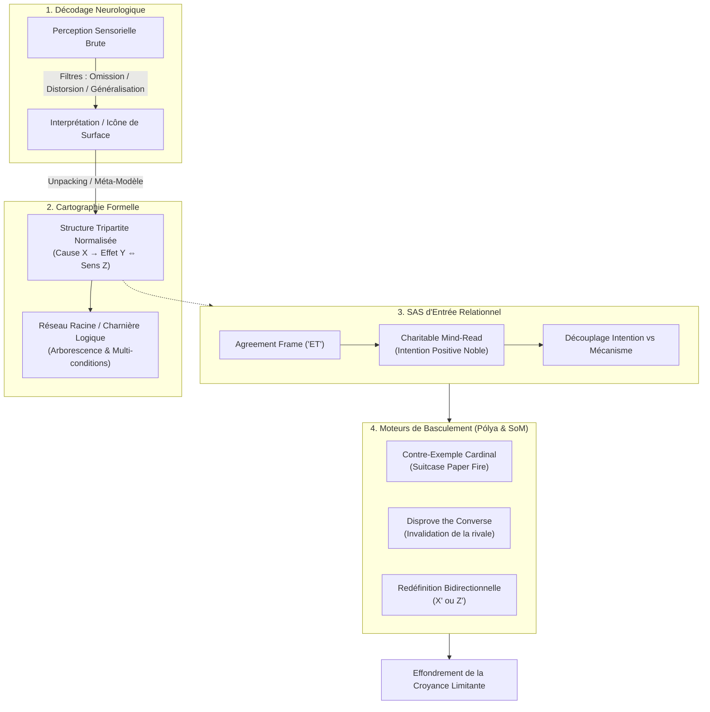

# Sleight of Mouth Compact Video Set - Medium CoreML Transcripts
**Formateur :** Doug O'Brien | **ID :** `doug-obrien-sleight-of-mouth-compact-video-set-medium-coreml-transcripts` | **Tranches :** 15

## Synthèse Architecturale du Cours : Sleight of Mouth (Doug O'Brien)

---

### 1. Thèse Centrale & Philosophie du Cours

#### Vision spécifique de Doug O'Brien & Différences avec l'approche standard
* **Du catalogue rhétorique au réflexe somato-moteur :** L'approche standard (notamment celle issue de Robert Dilts) traite souvent le *Sleight of Mouth* (SoM) comme une grille de 14 catégories intellectuelles ou linguistiques abstraites, souvent mémorisées sous forme de listes analytiques. Doug O'Brien repense l'apprentissage comme un **conditionnement moteur et spatial** : les patterns sont ancrés proprioceptivement (points dans l'espace, micro-ancres digitales sur les phalanges de l'homoncule de Penfield, schéma corporel).
* **Parsimonie et refus du « Bump Stock » :** Contrairement à la pratique populaire consistant à mitrailler un interlocuteur avec les 14 patterns jusqu'à épuisement argumentatif (*« bump stock »* / tir de dispersion), O'Brien impose l'**élégance mathématique** : obtenir le basculement avec le plus petit nombre de variables ($1$ ou $2$ recadrages chirurgicaux).
* **Unification computationnelle de la croyance :** Là où la PNL classique sépare hermétiquement la relation *Cause-Effet* ($X \to Y$) de l'*Équivalence Complexe* ($X = Y$), O'Brien (en convergence avec les travaux d'ingénierie cognitive d'Altfeld) unifie la structure en une chaîne triadique unique : **$\text{Cause} \to \text{Effet} \iff \text{Signification}$ ($X \to Y \implies Z$)**.
* **Perspectivisme sans réactance (Analogie de la valise) :** Une croyance n'est ni fausse ni à détruire ; elle est l'observation exacte d'une face d'un objet tridimensionnel depuis une coordonnée spatiale donnée. L'intervention ne confronte jamais le client (ce qui déclencherait l'arc réflexe d'opposition somatique), mais l'invite à pivoter vers un nouvel angle de vue.

#### Fil rouge méthodologique
Le fil conducteur unifiant l'ensemble du cours suit une chaîne opératoire rigoureuse :
1. **Géolocalisation & Décompression (*Unpacking*) :** Ne jamais recadrer une icône de surface (« Je n'ai pas confiance »), mais forcer l'extraction de la structure normalisée $X \to Y \implies Z$ via le méta-modèle.
2. **Pacification Amygdalienne & Cadre d'accord (*Agreement Frame*) :** Neutralisation du réflexe d'opposition par l'usage exclusif du connecteur additif (*« Et »*) combiné à une **lecture de pensée bienveillante (*Charitable Mind-Read*)** qui isole et sanctifie l'intention positive.
3. **Pivots Chirurgicaux & Inférence Plausible (Modèle de Pólya) :** Injection d'un recadrage ciblé (Redéfinition, Contre-exemple cardinal, ou Réfutation de la concurrente) exploitant les heuristiques de plausibilité pour faire s'effondrer l'équation limitante sans lutte d'ego.

---

### 2. Carte des Concepts & Leviers Émergents



#### A. Architecture de la Croyance & Cartographie Épistémique
* **Découplage Perception vs Interprétation :** Distinction fondamentale entre stimuli bruts (captés fidèlement par les récepteurs) et l'inférence sélective du système nerveux. La croyance est traitée comme une lentille locale, non comme un fait.
* **L'Économie des Icônes :** Tendance du cerveau à compacter des agrégats expérientiels complexes sous forme d'étiquettes verbales simplifiées.
* **Structure Normalisée Tripartite ($X \to Y \implies Z$) :** Modèle computationnel unifié intégrant la cause déclenchante ($X$), l'effet observable ($Y$) et la valeur terminale limbique / équivalence identitaire ($Z$).
* **Conditionnalité Conjonctive ($A \land B \to C$) :** Prise en compte des équations à facteurs multiples pour éviter d'attaquer une variable non déterminante.
* **Arborescence en Réseau (*Belief System Root Network*) :** Chaînage récursif où le sens d'une croyance sert de prémisse causale à la suivante ; nécessité d'isoler la racine pour éviter l'effet de rebond.
* **Attribution Émotionnelle Court-Circuitante (*Short Meanings*) :** Identification du terme terminal ($Z$), généralement un mot archaïque court et hautement chargé émotionnellement (ex: « liberté », « sécurité »), qui pilote l'ensemble de la structure.

#### B. Ergonomie Relationnelle & Neutralisation de la Résistance
* **Analogie de la Valise au centre du cercle :** Postulat phénoménologique accordant une validité totale à la perception du sujet depuis sa coordonnée spatiale, éliminant d'emblée la réactance.
* **Réflexe d'Opposition Somatique vs Aïkido Linguistique :** Constat que toute force directe (ex: le mot « Mais ») active une résistance musculo-squelettique et neuronale ; remplacement systématique par l'addition (« Et »).
* **Point d'Appui Procédural (*Procedural Foothold*) :** Réduction de la surcharge cognitive du praticien par une séquence d'entrée standardisée (Accord $\to$ Intention).
* **Lecture de Pensée Bienveillante (*Charitable Mind-Read*) :** Attribution stratégique d'une intention protectrice ou moralement élevée, ouvrant l'accès au système de croyances par validation narcissique.
* **Géolocalisation Cognitive (*Mojave Desert Protocol*) :** Principe interdisant tout mouvement de guidage avant d'avoir rigoureusement calibré le point zéro sensoriel du client.

#### C. Heuristiques d'Inférence & Leviers de Basculement (Pólya)
* **Seuil d'Inférence Plausible :** Bascule métabolique où le cerveau, face à une accumulation d'indices suffisants, cesse son examen critique et décrète la règle comme « vraie ».
* **Validation Rétroactive par l'Invraisemblable :** Effet de choc cognitif (ex. marche sur le feu) forçant le système nerveux à valider rétrospectivement tout le système de croyance associé.
* **Effacement par Contre-Exemple Cardinal (*Suitcase Paper Fire*) :** Vulnérabilité des constructions logiques complexes : une unique anomalie irréfutable contamine et brûle tout le système d'étayage.
* **Réfutation de la Concurrente (*Disprove the Converse*) :** Biais comparatif où l'invalidation d'une alternative rivale augmente mécaniquement la crédibilité de la proposition centrale sans démonstration directe.
* **Redéfinition Bidirectionnelle (*Redefine*) :** Glissement sémantique ciblé remplaçant la cause ($X \to X'$) ou le sens ($Z \to Z'$) par un terme adjacent ouvrant une bifurcation cognitive.

#### D. Neuro-Pédagogie & Intégration Somato-Sensorielle
* **Ancrage Spatial et Proprioceptif :** Encodage des patterns dans l'espace physique pour court-circuiter l'analyse verbale et garantir un rappel réflexe.
* **Ancrage Somato-Kinesthésique Haute Résolution :** Utilisation de l'homoncule de Penfield (pulpes et plis des doigts) comme micro-ancres tactiles pour les catégories logiques.
* **Conditionnement Pavlovien Rapide :** Exploitation de la capacité prédictive du cortex à coupler stimuli et réponses en 2 à 3 itérations.
* **Modélisation Implicite par Imprégnation :** Assimilation du timing et de la flexibilité par résonance motrice (neurones miroirs) avant toute décomposition théorique.

---

### 3. Tableau Récapitulatif des Techniques & Démonstrations

| Technique / Exercice | Objectif Opératoire | Déclencheur / Indication | Séquence Résumée |
|---|---|---|---|
| **Encodage Spatial & Proprioceptif (Intent & Consequence)** | Automatiser l'accès réflexe aux directions temporelles et conceptuelles sans charge mentale. | Début d'apprentissage ; saturation de la mémoire de travail face aux 14 patterns. | 1. Associer physiquement une posture/direction spatiale à l'Intention (vers l'origine/amont) et à la Conséquence (vers l'aval).<br/>2. Répétition gestuelle rythmée sous conditionnement rapide.<br/>3. Test d'activation réflexe sans analyse consciente. |
| **Aïkido Conversationnel & Agreement Frame** | Neutraliser le réflexe d'opposition somatique et désactiver l'alerte amygdalienne. | Présence d'objections fermées, de rigidité corporelle ou d'utilisation du connecteur d'opposition (*« Mais »*). | 1. Éliminer tout « mais », « cependant » ou réfutation.<br/>2. Valider formellement la perspective du sujet depuis sa coordonnée spatiale.<br/>3. Raccorder la redirection via la conjonction additive *« Et… »* pour guider le mouvement perceptuel sans rupture. |
| **Mojave Desert Protocol (Unpacking de croyance)** | Cartographier les coordonnées exactes du point de départ avant toute tentative de recadrage. | Énoncé d'une croyance sous forme d'icône compactée (« Je suis bloqué », « X est malhonnête »). | 1. Isoler l'affirmation de surface.<br/>2. Questionner les verbes sous-spécifiés et nominalisations pour fracturer la compression.<br/>3. Extraire explicitement les coordonnées de l'équation $X \to Y \implies Z$. |
| **Charitable Mind-Read (Portail d'Entrée SoM)** | Ouvrir une brèche d'acceptation immédiate en valorisant l'identité pour dissocier intention et comportement. | Résistance identitaire ; sujet campé sur une défense morale ou sécuritaire de son symptôme. | 1. Formuler une lecture de pensée affirmant une intention noble/protectrice (*« Je sais que ton intention est de préserver ton intégrité… »*).<br/>2. Observer le relâchement somatique du sujet.<br/>3. Insérer le pivot opératoire : *« …et ce comportement précis ne produit pas ce résultat »*. |
| **Suitcase Paper Fire (Contre-Exemple Cardinal)** | Provoquer l'effondrement systémique d'une croyance soutenue par une accumulation massive de preuves rationnelles. | Croyance logique hyper-étayée se prétendant universelle (« Toutes les personnes de type X font Y »). | 1. Cartographier l'ensemble des éléments étayant la valise.<br/>2. Isoler un cas empirique unique, indéniable et validé par le client dérogeant à la règle.<br/>3. Laisser l'anomalie contaminer logiquement l'ensemble de la chaîne de preuves jusqu'à effondrement du modèle. |
| **Disprove the Converse (Pólya)** | Augmenter la plausibilité d'une direction de recadrage en éliminant l'alternative concurrente. | Client hésitant entre deux interprétations ou s'accrochant à une hypothèse rivale bloquante. | 1. Identifier la thèse rivale ($C$) qui empêche l'adoption du recadrage ($B$).<br/>2. Attaquer et décrédibiliser la cohérence ou les faits sous-tendant la thèse $C$.<br/>3. Exploiter le vide cognitif créé : le système nerveux adopte $B$ par contraste sans exiger sa preuve absolue. |
| **Micro-Ancrage Digital (Homoncule de Penfield)** | Créer un clavier tactile réflexe pour naviguer dans les distinctions du Méta-Modèle et du SoM. | Besoin d'accéder aux distinctions linguistiques en temps réel sous pression conversationnelle. | 1. Définir des plis cutanés ou phalanges spécifiques pour chaque catégorie d'analyse.<br/>2. Stimuler kinesthésiquement le point cutané précis lors de l'évocation de la catégorie.<br/>3. Répéter jusqu'à obtention d'un arc réflexe tactile déclenchant l'analyse sans recherche sémantique. |
| **Redéfinition Bidirectionnelle (Redefine Pattern)** | Opérer une bifurcation cognitive chirurgicale sur les nœuds du syllogisme de la croyance. | Identification claire des termes $X$ (Cause) ou $Y/Z$ (Effet/Sens) dans l'équation normalisée. | 1. Repérer le terme focal limitant dans l'équation client.<br/>2. Option A : Substituer la Cause (*« Ce n'est pas X, c'est X' »*).<br/>3. Option B : Substituer l'Effet ou le Sens (*« Cela ne veut pas dire Y, mais Y' »*).<br/>4. Calibrer le basculement instantané de la réponse somatique. |
| **Extraction de la Valeur Terminale (Short Meanings)** | Toucher le centre de commande émotionnel limbique pour court-circuiter l'argumentation de surface. | Client noyé dans des justifications rationnelles, techniques ou logistiques interminables. | 1. Remonter la chaîne des équivalences par itération méta-modèle (*« Et quand cela arrive, qu'est-ce que cela signifie pour toi ? »*).<br/>2. Poursuivre jusqu'à l'extraction d'un terme monosyllabique ou court, primitif et chargé somatiquement (ex. : *Free*, *Safe*).<br/>3. Appliquer l'intervention directement sur ce noyau émotionnel. |

---

---

## 0. Sommaire Sémantique & Index des Lignes

- **Tranche 1 [Lignes 123-269]** : Encodage spatial et proprioceptif des patterns fondamentaux (Intent & Consequence) — *Protocole :* Encodage spatial et proprioceptif des patterns fondamentaux (Intent & Consequence) | *Mécanisme :* Le découplage Perception vs Interprétation (La racine de la croyance) | *Verbatim :* Le cadrage de l'installation vs la pratique instrumentale
- **Tranche 2 [Lignes 271-396]** : Décompression de la Croyance Normalisée (Unpacking the Suitcase) — *Protocole :* Décompression de la Croyance Normalisée (Unpacking the Suitcase) | *Mécanisme :* Relativité perspective et déplacement spatial du cadre | *Verbatim :* La définition opératoire de Sleight of Mouth
- **Tranche 3 [Lignes 398-514]** : Séquence d'Attaque Standard SoM (Pour Sujet Procédural) — *Protocole :* Séquence d'Attaque Standard SoM (Pour Sujet Procédural) | *Mécanisme :* Le Point d'Appui Procédural (Procedural Foothold) | *Verbatim :* La Formule d'Attaque "Accord + Intention + Choix"
- **Tranche 4 [Lignes 516-673]** : Encodage et Réflexe du "Precision Model" sur la Main — *Protocole :* Encodage et Réflexe du "Precision Model" sur la Main | *Verbatim :* Pattern 1 : Déstabilisation de l'analogie fondatrice
- **Tranche 5 [Lignes 675-800]** : d'Élucidation et d'Alignement Structuré ("Unpacking the Belief") — *Protocole :* d'Élucidation et d'Alignement Structuré ("Unpacking the Belief") | *Verbatim :* La métaphore du "Bump Stock" et du Sniper
- **Tranche 6 [Lignes 802-933]** : A : Intégration Kinesthésique & Somatique de la Carte SOM — *Protocole :* A : Intégration Kinesthésique & Somatique de la Carte SOM
- **Tranche 7 [Lignes 935-1076]** : A : La Formule Algorithmique de Redéfinition ($X \rightarrow Z \rightarrow D$) — *Protocole :* A : La Formule Algorithmique de Redéfinition ($X \rightarrow Z \rightarrow D$)
- **Tranche 8 [Lignes 1078-1207]** : Séquence d'Éradication en 3 Paliers (Agreement -> Intent -> Consequence) — *Protocole :* Séquence d'Éradication en 3 Paliers (Agreement -> Intent -> Consequence)
- **Tranche 9 [Lignes 1209-1347]** : Le Déploiement Chirurgical du Pattern Métaphore / Analogie — *Protocole :* Le Déploiement Chirurgical du Pattern Métaphore / Analogie | *Mécanisme :* Le Levier Isomorphique & Bioneurologique du Récit : Le Pattern Métaphore / Analogie | *Verbatim :* La métaphore du dentiste (Vitesse vs Durée)
- **Tranche 10 [Lignes 1349-1466]** : d'Encodage & Intégration Kinesthésique Somatique (Somatosensory Pegboard) — *Protocole :* d'Encodage & Intégration Kinesthésique Somatique (Somatosensory Pegboard) | *Verbatim :* Verbatim 1 : Chunking Down & Avertissement de Cascade
- **Tranche 11 [Lignes 1468-1584]** : Le Jeu de Détection & Combat Secret de SoM en Triade (A/B/C) — *Protocole :* Le Jeu de Détection & Combat Secret de SoM en Triade (A/B/C) | *Verbatim :* La Parabole Cinématographique de Cabaret (Démonstration du Change Frame Size)
- **Tranche 12 [Lignes 1586-1726]** : Déploiement Chirurgical de l'Apply to Self sur Équivalence Complexe ou Causalité — *Protocole :* Déploiement Chirurgical de l'Apply to Self sur Équivalence Complexe ou Causalité | *Mécanisme :* Rétro-application Autoréférentielle et Rétorsion Logique (Apply to Self) | *Verbatim :* Le rythme suspensif sur l'Élargissement de Cadre
- **Tranche 13 [Lignes 1728-1917]** : Encodage Somatique et Visuo-Spatial des 14/16 Patterns (The Somatic Box Drill) — *Protocole :* Encodage Somatique et Visuo-Spatial des 14/16 Patterns (The Somatic Box Drill) | *Verbatim :* Application sur la croyance : « Too many responsibilities means I can't work out »
- **Tranche 14 [Lignes 1919-2072]** : Calibration de la Tonalité & Désarmement du Meta Frame — *Protocole :* Calibration de la Tonalité & Désarmement du Meta Frame | *Verbatim :* Le Recadrage Meta Frame à double valence tonale
- **Tranche 15 [Lignes 2074-2198]** : A : La Transe d'Intégration Neuro-Kinesthésique — *Protocole :* A : La Transe d'Intégration Neuro-Kinesthésique

---

## Extractions Détaillées par Tranche (Opératoire & Verbatim)

## Tranche 1 / 15 : Encodage spatial et proprioceptif des patterns fondamentaux (Intent & Consequence)

Voici la modélisation opératoire intégrale de la tranche 1/15 du cours de Doug O'Brien sur le *Sleight of Mouth*.

---

### 1. Mécanismes & Principes Actifs

#### A. Le découplage Perception vs Interprétation (La racine de la croyance)
* **Principe actif :** Une croyance n'est jamais le reflet direct des stimuli bruts captés par les organes sensoriels, mais le résultat des filtres neurologiques (sélection/suppression, distorsion, généralisation) appliqués à ces stimuli. Le cerveau traite une masse sensorielle ingérable sans filtres (ex. le bruit de fond, les bruits de chantiers ou les froissements de papier captés fidèlement par un microphone sans biais). Pour créer du sens et agir, le système nerveux opère une distorsion interprétative. Dès lors qu'une croyance est identifiée non pas comme un fait objectif (la « perception »), mais comme une lentille sélective locale (l'« interprétation »), elle perd son statut de vérité absolue et devient malléable sans confrontation directe.
* **Tags :** `#perception_vs_interpretation` `#filtres_neurologiques` `#omission_distorsion_generalisation` `#illusion_cognitive` `#relativite_du_point_de_vue`

#### B. L'ancrage multi-représentationnel spatial et somato-moteur
* **Principe actif :** L'encodage mnésique et la disponibilité réflexe (« on the fly ») d'un pattern complexe (les 14 patterns de Sleight of Mouth) ne peuvent pas reposer sur le simple stockage conceptuel ou linguistique auditif. En associant :
  1. Un terme/étiquette nominale (stimulus auditif digital agissant comme ancre linguistique),
  2. Un symbole graphique orienté (stimulus visuel : flèche vers le futur, flèche vers le passé),
  3. Un geste physique proprioceptif/moteur (tracer la forme à la main, étendre le bras gauche vers le passé pour l'intention, le bras droit vers le futur pour la conséquence),
  l'accès neurologique au pattern contourne l'effort d'analyse intellectuelle en créant un arc réflexe stimulus-réponse immédiat et kinesthésique.
* **Tags :** `#ancrage_spatial` `#ancrage_proprioceptif` `#encodage_multimodal` `#reflexe_stimulus_reponse` `#accessibilite_en_temps_reel`

#### C. L'apprentissage par conditionnement pavlovien rapide
* **Principe actif :** Contrairement à l'idée reçue voulant que le conditionnement requière des centaines d'itérations lentes, le système nerveux humain crée des couplages prédictifs extrêmement rapides (2 répétitions suffisent). Dès qu'un motif associatif est perçu, le cortex anticipe et hallucine le stimulus manquant (ex. entendre ou anticiper le son du sifflet lors d'une séquence répétée). Cette vélocité cérébrale permet de verrouiller les catégories de recadrage presque instantanément.
* **Tags :** `#conditionnement_rapide` `#fermeture_gestaltique` `#anticipation_neuronale` `#pattern_recognition`

#### D. L'analogie spatiale de la « Valise au centre du cercle » (Positionnement perspectiviste)
* **Principe actif :** Évitement de la réactance psychologique. Attaquer frontalement la croyance d'un sujet déclenche un réflexe de défense identitaire (« j'ai tort / tu as tort »). En postulant que la croyance du sujet est 100 % valide et exacte depuis sa coordonnée spatiale précise dans la pièce (sa face de la valise), le praticien supprime toute confrontation. Le recadrage Sleight of Mouth ne consiste pas à corriger une erreur, mais à inviter le sujet à marcher physiquement ou mentalement vers une autre coordonnée du cercle pour constater de lui-même ce qui devient visible depuis ce nouvel angle.
* **Tags :** `#defocalisation_spatiale` `#neutralisation_de_reactance` `#perspectivisme_phenomenologique` `#recadrage_sans_conflit`

---

### 2. Protocoles, Techniques & Démonstrations (Étape par Étape)

---

#### Protocole 1 : Encodage spatial et proprioceptif des patterns fondamentaux (Intent & Consequence)

* **Intention / Indication :** Installer dans la neurologie du praticien l'accès automatique et instantané aux directions temporelles et conceptuelles des patterns, sans charge mentale réflexive.
* **Mise en place & Pré-framing :**
  - Posture assise ou debout, bras libres.
  - Pré-frame : Ne pas essayer de mémoriser intellectuellement. Laisser le corps et les yeux faire l'association spatiale.
* **Séquence d'actions pas à pas :**
  1. **Ancrage du centre (La croyance brute) :**
     - Lever les deux mains devant soi, paumes vers l'avant, comme si l'on touchait deux carrés centraux représentant l'équation de la croyance : $A \text{ (cause)} \to B \text{ (effet)}$.
  2. **Projection spatiale de l'Intention (Passé / Origine) :**
     - Déplacer la main gauche latéralement vers la gauche pour toucher l'espace virtuel de l'« Intent Pattern » (flèche orientée vers le passé, vers l'amont de la croyance).
     - Ramener la main au centre.
  3. **Projection spatiale de la Conséquence (Futur / Effet) :**
     - Déplacer la main droite latéralement vers la droite pour toucher l'espace virtuel du « Consequence Pattern » (flèche orientée vers le futur, ce vers quoi mène la croyance dans le temps).
     - Ramener la main au centre.
  4. **Test en boucle aveugle (Vérification kinesthésique) :**
     - Fermer les yeux.
     - Commande : *« Touche le Consequence Pattern »* $\to$ Extension immédiate du bras droit vers la droite.
     - Commande : *« Reviens au centre »* $\to$ Retour au point neutre.
     - Commande : *« Touche l'Intent Pattern »* $\to$ Extension immédiate du bras gauche vers la gauche.
  5. **Verrouillage graphique kinesthésique :**
     - Tracer manuellement sur papier la grille des symboles. Le geste moteur du tracé de la flèche combiné à l'auto-dialogue audio-digital (*« Flèche vers l'arrière = Intention, flèche vers l'avant = Conséquence »*) ancre la structure dans les trois systèmes de représentation (V-A-K).
* **Signes de calibration :**
  - Fluidité du geste sans hésitation ni micro-mouvements de recherche cognitive (pas de regard vers le haut à gauche pour chercher une règle abstraite).
  - Synchronisation du geste et de l'accès au mot.

---

#### Protocole 2 : La Démonstration Perceptuelle « Copper / Silver » (Désynchronisation Perception / Interprétation)

* **Intention / Indication :** Démontrer in vivo au sujet qu'une certitude somatique ou sensorielle (« j'ai vu / j'ai senti ») peut être entièrement fabriquée par l'interprétation mentale et la focalisation d'attention induite.
* **Mise en place & Pré-framing :**
  - Choix d'un participant volontaire (ex. Connie).
  - Présentation de deux pièces distinctes : un demi-dollar américain (argent, plus grand) et un centavos mexicain (cuivre, plus petit).
  - Validation visuelle explicite des contrastes : taille, matière, couleur.
* **Séquence d'actions pas à pas :**
  1. **Calibration visuelle :** Faire constater que la petite pièce en cuivre peut se dissimuler entièrement derrière la grande pièce en argent.
  2. **Rupture de canal et détournement d'attention :**
     - Poser une question distractive mobilisant le système interne : *« Es-tu droitier ou gaucher ? »* (déplacement de l'attention vers l'identité motrice).
     - Masquer la pièce en cuivre derrière la pièce en argent.
  3. **Passage au canal kinesthésique exclusif :**
     - Transférer les pièces dans les mains du sujet hors de sa vue, puis lui ordonner : *« Ferme les yeux pour être sûre de ne te fier qu'au toucher »*.
     - Demander au sujet de séparer les pièces dans chaque main et de distinguer les textures/poids.
  4. **Création du piège d'interprétation :**
     - Demander au sujet : *« Rends-moi la petite pièce de cuivre mexicaine »*.
     - Le sujet tend la pièce qu'il *croit* être en cuivre.
  5. **Révélation du switch (Effondrement de certitude) :**
     - Ouvrir la main : la pièce de cuivre a disparu ou a été subtilisée en amont.
     - Calibrer le choc cognitif : le sujet certifie avoir pourtant vu ou senti du cuivre alors qu'il ne tenait que de l'argent.
* **Signes de calibration :**
  - Réaction d'incrédulité, rire nerveux ou sidération du sujet (*« Mais j'ai pourtant vu le brun du cuivre dans ma main ! »*).
  - Preuve directe que le cerveau hallucine la confirmation de son attente perceptuelle.

---

### 3. Heuristiques, Subtilités & "Sagesse du Praticien"

#### Heuristiques Opératoires ("Si... Alors...")
* **Si** le sujet formule une croyance limitante articulée sous la forme d'une cause à effet ($A \to B$) ou d'une équivalence complexe ($A = B$), **alors** ne discute jamais la véracité de sa conclusion ; déplace immédiatement son attention en amont sur ce qui motive la structure (l'Intention) ou en aval sur les effets de son maintien dans le temps (la Conséquence).
* **Si** tu veux installer un modèle ou un pattern chez un individu pour un usage fluide en direct, **alors** interdis le mode auditif pur ou passif ; force l'encodage kinesthésique simultané (tracé physique de la main, placement spatial des bras, vocalisation).
* **Si** tu t'apprêtes à recadrer un sujet, **alors** commence toujours par adopter son point de vue comme étant rigoureusement exact depuis sa position dans l'espace (Principe de la Valise), sans jamais déclarer qu'il a tort, afin d'éteindre sa réactance avant de lui faire contourner l'objet.
* **Si** un auditeur ou un client résiste à l'idée d'un changement rapide en croyant que l'apprentissage nécessite des mois de répétition lourde, **alors** utilise une démonstration d'anticipation réflexe (ex. le faux sifflet coupé au bout de deux boucles) pour lui prouver somatiquement que sa neurologie fait des liens prédictifs quasi-instantanés.

#### Pièges Classiques & Erreurs de Débutant
* **Le piège du « Magicien prétentieux » :** Utiliser le *Sleight of Mouth* comme un tour de passe-passe verbal pour coincer l'interlocuteur, le ridiculiser ou remporter une joute oratoire. Doug O'Brien insiste : le nom est trompeur. Il ne s'agit pas d'escroquer la personne, mais d'écouter la souffrance ou le blocage dans la formulation de sa croyance pour l'aider avec art à percevoir une alternative plus aidante.
* **L'illusion de l'installation magique :** Croire qu'écouter passivement une formation NLP installe miraculeusement des compétences dans le cerveau (*« I'm going to install this in your brain by the magic of NLP... sort of bullshit like that »*). Sans travail délibéré (pratique instrumentale répétée comme au piano, tracé de graphiques, génération active d'exemples), le savoir reste théorique et inutilisable sous pression conversationnelle.
* **Confondre Information et Capacité opératoire :** L'information conceptuelle tient en 2 heures d'audio ; la compétence motrice exige des gammes répétées jusqu'à ce que les 14 directions de recadrage deviennent des réflexes sensorimoteurs.

#### Postulats Fondamentaux de Doug O'Brien
1. *« Beliefs are everywhere »* : Il est impossible d'émettre une phrase dans le langage humain sans y intégrer des présuppositions et des croyances implicites, y compris dans les contextes perçus comme ultra-neutres (ex. le journal télévisé).
2. *« The brain works faster than you think »* : La neurologie crée des ancrages et des liens conditionnés à une vitesse fulgurante. Le praticien doit exploiter cette rapidité au lieu de sur-intellectualiser.
3. *« Nobody is wrong from their side of the circle »* : Dans un conflit de croyances, personne ne se trompe sur ce qu'il perçoit ; l'erreur réside uniquement dans l'illusion que son angle de vision couvre l'intégralité de l'objet.

---

### 4. Pépites Verbatim & Patterns Linguistiques (MOT À MOT EN V.O.)

#### Pépite 1 : Le cadrage de l'installation vs la pratique instrumentale
> "Far too many NLP trainings these days, I think, go towards, 'I'm going to be installing this into your brain by the magic of NLP,' or sort of bullshit like that. And it's not about installing it into your brain. It's about helping you to be able to have it in your brain and also bring it out into usage. So you can use it on the fly."
- **[Analyse du Pattern]** : **Rupture de cadre (Pattern Interrupt) et Recadrage d'Attente.** O'Brien brise l'hypohypothèse passive de l'illusion hypnotique (« l'installation inconsciente passive ») par une qualification crue (*« bullshit »*). Il utilise une antithèse (*« not about installing... about helping you... bring it out »*) combinée au prédicat idiomatique orienté action (*« on the fly »*) pour focaliser l'esprit du praticien sur l'automatisation motrice active.

---

#### Pépite 2 : L'équivalence causale de l'expertise (Recadrage de la fausse admiration)
> "I remember at my senior recital, this woman, my friend, my mother's friend came up and said, 'Oh, I would give anything to play like you.' I said, 'Really? Okay, well, here's what you do. You get yourself a good teacher. You practice eight hours a day for the next six years and you'll be fine.'"
- **[Analyse du Pattern]** : **Redéfinition par concrétisation de critères (Chunking Down / Redefine).** La locutrice utilise une généralisation floue et émotionnelle (*« I would give anything »*). O'Brien prend l'expression au pied de la lettre (redéfinition du mot *« anything »* en actions mesurables) en y associant une séquence temporelle rigide (*8 heures par jour, 6 ans*). Ce pattern désamorce instantanément la croyance limitante selon laquelle le talent est un don magique passif.

---

#### Pépite 3 : L'induction du tracé somatique multi-représentationnel
> "When you have to draw the arrow, guess what? It gets in there a lot deeper than just seeing it, because we have to physically draw it. So your body has to make that shape. It gets into your unconscious much deeper, because you kinesthetically have to draw it while you're visually seeing it, and you're talking to yourself, 'Oh, this is the consequence arrow pattern. I got it.' Right? You're getting in through all three of those major representational systems. It gets locked into your brain."
- **[Analyse du Pattern]** : **Empilement de truismes (Pacing) et Commande de liaison multi-sensorielle (V-A-K Overlap).** Utilisation de liens de cause à effet directs (*« because... so... because »*), d'une question rhétorique fermée (*« guess what? »*) et de citations internes dialogiques (*« Oh, this is the consequence arrow pattern »*). La syntaxe enchâsse la suggestion directe de profondeur d'intégration inconsciente (*« gets into your unconscious much deeper »*, *« locked into your brain »*) conditionnée par l'action motrice manuelle.

---

#### Pépite 4 : La définition opératoire du Sleight of Mouth
> "It's about listening to the way they formulate their beliefs, thinking about what's the problem with that belief and what would be a better belief for them to have, and then artfully guiding them to a new way of thinking. That's what sleight of mouth is all about. It's changing a belief system."
- **[Analyse du Pattern]** : **Modélisation algorithmique linéaire (Séquence cognitive).** Structuration d'une macro-stratégie en 4 temps opératoires continus : 
  1. Calibrage syntaxique (*« listening to the way they formulate »*), 
  2. Diagnostic écologique (*« what's the problem with that belief »*), 
  3. Sélection de la cible désirée (*« what would be a better belief »*), 
  4. Guidage élégant (*« artfully guiding them »*). 
  La formulation présuppose que le praticien est toujours en position d'écoute structurelle plutôt qu'en réaction au contenu émotionnel.

---

#### Pépite 5 : La métaphore spatiale du désaccord (Le modèle de la valise)
> "Who's right and who's wrong? Nobody. They're all right from their perspective, from their side of the circle, from their viewpoint. But if you got up and moved around the circle to different sides of the circle, different sides of the suitcase, you'd start to see some other things about it that you hadn't seen before. Right? Like Spider-Man's on the suitcase. Isn't that true? So suddenly your opinion would shift because you're seeing different things about it. Your belief would change because you're seeing it from a different perspective. That's what sleight of mouth is. It's not saying, 'I'm right, are you wrong?' It's like saying, 'I'm seeing it from this side of the circle, you're seeing it from this side of the circle, so why don't you come over here and look at it from here? You'll see it differently.'"
- **[Analyse du Pattern]** : **Recadrage de Modèle du Monde (Model of the World) par Spatialisation et Présupposition d'Évidence.** 
  - Utilisation d'une fausse alternative résolue par neutralisation (*« Who's right and who's wrong? Nobody. They're all right »*).
  - Ancrage kinesthésique d'un déplacement physique (*« got up and moved around the circle »*) qui métaphorise le changement d'opinion.
  - Question suggestive avec tag question (*« Isn't that true? »*) pour forcer l'accord cognitif.
  - Déconstruction de l'injonction conflictuelle (*« I'm right, you're wrong »*) remplacée par une invitation exploratoire non menaçante (*« why don't you come over here and look at it from here? »*), présupposant automatiquement que le changement de position produit une modification inévitable de la perception (*« You'll see it differently »*).

## Tranche 2 / 15 : Décompression de la Croyance Normalisée (Unpacking the Suitcase)

Voici l'extraction opératoire intégrale de la tranche 2/15 du cours de Doug O'Brien.

---

### 1. Mécanismes & Principes Actifs

#### A. Relativité perspective et déplacement spatial du cadre
* **Principe actif :** Une croyance n'est pas une vérité objective mais un point d'observation fixe face à un objet tridimensionnel (analogie de la valise au centre du cercle). Dès que le sujet change de positionnement physique ou perceptuel, les propriétés perçues de l'objet changent mécaniquement (ex: voir Spider-Man sur une face cachée). L'inconscient ne lâche pas une croyance sous la contradiction ; il l'élargit naturellement lorsqu'une nouvelle perspective spatiale lui fournit des données sensorielles supplémentaires.
* **Tags :** `#perspective_spatiale #relativite_perceptuelle #recadrage_sans_opposition #sleight_of_mouth_nature`

#### B. Réflexe d'opposition somatique vs. Aïkido conversationnel
* **Principe actif :** Toute force directe appliquée sur le système nerveux ou l'appareil cognitif d'un individu déclenche un arc réflexe somatique et psychologique de poussée inverse (loi d'action-réaction motrice et psychologique démontrée avec Jim). Utiliser le mot *"Mais"* (*"But"*) réinitialise et efface cognitivement tout ce qui précède, créant une collision frontale d'egos. À l'inverse, l'utilisation du connecteur d'addition *"Et"* (*"And"*) couplé à une validation formelle désactive l'amygdale, supprime la résistance musculo-squelettique et convertit l'affrontement en une trajectoire commune (« danser bras dessus bras dessous »).
* **Tags :** `#aikido_linguistique #reflexe_d_opposition #inhibition_amygdalienne #agreement_frame #conjonction_additive`

#### C. L'Économie des Icônes vs. Décompression de la Valise (Structure Normalisée de Croyance)
* **Principe actif :** Le cerveau fonctionne par compression sémiotique pour économiser ses ressources : il plaque une étiquette de surface ou une icône de bureau (ex: *"Spider-Man existe"*, *"Je n'ai pas confiance en moi"*, *"Bob est honnête"*) sur un agrégat chaotique d'expériences, de traumas, de préjugés et d'images internes. Intervenir sur l'icône de surface est inopérant. Le levier consiste à forcer la décompression de l'archive mentale en isolant l'équation universelle tripartite : 
  $$\text{Si [Déclencheur sensoriel / Perceptive Cause]} \longrightarrow \text{Alors [Effet physiologique / Comportemental]} \longrightarrow \text{Ça veut dire [Interprétation / Équivalence Complexe / Identité]}$$
* **Tags :** `#structure_de_croyance_normalisee #si_alors_veut_dire #decompression_semantique #icones_cognitives #cause_effet_equivalence`

#### D. Géolocalisation cognitive (Mojave Desert Protocol)
* **Principe actif :** On ne peut pas guider un individu vers une nouvelle destination sans avoir précisément calibré ses coordonnées de départ. Si l'on tente de persuader ou de modifier une croyance sans en avoir cartographié le contenu interne exact, le sujet reste bloqué dans son territoire d'origine. Poser des questions de décompression sert exclusivement à situer la position de départ.
* **Tags :** `#geolocalisation_mentale #calibration_du_point_zero #cartographie_avant_guidage`

#### E. Mind Read stratégique & Imputation d'Intention Positive
* **Principe actif :** L'esprit humain accepte volontiers une lecture de pensée (*Mind Read*) si celle-ci lui attribue un statut moral élevé ou une intention protectrice/sécuritaire (même totalement inventée par le praticien). En fusionnant le cadre d'accord avec l'attribution d'une intention vertueuse (*"I know your intention is to..."*), on crée un pont d'accès immédiat et non menaçant pour réorganiser la croyance.
* **Tags :** `#mind_read_vertueux #intention_positive #portail_d_entree_som`

---

### 2. Protocoles, Techniques & Démonstrations (Étape par Étape)

---

#### Protocole 1 : Décompression de la Croyance Normalisée (Unpacking the Suitcase)
* **Intention / Indication :** Quand le sujet exprime une croyance nominalisée, floue ou réductrice (*"Je n'ai pas confiance en moi"*, *"X est mauvais"*, *"C'est impossible"*).
* **Mise en place & Pré-framing :** Poser le cadre qu'on ne cherche pas à modifier ni à invalider la croyance, mais simplement à regarder comment elle est rangée dans la boîte.
* **Séquence opératoire :**
  1. **Capture de l'icône :** Isoler la déclaration brute du sujet (ex: *"I'm not confident"*).
  2. **Interrogation du canal de vérification (VAKOG) :** 
     * Praticien : *"How do you know that [X]?"*
     * Sujet : Révèle l'accès interne (ex: *"I feel it"*).
  3. **Identification du déclencheur contextuel ("SI") :**
     * Praticien : *"When do you feel it?"*
     * Sujet : Donne le contexte spatial/humain (ex: *"When I'm around people"*).
  4. **Extraction de l'effet somatique / kinésthésique ("ALORS") :**
     * Praticien : *"So if you're around people, then you feel what? Doubt? Fear?"*
     * Sujet : Précise l'état interne (ex: *"Anxiety"*).
  5. **Verrouillage de l'équivalence complexe ("CELA VEUT DIRE") :**
     * Praticien : *"Okay, so if you're around people, then you feel anxiety, and that means you have no confidence?"*
     * Sujet : Confirme l'équation complète (ex: *"Yes"*).
* **Signes de calibration :** Le sujet passe d'une posture de défense théorique à un accès kinesthésique interne (regard vers le bas, respiration ralentie, hochement de tête approbateur signalant qu'il se sent entendu dans la structure exacte de son expérience).

---

#### Protocole 2 : L'Exercice du Cadre d'Accord (The Agreement Frame Drill)
* **Intention / Indication :** Entraînement au reconditionnement neuro-linguistique pour éliminer les heurts conversationnels et maintenir le rapport en situation de désaccord polarisé (vente, débat, thérapie).
* **Mise en place & Pré-framing :** Deux partenaires choisissent un sujet clivant (ex: armes à feu, localisation idéale). Interdiction absolue d'employer *"Mais"* (*"But"*) ou ses déguisements (*"However"* / *"Cependant"*). Règle de feedforward radical : si l'un prononce *"But"*, le partenaire se lève immédiatement en levant les bras et crie publiquement l'infraction.
* **Séquence opératoire :**
  1. Le partenaire A défend une position radicale (ex: *"Toutes les armes doivent être éliminées"*).
  2. Le partenaire B s'interdit de repousser. Il applique l'un des trois niveaux d'accueil :
     * **Niveau 1 (Accord direct sur un point ou un fait) :** *"I agree..."*
     * **Niveau 2 (Appréciation d'un aspect/effet) :** *"I appreciate..."*
     * **Niveau 3 (Respect de l'intention / de la posture) :** *"I respect..."*
  3. Le partenaire B remonte en découpage d'abstraction (*Chunk up*) pour trouver la valeur ou l'intention commune sous-jacente (ex: la sécurité, l'attachement aux racines).
  4. Le partenaire B enchaîne obligatoirement avec la conjonction additive : **"...AND..."**.
  5. Le partenaire B déroule son contre-argument ou perspective alternative exactement comme s'il s'agissait de l'étape suivante de la même promenade mentale.
  6. Échange des rôles à 4 minutes.
* **Signes de calibration :** Absence de tension aux épaules, voix posée, disparition des interruptions hâtives, transition d'un état de combat à un état d'écoute active réelle.

---

#### Protocole 3 : La Séquence Procédurale de Sécurité (Default Entry Gate)
* **Intention / Indication :** Destinée au praticien débutant submergé par la multiplicité des 14 patterns de Sleight of Mouth. Fournit un marchepied algorithmique fixe et infaillible.
* **Mise en place & Pré-framing :** Cadrer l'esprit sur une séquence d'étapes linéaires (A $\rightarrow$ B).
* **Séquence opératoire :**
  * **Étape 1 :** Déployer l'Agreement Frame (*"I agree / I respect / I appreciate [X] and..."*).
  * **Étape 2 :** Enchaîner immédiatement sur le pattern de l'Intention (*Intent Pattern*) sous forme de Mind Read valorisant (*"I know your intention is to [Intention Positive]*").
* **Signes de calibration :** Chute instantanée du tonus défensif chez l'interlocuteur, qui se sent compris au niveau de ses motivations les plus nobles.

---

### 3. Heuristiques, Subtilités & "Sagesse du Praticien"

#### Règles conditionnelles directes
* **RÈGLE DU DÉCOUPAGE VERS LE HAUT EN CAS DE BLOCAGE TOTAL :**
  * *Si* vous êtes en désaccord à 99% avec une position extrême (ex: partisans pro-armes vs anti-armes),
  * *Alors* montez en niveau d'abstraction (*Chunk up*) vers l'intention ou la valeur sous-jacente (ex: la recherche de sécurité, la préservation des vies),
  * *Parce que* deux êtres humains ne peuvent pas s'opposer au niveau des méta-valeurs universelles ; le désaccord ne porte que sur les moyens d'y parvenir.
* **RÈGLE DE SUBSTITUTION PURE DU CONNECTEUR :**
  * *Si* vous avez envie de dire *"Mais..."*,
  * *Alors* remplacez-le mot à mot par *"Et..."* sans modifier le reste de votre phrase,
  * *Parce que* tout le contenu sémantique peut être formulé à l'identique sans activer les barrières de défense du système nerveux.
* **RÈGLE DE DIFFÉRENCIATION EXPLORATION VS PATTERN :**
  * *Si* vous décompressez une croyance (*Unpacking*), vous devez être rigoureusement factuel et écouter ce qui est réellement présent dans la valise (sans présumer).
  * *Si* vous utilisez le pattern d'Intention (*Intent*), vous pouvez librement inventer et lire dans les pensées (*Mind Read*), pourvu que vous attribuiez une intention hautement honorable.

#### Pièges classiques & Erreurs de débutant
* **Le piège du "Cependant" (*The Big Fluffy But*) :** Remplacer *"Mais"* par des substituts polis comme *"Cependant"* ou *"Néanmoins"*. Doug O'Brien rappelle que c'est simplement un *"gros mais déguisé"* ; le système nerveux de l'auditeur le traite exactement avec le même rejet négatif.
* **Le piège de la précipitation persuasive :** Vouloir vendre, convaincre ou appliquer un Sleight of Mouth dès la première phrase sans avoir exploré la structure interne de l'interlocuteur (l'erreur du vendeur qui crie *"Achetez ceci !"* sans savoir où se trouve le client).
* **L'illusion de la croyance unitaire :** Penser qu'une croyance se résume à son étiquette verbale. Une étiquette verbale n'est que la poignée de la valise ; tant qu'on n'a pas sorti les *"vieilles chaussettes mitées"* ou les *"traumas et préjugés"*, on discute avec du vide.

---

### 4. Pépites Verbatim & Patterns Linguistiques (MOT À MOT EN V.O.)

#### Pépite 1 : La définition opératoire de Sleight of Mouth
> "That's what sleight of mouth is. It's not saying, 'I'm right, are you wrong?' It's like saying, 'I'm seeing it from this side of the circle, you're seeing it from this side of the circle, so why don't you come over here and look at it from here? You'll see it differently.'"
* **[Analyse du Pattern] :** **Recadrage d'analogie spatiale et invitation kinesthésique.** Doug O'Brien neutralise le cadre conflictuel binaire (Vrai/Faux) en transformant une divergence d'opinions en deux coordonnées géométriques distinctes autour d'un même centre. L'injonction adoucie sous forme de fausse question (*"why don't you come over here..."*) contourne la réactance psychologique en proposant une simple expérience perceptuelle transitoire.

#### Pépite 2 : Déconstruction de la croyance d'incompétence de Rob
> "So if you're around people, then you feel anxiety, and that means you have no confidence?"
* **[Analyse du Pattern] :** **Formulation de la Structure Normalisée de Croyance (Cause-Effet vers Équivalence Complexe).** Doug capture les fragments épars livrés par le sujet et les réassemble dans une syntaxe d'acier : `Si [X: environnement externe/personnes]` $\rightarrow$ `Alors [Y: réponse somatique/anxiété]` $\rightarrow$ `Cela veut dire [Z: étiquette identitaire négative]`. Ce miroir linguistique rend instantanément visible au sujet la nature construite et arbitraire de sa propre conclusion interne.

#### Pépite 3 : Le connecteur d'accord en contexte de désaccord géographique
> "What if I said, yeah, Cleveland is great. I love the Rock and Roll Museum. Lake Erie, you don't get any better lakes than that. And New York also has basketball teams that occasionally win. Makes it more interesting, however, when you don't know. And they've got the ocean right here. And so we begin to say yes and. So I'm agreeing. So we're not conflicted. We're sort of on the same side."
* **[Analyse du Pattern] :** **Pacing and Leading par empilement de truismes et conjonction additive continue.** Doug valide d'abord massivement la réalité de l'autre (*Pacing* sensoriel : musée, lac), puis introduit sa propre réalité (*Leading*) par une suite de conjonctions d'addition (*"And New York also..."*, *"And they've got..."*). Le sujet est maintenu dans une posture neurologique d'assentiment où deux réalités s'additionnent au lieu de s'annihiler.

#### Pépite 4 : Chunking Up sur une impasse idéologique extrême (Contrôle des armes)
> "Yes, I agree that safety is important. And to create safety, let's look at it like this."
* **[Analyse du Pattern] :** **Élévation de découpage (Chunking up) vers une méta-valeur partagée.** En extrayant le prédicat commun fondamental (*"safety"*), Doug contourne l'objet de discorde (les fusils AR-15). L'accord porte sur la valeur nominalisée indiscutable, et la transition (*"And to create safety, let's look at it like this"*) présuppose que les deux interlocuteurs sont désormais alliés dans la même quête de résolution.

#### Pépite 5 : La matrice d'entrée séquentielle avec l'Intent Pattern
> "Start with the agreement frame and then lead to the intent... You say, 'I agree with you. I know your intention is to prevent false hope. I know your intention is to create harmony amongst peoples.'"
* **[Analyse du Pattern] :** **Mind Read valorisant doublé d'un cadrage d'intention bienveillante.** Doug insère une affirmation de télépathie bienveillante (*"I know your intention is to..."*). En attribuant à l'interlocuteur une motivation noble (préserver d'un faux espoir, créer l'harmonie), il désarme immédiatement l'agressivité du sujet, flatté au niveau de son identité morale, rendant le système nerveux perméable au recadrage qui suit.

## Tranche 3 / 15 : Séquence d'Attaque Standard SoM (Pour Sujet Procédural)

Voici l'extraction opératoire intégrale de la tranche 3/15 du séminaire de Doug O'Brien sur le *Sleight of Mouth*, modélisée sous forme de principes actifs, protocoles, heuristiques et analyses linguistiques.

---

### 1. Mécanismes & Principes Actifs

#### 1. Le Point d'Appui Procédural (Procedural Foothold)
* **Principe actif** : Face à une surcharge cognitive (14 patterns simultanés perçus comme ingérables), le système nerveux entre en freeze ou en confusion. L'esprit rationnel/analytique a besoin d'une structure séquentielle rigide ($A \to B \to C$) pour abaisser l'amygdale et mobiliser les ressources exécutives. En fournissant une séquence d'entrée standard (Cadre d'accord $\to$ Intention), on crée un ancrage de sécurité opératoire, même si le praticien sait que ce choix n'est qu'heuristique et contextuel.
* **Tags émergents** : #foothold_operatoire #reduction_surcharge_cognitive #amorcage_procedural #ancre_de_securite

#### 2. La Lecture de Pensée Bienveillante (Charitable Mind-Read)
* **Principe actif** : Attribuer une intention positive noble ou protectrice au sujet avant de recadrer son comportement. Contrairement au dévoilement neutre de la croyance (*unpacking*), l'intention dans le *Sleight of Mouth* opère par présupposition bienveillante. Le cerveau du sujet accepte le postulat valorisant (validation de l'ego/sécurité identitaire), ce qui ouvre immédiatement une brèche cognitive permettant de séparer l'intention du mécanisme opératoire défaillant (*"ce que tu fais n'accomplit pas ce que tu veux"*).
* **Tags émergents** : #mind_read_bienveillant #decouplage_intention_comportement #validation_ego #breche_d_accord

#### 3. Le Seuil d'Inférence Plausible (Polya Plausible Inference Threshold)
* **Principe actif** : Modélisé d'après George Pólya (Princeton). Une croyance ne s'installe pas par démonstration mathématique absolue, mais par accumulation d'indices qui dépassent un seuil critique de plausibilité. Une fois le seuil franchi, le cerveau bascule en mode économie d'énergie métabolique : il décrète la proposition comme "vraie" et éteint l'évaluation critique. D'un point de vue évolutif, la croyance est un raccourci cognitif qui dispense le système nerveux de réexaminer constamment l'environnement (ex: la solidité du plancher).
* **Tags émergents** : #economie_metabolique_cognitive #seuil_de_plausibilite #accumulation_d_indices #cloture_epistemique

#### 4. La Validation Rétroactive de Causalité par l'Invraisemblable
* **Principe actif** (Corollaire Pólya 1B) : Lorsqu'un événement hautement improbable se produit (ex: marcher sur des braises sans se brûler), le système nerveux subit un choc de réalité. Pour restaurer la cohérence interne, l'esprit valide rétrospectivement l'ensemble de la chaîne de croyances cause-effet (*If-Then*) qui a annoncé ou accompagné cet événement, y compris les généralisations massives associées (*"Si j'ai fait ça, je peux tout réussir"*).
* **Tags émergents** : #rupture_de_vraisemblance #ancrage_de_percée #validation_retroactive #surextension_de_pouvoir

#### 5. L'Effacement par Contre-Exemple Cardinal (Suitcase Paper Fire)
* **Principe actif** : La résistance d'une croyance varie selon sa structure d'étayage. Une croyance rationnelle soutenue par de multiples preuves accumulées (la "valise pleine de dossiers") paraît plus robuste qu'un dogme aveugle (la "paire de chaussettes"). Cependant, parce qu'elle repose sur la logique, la présentation d'une seule anomalie factuelle indiscutable et acceptée (ex: affaire Sandusky) suffit à faire s'effondrer l'ensemble du système de preuves par contamination systémique.
* **Tags émergents** : #contre_exemple_cardinal #effondrement_systemique #pyrolyse_de_croyance #vulnerabilite_rationnelle

#### 6. Les 5 Méta-Patterns d'Inférence Plausible (George Pólya appliqué au SoM)
* **1. Fréquence d'occurrence ($N_{\text{occurrences}} / N_{\text{opportunités}}$)** : Plus un événement se répète, plus sa récurrence future est présupposée (base du conditionnement et de l'ancrage PNL).
* **2. Vérification de la conséquence ($B \implies C$, or $C$ est vrai $\therefore B$ devient plausible)** : Si la disparition du symptôme (mal de tête) était annoncée par le modèle théorique (méridiens d'acupuncture), la validation du résultat rend le modèle théorique crédible dans l'esprit du sujet, faute d'autre explication perçue.
* **3. Contingence / Précondition ($B$ exige $C$, or $C$ est vérifié $\therefore B$ devient plausible)** : Prouver l'existence d'une condition préalable hautement improbable à l'état naturel (ex: achat de dynamite par une institutrice) rend la conclusion criminelle quasi-certaine pour un jury.
* **4. Inférence par Analogie ($B$ est analogue à $A$, or $A$ est valide $\therefore B$ est crédible)** : Utiliser un modèle familier et fonctionnel (ex: l'ordinateur) pour conceptualiser un système obscur (le cerveau humain). L'analogie n'a pas besoin d'être littéralement exacte ; sa conformité approximative suffit à installer des opérations d'ingénierie mentale (input $\to$ processing $\to$ output).
* **5. Disqualification de la rivale ($B$ est en compétition avec $C$, or $C$ est invalidé $\therefore B$ gagne en plausibilité)** : Réduire les options et abattre la thèse adverse pour faire triompher la sienne par élimination.
* **Tags émergents** : #polya_patterns #mecanique_d_inference #consequence_validee #contingence_prealable #analogie_operatoire #disqualification_concurrente

---

### 2. Protocoles, Techniques & Démonstrations (Étape par Étape)

#### Protocole 1 : Séquence d'Attaque Standard SoM (Pour Sujet Procédural)
* **Intention / Indication** : À déclencher impérativement lorsque le praticien ou le client est submergé par la multitude des 14 patterns et se bloque en analyse-paralysie.
* **Mise en place & Pré-framing** : Cadrer l'exercice comme une procédure linéaire stricte ($A \to B \to C$) pour rassurer le cortex préfrontal.
* **Séquence pas à pas** :
  1. **Déballage de la Croyance (*Unpacking*)** : Écouter pour localiser la position exacte du sujet dans la carte du monde (*"où est-il dans le désert des Mojaves"*), sans supposer ni projeter. Formater la croyance sous sa structure canonique : Cause-Effet (*If-Then*) ou Équivalence Complexe (*X means Y*).
  2. **Cadre d'Accord (*Agreement Frame*)** : Valider l'état du sujet sans valider le contenu limitant de la croyance (ex: *"Je suis d'accord avec le fait que..."*, *"J'apprécie et..."* en bannissant formellement le mot "Mais").
  3. **Application du Pattern d'Intention (*Intent Pattern*)** : Formuler une lecture de pensée valorisante sur l'objectif sous-jacent du sujet (ex: préserver la paix, éviter une déception, maintenir la sécurité).
  4. **Séparation & Pivot Opératoire** : Souligner que son comportement ou sa croyance actuelle produit le résultat inverse de son intention noble, puis proposer une alternative concrète.
* **Signes de calibration** : Baisse du tonus musculaire (soulagement), hochement de tête involontaire sur l'accord et l'intention, relâchement respiratoire, suspension momentanée du discours défensif.

#### Protocole 2 : L'Installation de Causalité par l'Invraisemblable (Modèle Firewalk)
* **Intention / Indication** : Créer un saut paradigmatique chez le sujet en utilisant un exploit physique ou expérientiel contre-intuitif pour installer une croyance d'auto-efficacité globale.
* **Mise en place & Pré-framing** : Ériger un cadre explicatif *If-Then* rigide reliant une physiologie spécifique, un langage interne précis et l'évitement de la conséquence douloureuse.
* **Séquence pas à pas** :
  1. **Création du Conflit de Plausibilité** : Présenter une tâche reconnue comme destructrice/impossible (braises brûlantes = brûlure assurée).
  2. **Implantation du Protocole Psycho-Physiologique** :
     - Verrouiller l'accès visuel : yeux levés pour couper l'accès kinesthésique interne et inonder le canal visuel.
     - Saturation auditive : répéter en boucle une commande apaisante (*"cool moss, cool moss"*).
     - Démarche rythmée et résolue.
  3. **Enchâssement du Grand Postulat (*Meta-Belief Embedding*)** : Lier la réussite de l'action à l'identité et au potentiel futur : *"Si vous traversez ceci en appliquant cette structure, vous possédez le pouvoir personnel de surmonter n'importe quel obstacle dans votre vie."*
  4. **Passage à l'Acte & Révélation** : Le sujet traverse sans blessure.
  5. **Verrouillage Rétroactif** : Le choc de la non-brûlure force le cerveau à accepter l'ensemble des postulats associés qui ont prédit ce résultat.
* **Signes de calibration** : Yeux grands ouverts, rire de décharge ou sidération euphorique, vérification physique répétée (regarder sous ses pieds), assimilation instantanée du discours métaphorique.

---

### 3. Heuristiques, Subtilités & "Sagesse du Praticien"

1. **L'Impératif de la Communion avant la Persuasion** :
   * *Règle* : Si le sujet est en posture militante fermée (analogie du partisan avec sa pancarte / valise avec une paire de chaussettes), aucune argumentation logique ou motif SoM ne peut pénétrer.
   * *Action* : Ne pas débattre. Établir le *rapport* par l'écoute et l'accueil pur (analogie de l'homme noir convertissant les membres du KKK en les écoutant). La communication est une "communion", un contact partagé ; sans rapport, il n'y a que deux monologues qui se heurtent.
2. **Le Déballage Précède le Recadrage (*Ditch Digging*)** :
   * *Règle* : Ne jamais lancer de motifs de *Sleight of Mouth* à l'aveugle sans avoir extrait la structure exacte de la croyance.
   * *Action* : Creuser les fondations d'abord. Identifier précisément si la structure est un lien causal (*If... then...*) ou une signification (*X means Y*).
3. **Le Piège du Nombre de Motifs** :
   * *Règle* : Il faut souvent enchaîner plusieurs motifs SoM pour faire vaciller une croyance enracinée. Un seul pattern crée un doute ; la combinaison altère la plausibilité générale.
4. **Physiologie vs Intellect (Gestion de la Réserve Cognitive)** :
   * *Heuristique corporelle* : *"Le cerveau écoute la vessie et le fessier."* Aucune réorganisation de croyance n'est possible si l'inconfort physiologique sature l'attention. Rythmer l'apprentissage et le recadrage par des pauses régulières (toutes les 90 min).
5. **Doute vs Incrédulité** :
   * *Règle* : L'expression d'un doute par le sujet n'est pas un refus de croire, mais l'absence d'un volume suffisant de données plausibles selon ses filtres sensoriels (ex: ne pas voir les espaces entre les molécules). Répondre en modifiant le cadre perceptuel ou l'état de conscience, pas en insistant sur l'argument rejeté.

---

### 4. Pépites Verbatim & Patterns Linguistiques (MOT À MOT EN V.O.)

#### Pépite 1 : La Formule d'Attaque "Accord + Intention + Choix"
> *"Start with the agreement frame and then lead to the intent. That's the first pattern you're always going to do. [...] Say, 'I know your intention is to create harmony amongst peoples. And to do that, we need to do this, because what you are doing isn't doing that. What you want to do is this.' Give them another choice."*

* **[Analyse du Pattern]** :
  - **Cadre d'accord implicite** : Pré-cadrage pacificateur qui court-circuite le réflexe d'opposition.
  - **Lecture de pensée valorisante (*Mind-Read*)** : *"I know your intention is to create harmony..."* place le sujet dans l'obligation morale d'acquiescer pour préserver une image positive de lui-même.
  - **Dissociation paradoxale** : Découple l'intention louable du comportement néfaste (*"what you are doing isn't doing that"*).
  - **Double contrainte / Injection d'alternative** : *"What you want to do is this"* utilise une commande indirecte assertive qui se substitue au choix initial bloqué.

#### Pépite 2 : La Cadence Rétroactive du Firewalk
> *"You keep your eyes up and say cool moss, cool moss, cool moss to yourself, so you flood your auditory with images and sounds of something that's nice and cool... And if you can do that, then you can do anything you choose in your life. You can own your personal power. You can change the way you're thinking. You can do anything that you wanna do in life."*

* **[Analyse du Pattern]** :
  - **Empilement de truismes et saturation kinesthésique** : L'incantation répétitive (*"cool moss"*) combinée au blocage de l'accès oculaire sature la boucle phonologique et empêche l'émergence du dialogue interne d'anxiété.
  - **Généralisation trans-contextuelle majeure (*Cause-Effect Laddering*)** : Passer de la réussite d'un comportement moteur spécifique (marcher sur du charbon) à une capacité identitaire totale (*"you can do anything you choose in your life"*).
  - **Présupposition d'appropriation** : *"You can own your personal power"* présuppose que le pouvoir personnel est un objet préexistant qu'il suffit de revendiquer une fois la peur traversée.

#### Pépite 3 : L'Inférence par l'Absence d'Alternative Légitime (Contingence Judiciaire)
> *"Now, think about it. Why would the second grade teacher be buying dynamite? There is no earthly reason to. There's only one reason because she was gonna do what? Blow up the boat. So we can't prove that she did the boat blowing up, but we can prove she bought the dynamite and there is no more dynamite around. Like where did that dynamite go, Sheila? So pretty much, we can say Sheila's going to prison, right?"*

* **[Analyse du Pattern]** :
  - **Question rhétorique fermée** : *"Why would the second grade teacher be buying dynamite? There is no earthly reason to."* Elle supprime tout l'éventail des possibles pour contraindre l'auditoire à une explication unique.
  - **Contraste de rôle identitaire** : La mention de *"second grade teacher"* polarise la situation et rend l'acte de possession d'explosifs tellement incongru qu'il devient le point focal exclusif de la délibération.
  - **Fausse équivalence déductive** : Vérifier la précondition matérielle (achat de dynamite) est implicitement validé comme équivalent à la preuve de l'acte lui-même, forçant la conclusion par le simple vide créé par l'absence d'autre cause plausible.

#### Pépite 4 : La Justification Analytique de la Métaphore Informatique en PNL
> *"NLP, neurolinguistic programming, it says your brain is like a what? Computer. So if the brain is like a computer, then we can operate the computer in the same similar model. So we can think, okay, input, in, process it, input, you know, output, out. So what's that processing thing that takes place inside the computer? Change the program, you can get different results out. [...] It's not a great analogy, but it's good enough, close enough, that we can work with it from there."*

* **[Analyse du Pattern]** :
  - **Inférence par analogie opératoire** : La comparaison avec la machine structure la cognition du praticien et du client. Elle dépersonnalise le blocage psychologique (ce n'est pas "moi", c'est juste un "programme" défectueux).
  - **Présupposition de modularité** : Présuppose que la pensée humaine est composée d'entrées, d'un processeur et de sorties, et que l'algorithme est substituable à volonté.
  - **Clôture pragmatique (*Good Enough Frame*)** : Reconnaître lucidement les limites de l'analogie tout en la verrouillant par son efficacité pratique (*"close enough that we can work with it"*), empêchant ainsi la contestation théorique stérile.

## Tranche 4 / 15 : Encodage et Réflexe du "Precision Model" sur la Main

### 1. Mécanismes & Principes Actifs

- **Réfutation de la proposition réciproque / concurrente (*Disprove the Converse*)** :
  - *Principe actif* : Ce mécanisme repose sur un biais logique et perceptif formalisé à l'origine par George Pólya : la plausibilité perçue d'une conjecture ou d'une croyance $B$ augmente automatiquement dès lors qu'une conjecture rivale ou concurrente $C$ est invalidée ou décrédibilisée ($B \text{ versus } C \implies \neg C \implies P(B) \uparrow$). Au niveau neuro-cognitif, l'attention humaine fonctionne par contraste comparatif plutôt que par évaluation absolue. En politique (campagnes de dénigrement / *mud-slinging*) comme en persuasion conversationnelle, détruire la crédibilité de l'alternative crée un vide cognitif que l'autre thèse remplit sans avoir besoin de prouver sa propre valeur intrinsèque.
  - *Tags libres* : `#disprove_the_converse` `#polya_heuristic` `#contrast_credibility_bias` `#elimination_rivale`

- **Ancrage somato-kinesthésique haute résolution (*Digit/Knuckle Precision Anchoring*)** :
  - *Principe actif* : Le cortex somatosensoriel possède une surface de représentation disproportionnée dédiée aux mains et aux pulpes digitales (l'homonculus de Penfield). Parce que la densité de terminaisons nerveuses y est extrêmement dense, l'encodage kinesthésique sur les phalanges et les plis cutanés (*wrinkles*) permet une différenciation spatiale millimétrique. Contrairement à une surface à faible discrimination sensorielle (comme le genou), chaque doigt ou pli de jointure peut servir d'ancre d'accès rapide (*micro-anchor*) pour stocker et rappeler instantanément une catégorie du Méta-Modèle sous forme de réflexe conditionné tactile.
  - *Tags libres* : `#somatosensory_homunculus_anchoring` `#micro_anchoring` `#kinesthésie_digitale` `#reflexe_meta_modele`

- **Nature ontologiquement incomplète du langage verbal (*Intrinsically Unspecified Verbs*)** :
  - *Principe actif* : Le langage n'est jamais l'expérience sensorielle directe ; il n'est qu'une approximation symbolique compressive. Un verbe d'action (*unspecified verb*) est structurellement et obligatoirement sous-spécifié (« aller », « conduire », « rouler vite »). Le rôle du praticien n'est pas d'attendre une précision absolue impossible, mais de fracturer la nominalisation/généralisation jusqu'au seuil où la structure de référence interne du client émerge clairement.
  - *Tags libres* : `#linguistic_approximation` `#unspecified_verb_fracture` `#compression_semantique`

- **Structure tripode canonique d'une croyance (*Normalized Three-Part Belief Structure*)** :
  - *Principe actif* : Toute croyance isolée est tenue en équilibre par une architecture triadique stricte : 
    $$\text{Cause [If / Parce que]} \longrightarrow \text{Effet [Then / Alors]} \longrightarrow \text{Signification [Means / Cela signifie]}$$
    Une déclaration verbale brute en surface (« Je ne peux pas perdre de poids ») n'est jamais la totalité de la croyance, mais seulement un de ses fragments (souvent l'Effet ou l'Équivalence). Pour désamorcer une croyance avec précision chirurgicale, le praticien doit obligatoirement déplier les trois composantes.
  - *Tags libres* : `#three_part_belief_structure` `#cause_effect_meaning` `#unpacking_belief` `#alsthoust_knowledge_engineering`

- **Conditionnalité conjonctive (*Multi-Condition Causality*)** :
  - *Principe actif* : La cause d'une limitation psychologique ne repose pas toujours sur un facteur unique ($A \to B$), mais sur une porte logique conjonctive ($A \land B \to C$). Le client lie souvent la preuve de son impuissance à la conjonction de deux événements passés (ex. : « Avoir perdu du poids » **ET** « l'avoir repris »). Identifier que la croyance dépend de cette équation à conditions multiples empêche le praticien de contre-argumenter sur une seule variable et permet de cibler la charnière logique exacte.
  - *Tags libres* : `#multi_condition_logic` `#conjonction_causale` `#belief_craft`

- **Arborescence en réseau des systèmes de croyances (*Belief System Root Network*)** :
  - *Principe actif* : Une croyance n'existe pas en vase clos ; elle constitue un nœud au sein d'un réseau systémique. La conclusion/signification (*Means*) d'une croyance devient la prémisse causale (*Cause/If*) de la suivante (« Je reprends du poids $\implies$ incapable de maintenir $\implies$ mauvaise santé $\implies$ abandon de tout effort $\implies$ paresseux/loque »). Traiter une croyance isolée sans voir son insertion systémique expose à l'effet de rebond : le réseau réactive le symptôme à moins d'extraire la racine la plus profonde.
  - *Tags libres* : `#belief_systems` `#root_network` `#chainage_de_significations` `#recursivite_cognitive`

---

### 2. Protocoles, Techniques & Démonstrations (Étape par Étape)

#### Protocole 1 : Encodage et Réflexe du "Precision Model" sur la Main
* **Intention / Indication** : Automatiser chez le praticien les questions de calage du Méta-Modèle au niveau kinesthésique, pour récupérer immédiatement l'information omise, déformée ou généralisée par le sujet.
* **Mise en place & Pré-framing** : Le formateur utilise la main du praticien comme un pense-bête neurologique (*information at your fingertips*).
* **Séquence d'actions pas à pas** :
  1. *Pouce (Évaluation comparative / Excès)* : 
     - Stimulus : Le sujet dit « C'est trop / Trop cher / Trop de monde » (*too much, too many, too expensive*).
     - Réflexe standard : *« Compared to what? »*
     - Calibrage/Raffinement immédiat : Remplacer par *« In what way? »* pour éviter de refermer le cadre sur un comparatif extérieur concurrentiel et ouvrir le modèle du monde interne du client.
  2. *Index (Noms non spécifiés)* :
     - Stimulus : Pronom indéfini ou sujet vague (« Il est mauvais », « Ils sont formidables », « C'est nul »).
     - Réflexe : *« Who or what specifically? »*
  3. *Majeur (Verbes non spécifiés)* :
     - Stimulus : Action non décrite sensoriellement (« Elle est allée au magasin », « Je n'y arrive pas »).
     - Réflexe : *« How specifically? »*
  4. *Annulaire (Opérateurs modaux de nécessité / possibilité)* :
     - Stimulus : Verbes de contrainte interne (*should, shouldn't, must, can't*).
     - Réflexe : *« What would happen if you did? »* ou *« What causes or prevents? »* / *« What's stopping you? »*
  5. *Auriculaire (Quantificateurs universels)* :
     - Stimulus : Généralisation totale (*all, every, never, always, nobody*).
     - Réflexe : Répéter le mot exact du client sur une tonalité interrogative (*« Always? »*, *« Never? »*, *« Everybody? »*).
* **Signes de calibration** : Fluidité du rappel tactile ; le praticien touche le pli cutané spécifique du doigt et verbalise la question réflexe sans délai de réflexion cognitive.

---

#### Protocole 2 : L'Élicitation et Déballage Chirurgical de la Croyance (*Unpacking the Lunchbox*)
* **Intention / Indication** : Prendre une phrase en surface amenée par le client et cartographier sa structure logique interne (Cause $\to$ Effet $\to$ Signification) avant d'appliquer le moindre recadrage de Sleight of Mouth.
* **Mise en place & Pré-framing** : Neutralité absolue. Ne pas essayer de changer la croyance (« We're trying to unpack her belief, not change it »). Ne jamais deviner où se place la phrase en surface : poser la question pour localiser sa case dans le modèle.
* **Séquence d'actions pas à pas** :
  1. *Écouter l'énoncé de surface* : Le sujet soumet son affirmation (ex. : *« I cannot lose weight »* ou *« The sky is blue »*).
  2. *Repérer et fracturer le quantificateur universel* :
     - Identifier l'opérateur modal ou le quantificateur implicite (ex. : « Tu n'as *jamais* perdu de poids ? »).
     - Obtenir le contre-exemple sensoriel passé : « Si, j'en ai déjà perdu ».
     - Réajuster la proposition à la réalité exacte du sujet : « Tu as donc du mal à perdre du poids et à ne pas le reprendre ».
  3. *Isoler la Cause ($If$ / Preuve)* :
     - Écouter le mot pivot d'accroche : repérer le marqueur linguistique **« Because »** (car/parce que).
     - Extraire la ou les conditions nécessaires : identifier si la cause est unitaire ou conjonctive ($A + B$) (ex. : condition 1 : *perdu du poids*, condition 2 : *l'avoir repris*).
  4. *Établir l'Effet ($Then$)* :
     - Formuler l'équation logique : « Si condition 1 et condition 2 sont réunies, alors [Effet] ».
  5. *Extraire la Signification / Équivalence Complexe ($Means$)* :
     - Demander directement et sans induction : *« And what does that mean to you? »*
     - Noter le mot exact (ex. : *« I'm unhealthy »* / *« The universe is in order »*).
  6. *Vérifier l'alignement et calibrer les ancres verbales* :
     - Interdiction de paraphraser. Répéter rigoureusement les mots du client.
  7. *Tester la récursivité du système* :
     - Observer si la signification devient la cause du niveau suivant (ex. : Être en mauvaise santé $\implies$ abandonner $\implies$ se sentir paresseux). Remonter ou descendre la chaîne de causalité.
* **Signes de calibration** :
  - Ralentissement cognitif du sujet lorsqu'on isole le *« because »*.
  - Validation kinesthésique (hochement de tête, soupir de soulagement de se sentir compris) quand ses propres mots sont réutilisés.
  - Résistance ou déconnexion immédiate si le praticien tente de substituer un mot (« The universe is in order » $\to$ « All is right with the world »).

---

### 3. Heuristiques, Subtilités & "Sagesse du Praticien"

- **Règle du mot-clé de causalité (*The "Because" Trigger*)** :
  - *Règle* : Si le client prononce le mot **« Because »** (parce que/car), alors cesse d'interpréter et note immédiatement ce qui suit, car tu es en train d'entendre la causalité exacte qui soutient sa croyance.

- **Règle de Mary sur le comparatif (*"Compared to what" vs "In what way"*)** :
  - *Règle* : Si le client formule une objection de coût ou d'excès (« C'est trop cher »), ne demande pas systématiquement *« Compared to what? »* car cela l'invite à citer un concurrent direct moins cher, ce qui enferme l'interaction dans un cadre marchand défavorable. Demande plutôt : *« In what way? »* afin de forcer le client à expliciter ses critères internes de valeur, ses revenus ou ses représentations mentales de faisabilité.

- **Règle absolue d'invariance lexicale (*Clean Language Principle*)** :
  - *Règle* : Ne remplace jamais les mots d'un sujet par tes propres synonymes lors de l'extraction d'une croyance (ex. : remplacer *« The universe is in order »* par *« All is right with the world »*).
  - *Raison* : Les mots sont des ancres neurologiques hautement personnalisées. En changeant un seul mot, tu altères la structure de référence du sujet et introduis un présupposé étranger qui détruit le rapport et fausse l'analyse.

- **Heuristique de l'inconnu de surface (*Surface Label Ignorance*)** :
  - *Règle* : Si un sujet arrive avec une phrase affirmative isolée (« Je ne peux pas perdre de poids »), ne présume jamais si cette phrase est une Cause, un Effet ou une Signification dans son système.
  - *Action* : Demande systématiquement : *« How do you know that? »* ou *« What makes it that way? »*. Tu ne connais pas le modèle du monde du client tant qu'il n'a pas répondu.

- **Heuristique de l'ancrage spatial et biologique** :
  - *Règle* : Si tu poses une ancre sur une surface pauvre en récepteurs (ex. : le genou), une marge d'erreur spatiale de quelques centimètres est tolérée. Si tu ancres sur les mains ou les phalanges, le positionnement doit être millimétrique (placer précisément sur le pli cutané spécifique), sous peine de télescoper des ancres distinctes en raison de la très forte discrimination nerveuse locale.

- **Piège du débutant : L'arrosage automatique au Sleight of Mouth (*The Bump Stock Fallacy*)** :
  - *Piège* : Tirer des patterns de Sleight of Mouth au hasard et en rafale continue sur le client, comme une arme dotée d'un *bump stock*, dans l'espoir qu'un recadrage finisse par toucher la cible par accident.
  - *Correction* : La véritable élégance consiste à déballer la croyance méticuleusement au préalable par le questionnement, afin d'identifier la racine exacte avant d'appliquer un unique pattern chirurgical.

---

### 4. Pépites Verbatim & Patterns Linguistiques (MOT À MOT EN V.O.)

#### Pattern 1 : Déstabilisation de l'analogie fondatrice
> **Doug O'Brien** : « And also NLP, right, NLP, neurolumistic programming, it says your brain is like a what? Computer. So if the brain is like a computer, then we can operate the computer in the same similar model. So we can think, okay, input, in, process it, input, you know, output, out. So what's that processing thing that takes place inside the computer? Change the program, you can get different results out. So that's the whole basis of NLP. That analogy is the whole basis of this whole thing that we do, of neurolumistic programming, right? Is that true? Hell no, your brain is very different from a computer. Fastly more complex, and frankly, if your brain, if your computer operated like your brain did, you dump that computer to get a new one. 'Cause it's crazy, your brain's crazy. »
- **[Analyse du Pattern]** : *Rupture de pattern et recadrage de définition.* Doug pose d'abord un empilement de truismes et un accord forcé (*tag question* : « right? ») pour faire valider l'axiome classique de la PNL (le cerveau comme ordinateur), pour ensuite détruire violemment le cadre par un contraste saisissant (*« Hell no »*). Ce mouvement sature la logique computationnelle en montrant l'absurdité du modèle au moyen d'un contre-exemple somatique direct (*motion sickness*), requalifiant le cerveau non pas comme une machine logique, mais comme un système complexe et imprévisible.

#### Pattern 2 : Recadrage de Mary sur l'objection de coût
> **Doug O'Brien** : « If they said to me, your services are too expensive, I said, well, in what way? Right, then I might get a whole host of different answers to that, because then it might be compared to the other coach down the street, or it might be compared to my earnings that I have, or the idea in my mind of what I can afford, or any number of bits of information that they give instead. So in what way is actually a better answer, or question that you would ask to too much or too many too expensive. »
- **[Analyse du Pattern]** : *Fracture de critère par questionnement ouvert.* L'expression « in what way? » refuse la présupposition comparative quantitative imposée par « compared to what? ». Elle force une plongée transdérivationnelle chez le sujet, l'obligeant à révéler son critère d'évaluation subjectif (revenus disponibles, perception de la valeur, croyance sur ses capacités financières) plutôt que de projeter une métrique externe de concurrence.

#### Pattern 3 : Déconstruction du quantificateur universel par simple inflexion tonale
> **Doug O'Brien** : « Basically anything that you hear them say as a universal, you can just add a what to it? Question mark. Say the same thing right back to them in a questioning tonality. Really? Always? Every time? Nobody? »
- **[Analyse du Pattern]** : *Boucle de rétroaction en miroir phonétique avec rupture de certitude.* Au lieu d'opposer un argument logique qui susciterait une défense de l'ego, le formateur renvoie le mot exact du client comme un écho interrogatif. Le glissement prosodique vers les aigus en fin de mot transforme la généralisation fermée en doute ouvert sans créer la moindre friction relationnelle.

#### Pattern 4 : Élicitation de la structure de causalité par traçage du mot-charnière
> **Doug O'Brien** : « So how do you know the sky is blue?
> **Participant** : Because when I look up at the sky when it's sunny, it's blue.
> **Doug O'Brien** : So you can see the sky right now?
> **Participant** : No.
> **Doug O'Brien** : So how do you know the sky is blue?
> **Participant** : I'm assuming that it is blue.
> **Doug O'Brien** : You're assuming that it is. So how do you know the sky is blue?
> **Participant** : Because I've seen it.
> **Doug O'Brien** : Okay, so what did you say? Because I've seen it. That's a very important word. So another way of thinking about this chart, if, then, means, right? Is cause and effect. Cause and effect. Cause and effect. She said because. If you hear the word because, you're about to hear a belief. You're about to hear the causation, the cause. »
- **[Analyse du Pattern]** : *Réduction phénoménologique par questions d'accès sensoriel.* Le formateur confronte l'affirmation abstraite à l'expérience sensorielle présente en temps réel (« Peux-tu le voir maintenant ? »). Dès que le sujet tente de rationaliser, le praticien réitère la question fondamentale (« How do you know that? ») jusqu'à ce que le mot d'ancrage logique fondamental (*« Because »*) soit libéré, révélant la structure de preuve sous-jacente du sujet.

#### Pattern 5 : Révélation de la multi-conditionnalité logique
> **Doug O'Brien** : « If I cannot lose weight, it's a universal, isn't it? You've never lost weight. You've never been able to lose weight ever. So you've never ever lost weight.
> **Participant** : No, I have.
> **Doug O'Brien** : You have lost weight. So you can lose weight.
> **Participant** : But I've gained back.
> **Doug O'Brien** : So you've lost weight and gained back. So is it true that you cannot lose it?
> **Participant** : No, it's not true.
> **Doug O'Brien** : Because that way is true, though.
> **Participant** : That I have trouble losing weight and staying lost.
> **Doug O'Brien** : Okay, so I have trouble losing weight and keeping it off. Is that accurate?
> **Participant** : Yes.
> **Doug O'Brien** : Okay, and how do you know that? Because you've lost weight in the past. And you gained it back. So interestingly, there are two conditions here... So if I've lost weight and I've not kept it off, then I know that I can't keep it off. All right, so there's two things. So it's the lost weight and this one. It's not one or the other, it's both. If you have both these conditions, then it creates that effect. »
- **[Analyse du Pattern]** : *Exagération du quantificateur pour forcer le contre-exemple + Reconfiguration de la causalité conjonctive.* Doug pousse la généralisation du client à l'extrême (*« never ever lost weight »*), forçant le système cognitif du sujet à réagir pour rétablir la vérité factuelle (*« No, I have »*). La croyance de surface (« Je ne peux pas perdre de poids ») est immédiatement détruite par la mise en lumière de son exception. Le formateur recadre ensuite la proposition dans sa formule logique exacte : une double condition temporelle cumulative ($A \land B \implies C$).

#### Pattern 6 : Extraction de l'Équivalence Complexe et préservation de l'empreinte lexicale
> **Doug O'Brien** : « So if you've seen it, then the sky is blue. So what? What's that mean to you?
> **Participant** : That the universe is in order.
> **Doug O'Brien** : Great. So all is right with the world. Changed your words. But is that true? All is right with the world?
> **Participant** : Yeah.
> **Doug O'Brien** : The universe is in order, okay, good. So I needed to check that because I didn't use her words. If you're unpacking somebody's belief and they say the universe is in order and you change it to something else, you might be putting words in their mouth that aren't true for them, right? 'Cause words, like we said, have meaning, they're anchors. So a word is specific to a person. »
- **[Analyse du Pattern]** : *Extraction par « So what? / What does that mean to you? » suivie d'une méta-correction immédiate.* La question courte *« So what? »* court-circuite l'intellectualisation pour aller chercher directement l'équivalence complexe au niveau identitaire ou existentiel. Doug teste ensuite volontairement une substitution de vocabulaire, calibre le décalage potentiel, et formalise pour l'audience la règle cardinale : le lexique du client est une ancre neuro-émotionnelle fermée que le praticien doit manipuler avec une fidélité absolue.

## Tranche 5 / 15 : d'Élucidation et d'Alignement Structuré ("Unpacking the Belief")

### 1. Mécanismes & Principes Actifs

- **La Structure de Croyance Normalisée (Unifiée)**  
  *Principe actif :* Contrairement au découpage historique de Robert Dilts qui séparait rigoureusement les croyances en deux catégories étanches (Cause-Effet d'un côté, Équivalence Complexe de l'autre), le modèle de Doug O'Brien (co-développé avec Jonathan Altfeld via une approche d'ingénierie/IA) fusionne ces deux formes en une seule chaîne computationnelle unifiée :  
  $$\text{Si } [X] \rightarrow \text{Alors } [Y] \rightarrow \text{Et cela signifie } [Z]$$  
  Sur le plan neurologique et cognitif, le cerveau ne prend pas de décision binaire sans évaluer une conséquence comportementale couplée à une valeur sémantique. Une expérience factuelle ou un déclencheur ($X$) génère une prédiction ou un effet mécanique ($Y$), auquel le système nerveux attribue immédiatement une valence émotionnelle ou identitaire ($Z$). Deux individus peuvent partager exactement la même relation Cause-Effet ($X \rightarrow Y$), mais lui assigner une Équivalence Complexe ($Z$) diamétralement opposée (ex: persévérance vs renoncement mortifère). L'intervention de recadrage gagne en précision chirurgicale en ciblant l'endroit exact de la chaîne où le sens se fige.  
  *Tags :* `#structure_de_croyance_normalisee #chaine_x_y_z #unification_cause_effet_equivalence #porte_d_entree_semantique`

- **Le Désamorçage Précis vs le "Bump Stock" (Tir de dispersion)**  
  *Principe actif :* L'application aléatoire et automatique des 14 patterns de *Sleight of Mouth* sans diagnostic préalable agit comme un mécanisme de tir en rafale non guidé (*bump stock*) : cela sature le système cognitif de recadrages génériques, déclenchant des résistances, de la confusion et des effets collatéraux relationnels (*casualties*). À l'inverse, l'élucidation méticuleuse (*unpacking*) isole le pivot exact de la croyance (la racine ou l'équivalence émotionnelle maîtresse). Cela permet un tir de sniper : un recadrage unique et chirurgical qui effondre l'ensemble de la structure avec le minimum de friction cognitive.  
  *Tags :* `#calibrage_chirurgical #unpacking_prealable #anti_arrosage_linguistique #sniper_vs_bump_stock`

- **L'Élégance Mathématique du Recadrage**  
  *Principe actif :* L'élégance est définie ici de manière stricte : *le plus petit nombre de variables pour obtenir le même résultat comportemental ou neurologique*. Un changement opéré en une ou deux étapes sature moins la mémoire de travail, préserve le rapport et évite l'activation des boucles défensives de l'ego de l'interlocuteur.  
  *Tags :* `#parsimonie_cognitive #elegance_operatoire #reduction_des_variables`

- **L'Attribution Émotionnelle Court-Circuitante (Short Meanings)**  
  *Principe actif :* Les couches de surface d'une croyance sont souvent formulées sous forme de détails logistiques ou matériels (ascenseur, distance, devoirs). Cependant, l'équivalence complexe terminale ($Z$) est presque toujours un mot court, archaïque et hautement chargé sur le plan somatique et émotionnel (ex: *"I'm free"*, *"Freedom"*). En faisant émerger cette valeur terminale, le praticien accède directement au moteur limbique de la personne, rendant caduques les contestations logiques périphériques.  
  *Tags :* `#valeur_terminale_somatique #noyau_limbique #moteur_identitaire #short_meanings`

- **Le Redéfini Bidirectionnel (Redefine Pattern)**  
  *Principe actif :* Le pattern linguistique de redéfinition agit sur les nœuds du syllogisme sous-jacent. Si la croyance est posée comme $X \rightarrow Y$ ou $A = B$, le praticien substitue subrepticement l'un des termes par un quasi-synonyme ou une notion adjacente dont les implications sont radicalement différentes :  
  - Soit l'on redéfinit la Cause / le Sujet : *"It's not X, it's Z"*  
  - Soit l'on redéfinit l'Effet / le Sens : *"It's not Y, it's D"*  
  Sur le plan neurologique, la redéfinition ne contredit pas frontalement la logique du sujet : elle glisse une nouvelle prémisse dans le cadre existant, forçant l'esprit à réévaluer la conclusion sans déclencher de réflexe de rejet.  
  *Tags :* `#redefine_pattern #substitution_de_terme #glissement_semantique #bifurcation_cognitive`

---

### 2. Protocoles, Techniques & Démonstrations (Étape par Étape)

#### Protocole d'Élucidation et d'Alignement Structuré ("Unpacking the Belief")

* **Intention / Indication :**  
  À utiliser dès qu'un interlocuteur formule une objection rigide, une limitation perçue, une exigence logistique absolue (ex: immobilier, négociation, vente) ou une croyance limitante (perte de poids, impossibilité de pratiquer). Permet de passer de la plainte brute au syllogisme formel traitable par le *Sleight of Mouth*.

* **Mise en place & Pré-framing :**  
  Établir le rapport en amont (règle absolue : pas de Meta-Modèle sans rapport). Poser une posture de curiosité pure d'explorateur, sans intention perceptible de convaincre ou de vendre à ce stade.

* **Séquence d'actions pas à pas :**
  1. **Capture du connecteur causal :**  
     Repérer le mot-clé de déclenchement (*"because"*, *"car"*, *"parce que"*). Si le sujet ne l'explicite pas, poser la question d'amorce causale : *"Why?"* (Pourquoi ?) ou *"What makes it that way?"* (Qu'est-ce qui fait que c'est ainsi ?).
  2. **Extraction de la Cause et de l'Effet ($X \rightarrow Y$) :**  
     Spécifier les variables floues via le Meta-Modèle :  
     - *"How specifically?"* (Comment spécifiquement ?)  
     - *"What would you consider [X]?"* (Que considérez-vous comme [X] ? Ex: distance de marche).  
     Poser la formule : *Si [Condition matérielle/physique], Alors [Conséquence mécanique].*
  3. **Vérification des solutions de contournement environnementales :**  
     Tester immédiatement la flexibilité du cadre avant d'attaquer la croyance : *"Are you open to [alternative directe]?"* (Ex: vivre au rez-de-chaussée au lieu de chercher un ascenseur). Si le sujet valide, le problème disparaît sans recadrage nécessaire.
  4. **Extraction de l'Équivalence Complexe / Sens Terminal ($Z$) :**  
     Brancher la question de valeur et de signification :  
     - *"What would that mean to you?"* (Qu'est-ce que cela signifierait pour vous ?)  
     - *"What's that give you?"* (Qu'est-ce que cela vous apporte ?)  
     - Ou simplement : *"And...?"* / *"So...?"* (Et alors... ?).  
     Attendre l'émergence du mot émotionnel court (ex: *"Liberté"*).
  5. **Verrouillage de la Croyance Normalisée :**  
     Inscrire mentalement ou sur papier la matrice complète :  
     $$\text{Si } [X] \rightarrow \text{Alors } [Y] \rightarrow \text{Et cela signifie } [Z]$$

* **Signes de calibration :**  
  - Le sujet passe d'une posture défensive/argumentative à un regard introspectif lorsqu'il accède au niveau du sens ($Z$).  
  - Décharge respiratoire ou hochement de tête au moment où le terme émotionnel maître (*"free"*) est prononcé.

---

### 3. Heuristiques, Subtilités & "Sagesse du Praticien"

- **L'Indicateur d'Arrêt Absolu (The "Stop Pitching" Calibration) :**  
  *Règle :* Dès que le sujet émet le signal d'accord cognitif et somatique (*"Oh, yeah."*, soupir d'intégration, micro-hochement détendu, baisse des épaules), **arrêtez immédiatement d'argumenter ou d'envoyer d'autres patterns de Sleight of Mouth**.  
  *Justification :* Comme en vente où l'on cesse de pitcher dès que le client veut signer, continuer à empiler des recadrages après l'acceptation réintroduit du doute et fragilise la nouvelle empreinte neurale. Verrouillez ensuite simplement avec du langage ericksonien.

- **La Validité Conditionnelle du "Pourquoi" :**  
  *Règle :* Bien que le dogme classique de la PNL proscrive la question *"Pourquoi ?"* au profit du *"Comment ?"* (orientation processus), Doug O'Brien postule que face à une croyance, *"Why?"* est parfaitement valide et rapide car il force le sujet à délivrer immédiatement la cause (*"Because..."*). Ce n'est pas l'information la plus fine, mais c'est le levier le plus rapide pour faire jaillir les présuppositions.

- **Le Piège du Meta-Modèle sans Rapport :**  
  *Piège :* Poser des questions de précision chirurgicale (*"How specifically?"*, *"Who specifically?"*) sans un rapport préalable solide transforme l'échange en interrogatoire agressif et odieux (*obnoxious*), braquant le sujet.

- **L'entraînement par Cartographie Systématique (La Méthode des 20 Fiches) :**  
  *Heuristique d'apprentissage :* On n'improvise pas le *Sleight of Mouth* avec fluidité sans entraînement formel délibéré. La méthode consiste à pré-remplir le centre d'une matrice avec les croyances récurrentes de son environnement (élèves, clients, proches), et à rédiger systématiquement les 14 recadrages sur papier jusqu'à ce que la combinatoire devienne un réflexe inconscient.

- **L'Équivalence Complexe Multiple sur Cause Identique :**  
  *Subtilité :* Un même fait cause-effet ($X \rightarrow Y$ : *"J'ai perdu du poids puis je l'ai repris"*) peut soutenir une équivalence menant à l'effort (*"Cela signifie que je dois trouver une méthode plus adaptée"*) ou au renoncement morbide (*"Cela signifie que je ferais mieux de tout abandonner et mourir"*). Ne présumez jamais du sens $Z$ : calibrez-le toujours.

---

### 4. Pépites Verbatim & Patterns Linguistiques (MOT À MOT EN V.O.)

#### Pépite 1 : La métaphore du "Bump Stock" et du Sniper
> "With the AR-15, if you attach a bump stock on it, what it does is it makes so that the recoil of the gun causes it to, when it bumps up against you, it causes it to get back into cocked position... So instead of shooting like a bullet every second, you're shooting like 20 bullets a second. But it's far less accurate 'cause it's just going all over the place. So you know, they're spraying around, as opposed to like taking dead aim and shooting a very accurate, like a marksman or sniper... when you do sleight of mouth patterns without knowing what the belief is, you're just kind of shooting these things around. It can work and you have lots of casualties. But if you wanna really just sort of take out one main one, it's better to unpack it first. See what your target actually is."

* **[Analyse du Pattern]** :  
  *Analogie isomorphe et recadrage d'attitude.* Doug O'Brien utilise une image viscérale à fort impact pour créer une aversion cognitive envers l'utilisation désordonnée du *Sleight of Mouth*. La métaphore oppose la perte de contrôle mécanique (dispersion, victimes collatérales/rupture de rapport) à la maîtrise chirurgicale (le sniper). Cela installe chez le praticien le pré-requis neurologique de la patience et du calibrage analytique avant toute prise de parole.

---

#### Pépite 2 : L'extraction du Cause-Effet par le marqueur "Because"
> "I had kids who would say, 'Oh, I can't practice because,' right, when you hear the word because, what are you about to hear? A belief. So you can hear the cause part, because. You can't practice, probably hear it because. So if this, then that, so you can hear that cause, or you can say the word cause, because. So because I have homework. So if I have homework, then I can't practice."

* **[Analyse du Pattern]** :  
  *Détection de structure de surface et réduction en connecteur logique.* Doug démontre comment isoler le mot charnière phonétique (*"because"* / *"cause"*). Le formateur transforme instantanément une rationalisation d'enfant en une équation rigide conditionnelle : *Si A (devoirs), alors non-B (pratique impossible)*. Cette transformation dépouille la phrase de son contenu émotionnel ou dramatique pour n'en laisser que le squelette linguistique attaquable.

---

#### Pépite 3 : Le seuil de saturation et le signal de fermeture (Close)
> "And by the way, we'll get to this again later, but that response is like, 'Oh, yeah.' That's how you know when you stop working on them. Like there's 14 different patterns. You can keep, you know, one a second. You can pick them off one in a second. But when do you stop shooting? I've gotta stop this one. When do you stop selling? You stop selling when what? They wanna buy it... Right, when you stop pitching is when they wanna buy it. When they say, 'Okay, yeah.' Then you take their money... Right, so once they go like, 'Yeah, okay, I get that.' Then you stop pitching. You don't have to do any more selling. 'Cause why? They've accepted the new belief system, or belief."

* **[Analyse du Pattern]** :  
  *Calibration de transe/changement et analogie de clôture commerciale.* Doug ancre l'expression mimético-verbale *"Oh, yeah"* comme l'indicateur somatique d'affaissement de l'ancienne croyance. L'analogie avec la vente (*pitch vs close*) impose une commande implicite d'économie de langage : tout mot prononcé après l'acceptation interne du client risque de réactiver le problème.

---

#### Pépite 4 : L'extraction de l'Équivalence Complexe Terminale
> "So what would that mean to you if you had an elevator building, if they could move your bike up and down? What would that mean to you? You could ask directly, you could ask specifically for the meaning. So what would that mean to you?... So what would it mean to me is that it would mean I'm free. Yeah... And by the way, meanings are often short. They're like things like I'm free, or they're emotional. Like I'm happy, I mean, I'm free. It's, you know, it's an emotional word, I'm free."

* **[Analyse du Pattern]** :  
  *Questionnement récursif vers le prédicat de valeur (Nominalisation émotionnelle).* En répétant la formule d'interrogation du sens (*"What would that mean to you?"*), Doug force le passage d'une contrainte purement physique (le vélo, les escaliers) à une transcendance identitaire (*"I'm free"*). L'analyse démontre que les équivalences complexes profondes ne sont pas des raisonnements complexes, mais des nominalisations émotionnelles d'un ou deux mots agissant comme ancrages d'identité.

---

#### Pépite 5 : La Redéfinition du Syllogisme (Daffy Duck / Redefine Pattern)
> "So yeah, once you get into the sleight of mouth pattern, it's mostly what he was doing there. There's a pattern that goes here, called the redefined pattern. So, you know, shoot me because it's a duck season circle, but I'm not a duck, I'm a goat. Oh, it's goat season, you know, so he kept redefining it. So these are called the redefined patterns because you're taking whatever terms are used in the actual syllogism that you got, X causes Y. You're saying it's not X, it's Z, or it's not Y, it's D. So you're redefining these things."

* **[Analyse du Pattern]** :  
  *Pattern de Redéfinition (Redefine Pattern) par substitution d'arguments syllogistiques.* Doug O'Brien modélise le gag classique du dessin animé (Bugs Bunny / Daffy Duck / Elmer Fudd) pour illustrer la mécanique pure du *Redefine* : face à une sentence mortelle basée sur une prémisse ($X = \text{canard} \rightarrow \text{chassé}$), le sujet ne débat pas sur le fait de chasser ou non, mais substitue l'identité du sujet ($X \rightarrow Z$ : *"Je ne suis pas un canard, je suis une chèvre"*). Doug formalise cela sous la forme d'un opérateur logique d'algèbre linguistique : substituer $X$ par $Z$ ou $Y$ par $D$ brise la validité de l'injonction initiale sans entrer en conflit frontal avec la règle générale.

## Tranche 6 / 15 : A : Intégration Kinesthésique & Somatique de la Carte SOM

### 1. Mécanismes & Principes Actifs

- **Modélisation implicite par imprégnation somato-neurologique**
  - *Principe actif* : Avant toute formalisation intellectuelle, le système nerveux assimile les patterns complexes par résonance motrice et neurones miroirs en observant un modèle naturel en action (visionnage d'un expert instinctif, ex. Bugs Bunny dans le sketch de la saison de la chasse). L'inconscient encode les micro-postures, le timing et la flexibilité neurologique avant que l'analyse consciente ne vienne segmenter la technique.
  - *Tags* : `#imprégnation_neurologique` `#modélisation_implicite` `#neurones_miroirs` `#apprentissage_organique`

- **Ancrage spatial et kinesthésique sur carte iconique (Anti-linéarité)**
  - *Principe actif* : La prise de notes linéaire séquentielle (scolaire, de haut en bas) est biologiquement inefficace pour cartographier des dynamiques relationnelles. En projetant les patterns de Sleight of Mouth dans un espace bidimensionnel (boîtes, flèches, équivalences) et en forçant le sujet à pointer physiquement les positions dans l'espace les yeux fermés, Doug O'Brien court-circuite la mémoire sémantique verbale pour encoder les patterns dans le cortex moteur et le schéma corporel.
  - *Tags* : `#cartographie_iconique` `#ancrage_spatial` `#intégration_kinesthésique` `#encodage_non_linéaire`

- **Découplage analytique du syllogisme de croyance : Cause-Effet vs Équivalence Complexe**
  - *Principe actif* : Une croyance limitante formulée d'un bloc contient une double structure : un segment causal ("Si $A$, alors $B$") et un segment de signification ("$B$ signifie $C$"). En segmentant chirurgicalement l'énoncé en deux sous-systèmes distincts, le praticien réduit la charge cognitive et peut choisir d'attaquer soit le lien de causalité opérationnelle (flèche $\rightarrow$), soit le saut interprétatif d'identité/critère (signe $=$).
  - *Tags* : `#découplage_syntaxique` `#cause_effet` `#équivalence_complexe` `#segmentation_de_croyance`

- **Redéfinition par déplacement de taxon (Redefine Pattern)**
  - *Principe actif* : Substitue un terme du syllogisme par un synonyme orienté ou un terme adjacent porteur d'une valence émotionnelle ou logique différente ($X \rightarrow Z$ ou $Y \rightarrow D$). L'inconscient accepte la substitution car le cadre de base n'est pas attaqué frontalement, mais la trajectoire déductive est déviée (ex. passer de "canard" à "chèvre", ou de "responsabilités" à "négligence corporelle").
  - *Tags* : `#redefine_pattern` `#glissement_sémantique` `#détournement_lexical`

- **Télépathie feinte sur l'intention positive (Mind Reading d'Intention)**
  - *Principe actif* : Utilise le pattern du *Mind Reading* du métamodèle à l'envers : le praticien affirme avec autorité et bienveillance connaître le but ultime noble du sujet ("*I know your intent is...*"). Cela crée un accord immédiat (le sujet ne peut nier sa motivation positive sans se dévaloriser) tout en créant une dissonance cognitive aiguë entre cette intention reconnue et le comportement limitant actuel.
  - *Tags* : `#mind_reading_thérapeutique` `#intention_positive` `#dissonance_stratégique` `#inclusion_identitaire`

- **Validation somatique du Full-Body Nod (Jonathan Alfeld)**
  - *Principe actif* : Les micro-mouvements faciaux ou les hochements de tête polis relèvent du masque social conscient. L'alignement inconscient réel avec une formulation de croyance se manifeste par un engagement somatique global (abaissement du tonus parasympathique, bascule axiale complète du torse/tête, impulsion viscérale). Si le corps ne "tombe" pas dans le oui, la croyance n'est pas encore calibrée fidèlement.
  - *Tags* : `#full_body_nod` `#calibration_inconsciente` `#feedback_somatique` `#congruence_totale`

- **Verbatim Isomorphique Strict (Interdiction de la paraphrase)**
  - *Principe actif* : Les mots exacts du sujet sont les clés d'accès synaptiques directes à son réseau associatif de critères et de sous-modalités. Paraphraser introduit les métaphores et catégories du praticien, détruisant la résonance du pattern d'origine. Répéter au mot près maintient l'index de référence ouvert et prévient les résistances.
  - *Tags* : `#isomorphisme_verbal` `#verbatim_pur` `#accès_synaptique` `#zéro_paraphrase`

---

### 2. Protocoles, Techniques & Démonstrations (Étape par Étape)

#### Protocole A : Intégration Kinesthésique & Somatique de la Carte SOM
* **Intention / Indication** : Graver la topographie des patterns de Sleight of Mouth dans le corps pour automatiser le rappel réflexe sous stress conversationnel.
* **Mise en place & Pré-framing** : Tourner une feuille vierge à l'horizontale (mode paysage). Dessiner les boîtes de base (le noyau central de croyance) avec leurs positions spatiales fixes (Redéfinition en bas, Intention en haut/gauche, Conséquence à droite).
* **Séquence d'actions pas à pas** :
  1. *Visualisation & Contact* : Poser les deux mains sur le noyau central ($A \rightarrow B$).
  2. *Navigation dirigée yeux ouverts* : Déplacer physiquement la main gauche vers le haut ("*Intent*"), la main droite vers l'extérieur ("*Consequence*"), les deux mains vers le bas ("*Redefined*").
  3. *Ancrage spatial yeux fermés* : Fermer les yeux. Sur ordre vocal direct, envoyer une seule main toucher l'emplacement précis du pattern ("*Reach out to Consequence*", "*Keep one hand in center, reach to Intent*").
  4. *Retour systématique au centre* : Ramener toujours la main au noyau de la croyance avant de naviguer vers un autre quadrant.
* **Signes de calibration** : Fluidité du geste sans hésitation mentale ; disparition de la recherche oculaire vers le haut ; projection motrice directe et confiante de la main vers la coordonnée spatiale.

---

#### Protocole B : Extraction & Cartographie Chirurgicale d'une Croyance (9-Minute Elicitation)
* **Intention / Indication** : Isoler la formule pure d'une croyance limitante ou récurrente sans la polluer d'histoires contextuelles ou de justifications narratives.
* **Mise en place & Pré-framing** : Exercice en binôme chronométré (9 minutes strictes par personne). Le sujet s'assied sans écrire ; l'opérateur pose uniquement des questions de métamodèle ciblées et note les mots exacts.
* **Séquence d'actions pas à pas** :
  1. *Détection du matériel récurrent* : Demander un thème, un blocage ou une injonction qui revient constamment dans la vie du sujet ("*Something that comes up in your life often*").
  2. *Extraction de la condition causale (If/Then)* :
     - Poser : "*Why is that important?*" ou "*What makes it that way?*"
     - Isoler les conditions multiples en réduisant la chaîne à un seul antécédent clair : "Si [Condition 1] (et [Condition 2]), alors [Résultat]".
  3. *Extraction de l'équivalence complexe (Means)* :
     - Poser : "*What does that mean to you?*" ou "*What would that give you?*"
     - Isoler l'étiquette identitaire ou le critère de valeur résultant.
  4. *Calibration et Test en boucle (Loop Verification)* :
     - Restituer la formule complète mot à mot : "Si tu fais [X], alors [Y], et cela signifie [Z] ?"
     - Observer la réponse physiologique.
  5. *Test de saturation / Limitation* :
     - Si la croyance est neutre ou ressource, tester le contre-pied : "*So if that's all true, what's preventing you from doing it?*"
     - Récupérer le motif de blocage opérationnel sous forme "Si [obstacle], alors je ne peux pas [action]".
* **Signes de calibration** :
  - Obtention du **Full-body nod** : bascule franche du tronc, voix descendante affirmée ("*Yeah*"), détente des traits du visage.
  - Présence de la structure grammaticale complète : $A \text{ (cause)} \rightarrow B \text{ (effet)} = C \text{ (sens/valeur)}$.

---

#### Protocole C : Attaque par Mind Reading de l'Intention (Intent Pattern Reframing)
* **Intention / Indication** : Désamorcer une croyance d'impuissance causale ("Je ne peux pas faire $X$ car j'ai trop de $Y$") en rattachant l'action bloquée au système de valeurs morales du sujet.
* **Mise en place & Pré-framing** : L'opérateur applique d'abord le cadre d'accord (*Agreement Frame*) pour effacer toute friction, puis pose une lecture de pensée évidente sur l'intention positive.
* **Séquence d'actions pas à pas** :
  1. *Pacing par l'Agreement Frame* :
     - Valider l'état du sujet sans utiliser "mais" : "*I agree and I respect that...*"
  2. *Mind Reading de l'Intention racine* :
     - Formuler l'injonction : "*I know your intent is to [Intention Positive]*" (ex: être en santé, être responsable).
  3. *Boucle de Réinclusion (Double Bind linguistique)* :
     - Réinjecter l'élément rejeté au sein même de la définition de l'intention :
       - Forme interrogative : "*Isn't taking care of your body a responsibility?*"
       - Forme déclarative paradoxale : "*Not working out is actually shirking your responsibilities.*"
  4. *Test de bascule* : Calibrer le moment où le sujet réalise que préserver son excuse viole directement la valeur fondamentale qu'il prétend défendre.
* **Signes de calibration** : Micro-arrêt respiratoire, regard fixe de traitement interne (transfixion), léger sursaut corporel ou sourire de déstabilisation intellectuelle ("*Oh yeah...*").

---

### 3. Heuristiques, Subtilités & "Sagesse du Praticien"

- **Règle du non-problème (Le piège du faux client)** :
  * *Heuristique* : Si lors de l'extraction le sujet valide l'équation sans friction émotionnelle et conclut qu'il optimise parfaitement son temps (ex: le sujet malade qui justifie son repos sans culpabilité), **stopper l'intervention immédiatement**. N'appliquez pas de Sleight of Mouth sur une croyance qui ne génère aucune souffrance ou limitation comportementale active ; vous perdez votre temps sur une rationalisation stable.

- **Règle de sélection du levier (Cause vs Équivalence)** :
  * *Heuristique* : *Si* la croyance se présente sous la forme complète $A \rightarrow B = C$, *alors* ne tentez pas de contrer toute la phrase d'un coup. Séparez la feuille en deux : traitez d'abord le lien causal ($A \rightarrow B$) OU l'équivalence complexe ($B = C$). Maîtrisez un hémisphère avant d'aborder l'autre.

- **Éradication absolue du "Mais" (The "But" Rule)** :
  * *Heuristique* : Remplacer systématiquement "mais" (*but*) par "et" (*and*). "Mais" efface neurologiquement tout ce qui le précède et alerte le système défensif conscient ; "et" juxtapose deux réalités et force l'inconscient à les intégrer sans combat.

- **Heuristique d'isomorphisme lexical contre la contamination du praticien** :
  * *Heuristique* : *Si* le sujet dit "méditer la nuit", *alors* interdiction absolue de reformuler par "méditer avant de dormir". Pour le sujet, "la nuit" et "avant de dormir" peuvent occuper deux structures de sous-modalités et deux index temporels totalement étanches. Respectez l'exactitude brute du mot prononcé.

- **Heuristique de l'apprentissage initial (La métaphore du tracteur)** :
  * *Heuristique* : Face à un praticien qui panique en essayant de calculer mentalement "quel pattern appliquer ensuite", recadrer la confusion comme une étape kinesthésique normale de l'apprentissage moteur inconscient : apprendre Sleight of Mouth est comparable à apprendre à conduire un tracteur dans une ferme ; au début, rien n'est étiqueté, on tombe, la machine avance seule. Laissez le processus être inconfortable avant que la fluidité n'émerge.

---

### 4. Pépites Verbatim & Patterns Linguistiques (MOT À MOT EN V.O.)

> **"Shoot me because it's duck season... but I'm not a duck, I'm a goat. Oh, it's goat season! You know, so he kept redefining it."**
- **[Analyse du Pattern]** : *Redefine Pattern par déplacement catégoriel*. Doug O'Brien illustre le pattern par l'archétype comique de Bugs Bunny modifiant la prémisse majeure du syllogisme de Daffy Duck. En changeant l'étiquette taxonomique du sujet ("je ne suis pas un canard, je suis une chèvre"), la conséquence inévitable ("se faire tirer dessus") est instantanément suspendue, forçant l'interlocuteur à redéfinir tout le contexte légal de la chasse.

> **"Yes, and. I agree and I respect and I appreciate and... eliminate 'but'. Eliminate 'but'. Replace it with 'and'. At all times. Always."**
- **[Analyse du Pattern]** : *Pacing and Leading / Rupture d'invalidation (Agreement Frame)*. L'empilement rythmique de verbes d'accord cognitif et émotionnel (*agree, respect, appreciate*) associé au connecteur continuatif *and* neutralise les mécanismes de défense frontaux. L'injonction répétée en commandes directes martelées (*Eliminate... Replace... At all times. Always.*) reprogramme l'automatisme linguistique de contradiction chez le praticien.

> **"Georgia is the online presence to all the people in the meeting room. He is the man behind the curtain. Pay no attention to the man behind the curtain."**
- **[Analyse du Pattern]** : *Négation hypnotique & Allusion archétypale (Le Magicien d'Oz)*. L'ordre négatif direct ("*Pay no attention to...*") force le système nerveux à se représenter et à focaliser son attention précisément sur l'élément qu'on lui demande d'ignorer, tout en posant une métaphore d'illusionnisme sur le dispositif technique.

> **"Did he go, 'Yeah.' No, he went, 'Yeah.' All right, so he gave me a pretty definitive, 'Yes, that's accurate.' Jonathan Alfeld calls it a full-body nod."**
- **[Analyse du Pattern]** : *Contraste sous-modal et prosodique de calibration*. Doug oppose la tonalité plate du consentement social poli à l'intonation descendante, lourde et ancrée du consentement somatique involontaire. Le pattern verbal isole le prédicat somatique non-verbal pour apprendre aux étudiants à calibrer au-delà des mots.

> **"I remember the first time I learned to walk, I fell down again. I remember the first time I tried to ride a bicycle or drive. I remember the first time I drove. I was on a tractor back in the farm. It was a nasty business. Trust me, it was not pretty. You should never learn to drive on a tractor."**
- **[Analyse du Pattern]** : *Empilement d'isomorphismes d'apprentissage & Régression d'âge conversationnelle*. En enchaînant des échecs universels développementaux (marcher, vélo, conduire), l'orateur normalise l'incompétence consciente temporaire des étudiants, désamorce l'anxiété de performance et induit un état de transe d'apprentissage précoce.

> **"I know your intent is to be healthy and isn't that a responsibility?"**
- **[Analyse du Pattern]** : *Mind Reading couplé à une Question Présuppositionnelle / Double Lien*. L'affirmation d'autorité bienveillante ("*I know your intent is...*") verrouille l'assentiment du client sur sa valeur positive, tandis que la question en retour ("*isn't that a responsibility?*") force l'inclusion de la santé dans la catégorie même qui servait d'obstacle ("mes responsabilités"), créant un piège logique élégant sans confrontation agressive.

> **"I know your intent is to be responsible, but not taking care of your body is shirking your responsibilities."**
- **[Analyse du Pattern]** : *Redéfinition par renversement paradoxal (Counter-example / Consequence reframe)*. Le pattern utilise la propre valeur du sujet (*responsible*) comme un levier contre son comportement de fuite : l'inaction ("ne pas faire d'exercice") est requalifiée en violation active de cette valeur ("fuir ses responsabilités"). L'excuse devient le symptôme de l'échec moral selon les propres termes du sujet.

> **"Isn't your intention to make the healthiest use of your time?"**
- **[Analyse du Pattern]** : *Question de recadrage d'intention avec présupposition d'optimisation*. Utilisation de la forme interro-négative qui présuppose que le but réel et supérieur a toujours été l'usage sain du temps. Cette formulation dissout la dichotomie conflictuelle "temps libre vs temps de responsabilité" en subsumant les deux sous le critère de "santé".

## Tranche 7 / 15 : A : La Formule Algorithmique de Redéfinition ($X \rightarrow Z \rightarrow D$)

Voici l'extraction exhaustive et l'analyse opératoire de la tranche 7/15 du cours *Sleight of Mouth* de Doug O'Brien.

---

### 1. Mécanismes & Principes Actifs

- **Lecture de Pensée Stratégique / Présomption d'Intention Positive** (`#purposely_mind_reading` `#positive_intent_attribution` `#pacing_to_lead`) :
  - *Principe actif* : Au lieu de confronter l'objection ou la croyance limitante sur le terrain des faits, le praticien s'arroge délibérément le droit de lire les intentions profondes du sujet (`I know your intent is to...`). Même si le client n'a jamais formulé cette intention, lui attribuer la posture la plus noble (« faire de son mieux », « être responsable », « préserver des changements durables ») désactive le réflexe de défense de l'ego. En acceptant cette attribution valorisante, le sujet ouvre son cadre de référence, ce qui permet de pointer immédiatement le décalage entre cette noble intention et son comportement actuel.

- **Utilisation Stratégique du "Mais" Négateur** (`#tactical_but_erasure` `#polarity_pivot` `#bipolar_syntax`) :
  - *Principe actif* : Contrairement à la règle classique du coaching invitant à remplacer *« mais »* par *« et »*, le pattern d'Intention exploite sciemment la propriété neurolinguistique du mot *« mais »* : effacer cognitivement ce qui précède dans la mémoire de travail immédiate. La syntaxe valide d'abord l'intention (création de rapport et baisse de vigilance), puis le *« but »* pivote instantanément vers la contradiction comportementale, forçant l'esprit à traiter prioritairement le problème mis en lumière.

- **Projection Catastrophique Temporelle / "Scary Commercial"** (`#future_pacing_negative` `#down_the_road_amplification` `#aversive_amplification`) :
  - *Principe actif* : Les croyances limitantes se maintiennent parce que le sujet en évalue le confort à court terme. Le pattern de Conséquence extrait le système nerveux de l'immédiateté pour le projeter *« down the road »* (dans le futur lointain). En amplifiant les retombées inévitables et désastreuses de la croyance (ex: *« Quelqu'un devra être responsable de toi »* ou *« Cela garantit que tes problèmes dureront longtemps »*), le pattern génère une boucle aversive viscérale qui détruit l'écologie interne de la croyance.

- **Substitution de Variables / Redéfinition Syntaxique** (`#redefine_formula` `#variable_swapping` `#semantic_uncoupling`) :
  - *Principe actif* : Les croyances causales rigides reposent sur l'équivalence $X \rightarrow Y$ (*« Trop de responsabilités m'empêchent de m'entraîner »*). Le mécanisme de redéfinition applique une formule de découplage sémantique : $\neg(X \rightarrow Y) \land (X \rightarrow Z \rightarrow D)$ (*« Ce n'est pas que $X$ cause $Y$, c'est que $X$ produit $Z$, ce qui entraîne $D$ »*). En remplaçant les termes du problème par des étiquettes d'action ou de choix (*« ne pas choisir la bonne hiérarchie »*, *« choisir de ne pas s'entraîner »*, *« brûler la chandelle par les deux bouts »*), le sujet récupère le locus de contrôle.

- **Saturation Poly-Vectorielle / Effet "James Bond Toys" / Mitraillage de SOM** (`#sleight_of_mouth_chaining` `#boxer_combination_reframing` `#cross_vector_saturation`) :
  - *Principe actif* : S'enfermer dans un seul pattern (ex: l'empilement rigide de contre-exemples) active la résistance argumentative de l'interlocuteur. L'efficacité maximale du Sleight of Mouth ne réside pas dans la force d'un argument unique, mais dans l'enchaînement fluide et imprévisible de multiples vecteurs (Contre-exemple $\rightarrow$ Critère Supérieur $\rightarrow$ Redéfinition $\rightarrow$ Chunk Down $\rightarrow$ Changement de Cadre $\rightarrow$ Conséquence $\rightarrow$ Intention). Cette saturation de la mémoire de travail court-circuite les défenses logiques de l'hémisphère gauche et provoque une capitulation cognitive du sujet.

- **Découpage Canonique de la Structure de Croyance Normalisée (NBS)** (`#normalized_belief_structure_split` `#syllogism_dismantling` `#dual_box_targeting`) :
  - *Principe actif* : Toute structure de croyance complète (NBS) se formalise sous la forme d'un syllogisme combiné : **Cause-Effet** lié à une **Équivalence Complexe** ($Si\ A \rightarrow B \implies C$, ex: *« Si c'est trop rapide, ça ne durera pas, et cela signifie que ça ne vaut pas la peine d'être fait »*). En scindant la structure en deux segments autonomes ($A \rightarrow B$ d'une part, $B \implies C$ d'autre part), le praticien double son répertoire d'angles d'attaque en appliquant l'ensemble de la matrice SOM soit sur le versant causal, soit sur le versant de la signification.

---

### 2. Protocoles, Techniques & Démonstrations (Étape par Étape)

#### Protocole A : La Formule Algorithmique de Redéfinition ($X \rightarrow Z \rightarrow D$)
* **Intention / Indication** : À utiliser lorsqu'un sujet est bloqué dans une relation de cause à effet rigide ($X$ cause $Y$) où il se perçoit comme une victime passive des circonstances externes.
* **Mise en place & Pré-framing** : Isoler les deux boîtes sémantiques de l'affirmation du sujet ($X$ = la cause perçue ; $Y$ = l'effet subi).
* **Séquence d'actions pas à pas** :
  1. *Étape 1 - Invalidation du lien direct* : Poser la négation du lien causal : *« Ce n'est pas que [X] t'empêche de / cause [Y]... »*
  2. *Étape 2 - Introduction de la variable intermédiaire d'action ($Z$)* : Remplacer l'effet passif par une conséquence active ou comportementale : *« ... c'est que [X] signifie que tu es en train de [Z : comportement observable / choix / négligence]... »*
  3. *Étape 3 - Conclusion sur le critère de réalité ($D$)* : Fermer la boucle sur une issue inévitable : *« ... et cela [D : diagnostic de trajectoire / recette pour le désastre]. »*
* **Signes de calibration** : Rupture du pattern de justification ; hésitation verbale ; le sujet cesse de blâmer la cause externe et commence à envisager sa responsabilité ou sa gestion des priorités.

#### Protocole B : Enchaînement et Saturation Poly-Vectorielle (Chaining SOM)
* **Intention / Indication** : Lorsque le sujet oppose une résistance dialectique sophistiquée ou argumente en boucle face à un recadrage isolé.
* **Mise en place & Pré-framing** : Ne pas chercher à "gagner" avec un argument massue unique. Visualiser mentalement la matrice complète des patterns de SOM.
* **Séquence d'actions pas à pas** :
  1. *Étape 1 - Émission du premier pattern (ex: Intention)* : Valider la noble intention et pointer le hiatus sans attendre.
  2. *Étape 2 - Calibration de la réponse* :
     - Si le sujet manifeste de la résistance ou hésite (*« Uhhh... »*), ne pas insister sur cet axe.
  3. *Étape 3 - Pivot instantané vers un autre quadrant* : Enchaîner immédiatement sans lui laisser le temps d'élaborer une contre-argumentation (ex: basculer de l'Intention vers un Critère Supérieur, puis vers une Redéfinition, puis vers la Conséquence).
  4. *Étape 4 - Utilisation des "grosses armes"* : Clôturer la séquence par un recadrage méta (*Meta Frame*) ou un pattern d'Issue/Conséquence (*Outcome/Consequence Pattern*).
* **Signes de calibration** : Le sujet montre des signes de surcharge cognitive (regard flou, silence prolongé), suivi de la bascule kinesthésique d'acceptation : acquiescement complet du corps (*"full body nod"*), relâchement des épaules, et validation verbale (*« Yeah, I get it »*). C'est le signal absolu pour fermer la séquence (*close the set*) et s'arrêter.

#### Protocole C : Démantèlement d'une Structure de Croyance Normalisée (NBS)
* **Intention / Indication** : Traiter une croyance limitante solidifiée comportant une conditionnelle et un jugement de valeur (ex: *« Si X, alors Y, et cela signifie Z »*).
* **Mise en place & Pré-framing** : Écrire ou cartographier la structure sous forme de deux blocs distincts.
* **Séquence d'actions pas à pas** :
  1. *Étape 1 - Segmentation binaire* :
     - Segment 1 (Cause-Effet) : *« Si [X], alors [Y] »*.
     - Segment 2 (Équivalence Complexe) : *« [Y] signifie [Z] »*.
  2. *Étape 2 - Sélection de la cible d'impact* : Choisir délibérément de diriger l'intervention SOM soit sur l'illusion causale (Segment 1), soit sur l'attribution de valeur (Segment 2).
  3. *Étape 3 - Application différentielle de l'Intention et de la Conséquence* :
     - Pour l'Intention sur le Segment 1 : valider le désir de résultat final (ex: permanence du changement).
     - Pour la Conséquence sur le Segment 2 : projeter la paralysie générée par le fait d'adopter cette équivalence de valeur.
* **Signes de calibration** : Le sujet dissocie la cause de sa conclusion de valeur ; impossibilité logique de maintenir le syllogisme complet.

---

### 3. Heuristiques, Subtilités & "Sagesse du Praticien"

- **Règle du "Full Body Nod" (Calibration de Clôture)** :
  - *Si le sujet fait « Uhhh... » ou reste dans une hésitation mi-figue mi-raisin* $\rightarrow$ *alors il n'a pas fini de traiter le recadrage ; enchaîner immédiatement avec un autre pattern issu d'un autre quadrant de la carte.*
  - *Si le sujet produit un hochement de tête franc impliquant tout le corps (« full body nod ») avec un accord viscéral (« Yeah, you're right »)* $\rightarrow$ *alors s'arrêter immédiatement (« close the set ») et ne rien rajouter. Continuer à parler après ce signe détruirait l'état de réceptivité.*

- **L'illusion du Contre-Exemple Unique (Leçon d'échec de Doug O'Brien)** :
  - *Piège identifié* : Croire qu'un contre-exemple irréfutable suffit à anéantir une croyance. Le contre-exemple isole une exception logique mais ne change pas la structure du modèle du monde de l'interlocuteur. Répéter en boucle le même pattern face à un sujet compétent mène à l'impasse dialectique.
  - *Heuristique* : Être comme James Bond avec ses gadgets : la force réside dans la variabilité du répertoire d'outils et la vitesse de transition entre les patterns.

- **Le droit à l'assomption et à l'erreur sur l'Intention** :
  - *Piège de débutant* : Vouloir absolument vérifier ou demander au préalable au client pourquoi sa croyance est importante (*« Pourquoi est-ce important d'avoir des responsabilités ? »*).
  - *Heuristique opératoire* : En SOM conversationnel, on ne dispose pas toujours du temps pour une clarification préalable : *« Get over it. We get to assume. »* On pratique délibérément la lecture de pensée en prêtant au sujet l'intention la plus noble possible. S'il n'est pas d'accord, c'est sans importance : son désaccord fournit immédiatement un nouveau matériel verbal que l'on pivote avec un autre pattern à la vitesse de l'éclair.

- **Intention vs Métaphore / Analogie** :
  - *Piège de débutant relevé en séance (cas du hula-hoop devant le patinage artistique)* : Confondre une redéfinition sémantique et une analogie/métaphore opérationnelle. Une redéfinition porte *strictement* sur les termes linguistiques présents dans les boîtes de la croyance (changer le mot ou le cadrage du mot lui-même), tandis qu'amener un exemple tiers relève de la métaphore ou du modèle analogique.

- **L'analogie de la publicité anxiogène ("Scary Commercial")** :
  - Pour réussir un pattern de Conséquence, adopter le ton et la mécanique d'un spot de prévention choc : projeter le sujet dans la phase terminale où son comportement actuel aura produit son coût maximal inévitable.

---

### 4. Pépites Verbatim & Patterns Linguistiques (MOT À MOT EN V.O.)

```text
"I know your intent is to do your responsibilities to your best, in the best way. Wouldn't working out give you more clarity to do that?"
```
* **[Analyse du Pattern]** : Pattern d'**Intention**. Présupposition d'intention positive (*« to do your responsibilities to your best »*) qui pacifie l'ego, suivie d'une question interro-négative à suggestion enchâssée (*« Wouldn't working out give you more clarity... »*) qui relie le comportement rejeté (l'entraînement physique) comme étant le prérequis indispensable pour honorer cette intention.

---

```text
"Having a belief like that means that eventually someone will actually have to be responsible for you."
```
* **[Analyse du Pattern]** : Pattern de **Conséquence** (*Scary Commercial*). Utilisation du marqueur d'équivalence complexe (*« means that »*) couplé à une projection temporelle inéluctable (*« eventually »* et *« will actually have to »*). L'effet de choc réside dans le retournement ironique : le sujet qui refuse de s'entraîner par excès de sens des responsabilités finit par devenir un fardeau totalement irresponsable pris en charge par autrui.

---

```text
"It's not that too many responsibilities means you can't work out. Too many responsibilities means that you are neglecting yourself, and that's a recipe for disaster."
```
* **[Analyse du Pattern]** : Pattern de **Redéfinition** selon la formule canonique $X \rightarrow Z \rightarrow D$. Rupture directe de l'équivalence initiale (*« It's not that... »*), substitution par une causalité comportementale culpabilisante mais modifiable (*« neglecting yourself »*), et clôture par un jugement évaluatif péremptoire (*« that's a recipe for disaster »*).

---

```text
"It's not that you can't work out, it's that you're choosing not to."
```
* **[Analyse du Pattern]** : Pattern de **Redéfinition** (Opérateur modal $\rightarrow$ Verbe d'action/Volition). Translation instantanée d'un cadre d'impossibilité / impuissance apprise (*« can't »*) vers un cadre d'agence personnelle et de responsabilité pleine (*« choosing not to »*), ce qui détruit la posture passive de la victime des circonstances.

---

```text
"I know you're saying that because you sincerely want to make these changes permanent, we can take as much time as you need to be certain inside that the change is yours to keep now, inside."
```
* **[Analyse du Pattern]** : Pattern d'**Intention** appliqué à une objection de rapidité en thérapie. Validation de l'intention sous-jacente par l'adverbe intensificateur (*« sincerely want to make these changes permanent »*), suivi d'un double lien hypnotique et d'un empilement de commandes cachées : présupposition temporelle permissive (*« take as much time as you need »*) télescopée immédiatement avec des ancres temporelles et spatiales contradictoires (*« yours to keep now, inside »*). Le mot *« now »* force l'acceptation instantanée du changement sous couvert de prendre tout son temps.

---

```text
"I know your intent is to avoid wasting your energy on futile pursuits, but what you're doing is avoiding any progress at all."
```
* **[Analyse du Pattern]** : Pattern d'**Intention** avec **"Mais" tactique négateur**. Cadre de validation bienveillant (*« avoid wasting your energy on futile pursuits »*) immédiatement neutralisé par le pivot d'opposition *« but »*, qui confronte le sujet au coût réel de son comportement : l'inhibition totale de l'action (*« avoiding any progress at all »*).

---

```text
"Having a belief like that will ensure your problems will last a long time because you refuse to allow for possibilities."
```
* **[Analyse du Pattern]** : Pattern de **Conséquence**. Double insistance sur l'opérateur de certitude future (*« will ensure »* et *« will last »*), couplée à un recadrage du scepticisme non pas comme une prudence rationnelle, mais comme un refus obstiné et actif d'ouverture (*« because you refuse to allow for possibilities »*).

---

```text
"Having a belief like that will keep you from ever doing anything because you're always focusing on what won't work rather than what does."
```
* **[Analyse du Pattern]** : Pattern de **Conséquence**. Emploi de quantificateurs universels négatifs d'enfermement (*« keep you from ever doing anything »*, *« always focusing »*), suivi d'un recadrage attentionnel binaire opposant la focalisation sur l'échec (*« what won't work »*) à la focalisation générative (*« rather than what does »*).

## Tranche 8 / 15 : Séquence d'Éradication en 3 Paliers (Agreement -> Intent -> Consequence)

### 1. Mécanismes & Principes Actifs

- **Empilement de Réitérations Isomorphiques (Web of Belief Dismantling)**  
  *Principe actif* : Une croyance limitante ne repose pas sur une vérité objective, mais sur une structure de soutien cognitive (« *support structure* »). Tenter de détruire cette croyance d'un seul bloc déclenche des résistances critiques du facteur conscient. En utilisant plusieurs patterns de Sleight of Mouth successivement pour marteler la même nouvelle direction (« *restating the same thing over and over again* »), le praticien tisse une nouvelle toile cognitive (*web of belief*) tout en retirant un à un les piliers de l'ancienne. Chaque pattern attaque un angle neurologique différent (l'intention, la conséquence, l'équivalence, la priorité de valeur), saturant la mémoire de travail et forçant le système nerveux à réorganiser son réseau associatif.  
  *Tags* : #support_structure #web_of_belief #saturation_cognitive #reiteration_isomorphique

- **Syllogisme de la Conséquence Inévitable (Future Pacing Négatif / Modal Operator Priming)**  
  *Principe actif* : En projetant le sujet dans les implications directes de son propre schéma de pensée (« *Having a belief like that will ensure...* »), l'attention quitte le contenu de la croyance pour se focaliser sur le coût neuro-émotionnel futur du maintien de cette croyance. L'accentuation prosodique du verbe modal de certitude (« **WILL** ») agit comme une commande de verrouillage temporel : le cerveau traite l'issue négative non plus comme une hypothèse, mais comme une trajectoire déterministe inévitable, induisant une rupture d'homéostasie (urgence d'évitement de la douleur).  
  *Tags* : #consequence_pattern #modal_emphasis #future_pacing_negatif #verrouillage_temporel

- **Attaque Frontale de l'Équivalence Complexe (Redefine / Semantic Decoupling)**  
  *Principe actif* : Dans une structure de croyance en $A = B$ (équivalence complexe) ou $A \to B$ (cause-effet), le sujet fusionne deux concepts distincts. La redéfinition bilatérale opère une chirurgie sémantique : elle accepte la prémisse $A$ tout en remplaçant $B$ par un attribut $Z$, ou elle déconnecte le signe d'égalité (« *The two are not equivalents* »). Neurologiquement, cela dissocie les assemblées neuronales synchronisées par l'ancienne croyance en introduisant une distinction perceptive comparative (« *It only seems fast by comparison to conventional methods* »).  
  *Tags* : #redefine_pattern #decouplage_semantique #rupture_equivalence_complexe #comparaison_perceptive

- **Subsomption Hiérarchique des Critères (Hierarchy of Criteria / Value Primacy)**  
  *Principe actif* : Le cerveau hiérarchise ses décisions en fonction de critères de valeur ("*Ten Commandments pattern*"). Plutôt que de débattre à l'intérieur du cadre imposé par le problème, le pattern de hiérarchie des critères surélève le débat à un métaniveau éthique ou vital (« *Isn't X more important than Y?* »). En confrontant une valeur locale/instrumentale (la vitesse, le confort) à une valeur vitale/majeure (la survie, l'efficacité, la santé, le fait de briser la souffrance), le praticien force l'appareil cognitif à rétrograder la croyance limitante au rang de sous-priorité triviale.  
  *Tags* : #hierarchy_of_criteria #subsomption_de_valeurs #metaniveau_critique #ten_commandments_frame

- **Rupture Attentionnelle par Déviation Radicale (Another Outcome / Conversational Hijack)**  
  *Principe actif* : Ce pattern déplace unilatéralement le locus d'attention en invalidant la pertinence même du débat en cours (« *Whether A or B isn't the issue. The real issue is D* »). En déclarant que la prémisse du sujet « n'est pas le sujet », le praticien crée une rupture de pattern conversationnel. Pendant le bref instant de flottement où l'interlocuteur essaie de reconnecter le nouveau cadre au précédent (« *Try to put the pieces together* »), le praticien prend le contrôle total du cadre directeur (*frame control*) et installe un nouvel objectif thérapeutique.  
  *Tags* : #another_outcome #frame_control #rupture_attentionnelle #bifurcation_de_cadre

- **Congruence Somatique et Prosodique (Physiological & Vocal Dominance)**  
  *Principe actif* : Les mots ne représentent qu'une fraction marginale de la persuasion ; la prosodie et la physiologie constituent les vecteurs dominants de résonance limbique et d'évaluation de la menace. Un recadrage agressif (ex: *Metaframe* ou confrontation brutale) dit avec une posture d'autorité bienveillante et une chaleur vocale est décodé par le système nerveux comme une vérité protectrice (« *you're doing that because you care* »). De plus, le mouvement physique du praticien (pacing, marche active) modifie la micro-dynamique respiratoire et vocale, projetant inconsciemment de l'énergie et de la certitude à travers le fil téléphonique.  
  *Tags* : #physiological_dominance #tonality_leverage #resonance_limbique #brutal_honesty_frame

- **Cartographie Spatiale et Kinesthésique Intra-Cérébrale (Spatial Anchoring / Brain Mapping)**  
  *Principe actif* : Associer chaque pattern linguistique à une forme géométrique visuelle tracée à la main (boîte arrondie, flèche, table de la loi/pierre tombale) et à un ancrage spatial kinesthésique avec les mains (yeux fermés : mains en haut, en bas, à gauche, à droite, au centre) convertit une compétence linguistique abstraite en une carte motrice et visuelle sous-corticale. Cette spatialisation garantit un accès instantané et non cognitif aux patterns sous stress ou en flux conversationnel direct.  
  *Tags* : #spatial_anchoring #brain_mapping #encodage_kinesthésique #somato_linguistique

---

### 2. Protocoles, Techniques & Démonstrations (Étape par Étape)

#### Protocole 1 : Séquence d'Éradication en 3 Paliers (Agreement -> Intent -> Consequence)
* **Intention / Indication** : À utiliser face à un client accablé, rigide, ou ayant un besoin impératif d'un processus prévisible et linéaire pour désamorcer une objection sans confrontation directe.
* **Mise en place & Pré-framing** : Se synchroniser verbalement et posturalement avec le client, éliminer toute tentative de réfutation immédiate.
* **Séquence d'actions pas à pas** :
  1. *Étape 1 (Agreement Frame)* : Valider le monde du sujet en utilisant : `"I agree..."`, `"I appreciate..."` ou `"I respect..."`. Ne jamais utiliser de `"mais"` à cette étape.
  2. *Étape 2 (Intent Pattern)* : Isoler et valider l'intention positive sous-jacente : `"And you know, I know your intent is [X]..."`.
  3. *Étape 3 (Consequence Transition)* : Utiliser une conjonction de liaison pour basculer vers les conséquences systémiques inévitables : `"...and the consequence of not doing that is [Y]"`.
* **Signes de calibration** : Relâchement de la mâchoire et des épaules sur l'étape 1 (baisse des défenses), regard qui monte vers l'intérieur lors de l'accès à l'intention, micro-hochement de tête involontaire suivi d'une expiration bloquée ou d'un *"Yeah, you're right"* lors de l'impact de la conséquence.

#### Protocole 2 : L'Enchaînement Spatialisé des Patterns (Exercice du Tracé Kinesthésique)
* **Intention / Indication** : Encodage corporel et visuel accéléré de l'architecture des 14 patterns Sleight of Mouth chez le praticien.
* **Mise en place & Pré-framing** : Prendre une feuille de papier, l'orienter horizontalement (paysage).
* **Séquence d'actions pas à pas** :
  1. *Étape 1 (Tracé Géométrique)* : Dessiner la structure de la croyance au centre ($A \to B$ ou $A = B$). Tracer les boîtes spécifiques pour chaque pattern (ex: les deux tables de la loi pour la Hiérarchie des Critères, la boîte à bords arrondis pour Another Outcome, les flèches de Consequence).
  2. *Étape 2 (Ancrage Moteur Éveillé)* : Désigner physiquement chaque boîte avec les mains en nommant le pattern à voix haute (Haut = Intent/Metaframe, Latéral = Consequence, Bas = Redefine/Another Outcome).
  3. *Étape 3 (Test en Aveugle)* : Fermer les yeux. Renvoyer les mains au centre neutre. Sur commande de l'instructeur (ou auto-injonction) : projeter les mains instantanément sur la position spatiale du pattern demandé (Intent, Consequence, Redefine bilatéral, Hierarchy of Criteria, Another Outcome). Revenir systématiquement au centre après chaque projection.
* **Signes de calibration** : Fluidité du geste sans hésitation motrice ; vitesse d'exécution inférieure à 500 ms ; congruence spatiale absolue (les mains ne se trompent pas de direction même les yeux fermés).

#### Protocole 3 : Recadrage par Dérivation Radicale d'Objectif (Another Outcome)
* **Intention / Indication** : Croyance fermée, débat stérile, tentative d'argumentation circulaire du client ou situation où le praticien doit reprendre autoritairement le leadership de l'échange.
* **Mise en place & Pré-framing** : Casser le rythme du débat sans s'opposer à la véracité du point de départ.
* **Séquence d'actions pas à pas** :
  1. *Étape 1 (Invalidation de Pertinence)* : Énoncer la formule pivot : `"Whether [A] or [B] isn't the issue..."` (ou `"The real question isn't whether..."`).
  2. *Étape 2 (Installation du Nouveau Cadre)* : Enchaîner immédiatement sans pause avec : `"...The real issue / question is [D : résultat thérapeutique, douleur à soulager, ou évitement névrotique]..."`.
  3. *Étape 3 (Verrouillage Direct)* : Poser une question fermée ou impliquante sur ce nouvel objectif pour forcer l'interlocuteur à traiter exclusivement la nouvelle variable.
* **Signes de calibration** : Expression faciale de perplexité momentanée (*freeze* attentionnel), demande de répétition (*"Could you repeat that?"*), pupilles dilatées, arrêt immédiat de la boucle argumentative précédente.

---

### 3. Heuristiques, Subtilités & "Sagesse du Praticien"

- **Règle du Backpedal Immédiat (Désengagement Stratégique)** :
  * *Règle* : Si le praticien formule un recadrage (ex: une hiérarchie de critères ou une confrontation brutale) et calibre chez le sujet un raidissement défensif, un regard hostile ou un repli (*"Oh, well, who can I cure?"*), **alors** il doit rétro-pédaler instantanément (*backpedal real quick*), abandonner l'angle d'attaque et bifurquer immédiatement vers un autre pattern plus doux ou une valeur universelle (ex: *"Parce qu'après tout, ce qui compte avant tout, c'est de vivre une longue vie en bonne santé..."*).
  * *Raison* : Le maintien du rapport prime sur la victoire rhétorique. Si le sujet se ferme, la croyance se renforce.

- **Heuristique de la Plasticité Sémantique (Squeezing the Argument)** :
  * *Règle* : Une même idée ou un même fait (ex: *"Tout aliment mal préparé est nocif"*) peut être formulé pour s'adapter à quasiment n'importe lequel des 14 patterns Sleight of Mouth.
  * *Raison* : Ce n'est pas le contenu logique qui définit le pattern, mais la forme syntaxique et la relation de causalité/critère dans laquelle la phrase est enchâssée. Si le sujet résiste à une reformulation en *Consequence*, le praticien convertit la même information en *Another Outcome* ou en *Redefine*.

- **Heuristique du "Brutally Honest / Care" (Désamorçage de l'Agressivité)** :
  * *Règle* : Si le praticien doit asséner un recadrage dévastateur (ex: Metaframe ou Another Outcome confrontant : *"How long will you avoid change because of fear?"*), **alors** la prosodie doit impérativement projeter une compassion absolue et un détachement protecteur.
  * *Raison* : La même phrase prononcée avec du dédain déclenche un *"Fuck you, buddy"* et rompt l'alliance thérapeutique. Prononcée avec la voix de quelqu'un qui se force à dire une vérité douloureuse par pur amour du client, elle induit une ouverture émotionnelle profonde.

- **Heuristique de la Mobilité Posturale en Session Téléphonique** :
  * *Règle* : En coaching vocal/téléphonique, ne jamais rester assis ou avachi. Arpenter la pièce (*pacing miles*).
  * *Raison* : La dynamique kinesthésique et respiratoire de la station debout active module la tessiture vocale, le rythme et la présence énergétique. Le système nerveux de l'auditeur à l'autre bout de la ligne décode instantanément l'effondrement ou la vivacité posturale.

- **Heuristique des Tirs Multiples (The Multiple Threads Metaphor)** :
  * *Règle* : Ne jamais s'attendre à ce qu'un pattern unique fasse s'effondrer une croyance installée depuis des années. Utiliser les patterns comme des flèches successives jusqu'à ce que l'un d'eux entre en résonance.
  * *Raison* : Les croyances sont des toiles d'araignées complexes ; il faut sectionner plusieurs fils de soutien pour que la structure s'affaisse complètement.

---

### 4. Pépites Verbatim & Patterns Linguistiques (MOT À MOT EN V.O.)

* **Citation 1 :**  
  > *"Having a belief like that will ensure your problems will last a long time because you refuse to allow for possibilities."*  
  * **[Analyse du Pattern]** : Pattern de **Conséquence**. Présupposition d'inévitabilité portée par l'auxiliaire modal de certitude contractuelle *"will ensure"*. Enchâssement d'une cause interne arbitraire (*"because you refuse to allow..."*) qui transfère la responsabilité de la pérennité du problème directement sur la structure de pensée du sujet.

* **Citation 2 :**  
  > *"Having a belief like that will keep you from ever doing anything because you're always focusing on what won't work rather than what does."*  
  * **[Analyse du Pattern]** : Pattern de **Conséquence**. Utilisation d'un quantificateur universel restrictif (*"from ever doing anything"*) couplé à un opérateur temporel absolu (*"always focusing"*). Le contraste syntaxique binaire (*"rather than what does"*) met en lumière l'asymétrie cognitive du sujet et force une prise de conscience de son filtre d'attention pathogène.

* **Citation 3 :**  
  > *"It's not that it's too fast, it is that it is effective. It only seems fast by comparison to conventional methods."*  
  * **[Analyse du Pattern]** : Pattern de **Redéfinition (Redefine)**. Structure d'illusion de choix et de substitution sémantique (*"It's not that X, it is that Z"*). Utilisation de l'adverbe restrictif de minoration perceptive (*"only seems fast"*) combiné à un recadrage de contexte comparatif (*"by comparison to conventional methods"*) qui dévalue implicitement les thérapies traditionnelles en les assimilant à de la lenteur inefficace.

* **Citation 4 :**  
  > *"It's not that being fast means it won't last, being fast means it will be less painful, so people will be more likely to actually do it."*  
  * **[Analyse du Pattern]** : Pattern de **Redéfinition de l'Équivalence Complexe**. Déconstruction directe du lien $A = B$ et substitution par une chaîne de causes-effets adaptatives ($A \to C \to D$). L'insertion du modificateur d'action (*"to actually do it"*) présuppose pragmatiquement que l'ancienne approche (lente) menait à l'abandon thérapeutique.

* **Citation 5 :**  
  > *"It's not that it won't last, it's just that it's fast. The two are not equivalents."*  
  * **[Analyse du Pattern]** : Pattern de **Redéfinition par Rupture Métacognitive**. Démenti logique frontal dénudé de métaphore. L'énoncé isole le composant sémantique et brise le connecteur d'équivalence au niveau rationnel brut (*"The two are not equivalents"*).

* **Citation 6 :**  
  > *"Isn't the depth and effectiveness of the therapy more important than its duration?"*  
  * **[Analyse du Pattern]** : Pattern de **Hiérarchie des Critères (Hierarchy of Criteria)**. Question négative orientée (*"Isn't...?"*) exerçant une puissante présupposition de consentement. Subsomption d'un critère quantitatif trivial (*"duration"*) sous deux critères qualitatifs d'ordre supérieur interconnectés (*"depth and effectiveness"*).

* **Citation 7 :**  
  > *"Isn't it more important to make any change, even if it may be minor, rather than to reinforce the old pattern of behavior that is creating the painful situation in the first place?"*  
  * **[Analyse du Pattern]** : Pattern de **Hiérarchie des Critères**. Double lien asymétrique. D'un côté, valorisation de la moindre micro-action (*"any change, even if it may be minor"*), de l'autre, dramatisation de l'inaction qualifiée de renforcement actif de la souffrance (*"reinforce the old pattern... creating the painful situation"*). L'expression de causalité terminale (*"in the first place"*) réattribue l'entière genèse du traumatisme à la résistance du sujet.

* **Citation 8 :**  
  > *"Isn't your first responsibility to take care of yourself versus everyone else?"*  
  * **[Analyse du Pattern]** : Pattern de **Hiérarchie des Critères appliqué à l'Identité**. Recadrage par redéfinition ordinale (*"first responsibility"*). Ce pattern pulvérise le conflit de rôles en créant une hiérarchie séquentielle obligatoire : le devoir envers autrui est conditionné par la préservation préalable du soi.

* **Citation 9 :**  
  > *"Well, whether it's too fast or will last isn't the issue, but rather how to assist the client in finding appropriate new patterns to relieve suffering now."*  
  * **[Analyse du Pattern]** : Pattern de **Changement d'Objectif (Another Outcome)**. Formule de neutralisation syntaxique (*"whether X or Y isn't the issue"*). Déplacement immédiat vers un impératif d'action pragmatique focalisé sur le présent immédiat (*"relieve suffering now"*). L'enjeu intellectuel est balayé au profit de l'urgence somatique.

* **Citation 10 :**  
  > *"The real question isn't whether it won't last or is worth doing. The real question is how long will you avoid change because of fear?"*  
  * **[Analyse du Pattern]** : Pattern de **Changement d'Objectif couplé à une Implication Provocatrice**. Rupture de pattern avec double négation de la prémisse (*"The real question isn't... The real question is..."*). Enchâssement d'une présupposition temporelle agressive (*"how long will you avoid..."*) qui requalifie l'objection méthodologique en un comportement d'évitement motivé par la lâcheté névrotique (*"because of fear"*).

## Tranche 9 / 15 : Le Déploiement Chirurgical du Pattern Métaphore / Analogie

Voici l'analyse opératoire intégrale de la tranche 9/15 du cours *Sleight of Mouth* de Doug O'Brien.

---

### 1. Mécanismes & Principes Actifs

#### A. Le Levier Isomorphique & Bioneurologique du Récit : Le Pattern Métaphore / Analogie
* **Terme exact employé par Doug O'Brien** : *The Metaphor Pattern* (symbole graphique : le parchemin / *scroll*).
* **Principe actif & neurologie** : Le cerveau humain ne traite pas les informations de survie ou de sens sous forme de données brutes ou de listes logiques (« *we dream in story form, not in to-do lists* »). La métaphore et l'analogie contournent directement le censeur conscient et les défenses argumentatives de l'interlocuteur. 
  1. *Effondrement de la structure de soutien (De-framing)* : En mappant la structure logique de la croyance sur un domaine absurde (ex. faire des trous dans un parachute, faire bouillir du vin, percer une dent lentement), le système nerveux constate instantanément l'incohérence sans ressentir d'attaque frontale contre l'ego.
  2. *Installation du modèle désiré (Re-framing générateur)* : La métaphore fournit une nouvelle matrice de relations qui valide la nouvelle prémisse (l'expertise paie le savoir-faire précis, pas le temps passé ; les moutons/cellules immunitaires régulent le pré/tumeur).
* **Tags libres** : `#metaphor_pattern` `#isomorphisme_cognitif` `#contournement_critique` `#structural_analog_mapping` `#reductio_ad_absurdum`

#### B. La Dé-nominalisation Fractale par Microscopie Verbale : Le Pattern Chunk Down
* **Terme exact employé par Doug O'Brien** : *Chunking Down* / *Precision Model* (symbole graphique : la flèche pointant vers le bas).
* **Principe actif & neurologie** : Une croyance limitante ne se maintient que grâce à un haut niveau de généralisation, de suppression et de distorsion linguistique (nominalisations, quantificateurs universels, équivalences complexes vagues). En forçant le sujet à spécifier les composantes réelles de son assertion (*how specifically?*), le praticien interrompt la boucle de certitude interne. La représentation interne rigide est fragmentée en éléments discrets vérifiables sensoriellement.
* **Tags libres** : `#chunk_down` `#precision_model` `#denomminalisation` `#fragmentation_sensori_moteur` `#interruption_de_certitude`

#### C. L'Ancrage Kinesthésique & Mémorisation Spatiale Somatique (Proprioceptive Grid)
* **Terme exact employé par Doug O'Brien** : *Physical board anchoring / Spatial gestures* (mains au centre, navigation sur le tableau mental les yeux fermés).
* **Principe actif & neurologie** : Pour passer d'un apprentissage intellectuel passif à une compétence verbale réflexe sous stress conversationnel (*on-the-fly verbal skill*), Doug utilise une cartographie spatio-motrice. En liant chaque pattern de Sleight of Mouth à une direction physique (centre, bas, diagonales, côtés) et en répétant les mouvements les yeux ouverts puis fermés (*proprioceptive visualization*), il crée une boucle sensori-motrice d'accès rapide dans le cortex moteur et pariétal.
* **Tags libres** : `#spatial_anchoring` `#proprioceptive_grid` `#somato_cognitive_mapping` `#neuromuscular_retrieval`

---

### 2. Protocoles, Techniques & Démonstrations (Étape par Étape)

#### Protocole 1 : Le Déploiement Chirurgical du Pattern Métaphore / Analogie

* **Intention / Indication** : Face à une croyance rigide où toute argumentation logique directe déclenche une escalade ou une fermeture symétrique de l'interlocuteur (ex. « Si c'est trop rapide, ça ne durera pas », « Vous ne devriez pas facturer autant pour 10 minutes de travail »).
* **Mise en place & Pré-framing** : 
  - Ne jamais introduire la métaphore en disant « Je vais vous prouver le contraire ».
  - Introduire l'analogie de manière fluide par un isomorphisme structurel immédiat (« C'est comme... » ou une histoire brève « C'est l'histoire d'un expert qui... »).
* **Séquence d'actions pas à pas** :
  * **Étape 1 : Cartographier la structure profonde de la croyance adverse.**
    Identifier la relation logique : est-ce une relation Temps = Qualité ? Dérivé = Vertu saine ? Coût = Effort physique ?
  * **Étape 2 : Choisir le vecteur d'impact.**
    - *Option A (Invalidation par l'absurde)* : Trouver un domaine où appliquer cette même logique mène à une catastrophe évidente ou au ridicule (percer des dents lentement chez le dentiste, faire des trous dans un parachute).
    - *Option B (Validation par l'expertise / la valeur réelle)* : Isoler un scénario universellement accepté où la valeur réside dans la précision du diagnostic et l'accumulation d'expérience (le coup de marteau/clé sur la valve du sous-marin à 10 000 $).
  * **Étape 3 : Délivrer le trait analogique de façon concise.**
    La métaphore doit faire le travail toute seule sans sur-explication : poser l'image et observer l'effet de résonance.
* **Signes de calibration** :
  - Relâchement musculaire facial, sourire involontaire ou rire (reconnaissance de l'incongruité).
  - Décrochage du regard (accès interne transdérivationnel pour tester la nouvelle cohérence).
  - Exclamation somatique de validation (« *Oh, yeah, I get that* »).

---

#### Protocole 2 : L'Interrogation Microscopique (Chunk Down / Precision Model)

* **Intention / Indication** : Face à une attaque de croyance abstraite, floue ou agressive (ex. « Le PNL est manipulatoire, donc tu manques d'intégrité »).
* **Mise en place & Pré-framing** :
  - Adopter une posture de curiosité neutre et clinique (non agressive).
* **Séquence d'actions pas à pas** :
  * **Étape 1 : Choisir le segment d'ancrage à déstabiliser parmi les 3 composantes de la croyance :**
    - *Segment A (Cause / Stimulus)* : Demander la spécificité du prédicat (« *How specifically is it manipulative?* »).
    - *Segment B (Effet / Équivalent complexe)* : Demander la métrique interne du résultat (« *How specifically am I out of integrity?* », « *How late specifically?* »).
    - *Segment C (Le connecteur / La relation causale)* : Demander le mécanisme de passage (« *How does the length of treatment lead to quality?* », « *How specifically does lateness equal not caring?* »).
  * **Étape 2 : Formuler la question fermée sur la précision sensorielle.**
    Utiliser les opérateurs de précision du Meta-Modèle : *How specifically?*, *Which [X] specifically?*, *Compared to what?*.
  * **Étape 3 : Préparer l'enchaînement (Relais de pattern).**
    Anticiper la réponse du sujet : sa réponse génère obligatoirement une nouvelle sous-croyance plus petite, qui doit être immédiatement traitée avec un autre pattern de Sleight of Mouth (Redéfinition, Conséquence, Intention, etc.).
* **Signes de calibration** :
  - Hésitation verbale, arrêt de la voix assurée, regard bloqué vers le haut ou les côtés (recherche interne de critères objectifs absents).
  - Baisse du ton de confrontation.

---

#### Protocole 3 : Drill d'Installation Somato-Spatial (L'Ancre Sensorielle du Tableau)

* **Intention / Indication** : Automatiser les 14 patterns de Sleight of Mouth pour une utilisation fluide, instantanée et non réfléchie en direct.
* **Mise en place & Pré-framing** : Faire lever ou asseoir les participants devant leur espace physique, bras tendus au centre (point neutre de départ).
* **Séquence d'actions pas à pas** :
  * **Étape 1 (Ancrage Kinesthésique externe)** :
    L'instructeur nomme un pattern, le praticien projette ses mains vers la position spatiale correspondante sur la grille (ex. flèche vers le bas = *Chunk Down*, parchemin en bas = *Metaphor*, boîte latérale = *Redefine*, flèche latérale = *Consequence*). Ramener systématiquement au centre.
  * **Étape 2 (Vérification et Vitesse)** :
    L'instructeur pointe les zones de façon aléatoire ; l'élève doit verbaliser le nom du pattern instantanément.
  * **Étape 3 (Internalisation les yeux fermés / Proprioceptive Blind Drill)** :
    Le sujet ferme les yeux. Il visualise le tableau en face de lui, tend la main et touche tactilement l'espace imaginaire de chaque pattern à l'annonce du formateur (« *Feel it. You are actually touching them* »).
* **Signes de calibration** :
  - Précision et fluidité du geste moteur sans temps d'arrêt réflexif conscient.
  - Convergence oculaire stable derrière les paupières fermées (focalisation visuelle interne intense).

---

### 3. Heuristiques, Subtilités & "Sagesse du Praticien"

1. **L'Avertissement sur le Chunk Down (La boîte de Pandore)** :
   * *Règle conditionnelle* : *« Si vous utilisez Chunk Down, préparez-vous immédiatement à dégainer un autre pattern »*. 
   * *Raison opératoire* : Poser une question de précision amène une réponse qui formule une nouvelle croyance dérivée. Chunk Down n'éteint pas la discussion : il force l'autre à s'engager sur un terrain plus bas et plus concret, ouvrant la porte aux recadrages de contenu.
2. **Le Double Tranchant du Pattern Conséquence** :
   * *Mise en garde de Doug O'Brien* : Répondre à quelqu'un qui dit « Ton retard prouve que tu ne m'aimes pas » par « Entretenir ce genre de croyance finira par détruire notre amour avec le temps » est un coup gagnant sur le plan rhétorique (*win the argument*), mais destructeur sur le plan relationnel (*sustain the relationship*). Ne pas l'utiliser dans l'intimité sans précaution extrême.
3. **La Puissance de l'Isomorphisme dans les Croyances Médicales (Cas Dilts / Cancer)** :
   * Une métaphore clinique ne doit pas nier la gravité perçue par le sujet, elle doit réorganiser les agents en jeu (la métaphore du champ d'herbe envahi de mauvaises herbes dès que le nombre de moutons/globules blancs chute sous le stress/chimio). Elle transfère l'agentivité : le sujet passe de « je suis condamné » à « je dois faire paître plus de moutons dans mon champ ».
4. **Le principe du "Gagne-pain du Maître" (The Nuclear Submarine Metaphor)** :
   * Face à un prospect ou client qui conteste le coût rapporté au temps (« Ça vous a pris 5 minutes / 1 heure »), ne jamais justifier l'effort présent. Déplacer la métrique du *temps d'exécution* vers *le coût d'acquisition de l'expertise* (« 1 dollar pour tourner la valve, 9 999 dollars pour savoir quelle valve tourner »).
5. **Heuristique d'entraînement quotidien (Deliberate Practice)** :
   * Ne jamais essayer de pratiquer l'ensemble des 14 patterns en même temps lors d'une journée normale. Choisir **un seul pattern par jour** (ex. la Hiérarchie de critères) et l'injecter délibérément dans toutes les interactions banales (serveurs, élèves, proches) jusqu'à ce que la syntaxe devienne musculaire.

---

### 4. Pépites Verbatim & Patterns Linguistiques (MOT À MOT EN V.O.)

#### Pépite 1 : La métaphore du dentiste (Vitesse vs Durée)
> "If it's too fast, it won't last."
> You say, "Well, so you're saying a dentist should drill teeth slowly? The best ones I know worked fast and effectively and it caused minimal pain to their patients."
* **[Analyse du Pattern]** : Réduction par l'absurde via une analogie isomorphique somatique. L'interlocuteur applique arbitrairement l'équivalence `Vitesse = Inefficacité/Superficialité`. Doug transfère instantanément la variable `Vitesse` sur un contexte à forte valence kinesthésique d'aversion (la fraise du dentiste). Le système nerveux admet instantanément que, dans ce cadre sensoriel précis, la lenteur équivaut à une torture inutile, ce qui détruit l'universalité de la prémisse.

---

#### Pépite 2 : La métaphore des trous dans le parachute
> "Sir, buying a vegetable and calling it healthy is like putting holes in a parachute and calling it safe."
* **[Analyse du Pattern]** : Analogie de rupture structurelle brutale. L'argument de départ reposait sur une inclusion erronée de catégorie (« C'est une pomme de terre, donc un légume, donc c'est sain »). L'analogie juxtapose un composant fonctionnel (la toile du parachute / le légume) altéré mortellement par sa manipulation (les trous / la friture), faisant instantanément imploser la justification d'innocuité.

---

#### Pépite 3 : Le recadrage de Robert Dilts sur le cancer
> "Cancer is like a grassy field and your white cells are like sheep. If stress or excessive chemotherapy, bad diet, et cetera, reduce the amount of sheep in the field, then the grass gets overgrown and turns to weeds. But if you concentrate on growing and adding more healthy sheep back into the field, it will reach ecological harmony again."
* **[Analyse du Pattern]** : Métaphore écosystémique isomorphique et réattribution causale complète. 
  1. *Dédramatisation sémantique* : Le cancer n'est plus un « monstre externe fatal » mais une simple « herbe qui pousse trop vite ».
  2. *Restauration d'agentivité somatique* : Les défenses immunitaires deviennent des « moutons » que le sujet peut nourrir et multiplier.
  3. *Présupposition de guérison* : « reach ecological harmony again » présuppose que l'état naturel du corps est l'équilibre et que cet état est accessible par des leviers comportementaux internes.

---

#### Pépite 4 : L'attaque sur les valeurs d'intégrité (Leary vs Liddy)
> "Don't you think it's unmanly or unfair or dishonorable to bully people by using excessive force when they are unprepared or unarmed?"
* **[Analyse du Pattern]** : Hiérarchie de critères (*Hierarchy of Criteria*) couplée à un piège identitaire sur mesure. Utilisé par Robert Dilts pour armer Timothy Leary contre G. Gordon Liddy (un Marine obsédé par l'honneur, la virilité et le courage). Au lieu de débattre des armes nucléaires avec des arguments pacifistes (inefficaces contre un profil militaire), la question subordonne la possession d'armes à des critères d'ordre supérieur pour Liddy : la virilité (« *unmanly* ») et l'honneur (« *dishonorable* »). Faire usage de la force nucléaire est recadré en un acte de lâcheté (« *to bully people [...] unarmed* »), créant un conflit neuro-identitaire direct chez l'interlocuteur.

---

#### Pépite 5 : Le Chunk Down appliqué à l'attaque d'intégrité
> "NLP is manipulative, then you are out of integrity."
> "Well, how specifically does that mean I'm out of integrity?"
> [...]
> "How fast is too fast? How slow should it be? How specifically does the length of treatment lead to quality? How long should change last?"
* **[Analyse du Pattern]** : Salve d'opérateurs de dé-nominalisation du *Precision Model*. La phrase initiale associe une étiquette vague (`manipulative`) à un verdict moral abstrait (`out of integrity`). La question ne se défend pas : elle exige les critères de calibration comportementale de la violation alléguée. Sur la croyance de rapidité, l'empilement de questions précises force l'inconscient à chercher des seuils chiffrés inexistants, faisant s'effondrer la rigidité de la généralisation.

## Tranche 10 / 15 : d'Encodage & Intégration Kinesthésique Somatique (Somatosensory Pegboard)

### 1. Mécanismes & Principes Actifs

- **Ancrage Kinesthésique Spatialisé & Tableau Mental (Pegboard Neurologique)**
  - *Principe actif* : Le formateur crée un schéma visuo-kinesthésique externe (les positions physiques des patterns autour de la boîte centrale de croyance $A \rightarrow B$ ou $A = B$) avant de demander aux apprenants de fermer les yeux et de projeter ce tableau sur un écran mental tactile. En associant un geste moteur précis (main vers le haut pour *Hierarchy of Criteria*, vers la droite pour *Consequence*, vers la gauche pour *Intent*, etc.) à chaque motif linguistique, le système nerveux encode l'accès aux patterns non pas comme un effort cognitif abstrait d'analyse sémantique, mais comme un geste proprioceptif immédiat. C'est l'équivalent cognitif de l'établi d'Earl Shilt : chaque outil a sa silhouette découpée, réduisant à zéro le temps de latence préfrontal lors de la négociation verbale en direct.
  - *Tags libres* : `#spatial_anchoring` `#proprioceptive_indexing` `#pegboard_neurologique` `#neuro_spatial_retrieval`

- **Intégration Transe Inconsciente de Fin de Cycle (Sleep & Trance Consolidation)**
  - *Principe actif* : Doug O'Brien bascule la salle en état de transe formelle immédiatement après l'encodage kinesthésique. En saturant les canaux sensoriels (musique, contact physique avec le sol et le dossier, voix) et en délivrant des suggestions post-hypnotiques d'amnésie et de réorganisation onirique ("*dream of integration*", dissociation conscient/inconscient), il délègue la stabilisation synaptique des patterns au sommeil paradoxal. La transe libère l'apprenant de l'inhibition réflexive ("*you don't even have to try to learn*"), évitant le parasitage analytique de la mémoire de travail.
  - *Tags libres* : `#other_than_conscious_integration` `#post_hypnotic_seeding` `#consolidation_onirique` `#dissociation_conscient_inconscient`

- **Déconstruction par Chunking Down & Amorçage en Cascade**
  - *Principe actif* : Interroger l'extrême spécificité d'une équivalence ou d'une causalité force le modèle du monde du sujet à se fragmenter. Toutefois, le formateur met en garde contre l'illusion de simplicité : dès que le sujet répond avec une précision accrue, il dévoile la sous-croyance sous-jacente qui soutenait le maillon précédent. Le praticien ne résout pas magiquement le problème par le simple découpage vers le bas ; il ouvre une cascade de croyances imbriquées qu'il doit être prêt à recadrer sur-le-champ.
  - *Tags libres* : `#chunking_down` `#belief_cascade_trigger` `#micro_specificity_elicitation`

- **Modélisation Rétroactive "Outside-In" (Reconnaissance de Patterns Naturels)**
  - *Principe actif* : Le Sleight of Mouth et le rapport en PNL ne sont pas des inventions prescriptives, mais des modélisations naturalistes de comportements déjà opérants chez les communicateurs spontanés (fiction, comédie, cinéma). En exposant des extraits sans étiquette préalable, le système nerveux de l'étudiant est entraîné à repérer les vecteurs de force linguistique (redefine, hierarchy of criteria, counter-example, metaphor) en milieu bruité et conversationnel réel, désamorçant la rigidité scolaire.
  - *Tags libres* : `#outside_in_modeling` `#naturalistic_pattern_recognition` `#ambient_sleight_of_mouth`

- **Macro-Recadrage Narratif par Conséquence Hyperbolique**
  - *Principe actif* : Illustré par *It's a Wonderful Life*, la technique ne consiste pas seulement en une réplique linguistique punctiforme (*Consequence pattern*), mais en une projection scénarisée complète de la conséquence extrême d'une croyance ou d'un vœu ("si tu n'étais jamais né, voici ce qui se produit"). Le système nerveux du sujet expérimente par contraste la valeur réelle de son existence en vivant la réalité alternative générée par sa distorsion cognitive.
  - *Tags libres* : `#macro_consequence_frame` `#experiential_contrast` `#narrative_counter_reality`

---

### 2. Protocoles, Techniques & Démonstrations (Étape par Étape)

#### Protocole d'Encodage & Intégration Kinesthésique Somatique (Somatosensory Pegboard)
* **Intention / Indication** : Permettre au praticien d'accéder instantanément, sans réflexion consciente, aux 14 patterns de Sleight of Mouth sous stress conversationnel.
* **Mise en place & Pré-framing** : L'enseignant se place devant le tableau de croyance schématisé ($A \rightarrow B$ ou $A = B$). Les apprenants ont les bras tendus devant eux, prêts à bouger les mains vers les coordonnées spatiales des cases.
* **Séquence d'actions pas à pas** :
  1. *Centrage somatique* : Poser les deux mains au centre (représentant la croyance brute $A$ cause $B$ ou $A$ égale $B$).
  2. *Forage Kinesthésique Réflexe* :
     - Abaisser les mains vers le bas : nommer à voix haute `Chunking Down`.
     - Revenir au centre.
     - Pointer vers le bas/côté sur les cases redéfinies : nommer `Redefine`.
     - Revenir au centre.
     - Pointer la main droite vers la flèche sortant à droite : nommer `Consequence`.
     - Revenir au centre.
     - Pointer la main gauche vers la flèche sortant à gauche : nommer `Intent`.
     - Relever la main droite vers le sommet ("les tables de la Loi") : nommer `Hierarchy of Criteria`.
     - Pointer la main droite vers le bas à droite : nommer `Another Outcome`.
     - Déplacer la main vers l'icône de parchemin : nommer `Metaphor / Analogy`.
  3. *Transition Tactile les Yeux Fermés (Internal Representation Shift)* :
     - Donner l'instruction : *"Closing your eyes now... You are now touching the board... Feel it."*
     - Répéter la navigation spatiale les yeux fermés, en touchant physiquement le tableau imaginaire dans l'espace personnel.
  4. *Induction Formelle & Somnambulisme Intégratif* :
     - Pieds à plat sur le sol, expiration avec soupir.
     - Établissement de la boucle sensorielle (dossier, sol, voix, musique).
     - Décharge du contrôle conscient : suggestion d'amnésie facultative et d'assimilation nocturne ("*integrate down to that part where it becomes permanent*").
* **Signes de calibration** :
  - Fluidité et vitesse de pointage des mains (passage de l'hésitation cognitive à la mémoire musculaire directe).
  - Baisse du tonus postural lors de la fermeture des yeux, respiration ventrale synchrone avec l'expiration guidée.

#### Protocole d'Extraction de Structure de Croyance depuis un Récit Spontané
* **Intention / Indication** : Transformer une interaction narrative complexe, un film ou une complainte en une équation de croyance rigoureuse prête à être recadrée.
* **Mise en place & Pré-framing** : Observer le narrateur ou l'extrait et isoler les causalités et significations implicites.
* **Séquence d'actions pas à pas** :
  1. *Écouter l'argumentation ou l'histoire* (Exemple de Clarence dans *It's a Wonderful Life* : "Je me suis jeté à l'eau pour que tu viennes me sauver").
  2. *Extraire l'équivalence ou la cause-effet sous-jacente* :
     - $A$ (Je me noie) $\rightarrow$ $B$ (Tu sautes pour me sauver).
     - $(A \rightarrow B) = C$ (Cela signifie que c'est moi qui t'ai sauvé).
  3. *Vérifier l'isomorphisme de la structure* : Valider si la croyance s'articule bien sous forme de triangle/carré/cercle (Structure canonique PNL Dilts/O'Brien).
  4. *Tester la réversibilité du pattern* : Poser la question de vérification de réalité ou de modèle du monde (*"How do you know that?"*).

---

### 3. Heuristiques, Subtilités & "Sagesse du Praticien"

- **L'Heuristique du "Scalpel vs L'Établi en Bazar" :**
  - *Règle* : Si le praticien doit réfléchir plus de 2 secondes au nom ou à la mécanique d'un pattern de recadrage, la fenêtre de tir hypnotique et conversationnelle est définitivement fermée. L'arsenal doit être indexé spatialement dans le corps comme les outils au tableau perforé d'un atelier ou le plateau chirurgical d'un médecin.

- **Le Piège de la Cascade de Chunking Down :**
  - *Règle* : Si vous demandez la spécificité chirurgicale d'un terme (*"How specifically doesn't it last?"*), préparez-vous immédiatement à recevoir une réponse qui contient une *nouvelle croyance*. Ne croyez pas que la question a "détruit" la croyance ; elle a simplement fracturé la coquille pour exposer la croyance sous-jacente qui nécessitera un autre pattern (Intent, Redefine, Counter-Example).

- **La Frontière Fluide entre Demande de Preuve, Contre-Exemple et Stratégie de Réalité :**
  - *Règle formulée en réponse à Jim* : Demander la preuve de quelque chose (*"How do you know that's true?"*) peut être calibré de trois manières selon la syntaxe et la posture :
    1. Si l'interrogation cible l'exception absente (*"N'y a-t-il jamais eu un cas où ce n'était pas vrai ?"*) $\rightarrow$ **Counter-Example**.
    2. Si l'interrogation cible les opérations internes et submodalités (*"Comment sais-tu cela dans ton esprit ?"*) $\rightarrow$ **Reality Strategy**.
    3. Si l'interrogation décompose le processus en micro-actions concrètes (*"Comment spécifiquement sais-tu cela ?"*) $\rightarrow$ **Chunking Down**.

- **Le Pattern "Shut Up!" (Rupture Brutale ou Deframing) :**
  - *Règle* : Face à un interlocuteur enfermé dans une boucle de complaisance victimologique ou d'apitoiement circulaire impossible à défaire par la logique, l'interruption directe de pattern (*"Oh, shut up, will you?"*) fonctionne comme un deframing pur, créant le vide nécessaire pour imposer une nouvelle suggestion ou un test de réalité.

- **La Règle de l'Orchestre dans les "Guerres de Sleight of Mouth" :**
  - *Règle comique et métaphorique de Doug* : Celui qui gagne une joute de recadrage est souvent celui dont le tempo, la tonalité et l'assurance s'imposent comme une évidence narrative (à l'image de la musique dramatique qui souligne l'autorité de Kirk sur le professeur). L'autorité prosodique bat l'argument brut.

---

### 4. Pépites Verbatim & Patterns Linguistiques (MOT À MOT EN V.O.)

#### Verbatim 1 : Chunking Down & Avertissement de Cascade
> "That's the beauty of chunking down, it is so friggin' simple. Again, the only challenge is, is that they'll answer it. And then you gotta be on your toes to get some other patterns going, 'cause it's gonna lead to that belief system thing where the next belief comes into play and you gotta work on that."
- **[Analyse du Pattern]** : Présupposition opérationnelle directe. L'emploi de *"the only challenge is, is that they'll answer it"* renverse la perspective : la difficulté n'est pas d'obtenir une réponse, mais d'assumer l'effondrement cognitif qui dévoile le niveau de croyance suivant. Préparation stratégique du praticien à l'enchaînement fluide de patterns.

#### Verbatim 2 : Induction d'Intégration Somatosensorielle
> "Put your feet flat on the floor. Sit back and close your mind... We can't turn the lights off, we're on video. But we can close our eyes. And when I say we, of course, I mean you. So sit back, close your eyes. Take a big deep breath in. Sigh the breath out. Relax your mind, relax your body."
- **[Analyse du Pattern]** : Rupture de pattern et glissement pronominal d'autorité. L'utilisation délibérément absurde de *"close your mind"* crée une confusion cognitive transitoire. Doug enchaîne immédiatement avec une correction d'index de référence (*"when I say we, of course, I mean you"*), imposant une injonction directe dissimulée sous une clarification humoristique, suivie d'un calage respiratoire physiologique.

#### Verbatim 3 : Dissociation Conscient / Inconscient et Amnésie Suggérée
> "And you don't even have to try to pay attention to every word that I say. You can just listen to the sound of my voice. And trust your unconscious mind to take in the meaning and the positive suggestions that I offer you. While you just drift, drift more and more comfortably... You might notice that your dreams are more vivid and exciting than they've been in a long time, or you might not notice a change in your dreams than you seem normal, or you might not even remember your dreams at all. And that will be a sign that all these changes are being integrated..."
- **[Analyse du Pattern]** : Double lien ericksonien et piège logique de confirmation universelle. Doug pose trois issues mutuellement exclusives (rêver vivement, faire des rêves normaux, ne se souvenir de rien) et les lie toutes, par équivalence complexe présupposée (*"And that will be a sign that..."*), à la réussite inconditionnelle de l'intégration inconsciente. L'esprit critique conscient ne peut rien rejeter.

#### Verbatim 4 : L'Extrait Star Trek – Metaphor vs Counter-Example
> **The Professor**: "The creature was trying to survive... It used salt to stay alive... It's the last one, the buffalo. There is no difference."  
> **Captain Kirk**: "There's one, Professor. Your creature is killing my people."
- **[Analyse du Pattern]** : Le professeur utilise un pattern de **Metaphor/Analogy** en créant une équivalence absolue (*"It's the last one, the buffalo. There is no difference"*) pour légitimer moralement la prédation. Kirk brise l'analogie par un **Counter-Example** percutant et factuel (*"There's one... Your creature is killing my people"*), qui ramène violemment le cadre abstrait de la préservation d'une espèce à la réalité immédiate du meurtre en cours, annulant la validité du cadre métaphorique.

#### Verbatim 5 : Redéfinition d'un Fait Historique (Shakespeare)
> **Woman**: "Shall I compare thee to a summer's day? Thou art more lovely and more temperate..."  
> **Man**: "You wrote that? Yesterday, as a matter of fact. It was written by an earth man named Shakespeare a long time ago."  
> **Woman**: "Which does not alter the fact that I wrote it again yesterday."
- **[Analyse du Pattern]** : **Redefine (Redéfinition)** sémantique pure. Le terme *"wrote"* (écrire/composer un poème original) est redéfini par l'interlocutrice au sens strict de l'action physique et kinesthésique de tracer des mots sur un support hier. Ce glissement sémantique invalide l'accusation de mensonge tout en maintenant formellement l'assertion de départ.

#### Verbatim 6 : Elicitation de la Structure de Croyance dans *It's a Wonderful Life*
> **Doug O'Brien**: "So if I was drowning, then you'd jump in to save me, and that's how I saved you. So is that a full triangle, square, circle belief? I bet we could elicit a belief from that... If you were about to commit suicide, I knew that if I jumped in, then you'd jump in to save me. So we have a pretty clear cause of fact. So that means I saved you?"
- **[Analyse du Pattern]** : Décomposition en équivalence complexe et cause à effet ($A \rightarrow B = C$). Doug modélise l'inversion logique de l'ange Clarence : l'acte de George de sauver quelqu'un d'autre ($A \rightarrow B$) devient la preuve causale que l'ange a sauvé George ($C$). Il démontre aux étudiants comment une structure narrative cache toujours une équation de croyance rigide prête à être manipulée.

## Tranche 11 / 15 : Le Jeu de Détection & Combat Secret de SoM en Triade (A/B/C)

### 1. Mécanismes & Principes Actifs

- **Dézoomage Contextuel et Réévaluation de Valence (*Change Frame Size*)**
  - **Principe actif :** Une croyance limitante ou un jugement moral ne tient que grâce à une délimitation spatio-temporelle étroite. En élargissant brutalement ou progressivement le cadre (zoom arrière temporel, social ou générationnel), la signification émotionnelle et logique de l'événement s'inverse ou se relativise. Doug O'Brien illustre cela par la scène culte du film *Cabaret* : un plan serré sur un visage d'enfant angélique chantant une mélodie bucolique génère attendrissement et sérénité ; le recul progressif de la caméra révèle l'uniforme nazi, le brassard à croix gammée et la foule acquise au fascisme. Le contenu factuel de la mélodie n'a pas bougé, mais l'élargissement du cadre d'observation détruit instantanément l'interprétation initiale et installe une terreur lucide.
  - **Tags :** `#change_frame_size` `#recul_panoramique` `#effet_cabaret` `#dilatation_de_contexte` `#rupture_de_valence`

- **Ancrage Kinesthésique Spatial de la Matrice SoM (Cartographie Manuelle)**
  - **Principe actif :** L'encodage abstrait des 14 patterns de Sleight of Mouth sature rapidement la mémoire de travail. Pour contourner ce goulot d'étranglement cognitif, Doug O'Brien spatialise les patterns sous forme d'un tableau corporel où les mains partent du centre neutre et se déplacent vers des coordonnées physiques spécifiques (haut, bas, coins, périphérie, méta-position supérieure). Le système proprioceptif et moteur sert alors d'index de rappel pour le système linguistique : la sélection d'un recadrage devient un réflexe moteur avant de devenir un assemblage verbal.
  - **Tags :** `#ancrage_spatial_corporel` `#cartographie_proprioceptive` `#automatisation_motrice` `#som_spatial`

- **Entraînement en Aveugle et Conspiration Compétitive (*Gamification sous contrainte*)**
  - **Principe actif :** La maîtrise conversationnelle en temps réel exige une double attention dissociée : formuler son propre pattern tout en identifiant la structure linguistique de l'interlocuteur. En imposant des rôles secrets (A n'utilise que 3 patterns précis, B en utilise 3 autres, C arbitre) et un enjeu compétitif, l'exercice force le système nerveux à sortir du débat d'idées sur le contenu (le chien, le gluten) pour ne calibrer que la forme syntaxique adverse sous contrainte de temps.
  - **Tags :** `#conspiration_competitive` `#double_attention_forme_contenu` `#contrainte_tactique_secrete` `#calibration_syntaxique_active`

- **Modulation Vocale et Puissance du Silence (*Tonality & Pausing Architecture*)**
  - **Principe actif :** Les patterns agressifs ou très confrontants (comme le *Meta Frame* ou le *Change Frame Size*) déclenchent une réaction de défense de l'ego s'ils sont délivrés avec une intonation accusatrice. En faisant répéter la même phrase mot à mot avec différents registres, volumes, rythmes et surtout en réintroduisant des micro-silences (*pauses*), le praticien désarme la réactivité du sujet. La pause suspend le traitement logique, force le cerveau de l'interlocuteur à combler le vide sémantique, et ancre la suggestion au niveau préconscient.
  - **Tags :** `#prosodie_hypnotique` `#pouvoir_du_silence` `#suspension_temporelle` `#desarmement_tonal`

---

### 2. Protocoles, Techniques & Démonstrations (Étape par Étape)

#### Protocole 1 : Le Jeu de Détection & Combat Secret de SoM en Triade (A/B/C)
* **Intention / Indication :** Développer le réflexe instantané de production et de détection auditive des patterns de Sleight of Mouth en situation de joute verbale tendue, sans se laisser piéger par le contenu sémantique.
* **Mise en place & Pré-framing :**
  1. Former des groupes de 3 personnes : Joueur A, Joueur B, Coach C.
  2. Pré-cadrage de Doug : « C'est une conspiration pour s'élever mutuellement par la compétition. Jouer avec quelqu'un de meilleur pousse à un niveau supérieur. »
  3. C reste dans la pièce pour connaître les jeux secrets des deux côtés. A sort, B reçoit 3 patterns secrets. B sort, A revient et reçoit 3 patterns distincts. C surveille la conformité et note les identifications correctes.
* **Séquence d'actions pas à pas :**
  - **Étape 1 : Attribution d'un scénario polémique polarisé**
    - Donner un sujet émotionnellement clivant avec polarité stricte (ex. Round 1 : *Garder un chien en appartement* — A veut un animal de confort pour survivre, B refuse catégoriquement car c'est sale et bruyant ; Round 2 : *La conspiration du gluten* — A affirme que le gluten est un complot d'État, B affirme que le problème vient uniquement des pesticides).
  - **Étape 2 : Joute verbale minutée sous restriction stricte (7 à 9 minutes)**
    - Les joueurs débattent vivement. Interdiction formelle d'argumenter en dehors de leurs 3 patterns secrets respectifs.
    - Simultanément, chaque joueur écoute les répliques de l'autre pour décoder ses patterns secrets.
    - Le Coach C intervient si un joueur sort de ses patterns autorisés (*boundary policing*).
  - **Étape 3 : Débriefing d'extraction et vérification**
    - Doug arrête le chrono et interroge : « Joueur A, qu'as-tu entendu chez B ? Quels sont ses 3 patterns ? »
    - Vérification auprès de B et validation par le Coach C.
    - Inversion des questions pour le camp opposé.
  - **Étape 4 : Rotation des rôles et montée en charge**
    - A devient B, B devient C, C devient A.
    - Augmenter la complexité : passer de 3 patterns secrets à 5 patterns (couvrant la quasi-totalité de la grille).
* **Signes de calibration :**
  - Le formateur observe si le débit verbal ralentit (signe de recherche active du pattern), si le joueur décroche du contenu pour chercher sa structure, et valide les rires ou blocages quand un joueur tente un glissement hors cadre.

#### Protocole 2 : Drill de Spatialisation Corporelle des 14 Patterns
* **Intention / Indication :** Fixer la cartographie neurologique des patterns par la mémoire kinesthésique.
* **Mise en place & Pré-framing :** Tout le groupe debout ou assis, bras levés au centre en position zéro.
* **Séquence d'actions pas à pas :**
  - **Étape 1 :** Position zéro (deux mains levées, immobiles au centre).
  - **Étape 2 :** L'instructeur lance le nom d'un pattern à cadence rapide :
    - *Intent* -> Mouvement directionnel assigné.
    - *Consequence* -> Mouvement directionnel assigné.
    - *Hierarchy of Criteria* -> Projection vers le haut.
    - *Redefine* -> Les deux mains descendent ensemble (*both go down*).
    - *Changing Frame Size* -> Mouvement d'expansion spatiale / zoom.
    - *Apply to Self* -> Mains ramenées vers le corps / les deux côtés de soi.
    - *Meta Frame* -> Position tout en haut au-dessus de tout (*up on top*).
  - **Étape 3 :** Retour systématique au centre neutre entre chaque impulsion.
* **Signes de calibration :** Synchronisation immédiate du geste sans hésitation oculaire ni mouvement de tête vers le voisin.

#### Protocole 3 : Calibration et Modulation Prosodique (L'Atelier des Tonalités)
* **Intention / Indication :** Détacher le praticien de la rigidité textuelle et lui faire intégrer que l'efficacité persuasive d'un pattern SoM réside dans sa musicalité et la maîtrise du timing.
* **Mise en place & Pré-framing :**
  - Rappel du découpage de Mehrabian (mots 7%, tonalité 38%, physiologie 55%).
  - Prendre un recadrage écrit unique : *"Well, in the bigger picture, any change from a destructive pattern is worth doing because it leads to new patterns."*
* **Séquence d'actions pas à pas :**
  - **Étape 1 :** Tour de table séquentiel où chaque stagiaire doit prononcer la phrase exacte mais avec une performance vocale unique (accent, émotion, vitesse, solennité, provocation).
  - **Étape 2 :** Détection et renforcement du levier de la **pause** : repérer l'élève qui introduit des silences prolongés non conventionnels.
  - **Étape 3 :** Feedback immédiat du formateur : normaliser le fait de faire taire la peur du silence pour maximiser l'impact hypnotique.
* **Signes de calibration :** Baisse du rythme cardiaque apparent, ancrage du regard dans les yeux de l'interlocuteur pendant les pauses, rupture du ton scolaire monocorde.

---

### 3. Heuristiques, Subtilités & "Sagesse du Praticien"

- **Distinction Chirurgicale entre *Change Frame Size*, *Consequence* et *Blow-up (Exaggeration)* :**
  - *Si* le recadrage projette dans le temps pour montrer ce qui va inévitablement advenir de manière séquentielle, *alors* c'est un **Consequence Pattern** (`A -> entraînera B`).
  - *Si* le recadrage pousse le trait à l'extrême absurde et caricatural immédiat, *alors* c'est un **Blow-up / Exaggeration Pattern**.
  - *Si* le recadrage prend un recul temporel, historique, social ou générationnel large pour englober la situation dans un contexte vaste sans en exagérer les faits, *alors* c'est un **Changing Frame Size**.
  - *Subtilité :* Réduire le cadre (*narrow down*) au lieu de l'agrandir se confond fonctionnellement avec le *Chunking Down*.

- **Heuristique du Déploiement en Combinaison (*Pattern Combos*) :**
  - *Règle :* Ne jamais parier sur l'illusion d'un "one-shot miracle". Un seul pattern brillant suffit rarement à faire céder une croyance enracinée.
  - *Stratégie opératoire :* Envoyer des grappes de 2, 3 ou 4 patterns complémentaires en chaîne fluide (*Intent -> Redefine -> Consequence -> Meta Frame*) pour saturer les défenses logiques et forcer l'effondrement de la structure rigide de la croyance.

- **Désamorçage des Patterns Violents (*Meta Frame* & Invalidation) :**
  - *Heuristique :* Plus un pattern est structurellement hautain ou intrusif (ex. le *Meta Frame* qui pose un diagnostic moral ou psychologique sur la personne depuis une position de surplomb), plus la voix doit être tempérée, posée et non agressive, sous peine de déclencher un clash relationnel direct.

- **La Définition O'Brienienne de la Compétition :**
  - La saine émulation ne consiste pas à écraser l'autre, mais à s'allier secrètement pour élever mutuellement le niveau de compétence (*conspiracy for improvement*).

---

### 4. Pépites Verbatim & Patterns Linguistiques (MOT À MOT EN V.O.)

#### Pépite 1 : La Parabole Cinématographique de *Cabaret* (Démonstration du Change Frame Size)
> « Tomorrow belongs to me... And as the camera starts panning back, now nothing changes in the scene whatsoever when the kid keeps singing. It's the same song, it's the same thing... Visually, all that happens is they pan back, they get a bigger frame size, so you start seeing that this beautiful young Aryan boy is wearing a brown cap and he's wearing a neckerchief around his neck, and then a brown shirt... and as they pan back, you know, he's got this red band on his arm, this big swastika on it. And as they pan back further... he's surrounded by other Hitler youth guys... and half the people in this formerly bucolic setting are standing up, singing along and doing the Nazi salute... Very fascinating scene, and all they did is pan back just to get a bigger frame size. »
- **[Analyse du Pattern]** : Démonstration kinesthésique et visuelle pure du pattern *Change Frame Size*. L'effet syntaxique repose sur le maintien rigoureusement identique de l'élément focalisé (*the kid keeps singing, it's the same song*) combiné à une dilatation progressive du champ perceptif. Cela prouve au client que son problème n'a pas besoin d'être nié ou combattu directement : il suffit d'élargir l'angle de vue pour que son impact émotionnel s'effondre de lui-même.

#### Pépite 2 : Recadrage de la Durabilité face au Changement Rapide
> « If it's too fast, it won't last... Since it won't last, that means it's not worth doing... Well, in the bigger picture, any change from a destructive pattern is worth doing because it leads to new patterns. »
- **[Analyse du Pattern]** : Recadrage de cadre de référence global (*Change Frame Size*) couplé à une redéfinition causale (*leads to new patterns*). La prémisse du client ("ce qui est éphémère ne sert à rien") est englobée dans une temporalité macroscopique ("the bigger picture") où la valeur n'est plus mesurée par la permanence de l'état final, mais par l'amorce d'une rupture systémique avec une boucle toxique.

#### Pépite 3 : Utilisation Thérapeutique des Pauses Suspensive
> « Well... in the bigger picture... any change from the destructive pattern is worth doing... because... it tends to lead to new patterns. »
- **[Analyse du Pattern]** : Délivrance hypnotique avec micro-ruptures syntaxiques par la pause (*pausing*). Le mot charnière *"because"* est laissé en suspens avant de délivrer la justification nominalisée (*it tends to lead to new patterns*). Le silence force le système nerveux du sujet à anticiper activement la résolution du sens, créant une fenêtre de réceptivité maximale où la suggestion s'ancre sans résistance critique.

#### Pépite 4 : Recadrage Temporel & Générationnel sur la Fatalité Médicale
> « Cancer causes death... Is that a belief you would like your children to have? If everyone had that belief, we'd never have any hope of finding a cure. »
- **[Analyse du Pattern]** : Double *Change Frame Size* (projection intergénérationnelle + universalisation sociale). O'Brien cite Dilts : au lieu de discuter la validité biologique de la proposition, il projette la croyance dans le temps vers la descendance du sujet (*your children*), puis élargit le cadre à la population mondiale (*if everyone had that belief*). La question rhétorique transforme une prétendue vérité factuelle en une responsabilité éthique intenable pour le sujet.

#### Pépite 5 : Définition Sardonique du *Meta Frame*
> « And then the final pattern that we will be looking at is called the meta frame, which kind of is over all of the other ones and looks down from above and passes judgments, like God passes judgments... So yes, I can see what's really going on inside of you, and this is not good. Not good at all. »
- **[Analyse du Pattern]** : Posture d'autorité descendante et méta-jugement (*Meta Framing*). Le pattern opère par dissociation verticale : le praticien ne répond pas au sujet sur le même plan conversationnel, mais s'élève à un étage logique supérieur pour diagnostiquer le processus psychologique sous-jacent de l'interlocuteur (*"I can see what's really going on inside of you"*), disqualifiant la croyance avant même qu'elle ne soit formulée.

## Tranche 12 / 15 : Déploiement Chirurgical de l'Apply to Self sur Équivalence Complexe ou Causalité

Voici l'analyse modélisatrice intégrale et purement opératoire de la tranche 12/15 du cours *Sleight of Mouth Compact Video Set* par Doug O'Brien.

---

### 1. Mécanismes & Principes Actifs

#### 1. Rétro-application Autoréférentielle et Rétorsion Logique (*Apply to Self*)
* **Principe actif :** Le système nerveux maintient une croyance rigide en projetant ses critères vers l'extérieur sans jamais s'auto-évaluer avec sa propre règle. *Apply to Self* court-circuite cette asymétrie cognitive en retournant le prédicat (ou le critère) de la croyance directement contre l'énonciateur ou contre l'énoncé lui-même. Sur le plan cognitif, cela crée un paradoxe logique autoréférentiel (effet miroir / boucle de rétroaction instantanée) qui suspend le traitement linéaire conscient et force une rupture de pattern (*pattern interrupt*). L'utilisation de jeux de mots (*puns*) et de l'humour désarme le biais défensif en créant une ouverture neuro-affective.
* **Tags libres :** `#apply_to_self` `#retorsion_logique` `#boucle_autoreferentielle` `#pattern_interrupt` `#effet_miroir` `#pun_reframing`

#### 2. Recadrage Transcendantal d'Échelle (*Changing Frame Size*)
* **Principe actif :** Toute croyance limitante repose sur une fenêtre temporelle, spatiale ou contextuelle étroite. En élargissant brutalement l'horizon temporel (passer du moment présent aux générations futures, à l'échelle d'une vie entière) ou contextuel (passer d'un cas particulier à une règle universelle collective), la relation de causalité initiale perd sa charge de menace ou s'effondre par non-pertinence (*chunking up de perspective*). Le système nerveux réévalue l'enjeu local à l'aune d'une vérité plus globale.
* **Tags libres :** `#changing_frame_size` `#elargissement_temporel` `#perspective_panoramique` `#dilution_de_l_enjeu` `#zoom_out_cognitif`

#### 3. Décodage du Mobile Caché / Position d'Autorité Extérieure (*Meta Frame*)
* **Principe actif :** Le praticien adopte une position tierce radicalement surélevée (méta-position, observation surplombante « depuis le ciel ») pour diagnostiquer non pas le contenu de la croyance, mais la cause psychologique, le mobile inconscient ou le déficit structurel qui pousse le sujet à formuler cette croyance (ex. évitement de responsabilité, modèle simpliste, insécurité). Cela frappe directement l'identité ou la structure d'évitement du sujet. Bien que hautement confrontant, ce levier déstabilise la croyance à sa racine même en dévoilant l'agenda inconscient.
* **Tags libres :** `#meta_frame` `#lecture_de_pensee_assumee` `#meta_position_surplombante` `#invalidation_du_mobile` `#posture_d_autorite`

#### 4. Modulation Prosodique & Suspens Rythmique (*Power of Pausing & Softeners*)
* **Principe actif :** La confrontation brute déclenche une réaction limbique d'attaque-fuite (*backfire effect*). Pour faire pénétrer un recadrage chirurgical sans bloquer l'interlocuteur, deux leviers physiologiques et linguistiques opèrent :
  1. *Le silence calibré (pauses rythmées) :* le silence crée un espace de résonance cognitive, donne du poids à la vérité énoncée et force le système nerveux du sujet à traiter l'information plutôt qu'à préparer une réplique.
  2. *L'adoucisseur prosodique / posture de l'oncle bienveillant (*Favorite Uncle*) :* dissocie le contenu brutal de l'intention relationnelle chaleureuse. Le cerveau traite le signal comme un conseil sécurisant plutôt que comme une agression.
* **Tags libres :** `#silence_strategique` `#suspens_prosodique` `#favorite_uncle_tonality` `#softeners` `#desarmement_limbique`

#### 5. Amplification Paradoxale et Provocation Réflexive (*Provocative Therapy Dynamics*)
* **Principe actif :** Inspiré des travaux de Frank Farrelly et Nick Kemp, le praticien prend le contre-pied en défendant le symptôme ou la croyance limitante à l'extrême (*defending the problem*). En entérinant la limitation jusqu'à l'absurde (ex. « ce n'est pas grave de rater sa vie »), le sujet est contraint neurologiquement de basculer de la défense de son problème à la défense de ses propres ressources et aspirations vitales (*provocare* : appeler en avant / faire émerger).
* **Tags libres :** `#provocative_therapy` `#defense_du_probleme` `#inversion_de_polarite` `#calling_forth` `#saturation_paradoxale`

---

### 2. Protocoles, Techniques & Démonstrations (Étape par Étape)

#### Protocole 1 : Déploiement Chirurgical de l'*Apply to Self* sur Équivalence Complexe ou Causalité
* **Intention / Indication :** Quand un sujet formule un jugement moral, une accusation ou une règle bloquante liant A à B (ex: « Faire A signifie que tu es B », « Si c'est trop rapide, ça ne durera pas »).
* **Mise en place & Pré-framing :** Cadrer la réplique sur un ton détendu, ludique ou faussement naïf pour éviter la crispation d'ego.
* **Séquence d'actions pas à pas :**
  * **Étape 1 : Identifier les deux polarités de la croyance.** Polarité Cause/Comportement (Côté 1) et Polarité Équivalence/Effet/Identité (Côté 2).
  * **Étape 2 : Choisir l'axe d'impact.**
    * *Option A (Côté 1 - Rétorsion du comportement) :* Appliquer le critère du comportement directement à la formulation du sujet.
    * *Option B (Côté 2 - Rétorsion du critère d'évaluation) :* Appliquer la conséquence/l'étiquette à la croyance elle-même ou au fait de la verbaliser.
  * **Étape 3 : Exploiter le double sens ou le mot-clé (Pun / Homonymie).** Réutiliser le mot exact dans un sens littéral ou décalé.
  * **Étape 4 : Délivrer la formule avec un contact visuel neutre et attendre la réaction en silence.**
* **Signes de calibration :** Rire franc ou sourire embarrassé, micro-freeze oculaire, pause respiratoire, bascule corporelle vers l'arrière (rupture de pattern immédiate).

---

#### Protocole 2 : L'Élévation Méta-Cadre avec Adoucisseurs (*Softened Meta Frame*)
* **Intention / Indication :** Bloquage persistant où le sujet rationalise sa croyance par des arguments circulaires ; nécessité de nommer la dynamique inconsciente ou le refus de responsabilité.
* **Mise en place & Pré-framing :** Adopter la tonalité de l'« oncle bienveillant » (*favorite uncle tonality*). Abaisser le pitch vocal, ralentir le débit, poser une posture d'autorité chaleureuse.
* **Séquence d'actions pas à pas :**
  * **Étape 1 : Pré-insérer un adoucisseur épistémique.** Introduire la phrase par : *« Avez-vous envisagé la possibilité que... »*, *« Je crois que... »*, ou amorcer par une posture d'incertitude : *« Je pourrais me tromper, mais... »*.
  * **Étape 2 : Formuler l'invalidation du mobile sous-jacent.** Utiliser la structure : *« Tu dis / crois uniquement cela parce que tu [Nommer le mécanisme d'évitement / le déficit de modèle cognitif] »*.
  * **Étape 3 : Proposer l'alternative normative d'évolution.** Relier à ce que font les personnes orientées vers la résolution.
  * **Étape 4 : Maintenir le cadre sans justifier.** Laisser la formule reposer dans le système du sujet, même si la réaction immédiate est de la contrariété (effet à retardement).
* **Signes de calibration :** Silence de sidération, défense verbale réflexe qui faiblit rapidement, retour différé du sujet plusieurs minutes ou heures plus tard avec une prise de conscience admise (*« J'y ai repensé, et c'est vrai... »*).

---

#### Protocole 3 : Diminution Linguistique dans la Hiérarchie des Critères (*Hierarchy of Criteria with Linguistic Minimization*)
* **Intention / Indication :** Le sujet érige un critère bloquant en excuse insurmontable (ex. « Mes responsabilités »).
* **Mise en place & Pré-framing :** Confronter le critère en changeant l'étiquette linguistique vers un registre pathologique ou excessif tout en érigeant un critère vital supérieur.
* **Séquence d'actions pas à pas :**
  * **Étape 1 : Réceptionner le critère noble du sujet** (ex: *responsabilités*, *être à l'heure*).
  * **Étape 2 : Rabaisser linguistiquement ce critère** en substituant un terme à connotation négative ou névrotique (ex: remplacer *responsabilités* par *micro-management* / *activités désorganisées* ; remplacer *être à l'heure* par *ponctualité compulsive*).
  * **Étape 3 : Élever le critère d'ordre supérieur** (ex: *santé fondamentale*, *vitalité*, *soin de soi pour autrui*).
  * **Étape 4 : Poser la question comparative :** *« N'est-il pas plus important de [Critère supérieur] plutôt que d'être si [Critère minimisé/péjoratif] ? »*.
* **Signes de calibration :** Déglutition, baisse de tonus dans les épaules, incapacité à justifier le critère dégradé, acceptation implicite de la hiérarchie proposée.

---

### 3. Heuristiques, Subtilités & "Sagesse du Praticien"

#### Règles Conditionnelles d'Intervention
* **Règle de fin de cycle (*The Rule of Four / Stop Selling*) :** 
  * *Si* le sujet montre un signe d'acceptation (relâchement musculaire, soupir, acquiescement, « Ah, vu comme ça... »), *alors* cesse immédiatement de dérouler des patterns *Sleight of Mouth* et conclus l'accord. Ne sur-vends pas la transformation.
  * *Si* la croyance résiste, enchaîne en moyenne 2 à 4 patterns différents explorant des angles opposés avant d'obtenir l'effondrement de la structure.
* **Règle du Silence et du Tempo (*Pausing Mechanics*) :** 
  * *Si* tu délivres un pattern confrontant ou une vérité lourde, *alors* ralentis et marque une pause délibérée avant et après le mot pivot. Le silence communique l'absence totale de doute et force l'intégration inconsciente.
* **Règle de Gestion de la Dureté (*Harshness Management*) :** 
  * *Si* la formulation syntaxique est intrinsèquement agressive (ex. *Meta Frame*), *alors* compense par une tonalité chaleureuse et paternelle/amicale. À l'inverse, si le contenu est léger (jeux de mots en *Apply to Self*), garde un aplomb d'autorité.
* **Règle de Recadrage de Définition (*Redefining via Competence*) :**
  * *Si* le sujet dit : « Je ne peux pas faire [X] », *alors* recadre le verbe vers un manque de stratégie ou d'organisation : « Ce n'est pas que tu ne peux pas faire [X], c'est que tu n'as pas encore trouvé comment organiser [Y] ».

#### Pièges Classiques & Erreurs de Débutant
* **La peur du silence :** Le praticien débutant comble le vide immédiatement après avoir posé son recadrage, ce qui offre une porte de sortie au conscient du client et sabote l'effet de transe confusionnelle.
* **S'enfermer dans un monologue de confrontation :** Dans le *Meta Frame*, réciter l'intégralité des listes de causes possibles au lieu de calibrer et de choisir **une seule** flèche verbale ciblée.
* **Attaquer frontalement sans adoucisseur :** Déclencher une fermeture relationnelle définitive (*storm out and slam the door*) au lieu de susciter une introspection fertile.

#### Postulats de Doug O'Brien
* **La manipulation est inhérente au langage :** Toute interaction verbale modifie les patterns neurologiques de l'interlocuteur. Débattre de la « manipulation » est une fausse querelle ; la vraie question est l'alignement et l'écologie de l'intention.
* **L'humour est le meilleur levier d'effraction :** Un jeu de mots absurde ou spirituel ne résout pas à lui seul le problème de fond, mais il crée le « point d'ancrage » (*foothold*) indispensable pour ouvrir la structure de croyance.
* **Provoquer pour faire jaillir les ressources (*Provocare*) :** Parfois, le plus grand service rendu à un client est de prendre le parti de son inertie pour forcer son système nerveux à se révolter et à affirmer sa propre puissance.

---

### 4. Pépites Verbatim & Patterns Linguistiques (MOT À MOT EN V.O.)

#### Pépite 1 : Le rythme suspensif sur l'Élargissement de Cadre
> "Well... In the bigger picture... Any change from the destructive pattern is worth doing... because... It tends to lead to new patterns."
* **[Analyse du Pattern]** : Présupposition temporelle d'évolution par l'insertion de l'adverbe d'atténuation probabiliste *« tends »* et utilisation d'ancrages auditifs par des silences calibrés (*pausing*). Le cadrage global (*« in the bigger picture »*) neutralise l'évaluation immédiate du coût du changement.

#### Pépite 2 : *Apply to Self* sur le Côté 1 (Accusation de manipulation)
> "Aren't you manipulating me? ... Aren't you manipulating people every time you speak because you're changing that thought pattern?"
* **[Analyse du Pattern]** : Rétorsion autoréférentielle immédiate sous forme de question interrogative négative. La question installe une présupposition d'universalité : l'acte même de formuler l'objection rentre dans la définition opérationnelle de la manipulation, invalidant la position d'innocence de l'émetteur.

#### Pépite 3 : *Apply to Self* par Homonymie / Décalage Sémantique (*Pun*)
> [Croyance: It won't last means it's not worth doing]  
> "Well, then don't make change last, make it first."
* **[Analyse du Pattern]** : Rupture de pattern par glissement de sens homonymique sur l'adjectif/verbe temporel *« last »* (durer dans le temps) requalifié en position séquentielle ordinale *« last »* (en dernier) opposé à *« first »* (en premier). Le cerveau conscient bugue sur la collision sémantique, brisant la boucle fermée de l'objection.

#### Pépite 4 : *Apply to Self* Côté 1 (Comportement verbal blessant)
> [Croyance: Saying mean things means you're a bad person]  
> "Well, that's a pretty mean thing to say."
* **[Analyse du Pattern]** : Double lien autoréférentiel instantané. Si le jugement émis par l'interlocuteur est qualifié de *« mean »*, alors l'interlocuteur tombe instantanément sous le coup de sa propre règle d'exclusion morale (*« bad person »*). Impossibilité logique de maintenir l'attaque sans se condamner soi-même.

#### Pépite 5 : *Apply to Self* Côté 2 (Projection de la noirceur)
> [Croyance: Saying mean things means you're a bad person]  
> "Well, bad people only tend to find the bad in others."
* **[Analyse du Pattern]** : Inversion projective. Le critère de l'équivalence (*« bad person »*) est transformé en filtre de perception causal. Requalification du jugement moral de l'interlocuteur en symptôme clinique de sa propre méchanceté.

#### Pépite 6 : *Apply to Self* Métaphorique sur la Mort / Mortalité
> [Croyance: Cancer causes death]  
> "That belief has spread like cancer over the past few years... That's a pretty deadly belief to hold on to, it can only lead to a dead-end street."
* **[Analyse du Pattern]** : Isomorphisme sémantique et contagion métaphorique. Les attributs du stimulus pathologique (*cancer*, *deadly*, *dead-end*) sont injectés dans la structure neurologique de la croyance elle-même, transformant la croyance en entité pathologique létale à éliminer.

#### Pépite 7 : *Meta Frame* avec Adoucisseur Épistémique et Décodage Inconscient
> [Croyance: If it's too fast, it won't last]  
> "Have you considered the possibility that... you're only saying that because you don't understand the internal mechanism of true change and are buying into the out-of-date Freudian belief systems that our grandmothers were sold?"
* **[Analyse du Pattern]** : Commande cachée enchâssée derrière un adoucisseur poli (*« Have you considered the possibility that... »*), suivie d'une lecture de pensée frontale disqualifiante (*« you're only saying that because... »*). Association d'une étiquette péjorative et désuète (*« out-of-date Freudian belief systems »*) pour provoquer un rejet d'identification sociale chez le sujet.

#### Pépite 8 : Hiérarchie des Critères par Diminution Linguistique
> [Croyance: I have too many responsibilities, I can't work out]  
> "Isn't it more important to take care of yourself and your health rather than to be so micromanaging?"
* **[Analyse du Pattern]** : Substitution linguistique péjorative d'un critère d'autorité. Remplacement du terme valorisant *« responsabilités »* par le comportement névrotique d'hyper-contrôle *« micromanaging »*, mis en contraste direct avec un truisme d'auto-préservation biologique incontestable (*« your health »*).

#### Pépite 9 : Métaphore de l'Évidence Organique (*Isomorphisme Absurde*)
> [Croyance: Too many responsibilities to work out]  
> "It's like saying you have too many responsibilities to eat... It's just like the fish is too busy to swim."
* **[Analyse du Pattern]** : Analogie d'incongruité vitale. En réduisant l'activité de mouvement physique à la même nécessité biologique instinctive que la nutrition ou la locomotion naturelle d'un poisson dans l'eau, l'excuse logique formulée par le mental rationnel devient immédiatement absurde.

## Tranche 13 / 15 : Encodage Somatique et Visuo-Spatial des 14/16 Patterns (The Somatic Box Drill)

### 1. Mécanismes & Principes Actifs

- **Encodage Kinesthésique et Spatial de la Matrice Som (Spatialized Mind Routine / Somatic Anchoring)**
  - *Principe actif* : La mémorisation conceptuelle d'un système à 14 ou 16 patterns sature rapidement la mémoire de travail (boucle phonologique). Doug O'Brien fait fermer les yeux aux participants et leur fait projeter physiquement leurs mains dans l'espace tridimensionnel depuis un point d'origine central ($A = B$). 
  - Chaque boîte du schéma bidimensionnel de Dilts est convertie en une coordonnée motrice : haut pour *Apply to Self* et *Metaframe*, bas pour *Redefine*, côtés opposés pour *Intent* et *Consequence*.
  - En couplant la proprioception, la kinesthésie gestuelle et la représentation interne visuo-spatiale, le pattern cesse d'être une formule abstraite pour devenir une réponse motrice réflexe du système nerveux.
  - *Tags* : `#spatialized_mind_routine` `#neurological_encoding` `#proprioceptive_anchor` `#motor_cortex_imprinting`

- **Régularisation Pragmatique : Remplacement de "Chunk Up" par "Blow Up / Exaggerate"**
  - *Principe actif* : Dans le modèle classique de Dilts, le terme *Chunk Up* induit une confusion cognitive chez l'apprenant en le dirigeant vers l'abstraction catégorielle (aller vers le genre supérieur). Or, l'opération persuasive opératoire réelle consiste en une réduction à l'absurde par dilatation catastrophiste ou amplification quantitative (*reductio ad absurdum*).
  - L'étiquette *Blow Up* (ou *Exaggerate*) active immédiatement le mécanisme mental de surcharge hyperbolique : on étend la croyance à l'échelle de l'univers entier ou jusqu'à la mort imminente, ce qui force le système nerveux du sujet à rejeter la prémisse devenue intenable.
  - *Tags* : `#blow_up_pattern` `#reductio_ad_absurdum` `#cognitive_overload` `#hyperbolic_extension`

- **Enchaînement Syntaxique Triadique & Saturation Conversationnelle (Triadic Stacking)**
  - *Principe actif* : Un pattern de *Sleight of Mouth* isolé est perçu par l'interlocuteur comme une objection intellectuelle ou une repartie, ce qui déclenche ses défenses critiques. 
  - L'assemblage en série de 3 patterns reliés par des conjonctions fluides (*and, because, so, besides, it reminds me of*) crée une surcharge cognitive transitoire. L'esprit conscient tente d'évaluer le premier recadrage alors que le second glisse déjà une présupposition, et que le troisième clôt l'intervention par une boucle métaphorique ou un changement de cadre.
  - La logique formelle s'efface au profit d'une "logique de surface" (pseudo-logique) irrésistible qui contraint l'interlocuteur à capituler ou à accepter la réorientation du cadre.
  - *Tags* : `#triadic_stacking` `#conversational_overload` `#pseudo_logic_conjunctions` `#frame_domination`

- **Pont de Rapport par l'Accord Préalable (*Agreement Frame to Intent Transition*)**
  - *Principe actif* : L'utilisation de l'*Agreement Frame* (« *I agree and...* », « *I respect and...* ») neutralise immédiatement la réactivité amygdalienne et la posture de combat/fuite. 
  - En enchaînant directement avec l'*Intent*, le praticien isole le moteur motivationnel positif du sujet sans jamais valider sa conclusion limitante. On sépare chirurgicalement la valeur désirée du comportement ou de la croyance néfaste.
  - *Tags* : `#agreement_frame_bridge` `#amygdala_deactivation` `#intent_pacing` `#positive_intention_split`

- **Modulaire "Domaine Métier" & Réduction Contextuelle (Domain-Specific Pruning)**
  - *Principe actif* : Face à un client ou un professionnel orienté résultat immédiat (ex: agents immobiliers), l'intégralité des 14 patterns génère de la friction et de la paralysie par analyse.
  - Doug O'Brien élague la matrice pour ne garder que le noyau d'impact adapté au secteur : *Intent*, *Consequence*, *Blow Up*, *Hierarchy of Criteria*, *Model of the World*, *Another Outcome*, *Redefine*, *Metaphor*, *Counter-Example*. Il élimine les concepts perçus comme trop académiques (*Reality Strategy*) pour maximiser la vitesse d'exécution.
  - *Tags* : `#domain_specific_pruning` `#cognitive_load_reduction` `#lean_sleight_of_mouth`

---

### 2. Protocoles, Techniques & Démonstrations (Étape par Étape)

#### Protocole 1 : Encodage Somatique et Visuo-Spatial des 14/16 Patterns (*The Somatic Box Drill*)
* **Intention / Indication** : Automatiser la sélection des patterns dans la neurologie du praticien pour supprimer le temps de latence cognitive en situation réelle.
* **Mise en place & Pré-framing** : 
  - Le sujet est assis ou debout, les yeux fermés.
  - Cadrer l'exercice comme une routine de mime kinesthésique permettant de transférer le schéma visuel externe (tableau/feuille) en une carte motrice interne.
* **Séquence d'actions pas à pas** :
  1. **Point Zéro (Origine)** : Placer les deux mains jointes au centre, au niveau de la poitrine/plexus. C'est l'emplacement de l'équivalence complexe ou de la cause-effet ($A = B$).
  2. **Axes Verticaux (Niveaux Logiques)** :
     - *Apply to Self* : Lever simultanément les deux mains au-dessus du centre (flèches réflexives).
     - *Retour au centre* (Point Zéro).
     - *Redefine* : Abaisser les deux mains juste en-dessous du centre (redéfinition de A ou B).
     - *Retour au centre*.
  3. **Axes Horizontaux (Ligne Temporelle & Motivation)** :
     - *Intent* : Étendre la main gauche vers le côté gauche (l'amont, ce qui motive).
     - *Consequence* : Étendre la main droite vers le côté droit (l'aval, ce qui découle).
     - *Double extension* : Déployer les deux bras latéralement pour englober *Intent* et *Consequence* simultanément.
     - *Retour au centre*.
  4. **Périphérie & Cadrages Supérieurs** :
     - *Changing Frame Size* : Élargir spatialement la périphérie.
     - *Metaframe* : Lever les mains très haut au sommet de l'espace personnel.
     - *Model of the World* & *Reality Strategy* : Activer les zones latérales hautes/basses associées.
     - *Counter Example* / *Blow Up* / *Chunk Down* : Pointer vers les quadrants respectifs.
  5. **Vérification d'exhaustivité** : Intégrer les éléments flottants (*Metaphor*, *Another Outcome*).
* **Signes de calibration** :
  - Fluidité du geste sans hésitation motrice.
  - Absence de mouvements oculaires de recherche visuelle interne lente (déplacement direct du bras vers la coordonnée).
  - Respiration synchronisée avec le retour au centre.

#### Protocole 2 : L'Attaque Triadique en Débat Forcé (*Triadic Splicing Drill*)
* **Intention / Indication** : Briser la linéarité d'un échange conflictuel, développer l'agilité conversationnelle et imposer un nouveau cadre sans laisser de prise à l'objection.
* **Mise en place & Pré-framing** :
  - Pratique en binôme sur un thème arbitraire ou polarisant (ex: *Pants vs Skirts*, ou *Money vs Art/Creativity*).
  - Règle stricte : interdiction de répondre avec un seul pattern. Obligation de livrer 3 patterns enchaînés à chaque prise de parole.
* **Séquence d'actions pas à pas** :
  1. **Émission de la croyance** : Le partenaire A assène une croyance polarisée sous forme $A = B$ (ex: « *Poursuivre l'art signifie mourir de faim* »).
  2. **Pattern 1 (Pacing / Cadrage Motivationnel)** : Ouvrir systématiquement par un *Agreement Frame* couplé à l'*Intent* (« *I know your intent is to secure survival, and...* »).
  3. **Conjonction de Transition** : Utiliser un connecteur fluide (« *and besides...* », « *because...* », « *which means...* »).
  4. **Pattern 2 (Changement d'Échelle ou Contre-Exemple)** : Injecter une *Hierarchy of Criteria* ou un *Blow Up* (« *...isn't it more important to feed the soul than just accumulate paper?* »).
  5. **Conjonction de Transition** : Connecteur d'analogie (« *...and that's just like...* »).
  6. **Pattern 3 (Clôture Métaphorique ou Redéfinition)** : Sceller avec une *Metaphor* ou un *Redefine* (« *...an explorer who starved his spirit while staring at a full vault.* »).
  7. **Cochage & Rotation** : Biffer les 3 patterns utilisés sur la grille des 14. Interdiction de les réutiliser jusqu'à épuisement de la grille.
* **Signes de calibration** :
  - Chez l'orateur : fluidité des connecteurs sans rupture de prosodie ni "blancs" de réflexion.
  - Chez l'interlocuteur : sidération oculaire, micro-hochements de tête involontaires sous l'effet du flot syntaxique, incapacité à trouver un point d'appui pour réfuter.

#### Protocole 3 : La Roue Circulaire Forcée (*The Circular Constraint Loop*)
* **Intention / Indication** : Éliminer les préférences idiosyncratiques du praticien (qui tend à toujours utiliser les 2 ou 3 mêmes patterns favoris) en lui imposant un cheminement rigide sur le diagramme.
* **Mise en place & Pré-framing** :
  - Structurer un groupe de 2 ou 3 personnes.
  - Imposer un ordre séquentiel fixe et arbitraire le long du diagramme (1 -> 2 -> 3 -> 4... en boucle circulaire fermée).
* **Séquence d'actions pas à pas** :
  1. L'orateur doit exprimer une argumentation fluide en utilisant obligatoirement le pattern immédiatement suivant sur le cercle, même si ce pattern semble contre-intuitif par rapport à l'argument précédent.
  2. L'orateur doit masquer la contrainte mécanique par une utilisation magistrale des connecteurs logiques (*and, so, since, because*).
  3. Si 3 participants : alternance des rôles où une personne soutient A, l'autre soutient B, et la troisième joue le rôle d'arbitre ou adopte une position pivotante (*waffles*).
* **Signes de calibration** :
  - Capacité du praticien à maintenir un ton naturel et affirmatif malgré le saut conceptuel imposé par la séquence géométrique.

---

### 3. Heuristiques, Subtilités & "Sagesse du Praticien"

- **Heuristique de la Triple Alliance Structurée (L'Ancre Procédurale)** :
  * *Règle* : Si le praticien a un profil fortement procédural et panique face au choix parmi 14 patterns -> *alors* imposer le triplet immuable :
    $$\text{Agreement Frame} \longrightarrow \text{Intent} \longrightarrow \text{Consequence}$$
  * *Raison* : L'accord crée le rapport instantané, l'intention valide la part positive de l'interlocuteur, et la conséquence oriente immédiatement son attention vers le coût futur insoutenable de sa croyance.

- **Heuristique du "Pattern du Jour" pour l'Auto-Entraînement** :
  * *Règle* : Si le praticien souhaite intégrer le système dans son quotidien -> *alors* ne pas essayer d'appliquer les 14 patterns simultanément dans la vie courante. Choisir **un seul** pattern par jour (ex: *Hierarchy of Criteria Day*).
  * *Action* : Tout au long de la journée, écouter les croyances émises par l'entourage et n'appliquer que ce pattern spécifique sous forme interrogative (« *N'est-il pas plus important de X que de Y ?* »).

- **Heuristique du "Fuck It" et de l'Asymétrie des Compétences** :
  * *Règle* : Si un pattern spécifique (ex: *Apply to Self* sur le deuxième pôle de l'équation) résiste viscéralement au praticien et bloque sa fluidité -> *alors* abandonner immédiatement ce pattern (« *fuck it, don't use it* ») et maîtriser les 13 restants.
  * *Raison d'O'Brien* : Maîtriser 13 patterns (ou même 2 ou 3 exceptionnellement bien) rend le praticien infiniment plus persuasif que 99% des êtres humains. Dès qu'un nouveau pattern est maîtrisé, l'efficacité persuasive fait un saut exponentiel (*ratchet up*).

- **Heuristique de l'Application aux Problèmes Personnels** :
  * *Règle* : Pour s'entraîner sur papier à froid -> *alors* inscrire ses **propres** limitations, inerties et excuses au centre du diagramme ($A = B$) et remplir exhaustivement les 14 cases.
  * *Raison* : Le praticien teste la résistance neuro-affective de ses propres circuits de croyance ; si un pattern desserre son propre verrou, il sera d'une efficacité chirurgicale sur autrui.

- **Démystification de la "Logique" Conversationnelle** :
  * *Règle* : Ne jamais chercher à avoir une logique formelle rigoureuse ; chercher à avoir une « *logical sounding sort of argument* ».
  * *Subtilité* : Le cerveau humain est configuré pour accepter n'importe quel contenu s'il est introduit par des connecteurs de cause à effet (*because*, *since*, *therefore*). La syntaxe prime sur la validité sémantique stricte.

---

### 4. Pépites Verbatim & Patterns Linguistiques (MOT À MOT EN V.O.)

#### Application sur la croyance : « Too many responsibilities means I can't work out »

* **Redefine (sur B)**
  > « It's not that you can't work out, it's that you can't work out how to put yourself and your needs first. »
  * **[Analyse du Pattern]** : Jeu sur l'ambiguïté polysémique du verbe phrasal anglais *« work out »* (s'entraîner physiquement vs résoudre/trouver une solution mentale). Opère un glissement de l'incapacité physiologique à une incompétence d'auto-priorisation.

* **Apply to Self (sur A)**
  > « Isn't it irresponsible to not work out? »
  * **[Analyse du Pattern]** : Boucle autoréférentielle réflexive. Le critère revendiqué par le sujet (*responsabilité*) est appliqué directement à la négation du comportement (*ne pas s'entraîner*), créant un court-circuit cognitif immédiat.

* **Blow Up / Exaggerate**
  > « If you're taking on burdens of the entire world, you'll never find the time to work out. »
  * **[Analyse du Pattern]** : Dilatation hyperbolique (*reductio ad absurdum*). La surcharge d'engagements personnels est amplifiée jusqu'au complexe du messie portant l'univers entier sur ses épaules.

* **Consequence / Time Frame**
  > « Well, have you got the time to go to hospital after your health declines? »
  * **[Analyse du Pattern]** : Projection temporelle brutale dans la conséquence négative. Crée un contraste de coûts temporels (quelques minutes d'exercice vs des semaines d'hospitalisation forcée).

* **Intent**
  > « I know your intent is to be loving and caring for your children, but by never taking time for yourself, what are you teaching them long term? »
  * **[Analyse du Pattern]** : Pacing de l'intention positive bienveillante, suivi immédiatement d'une bascule temporelle interrogative qui lie l'inaction actuelle à un dommage éducatif transgénérationnel.

* **Model of the World**
  > « In my model of the world, working out is the primary responsibility because without health, what do you got? »
  * **[Analyse du Pattern]** : Recadrage par confrontation explicite de cartes du monde. Rétrograde toutes les responsabilités du sujet à un statut subordonné à la condition sine qua non de la survie biologique.

* **Metaframe / Persona Shaming & Uplifting**
  > « You're only saying that because you have a tendency to make excuses and procrastinate. You're just making excuses. I believe you're worth more than that. »
  * **[Analyse du Pattern]** : Metaframe en rupture de pattern : attaque d'abord le mobile inconscient de la déclaration (*faire des excuses*), puis injecte un recadrage identitaire valorisant (*I believe you're worth more than that*), transformant la confrontation en levier d'alliance thérapeutique.

* **Apply to Self (sur le mot "Can't")**
  > « Right, you can't, which is a contraction for the can that you're on. You have the ability to not work out, which means you also have the ability to work out. Just get off your can. »
  * **[Analyse du Pattern]** : Ambiguïté phonétique et déconstruction morphologique du mot modal *can't* transformé en jeu de mot argotique (*can* = le derrière/les fesses). Réattribution de l'impuissance en une compétence active (« *tu as la capacité active de ne pas t'entraîner, donc tu as la capacité de t'entraîner* »).

---

#### Application "Real Estate" : « A friend of mine got a no-fee apartment through Craigslist. Why should I pay you a fee? »

* **Triplet : Intent $\rightarrow$ Consequence $\rightarrow$ Another Outcome**
  > « I know your intention is to save money. And by paying an honest commission upfront, you save tons of money in the long run. Why? Well, because if you don't pay a fee, you won't have access to the best places at the best prices that are cheaper in the long run. Besides, the real question is not whether you'll pay a fee or not. The real question is, will you pay an honest fee upfront, or whether you'll be paying a hidden fee to the landlord for years to come? »
  * **[Analyse du Pattern]** : 
    1. Validation de l'intention (*save money*).
    2. Paradoxe temporel de conséquence (*payer upfront = économiser à long terme*).
    3. Shift vers *Another Outcome* via le marqueur syntaxique universel : « *The real question is not X, the real question is Y* ».
    4. Création d'un double lien illusoire (*frais honnêtes affichés* vs *racket déguisé dans le loyer*).

* **Redefine (Redéfinition double)**
  > « It's not that your friend got a no-fee apartment. Your friend got lucky. And you are lucky because you came here. And I'll show you the best apartments in town. And it's not that you pay a fee. It's to pay a brokerage commission for honest service instead of a hidden surcharge. »
  * **[Analyse du Pattern]** : Biffure des définitions de l'interlocuteur via la structure binaire négative/positive (*It's not that X, it's that Y*). Transforme l'absence de frais en simple anomalie statistique aléatoire (*lucky*), et requalifie les honoraires en garantie morale contre une escroquerie insidieuse.

* **Metaphor**
  > « And wouldn't you pay a miner who knows where the gold is a fee for sharing that information instead of wandering around in the desert alone? I know I would. »
  * **[Analyse du Pattern]** : Isomorphisme métaphorique direct. L'agent immobilier devient le chercheur d'or chevronné ; le client obstiné refusant la commission devient le voyageur suicidaire errant seul dans un désert aride. Clôture par un truisme d'auto-modélisation d'autorité (*I know I would*).

* **Blow Up / Exaggerate**
  > « So if I found you an ideal apartment in the ideal location for the best rent, you'd refuse to toss me a bone? »
  * **[Analyse du Pattern]** : Polarisation extrême et appel somatique/moral. L'exagération de la perfection du service rendu met en lumière l'avarice ou l'ingratitude sociale supposée du refus de rétribution (*toss me a bone*).

---

#### Application "Real Estate" : « If I go out with another broker, I'll save money »

* **Redefine couplé à Metaphor**
  > « It's not that you'll save money. It's that you'll get less value that will cost you dearly in the long run. If you were an explorer in sub-Saharan Africa, wouldn't you hire an expert guide who really knew the place instead of a newbie who just got there himself? »
  * **[Analyse du Pattern]** : Déplacement sémantique immédiat du concept d'*argent* vers celui de *valeur*, suivi d'une projection dans une métaphore de jungle hostile nécessitant un pisteur d'élite pour éviter la mort métaphorique (la ruine financière).

* **Model of the World couplé à Hierarchy of Criteria**
  > « Many people believe that time is money. By working with me, you'll find your new home faster and will be happy with your investment. »
  * **[Analyse du Pattern]** : Introduction du truisme culturel universel *Time is money* pour élever le critère *Temps* au-dessus du critère *Commission financière*.

## Tranche 14 / 15 : Calibration de la Tonalité & Désarmement du Meta Frame

### 1. Mécanismes & Principes Actifs

- **Ubiquité cognitive de la structure de croyance (Omniprésence du cadre de croyance)**
  - *Principe actif :* Toute décision humaine, du choix vestimentaire ("cette chemise va mieux avec ces chaussures") à l'évaluation gustative ("la soupe de tomate est excellente"), repose sur une équivalence complexe implicite ou une relation de cause à effet. Le système nerveux ne traite pas la réalité brute mais des jugements comparatifs non questionnés (*"Compared to what?"*, *"Who says?"*). En entraînant le praticien à percevoir chaque bribe de discours ordinaire comme une croyance arbitraire, on court-circuite le piège consistant à réserver le *Sleight of Mouth* aux seules déclarations philosophiques ou identitaires lourdes.
  - *Tags :* #omnipresence_des_croyances #meta_modele_omnipresent #deconstruction_du_quotidien

- **Découplage sémantique vs Prosodie émotionnelle (Tonality Vectoring)**
  - *Principe actif :* Les mots d'un recadrage (notamment un *Meta Frame* agressif tel que : *"Tu penses ça uniquement parce que tu construis des attentes irréalistes..."*) portent une charge de confrontation intrinsèque. Si la tonalité est agressive ou véhémente, le système limbique du sujet déclenche un réflexe de défense (combat/fuite). En revanche, lorsque le même énoncé chirurgical est prononcé avec une prosodie descendante, douce, enveloppante et animée par un amour authentique (*"with a great deal of love, as gently as you can"*), la résistance critique est contournée. La forme physiologique (ton, rythme, micro-expressions) dicte le cadre d'accueil du message, neutralisant la défensive de l'ego.
  - *Tags :* #vecteur_tonal #prosodie_limbique #contournement_critique_par_la_douceur #rapport_non_verbal

- **Anatomie triadique de la croyance & Vulnérabilité structurelle sélective**
  - *Principe actif :* Une croyance se structure souvent en trois pôles : une condition ou expérience passée ("j'ai perdu du poids et je l'ai repris"), un lien de cause à effet ("donc..."), et une équivalence complexe / identité ("cela signifie que je ne pourrai jamais maigrir"). Plutôt que de heurter frontalement la croyance entière, le praticien analyse la géométrie interne de l'énoncé et sélectionne le point de rupture mécanique :
    1. Attaquer le lien de cause à effet (*"Does that really cause that?"*).
    2. Attaquer la signification / équivalence complexe (*Complex Equivalence*).
    3. Inverser le lien causal (*Reversing the Cause-Effect*).
  - *Tags :* #geometrie_triadique_de_croyance #point_de_rupture_mecanique #ciblage_chirurgical

- **Inversion du lien de cause à effet (Reversing the Cause-Effect)**
  - *Principe actif :* Intervertir les variables de l'équation $A \to B$ pour poser $B \to A$ (ex. : *"Si tu es en retard, c'est que tu ne tiens pas à moi"* devient *"C'est parce que je ne tiens pas à toi que je suis en retard"*). Cette manœuvre désoriente brutalement la stratégie de réalité du sujet par rupture de pattern sémantique. Elle met en lumière l'absurdité ou la fragilité du postulat initial, forçant le système cognitif à recalculer l'attribution causale.
  - *Tags :* #reversing_cause_effect #inversion_causale #rupture_pattern_semantique

- **Pacing de l'affirmation combative (Matching d'assertivité)**
  - *Principe actif :* Face à un interlocuteur rigide et assertif qui impose un cadre dogmatique, la concession molle détruit le rapport de force et la confrontation directe polarise le conflit. Le principe actif consiste à valider le cadre dans son univers (*Model of the World* : *"Tu as établi tes positions, c'est ton territoire et beaucoup pensent ainsi"*), tout en calibrant et en reflétant (*mirroring*) son niveau d'énergie, de volume et d'assertivité pour délivrer une perspective alternative avec la même intensité corporelle et vocale. L'interlocuteur ressent un alignement énergétique (rapport somato-vocal), ce qui désamorce la posture d'affrontement.
  - *Tags :* #matching_assertivite #isomorphisme_vocal #pacing_and_leading_combattif

- **Ancrage spatial kinesthésique somato-topographique (Tableau spatialisé)**
  - *Principe actif :* En projetant les 14 patterns de *Sleight of Mouth* sous forme de formes géométriques réparties sur une carte visuelle dans l'espace face à soi et en déplaçant physiquement les mains vers ces zones, le praticien lie la syntaxe abstraite du langage à des réseaux neuronaux moteurs et spatiaux (cortex pariétal et moteur). Lors de la pratique mentale yeux fermés, le système moteur s'active par amorçage, transformant la recherche mentale de patterns en un réflexe moteur instantané ("comme un scalpel chirurgical").
  - *Tags :* #ancrage_somato_spatial #spatialisation_mentale #cartographie_neurologique

- **Consolidation par stimulation sensorielle bilatérale et induction d'ondes lentes (Havening / Transe delta)**
  - *Principe actif :* L'application de mouvements de caresse descendants des épaules aux coudes (*Havening touch*) combinée à une respiration profonde, une apnée brève et une élévation oculaire sous les paupières provoque une augmentation significative des ondes cérébrales lentes (ondes delta) et une libération d'électroceutiques (apaisement de l'amygdale, synthèse neurochimique facilitant la consolidation mnésique). Durant cet état, l'induction intègre les apprentissages kinesthésiques, visuels et auditifs de la journée au niveau inconscient.
  - *Tags :* #havening_touch #ondes_delta #consolidation_mnesique_inconsciente #transe_d_integration

---

### 2. Protocoles, Techniques & Démonstrations (Étape par Étape)

#### Protocole 1 : Calibration de la Tonalité & Désarmement du *Meta Frame*
* **Intention / Indication :** Entraîner le praticien à délivrer les recadrages les plus tranchants (*Meta Frame*, *Apply to Self*) sans déclencher d'affrontement de l'ego chez le client.
* **Mise en place & Pré-framing :** Utiliser une phrase de confrontation pure (ex. : *"Tu ressens cela uniquement parce que tu construis des attentes irréalistes envers les autres, puis tu les blâmes et tu es déçu"*).
* **Séquence d'actions pas à pas :**
  1. *Phase 1 (Affrontement somato-vocal) :* Dire la phrase mot pour mot au partenaire avec véhémence, colère et agressivité dans la voix.
  2. *Calibration 1 :* Observer la réaction du partenaire (fermeture corporelle, tension faciale, posture de retrait ou d'attaque réflexe).
  3. *Phase 2 (Neutralisation & Enveloppement par l'amour) :* Conserver scrupuleusement les mêmes mots, sans rien édulcorer (ne pas remplacer le *"tu"* par un *"nous"*). Délivrer l'énoncé avec une extrême douceur, une prudence bienveillante et une posture interne d'amour inconditionnel et de respect.
  4. *Calibration 2 :* Observer la détente des traits, l'ouverture respiratoire du partenaire et l'absorption du sens au lieu du rejet de la forme.
* **Signes de calibration :** Dans la phase 1 : mâchoires serrées, sursaut, regard dur. Dans la phase 2 : relâchement des épaules, soupir, accès oculaire interne (le sujet intériorise la structure au lieu de se défendre).

#### Protocole 2 : Exercice triadique de Thérapie de Couple (Jeu de rôles sous contrainte)
* **Intention / Indication :** Développer l'agilité conversationnelle en direct en imposant des contraintes formelles d'intervention dans un contexte à haute charge émotionnelle conflictuelle.
* **Mise en place & Pré-framing :** Former des groupes de 3 ou 4 personnes. Personnes A et B incarnent un couple en crise aiguë (thème type : conflit relationnel/sexuel). Personne C (et éventuellement D) incarne le thérapeute. Des patterns de *Sleight of Mouth* sont assignés secrètement aux participants.
* **Séquence d'actions pas à pas :**
  1. Le couple engage une dispute en direct, projetant ses croyances conflictuelles.
  2. Le thérapeute doit utiliser prioritairement le *Meta Frame* sous la posture de l'analyste qui dévoile la vérité nue : *"Je vois ce qui se joue réellement ici sous vos reproches..."*
  3. Les clients et le thérapeute réagissent uniquement en restant dans les patterns assignés secrètement.
  4. Débriefer l'intervention en identifiant les patterns utilisés par les partenaires à partir du seul décodage linguistique.
* **Signes de calibration :** Bascule émotionnelle du couple (l'agressivité se dissout en rire ou en prise de conscience), maintien du cadre par le thérapeute sans dévier de la tonalité régulatrice.

#### Protocole 3 : Drill d'Ancrage Kinesthésique Spatial des 14 Patterns
* **Intention / Indication :** Programmer une réponse motrice instantanée du système nerveux pour cartographier et appeler n'importe lequel des 14 patterns sans latence intellectuelle.
* **Mise en place & Pré-framing :** Sujets assis, pieds bien à plat sur le sol, yeux fermés. Les deux mains sont levées au centre, positionnées sur les deux carrés imaginaires de la croyance ($A \to B$).
* **Séquence d'actions pas à pas :**
  1. Le formateur énonce rapidement et de façon aléatoire le nom d'un pattern : *Changing Frame Size, Apply to Self, Meta Frame, Reality Strategy, Model of the World, Intent, Counter Example, Chunk Up / Blow Up, Chunk Down, Metaphor, Another Outcome, Consequence, Hierarchy of Criteria, Redefine*.
  2. Le praticien déplace immédiatement ses mains physiques vers l'emplacement spatial exact de la forme géométrique associée sur le tableau mental.
  3. Retour systématique des mains au centre avant l'appel du pattern suivant, ou enchaînement direct pour créer des trajectoires spatiales de recadrage.
* **Signes de calibration :** Absence d'hésitation motrice, synchronisation parfaite entre l'évocation auditive du nom du pattern et le positionnement kinesthésique des mains dans l'espace.

#### Protocole 4 : Consolidation Mnésique Neuro-Somatique (Havening & Transe d'Intégration)
* **Intention / Indication :** Consolider au niveau synaptique les automatismes acquis pendant la formation, installer l'accès inconscient aux patterns pour le quotidien.
* **Mise en place & Pré-framing :** Pieds à plat au sol, posture assise détendue.
* **Séquence d'actions pas à pas :**
  1. *Toucher sensoriel bilatéral :* Frotter les bras des épaules jusqu'aux coudes dans un mouvement descendant continu, relâcher en bas et recommencer le cycle.
  2. *Respiration synchronisée :* Fermer les yeux. Grande inspiration profonde, soupir à l'expiration. Deuxième inspiration profonde, bloquer l'air quelques secondes (*"Hold it, hold it, hold it"*), puis soupir d'expiration complet.
  3. *Manœuvre oculaire :* Yeux toujours fermés, lever le regard vers le sommet du crâne jusqu'à ressentir une légère tension oculaire, puis relâcher complètement les yeux lors de l'expiration suivante.
  4. *Induction d'absorption :* Lancement d'un fond musical, arrêt du mouvement des bras, approfondissement de la transe par focalisation sur la respiration et le relâchement somatique.
  5. *Suggestions d'intégration mnésique :* Lier les traces kinesthésiques (tracé des formes, mouvement des mains), visuelles (icônes) et auditivo-linguistiques (syntaxe des patterns) pour les transférer au traitement automatique inconscient.
* **Signes de calibration :** Ralentissement du rythme respiratoire, affaissement du tonus musculaire postural, immobilité faciale, mouvements oculaires lents caractéristiques du passage en ondes lentes.

---

### 3. Heuristiques, Subtilités & "Sagesse du Praticien"

- **Heuristique du "Pattern of the Day" (Entraînement délibéré dans le monde réel) :**
  * *Règle :* Ne tentez pas de maîtriser les 14 patterns simultanément lors d'une journée ordinaire. Choisissez un unique pattern pour la journée (ex. : *Hierarchy of Criteria* ou *Counter Example*).
  * *Condition :* *"Dès que vous entendez une personne formuler une affirmation ou une croyance au quotidien (même au restaurant pour commander un plat) -> appliquez mentalement ou verbalement le pattern choisi au moins 3 fois dans la journée."*
  * *Raison :* Cette répétition ciblée force le cerveau à verrouiller le pattern (*"Part of your brain will go like, got it"*), gravant la compétence dans la neurologie sans saturation cognitive.

- **Heuristique de l'Analyse de Croyance Triadique (Where to hammer) :**
  * *Règle :* Face à une croyance complexe ($A \to B \implies C$), décomposez-la en ses maillons avant d'agir.
  * *Condition :* *"Si la cause à effet semble plausible mais que la signification est destructrice -> attaquez l'équivalence complexe. Si l'implication causale est factuellement erronée -> attaquez ou inversez le lien de cause à effet (*Reversing the Cause-Effect*) sans perdre de temps sur la signification."*

- **Heuristique de Gestion des Personnalités Combatives/Assertives :**
  * *Règle :* Ne pas chercher à avoir raison ni à plier l'interlocuteur.
  * *Condition :* *"Si le sujet adopte une posture catégorique et combative -> validez d'abord son ancrage dans son modèle du monde (*Pacing* du cadre : 'Tu as tes positions, beaucoup pensent comme toi'), puis adoptez son niveau exact d'assertivité et d'énergie vocale pour introduire une perspective alternative (*Leading* assertif)."*

- **Heuristique de la Primauté du Rapport et de l'Écoute :**
  * *Postulat :* Le mot *communication* partage sa racine avec *communion*. Le *Sleight of Mouth* n'est pas une arme dialectique pour terrasser un adversaire, mais un outil d'accompagnement pour guider une personne d'une perspective restreinte vers une vue plus vaste.
  * *Règle :* *"Avant de chercher quel pattern utiliser pour recadrer, écoutez d'abord jusqu'à trouver un élément dans le discours de l'autre que vous pouvez sincèrement apprécier ou respecter. Joignez-vous à lui à cet endroit précis avant de le guider ailleurs."*

- **Heuristique de l'Alignement Croyance-Identité-Action (Le piège du travail mental isolé) :**
  * *Avertissement de Doug O'Brien :* Recadrer une croyance limitante (par exemple sur la perte de poids) ne change rien au corps physique si ce recadrage n'est pas traduit en une transformation d'identité et en routines comportementales quotidiennes concrètes et pérennes.

---

### 4. Pépites Verbatim & Patterns Linguistiques (MOT À MOT EN V.O.)

#### Pépite 1 : Le Recadrage Meta Frame à double valence tonale
> *"You're just feeling that way because you build unrealistic expectations about other people and then blame it on them and you get disappointed."*

* **[Analyse du Pattern] :**
  - **Structure :** *Meta Frame* pur.
  - **Mécanisme linguistique :** L'énoncé disqualifie la validité du sentiment actuel de l'interlocuteur en le subordonnant à un méta-processus névrotique interne : la séquence *"construire des attentes irréalistes $\to$ blâmer autrui $\to$ déception"*. Le mot *"just"* (seulement/juste) opère un rétrécissement réducteur radical du vécu de l'autre.
  - **Effet contextuel :** Prononcé avec agressivité, il constitue une déclaration de guerre psychologique ; prononcé avec une extrême tendresse et un amour manifeste, il agit comme une révélation thérapeutique bienveillante que l'inconscient peut accepter sans résistance.

#### Pépite 2 : Déconstruction Meta-Modèle d'un jugement anodin
> *"Well, isn't it more important to have, you know, because tomato soup is excellent, isn't that a belief? Who says it's excellent? Excellent compared to what? Excellent in what way? How do they know it's excellent? What does that mean, in fact?"*

* **[Analyse du Pattern] :**
  - **Structure :** Enchaînement de questions du Méta-Modèle appliquées à un jugement esthétique/gustatif ordinaire.
  - **Mécanisme linguistique :** Remise en cause des suppressions et des omissions comparatives (*"compared to what?"*), recherche de l'index de référence manquant (*"who says?"*), et clarification de l'opérateur de jugement (*"how do they know?"*). Cet empilement ultra-rapide brise l'illusion de factualité des déclarations quotidiennes.

#### Pépite 3 : Recadrage de Redéfinition sur l'échec et l'effort
> *"It's not that you can't lose weight, it's just that you should eat less... It's not that you can't lose weight, it's just that you haven't tried this option."*

* **[Analyse du Pattern] :**
  - **Structure :** *Redefine* sous forme syntaxique négative-positive (*"It's not X, it is Y"*).
  - **Mécanisme linguistique :** Déplacement de l'incapacité identitaire ou biologique (*"can't lose weight"*) vers une variable comportementale modifiable (*"eat less"*) ou vers une absence temporaire de méthode stratégique (*"haven't tried this option"*). L'utilisation de *"it's just that"* banalise et dédramatise l'obstacle, le rendant soluble.

#### Pépite 4 : Inversion du lien de Cause à Effet
> *"You're being late means you don't care about me. So I thought, I don't care about you, that's why I'm late."*

* **[Analyse du Pattern] :**
  - **Structure :** *Reversing the Cause-Effect*.
  - **Mécanisme linguistique :** L'équation d'origine postulait que le comportement $A$ (être en retard) était la preuve du sentiment $B$ (ne pas tenir à l'autre). L'intervention intervertit l'ordre logique en affirmant de manière absurde et provocatrice que c'est l'absence de considération qui est la cause intentionnelle du retard. La collision cognitive expose la fragilité de la déduction arbitraire initiale.

#### Pépite 5 : Recadrage métaphorique de l'angle de vue
> *"Remember, it's not about winning a stance. It's about joining together and leading them to a different perspective. You can see that object in the different perspectives. You know, from this perspective, as a leader, from this perspective, as a ruler. It's the breeze on this side, that's what you get. Over here, boy, it's really warm. And God from space heaters."*

* **[Analyse du Pattern] :**
  - **Structure :** Métaphore spatio-somatique et recadrage d'intention.
  - **Mécanisme linguistique :** Redéfinition de l'argumentation non pas comme un combat à issue binaire (gagner/perdre), mais comme un déplacement géographique autour d'un objet tridimensionnel. L'ancrage sensoriel kinesthésique (la brise fraîche d'un côté vs la chaleur des radiateurs de l'autre) matérialise l'idée que changer de croyance équivaut simplement à changer d'exposition sensorielle.

#### Pépite 6 : Suggestion hypnotique d'intégration multisensorielle et transe inconsciente
> *"And as the music begins, you can just allow yourself to drift even more deeply. Even more comfortably. Because your unconscious mind learns without you even knowing that way. You've done all of this heavy lifting throughout the day. As you drift into this deeper way of being, thinking or not thinking. Your unconscious mind begins to consolidate these new memories. So it's there at your fingertips... And it starts from listening, doesn't it?"*

* **[Analyse du Pattern] :**
  - **Structure :** Induction conversationnelle ericksonienne post-Havening avec dissociation conscient/inconscient.
  - **Mécanismes linguistiques :**
    * *Liaison temporelle :* *"And as the music begins, you can just allow yourself..."* (lie un stimulus externe passif au processus interne d'approfondissement).
    * *Présupposition de compétence inconsciente :* *"Because your unconscious mind learns without you even knowing that way."*
    * *Double lien / Épuisement du choix conscient :* *"thinking or not thinking"* (valide n'importe quel état mental comme propice à la transe).
    * *Ancrage idiomatique et kinesthésique :* *"at your fingertips"* (réactive discrètement l'ancrage physique spatial des mains pratiqué plus tôt).
    * *Tag question d'assentiment :* *"...doesn't it?"* (verrouille l'acceptation sans effort critique de la suggestion finale ramenant tout à l'écoute).

## Tranche 15 / 15 : A : La Transe d'Intégration Neuro-Kinesthésique

### 1. Mécanismes & Principes Actifs

- **Consolidation Neuro-Kinesthésique Multimodale (Cross-Modality Encoding)**
  - *Principe actif :* L’intégration cognitive ne s’opère pas par simple mémorisation verbale, mais par l'ancrage spatial et moteur. En traçant manuellement les formes géométriques associées aux patterns de Sleight of Mouth (crayon, mouvement de la main sur le papier), puis en projetant kinesthésiquement les mains dans l’espace mental où ces formes résident, le praticien sature simultanément les canaux V-A-K (Visuel, Auditif, Kinesthésique). Cette manipulation motrice et proprioceptive inscrit la syntaxe du recadrage directement dans le système nerveux moteur, permettant une consolidation mnésique spontanée lors de l'état de transe hypnoïde subséquent.
  - *Tags :* `#cross_modality_encoding #ancrage_kinesthésique_spatial #consolidation_mnésique_motrice #neuro_cartographie`

- **Décentrement Perceptuel Tri-Positionnel (Perceptual Shifting / Perspective Orbit)**
  - *Principe actif :* Une croyance limitante se maintient par un verrouillage sous un angle perspectif unique (l'analogie de la "valise au centre du cercle"). Pour désamorcer une croyance sans confrontation directe, le praticien amène le sujet à orbiter autour de l'objet mental. Le changement de coordonnées spatiales modifie instantanément les sous-modalités et l’évaluation sémantique de l'objet perçu. En auto-coaching, l'externalisation somatique (quitter le siège, se regarder depuis une 2e position puis adopter la physiologie d'un mentor en 3e position) désactive l'amygdale et court-circuite le biais d'auto-justification en mobilisant des réseaux neuronaux d'empathie et d'observation méta.
  - *Tags :* `#perceptual_orbit #décentrement_tri_positionnel #valise_au_centre #dissociation_somatique #emprunt_de_physiologie`

- **Distorsion Temporelle & Transe d'Intégration Inconsciente (Clock Time vs. Trance Time)**
  - *Principe actif :* L’utilisation du concept ericksonien d’une courte durée d'horloge ("one or two minutes of clock time") couplée à une suggestion d'expansion subjective ("a dream of integration") induit une distorsion temporelle. Le conscient accepte de lâcher prise car la durée demandée est objectivement courte et sécurisante, tandis que l'inconscient reçoit la commande de réorganiser et d'indexer des dizaines d'heures d'apprentissage à un niveau profond hors de la surveillance de l'hémisphère gauche.
  - *Tags :* `#distorsion_temporelle #dream_of_integration #clock_time_fractioning #lâcher_prise_conscient`

- **Pont Vers le Futur par Micro-Répétition Délibérée (Future Pacing & Daily Habit Loop)**
  - *Principe actif :* La compétence inconsciente ne s'automatise que si un pont vers le futur neuro-comportemental est solidifié. Au lieu d'envisager l'ensemble du système Sleight of Mouth d'un bloc (source d'inhibition par surcharge cognitive), le système est découpé en micro-défis comportementaux sélectifs ("Pattern of the Day" répété 3 fois par jour). Visualiser précisément l'action future (remplir les fiches, repérer les croyances, appliquer le pattern 3 fois) programme le système d'activation réticulaire (SAR) à repérer les opportunités linguistiques réelles dans les semaines à venir.
  - *Tags :* `#future_pacing_comportemental #pattern_of_the_day #chunking_d_application #programmation_sar`

---

### 2. Protocoles, Techniques & Démonstrations (Étape par Étape)

#### Protocole A : La Transe d'Intégration Neuro-Kinesthésique
* **Intention / Indication :** En fin d'apprentissage intensif ou d'atelier lourd cognitivement, pour transférer les schémas conceptuels (modèles spatiaux, cartes, fiches) dans la neurologie inconsciente et automatiser leur rappel.
* **Mise en place & Pré-framing :** Cadrer l'effort conscient comme accompli ("You've done all of this heavy lifting"). Rappeler que l'apprentissage véritable s'opère sans effort conscient délibéré et s'appuyer sur l'adage d'Erickson ("Trust your unconscious mind").
* **Séquence d'actions pas à pas :**
  1. *Fixation et centrage somatosensoriel :* Guider l'attention sur les points d'appui physiques (pieds à plat sur le sol, dos contre le dossier de la chaise, audition du son ambiant).
  2. *Évocation du codage moteur :* Réactiver la mémoire sensorielle du geste graphique ("using your hands to manipulate the pattern, the crayon... draw those shapes").
  3. *Activation des récepteurs spatiaux :* Inviter à placer/ressentir mentalement les mains sur les zones spatiales où ces concepts résident dans l'espace mental.
  4. *Induction de la distorsion temporelle :* Proposer "une à deux minutes de temps d'horloge" tout en libérant l'inconscient pour un "rêve d'intégration" profond.
  5. *Intégration sous accompagnement musical :* Laisser la musique opérer la consolidation sous-corticale sans interférence verbale.
* **Signes de calibration :** Ralentissement du rythme respiratoire, affaissement du tonus musculaire (épaules, mâchoire), immobilité motrice, micro-mouvements oculaires (REM) sous les paupières fermées pendant la phase musicale.

---

#### Protocole B : L'Auto-Coaching Tri-Positionnel Spatialisé (Self-Coaching Process)
* **Intention / Indication :** Résoudre un blocage interne, auditer une performance passée sans auto-jugement destructeur, ou générer de nouveaux recadrages pour soi-même.
* **Mise en place & Pré-framing :** Utiliser 3 espaces physiques distincts (minimum deux chaises et un point d'ancrage debout). Cadrer le changement d'angle comme l'exploration de la "valise au milieu du cercle".
* **Séquence d'actions pas à pas :**
  1. *Position 1 (Auto-évaluation associée) :* Assis sur la première chaise, se poser deux questions fondamentales :
     - "Qu'est-ce que j'ai fait aujourd'hui qui était vraiment bon / clair ?"
     - "Comment puis-je l'améliorer ?"
  2. *Position 2 (Observateur extérieur / Dissociation à la 2e personne) :* Se lever physiquement, se déplacer à quelques pas. Regarder la chaise où l'on était assis et s'imaginer encore assis là-dedans. Poser les mêmes questions à la deuxième/troisième personne :
     - "Qu'est-ce qu'il/elle a fait de bien ?"
     - "Comment peut-il/elle l'améliorer ?"
     - Noter les réponses émergentes (accès à des feedbacks non émotionnels).
  3. *Position 3 (Assimilation somatique du Mentor) :* Se déplacer vers un troisième emplacement physique. Invoquer un mentor (personne connue, admirée de loin ou figure historique).
     - *Adoption physiologique stricte :* Adopter sa posture physique exacte, calquer son rythme respiratoire, adopter son regard.
     - *Projection du regard :* Regarder la personne assise sur la première chaise à travers les yeux du mentor.
     - *Questionnement du Mentor :*
       * "Qu'est-ce qu'il/elle a fait de formidable ?"
       * "Comment peut-il/elle peaufiner cela un peu mieux ?"
       * "Quelles croyances porte-t-il/elle ? Quelles croyances plus constructives et valables pourrait-il/elle adopter ?"
  4. *Réintégration :* Revenir en Position 1 en intégrant les recadrages et perspectives collectés.
* **Signes de calibration :** Modification visible et immédiate de la posture en Position 3 (épaules redressées, tête réalignée selon l'archétype du mentor), changement dans l'intonation de la voix intérieure (qui devient bienveillante et constructive), relâchement du visage.

---

#### Protocole C : Le Pont vers le Futur "Pattern of the Day"
* **Intention / Indication :** Transformer une connaissance déclarative (ex: les 14 patterns de Sleight of Mouth) en réflexe conversationnel fluide au quotidien.
* **Mise en place & Pré-framing :** Cadrer la persuasion non pas comme une manipulation, mais comme une capacité de connexion humaine profonde ("connect with people on a deep level, have rapport, appreciate and respect").
* **Séquence d'actions pas à pas :**
  1. *Visualisation de l'exercice préparatoire :* S'imaginer après le séminaire en train d'imprimer les grilles d'entraînement et d'y inscrire manuellement les croyances limitantes personnelles ou entendues.
  2. *Engagement unitaire (Micro-Targeting) :* Programmer l'esprit à sélectionner **un seul pattern par jour**.
  3. *Règle des 3 occurrences :* Se visualiser en train d'exécuter ce pattern sélectionné (ex: *Intent* ou *Change Frame Size*) au moins **3 fois dans la journée** au fil des conversations réelles.
  4. *Extension temporelle prospective :* Dérouler mentalement cette routine sur 2, 3, 4 semaines, puis à travers les mois futurs (avril, mai, juin...).
  5. *Calibration de l'identité :* Valider le changement d'état interne : passer du rôle passif de "personne persuadée" à celui actif et congruent de "persuadeur éthique et bienveillant".
* **Signes de calibration :** Sourire de soulagement, redressement de la colonne, micro-mouvements de tête affirmatifs lors de l'évocation des mois futurs.

---

### 3. Heuristiques, Subtilités & "Sagesse du Praticien"

- **L'Écoute Structurelle Précède Tout Recadrage :**
  * *Règle :* *Si* tu veux déplacer la croyance de quelqu'un, *alors* commence par cartographier comment cette croyance fait sens de son point de vue avant de tenter la moindre manœuvre linguistique.
  * *Justification :* Toute croyance est une structure logique cohérente depuis l'angle où la personne se tient. Si tu ne valides pas d'abord la géométrie de sa perspective ("from their perspective, it makes sense"), toute tentative de Sleight of Mouth est perçue comme une agression ou un débat d'opinion, rompant instantanément le rapport.

- **Le Questionnement comme Levier de Décompression Sémantique :**
  * *Règle :* *Si* une croyance semble bloquée ou dogmatique, *alors* n'oppose pas d'argument : pose des questions naïves de décomposition (*"Wow, that's interesting, what makes it that way? How do you know that? Where does that come from?"*).
  * *Justification :* Les questions de structure forcent l'interlocuteur à remonter la chaîne de ses équivalences complexes et liens de cause à effet. C'est l'interlocuteur lui-même qui commence à défaire sa boîte noire cognitive pour te l'expliquer.

- **Le Postulat de Communion vs. Persuasion Adversariale :**
  * *Erreur classique :* Vouloir utiliser Sleight of Mouth comme une arme de combat rhétorique pour "gagner" contre l'interlocuteur.
  * *Correction d'O'Brien :* Le recadrage puissant émerge d'une posture de communion ("commune with the beliefs of that person"). Tu rejoins totalement son modèle du monde pour ensuite le guider avec bienveillance vers un autre point d'observation du cercle.

- **L'Heuristique d'Inférence par Analogie :**
  * *Règle :* *Si* une personne formule une croyance récurrente, *alors* cherche le pattern d'amplification sous-jacent : *"The more that it happens, the more likely it is that it happens"*. Comprendre ce schéma d'inertie permet de savoir exactement quel contre-exemple ou changement de cadre temporelle appliquer.

---

### 4. Pépites Verbatim & Patterns Linguistiques (MOT À MOT EN V.O.)

* **Extrait 1 :**
  > "Because your unconscious mind learns about you even knowing that way. You've done all of this heavy lifting throughout the day. As you drift into this deeper way of being, thinking or not thinking. Your unconscious mind begins to consolidate these new memories. So it's there at your feet."
  * **[Analyse du Pattern]** : Présupposition causale ("Because..."), dissociation conscient/inconscient ("without you even knowing"), double lien ericksonien permissif ("thinking or not thinking" : quelle que soit l'activité cognitive du conscient, la transe fonctionne) et suggestion métaphorique d'ancrage somatique de la mémoire disponible ("there at your feet").

* **Extrait 2 :**
  > "And by having drawn these shapes, the way you've drawn them, using your hands to manipulate the pattern, the crayon, whatever it was, to draw those shapes on a piece of paper. It's gotten into your neurology at a very deep, kinesthetic level."
  * **[Analyse du Pattern]** : Enchaînement de truismes comportementaux (évocation sensorielle précise du geste moteur) utilisé comme rampe de lancement pour une suggestion directe d'incorporation neurologique ("gotten into your neurology at a very deep, kinesthetic level"). L'acceptation du fait physique force l'acceptation de la conclusion neurologique.

* **Extrait 3 :**
  > "You know, like that suitcase in the middle of the circle, it makes sense from this perspective. And if you help move them around to a different side of that circle, see that suitcase with another's perspective, maybe in fact you see that, wow, this side has drunk Spider-Man in it..."
  * **[Analyse du Pattern]** : Isomorphisme métaphorique spatialisant (la valise au milieu du cercle). Utilisation d'une ancre humoristique de rupture de pattern ("drunk Spider-Man") qui désamorce la rigidité cognitive du sujet en insérant un élément d'absurde dans la structure rigide de la croyance.

* **Extrait 4 :**
  > "You ask good questions, you begin to unpack that sequence, don't you? So you really understand what the beliefs are, you can really understand where they're coming from, what the beliefs are, then you really can join with them, can't you? Have that deep sense of rapport, that sense of community, communication, you can commune with the beliefs of that person and help to shift them..."
  * **[Analyse du Pattern]** : Empilement de tag questions synchronisantes ("don't you?", "can't you?"), accumulation de répétitions rythmiques ("really understand", "what the beliefs are") et glissement phonétique / dérivationnel sémantique : *communication* -> *community* -> *commune*. Ce glissement transforme imperceptiblement une simple discussion technique en une fusion relationnelle profonde.

* **Extrait 5 :**
  > "You step into the shoes, into the body of the mentor. You stand the way they stand. You breathe the way they breathe. You see through their eyes and yourself back in that chair."
  * **[Analyse du Pattern]** : Commandes directes enchâssées sous forme de cadence présente (Pacing & Leading somatique). L'isomorphisme postural ("stand the way they stand", "breathe the way they breathe") induit une neuro-simulation instantanée par activation des neurones miroirs, bypassant le filtre analytique conscient.

* **Extrait 6 :**
  > "Now, I know you have invested a great deal in learning to think differently and be different and adapt differently. Because you're here now, listening to this recording, this moment of time. So you're investing a great deal in individual career growth, aren't you? So I'd like to invite you to just stop and allow your unconscious mind to integrate these learnings in the right way that's best for you now."
  * **[Analyse du Pattern]** : Utilisation du biais de cohérence / engagement ("you have invested a great deal") ancré dans la réalité présente ("Because you're here now, listening..."). Enchaînement sur une invitation permissive qui masque une directive intégrative totale ("allow your unconscious mind to integrate... in the right way that's best for you now"), le mot "now" servant de commande temporelle d'impact immédiat.

* **Extrait 7 :**
  > "And you might notice that you dream, that you dream of a dream of integration. That your unconscious mind is your most wonderful dream of integration now. You integrate all these learnings down to the deepest part of the conscious and your unconscious. Now."
  * **[Analyse du Pattern]** : Enchâssement hypnotique en abyme ("dream of a dream of integration"). La répétition hypnotique et le croisement des catégories ("deepest part of the conscious and your unconscious") saturent l'analyse rationnelle par confusion bienveillante, ponctuée par l'adverbe d'injonction temporelle directe ("Now").

* **Extrait 8 :**
  > "It feels really good to know that you can be a persuader rather than be the persuaded all the time."
  * **[Analyse du Pattern]** : Recadrage identitaire par contraste polaire net (*persuader* vs *persuaded*). Liaison d'un état somatosensoriel positif ("It feels really good to know that...") à l'acquisition d'un nouveau rôle d'agentivité dans le monde, neutralisant le sentiment d'impuissance acquis.

