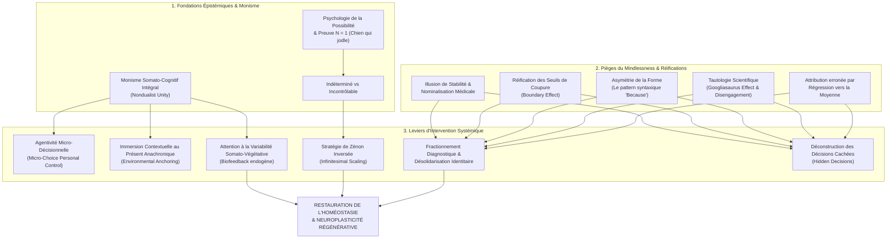

# Counterclockwise - Mindful Health and the Power of Possibility
**Formateur :** Ellen Langer | **ID :** `ellen-langer-counterclockwise-mindful-health-and-the-power-of-possibility` | **Tranches :** 14

## Synthèse Architecturale du Cours

---

### 1. Thèse Centrale & Philosophie du Cours

#### Vision spécifique d’Ellen Langer & Rupture avec l'approche standard
La médecine conventionnelle et la psychologie cognitive standard opèrent sur un **dualisme cartésien résiduel** doublé d’un **déterminisme statistique normatif** : le corps est traité comme une machine biologique soumise à une usure chronologique inéluctable, tandis que l’esprit n’est vu que comme un observateur passif (ou au mieux un facteur d'accompagnement émotionnel). Dans ce paradigme, les diagnostics, les seuils de coupure cliniques et les courbes de vieillissement sont réifiés en « lois naturelles ».

Ellen Langer fait voler ce modèle en éclats à travers sa **Psychologie de la Possibilité** (*Psychology of Possibility*). Sa posture repose sur trois ruptures épistémologiques radicales :
1. **Le Monisme Somato-Cognitif Intégral :** L’esprit et le corps ne s’influencent pas mutuellement : *ils sont une seule et même entité systémique vue sous deux angles distincts*. Dès lors qu’une orientation attentionnelle, contextuelle ou sémantique change, la cascade physiologique et cellulaire se reconfigure immédiatement.
2. **Du Probabilisme Descriptif au Potentiel Singulier ($N = 1$) :** Les statistiques médicales ne décrivent que des moyennes de cohortes passées sous des conditions standardisées, jamais des plafonds ontologiques. L’existence d’une seule exception (l’analogie du « chien qui jodle ») invalide logiquement l’impossibilité absolue d'un rétablissement ou d'une inversion de déclin.
3. **La Dénonciation du *Mindlessness* Institutionnel :** L’affaiblissement physique, la sénescence et la chronicité des symptômes sont massivement entretenus par des contextes sociaux déresponsabilisants, des prophéties autoréalisatrices et l’illusion de stabilité véhiculée par les nominalisations diagnostiques.

#### Fil rouge méthodologique unificateur
Le fil conducteur reliant chaque étude et protocole de Langer est : **la déstabilisation active des certitudes rigides par la traque des micro-variations perceptuelles et contextuelles.** 
Que ce soit en plongeant des octogénaires dans un environnement matériel rajeuni de vingt ans (*Counterclockwise*), en confiant un micro-choix d'arrosage de plante en maison de retraite, en découpant une crise d'asthme en fluctuations contextuelles ou en révélant l'arbitraire des seuils numériques médicaux, la démarche reste identique : 
> **Restaurer l'agentivité biologique en forçant le système nerveux à sortir de l'absence cognitive (*mindlessness*) pour échantillonner activement le flux analogique de la réalité (*mindfulness* / attention à la variabilité).**

---

### 2. Carte des Concepts & Leviers Émergents



#### Écosystème des leviers clés :
- **Monisme Somato-Cognitif Intégral :** Pivot ontologique. Aucun clivage psycho-somatique ; l'inscription de l'esprit dans un contexte recâble en temps réel la biologie.
- **Le Postulat du $N = 1$ & Le Chien qui Jodle :** Levier de désocclusion des limites. Substitue la recherche exploratoire de conditions favorables (« comment rendre cela possible ? ») à la passivité du pronostic statistique.
- **Indéterminé vs Incontrôlable :** Recadrage épistémique majeur qui empêche l'installation de l'impuissance apprise ; une issue non encore maîtrisée n'est pas une fatalité immuable.
- **L’Illusion de Stabilité & Nominalisation Toxique :** Mécanisme d'extinction perceptive où un flux biologique oscillant est figé sous une étiquette fixe (« arthrite », « vieillesse », « dépression »), créant le nocebo.
- **La Réification du Seuil de Coupure (*Boundary Effect*) & Décisions Cachées :** Révélation de l'arbitraire humain et statistique des normes nosologiques, dissolvant l'hypnose du diagnostic binaire.
- **L'Agentivité Micro-Décisionnelle :** Réactivation des circuits dopaminergiques et de la vitalité somatique par des micro-choix quotidiens non délégués.
- **L'Immersion Contextuelle Rétrograde (Ancrage Anachronique au Présent) :** Réalignement postural, moteur et cellulaire par recalibrage complet des afférences environnementales et temporelles.
- **L'Attention à la Variabilité Somatique :** Outil de biofeedback cognitif sans machine. Échantillonner les micro-fluctuations d'un symptôme détruit son apparente automaticité et restitue le contrôle végétatif.
- **La Stratégie de Zénon Inversée (*Reverse Zeno*) :** Contournement du seuil d'inhibition motrice et d'impuissance par fractionnement infinitésimal de l'action somatique.
- **Le Calibrage « Chemise Blanche vs Chemise Écossaise » :** Écologie attentionnelle réduisant le bruit cognitif de fond pour percevoir immédiatement les signaux faibles somato-régulateurs.

---

### 3. Tableau Récapitulatif des Techniques & Démonstrations

| Technique / Exercice | Objectif Opératoire | Déclencheur / Indication | Séquence Résumée |
|---|---|---|---|
| **Immersion Chrono-Spatiale Inverse** *(Étude Counterclockwise)* | Recalibrer les biomarqueurs, la motricité, la vue et la cognition sur l'état homéostatique d'un âge antérieur ($T-20$ ans). | Vieillissement institutionnalisé, perte d'autonomie motrice/cognitive, prophétie autoréalisatrice de sénescence. | 1. Isoler le sujet dans un environnement physique entièrement reconstitué à la date cible (médias, décors, objets d'époque).<br>2. Verrouiller la syntaxe au temps présent (interdiction formelle de parler au passé).<br>3. Supprimer toute assistance technique/humaine externe (obligation de port de bagages, cuisine).<br>4. Mesurer l'alignement somatique et postural spontané. |
| **Intervention d'Agentivité Micro-Décisionnelle** *(Expérience des Plantes / Nursing Home)* | Briser l'impuissance apprise, relancer la vigilance exécutive et réduire la morbidité somatique par réengagement dopaminergique. | Apathie, institutionnalisation, passivité de « patient », dépendance acquise aux soignants/autorités. | 1. Présenter au sujet un objet vivant ou une tâche matérielle (ex. une plante d'intérieur).<br>2. Transférer explicitement 100 % de la responsabilité décisionnelle (choix de l'emplacement, de la fréquence d'arrosage, de l'aménagement de l'espace).<br>3. Interdire au personnel soignant/entourage toute intervention substitutive.<br>4. Laisser la boucle d'auto-efficacité réactiver le tonus vital global. |
| **Traque de la Variabilité Somato-Végétative** *(Attending to Variability Protocol)* | Transférer un processus somatique réputé « autonome » ou incontrôlable sous contrôle intentionnel ; dissoudre la fixité du symptôme. | Affections chroniques étiquetées comme blocs homogènes (asthme, arythmie, douleurs articulaires, acouphènes). | 1. Cadrer que le corps n'est jamais constant et que l'intensité du trouble oscille continuellement.<br>2. Mettre en place un carnet d'échantillonnage temporel actif (noter l'état toutes les 2 ou 3 heures).<br>3. Relier chaque variation d'amplitude aux micros-changements environnementaux (lieu, température, présence d'autrui).<br>4. Constater l'intermittence du symptôme pour réinstaller l'agentivité physiologique. |
| **Stratégie du Paradoxe de Zénon Inversé** *(Reverse Zeno's Infinitesimal Scaling)* | Dépasser le seuil d'inhibition motrice, de panique somatique ou de sidération face à une tâche physique ou comportementale jugée impossible. | Sentiment d'incapacité radicale (lever un membre douloureux, déplacer une charge lourde, perte d'autonomie fonctionnelle). | 1. Établir l'écart critique entre $0$ (immobilité) et $1$ (réalisation complète perçue comme insurmontable).<br>2. Réduire le delta à un micro-mouvement infinitésimal sous le seuil d'alerte neurologique (ex. déplacer de 2 cm, délester un objet de la valise).<br>3. Valider proprioceptivement l'exécution du micro-pas sans douleur ni échec.<br>4. Chaîner les micro-incréments successifs jusqu'au basculement proprioceptif de l'action globale. |
| **Fractionnement Diagnostique & Dénominalisation Contextuelle** *(Pluralistic Splitting)* | Détruire les nominalisations rigides identitaires et stopper les boucles de rumination dépressive ou anxieuse. | Discours figé par une étiquette nosologique (« Je suis dépressif », « J'ai un TDAH », « Ma mémoire est morte »). | 1. Réfuter l'homogénéité du diagnostic (ex. « Il n'existe pas UNE dépression, mais cinq états distincts fluctuant matin et soir »).<br>2. Mobiliser le sujet dans une tâche de discrimination analytique active (différencier l'état A de 9h de l'état B de 15h).<br>3. Repérer et ancrer les « fenêtres d'absence » (moments où le symptôme est à 0 %).<br>4. Désolidariser le symptôme de l'identité : passer de l'être à l'événement contextuel discontinu. |
| **Révélation des Seuils & Déconstruction des Décisions Cachées** | Annihiler l'impact nocebo des diagnostics médicaux et l'angoisse de conformité aux normes statistiques. | Fixation anxieuse sur un chiffre d'analyse (glycémie, tension, score QI, seuil diagnostique limite). | 1. Examiner le score frontière déclencheur du statut de « malade » (ex. 79 vs 80).<br>2. Mettre en lumière les arbitrages et compromis humains invisibles ayant fixé ce seuil (comités, consensus arbitraires).<br>3. Requalifier la bascule binaire en continuum analogique souple.<br>4. Remplacer la certitude pathologique par une posture d'hypothèse d'observation conditionnelle. |
| **Calibrage du Filtre Attentionnel « Chemise Blanche »** | Optimiser la détection précoce des signaux faibles somatiques sans générer d'hypervigilance anxieuse. | Hypocondrie crispée, ou à l'inverse insensibilité aux signaux d'alerte corporels sur fond de surcharge cognitive. | 1. Faire contraster l'état d'esprit saturé/bruité (*plaid shirt*) et l'état d'accueil curieux et détendu (*white shirt*).<br>2. Abaisser le bruit mental par focalisation sur les différences sensorielles neutres dans l'environnement immédiat.<br>3. Calibrer la perception corporelle sur ce fond propre : tout écart homéostatique y apparaît avec netteté et sans effort.<br>4. Initier un micro-ajustement postural ou respiratoire immédiat dès la première perception de variation. |

---

---

## 0. Sommaire Sémantique & Index des Lignes

- **Tranche 1 [Lignes 109-232]** : L'Immersion Chrono-Spatiale Inverse (Étude « Counterclockwise ») — *Protocole :* L'Immersion Chrono-Spatiale Inverse (Étude « Counterclockwise ») | *Mécanisme :* Le Monisme Somato-Cognitif Intégral (Nondualist Mind-Body Unity) | *Verbatim :* Le Recadrage d'Attente et de Possibilité
- **Tranche 2 [Lignes 234-385]** : L'Expérimentation Sans Enjeu Identitaire (Application à la Vision et aux Capacités Sensoriel... — *Protocole :* L'Expérimentation Sans Enjeu Identitaire (Application à la Vision et aux Capacités Sensorielles) | *Mécanisme :* Le Postulat du "N = 1" (Preuve d'Existence vs Probabilité Statistique) | *Verbatim :* Le Découplage de l'Échec et de l'Impossibilité
- **Tranche 3 [Lignes 387-523]** : A : La Stratégie de Zénon Inversé (Désinhibition Somatique & Motrice) — *Protocole :* A : La Stratégie de Zénon Inversé (Désinhibition Somatique & Motrice) | *Mécanisme :* Déconstruction de la Causalité Monolithique Post-Événementielle (Mindless Learning vs. Experiencing Learning) | *Verbatim :* La Cascade de Recadrages Contingents
- **Tranche 4 [Lignes 525-623]** : A : La Traque de la Variabilité Interne (Dissolution des Nominalisations Diagnostiques) — *Protocole :* A : La Traque de la Variabilité Interne (Dissolution des Nominalisations Diagnostiques) | *Mécanisme :* L’Illusion de Stabilité et l'Absence par Mindlessness | *Verbatim :* Verbatim 1 : La Relativisation Contextuelle de l'Évidence
- **Tranche 5 [Lignes 625-750]** : de Dissolution de l'Étiquette Diagnostique et Restauration du Contrôle Somatique — *Protocole :* de Dissolution de l'Étiquette Diagnostique et Restauration du Contrôle Somatique | *Verbatim :* Verbatim 1 : L'Impuissance de la Moyenne face à la Singularité Somatique
- **Tranche 6 [Lignes 752-883]** : Traque Attentionnelle de la Non-Occurrence et Micro-Variabilité Somatique — *Protocole :* Traque Attentionnelle de la Non-Occurrence et Micro-Variabilité Somatique
- **Tranche 7 [Lignes 885-1025]** : La Désanonymisation Interactionnelle (« Pass the Role ») — *Protocole :* La Désanonymisation Interactionnelle (« Pass the Role »)
- **Tranche 8 [Lignes 1027-1183]** : L'Inversion Temporelle de Seuil Perceptif (Vision / Audition) — *Protocole :* L'Inversion Temporelle de Seuil Perceptif (Vision / Audition) | *Mécanisme :* Le Biais de Valeur Commerciale comme Amplificateur Neurobiologique (Pricing Prime) | *Verbatim :* La Déconstruction du Dualisme Cartésien
- **Tranche 9 [Lignes 1185-1308]** : Désamorçage de l'Attribution Externe et Consolidation de l'Agentivité Somatique (Inspiré du... — *Protocole :* Désamorçage de l'Attribution Externe et Consolidation de l'Agentivité Somatique (Inspiré du paradigme Davison & Valins) | *Mécanisme :* L’Allure Séduisante des Explications Neuroscientifiques (The Seductive Allure of Neuroscience Explanations) | *Verbatim :* Le Double-Lien d'Agentivité du Placebo Dévoilé
- **Tranche 10 [Lignes 1310-1466]** : Désamorçage de l'Étiquette Diagnostique par Enquête Double et Concurrente — *Protocole :* Désamorçage de l'Étiquette Diagnostique par Enquête Double et Concurrente | *Verbatim :* La nominalisation comme capture illusoire du vivant
- **Tranche 11 [Lignes 1468-1598]** : Le Recadrage Fonctionnel « Poisson & Bicyclette » (Démantèlement du Déficit Interne) — *Protocole :* Le Recadrage Fonctionnel « Poisson & Bicyclette » (Démantèlement du Déficit Interne) | *Mécanisme :* Le Recadrage Opératoire Modal : De la Fermeture Ontologique à l'Exploration des Chemins | *Verbatim :* La Bascule de l'Interrogation Modale de Contingence
- **Tranche 12 [Lignes 1600-1700]** : Le Recadrage Catégoriel d'Identité face à la Perte Motrice — *Protocole :* Le Recadrage Catégoriel d'Identité face à la Perte Motrice | *Mécanisme :* Amorçage Temporel Somatique et Environnemental (Temporal Somatic Priming) | *Verbatim :* Le Déverrouillage d'Injonction par Déstabilisation d'Autorité
- **Tranche 13 [Lignes 1702-1813]** : A : Traçage de la Variabilité Symptomatique & Réattribution d'Agentivité (Reverse Zeno Diary) — *Protocole :* A : Traçage de la Variabilité Symptomatique & Réattribution d'Agentivité (Reverse Zeno Diary) | *Verbatim :* La réattribution causale du placebo
- **Tranche 14 [Lignes 1815-1926]** : A : Déconstruction de l'Engagement Cognitif Prématuré (Breaking Premature Cognitive Commitment) — *Protocole :* A : Déconstruction de l'Engagement Cognitif Prématuré (Breaking Premature Cognitive Commitment) | *Mécanisme :* L'Attribution de Contrôle et Dépendance Auto-Induite (Self-Induced Dependence & Perceived Control)

---

## Extractions Détaillées par Tranche (Opératoire & Verbatim)

## Tranche 1 / 14 : L'Immersion Chrono-Spatiale Inverse (Étude « Counterclockwise »)

Voici l'extraction intégrale et opératoire de la tranche 1/14 de l'ouvrage *Counterclockwise* d'Ellen Langer, modélisée selon les principes de l'ingénierie comportementale, de l'hypnose conversationnelle et de la PNL de pointe.

---

### 1. Mécanismes & Principes Actifs

#### A. Le Monisme Somato-Cognitif Intégral (*Nondualist Mind-Body Unity*)
- **Principe actif :** Le postulat conventionnel de la médecine sépare l'esprit (immatériel) du corps (biomédical). Langer dissout ce dualisme pour poser une identité stricte : *le corps et l'esprit forment une seule et même entité systémique*. Par conséquent, tout déplacement du cadre mental ou de l'état attentionnel déplace instantanément et obligatoirement l'état physiologique équivalent. La mémoire, la posture, la vision, le système immunitaire et la biologie cellulaire ne répondent pas seulement à l'âge chronologique, mais à l'écologie perceptive dans laquelle le système nerveux s'oriente.
- **Tags libres :** `#monisme_somatocognitif #alignement_esprit_matiere #reprogrammation_biologique_par_contexte #effondrement_dualisme`

#### B. L'Agentivité Micro-Décisionnelle (*Micro-Choice Personal Control*)
- **Principe actif :** L'institutionnalisation, l'âge ou le rôle de patient imposent une atrophie progressive des circuits dopaminergiques et de la vigilance exécutive par soumission passive (résignation acquise). L'introduction de micro-choix non négociés par l'autorité extérieure (ex. décider où placer une plante, quand l'arroser, où recevoir ses proches) réactive la neuroplasticité, la vigilance orientée et l'agentivité fondamentale. Le système nerveux passe du mode "survie/extinction passive" au mode "engagement environnemental actif", réduisant de plus de 50 % la mortalité observée.
- **Tags libres :** `#agentivite_microdecisionnelle #rupture_resignation_acquise #reactivation_autonomie_biologique #neurogenese_par_decision`

#### C. L'Immersion Contextuelle au Présent Anachronique (*Time-Travel Environmental Anchoring*)
- **Principe actif :** Le cerveau met constamment à jour son homéostasie, son tonus postural et ses biomarqueurs à partir des indices environnementaux (rétroaction sensorielle). Si tous les stimuli sensoriels (visuels, auditifs, kinesthésiques, temporels et relationnels) imposent une date précise ($T-20$ ans) sans trace du présent, et si la syntaxe est strictement verrouillée au temps présent, le système nerveux recalibre ses fonctions biologiques sur l'état homéostatique de cet âge de référence. Il ne s'agit pas de "jouer un rôle" (jeu dissociatif), mais d'autoriser l'identité neurologique à se reloger intégralement dans la configuration d'alors.
- **Tags libres :** `#ancrage_environnemental_total #conjugaison_neurologique_present #recalibrage_homeostatique_temporel #desactivation_marqueurs_senescence`

#### D. L'Exception Épistémologique du "Chien qui Jodle" (*The Yodeling Dog Principle / Psychology of Possibility*)
- **Principe actif :** Les statistiques médicales décrivent des moyennes probabilistes (« ce qui arrive généralement ») et non des limites absolues (« ce qui est possible pour une configuration singulière »). Dès lors qu'un seul spécimen démontre une capacité inédite (un chien qui jodle, un vieillard qui regagne en souplesse et en acuité), l'impossibilité théorique s'effondre logiquement. Le système passe d'un modèle d'impuissance validée par la norme à un modèle d'exploration des prérequis de l'exception.
- **Tags libres :** `#psychologie_du_possible #refutation_de_la_norme_statistique #preuve_par_l_exception #desocclusion_des_limites`

#### E. Le Filtre Attentionnel « Chemise Blanche vs Chemise Écossaise » (*The White Shirt Calibration Metaphor*)
- **Principe actif :** Dans un état d'esprit dispersé, stressé ou saturé (*plaid shirt* / motif écossais bruité), les signaux faibles somatiques (variations subtiles, dégradations ou regains d'énergie) se perdent dans le bruit de fond. En développant une attention curieuse aux micro-différences (*mindfulness* langérienne), la perception devient un fond neutre et clair (*white shirt*). Le moindre signal somatique dysfonctionnel ou réparateur apparaît alors instantanément, sans effort de vigilance crispée, permettant une autorégulation somatique immédiate.
- **Tags libres :** `#calibration_signal_sur_bruit #micro_perception_somatique #ecologie_attentionnelle #recalibrage_perceptif`

---

### 2. Protocoles, Techniques & Démonstrations (Étape par Étape)

#### Protocole 1 : L'Immersion Chrono-Spatiale Inverse (Étude « Counterclockwise »)
* **Intention / Indication :** Déconstruire la sénescence induite socialement, l'atrophie fonctionnelle liée à l'âge, l'arthrite fonctionnelle, la perte de tonus postural, de mémoire de travail ou de vision liée à l'acceptation passive du diagnostic d'âge.
* **Mise en place & Pré-framing :** 
  - Définir une ligne temporelle cible reculée d'un quantum significatif (ex. 20 ans).
  - Établir une ligne de base psychophysiologique exhaustive : acuité visuelle (avec et sans verres correcteurs), force de préhension (*grip strength*), flexibilité articulaire, longueur d'extension des doigts, mémoire visuelle, résolution de labyrinthes, posture, poids, photos neutres de départ.
  - Pré-frame critique : Interdiction formelle du "comme si" théâtral. Le protocole n'est pas un exercice d'imitation, c'est une réinstallation de soi dans son propre système nerveux d'alors.
* **Séquence d'actions pas à pas :**
  - **Étape 1 : Assainissement indiciel de l'espace.** Retirer tout stimulus matériel, médiatique ou textuel postérieur à la date cible (aucun journal, livre, photo de famille récente). Ne saturer l'environnement qu'avec des déclencheurs contemporains de l'époque (magazines, émissions radio/TV d'époque en noir et blanc, objets physiques).
  - **Étape 2 : Réécriture autobiographique au présent.** Faire rédiger au sujet une biographie complète rédigée au présent de l'indicatif, calée à la date cible, accompagnée uniquement de photos de lui prises à cette période.
  - **Étape 3 : Verrouillage syntaxique relationnel absolu.** Poser comme règle cardinale que chaque participant doit policer et réguler les autres : tout échange, discussion politique, événement quotidien doit être conjugué au présent de l'époque cible (ex. le lancement de satellite d'hier, les films à l'affiche).
  - **Étape 4 : Suppression de la béquille relationnelle et réassignation d'autonomie.** Isoler les participants de leurs aidants/enfants condescendants ou protecteurs. Dès l'arrivée, exiger qu'ils portent leurs bagages et assurent l'intendance (service des repas, ménage, vaisselle) sans assistance extérieure.
  - **Étape 5 : Débats et stimulation cognitive synchrone.** Animer quotidiennement des débats animés, controversés et engagés sur les problématiques de l'époque de référence, pour susciter des pics d'adrénaline, d'engagement émotionnel et d'humour.
  - **Étape 6 : Réévaluation post-immersion.** Re-tester les biomarqueurs physiologiques et photographier le sujet à l'issue de l'immersion pour comparaison en aveugle par des tiers neutres.
* **Signes de calibration :**
  - Redressement spontané de la colonne vertébrale, démarche et posture plus toniques dès le 2e jour.
  - Disparition de la rigidité des articulations des doigts (allongement mesurable des doigts à plat).
  - Amélioration de la discrimination auditive et visuelle sans modification des verres.
  - Prise de parole spontanée, vive et assertive sans recherche d'approbation d'une tierce autorité.

---

#### Protocole 2 : L'Injection de Contrôle Somato-Décisionnel (Étude des Plantes de Rodin & Langer)
* **Intention / Indication :** Patients dépendants, sénescents, alités ou placés sous protocole médical lourd développant un syndrome de glissement, de l'indifférence vitale ou de la passivité acquise.
* **Mise en place & Pré-framing :** Cadrer la séance non pas comme une assistance médicale, mais comme une passation officielle de responsabilité exécutive sur des zones de vie micro-locales.
* **Séquence d'actions pas à pas :**
  - **Étape 1 : Cartographie des micro-territoires.** Identifier 3 domaines quotidiens habituellement régulés par le personnel ou la famille (ex. gestion de l'espace immédiat, accueil des interactions sociales, gestion d'un être vivant dépendant).
  - **Étape 2 : Transfert d'assignation décisionnelle.** Déclarer formellement au sujet qu'il est l'unique décideur :
    - Attribution d'un organisme vivant (plante d'intérieur) avec pour consigne que nul autre que lui n'a le droit de s'en occuper.
    - Détermination libre et souveraine de son emplacement spatial dans la pièce.
    - Détermination de la fréquence, de la quantité d'arrosage et des soins.
  - **Étape 3 : Extension aux paramètres relationnels.** Exiger du sujet qu'il choisisse lui-même s'il veut assister aux activités collectives et à quel endroit précis il désire recevoir ses visiteurs.
  - **Étape 4 : Non-intervention stricte du tiers.** Le praticien ou l'entourage s'interdit d'intervenir, de rappeler l'arrosage ou de corriger le choix du sujet.
* **Signes de calibration :**
  - Passage d'un regard terne/vitreux à un balayage visuel actif de l'espace.
  - Humeur plus alerte, combative et joviale.
  - Diminution significative de la demande d'assistance pour les gestes de la vie quotidienne.
  - Amélioration de la survie à long terme et réduction drastique de la morbidité.

---

### 3. Heuristiques, Subtilités & "Sagesse du Praticien"

- **Règle du Contre-Exemple Unitaire :** *Si* la science biomédicale ou un diagnostic pose qu'une fonction physique $X$ est irréversiblement dégradée avec le temps ou la pathologie, *alors* le praticien doit traiter cette proposition comme une simple probabilité générale de cohorte et chercher activement les prérequis de l'exception (le principe du chien qui jodle).
- **Règle de Neutralisation de la Béquille Sociale :** *Si* le sujet est accompagné d'un tiers (conjoint, enfant, soignant) qui parle à sa place, banalise, minimise ou rationalise condescendamment ses plaintes (ex. la fille d'Arnold le déclarant « prompt à exagérer »), *alors* le praticien doit immédiatement extraire le sujet de ce champ social réducteur. L'entourage fige l'identité du sujet dans son infirmité pour stabiliser le système relationnel.
- **Règle de l'Échec de l'Essai :** *Si* le sujet dit « j'ai essayé et ça n'a pas marché, donc c'est impossible », *alors* le praticien recadre : « Vous n'avez pas démontré que c'était impossible ; vous avez uniquement démontré que la façon dont vous vous y êtes pris jusqu'ici n'a pas produit le résultat ».
- **Le Piège du "Jouer un Rôle" vs "Être" :** Ne jamais demander à un sujet de "faire semblant" (*act as if*). Le jeu de rôle induit une dissociation méta où le sujet s'observe en train de singer un état, ce qui renforce l'état d'impuissance présent. Il faut exiger une ré-association phénoménologique pleine et entière : *« Let yourself be just who you were »*.
- **Postulat Langérien sur la Cécité Contextuelle :** L'incompétence et la maladie proviennent rarement d'une incapacité biologique innée, mais d'un apprentissage *mindless* (sans conscience du contexte). Le sujet apprend une règle comme absolue (« à 80 ans on ne voit plus ») et cesse d'observer le contexte mouvant où la règle cesse de s'appliquer.

---

### 4. Pépites Verbatim & Patterns Linguistiques (MOT À MOT EN V.O.)

#### Pépite 1 : Le Recadrage d'Attente et de Possibilité
> *"What we need is not the will to believe, but the wish to find out."*
> — William Wordsworth (cité en exergue par Ellen Langer)
- **[Analyse du Pattern]** : **Rupture d'équivalence complexe et défocalisation de la volonté.** Le syntagme démonte la contrainte de la « foi volontaire » (*will to believe* — effort conscient forcé susceptible d'activer des résistances) pour la remplacer par une simple curiosité exploratoire (*wish to find out*). La présupposition évacue le débat de vérité pour installer une boucle de rétroaction expérimentale ouverte.

---

#### Pépite 2 : La Dissolution du Dualisme Corps/Esprit
> *"If we put the mind and the body back together so that we are just one person again, then wherever we put the mind, we would also put the body. If the mind is in a truly healthy place, the body would be as well—and so we could change our physical health by changing our minds."*
- **[Analyse du Pattern]** : **Enchaînement déductif par truisme spatial et syllogisme ericksonien.**
  - Prémisse 1 : Réunification identitaire ontologique (*one person again*).
  - Prémisse 2 : Projection spatiale métaphorique (*wherever we put the mind, we would also put the body*).
  - Conclusion intégrée : Cause à effet inévitable (*and so we could change...*). L'utilisation de « *truly healthy place* » agit comme une suggestion nominalisée floue que le système nerveux comble immédiatement avec ses propres représentations de vitalité optimale.

---

#### Pépite 3 : La Commande d'Induction Phénoménologique
> *"It is a difficult task, since we are not asking you to ‘act as if it is 1959’ but to let yourself be just who you were in 1959. We have good reason to believe that if you are successful at this, you also will feel as well as you did in 1959."*
- **[Analyse du Pattern]** : **Distinction hypnotique par négation, commande enchâssée permissive et pont temporel kinesthésique.**
  - La clause *"not asking you to ‘act as if’"* brise le pattern du jeu de rôle cognitif ou de l'imposture.
  - La commande permissive *"let yourself be just who you were"* contourne le censeur conscient et ordonne à l'inconscient de réactiver la gestalt mémorielle globale.
  - Le lien conditionnel *"if you are successful... you also will feel as well as you did"* ancre une présupposition d'isomorphisme somatique : l'accès à l'état mental du passé télécharge obligatoirement le ressenti kinesthésique de vigueur physique qui lui était associé.

---

#### Pépite 4 : La Désolidarisation des Moyennes Statistiques
> *"If I can make one dog yodel, then we can say that yodeling is possible in dogs. The results of the counterclockwise study do not show us that everyone who talks about the past will show the same results. It does tell us, however, that it is possible to achieve these kinds of improvements, but only if we try."*
- **[Analyse du Pattern]** : **Métaphore disruptive et recadrage de critère (De la moyenne statistique à la possibilité ontologique).**
  - L'image incongrue du « chien qui jodle » crée une rupture d'attention immédiate.
  - La logique formelle détruit l'assimilation fallacieuse « non généralisé = impossible ».
  - La double boucle conclusive préserve l'humilité scientifique tout en installant une injonction d'action thérapeutique : la seule condition limitante réside dans l'engagement opérationnel (*only if we try*).

---

#### Pépite 5 : La Destruction de la Croyance Limitante par l'Échec de l'Essai
> *"For instance, we all use pithy expressions such as ‘We won’t know unless we try,’ but we don’t realize how misleading they can be. I maintain that we may not know even if we try, because when we try and fail, all we know is that the way we tried was not successful. We still do not know that it can’t be."*
- **[Analyse du Pattern]** : **Pattern de Sleight of Mouth (Recadrage de la Définition & Conséquence).**
  - Langer attaque un truisme populaire (*We won't know unless we try*) pour révéler sa clause cachée toxique (essayer et échouer prouverait l'impossibilité).
  - Elle redéfinit l'échec de manière strictement opérationnelle : l'échec n'informe pas sur la frontière du possible (*it can't be*), mais uniquement sur l'inadéquation de la tentative spécifique employée (*the way we tried*).
  - Ce pattern préserve indéfiniment la vacuité du cadre de possibilité, empêchant le sujet d'utiliser ses échecs passés comme justifications rationnelles d'abandon.

## Tranche 2 / 14 : L'Expérimentation Sans Enjeu Identitaire (Application à la Vision et aux Capacités Sensoriel...

### 1. Mécanismes & Principes Actifs

#### A. Le Postulat du "N = 1" (Preuve d'Existence vs Probabilité Statistique)
* **Principe actif :** La science descriptive et la médecine conventionnelle fonctionnent sur l'agrégation statistique : elles décrivent ce qui arrive à la majorité sous des conditions standardisées. Le piège neurologique et sémantique réside dans la confusion entre une *probabilité* et un *fait déterministe absolu*. Pour le système nerveux, traiter une statistique comme une loi biologique ferme l'accès aux cascades d'autorégulation neurobiologiques.
* Dans la « psychologie de la possibilité », une seule exception ($N = 1$) invalide l'impossibilité théorique. Dès lors qu'un cas déviant existe (ou est rendu concevable), le cerveau bascule d'une clôture cognitive (« c'est impossible ») à une recherche exploratoire orientée processus (« quelles conditions subtiles rendent ce phénomène reproductible ? »).
* **Tags :** `#psychology_of_possibility` `#n_equals_one` `#reframing_statistical_noise` `#anti_normativisme`

#### B. La Distinction Opératoire : Incontrôlable vs Indéterminé
* **Principe actif :** Face à un diagnostic ou une dégradation physique, qualifier la situation d’« incontrôlable » génère une impuissance apprise somatique et comportementale (inhibition de l'action, stress chronique, résignation biologique). 
* Remplacer la catégorie « incontrôlable » par « indéterminé » préserve l'ouverture perceptuelle : le fait qu'une méthode n'ait pas fonctionné signifie uniquement que *ce protocole d'essai précis n'a pas produit le résultat escompté*, et non que le système est figé dans l'incurabilité. L'indétermination invite le système nerveux à tester de nouvelles variations sans lier l'échec de la tentative à l'identité ou à la fatalité biologique.
* **Tags :** `#uncontrollable_vs_indeterminate` `#epistemic_humility` `#anti_learned_helplessness`

#### C. L'Illusion de Stabilité et Médicalisation des Sensations (Nominalisation Toxique)
* **Principe actif :** L'esprit humain fige conceptuellement un flux somatique continu et variable pour économiser de l'énergie cognitive. Ce processus transforme :
  - Un inconfort contextuel en « maladie » ou « syndrome ».
  - Une fluctuation attentionnelle en « insomnie » ou « procrastination ».
  - Une variation sensorielle corporelle en « symptôme d'une détérioration inéluctable ».
* Cette nominalisation fige le phénomène dans le temps et le système nerveux réagit au diagnostic (la carte) plutôt qu'aux micro-variations réelles de la physiologie (le territoire).
* **Tags :** `#illusion_of_stability` `#overmedicalization` `#sensation_vs_symptom` `#nominalization_collapse`

#### D. L'Asymétrie de la Forme sur le Fond (Le Pattern "Because / Parce que")
* **Principe actif :** Le cerveau humain opère en mode heuristique automatique par défaut (*mindlessness*). Dès lors qu'une demande ou une injonction adopte la *structure syntaxique* d'une justification causale légitime (ex: « ... parce que [redondance évidente] » ou « c'est le médecin qui l'ordonne »), le filtre critique conscient est court-circuité. 
* En contexte médical, ce mécanisme induit une hypnose de soumission : le patient absorbe des pronostics péjoratifs et des ordres sans en interroger la pertinence spécifique pour son propre corps.
* **Tags :** `#form_over_content` `#mindless_compliance` `#placebic_syntax` `#bypass_critical_factor`

#### E. Dépendance Auto-Induite par l'Étiquetage Social et Rôle de Malade
* **Principe actif :** L'assignation d'un titre subordonné ou dépendant (ex: « assistant », « patient ») réduit immédiatement les capacités motrices, cognitives et immunitaires réelles du sujet. Abandonner la souveraineté épistémique à une autorité externe (« le médecin sait mieux que moi ce qui se passe dans ma propre chair ») désactive l'écoute proprioceptive fine au profit d'une conformité passive au stéréotype du déclin.
* **Tags :** `#self_induced_dependence` `#labeling_debilitation` `#epistemic_abdication`

#### F. Les Horloges Sociales et Subjectives de la Longévité
* **Principe actif :** Le vieillissement somatique n'est pas uniquement un compte à rebours chronologique strict : il s'aligne sur les cadres de référence relationnels et culturels. Épouser un partenaire nettement plus jeune reprogramme les boucles de rétroaction comportementales, motrices et neuro-endocriniennes vers l'âge de la référence (allongement de l'espérance de vie). À l'inverse, l'alignement sur une personne plus âgée accélère la détérioration perçue et somatique. La perception temporelle et le cadrage des échéances (ex: anticipation positive d'un anniversaire) modulent mesurablement la résistance vitale du corps.
* **Tags :** `#social_clocks` `#chronobiological_reframing` `#expectancy_longevity`

---

### 2. Protocoles, Techniques & Démonstrations (Étape par Étape)

#### Protocole 1 : L'Expérimentation Sans Enjeu Identitaire (Application à la Vision et aux Capacités Sensorielles)
* **Intention / Indication :** Dégradation perçue de fonctions physiques (baisse de vision liée à l'âge, raideurs, baisse d'audition) acceptée passivement comme une fatalité biologique irréversible.
* **Mise en place & Pré-framing :** Recadrer l'exploration : passer de la quête d'une guérison magique à une attitude d'investigation neutre, de curiosité phénoménologique pure, sans évaluation de la valeur personnelle en cas d'échec.

```
[Étape 1 : Cartographie des Anomalies et Exceptions]
Identifier les contextes où la fonction opère mieux (ex: voir certains contrastes, dans certaines pièces, sous certains éclairages, certains objets spécifiques).

[Étape 2 : Suspension de l'Évaluation de Soi]
Tenter des micro-variations comportementales (ex: plisser les yeux, changer la distance, modifier l'angle, respirer différemment, regarder sans forcer). Si le texte reste flou, calibrer cela comme : "Cette tentative spécifique n'a pas produit de netteté", et NON "Mes yeux sont irrémédiablement détériorés".

[Étape 3 : Investigation des Micro-Indices Somatiques]
Noter les fluctuations d'acuité dans l'environnement quotidien (re-regarder un tableau délaissé, apercevoir les fibres usées d'un meuble).

[Étape 4 : Déploiement de l'Orientation Processus]
Multiplier les essais avec la question motrice : "Comment puis-je voir un peu plus nettement ce qui est moins net ?" au lieu d'accepter le diagnostic de déclin standard.
```

* **Signes de calibration :** 
  - Relâchement des tensions faciales et oculaires lors de l'effort de lecture.
  - Disparition des jugements négatifs (« je suis vieux », « je perds la vue »).
  - Présence d'un état de curiosité détendue orienté vers la découverte sensorielle immédiate.

---

#### Protocole 2 : Rupture de l'Assimilation Statique des Métriques de Santé (La Déstabilisation du Chiffre Figé)
* **Intention / Indication :** Patient ou client obnubilé par une valeur médicale passée (taux de cholestérol, tension artérielle prise un mois auparavant, score de diagnostic) qu'il traite comme son identité biologique actuelle.
* **Mise en place & Pré-framing :** Poser une question factuelle neutre sur ses constantes de santé en groupe ou en face à face.

```
[Étape 1 : Élicitation de la Valeur Réifiée]
Demander au sujet : "Connaissez-vous votre taux de cholestérol / votre mesure de référence ?"
-> Attendre que le sujet cite fièrement ou anxieusement son chiffre.

[Étape 2 : Ancrage Temporel et Révélation de l'Écart]
Demander immédiatement : "À quand remonte cette mesure exacte ?"
-> Calibrer la réponse (souvent plusieurs semaines ou mois en arrière).

[Étape 3 : Interruption de Pattern par Paradoxe Temporel]
Envoyer le choc sémantique : "Donc, vous n'avez ni mangé ni fait d'exercice depuis cette date ? Si vous ne le faites plus jamais vérifier, vous mourrez en parfaite santé."

[Étape 4 : Recadrage de la Fluctuance Somatique]
Réintégrer le sujet dans le temps réel : démontrer que la physiologie est un système dynamique et oscillant, jamais défini de manière permanente par un bilan antérieur. Transformer le sujet d'un "expert figé" en un "apprenant de sa propre santé".
```

* **Signes de calibration :**
  - Rire réflexe ou sourire de déstabilisation (marquant la rupture du pattern de croyance).
  - Prise de conscience subite de l'absurdité de traiter une photo ancienne comme le film du présent.
  - Respiration plus profonde et dérigidification posturale.

---

#### Protocole 3 : La Dé-médicalisation des Expériences et Re-catégorisation Multiple
* **Intention / Indication :** Tendance du sujet à étiqueter systématiquement une sensation corporelle ou un état mental en pathologie ou handicap (« je fais une dépression », « je suis insomniaque », « mon arthrose m'empêche de vivre »).
* **Mise en place & Pré-framing :** Établir la distinction nette entre la sensation brute phénoménologique et le diagnostic social/médical plaqué dessus.

```
[Étape 1 : Dé-nominalisation du Symptôme en Sensation Pure]
Inviter le sujet à décrire son état en termes sensoriels stricts (température, pression, rythme, localisation, mouvement), sans employer aucun mot du jargon médical ou psychopathologique.

[Étape 2 : Explosion des Perspectives Étiologiques (Le Découplage de la Leçon Unique)]
Présenter au minimum 5 à 8 interprétations alternatives orthogonales de l'événement ou de la sensation (ex: à la façon du modèle de la chute sur les toilettes en porcelaine).

[Étape 3 : Transition de l'Apprentissage Rigide à l'Expérience Ouverte]
Substituer l'obligation de "tirer une règle rigide d'une expérience" par la posture d'expérimenter en continu : "Chaque occurrence est un événement unique qui ne préjuge pas de l'événement suivant".
```

* **Signes de calibration :**
  - Arrêt des auto-diagnostics automatiques dans le discours.
  - Flexibilité cognitive manifestée par la capacité à générer instantanément plusieurs explications d'une douleur ou d'une fatigue passagère.

---

### 3. Heuristiques, Subtilités & "Sagesse du Praticien"

#### Règles Conditionnelles d'Intervention
* **Si le sujet conclut à l'impossibilité d'une guérison/changement après une tentative infructueuse :**
  -> *Alors* recadrer immédiatement : *"Tout ce que nous savons, c'est que cette manière précise d'essayer n'a pas fonctionné ; nous ne savons toujours pas si la chose est impossible."*
* **Si le sujet vous présente un diagnostic médical pessimiste ou catégorique (« incurable », « dégénérescence irréversible ») :**
  -> *Alors* traduire intérieurement et linguistiquement « incurable » par « indéterminé ». Traiter le diagnostic non pas comme un arrêt de mort, mais comme le point zéro de la formulation de nouvelles questions de recherche.
* **Si le sujet justifie une acceptation aveugle d'un traitement par l'autorité du praticien :**
  -> *Alors* vérifier si le consentement ne repose pas uniquement sur la forme syntaxique de l'injonction (*because-heuristic*) plutôt que sur une prise en compte de sa singularité corporelle.
* **Si le sujet traite une sensation corporelle comme une détérioration globale de son identité :**
  -> *Alors* fractionner la sensation, rechercher les asymétries (qu'est-ce qui fonctionne bien simultanément ?) et réorienter l'attention vers un domaine d'action accessible (ex: peindre avec la main non dominante au lieu d'attendre la guérison du poignet).

#### Pièges Classiques & Erreurs à Éviter
* **Confondre Mindfulness et Hypervigilance :** L'attention mindful à la santé n'est pas une traque anxieuse de la moindre douleur (hypocondrie), mais une *conscience souple et ouverte* de la variabilité constante du corps, sans focus obsessif sur une zone précise.
* **Vouloir trouver le mécanisme d'action avant de constater la possibilité :** En psychologie traditionnelle, si l'on ne comprend pas le mécanisme intermédiaire, on nie le phénomène. Chez Langer, le praticien doit d'abord vérifier et actualiser la possibilité concrète de l'effet ($N=1$), puis chercher les explications ensuite.
* **Prendre les moyennes d'une cohorte pour le destin d'un individu :** Une étude clinique décrit ce qui est arrivé en moyenne à d'autres personnes. Elle ne décrit jamais ce qui est possible pour ce client précis, dans cet environnement spécifique, avec ce mindset particulier.

---

### 4. Pépites Verbatim & Patterns Linguistiques (MOT À MOT EN V.O.)

#### Pépite 1 : Le Découplage de l'Échec et de l'Impossibilité
> *"I maintain that we may not know even if we try, because when we try and fail, all we know is that the way we tried was not successful. We still do not know that it can't be."*
* **[Analyse du Pattern]** : Recadrage épistémologique par décomposition analytique. Langer détruit la maxime populaire limitante (*« On ne saura pas si on n'essaie pas »*) en démontrant que l'échec d'une tentative informe uniquement sur la validité de la méthode employée, et jamais sur la limite ontologique du système. Elle installe une présupposition d'ouverture permanente de la possibilité.

#### Pépite 2 : L'Interruption du Déterminisme Sensoriel
> *"Consider how the deaf come to see better just as the blind develop more acute hearing. Surely we can find that we see some things better than others. So it would make sense to ask why not try to see the less clear more clearly. We probably wouldn't even ask ourselves; we would just do it."*
* **[Analyse du Pattern]** : Empilement de truismes incontestables (compensation sensorielle universellement reconnue) suivi d'une dérivation logique vers la vision ordinaire (*truism pacing and leading*). Utilisation d'une question négative orientée possibilité (*« why not try to see... »*) couplée à une commande d'action directe incorporée sans délibération analytique (*« we would just do it »*).

#### Pépite 3 : La Provocation Temporelle des Métriques Fixes
> *"So, you haven’t eaten or exercised since? If you never get it checked again, you’ll die a healthy person."*
* **[Analyse du Pattern]** : Rupture de pattern par ironie logique et réduction à l'absurde (*reductio ad absurdum*). Langer met en collision la croyance implicite que les biomarqueurs sont des vérités immuables avec la réalité du temps qui s'écoule. L'effet de choc oblige le sujet à réintégrer le fait que sa santé est un flux en temps réel et non un chiffre administratif archivé.

#### Pépite 4 : La Dictature de la Forme Justificative (Mindless Compliance)
> *"May I use the Xerox machine because I want to make copies?"*
* **[Analyse du Pattern]** : Pattern de pseudo-causalité tautologique. L'inclusion du connecteur causal *« because »* suffit à satisfaire le filtre critique inconscient en mimant la forme d'une raison légitime, alors que le contenu sémantique est une pure redondance vide. Démontre comment l'appareil cognitif abdique son discernement face aux stéréotypes syntaxiques de justification.

#### Pépite 5 : L'Explosion des Cadres d'Interprétation d'un Trauma
> *"Perhaps, but I suggested that the lesson could be any of the following: 'Be more cautious,' 'Don't try to fix things yourself,' 'Make sure you're not alone when attempting something new,' 'Don't attempt anything new,' 'Wear heavy clothes when fixing things,' 'Don't be afraid to try new things because the body is amazing the way it heals itself,' 'I can take a hit and not be defeated,' or 'Lose weight so toilets can hold me.' [...] Rather than try to learn from experience, we might be better off to experience learning."*
* **[Analyse du Pattern]** : Surchargement et saturation de recadrages (technique de confusion / déstabilisation d'une conclusion unique). Langer neutralise l'illusion de causalité unique tirée d'un événement traumatique en juxtaposant des conclusions contradictoires (de l'extrême lâcheté à l'autonomisation héroïque). La conclusion finale opère un chiasme hypnotique (*« learn from experience »* vs *« experience learning »*) qui dissout l'impératif de rigidifier le passé et restitue au système nerveux sa flexibilité d'adaptation spontanée.

## Tranche 3 / 14 : A : La Stratégie de Zénon Inversé (Désinhibition Somatique & Motrice)

Voici l'extraction et la modélisation intégrale de la tranche 3/14 du cours d'Ellen Langer, structurée selon les exigences strictes d'ingénierie opératoire.

---

### 1. Mécanismes & Principes Actifs

#### 1. Déconstruction de la Causalité Monolithique Post-Événementielle (*Mindless Learning vs. Experiencing Learning*)
- **Principe actif :** Face à un choc, un traumatisme ou un échec somatique/psychologique, le système nerveux opère une réduction de complexité par survie : il isole arbitrairement deux variables (l'action $A$ et la conséquence négative $B$) et encode une relation de cause à effet rigide (« la leçon »). Cette distorsion (équivalence complexe + cause-effet arbitraire en PNL) fige l'apprentissage et filtre toutes les perceptions futures pour confirmer la règle. Le principe actif d'Ellen Langer consiste à saturer le champ perceptif en démontrant que l'événement singulier contenait une infinité de relations contingentes alternatives également valides. En substituant *« experience learning »* à *« learning from experience »*, le praticien empêche la cristallisation de la croyance limitante et réouvre la neuroplasticité.
- **Tags libres :** `#deconstruction_causale` `#experience_learning` `#saturation_interpretative` `#equivalence_complexe_arbitraire`

#### 2. Stratégie du Paradoxe de Zénon Inversé (*Reverse Zeno's Strategy / Infinitesimal Scaling*)
- **Principe actif :** Lorsqu'un objectif somatique ou comportemental (porter une valise pour un vieillard dépendant, lever un bras paralysé pour se moucher, perdre 50 livres) est perçu comme insurmontable, l'inconscient active une réponse de sidération, d'impuissance apprise ou de rejet total (*all-or-nothing threshold*). Le paradoxe de Zénon classique immobilise en prouvant qu'on n'arrive jamais au bout si l'on divise la distance à l'infini. Le *Reverse Zeno* inverse la polarité : il postule qu'entre l'état actuel d'immobilité ($0$) et l'état désiré ($1$), il existe *toujours* un incrément $\Delta$ suffisamment microscopique (déplacer de 6 pouces, puis 3 pouces, puis 1 pouce, ou décharger objet par objet) pour contourner le seuil critique de résistance du système nerveux. Dès qu'un micro-mouvement est validé somatiquement, le système proprioceptif et la boucle d'auto-efficacité se recalibrent, dissipant l'inhibition motrice.
- **Tags libres :** `#reverse_zenos_strategy` `#micro_increment_somatique` `#contournement_seuil_inhibition` `#fractionnement_infinitesimal`

#### 3. Attention à la Variabilité Somato-Végétative (*Attending to Variability*)
- **Principe actif :** Les pathologies chroniques et les processus réputés « autonomes » (fréquence cardiaque, crise d'asthme, bronchoconstriction) sont maintenus par l'illusion d'une fixité d'état. L'esprit étiquette le symptôme comme un bloc homogène (« je fais de l'asthme », « mon rythme cardiaque est incontrôlable »). En forçant l'attention sensorielle à mesurer et enregistrer les micro-fluctuations naturelles tout au long de la journée (toutes les 3 heures, dans différents contextes), le système nerveux passe d'un état de passivité à un état d'échantillonnage actif. Le simple fait de constater que la variable physiologique n'est pas constante détruit la croyance en son automaticité incontrôlable et transfère des processus végétatifs autonomes dans le registre du contrôle volontaire/intentionnel, sans nécessiter d'appareillage lourd (contrairement au biofeedback classique).
- **Tags libres :** `#attention_to_variability` `#defixation_vegetative` `#recuperation_controle_autonome` `#biofeedback_endogene`

#### 4. L'Artefact Médical comme Ancre de Stabilité Maladaptative (*Medical Device Fixed-State Anchor*)
- **Principe actif :** Les outils thérapeutiques automatisés (ex: inhalateur d'asthme dosé uniformément) administrent une dose identique indépendamment des fluctuations réelles de l'état du patient. Cet étalonnage externe fige cognitivement le patient dans l'idée que sa crise est toujours identique à elle-même, l'empêchant de calibrer les micro-déclencheurs environnementaux (ex: maison de Jane vs maison de Stephen). En prenant conscience de la variabilité contextuelle, le sujet récupère l'agentivité sur les déclencheurs systémiques.
- **Tags libres :** `#artefact_medical_bloquant` `#ancre_de_stabilite` `#discrimination_environnementale`

#### 5. La Tautologie des Modèles Scientifiques (*The Googliasaurus Effect & Disengagement Theory*)
- **Principe actif :** Les modèles nosologiques et scientifiques créent des prophéties autoréalisatrices par agrégation cumulative de preuves congruentes. Dès qu'une étiquette (ex: « lésion cérébrale irréversible », « désengagement des personnes âgées ») est acceptée comme un fait absolu plutôt que comme une hypothèse conditionnelle, le chercheur/praticien élimine d'emblée toute donnée contradictoire. Le système cognitif fonctionne en « château de cartes » : il prend la prédiction validée pour une preuve de la stabilité ontologique de la pathologie.
- **Tags libres :** `#googliasaurus_effect` `#tautologie_diagnostique` `#croyance_auto_validante` `#reversibilite_des_irreversibles`

#### 6. Fractionnement Diagnostique Anti-Rumination (*Pluralistic Splitting of Depressive States*)
- **Principe actif :** La dépression se nourrit d'une nominalisation rigide (« Je suis déprimé »), d'un biais d'échantillonnage asymétrique (on scrute le pourquoi quand on va mal, on ignore l'état interne quand on va bien) et d'une hyper-focalisation égocentrée morose. En introduisant la prémisse qu'il n'existe pas « une » dépression, mais au moins cinq sous-types distincts fluctuant entre le matin et le soir, l'esprit est mobilisé dans une tâche de discrimination analytique active. La recherche active de variabilité interne est neurobiologiquement et cognitivement incompatible avec l'état de rumination dépressive.
- **Tags libres :** `#fractionnement_diagnostique` `#anti_rumination_active` `#dissolution_de_nominalisation` `#asymetrie_echantillonnage`

---

### 2. Protocoles, Techniques & Démonstrations (Étape par Étape)

#### Protocole A : La Stratégie de Zénon Inversé (Désinhibition Somatique & Motrice)
* **Intention / Indication :** Patient ou sujet bloqué dans une paralysie motrice partielle, une incapacité physique apprise (sujet âgé refusant de porter une charge, rééducation post-AVC, phobie de l'effort) ou face à un objectif perçu comme écrasant (ex: perte de poids massive).
* **Mise en place & Pré-framing :** Refuser catégoriquement la prise en charge passive (ex: ne pas jouer le « bellboy » ou le soignant substitutif). Normaliser l'inquiétude mais recadrer l'action non pas comme un bond unique, mais comme un micro-déplacement fractionné.
* **Séquence d'actions pas à pas :**
  1. *Identification du blocage absolu :* Demander au sujet : *"What can’t you do that you wish you could?"*
  2. *Étalonnage du seuil d'échec :* Proposer un premier mouvement intermédiaire (ex: bouger le bras de 6 pouces vers la cible).
  3. *Fractionnement sous le seuil de résistance :* Si échec ou contraction d'impuissance, réduire la distance de moitié (3 pouces), puis encore de moitié, jusqu'à obtenir l'amplitude infinitésimale où un micro-mouvement volontaire réel se manifeste.
  4. *Alternative de décomposition de charge :* Si la tâche est un objet lourd (valise), proposer soit de la déplacer de quelques pouces à la fois avec temps de repos, soit d'ouvrir la valise et de transporter chaque élément individuellement.
  5. *Cumul d'auto-efficacité :* Répéter le micro-incrément. Laisser le sujet faire l'expérience somatique du mouvement autonome sans assistance physique extérieure.
* **Signes de calibration :**
  - Disparition de la grimace de découragement initiale (*wincing*).
  - Détente posturale et changement de l'expression faciale vers l'émancipation/l'autonomie (*empowering facial cues*).
  - Passage d'une plainte verbale d'impossibilité à une focalisation motrice silencieuse.

---

#### Protocole B : Conditionnement à l'Attention à la Variabilité Végétative
* **Intention / Indication :** Régulation volontaire de fonctions physiologiques étiquetées « incontrôlables » (arythmie, tachycardie, hypertension, bronchospasme asthmatique, crises de panique).
* **Mise en place & Pré-framing :** Cadrer l'exercice non pas comme une tentative de « contrôler » ou « calmer », mais comme une étude d'observation scientifique neutre sur les variations naturelles du corps.
* **Séquence d'actions pas à pas :**
  1. *Échantillonnage à haute fréquence (High Attention to Variability) :* Prescrire au sujet de mesurer son pouls/paramètre somatique toutes les 3 heures pendant 7 jours consécutifs.
  2. *Couplage contextuel :* À chaque prise de mesure, lui faire noter l'activité précise, l'environnement physique et les personnes en présence.
  3. *Différenciation comparative active :* Obliger le sujet à comparer explicitement le chiffre obtenu avec les mesures précédentes pour repérer les écarts.
  4. *Épreuve de commande mentale pure :* Au terme des 7 jours, demander au sujet d'augmenter délibérément son rythme, puis de le baisser, en utilisant uniquement son esprit (sans modifier le tonus musculaire ni le patron respiratoire).
* **Signes de calibration :**
  - Le sujet cesse de dire « mon cœur s'emballe tout seul » et identifie des déclencheurs situationnels fins.
  - Capacité démontrée à moduler physiologiquement le marqueur sans recours à des contractions somatiques de compensation.

---

#### Protocole C : Déconstruction de la Nominalisation Dépressive par Échantillonnage Pluriel
* **Intention / Indication :** États dépressifs chroniques, rumination morbide, conviction rigide que l'humeur est un gouffre continu et uniforme (*"I am always depressed"*).
* **Mise en place & Pré-framing :** Expliquer que la médecine conventionnelle simplifie à l'excès et que l'état interne n'est jamais un monolithe, mais une constellation de variations subtiles non cartographiées.
* **Séquence d'actions pas à pas :**
  1. *Mise en évidence du biais d'attention :* Confronter le fait qu'il ne s'interroge sur son état que lorsqu'il souffre, créant un déficit de preuves sur ses états neutres ou sereins.
  2. *Introduction de la taxonomie plurielle :* Poser le cadre qu'il existe en réalité au moins 5 formes distinctes de son trouble.
  3. *Tâche d'enquête discriminante :* Donner la consigne quotidienne d'identifier avec précision *laquelle* de ces nuances opère ce matin, laquelle opère ce soir, et d'enregistrer la bascule.
  4. *Questionnement de rupture :* Poser la question de focalisation : *"En quoi ce que tu ressens maintenant est-il différent de ce que tu ressentais hier à la même heure ?"*
* **Signes de calibration :**
  - Rupture du regard fixe et du retrait social caractéristique de la rumination.
  - Réémergence d'un tonus vocal analytique et curieux (l'engagement d'enquête se substituant à l'inhibition dépressive).

---

### 3. Heuristiques, Subtilités & "Sagesse du Praticien"

#### Règles Conditionnelles ("Si X -> Alors Y parce que Z")
- **Si** un sujet tire une conclusion définitive et restrictive d'un événement traumatique (*"J'ai appris ma leçon : ne plus jamais monter sur des toilettes en porcelaine / ne plus jamais faire confiance"*), **alors** générer immédiatement en cascade 8 à 10 leçons alternatives diamétralement opposées (de l'hyper-prudence à l'audace corporelle, de l'auto-dérision à la robustesse somatique), **parce que** l'esprit ne souffre pas de l'expérience elle-même, mais de l'assignation arbitraire d'un lien contingent unique.
- **Si** un sujet est paralysé par l'ampleur d'un changement somatique (ex: 50 livres à perdre), **alors** fractionner l'objectif jusqu'à l'once (*ounce of cure*), **parce que** le système nerveux ne déclenche aucune résistance biologique face à une variation homéostatique imperceptible.
- **Si** vous voulez mesurer la présence d'esprit d'un sujet (mindfulness vs mindlessness), **alors** demandez-lui l'heure juste après qu'il a regardé sa montre, **parce que** l'attente fonctionnelle (*"y a-t-il assez de temps pour une histoire ?"*) aveugle la perception de l'information brute (les chiffres de l'heure).
- **Si** un résultat expérimental ou thérapeutique échoue, **alors** refuser de conclure à l'incurabilité ou à l'impossibilité de la méthode, **parce que** l'absence de preuve n'est pas une preuve d'absence (*"Negative results only mean we have no evidence for a hypothesis, which is very different from evidence against it"*).

#### Pièges Classiques & Erreurs Corrigées
- **Le piège de la bienveillance protectrice :** Porter la valise des patients fragiles ou s'empresser de moucher une personne paralysée. *Correction :* Cette assistance physique confirme et ancre l'état d'invalidité. En créant le vide et en suggérant des micro-étapes, le praticien restaure l'agentivité.
- **L'illusion du temps digital :** Se fier à des instruments qui ne donnent qu'une information binaire ou absolue. *Subtilité :* Privilégier les informations analogiques et conditionnelles (*"presque"*, *"un peu plus que"*, *"bientôt"*), car elles forcent le système nerveux à calibrer le changement continu.
- **L'amalgame du "diagnostic d'erreur" :** Face à une rémission « impossible », le sceptique postule une erreur de diagnostic initiale. *Correction :* Ce raisonnement circulaire protège la théorie médicale en immunisant l'étiquette contre toute remise en question.

#### Postulats Fondamentaux d'Ellen Langer
1. *Tout est identique jusqu'à ce que ce ne soit plus le cas.*
2. *La chose la plus stable dans une maladie chronique est l'état d'esprit (le mindset) avec lequel le patient l'envisage.*
3. *1 + 1 ne fait pas universellement 2 : cela fait 2 en base 10, 10 en base 2, et 1 si l'on fusionne deux morceaux de chewing-gum.* La vérité est toujours située dans un contexte de prémisses.
4. *Le monde n'est pas seulement à découvrir : il est à inventer.* L'engagement dans la recherche de variabilité dissout l'apathie.

---

### 4. Pépites Verbatim & Patterns Linguistiques (MOT À MOT EN V.O.)

#### Pépite 1 : La Cascade de Recadrages Contingents
> "I asked her what the lesson was, and she replied, 'Don’t stand on porcelain toilets.' Perhaps, but I suggested that the lesson could be any of the following: 'Be more cautious,' 'Don’t try to fix things yourself,' 'Make sure you’re not alone when attempting something new,' 'Don’t attempt anything new,' 'Wear heavy clothes when fixing things,' 'Don’t be afraid to try new things because the body is amazing the way it heals itself,' 'I can take a hit and not be defeated,' or 'Lose weight so toilets can hold me.' I could have gone on indefinitely... Rather than try to learn from experience, we might be better off to experience learning."

* **[Analyse du Pattern] :**
  - **Déstabilisation par surenchère d'équivalences complexes :** Langer commence par valider superficiellement (*"Perhaps"*) avant de projeter une série rapide de recadrages antinomiques. Elle passe sans transition d'injonctions ultra-sécuritaires (*"Don't attempt anything new"*) à des suggestions de résilience somatique et de puissance corporelle (*"the body is amazing the way it heals itself"*, *"I can take a hit and not be defeated"*), pour finir par une pointe d'humour physique déstabilisante (*"Lose weight so toilets can hold me"*).
  - **Inversion syntaxique et nominalisation transformée en verbe d'action (*Chiasme thérapeutique*) :** Passage de *"learn from experience"* (passif, orienté vers le passé, figé) à *"experience learning"* (actif, processus continu, immersion sensorielle dans le présent).

---

#### Pépite 2 : La Suggestion Permissive de Fractionnement Somatique
> "Not to worry, I told them. I suggested that if they couldn’t take their suitcase to their room directly, they should do so slowly, moving it a few feet at a time toward their room. If that was too hard, then move it a few inches at a time. I also suggested that they could unpack their suitcase right there and bring each article one at a time to its final destination to lighten the load."

* **[Analyse du Pattern] :**
  - **Apaisement préalable et suggestion indirecte permissive :** *"Not to worry"* suivi d'un *"I suggested that..."* non contraignant.
  - **Structure en double lien et calibration descendante d'efforts :** Construction conditionnelle décroissante (*"if they couldn't... then... if that was too hard, then..."*). Elle retire toute possibilité d'échec : il n'y a pas d'option où la valise ne monte pas. La résistance est dissoute par l'absurdité réductrice de la dernière option (déballer vêtement par vêtement), ce qui pousse paradoxalement les sujets à choisir de déplacer la valise de quelques pas à la fois.

---

#### Pépite 3 : Le Double Lien Épistémique du Contrôle
> "All told, we can accept the idea that we have no control and be correct or incorrect, although life is meaningless in the first case and wasted in the latter. But if we accept that we have control and are incorrect in any one instance, again, we can never be sure we won’t find a way in the future and will reap the benefits of the search. And if we are correct, we have conquered the so-called uncontrollable."

* **[Analyse du Pattern] :**
  - **Structure en matrice de décision / Dilemme d'invalidation du désespoir :** Empruntant la structure du pari de Pascal, Langer confronte le sujet à une impasse existentielle absolue s'il choisit l'absence de contrôle (*"meaningless"* ou *"wasted"*).
  - **Présupposition de gain inconditionnel :** En adoptant la posture du contrôle, même l'erreur factuelle ponctuelle devient bénéfique (*"reap the benefits of the search"*), ouvrant une possibilité temporelle indéfinie (*"find a way in the future"*). La formule finale *"conquered the so-called uncontrollable"* implémente l'idée que l'incontrôlable n'était qu'une construction linguistique arbitraire (*"so-called"*).

---

#### Pépite 4 : La Transmutation du Diagnostic Unique en Tâche Plurielle
> "Now imagine if science led us to understand that there isn’t a single kind of depression but rather five or more similar but distinct kinds of depression and that it was our job to figure out which kind we had. Let’s say that we were told by doctors that we might experience more than one of them, and that we might have one kind of depression in the morning and another one in the evening, or even vacillate among a few of them throughout the day. Now, instead of a single-minded mindless focus on ourselves... we would be mindfully focused. The result of this search, ironically, might actually reduce our depression."

* **[Analyse du Pattern] :**
  - **Induction par cadre hypothétique permissif (*"Now imagine if...", "Let’s say that..."*) :** Contourne le facteur critique du patient sans heurter frontalement son diagnostic.
  - **Fragmentation temporelle et instabilité induite :** En suggérant que la nature même de l'état vacille entre le matin et le soir, elle détruit l'illusion de permanence.
  - **Recadrage de la rumination en tâche d'investigation :** Le focus interne morbide (*"mindless focus on ourselves"*) est transformé en mission analytique externe (*"our job to figure out which kind"*). La commande paradoxale finale pose la résolution comme un effet secondaire inévitable (*"The result of this search, ironically, might actually reduce our depression"*).

## Tranche 4 / 14 : A : La Traque de la Variabilité Interne (Dissolution des Nominalisations Diagnostiques)

### 1. Mécanismes & Principes Actifs

#### 1. L’Illusion de Stabilité et l'Absence par Mindlessness
* **Principe actif :** Le cerveau humain opère par économie d'énergie via des catégorisations statiques et rigides. Lorsqu'un individu est en état d'absence d'attention (*mindlessness*), il crée une fixation artificielle du monde : il ne perçoit pas les micro-fluctuations de son état. Le paradoxe neurologique réside dans le fait que lorsqu'on est inconscient/absent, on « n'est pas là » pour remarquer cette absence. Briser cette illusion exige d'induire activement une recherche de différences, ce qui réengage le néocortex préfrontal et rompt les boucles de rumination par incompatibilité cognitive (l'engagement attentionnel actif est mutuellement exclusif avec la passivité dépressive).
* **Tags :** #illusion_de_stabilite #rupture_d_absence #engagement_attentionnel_antagoniste #recalibrage_perceptif

#### 2. La Désolidarisation Symptôme/Identité par Fractionnement Contextuel
* **Principe actif :** Les étiquettes diagnostiques ou identitaires (ex. dépression, démence, arthrite, TDAH, presbytie) transforment des événements physiologiques discrets et fluctuants en entités absolues et continues (« nominalisations » au sens PNL). Langer exploite l'intermittence obligatoire des symptômes : aucun état pathologique ne s'exprime à 100 % d'intensité chaque seconde. En observant les « moments de lucidité » ou les fenêtres d'absence du symptôme, le praticien désolidarise l'identité du trouble (*« We are not our disorders »*), restaurant l'agentivité et l'auto-efficacité somatique.
* **Tags :** #denominalisation #fractionnement_temporel #desidentification_du_symptome #intermittence_phenomenologique

#### 3. L'Amorçage Écologique de Responsabilité Rétrograde
* **Principe actif :** En réinstallant des sujets âgés dans un environnement physique et temporel rappelant une période de pleine autonomie (ex. objets des années 1950, chambres privées fermées, implication dans la cuisine et la vaisselle), on active des réseaux neuronaux dormants liés à l'autonomie et aux capacités physiques. La privation d'assistance induit une reprogrammation comportementale immédiate : le système nerveux s'adapte à l'exigence contextuelle perçue, contournant les prophéties autoréalisatrices de décrépitude institutionnalisée.
* **Tags :** #amorcage_temporel_retrograde #injonction_d_agentivite #desinstitutionnalisation_motrice #affordance_environnementale

#### 4. Le Biais d'Agrégation Statistique (*None of Us Is "Us"*)
* **Principe actif :** Les diagnostics médicaux et les seuils cliniques sont des abstractions probabilistes basées sur des moyennes de cohortes, occultant la variabilité métabolique, microbienne et psychologique individuelle. Dès qu'un sujet applique une moyenne statistique à sa propre physiologie de manière rigide, il crée un nocebo fonctionnel. L'intervention consiste à substituer aux certitudes dogmatiques une posture d'investigation phénoménologique : la médecine n'est plus un recueil de décrets immuables, mais un générateur d'hypothèses contextuelles.
* **Tags :** #rupture_de_l_illusion_normative #none_of_us_is_us #deconstruction_nocebo #medecine_interrogative

---

### 2. Protocoles, Techniques & Démonstrations (Étape par Étape)

#### Protocole A : La Traque de la Variabilité Interne (Dissolution des Nominalisations Diagnostiques)

* **Intention / Indication :** Quand un sujet s'enferme dans un diagnostic globalisé (arthrite, mémoire défaillante, dépression, TDAH, perte auditive) et attribue chaque inconfort à cette étiquette unique.
* **Mise en place & Pré-framing :** Cadrer que le corps ne maintient jamais un état statique. Établir que si le symptôme n'est pas présent à 100 % du temps sous la même intensité, alors le problème n'est pas une entité fixe, mais une variable soumise à des conditions écologiques précises.
* **Séquence d'actions pas à pas :**
  1. **Découpage contextuel temporel et situationnel :** Demander au sujet de cartographier avec exactitude *quand* et *dans quelles conditions précises* le symptôme n'apparaît pas ou diminue (ex. fenêtres de pré-endormissement, fin de repas, activités spécifiques comme jouer aux cartes).
  2. **Audit de pertinence et d'attention :** Pour les troubles cognitifs/mnésiques, vérifier si le défaut de rappel n'est pas simplement un défaut d'encodage initial lié à l'indifférence envers l'information.
  3. **Attribution différentielle des sensations :** Isoler les sensations confondues avec le trouble principal (ex. distinguer le mal de dos dû au matelas de la douleur arthritique ; distinguer le désintérêt conversationnel de la surdité).
  4. **Tenue d'un registre de micro-variabilité :** Noter immédiatement les occurrences positives (ex. nombre de réussites mnésiques ou de mouvements sans douleur) pour saturer la mémoire de travail de contre-exemples tangibles.
* **Signes de calibration :** Relâchement musculaire consécutif à la sortie de la fatalité diagnostique ; passage d'un discours en phrases absolues (« Je ne me souviens de rien », « Mon dos est foutu ») à des propositions circonstanciées (« Quand je joue aux cartes, je retiens chaque pli »).

---

#### Protocole B : L'Attunement Dyadique à la Lucidité (Gestion Relationnelle de la Décompensation/Démence)

* **Intention / Indication :** Pour les proches ou soignants d'individus atteints de dégénérescence cognitive (ex. démence, sénilité) piégés dans la surprotection et le deuil anticipé.
* **Mise en place & Pré-framing :** Poser que le diagnostic médical n'est qu'une distribution statistique de probabilités, pas une occlusion totale et définitive de l'identité du sujet.
* **Séquence d'actions pas à pas :**
  1. **Suspension de la projection stéréotypée :** Interdire l'usage implicite ou explicite des qualificatifs « toujours » ou « jamais » dans les interactions verbales avec le sujet.
  2. **Scanning des micro-fenêtres de clarté :** Observer activement les micro-signes de réactivité émotionnelle, d'humour ou de cohérence verbale (souvent situés à des moments rituels : réveil, fin de repas).
  3. **Reflet du soi intact :** Lorsque la micro-fenêtre apparaît, interagir avec la personne comme un sujet parfaitement conscient et valide, sans condescendance ni infantilisation.
  4. **Investigation des déclencheurs :** Recenser systématiquement les facteurs d'environnement (posture, sujet de conversation, lumière, musique) qui précédent l'émergence des moments lucides pour en stimuler la fréquence.
* **Signes de calibration :** Alignement du contact visuel chez le patient dément ; diminution de l'agitation ou du repli catatonique ; sortie du soignant de la fatigue compassionnelle grâce à l'énergie générée par l'observation attentive.

---

### 3. Heuristiques, Subtilités & "Sagesse du Praticien"

* **L'Heuristique du Contre-Exemple d'Inattention :**
  * *Si le sujet affirme souffrir d'un déficit d'attention (TDAH) ou de mémoire -> alors demander dans quelle situation précise il focalise sans effort (jeux, calculs, passions) -> car il est impossible d'avoir un déficit universel d'un processus dont l'encodage dépend prioritairement du sens et de l'intérêt personnel.*
* **L'Heuristique de l'Environnement Responsabilisant :**
  * *Si un sujet âgé ou affaibli présente des régressions fonctionnelles -> alors supprimer immédiatement les aides superflues et réintroduire des tâches ménagères/quotidiennes réelles -> parce que la passivité institutionnelle atrophie l'agentivité bien plus vite que l'âge chronologique.*
* **Le Piège du Modèle à Deux Niveaux (Court terme vs Long terme) :**
  * Ne pas valider la distinction neurologique populaire entre mémoire à court terme et mémoire à long terme comme une fatalité biologique de la sénescence. L'attention et la mémorisation forment un système unifié piloté par la charge émotionnelle et la pertinence contextuelle pour l'individu.
* **Postulat Fondamental d'Ellen Langer :**
  * *« La certitude est une création sociale nocive. »* La science et la médecine ne délivrent pas de vérités absolues, mais des probabilités temporaires issues de contextes méthodologiques restreints et de décisions masquées (*hidden decisions*).
* **L'Erreur d'Interprétation Symptomatique :**
  * Ne jamais traiter une plainte sensorielle (ex. audition) sans avoir éliminé le motif fonctionnel ou relationnel (ex. éteindre volontairement son appareil auditif pour échapper aux discours politiques d'un proche).

---

### 4. Pépites Verbatim & Patterns Linguistiques (MOT À MOT EN V.O.)

#### Verbatim 1 : La Relativisation Contextuelle de l'Évidence
> “We should have learned that 1 + 1=2 only if we are using the base 10 number system, but that it equals 10 if the number system is base 2, and that 1 + 1 = 1 if we are adding one wad of chewing gum to one wad of chewing gum.”

* **[Analyse du Pattern] :** Rupture de pattern radicale sur un truisme mathématique primaire considéré comme universel ($1+1=2$). En faisant glisser le cadre de référence vers une base binaire puis vers une analogie somatique/physique concrète (la fusion de morceaux de chewing-gum), Langer pulvérise la rigidité de la certitude chez l'auditeur. Cela induit une confusion sémantique féconde qui ouvre l'esprit à l'arbitraire de toute construction perçue comme un fait.

---

#### Verbatim 2 : Le Recadrage Attributionnel de l'Autre
> “So I may see you as spontaneous instead of impulsive, consistent and stable rather than rigid.”

* **[Analyse du Pattern] :** Recadrage de contenu par conversion de valence lexicale (*Re-labeling*). Langer permute des prédicats perçus négativement (« impulsive », « rigid ») en leurs contreparties positives perçues depuis la perspective de l'acteur (« spontaneous », « consistent and stable »). Cette manœuvre linguistique dissout l'attribution interne péjorative et restaure instantanément la flexibilité relationnelle.

---

#### Verbatim 3 : Le Fractionnement Dé-nominalisateur d'Identité
> “If I can see some details close up without glasses, what does it mean to say I have poor vision? Am I dyslexic when I’m reading a short passage without problem? We are not our disorders, and we shouldn’t be defined or constrained by them.”

* **[Analyse du Pattern] :** Empilement de questions rhétoriques à présupposition de contre-exemple, suivi d'une commande d'émancipation identitaire. La structure syntaxique isole l'exception positive momentanée pour invalider la validité temporelle du diagnostic global. L'injonction finale sépare le verbe d'état ontologique (*« We are »*) du prédicat nosologique (*« our disorders »*), désamorçant l'impact hypnotique nocebo du diagnostic.

---

#### Verbatim 4 : L'Aphorisme de Dissociation Épistémique
> “Perhaps these diagnostic tools do predict successfully for the group, but none of us is ‘us’.”

* **[Analyse du Pattern] :** Paradoxe pronominal et rupture d'ensemble logique (fausse tautologie inversée). Langer oppose le pronom indéfini distributif (*« none of us »*) au pronom collectif nominalisé en objet d'analyse statistique (*« ‘us’ »*). Cette formule agit comme une suggestion post-hypnotique d'immunité individuelle face aux pronostics médicaux fondés sur la moyenne de cohorte.

---

#### Verbatim 5 : La Définition Ouverte du Champ d'Enquête
> “Diagnoses, prognoses, research methods, and statistics are all necessary for efficient, ethical, and meaningful medical care, but in light of the inherent uncertainty due to variability, medicine, like all domains of study, should be regarded not as a collection of answers but rather as a way of asking questions.”

* **[Analyse du Pattern] :** Pacing and leading complexe avec recadrage épistémologique. La proposition débute par une validation extensive des outils conventionnels (*pacing* cognitif pour désarmer la résistance institutionnelle), puis opère un basculement via la conjonction d'opposition (*leading*), substituant une clôture sémantique rassurante mais limitante (*« a collection of answers »*) par un processus heuristique permanent (*« a way of asking questions »*).

## Tranche 5 / 14 : de Dissolution de l'Étiquette Diagnostique et Restauration du Contrôle Somatique

### 1. Mécanismes & Principes Actifs

- **La Déconstruction des Décisions Cachées (*Hidden Decisions Deconstruction*)**
  *Principe actif :* Toute vérité médicale ou clinique présentée comme un « fait absolu » repose sur un empilement d'arbitrages humains invisibles (critères d'inclusion d'un échantillon, seuils arbitraires de positivité, posologies choisies, définitions statistiques de la « norme »). Dès que le système nerveux accepte une étiquette sans voir les compromis qui l'ont forgée, il fige une réalité dynamique en une fatalité biologique. En ramenant à la conscience ces décisions d'origine, on dissout l'autorité ontologique du diagnostic. Le cerveau cesse de traiter la maladie comme une entité physique fixe pour la requalifier en une hypothèse d'observation statistique.
  *Tags libres :* #decision_cachee #deconstruction_ontologique #arbitraire_statistique #relativite_du_seuil

- **La Réification du Seuil de Coupure (*Cutoff Point Reification & Boundary Effect*)**
  *Principe actif :* La physiologie opère sur un continuum analogique (densité cellulaire, glycémie, tension artérielle, capacités cognitives), mais le système médical impose un filtre numérique binaire (sain / malade, 79 / 80 au QI). Cette frontière crée artificiellement deux classes identitaires disjointes à partir de réalités biologiques quasi identiques. Le patient basculant à 0,1 % au-dessus du seuil déclenche une réponse neuro-endocrinienne de stress et de résignation (prophétie autoréalisatrice), tandis que celui situé juste en dessous maintient son homéostasie psychologique. Révéler le seuil brise la binarité pathologique.
  *Tags libres :* #effet_frontiere #reification_binaire #continuum_vers_categorie #dissolution_du_seuil

- **Le Piège de l'Attribution par Régression vers la Moyenne (*Regression-to-Mean Misattribution*)**
  *Principe actif :* Les systèmes biologiques et comportementaux oscillent continuellement autour de leur moyenne homéostatique. L'attention humaine est un détecteur d'écarts extrêmes : nous intervenons (médicament, punition, rituel) uniquement lors d'un pic d'intensité. Lorsque le système revient mécaniquement vers sa moyenne par simple dynamique statistique, le cerveau commet une erreur de causalité linéaire en attribuant l'amélioration à l'intervention (« Le remède aux couennes de lard a soigné mes verrues » ou « Le médicament d'hier a fait baisser ma crise »). Comprendre cette dynamique évite de s'enfermer dans une dépendance superstitieuse envers des interventions placebo ou iatrogènes.
  *Tags libres :* #regression_vers_la_moyenne #fausse_causalite #illusion_d_efficacite #oscillation_homeostatique

- **L'Anesthésie Attentionnelle par Délégation Externe (*External Device De-tuning & Sensor Desensitization*)**
  *Principe actif :* L'introduction d'un indicateur indirect ou d'un dispositif de surveillance externe (tensiomètre, alarme incendie, taux de cholestérol, montre connectée) provoque une atrophie progressive de l'intéroception et de la vigilance somatique directe. Le sujet délègue sa boucle de rétroaction sensorielle à la machine. Ne ressentant plus le besoin de traquer les micro-signaux précurseurs (odeur ténue de fumée, micro-pressions thoraciques), il devient aveugle aux variations subtiles et se retrouve vulnérable aux ruptures catastrophiques ou aux faux négatifs.
  *Tags libres :* #delegation_interoceptive #anesthesie_attentionnelle #perte_de_vigilance_organique #illusion_de_securite

- **L'Induction Végétative de l'Impuissance Apprise (*Parasympathetic Surrender Collapse*)**
  *Principe actif :* Lorsque l'organisme reçoit l'information répétée ou catégorique que ses actions n'exercent aucun contrôle sur le stimulus aversif ou sur le pronostic, le système nerveux ne reste pas simplement passif : il déclenche un effondrement vagal dorsal (mort parasympathique observée chez les rats et chiens sans issue, capitulation du système immunitaire). À l'inverse, l'attribution d'un levier d'action, même symbolique ou infime, maintient l'axe d'activation autonome sain et permet au système de surmonter le choc sans s'éteindre.
  *Tags libres :* #impuissance_apprise #collapsus_parasympathique #capitulation_vagale #perte_de_controle_percue

- **L'Amorçage Culturel du Déclin Biologique (*Sociocultural Stereotype Priming*)**
  *Principe actif :* Les stéréotypes linguistiques et culturels liés à l'âge ou à la maladie ne sont pas de simples représentations mentales : ils fonctionnent comme des commandes post-hypnotiques implicites. L'exposition continue à un environnement associant le vieillissement à la perte de mémoire programme le système neurologique à valider ce script par défaut. À biologie égale, une culture qui n'encode pas le déclin cognitif dans son lexique et ses croyances (communauté sourde américaine, Chine continentale) maintient les performances neurologiques des personnes âgées à un niveau significativement supérieur.
  *Tags libres :* #amorcage_culturel #script_post_hypnotique #incorporation_des_stereotypes #neuroplasticite_sociale

---

### 2. Protocoles, Techniques & Démonstrations (Étape par Étape)

#### Protocole de Dissolution de l'Étiquette Diagnostique et Restauration du Contrôle Somatique

* **Intention / Indication :** À utiliser dès qu'un sujet est figé par une étiquette médicale (« douleur chronique », « dépression clinique », « hypertension », « prédisposition génétique ») et qu'il adopte une posture de résignation parasympathique en traitant l'étiquette comme une entité absolue et permanente.
* **Mise en place & Pré-framing :** Cadrer l'intervention non pas comme un refus de la science médicale, mais comme une transition d'un *état de réponses figées* vers un *état de questions ouvertes* (« La médecine n'est pas une collection de réponses, mais une manière de poser des questions »).

* **Séquence d'actions pas à pas :**
  1. *Étape 1 : Cartographie de l'Arbitraire du Seuil (Dé-catégorisation)*
     Demander au sujet : 
     - « Combien de fois par jour exactement faut-il ressentir cela pour mériter cette étiquette ? »
     - « Si la ligne officielle avait été fixée à une cellule de moins, un point de moins, que serais-tu aujourd'hui ? »
     - « Qui a tracé la ligne, sous quelles circonstances, et que se passerait-il si un autre groupe d'experts avait fixé le critère ? »
  2. *Étape 2 : Découplage Symptômes Directs vs Symptômes Indirects*
     Séparer chirurgicalement ce que le corps ressent réellement (sensation brute) de la mesure chiffrée issue d'une machine :
     - Requalifier le « problème » en sensations brutes spécifiques : localisation exacte, texture, micro-variations de durée, intensité de seconde en seconde.
     - Isoler la métrique indirecte (chiffre du labo) et montrer qu'elle n'est qu'une corrélation imparfaite, incapable de décrire l'état qualitatif de l'organisme ici et maintenant.
  3. *Étape 3 : Traque des Périodes de Non-Occurrence (*Uncovering the Nonoccurrences*)*
     Interroger méthodiquement les interstices où le symptôme n'apparaît pas :
     - « À quels moments précis de la journée, même pendant 2 minutes ou 30 secondes, cette douleur ou cet état n'est-il PAS présent ? »
     - « Qu'est-ce que ton corps, ton attention ou ton environnement faisaient différemment pendant ces non-occurrences ? »
  4. *Étape 4 : Restauration de l'Agentivité Opératoire (Casser le Harnais)*
     Faire identifier au sujet une micro-action physique ou attentionnelle immédiate (changer l'appui du pied, modifier la posture, respirer vers une zone précise) qui modifie de 5 % la qualité de la sensation, pour reconnecter le système nerveux à l'expérience du contrôle direct (effet anti-impuissance apprise).

* **Signes de calibration :**
  - *Étape 1 & 2 :* Relâchement de la tension musculaire faciale (choc cognitif lié à la perte de certitude de l'étiquette), passage d'un regard fixe et résigné à un clignement actif ou balayage visuel.
  - *Étape 3 :* Hésitation du sujet, recherche interne active pour retrouver les moments d'absence de douleur (rupture du biais de confirmation).
  - *Étape 4 :* Reprise d'un tonus postural dynamique, respiration plus profonde et débloquée (inversion de la sidération parasympathique).

---

### 3. Heuristiques, Subtilités & "Sagesse du Praticien"

- **Heuristique de la Corrélation vs Causalité :**
  *Si* le client relie automatiquement un diagnostic biologique ou un facteur de risque à une issue funeste inéluctable (« J'ai cette tumeur / ce gène, donc je vais mourir »),
  *Alors* interrompre immédiatement le lien logique en posant : *« Quelle étude a prouvé que c'est la présence de ce facteur qui cause l'issue, et non pas l'abandon de l'espoir consécutif à l'annonce du facteur ? »*
  *Parce que* l'attente génère la capitulation autonome et induit une mort psychologiquement déclenchée qui vient ensuite valider rétroactivement la prédiction statistique.

- **Heuristique de la Non-Occurrence du Symptôme :**
  *Si* le client utilise des quantificateurs universels ou des étiquettes de permanence (« C'est une douleur chronique », « Je suis tout le temps fatigué »),
  *Alors* traquer impérativement les moments où le symptôme ne se produit pas.
  *Parce que* c'est dans les non-occurrences que réside le contrôle biologique et l'apprentissage de la variabilité ; dès que l'étiquette s'installe, le système filtre et supprime la perception des pauses du symptôme.

- **Heuristique de la Régression vers la Moyenne vs Miracle :**
  *Si* le sujet attribue la guérison ou l'aggravation d'un état à la toute dernière action entreprise (médicament, séance, phrase de quelqu'un),
  *Alors* réintroduire la dynamique oscillatoire naturelle des systèmes : *« Étais-tu à un point extrême de ton cycle avant cette intervention ? Si oui, quelle part de l'amélioration appartient au simple retour à l'équilibre naturel de ton organisme ? »*
  *Parce que* cela immunise le sujet contre la dépendance aveugle à des sauveurs extérieurs et lui réapprend à faire confiance à la résilience homéostatique de son propre corps.

- **Heuristique du Cadre d'Incertitude Médicale :**
  *Si* le praticien ou le sujet est tenté de prendre un chiffre d'examen ou une moyenne d'étude clinique pour une prédiction individuelle,
  *Alors* appliquer la règle d'inversion : *« Une moyenne décrit ce que des corps regroupés ont eu tendance à déclarer, elle ne dit absolument rien sur cet individu-ci, dans cet état d'attention-ci, à cet instant précis. »*

- **Piège classique du débutant :**
  Croire que la pleine conscience (*mindfulness*) des sensations corporelles consiste à s'inquiéter de chaque micro-signal. Langer met en garde : si chaque sensation inhabituelle pousse le sujet à consulter, il bascule dans l'hypocondrie. La distinction fondamentale réside dans le rapport au contrôle : l'hypocondriaque cherche une étiquette extérieure pour se rassurer (et perd son attention) ; le sujet conscient observe les fluctuations internes pour s'ajuster avec curiosité.

---

### 4. Pépites Verbatim & Patterns Linguistiques (MOT À MOT EN V.O.)

#### Verbatim 1 : L'Impuissance de la Moyenne face à la Singularité Somatique
> « Again, a doctor may be able to identify a disease and describe its symptoms, how the disease typically progresses, and what treatment has been shown most effective for the majority of those whose experiences with the disease have been recorded. But she cannot predict the particular quality, location, intensity, and duration of the sensations that individuals experience, in specific parts of their body, at any given time and over time. She cannot tell you how particular individuals perceive these sensations and how closely they pay attention to them. She cannot describe what individuals are thinking or how they are coping, including their attitudes toward their condition, body, and prognosis. She cannot tell you where the individuals are or about their individual choices and behaviors at that time. In short, averages, at most, can only tell you what people tend to report experiencing and what tests tend to identify, but they do not tell you about the person. »

* **[Analyse du Pattern]** : 
  *Empilement d'anaphores négatives et désagrégation du modèle de certitude.* Langer commence par concéder l'autorité institutionnelle par une concession rythmique (« *a doctor may be able to...* »), pour enclencher aussitôt une série répétitive et percutante de limitations structurelles (« *But she cannot predict... She cannot tell you... She cannot describe... She cannot tell you...* »). Ce martèlement syntaxique crée un démantèlement progressif de l'omniscience médicale. En opposant les concepts généraux (« *disease, symptoms, progression* ») à une pluie de sous-modalités sensorielles ultra-spécifiques (« *particular quality, location, intensity, and duration... in specific parts of their body, at any given time and over time* »), elle force le système nerveux du lecteur à basculer du traitement abstrait/catégoriel vers l'intéroception analogique directe, concluant par un recadrage identitaire radical : la statistique modélise un agrégat verbalisé (« *what people tend to report* »), jamais l'être biologique réel (« *not... the person* »).

---

#### Verbatim 2 : Le Recadrage de la Maladie de Réponse à Questionnement
> « Diagnoses, prognoses, research methods, and statistics are all necessary for efficient, ethical, and meaningful medical care, but in light of the inherent uncertainty due to variability, medicine, like all domains of study, should be regarded not as a collection of answers but rather as a way of asking questions. »

* **[Analyse du Pattern]** : 
  *Recadrage de polarité et bascule épistémologique.* Langer utilise un pré-cadrage de validation (« *necessary for efficient, ethical, and meaningful...* ») pour désarmer toute résistance intellectuelle, puis introduit la conjonction de contraste (« *but in light of...* ») pour insérer une nouvelle métaphore de cadrage. La structure antithétique « *not as a collection of answers but rather as a way of asking questions* » transforme l'acte médical d'un état de clôture cognitive (l'étiquette qui fige le patient dans un destin) en un processus d'investigation ouvert. En PNL, c'est une dé-nominalisation majeure : la « médecine » cesse d'être un corpus statique d'autorités pour devenir une modalité d'exploration continue.

---

#### Verbatim 3 : La Prophétie Récursive de la Causalité Illusoire
> « When we learn a correlational finding—say, that cancer kills—and mindlessly accept it as necessarily true, then a diagnosis of cancer may unwittingly lead us to see ourselves as victims of self-fulfilling prophecies. Perniciously, any psychologically induced death that occurs only confirms the prediction—“Cancer is indeed a killer”—as if the original correlation were true for more of us than may indeed need to be the case. »

* **[Analyse du Pattern]** : 
  *Démontage de boucle récursive fermée (Nocebo / Prophétie autoréalisatrice).* Langer décortique la syntaxe de l'enfermement hypnotique négatif : l'équivalence complexe implicite [Diagnostic = Mort certaine] est acceptée de façon somnambulique (« *mindlessly accept* »). Elle expose ensuite l'enchâssement pervers (« *Perniciously...* ») de la boucle de rétroaction : l'esprit commande l'extinction biologique (« *psychologically induced death* »), et cet événement somatique causé par la croyance est capturé par le consensus social pour servir de preuve matérielle à la règle initiale (« *Cancer is indeed a killer* »). C'est un pattern de mise à nu d'une transe collective négative, permettant au sujet de réaliser qu'il valide inconsciemment un verdict qui n'avait à l'origine qu'une valeur statistique.

---

#### Verbatim 4 : Le Paradoxe de la Surveillance et l'Atrophie du Signal
> « It’s like putting in a fire alarm system. I install the system so I don’t have to worry about fires. With it, I can ignore the issue; the alarm system will do the work for me. Mindless to subtle cues, I may be caught unaware when the system fails. This reliance on external “devices” can lead me to be less in tune with my environment—internal and external—such that I don’t notice a whiff of smoke that I might have noticed before the system went in. When I begin to take cholesterol medication, I don’t want to become less in tune with my body such that I neglect or dismiss the first signs of a heart attack. »

* **[Analyse du Pattern]** : 
  *Analogie isomorphe de rupture attentionnelle.* Langer utilise une métaphore du quotidien accessible (l'alarme incendie) pour cartographier un phénomène d'atrophie neurosensorielle complexe. La progression temporelle (« *install... ignore... do the work for me... caught unaware* ») illustre la glissade de la délégation vers la vulnérabilité. Elle ancre ensuite l'effet somatique précis : « *a whiff of smoke that I might have noticed before* » agit comme une suggestion sensorielle d'olfaction subtile, préparant l'esprit à comprendre que la médicalisation préventive (ici le traitement anti-cholestérol) produit un engourdissement de la vigilance somatosensorielle naturelle face aux alertes réelles de l'infarctus.

---

#### Verbatim 5 : La Libération par la Non-Occurrence
> « Consider the direct symptom of “chronic pain.” How often does something have to hurt before the pain is considered chronic? Once a day for ten minutes? An hour? Every other day? How intense does the pain have to be? Who decided? How did they make this decision? The decision is not trivial. Once our pain is labeled “chronic” we expect it to occur and we overlook instances of its nonoccurrence. It is in these nonoccurrences that our control lies. »

* **[Analyse du Pattern]** : 
  *Mitraillage de questions de précision (Meta-Modèle) et focalisation sur le vide structurel.* Langer commence par fragmenter la nominalisation « *chronic pain* » par une cascade d'interrogations quantitatives et d'arbitrage (« *How often... ten minutes?... Who decided?... How did they make this decision?* »). Ce questionnement fait imploser la rigidité du diagnostic en montrant l'absence de base absolue. Puis elle assène une vérité opératoire en deux phrases d'une concision hypnotique : le biais de confirmation imposé par le mot (« *we expect it to occur and we overlook instances of its nonoccurrence* »), immédiatement suivi de la bascule de puissance : « *It is in these nonoccurrences that our control lies.* » La dernière phrase fonctionne comme une suggestion directe d'ancrage : la souveraineté et le pouvoir d'auto-régulation du patient ne sont pas dans la lutte contre la douleur, mais dans la réhabilitation perceptive des moments où elle n'est pas là.

## Tranche 6 / 14 : Traque Attentionnelle de la Non-Occurrence et Micro-Variabilité Somatique

### 1. Mécanismes & Principes Actifs

- **Contrôle logé dans la non-occurrence (*Nonoccurrence Agency Principle*)**  
  *Principe actif :* Le système perceptif humain s'organise autour des signaux de saillance (la douleur, la crise, l'interruption). Lorsqu'une étiquette comme "douleur chronique" est appliquée, le cerveau active un biais de confirmation sélectif : il anticipe le signal et filtre activement les phases de rémission ou d'absence. Or, l'agentivité neurologique et somatique ne peut s'exercer sur un état réifié comme permanent ; elle se loge exclusivement dans l'identification des micro-fenêtres où le symptôme est absent ou en baisse. Réorienter l'attention vers la non-occurrence brise la rigidité du filtre perceptif et permet au sujet de modéliser les variables contextuelles, posturales ou attentionnelles qui produisent spontanément le soulagement.  
  *Tags :* `#nonoccurrence_agency` `#attention_aux_variations` `#rupture_de_nominalisation` `#recouvrement_de_controle`

- **Absorption identitaire du diagnostic vs Identité augmentée (*Identity-Diagnosis Partitioning*)**  
  *Principe actif :* L'impact d'une étiquette nosologique (ex. cancer, sclérose en plaques, handicap) dépend du niveau logique auquel le système sémantique du sujet l'intègre. Si le diagnostic opère une substitution identitaire ("Je suis un patient cancéreux"), le modèle du monde s'effondre en une catégorie binaire d'impuissance passive, amplifiant les marqueurs de stress neuroendocrinien. Lorsque le diagnostic est traité comme une information d'attribut ou une contrainte contextuelle additionnelle ("J'ai cette condition en plus de tout le reste de ce que je suis"), le reste du système (capacités, valeurs, ressources intactes) demeure disponible pour soutenir l'autorégulation biologique et l'adaptation créative.  
  *Tags :* `#partition_identitaire` `#niveaux_logiques_du_diagnostic` `#assimilation_vs_englobement` `#immunite_semantique`

- **Fractionnement en continua multiples vs Catégorisation binaire (*Multi-Continua Discretization*)**  
  *Principe actif :* La catégorisation binaire 0/1 (sain vs malade) impose un filtre d'hyper-généralisation. Ce mode opératoire sature les ressources cognitives en présentant le problème comme un bloc monolithique à 100% déficient. Le passage à des échelles continues et multidimensionnelles (ex. 60% d'énergie vitale, 85% d'acuité sensorielle, 30% d'efficacité motrice) décharge l'amygdale en restaurant la perception des zones saines. Sur le plan de la résolution de problème, le système nerveux passe d'un état de sidération ("réparer un corps malade") à un calcul d'optimisation locale ("ajuster un écart de 40% sur un vecteur spécifique tout en s'appuyant sur les 85% intacts d'un autre").  
  *Tags :* `#fractionnement_scalaire` `#deconstruction_du_binaire` `#continua_multiples` `#ressource_systemique_locale`

- **Amorçage environnemental non conscient et conformité automatique (*Environmental Priming & Mindless Compliance*)**  
  *Principe actif :* L'environnement physique et sémiotique (blouse blanche, barres d'appui hospitalières, potences de perfusion, portes laissées ouvertes, formulaires standardisés) fonctionne comme un réseau dense de déclencheurs d'amorçage (*primes*). Ces stimuli activent inconsciemment les stéréotypes associés à la sénescence, à la dépendance et à la passivité du rôle de malade. Le système moteur et comportemental s'aligne automatiquement (ex. ralentissement de la marche après amorçage linguistique sur la vieillesse). L'absence de remise en question de cet agencement externe induit une auto-attribution erronée : le sujet impute à son propre déclin biologique une incapacité qui est en réalité produite par l'inadéquation de l'artefact spatial.  
  *Tags :* `#amorcage_environnemental` `#conformite_automatique` `#artefact_socio_construit` `#impuissance_induite_par_l_espace`

- **Immunisation par recatégorisation active (*Mindful Recategorization Shield*)**  
  *Principe actif :* L'effet d'un amorçage automatique ne peut être combattu par la simple suppression de l'information (effet rebond). Il est neutralisé dès lors que le sujet est activement engagé dans un processus de différenciation et de création de nouvelles catégories opératoires non liées au stéréotype. Cet engagement conscient monopolise l'attention sélective, dissout les associations préprogrammées du stimulus et restaure la flexibilité neuromotrice en empêchant la capture de l'identité par une catégorie unique.  
  *Tags :* `#recategorisation_active` `#bouclier_attentionnel` `#neutralisation_d_amorcage` `#flexibilite_categorielle`

- **Effet iatrogène de la sur-assistance (*Overassist Competence Erosion*)**  
  *Principe actif :* L'intervention prématurée de l'aidant ou du soignant, bien qu'animée d'une intention protectrice, court-circuite la boucle sensorimotrice de résolution de difficulté chez le sujet. En privant le système nerveux du micro-frottement nécessaire à l'exercice de la maîtrise (*mastery*), la sur-assistance valide implicitement l'hypothèse d'incompétence de l'individu. Sur le plan comportemental et moteur, les performances se dégradent drastiquement par non-usage adaptatif et conditionnement à la dépendance.  
  *Tags :* `#erosion_de_competence` `#iatrogenie_de_l_aide` `#privation_de_maitrise` `#boucle_sensorimotrice`

- **Résolution du conflit d'évitement par désensibilisation à la nouveauté (*Novel-Stimulus Saturation*)**  
  *Principe actif :* L'évitement social ou relationnel envers les personnes présentant un stigmate ou une difformité physique découle d'un conflit motivationnel entre deux programmes antagonistes : l'orientation exploratoire vers la nouveauté perceptuelle (pulsion visuelle de curiosité) et le frein inhibiteur imposé par les normes sociales (interdiction de fixer/dévisager). Tant que le stimulus nouveau n'a pas été exploré et cartographié visuellement, la tension reste non résolue et se solde par un évitement spatial/physique de l'interaction. Permettre l'observation et la saturation cognitive préalable du stimulus inhabituel lève l'inhibition et rétablit la proximité proxémique naturelle.  
  *Tags :* `#saturation_de_nouveaute` `#conflit_curiosite_inhibition` `#regulation_proxemique` `#desamorcage_du_stigmate`

---

### 2. Protocoles, Techniques & Démonstrations (Étape par Étape)

#### Protocole 1 : Traque Attentionnelle de la Non-Occurrence et Micro-Variabilité Somatique
* **Intention / Indication :**  
  Pour tout sujet enfermé dans une plainte de douleur dite "chronique", de fatigue persistante, ou d'état figé par une étiquette médicale ("J'ai mal en permanence", "Mon anxiété ne me quitte jamais").
* **Mise en place & Pré-framing :**  
  Cadrer la définition linguistique : *"Une étiquette de chronicité est une décision statistique, pas une réalité continue. Le contrôle de votre corps n'existe pas dans la présence du problème, mais dans les micro-moments où il varie ou s'absente."*
* **Séquence d'actions pas à pas :**
  1. **Déconstruction du seuil diagnostique :** Questionner la règle implicite d'attribution. *"Combien de minutes par jour cela doit-il faire mal pour mériter ce nom ? Qui a décidé de cette durée ?"*
  2. **Cartographie de la non-occurrence :** Prescrire au sujet la détection systématique des creux de vague et des absences de sensation. Définir des moments d'auto-observation (toutes les heures ou à chaque changement d'activité) pour noter : *"La douleur est-elle présente maintenant ? Si oui, à combien sur 100 ? Si non, qu'est-ce que je faisais il y a 3 minutes ?"*
  3. **Identification des co-variations somatiques :** Guider le sujet à observer les interconnexions inattendues dans son corps. *"Lorsque vous utilisez votre main non dominante, que devient la tension de votre dos ? Quand vous marchez d'un pas plus alerte, comment réagit votre perception auditive ?"*
  4. **Stabilisation du feedback correctif spontané :** Évoluer progressivement du comptage délibéré vers une micro-attention intuitive où le sujet effectue de légers réajustements posturaux ou attentionnels dès qu'un signal émerge, avant qu'il ne se fige en "crise".
* **Signes de calibration :**  
  Passage d'un discours absolu ("toujours", "jamais") à un vocabulaire de gradation et de fluctuation ; baisse des tensions faciales et des postures défensives d'anticipation de la douleur ; réémergence de récits d'activités spontanées non conditionnées par le symptôme.

---

#### Protocole 2 : Recatégorisation Active Anti-Amorçage (*Mindful Anti-Priming Shield*)
* **Intention / Indication :**  
  À appliquer lorsqu'un sujet doit entrer dans un contexte pathologisant ou dégradant (visite à l'hôpital, entrée en maison de repos, confrontation à un diagnostic lourd, milieu professionnel stéréotypant) pour empêcher l'adoption inconsciente des comportements de passivité et de vieillissement induits.
* **Mise en place & Pré-framing :**  
  Expliquer l'impact passif des décors et des symboles : *"L'environnement vous impose des rôles à votre insu. Pour garder vos pleines capacités motrices et cognitives, nous allons entraîner votre regard à créer ses propres distinctions plutôt que de subir celles du lieu."*
* **Séquence d'actions pas à pas :**
  1. **Exposition au stimulus amorce :** Placer le sujet face aux éléments contextuels (symboles de maladie, blouse, dossiers, personnes âgées ou malades).
  2. **Interdiction de la taxonomie par défaut :** Interdire formellement le tri selon l'axe binaire prévisible (ex. "malade/sain", "vieux/jeune", "expert/ignorant").
  3. **Imposition de catégories émergentes non reliées :** Faire classer ou observer les éléments selon des critères purement dimensionnels ou transversaux (ex. trier par texture de vêtement, par direction du regard, par type d'architecture, par palette de couleurs, par style d'humour).
  4. **Auto-génération de critères alternatifs :** Demander au sujet de générer lui-même, à intervalles réguliers, 3 nouvelles catégories pour décrire ce qu'il perçoit.
  5. **Ancrage kinesthésique d'individuation :** Faire retirer un marqueur d'uniforme ou ajouter un geste délibéré d'affirmation personnelle (ex. poser son carnet, choisir un vêtement distinctif, modifier délibérément l'agencement d'un meuble).
* **Signes de calibration :**  
  Maintien de la vitesse de marche et du tonus postural à la sortie de l'environnement ; fluidité et variété verbale lors des échanges avec les figures d'autorité médicale ; absence de posture d'affaissement ou de regard fuyant.

---

#### Protocole 3 : Réingénierie Environnementale vs Auto-Attribution d'Incompétence
* **Intention / Indication :**  
  Quand un sujet conclut à sa propre sénescence, maladresse ou incapacité physique suite à un échec dans son environnement quotidien (faire tomber un plat, ne plus pouvoir ramasser son sac de courses, hésiter à se déplacer).
* **Mise en place & Pré-framing :**  
  Défier la neutralité de l'espace : *"Le monde matériel n'a pas été construit pour vous, mais pour une moyenne abstraite imaginée par un concepteur. Votre corps n'a pas échoué ; c'est le meuble ou l'outil qui a cessé de convenir à vos mesures actuelles."*
* **Séquence d'actions pas à pas :**
  1. **Rejeu micro-détaillé de la rupture de tâche :** Faire verbaliser la séquence motrice exacte de l'incident (ex. *"J'ai posé le sac au sol, cherché mes clés, puis impossible de me pencher pour le reprendre"*).
  2. **Interception du diagnostic d'incompétence :** Isoler l'étiquette interne générée (*"Je suis trop vieille, je dois aller en maison de repos"* ou *"Je suis maladroite"*).
  3. **Dés-identification par contextualisation structurelle :** Identifier pour quelle morphologie et sous quelle hypothèse l'artefact a été usiné (ex. hauteur du plateau, profondeur de l'étagère, absence de support à mi-hauteur).
  4. **Intervention prothétique minime :** Insérer une micro-modification dans le décor immédiat qui supprime la contrainte sans assistance humaine (ex. poser une planchette de bois à hauteur de taille près de la porte, adapter des crampons rétractables sur une béquille).
  5. **Revalidation de l'autonomie opérationnelle :** Faire exécuter la tâche avec le nouvel aménagement et faire calibrer au sujet la persistance intacte de sa capacité d'auto-suffisance.
* **Signes de calibration :**  
  Soulagement visible par évacuation de la honte somatique ; verbalisation spontanée de solutions d'aménagement de l'habitat ; reprise immédiate des gestes du quotidien sans sollicitation d'aide extérieure.

---

### 3. Heuristiques, Subtilités & "Sagesse du Praticien"

- **Heuristiques Décisionnelles Directes :**
  * *Si le patient revendique la réalité somatique de son mal face à une étiquette de "psychosomatique" -> ALORS ne jamais débattre de l'étiologie psychique, poser que TOUTE douleur est par définition psychologique et réelle, PARCE QUE cela stoppe le combat d'auto-validation et réalloue l'énergie du sujet à l'auto-observation des variations.*
  * *Si un sujet utilise un marqueur de statut ou un outil d'expertise (bloc-notes, blouse, titre) pour interagir -> ALORS l'inviter à s'en défaire physiquement, PARCE QUE l'uniforme ancre un rôle passé et dispense de la présence sensorielle immédiate requise pour un contact thérapeutique réel.*
  * *Si un proche ou un soignant s'apprête à aider une personne en difficulté motrice ou cognitive -> ALORS bloquer l'aide et demander d'attendre quelques instants, PARCE QUE sur-assister engendre une atrophie fonctionnelle rapide et détruit le sentiment de compétence.*
  * *Si le sujet se classe dans la catégorie monolithique "malade" (ou "invalide") -> ALORS substituer la catégorie par 3 continua disjoints mesurés en pourcentages, PARCE QU'il est cognitivement accessible de traiter un déficit local de 30% tout en s'adossant aux 70% restants fonctionnels.*
  * *Si un sujet évite le contact avec une personne présentant une malformation ou un équipement lourd (plâtre, attelle) -> ALORS lui fournir au préalable l'opportunité d'examiner visuellement le dispositif sans être vu, PARCE QUE la saturation du stimulus résout le conflit curiosité/inhibition et libère la proximité proxémique.*

- **Pièges Classiques & Erreurs à Éviter :**
  * *L'illusion de la stabilité nosologique :* Traiter une affection chronique comme un état continu au lieu d'une succession de micro-variations temporelles.
  * *Le fétichisme de l'uniforme et du décor médical :* Croire que l'asepsie visuelle ou le port de la blouse rassure le patient, alors qu'elle amorce des stéréotypes de gravité, de passivité et de soumission à l'autorité.
  * *La confusion entre cut-off probabiliste et frontière biologique absolue :* Oublier que la démarcation séparant le sujet sain du sujet diagnostiqué (ex. seuil de biopsie ou d'analyse sanguine) relève souvent d'une convention statistique ou de décisions économiques d'assureurs, et non d'une rupture ontologique dans le tissu vivant.

- **Postulats Fondamentaux d'Ellen Langer :**
  * *L'environnement n'est jamais neutre :* Chaque objet, meuble ou procédure est une décision figée prise par autrui, souvent inadéquate, qui pilote le comportement tant qu'elle demeure invisible.
  * *L'incertitude est le siège de la liberté et de l'action :* L'illusion de certitude crée l'automaticité ; l'accès au doute et à la variabilité restaure immédiatement le choix et l'agentivité somatique.
  * *L'esprit et le corps sont une seule et même entité :* Concevoir une pathologie comme psychosomatique n'est pas une disqualification, mais l'ouverture de la porte d'entrée la plus directe vers la modification biologique du système par le sujet lui-même.

---

### 4. Pépites Verbatim & Patterns Linguistiques (MOT À MOT EN V.O.)

* **Citation 1 :**  
  > *"Once our pain is labeled “chronic” we expect it to occur and we overlook instances of its nonoccurrence. It is in these nonoccurrences that our control lies."*  
  * **[Analyse du Pattern]** : Présupposition d'existence et recadrage d'agentivité. La formule enclenche une rupture de pattern logique majeure : l'attention est détournée du focus obsessionnel (la crise) pour être projetée sur un espace linguistique nominalisé négatif (*nonoccurrences*). La phrase finale emploie un clivage d'insistance (*"It is in... that"*) qui loge syntaxiquement le pouvoir d'agir dans le vide perceptif du symptôme, reprogrammant le système de recherche attentionnelle du patient.

* **Citation 2 :**  
  > *"How would things be different if we viewed all disease as psychosomatic? If this were the case, it might seem unreasonable and perhaps irresponsible not to try to heal ourselves. We have mistakenly been convinced that our bodies are separate from our minds. Many of us admit that we don’t know much about our biology. Few of us, however, believe that we have no control over our minds."*  
  * **[Analyse du Pattern]** : Double lien thérapeutique et empilement de truismes déstabilisateurs. En posant la prémisse hypothétique (*"if we viewed all disease as psychosomatic"*), l'oratrice inverse la charge morale de la passivité (*"unreasonable and perhaps irresponsible not to try"*). Elle enchaîne ensuite sur deux truismes universels asymétriques (incompétence admise en biologie vs refus de concéder une impuissance psychique). Cet encadrement linguistique contraint l'inconscient à accepter la compétence somatique : si je contrôle mon esprit et que la maladie est psychosomatique, je deviens structurellement outillé pour agir sur ma guérison.

* **Citation 3 :**  
  > *“‘You were hit by a silver—’ She named a car I know nothing about, but not the right one.*  
  *I said: ‘It was a Honda Prelude.’*  
  *‘And it paralyzed you?’*  
  *‘No. Only my legs are useless. I’m very lucky. I had three broken vertebrae in my back. But my spine was okay. My brain.’”*  
  * **[Analyse du Pattern]** : Refus de nominalisation généralisée et recadrage spatial de préservation. L'interlocutrice tente une assignation d'identité globale passivante (*"it paralyzed you"* où "you" englobe la personne tout entière). La réplique opère une dissociation somatique chirurgicale par négation directe (*"No"*), suivie d'un cantonnement de l'inaptitude à une sous-partie du corps (*"Only my legs"*). Le saut sémantique vers *"I'm very lucky"* crée une rupture de cadre brutale, immédiatement solidifiée par l'énumération des zones nobles préservées (*"My spine was okay. My brain"*), sanctuarisant l'intégrité de l'identité et du centre de contrôle.

* **Citation 4 :**  
  > *"When my arms and legs are strong and I can breathe like an Olympic swimmer and I have an infection in my ear, am I healthy or sick? When my vision and hearing are excellent and my lungs are strong and I have MS, am I healthy or sick?"*  
  * **[Analyse du Pattern]** : Saturation sensorielle de ressources et faux dilemme pulvérisé. Langer juxtapose des métaphores somatiques à haute intensité kinesthésique et physiologique (*"breathe like an Olympic swimmer"*, *"vision and hearing are excellent"*) avec un marqueur pathologique circonscrit. La question finale répétée (*"am I healthy or sick?"*) agit comme une aporie : elle confronte le système linguistique à l'absurdité du modèle dichotomique 0/1, forçant l'auditeur à abandonner la catégorie globale pour adopter une perception multidimensionnelle de son état.

* **Citation 5 :**  
  > *"If we don’t embrace that uncertainty, the decisions are made for us, the uncertainty is hidden from view, and the rest unfolds according to traditional practice, leaving us with few or no alternatives."*  
  * **[Analyse du Pattern]** : Enchaînement de cause à effet inévitable (*cause-effect chain*) et commande implicite d'éveil. L'utilisation d'une structure conditionnelle négative place la non-acceptation de l'incertitude comme la cause directe d'une dépossession d'autonomie. La progression temporelle des verbes (*"are made"*, *"is hidden"*, *"unfolds"*, *"leaving us"*) dessine un piège inexorable et passivant, générant une aversion viscérale pour la fausse certitude et incitant l'esprit critique à réclamer l'incertitude comme seul espace de liberté.

* **Citation 6 :**  
  > *"The only man I know who behaves sensibly is my tailor; he takes my measurements anew each time he sees me. The rest go on with their old measurements and expect me to fit them."*  
  * **[Analyse du Pattern]** : Métaphore isomorphe de calibration en temps présent. La citation de George Bernard Shaw fonctionne comme une boucle d'apprentissage analogique : elle oppose la calibration sensorielle continue et actualisée (*"anew each time"*) à l'application rigide de modèles mentaux mémorisés du passé (*"old measurements"*). La projection métaphorique finale (*"expect me to fit them"*) illustre de manière saisissante la violence cognitive du système médical et social, programmant le praticien à mesurer son sujet à neuf à chaque rencontre.

## Tranche 7 / 14 : La Désanonymisation Interactionnelle (« Pass the Role »)

### 1. Mécanismes & Principes Actifs

- **Hypothèse du Stimulus Nouveau & Extinction de l'Évitement Social**
  *Principe actif :* Le tabou social (ex. « ne pas fixer du regard les personnes handicapées ») génère un conflit attentionnel : la curiosité perceptive naturelle est inhibée par la norme comportementale, ce qui se traduit par de l'évitement kinesthésique et proxémique (mise à distance physique). Permettre au système nerveux de saturer sa curiosité visuelle face à la nouveauté désactive le réflexe d'alarme/inhibition et autorise une proximité spatiale accrue lors de l'interaction réelle.
  *Tags :* #novel_stimulus_hypothesis #desensibilisation_visuelle #rapprochement_proxemique #curiosity_satisfaction

- **Péril de la Checklist et du Dossier Médical Fixe (Anesthésie de l'Habitude)**
  *Principe actif :* L'automatisation des protocoles d'évaluation (checklists d'aviation, dossiers médicaux statiques) fait basculer le traitement de l'information du mode contrôlé/attentif au mode automatique (*mindless*). Les données catégorielles figées (antécédents, allergies types) occultent les micro-variations de l'état présent idiosyncratique. L'observateur cesse de regarder le sujet réel pour ne scanner que le template.
  *Tags :* #mindless_processing #chart_artifact #perte_idiosyncratique #habituation_perceptive

- **Feedback Bouclé & Régulation Interactive (Mindful Charting)**
  *Principe actif :* Rendre obligatoire l'évaluation d'un paramètre variable en temps réel (teint, vivacité, tempérament) brise la transe de routine du praticien. Cette calibration active force l'engagement réciproque : le patient se sent reconnu dans sa singularité, sort du rôle d'objet passif, et synchronise ses réponses physiologiques et relationnelles avec le soignant.
  *Tags :* #mindful_engagement #boucle_de_calibration #reconnaissance_mutuelle #individualisation

- **Simulation de Vieillissement & Exposition Préventive à la Variabilité**
  *Principe actif :* L'apprentissage du déclin lié à l'âge est souvent passif et subi, assimilé à une fatalité non modifiable. L'exposition anticipée (virtuelle ou expérimentale) à des restrictions sensorielles ou thermiques, alors que l'organisme est encore dans un état de haute ressource physiologique, crée un cadre de nouveauté. Le sujet apprend à calibrer et moduler sa réponse au lieu d'associer la perte à l'impuissance acquise, augmentant le locus de contrôle perçu (*perceived control*).
  *Tags :* #virtual_aging #perceived_control #inoculation_sensorielle #attention_variabilite

- **Défaut d'Appariement Individu-Environnement (Mismatch vs Pathologie)**
  *Principe actif :* De nombreux troubles fonctionnels ou étiquettes comportementales (ex. TDAH, intolérance au froid/chaleur) ne sont pas des dysfonctionnements intrinsèques, mais des conflits d'ajustement structurel ou spatial (*poor fit*). L'environnement aménagé de façon inconsciente et figée finit par contraindre le système nerveux dans une position de déficit artificiel.
  *Tags :* #person_environment_fit #recadrage_contextuel #defaisance_du_deficit #environnement_inerte

- **Désindividuation Rôle-à-Rôle vs Connexion Personne-à-Personne**
  *Principe actif :* Lorsque l'interaction est médiée par des identités de rôle rigides (« soignant » vs « patient »), les deux parties projettent des scripts comportementaux normatifs empreints de ressentiment anticipé ou de culpabilité. Nommer explicitement l'individu ou briser le formalisme du rôle rétablit le canal d'empathie, réduit l'hostilité transactionnelle et prévient les erreurs médicales majeures dues à l'inattention.
  *Tags :* #role_depolarization #desanonymisation #humanisation_relationnelle #brisure_du_script_social

- **Réalisme Naïf et Piège du Langage Figé (L'Expérience en Mouvement vs Langage Statique)**
  *Principe actif :* Le langage verbal fonctionne comme une sténographie réductrice qui fige un flux perceptif pourtant dynamique (*our experience is in motion, but our language holds that experience still*). L'illusion de compréhension mutuelle masque les disparités phénoménologiques : deux personnes utilisant le même terme (ex. « mal de ventre », « pression », « douleur ») présument à tort partager le même vécu kinesthésique.
  *Tags :* #naive_realism #illusion_of_knowing #figement_lexical #experience_vs_etiquette

- **Modaux Conditionnels vs Modaux de Nécessité/Certitude**
  *Principe actif :* L'usage du verbe « être » (*is*) ou d'assertions péremptoires active une rigidité cognitive et du stress biologique. Le remplacement systématique par des marqueurs de probabilité ou de perspective (*could be*, *perhaps*, *in my view*) réintroduit la flexibilité mentale, invite le cerveau à tester des hypothèses créatives et maintient l'attention focalisée sur la variabilité des symptômes sans déclencher d'anxiété de certitude.
  *Tags :* #conditional_language #epistemic_softening #declencheur_de_possibilite #dissolution_du_dogme

- **Biais d'Interprétation Asymétrique du Conditionnel (Pondération Émotionnelle)**
  *Principe actif :* Le mot « possiblement » n'est pas traité de manière symétrique par le système nerveux : pour un symptôme mineur, il est décodé comme une incertitude neutre ; pour une conséquence grave (ex. surdité, perte d'emploi), l'inconscient du sujet l'interprète comme une certitude masquée par de la politesse, générant un nocebo immédiat.
  *Tags :* #asymetrie_probabiliste #decodage_nocebo #projection_de_gravite

- **Métaphores Belliqueuses vs Métaphores d'Apprentissage (Guerre vs Maîtrise)**
  *Principe actif :* Employer le champ lexical du combat (« combattre la maladie », *fighting disease*) survalorise inconsciemment la puissance de la pathologie (on ne combat qu'un adversaire à sa hauteur) et place le système nerveux en alerte sympathique permanente. La métaphore de l'apprentissage/maîtrise (*mastering our condition*) oriente l'attention vers l'exploration, la collecte d'indices et la modulation fine.
  *Tags :* #metaphore_combative_vs_maitrise #recadrage_epistemologique #diminution_de_l_adversaire

- **Priming Subliminal et Identitaire (Amorçage Automatique)**
  *Principe actif :* L'activation inconsciente d'un schéma culturel ou d'un stéréotype (genre, ethnie, santé, vieillissement) par des indices contextuels périphériques (mots subliminaux, odeurs, prix, architecture) modifie instantanément les performances mnésiques, motrices et physiologiques à l'insu du sujet conscient.
  *Tags :* #subconscious_priming #stereotype_threat_lift #modulation_somatique_par_l_amorce

- **Placebo Monétaire (Effet de Valeur Perçue sur l'Analgésie)**
  *Principe actif :* Le prix attribué à une intervention active un filtre de prédiction neurobiologique : un coût financier supérieur ancre l'attente d'une puissance thérapeutique accrue, ce qui décuple la libération d'endorphines endogènes et la réduction subjective de la douleur ou de la fatigue.
  *Tags :* #monetary_placebo #prediction_analgesique #ancrage_de_valeur

---

### 2. Protocoles, Techniques & Démonstrations (Étape par Étape)

#### Protocole 1 : La Désanonymisation Interactionnelle (« Pass the Role »)
* **Intention / Indication :** À utiliser dans tout cadre institutionnel, médical ou hiérarchique où la relation s'enlise dans des attentes normatives, du ressentiment mutuel, de la fatigue relationnelle ou un risque d'erreur d'inattention.
* **Mise en place & Pré-framing :** Reconnaître intérieurement que l'interlocuteur ne réagit pas à notre personne mais au stéréotype du rôle joué. Se préparer à introduire une rupture de cadre immédiate.
* **Séquence d'actions pas à pas :**
  1. *Interruption de pattern d'entrée :* Lorsque l'autre entre dans la pièce avec son masque de fonction (ex. annonce d'une tâche de routine), émettre une salutation humaine minimaliste et chaleureuse (« *Hi* »), sans amorce de plainte.
  2. *Découplage Nom/Fonction :* Si la personne se présente par son titre et son prénom (« Je suis l'ergothérapeute, je m'appelle Jane »), isoler immédiatement le prénom pour le valider : « Bonjour, moi c'est Ellen. Quel était ton prénom déjà ? » -> Ancrer l'identité individuelle et court-circuiter le matricule.
  3. *Calibration de la Charge de l'Autre :* Avant de formuler une requête, s'enquérir de l'écologie de l'interlocuteur : « Est-ce que c'est le rush en ce moment ? »
  4. *Formulation de la Demande avec Dégagement de Culpabilité :* Exprimer la requête en introduisant la reconnaissance explicite de la contrainte : « Pourriez-vous venir m'aider dès que vous aurez un moment ? » ou pour une tâche ingrate : « Je suis désolé, j'aimerais avoir une autre option que de vous demander ça. »
  5. *Ouverture au Sur-Mesure :* Une fois la passerelle personne-à-personne établie, formuler les demandes hors-protocole (ex. exercices du haut du corps en attendant la guérison d'une cheville).
* **Signes de calibration :** Détente posturale immédiate de l'intervenant, changement de prosodie (voix plus douce, moins pressée), soupir de soulagement, verbalisation spontanée de gratitude (« Vous me sauvez ma journée »).

#### Protocole 2 : Recadrage par le Langage Conditionnel (Possibility Seeding)
* **Intention / Indication :** Face à un diagnostic catégorique, une croyance limitante rigide issue d'une autorité, ou une prévision anxiogène (« Votre tension est dangereuse », « Le vieillissement entraîne inévitablement X »).
* **Mise en place & Pré-framing :** Cadrer la distinction entre le *fait brut* (expérience vivante) et le *modèle linguistique* (sténographie réductrice).
* **Séquence d'actions pas à pas :**
  1. *Repérage des Modaux Absolus :* Identifier les occurrences du verbe « être » (*is*) et des marqueurs de fatalité.
  2. *Substitution Lexicale Épistémique :* Reformuler l'énoncé en remplaçant la certitude par la potentialité :
     - Remplacer « Ceci est X » par « Ceci pourrait être X » (*could be*), « Selon une perspective donnée » (*in one view*), ou « À ce stade, cela ressemble à X ».
  3. *Stimulation de la Variabilité Idiosyncratique :* Questionner l'écart entre la description standardisée et le ressenti corporel : « Quels aspects de votre sensation corporelle actuelle ne rentrent pas dans cette étiquette ? »
  4. *Ouverture du Double Choix :* Remplacer l'ordonnance unique par le choix actif entre au moins deux options thérapeutiques valides, ce qui engage la vigilance et l'agentivité du sujet sur l'évolution de ses symptômes.
* **Signes de calibration :** Baisse du tonus musculaire défensif, ralentissement du rythme respiratoire, regard qui défocalise pour envisager des alternatives (créativité réactivée).

#### Protocole 3 : Inoculation de Variabilité et Désensibilisation par Simulation Sensorielle
* **Intention / Indication :** Prévenir les croyances de déchéance et l'impuissance acquise face au vieillissement ou à des baisses de capacité programmées.
* **Mise en place & Pré-framing :** Installer le sujet dans un état présent de haute énergie et de confiance physique (« se sentir fort »).
* **Séquence d'actions pas à pas :**
  1. *Ancrage de Ressources Corporelles :* Connecter le sujet à sa puissance physiologique actuelle.
  2. *Exposition Artificielle Contrôlée :* Restreindre temporairement un canal sensoriel (ex. réduction expérimentale du champ visuel, exposition à une température plus fraîche).
  3. *Focalisation sur la Variabilité Interne :* Orienter l'attention du sujet non pas sur le manque, mais sur les micro-fluctuations de son adaptation somatique : « Comment votre corps compense-t-il exactement en ce moment ? Quelle stratégie nouvelle pouvez-vous inventer ? »
  4. *Augmentation du Contrôle Perçu :* Tester des ajustements environnementaux immédiats (ergonomie, éclairage, vêtements).
  5. *Intégration Prospective :* Ancrer que toute future dégradation n'est pas une fin en soi, mais une invitation à un nouvel ajustement créatif.
* **Signes de calibration :** Curiosité manifestée face à la restriction sensorielle, absence de réaction de panique, adoption spontanée de micro-comportements adaptatifs.

---

### 3. Heuristiques, Subtilités & "Sagesse du Praticien"

- **Heuristique de la Nouveauté Visuelle :** Si un sujet évite ou fuit un individu portant une altération physique visible, alors permettez-lui d'observer et de saturer sa curiosité visuelle sans culpabilité, car l'interdit de regarder engendre la mise à distance défensive.
- **Heuristique de l'Ergonomie vs Incapacité :** Si un patient manifeste une incompétence (ex. incapable de lire un écran, incapable d'attraper un objet en hauteur), vérifiez d'abord l'adéquation physique de l'environnement avec son état actuel avant de valider un déclin cognitif ou physiologique interne.
- **Heuristique de Désamorçage Hospitalier :** Si un soignant entre dans la pièce sur la défensive, adressez-lui un signal d'humanité pur déconnecté de toute revendication, car le soignant s'attend par défaut à être attaqué par le patient réveillé ou impatient.
- **Heuristique du Nom Propre :** Si vous souhaitez qu'une personne en situation de sous-statut (patient, client, subordonné) ose formuler une demande d'aide légitime, assurez-vous qu'elle connaisse le prénom ou l'identité singulière de l'intervenant ; l'étiquette fonctionnelle anonyme inhibe l'appel à l'aide.
- **Heuristique de l'Asymétrie de Gravité du Conditionnel :** Si vous annoncez une issue potentiellement critique à un sujet, n'utilisez pas de modaux d'atténuation mous (« vous pourriez possiblement perdre l'audition »), car le sujet les traduira automatiquement par « c'est certain, le praticien prend des gants », déclenchant un nocebo immédiat. Explicitez plutôt la distribution des probabilités et les marges d'action.
- **Heuristique de la Métaphore Pathologique :** Ne dites jamais à un client qu'il doit « se battre » contre son symptôme ou sa maladie ; invitez-le à en acquérir la *maîtrise* (*mastering*), afin de ne pas conférer au problème un statut d'ennemi invincible et tout-puissant.
- **Erreur de débutant :** Croire que les mots utilisés par le client désignent exactement la même réalité que celle du praticien (le piège de la sténographie linguistique). Le praticien novice traite l'étiquette (« j'ai mal », « je suis stressé ») ; le maître modélisateur recherche l'expérience idiosyncratique non verbalisée.
- **Postulat Langerien :** Le vieillissement et la maladie ne sont pas des blocs monolithiques inéluctables ; ce sont des processus fluides dont l'impact dépend directement du niveau d'attention porté à la variabilité de nos réponses et de la qualité de l'ajustement entre nos besoins et notre environnement.

---

### 4. Pépites Verbatim & Patterns Linguistiques (MOT À MOT EN V.O.)

> **"Our experience is in motion, but our language holds that experience still."**
* **[Analyse du Pattern]** : Contraste kinétique et métaphore spatiale. Opposition binaire entre un processus dynamique continu (*in motion*) et une nominalisation statique réificatrice (*holds still*). Présupposition ontologique selon laquelle le langage fige artificiellement la réalité vivante, créant une transe de rigidité perceptive.

---

> **"Language is shorthand; individual experience is the full text."**
* **[Analyse du Pattern]** : Métaphore textuelle de compression. L'utilisation du parallélisme syntaxique (*shorthand* vs *full text*) recadre instantanément toute verbalisation comme un résumé appauvri. Cela installe chez le praticien le réflexe de ne jamais confondre la carte linguistique condensée avec le territoire sensoriel exhaustif.

---

> **"PATIENT: 'Hi, is it busy right now?'**  
> **NURSE: 'Yes. Several nurses had to go to the second floor for some emergency. What do you need?'**  
> **PATIENT: 'Can someone come help me get to the chair when they have a moment?'**  
> **NURSE: 'Sure. It may be a few minutes, though.'"**
* **[Analyse du Pattern]** : Rupture de script et désarmement relationnel par ratification du contexte de l'autre. La première question (« *is it busy right now?* ») valide le monde interne du soignant avant d'émettre la moindre requête. La demande ultérieure inclut un double adoucisseur temporel (« *when they have a moment* »), transformant une exigence potentiellement perçue comme un fardeau en un acte de coopération consenti.

---

> **"I am the OT. My name is Jane." I replied, "Hello, I’m Ellen. What did you say your name was?" "I’m Jane."**
* **[Analyse du Pattern]** : Pattern d'extraction d'identité par sélection linguistique ciblée. Le sujet se présente par son rang institutionnel suivi de son prénom. En ignorant le titre professionnel (*OT*) et en faisant répéter uniquement le prénom (*"What did you say your name was?"*), Ellen Langer opère un tri amnésique sur le rôle hiérarchique pour forcer l'ancrage exclusif de l'identité personnelle (*Jane*), rendant possible une négociation sur-mesure.

---

> **"If we assume problems are a necessary consequence of aging about which we can do nothing, on the other hand, we do not expend the time or energy looking for ways to decrease or reverse them."**
* **[Analyse du Pattern]** : Déconstruction d'équivalence complexe et de cause à effet limitante. Mise en évidence d'une boucle d'impuissance acquise : la croyance de nécessité (*necessary consequence*) présuppose l'inutilité de l'action (*can do nothing*), ce qui engendre un comportement d'inhibition sélective (*do not expend time or energy*), scellant ainsi la réalité du déclin par prophétie autoréalisatrice.

---

> **"If a very young child were annoying us, we would not 'fight' the child; we only fight worthy opponents. Thus the idea of battling and fighting illness only bolsters the power we feel it has over our health. We may well be better off with another metaphor, such as mastering our condition..."**
* **[Analyse du Pattern]** : Recadrage métaphorique par analogie hiérarchique. L'exemple du jeune enfant démasque la présupposition implicite du mot « combat » : combattre une maladie présuppose qu'elle est un adversaire de force égale ou supérieure. Le glissement vers *mastering* transforme une guerre d'usure anxiogène en un cadre d'apprentissage cognitif et comportemental.

---

> **"What if, instead of writing a prescription for a single medication, the doctor gave us a choice of at least two medications that she believed would be beneficial? That would not only bring us into the process and increase our mindfulness but also remind the physician of the uncertainty inherent in the choice in the first place."**
* **[Analyse du Pattern]** : Questionnement hypothétique générateur de possibilité (*What if*). Enchâssement d'un double lien responsabilisant : proposer un choix parmi deux options invalide le dogme de la certitude absolue de la prescription unique, réveille l'attention du praticien sur l'inévitable incertitude clinique et présuppose l'engagement actif et conscient (*mindfulness*) du patient dans l'observation de ses réactions.

## Tranche 8 / 14 : L'Inversion Temporelle de Seuil Perceptif (Vision / Audition)

Voici l'extraction et l'analyse chirurgicale de la tranche 8/14 de l'ouvrage *Counterclockwise* d'Ellen Langer, formulées du point de vue d'un maître modélisateur en PNL, hypnose conversationnelle et modélisation symbolique.

---

### 1. Mécanismes & Principes Actifs

#### Le Biais de Valeur Commerciale comme Amplificateur Neurobiologique (Pricing Prime)
* **Principe actif** : Le système nerveux encode le prix ou le coût subjectif d'un stimulus comme un indicateur direct de sa puissance pharmacologique ou énergétique. L'information de coût n'est pas un calcul économique neutre : c'est un pré-cadrage neurochimique. Attribuer un prix élevé ($2.89 vs 0.89$, $2.50 vs 0.10$) génère une cascade d'attentes positives (dopaminergiques et endogènes) qui décuple la performance perçue, réduit la fatigue ou augmente l'analgésie objectivement mesurée. À l'inverse, l'étiquette « discount » induit une réponse d'atténuation de l'efficacité physiologique.
* **Tags émergents** : `#pricing_prime` `#ancrage_monétaire_d_efficacité` `#modulation_dopaminergique_du_coût` `#placebo_économique`

#### L'Unité Non-Dualiste Soma-Psyché (Désagrégation du Modèle Cartésien)
* **Principe actif** : Considérer l'esprit et le corps comme deux entités distinctes qui « communiquent » est une distorsion linguistique occidentale (héritée de Descartes). En PNL avancée et en hypnose générative, l'esprit et le corps constituent une boucle cybernétique indissociable (*Mind-Body Unity*). Dès lors que l'on supprime la frontière conceptuelle, l'état subjectif (croyance, rôle, étiquette contextuelle) EST un état physiologique instantané. L'expérience de la tribu !Kung démontre qu'un changement dans la gestalt relationnelle/symbolique résout indifféremment des désordres somatiques ou psychologiques.
* **Tags émergents** : `#non_dualisme_somatique` `#boucle_cybernetique_totale` `#désillusion_cartésienne` `#gestalt_curative_communautaire`

#### L'Inhibition Contextuelle Mortifère (Lethal Contextual Priming / Effet Nocebo d'Unité)
* **Principe actif** : L'environnement physique, spatial et relationnel agit comme une induction hypnotique continue et inconsciente. Dans le cas clinique de la patiente mutique rapporté par Lefcourt :
  - L'étage 3 (« chronique / incurable ») ancre et verrouille le mutisme et l'extinction comportementale.
  - Le transfert à l'étage 1 (« liberté / sortie imminente ») brise l'ancrage spatial : la parole et la sociabilité réapparaissent spontanément sans thérapie verbale.
  - Le retour à l'étage 3 réactive l'induction d'impuissance terminale avec une telle violence symbolique que le soma s'arrête (mort somatique sans cause médicale décelable, étiquetée « désespoir »).
* **Tags émergents** : `#ancrage_spatial_massif` `#nocebo_terminal` `#induction_environnementale_continue` `#effondrement_identitaire_topologique`

#### L'Emprunt Identitaire par Simulation Rôle-Moteur (Role-Play Mindset Prime)
* **Principe actif** : L'acuité sensorielle (ici la vision) n'est pas une constante optique fixe, mais un paramètre modulable par le sous-système de croyances et d'identité activé. Endosser les attributs externes d'un modèle d'excellence (uniforme, cockpit de simulateur, désignation « pilote de chasse ») contourne les limitations acquises du self-concept. Le sujet n'essaie pas de « mieux voir » consciemment : il adopte le système nerveux et les présuppositions perceptives d'un pilote, ce qui calibre immédiatement le focus fovéal et la discrimination visuelle.
* **Tags émergents** : `#emprunt_identitaire_d_excellence` `#amorçage_par_le_rôle` `#dépassement_des_seuils_sensoriels` `#calibrage_optique_inconscient`

#### La Rupture du Pattern Temporel et Directionnel de la Défaillance (Expectation Inversion)
* **Principe actif** : L'échelle d'acuité optométrique standard (Snellen) ou audiométrique descendante installe un pré-cadrage de dégradation inéluctable : plus le temps passe et plus on avance, moins on perçoit, jusqu'à l'inévitable échec. En inversant la matrice (lettres très petites en haut grandissant vers le bas, ou sons imperceptibles augmentant en volume) :
  - Le système d'anticipation bascule de « *je vais bientôt bloquer* » à « *je vais bientôt réussir à capter* ».
  - Cette présupposition de facilitation imminente libère l'inhibition sensorielle : les sujets décodent des tailles de caractères et des volumes sonores qu'ils étaient neurologiquement incapables de traiter dans la configuration descendante.
* **Tags émergents** : `#inversion_d_attente_perceptive` `#rupture_du_pattern_d_échec_programmé` `#seuil_sensoriel_dynamique` `#présupposition_de_clarté_croissante`

#### L'Attention Flottante et l'Incertitude Féconde (Video Game Mindful Visual Tuning)
* **Principe actif** : Lorsque le cerveau est confronté à une certitude rigide (« je sais ce qui va apparaître »), il bascule en mode automatique/inattentif (mindlessness). L'incertitude intrinsèque (dynamique des jeux vidéo) maintient le cortex visuel et le tronc cérébral dans un état d'alerte ouverte et de flexibilité attentionnelle permanente (*mindfulness* involontaire), augmentant la plasticité sensorielle instantanée.
* **Tags émergents** : `#incertitude_stimulatrice` `#vigilance_non_fixée` `#neuroplasticité_situationnelle`

#### Le Recadrage de Métacategorie Somatique (Mindset / Exercise Reframing)
* **Principe actif** : Les bénéfices physiologiques d'une dépense énergétique ne dépendent pas uniquement des lois thermodynamiques (calories brûlées vs ingérées), mais de la *catégorisation cognitive* de cette dépense. Les femmes de chambre d'hôtel accomplissent une activité physique intense qui ne produit aucun résultat métabolique bénéfique tant qu'elle est étiquetée « travail / corvée ». Dès lors que cette dépense est recadrée comme « exercice physique validé par les autorités médicales », le métabolisme s'aligne sur la nouvelle étiquette : perte de poids, baisse de 10 points de tension systolique, baisse de l'indice de graisse corporelle, et augmentation de la masse musculaire, sans modification du régime ni des gestes réels.
* **Tags émergents** : `#recadrage_de_catégorie_somatique` `#bascule_métabolique_par_l_étiquette` `#désamorçage_de_l_effort_contraint` `#effet_placebo_comportemental`

#### L'Éblouissement par la Justification Pseudo-Neuroscientifique (Neuroscience Seduction Shield)
* **Principe actif** : L'intégration d'un vocabulaire neurologique ou technique non pertinent (« circuits du lobe frontal ») court-circuite le facteur critique de l'interlocuteur. L'esprit rationnel accepte la suggestion dès lors qu'elle est enveloppée dans une explication réductionniste d'apparence matérielle, même si celle-ci n'apporte aucune valeur explicative réelle.
* **Tags émergents** : `#leurre_neuroscientifique` `#court_circuit_du_facteur_critique` `#habillage_d_autorité_biologique`

---

### 2. Protocoles, Techniques & Démonstrations (Étape par Étape)

#### Protocole 1 : L'Inversion Temporelle de Seuil Perceptif (Vision / Audition)
* **Intention / Indication** : Sujet présentant une limitation acquise ou une détérioration de seuil sensoriel (baisse de vision, perte d'audition fonctionnelle, difficulté d'écoute ou de focalisation liée à une croyance de vieillissement ou de fatigue).
* **Mise en place & Pré-framing** :
  - Expliquer que l'évaluation classique conditionne l'échec en présentant la facilité en premier, menant inévitablement à un mur de perception.
  - Poser le cadre : *"Nous allons inverser le protocole. Nous partons de l'illisible / inaudible, avec la certitude physiologique que ton système nerveux ajuste sa focale à chaque seconde pour rendre l'information visible / audible."*
* **Séquence d'actions pas à pas** :
  1. *Étalonnage inversé* : Présenter l'information cible à un niveau situé sous le seuil perçu (ex: caractères minuscules ou son à faible décibel).
  2. *Installation de l'expectation de dévoilement* : Délivrer la suggestion : *"À mesure que nous progressons, ton système capte des micro-indices qui rendent bientôt l'objet totalement accessible."*
  3. *Progression vers le haut* : Monter progressivement d'un palier à l'autre.
  4. *Fixation de l'ancrage* : Dès que la lettre ou le ton est perçu, faire valider verbalement la réussite.
  5. *Test de confirmation* : Mesurer la ligne atteinte. Le sujet décode des informations situées plusieurs lignes au-dessus de son score standard.
* **Signes de calibration** :
  - Relâchement des tensions faciales et orbitaires (disparition du plissement des paupières caractéristique de l'effort forcé).
  - Dilatation pupillaire suivie d'un clignement réflexe de réajustement.
  - Hochement de tête spontané et surprise verbale (*"Je ne pensais pas pouvoir lire ça"*).

---

#### Protocole 2 : L'Adoption de l'Avatar Somato-Sensoriel (Protocole du "Cockpit")
* **Intention / Indication** : Récupérer des aptitudes physiques, de posture, d'acuité ou d'énergie en court-circuitant le diagnostic ou l'image de soi affaiblie.
* **Mise en place & Pré-framing** :
  - Pré-requis : Identifier un rôle sociétal ou professionnel dont la définition intrinsèque inclut la compétence somatique requise (ex: le pilote de chasse pour la vue, l'artisan d'art pour la dextérité, l'athlète olympique pour l'endurance).
  - Cadrage : *"Ce n'est pas un exercice d'imagination intellectuelle. C'est un changement de tenue neurologique."*
* **Séquence d'actions pas à pas** :
  1. *Enracinement proprioceptif et matériel* : Mettre le sujet dans le contexte physique de l'avatar (accessoire réel, vêtement, assise dans un environnement structuré ou cockpit symbolique).
  2. *Induction de fusion identitaire* : Guider l'adoption de la physiologie exacte : port de tête, alignement de la colonne, champ de vision panoramique du professionnel en action.
  3. *Tâche en immersion* : Présenter la tâche de performance (test de vision, prise de décision sous pression, effort physique) non pas comme un test personnel, mais comme la routine opérationnelle de l'avatar.
  4. *Débriefing différé* : Comparer la performance obtenue sous avatar avec la performance de base du sujet ordinaire.
* **Signes de calibration** :
  - Redressement immédiat du tonus postural (augmentation de la tonicité des érecteurs du rachis).
  - Fixité et stabilité du regard (fin des micro-mouvements de doute ou de recherche interne).
  - Rythme respiratoire plus ample et régulier.

---

#### Protocole 3 : Le Recadrage Métabolique d'Activité Quotidienne
* **Intention / Indication** : Personnes soumises à un effort physique quotidien contraint ou répétitif (travail manuel, tâches ménagères, déplacements) qui ne manifestent aucun bénéfice physiologique et continuent de présenter surpoids, hypertension ou fatigue chronique.
* **Mise en place & Pré-framing** :
  - Mesurer objectivement les indicateurs somatiques actuels (poids, circonférence, pression artérielle) sous couvert d'une étude de santé globale.
  - S'abstenir formellement de prescrire un quelconque changement de routine ou de comportement.
* **Séquence d'actions pas à pas** :
  1. *Cartographie de la dépense inconsciente* : Dresser l'inventaire minutieux de chaque geste exécuté au quotidien (nombre de flexions, marches montées, charges portées, étirements).
  2. *Liaison d'autorité institutionnelle* : Présenter des tableaux d'équivalence validés scientifiquement (normes médicales / cardiologiques) démontrant que chaque séquence de travail correspond rigoureusement à une séance d'entraînement sportif ciblée (calories brûlées, travail cardio-vasculaire).
  3. *Recatégorisation sémantique* : Remplacer l'étiquette interne [Travail aliénant / Routine usante] par [Séance de remise en forme active]. Afficher des rappels environnementaux de cette équivalence sur les lieux d'activité.
  4. *Maintien de l'invariance comportementale* : Valider que le sujet ne modifie ni son alimentation ni ses activités annexes, pour laisser le primage métabolique opérer seul.
  5. *Re-calibrage somatique à 30 jours* : Mesurer la régression de la masse grasse et de la tension artérielle.
* **Signes de calibration** :
  - Changement de sémantique interne lors de l'évocation de la journée (diminution du lexique d'épuisement au profit du lexique de dynamisme).
  - Chute de la pression artérielle systolique (constatée à -10 mmHg).
  - Modification spontanée de l'amplitude gestuelle durant l'exécution des tâches (mouvements perçus comme fluides et athlétiques plutôt que contraints).

---

### 3. Heuristiques, Subtilités & "Sagesse du Praticien"

#### Règles Conditionnelles d'Intervention
* **Règle de l'Indicateur Monétaire** : Si un client évalue l'efficacité d'un protocole, d'une ressource ou d'un remède, *alors* assure-toi qu'il paie ou investisse une valeur perçue élevée ; s'il bénéficie d'un rabais ou de la gratuité, sa compliance inconsciente et l'effet neurobiologique seront drastiquement amoindris.
* **Règle de l'Attente Ascendante vs Descendante** : Si tu testes ou développes une capacité sensorielle/cognitive chez un sujet, *alors* commence toujours par les configurations les plus exigeantes vers les plus faciles, pour que son système nerveux anticipe une clarification imminente au lieu d'une défaillance future.
* **Règle de l'Immunité Topologique** : Si un patient montre une rémission ou un éveil comportemental remarquable, *alors* interdis strictement tout retour dans son environnement écologique initial (même lieu physique, mêmes objets, même étage) sans avoir immunisé ou déconstruit les ancrages matériels qui y sont rattachés, sous peine de déclencher un nocebo létal.
* **Règle de la Catégorisation Somatique** : Si le corps d'un sujet refuse d'évoluer malgré une activité physique avérée, *alors* inspecte la catégorie sémantique sous laquelle il range cette activité. Le corps ne brûle pas de la graisse sous l'étiquette « travail forcé » avec la même biochimie que sous l'étiquette « entraînement santé ».
* **Règle de la Vanité Fonctionnelle** : Si le sujet désire modifier son apparence extérieure (ex: chirurgie, vêtements plus jeunes), *alors* soutiens cette initiative : penser que l'on a l'air plus jeune déclenche par induction circulaire les comportements moteurs et la physiologie d'une personne plus jeune.

#### Pièges Classiques & Erreurs à Éviter
* **Le Piège du Dualisme Lingual** : Parler de « l'influence de l'esprit sur le corps » comme s'il s'agissait de deux substances traversant un pont. C'est réintroduire Descartes. Traite la pensée et l'organe comme une seule et même manifestation observée sous deux angles différents.
* **Le Piège de l'Explication Neuro-Sélective** : Croire qu'ajouter une explication cérébrale (« *c'est grâce au lobe préfrontal* ») rend une technique plus opératoire. Cela ne sert qu'à apaiser le mental critique sceptique, mais ne change rien au processus de recadrage lui-même.
* **L'Erreur du Focus sur la Volonté Comportementale** : Tenter de forcer un individu à modifier son hygiène de vie par la discipline consciente, alors qu'il suffit souvent de changer l'étiquette de ce qu'il accomplit déjà pour déclencher l'adaptation physiologique.

---

### 4. Pépites Verbatim & Patterns Linguistiques (MOT À MOT EN V.O.)

#### Pépite 1 : La Déconstruction du Dualisme Cartésien
> *"Asking how placebos work means that we are essentially asking how we get from our thoughts to our bodies. If we conceive of the mind as a separate entity from the body, then to understand such phenomena as placebos, we need to figure out how they communicate with each other. Mind and body have not always been seen as separate, however."*

* **[Analyse du Pattern]** : 
  - **Mise en évidence du faux problème par recadrage de prémisse** : Langer commence par expliciter l'impasse cognitive (*"how we get from our thoughts to our bodies"*).
  - **Présupposition d'erreur fondamentale** : L'utilisation du conditionnel (*"If we conceive..."*) transforme immédiatement le dualisme cartésien en simple artefact de pensée optionnel et arbitraire.
  - **Rupture temporelle et truisme historique** : *"Mind and body have not always been seen as separate, however."* Elle ancre la possibilité d'un autre fonctionnement en rappelant que la séparation est une anomalie historique récente, libérant le sujet du conditionnement culturel occidental.

---

#### Pépite 2 : L'Illusion de la Cécité aux Attentes
> *"Eye charts are designed such that the larger letters are on the top, with the letters growing progressively smaller down the chart. Since eye tests are administered top to bottom, this inadvertently creates the expectation that at some point we will not be able to clearly read the letters. What would happen if the chart were reversed, with the smallest letters on top? Now the expectation would be different. In this case we would expect that soon we’d be able to see."*

* **[Analyse du Pattern]** :
  - **Explicitation de la transe négative iatrogène** : *"this inadvertently creates the expectation that at some point we will not be able to clearly read"*. Langer démasque le test standard comme une induction formelle d'impuissance programmée.
  - **Question d'ouverture d'espace possibilité (Pacing & Leading hypnotique)** : *"What would happen if the chart were reversed...?"* Cette question désamorce la résistance logique.
  - **Suggestion directe enchâssée d'amélioration inéluctable** : *"we would expect that soon we’d be able to see"*. L'adverbe temporel *"soon"* réoriente la ligne du temps de la perception vers une émergence continue de la clarté.

---

#### Pépite 3 : La Question Destructrice de Rigidité Diagnostique
> *"When someone reports that he has less than perfect vision, say 20/40 vision, what does that mean? Is it really reasonable to expect that under all circumstances he will be able to see equally well or poorly, regardless of how tired, hungry, or angry he may be? Regardless of the context in which the object viewed appears? Is seeing a moving target the same as seeing a still object? Is seeing something in one color the same as seeing it in others? Is seeing something familiar the same as seeing something novel? In each case, I think not."*

* **[Analyse du Pattern]** :
  - **Empilement de contre-exemples contextuels (Sleight of Mouth / Redéfinition & Fractionnement)** : Langer pulvérise la nominalisation rigide « 20/40 de vision » (qui fige la personne dans un diagnostic permanent).
  - **Série de questions rhétoriques à déstabilisation progressive** : Elle introduit des variables somatiques (*tired, hungry, angry*) et spatiales/temporelles (*moving target, still object, color, familiar, novel*).
  - **Rupture péremptoire de pattern** : *"In each case, I think not."* Le praticien reprend l'autorité pour affirmer la variabilité absolue de toute mesure physiologique réputée fixe, réouvrant immédiatement le champ de la plasticité et de la rééducation.

---

#### Pépite 4 : La Puissance Somatique de la Présupposition Linguistique
> *"The most dramatic example of language acting as placebo can be found in the counterclockwise study. The study used language to prime the participants, asking the elderly men at the retreat to speak about the past in the present tense. With language placing the experimental groups’ minds in a healthier place, their bodies followed suit."*

* **[Analyse du Pattern]** :
  - **Équivalence complexe opératoire** : Langage = Placebo direct.
  - **Commande temporelle structurelle** : L'utilisation du temps présent pour décrire le passé (*"speak about the past in the present tense"*) force le système nerveux à réactiver les représentations analogiques et l'état hormonal de la jeunesse, éliminant la distance critique temporelle.
  - **Cause à effet somatisée (Cause-Effect Link)** : *"With language placing [them] in a healthier place, their bodies followed suit."* Formule linguistique de subordination directe où le soma est présupposé incapable de ne pas suivre la direction imprimée par la grammaire adoptée.

## Tranche 9 / 14 : Désamorçage de l'Attribution Externe et Consolidation de l'Agentivité Somatique (Inspiré du...

### 1. Mécanismes & Principes Actifs

#### 1. L’Allure Séduisante des Explications Neuroscientifiques (The Seductive Allure of Neuroscience Explanations)
* **Principe actif :** L'ajout de jargon neurobiologique non pertinent (ex: *"because of frontal lobe brain circuitry"*) agit comme un puissant inducteur d'autorité et de contournement du facteur critique. Le cerveau humain tend à confondre la localisation cérébrale ou la réduction mécaniste avec une cause opérante ou une preuve de véracité. Pour le système nerveux du sujet, attribuer un phénomène à un réseau neuronal crée une illusion de certitude qui inhibe le questionnement et valide immédiatement la croyance proposée.
* **Tags :** #seductive_allure #neuroscience_bias #contournement_facteur_critique #fausse_causalite_reductionniste #autorité_biologique

#### 2. L’Effet de Réattribution du Placebo (Davison & Valins Paradigm)
* **Principe actif :** Lorsqu'un sujet réalise une performance physiologique accrue sous placebo (endurance à la douleur, réduction de symptômes) et qu'on lui révèle par la suite que le produit était inactif, son système de croyance subit une rétroaction fondamentale : il est forcé de réattribuer la cause de l'efficacité à ses propres ressources internes plutôt qu'à l'objet extérieur. Cette réattribution interne reprogramme l'auto-efficacité somatique perçue (*self-efficacy*) et consolide durablement la capacité physiologique sans nécessiter le maintien de la béquille matérielle.
* **Tags :** #placebo_reattribution #locus_de_controle_interne #auto_efficacite_somatique #deconditionnement_du_vecteur #souverainete_biologique

#### 3. L'Amorçage Contextuel Spatial et Vestimentaire (Contextual & Attire Priming)
* **Principe actif :** L'environnement extérieur et les attributs physiques (tels que les vêtements) agissent comme des déclencheurs post-hypnotiques permanents (*primes*). Les vêtements de ville imposent des marqueurs temporels, socio-économiques et d'âge stricts qui activent en boucle les stéréotypes de déclin physique. À l'inverse, l'uniforme neutralise ces marqueurs d'âge (*age-related cues*), agissant comme un bouclier (*buffer*) contre l'auto-suggestion du vieillissement, ce qui se traduit directement dans les données épidémiologiques par une baisse mesurable de la morbidité.
* **Tags :** #contextual_priming #uniform_buffer #age_cues_neutralization #ancrage_environnemental #stéréotype_somatise

#### 4. L'Âge Relationnel et Miroir Biologique (Relational Mirror Priming)
* **Principe actif :** Le système miroir et les boucles de rétroaction socio-perceptives synchronisent la biologie individuelle sur les stimuli environnementaux dominants. Vivre avec un conjoint plus âgé ou observer ses propres marqueurs prématurés (calvitie) envoie au système nerveux un signal constant de sénescence, accélérant la mortalité et l'incidence de pathologies chroniques (cancer de la prostate, cardiopathies). Inversement, être entouré d'indices de jeunesse (maternité tardive, conjoint plus jeune) soutient la vitalité et allonge l'espérance de vie par imprégnation constante de stimuli de jeunesse.
* **Tags :** #relational_priming #miroir_biologique #age_cue_synchronization #feedback_social_somatise #epigenetique_relationnelle

#### 5. La Fatigue comme Construction Psychologique et la Règle des Deux-Tiers (The Two-Thirds Effect)
* **Principe actif :** La sensation physique de fatigue n'est pas un seuil métabolique absolu mais une réponse conditionnée à la représentation mentale de la complétion d'une tâche (*task structure*). Le système nerveux central projette un cadre temporel ("début, milieu, fin") et génère l'inhibition motrice et la sensation d'épuisement automatiquement aux deux-tiers de la structure anticipée (que la cible soit de 100 ou de 200 sauts, de 1 ou de 2 pages tapées).
* **Tags :** #constructed_fatigue #two_thirds_effect #structure_temporelle_apprise #gating_neurologique #limite_psychologique

#### 6. Grammaire Diagnostique : Identité vs État Transitoire (Remission vs Cure / Disease vs Allergy)
* **Principe actif :** Les nominalisations médicales figent le processus somatique. Qualifier un état de « rémission » maintient le système d'alerte et l'axe du stress activés dans l'attente passive d'une récidive inévitable orchestrée par une entité extérieure ("It is winning"). Qualifier l'état de « guéri » (*cured*) clôt la gestalt psychobiologique et libère l'énergie vitale. De même, nommer l'alcoolisme « allergie » confère une agentivité immédiate (évitement actif sous contrôle personnel), tandis que le mot « maladie » engendre l'impuissance apprise.
* **Tags :** #linguistic_framing #remission_vs_cure #cloture_de_gestalt #agentivite_grammaticale #nominalisation_pathologique

#### 7. Les Engagements Cognitifs Prématurés (Premature Cognitive Commitments)
* **Principe actif :** L'acceptation passive et sans recul critique d'une information jugée non pertinente sur le moment installe une programmation inconsciente rigide. Dès que la situation devient personnelle (ex: diagnostic médical ultérieur), cette empreinte s'active comme une vérité absolue et scelle une prophétie autoréalisatrice somatique sans que le sujet n'envisage la possibilité de choix ou d'alternative.
* **Tags :** #premature_cognitive_commitments #mindless_imprinting #boucle_autorealisatrice #hypothese_figee #perte_de_choix

---

### 2. Protocoles, Techniques & Démonstrations (Étape par Étape)

#### Protocole 1 : Désamorçage de l'Attribution Externe et Consolidation de l'Agentivité Somatique (Inspiré du paradigme Davison & Valins)
* **Intention / Indication :** Quand un sujet attribue systématiquement ses progrès, sa guérison ou son apaisement à un facteur externe (médicament, intervenant, rituel, complément) et retombe dans l'impuissance dès que le support est retiré.
* **Mise en place & Pré-framing :** Cadrer l'expérience sur l'observation des seuils physiologiques réels.
* **Séquence d'actions pas à pas :**
  1. *Étape 1 : Constat de la performance augmentée.* Faire constater au sujet, par des faits sensoriels indiscutables, que le symptôme a diminué ou que sa tolérance a augmenté en présence du stimulus support (ou de l'induction).
  2. *Étape 2 : Révélation du vecteur neutre.* Divulguer ou démontrer que l'agent extérieur utilisé était en réalité inactif, symbolique ou incapable de produire chimiquement/mécaniquement ce résultat par lui-même.
  3. *Étape 3 : Choc de réattribution causale.* Poser le constat logique incontournable : *"Puisque l'objet ne contenait rien, quelle part de votre propre système nerveux a produit ce changement biologique ?"*
  4. *Étape 4 : Cartographie des micro-indices somatiques.* Inviter le sujet à scanner et nommer précisément les micro-signaux internes (chaleur, relâchement musculaire, modulation respiratoire) que son corps a activés de lui-même pour créer cette réponse.
  5. *Étape 5 : Ancrage de la capacité autonome.* Fixer la certitude que cette compétence physiologique est déjà acquise, active et disponible sur demande sans le support initial.
* **Signes de calibration :** Regard qui passe de l'extérieur vers l'intérieur (recherche transdérivative), micro-haussement d'épaules ou souffle d'étonnement marquant l'effondrement de l'ancienne explication, redressement postural traduisant la réappropriation du contrôle.

#### Protocole 2 : Recodage Grammatical d'une Étiquette Médicale en Variable Continue
* **Intention / Indication :** Sujet diagnostiqué avec une maladie chronique, une douleur récurrente ou une identité de souffrance (ex: "en rémission", "dépressif", "alcoolique en rétablissement", "douleur chronique").
* **Mise en place & Pré-framing :** Exposer l'analogie du rhume : chaque rhume est abordé comme distinct, transitoire et surmontable, tandis que la maladie grave est abordée comme une entité unique, permanente et victorieuse.
* **Séquence d'actions pas à pas :**
  1. *Étape 1 : Détection du piège de l'identité.* Repérer les termes statiques utilisés par le sujet : *"Je suis dépressif / migraineux / alcoolique en rétablissement / en rémission"*.
  2. *Étape 2 : Dé-nominalisation en sensations pures.* Remplacer le bloc sémantique par une observation phénoménologique immédiate. Remplacer *"J'ai mal / Je dois tuer la douleur"* par : *"Quelles sont les sensations précises présentes en cet instant ?"*
  3. *Étape 3 : Traque de la variance temporelle.* Guider l'attention sur l'instabilité de l'état : *"Est-ce que cette sensation est rigoureusement identique à ce qu'elle était il y a 3 minutes ? Elle pulse ? Elle diminue ? Elle bouge ?"*
  4. *Étape 4 : Remplacement de l'étiquette par un cadre d'agentivité.*
     - Remplacer *"en rémission"* par *"guéri"* (fermeture de l'attente).
     - Remplacer *"maladie"* par *"allergie / réaction temporaire"* (responsabilité de gestion).
     - Remplacer *"antidouleur"* (painkiller) par *"effaceur de sensation transitoire"*.
  5. *Étape 5 : Pont vers le futur.* Faire vivre mentalement une situation future avec la nouvelle désignation linguistique et calibrer l'état somatique associé.
* **Signes de calibration :** Décrispation faciale, respiration abdominale débloquée, passage d'un discours passif à la première personne d'action (*"Je gère"* au lieu de *"Ça revient me frapper"*).

#### Protocole 3 : Élargissement du Seuil de Fatigue par Déconstruction du Cadre des Deux-Tiers
* **Intention / Indication :** Sujet bloqué par des baisses d'énergie prévisibles (coup de barre de 15h, abandon aux deux-tiers d'un projet ou d'un effort physique).
* **Mise en place & Pré-framing :** Cadrer la fatigue comme une habitude d'organisation mentale fermée ("début, milieu, fin") et non comme une saturation biochimique.
* **Séquence d'actions pas à pas :**
  1. *Étape 1 : Identification du cadre de tâche.* Demander au sujet comment il segmente son activité (ex: *"Je prévois d'écrire 10 pages"* ou *"Ma journée se termine à 17h"*).
  2. *Étape 2 : Vérification du point d'effondrement.* Calibrer que le signal de fatigue survient précisément aux alentours des 66 % du volume prédéfini.
  3. *Étape 3 : Dilatation spatio-temporelle de la cible.* Reconfigurer mentalement l'horizon de fin. Si le sujet doit faire 100 unités d'effort, lui faire visualiser une tâche continue de 300 unités ou intégrer l'effort actuel comme la simple phase d'échauffement d'un ensemble beaucoup plus vaste.
  4. *Étape 4 : Dé-structuration du jalon.* Supprimer les repères de comptage ou d'évaluation d'erreurs en cours de route. Maintenir le sujet dans le flux perceptif pur sans lui permettre d'estimer s'il est au "milieu".
  5. *Étape 5 : Re-calibrage de l'énergie disponible.* Constater la disparition du signal prématuré d'épuisement.
* **Signes de calibration :** Absence des soupirs d'épuisement habituels au palier critique, maintien de la cadence motrice ou intellectuelle au-delà du seuil antérieur de rupture.

---

### 3. Heuristiques, Subtilités & "Sagesse du Praticien"

#### Règles Opératoires Conditionnelles
* **Si** le sujet valide une explication médicale ou psychologique uniquement parce qu'elle contient des termes neuroscientifiques ou techniques, **alors** neutraliser immédiatement cette illusion de causalité en demandant : *"En quoi savoir que telle zone s'active vous indique-t-il concrètement ce que vous pouvez faire là, maintenant, pour changer votre état ?"*
* **Si** un client se sent condamné par une étiquette diagnostique (ex: "infertilité", "dépression"), **alors** questionner la stabilité temporelle de cette étiquette : *"Ce diagnostic décrit-il une fatalité structurelle ou simplement un constat d'échec ponctuel sur une fenêtre de temps passée ?"*
* **Si** un sujet ressent un épuisement brutal dans une tâche, **alors** vérifier s'il n'arrive pas exactement aux deux-tiers de sa représentation mentale de la séance ou de sa journée, et redéfinir la fin de séance bien au-delà.
* **Si** un sujet a peur de la récidive d'une affection passée (cancer, burn-out, attaque de panique), **alors** lui faire orienter son acuité sensorielle vers les *différences* radicales entre l'épisode passé et son état présent, brisant ainsi l'assimilation trompeuse qui nourrit le sentiment de défaite ("It is winning").
* **Si** un sujet est exposé à un environnement qui amorce le vieillissement (vêtements âgés, partenaires plus âgés, statut de retraité), **alors** saturer son champ d'indices de vitalité et de neutralité (uniforme mental, environnements jeunes, activités d'apprentissage).

#### Pièges Classiques & Erreurs Corrigées
* **Le piège de la nominalisation sécurisante :** Croire que parce que le médecin a nommé le malaise (ex: "gastro-entérite"), il en contrôle la cause. La nomination apaise le praticien et le patient en donnant une illusion de contrôle, mais fige l'investigation et exclut les hypothèses alternatives.
* **La confusion entre "être en bonne santé" et "ne pas être malade" :** Prendre des « pilules » rappelle au système nerveux qu'il est défaillant, tandis que prendre des « vitamines » active la perception d'accroître une vitalité préexistante.
* **L'illusion de la sensation statique :** Traiter la douleur comme une masse indivisible ("painkiller") amène le sujet à se sentir impuissant. La douleur n'est jamais immobile : dès qu'elle est observée comme un flux de sensations changeantes, elle s'érode d'elle-même.

---

### 4. Pépites Verbatim & Patterns Linguistiques (MOT À MOT EN V.O.)

#### Pépite 1 : Le Double-Lien d'Agentivité du Placebo Dévoilé
> *"The group told they had taken a placebo now attributed their greater performance to themselves rather than the pill and as a result, they were able to withstand more shock. If we gave a person a placebo for their health symptoms and the symptoms disappeared and then we told her it was a placebo, she would know that she was actually responsible for the improvement."*

* **[Analyse du Pattern]** : Ce passage applique un recadrage de cause à effet (*cause-effect reframe*) par élimination de l'alternative externe. L'énoncé installe un enchaînement déductif irréfutable : si le stimulus déclencheur est nul (placebo), l'effet produit est nécessairement endogène. L'utilisation du verbe *"she would know"* (présupposition de certitude factuelle) élimine le doute et ancre l'identité de l'agent comme seule source de la guérison biologique.

---

#### Pépite 2 : La Présupposition de Souveraineté Contextuelle
> *"Social psychologists are fond of saying that behavior is largely a function of the contexts in which we find ourselves. We behave differently, for example, in libraries than we do at football games. Contexts serve as primes. What few have addressed, however, is who controls the context. Since situations can be viewed in many different ways, and situations control our behavior, we can choose the view that supports how we want to be."*

* **[Analyse du Pattern]** : Utilisation d'un empilement de truismes incontestables (*pacing* : les contextes influencent nos comportements, exemple bibliothèque vs match de football) suivi d'une rupture de cadre abrupte (*leading*) par la question rhétorique : *"who controls the context"*. Le saut linguistique s'opère par le recadrage du contexte : la situation extérieure devient une « perception » intérieure. Le syllogisme implicite conclut que si la situation guide le corps, et que nous choisissons la perspective de la situation, alors nous reprenons le contrôle direct de notre biologie.

---

#### Pépite 3 : La Distinction Hypnotique entre "Remission" et "Cure"
> *"Language has the interesting property of being able to increase and decrease our perceptions of control. Different word choices can direct our thoughts about a single situation in many different ways. If somebody has cancer and the cancer goes away, we say it is in remission. The implication is that the same cancer may recur. If that same cancer does not return, was it in 'remission,' or has it actually been 'cured'?"*

* **[Analyse du Pattern]** : Déstructuration de nominalisation par questionnement d'équivalence complexe (*complex equivalence*). Langer expose la présupposition temporelle toxique et insidieuse dissimulée sous le mot "remission" (qui contient le présupposé de continuité cachée et d'attente d'une récidive). En juxtaposant l'alternative "cured", elle ouvre un double lien libérateur qui force l'esprit du sujet à concevoir l'arrêt définitif du processus pathologique.

---

#### Pépite 4 : La Métaphore Différentielle du Rhume vs Cancer
> *"Now, contrast the language of cancer with that of a cold. We tend to speak of each cold we catch as a new cold. Each time we beat a cold, we become more persuaded that we can beat the next one. While there are surely similarities among the various colds we have had over the course of our lifetimes, there are also many differences from one cold to the next. 'This time it started with a sore throat; last time it started with a stuffy nose.' [...] For each new cold we beat, we implicitly think, 'I beat it before, so I can beat it again.' If the cancer comes back, however, we think, ''It' is winning. I am just not as strong as 'it' is.'"*

* **[Analyse du Pattern]** : Induction d'isomorphisme contrasté. Langer oppose la structure de tri sur les différences (utilisée naturellement pour le rhume, qui installe la croyance de maîtrise : *"I beat it before, so I can beat it again"*) à la structure de tri sur les équivalences/similarités (appliquée au cancer, créant une entité aliénante : *"It is winning"*). En révélant que ce tri perceptif est un choix arbitraire appris, elle détruit l'illusion d'une fatalité et injecte la compétence cognitive du rhume dans le traitement psychologique des pathologies graves.

---

#### Pépite 5 : Déconstruction de la Sensation vs Réification de la Douleur
> *"The word painkiller implicitly reinforces the idea that we have no choice in how we interpret certain sensations. Pain, it seems is something to kill. To kill it suggests that it is a very big problem indeed and we are helpless without pills [...] Be that as it may, 'pain' consists of many different sensations. Instead of one big problem to be killed with pills, we could interpret pain simply as sensations. There may be an advantage to not naming our sensations but merely to experience them. If we did, we would see that they don't stand still. They change."*

* **[Analyse du Pattern]** : Fragmentation phénoménologique et désamorçage de métaphore guerrière. Le mot "painkiller" est démasqué comme une commande implicite d'impuissance (*"something to kill = we are helpless"*). Langer fractionne la nominalisation globale "pain" en une pluralité sensorielle fluide ("sensations"). Elle enchaîne avec une suggestion de variabilité continue : *"They don't stand still. They change."* En retirant l'étiquette statique, l'illusion de permanence s'effondre, permettant à l'inconscient d'observer la disparition spontanée du signal somatique.

## Tranche 10 / 14 : Désamorçage de l'Étiquette Diagnostique par Enquête Double et Concurrente

### 1. Mécanismes & Principes Actifs

- **Nominalisation Réificatrice & Illusion de Contrôle Diagnostique**  
  Le système nerveux et la cognition de l'expert cherchent à réduire l'ambiguïté pour apaiser l'anxiété liée à l'imprévisibilité biologique. En posant une étiquette nosologique (un nom de maladie), le praticien transforme un processus fluide, dynamique et incertain en un objet fixe, inerte et "maîtrisé". Cette réification linguistique restreint la recherche d'indices ultérieurs (*hypothesis-confirming data search*), déclenche un filtre d'attention sélective négative et fige la représentation interne du patient comme de l'expert.  
  *Tags libres :* #reification_linguistique #nominalisation_figeante #illusion_de_controle #cloture_perceptive_prematuree #etiolage_de_la_variabilite

- **Amorçage Évaluatif Contextuel & Filtre de Rôle ("Patient" vs "Postulant")**  
  L'activation d'un marqueur sémantique d'identité (ex. *patient* versus *job applicant*) reconfigure instantanément la grille de lecture perceptive de l'observateur. Les mêmes micro-comportements ou fluctuations physiologiques ordinaires (anxiété, hésitation, culpabilité), lorsqu'ils sont contextualisés sous l'étiquette "patient", sont recodés par le cerveau comme pathologiques ("anormaux"). L'observateur ignore activement les indices d'adaptation saine pour ne collecter que la preuve de la défaillance.  
  *Tags libres :* #amorcage_d_identite #biais_de_confirmation_de_role #effet_rosenhan #filtre_problematisant #calibration_biaisee

- **Objectification par les Nombres & Illusion de Stabilité Biométrique**  
  Les chiffres médicaux (cholestérol, tension artérielle, IMC, marqueurs tumoraux) créent une fausse impression de précision et de fixité. En identifiant l'individu à un score quantitatif linéaire, le système cognitif fige une mesure ponctuelle et la transforme en un trait d'état ou de personnalité ("je suis un profil à haut cholestérol"). Cela efface la réalité neuro-somatique sous-jacente : l'organisme est un flux continu d'oscillations et d'adaptations permanentes.  
  *Tags libres :* #reification_numerique #illusion_de_stabilite #effacement_de_l_ambiguite #reductionnisme_biometrique #prophétie_autorealisatrice_par_le_score

- **Prédicat Déterminatif Absolu vs Autorité Contextuelle Réduite**  
  L'effacement des agents humains et du contexte méthodologique dans les énoncés pronostiques ("le pronostic est mauvais") crée une commande hypnotique absolue perçue comme une loi universelle immuable. Réintroduire l'agent causal, le lieu, l'école de pensée et l'incertitude inhérente ("Selon ce médecin, d'après les données de sa faculté...") restitue la structure sous-jacente : un simple point de vue statistique faillible parmi d'autres, rendant au sujet sa plasticité et son pouvoir d'action somatique.  
  *Tags libres :* #suppression_d_index_de_reference #restauration_du_metamodele #deshypnose_autoritaire #suspension_du_verdit_medical

- **Signalisation Non-Verbale d'Incertitude Féconde (Posture Confiante + Langage Conditionnel)**  
  Lorsque la posture somatique et les canaux non-verbaux transmettent la sécurité (stabilité, contact visuel franc, prosodie fluide), tandis que le contenu verbal formule explicitement l'incertitude et la conditionnalité ("il se pourrait que...", "une possibilité est..."), le cortex préfrontal du récepteur ne bascule ni dans la panique, ni dans l'adhésion passive. Il entre dans un état de créativité active et de recherche de solutions innovantes (*mindful problem solving*), libéré du dogme.  
  *Tags libres :* #double_canal_assurance_incertitude #ouverture_cognitive #dissociation_contenance_contenu #activation_heuristique_creative

- **Récupération d'Agentivité par le Pronom Sujet ("I" vs "Me")**  
  L'utilisation répétée du pronom sujet "Je" (*I*) ancre l'identité comme source active de comportement, de décision et de transformation neuro-motrice. À l'inverse, l'usage des pronoms passifs/compléments ("Moi/Me", "Lui/Il") positionne le cerveau dans une posture d'objet soumis aux influences de l'environnement ou de la pathologie.  
  *Tags libres :* #recodage_pronominal #agentivite_neurolinguistique #bascule_sujet_objet #pouvoir_percu_du_Je

- **Distorsion Sémantique Hiérarchique ("Second Opinion" vs "Another View")**  
  L'architecture lexicale organise inconsciemment la dominance décisionnelle. Dans l'esprit du sujet, le signifiant *second* présuppose l'infériorité ou l'accessoire par rapport au *premier*, et le terme *opinion* présuppose une moindre valeur de vérité qu'un *fait* ou un *diagnostic premier*. Remplacer ces amorces neutralise l'inclination à obéir aveuglément à la première autorité rencontrée.  
  *Tags libres :* #amorcage_ordinal #pesanteur_du_premier #deconstruction_lexicale #neutralisation_d_autorite

- **Inversion d'Enquête Étiologique ("Est-ce lié ?" vs "Comment cela pourrait-il être lié ?")**  
  La syntaxe fermée ("Is X related to Y?") invite le système analytique à vérifier une norme binaire déjà codifiée, débouchant généralement sur une négation conventionnelle. La syntaxe présuppositionnelle ouverte ("How might X be related to Y?") force le système nerveux à rechercher des réseaux de connexions, des voies physiologiques indirectes et des boucles de rétroaction holistiques reliant deux manifestations distantes du corps.  
  *Tags libres :* #recadrage_syntaxique_ouvert #recherche_transderivationnelle_dirigee #presupposition_de_connexion #pensée_systemique_somatique

---

### 2. Protocoles, Techniques & Démonstrations (Étape par Étape)

#### Protocole 1 : Désamorçage de l'Étiquette Diagnostique par Enquête Double et Concurrente
* **Intention / Indication** : Sujet sidéré ou figé par une annonce médicale, un diagnostic grave, une étiquette nosologique (chronique, incurable, terminal) ou un chiffre biométrique anxiogène.
* **Mise en place & Pré-framing** : Cadrer que la pensée biologique cherche des certitudes rassurantes mais figées, alors que la réalité corporelle est un flux permanent d'adaptations et de variations. Exposer le principe : *"Tout diagnostic est une étiquette posée sur une ambiguïté."*
* **Séquence d'actions pas à pas** :
  1. *Nommer l'étiquette et son filtre* : Identifier le mot exact reçu par le sujet (*"malade"*, *"hypertendu"*, *"dépressif"*, *"condamné"*).
  2. *Lancement de la première recherche d'indices (Hypothèse A : "Je suis malade")* : Recueillir les signaux corporels, douleurs et inconforts confirmant l'hypothèse A. Valider ces sensations sans les dramatiser.
  3. *Lancement symétrique de la contre-enquête (Hypothèse B : "Je suis sain/en santé")* : Forcer le système attentionnel à scanner et lister activement tous les signaux physiologiques de fonctionnement optimal (digestion calme, respiration fluide, mobilité d'une articulation, vision nette, énergie locale).
  4. *Restauration du continuum et de la variabilité* : Mettre en miroir les deux listes pour faire émerger la réalité : un organisme globalement fonctionnel hébergeant des zones de fluctuation ou d'inconfort temporaire.
  5. *Relabellisation phénoménologique pure* : Réduire l'étiquette anxiogène à une description sensorielle directe (VAKOG) débarrassée de sa qualification nosologique (ex. passer de *"mon arthrose destructrice"* à *"une tension aiguë de 3 cm au genou gauche lors de la flexion"*).
* **Signes de calibration** : Déglutition réflexe, relâchement du tonus musculaire cervical/trapèzes, reprise d'une amplitude respiratoire abdominale, passage d'un discours en fatalité passive à une curiosité sensorielle.

---

#### Protocole 2 : Recodage Linguistique d'Agentivité par Modulation Pronomininale
* **Intention / Indication** : Sujet passif, se percevant comme victime des événements, sous emprise médicale ou subissant sa condition corporelle ("la maladie me ronge", "le médecin m'a dit").
* **Mise en place & Pré-framing** : Expliquer que la structure de nos phrases entraîne le système nerveux vers la passivité ou vers l'action autonome.
* **Séquence d'actions pas à pas** :
  1. *Repérage des formulations passives* : Identifier les énoncés où le sujet utilise des pronoms objets (*"ça m'arrive"*, *"le traitement me fatigue"*, *"on m'a ordonné"*).
  2. *Prescription de tâche d'amplification du "Je"* : Instaurer une pratique quotidienne (sur 7 jours) où le sujet s'engage à initier délibérément ses phrases décrivant son corps ou ses choix par le pronom sujet *"Je"* (*"J'observe que mon corps a besoin de repos"*, *"Je choisis de consulter un spécialiste pour recueillir son avis"*).
  3. *Reformulation systématique en séance* : À chaque fois que le sujet recourt à une tournure impersonnelle, interrompre doucement et lui demander : *"Comment dis-tu cela en commençant par 'Je' et en nommant ton action directe ?"*
  4. *Évaluation somato-motrice* : Faire calibrer au sujet la différence de tonus musculaire et de posture lorsqu'il s'exprime en objet vs en sujet actif.
* **Signes de calibration** : Redressement spontané de l'axe vertébral, regard plus direct, voix plus affirmée (baisse de l'intonation montante de doute en fin de phrase), augmentation du niveau d'activité physique déclarée.

---

#### Protocole 3 : Émancipation Thérapeutique : De l'Autorité Absolue au Médecin-Consultant
* **Intention / Indication** : Préparation d'un sujet avant un rendez-vous médical crucial, afin d'éviter la soumission anxieuse, le conformisme passif ou la sidération diagnostique.
* **Mise en place & Pré-framing** : Redéfinir les rôles : le patient est l'expert absolu de son vécu individuel et de ses signaux internes uniques ; le médecin est un consultant technique externe invité à apporter son éclairage.
* **Séquence d'actions pas à pas** :
  1. *Déconstruction de l'infaillibilité* : Rappeler au sujet que la science médicale repose sur des moyennes normatives et des décisions en contexte d'incertitude.
  2. *Entraînement au questionnement exploratoire ouvert* : Remplacer les questions passives ou de confirmation binaire (*"Est-ce que c'est grave ?"*) par des questions systémiques relationnelles :  
     *"Comment ce symptôme précis pourrait-il être relié à mes habitudes de vie ou à tel autre facteur ?"*
  3. *Interrogation du socle de données* : Équiper le sujet de questions de recadrage bienveillantes :  
     *"Sur quelles études ou données précises repose cette recommandation pour un profil individuel comme le mien ?"*
  4. *Demande d'alternatives et d'effets secondaires* : Entraîner le sujet à demander systématiquement : *"Quelles sont les trois autres options thérapeutiques envisageables et leurs impacts respectifs ?"*
  5. *Restitution de l'index de référence* : Reformuler intérieurement chaque avis du médecin : *"Le Dr X, formé selon le protocole Y, préconise l'option Z à cet instant T."*
* **Signes de calibration** : Diminution de l'anxiété anticipatoire, voix posée, posture de partenariat d'égal à égal, disparition des pensées catastrophistes.

---

### 3. Heuristiques, Subtilités & "Sagesse du Praticien"

- **L'Heuristique de la Variabilité Corporelle Permanente** :  
  *Règle* : Si le sujet affirme qu'un état douloureux ou une maladie est "constant, stable ou identique", c'est une illusion cognitive d'immobilisme générée par l'esprit.  
  *Action* : Traquer immédiatement les micro-fluctuations (moments où l'intensité passe de 7 à 5, variations selon l'heure, le contexte ou l'attention). L'attention à la variabilité détruit la transe de fixité du symptôme.

- **Le Piège de l'Expertise Incompétente par Routine** :  
  *Constat d'Ellen Langer* : L'accumulation d'années d'expérience produit mécaniquement de l'automatisme et de l'aveuglement (*mindlessness*). L'expert chevronné s'attend tellement à voir la norme qu'il devient aveugle aux déviations uniques du sujet.  
  *Attitude* : Cultiver l'esprit du novice (*"The novice might notice what the expert was trained to miss"*). Privilégier une posture d'apprentissage mutuel où l'autorité ne dispense jamais d'observer le cas singulier.

- **La Règle des Deux Conditions de l'Automatisation** :  
  *Condition sine qua non* : On ne doit s'en remettre à l'automatisme ou à la procédure standardisée que si et seulement si :  
  1. On a trouvé la meilleure manière absolue de faire une chose.  
  2. Les choses ne changent jamais.  
  *Conséquence clinique* : En matière de santé humaine, aucune de ces deux conditions n'étant jamais remplie (l'humain n'est pas une moyenne statistique et la biologie est en perpétuelle mutation), l'automatisme médical rigide est une aberration épistémologique source d'erreurs iatrogènes.

- **Le Biais du "Hang Crepe" Médical (L'Annonce du Pire Scénario)** :  
  *Mécanisme* : Les médecins ont tendance à formuler le pire diagnostic/pronostic possible par réflexe médico-légal défensif (si le patient survit, tout le monde est soulagé ; s'il meurt, le médecin est couvert).  
  *Prémisse de détection* : Ne jamais prendre un pronostic dramatique pour une vérité biologique intrinsèque, mais pour une stratégie institutionnelle de protection juridique.

- **La Règle du Silence et de la Prosodie Non-Verbale** :  
  *Si* le soignant ou l'interlocuteur crée un silence lourd ou adresse ses réponses à un tiers (ex. parler à l'adulte accompagnateur plutôt qu'à la personne âgée),  
  *Alors* le sujet intègre inconsciemment une suggestion hypnotique d'incapacité et d'objectification.  
  *Correction* : Rétablir verbalement et spatialement le canal de communication directe avec la personne concernée.

- **La Règle du Questionneur Perturbateur ("Disruptive Questioner")** :  
  Dans tout système soumis à la pensée de groupe (*groupthink*), la recherche de fluidité superficielle privilégie les conformistes dociles qui étouffent les erreurs. Pour préserver son intégrité et sa sécurité, le sujet doit assumer délibérément le rôle de *disruptive questioner* en posant avec constance des questions fondamentales ("Pourquoi fait-on cela ainsi ?").

---

### 4. Pépites Verbatim & Patterns Linguistiques (MOT À MOT EN V.O.)

#### Pépite 1 : La nominalisation comme capture illusoire du vivant
> *"Additionally, once a diagnosis has been made, it is inevitable that the nature of the illness will transform into its idealized form as described by medicine, which catches and tames the disease through language. A disease’s mere label has the ability to foster an illusion of control wherein immediately the expert begins to consider the disease as fixed and inert."*

* **[Analyse du Pattern]** :  
  - Métaphore de capture et de domestication (*"catches and tames the disease through language"*), révélant la fonction psychologique de la nosologie : un piège lexical conçu pour calmer l'angoisse de l'expert face à l'imprévisible.  
  - Nominalisation transformatrice (*"transform into its idealized form"*), soulignant le passage tragique de l'expérience sensorielle directe et fluide à une abstraction conceptuelle rigide (*"fixed and inert"*).  
  - Effet de présupposition de fatalité induite par le lexème *"inevitable"*, signalant l'automatisme inconscient qui s'empare de l'observateur dès lors qu'il colle une étiquette.

---

#### Pépite 2 : La déconstruction de l'autorité par réintroduction de l'index de référence
> *"Compare the effect on a patient who hears 'your prognosis is bad' with 'According to this doctor, based on what he learned in medical school, your prognosis is bad.'"*

* **[Analyse du Pattern]** :  
  - Contraste linguistique par saturation du méta-modèle.  
  - La première phrase repose sur une suppression totale de l'index de référence et une affirmation dogmatique impersonnelle, créant une commande post-hypnotique de mort ou de dégradation inéluctable.  
  - La seconde phrase réintroduit la relativité humaine, spatio-temporelle et institutionnelle (*"According to this doctor, based on what he learned..."*). L'affirmation perd son statut d'oracle ontologique pour redevenir une opinion subjective, située et potentiellement obsolète, ce qui désamorce instantanément la sidération hypnotique du patient.

---

#### Pépite 3 : L'étiquette terminale comme prophétie autoréalisatrice
> *"In some sense, to label a person 'terminal' may be the medical world’s most egregious error. Hank Williams sang, 'No matter how I struggle and strive, I’m never gonna leave this world alive.' But the label 'terminal' is used to predict premature demise. As we know, doctors can’t know when we will die and to tell us we’re 'terminal' may be a self-fulfilling prophecy."*

* **[Analyse du Pattern]** :  
  - Rupture de pattern par injection d'humour populaire philosophique (citation de Hank Williams) pour relativiser la finitude universelle face au jargon médical.  
  - Dénonciation du mot *"terminal"* comme une suggestion mortifère à action directe (*"self-fulfilling prophecy"*).  
  - Recadrage cognitif : le mot ne décrit pas un fait clinique actuel, mais constitue une tentative illégitime de divination temporelle (*"doctors can't know when we will die"*).

---

#### Pépite 4 : La subordination inconsciente par amorçage lexical comparatif
> *"The word second is typically not as good as first, regardless of what it modifies. Next, if we take the word of our doctor as truth, then what might we expect when we compare 'truth' with an 'opinion'? Just as second is less than first, opinion is less trustworthy than fact."*

* **[Analyse du Pattern]** :  
  - Déconstruction des polarités implicites ancrées dans l'inconscient collectif : l'analogie structurale *Premier : Vérité / Fait :: Second : Opinion / Moindre valeur*.  
  - Mise en évidence de l'amorçage sémantique (*semantic priming*) : qualifier la démarche de *"second opinion"* sabote d'emblée la valeur accordée à cette dernière en la subordonnant hiérarchiquement au premier avis, créant un verrou psychologique en faveur de la première intervention prescrite.

---

#### Pépite 5 : L'injonction d'ouverture systémique vs la question fermée normative
> *"Instead of asking 'Is this related to that?' we would ask 'How might this be related to that?' Doing so encourages a different sort of information search, one that leads our consultants to consider our particular case instead of the general one."*

* **[Analyse du Pattern]** :  
  - Shift syntaxique fondamental d'une interrogation fermée à une question ouverte à présupposition enchâssée (*"How might..."*).  
  - L'usage de l'opérateur modal de possibilité *"might"* couplé au pronom adverbial *"How"* court-circuite le refus binaire habituel de l'esprit rationnel, et contraint l'interlocuteur à une recherche transdérivationnelle orientée vers l'interconnexion globale du corps (*"our particular case instead of the general one"*).

## Tranche 11 / 14 : Le Recadrage Fonctionnel « Poisson & Bicyclette » (Démantèlement du Déficit Interne)

Voici l’extraction chirurgicale et opératoire de la tranche 11/14 du cours *Counterclockwise - Mindful Health and the Power of Possibility* d’Ellen Langer.

---

### 1. Mécanismes & Principes Actifs

#### A. Le Recadrage Opératoire Modal : De la Fermeture Ontologique à l'Exploration des Chemins
- **Principe actif :** Lorsque l'esprit formule une question binaire d'existence (*"Is this related to that ?"* ou *"Can we prevent... ?"*), le système nerveux active un filtre sélectif de confirmation et de clôture basé sur la norme statistique acquise. Dès que la structure linguistique bascule en possibilité modale (*"How might this be related to that ?"* / *"How could a nasal spray be used to... ?"*), l'inconscient et le cortex préfrontal suspendent le jugement d'impossibilité. Ce basculement force une recherche transversale de connexions physiologiques et systémiques non explorées, transformant un diagnostic statique en un réseau de contingences dynamiques.
- **Tags émergents :** #questionnement_modal #recherche_de_chemins #ouverture_de_contingence #transgression_de_clôture_cognitive

#### B. La Fragmentation de l'Entité Clinique par la Détection de Variabilité Interne
- **Principe actif :** Les étiquettes diagnostiques médicales (« incurable », « terminal », « inopérable ») fonctionnent comme des hallucinations collectives qui réifient un processus continu en une entité monolithique. En calibrant la fluctuation interne des symptômes (*"sometimes it is actually not as bad as at other times"*), le patient réinjecte de l'instabilité dans la certitude de la dégénérescence. Cette perception de la micro-variabilité réactive l'agentivité somatique : si l'état change spontanément d'heure en heure, le système n'est pas figé par une loi biologique absolue, ouvrant un espace d'autorégulation neurobiologique.
- **Tags émergents :** #micro_variabilité_symptomatique #déréification_diagnostique #démantèlement_de_fatalité #agentivité_somatique

#### C. L'Écologie Environnementale vs Le Biais d'Incompétence Intrinsèque ("L'Analogique du Poisson et du Vélo")
- **Principe actif :** Quand un individu rencontre un échec fonctionnel (ex. un aîné qui peine à sortir d'une voiture basse), le système social et le sujet lui-même commettent l'erreur fondamentale d'attribution : ils internalisent l'incapacité comme une défaillance organique propre (*decay*). Langer inverse ce vecteur de causalité : l'inadaptation résulte d'une incohérence entre un organisme spécifique et un environnement calibré pour un autre gabarit (*"fish can't ride bicycles"*). La dé-pathologisation immédiate du symptôme soulage la charge allostatique liée à la honte et restaure les ressources cognitives.
- **Tags émergents :** #attribution_environnementale #désinternalisation_du_déficit #inadéquation_matérielle #écologie_capacitaire

#### D. L'Encodage Sélectif par la Pertinence Subjective vs Le Mythe du Déclin Mémoriel
- **Principe actif :** La perte de mémoire chez la personne âgée est communément modélisée comme une nécrose neuronale inéluctable. Langer démontre qu'il s'agit d'un problème de filtrage attentionnel : ce qui n'a pas de pertinence vitale ou de valeur affective n'est tout simplement pas encodé. Une information non encodée ne peut être « oubliée ». Le sujet âgé ne perd pas sa mémoire, il élague le bruit de fond pour conserver la substance (*gist*) ou les données alignées avec son niveau de développement et de statut.
- **Tags émergents :** #encodage_sélectif #pertinence_subjective #distinction_non_encodage_vs_oubli #économie_attentionnelle

#### E. L'Imprégnation Subliminale et le Priming Psychophysiologique Cardiovasculaire
- **Principe actif :** L'exposition directe ou subliminale à des stéréotypes lexicaux (ex. *decrepit*, *dementia*, *declining* vs *wise*, *alert*, *astute*) déclenche une réponse autonome mesurable (hausse de la pression artérielle systolique/diastolique, tachycardie, diminution de la longévité). Le mot agit comme une commande somatique implicite. Inversement, l'assignation de micro-décisions (gestion d'une plante, calendrier de visites) rétablit le tonus parasympathique et modifie l'expression épigénétique de la vitalité.
- **Tags émergents :** #priming_lexical_subliminal #impact_cardiovasculaire_du_verbe #somatisation_stéréotypique #injonction_archétypale

---

### 2. Protocoles, Techniques & Démonstrations (Étape par Étape)

#### Protocole 1 : Le Recadrage Fonctionnel « Poisson & Bicyclette » (Démantèlement du Déficit Interne)

* **Intention / Indication :** À utiliser face à un client âgé, affaibli ou atteint d'un déficit fonctionnel qui déclare : « Je me dégrade », « Mon corps me lâche », ou « Je n'y arrive plus ».
* **Mise en place & Pré-framing :** Cadrer l'exercice non pas sur une tentative de compensation (« Trouver une béquille »), mais sur une analyse d'ingénierie ergonomique neutre.
* **Séquence d'actions :**
  1. **Isolement de l'Action Bloquée :** Demander au sujet l'action exacte qui produit la frustration (ex. sortir d'une voiture, porter les courses en ouvrant la porte).
  2. **Interruption du Pattern d'Internalisation :** Poser la métaphore de dissociation : *« Si un jeune athlète de 25 ans échoue à faire une course de tricycle pour enfant de 3 ans, est-il handicapé ou le tricycle est-il inadapté ? »*
  3. **Cartographie de la Conception Cachée :** Examiner pour qui l'objet ou l'espace a été conçu à l'origine (ex. une portière pour un corps souple de 30 ans). Révéler les « décideurs cachés » derrière la norme matérielle.
  4. **Externalisation du Problème :** Redéfinir l'échec corporel comme un conflit de design extérieur (ex. *« Le siège ne pivote pas »*, *« La porte n'a pas d'étagère de décharge »*).
  5. **Création d'Adaptation Non-Compensatoire :** Adapter l'outil au corps présent, sans jugement de valeur (aménager une tablette extérieure, modifier le levier d'appui).
* **Signes de calibration :** Relâchement immédiat des trapèzes et du diaphragme (défusion de l'identité de « grabataire »), passage de la résignation triste à une curiosité technique d'aménagement.

---

#### Protocole 2 : L'Interrogation Médicale Non-Confrontante en Mode « Partenaire / Consultant »

* **Intention / Indication :** Pour un patient écrasé par un diagnostic sévère ou terminal, passif face à la figure d'autorité médicale, ou paralysé par la terreur existentielle de décider.
* **Mise en place & Pré-framing :** Établir le postulat : *« Le médecin est l'expert des données statistiques générales ; vous êtes l'expert absolu de votre terrain singulier. »*
* **Séquence d'actions :**
  1. **Passage de la Dépendance à l'Alliance :** Remplacer le statut du praticien : de « juge suprême de l'issue » à « consultant technique ».
  2. **Subversion de la Question Clinique :** Interdire les questions fermées (*« Est-ce lié ? »*, *« Est-ce curable ? »*). Injecter la syntaxe modale : *« De quelle manière cette thérapie pourrait-elle freiner la prolifération chez un profil ayant mon historique ? »*
  3. **Traque de la Variabilité Interne :** Relever un journal des micro-variations (moments de non-douleur, moments de vitalité relative) et les présenter au médecin sous forme de fait différentiel : *« Pourquoi le symptôme diminue-t-il le matin à 10h ? En quoi mon cas diverge-t-il du tableau clinique moyen ? »*
  4. **Interrogation des Limites de la Donnée :** Demander posément la source des certitudes pronostiques : *« Sur quelles données spécifiques ce délai est-il calculé ? Quelles exceptions documentées ont ralenti ce processus ? »*
  5. **Auto-Validation du Traitement :** Filtrer chaque option médicale à travers l'écologie personnelle : valeurs, historique somatique et tolérance cognitive unique.
* **Signes de calibration :** Rétablissement du contact visuel chez le patient, disparition du ton de supplication vocale, posture assise droite et ancrée, diminution de l'anxiété d'impuissance.

---

#### Protocole 3 : La Restauration de Jeunesse par Immersion Écologique Contrastée

* **Intention / Indication :** Inverser le vieillissement psychomoteur accéléré chez un sujet enfermé dans un environnement institutionnel, hospitalier ou un cadre de vie aseptisé saturé de rappels d'incapacité.
* **Mise en place & Pré-framing :** Cadrer l'intervention comme une suspension active du cadre temporel présent.
* **Séquence d'actions :**
  1. **Éradication des Déclencheurs de Déclin :** Supprimer de l'espace visuel immédiat les miroirs omniprésents, les ordonnances étalées, les photos récentes montrant la sénescence.
  2. **Injection d'Ancres Temporelles Physiques :** Tapisser l'environnement d'artefacts d'une époque précise où la vitalité était maximale (journaux, magazines, musiques, photographies du sujet datant de 20 ans plus tôt).
  3. **Hétérogénéisation Contextuelle :** Rompre l'uniformité spatiale (rendre chaque pièce, meuble ou itinéraire unique) pour solliciter en permanence l'attention active (*noticing novelty*) et interdire le pilotage automatique.
  4. **Réassignation d'Autonomie & Micro-Prises de Décisions :** Confier la responsabilité totale d'un être ou d'un processus vivant (ex. arrosage d'une plante, choix absolu des horaires de visite, gestion de son propre mobilier).
  5. **Mise à Jour de l'Âge Relatif :** Multiplier les contextes sociaux diversifiés (faire alterner le sujet entre pairs, jeunes enfants, activités créatives) pour briser l'étiquette unique d'« aîné ».
* **Signes de calibration :** Augmentation de la vitesse de marche, redressement de l'axe postural, réactivation de la vivacité oculaire (*alertness*), baisse mesurable de la tension artérielle.

---

### 3. Heuristiques, Subtilités & "Sagesse du Praticien"

#### Règles Conditionnelles d'Intervention (If/Then)
* **Si** le patient s'effondre devant une étiquette de cancer « incurable » ou « terminal »,  
  **Alors** rappelle-lui que la science moderne est incapable de prédire à la minute près l'avarie d'une simple brique de lait dans un réfrigérateur.  
  *Parce que* la complexité non-linéaire du système biologique humain rend toute prétention de certitude pronostique absolue scientifiquement absurde.
* **Si** le sujet formule un problème sous la forme « Est-ce que X cause Y ? » ou « Est-ce possible de guérir ? »,  
  **Alors** interromps immédiatement la syntaxe et force le cadre : « *Comment* cela pourrait-il être relié ? » ou « *Par quel chemin* le corps pourrait-il modifier ce tissu ? ».  
  *Parce que* la formulation « Est-ce que » active le filtre de validation d'impossibilité, alors que « Comment » enclenche la cartographie neuronale de solutions.
* **Si** un aîné semble désinhibé ou transgressif dans ses propos sociaux (ex. dire crûment qu'une histoire est ennuyeuse),  
  **Alors** ne confonds jamais régression infantile (*uninhibited*) et choix conscient de désinhibition (*disinhibited*).  
  *Parce que* l'enfant ignore la convention sociale, tandis que l'adulte mature la connaît parfaitement mais a décidé de ne plus gaspiller son énergie à s'y conformer.
* **Si** un sujet vieillissant s'épuise et se décourage de ne plus performer comme à 30 ou 50 ans dans un sport ou une tâche,  
  **Alors** interdis-lui de chercher à « compenser » ; force-le à « changer de jeu » (comme Amanda Coetzer qui exploite sa petite taille pour la vitesse face à la puissance d'une grande joueuse).  
  *Parce que* chercher à reproduire la même stratégie avec des attributs physiques différents transforme une évolution naturelle en défaite permanente.

#### Pièges Classiques & Erreurs Corrigées
* **Le Piège de l'Objectivité des Mesures Statistiques :** Croire qu'un test de mémoire ou une liste de fréquence de mots est « neutre ». Ces tests sont créés par de jeunes chercheurs universitaires qui sélectionnent des descripteurs familiers à leur tranche de vie. L'échec d'un aîné révèle l'inadéquation du testeur, non la faillite du sujet.
* **L'Erreur de la Doxa du Développement Fermé :** Réserver le mot « développement » aux vingt premières années de la vie et cataloguer tout changement ultérieur sous l'étiquette « vieillissement/déclin » (*decay*). Tout changement somatique ou psychique dans la seconde partie de la vie demeure un développement structurel.
* **L'Illusion du Consensus Diagnostique :** Déduire de l'accord unanime de trois médecins sur un diagnostic sévère qu'il s'agit d'une vérité absolue. Deux ou trois praticiens qui s'accordent reflètent souvent uniquement le fait qu'ils ont reçu le même conditionnement académique standardisé.

---

### 4. Pépites Verbatim & Patterns Linguistiques (MOT À MOT EN V.O.)

#### Pépite 1 : La Bascule de l'Interrogation Modale de Contingence
> « Instead of asking “Is this related to that?” we would ask “How might this be related to that?” Doing so encourages a different sort of information search, one that leads our consultants to consider our particular case instead of the general one. »

* **[Analyse du Pattern] :** Rupture d'un cadre cartésien binaire (fermeture oui/non) par l'utilisation de l'opérateur modal de possibilité épistémique (*"might"*). Cette syntaxe force l'interlocuteur à présupposer l'existence d'une connexion causale ou systémique sous-jacente et engage le cortex dans un processus de déduction heuristique plutôt que de vérification normative.

---

#### Pépite 2 : L'Induction de Dissociation de Causalité par l'Exemple Biologique Créatif
> « In my seminar on the psychology of decision making, I often ask my students, “Can we prevent conception through nasal spray?” The answer is always no. When I ask, “How could a nasal spray be used to prevent conception?” I get creative answers that recognize that the whole body is connected; those students who are biologically sophisticated search for a possible pathway. »

* **[Analyse du Pattern] :** Empilement de truismes négatifs suivi d'un double lien de recadrage. En passant de l'injonction d'impossibilité (*"Can we..."*) à l'impératif fonctionnel de recherche (*"How could..."*), Langer utilise la présupposition de connexion systémique holistique (*"the whole body is connected"*) pour contraindre l'appareil cognitif à bâtir une voie anatomique plausible, dissolvant la croyance limitante initiale.

---

#### Pépite 3 : La Métaphore Iso-structurelle du Carton de Lait (Déréification du Pronostic Médical)
> « As my student Bo Meng pointed out, scientists today cannot even predict the expiration of a carton of milk with total certainty; the temperature at which the carton is stored, the variable conditions of the bacteria that are in the milk, and the degree to which any outside organisms might enter the milk carton are only three of the many factors which influence when the milk will go bad. The sheer complexity of human systems compared to the relative simplicity of a carton of milk ought to suggest that a culture that cannot even determine the course of milk going bad could not possibly have the technology to accurately and precisely determine the threshold at which most cancers cannot be treated. »

* **[Analyse du Pattern] :** Utilisation d'un raisonnement analogique *a fortiori* couplé à une métaphore d'ancrage basique (l'avarie du lait). En plaçant l'incapacité prédictive de la science face à un objet inerte et trivial en regard de l'hyper-complexité du corps humain, elle génère un effondrement d'autorité : le postulat médical d'« incurabilité » est démasqué comme une simplification statistique abusive et arbitraire.

---

#### Pépite 4 : La Déconstruction Catégorielle de la Régression Temporelle
> « For example, if both seven-year-old Jimmy and ninety-seven-year-old James tell a dinner guest her stories are boring, they may be using the same words, but they are hardly exhibiting the same behavior. A mindful analysis would suggest that Jimmy is uninhibited, meaning that he has not yet learned the socially appropriate response to dinner conversation. In contrast, James is disinhibited. He is well aware of the norms of social behavior but has chosen to ignore them. The observed similarity in the two behaviors creates a false equation of old age with childhood. »

* **[Analyse du Pattern] :** Recadrage de distinction sémantique fine (*uninhibited* vs *disinhibited*). Langer brise une généralisation abusive (l'assimilation du vieillard à l'enfant) en isolant la composante méta-cognitive (la présence de conscience du choix normatif). Elle transforme ce qui était catalogué comme un « symptôme de démence » en une démonstration d'autorité et de souveraineté comportementale adulte.

---

#### Pépite 5 : La Transe d'Âge Inverse par Réintroduction de Soi dans le Présent Antérieur
> « While it was not completely personalized, the rooms were full of magazines of that week from twenty years ago, which would signal a more robust time in their lives... Before the study began, everyone was asked for a recent photo of themselves and one from twenty years ago. We distributed the latter among the experimental group and photos of their present selves to members of the control group. We did this to help the experimental group members recognize each other as younger and more vigorous. »

* **[Analyse du Pattern] :** Induction conversationnelle et environnementale par saturation indiciaire. En substituant le flux perceptif du présent par des ancres tangibles d'un passé vigoureux (magazines datés, miroirs sociaux sous forme de photographies d'il y a 20 ans), Langer met en place une régression en âge somatisée sans transe formelle. Le double lien relationnel (*"recognize each other as younger"*) force l'inconscient à ajuster le schéma corporel, la démarche et le tonus physiologique sur l'image projetée et validée par les pairs.

## Tranche 12 / 14 : Le Recadrage Catégoriel d'Identité face à la Perte Motrice

### 1. Mécanismes & Principes Actifs

#### A. Amorçage Temporel Somatique et Environnemental (Temporal Somatic Priming)
* **Principe actif** : Le système nerveux et l'image corporelle inconsciente ne fonctionnent pas selon un calendrier chronologique abstrait, mais réagissent en temps réel aux indices sensoriels dominants de l'environnement immédiat. En éliminant tout artefact postérieur à 1959 et en saturant l'espace d'amorces congruentes (magazines d'époque, radios, discussions au présent, photos de jeunesse), le cerveau est contraint de basculer dans les circuits neuro-physiologiques associés à cette période de vigueur. L'identité somatique s'aligne automatiquement sur les repères perceptifs disponibles.
* **Tags émergents** : `#amorcage_temporel` `#retro_immersion_somatique` `#cues_environnementaux` `#plasticite_retroactive`

#### B. Absence Délibérée d'Assistances et Restauration d'Affordance
* **Principe actif** : L'aménagement systématique de l'environnement (rampes, absence d'escaliers, aides techniques non requises) constitue une métasuggestion hypnotique négative d'incompétence et d'infirmité. Lorsqu'un sujet est confronté à des obstacles modérés et surmontables (monter un escalier, ramasser un objet), son système moteur est sollicité pour résoudre le problème. Réussir une micro-action motrice déclenche une décharge de dopamine, rétablit le sens d'auto-efficacité (*perceived self-efficacy*) et brise l'impuissance acquise (*learned helplessness*).
* **Tags émergents** : `#inhibition_surassistance` `#boucle_reussite_motrice` `#affordance_de_defi` `#rupture_impuissance_acquise`

#### C. Neutralisation de la Salience Statutaire (Egalitarisme Perceptif)
* **Principe actif** : Les marqueurs d'autorité médicale ou institutionnelle (blouses blanches, badges, tests formalisés, posture soignant/patient) induisent instantanément un état de transe régressive dépendante chez le sujet. En habillant l'encadrement en vêtements neutres/intemporels et en intégrant les mesures physiologiques et cognitives sous forme de jeux ou d'interactions ordinaires, on désactive l'anxiété d'évaluation et l'auto-attribution de déclin. Le sujet reste dans un cadre relationnel d'égal à égal.
* **Tags émergents** : `#dissolution_marqueurs_role` `#mesure_ecologique_invisible` `#neutralisation_transe_institutionnelle`

#### D. Prophétie Réalisatrice Interactionnelle & Script de Soutien à la Dépendance
* **Principe actif** : Le déclin physique et cognitif est largement co-construit par l'entourage. Lorsqu'un interlocuteur anticipe une déficience, il simplifie son discours, parle plus lentement et retire les détails critiques. Le sujet perçoit ce manque de cohérence, l'attribue faussement à sa propre dégradation cérébrale, panique et produit en retour des comportements confus. C'est le « *dependence support script* » : l'institution ou les proches renforcent et récompensent systématiquement la soumission et la dépendance, tout en ignorant ou réprimant les initiatives autonomes.
* **Tags émergents** : `#boucle_interactionnelle_declin` `#dependence_support_script` `#attribution_erronee` `#pygmalion_somatico_cognitif`

#### E. Élargissement Cégoriel de l'Identité (Identity Concept Broadening)
* **Principe actif** : L'effondrement identitaire survient lorsqu'un individu confond un comportement spécifique/physique avec son identité fondamentale (ex. « Peintre = tenir un pinceau avec mes doigts »). Si l'arthrite bloque le geste, l'identité s'effondre. Le recadrage par élargissement de catégorie dissocie l'essence de l'identité (la vision, le sens des couleurs, la sensibilité esthétique) de son vecteur d'exécution mécanique. En recadrant les variations motrices non pas comme des pertes mais comme de simples différences (« *differences, not decrements* »), le système nerveux explore de nouvelles stratégies motrices (bouche, doigts, projections) sans crise narcissique.
* **Tags émergents** : `#recadrage_categoriel` `#dissociation_identite_comportement` `#variance_sans_deficit` `#continuite_du_soi`

#### F. Surveillance Attentionnelle des Alternatives Écartées (Monitoring de Contrôle)
* **Principe actif** : L'impuissance acquise naît de l'illusion que le quotidien est entièrement subi et automatisé. En forçant l'attention consciente à expliciter les choix rejetés, même minuscules (ex. « J'ai bu du jus de pomme, ce qui signifie que j'ai activement refusé le jus d'orange et le café »), le sujet réinstalle une boucle de feedback d'agentivité. La perception de contrôle interne remonte en flèche, ce qui impacte directement la régulation neuro-endocrinienne et immunitaire.
* **Tags émergents** : `#monitoring_choix_negatifs` `#restauration_agentivite` `#micro_decisions_conscientes`

#### G. La Sénilité comme Réponse Mindful Adaptative (Symptôme Fluctuant & Biais d'Homogénéité)
* **Principe actif** : L'étiquetage médical enferme l'individu dans un diagnostic totalisant (100% du temps), alors que l'expression symptomatique est intrinsèquement discontinue (ex. présent 65% du temps, absent 35%). La « sénilité » dans un milieu institutionnel rigide et mortifère peut constituer une stratégie de retrait créatif/dissociatif biologiquement adaptative pour échapper à la sous-stimulation. Orienter l'attention sur les 35% d'exceptions fonctionnelles réactive les ressources dormantes et modifie la réponse biologique du sujet face à un environnement relationnel sécurisant et valorisant.
* **Tags émergents** : `#orientation_sur_exceptions` `#deconstruction_diagnostic_statique` `#dissociation_adaptative`

---

### 2. Protocoles, Techniques & Démonstrations (Étape par Étape)

#### Protocole 1 : Le Recadrage Catégoriel d'Identité face à la Perte Motrice
* **Intention / Indication** : Sujet présentant une perte de sens, une dépression ou un sentiment d'inutilité suite à une altération physique l'empêchant d'exercer son rôle identitaire central (artiste, athlète, artisan, intellectuel).
* **Mise en place & Pré-framing** : Cadrer que l'activité n'a jamais été le mouvement des membres, mais la structure perceptive sous-jacente. « Le corps change ses outils, mais la fonction perceptuelle reste maîtresse. »
* **Séquence d'actions pas à pas** :
  1. *Extraction du prédicat identitaire* : Faire expliciter au sujet l'affirmation bloquée (« Je ne peux plus peindre / courir / jouer »).
  2. *Décomposition en strates sensorielles/cognitives* : Questionner l'essence de la compétence. « Qu'est-ce qui fait le peintre en toi quand tu ne touches pas de toile ? Est-ce la façon de voir la lumière ? L'interprétation du monde ? L'agencement des contrastes ? »
  3. *Défocalisation du vecteur d'exécution* : Inviter à concevoir des supports moteurs alternatifs comme une exploration artistique pure et non une compensation misérable (ex. tenir l'outil avec la bouche, peindre aux doigts, projeter la matière).
  4. *Calibration de la différence neutre* : Imposer la règle cognitive : « Ce n'est pas moins bien, c'est différent. Remarque la différence comme une simple variation technique. »
  5. *Stabilisation sans comparaison sociale* : Ancrer l'identité sur la continuité interne de la vision, sans recours à la comparaison vers le bas (« Je suis encore bon par rapport aux vieux de mon âge »), qui réactiverait la catégorie de l'âge.
* **Signes de calibration** : Relâchement de la mâchoire, redressement postural, modification du regard (passage d'un focus fovéal kinesthésique interne bloqué à une vision panoramique exploratoire), curiosité verbale sur de nouveaux essais.

#### Protocole 2 : Restauration d'Agentivité par Monitoring des Choix Répudiés
* **Intention / Indication** : Sujet institutionnalisé, malade chronique ou individu soumis à une routine rigide manifestant une résignation passive (*learned helplessness*).
* **Mise en place & Pré-framing** : Expliquer au sujet qu'on ne subit jamais une routine : on choisit en permanence ce qu'on ne fait pas.
* **Séquence d'actions pas à pas** :
  1. *Sélection d'un acte micro-routinier* : Choisir un acte banal (petit-déjeuner, heure du coucher, vêtement porté).
  2. *Explicitation des alternatives rejetées* : Poser la question directe : « En choisissant X ce matin, quelles sont toutes les autres options que tu as délibérément écartées ? » (ex. le thé, l'eau, le lait, ne rien boire).
  3. *Marquage somatique de la décision* : Faire valider physiquement au sujet qu'il a exercé son veto sur ces options.
  4. *Extension progressive du champ de décision* : Transférer ce processus aux interactions médicales (ex. choisir le bras pour la prise de tension, choisir le moment d'une prise de médicament quand c'est possible).
* **Signes de calibration** : Affirmation de soi spontanée, émergence d'objections calmes ou de préférences exprimées sans agressivité (« Je préfère mon bras droit »), ton de voix plus affirmé.

#### Protocole 3 : L'Inversion du Script de Rôle (« Qui a dit ça ? »)
* **Intention / Indication** : Briser l'intériorisation automatique des injonctions moralisatrices ou invalidantes émises par l'entourage, les soignants ou le dialogue interne du sujet.
* **Mise en place & Pré-framing** : Démanteler l'illusion que les règles du « bien vieillir » ou du « comportement convenable » sont des vérités absolues.
* **Séquence d'actions pas à pas** :
  1. *Repérage de l'injonction limitante* : Identifier la formule normative (« Tu ne devrais pas manger si vite », « Tu es trop vieux pour faire ça »).
  2. *Rupture de pattern par questionnement méta* : Rétorquer immédiatement, avec un sourire détendu et un ton congruent : « *Who says so?* » (Qui a dit ça ?).
  3. *Recherche de l'autorité source* : Constater le vide épistémique derrière l'injonction (personne n'a de fondement objectif en dehors d'une convention sociale aveugle).
  4. *Action motrice immédiate* : Poser l'acte désiré dans la foulée (continuer à manger à son rythme, engager une passe de ballon, marcher sans sa canne).
* **Signes de calibration** : Micro-sourire narquois, regard direct et soutenu, posture corporelle dégagée, suppression de l'hésitation motrice.

---

### 3. Heuristiques, Subtilités & "Sagesse du Praticien"

* **L'heuristique du défi moteur adaptatif** : Si le sujet rencontre une difficulté banale (ramasser sa canne, monter une marche), *ne pas intervenir*. L'aide prématurée est une suggestion hypnotique d'incompétence qui engendre l'infirmité. N'intervenir que si la sécurité vitale immédiate est compromise.
* **L'heuristique de l'invisibilité des tests** : Si vous évaluez une capacité (mémoire, dextérité, cognition), intégrez la mesure dans une activité sociale ludique (jeu de cartes, devinettes de diapositives, lancer de ballon). Dès qu'un appareil de mesure ou un protocole clinique formel apparaît, le sujet régresse vers le rôle de « malade/dégénérescent ».
* **L'heuristique de l'inversion d'adoption** : Pour transformer un lien de dépendance en source d'autonomie psychologique, inversez le vecteur d'agentivité du programme relationnel (ex. faire « adopter un petit-enfant » par un aîné plutôt que faire « adopter un grand-parent » par un enfant). La structure grammaticale du rôle pilote la posture neurobiologique.
* **L'heuristique du pourcentage résiduel (L'exception d'Ellen Langer)** : Si un sujet est étiqueté dément ou irrationnel à 65% du temps, ignorez les 65% et cartographiez chirurgicalement les 35% de lucidité restante. Quelles sont les variables environnementales, relationnelles et horaires exactes de cette fenêtre d'intégrité cognitive ? C'est là que réside le levier de réhabilitation.
* **Le piège de la comparaison sociale descendante (*downward comparison*)** : Ne jamais encourager un sujet à se sentir performant « par rapport aux gens de son âge ». Cette validation en apparence bienveillante renforce sournoisement l'appartenance à la catégorie stigmatisée (« les vieux ») et prépare le terrain au déclin inévitable. Définir la compétence de façon absolue ou par rapport à des distinctions internes.
* **L'erreur de l'explication trop simplifiée** : Lorsqu'un proche ou un praticien s'adresse à un aîné en sur-simplifiant son propos, il crée une confusion par omission d'information. Le sujet interprète cette confusion comme sa propre faillite mnésique, validant une prophétie de déclin interactionnelle. Parlez avec une précision normale.

---

### 4. Pépites Verbatim & Patterns Linguistiques (MOT À MOT EN V.O.)

#### Pépite 1 : Le Déverrouillage d'Injonction par Déstabilisation d'Autorité
> « When Fred told him he shouldn’t eat so much or so fast, John replied, “Who says so?” After a few days, this had become almost a refrain. When one of the men would tell another what he should or shouldn’t do, the response not infrequently was, “Who says so?” Sometimes they smiled when they said it. »
* **[Analyse du Pattern]** : Défi linguistique méta-modèle chirurgical sous forme d'une question courte (« *Who says so?* »). Ce pattern détruit instantanément l'autorité présupposée de l'opérateur modal de nécessité (« *shouldn't* ») et l'effacement de l'origine de l'injonction (omission du performatif d'origine). Le sourire associé marque une rupture d'état émotionnel (*pattern interrupt*) et le recouvrement de l'autonomie critique.

#### Pépite 2 : L'Élargissement Identitaire au-delà de l'Altération Somatique
> « Being “a painter” can mean a particular way of seeing the world, a way of understanding and interpreting art, a gift for matching color and tone with meaning. This individual does not have to give up those aspects of self, and will always be a painter, even if he is not painting at the moment. More to the point, even if he still paints with a brush, now he will do different things with it than before his arthritis. If he notices the differences as differences, not decrements, he may develop an entirely new way of painting for himself. »
* **[Analyse du Pattern]** : Recadrage de définition et redéfinition de critère d'identité. Langer dissocie la nomination identitaire (« *being a painter* ») de la contrainte motrice momentanée (« *holding a brush* »), en transférant le prédicat vers des capacités sensorielles internes stables (« *way of seeing* », *interpreting*, *matching color*). La suggestion finale opère une distinction nominale puissante (« *differences as differences, not decrements* ») qui neutralise la polarité perte/dégénérescence pour la remplacer par une modalité d'exploration et de créativité.

#### Pépite 3 : Le Recadrage Fonctionnel du Biais de Mémoire
> « Is it that the older we get, the harder it is to remember facts, or is it that instances of a rule matter less once one has the general rule? Our attention to interpersonal concerns can masquerade for cognitive loss and may be an asset and not a liability (who cares who did it or why; life starts right now). “Forgetting” harsh interactions allows us to go forward without dwelling on the past; forgetting is a cue to be in the present. »
* **[Analyse du Pattern]** : Double lien positif et recadrage de contexte/sens. Langer prend le symptôme unanimement labellisé comme un déficit (« *forgetting* », « *harder to remember facts* ») et le requalifie par présupposition en une évolution vers un niveau cognitif supérieur (compréhension de la règle générale plutôt que rétention des détails superflus). Elle utilise ensuite une métaphore fonctionnelle (« *forgetting is a cue to be in the present* ») transformant l'amnésie sélective en une compétence d'ancrage dans l'instant et de préservation relationnelle.

#### Pépite 4 : L'Explicitation des Présuppositions Liées à la Douleur
> « Consider a situation in which an older man spends the day working with his granddaughter in the garden and wakes up the next morning with a sore back. Because he knows that older people are likely to have aches and pains, he attributes his sore back to his advanced age. This association—“My back hurts; it must be because I’m old”—can act as a self-generated prime, causing the grandfather to walk more slowly than the sore back would dictate, which, in turn, confirms additional age-related stereotypes. Because of the grandfather’s association of age and physical decline, it never occurs to him to discover that his granddaughter awoke with an equally sore back, which she attributed to four hours of weeding. »
* **[Analyse du Pattern]** : Déconstruction d'une équivalence complexe auto-générée (« *My back hurts = I'm old* »). Langer met en évidence la boucle d'auto-amorçage hypnotique négative (*self-generated prime*) où l'attribution causale illusoire modifie directement le comportement moteur (ralentissement somatique surajouté). Le contre-exemple symétrique (la petite-fille avec le même mal de dos attribué à l'effort physique) expose la relativité de l'ancrage kinesthésique et rompt l'illusion de la causalité chronologique.

#### Pépite 5 : La Question d'Exception Thérapeutique
> « For argument’s sake, let’s say a person is irrational 65 percent of the time, so most would think there is a real problem. What is happening for the remaining 35 percent of the time? Isn’t this what researchers studying the problem should consider? If my grandmother had been senile much of the day but fine when she was with me, was it that supportive and nonthreatening circumstances worked against the disease? »
* **[Analyse du Pattern]** : Question d'orientation attentionnelle sur les exceptions (héritée de l'approche ericksonienne et des thérapies brèves). Par un empilement interrogatif présupposant la variabilité contextuelle du symptôme, elle pulvérise la croyance en un état neurologique fixe et continu. Le postulat implicite est que l'environnement relationnel (« *supportive and nonthreatening circumstances* ») agit directement comme un contre-agent biologique capable de suspendre la manifestation pathologique.

## Tranche 13 / 14 : A : Traçage de la Variabilité Symptomatique & Réattribution d'Agentivité (Reverse Zeno Diary)

### 1. Mécanismes & Principes Actifs

- **Déconstruction de l'Indiscernabilité Nominale & Fragmentation de la Continuité Symptomatique**
  *Principe actif :* Le système nerveux humain, lorsqu'il est confronté à un étiquetage médical globalisant (« j'ai la maladie X », « je suis insomniaque », « j'ai une douleur chronique »), crée une illusion d'homogénéité temporelle (nominalisation pathologique). En réalité, aucun symptôme biologique n'est stable dans le temps. En forçant la cognition à observer la **variabilité temporelle et situationnelle**, le praticien brise le lien déterministe entre l'identité et le symptôme. Le patient découvre que 80 à 90 % de son temps est exempt du symptôme, ce qui réveille instantanément des ressources immunitaires et psychologiques bloquées par le sentiment d'impuissance acquise (*learned helplessness*).
  *Tags libres :* #attention_to_variability #de-nominalisation #illusion_d_homogeneite #reverse_zeno_strategy #recuperation_d_agentivite

- **Attribution d'Agentivité Intrinsèque du Placebo**
  *Principe actif :* Le placebo n'est pas une substance active ; il est un déclencheur sémantique (*prime*) qui active les cascades biochimiques d'autoguérison déjà encodées dans l'organisme. Le levier consiste à réassigner explicitement la cause de la guérison : si la pilule est inerte, le système nerveux et l'appareil somatique sont les seuls et uniques artisans de la guérison. Déplacer le locus de contrôle de l'objet extérieur (le médicament) vers le processus intérieur (l'attention et la croyance orientée) restaure l'autonomie biologique.
  *Tags libres :* #placebo_re-attribution #locus_de_controle_interne #priming_biologique #reconnexion_esprit_corps

- **Disruption des Découpages Taxinomiques Figés (Reframing de Catégorie & Scope)**
  *Principe actif :* Toute catégorie diagnostique ou anatomique est une décision sociale arbitraire prise dans l'incertitude historique. Lorsque l'esprit segmente un problème selon un axe fixe (ex: hémisphère gauche vs droit, malade vs guéri), il s'enferme dans l'impasse prescrite par cette frontière. En modifiant arbitrairement l'axe de découpage (ex: haut vs bas, continuum multi-critères au lieu d'une dichotomie binaire), des zones fonctionnelles intactes apparaissent. Le système nerveux réalloue alors ses processus d'apprentissage et de compensation vers ce qui fonctionne encore.
  *Tags libres :* #category_redivision #continuum_multidimensionnel #remise_en_cause_des_limites #destructuration_diagnostique

- **Attention Proactive aux Micro-Signaux Phénoménologiques (Calibration Préventive)**
  *Principe actif :* Les effondrements physiologiques et comportementaux (évanouissement, crise de panique, burn-out, blessure somatique) sont précédés par une chaîne de micro-indices proprioceptifs et kinesthésiques souvent ignorés jusqu'au point de bascule. En éduquant le sujet à calibrer des variations sub-sensorielles (un tonus cutané, un changement d'inflexion respiratoire, une subtile sensation de cheville « bizarre »), on raccourcit le délai de réponse adaptative et on prévient la consolidation de l'état pathologique avant son seuil d'amorçage.
  *Tags libres :* #attunement_proprioceptif #calibration_infra_clinique #interception_de_boucle_somatique #sensibilite_aux_subtilites

- **Psychopathologisation du Quotidien & Dé-médicalisation du Contexte**
  *Principe actif :* La culture moderne transforme des réponses physiologiques saines et contextuelles (tristesse légitime, insomnie d'ajustement cognitif) en syndromes médicaux fixes. Ce cadrage médical induit un effet nocebo et une désactivation des mécanismes d'adaptation naturels. En recadrant la réaction comme une fonction normale du contexte présent (ex: le cerveau profite du silence nocturne pour résoudre un problème, ou la fatigue dépend des stimuli récents et non d'un dogme de « huit heures »), on élimine l'anxiété secondaire qui figeait le système.
  *Tags libres :* #de-psychopathologisation #recadrage_contextuel #normalisation_physiologique #dissolution_nocebo

---

### 2. Protocoles, Techniques & Démonstrations (Étape par Étape)

#### Protocole A : Traçage de la Variabilité Symptomatique & Réattribution d'Agentivité (Reverse Zeno Diary)
* **Intention / Indication :** Patient figé dans une étiquette de douleur chronique, anxiété généralisée, tremblements, insomnie ou toute pathologie chronique perçue comme un « bloc continu et insurmontable ».
* **Mise en place & Pré-framing :** Cadrer le symptôme non comme une entité fixe, mais comme un processus ondulatoire. Poser le postulat : *« Aucun état n'est constant. Tout bouge, tout le temps. Si nous trouvons quand il est absent ou moindre, nous trouvons la clé de votre contrôle. »*
* **Séquence d'actions pas à pas :**
  - **Étape 1 : Découpage temporel en blocs discrets.** Diviser la journée du sujet en segments réguliers de 2 à 3 heures.
  - **Étape 2 : Relevé phénoménologique binaire et gradué.** Pour chaque bloc, faire noter au sujet :
    1. Le symptôme était-il présent ? (Oui / Non).
    2. Si oui, à quelle intensité relative (sur un continuum, jamais en tout-ou-rien) ?
    3. Quelles étaient les circonstances exactes (environnement, posture, pensées, personnes présentes, alimentation) ?
  - **Étape 3 : Cartographie des îlots d'absence.** Isoler immédiatement les cases où le symptôme était absent ou atténué. Demander au sujet : *« Qu'est-ce que votre corps faisait de différent à ce moment précis ? »*
  - **Étape 4 : Détection des corrélats contextuels et écologiques.** Repérer les patterns contextuels récurrents liés aux légères variations. Révéler que le symptôme dépend du contexte et non d'une fatalité biologique interne.
  - **Étape 5 : Réintroduction du micro-choix actif.** Tester l'application délibérée d'une condition d'atténuation (micro-ajustement alimentaire, postural, attentionnel) lors d'un prochain bloc pour observer l'effet somatique.
* **Signes de calibration :**
  - Passage d'un discours fataliste (« Ça ne s'arrête jamais ») à un discours différentiel (« En fait, mardi après-midi entre 14h et 16h, je n'avais rien »).
  - Détente musculaire faciale, respiration plus ample et réapparition de la curiosité active.

#### Protocole B : Interception Somatique Précoce des Crises de Rupture (Seuil Sub-Critique)
* **Intention / Indication :** Sujets victimes de malaises vagaux, crises d'angoisse, pertes de contrôle impulsives, crises de panique ou épuisement brutal (« crash »).
* **Mise en place & Pré-framing :** Expliquer que l'organisme envoie des avertissements bien avant l'alerte rouge, de la même façon que les freins d'une voiture émettent un murmure avant de grincer violemment.
* **Séquence d'actions pas à pas :**
  - **Étape 1 : Rétro-ingénierie sensorielle du dernier épisode.** Faire revivre au sujet au ralenti (dissociation V/K légère) les 10 minutes précédant le crash : que voyait-il ? que ressentait-il dans la nuque, le ventre, la vision périphérique ?
  - **Étape 2 : Isolement du premier micro-signal d'amorce.** Identifier la signature infra-clinique (micro-changement de tonalité corporelle, sensation de flou spatial de 2 secondes, altération de la sensation d'appui au sol).
  - **Étape 3 : Ancrage de la réponse d'interception immédiate.** Définir une contre-mesure physique immédiate et minimale à déclencher dès la détection de ce micro-signal (ex: changement d'ancrage postural, réorientation attentionnelle externe, pause respiratoire, contact tactile avec un objet).
  - **Étape 4 : Entraînement au « Catching ».** Inviter le sujet à s'auto-surveiller non avec anxiété mais avec la posture d'un guetteur curieux, avec pour mission de « s'attraper » de plus en plus tôt à chaque itération.
* **Signes de calibration :**
  - Disparition du sentiment de sidération devant la crise.
  - Capacité du sujet à nommer précisément le signal corporel précurseur avant toute manifestation clinique visible.

---

### 3. Heuristiques, Subtilités & "Sagesse du Praticien"

- **L'Heuristique du "Pas de panique avant l'heure" (Temporal Presupposition Barrier) :**
  *Règle :* Si le sujet panique dans l'attente d'un diagnostic médical ou d'un résultat d'examen -> Ne jamais tenter de le rassurer par des statistiques normatives (le sujet répliquera toujours : *« Je peux être le cas sur cent »*).
  *Action :* Poser le verrou temporel strict : *« No worry before its time »*. Valider son droit absolu à s'effondrer *si et seulement si* le résultat s'avère négatif le jour venu, mais bloquer l'anticipation stérile dans le présent en réorientant son attention sur une action somato-émotionnelle concrète immédiatement accessible (alimentation, marche, respiration).

- **L'Heuristique de la Dé-catégorisation Clinique (Continuous vs. Discrete) :**
  *Règle :* Si un sujet s'auto-définit ou est défini par autrui par une étiquette diagnostique (« Je suis dément », « Il est bipolaire », « Elle a un cancer terminal ») -> Rechercher immédiatement les plages temporelles où le sujet ne manifeste *aucun* symptôme.
  *Raisonnement :* Une étiquette diagnostique est un filtre perceptif sélectif : les observateurs (médecins, proches) ne retiennent que les instants aberrants et ignorent les heures de cohérence. En orientant l'investigation sur les moments de fonctionnement optimal, on brise la croyance en la fatalité irréversible et on restaure l'agentivité.

- **L'Heuristique du Découpage Arbitraire du Problème :**
  *Règle :* Si une impasse thérapeutique semble absolue en raison d'une défaillance localisée (ex: « tout le côté gauche du cerveau/du système est endommagé ») -> Redécouper immédiatement le système selon un plan spatial, temporel ou conceptuel orthogonal (ex: haut/bas au lieu de gauche/droite ; matin/soir au lieu de jour/nuit).
  *Raisonnement :* Changer la grille taxonomique rend visibles des ressources fonctionnelles masquées par le découpage précédent.

- **Postulat Philosophique d'Ellen Langer :**
  *« La santé n'est pas l'absence de maladie. Qui a décrété nos limites supérieures ? Dès lors qu'une pilule inerte peut guérir un corps, la compétence de guérison réside déjà dans le sujet, et non dans la molécule. »*
  *« Le comportement dépend du contexte. Si nous devenons conscients, nous pouvons créer le contexte. »*

---

### 4. Pépites Verbatim & Patterns Linguistiques (MOT À MOT EN V.O.)

#### Pépite 1 : La réattribution causale du placebo
> *"In all of these examples of the power of the placebo, the question remains: who is doing the healing? Since the placebo is inert, we must be the ones responsible for the improvement. If we are responsible for the placebo’s effectiveness, we should be able to learn a more direct way to affect our health—we can ask, 'Given that this pill is not doing anything but priming our thoughts to be healthy, why do we need a pill at all?'"*

* **[Analyse du Pattern]** : Enchaînement syllogistique irréfutable opérant un renversement de cadre (*sleight of mouth* / cause-effet). La question rhétorique (*"who is doing the healing?"*) force le système de croyance du patient à buter sur une incohérence logique : l'objet est inerte, donc la cause formelle et motrice de la guérison est internalisée d'office. L'inclusion du mot *"priming"* recadre l'action médicale comme une simple suggestion verbale ou contextuelle, rendant obsolète la dépendance au vecteur physique.

---

#### Pépite 2 : La dé-nominalisation du statut de malade vers un continuum
> *"Rather than accept diagnoses as if disease categories don’t overlap—the 'you either have it or you don’t' approach—we need to gather information that would help us view ourselves along a continuum. It would make clear that the disease is not all or nothing and remind us that it is more controllable than we might have thought... Most important, by showing that on several dimensions there is more of some diseases and less of others, we reinforce the idea that we are not our illness."*

* **[Analyse du Pattern]** : Rupture de pattern dichotomique digital (tout-ou-rien) pour installer une échelle analogique (continuum). Utilisation d'une présupposition de contrôle enchâssée (*"remind us that it is more controllable than we might have thought"* : le verbe *remind* présuppose que le contrôle existait déjà et n'était qu'oublié). La scission identitaire finale opère une séparation nette entre l'identité ontologique de la personne et la nominalisation de l'état (*"we are not our illness"*), désamorçant l'effet de transe négative du diagnostic.

---

#### Pépite 3 : Le recadrage de l'insomnie et la dé-psychopathologisation
> *"For many people, the quiet that comes as soon as we get into bed is actually the best time to problem-solve. The catch is that not all problems are so easily solved. If a solution doesn’t come readily and we keep at it, we may be up a good portion of the night. The next day a television commercial might suggest that if we can’t sleep, we might not only be suffering from insomnia but also obsessing, and we need to take whatever pill they are selling... Shouldn’t the amount of sleep necessary depend on how much exercise we got that day before we got into bed and what we ate and experienced, rather than the expectations we put on ourselves?"*

* **[Analyse du Pattern]** : Recadrage de sens et de contexte pur. Ce qui était étiqueté comme un dysfonctionnement pathologique subordonné à une pilule (*"insomnia", "obsessing"*) est redéfini comme une fonction cognitive légitime opérant dans un environnement favorable (*"the best time to problem-solve"*). La question finale substitue des variables écologiques flexibles et observables (exercice, nutrition, expériences) à un impératif normatif rigide (les "8 heures"), dissolvant la culpabilité et l'anxiété de performance nocturne.

---

#### Pépite 4 : L'axiome de la primauté phénoménologique individuelle
> *"I told her that she ought to be the first to know how she feels, not the last. What have we come to as a society that we rely on experts and technology to such an extent that we pay such little heed to the personal information we each have about ourselves, information that others can only guess?"*

* **[Analyse du Pattern]** : Recadrage d'autorité par contraste temporel polarisé (*"the first to know... not the last"*). Utilisation d'un présupposé d'asymétrie informationnelle : les examens et les experts ne font qu'émettre des hypothèses externes (*"can only guess"*), tandis que le sujet possède l'information sensorielle directe, intime et continue (*"personal information we each have about ourselves"*). Ce pattern pulvérise l'abdication hypnotique face à l'expert extérieur.

---

#### Pépite 5 : La bascule modale du "si" au "comment" (Psychologie de la Possibilité)
> *"Everything is the same, however, until it is not. When we acknowledge that things change and that once again our current 'facts' are not immutable, possibility presents itself. If instead of asking whether we can effectively change any of these we ask how we can do it, we can begin finding out."*

* **[Analyse du Pattern]** : Truisme hypnotique paradoxal de rupture (*"Everything is the same, however, until it is not"*), qui déstabilise la certitude d'une trajectoire négative linéaire. Suivi d'un recadrage linguistique d'opérateur modal : substitution d'une interrogation fermée sur la possibilité ontologique (*"whether we can"*, qui invite au doute ou au calcul de probabilités limitant) par une présupposition ouverte orientée vers le processus opératoire (*"how we can do it"*). Le verbe *how* présuppose obligatoirement que l'action est réalisable, focalisant l'esprit inconscient uniquement sur la recherche de la méthode d'exécution.

## Tranche 14 / 14 : A : Déconstruction de l'Engagement Cognitif Prématuré (Breaking Premature Cognitive Commitment)

Voici l'extraction et l'analyse modélisatrice intégrale de la tranche 14/14 de l'ouvrage et de l'enseignement d'Ellen Langer (*Counterclockwise: Mindful Health and the Power of Possibility*). Cette tranche finale, regroupant l'appareil scientifique de référence, les notes des chapitres 1 à 10 et les mentions de clôture, expose la cartographie fondamentale des preuves empiriques et des leviers neurocognitifs sous-jacents à l'ensemble du paradigme langérien.

---

### 1. Mécanismes & Principes Actifs

#### 1. L'Attribution de Contrôle et Dépendance Auto-Induite (*Self-Induced Dependence & Perceived Control*)
- **Principe actif :** Le système nerveux s'adapte immédiatement au niveau d'autonomie alloué par l'environnement relationnel et institutionnel. Lorsque l'individu délègue ou est dépossédé de la prise de décision minimale (soin d'une plante, choix de son emploi du temps), le cortex préfrontal désengage ses circuits de veille et de planification exécutive, provoquant une cascade d'impuissance acquise (*learned helplessness*) et une chute de la réponse immunitaire et cardiovasculaire. Inversement, l'attribution d'une responsabilité personnelle active déclenche une réinnervation de la vigilance intentionnelle, corrélée directement à un gain de longévité biologique mesurable.
- **Tags libres :** `#attribution_de_controle` `#perceived_control` `#self_induced_dependence` `#reactivation_agentique` `#neurobiologie_de_l_autonomie`

#### 2. L'Effet Placebique de l'Information et Rigidité Catégorielle (*Placebic Information & Mindlessness*)
- **Principe actif :** L'esprit humain accepte une justification sans valeur sémantique ajoutée dès lors que la forme syntaxique imite une cause valable (la structure "parce que"). L'encodage se fait en mode automatique (*mindless*), bypassant l'évaluation critique. Une fois qu'une catégorie ou une étiquette clinique est admise sans traitement actif, elle devient une prémisse cognitive prématurée (*premature cognitive commitment*) scellant les possibles physiologiques et comportementaux de la personne.
- **Tags libres :** `#placebic_information` `#premature_cognitive_commitment` `#evitement_du_filtre_critique` `#ancrage_categoriel`

#### 3. Priming Identitaire et Modulation de la Performance Somatique (*Stereotype Susceptibility & Biological Priming*)
- **Principe actif :** L'activation subliminale ou explicite de stéréotypes (ex. vieillesse, déclin, compétence) modifie instantanément le tonus moteur, le temps de réaction, la pression artérielle et la mémoire de travail. Les représentations de soi (*self-stereotypes*) agissent comme des macro-commandes hypnotiques permanentes : l'organisme aligne sa physiologie sur l'archétype activé à l'instant où l'attention est focalisée sur l'identité correspondante.
- **Tags libres :** `#stereotype_susceptibility` `#self_stereotyping` `#somatisation_identitaire` `#reponse_ideomotrice_archetypale`

#### 4. Le Biais d'Incompétence Apprise en Contexte d'Autorité Médicale (*The Illusion of Incompetence & Authority Entrainment*)
- **Principe actif :** Face à un expert présumé détenteur d'un savoir absolu, le sujet inhibe ses propres signaux intéroceptifs et sa variabilité biologique interne. L'asymétrie de statut produit un état de transe d'autorité où le pronostic extérieur s'érige en loi somatique déterministe, supprimant la recherche active de solutions et la modulation de la guérison.
- **Tags libres :** `#illusion_of_incompetence` `#authority_trance` `#amputation_interoceptive` `#depossession_epistemique`

#### 5. Détection Olfactive et Sémiotique Chimique du Vivant (*Non-Linear Somatic Detection / Biological Cueing*)
- **Principe actif :** L'expérience des chiens détecteurs de cancer de la vessie (Willis, 2004) prouve que la maladie émet des signatures sensorielles objectives bien avant leur reconnaissance nosologique formelle. Sur le plan de la modélisation, le système somatique et animal traite des patterns de micro-variations invisibles à la catégorisation conceptuelle standard.
- **Tags libres :** `#biological_cueing` `#micro_signatures_somatiques` `#perception_sub-seuil` `#sémiotique_organique`

---

### 2. Protocoles, Techniques & Démonstrations (Étape par Étape)

#### Protocole A : Déconstruction de l'Engagement Cognitif Prématuré (*Breaking Premature Cognitive Commitment*)

* **Intention / Indication :** Patient ou client ayant reçu un diagnostic figé, une étiquette clinique limitante ("en rémission", "insuffisant", "dégénératif") ou ayant intériorisé un stéréotype d'âge/déficit.
* **Mise en place & Pré-framing :** Cadrer la distinction entre une étiquette descriptive arbitraire et la réalité dynamique sous-jacente. Poser le postulat que tout diagnostic n'est qu'une coupe transversale probabiliste à un instant $T$.
* **Séquence d'actions pas à pas :**
  1. *Isolement de l'Étiquette Formelle :* Faire verbaliser le terme exact employé par l'autorité médicale ou sociale.
  2. *Recherche de l'Exception de Variabilité :* Demander au sujet de repérer les fluctuations fines du symptôme sur 24 à 48 heures (moments où le symptôme est présent à 10%, 40%, 0%).
  3. *Shift Catégoriel (Remission vs. Cure) :* Remplacer la sémantique de l'attente passive ("en rémission" = épée de Damoclès) par la sémantique de la régénération active ou de l'état présent autonome.
  4. *Restauration de la Responsabilité Agentique :* Réassigner une zone minimale de décision quotidienne directe et non négociable sur la santé, l'environnement physique et le rythme personnel.
* **Signes de calibration :** 
  - Réduction de la sidération oculaire et du figement postural.
  - Réapparition de micro-mouvements spontanés, réactivation de la curiosité et de l'interrogation critique face aux injonctions d'autorité.

---

#### Protocole B : Induction de Restauration de Contrôle et Réduction du Stress Cardiovasculaire (*The Personal Responsibility Re-anchoring*)

* **Intention / Indication :** États de dépendance institutionnalisée, apathie gériatrique ou hospitalière, perte d'initiative post-diagnostic.
* **Mise en place & Pré-framing :** Refuser explicitement de faire pour le sujet ce qu'il a la capacité motrice ou cognitive de faire lui-même, tout en sur-valorisant verbalement sa capacité de choix arbitraire.
* **Séquence d'actions pas à pas :**
  1. *Présentation du Choix Réel :* Proposer au sujet deux ou trois options discrètes mais réelles d'organisation de son espace ou de ses tâches (ex. protocole Langer-Rodin : responsabilité d'un être vivant ou d'un aménagement temporel).
  2. *Refus du Sauveur Bienveillant :* Bloquer tout réflexe d'assistance automatique de l'aidant/praticien qui validerait "l'illusion d'incompétence".
  3. *Ancrage de l'Impact :* Faire constater par feedback direct les conséquences immédiates de son action sur l'environnement extérieur.
* **Signes de calibration :**
  - Redressement du tonus postural dorsal.
  - Normalisation de la variabilité cardiaque et réengagement relationnel non sollicité.

---

### 3. Heuristiques, Subtilités & "Sagesse du Praticien"

- **Heuristique de la Variabilité Somatique :** *Si le sujet prétend que son trouble est constant et immuable ("J'ai mal tout le temps", "Je perds la mémoire") -> alors amener immédiatement l'observation sur les micro-intervalles où la manifestation fluctue*, parce qu'aucun état biologique n'est invariant ; démontrer la fluctuation détruit l'illusion d'un déclin monolithique.
- **Heuristique du Nommage Diagnostique :** *Si un professionnel de santé utilise un mot figeant (ex. rémission, dégénérescence inévitable) -> alors recadrer le mot comme une décision administrative ou linguistique et non comme une réalité physiologique fermée*, pour empêcher l'organisme de se verrouiller dans la confirmation biologique de la prophétie.
- **Règle de l'Indépendance Induite :** *Si vous offrez une aide non nécessaire à un sujet vulnérable -> vous fabriquez activement de l'incompétence somatique et accélérez son déclin*, parce que le système nerveux atrophie instantanément toute fonction dont la prise en charge est externalisée.
- **Piège classique du Praticien :** Confondre empathie et prise en charge totale. Intervenir à la place du client valide son statut d'impotent et agit comme une suggestion de détérioration.
- **Postulat Philosophique d'Ellen Langer :** *Les limites physiologiques humaines couramment admises ne sont pas les frontières du vivant, mais les frontières des catégories que nous avons créées sans les remettre en question.*

---

### 4. Pépites Verbatim & Patterns Linguistiques (MOT À MOT EN V.O.)

```text
"The effects of enhanced personal responsibility for the aged: a field experiment in an institutional setting"
```
* **[Analyse du Pattern]** : Présupposition causale directe liant l'augmentation d'un facteur psychologique subjectif (*"enhanced personal responsibility"*) à des modifications biologiques systémiques dans un cadre contraint. L'emploi d'adjectifs vectoriels crée un cadre opératoire où la responsabilité n'est pas un devoir moral, mais un principe actif thérapeutique quantifié.

---

```text
"The mindlessness of ostensibly thoughtful action: the role of placebic information in interpersonal interaction"
```
* **[Analyse du Pattern]** : Paradoxe et rupture de pattern (*"mindlessness of ostensibly thoughtful action"*). La formule révèle la dissociation entre le comportement de surface (qui semble conscient et réfléchi) et l'automatisme sous-jacent déclenché par une information purement "placebique". Le terme fonctionne comme un recadrage méta sur la crédulité cognitive du sujet face aux injonctions formelles.

---

```text
"Premature cognitive commitment"
```
* **[Analyse du Pattern]** : Nominalisation chirurgicale identifiant l'instant précis où un individu accepte une idée ou une croyance sur lui-même comme définitive sans avoir envisagé d'alternatives. En PNL, cela désigne le point d'ancrage aveugle d'une croyance limitante devenue cadre inconscient d'interprétation du réel somatique.

---

```text
"Remission vs. cure: the effects of labels on health and well-being"
```
* **[Analyse du Pattern]** : Contraste binaire et révélation du pouvoir suggestif du lexique. Le terme *"remission"* enchâsse la présupposition temporelle que la pathologie est tapie dans l'ombre et va réapparaître (état de stress chronique induit), tandis que *"cure"* présuppose la résolution complète et restaure l'homéostasie. Le label agit ici comme une induction post-hypnotique permanente.

---

```text
"Believing Is Seeing"
```
* **[Analyse du Pattern]** : Inversion syntaxique et renversement d'aphorisme populaire. En substituant *"Believing Is Seeing"* à l'adage classique *"Seeing is believing"*, la phrase brise le modèle habituel de la perception passive : la croyance n'est plus la conséquence du signal optique, elle devient le filtre neurologique a priori qui autorise ou interdit au système visuel d'accéder à l'acuité.

---

```text
"Knowing more (or less) than you can show: understanding control through the mindlessness/mindfulness distinction"
```
* **[Analyse du Pattern]** : Double lien et mise en tension dialectique (*"Knowing more (or less) than you can show"*). Le pattern expose le clivage entre la compétence biologique/inconsciente latente et la performance inhibée par l'encadrement cognitif mindless. L'alternative structure un champ d'exploration où le praticien contourne les limitations manifestes du sujet pour réveiller ses ressources occultées.

