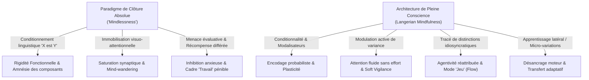

# The Power of Mindful Learning
**Formateur :** Ellen Langer | **ID :** `ellen-langer-the-power-of-mindful-learning` | **Tranches :** 10

## Synthèse Architecturale du Cours : *The Power of Mindful Learning* (Ellen Langer)

---

### 1. Thèse Centrale & Philosophie du Cours

#### Vision spécifique d’Ellen Langer vs Posture Standard
* **Rupture épistémologique avec le dogme éducatif classique :** Là où la pédagogie traditionnelle et le béhaviorisme assimilent l'apprentissage à l'acquisition de certitudes immuables, à la mémorisation de règles universelles (« *X est Y* ») et à l'automatisation rigide par surapprentissage (*drilling*), Ellen Langer démontre que **cette quête de fixité est la source première de l'incompétence contextuelle, de l'épuisement mental et de la rigidité fonctionnelle**.
* **Définition langérienne de la *Mindfulness* :** La pleine conscience selon Langer n’est ni une méditation orientale, ni un ralentissement de l'esprit, ni un effort d'hyper-concentration. C'est **l’acte simple et continu de tracer activement de nouvelles distinctions (*drawing novel distinctions*)**, maintenant le système nerveux dans un état d'orientation au présent et d'ouverture aux affordances contextuelles.
* **Refus de l'évaluation sommative et du concept de déficit :** Les notions d'« échec », d'« incompétence », de « TDAH », de « distraction » ou de « paresse » ne sont pas des propriétés objectives du sujet, mais des sous-produits de cadres évaluatifs arbitraires. Tout comportement a une validité fonctionnelle dès lors qu'il est analysé depuis la perspective de l'acteur et de son écologie immédiate.

#### Fil rouge méthodologique
Le vecteur unificateur de toutes les interventions de Langer est le **dégel de la certitude absolue par l'injection continue de conditionnalité et de variance** :
$$\text{Certitude absolue} \longrightarrow \text{Clôture prématurée} \longrightarrow \text{Cécité contextuelle \& Épuisement}$$
$$\text{Conditionnalité / Variance} \longrightarrow \text{Attention dynamique sans effort (*Soft Vigilance*)} \longrightarrow \text{Plasticité \& Transfert adaptatif}$$

Ce principe s’exécute à tous les niveaux du système :
1. **Linguistique :** Basculer du verbe ontologique (« *est* ») vers le modal d'ouverture (« *pourrait être* »).
2. **Perceptif/Attentionnel :** Remplacer la fixité statique (« *hold the picture still* ») par la modulation continue d'angles et de contrastes (« *vary the picture* »).
3. **Moteur :** Remplacer la répétition mécanique par l'apprentissage latéral (*sideways learning*) et la micro-variance sensorimotrice.
4. **Affectif/Motivationnel :** Dissoudre la dichotomie artificielle Travail vs Jeu en éliminant la menace évaluative et la téléologie extrinsèque.

---

### 2. Carte des Concepts & Leviers Émergents

#### Écosystème des leviers cognitifs et opérationnels

1. **Conditionnalité Linguistique & Modalisateurs Épistémiques**
   * *Rôle dans l'écosystème :* Prévient la fixation fonctionnelle et la clôture prématurée des réseaux neuronaux. En substituant « *pourrait être* » à « *est* », le cerveau maintient les affordances d'un objet ou d'un concept en état de superposition quantique/cognitive, garantissant le transfert immédiat face à l'imprévu.
2. **Perspective Acteur vs Observateur & Réhabilitation de l'Intention Positive**
   * *Rôle :* Neutralise les jugements dépréciatifs (« distrait », « impulsif ») en les recadrant selon la logique interne du sujet (« capté par une autre saillance », « réactif »). Restaure l'estime et donne accès aux variables réelles de modulation.
3. **Déconstruction des Critères Arbitraires (*Criteria Authorship*)**
   * *Rôle :* Réduit l'impuissance acquise face aux tests et normes scolaires/médicales en exposant la subjectivité située de leurs créateurs (« *Who created the test?* »).
4. **Attention à la Variabilité des Symptômes (*Attention to Variability*)**
   * *Rôle :* Brise les généralisations somatiques et identitaires (douleur chronique, handicap, blocage créatif). En calibrant les micro-fluctuations (« quand est-ce un peu moins fort ? »), le sujet réacquiert un sentiment de contrôle préfrontal.
5. **Apprentissage Latéral (*Sideways Learning*) & Bilinguisme Moteur**
   * *Rôle :* Contre-poison du *drilling* mécanique. L'introduction de micro-variations obligatoires (rythme, instrument voisin, angle) empêche l'automatisation amnésique et ancre le feedback proprioceptif en temps réel.
6. **Modulation Active de Variance vs Illusion de l'Appareil Photo Immobile**
   * *Rôle :* Résout le paradoxe attentionnel : fixer un point statique provoque l'évanouissement perceptif (effet Troxler cognitif). Varier délibérément l'angle d'observation réactive la saillance dopaminergique sans induire de fatigue exécutive.
7. **La *Soft Vigilance* (Vigilance Souple)**
   * *Rôle :* État de présence panoramique décontractée, opposé à l'hypervigilance focale stressante. Maintient une économie neurosomatique tout en augmentant la détection des anomalies périphériques.
8. **Recadrage Fonctionnel du TDAH et de la Distraction**
   * *Rôle :* Reconceptualise l'hyperactivité et la distraction non comme des déficits structurels, mais comme des régulations homéostatiques kinésiques contre la monotonie (« *otherwise-attracted* »).
9. **Désamorçage de la Surjustification & Intégration Travail/Jeu**
   * *Rôle :* Démontre que la souffrance au travail provient de la menace évaluative et de la promesse de récompense différée. L'étiquetage « Jeu » ou la recherche de nouveauté intrinsèque supprime la friction mentale et l'errance cognitive (*mind-wandering*).
10. **Tracé de Distinctions Idiosyncratiques (*Drawing Novel Distinctions*)**
    * *Rôle :* Moteur primaire du plaisir et de l'engagement. L'acte subjectif d'isoler des détails arbitraires transforme n'importe quelle activité monotone en expérience exploratoire auto-gratifiante.
11. **Rupture de Rationalisation Rétroactive par Inversion Contrefactuelle**
    * *Rôle :* Outil socratique majeur démontrant au système nerveux sa propre machine à inventer des justifications causales *post-hoc*, brisant l'attachement aux croyances arbitraires.

---

### 3. Tableau Récapitulatif des Techniques & Démonstrations

| Technique / Exercice | Objectif Opératoire | Déclencheur / Indication | Séquence Résumée |
|---|---|---|---|
| **L'Épreuve des « Chaussures Dépareillées »** *(Désensibilisation Évaluative)* | Neutraliser la terreur du regard d'autrui et briser la croyance en un jugement omniscient. | Inhibition sociale, perfectionnisme paralysant, trac d'évaluation. | 1. Porter délibérément deux chaussures différentes dans un espace public. 2. Calibrer l'indifférence réelle de 95% des passants. 3. Observer/renvoyer le regard des 5% restants pour faire éclater l'arbitraire de la norme. |
| **Inoculation par Inversion Contrefactuelle** | Effondrer la certitude aveugle et exposer la machine à rationaliser *post-hoc*. | Dogmatisme d'un groupe, certitude arrogante sur une « vérité » théorique. | 1. Présenter une fausse thèse ou des résultats d'études inversés comme des faits avérés. 2. Demander au sujet/groupe d'expliquer pourquoi cela fait parfaitement sens. 3. Laisser le sujet construire ses justifications causales. 4. Révéler brutalement l'inversion réelle (*pattern interrupt*) pour exposer le piège de rationalisation. |
| **Le Switch « Objectif Mobile »** *(Variance Attentionnelle Stimulée)* | Maintenir une attention soutenue sans effort ni décrochage attentionnel. | Décrochage, sensation de fatigue sur une tâche statique, errance mentale (*mind-wandering*). | 1. Interrompre l'effort de fixité statique (« ne plus fixer l'appareil photo »). 2. Demander d'identifier immédiatement 3 micro-variations invisibles à première vue. 3. Réitérer la recherche sous 3 angles sensoriels distincts (forme, texture, dynamique). |
| **L'Apprentissage Latéral Moteur** *(Désancrage par Micro-Variance)* | Prévenir le surapprentissage rigide et l'amnésie des micro-composants du geste. | Apprentissage d'un geste technique (musique, sport, tir, chirurgie). | 1. Interdire la répétition mécanique à l'identique. 2. Imposer un changement de variable à chaque itération (tempo, poids de l'objet, asymétrie corporelle, surface). 3. Forcer la calibration kinesthésique continue au présent. |
| **Le Bilinguisme Moteur Simultané** | Empêcher la fusion cognitive entre compétence profonde et outil spécifique. | Tendance à la rigidité instrumentale ou technologique. | 1. Pratiquer deux variantes d'un même art sur deux interfaces légèrement divergentes (ex. piano/orgue, violon/alto). 2. Alterner à intervalles courts pour contraindre le cortex moteur à lire les contraintes physiques réelles. |
| **Le Tracé de Distinctions Idiosyncratiques** | Transformer instantanément une corvée aversive en engagement de flux (*flow*). | Tâche réputée ennuyeuse, obligatoire ou répétitive (lecture de texte aride, classement). | 1. Choisir 2 à 3 critères d'observation totalement arbitraires et personnels dans le matériel. 2. Suivre et comptabiliser activement ces micro-distinctions sans chercher de résultat pratique. 3. Observer le basculement de l'affect (du dégoût à la curiosité ludique). |
| **Calibration de la Variabilité Somatique** | Réattribuer l'agentivité et désactiver l'omission sélective sur un symptôme permanent. | Douleurs chroniques, stress somatisé, étiquette de maladie invalidante. | 1. Demander des micro-évaluations régulières : « Est-ce plus ou moins fort qu'il y a 5 minutes ? ». 2. Isoler ce qui a changé dans le contexte immédiat lors de la baisse d'intensité. 3. Ancrer l'expérience que le symptôme n'est pas un bloc statique mais un processus variable modulable. |
| **Réencodage Linguistique Conditionnel** | Préserver la transférabilité d'une connaissance et prévenir la fixation fonctionnelle. | Rédaction de protocoles d'urgence, manuels de formation, apprentissage d'outils. | 1. Identifier et expurger tout verbe d'état absolu (*est*, *doit être*, *toujours*). 2. Remplacer par des modalisateurs épistémiques (*peut être*, *dans certains contextes*, *semble*). 3. Tester immédiatement l'objet/procédure dans une situation divergente. |
| **Recadrage « Autre Attraction »** | Rétablir l'estime et rediriger la focalisation sans entrer dans le conflit de volonté. | Enfant/adulte étiqueté distrait, hyperactif ou en décrochage. | 1. Valider que l'attention n'est pas « absente » mais captée par un stimulus à plus fort contraste. 2. Identifier la nature du contraste attracteur (mouvement, son, idée interne). 3. Intégrer ce type de contraste ou cette dynamique au cœur même de la tâche cible. |

---

---

## 0. Sommaire Sémantique & Index des Lignes

- **Tranche 1 [Lignes 104-215]** : Réduction Somatique & Réattribution du Contrôle par Attention à la Variabilité — *Protocole :* Réduction Somatique & Réattribution du Contrôle par Attention à la Variabilité
- **Tranche 2 [Lignes 217-332]** : A : L'Épreuve de Désensibilisation Évaluative (La Démarche des « Chaussures Dépareillées ») — *Protocole :* A : L'Épreuve de Désensibilisation Évaluative (La Démarche des « Chaussures Dépareillées »)
- **Tranche 3 [Lignes 334-451]** : Désamorçage de la Certitude par Inversion Rétroactive de Variable — *Protocole :* Désamorçage de la Certitude par Inversion Rétroactive de Variable
- **Tranche 4 [Lignes 453-583]** : Induction de Concentration par Variance Stimulée (Le Switch « Objectif Mobile ») — *Protocole :* Induction de Concentration par Variance Stimulée (Le Switch « Objectif Mobile ») | *Mécanisme :* Le Piège de l'Immobilisation Visuo-Attentionnelle (Effet Troxler Cognitif) | *Verbatim :* Le Double Déverrouillage de la Culpabilité Attentionnelle
- **Tranche 5 [Lignes 585-763]** : Conversion d'une Activité Aversive en Jeu par Détection Idiosyncratique de Distinctions — *Protocole :* Conversion d'une Activité Aversive en Jeu par Détection Idiosyncratique de Distinctions | *Mécanisme :* Le Biais d'Étiquetage Contextuel (Travail vs Jeu) et l'Errance Mentale | *Verbatim :* Rupture du lien univoque entre tâche et pénibilité
- **Tranche 6 [Lignes 765-901]** : Encodage Multi-Perspectif et Pertinence Personnelle (Anti-Mémorisation Passive) — *Protocole :* Encodage Multi-Perspectif et Pertinence Personnelle (Anti-Mémorisation Passive) | *Verbatim :* Le cadrage de la pertinence subjective
- **Tranche 7 [Lignes 903-1028]** : Désactivation de l'Effet Secondaire Négatif par Recontextualisation Opératoire — *Protocole :* Désactivation de l'Effet Secondaire Négatif par Recontextualisation Opératoire | *Mécanisme :* L'Inoculation Pré-Critique et la Prophétie Réalisatrice Identitaire | *Verbatim :* Citation 1
- **Tranche 8 [Lignes 1030-1127]** : Recadrage Chirurgical d'Atténuation Somatique & Récupération Opératoire — *Protocole :* Recadrage Chirurgical d'Atténuation Somatique & Récupération Opératoire
- **Tranche 9 [Lignes 1129-1222]** : A : La Transmutation d'Erreur par Translation de Contexte (Context Translation Protocol) — *Protocole :* A : La Transmutation d'Erreur par Translation de Contexte (Context Translation Protocol) | *Mécanisme :* Le Gel Contextuel Évaluateur (Context Freezing) | *Verbatim :* La Relativité Contextuelle des Absolus
- **Tranche 10 [Lignes 1224-1309]** : Recadrage Contextuel d'Incompétence Induite (The Illusion of Incompetence Shatter) — *Protocole :* Recadrage Contextuel d'Incompétence Induite (The Illusion of Incompetence Shatter) | *Mécanisme :* Le Levier de l'Engagement Conditionnel vs Engagement Inconditionnel Prématuré | *Verbatim :* Le Déclencheur Fondamental de la Pleine Conscience

---

## Extractions Détaillées par Tranche (Opératoire & Verbatim)

## Tranche 1 / 10 : Réduction Somatique & Réattribution du Contrôle par Attention à la Variabilité

### 1. Mécanismes & Principes Actifs

- **Conditionnalité Linguistique vs Prémisse d'Absolu (Conditional Learning vs Unconditional Instruction)**
  - *Principe actif :* L'apprentissage inconditionnel ("X *est* Y") fige l'information dans une catégorie cognitive fermée, la rendant inaccessible lors de contextes émergents ou divergents (rigidité fonctionnelle). À l'inverse, l'encodage sous forme conditionnelle ("X *peut être* Y", "X *est souvent* Y") maintient la structure neurologique en état de superposition/doute heuristique. Cela active les réseaux de plasticité cognitive, prévient la cécité contextuelle et permet un transfert spontané de compétences face à l'imprévu.
  - *Tags :* #conditional_learning #linguistic_relativity #cognitive_plasticity #doubt_induction

- **Perspective de l'Acteur vs Perspective de l'Observateur (Actor/Observer Attribution Shift)**
  - *Principe actif :* Tout comportement a du sens vu du modèle du monde de l'acteur (présupposition centrale : intention positive et logique interne). Le jugement dépréciatif de l'observateur ("paresseux", "têtu", "distrait") projette une déficience structurelle sur le sujet. En recadrant le comportement depuis le cadre interne de l'acteur ("faiblement motivé", "inébranlable", "attiré par autre chose"), on désamorce le conflit identitaire, on préserve l'estime de soi et on accède aux leviers réels de modulation comportementale.
  - *Tags :* #actor_observer_shift #perceptual_positions #positive_intention #reframing

- **Déconstruction des Critères Arbitraires (Criteria Authorship & Subjectivity)**
  - *Principe actif :* Les grilles d'évaluation et de diagnostic sont perçues par le système nerveux comme des vérités ontologiques objectives ("descendues du ciel"), alors qu'elles sont des conventions créées par des observateurs situés. Révéler la relativité de l'auteur des critères (*"Who created the test?"*) brise l'ancrage d'impuissance acquise et permet d'adapter ou d'élargir les critères contextuels (ex. force brute vs morphologie fine dans les décombres).
  - *Tags :* #criteria_deconstruction #meta_model_lost_performative #attribution_control

- **Attention à la Variabilité des Symptômes (Attention to Variability)**
  - *Principe actif :* L'assignation d'une étiquette nosologique ou d'incompétence (douleur chronique, arthrite, dyslexie) entraîne une généralisation cognitive : le système supprime (omission sélective) les moments où le symptôme est absent ou atténué. En calibrant activement les micro-variations somatiques et contextuelles ("est-ce plus ou moins sévère qu'il y a un instant, et pourquoi ?"), le système nerveux réintroduit de la rétroaction dynamique, réattribue le contrôle à l'individu et réduit l'intensité perçue de l'état limitant.
  - *Tags :* #attention_to_variability #sensory_calibration #neurofeedback #pain_modulation

- **Détection Active de Nouveauté (Mindful Noticing vs Mindless Pretense)**
  - *Principe actif :* L'esprit humain détecte intuitivement l'état attentionnel d'autrui (sensibilité inconsciente aux micro-signaux non-verbaux). Un état de présence "pleine conscience" (calibrer activement les changements chez l'interlocuteur) crée un rapport profond et sécurisant, régulant le tonus vagal et l'estime du sujet. À l'opposé, l'attention simulée ("faire semblant de s'intéresser") est décodée comme une incongruence, générant stress, chute d'estime et retrait social.
  - *Tags :* #active_noticing #rapport_calibration #somatic_resonance #incongruence_detection

- **Érosion de l'Effort par Dissolution de la Menace Évaluative (Effortlessness & Work-Play Integration)**
  - *Principe actif :* L'impression d'effort douloureux et d'épuisement mental ne provient pas de la tâche elle-même, mais de l'inhibition anxieuse liée à la peur du jugement et à la monotonie (absence de nouveauté). Lorsque l'évaluation sommative est suspendue au profit d'un focus attentionnel sur les détails sensoriels changeants (comme dans le jeu vidéo), l'attention bascule en flux spontané (flow), éliminant la sensation de friction cognitive.
  - *Tags :* #de-evaluation #play_work_integration #flow_state #novelty_seeking

---

### 2. Protocoles, Techniques & Démonstrations (Étape par Étape)

#### Protocole 1 : Réduction Somatique & Réattribution du Contrôle par Attention à la Variabilité
* **Intention / Indication :** Douleurs chroniques, états somatiques persistants (arthrite, céphalées, stress), diagnostics perçus comme irréversibles ou figés.
* **Mise en place & Pré-framing :** Cadrer que le corps n'est jamais dans un état statique absolu : *"Aucun symptôme n'est identique d'une minute à l'autre ; tout fluctue en fonction du contexte et de notre physiologie."*
* **Séquence d'actions pas à pas :**
  1. *Échantillonnage temporel :* Alerter ou sonder le sujet à intervalles réguliers au fil de sa journée.
  2. *Calibration différentielle :* Poser l'instruction d'accès sensoriel : *"À cet instant précis, ressentez-vous le symptôme ?"*
  3. *Mesure de gradient relatif :* *"Si oui, est-il plus intense ou moins intense qu'au moment de la mesure précédente ?"*
  4. *Enquête contextuelle causale :* *"Qu'est-ce qui dans l'environnement immédiat, votre posture, vos pensées ou votre activité explique cette différence d'intensité ?"*
  5. *Ancrage de variabilité :* Constater que le symptôme dépend du contexte, réintroduisant la marge de manœuvre et brisant l'illusion de fatalité.
* **Signes de calibration :** Relâchement du tonus musculaire périphérique, respiration plus basse et ample, réorientation du discours de la fatalité passive vers l'exploration active de micro-solutions contextuelles.

#### Protocole 2 : L'Apprentissage Conditionnel Préventif (Désamorçage de l'Absolu)
* **Intention / Indication :** Enseignement de concepts, formation à des protocoles d'intervention, acquisition de compétences face à des environnements instables ou complexes.
* **Mise en place & Pré-framing :** Remplacer le postulat d'une vérité unique par le cadre de la multiplicité des perspectives possibles.
* **Séquence d'actions pas à pas :**
  1. *Formulation conditionnelle initiale :* Présenter les données non sous forme d'absolus catégoriques ("X est Y"), mais avec des marqueurs épistémiques modaux : *"Dans ce contexte précis, X pourrait être Y / X est souvent Y."*
  2. *Exploration des limites contextuelles :* Demander immédiatement au sujet : *"Dans quelle situation inhabituelle cette règle deviendrait-elle inopérante ou fausse ?"* (ex. $1 + 1 = 1$ avec de la pâte à mâcher).
  3. *Validation de la logique interne :* Face à une réponse divergente ou "fausse", s'abstenir de corriger. Demander : *"Quel est le chemin de pensée qui vous amène à ce résultat ?"*
  4. *Test de transfert flexible :* Présenter une tâche inédite nécessitant de recombiner ou d'adapter la règle apprise.
* **Signes de calibration :** Absence de blocage de type "sidération/anxiété de performance" devant l'inconnu, curiosité exploratoire verbale, micro-mouvements de recherche cognitive fluide (mouvements oculaires d'exploration libre vs regard fixe de mémorisation brute).

#### Protocole 3 : Présence Calibrante Réelle vs Présence Simulée (Intervention de Rapport Profond)
* **Intention / Indication :** Entretien de coaching, hypnose conversationnelle, accompagnement d'enfants ou de sujets hypersensibles.
* **Mise en place & Pré-framing :** Interdire formellement toute façade sociale ou écoute polie passive.
* **Séquence d'actions pas à pas :**
  1. *Alignement sur l'intention :* Établir l'intention bienveillante de faire de l'échange un espace soutenant.
  2. *Tâche attentionnelle continue (Noticing change) :* Pendant que l'autre parle, calibrer en temps réel et silencieusement chaque micro-variation somatique :
     - Rythme et intonation de la voix.
     - Posture, inclinaison du tronc, ouvertures/fermetures des mains.
     - Diamètre pupillaire et fréquence respiratoire.
  3. *Accompagnement par écho structurel :* Répondre non pas sur un scénario préparé, mais en rebondissant directement sur les fluctuations calibrées.
* **Signes de calibration :** Augmentation immédiate de l'enthousiasme du sujet, dilatation pupillaire, engagement verbal spontané, alignement postural fluide, absence de gestes d'auto-contact d'apaisement.

---

### 3. Heuristiques, Subtilités & "Sagesse du Praticien"

- **Heuristique de recadrage des étiquettes (Actor's Perspective) :**
  - *Règle :* *Si* un sujet (ou un tiers) s'attribue une étiquette péjorative ("Je suis têtu", "Il est paresseux", "Mon enfant est distrait"), *alors* reformuler immédiatement vers le prédicat positif correspondant à la perspective de l'acteur ("Tu es inébranlable", "Il est insuffisamment motivé par ce cadre", "Il est attiré par autre chose").
  - *Raison :* Tout comportement fait sens pour l'organisme au moment où il se produit ; attaquer l'étiquette crispe l'identité, tandis que renommer la fonction restaure le choix.

- **Heuristique face aux comportements dominateurs/agressifs :**
  - *Règle :* Ne JAMAIS intervenir auprès d'une dynamique d'intimidation en disant : *"Ce n'est pas bien de s'en prendre aux plus faibles"*, car cela confirme et renforce son statut perçu de puissance ("Je suis fort, l'autre est faible").
  - *Alternative opératoire :* Redéfinir l'acte dans la catégorie de la faiblesse : *"Seuls les individus faibles et insécurisés ont besoin d'écraser autrui pour se sentir exister."* Retirer le gain secondaire désactive le pattern.

- **Heuristique d'auto-évaluation et de performance :**
  - *Règle :* En pleine action ou apprentissage, *si* le sujet fait une erreur, *alors* bannir les débriefings d'auto-évaluation globale ("Qu'est-ce qui cloche chez moi ?") et focaliser l'attention sur le micro-ajustement comportemental immédiat ("Fais un peu plus de ceci, un peu moins de cela").
  - *Raison :* L'évaluation globale crée une rupture de transe active (interrompt le flow) et ancre l'échec dans l'identité plutôt que dans la variabilité du geste.

- **Heuristique du doute constructif :**
  - *Règle :* Pour installer une vraie confiance, amener le sujet à être à la fois *sûr de ses capacités de présence* et *incertain quant aux réponses toutes faites*.
  - *Axiome :* *"To be mindful is to be confident and uncertain."* La certitude est une illusion qui clôt la recherche ; l'incertitude confiante ouvre la perception.

---

### 4. Pépites Verbatim & Patterns Linguistiques (MOT À MOT EN V.O.)

> “Behavior makes sense from the actor’s perspective or else s/he wouldn’t have done it.”
- **[Analyse du Pattern]** : Truisme épistémique / Postulat ericksonien. Présupposition universelle qui élimine l'arbitraire de la folie ou de la malveillance pour forcer la recherche de l'intention positive sous-jacente et de la logique interne du comportement.

> “A child is seen as distracted, for example, rather than as otherwise attracted.”
- **[Analyse du Pattern]** : Recadrage par redéfinition sémantique et symétrie morphologique (*distracted* vs *otherwise attracted*). Rupture du pattern de déficit centré sur l'enfant : l'attention n'est pas absente, elle est dirigée vers une cible concurrente plus attractive.

> “Once we are placed on the tail end of the distribution, social forces work to keep us there, setting us up for a lifetime of success or failure. Our fate as winners, losers, or just average is sealed.”
- **[Analyse du Pattern]** : Hypnose conversationnelle / Description de transe culturelle. Utilisation d'un empilement de suggestions de fatalité ("social forces work", "setting us up", "sealed") pour dramatiser l'impact hypnotique des étiquettes et des prophéties auto-réalisatrices imposées par l'école.

> “Instead of rating our performance, I think it would serve us better to train mindful attention to the particulars of the game.”
- **[Analyse du Pattern]** : Shift directionnel d'attention (Méta-Programme). Redirection du focus interne évaluatif (jugement, auto-dialogue critique) vers un focus externe sensoriel spécifique (*particulars of the game*), favorisant un état de flow sans friction d'ego.

> “Does it make sense to apply a pejorative label when most of what is read is correct?”
- **[Analyse du Pattern]** : Question rhétorique de recadrage de contexte. Utilisation du contraste numérique quantitatif ("pejorative label" vs "most is correct") pour briser la généralisation abusive du diagnostic psychopathologique ou cognitif.

> “Rather than teach 1 plus 1 is 2, for example, students would be told that 1 plus 1 could be 2 or is often 2.”
- **[Analyse du Pattern]** : Modalisation épistémique / Opérateurs modaux de possibilité (*could be*, *often*). Rupture de l'impératif catégorique d'absolu. Crée un espace mental pour les exceptions contextuelles sans rejeter la convention habituelle.

> “The face of the water, in time, became a wonderful book—a book that was a dead language to the uneducated passenger, but which told its mind to me without reserve, delivering its most cherished secrets as clearly as if it uttered them with a voice.”
- **[Analyse du Pattern]** : Métaphore isomorphe riche (Mark Twain citée par Langer). Synesthésie (l'eau/livre/voix). Suggestion enchâssée sur la transformation de la perception : ce qui semble opaque ou ordinaire aux yeux de l'esprit conditionné ("dead language") devient une source inépuisable de distinctions pour l'esprit éveillé à la nouveauté.

> “To be mindful is to be confident and uncertain.”
- **[Analyse du Pattern]** : Paradoxe ericksonien / Oxymore intégrateur. Rapprochement de deux états émotionnels traditionnellement exclusifs ("confident" et "uncertain"). La structure syntaxique détruit l'équation habituelle "incertitude = anxiété" et la remplace par "incertitude = vigilance ouverte et maîtrise détendue".

## Tranche 2 / 10 : A : L'Épreuve de Désensibilisation Évaluative (La Démarche des « Chaussures Dépareillées »)

### 1. Mécanismes & Principes Actifs

- **Focalisation sélective contextuelle et sentiment d'agentivité**
  - *Principe actif* : La perception d'un événement (ex. stress vs maîtrise vs ennui) n'est pas inhérente au stimulus extérieur, mais dépend de la sous-modalité d'attention sélectionnée par le sujet. En choisissant délibérément d'ancrer l'attention sur les invariants maîtrisés (ex. la tranche d'âge des étudiants), le système nerveux bascule d'une réponse de menace sympathique à un état de sécurité et de contrôle préfrontal.
  - *Tags libres* : `#recadrage_attentionnel` `#orientation_de_saillance` `#agentivite_cognitive`

- **Ancrage linguistique conditionnel vs absolu**
  - *Principe actif* : L'encodage d'une information sous forme absolue (« X *est* Y ») verrouille les réseaux sémantiques dans une catégorie rigide et fige l'objet dans une affordance unique. À l'inverse, l'encodage conditionnel (« X *pourrait être* Y ») maintient les synapses dans un état d'activation sous-seuil, préservant la plasticité cognitive et permettant le réemploi créatif et divergent de l'information hors de son contexte d'apprentissage.
  - *Tags libres* : `#modalite_epistemique` `#deverrouillage_synaptique` `#encodage_conditionnel`

- **Déconstruction de la conformité sociale par transgression calibrée**
  - *Principe actif* : La peur de l'évaluation sociale repose sur la projection inconsciente d'un jugement omniscient et punitif chez autrui. En imposant une violation bénigne et visible d'une norme vestimentaire (porter deux chaussures différentes), le système limbique est exposé à l'incongruité sans conséquence réelle. L'expérience directe désamorce l'inhibition sociale en prouvant l'indifférence globale d'autrui ou en renvoyant l'absurdité du regard évaluateur à son émetteur via un miroir comportemental.
  - *Tags libres* : `#desensibilisation_d_incongruite` `#miroir_relationnel` `#liberation_de_la_conformite`

- **Transe d'automatisation et amnésie des sous-composants (Le piège du surapprentissage)**
  - *Principe actif* : L'entraînement à répétition non modulé (« drill ») compresse les micro-mouvements ou étapes cognitives en macro-unités motrices ou mnésiques (« chunking » rigide). Bien que cela libère de la mémoire de travail, cela rend les sous-composants inaccessibles à la conscience réflexive. Face à un changement imprévu de variables contextuelles (ex. chaussée glissante, conduite à gauche, force asymétrique), l'automatisme s'exécute en boucle fermée sans feedback réactif, provoquant l'accident ou la rupture de performance.
  - *Tags libres* : `#surapprentissage_rigide` `#chunking_amnesique` `#ecrasement_du_feedback`

- **Inoculation du doute socratique par inversion de données contrefactuelles**
  - *Principe actif* : Le cerveau possède une propension naturelle à rationaliser rétroactivement n'importe quelle proposition tenue pour vraie (biais de confirmation a posteriori). En présentant une fausse corrélation ou des résultats inversés, le formateur invite le sujet à générer lui-même des chaînes de causalité robustes. La révélation subséquente de l'inversion produit une rupture de pattern brutale qui détruit la croyance en une « réponse unique vraie » et installe une méfiance réflexive féconde envers ses propres rationalisations.
  - *Tags libres* : `#rupture_par_inversion` `#piege_de_rationalisation` `#choc_epistemologique`

---

### 2. Protocoles, Techniques & Démonstrations (Étape par Étape)

#### Protocole A : L'Épreuve de Désensibilisation Évaluative (La Démarche des « Chaussures Dépareillées »)
* **Intention / Indication** : Sujets paralysés par la peur du jugement, l'inhibition sociale, le perfectionnisme scolaire ou l'anxiété de performance.
* **Mise en place & Pré-framing** :
  - Poser un paradoxe social bienveillant : *"Ceux qui tiennent à vous ne vous aimeront pas moins si vous portez des chaussures différentes, et ceux qui s'en fichent s'en ficheront encore plus."*
  - Transformer la transgression en obligation d'accès au groupe (injonction paradoxale d'entrée).
* **Séquence d'actions pas à pas** :
  1. *Prescription de symptôme / Ordre d'incongruité* : Exiger du sujet qu'il s'affiche publiquement avec un marqueur d'erreur délibéré (ex. deux chaussures totalement différentes).
  2. *Traversée de l'exposition* : Laisser le sujet traverser les espaces publics de transit (ascenseurs, couloirs, rue).
  3. *Miroir de pattern en cas de confrontation* : Lorsque le regard d'un tiers se fige et formule la question de normalisation (*"C'est fait exprès ?"*), le sujet répond par un miroir kinesthésique et verbal strict (*Regard chaussures -> visage -> pointage -> "Et vous, c'est fait exprès ?"*).
  4. *Intégration post-expérience* : Débriefer l'illusion du poids des normes sociales et ancrer l'autonomie décisionnelle.
* **Signes de calibration** :
  - *Étape 1* : Rires nerveux, micro-reculs corporels, hésitations verbales lors de la consigne.
  - *Étape 3* : Bascule du regard chez l'observateur (balayage vertical pied-tête répété signalant la dissonance cognitive).
  - *Étape 4* : Détente des épaules, rire libérateur, verbalisation d'une indifférence nouvelle face aux regards d'autrui.

#### Protocole B : Le Recadrage de Recherche Heuristique (« Du Fait au Comment »)
* **Intention / Indication** : Face à une idée jugée impossible, une impasse créative ou un rejet immédiat par « réflexe de bon sens ».
* **Mise en place & Pré-framing** :
  - Présenter une proposition apparemment absurde (ex. *"Peut-on empêcher une grossesse avec un spray nasal ?"*).
  - Constater la fermeture d'esprit et l'exclusion par le rire ou le mépris.
* **Séquence d'actions pas à pas** :
  1. *Validation de l'absurdité apparente* : Laisser le sujet rejeter ou grimacer.
  2. *Preuve de réalité perturbatrice* : Introduire un artefact véridique attestant de la réalité ou de la faisabilité de l'idée (titre de presse, brevet, cas clinique).
  3. *Basculement syntaxique de l'impasse vers le processus* : Remplacer l'opérateur modal de possibilité fermé (*"Est-ce possible ?"*) par un opérateur de procédé orienté solution (*"Comment pourrait-on utiliser X pour faire Y ?"*).
  4. *Génération de chemins physiologiques/logiques* : Forcer le système à tracer le trajet fonctionnel (ex. du nez vers le système hormonal et les gamètes), même sur des probabilités minimes.
* **Signes de calibration** :
  - Grimace initiale / ricanement défensif (fermeture de catégorie).
  - Arrêt sur image (freeze), dilatation pupillaire à la vue de la preuve matérielle.
  - Posture penchée en avant, débit verbal accéléré lors de la modélisation du mécanisme.

#### Protocole C : L'Inoculation par l'Explication Inversée (Technique d'Avorn-Langer)
* **Intention / Indication** : Dissoudre l'illusion de certitude dogmatique et démontrer au sujet comment son propre intellect invente des justifications pour des faits factices.
* **Mise en place & Pré-framing** :
  - Poser un cadre d'autorité neutre (ex. présentation de données d'essais cliniques ou de résultats historiques).
* **Séquence d'actions pas à pas** :
  1. *Exposition de la donnée inversée* : Présenter des statistiques ou corrélations en permutant délibérément les groupes (attribuer les effets secondaires au produit actif alors qu'ils viennent du placebo, ou inverser les variables A et B).
  2. *Sollicitation de rationalisation* : Demander aux sujets de construire des hypothèses expliquant *pourquoi* ce résultat logique se produit.
  3. *Renforcement du piège* : Laisser les sujets accumuler des preuves théoriques cohérentes.
  4. *Dévoilement de la symétrie* : Révéler calmement que les données appartenaient au groupe inverse.
  5. *Silence opératoire d'intégration* : Ne pas ajouter d'explication moralisatrice ; laisser le système cognitif digérer la fragilité de ses propres justifications.
* **Signes de calibration** :
  - Hochements de tête complaisants pendant la phase de rationalisation.
  - Rupture respiratoire, rire surpris ou silence soudain au moment de la révélation (choc de vacuité épistémique).

---

### 3. Heuristiques, Subtilités & "Sagesse du Praticien"

- **Règle de Conditionnalité de l'Information** :
  - *Si* tu transmets une consigne, une compétence ou un savoir -> *alors* formule-le toujours avec des modalisateurs épistémiques (« cela pourrait être », « voici une des perspectives possibles ») au lieu d'absolus catégoriques (« voici la méthode », « c'est ainsi »).
  - *Raison* : L'absolu fossilise l'apprentissage sous forme de réflexe conditionné indéformable ; le conditionnel préserve l'adaptabilité somatique et la créativité contextuelle.

- **Règle de l'Individuation des Fondations (« Whose Basics? »)** :
  - *Si* un apprenti échoue à reproduire la « base technique universelle » (tenue de raquette, posture, prise de notes) -> *alors* ne corrige pas l'écart par rapport à la norme, mais cherche l'adaptation anatomique et contextuelle propre à ses leviers uniques.
  - *Raison* : Les « fondamentaux » ne sont que des moyennes normatives d'experts adaptées à leur propre morphologie. Les reproduire aveuglément garantit la médiocrité technique.

- **Heuristique de Détection des Catégories Figées (Syndrome de l'Allumeur de Réverbères)** :
  - *Si* un sujet répète un comportement inefficace en affirmant « ce sont les instructions » ou « cela a toujours été ainsi » -> *alors* isole le décalage temporel ou spatial entre la consigne d'origine et le contexte actuel.
  - *Raison* : La transe d'automaticité ignore le changement d'environnement. La souffrance émerge quand le monde tourne plus vite que la consigne intériorisée.

- **Règle d'Attribution sans Faute (« No-Fault Reframing »)** :
  - *Si* le sujet dévie involontairement d'une recette, d'un protocole ou d'un résultat attendu -> *alors* ne qualifie jamais le produit d'« imparfait », renomme immédiatement la catégorie émergente (ex. le gâteau marbré manqué devient un « gâteau moucheté délicieux »).
  - *Raison* : Protège l'estime de soi, supprime la charge d'échec et valide l'exploration fortuite comme une découverte valable.

---

### 4. Pépites Verbatim & Patterns Linguistiques (MOT À MOT EN V.O.)

> « At the end of last semester, before the last class, I told students in my decision course that they couldn’t come to class the following week unless they were wearing two different shoes. »
- **[Analyse du Pattern]** : Prescription paradoxale contraignante avec condition négative exclusive (*"couldn’t... unless"*). Ce pattern brise la norme sociale par une injonction autoritaire directe, forçant le système nerveux à vivre l'incongruité pour désamorcer l'anxiété du regard d'autrui.

> « ...no one who cares about them would care less if they were wearing different shoes and those who don’t care would care even less. »
- **[Analyse du Pattern]** : Double lien linguistique par symétrie comparative (*"care about / care less / care even less"*). Cette structure en chiasme neutralise l'objection imaginaire : elle divise l'univers en deux catégories exhaustives pour démontrer que dans les deux cas, le résultat social est neutre, annulant tout risque émotionnel.

> « A young man looked at her shoes, looked at her face, looked at her shoes, looked at her face. After looking at her shoes one last time, he pointed to her shoes and said, “Was that intentional?” In response, she looked at his shoes, then his face, and then pointed to his shoes and said, “Was that?” »
- **[Analyse du Pattern]** : Rupture de pattern par miroir kinesthésique et syntaxique pur. La répétition rythmique du balayage visuel installe une boucle fermée d'interrogation sociale. La réplication exacte du geste et de l'interrogation (*"Was that?"*) retourne instantanément la charge de justification à l'agresseur social, désamorçant le cadre de jugement.

> « To be mindful is to be confident and uncertain. »
- **[Analyse du Pattern]** : Oxymore thérapeutique et recadrage d'état. Associe deux états physiologiquement perçus comme mutuellement exclusifs (*"confident"* = certitude/sécurité vs *"uncertain"* = doute/inconfort). Ce rapprochement sémantique installe une acceptation sécure de l'inconnu, déconnectant la confiance en soi de la possession de réponses figées.

> « The instructions are that I put out my lamp. Good evening... The instructions have not been changed... That is the tragedy! From year to year the planet has turned more rapidly and the orders have not been changed! »
- **[Analyse du Pattern]** : Métaphore isomorphe de la transe d'incompétence acquise. Répétition hypnotique de la boucle d'autorité (*"These are the instructions"*). Elle illustre la dissociation pathologique entre l'exécution d'un schéma moteur automatisé et la rétroaction environnementale temps réel.

> « If instead of asking, “Is it possible to prevent pregnancy with a nasal spray?” we ask, “How could we use a nasal spray as a method of birth control?” we set off on a different search, in a different frame of mind. »
- **[Analyse du Pattern]** : Recadrage de présupposition par substitution d'opérateur modal. Passage d'une question fermée sur la possibilité ontologique (*"Is it possible"*, propice au doute binaire) à une question ouverte orientée processus présupposant la réussite (*"How could we use"*, forçant le système cognitif à modéliser les étapes de résolution).

> « In a recent New York Times article psychologist Dean Radin described four stages of adopting ideas: “The first is, 1. ‘It’s impossible.’ 2. ‘Maybe it’s possible, but it’s weak and uninteresting.’ 3. ‘It is true and I told you so.’ 4. ‘I thought of it first.’” I would add a fifth stage, “We always knew that. How could it be otherwise?” »
- **[Analyse du Pattern]** : Empilement progressif de truismes décrivant l'amnésie d'apprentissage. L'ajout du cinquième stade parachève la fermeture cognitive : il démontre comment l'esprit transforme une vérité jadis révolutionnaire en une nouvelle évidence aveugle et rigide (*"How could it be otherwise?"*), bouclant la transe de la normalisation.

## Tranche 3 / 10 : Désamorçage de la Certitude par Inversion Rétroactive de Variable

### 1. Mécanismes & Principes Actifs

- **Conditionnalité Linguistique vs Cristallisation Absolue (Modalisateurs de Possibilité)**
  - *Principe actif :* Le système nerveux traite les informations affirmatives absolues (*« This is a... »*) comme des faits terminés, ce qui déclenche un encodage cognitif fermé (gel d'utilisation fonctionnelle). L'introduction de modalisateurs de possibilité (*« This could be a... »*, *« One way might be... »*) inhibe la fixation fonctionnelle et empêche la clôture prématurée du réseau neuronal associatif. L'objet ou le pattern d'action reste encodé comme un faisceau d'hypothèses malléables, ce qui laisse les circuits d'adaptation et de recombinaison créative immédiatement disponibles sans friction cognitive.
  - *Tags :* `#conditionnalite_linguistique` `#inhibition_de_fixite_fonctionnelle` `#encodage_probabiliste` `#permeabilite_cognitive`

- **Attribution Rétroactive de Cohérence & Illusion de Réalité (Rationalisation Post-Hoc)**
  - *Principe actif :* L'appareil cognitif humain excelle à construire des justifications causales rétroactives (« working backward »). Lorsqu'une prémisse (même inversée ou fausse) est présentée comme un « fait », le système produit activement des arguments pour la valider. Chaque justification générée renforce la croyance en la véracité de la prémisse par confirmation interne. L'inversion brutale du cadre par le formateur crée un effondrement d'ancrage (*pattern interrupt* cognitif majeur) qui expose au sujet sa propre machine à fabriquer des certitudes sans passer par une argumentation logique frontale.
  - *Tags :* `#rationalisation_retroactive` `#rupture_d_ancrage_cognitif` `#effondrement_de_certitude` `#boucle_de_justification_interne`

- **Perméabilité Différentielle à l'Autorité & Conformisme de Rôle (Conditionnement de Genre)**
  - *Principe actif :* L'adhésion identitaire à l'injonction d'obéissance (« be a good girl » = « do what you are told ») pousse le système nerveux à recevoir l'instruction comme une règle impérative non contextualisée. À l'inverse, une posture implicitement rebelle ou indépendante (« don't listen to all you are told ») induit une modalisation spontanée de la règle. Le format d'enseignement absolu pénalise spécifiquement les sujets conditionnés à la conformité lorsque l'environnement change (changement du poids de la balle), car ils tentent d'exécuter la commande motrice initiale au lieu de calibrer leurs sensations proprioceptives en temps réel.
  - *Tags :* `#conditionnement_a_l_obeissance` `#conformite_versus_variance` `#rigidite_perceptive_induite` `#sensibilite_au_feedback_proprioceptif`

- **Apprentissage Latéral (Sideways Learning)**
  - *Principe actif :* Contrairement aux approches *top-down* (injonction doctrinale descendante) ou *bottom-up* (répétition mécanique automatisée), l'apprentissage latéral introduit une micro-variance continue au cœur même du geste ou du concept. Au niveau neurobiologique, la répétition pure à l'identique éteint la vigilance attentionnelle et installe une exécution motrice automatique dissociée du contexte. En forçant la variation continue des micro-paramètres (sensations, tempo, posture, angle), le système est maintenu dans une boucle d'orientation active au présent, empêchant la dissociation machinale.
  - *Tags :* `#sideways_learning` `#micro_variance_continue` `#anti_automatisation` `#orientation_active_au_present` `#fractionnement_dynamique`

- **Pratique Multi-Instruments Similaires (Désancrage par Bilinguisme Moteur)**
  - *Principe actif :* L'apprentissage simultané de deux systèmes très proches mais non identiques (piano/orgue, violon/alto) empêche le système nerveux de confondre la compétence profonde avec l'outil d'exécution spécifique. Cette double pratique crée une défocalisation motrice qui interdit l'installation de routines musculaires rigides, forçant le cortex moteur à s'ajuster en permanence aux contraintes physiques subtiles (toucher du clavier, résistance de la corde).
  - *Tags :* `#bilinguisme_moteur` `#desancrage_d_outil` `#calibration_subtile` `#flexibilite_neuromusculaire`

- **Textes Conditionnels & Plasticité d'Application (Mindful Texts)**
  - *Principe actif :* L'introduction de marqueurs linguistiques de nuance (*« In most cases »*, *« may include »*, *« probably »*) dans un corpus théorique dense prévient la saturation dogmatique. Le lecteur n'enregistre plus des définitions closes mais des zones de validité contextuelle. Lors des phases de test ou d'application critique (urgence, transfert d'apprentissage), le sujet n'est pas bloqué par une règle littérale rigide (protocole adulte appliqué sans discernement à un enfant de 7 ans) et adapte spontanément le comportement aux variables présentes.
  - *Tags :* `#syntaxe_ouverte` `#transfert_adaptatif` `#anti_dogmatisme_cognitif` `#agilite_decisionnelle`

- **Distraction Comme « Autre Attraction » (Reframing Attentionnel de la Focalisation)**
  - *Principe actif :* L'attention n'est pas un réservoir d'énergie statique que l'on contracte par la force, mais un processus dynamique d'attraction sélective. L'injonction scolaire d'immobilisation de l'attention (« hold the picture still ») contredit le fonctionnement même des récepteurs sensoriels (l'image visuelle stabilisée sur la rétine s'efface par adaptation neurale rapide). La « distraction » n'est pas un déficit d'attention, mais une capture attentionnelle opérée par un stimulus alternatif porteur de saillance, de nouveauté ou de soulagement émotionnel.
  - *Tags :* `#sinon_attire` `#dynamique_attentionnelle` `#adaptation_neurale_perceptive` `#recadrage_symptomatique`

---

### 2. Protocoles, Techniques & Démonstrations (Étape par Étape)

#### Protocole 1 : Désamorçage de la Certitude par Inversion Rétroactive de Variable
* **Intention / Indication :** À utiliser face à un groupe ou un sujet enfermé dans une croyance rigide, polarisé sur une cause unique, ou persuadé qu'une information admet une seule interprétation évidente.
* **Mise en place & Pré-framing :** Cadrer l'exercice comme une étude empirique ou historique neutre à analyser ensemble, sans annoncer l'objectif réflexif.
* **Séquence d'actions pas à pas :**
  1. *Présentation des Données Inversées :* Exposer un problème sous forme de tableau ou de métrique en intervertissant intentionnellement les colonnes ou les chiffres (ex: 35 % d'obéissance destructrice vs 65 % de refus).
  2. *Élicitation des Rationalisations Rétroactives :* Inviter les sujets à expliquer pourquoi ces chiffres sont ce qu'ils sont. Laisser les explications s'empiler (« Les gens sont naturellement bons », « On refuse d'obéir aux tyrans »). Encourager la certitude verbale.
  3. *Ancrage de l'Adhésion :* Valider l'abondance des explications pour consolider l'engagement cognitif des sujets dans leur justification.
  4. *Rupture de Pattern Écologique (Le « Mislabeled Trap ») :* Se tourner vers le support visuel (tableau), marquer un temps d'arrêt non verbal, et annoncer d'un ton factuel : « Ah, pardon, j'ai inversé les étiquettes des colonnes. En réalité, 65 % ont obéi et 35 % ont refusé. »
  5. *Intégration Silencieuse :* Laisser le silence s'installer sans sur-expliquer. Le système nerveux confronte instantanément la facilité avec laquelle il a justifié une prémisse totalement opposée.
* **Signes de calibration :** Regard figé, arrêt respiratoire réflexe, rires gênés ou sourires de prise de conscience, silence soudain dans le groupe (rupture du débit verbal), absence de besoin d'argumentation contradictoire (« they seem to get the point without further discussion »).

---

#### Protocole 2 : Encodage Moteur Latéral (Sideways Motor Learning)
* **Intention / Indication :** Acquisition rapide d'une compétence motrice (instrument, sport, geste technique) sans rigidité, sans mécanisation robotique et avec un niveau élevé de plaisir et de créativité.
* **Mise en place & Pré-framing :** Présenter l'exercice non comme une mémorisation disciplinaire, mais comme un laboratoire d'exploration de micro-différences.
* **Séquence d'actions pas à pas :**
  1. *Délivrance de l'Instruction Conditionnelle :* Définir le geste de base non comme « la » manière de faire, mais comme une option de départ (*« One way to do this might be... »*).
  2. *Injonction de Variance Systématique :* Donner pour consigne formelle d'interdire la répétition mécanique à l'identique : changer de style toutes les 2 à 3 minutes, modifier l'intensité, le rythme ou la posture.
  3. *Focalisation Sensorielle Concomitante :* Demander au sujet de porter simultanément attention aux micro-sensations physiques, aux sons produits, à la respiration et aux pensées périphériques durant l'exécution.
  4. *Rappel de Recadrage à Mi-Parcours :* Interrompre à mi-séance pour réinjecter l'impératif de nouveauté : « Continuez à découvrir quelque chose de neuf sur votre manière de faire, ne vous enfermez dans aucun schéma. »
  5. *Test de Résilience au Changement de Contexte :* Modifier subitement une variable externe (ex: changer le poids de l'objet, changer de tempo, changer d'environnement) et observer la capacité d'adaptation fluide immédiate.
* **Signes de calibration :** Détente des muscles faciaux et du tronc (dissolution de l'hyperfocalisation isolée sur les mains), fluidité de la respiration, micro-ajustements corporels spontanés sans arrêt du mouvement, retours verbaux rapportant du plaisir plutôt que de la fatigue ou de la contrainte.

---

#### Protocole 3 : Recadrage Hospitalier / Stress Anticipatoire (« Sinon Attiré »)
* **Intention / Indication :** Préparation de sujets confrontés à une épreuve stressante inévitable (chirurgie lourde, séparation, déménagement forcé, crise médicale).
* **Mise en place & Pré-framing :** Interrompre la tentative stérile d'évitement mental (« essayer de ne pas y penser ») en recadrant l'espace de crise comme un contexte doté de propriétés singulières inexploitées.
* **Séquence d'actions pas à pas :**
  1. *Élicitation du Pattern d'Évitement :* Faire formuler au sujet ses tentatives d'auto-distraction forcée et constater leur inefficacité récurrente.
  2. *Validation de l'Attraction Inconsciente :* Poser que si l'esprit y revient, c'est que l'enjeu exige une attention signifiante, pas un refoulement.
  3. *Recherche d'Avantages Spécifiques au Contexte :* Guider le sujet pour identifier les bénéfices secondaires et opportunités exclusives créés par la situation (ex: temps imposé pour faire le bilan de ses priorités, réactivation de liens familiaux négligés, pause forcée dans le rythme de vie).
  4. *Ancrage de l'Attention Adaptative :* Lier sensoriellement le séjour ou l'épreuve à ces gains d'alignement personnel.
* **Signes de calibration :** Baisse du tonus sympathique (épaules qui descendent, respiration abdominale plus profonde), verbalisations orientées ressources (« En fait, cela va me permettre de... »), réduction mesurable post-opératoire de la demande d'analgésiques et de sédatifs.

---

### 3. Heuristiques, Subtilités & "Sagesse du Praticien"

- **Règle de Traitement de la Distraction :**
  * *Si* le sujet ou le patient « perd son attention » ou se montre distrait -> *alors* ne cherche pas à immobiliser son focus par la contrainte, mais identifie ce qui l'attire ailleurs (*otherwise attracted*) -> *parce que* toute distraction est une attraction active vers un stimulus plus saillant ou plus écologique pour le système nerveux à cet instant.
- **Règle de Réécriture Cognitive Conditionnelle :**
  * *Si* tu rédiges un protocole, un script hypnotique ou un support pédagogique -> *alors* substitue systématiquement les affirmations d'état (*« This is... »*, *« You will do X... »*) par des formulations d'occurrence probabiliste (*« In most cases... »*, *« One way might be... »*, *« You might notice... »*) -> *parce que* l'absolu enferme l'inconscient dans une séquence rigide incapable de s'adapter si la réalité diverge du schéma prévu.
- **Règle de l'Attention Mobile vs Attention Figée :**
  * *Si* un sujet rapporte qu'il n'arrive pas à « se concentrer » -> *alors* vérifie s'il tente d'immobiliser son image mentale (*holding the picture still*) au lieu de faire varier la cible (*varying the picture*) -> *parce que* physiologiquement et neurologiquement, une stimulation sensorielle statique non modulée s'efface de la perception consciente (loi d'adaptation des récepteurs).
- **Règle du Piège de l'Excellence Mécanique :**
  * *Si* un exécutant montre une virtuosité technique impeccable mais « sans âme » ou rigide -> *alors* isole l'entraînement de l'outil (ex: travailler la musique sans le clavier, ou faire varier délibérément les paramètres corporels) -> *parce que* l'apprentissage par répétition pure isole l'énergie dans les effecteurs terminaux (les doigts) et dissocie le tronc et la proprioception globale.
- **Règle du Rattrapage chez les Sujets Hyper-Conformes (« Bons Élèves ») :**
  * *Si* le sujet a un historique fort d'obéissance aux figures d'autorité (notamment le conditionnement sociétal des « bonnes petites filles ») -> *alors* il est crucial de formuler les consignes de départ sous forme strictement conditionnelle -> *parce que* ce profil absorbe la consigne comme un absolu non négociable, ce qui détruit sa capacité d'adaptation dès que les paramètres de la situation se modifient.

---

### 4. Pépites Verbatim & Patterns Linguistiques (MOT À MOT EN V.O.)

> **« In that study students were introduced to a set of objects either conditionally (“This could be a . . . ”) or in absolute form (“This is a . . . ”). [...] We found that only those students taught conditionally thought to use the objects in creative ways. »**
* **[Analyse du Pattern]** : Contraste syntaxique binaire pur. L'opérateur modal de possibilité (*« could be »*) dissout le verbe d'identité ontologique (*« is »*). Le simple changement du verbe suspend le verrouillage catégoriel inconscient et préserve la disponibilité de l'objet pour des recombinaisons futures.

---

> **« Students generate explanations for why most people did not obey and I should add, they do so with great certainty: “People don’t like to be pushed around,” “People are compassionate and don’t want to see anyone suffer,” and so on. At this point I turn to the board and notice that I “mislabeled” the columns. »**
* **[Analyse du Pattern]** : Rupture de pattern par retournement rétroactif du cadre (*frame reversal*). En laissant les sujets verbaliser leurs truismes moraux avec une certitude maximale (*« great certainty »*), l'intervenant crée une boucle de rétroaction où le sujet s'auto-enferme. La feinte de l'erreur d'étiquetage (*« mislabeled »*) produit un effondrement sémantique immédiat sans qu'aucune confrontation directe ne soit nécessaire.

---

> **« We would like you to try to learn these fingering exercises without relying on rote memorization. Try to keep learning new things about your piano playing. Try to change your style every few minutes, and not lock into one particular pattern. While you practice, attend to the context, which may include very subtle variations or any feelings, sensations, or thoughts you are having. »**
* **[Analyse du Pattern]** : Enchaînement de suggestions permissives combiné à un empilement de commandes négatives enchâssées pour interdire le verrouillage (*« not lock into one particular pattern »*). Utilisation du connecteur temporel d'inclusion simultanée (*« While you practice, attend to... »*) qui superpose l'exécution technique motrice avec la métacognition des états internes (sensations, pensées, micro-variations), forçant le système nerveux à rester dans un état d'orientation au présent.

---

> **« In most cases, municipal bonds are issued by states, territories, and possessions of the United States, as well as other political subdivisions. Such political subdivisions may include counties, cities, special districts for schools, waterworks, sewers, and other public purposes that may require the issuance of municipal bonds. »**
* **[Analyse du Pattern]** : Désabsolutisation textuelle par empilement de modalisateurs de portée (*« In most cases »*), d'auxiliaires modaux épistémiques (*« may include »*, *« may require »*) et de clauses d'extension ouverte (*« and other public purposes »*). Cette syntaxe conditionnelle contourne l'acceptation dogmatique et oblige l'inconscient du lecteur à traiter la règle comme un prototype contextuel plutôt que comme une vérité close.

---

> **« Being distracted, in short, means otherwise attracted. »**
* **[Analyse du Pattern]** : Recadrage de sens (*reframing*) fondé sur une ré-analyse morphologique et phonétique (« distracted » / « otherwise attracted »). Cette formule redéfinit instantanément un comportement jugé déficitaire ou fautif (la dispersion mentale) en un phénomène physiologique normal d'orientation sélective vers une source d'attraction alternative, transformant la culpabilité en curiosité opératoire.

---

> **« We asked whether they meant that the students should “hold the picture still” in their mind or did they mean that the students should “vary the picture” in their minds? Teachers overwhelmingly chose the first alternative. »**
* **[Analyse du Pattern]** : Double lien et mise en lumière d'une présupposition erronée sous-jacente. L'alternative linguistique met en contraste deux métaphores spatiales internes : la fixité photographique (*« hold still »*) contre le flux cinématique (*« vary »*). Elle démontre que l'injonction scolaire usuelle repose sur une commande neurologiquement intenable (l'immobilisation sensorielle), source directe de la fatigue attentionnelle.

## Tranche 4 / 10 : Induction de Concentration par Variance Stimulée (Le Switch « Objectif Mobile »)

Voici l'extraction exhaustive, chirurgicale et opératoire de la tranche 4/10 du cours d'Ellen Langer.

---

### 1. Mécanismes & Principes Actifs

#### A. Le Piège de l'Immobilisation Visuo-Attentionnelle (Effet Troxler Cognitif)
* **Principe actif :** Dans la culture scolaire et éducative, « faire attention » est inconsciemment assimilé à immobiliser son regard et son esprit comme un appareil photo sur un trépied (*« hold the picture still »*). Neurologiquement et optiquement, fixer un point statique sans micro-saccades entraîne l'épuisement des photorécepteurs rétiniens et la disparition progressive du stimulus (évanouissement perceptif / *fading*). Transposé au cortex associatif, tenter de figer une idée ou un concept statique déclenche une saturation synaptique rapide : l'attention décroche naturellement pour chercher du renouvellement.
* **Tags libres émergents :** `#illusion_de_l_appareil_photo_immobile` `#saturation_statique` `#evanescence_perceptive` `#oxymore_attentionnel`

#### B. La Modulation Active de Variance (Varying the Picture)
* **Principe actif :** Le cerveau humain est un détecteur de contrastes, d'écarts et de nouveauté. L'attention soutenue sans effort n'est pas le maintien d'une fixité, mais un **processus dynamique de variation continue** de l'angle, du contexte ou des caractéristiques perçues de l'objet. En invitant activement le système nerveux à chercher des sous-éléments inédits au sein du même stimulus, on contourne l'habituation et on réactive en continu le système de saillance dopaminergique sans induire de fatigue exécutive.
* **Tags libres émergents :** `#variance_attentionnelle_active` `#anti_habituation` `#encodage_multi_perspectives` `#attention_fluide`

#### C. La « Soft Vigilance » (Vigilance Souple vs Hypervigilance Focale)
* **Principe actif :** L'hypervigilance classique est une focalisation étroite déclenchée par la peur ou la tension, consommatrice d'énergie, créant un effet tunnel somatique (tensions musculaires) et rendant le sujet aveugle aux dangers périphériques ou imprévus. La *soft vigilance* (vigilance souple / attention consciente) est un état de réceptivité panoramique et détendue où l'esprit reste ouvert à l'inattendu. Elle permet au système somato-sensoriel de détecter l'anomalie (« ce qui sort de l'ordre habituel ») tout en régénérant les ressources attentionnelles au lieu de les épuiser.
* **Tags libres émergents :** `#soft_vigilance` `#conscience_panoramique` `#desamorçage_effet_tunnel` `#economie_neuro_somatique`

#### D. La Déconstruction Neurologique & Contextuelle du TDAH
* **Principe actif :** L'hyperactivité physique (bouger sur sa chaise, tripoter des objets, changer de posture) n'est pas intrinsèquement un déficit moral ou un dysfonctionnement cérébral primaire, mais une **stratégie adaptative homéostatique non consciente** par laquelle le corps force le changement de perspective et génère artificiellement de la nouveauté pour compenser la monotonie d'un stimulus statique. De même, ce qu'on appelle la « distraction » n'est pas une absence d'attention, mais une captation de l'attention par un stimulus porteur de plus de contraste (« être attiré ailleurs » / *otherwise-attracted*).
* **Tags libres émergents :** `#homeostasie_kinesique` `#distraction_comme_autre_attraction` `#recadrage_fonctionnel_tdah` `#compensation_de_monotonie`

#### E. L'Effet de Surjustification & La Rupture de Valeur Intrinsèque
* **Principe actif :** L'association d'une récompense extrinsèque ou différée (« Si tu travailles dur maintenant, tu auras ta récompense plus tard ») programme le système de croyance à présupposer que **l'activité elle-même est punitive, pénible ou dénuée de valeur immédiate** (*« odious task »*). Dès lors qu'un cadre de travail, de contrainte ou d'évaluation externe est collé sur une action, le cerveau bascule du mode de jeu (motivation intrinsèque, exploration, réactivité immédiate) au mode corvée (inhibition motrice, procrastination, stress d'évaluation).
* **Tags libres émergents :** `#surjustification_extrinseque` `#pollution_par_l_evaluation` `#dichotomie_artificielle_jeu_travail` `#piege_de_la_gratification_differee`

---

### 2. Protocoles, Techniques & Démonstrations (Étape par Étape)

#### Protocole 1 : Induction de Concentration par Variance Stimulée (Le Switch « Objectif Mobile »)
* **Intention / Indication :** Quand un sujet (élève, patient, praticien) affirme « je n'arrive pas à me concentrer », « mon esprit s'échappe dès que je lis ou travaille » ou présente des blocages attentionnels face à une tâche perçue comme aride.
* **Mise en place & Pré-framing :** 
  Déconstruire la métaphore de l'appareil photo fixe. Cadrer que forcer son esprit à s'immobiliser est contre-nature et fait disparaître l'objet. Poser le contrat : « Tu n'as pas besoin de te forcer à rester immobile ; nous allons simplement regarder ce qui change. »
* **Séquence d'actions pas à pas :**
  1. **Calibration de l'impasse statique :** Faire fixer au sujet son propre index ou un détail d'un tableau sans bouger les yeux pendant 15 secondes.
     * *Observation :* Noter le clignement réflexe, la fatigue ou l'aveu que l'image devient floue ou que l'esprit dérive.
  2. **Injection de Variabilité Dimensionnelle (Visuelle/Conceptuelle) :**
     * Demander au sujet de repérer immédiatement **3 à 6 aspects distincts ou inhabituels** sur le même stimulus (ex. : les micro-variations de teintes, les imperfections d'un contour, une ombre cachée, ou si c'est un texte : lire selon le point de vue d'un critique, d'un enfant, d'un détective).
  3. **Autorisation du Mouvement d'Exploration :**
     * Si le sujet est cinétique, lui faire adopter un micro-balancement, une modification de distance ou de posture (scannage horizontal et vertical global au lieu d'une fixation linéaire point par point).
  4. **Ancrage du Processus d'Absorption :**
     * Dès que le sujet perçoit de la nouveauté, son visage se détend et son attention s'ancre sans effort.
* **Signes de calibration :** Relâchement des muscles péri-orbitaires, disparition des tensions faciales et cervicales, posture engagée vers l'avant, respiration abdominale lente et régulière, restitution spontanée et enrichie des détails mémorisés.

---

#### Protocole 2 : Recadrage Somato-Contextuel pour Sujets "TDAH" / Agités
* **Intention / Indication :** Sujets catalogués déficitaires de l'attention, incapables de rester assis pour assimiler une leçon ou un protocole d'apprentissage.
* **Mise en place & Pré-framing :**
  Normaliser le mouvement non pas comme une indiscipline, mais comme un moteur biologique de production de perspectives. Valider le corps du sujet : « Ton corps ne fait pas une bêtise, il cherche simplement l'angle sous lequel cette matière devient vivante. »
* **Séquence d'actions pas à pas :**
  1. **Interruption du Pattern d'Injonction Statique :** Supprimer l'ordre « Assieds-toi sans bouger et concentre-toi ».
  2. **Intégration du Mouvement Régulé :**
     * Mettre en place une translation lente dans l'espace (ex. : faire les cent pas le long d'une ligne au sol à deux mètres du support) ou autoriser un micro-mouvement d'agitation motrice non disruptive (ex. : remuer les pieds, tapoter en rythme).
  3. **Stimulation Chromatique ou Polyphonique :**
     * Introduire de la couleur sur les supports d'information ou un fond sonore structurant (musique rythmée/rock adaptée, formats ludiques interactifs).
  4. **Instruction de Variation Interne :**
     * Enseigner au sujet à modifier délibérément dans sa tête la couleur, la taille, l'histoire ou la signification du stimulus cible toutes les 15 secondes.
* **Signes de calibration :** Baisse immédiate de l'agitation désorganisée, synchronisation du rythme cardiaque/respiratoire avec la tâche, balayage visuel global et holistique (panoramique) remplaçant les saccades erratiques, rétention mnésique multipliée.

---

#### Protocole 3 : La Dé-Catégorisation « Travail vs Jeu » (Re-Labellisation Cognitive)
* **Intention / Indication :** Procrastination chronique, anxiété de performance face à l'apprentissage ou résistance somatique à une tâche perçue comme une corvée (*drudgery*).
* **Mise en place & Pré-framing :**
  « Une tâche n'est intrinsèquement ni amusante ni pénible. C'est l'étiquette et la menace de l'évaluation qui créent la douleur. »
* **Séquence d'actions pas à pas :**
  1. **Dépouillement de la Téléologie Externe :** Supprimer temporairement la promesse de récompense différée ou le spectre de la notation/évaluation (« Oublie la note finale, oublie ce que cela te rapportera plus tard »).
  2. **Re-Labellisation Radicale :** Requallifier l'acte formel en « énigme », « exploration », « casse-tête » ou « manipulation de matière ».
  3. **Introduction de Règles de Variation Arbitraires (Gamification Interne) :**
     * Imposer une contrainte créative libre (ex. : altérer un ou deux mots pour rendre la consigne absurde, classer les éléments selon des catégories insolites inventées par le sujet, imaginer que les données sont des pièces de puzzle de personnes connues).
  4. **Focalisation sur le Plaisir d'Exécution Sensorielle :**
     * Porter l'attention sur l'esthétique du geste immédiat (comme le tracé du crayon sur le papier ou le son des touches).
* **Signes de calibration :** Sourire spontané, baisse de la fréquence cardiaque, démarrage immédiat de l'action sans friction préalable (*« launch directly into the fray »*), oubli du temps qui passe.

---

### 3. Heuristiques, Subtilités & "Sagesse du Praticien"

* **Règle du Contraste Homéostatique :**
  * *Si* un sujet vient d'un environnement ultra-statique et conventionnel -> *alors* introduire le mouvement physique pour faire émerger la nouveauté.
  * *Si* un sujet vient d'un milieu où le mouvement permanent est la norme (ex. école Montessori) -> *alors* la nouveauté attentionnelle réside dans le fait de s'asseoir et de s'immobiliser délibérément. L'attention dépend de la **rupture avec la norme de fond**, jamais de l'immobilité en soi.
* **Règle de l'Attraction Inverse :**
  * *Si* un client ou un enfant se dit « distrait » -> *alors* ne cherche pas à combattre la distraction : nomme qu'il est simplement *autrement-attiré* (*otherwise-attracted*). Analyse quel degré de nouveauté et de dynamisme l'autre stimulus lui procure, et réinjecte ce même niveau de variance dans l'objet d'étude.
* **Règle de l'Autonomie Attentionnelle :**
  * Ne rends jamais le sujet dépendant d'un animateur externe qui agite des objets pour capter son attention. Enseigne-lui à **faire varier la perspective depuis l'intérieur de son propre esprit**. C'est le secret de l'indépendance cognitive : même devant le professeur le plus terne ou la consigne la plus répétitive, le sujet qui cherche activement la nouveauté reste absorbé.
* **Le Piège Débutant de l'Hyper-Focalisation Vigilante :**
  * Confondre « être attentif » et « être hypervigilant ». L'hypervigilance crispe le corps, focalise sur un détail unique (ex. les branches d'arbres à cheval) et rend aveugle aux autres dangers émergents du terrain. Préférer toujours la *soft vigilance* : corps décontracté, regard ouvert, esprit prêt à accueillir l'inédit.
* **Le Piège Pédagogique de la Carotte & de la Punition :**
  * Vouloir motiver un sujet en lui promettant une récompense après la corvée (ou en maquillant superficiellement la corvée d'artifices) renforce puissamment la présupposition inconsciente que l'apprentissage est intrinsèquement détestable. Si tu dois payer quelqu'un pour faire une tâche, son inconscient en déduit aussitôt que la tâche ne vaut rien en elle-même.

---

### 4. Pépites Verbatim & Patterns Linguistiques (MOT À MOT EN V.O.)

#### Pépite 1 : Le Double Déverrouillage de la Culpabilité Attentionnelle
> *« Since we are so successful most of the day at paying attention, perhaps we should look more closely at those situations in which we find it difficult, rather than blame the problem on lack of character or a mental deficit. »*
* **[Analyse du Pattern] :** **Truisme / Présupposition de Compétence Suivie d'un Recadrage Déculpabilisant.** Langer commence par installer un truisme d'universalité positive incontestable (*« we are so successful most of the day... »*), ce qui réinstalle l'identité de l'interlocuteur dans la compétence. Elle enchaîne par une suggestion modale adoucie (*« perhaps we should... »*) couplée à une rupture de polarité : évacuation de l'attribution interne négative (*« lack of character », « mental deficit »*) au profit d'une focalisation contextuelle et situationnelle externe (*« those situations in which... »*).

---

#### Pépite 2 : La Déconstruction de l'Oxymore Attentionnel
> *« To pay constant, fixed attention to a thought or an image may be a kind of oxymoron. Yet this is the very way people try to attend to the external world of things or the internal world of ideas. »*
* **[Analyse du Pattern] :** **Rupture de Cadre Cognitive par Oxymore Explicite.** Langer heurte frontalement le modèle du monde éducatif standard en qualifiant le concept même de « concentration fixe » d'absurdité linguistique et neurologique (*« a kind of oxymoron »*). L'utilisation de l'adverbe *« yet »* crée un pont de prise de conscience critique en miroir, dévoilant le conflit entre la tentative rigide des individus (*« external world of things or internal world of ideas »*) et la réalité biologique du système nerveux.

---

#### Pépite 3 : Le Recadrage de la Distraction
> *« Next, we can reframe the concept of distraction by conceiving of it as being otherwise-attracted. »*
* **[Analyse du Pattern] :** **Recadrage Sémantique Conversationnel Pur (Sleight of Mouth - Redéfinition).** Remplacement instantané du nominal négatif et pathologisant (*« distraction »*, qui présuppose une absence, une faute ou un manque de volonté) par un état participial actif et légitime (*« otherwise-attracted »*). La polarité bascule : le sujet ne perd pas son attention, il l'exerce avec succès vers un objet plus gratifiant.

---

#### Pépite 4 : La Dissolution Somatique de la Tension / Vigilance Douce
> *« Focusing hypervigilantly on tree branches made me vulnerable to other dangers on the trail. A kind of soft vigilance, or mindful attention, helped me ‘avert the dangers not yet arisen.’ In contrast to hypervigilance, which locks in an object of attention, this soft vigilance remains open to novelty. »*
* **[Analyse du Pattern] :** **Métaphore Isomorphique Somatique & Contraste Hypnotique.** Langer utilise son expérience équestre comme métaphore d'induction. Elle oppose la rigidité kinesthésique d'enfermement focal (*« locks in an object »*) à l'état de transe éveillée réceptive (*« soft vigilance remains open to novelty »*). La citation finale intègre une formule archétypale quasi-méditative (*« avert the dangers not yet arisen »*), installant la sécurité et l'ouverture sensorielle comme une force de prévention supérieure au contrôle rigide.

---

#### Pépite 5 : La Dévaluation Inconsciente par la Promesse Future
> *« Rewards found in the present are certain. Delayed rewards may feel empty (‘To think of all I gave up for this . . .’). To justify waiting, the future must promise a bigger payoff. Yet the promise of a big payoff diminishes our appreciation of the present situation. »*
* **[Analyse du Pattern] :** **Boucle de Double Lien Temporel et Déconstruction de Croyance.** Démonstration par Langer du piège de la téléologie différée : la projection dans le gain futur dévalue somatiquement et instantanément la sensorialité du présent (*« diminishes our appreciation of the present situation »*). L'insertion de la citation interne en monologue subconscient (*« To think of all I gave up for this... »*) évoque directement le regret rétroactif universel et ancre la vacuité du modèle sacrificiel.

---

#### Pépite 6 : L'Effet de Surjustification Révélé par la Voix de l'Enfant
> *« Two weeks later he ran into one of them at the market and asked why he and his friends no longer came around. The child replied, ‘What do you think, we’re going to come for nothing?’ »*
* **[Analyse du Pattern] :** **Enchâssement Anecdotique & Punchline de Rupture Pédagogique.** Langer utilise une parabole relationnelle dont la réplique finale agit comme un électrochoc d'élicitation. L'interrogation rhétorique spontanée de l'enfant (*« What do you think, we're going to come for nothing? »*) cristallise parfaitement le basculement neuronal opéré par la surjustification : ce qui était du pur plaisir intrinsèque s'est métamorphosé en labeur transactionnel, détruisant instantanément l'appétence naturelle du sujet.

## Tranche 5 / 10 : Conversion d'une Activité Aversive en Jeu par Détection Idiosyncratique de Distinctions

### 1. Mécanismes & Principes Actifs

#### Le Biais d'Étiquetage Contextuel (Travail vs Jeu) et l'Errance Mentale
* **Principe actif :** L'évaluation subjective de l'effort et du plaisir ne dépend pas de l'action motrice ou cognitive brute (ex. classer des dessins humoristiques de Gary Larson, modifier des légendes), mais du méta-cadre sémantique assigné par le contexte. Dès qu'une tâche est labellisée « Travail » (*work*), le système nerveux active un état de vigilance évaluative, augmentant drastiquement l'errance mentale (*mind-wandering*). L'esprit décroche non par manque de capacité, mais comme mécanisme d'évitement face à la contrainte perçue. Inversement, l'étiquetage « Jeu » (*play*) neutralise l'anxiété d'évaluation et active le système dopaminergique d'exploration, maintenant l'attention focale même sur des tâches complexes.
* **Tags :** `#cadre_semantique_travail_vs_jeu #distraction_par_anxiete_evaluative #mind_wandering_induite #recadrage_d_activite`

#### La Menace du Stéréotype et le Coût Cognitif de l'Évaluation
* **Principe actif :** L'anticipation d'une évaluation externe génère une charge cognitive parasite qui surcharge la mémoire de travail. Lorsque cette évaluation s'articule avec une menace de stéréotype social (comme démontré par Claude Steele chez les étudiants afro-américains), le sujet consacre une fraction majeure de sa bande passante cognitive à surveiller son statut, protéger son estime de soi et anticiper l'échec. La performance s'effondre non par déficit d'apprentissage, mais par vampirisation des ressources attentionnelles.
* **Tags :** `#menace_du_stereotype #anxiete_evaluative #surcharge_attentionnelle #baisse_de_performance_induite`

#### L'Induction du Plaisir par le « Tracé de Distinctions » Idiosyncratiques
* **Principe actif :** Le plaisir d'une activité ne réside pas dans l'objet externe mais dans l'acte d'opérer des distinctions fines choisies par le sujet (*drawing novel distinctions*). Passer activement du « non-savoir » au « savoir » en isolant des variables arbitraires (ex. observer la couleur de cheveux des athlètes, scruter les détails vestimentaires sur une photo d'archive, dénombrer les instruments dans un morceau de rap) réintègre l'agentivité. Cette granularité perceptive auto-générée transforme une tâche aversive en jeu exploratoire en déclenchant un engagement immédiat sans attente de validation externe.
* **Tags :** `#trace_de_distinctions_fines #agentivite_perceptive #micro_choix_idiosyncratique #engagement_actif`

#### L'Effet de Simple Exposition revisité par l'Engagement Pleine Conscience
* **Principe actif :** Contrairement à la vision béhavioriste classique de l'effet de simple exposition (*mere exposure effect* de Zajonc), l'augmentation de l'affinité pour un stimulus inconnu ou complexe n'est pas passive : elle est le produit d'un traitement actif de l'ambiguïté. Plus un stimulus est complexe ou varié, plus il invite le sujet à opérer des distinctions nouvelles. La tolérance à l'ambiguïté soutient cet engagement, tandis que l'ennui apparaît dès que le tracé de distinctions cesse.
* **Tags :** `#simple_exposition_active #traitement_de_l_ambiguite #enrichissement_perceptif #dynamique_de_l_interet`

#### L'Immunisation contre la Conformité par l'Attention Portée aux Nuances
* **Principe actif :** Lorsqu'un sujet est invité à observer des distinctions inédites dans un objet (ex. une œuvre d'art), ses critères d'évaluation basculent d'une référence externe (ce que pensent les autres) à une référence interne (ce qu'il perçoit somatiquement et visuellement). Cette réappropriation sensorielle ancre une certitude expérientielle qui immunise l'individu contre la pression sociale de conformité, lui permettant de soutenir une opinion divergente face au groupe sans anxiété.
* **Tags :** `#desynchronisation_du_consensus #immunisation_sociale #ancrage_referentiel_interne #confiance_perceptive`

#### Différenciation Catégorielle vs Stéréotypie Réductrice
* **Principe actif :** La catégorisation rigide (ex. étiqueter une personne comme « handicapée » ou « sourde ») fige un bloc homogène de déficits dans la cognition du sujet, incitant à l'évitement relationnel. Forcer le système cognitif à générer une multiplicité de contextes et d'angles (ex. quatre situations où la condition est un avantage, quatre où elle est un désavantage) pulvérise le trait monolithique. L'inconscient segmente alors la réalité de manière fonctionnelle et contextuelle, dissolvant l'évitement phobique ou la stigmatisation.
* **Tags :** `#pulverisation_de_la_symetrie_identitaire #multiplicite_contextuelle #desensibilisation_categorielle #flexibilite_relationnelle`

#### L'Encapsulation Rigide du « Par Cœur » (Rote Learning) vs Mémoire Virtuelle
* **Principe actif :** L'apprentissage par cœur scelle l'information en « paquets clos » (*closed packages*) privés de contexte, de perspective et de sens personnel (ex. le couplage indissociable « Bataille d'Hastings / 1066 » ou « Rock and Harris »). Le cerveau stocke ces données comme des vérités absolues figées, ce qui empêche tout transfert vers un contexte nouveau : le sujet connaît la réponse au quiz mais est incapable d'exploiter la connaissance pour résoudre un problème inédit. À l'opposé, l'apprentissage conditionnel et distribué fonctionne comme la mémoire virtuelle d'un ordinateur : les données restent souples, modulables et mobilisables sans encombrer la mémoire de travail.
* **Tags :** `#encapsulation_mnesique #paquets_clos_d_information #syndrome_du_quiz #memoire_virtuelle_cognitive`

#### L'Effet d'Autoréférence (Self-Reference Effect)
* **Principe actif :** Le système mnésique humain est structurellement optimisé pour retenir sans répétition toute donnée qui résonne avec l'auto-concept, les valeurs ou les motivations viscérales du sujet (ex. mémoriser instantanément qu'un hamburger contient 2 000 calories lors d'un régime, ou retenir les traits de personnalité alignés avec son identité). Dès que l'information externe est reliée à un attribut du soi, l'encodage neural passe d'un effort volontaire d'assimilation brute à une intégration naturelle et spontanée.
* **Tags :** `#effet_d_autoreference #resonance_identitaire #encodage_spontane #alignement_sur_le_soi`

---

### 2. Protocoles, Techniques & Démonstrations (Étape par Étape)

#### Protocole 1 : Conversion d'une Activité Aversive en Jeu par Détection Idiosyncratique de Distinctions
* **Intention / Indication :** À utiliser face à une procrastination tenace, une tâche obligatoire vécue comme une corvée épuisante (administratif, révisions, tâche professionnelle répétitive, écoute d'un contenu aversif), ou un sentiment de blocage face à un apprentissage technique aride.
* **Mise en place & Pré-framing :**
  > « La difficulté ou l'ennui ne proviennent jamais de l'activité elle-même, mais du cadre rigide et de l'évaluation que vous projetez dessus. Vous n'avez pas besoin de chercher à apprécier la tâche globalement ; vous allez simplement choisir d'y isoler des détails que personne d'autre que vous n'a remarqués. »
* **Séquence d'actions pas à pas :**
  1. *Étape 1 : Suspension formelle du critère d'évaluation.*
     - Retirer explicitement tout objectif de notation, de rentabilité, de vitesse ou de conformité.
     - Poser la règle : « Il n'y a aucun résultat juste ou faux à produire. »
  2. *Étape 2 : Définition d'un quota de nouveauté arbitraire.*
     - Ordonner au sujet d'observer la tâche pour y repérer activement un nombre défini (3 à 6) d'éléments, de variations ou d'angles entièrement inédits.
  3. *Étape 3 : Sélection d'axes idiosyncratiques non-pertinents pour la tâche.*
     - Si l'activité est visuelle ou sportive (ex. regarder un match réputé ennuyeux) : traquer la morphologie des acteurs, les interactions gestuelles imperceptibles entre coéquipiers, les motifs des vêtements.
     - Si l'activité est auditive ou textuelle (ex. morceau de musique détesté, texte de loi) : isoler les silences entre les phrases, la fréquence d'apparition d'un mot incongru, les timbres d'instruments secondaires.
  4. *Étape 4 : Raffinement et sous-catégorisation.*
     - Dès qu'une première distinction est posée, inviter le sujet à générer des sous-distinctions (ex. « En quoi ce détail varie-t-il d'un moment à l'autre ? »).
  5. *Étape 5 : Calibration de l'état interne et recalibrage de l'engagement.*
     - Vérifier la bascule attentionnelle : le sujet quitte l'errance mentale et entre dans un état de curiosité focalisée.
* **Signes de calibration :**
  - Fixité visuelle ou écoute orientée (disparition du regard fuyant ou distrait lié au *mind-wandering*).
  - Détente posturale : abaissement des épaules, respiration ventrale plus ample, fin des micro-mouvements d'agitation ou d'impatience.
  - Micro-sourires, hochements de tête spontaneously orientés vers le détail repéré.

---

#### Protocole 2 : Désencapsulation et Encodage par Autoréférence
* **Intention / Indication :** Préparation à l'assimilation d'un texte dense, d'une leçon théorique, d'un discours ou d'une procédure technique sans passer par le par cœur machinal (*rote learning*) et sans surcharge mentale.
* **Mise en place & Pré-framing :**
  > « Mémoriser des blocs d'informations brutes crée des paquets morts dans la mémoire. Pour qu'une donnée soit disponible et vivante le moment venu, votre inconscient doit l'indexer à travers votre propre histoire, vos désirs ou des personnes que vous connaissez. »
* **Séquence d'actions pas à pas :**
  1. *Étape 1 : Lecture panoramique sans intention d'apprentissage.*
     - Le sujet lit le matériau d'un trait, comme un acteur lit une pièce pour en saisir l'intrigue globale, sans jamais souligner ni tenter de retenir quoi que ce soit.
  2. *Étape 2 : Projection multi-perspectives (Désabsolutisation des faits).*
     - Pour chaque information clé ou énoncé théorique, demander : « Quels étaient les motifs cachés de l'émetteur ? Quel est le point de vue d'un témoin extérieur ? Comment un observateur radicalement opposé le décrirait-il ? »
  3. *Étape 3 : Tissage par autoréférence active.*
     - Formuler l'instruction guidée :
       - « En quoi cette idée vous rappelle-t-elle un souvenir précis de votre passé, présent ou futur ? »
       - « En quoi ce fait a-t-il une importance critique pour vous ou pour un individu spécifique de votre entourage ? »
       - « Si vous deviez trouver une analogie directe entre ce concept et un aspect intime de votre quotidien, quelle serait-elle ? »
  4. *Étape 4 : Test de récupération contextuelle.*
     - Placer le sujet face à une question d'application inédite (et non une simple question de rappel de quiz). Valider la fluidité de la réponse.
* **Signes de calibration :**
  - Mouvements oculaires d'accès mnésique interne (vers le bas/gauche ou haut/gauche) accompagnés de pauses réflectives calmes, à l'opposé de la récitation saccadée et tendue du par cœur.
  - Verbalisation spontanée d'analogies personnelles (« Ça me fait penser à... »).

---

#### Protocole 3 : Désensibilisation Stéréotypique par Génération de Perspectives Multiples
* **Intention / Indication :** Phobies sociales spécifiques, préjugés bloquants, évitement d'une typologie d'interlocuteurs ou d'un public perçu comme intimidant, hostile ou diminué.
* **Mise en place & Pré-framing :**
  > « Un stéréotype ou une peur se nourrit d'une catégorie figée où un trait masque toute la réalité. Dès que nous multiplions les situations concrètes, le trait perd sa force d'étiquette pour devenir une simple caractéristique contextuelle. »
* **Séquence d'actions pas à pas :**
  1. *Étape 1 : Identification du stimulus cible et de l'étiquette réductrice.*
     - Identifier la catégorie unique qui polarise le jugement du sujet (ex. « cette personne est infirme », « ce recruteur est menaçant »).
  2. *Étape 2 : Génération forcée d'avantages contextuels spécifiques.*
     - Demander au sujet de lister au moins 4 contextes réels ou métaphoriques dans lesquels cette caractéristique précise constitue un atout direct ou confère une supériorité opérationnelle.
  3. *Étape 3 : Génération de limites contextuelles spécifiques.*
     - Demander de lister 4 contextes précis où cette caractéristique est un inconvénient indiscutable.
  4. *Étape 4 : Test d'association et d'engagement relationnel.*
     - Proposer des scénarios d'interaction collaborative ciblés. Le sujet doit choisir son partenaire en fonction de l'ajustement contextuel et non plus par évitement global.
* **Signes de calibration :**
  - Rupture du réflexe de retrait somatique (décroisement des bras, disparition de la tension au niveau de la mâchoire).
  - Discours nuancé remplaçant les quantificateurs universels (« toujours », « jamais », « incapable ») par des modalisateurs de contexte (« dans telle situation précise... »).

---

### 3. Heuristiques, Subtilités & "Sagesse du Praticien"

#### Règles Conditionnelles d'Intervention
* **Si** le sujet se plaint d'un déficit d'attention ou d'une déconcentration chronique sur une tâche, **alors** ne cherchez pas un trouble attentionnel interne : inspectez l'étiquette contextuelle. S'il perçoit l'activité comme un « travail » contraint soumis à évaluation, recadrez immédiatement l'activité en explorant des distinctions absurdes ou idiosyncratiques pour court-circuiter l'anxiété évaluative.
* **Si** le sujet se sent incapable de choisir une orientation, une carrière ou une passion, **alors** stoppez l'attente passive qu'une activité « l'attrape » magiquement de l'extérieur. Prescrivez-lui de s'immerger activement en traçant des micro-distinctions sur le terrain ; l'intérêt ne précède pas l'engagement, il en est la conséquence directe.
* **Si** le sujet restitue une connaissance sous forme de récitation mécanique rigide (ex. date, règle brute, acronyme) sans pouvoir l'appliquer, **alors** détricotez le « paquet clos » en introduisant des perspectives divergentes (ex. « Comment un observateur hostile décrirait-il ce fait ? ») pour forcer le passage de l'information encapsulée à une mémoire associative vivante.
* **Si** un client subit une angoisse de performance liée à son appartenance à un groupe ou un profil stigmatisé, **alors** séparez formellement la tâche de tout contexte d'évaluation explicite ou implicite, car la menace de confirmer un stéréotype épuise à elle seule la mémoire de travail.

#### Pièges Classiques & Erreurs à Éviter
* **Le piège de la pertinence prédéfinie :** Penser que le formateur ou thérapeute doit prémâcher ce qui est intéressant pour le sujet. Ce qui crée l'engagement n'est pas la pertinence objective dictée par l'enseignant, mais la distinction *idiosyncratique* que le sujet formule pour lui-même.
* **L'illusion de la mémorisation sécurisante :** Confondre la restitution instantanée lors d'un test (le syndrome du « 1066 / Bataille d'Hastings ») avec l'intégration opératoire réelle. Ce qui est sur-appris par répétition sans ancrage contextuel est inaccessible lors d'une situation inédite.
* **Le mythe de l'activité intrinsèquement aversive :** Croire qu'une matière, un sport ou un métier est par essence ennuyeux ou dégradant (cf. le soin aux nourrissons valorisé comme loisir de prestige chez les hommes hindous du Népal et méprisé comme tâche servile chez les Gusii du Kenya). L'effort ressenti provient de l'état d'esprit (*mindset*), jamais de l'activité physique en elle-même.

#### Postulats Fondamentaux d'Ellen Langer dans cet Extrait
1. **L'affect suit le tracé de distinctions :** Le plaisir n'est pas logé dans les choses ; il jaillit de l'acte d'observer des détails nouveaux.
2. **L'évaluation est l'antithèse de l'apprentissage :** L'anticipation d'être jugé fige la pensée, induit l'errance mentale et pousse à l'évitement défensif.
3. **Tout fait est un paquet de perspectives consolidées :** Il n'existe pas d'événement historique ou scientifique neutre ; chaque fait est une construction issue d'un point de vue qui a éliminé les autres.

---

### 4. Pépites Verbatim & Patterns Linguistiques (MOT À MOT EN V.O.)

#### Pépite 1 : Rupture du lien univoque entre tâche et pénibilité
> “Solving math problems is unpleasant for many students, yet some of these same students buy magazines full of brainteasers.”
* **[Analyse du Pattern]** : **Juxtaposition paradoxale et rupture de modèle du monde.** Langer met en tension deux comportements contradictoires chez le même individu pour briser la croyance limitante « les maths sont pénibles ». Elle isole l'opération cognitive (résoudre une énigme logique) du contexte institutionnel, exposant instantanément que l'aversion est contextuelle et non structurelle.

---

#### Pépite 2 : La nature de l'engagement ludique
> “If we assume an activity is play, we approach it nonevaluatively and proceed to get involved in it. What makes the activity enjoyable is the process of going from not knowing to knowing.”
* **[Analyse du Pattern]** : **Présupposition implicite et nominalisation processuelle.** L'utilisation du conditionnel d'hypothèse (« If we assume... ») couplé à une chaîne d'implications inéluctables (« proceed to get involved ») installe l'engagement comme conséquence mécanique de la suspension du jugement. Le syntagme « going from not knowing to knowing » redéfinit l'ignorance non comme une lacune ou un échec potentiel, mais comme la condition motrice indispensable du plaisir cognitif.

---

#### Pépite 3 : Le recadrage de l'implication personnelle
> “When we are involved, much of the pleasure resides in drawing distinctions or noticing things that, by the fact that we select them for noticing, are interesting to us.”
* **[Analyse du Pattern]** : **Boucle autoréférentielle et truisme hypnotique.** Langer formule une tautologie libératrice : ce que nous remarquons devient intéressant précisément et uniquement parce que nous avons choisi de le remarquer. Elle restitue à l'inconscient une agentivité absolue, découplant totalement l'intérêt d'une propriété intrinsèque de l'objet extérieur.

---

#### Pépite 4 : La relativité culturelle et le recadrage du labeur
> “High-status Nepalese prefer infant care to other tasks. Those who have been to school cut better deals so they can remain with the babies rather than go out in the field. Care of babies is seen as a leisure-time activity.”
* **[Analyse du Pattern]** : **Renversement de cadre par contraste transculturel (Sleight of Mouth - Changer la taille du cadre).** En plaçant une activité perçue en Occident comme une corvée domestique dans le cadre d'un privilège réservé aux hommes éduqués de haute caste, elle opère une rupture radicale de gestalt. L'esprit de l'auditeur est forcé d'admettre que la pénibilité d'un rôle est une pure hallucination consensuelle.

---

#### Pépite 5 : L'axiome de causalité inversée de la difficulté
> “Virtually any task can be made pleasurable if we approach it with a different attitude. If we have long held a mindset that a particular activity is arduous, changing to a mindful attitude may be difficult, but the difficulty stems from the mindset and not the activity.”
* **[Analyse du Pattern]** : **Distinction sémantique et réattribution causale.** Langer isole le signifié (« difficult ») en scindant l'expérience en deux entités distinctes : « mindset » vs « activity ». Par cette dissociation, elle déplace l'origine de la friction somatique de la tâche matérielle vers le filtre cognitif, ouvrant un espace thérapeutique d'intervention directe sur le filtre.

---

#### Pépite 6 : L'illusion de l'encapsulation factuelle
> “Education traditionally has given students packages of information that are largely context free... Saying, for instance, that there were three reasons for the Civil War omits both context and perspective. What did a fifty-year-old Southern white man think the reasons were? A fifty-year-old black? A young Northern woman? And so on. When omitting points of view, the text or the teacher treats the information as true irrespective of perspective, that is, as a fact.”
* **[Analyse du Pattern]** : **Énumération de perspectives concurrentes et déconstruction du postulat de vérité.** L'empilement rapide de questions rhétoriques incarnées (« What did a fifty-year-old Southern white man think... ») pulvérise l'illusion du « fait brut ». Langer expose que l'assertion pédagogique traditionnelle repose sur une omission systématique, requalifiant l'information dogmatique en simple artefact d'un point de vue non-explicité.

---

#### Pépite 7 : La métaphore analogique de la mémoire virtuelle
> “A computer that has virtual memory is one that swaps information to create the illusion of having more memory than it has; by swapping, a computer can appear to have much greater memory than its hardware permits... Computers swap among applications so that current, but momentarily unused functions remain accessible... without using up memory and the computer can effectively handle more information.”
* **[Analyse du Pattern]** : **Métaphore isomorphe et suggestion de ressource illimitée.** Langer utilise l'architecture informatique comme métaphore pour reconfigurer la croyance du sujet en un « cerveau saturé ». En suggérant que la mémoire n'est pas un tiroir fixe qui se remplit mais une fonction dynamique de circulation (« swapping »), elle désamorce la peur du surmenage intellectuel et suggère la capacité inconsciente à manipuler des volumes infinis de données par simple flexibilité contextuelle.

---

#### Pépite 8 : L'induction poétique de l'apprentissage
> “Pleasure is the state of being
> brought about by what you
> learn.
> Learning is the process of
> entering into the experience of this
> kind of pleasure.
> No pleasure, no learning.
> No learning, no pleasure.”
* **[Analyse du Pattern]** : **Chiasme hypnotique et équivalence complexe bidirectionnelle.** La structure syntaxique en miroir scelle une interdépendance neurologique absolue entre l'affect (« pleasure ») et l'action cognitive (« learning »). L'ellipse finale (« No pleasure, no learning. No learning, no pleasure ») fonctionne comme une double suggestion négative qui ancre le plaisir comme condition *sine qua non* et conséquence inévitable de tout apprentissage réel.

## Tranche 6 / 10 : Encodage Multi-Perspectif et Pertinence Personnelle (Anti-Mémorisation Passive)

### 1. Mécanismes & Principes Actifs

- **Encodage Conditionnel vs Cristallisation Absolue**
  * *Principe actif :* L'information présentée sous forme modalisée/conditionnelle (« Cela pourrait être... ») active le néocortex dans un mode d'évaluation dynamique et laisse les synapses ouvertes à des reconfigurations ultérieures. À l'inverse, l'encodage absolu (« C'est... ») fige la représentation dans un format rigide, inhibe la perception des contextes nouveaux et déclenche une cécité aux anomalies (démontrée chez les médecins face aux pathologies atypiques).
  * *Tags :* `#conditional_learning` `#modal_openness` `#cognitive_plasticity` `#context_sensitivity`

- **Architecture de la Mémoire Virtuelle Cognitive (Swapping Mental)**
  * *Principe actif :* Analogue au mécanisme de pagination/mémoire virtuelle en informatique. L'apprentissage conscient ne sature pas la mémoire de travail (RAM cognitive) en tentant d'y maintenir tous les faits en continu. Il stocke des définitions de travail (*working definitions*) ouvertes et indexées sur le contexte, qui s'échangent dynamiquement selon la situation présente sans monopoliser l'attention consciente.
  * *Tags :* `#virtual_memory_cognition` `#working_definitions` `#dynamic_swapping` `#cognitive_bandwidth`

- **Ancrage Perceptuel Multi-Positions (Perceptual Shifting / Perspective Taking)**
  * *Principe actif :* Forcer le sujet à traiter un même matériel depuis plusieurs positions perceptuelles (sa propre perspective, celle de l'acteur principal, celle d'un descendant/petit-enfant) neutralise le réflexe de par-cœur passif. En mobilisant différentes grilles d'évaluation et états internes associés, le réseau associatif s'enrichit exponentiellement, augmentant à la fois le rappel spontané, l'intelligence clinique et la créativité.
  * *Tags :* `#multi_perspective_encoding` `#perceptual_positions` `#semantic_richness`

- **Le Piège de l'Exposition Préalable (Fixation Cognitive / Priming Réducteur)**
  * *Principe actif :* Une information préalable minimale montrant un exemple fini (comme un modèle de pont ou de tour) sature le champ représentationnel du sujet. La mémoire rigide supprime les alternatives émergentes : 92 % des sujets reproduisent l'exemple sans innover, générant 5 fois moins de solutions que les sujets naïfs. Le savoir mémorisé rigidement agit comme une cage perceptuelle.
  * *Tags :* `#premature_cognitive_commitment` `#example_induced_rigidity` `#solution_suppression`

- **Oubli Opératoire et Orientation Présente (Présence Forcée par l'Oubli)**
  * *Principe actif :* L'oubli n'est pas une panne neurologique mais un filtre homéostatique indispensable. Oublier les détails contingents force l'appareil psychique à réinventer la réponse dans l'ici-et-maintenant (processus actif de déduction style « Sherlock Holmes »). L'absence de « script tout prêt » génère un affect d'activation (excitation, sentiment de maîtrise en cours plutôt que de maîtrise statique passée).
  * *Tags :* `#active_forgetting` `#present_state_induction` `#reconstructive_retrieval` `#mastery_in_motion`

- **Amorçage Subliminal des Engagements Cognitifs Prématurés (PCC)**
  * *Principe actif :* Les représentations culturelles absorbées sans examen critique (durant l'enfance, où elles semblent sans pertinence immédiate, ex: vieillesse = sénilité/déchéance) opèrent comme des présuppositions inconscientes intouchées. Elles s'activent de façon automatique et subliminale, agissant comme des prophéties autoréalisatrices somatiques et cognitives altérant objectivement la mémoire.
  * *Tags :* `#premature_cognitive_commitments` `#subliminal_priming` `#cultural_hypnosis` `#self_fulfilling_prophecy`

---

### 2. Protocoles, Techniques & Démonstrations (Étape par Étape)

#### Protocole 1 : Encodage Multi-Perspectif et Pertinence Personnelle (Anti-Mémorisation Passive)
* **Intention / Indication :** Apprentissage de concepts complexes, absorption de documentation dense, formation médicale ou technique où l'application en situation imprévue est vitale.
* **Mise en place & Pré-framing :** Cadrer explicitement l'objectif : interdiction de mémoriser mécaniquement. Expliquer que l'information n'a pas de sens intrinsèque figé, mais prend sens par relation.
* **Séquence d'actions pas à pas :**
  1. *Étape 1 : Lecture ancrée dans l'expérience personnelle*
     - Inviter le sujet à parcourir le matériel en reliant chaque élément saillant à : (a) une expérience passée, (b) une situation présente, (c) un projet futur, ou (d) son importance pour un tiers signifiant.
  2. *Étape 2 : Rotation de Position Perceptuelle 1 (Protagoniste direct)*
     - Demander : *« Si tu étais à la place de l'acteur/décideur au moment exact de l'événement, que verrais-tu, entendrais-tu et ressentirais-tu ? »*
  3. *Étape 3 : Rotation de Position Perceptuelle 2 (Observateur décalé temporellement)*
     - Faire adopter la perspective d'une génération future (ex: le petit-fils, l'analyste dans 50 ans) : *« Quel impact ou signification prend cette décision vue depuis ce recul ? »*
  4. *Étape 4 : Dérivation de Définitions de Travail Conditionnelles*
     - Demander d'extraire non pas des lois absolues, mais des règles contextuelles : *« Dans quel contexte précis cette approche fonctionne-t-elle, et où échouerait-elle ? »*
* **Signes de calibration :** Regard non focalisé (accès visuels internes et kinesthésiques variés plutôt que récitation oculaire fixe), ralentissement du débit verbal pour chercher des connexions vivantes, émergence d'analogies spontanées.

---

#### Protocole 2 : L'Intervention Métaphorique Émancipatrice (Démantèlement d'un PCC Familial)
* **Intention / Indication :** Quand un sujet applique à autrui ou à lui-même un comportement rigide dicté par un pattern appris inconsciemment (ex: marginaliser un aîné, anticiper la sénilité). Inspiré de l'adaptation du conte des Frères Grimm (*L'Auge de bois*).
* **Mise en place & Pré-framing :** Présentation sous forme de tiers narratif anodin sans désigner la faute du sujet.
* **Séquence d'actions pas à pas :**
  1. *Étape 1 : Calibration de l'exclusion/rigidité en cours*
     - Repérer le comportement automatique de relégation (ex: exclure le grand-père à la table basse derrière le poêle, lui donner un bol de bois pour ne plus casser la vaisselle).
  2. *Étape 2 : Révélation de la boucle temporelle par un témoin innocent*
     - Introduire la projection concrète de l'action dans le futur via un tiers naïf (l'enfant qui taille une auge de bois : *« C'est pour vous deux quand vous serez vieux »*).
  3. *Étape 3 : Rupture de pattern par choc kinesthésique*
     - Laisser le silence opérer. La prise de conscience que le comportement actuel crée le futur programmé brise net le modèle du monde.
  4. *Étape 4 : Réintégration somatique et comportementale immédiate*
     - Rétablir l'inclusion physique immédiate (remettre le grand-père à la table d'honneur, accepter le tremblement et la lenteur comme contextuels et non indignes).
* **Signes de calibration :** Rupture émotionnelle immédiate (larmes, sidération oculaire), relâchement des tensions faciales et posturales, réajustement spatial spontané du cadre physique.

---

#### Protocole 3 : Présentation d'Exposé « Sans Script » (Génération d'Insight par Oubli Délibéré)
* **Intention / Indication :** Débloquer un formateur, orateur ou praticien piégé dans un discours stéréotypé ou académique mort.
* **Mise en place & Pré-framing :** Reconnaître que la trace écrite exhaustive force la régression vers les pensées du passé au lieu de servir le public présent.
* **Séquence d'actions pas à pas :**
  1. *Étape 1 : Réduction radicale des repères externes*
     - Réduire les notes de préparation à des points minimaux (mots-clés structurants), éliminer tout texte rédigé au kilomètre.
  2. *Étape 2 : Connexion sensorielle au contexte présent*
     - Avant de prendre la parole, calibrer la pièce, les visages, l'énergie du groupe.
  3. *Étape 3 : Réinvention active en temps réel (Mode Sherlock Holmes)*
     - Utiliser les grands principes mémorisés comme boussole et laisser le cerveau chercher les détails, illustrations et articulations en prise directe avec le champ perceptif immédiat.
* **Signes de calibration :** Micro-pauses inspiratoires vivantes, animation faciale et posturale dynamique, variations prosodiques spontanées, excitation motrice liée à la découverte d'insights sur scène.

---

### 3. Heuristiques, Subtilités & "Sagesse du Praticien"

- **Si le sujet tente spontanément de mémoriser par cœur sous prétexte qu'un test/évaluation approche :**
  * *Alors :* Déconstruire activement le framing de restitution. L'annonce d'un test active automatiquement l'angoisse de performance et déclenche le mode de mémorisation brute, qui diminue la créativité et le rappel à long terme. Injecter la consigne de « pertinence personnelle » et vérifier concrètement comment il traite l'information.
- **Si le sujet déclare être « distrait » (*absentminded*) :**
  * *Alors :* Recadrer immédiatement en *« other-minded »* (l'esprit absorbé par un problème d'ordre supérieur). Demander : *« Quelle question plus importante mobilisait ton néocortex au moment précis où tu as déposé ces clés ? »* L'oubli de surface est la conséquence d'une focalisation inconsciente profonde.
- **Si un diagnostic ou une évaluation clinique doit être posée dans un contexte nouveau/atypique :**
  * *Alors :* Interdire l'utilisation des patterns standardisés mémorisés de façon absolue (ex: symptômes calibrés uniquement sur le mâle caucasien de 75 kg). Réintroduire le filtre conditionnel (*« Que verrait-on si la manifestation était atypique ou inversée ? »*).
- **Si un individu vieillissant s'inquiète de pertes de mémoire :**
  * *Alors :* Vérifier si la détérioration perçue n'est pas un engagement cognitif prématuré (PCC) alimenté par l'environnement culturel occidental. Réorienter vers des modèles valorisants (ex: cultures sourdes américaines ou chinoises traditionnelles où l'absence de stéréotype négatif préserve intactes les performances cognitives).
- **Le postulat fondamental d'Ellen Langer :**
  * *« Memorizing keeps us in the past; forgetting forces us into the present. »* (Mémoriser nous enferme dans le passé ; oublier nous propulse dans le présent). L'apprentissage absolu crée une mémoire morte ; seul le flou conditionnel permet l'adaptation vivante.

---

### 4. Pépites Verbatim & Patterns Linguistiques (MOT À MOT EN V.O.)

#### Pépite 1 : Le cadrage de la pertinence subjective
> *"This may entail thinking about how certain parts of the information remind you of past, present, or future experiences, how the information could be important to yourself or someone else, or simply finding some significance of the story in relation to anyone and/or anything. Remember, what is meaningful to one person is not necessarily meaningful to another."*

* **[Analyse du Pattern]** : 
  - **Empilement de choix illimités (Transe d'ouverture) :** L'énumération temporelle complète (*« past, present, or future experiences »*) combinée à la dispersion relationnelle (*« to yourself or someone else... anyone and/or anything »*) crée une induction conversationnelle qui neutralise la recherche d'une réponse unique « correcte ».
  - **Délivrance de permission identitaire :** La dernière phrase (*« Remember, what is meaningful to one person is not necessarily meaningful to another »*) agit comme une commande déculpabilisante, court-circuitant le surmoi académique et activant le traitement idiosyncrasique profond.

---

#### Pépite 2 : Le basculement conditionnel
> *"When we are told that something 'could be,' we understand immediately that it also could not be, or could be something else. When we teach important information, information about health, how to pilot an airplane, air-traffic control, bridge or building safety, and so on, we need to allow for exceptions, for information that goes beyond these common instances that appear to be all that is relevant at the time of initial learning."*

* **[Analyse du Pattern]** :
  - **Rupture par opérateur modal de possibilité :** Le simple syntagme conditionnel *« could be »* installe une présupposition d'alternative multiple (*« could not be, or could be something else »*).
  - **Pacing & Leading par empilement d'évidences critiques :** Langer cite des domaines où la sécurité absolue est vitale (*« health, how to pilot an airplane, air-traffic control... »*) pour créer un paradoxe magistral : c'est précisément là où l'erreur est fatale que le dogme absolu tue et que la flexibilité conditionnelle sauve.

---

#### Pépite 3 : La cascade d'interrogations déstabilisatrices sur l'amnésie
> *"What would life be like if we remembered everything we once knew? Would I notice how you looked today if I kept before me clear pictures of how you looked every other time I saw you? Would I be inclined to listen to you if you said something at all similar to something else you once told me and I remembered every word you said? Would I taste the food I’m eating if I simultaneously remembered exactly how it tasted the last time?"*

* **[Analyse du Pattern]** :
  - **Séquence de questions rhétoriques à déstabilisation kinesthésique et sensorielle (V-A-K) :** Langer enchaîne une interrogation visuelle (*« notice how you looked »*), auditive (*« listen to you... remembered every word »*) puis gustative (*« taste the food »*).
  - **Recadrage d'utilité majeure :** La structure présuppose qu'une mémoire absolue détruirait la perception sensorielle du temps présent, transformant l'oubli d'un « déficit » en une condition *sine qua non* de la présence à l'autre et au monde.

---

#### Pépite 4 : La distinction sémantique fondamentale
> *"It is far more satisfying to master something than to have mastered it. True, getting a high grade on a test because we have given back to the teacher exactly what we memorized the night before may be rewarding if it works, but it is surely less rewarding than figuring out a problem in the present."*

* **[Analyse du Pattern]** :
  - **Contraste aspectuel (Verbe d'action en cours vs Participe passé statique) :** Opposition tranchante entre *« to master something »* (processus fluide, vivant, en mouvement) et *« to have mastered it »* (état figé, archivé, mort).
  - **Concession stratégique suivie d'un écrasement par la valeur :** Elle valide d'abord l'illusion de gain (*« True, getting a high grade... may be rewarding »*) pour aussitôt la disqualifier au profit du plaisir intrinsèque de la résolution présente (*« surely less rewarding than figuring out a problem in the present »*).

---

#### Pépite 5 : Le recadrage identitaire de l'étourderie
> *"For them we presume it is really other mindedness that is occurring. Why should it be different for the rest of us? Geniuses or not, once we recognize that we have forgotten something we need, we become oriented to the present and reinvent or rediscover what we need to know. In this sense, forgetting provokes mindfulness. Memorizing keeps us in the past; forgetting forces us into the present."*

* **[Analyse du Pattern]** :
  - **Recadrage nominal et égalisateur de statut :** Substitution de *« absentminded »* par *« other mindedness »*, couplée à un pontage logique d'assimilation aux génies (*« Why should it be different for the rest of us? »*).
  - **Formule en chiasme et double commande paradoxale :** *« Memorizing keeps us in the past; forgetting forces us into the present »*. Ce truisme percutant ancre l'oubli non comme un défaut d'encodage, mais comme le moteur direct de l'état de présence (*mindfulness*).

## Tranche 7 / 10 : Désactivation de l'Effet Secondaire Négatif par Recontextualisation Opératoire

Voici l'extraction et la modélisation opératoire intégrale de la tranche 7/10 de l'enseignement d'Ellen Langer.

---

### 1. Mécanismes & Principes Actifs

#### A. L'Inoculation Pré-Critique et la Prophétie Réalisatrice Identitaire
* **Principe actif :** Lorsqu'une croyance limitante ou un stéréotype culturel dévalorisant est encodé par le système nerveux à un moment où il n'a aucun enjeu immédiat (ex. un enfant qui intègre sans filtre que « vieillir = perdre la mémoire », ou un élève indifférent à qui l'on dit qu'il est « nul en calcul »), cette information contourne l'esprit critique. Faute de résistance, elle s'installe comme un *truisme ontologique* et non comme une hypothèse. Plus tard, lorsque le contexte s'active (le passage à la vieillesse ou une situation d'apprentissage), le système nerveux traite cette prémisse comme une vérité inaltérable. Il régule les performances (rappel mnésique, plasticité) vers le bas pour se conformer au modèle interne inconscient. À l'inverse, l'absence d'exposition au stéréotype négatif (ex. sourds américains ou Chinois valorisant l'âge) préserve l'intégrité fonctionnelle de la mémoire.
* **Tags :** `#inoculation_pre_critique` `#stéréotype_incorporé` `#prophétie_auto_réalisatrice` `#conditionnement_dormant` `#encodage_sans_vigilance`

#### B. La Déconstruction du Dogme de « Correspondance » (*The Correspondence Myth*)
* **Principe actif :** La conception classique de l'intelligence (de Galton, Spearman à Gardner) postule l'existence d'une « réalité externe absolue » vers laquelle l'individu doit tendre pour atteindre un « ajustement optimal » (*optimum fit*). Sur le plan neurologique et cognitif, ce modèle enferme le sujet dans une posture de décodage passif : l'erreur est punie, l'ambiguïté est vécue comme un déficit de traitement, et le succès se mesure à la vitesse d'alignement sur un standard externe préétabli. 
Langer démontre que l'esprit humain ne perçoit jamais la relation directe entre les éléments bruts de l'expérience : il *génère* et projette activement cette relation. Postuler qu'une seule perspective est « vraie » crée une rigidification de la plasticité synaptique et un sentiment d'impuissance dès que l'environnement fluctue.
* **Tags :** `#illusion_de_correspondance` `#refus_de_l_optimum_fit` `#projection_relationnelle` `#déconditionnement_normatif`

#### C. La Résolution d'Ambiguïté par Élévation Dimensionnelle (*Le Saut du Ruban de Möbius*)
* **Principe actif :** Face à une contradiction apparente ou un paradoxe bistable (comme l'illusion d'optique où deux perspectives s'excluent mutuellement en deux dimensions), le cerveau linéaire tente d'éliminer l'une au profit de l'autre ou classe l'expérience sous l'étiquette péjorative d'« erreur » ou d'« illusion d'optique ». En ajoutant une dimension supplémentaire (passer de 2D à 3D, intégrer le temps, ou changer l'espace de référence comme le ruban de Möbius), les deux polarités contradictoires cessent d'être opposées : elles deviennent les facettes contiguës d'une même structure continue. L'impasse cognitive se dissout sans élimination d'aucune donnée.
* **Tags :** `#saut_dimensionnel` `#résolution_de_paradoxe` `#intégration_de_polarités` `#ruban_de_mobius_cognitif`

#### D. L'« Ignorance Intelligente » et la Transmutation de l'Effet Secondaire
* **Principe actif :** Dans un cadre linéaire « Problème $\rightarrow$ Résolution », l'attention est focalisée de façon téléologique étroite. Tout résultat divergent est étiqueté « échec » ou « effet indésirable » (le spray qui gèle les récoltes, le minoxidil qui fait pousser les poils). La posture de *mindfulness* (ou ignorance intelligente) suspend l'attribution de la catégorie « problème » : elle observe l'émergence brute de l'effet, isole ses propriétés fonctionnelles, et recherche le contexte dans lequel cette propriété devient la solution principale (fabrication de neige sur les pistes, traitement de la calvitie). L'effet secondaire n'est pas corrigé ; son contexte de pertinence est réassigné.
* **Tags :** `#ignorance_intelligente` `#transmutation_de_l_effet_secondaire` `#défocalisation_téléologique` `#recadrage_contextuel_radical`

#### E. L'Endogénéité Évolutive du Critère d'Action (*Endogenous Standards*)
* **Principe actif :** En s'appuyant sur William James, Langer montre qu'aucun critère d'évaluation n'est absolu ni final. La règle selon laquelle une action est « bonne » ou « mauvaise » n'existe pas en dehors de l'acte lui-même : elle émerge de la trame de l'expérience et du contexte relationnel immédiat (comme le montre le conte chinois où voler le carrosse royal est d'abord perçu comme de la piété filiale absolue, puis requalifié en crime de lèse-majesté dès que l'affect du souverain se refroidit). L'évaluation dépend entièrement de la flexibilité du cadre d'interprétation et non de la nature intrinsèque de l'acte.
* **Tags :** `#norme_endogène` `#relativisme_contextuel` `#cadre_interprétatif_fluctuant` `#reconfiguration_rétroactive_du_sens`

---

### 2. Protocoles, Techniques & Démonstrations (Étape par Étape)

#### Protocole 1 : Désactivation de l'Effet Secondaire Négatif par Recontextualisation Opératoire
* **Intention / Indication :** À utiliser lorsqu'un sujet, un apprenant ou un patient est bloqué face à un « échec », une erreur d'exécution, ou un comportement/réaction interne perçu comme un « effet indésirable parasite » (ex. une anxiété somatique, une dispersion mentale, une production non conforme).
* **Mise en place & Pré-framing :** Cadrer la situation sous le postulat que « l'erreur ou l'effet secondaire n'est qu'une solution dont nous ignorons encore le contexte d'application optimal ». Interdire temporairement les catégories « problème » et « solution ».
* **Séquence d'actions pas à pas :**
  * **Étape 1 : Neutralisation taxonomique.** Retirer l'étiquette sémantique du symptôme ou de l'échec. Décrire le phénomène uniquement en termes de dynamique brute et de propriétés mécaniques/comportementales (ex. ne pas dire *« mon spray détruit les agrumes »*, mais *« ce compresseur disperse de l'eau qui gèle instantanément dans l'air »*).
  * **Étape 2 : Isolement de la propriété discriminante.** Identifier précisément la fonction involontaire produite (ex. *abaissement de tension* $\rightarrow$ *stimulation des follicules pileux* ; *perte de mémoire perçue* $\rightarrow$ *capacité à filtrer ce qui n'est plus pertinent*).
  * **Étape 3 : Cartographie des écologies inversées.** Poser la question de bascule : *« Dans quel environnement, métier, contexte ou système cette propriété exacte constitue-t-elle la condition absolue du succès ? »*
  * **Étape 4 : Déplacement géographique ou contextuel de l'objet.** Transférer physiquement ou conceptuellement la ressource dans ce nouveau domaine (ex. transporter la machine à geler de la Floride vers une station de ski du Nord ; prescrire le médicament pour les cheveux plutôt que pour le cœur).
  * **Étape 5 : Test de validation fonctionnelle.** Vérifier que le sujet génère immédiatement de nouvelles options d'action directes sans chercher à réparer l'événement initial.
* **Signes de calibration :**
  * Relâchement visible de la tension musculaire au niveau des épaules et de la mâchoire (rupture de la crispation liée à la recherche linéaire de « la bonne réponse »).
  * Passage d'un regard focalisé étroit (tunnel vision de l'échec) à un regard panoramique ou une défocalisation visuelle.
  * Émergence spontanée de rires ou d'exclamations verbales marquant le saut de cadre cognitif (*aha-moment*).

---

#### Protocole 2 : L'Élévation Dimensionnelle d'un Paradoxe / Conflit Bistable (Le Process Möbius)
* **Intention / Indication :** Quand le sujet est pris dans un double lien ou une oscillation épuisante entre deux visions du monde ou deux comportements incompatibles (Polarité A vs Polarité B, ex. *« Si je fais A, je trahis X ; si je fais B, j'échoue »*).
* **Mise en place & Pré-framing :** Montrer ou faire visualiser une figure ambiguë (type figure 1 de Hochberg). Expliquer que lorsque deux perceptions s'excluent mutuellement sur un plan plat, c'est l'indice certain qu'il manque une dimension spatiale ou temporelle pour percevoir leur continuité.
* **Séquence d'actions pas à pas :**
  * **Étape 1 : Calibrer la perspective A.** Faire adopter au sujet la posture interne de la première interprétation. Noter ses indices sensoriels spécifiques (ce qui prouve que A est « vrai »).
  * **Étape 2 : Forcer le basculement vers la perspective B.** Guider l'attention vers le détail périphérique qui renverse la gestalt (laisser la perception basculer involontairement). Observer l'instabilité et le vertige cognitif du sujet.
  * **Étape 3 : Suspendre la catégorie réductrice.** Interdire au sujet de conclure *« c'est une illusion »* ou *« l'une des deux est fausse »*. Maintenir la tension des deux perspectives actives dans la mémoire de travail.
  * **Étape 4 : Introduction de la 3e dimension (Torsion de Möbius).** Proposer un axe orthogonal : inviter le sujet à voir le ruban de papier se tordre de 180 degrés et relier ses extrémités. Demander : *« Quelle est la forme d'un objet où la face du dessous devient, par simple continuité de trajectoire, la face du dessus sans jamais franchir d'arête ? »*
  * **Étape 5 : Fusion expérientielle.** Laisser le sujet projeter son dilemme initial sur cette boucle uniface. Les deux polarités ne sont plus deux états séparés, mais deux points d'étape sur un même ruban en mouvement continu.
* **Signes de calibration :**
  * Dilatation pupillaire lors de l'intégration de la torsion uniface.
  * Ralentissement respiratoire et arrêt des oscillations oculaires rapides entre les deux positions de fixation habituelles.
  * Intégration corporelle manifestée par des métaphores verbales spatiales (*« En fait, ça circule de l'un à l'autre », « C'est la même boucle »*).

---

### 3. Heuristiques, Subtilités & « Sagesse du Praticien »

* **Règle conditionnelle de l'étiquetage précoce :**  
  *Si* un sujet exprime une incapacité enracinée (*« J'ai une mauvaise mémoire », « Je suis nul dans ce domaine »*),  
  *Alors* ne jamais débattre rationnellement de ses compétences actuelles. Rechercher immédiatement le contexte initial où cette sentence a été acceptée passivement (l'enfance, un moment d'indifférence où l'enjeu était nul) et faire constater que la prémisse a été admise comme un fait sans jamais avoir été testée expérimentalement.

* **Règle de traitement de l'ambiguïté perceptive :**  
  *Si* le client tente compulsivement de stabiliser une situation instable en demandant *« Qu'est-ce qui est vrai ? Quelle est la bonne réponse ? »*,  
  *Alors* refuser de lui donner un standard externe d'« optimum fit ». Introduire immédiatement une parabole d'inversion des polarités (ex. le conte du cheval perdu) pour réinstaller l'imprévisibilité et entraîner le système nerveux à tolérer le non-savoir comme source de plasticité.

* **Règle de la diversité générationnelle en apprentissage :**  
  *Si* vous concevez un dispositif pédagogique ou un groupe d'évolution,  
  *Alors* intégrez systématiquement des sujets aux parcours et âges hétérogènes. La présence d'individus ayant un historique expérientiel varié brise les faits présentés comme absolus en démontrant qu'une vérité n'est valide que dans un contexte spécifique (*« Diversity provokes mindfulness »*).

* **Piège classique du praticien débutant :**  
  Confondre la *flexibilité intelligente* (choisir le meilleur outil dans une boîte à outils fixe pour s'adapter à un problème donné) et la *mindfulness* (remettre en cause la notion même de problème et créer de nouvelles catégories d'action qui redéfinissent la réalité). Le débutant cherche l'outil adapté au terrain ; le praticien avancé dissout la séparation entre l'observateur et le terrain.

* **Postulat ontologique d'Ellen Langer :**  
  Il n'y a pas de réalité objective extérieure indépendante à laquelle notre cognition doit laborieusement correspondre pour être dite « intelligente ». Notre relation à l'environnement est toujours un acte de co-création. Le standard de réussite ou d'erreur ne préexiste jamais : il grandit de manière endogène à l'intérieur du réseau même de l'expérience vécue.

---

### 4. Pépites Verbatim & Patterns Linguistiques (MOT À MOT EN V.O.)

#### Citation 1
> « What makes you so sure this isn’t a blessing? » […] « What makes you so sure this isn’t a disaster? »

* **[Analyse du Pattern]** :  
  *Pattern de Déstabilisation Épistémique par Présupposition et Négation.* La structure interrogative ne remet pas directement en cause le jugement (« C'est peut-être une bonne chose »), ce qui susciterait une résistance argumentative. Au lieu de cela, l'expression *« What makes you so sure... »* présuppose d'emblée l'arrogance injustifiée de la certitude du sujet, tandis que la double négation intégrée (*« isn’t a blessing » / « isn’t a disaster »*) contourne l'analyse critique consciente pour forcer le système nerveux à envisager l'exact opposé de la conclusion évidente. L'alternance rythmée de cette question à chaque péripétie installe un pattern hypnotique d'indétermination permanente.

---

#### Citation 2
> « The mindset does not get tested; it is treated as though it is necessarily true. This may be how we accept the so-called inevitable memory decline with age. If we are led to believe that we have poor memories or that we are poor students, these mindsets can become self-fulfilling prophecies. »

* **[Analyse du Pattern]** :  
  *Déconstruction de Modalité Ontologique par Verbes de Perception Transitive.* Langer utilise la locution modale *« as though »* (comme si) combinée à l'adverbe d'obligation logique *« necessarily true »* pour dévoiler le statut purement halluciné de la croyance. Elle introduit le qualificateur relativisant *« so-called inevitable »* qui brise le lien de causalité nominalisé (« déclin inévitable »). La séquence se termine sur un truisme d'hypnose conversationnelle : l'enchaînement conditionnel *« If we are led to believe... these mindsets can become... »* qui transforme un destin biologique apparent en une simple conséquence mécanique réversible d'une suggestion acceptée sans vigilance.

---

#### Citation 3
> « Not only is education not wasted on the old, but, without their participation, it may be wasted on the young. »

* **[Analyse du Pattern]** :  
  *Chiasme Asymétrique et Renversement de Prémisse Majeure (Sleight of Mouth).* Le pattern commence par une double négation emphatique (*« Not only is education not wasted... »*) pour neutraliser le stéréotype classique, puis opère une bascule syntaxique abrupte (*« but, without... it may be wasted on the young »*). En déplaçant la vulnérabilité du sujet âgé vers le sujet jeune, Langer inverse le flux de la dette pédagogique : ce ne sont pas les anciens qui ont besoin d'être intégrés par charité, c'est la jeunesse qui est condamnée à la rigidité mentale si elle est privée de la diversité contextuelle des anciens.

---

#### Citation 4
> « Owing to the fact that all experience is a process, no point of view can ever be the last one. Every one is insufficient and off its balance, and responsible to later points of view than itself. »

* **[Analyse du Pattern]** :  
  *Nominalisation Déverrouillée en Processus Continu et Rupture de Clôture Cognitive.* En s'appuyant sur William James, la phrase pose comme prémisse irréfutable que l'expérience est un flux perpétuel (*« all experience is a process »*). La conséquence logique est immédiatement verrouillée par des négations universelles (*« no point of view can ever be the last one »*). Les métaphores kinesthésiques d'instabilité (*« insufficient »*, *« off its balance »*) induisent un état de transe légère où le besoin conscient de certitude et d'ancrage fixe est suspendu au profit d'une responsabilité dynamique envers les perspectives futures.

---

#### Citation 5
> « Rather than look for an external standard of optimum fit or the right answer, one discovers that, in the words of William James, “the standard perpetually grows up endogenously inside the web of experience.” »

* **[Analyse du Pattern]** :  
  *Recadrage d'Origine Spatiale et Commande Enchâssée d'Autonomie Émergente.* L'opposition contrastive *« Rather than look for... one discovers that... »* détourne l'attention de la quête épuisante d'une approbation extérieure (l'hétéronomie de la « bonne réponse » scolaire). L'utilisation de l'adverbe temporel continu *« perpetually »* couplé au prédicat biologique *« grows up endogenously »* et à la métaphore spatiale *« inside the web of experience »* reprogramme le siège de l'autorité cognitive : la validité d'une décision ne vient pas d'une conformité à un monde extérieur préexistant, mais germe spontanément du tissu même de l'action en cours.

## Tranche 8 / 10 : Recadrage Chirurgical d'Atténuation Somatique & Récupération Opératoire

### 1. Mécanismes & Principes Actifs

- **Déconstruction de l'Obédience au Résultat (*Outcome-Free Process Exploration*)**
  - **Principe actif :** Fixer un résultat unique prédéfini (*outcome-driven learning*) active un système d'évaluation rigide en boucle fermée (réussite/échec selon la conformité à la norme de l'expert). Cette focalisation inhibe les aires préfrontales dévolues à la divergence cognitive et réduit la flexibilité synaptique. Le mécanisme actif consiste à découpler l'action de l'atteinte d'une cible rigide pour restaurer la variabilité exploratoire : le sujet génère ses propres hypothèses et teste des variations sans signal d'erreur inhibiteur.
  - **Tags :** #deconditionnement_du_resultat #fluidite_du_processus #inhibition_evaluative

- **Asymétrie Épistémique Acteur/Observateur (*Actor vs. Observer Epistemology*)**
  - **Principe actif :** L'observateur/expert fonde ses prédictions sur des catégories statistiques statiques et agrégées issues du passé (*group-based data*). L'acteur, quant à lui, navigue en temps réel dans une réalité dynamique et incarnée. Tenter d'imposer un taux de base extérieur (*base rate*) à l'expérience d'un individu dévitalise son sentiment de contrôle interne (*locus of control*). En réorientant le focus sur l'expérience directe et les variables idiosyncratiques de l'acteur, le système nerveux réinvestit un rôle actif, déclenchant des prophéties autoréalisatrices somatiques et comportementales puissantes.
  - **Tags :** #asymetrie_acteur_observateur #souverainete_idiosyncratique #locus_de_controle_actif

- **Inversion de Perspective Décatégorisante (*Sub-symbolic Perceptual Reset*)**
  - **Principe actif :** L'esprit humain projette des étiquettes sémantiques figées (Gestalt descendante / *top-down processing*) qui occultent les micro-variations de l'environnement (ex. voir immédiatement un vase ou deux visages). En inversant spatialement ou contextuellement le stimulus (ex. retourner un dessin à l'envers ou changer la surface sous-jacente), le traitement descendant est court-circuité au profit d'un traitement sensoriel direct ascendant (*bottom-up*). L'observateur accède aux micro-données brutes dégagées de l'interprétation automatique.
  - **Tags :** #court_circuit_top_down #reset_perceptuel #suspension_categoriale

- **Écologie Contextuelle de l'Erreur (*Contextual Validity of Responses*)**
  - **Principe actif :** Toute réponse jugée "fausse", "pathologique" ou "inadaptée" est une réponse valide et compétente à un contexte différent qui a été implicitement figé ou occulté. L'étiquetage d'une réponse comme "erreur" gèle le système et génère une résistance défensive. La récontextualisation active de la réponse (chercher la topologie dans laquelle cette réponse est mathématiquement ou phénoménologiquement exacte) lève instantanément la honte cognitive et rétablit la curiosité heuristique.
  - **Tags :** #recadrage_contextuel_radical #validite_intrinsèque #immunite_cognitive

- **Couplage Incertitude-Contrôle (*Uncertainty-Agency Binding*)**
  - **Principe actif :** Dans le paradigme traditionnel, la certitude est confondue avec le contrôle (prévoir l'immuable). Neurologiquement, une certitude absolue élimine le choix et crée une résignation passive (impuissance apprise face aux lois immuables). Le principe actif postule que l'incertitude est la condition *sine qua non* du choix : là où il y a variabilité et instabilité, il y a marge de manœuvre et auto-définition active (*active self-definition*).
  - **Tags :** #couplage_incertitude_controle #marge_d_agentivite #auto_definition_active

---

### 2. Protocoles, Techniques & Démonstrations (Étape par Étape)

#### Protocole 1 : Recadrage Chirurgical d'Atténuation Somatique & Récupération Opératoire
*Dérivé de l'étude clinique de préparation à la chirurgie majeure d'Ellen Langer.*

* **Intention / Indication :** Diminution drastique de la douleur post-opératoire, de la détresse somatique et du recours aux analgésiques/sédatifs lors d'une épreuve invasive ou d'une crise physique.
* **Mise en place & Pré-framing :**
  - Ne pas saturer le patient d'informations statistiques "objectives" ou de moyennes de douleur (qui ancrent la souffrance comme une fatalité prévisible).
  - Pré-frame : *"La façon dont vous choisissez délibérément de considérer l'événement déterminera la signature neurologique et corporelle de ce que vous allez vivre."*
* **Séquence d'actions pas à pas :**
  1. **Contraste Contextuel Évocateur :** Demander au sujet d'évoquer un inconfort physique mineur (ex. une coupure) survenant en plein engagement passionnel (ex. un match intense, la préparation dynamique d'une réception). Éliciter les sous-modalités kinesthésiques et attentionnelles (douleur non remarquée, ignorée).
  2. **Contraste de Passivité :** Faire contraster instantanément cette expérience avec la même coupure survenant dans un état d'ennui ou d'inactivité (ex. en lisant un journal ennuyeux). Observer l'amplification somatique immédiate.
  3. **Recherche de Précédents Personnels :** Guider le sujet pour identifier 2 ou 3 événements de sa propre vie où un basculement de regard a radicalement altéré son ressenti physiologique ou émotionnel.
  4. **Génération de Perspectives Multiples :** Faire produire au sujet 3 lectures alternatives différentes de ces événements passés pour assouplir la rigidité de sa Gestalt.
  5. **Construction de la Lentille Positive Délibérée :** Co-construire avec le sujet une lentille sémantique et attentionnelle active spécifiquement taillée pour l'intervention à venir (recadrage de l'opération non comme une agression subie, mais comme une réparation mécanique choisie ouvrant sur une capacité accrue).
* **Signes de calibration :**
  - Chute immédiate du tonus musculaire parasite (épaules, mâchoire).
  - Respiration ventrale plus ample et régulière.
  - Déplacement du discours d'un mode passif/subi ("ce qui va m'arriver") à un mode actif/décisionnel ("ce que j'expérimente").

#### Protocole 2 : Recalcul Idiosyncratique du Taux de Base (*Base Rate Re-anchoring*)
*Dérivé de l'intervention de Langer auprès de la professeure candidate à la titularisation.*

* **Intention / Indication :** Paralysie décisionnelle ou abattement causé par l'autorité d'un pronostic statistique, d'une moyenne de groupe ou d'un avis d'expert défavorable (ex. "vous n'avez que 5% de chances de réussir", "personne n'y arrive").
* **Mise en place & Pré-framing :**
  - Clarifier la distinction entre la réalité agrégée de l'observateur extérieur et la trajectoire singulière de l'acteur.
  - Règle opératoire : Aucun chiffre n'a de sens en dehors de la découpe catégorielle qui l'a produit.
* **Séquence d'actions pas à pas :**
  1. **Isolation de la Statistique Inhibitrice :** Identifier le chiffre ou le verdict externe qui bloque le sujet (ex. "Aucune femme titularisée depuis 15 ans").
  2. **Élicitation du Taux de Base Interne (Historique de Succès de l'Acteur) :** Poser la question de rupture : *"Sur l'ensemble des défis complexes que tu as personnellement initiés et menés de front, quel est ton taux réel d'accomplissement ?"* Calculer ce nouveau ratio subjectif.
  3. **Création d'un Nouveau Taux de Base Catégoriel :** Isoler une sous-catégorie d'excellence objective propre au sujet (ex. "Combien de diplômés de ton institution d'élite spécifique ont obtenu ce type de poste ?"). Remplacer la statistique globale par cette statistique d'élite ciblée.
  4. **Introduction du Principe de Rupture Historique :** Formuler le postulat d'instabilité : *"Tout reste identique jusqu'à la seconde précise où cela cesse de l'être. Le passé ne contient pas l'obligation du présent."*
  5. **Recentrage sur le Choix Autonome :** Ancrer que même en cas d'issue défavorable, l'action choisie selon ses propres critères constitue un acte d'auto-définition supérieur à l'alignement passif sur les probabilités d'autrui.
* **Signes de calibration :**
  - Rétablissement du contact visuel franc.
  - Redressement postural (dégagement de la cage thoracique).
  - Disparition de la référence anxieuse aux figures d'autorité extérieures au profit d'un alignement instinctif.

---

### 3. Heuristiques, Subtilités & "Sagesse du Praticien"

- **Règle de Traitement de l'Erreur Apparente :**
  - *Si le client/patient produit une réponse ou un comportement en apparence erroné ou inadapté, alors ne tente jamais de le corriger directement, mais identifie dans quel contexte topologique ou sous quelles prémisses cachées cette réponse est rigoureusement exacte.* (Exemple du triangle à 183° sur un tapis ou une sphère : l'erreur n'est que la découverte intuitive d'une géométrie non euclidienne).
- **Règle de Stabilisation de l'Expert :**
  - *Si un expert maintient une catégorie fixe envers et contre tout, rappelle-toi que ce n'est pas le phénomène qui est stable, mais le besoin de l'expert de protéger son autorité prédictive.*
- **Heuristique de l'Inversion Perceptuelle :**
  - *Si tu es piégé par une Gestalt mentale figée dont tu ne perçois plus les alternatives, inverse physiquement ou conceptuellement le stimulus (mets-le "à l'envers") pour forcer le cerveau à traiter des signaux sensoriels purs plutôt que des étiquettes sémantiques.*
- **Piège de l'Enseignement "Peinture par Numéros" (*Paint-by-Number Trap*) :**
  - L'erreur fatale du formateur/praticien débutant est de fournir un protocole linéaire rigide étape par étape menant à un résultat prédéfini. Cela produit un succès sans conscience (*mindless success*) et atrophie la capacité du sujet à générer ses propres distinctions et à cartographier son expérience.
- **Postulat Fondamental d'Ellen Langer :**
  - *"Tout est identique jusqu'au moment où cela ne l'est plus."* L'acceptation aveugle des régularités du passé est une hallucination collective qui nie la nature émergente du présent.

---

### 4. Pépites Verbatim & Patterns Linguistiques (MOT À MOT EN V.O.)

* **Extrait 1 : Déconstruction de la Compétence Exclusrice**
  > "If I hadn’t seen the king’s daughter, all your skills would have been useless. Therefore she’s mine." [...] "The king wisely saw that each brother was right and wrong in his exclusive claim. Many of us, as students or teachers, are still in search of the one right answer. This belief in a single right answer rests on a view of intelligence that emphasizes outcomes and expert authority."
  - **[Analyse du Pattern]** : Utilisation d'une structure narrative isomorphe (le conte des 4 frères) suivie d'un basculement analogique immédiat vers la relation pédagogique. Le pattern brise la logique aristotélicienne binaire (vrai/faux) par l'utilisation d'un paradoxe intégrateur (*"right and wrong in his exclusive claim"*). La conclusion relie la recherche de la "bonne réponse" à une soumission inconsciente à l'autorité de l'expert, provoquant une défamiliarisation instantanée d'un réflexe scolaire ancré.

* **Extrait 2 : Recadrage de la Rupture Historique**
  > "As an aside, even if we believe there is only one base rate, which would make the probability here seem like zero, there is still a questionable assumption that the present is identical to the past; there is still the possibility of progress. Once again, everything is the same until it is not."
  - **[Analyse du Pattern]** : Présupposition de contingence et rupture de causalité temporelle. Langer utilise une concession tactique (*"even if we believe..."*) pour mieux exposer la prémisse cachée (*"questionable assumption"*). L'aphorisme final (*"everything is the same until it is not"*) fonctionne comme une commande hypnotique de libération : il crée un truisme d'apparence tautologique qui suspend instantanément l'extrapolation anxieuse du passé vers le futur.

* **Extrait 3 : Présupposition d'Adéquation Contextuelle**
  > "When we are mindful, we recognize that every inadequate answer is adequate in another context. In the perspective of every person lies a lens through which we may better understand ourselves."
  - **[Analyse du Pattern]** : Empilement de présuppositions d'équivalence complexe et quantification universelle (*"every inadequate answer is adequate in another context"*). La structure grammaticale annule la notion même de déficit cognitif ou d'erreur en la redéfinissant comme un problème d'ajustement spatial ou relationnel. L'utilisation du verbe d'état lié à la conscience (*"When we are mindful, we recognize..."*) installe une transe conversationnelle où l'adoption de la perspective bienveillante est présupposée acquise dès lors que la présence est engagée.

* **Extrait 4 : Métaphore du Tapis et de la Géométrie Variable**
  > "The perfectly flat surfaces of plane geometry are a mathematical abstraction, not an empirical reality. A small amount of variation in the surface of the carpet could easily account for the few additional degrees the child had carefully measured. It might also have provided a natural introduction to the geometry of curved surfaces, known as differential geometry. Yet the teacher was so constrained by his belief in truths independent of context that he failed to see this opportunity presented by a child measuring angles on a curved surface."
  - **[Analyse du Pattern]** : Renversement de la hiérarchie épistémique par recadrage de cadre (*frame recontextualization*). Langer prend l'erreur infantile (183°) et démontre que c'est l'expert qui est dans l'illusion hallucinatoire d'un plan parfait abstrait. Le langage oppose la rigidité intellectuelle de l'autorité (*"constrained by his belief"*) à la précision sensorielle pure de l'élève (*"painstakingly measured"*), induisant chez le praticien un recentrage absolu sur l'observation sensorielle directe aux dépens des dogmes théoriques.

## Tranche 9 / 10 : A : La Transmutation d'Erreur par Translation de Contexte (Context Translation Protocol)

### 1. Mécanismes & Principes Actifs

#### 1. Le Gel Contextuel Évaluateur (*Context Freezing*)
- **Principe actif :** Pour attribuer la polarité binaire « Vrai/Faux » ou « Adéquat/Inadéquat » à un comportement, une réponse ou un symptôme, le système cognitif doit obligatoirement figer arbitrairement le cadre spatiotemporel et les axiomes de référence. Dès que ce cadre contextuel est maintenu statique, toute déviation apparaît comme une erreur, une pathologie ou un déficit. Dès lors que le contexte est remis en mouvement ou substitué, la réponse redevient fonctionnelle, cohérente et adaptée. Sur le plan neurologique et inconscient, ce gel crée une cécité attentionnelle sélective qui empêche le sujet de percevoir la validité écologique sous-jacente de ses propres réactions.
- **Tags émergents :** #freeze_contextuel #relativite_axiomatique #adeviation_comme_reponse #validite_ecologique_masquee

#### 2. La Dévaluation par Remédiation et Étiquetage Dimensionnel (*Remedial Self-Devaluation*)
- **Principe actif :** Tenter de rehausser l'estime de soi ou les compétences en multipliant les dimensions évaluatives (ex. les 150 facteurs de Guilford ou les étiquettes de remédiation scolaire/thérapeutique) induit paradoxalement un ancrage d'infériorité. Le sujet étiqueté « ayant besoin d'aide » ou « déficitaire » intègre une présupposition d'insuffisance ontologique. En réponse homéostatique, le système nerveux met en place des mécanismes compensatoires délétères (dévaluer autrui ou dévaluer les domaines d'activité où il échoue). Traiter le déficit en tant qu'entité isole le sujet dans une identité d'incapacité acquise (*self-induced dependence*).
- **Tags émergents :** #piege_de_la_remediation #induction_d_incapacite #compensation_par_devaluation #labeling_cognitif

#### 3. L'Avantage Perceptif du Déficit Acquis (*Disability-as-Ability Shift*)
- **Principe actif :** L'expertise et les fonctions cognitives dites « intactes » reposent sur une automatisation massive et une prise pour acquise du réel (*taking the world for granted*). Le cerveau sain économise l'énergie via des patterns descendants (*top-down processing*) qui filtrent les anomalies (ex. omission inconsciente d'un mot répété deux fois consécutivement dans une phrase). À l'inverse, l'individu ayant subi une rupture neurologique (traumatisme crânien) ou pratiquant une déshabituation active (méditation avancée) ne peut plus projeter ses présuppositions automatiques : il opère en traitement ascendant pur (*bottom-up*). La « déficience » détruit l'illusion d'invariance et restaure une acuité perceptuelle directe impossible chez l'expert formaté.
- **Tags émergents :** #desautomatisation_perceptive #bottom_up_restoration #capacite_dans_l_incapacite #traitement_sans_presupposition

#### 4. La Neutralité Ontologique des Attributs et Re-modélisation Contextuelle (*Contextual Reconstruction*)
- **Principe actif :** Aucun trait humain (taille, vitesse de traitement, niveau d'attention, mémoire immédiate) ne possède de valeur adaptative absolue ; il s'agit d'un trait strictement neutre dont la valeur dépend exclusivement de l'architecture de l'environnement conçu pour ou contre lui. Le sentiment de stupidité ou d'incompétence n'est que la friction entre un trait neutre et un environnement arbitrairement standardisé. En changeant l'attribution (« je ne suis pas stupide, je suis sensé depuis une autre perspective »), le système nerveux passe d'un état de menace/inhibition de l'action à un état d'exploration créative.
- **Tags émergents :** #neutralite_du_trait #friction_environnementale #recadrage_d_identite #reconstruction_du_monde

---

### 2. Protocoles, Techniques & Démonstrations (Étape par Étape)

#### Protocole A : La Transmutation d'Erreur par Translation de Contexte (*Context Translation Protocol*)
* **Intention / Indication :** À utiliser lorsqu'un sujet s'auto-dévalue après un échec, une « erreur » comportementale, un bafouillage relationnel ou une réponse jugée inadéquate.
* **Mise en place & Pré-framing :** Cadrer que toute réponse neurologique et cognitive est une solution parfaite à un problème non encore explicité. Établir le postulat : *« Toute réponse inadéquate est adéquate dans un autre contexte. »*
* **Séquence d'actions pas à pas :**
  1. **Isolation de la Réponse Fausse** : Faire formuler au sujet l'action, la phrase ou le comportement perçu comme une erreur (ex. « J'ai fui la conversation », « J'ai donné une mauvaise réponse »).
  2. **Identification du Contexte Gelé** : Mettre en lumière la règle arbitraire dans laquelle cette réponse est déclarée fausse (ex. « Le chemin le plus court est la ligne droite en géométrie plane euclidienne »).
  3. **Translation Contextuelle Active** : Demander au sujet de générer l'environnement réel où cette exacte réponse est la stratégie optimale (ex. « Pour aller à la banque en ville, la ligne droite traverse des murs ; le détour est le plus rapide »).
  4. **Extraction de la Compétence Embarquée** : Faire verbaliser quelle capacité perceptive ou survie a été mobilisée par cette réponse.
  5. **Dégel et Intégration** : Réancrer que le sujet n'a pas commis d'erreur, mais a répondu spontanément à un contexte B tout en croyant être évalué dans le contexte A.
* **Signes de calibration :** Relâchement musculaire facial, expiration profonde marquant la fin du combat interne d'auto-dévaluation, rire de décharge cognitive (*insight*), réorientation du regard vers l'avant.

---

#### Protocole B : Le Test de Rupture d'Invariance Perceptive (*Double-Word Anomaly Test*)
* **Intention / Indication :** Démonstration conversationnelle directe pour briser la certitude d'un sujet intellectuellement rigide, ou pour redonner de la valeur à une personne se croyant déficiente cognitivement.
* **Mise en place & Pré-framing :** Proposer un exercice de lecture simple sans annoncer le piège. Ne donner aucune consigne de recherche d'erreur afin de calibrer le mode de traitement automatique par défaut.
* **Séquence d'actions pas à pas :**
  1. **Exposition au Stimulus Anomalique** : Présenter visuellement une phrase contenant un doublon lexical invisible au traitement automatisé (ex. *« ... is an an indication of how... »*).
  2. **Calibration de l'Automatisme** : Constater que le sujet « intelligent » normalise la phrase et saute le doublon en lisant le sens global sans voir les composantes réelles.
  3. **Révélation du Filtre** : Souligner la répétition mot à mot (*« an an »*).
  4. **Recadrage Déstabilisateur** : Expliquer que ce test est réussi à 100% par des personnes ayant subi des lésions cérébrales ou des méditants experts, car ils ont perdu l'illusion que le monde va de soi.
  5. **Ancrage Opératoire** : Poser la question de recadrage : *« À quel point votre prétendue intelligence vous rend-elle aveugle à ce qui est juste sous vos yeux ? »*
* **Signes de calibration :** Surprise subite, clignement oculaire rapide, vérification visuelle rapprochée, micro-mouvements de confusion, rupture de posture de supériorité intellectuelle.

---

### 3. Heuristiques, Subtilités & "Sagesse du Praticien"

- **Heuristique de la Réponse Réorientée :**
  * *Règle :* Si le sujet produit une réponse ou un comportement qui semble erroné, dysfonctionnel ou absurde -> **ne pas corriger la réponse, mais remonter à la question implicite et au contexte auquel son système nerveux réagit**, parce que toute réponse est une solution exacte dans un espace de coordonnées différent.
- **Heuristique de l'Accomplissement Masqué :**
  * *Règle :* Si le sujet culpabilise ou s'auto-dévalue pour ne pas avoir accompli la tâche X -> **lui faire identifier immédiatement la tâche Y qu'il a accomplie à la place**, parce qu'on ne souffre pas de l'inaction, mais du refus de reconnaître que l'énergie a été allouée à une autre construction du monde.
- **Heuristique de l'Asymétrie Épistémique (Leçon de Soshi) :**
  * *Règle :* Si l'interlocuteur tente d'invalider votre perception ou celle du sujet en disant *« Tu ne peux pas savoir ce que l'autre vit/ressent car tu n'es pas lui »* -> **renverser la charge de la preuve en miroir : *« Tu n'es pas moi, comment sais-tu ce que je sais ou ne sais pas ? »***. Cela coupe court au méta-jugement autoritaire en exposant la faille solipsiste de l'objecteur.
- **Piège Classique du Praticien / Formateur :**
  * Vouloir réparer, rééduquer ou compenser une « faiblesse » chez le client. Vouloir aider un sujet en le classant dans une filière spécialisée ou un protocole de remédiation confirme insidieusement son infériorité ontologique. La véritable démarche consiste à découvrir l'aptitude fonctionnelle cachée dans l'incapacité apparente.
- **Postulat Fondamental d'Ellen Langer :**
  * L'intelligence conventionnelle standardisée est souvent une forme d'invalidité acquise, car elle fige les catégories et empêche d'apprendre des esprits non conventionnels, marginaux ou dits « déficients ».

---

### 4. Pépites Verbatim & Patterns Linguistiques (MOT À MOT EN V.O.)

#### Pépite 1 : La Relativité Contextuelle des Absolus
> « When we are mindful, we recognize that every inadequate answer is adequate in another context. »
* **[Analyse du Pattern]** : Recadrage de sens universel par quantification absolue (*« every... »*). Utilisation d'un paradoxe binaire symétrique (*inadequate / adequate*) qui neutralise instantanément la polarité de la faute en déplaçant le cadre de validation (*« in another context »*).

---

#### Pépite 2 : L'Illusion de l'Incompétence et Réallocation d'Énergie
> « By the same token, once we realize that the reason we did not accomplish one task was because another task was accomplished, we no longer need to evaluate ourselves negatively for not accomplishing the first task. »
* **[Analyse du Pattern]** : Présupposition de complétude temporelle induite par *« once we realize »* (impliquant que la prise de conscience est inévitable et irréversible). Substitution causale d'inhibition (*« did not accomplish »*) en acte positif d'accomplissement alternatif (*« because another task was accomplished »*), dissolvant la nécessité biologique de l'autocritique.

---

#### Pépite 3 : Le Recadrage Identitaire de la Stipidité
> « From a mindful perspective, when we are not feeling smart we are not being stupid; rather, we are being sensible from some other perspective. »
* **[Analyse du Pattern]** : Double négation libératrice (*« not feeling smart we are not being stupid »*). Scission entre l'état sensoriel passager (*« feeling »*) et l'identité de l'action (*« being sensible »*). Présupposition d'une rationalité sous-jacente permanente, simplement délocalisée dans un repère spatial/cognitif différent (*« from some other perspective »*).

---

#### Pépite 4 : La Cécité de l'Élite Intellectuelle
> « The widespread failure to recognize the insights that can be found in all different perspectives may itself constitute a disability. Indeed, those of us who are intelligent enough to be writing or reading about such an abstract concept as intelligence may suffer severely from this disability. »
* **[Analyse du Pattern]** : Rupture brutale de cadre et renversement de statut hiérarchique (*pattern interrupt*). L'attribut de supériorité culturelle (*« intelligent enough to be writing or reading »*) est re-catégorisé en pathologie cognitive (*« suffer severely from this disability »*). Utilisation d'un truisme inversé pour briser la complaisance narcissique de l'auditeur/lecteur.

---

#### Pépite 5 : Le Dialogue Socratique de Soshi (Double Renversement Épistémique)
> « “How delightfully the fishes are enjoying themselves in the water,” exclaimed Soshi. His friend spoke to him thus, “You are not a fish, how do you know that the fishes are enjoying themselves?” “You are not myself,” returned Soshi, “how do you know that I do not know that the fishes are enjoying themselves?” »
* **[Analyse du Pattern]** : Isomorphisme conversationnel rigoureux. Le premier locuteur pose une objection logique basée sur la démarcation ontologique (*« You are not X, how do you know X »*). Soshi retourne exactement la même structure logique contre l'objecteur (*« You are not Y, how do you know what Y knows »*). Ce pattern de récursion métaphorique dissout la prétention à l'objectivité externe et renvoie l'observateur à ses propres présuppositions aveugles.

## Tranche 10 / 10 : Recadrage Contextuel d'Incompétence Induite (The Illusion of Incompetence Shatter)

Voici l'extraction et l'analyse opératoire de la tranche finale (10/10) de *The Power of Mindful Learning* d'Ellen Langer (Notes finales, Index thématique analytique et Biographie de l'auteur).

---

### 1. Mécanismes & Principes Actifs

#### A. Le Levier de l'Engagement Conditionnel vs Engagement Inconditionnel Prématuré
* **Terme d'Ellen Langer :** *Premature Cognitive Commitments* / *Conditional Learning*.
* **Principe actif :** Lorsqu'une information est introduite sous une forme absolue (« ceci *est* X »), le système nerveux encode la donnée comme une vérité universelle indépendante du contexte. Cet encodage rigide court-circuite la plasticité neuronale ultérieure : en situation nouvelle, le cerveau ne cherche plus d'alternatives, générant ce que Langer qualifie d'illusion d'incompétence ou d'incapacité induite (*induced disability*). À l'inverse, l'apprentissage conditionnel (« ceci *pourrait être* X », « dans ce contexte, c'est X ») maintient l'appareil perceptif en éveil, autorise la variation et empêche la cristallisation de croyances limitantes.
* **Tags :** `#premature_cognitive_commitments` `#conditional_learning` `#contextual_encoding` `#perceptual_plasticity`

#### B. La Déconstruction de la « Menace du Stéréotype » et de la Déchéance Programmé
* **Terme d'Ellen Langer :** *Induced Disability* / *Stereotype Threat* / *Alternative Views of Memory*.
* **Principe actif :** L'activation inconsciente d'un cadre sémantique négatif lié à l'âge ou à l'identité induit une charge allostatique et une boucle de rétroaction descendante (*top-down*) altérant directement les performances exécutives et mnésiques. Les études transculturelles (comparaison Occident vs communautés Chinoises ou Sourdes) démontrent que le déclin mnésique n'est pas une fatalité purement biologique, mais une réponse psychophysiologique calquée sur le regard sociétal et l'attente intériorisée de l'observateur.
* **Tags :** `#induced_disability` `#stereotype_threat_reversal` `#expectation_neurobiology` `#cultural_reframing`

#### C. L'Attention par Distinctions Actives vs Hypervigilance Forcée
* **Terme d'Ellen Langer :** *Actively Noticing New Things* / *Drawing Distinctions* / *Soft Vigilance*.
* **Principe actif :** L'injonction scolaire ou éducative « fais attention / concentre-toi » tente de contraindre l'attention de manière statique sur un objet invariable, ce qui provoque fatigue nerveuse, distractibilité, rejet ou diagnostic erroné (ADHD/TDAH). Langer active l'attention par l'introduction permanente de nouveauté et de variabilité : inciter le sujet à discerner de subtiles différences transforme un effort volontaire épuisant en un processus d'exploration dopaminergique fluide (*soft vigilance* / *play*).
* **Tags :** `#actively_noticing` `#drawing_distinctions` `#soft_vigilance` `#variability_attention_loop`

#### D. L'Apprentissage Latéral vs Surapprentissage Linéaire
* **Terme d'Ellen Langer :** *Sideways Learning* vs *Overlearning*.
* **Principe actif :** L'entraînement mécanique répétitif (*rote learning / overlearning*) automatise un geste ou une idée jusqu'au stade autonome, mais fige la compétence en la rendant incapable de s'adapter aux perturbations de l'environnement. L'apprentissage latéral (*sideways learning*) explore simultanément les variations de perspective, intégrant la flexibilité contextuelle dès la phase d'acquisition du geste ou de la notion.
* **Tags :** `#sideways_learning` `#overlearning_trap` `#perceptual_flexibility`

---

### 2. Protocoles, Techniques & Démonstrations (Étape par Étape)

#### Protocole 1 : Recadrage Contextuel d'Incompétence Induite (*The Illusion of Incompetence Shatter*)
* **Intention / Indication :** Quand un sujet déclare une incapacité acquise ou une perte de performance attribuée à un facteur inéluctable (âge, diagnostic médical, échec passé, étiquette identitaire).
* **Mise en place & Pré-framing :** Cadrer la séance non pas sur la « rééducation », mais sur l'exploration de la règle invisible sous laquelle l'incapacité a été programmée. Établir que toute performance est le produit d'un ajustement à un contexte spécifique et non d'une tare intrinsèque.
* **Séquence d'actions pas à pas :**
  1. *Élicitation de l'Absolu :* Faire énoncer au sujet sa limitation sous forme nominalisée (« Je ne retiens plus rien », « Je n'ai plus la mémoire d'avant »).
  2. *Décontextualisation Historique :* Identifier le moment de l'engagement cognitif prématuré : *Où, quand et par qui cette règle a-t-elle été validée sans examen critique ?*
  3. *Introduction du Contre-Exemple Culturel / Cohorte :* Présenter le modèle des cohortes non exposées au stéréotype (ex. la mémoire des anciens dans la culture chinoise ou chez les sourds).
  4. *Conditionnalisation Linguistique :* Réencoder la limitation : transformer « Je ne peux plus X » en « Dans le contexte où la tâche exigeait Y sans variation, la réponse automatique a été Z ».
  5. *Test d'Ajustement Optimal (*Optimum Fit*) :* Modifier les critères de la tâche (environnement, rythme, angle d'évaluation) jusqu'à ce que le système nerveux manifeste à nouveau la compétence sans effort.
* **Signes de calibration :** Relâchement du tonus postural (épaules, mâchoire), rupture de la fixation du regard dans le vide (sortie de la transe de résignation), émergence spontanée de micro-ajustements comportementaux.

---

#### Protocole 2 : Bascule Travail / Jeu par Génération de Distinctions (*Distinction-Driven Flow*)
* **Intention / Indication :** Procrastination, fatigue cognitive, rejet d'une tâche répétitive ou saturation d'attention (profils étiquetés distractibles ou TDAH).
* **Mise en place & Pré-framing :** Interdire explicitement l'effort de concentration soutenu. Pré-cadrer la tâche comme une chasse active à la nouveauté.
* **Séquence d'actions pas à pas :**
  1. *Calibration de la Saturation :* Observer la posture d'effort crispé du sujet face à l'objet d'étude ou à la compétence à acquérir.
  2. *Prescription de Recherche de Distinctions :* Donner pour consigne unique : *« Ne cherche pas à retenir ou à réussir. Trouve simplement 3 détails ou variations minuscules que personne d'autre ne remarquerait dans cette matière/ce geste. »*
  3. *Variabilité Systématique :* Dès qu'un détail est identifié, modifier un paramètre d'exécution (vitesse, angle sensoriel, perspective de l'observateur).
  4. *Suppression de l'Évaluation Externe :* Retirer tout étalonnage de type bon/mauvais ; ancrer le plaisir dans l'acte même de discrimination perceptive.
* **Signes de calibration :** Dilatation pupillaire, micro-sourires, absorption spontanée dans la tâche, disparition des gestes parasites d'impatience ou de recherche d'échappatoire.

---

### 3. Heuristiques, Subtilités & "Sagesse du Praticien"

* **Règle de l'Incertitude Féconde :** Si le client/apprenant est bloqué par la peur de l'erreur ou l'obligation de trouver « la bonne réponse », injecter immédiatement de l'ambiguïté délibérée (*uncertainty*), car la créativité et l'éveil attentionnel ne surviennent que là où l'issue n'est pas prédéterminée.
* **Règle de l'Attention Fluide :** Si le sujet perd l'attention, ne JAMAIS lui demander de « faire un effort pour se concentrer ». L'attention statique est une illusion neurologique. Augmenter la variabilité du stimulus ou changer l'angle de perception.
* **Règle de l'Attribution du Déclin :** Si un sujet âgé ou en difficulté attribue sa défaillance à une dégradation physiologique interne, explorer immédiatement le piège du stéréotype sous-jacent : vérifier comment l'entourage renforce l'illusion d'incompétence en dispensant d'effort ou en surprotégeant (*induced disability*).
* **Règle du Surapprentissage (*Overlearning Trap*) :** Si un protocole est répété jusqu'à devenir une « seconde nature » aveugle, interrompre la boucle et forcer une exécution inhabituelle (changer de main, de tempo, de sous-modalité) pour réinsérer de la conscience dans le geste.
* **Postulat Fondamental d'Ellen Langer :** Il n'existe pas d'incompétence absolue ; il n'existe que des contextes inadéquats et des engagements cognitifs prématurés pris pour des vérités universelles.

---

### 4. Pépites Verbatim & Patterns Linguistiques (MOT À MOT EN V.O.)

#### Pépite 1 : Le Déclencheur Fondamental de la Pleine Conscience
> "Her research has demonstrated that by actively noticing new things—the essence of mindfulness—health, well-being, and competence follow."
> *(Ellen Langer, About the Author)*

* **[Analyse du Pattern]** : Présupposition causale et syntaxe d'équivalence complexe. La structure enchâssée entre tirets (*« the essence of mindfulness »*) redéfinit un concept souvent mystifié ou méditatif en une action concrète et accessible (*« actively noticing new things »*). L'emploi de la conjonction temporelle/causale (*« by... follow »*) présuppose que la santé, le bien-être et la compétence ne sont pas des objectifs à poursuivre directement avec effort, mais des conséquences physiologiques inéluctables dès lors que l'attention discrimine la nouveauté.

#### Pépite 2 : L'Étiologie des Capacités Induites et de l'Auto-Invalidation
> "Induced Disability in Nursing Home Patients: A Controlled Trial... The Illusion of Incompetence... Incompetence: A Conceptual Reconsideration."
> *(Ellen Langer et coll., Notes & References)*

* **[Analyse du Pattern]** : Recadrage de nominalisation destructrice. En transformant le substantif figé et identitaire « handicap » ou « incompétence » en constructions processuelles associées à des verbes ou des qualificateurs dynamiques (*« Induced Disability »*, *« Illusion of Incompetence »*, *« Conceptual Reconsideration »*), Langer désolidarise l'identité du sujet de son état clinique ou comportemental. La cause est déplacée du biologique vers l'interactionnel et le contextuel, restaurant instantanément un espace d'intervention thérapeutique et de contrôle perçu.

#### Pépite 3 : La Dynamique du Regard Alternatif sur la Mémoire
> "alternative views of memory... decline of memory... respect for... conditional learning and memory... drawing distinctions and rote learning."
> *(The Power of Mindful Learning, Index Analytique)*

* **[Analyse du Pattern]** : Rupture de cadre binaire et présupposition d'apprentissage conditionnel. En apposant systématiquement l'alternative (*« alternative views »*) à la croyance déterministe dominante (*« decline of memory »*), et en opposant l'apprentissage conditionnel et le traçage de distinctions (*« drawing distinctions »*) au rabâchage machinal (*« rote learning »*), la cartographie linguistique force le praticien à sortir de la simple mémorisation mécanique pour entrer dans une relation souple, écologique et créative avec les processus cognitifs inconscients.

