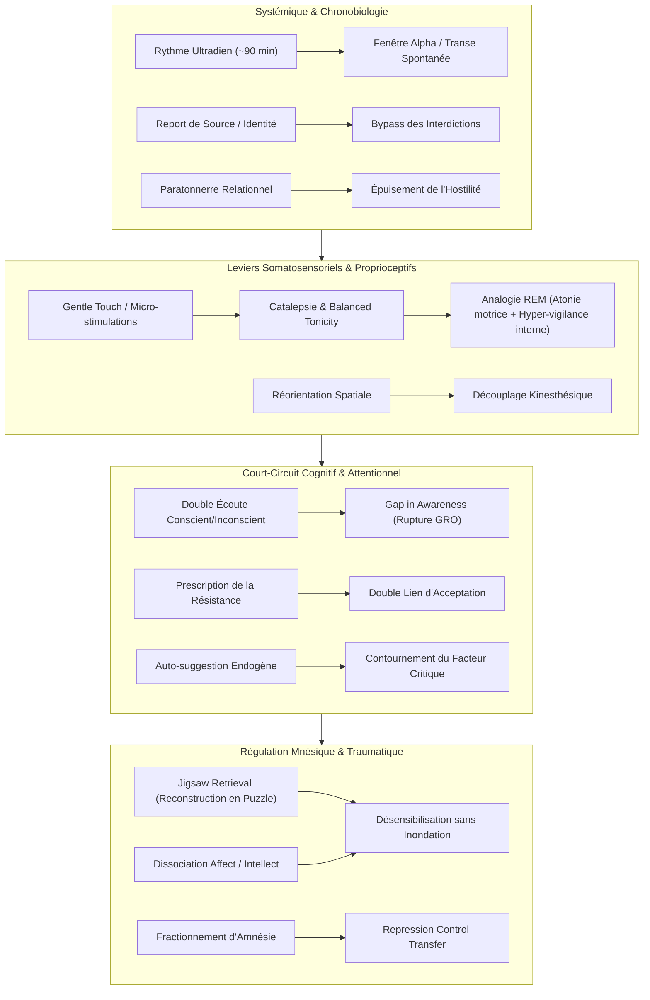

# Experiencing Hypnosis
**Formateur :** Erickson & Rossi | **ID :** `erickson-rossi-experiencing-hypnosis` | **Tranches :** 21

## Synthèse Architecturale du Cours : *Experiencing Hypnosis* (Erickson & Rossi)

---

### 1. Thèse Centrale & Philosophie du Cours

#### Vision spécifique & Posture face à l'approche standard
L'approche standard de l'hypnose (classique, autoritaire ou issue du paradigme suggestif direct) postule que la transe est un état passif de soumission ou d'inhibition induit par la domination de l'opérateur, mesuré par une échelle de profondeur et régulé par des scripts rigides.

Erickson & Rossi opèrent une rupture épistémologique totale :
* **Naturalisme & Rythmicité Biologique :** La transe n'est pas un artefact de laboratoire, mais un état neurophysiologique normal du vivant, intriqué dans les rythmes ultradiens (~90 min) et les micro-ruptures attentionnelles du quotidien (*common everyday trance*).
* **Non-dépendance à la profondeur formelle :** Le conscient analytique (rigide, limité par des croyances apprises) et l'inconscient (vaste réseau expérientiel autonome) fonctionnent en écoute parallèle continue. L'effet thérapeutique ne dépend pas d'un coma hypnotique, mais du découplage entre l'activité critique de surface et les processus associatifs sous-jacents.
* **Non-lutte et posture d'utilisation :** L'opérateur ne cherche jamais à vaincre une résistance ni à imposer sa volonté. La résistance n'est qu'une information de sécurité du système. Le praticien s'efface comme source directe d'injonction : il devient un catalyseur qui contraint l'inconscient du sujet à fabriquer ses propres solutions (*"Cause them to say it to themselves"*).

#### Le fil rouge méthodologique
Le vecteur directeur qui traverse chaque séance d'Erickson se résume en une formule : **Désarmer le facteur critique conscient en utilisant ses propres limitations, pour libérer la dynamique idéomotrice et idéosensorielle de l'inconscient.**

Ce fil rouge s'articule systématiquement en 4 temps dynamiques :
1. **Création d'une brèche attentionnelle (*Gap in Awareness*) :** Interruption de pattern, saturation sensorielle tactile, surcharge discursive ou double lien conscient/inconscient.
2. **Suspension somatique (Catalepsie) :** Bascule du contrôle moteur volontaire vers un tonus involontaire équilibré (*balanced muscle tonicity*), analogue neurophysiologique de l'atonie motrice du sommeil paradoxal (REM).
3. **Recherche transdérivationnelle & Mobilisation associative :** Questions ouvertes, métaphores dépersonnalisées, évocation de cadres passés (*state-dependent retrieval*).
4. **Intégration fractionnée ou amnésie protectrice :** Clôture du cadre sans forcer l'assimilation consciente immédiate, permettant à l'inconscient d'exécuter la réorganisation sans interférence névrotique.

---

### 2. Carte des Concepts & Leviers Émergents



#### Rôle et fonction de chaque levier dans l'écosystème Erickson-Rossi :

1. **Dualité Opératoire & Double Écoute (`#two_level_communication`, `#dual_processing`)**
   * *Rôle :* Adresser un message narratif anodin ou intellectuel au conscient tout en délivrant des consignes de réorganisation implicites à l'inconscient. Permet de travailler sans susciter l'alerte de l'ego.
2. **Catalepsie de Contact & Suspension Volontaire (`#gentle_touch_catalepsy`, `#balanced_tonicity`)**
   * *Rôle :* Agit comme indicateur et stabilisateur somatique de la transe. En suspendant l'arc réflexe volontaire au profit d'un équilibre agoniste/antagoniste autonome, le corps cesse d'interférer avec la recherche interne.
3. **Le « Momentary Gap in Awareness » (`#gap_in_awareness`, `#freeze_response`)**
   * *Rôle :* Rupture brutale de l'orientation vers la réalité extérieure (*General Reality Orientation*). Crée un vide transitoire où le système nerveux se fige en attente d'orientation (*expectancy*), ouvrant une fenêtre de suggestibilité maximale.
4. **Isomorphisme Sommeil REM / Transe (`#analogie_rem_transe`, `#hyper_arousal_interne`)**
   * *Rôle :* Modèle neurobiologique de Rossi : neutraliser les rétroactions motrices et proprioceptives périphériques (immobilité cataleptique) pour libérer l'ensemble des ressources corticales vers la plasticité et l'imagerie mentale.
5. **Prescription et Décharge de l'Ambivalence (`#prescribing_the_resistance`, `#safety_framing`)**
   * *Rôle :* Valider le besoin de rétention et de contrôle du patient (« Gardez vos secrets », « Résistez autant que vous voulez ») afin d'éteindre le contre-contrôle et de rallier l'inconscient à l'alliance thérapeutique.
6. **Dissociation en Puzzle & Dépersonnalisation (`#jigsaw_memory_retrieval`, `#affect_cognition_splitting`)**
   * *Rôle :* Décortiquer les sous-modalités d'un trauma (faits sans affects, stimuli visuels isolés, vision sur écran tiers/boule de cristal) pour traiter l'engramme sans déclencher de panique limbique.
7. **Fractionnement & Alternance du Contrôle de l'Amnésie (`#fractionated_amnesia`, `#repression_control_transfer`)**
   * *Rôle :* Ouvrir et refermer le souvenir à plusieurs reprises sous consigne hypnotique. Démontre somatiquement au sujet que l'oubli et le rappel peuvent être gouvernés sans danger pour l'intégrité du Moi.
8. **Réorientation Spatiale & Découplage Kinesthésique (`#spatial_reorientation`, `#physical_reframing`)**
   * *Rôle :* Déplacer le patient de son siège pour abandonner les patterns de blocage associés aux repères sensoriels d'origine, forçant le cerveau à rebâtir de nouveaux réseaux de réponse.
9. **Synchronisation Chronobiologique Ultradienne (`#rythme_ultradien_90min`, `#fenetre_alpha`)**
   * *Rôle :* Utiliser les creux naturels de 90 minutes où la vigilance baisse spontanément pour caler l'induction sans effort de force.
10. **Report de Source & Boucle d'Acceptation Paradoxale (`#report_de_source`, `#boucle_paradoxale`)**
    * *Rôle :* Contourner les interdictions hypnotiques antérieures en s'assimilant à l'émetteur d'origine ou en renforçant l'injonction d'échec (« Je t'interdis d'entrer en transe ») pour forcer l'accès hypnotique par la conformité paradoxale.
11. **Auto-suggestion Induite (`#generation_endogene`, `#internal_response`)**
    * *Rôle :* Formuler des amorces ambiguës ou négatives qui obligent l'appareil psychique du sujet à compléter la phrase mentalement, faisant de la suggestion sa propre production interne.
12. **Le Paratonnerre Relationnel (`#relational_lightning_rod`, `#operator_exit_induction`)**
    * *Rôle :* Canaliser toute la résistance hostile sur le premier opérateur avant que celui-ci ne sorte, laissant le patient sans cible d'attaque face à un tiers passif ou un sujet déjà en transe.

---

### 3. Tableau Récapitulatif des Techniques & Démonstrations

| Technique / Exercice | Objectif Opératoire | Déclencheur / Indication | Séquence Résumée |
|---|---|---|---|
| **Catalepsie par *Gentle Touch*** | Transférer l'agentivité motrice du conscient vers l'inconscient ; induire un tonus équilibré passif. | Résistance intellectuelle, rigidité de contrôle, besoin d'un pont somatique rapide. | Micro-saisie de l'avant-bras/poignet sans traction myotatique $\to$ soutien à peine perceptible $\to$ retrait progressif du contact $\to$ le membre reste suspendu de lui-même. |
| **Bypass Tactile Cérébelleux Multi-directionnel** | Court-circuiter le filtrage cortical proprioceptif pour déclencher un mouvement involontaire immédiat. | Sujets hyper-vigilants sur leurs sensations corporelles, analysant chaque mouvement. | Application simultanée de micro-pressions divergentes et imprévisibles avec plusieurs doigts $\to$ maintien d'une micro-pression directrice unique (ex: pouce vers le haut) $\to$ le cortex est saturé $\to$ le cervelet exécute l'élévation sans délibération. |
| **Exploitation du *Gap in Awareness*** | Transformer une rupture de routine motrice ou cognitive en transe immédiate par *freeze response*. | Hésitation motrice spontanée, surprise, interruption d'écriture, événement imprévu en séance. | Observer la suspension motrice $\to$ ne pas combler le silence $\to$ injecter une suggestion indirecte congruente précisément dans la micro-seconde de vide $\to$ approfondissement immédiat. |
| **Double Lien Conscient / Inconscient** | Dissocier l'attention consciente des processus d'apprentissage et de suggestion profonds. | Patient sceptique, analytique, qui "attend de voir" si l'hypnose fonctionne. | Attribuer une tâche fastidieuse ou critique au conscient (*"Votre esprit conscient peut écouter le bruit de ma voix ou douter..."*) $\to$ libérer l'inconscient pour le vrai travail (*"...pendant que votre inconscient commence à faire ce changement..."*). |
| **Fractionnement en Puzzle (*Jigsaw Memory Retrieval*)** | Désensibiliser et réintégrer une mémoire traumatique sans inondation affective ni crise de panique. | Traumatisme aigu, souvenirs intolérables avec risque d'abréaction explosive. | Isoler un fragment perceptif neutre (forme, objet, couleur) $\to$ ajouter un fragment somatique $\to$ dissocier l'affect $\to$ assembler progressivement les micro-pièces comme un puzzle jusqu'à la réintégration cognitive complète. |
| **Dissociation Projective sur Écran Mental / Boule de Cristal** | Analyser froidement sa propre dynamique traumatique ou névrotique sans défense égotique. | Négation, honte, mécanismes de défense rigides du Moi, identification pathologique. | Suggérer l'amnésie transitoire du nom et de l'histoire $\to$ n'activer que "l'intellect pur" $\to$ projeter sur un écran hallucinatoire une tierce personne (*"un jeune homme", "cet enfant"*) $\to$ analyse clinique des causes et résolutions. |
| **Réorientation Spatiale du Siège** | Briser l'ancrage spatial et somatosensoriel des boucles de pensées négatives et de la résistance. | Patient figé dans un mutisme, un refus de parler ou une posture de blocage obstiné. | Interrompre l'échange $\to$ faire lever le patient $\to$ déplacer son fauteuil à un angle différent de la pièce $\to$ le réinstaller $\to$ reprendre le dialogue sur un cadre totalement neuf. |
| **Micro-Victoire Motrice Expansive** | Créer un saut d'agentivité somatique se propageant spontanément à l'ensemble de la vie du sujet. | Sentiment d'impuissance acquise, perte d'estime de soi, inhibition comportementale globale. | Identifier une incompétence motrice symbolique (ex: gribouillage illisible) $\to$ installer en transe une motricité fine et fluide $\to$ ancrer la jubilation enfantine de la réussite $\to$ laisser l'effet de généralisation dopaminergique agir dans le réel. |
| **Acceptation Paradoxale de la Consigne Limitante** | Déverrouiller un sujet bloqué par une suggestion antérieure d'interdiction de transe. | Sujet ayant reçu une suggestion de blocage ("Ne sois plus jamais hypnotisé"). | Valider et amplifier avec autorité l'interdiction (*"Je t'ordonne formellement de ne pas entrer en transe"*) $\to$ le traitement de cette consigne exige un état réceptif $\to$ requalifier rétroactivement l'état induit pour lever le blocage. |
| **Report de Source & Assimilation d'Autorité** | Transférer la conformité hypnotique d'un tiers indisponible vers le praticien actuel. | Sujet fidèle à un ancien hypnotiseur ou conditionné à n'obéir qu'à une figure d'autorité précise. | Épouser le ton, la cadence ou l'ascendance de l'autorité émettrice (*"X a appris de moi / je travaille exactement comme X"*) $\to$ brancher les déclencheurs conditionnés sur la voix actuelle sans conflit psychique. |
| **Paratonnerre Relationnel & Sortie de l'Opérateur** | Dissoudre une hostilité frontale insurmontable dirigée contre le praticien. | Sujet paranoïaque, ultra-résistant, focalisé sur le défi et la confrontation d'ego. | Provoquer délibérément l'affrontement avec une méthode directive vouée à l'échec $\to$ catalyser toute l'énergie combative sur soi $\to$ quitter soudainement la pièce $\to$ laisser un co-thérapeute neutre ou un sujet en transe profonde poursuivre sans offrir aucune prise à la résistance. |
| **Fractionnement d'Amnésie sous Contrôle Transféré** | Désamorcer la terreur phobique liée au retour d'un souvenir refoulé. | Peur panique de la résurgence mnésique, refoulement rigide handicapant. | Guider l'émergence d'une bribe du souvenir $\to$ imposer une amnésie hypnotique immédiate $\to$ rappeler le souvenir $\to$ ré-imposer l'oubli $\to$ répéter jusqu'à ce que le système constate somatiquement qu'il maîtrise les vannes de la mémoire. |
| **Prescription Hédonique Paradoxale du Déclencheur** | Court-circuiter une boucle psychosomatique entretenue par l'évitement et l'hostilité. | Réactions psychosomatiques et dermatologiques chroniques exacerbées par la lutte contre le symptôme. | Interdire la lutte ou l'évitement $\to$ prescrire l'obligation de jouir intensément de la présence du déclencheur (ex: le soleil) $\to$ l'inconscient invente des compromis protecteurs spontanés tout en éteignant la réaction conflictuelle neurovégétative. |
| **Conditionnement Post-Hypnotique à Déclencheur Élastique** | Garantir l'exécution sécurisée d'une suggestion différée sur le très long terme (mois/années). | Comportements post-hypnotiques complexes devant s'activer uniquement en contexte favorable. | Formuler l'injonction en transe profonde $\to$ verrouiller l'amnésie consciente $\to$ subordonner le déclenchement à un pattern contextuel strict (*"quand la situation et l'environnement seront parfaitement appropriés"*) $\to$ mise en latence autonome jusqu'à complétude du cadre. |

---

---

## 0. Sommaire Sémantique & Index des Lignes

- **Tranche 1 [Lignes 142-284]** : Induction de la Catalepsie par Toucher Subtil (Gentle Wrist Lift) — *Protocole :* Induction de la Catalepsie par Toucher Subtil (Gentle Wrist Lift) | *Mécanisme :* Dualité Opératoire Conscient/Inconscient & Co-Écoute | *Verbatim :* Verbatim 1 : L'Offre de Possibilité vs La Domination Directe
- **Tranche 2 [Lignes 286-474]** : Dépersonnalisation et Révision Projective sur Écrans Hallucinés (Cas Harvey) — *Protocole :* Dépersonnalisation et Révision Projective sur Écrans Hallucinés (Cas Harvey)
- **Tranche 3 [Lignes 476-627]** : Démantèlement d'injonction post-hypnotique inhibitrice ("Je ne peux plus être hypnotisé") — *Protocole :* Démantèlement d'injonction post-hypnotique inhibitrice ("Je ne peux plus être hypnotisé") | *Mécanisme :* Réactivation d'état par évocation sensorielle contextuelle (State-Dependent Retrieval) | *Verbatim :* La Négation Amorce & Suspension Temporelle
- **Tranche 4 [Lignes 629-747]** : Induction Précoce par Discussion de la Catalepsie Spontanée du Quotidien — *Protocole :* Induction Précoce par Discussion de la Catalepsie Spontanée du Quotidien | *Mécanisme :* Le Double Lien Conscient / Inconscient (Conscious-Unconscious Double Bind) | *Verbatim :* Le Double Lien Conscient / Inconscient Initial
- **Tranche 5 [Lignes 749-919]** : L'Induction par Rupture d'Objet (Objet tendu / retiré) — *Protocole :* L'Induction par Rupture d'Objet (Objet tendu / retiré) | *Mécanisme :* Le « Momentary Gap in Awareness » et le réflexe de suspension (Cataleptisation spontanée) | *Verbatim :* PÉPITE 1 : L'Explication du Dentiste et l'Acceptation de l'Idée
- **Tranche 6 [Lignes 921-1059]** : Induction Cataleptique et Développement des Phénomènes Hypnotiques (Démonstration Janet) — *Protocole :* Induction Cataleptique et Développement des Phénomènes Hypnotiques (Démonstration Janet) | *Mécanisme :* La Catalepsie comme rupture de l'évaluation cognitive et inducteur de recherche interne
- **Tranche 7 [Lignes 1061-1227]** : Lévitation de la main par l'approche indirecte chez un profil analytique / hypervigilant (Dé... — *Protocole :* Lévitation de la main par l'approche indirecte chez un profil analytique / hypervigilant (Démonstration Dr. Z)
- **Tranche 8 [Lignes 1229-1399]** : L'Induction Rythmique par Oscillation (« Yo-yoing ») — *Protocole :* L'Induction Rythmique par Oscillation (« Yo-yoing ») | *Verbatim :* La Dérivation Attentionnelle par focalisation sur la vitesse
- **Tranche 9 [Lignes 1401-1543]** : L'Amnésie Structurée par Boucle Temporelle (Interruption et Enclave) — *Protocole :* L'Amnésie Structurée par Boucle Temporelle (Interruption et Enclave) | *Verbatim :* Dépotentiation du Savoir Rationnel & Activation des Réponses Automatiques
- **Tranche 10 [Lignes 1545-1678]** : Désamorçage de l'orgueil conscient & Démonstration d'antériorité inconsciente (Le test de do... — *Protocole :* Désamorçage de l'orgueil conscient & Démonstration d'antériorité inconsciente (Le test de dominance du pouce) | *Verbatim :* La non-dispute et le refus de prouver l'évidence
- **Tranche 11 [Lignes 1680-1852]** : L'Induction par les « Mains Magnétiques » en Double Lien (Rossi) — *Protocole :* L'Induction par les « Mains Magnétiques » en Double Lien (Rossi) | *Mécanisme :* Focalisation Idéodynamique Indirecte & Clivage Hémisphérique | *Verbatim :* Le Double Lien Magnétique & l'Appel à l'Expérience Concrète
- **Tranche 12 [Lignes 1854-2055]** : Induction et Évaluation par les « Mains Magnétiques » et Signalisation Involontaire — *Protocole :* Induction et Évaluation par les « Mains Magnétiques » et Signalisation Involontaire
- **Tranche 13 [Lignes 2057-2205]** : A : Étalonnage de l'Indicateur Idéomoteur Individuel de Profondeur (Erickson) — *Protocole :* A : Étalonnage de l'Indicateur Idéomoteur Individuel de Profondeur (Erickson) | *Verbatim :* Le piège de l'appel aux volontaires et la capture du signal involontaire
- **Tranche 14 [Lignes 2207-2351]** : Détection & Résolution Étiologique par T.O.T.E. Idéomoteur (Erickson-Rossi) — *Protocole :* Détection & Résolution Étiologique par T.O.T.E. Idéomoteur (Erickson-Rossi) | *Verbatim :* Absorption de l'Anxiété & Redéfinition par le Lâcher-Prise
- **Tranche 15 [Lignes 2353-2485]** : Le Défi Paradoxal par Injonction d'Arrêt et Guidage Non-Verbal — *Protocole :* Le Défi Paradoxal par Injonction d'Arrêt et Guidage Non-Verbal | *Mécanisme :* Le Défi Paradoxal d'Arrêt d'un Comportement Émergent (Paradoxical Challenge) | *Verbatim :* Le Défi Paradoxal Mot-à-Mot
- **Tranche 16 [Lignes 2487-2616]** : Induction du Sujet Sceptique / Rationnel par Régression aux Apprentissages Précoces — *Protocole :* Induction du Sujet Sceptique / Rationnel par Régression aux Apprentissages Précoces | *Mécanisme :* Dé-focalisation multi-directionnelle et absorption sélective | *Verbatim :* La Double Commande Asymétrique et le Verrouillage du Cadre
- **Tranche 17 [Lignes 2618-2773]** : Installation et Ratification de la Catalepsie d'Économie Motrice — *Protocole :* Installation et Ratification de la Catalepsie d'Économie Motrice
- **Tranche 18 [Lignes 2775-3006]** : L'Induction par Insertion Incongruente & Réactivation Post-Hypnotique (Interspersal Cueing) — *Protocole :* L'Induction par Insertion Incongruente & Réactivation Post-Hypnotique (Interspersal Cueing) | *Verbatim :* La Ratification d'Absorption par Séquentialité Négative
- **Tranche 19 [Lignes 3008-3129]** : A : La Guidance Tactile Délicate & Catalepsie Émergente — *Protocole :* A : La Guidance Tactile Délicate & Catalepsie Émergente | *Mécanisme :* Ratification par implication linguistique non disputable | *Verbatim :* La ratification par l'inversion temporelle
- **Tranche 20 [Lignes 3131-3286]** : L'Induction Expérientielle par Exploration Manuelle Décentrée (The Experiential Mode of Hypn... — *Protocole :* L'Induction Expérientielle par Exploration Manuelle Décentrée (The Experiential Mode of Hypnotic Induction) | *Mécanisme :* Le Vide Minimaliste et le Déclenchement de la Matrice Comportementale Inconsciente | *Verbatim :* Le Piège Temporel Rétrospectif (The Yesterday Frame)
- **Tranche 21 [Lignes 3288-3446]** : Protocole de Ratification par Sollicitation Musculaire Contralatérale de la Catalepsie — *Protocole :* Protocole de Ratification par Sollicitation Musculaire Contralatérale de la Catalepsie | *Verbatim :* La non-dispute comme instrument de prestige et d'autonomie de la transe

---

## Extractions Détaillées par Tranche (Opératoire & Verbatim)

## Tranche 1 / 21 : Induction de la Catalepsie par Toucher Subtil (Gentle Wrist Lift)

Voici l'analyse complète, opératoire et sans filtre de la tranche 1/21 du cours *Experiencing Hypnosis* d'Erickson & Rossi.

---

### 1. Mécanismes & Principes Actifs

#### 1. Dualité Opératoire Conscient/Inconscient & Co-Écoute
* **Principe actif :** Erickson postule la présence simultanée de deux systèmes de traitement de l'information chez le patient : le conscient (analytique, limité, rigide, porteur des symptômes et des limitations apprises) et l'inconscient (vaste réservoir d'apprentissages expérientiels, de réponses automatiques et involontaires). Lorsqu'une suggestion est formulée en surface, elle s'adresse à l'attention consciente, mais met en branle des processus associatifs involontaires profonds. La profondeur de transe formelle devient alors secondaire : l'inconscient entend, décode et réorganise les apprentissages même en transe légère ou en conversation ordinaire.
* **Tags émergents :** `#two_level_communication` `#dual_processing` `#receptive_unconscious` `#non_reliance_on_depth`

#### 2. La Catalepsie comme Pont Idéomoteur & Déclencheur de Réceptivité
* **Principe actif :** Contrairement à la manipulation physique de force qui déclenche un arc réflexe d'opposition myotatique ou de résistance psychologique ("lutte de contrôle"), la saisie ultra-douce (*gentle touch*) initie un micro-mouvement que le système nerveux central du patient prend en charge de façon involontaire. En soutenant le membre juste assez pour suggérer la position, l'inhibition motrice volontaire s'installe. Le membre reste suspendu sans effort délibéré (catalepsie). Ce basculement kinesthésique transfère l'agentivité de la volonté consciente vers le contrôle inconscient, augmentant instantanément la suggestibilité générale.
* **Tags émergents :** `#gentle_touch_catalepsy` `#involuntary_motor_shift` `#microdynamics_responsiveness` `#somatic_bypass`

#### 3. Décharge et Fractionnement de l'Ambivalence (Suggestions Positives et Négatives)
* **Principe actif :** Tout patient psychiatrique ou névrotique vit un conflit interne : désir de guérir vs peur de l'inconnu, besoin d'aide vs refus de soumission. En prescrivant la rétention d'information (« retenez tout ce que vous voulez ») et la résistance (« ne me dites que ce que vous voulez bien me dire »), le praticien valide le pôle défensif de l'ambivalence. Cela désarme immédiatement le contre-contrôle : l'énergie de résistance est autorisée et encadrée, libérant le pôle coopératif pour avancer sans menace pour l'intégrité du Moi.
* **Tags émergents :** `#ambivalence_utilization` `#prescribing_the_resistance` `#protective_withholding` `#safety_framing`

#### 4. Dissociation Fractionnée & Reconstruction en Puzzle (Jigsaw Recovery)
* **Principe actif :** L'abréaction brute d'un traumatisme submerge le système nerveux par inondation émotionnelle (hyperactivation limbique) et bloque l'intégration cognitive. Le praticien dissocie artificiellement les sous-modalités du souvenir :
  * Dissociation affect / intellect (éprouver le rire ou les larmes sans le contexte, ou inversement observer les faits froids sans émotion).
  * Fractionnement perceptif en puzzle (*jigsaw*) : récupérer un stimulus visuel isolé (la fourche), puis une proprioception/nociception (douleur fessière), puis une couleur (le vert), puis un état moteur (raideur). L'intégration progressive de micro-morceaux non connectés évite la panique traumatique et reconstruit l'engramme sans saturer le système.
* **Tags émergents :** `#affect_cognition_splitting` `#jigsaw_memory_retrieval` `#submodality_fractionation` `#titrated_exposure`

#### 5. Réorientation Spatiale et Ancrage Environnemental de la Résistance
* **Principe actif :** Les schémas de pensée, les blocages cognitifs et les états émotionnels négatifs s'ancrent spatialement dans l'orientation du corps et du regard par rapport à la pièce (isomorphisme espace-psyché). En faisant déplacer physiquement le siège du patient d'un point A (siège des blocages) vers un point B (point de vue externe/nouveau), le système nerveux est forcé de recalibrer ses repères proprioceptifs et visuels. La résistance reste attachée aux coordonnées spatiales d'origine, libérant la parole.
* **Tags émergents :** `#spatial_reorientation` `#state_displacement` `#physical_reframing` `#proprioceptive_unsticking`

#### 6. Dépersonnalisation & Projection Cinématographique (Écran Mental)
* **Principe actif :** En demandant au patient d'halluciner un écran de cinéma et d'y projeter son propre "soi" tout en oubliant son identité (phénomène naturel identique à l'absorption dans un film à suspense), le praticien court-circuite les mécanismes de défense de l'ego. Le système cognitif traite le matériel autobiographique comme un matériel exogène/fictionnel, permettant à l'intellect d'analyser la situation et de trouver des solutions sans que les alarmes d'anxiété ne s'activent.
* **Tags émergents :** `#mental_screen_projection` `#depersonalization_technique` `#ego_bypass` `#narrative_dissociation`

---

### 2. Protocoles, Techniques & Démonstrations (Étape par Étape)

#### Protocole 1 : Induction de la Catalepsie par Toucher Subtil (*Gentle Wrist Lift*)
* **Intention / Indication :** Transition vers la transe, contournement des résistances physiques ou verbales, amorçage de l'involontaire.
* **Mise en place & Pré-framing :** Ne donner aucun ordre autoritaire ("Je vais lever votre bras"). Éviter toute consigne de raideur délibérée.
* **Séquence pas à pas :**
  1. *Approche tactile :* Placer les doigts sous le poignet du sujet avec une pression infinitésimale (à peine perceptible).
  2. *Micro-impulsion :* Amorcer une traction verticale ascendante extrêmement légère, non pas pour soulever le poids réel du membre, mais pour communiquer la *suggestion physique* de l'élévation.
  3. *Test de transfert moteur :* Dès qu'une légère diminution du poids est ressentie (prise en charge par le tonus du sujet), relâcher millimètre par millimètre le soutien tactile.
  4. *Stabilisation cataleptique :* Laisser la main en suspension dans l'air.
* **Signes de calibration :** Absence de crispation musculaire volontaire, regard qui se fige, micro-ajustements posturaux inconscients, respiration qui ralentit et s'approfondit.

---

#### Protocole 2 : L'Établissement du "Yes Set" Indirect par Fauteuil Virtuel
* **Intention / Indication :** Sujet mutique, hostile, bloqué ou clamant : *"Je ne peux rien vous dire, je n'ai rien à dire"*.
* **Mise en place & Pré-framing :** Validation sans débat du sentiment d'impuissance du patient. Ne pas le forcer à parler de lui immédiatement.
* **Séquence pas à pas :**
  1. *Évocation d'un objet tiers hypothétique :* Désigner un espace vide dans la pièce et décrire les coordonnées géométriques objectives d'un fauteuil virtuel : *"Je pourrais mettre une chaise là, à peu près à telle distance de la bibliothèque..."*.
  2. *Calibration & Empilement de truismes (Truisms/Agreements) :*
     * Obtenir l'accord 1 : Distance chaise / bibliothèque.
     * Obtenir l'accord 2 : Distance chaise / bureau.
     * Obtenir l'accord 3 : Distance chaise / porte.
  3. *Lien de cause à effet hypothétique (Double bind / Pont) :* Poser que *si* l'on était assis dans cette chaise virtuelle sous cette perspective, il serait tout à fait concevable et plus aisé de parler de soi (le patient valide sans risque car la chaise n'existe pas physiquement).
  4. *Déplacement physique de l'ancrage :* Conclure qu'il est en effet impossible de parler dans le fauteuil actuel. Ordonner ou inviter le sujet à prendre son fauteuil réel, à le transporter physiquement à l'emplacement convenu, et à s'y asseoir.
  5. *Ouverture du canal :* Le patient commence immédiatement à verbaliser.
* **Signes de calibration :** Hochements de tête lors de la description spatiale, rupture de la posture de retrait, action physique motrice (porter sa chaise) marquant l'acceptation de la direction du praticien.

---

#### Protocole 3 : La Question Tabou Pré-Interdite (Garantie de Sécurité et Confiance)
* **Intention / Indication :** Début de prise en charge d'un sujet anxieux, suspicieux ou traumatisé, pour ancrer un rapport indestructible.
* **Mise en place & Pré-framing :** Sujet en état de transe (légère ou moyenne) ou en veille détendue.
* **Séquence pas à pas :**
  1. *Formulation de la question :* Poser une question intrusive ou sensible (en lien avec le cœur supposé du problème ou un tabou).
  2. *Interception immédiate (Interruption de Pattern) :* Avant même que le cerveau du sujet n'ait fini de traiter l'acoustique ou n'amorce une réponse, couper la parole : *"C'est une question à laquelle vous ne devriez pas encore répondre, et vous ne devez pas y répondre avant que le moment opportun ne soit venu."*
  3. *Mise au repos réflexive :* *"Prenez le temps de penser à ce que je viens de dire."*
* **Signes de calibration :** Relâchement visible des épaules et des mâchoires (soulagement de la menace), baisse du clignement des yeux, installation d'une confiance passive (le sujet vérifie expérientiellement que le thérapeute est un protecteur et non un violeur psychique).

---

#### Protocole 4 : Désensibilisation par Découpage en Puzzle (*Jigsaw Desensitization*)
* **Intention / Indication :** Phobies intenses, souvenirs d'accidents ou traumatismes d'enfance profondément refoulés ou trop douloureux à aborder de front.
* **Mise en place & Pré-framing :** Sujet en transe profonde ou moyenne. Cadrage : l'exploration se fera par flashs discontinus.
* **Séquence pas à pas :**
  1. *Élicitation sensorielle isolée 1 (Visuel neutre/froid) :* Faire voir un objet périphérique du souvenir sans charge narrative (ex: *"Voyez la fourche"*).
  2. *Élicitation sensorielle isolée 2 (Kinesthésique localisé) :* Faire éprouver la sensation physique pure, déconnectée de l'histoire (ex: *"Ressentez la douleur dans la région fessière"*).
  3. *Élicitation sensorielle isolée 3 (Couleur pure) :* Évoquer un détail visuel chromatique (ex: *"Voyez la couleur verte"*).
  4. *Élicitation sensorielle isolée 4 (Tonus moteur) :* Faire ressentir la réaction posturale (ex: *"Ressentez votre corps devenir rigide et raide"*).
  5. *Élicitation émotionnelle :* Laisser monter la tonalité affective liée à la raideur (ex: *"Ressentez l'horreur de cette rigidité"*).
  6. *Synthèse progressive :* Rapprocher les morceaux de puzzle au rythme de la tolérance du patient jusqu'à la reconstitution de la mémoire narrative sans choc panique.
* **Signes de calibration :** Modifications respiratoires brèves et contenues, absence de panique végétative incontrôlable, intégration fluide d'un élément vers le suivant.

---

### 3. Heuristiques, Subtilités & "Sagesse du Praticien"

#### Règles Conditionnelles d'Erickson & Rossi
1. **Règle de l'Injonction Forcée vs Permission :**
   * *Si* vous essayez de dominer le patient en disant : *"Je veux que vous soyez fatigué et somnolent"*, *alors* vous déclenchez une réaction d'opposition volontaire.
   * *Faites plutôt :* Proposer l'idée sous forme d'une opportunité d'expérience (*"Vous pouvez devenir fatigué, vous pouvez entrer en transe"*), car l'hypnose est une réceptivité libre aux idées et non une soumission à un pouvoir.
2. **Règle de la Réponse Émotionnelle sans Contexte :**
   * *Si* le matériel traumatique est trop lourd, *alors* faites décharger uniquement l'affect (les larmes ou le rire) en maintenant l'amnésie ou l'inhibition du contenu intellectuel. L'intellect sera rattaché plus tard une fois la charge liquidée.
3. **Règle de l'Intégration Conscient / Inconscient :**
   * *Si* un conflit, une phobie ou une anxiété est résolu à 100% au niveau inconscient en transe profonde, *alors* ne tenez JAMAIS le résultat pour acquis à l'état de veille.
   * *Pourquoi :* L'état vigile conserve des circuits d'habitudes motrices et conceptuelles conscients. Le praticien DOIT orchestrer une expérience d'exposition ou de confort conscient à l'état de veille (ex: manipuler le tissu bleu en veille avec un sentiment de calme) pour sceller le pont thérapeutique.
4. **Règle du Suivi des Pistes (Guiding via casual clues) :**
   * *Si* vous souhaitez orienter le patient vers un thème précis (souvenir ou objet), *alors* n'amenez pas le thème vous-même. Écoutez ses propos ordinaires, repérez un signifiant isolé (ex: *"coin"* puis *"lumière"*), isolez-le et interrogez-le pour faire converger la conversation vers la cible sans résistance.
5. **Règle du Respect de la Fatigue Émotionnelle :**
   * *Si* le patient fatigue ou s'agite lors de l'exploration d'un point névralgique, *alors* n'insistez jamais en ligne droite. Changez de vitesse (*"shift gears"*), revenez à un sujet neutre, et ré-accédez au point plus tard. L'hypnose permet la discontinuité thérapeutique indolore.

#### Pièges Classiques & Erreurs de Débutant
* **Le piège de la saisie brutale du poignet :** Saisir la main avec force pour imposer la lévitation. *Conséquence :* Le patient perçoit l'agression physique, contracte ses muscles antagonistes et bloque toute catalepsie.
* **Le piège du déballage forcé ("Tell me all") :** Exiger une transparence totale dès la première séance. *Conséquence :* Sentiment de menace panique, rupture immédiate du rapport et mutisme défensif.
* **Le piège de la technique préfabriquée :** Appliquer une routine mécanique de 30 pages identique pour chaque patient. *Correction ericksonienne :* Réduire sa technique interne à des principes flexibles pour savoir s'adapter à la singularité du sujet et le suivre pas à pas (*"follow the patient's lead"*).

---

### 4. Pépites Verbatim & Patterns Linguistiques (MOT À MOT EN V.O.)

#### Verbatim 1 : L'Offre de Possibilité vs La Domination Directe
> **"In exactly the same way, I do not like this matter of telling a patient, 'I want you to get tired and sleepy, and to get tired and sleepier.' That is an effort to force your wishes upon the patient. That is an effort to dominate the patient. It is much better to suggest that they can get tired, that they can get sleepy, that they can go into a trance. For it is always a matter of offering them the opportunity of responding to an idea."**
* **[Analyse du Pattern] :** Shift modal fondamental de l'impératif/volitif direct (*"I want you to..."*) vers le modal de capacité et de permission permissive (*"they can get tired... they can get sleepy"*). La structure grammaticale libère l'agentivité du sujet, neutralisant le réflexe psychologique de réactance tout en implantant l'idée comme une potentialité biologique naturelle accessible.

---

#### Verbatim 2 : La Prescription de Rétention et de Protection
> **"I suggest also that he never tell me anything more than he really wants to tell me. I usually tell my patient that he can withhold whatever he wishes, and to be sure to withhold whatever he wishes."**
* **[Analyse du Pattern] :** Utilisation conjointe d'une suggestion permissive (*"can withhold"*) suivie immédiatement d'une injonction paradoxale de protection renforcée (*"and to be sure to withhold"*). En ordonnant au patient de retenir ses secrets, Erickson s'allie avec le système immunitaire psychologique du patient. La résistance devient une conformité aux instructions du thérapeute, créant une sécurité totale qui induit paradoxalement une ouverture spontanée de la confidence.

---

#### Verbatim 3 : L'Interception Protectrice (Double Injonction Temporelle)
> **"I ask a question, and before they can possibly hear it, I point out to them that it is a question that should not yet be answered, and that they ought not to answer it until the right time comes along. Then I ask them to think about what I have said."**
* **[Analyse du Pattern] :** Rupture de pattern par présupposition temporelle et interdiction bienveillante. Le syntagme *"should not yet be answered"* et *"until the right time comes along"* présuppose de façon indiscutable que la réponse viendra inéluctablement dans le futur. L'injonction empêche le blocage conscient immédiat et positionne le praticien comme le garant du timing écologique du patient.

---

#### Verbatim 4 : La Transe Naturaliste & La Focalisation Interne
> **"The essential point is that they pay attention, not necessarily to me, but to their own thoughts—especially the thoughts that flash through their mind, including the manner and the sequence in which those thoughts flash through their mind."**
* **[Analyse du Pattern] :** Dé-focalisation externe au profit d'un entraînement idéodynamique interne. Utilisation du truisme sensoriel couplé à un enchâssement d'attention métacognitive (*"the manner and the sequence in which..."*). Cette consigne force le sujet à observer les processus de traitement de son propre esprit plutôt que le contenu, générant instantanément une dissociation réflexive indispensable à l'état de transe.

---

#### Verbatim 5 : Le Déplacement d'Ancrage Spatial par la Chaise Virtuelle
> **"And so, in an apparently random fashion, I stated that I could place a chair right there, that it would be just about so far from the bookcase, about so far from the door, about so far from my desk, and it would be really very nice to sit in that chair and be able to talk when sitting in that chair... Then I suggested that it was impossible, really, to talk in this chair—the one that he was actually sitting in—but all that would be necessary for him to do would be to take the chair, put it over there, sit down, and begin talking."**
* **[Analyse du Pattern] :** Empilement de truismes spatiaux inducteurs d'un *Yes Set*, suivi d'un double lien de recadrage d'état. Erickson commence par formuler des évidences visuelles non contestables, puis introduit une association suggestive : *cette chaise virtuelle = facilité de parole*. Ensuite, il valide et recadre le symptôme : *dans la chaise actuelle, il est effectivement impossible de parler* (acceptation de la résistance). Enfin, il offre une issue motrice simple : déplacer physiquement le siège pour incarner la bascule d'état psychique. Le blocage mental est littéralement laissé derrière soi dans les anciennes coordonnées géométriques de la pièce.

## Tranche 2 / 21 : Dépersonnalisation et Révision Projective sur Écrans Hallucinés (Cas Harvey)

### 1. Mécanismes & Principes Actifs

- **Réorientation spatiale et découplage kinesthésique de l'état interne**
  *Principe actif :* Le système nerveux ancre les réseaux associatifs, les schémas cognitifs de résistance et les boucles de pensées automatiques dans la configuration somatosensorielle et les repères visuels de l'environnement immédiat (la ligne de mire, la posture, la position du fauteuil). Déplacer physiquement le sujet ou son siège brise brutalement le cadre d'ancrage spatial : les résistances restent associées à l'orientation précédente. Le cerveau est contraint de reconstruire une nouvelle carte d'orientation, libérant ainsi l'accès à de nouveaux patterns de communication et à une perspective psychologique inédite.
  *Tags :* #spatial_reorientation #kinesthetic_unanchoring #perspective_shift #pattern_interruption_spatiale

- **Dépersonnalisation projective et scission intellect/identité (Dissociation de l'observateur)**
  *Principe actif :* L'amnésie de l'identité personnelle (nom, âge, histoire) combinée à l'extériorisation hallucinatoire sur écrans multiples ou boules de cristal réduit à zéro l'implication de l'ego et les mécanismes de défense habituels. En ne laissant actif qu'un « intellect pur » observant une tierce personne (« the little boy », « a young man »), le sujet analyse cliniquement et objectivement le fil conducteur de sa propre trajectoire traumatique sans être submergé par la charge affective ou le réflexe d'auto-préservation névrotique.
  *Tags :* #depersonalization #projective_dissociation #pure_intellect_induction #ego_defense_bypass #screen_hallucination

- **Micro-victoire motrice et amorçage expansif (Le levier de jubilance enfantine)**
  *Principe actif :* Le changement thérapeutique profond n'a pas besoin d'une injonction comportementale complexe (« affronte ton patron »). En installant en transe une compétence motrice élémentaire et symbolique (passer d'un gribouillage humiliant à une écriture fluide et lisible) et en l'associant à une poussée d'accomplissement et de fierté enfantine, le système nerveux expérimente un saut d'agentivité. Cette libération dopaminergique et émotionnelle se transfère d'elle-même par capillarité à tous les domaines de vie (salaire, posture face aux collègues, soins matériels, statut social).
  *Tags :* #motor_micro_mastery #jubilant_affect_install #generative_spread #non_directive_motivation

- **Injonction d'acceptation hédonique contre l'évitement défensif**
  *Principe actif :* Quand un symptôme psychosomatique s'alimente d'une guerre constante contre un déclencheur (ex: fuir le soleil, se gratter avec rage), prescrire la protection ou l'évitement renforce l'antagonisme et la névrose. Prescrire l'obligation de « jouir pleinement de la présence du déclencheur » court-circuite toute polarité hostile : pour apprécier le soleil sans souffrir, l'inconscient du sujet est contraint d'inventer de lui-même des comportements régulateurs et protecteurs (chapeau à larges bords, manches longues) tout en éteignant la boucle conflictuelle neurodermatologique.
  *Tags :* #hedonic_reframing #paradoxical_enjoyment #symptom_bypass #hostility_disarming

- **Fractionnement et alternance de contrôle sur la mémoire traumatique**
  *Principe actif :* Faire émerger un souvenir traumatique, puis imposer activement une amnésie/répression hypnotique, puis le rappeler, puis le réamnésier à plusieurs reprises. Ce va-et-vient retire au système défensif rigide du patient le monopole du refoulement et le transfère au contrôle du thérapeute. En constatant somatiquement qu'un souvenir pénible peut être ouvert et refermé à volonté sans détruire l'intégrité du moi, le système nerveux désensibilise la charge phobique associée au souvenir.
  *Tags :* #fractionated_amnesia #repression_control_transfer #titrated_exposure #memory_recoding

- **Canalisation et épuisement focalisé de la résistance (Le paratonnerre relationnel)**
  *Principe actif :* L'opérateur pousse délibérément le sujet hostile au paroxysme de son affrontement critique en utilisant des méthodes directives condamnées à l'échec. La résistance du patient se cristallise intégralement sur la personne physique du praticien. Lorsque ce dernier quitte soudainement la pièce et délègue l'induction à un tiers (ou à un sujet déjà en transe profonde), le résistant se retrouve déchargé de son axe d'opposition : le vecteur d'attaque a disparu, et le système nerveux ne peut pas trouver de prise pour résister à quelqu'un qui n'oppose aucun ego et qui opère lui-même en état modifié de conscience.
  *Tags :* #resistance_centering #relational_lightning_rod #operator_exit_induction #unresisting_trance_proxy

- **Double boucle d'induction réciproque en miroir**
  *Principe actif :* Assigner à deux hypnotiseurs ou sujets critiques la tâche simultanée de s'hypnotiser l'un l'autre en illustrant eux-mêmes la profondeur qu'ils exigent de l'autre. La tâche impose une boucle récursive : pour calibrer ou induire la transe de son vis-à-vis, chaque sujet doit d'abord accéder kinesthésiquement aux indices de l'état de transe. Pendant qu'ils s'absorbent mutuellement dans cette boucle spéculaire, la transe s'installe en réponse indirecte à l'injonction de l'opérateur superviseur, qui n'a plus qu'à cueillir le rapport.
  *Tags :* #reciprocal_mirror_induction #recursive_double_bind #competitive_absorption #pacing_by_proxy

- **Rupture de pattern au seuil de terminaison (The Surprise Handshake Exit)**
  *Principe actif :* L'esprit critique maintient un tonus de défense tant que le contexte est défini comme « séance en cours ». Acter l'échec, acter la fin du temps payé (« vous avez payé pour mon temps »), faire sortir le sujet du bureau et entamer la politesse sociale de clôture (présenter son épouse, serrer la main) désactive instantanément les défenses neurocognitives (chute du tonus d'alerte). L'interruption kinesthésique de la poignée de main (suspension, transformation en catalepsie douce) injecte un vide de référence au moment exact où la garde est tombée, réactivant d'un coup toutes les suggestions semées pendant les deux heures d'échec apparent.
  *Tags :* #pattern_interruption #social_exit_unguard #terminal_threshold_induction #catalepsy_handshake #delayed_suggestion_firing

- **Pacing rétroactif d'inévitabilité motrice (Ratification au micro-seuil)**
  *Principe actif :* Observer les micro-mouvements automatiques et compulsifs d'agitation motrice (battre du pied, changer de main, s'étirer) et énoncer la suggestion de faire exactement ce mouvement au centième de seconde où l'amorce neuromotrice est déjà engagée et irréversible. Le cerveau interprète le geste achevé comme une réponse obéissante à la suggestion externe, ce qui installe une illusion d'accordage total et valide l'autorité hypnotique sur le plan somatomoteur.
  *Tags :* #micro_ratification #kinesthetic_pacing #inevitability_tracking #fractional_suggestion

- **Double lien conscient/inconscient sur le mutisme et l'inaction**
  *Principe actif :* Redéfinir le silence ou l'immobilité consciente du sujet comme le signe précis d'un travail intensif, souterrain et secret de l'inconscient. Tout comportement d'évitement verbal (regarder les livres, regarder le tapis, ignorer l'opérateur) est transformé en canal opératoire de traitement des données hypnotiques. Le conscient est libre de ne rien faire ; l'inconscient est piégé dans l'obligation de restructurer.
  *Tags :* #conscious_unconscious_double_bind #utilization_of_silence #covert_processing_reframe

---

### 2. Protocoles, Techniques & Démonstrations (Étape par Étape)

#### Protocole 1 : Dépersonnalisation et Révision Projective sur Écrans Hallucinés (Cas Harvey)
* **Intention / Indication :** Sujets massifs en infériorité, hypocondriaques, multi-traumatisés, dépressifs à tendance suicidaire mais dotés d'une intelligence refoulée et d'un potentiel imaginaire exploitable.
* **Mise en place & Pré-framing :** Cadrer l'exercice non pas sur le sujet, mais sur un « travail d'analyse intellectuelle » d'événements extérieurs.
* **Séquence d'actions pas à pas :**
  1. *Amnésie de l'ego :* Induire la transe et suggérer l'effacement total du nom, de l'âge, de l'identité et de l'existence physique du sujet. Le définir uniquement comme « une pure intelligence observatrice ».
  2. *Matérialisation spatiale des supports :* Suggérer la présence dans la pièce d'une suite d'écrans de cinéma ou de boules de cristal projetant des images fixes et des scènes animées d'une importance capitale.
  3. *Défilement chronologique découplé :* Faire défiler sur les écrans la trajectoire développementale traumatique (l'enfant gaucher forcé d'écrire de la main droite sous les coups, le chien abattu par le shérif, le premier échec amoureux, le divorce et l'envie de suicide, le licenciement).
  4. *Élicitation de l'analyse externe :* Ordonner à l'intellect d'analyser le personnage projeté : repérer le fil conducteur (« thread of continuity ») et les répétitions sans que le sujet ne reconnaisse qu'il s'agit de sa propre vie.
  5. *Diagnostic projectif de l'issue :* Demander à l'intellect de pronostiquer ce qui va arriver à cet homme si un nouveau choc survient, pour éliciter la structure sous-jacente (« the losing end »).
  6. *Intervention correctrice motrice minimale :* Faire exécuter en transe une tâche motrice de base raturée par l'histoire du sujet (réapprendre à écrire lisiblement une phrase simple et positive : *"This is a beautiful day in March"*).
  7. *Libération de la jubilance et suggestion post-hypnotique :* Ancrer l'immense soulagement de la réussite motrice et sceller la suggestion post-hypnotique que cette fierté et ce sentiment d'accomplissement s'infiltreront dans toutes les actions vitales à venir.
* **Signes de calibration :** Regard non focalisé sur les écrans hallucinés, posture d'objectivité clinique froide lors des descriptions traumatiques (absence de tétanie émotionnelle habituelle), passage soudain en transe/post-transe à une posture corporelle redressée, gestes énergiques, explosion expressive de joie pure (« jubilant little boy »).

#### Protocole 2 : L'Épuisement de Résistance par Paratonnerre et Sortie de Pièce (Cas du Dr X)
* **Intention / Indication :** Patient combatif, omniscient, défiant le praticien (« Voyons si vous êtes capable de m'hypnotiser »), utilisant sa propre autorité professionnelle ou intellectuelle pour bloquer le processus.
* **Mise en place & Pré-framing :** Accepter le défi de front et poser le cadre d'un rapport de force autoritaire classique.
* **Séquence d'actions pas à pas :**
  1. *Focalisation et accumulation :* Utiliser pendant une heure une méthode d'induction dominatrice, rigide et directe. Encourager indirectement le sujet à bloquer, à sourire, à raidir sa mâchoire et à concentrer 100 % de sa résistance contre l'opérateur.
  2. *Rupture brusque de trame :* Au sommet de la résistance du sujet, interrompre l'interaction net d'un ton neutre : *"Excuse me for a moment"*.
  3. *Introduction d'un tiers désarmant :* Faire entrer dans la pièce un sujet naïf ou un étudiant en psychologie (ex: Elsa).
  4. *Induction éclair du tiers :* Mettre instantanément l'étudiant en transe profonde devant le patient résistant pour valider la réalité du phénomène hypnotique sans débat.
  5. *Passage de relais sans échappatoire :* Ordonner au tiers en transe de s'asseoir et de plonger le docteur en transe, avec consigne de ne rappeler le maître qu'une fois le résultat obtenu.
  6. *Évacuation physique du praticien :* L'opérateur sort de la pièce en emportant avec lui l'objet de la résistance. Le patient se retrouve face à un opérateur en état de transe, transparent, sans ego, impossible à défier.
* **Signes de calibration :** Le sujet passe du rictus de défi et de la tension musculaire axiale à un état de sidération/confusion devant le tiers en transe, suivi d'une capitulation du tonus postural et de l'entrée en transe en moins de 15 minutes.

#### Protocole 3 : L'Induction par Rupture Sociale au Seuil d'Adieu (The Surprise Handshake Induction)
* **Intention / Indication :** Sujets ayant payé pour prouver qu'ils sont invulnérables à l'hypnose, thérapeutes/médecins résistants bloqués par un traumatisme antérieur lié à l'hypnose.
* **Mise en place & Pré-framing :** Accepter le cadre d'échec posé par le sujet (payer pour du « temps » et non pour un « résultat »). Travailler sans insister pendant la durée convenue, puis formaliser l'échec de la séance.
* **Séquence d'actions pas à pas :**
  1. *Déclaration formelle d'échec et clôture contractuelle :* Déclarer que le temps payé a été honoré, s'excuser de son impuissance, et déclarer la consultation officiellement terminée.
  2. *Déplacement dans un sas de décompression social :* Sortir le patient du cabinet thérapeutique pour l'amener dans un espace domestique/familial neutre (ex: présenter son épouse).
  3. *Abaissement du bouclier critique :* Laisser le patient intégrer psychologiquement et corporellement que la consultation est finie et qu'il a « gagné » contre l'hypnotiseur.
  4. *L'interruption de la poignée de main :* Tendre la main pour le rituel conventionnel d'adieu (« I would like to shake hands before we leave »).
  5. *Suspension kinesthésique et catalepsie :* Au moment du contact, ralentir le geste, soulever doucement le bras du sujet, suspendre le mouvement et figer la position en catalepsie.
  6. *Réactivation instantanée des suggestions :* Lier la catalepsie motrice à l'effondrement immédiat en transe profonde, récupérant la totalité des suggestions semées pendant les heures précédentes.
  7. *Réintégration du cabinet :* Reconduire le sujet en transe dans le bureau pour exécuter la reprogrammation thérapeutique nécessaire.
* **Signes de calibration :** Relâchement complet des traits du visage au moment de la transition sociale, absence de retrait réflexe du bras lors de la suspension du contact, fixation oculaire immédiate, affaissement respiratoire (changement de rythme inspiratoire/expiratoire).

#### Protocole 4 : Le Piégeage de l'Agitation Motrice par Suggestion Rétroactive
* **Intention / Indication :** Patients hyperactifs, agités, secouant les membres, changeant de position, s'étirant pour saboter le calme requis par l'induction traditionnelle.
* **Mise en place & Pré-framing :** Donner carte blanche au sujet pour bouger autant qu'il le souhaite.
* **Séquence d'actions pas à pas :**
  1. *Tracking du tempo moteur :* Calibrer la cadence et l'ordre des tics moteurs (ex: pied droit -> pied gauche -> main droite -> main gauche -> étirement).
  2. *Interception au point de non-retour :* Au millième de seconde où le sujet amorce neurologiquement le passage au membre suivant, verbaliser l'injonction directe de faire ce geste précis.
  3. *Généralisation de l'obéissance :* Répéter l'opération sur chaque bascule motrice (étirement, changement de posture, regard).
  4. *Encadrement du rire ou de la moquerie :* Si le sujet se moque de la procédure, lui suggérer qu'il va trouver la prochaine suggestion extrêmement drôle, ou peut-être pas du tout.
* **Signes de calibration :** Synchronisation parfaite entre la voix du thérapeute et la décharge motrice du patient, disparition progressive de l'intention volontaire dans le mouvement, glissement vers des mouvements automatiques non délibérés, installation de la catalepsie.

---

### 3. Heuristiques, Subtilités & "Sagesse du Praticien"

- **Heuristique de la spatialisation du problème :**
  *Règle :* *« Si le patient s'enferme dans son discours de blocage ou refuse de communiquer -> Déplace immédiatement son siège physiquement dans une autre direction de la pièce. »*
  *Justification :* Les résistances psychologiques sont ancrées dans la ligne de vue et l'orientation spatiale de la pièce. Réorienter le corps réoriente la perspective mentale.

- **Heuristique de la dépersonnalisation :**
  *Règle :* *« Si la souffrance et l'auto-dépréciation d'un patient intelligent sont trop denses pour être abordées de front -> Dépouille-le hypnotiquement de son nom et de son existence pour n'en faire qu'un intellect pur regardant un étranger sur un écran. »*
  *Justification :* L'intellect reste intact même chez un individu brisé ; en neutralisant l'ego, cet intellect devient le meilleur allié objectif de la thérapie.

- **Heuristique de l'intervention motrice minimale (vs directivisme comportemental) :**
  *Règle :* *« Si un patient manque d'affirmation dans sa vie -> Ne lui donne JAMAIS l'ordre d'aller affronter son patron ou ses proches ; donne-lui une victoire motrice et symbolique simple en transe et laisse son système nerveux générer sa propre motivation. »*
  *Justification :* Les êtres humains sont fondamentalement simples. Dicter le comportement adulte viole leur écologie ; réveiller une fierté enfantine motrice produit des comportements sur-mesure bien plus puissants et écologiques que ce que l'opérateur aurait pu imaginer.

- **Heuristique de l'utilisation de l'antagonisme (La prescription d'amplification) :**
  *Règle :* *« Si un patient t'insulte ou attaque tes compétences -> Valide son insulte et fournis-lui des mots encore plus violents pour compléter son attaque. »*
  *Justification :* En fournissant les munitions de sa propre résistance, tu l'amènes à accepter tes suggestions linguistiques. Dès lors qu'il accepte tes mots pour t'insulter, il est déjà engagé dans une relation de réceptivité à tes futures suggestions.

- **Heuristique de la prescription hédonique paradoxale :**
  *Règle :* *« Si un patient s'autodétruit en luttant contre un élément extérieur (ex: soleil, allergène, situation inévitable) -> Ne lui dis jamais de s'en protéger ou de l'éviter, ordonne-lui d'en jouir au maximum. »*
  *Justification :* L'injonction d'évitement active la rébellion névrotique. L'injonction de plaisir contraint le sujet à concevoir lui-même une protection confortable pour pouvoir en profiter sans souffrir.

- **Heuristique du silence thérapeutique :**
  *Règle :* *« Si un patient vient en séance urgente et reste assis dans un mutisme absolu -> Ne cherche jamais à meubler ou à comprendre consciemment ; dis-lui que son silence conscient est la preuve exacte que son inconscient est au travail. »*
  *Justification :* Pousser à la parole réactive le système défensif conscient. Lier le silence conscient au travail secret de l'inconscient convertit l'heure d'immobilité en transe de préparation.

- **Heuristique de temporalité et de randomisation des séances :**
  *Règle :* *« N'adopte jamais de calendrier de consultation rigide ou scolaire (ex: 50 minutes, une fois par semaine le mardi). »*
  *Justification :* Adapte la durée de 1h à 16h d'affilée si nécessaire, et la fréquence de 7 fois par semaine à une fois par mois selon le taux d'assimilation du système nerveux du patient. C'est l'hypnose et le problème qui dictent la durée, pas l'horloge administrative.

- **Erreur de débutant corrigée :**
  *Le piège :* Vouloir corriger immédiatement le symptôme ou le comportement aberrant présenté par le patient dès son entrée dans le cabinet.
  *Correction d'Erickson :* Le patient a un besoin structurel fondamental d'exhiber ce comportement précis devant vous. Utilisez-le, amplifiez-le, accumulez-le ; le changement adviendra en temps voulu (un jour, une semaine, six mois), jamais sous la pression de l'immédiateté de l'opérateur.

---

### 4. Pépites Verbatim & Patterns Linguistiques (MOT À MOT EN V.O.)

```text
"Harvey had every known ache and pain, every known sense of inferiority. But he was intelligent, even though he didn't manifest much intelligence. He was fearful, and that was all I really needed to know about the man, because knowing that he was intelligent, I also knew that he could have a rather rich fantasy life. And so I suggested to him that he see a series of movie screens or crystal balls in which he would see still-life pictures of tremendous importance. I had Harvey forget his name, his identity, his age, the fact that Harvey as a person really existed. All he was was an intelligence that was looking at all those things that I had scattered around the room for him to look at."
```
* **[Analyse du Pattern]** : Recadrage de diagnostic transformant deux tares perçues (peur + intelligence masquée) en prérequis hypnotique idéal (capacité hallucinatoire riche). Utilisation d'une dissociation d'identité totale par présupposition soustractive (*forget his name, his identity, his age, the fact that Harvey as a person really existed*), réduisant le sujet à une entité nominalisée désincarnée (*All he was was an intelligence*). La dispersion spatiale (*scattered around the room*) contraint le système visuel interne à une exploration panoramique dissociée.

---

```text
"Go home today and let your unconscious mind think over all the things that have been said, all the things that have been thought."
```
* **[Analyse du Pattern]** : Commande post-hypnotique ouverte basée sur la scission conscient/inconscient. L'emploi du verbe permissif d'abandon de contrôle (*let your unconscious mind think over*) délègue le traitement cognitif hors de la volonté consciente, tandis que l'empilement passif (*all the things that have been said, all the things that have been thought*) ratifie le processus sans spécifier de contenu précis, forçant une recherche transdérivationnelle exhaustive.

---

```text
"So I told her it wasn't necessary for me to tell her that because she had already told me, and I would take her word for it—but I was still entitled to believe my own thoughts on the matter. Thus, I accepted what she said to me, but at the same time I gave tremendous reservations. I was still entitled to believe my own thoughts, and she could believe her own thoughts."
```
* **[Analyse du Pattern]** : Pacing et Leading d'une hostilité par accord paradoxal. Erickson ratifie la prédiction conflictuelle de la patiente (*it wasn't necessary for me to tell her that because she had already told me*), éliminant tout levier d'affrontement direct. Il introduit ensuite une dissociation de cadre de croyance symétrique (*I was still entitled to believe my own thoughts, and she could believe her own thoughts*), ce qui crée un espace de doute impénétrable dans le système de certitudes de la patiente sans la contredire.

---

```text
"Now here is another suggestion you will probably find very, very, funny. But then again I may be mistaken, and you may not find it funny at all. I really can't tell."
```
* **[Analyse du Pattern]** : Double lien d'illusion de choix couvrant l'ensemble des réponses comportementales possibles (*covering all possibilities*). Que le sujet rie ou garde son sérieux, il valide la suggestion de l'opérateur. La fausse impuissance affichée (*But then again I may be mistaken... I really can't tell*) piège le patient dans l'obligation motrice de démontrer activement s'il trouve cela drôle ou non, ce qui constitue en soi un acte d'obéissance hypnotique à la suggestion de démonstration.

---

```text
"That's right, I do think I am such and such an hypnotist. And here are a couple of more words that you could have added to make it a much more emphatic statement."
```
* **[Analyse du Pattern]** : Utilisation radicale de l'insulte par pacing absolu et amplification. L'opérateur valide littéralement l'attaque du sujet (*That's right*), neutralisant instantanément la rupture relationnelle, puis prend le leadership de l'insulte en enrichissant lui-même le lexique de l'agression (*here are a couple of more words*). Dès que le sujet intègre ces mots suggérés pour continuer d'insulter l'hypnotiseur, le pattern d'obéissance linguistique aux suggestions est scellé.

---

```text
"Let your unconscious mind work while your eyes roam around the office, while you note this book title and that book title, while you look at the carpet, while you ignore looking at me, while you attend to external noises."
```
* **[Analyse du Pattern]** : Enchaînement de truismes sensoriels et de conjonctions temporelles (*while... while... while...*) reliant des comportements d'évitement conscient observables et volontaires (regarder les livres, regarder la moquette, fuir le regard de l'opérateur, écouter les bruits extérieurs) à une commande hypnotique interne non vérifiable (*Let your unconscious mind work*). L'évitement conscient devient le moteur direct de l'approfondissement inconscient.

---

```text
"Doctor, you hypnotize Doctor, and Doctor, you hypnotize Doctor. And while you are hypnotizing each other, go into a trance yourself and really demonstrate to the other how deeply into a trance you want the other to go."
```
* **[Analyse du Pattern]** : Double lien récursif en miroir. La suggestion contraint chaque participant à modéliser somatiquement et à ressentir en premier l'état exact qu'il cherche à imposer à son confrère (*demonstrate to the other how deeply... you want the other to go*). L'intention de domination de l'autre exige neurologiquement de plonger soi-même dans une transe d'autant plus profonde, court-circuitant tout réflexe critique par focalisation compétitive.

---

```text
"Doctor, you've paid me for my time. And that is about all I've been able to give you. I'm awfully sorry I failed. But before you leave, I'd like to take you out into the other room and introduce you to my wife. She would like to meet you. [...] I would like to shake hands before we leave, Doctor."
```
* **[Analyse du Pattern]** : Rupture de pattern contextuelle totale et désamorçage de l'état de vigilance. Erickson valide l'enjeu sémantique implicite apporté par le sujet lors du paiement (*paid me for my time*), ratifie l'échec pour offrir une victoire narcissique au résistant, puis déplace la scène hors du cadre thérapeutique vers un cadre civil banal. La demande finale de politesse (*shake hands before we leave*) amorce un réflexe kinesthésique automatisé que le patient exécute sans aucune défense, ouvrant la porte à l'interruption de pattern et à la catalepsie instantanée.

## Tranche 3 / 21 : Démantèlement d'injonction post-hypnotique inhibitrice ("Je ne peux plus être hypnotisé")

Voici l'extraction opératoire intégrale de la **tranche 3/21** du cours *"Experiencing Hypnosis"* par Milton H. Erickson et Ernest L. Rossi.

---

### 1. Mécanismes & Principes Actifs

*   **Réactivation d'état par évocation sensorielle contextuelle (State-Dependent Retrieval)**
    *   *Principe actif :* Le cerveau humain encode les expériences sous forme de réseaux associatifs neuronaux intégrant le contexte perceptif, spatial et relationnel d'origine. Plutôt que de forcer l'entrée en transe en brisant une interdiction antérieure, le praticien sature le système nerveux de questions factuelles sur l'état passé. Le rappel vivide des conditions périphériques (lieu, lumières, sons, consignes reçues) réactive automatiquement l'état physiologique et hypnotique d'origine (transe spontanée induite par l'accès mnésique).
    *   *Tags :* #state_dependent_memory #reactivation_associative #trance_retrieval #saturation_sensorielle

*   **Assimilation d'identité hypnotique & Report de source (Source Identification Transference)**
    *   *Principe actif :* Lorsqu'un sujet est bloqué par une suggestion inhibitrice ("n'obéis qu'à X", "ne sois plus jamais hypnotisé par quiconque"), le praticien ne contredit pas la consigne : il s'insère lui-même dans la catégorie cognitive de l'autorité émettrice. En synchronisant son style, sa voix ou son ascendance technique ("X a appris de moi"), la consigne originelle d'obéissance ou de blocage est transférée au praticien sans conflit psychique.
    *   *Tags :* #report_de_source #assimilation_d_autorite #contournement_inhibition #recadrage_d_identite

*   **Acceptation paradoxale de la consigne limitante (The Binding Acceptance Loop)**
    *   *Principe actif :* Pour accepter une interdiction hypnotique (ex. : "tu ne dois plus jamais entrer en transe"), le système nerveux doit se placer dans un état de réceptivité hautement suggestible. Erickson renforce d'abord verbalement l'injonction d'échec ou d'interdiction ("Je te dis maintenant de ne plus jamais entrer en transe"). Pour traiter et accepter cette confirmation, le sujet est contraint d'activer son fonctionnement hypnotique. Une fois la transe installée par cette voie paradoxale, le praticien requalifie ou réduit le cadre de l'interdiction.
    *   *Tags :* #boucle_paradoxale #double_lien_d_acceptation #requalification_retroactive #anti_inhibition

*   **Auto-suggestion induite (Cause Them to Say It to Themselves)**
    *   *Principe actif :* L'inconscient résiste aux injonctions venues du dehors perçues comme une intrusion sur l'ego. L'essence de la suggestion indirecte consiste à fournir un stimulus fragmentaire, ambigu ou négatif ("*I don't know... when...*") dont la résolution sémantique oblige le sujet à générer lui-même la commande mentale à l'intérieur de son propre système associatif. Dès lors que l'instruction est prononcée par le dialogue interne du sujet, elle échappe au filtrage critique.
    *   *Tags :* #internal_response #generation_endogene #amorce_associative #contournement_du_facteur_critique

*   **Évocation Idéodynamique en double écoute (Ideodynamic Parallel Processing)**
    *   *Principe actif :* Une narration intellectuelle, descriptive ou pédagogique adressée au conscient mobilise simultanément des représentations somatiques et inconscientes (parler de nourriture déclenche la salivation ; analyser la léthargie ou la rigidité déclenche la catalepsie). En maintenant un discours apparemment magistral, le praticien contourne la vigilance conscious-ego et induit des états de transe collectifs ou individuels sans induction formelle.
    *   *Tags :* #effet_ideodynamique #parallel_processing #communication_multiniveau #transe_de_conference

*   **Conditionnement post-hypnotique à déclencheur contextuel élastique (Context-Gated Posthypnotic Anchor)**
    *   *Principe actif :* La suggestion post-hypnotique peut demeurer dormante indéfiniment (démontré sur 15 ans avec Harriet) si le déclencheur d'exécution est indexé sur des conditions environnementales et relationnelles strictes ("*if the situation and the setting is suitable*"). L'inconscient maintient la veille latente et décharge le comportement dès la résolution complète du pattern contextuel.
    *   *Tags :* #posthypnotique_longue_duree #gating_contextuel #amnesie_posthypnotique #latence_inconsciente

---

### 2. Protocoles, Techniques & Démonstrations (Étape par Étape)

#### Protocole 1 : Démantèlement d'injonction post-hypnotique inhibitrice ("Je ne peux plus être hypnotisé")
*   **Intention / Indication :** Patient ayant reçu l'ordre d'un hypnotiseur antérieur (spectacle, confrère, figure d'autorité) de ne plus jamais entrer en transe, ou prétendant être réfractaire absolu suite à une expérience passée.
*   **Mise en place & Pré-framing :** Ne jamais argumenter ni promettre la réussite. Accueillir l'affirmation comme un fait objectif et valider la fidélité du sujet à l'ancienne consigne.
*   **Séquence d'actions pas à pas :**
    1.  *Élicitation de la genèse* : Interroger sur l'identité de l'hypnotiseur, le lieu et l'ancienneté temporelle de l'expérience originelle.
    2.  *Saturation de questions de rappel circonstanciel (Bombardement de détails)* : Poser une rafale de questions fermées/ouvertes sensorielles (nom du théâtre, nombre de personnes sur scène, vêtements, trajets, repas, boissons, intonation de la voix, ordres reçus).
    3.  *Identification / Rapprochement vocal et postural* : Ajuster sa posture et son débit vocal pour se conformer au profil de l'hypnotiseur d'origine ("Avait-il une voix comme la mienne ?").
    4.  *Capture du comportement de transe* : Dès que le sujet reproduit la fixité du regard, le ralentissement respiratoire ou la catalepsie liés au souvenir, délivrer la commande d'interdiction au temps présent : *"Yes, you were told not to go into a trance then, just as I am telling you now not to go into a trance again in the future."*
    5.  *Requalification du cadre (Restriction du champ de l'interdiction)* : Une fois la transe rétablie pour valider cette consigne, requalifier la suggestion racine : *"Never again will you go into a trance for silly purposes. Never again in the future will you go into a trance for a useless, worthless, uninformative purpose."*
*   **Signes de calibration :** Regard qui se décentre, déglutition ralentie, immobilité posturale spontanée (catalepsie naissante), altération du tonus musculaire durant la remémoration.

---

#### Protocole 2 : L'Échafaudage Suggestif à Partir des Noms de Référence (Emprunt d'Autorité)
*   **Intention / Indication :** Sujet coaché ou manipulé par un tiers pour résister au praticien (surjouant l'incrédulité : *"I really don't believe you can hypnotize me"*).
*   **Mise en place & Pré-framing :** Calibrer l'emphase anormale (conviction étrangère / greffée) et identifier le réseau relationnel immédiat sans accuser le sujet.
*   **Séquence d'actions pas à pas :**
    1.  *Identifier les sources d'influence* : Demander candidement quels collègues ou connaissances le sujet connaît dans l'assistance ou son entourage.
    2.  *Isoler les premiers noms cités* (ex. : Meyer et Bill) et évaluer la perméabilité suggestive envers eux : *"Comment répondriez-vous aux suggestions de X ou Y ?"*
    3.  *Établir la filiation technique* : Relier la pratique de X et Y à la sienne propre ("Leur approche ressemble à la mienne puisqu'ils ont appris de moi").
    4.  *Suggestions conditionnelles imbriquées (Trojan Horse)* : Formuler les suggestions de transe sous forme de questions conditionnelles déléguées aux tiers : *"If Bill said that now your arms are getting heavy, would they get heavy? And if Meyer said that they were getting heavier and heavier, would they be getting heavier?"*
    5.  *Ratification du phénomène somatique* : Observer la lourdeur s'installer et ratifier l'état de transe résultant.
*   **Signes de calibration :** Sur-accentuation artificielle du doute verbalisé en début d'échange, puis affaissement progressif des épaules et inertie des membres supérieurs lors de l'évocation des suggestions conditionnelles.

---

#### Protocole 3 : Utilisation Immédiate du Sommeil / Transe Spontanée (Intervention type "Mary")
*   **Intention / Indication :** Un auditeur ou un patient s'assoupit ou bascule en catalepsie / transe spontanée en plein atelier ou consultation.
*   **Mise en place & Pré-framing :** Interdire toute interruption brusque par le groupe et prendre directement contact avec le sujet sans exiger de réveil ni de confirmation d'état.
*   **Séquence d'actions pas à pas :**
    1.  *Attribution du libre choix d'état (Double option légitimante)* : *"Did you want to speak to me, Mary? Are you asleep or awake, Mary? Whichever way you are, Mary, listen to me."*
    2.  *Prescription du symptôme en cours* : *"I want you to continue sleeping if that is your wish. I want you to wake up if that is your wish."*
    3.  *Attachement d'une fonction d'apprentissage/écoute à l'état* : *"I want you to enjoy listening to me. I want you to enjoy hearing what I have to say."*
    4.  *Délégation de mission inconsciente post-éveil* : Confier une tâche de ressource ou de protection vis-à-vis d'un tiers (ex. : mémoriser, soutenir Glen, repousser les intrus).
*   **Signes de calibration :** Continuité de la respiration rythmée et profonde, absence de sursaut défensif à l'appel du prénom, maintien du tonus détendu.

---

#### Protocole 4 : Semis Temporel Inconscient en Groupe (Induction par Dissociation Conscient/Inconscient)
*   **Intention / Indication :** Clôture d'une intervention thérapeutique ou d'un cours pour programmer un travail d'intégration autonome sur le moyen/long terme.
*   **Mise en place & Pré-framing :** Ancrage visuel initial (contact oculaire ciblé) suivi d'une généralisation progressive à l'ensemble du groupe. Ralentissement brutal du débit et adoucissement vocal.
*   **Séquence d'actions pas à pas :**
    1.  *Annonce de la démarche indirecte* : Déclarer s'adresser à une personne précise sans la nommer, créant une recherche de sens chez tous les auditeurs.
    2.  *Attribution de la capacité d'action à l'inconscient* : Séparer l'effort conscient de la capacité inconsciente (*"Your unconscious mind can work on them. And really work on them."*).
    3.  *Cadence ralentie avec pauses de traitement* : Insérer des silences réguliers permettant aux auditeurs de compléter intérieurement l'objet de la phrase.
    4.  *Expansion temporelle graduelle (Temporal Seeding)* : Étendre l'horizon temporel de manière échelonnée (*"three months from now, six months, nine months... twelve months"*).
    5.  *Généralisation inclusive finale* : Transférer la suggestion individuelle au collectif (*"and that applies to everybody in the audience"*).
    6.  *Réveil global sans heurt* : *"I think I'll call it an afternoon, so rouse up everybody, wider and wider awake."*
*   **Signes de calibration :** Ralentissement des mouvements corporels dans la salle, fixation des regards, apaisement de l'agitation motrice collective.

---

### 3. Heuristiques, Subtilités & "Sagesse du Praticien"

*   **Règle de l'Emphase Anormale (Détection de Suggestion Antérieure) :**
    *   *Si* un sujet exprime un doute ou un refus avec une véhémence disproportionnée par rapport à son attitude corporelle par ailleurs coopérative (*"I really don't believe you can hypnotize me!"*),
    *   *Alors* considérer qu'il ne formule pas sa propre croyance, mais qu'il récite loyalement une suggestion hypnotique implantée par un tiers.
    *   *Parce que* la résistance authentique est fluide et naturelle, alors que l'exécution d'une tâche hypnotique induite présente toujours une rigidité ou une sur-accentuation étrangère (*foreign/alien*).

*   **Règle de Régressivité par le Comportement d'Origine (Régression sans Induction) :**
    *   *Si* un patient est figé dans un rituel ou un symptôme chronique depuis des années (ex. : laver ses couverts sept fois avant de manger),
    *   *Alors* ne jamais attaquer le symptôme au présent ; lui demander de mimer ou de raconter précisément comment il s'asseyait à table *avant* le début du problème (plus de 7 ans auparavant).
    *   *Parce que* le corps ne peut reconstituer un schéma moteur et sensoriel ancien sans régresser physiologiquement et neurologiquement à l'état pré-symptomatique, contournant ainsi le cadre pathologique sans passer par une transe formelle.

*   **Règle de la Transe par Écoute Sélective (Miroir de l'Intensité) :**
    *   *Si* un individu dans le public prétend être "endormi" ou montre des signes de transe sans induction délibérée,
    *   *Alors* ne pas interpréter cela comme un désintérêt ou une fuite, mais comme un mécanisme naturel de focalisation maximale : le conscient ferme les canaux périphériques pour permettre à l'inconscient d'intégrer le matériel sans filtre.

*   **Règle du Rapport Temporel Aléatoire (Digestibilité Thérapeutique) :**
    *   *Si* un patient éprouve des difficultés à assimiler les remaniements psychiques,
    *   *Alors* casser la rigidité du calendrier classique (ex. : une séance fixe par semaine) et alterner de façon imprévisible : passer de 7 séances de deux heures en une semaine à une consultation par mois ou des blocs de 4 heures.
    *   *Parce que* le rythme thérapeutique doit être asservi au temps de digestion inconsciente du sujet et non aux conventions de routine du praticien.

*   **Erreur Classique de Débutant (L'illusion du dictionnaire hypnotique) :**
    *   Vouloir figer un catalogue standard de mots "magiques" ou de métaphores toutes faites. Erickson rappelle que le lexique hypnotique doit être strictement calibré sur le système associatif de l'interlocuteur (cf. la métaphore de la chasse aux œufs de Pâques cachés "façon Papa" ou "façon Maman").

---

### 4. Pépites Verbatim & Patterns Linguistiques (MOT À MOT EN V.O.)

#### Pépite 1 : La Négation Amorce & Suspension Temporelle
> *"I don't know [Pause] when you'll go into a deep trance."*
*   **[Analyse du Pattern]** :
    *   *I don't know* : Négation feinte d'autorité et abdication de contrôle qui neutralise immédiatement toute réactivité d'opposition de l'ego conscient.
    *   *[Pause]* : Rupture de pattern syntaxique créant une tension cognitive ; l'inconscient du sujet comble le vide en explorant ce qui n'a pas encore été révélé.
    *   *when* : Présupposition temporelle absolue. La question n'est plus de savoir *si* le sujet entrera en transe, mais *à quel moment* cela se produira.
    *   *you'll go into a deep trance* : Commande directe intégrée (*embedded command*) abritée sous le parapluie sémantique de l'ignorance initiale.

#### Pépite 2 : L'Autorisation Paradoxale d'État (Mary)
> *"Did you want to speak to me, Mary? Are you asleep or awake, Mary? Whichever way you are, Mary, listen to me. I want you to continue sleeping if that is your wish. I want you to wake up if that is your wish. I want you to enjoy listening to me. I want you to enjoy hearing what I have to say."*
*   **[Analyse du Pattern]** :
    *   *Are you asleep or awake... Whichever way you are* : Double lien d'acceptation totale. Quel que soit l'état physique revendiqué ou habité, la clause subordonnée impose l'écoute (*"listen to me"*).
    *   *continue sleeping if that is your wish / wake up if that is your wish* : Prescription du choix souverain qui élimine tout levier de rébellion.
    *   *enjoy listening / enjoy hearing* : Empilement de présuppositions d'affect positif sur le traitement de la voix du praticien.

#### Pépite 3 : La Ratification de Transe Spontanée avec Double Catalepsie
> *"That's right, doctor, you've always gone into a trance whenever I've been lecturing. Now keep your seat and your chair and hold it comfortably. And let your back and your shoulders be comfortable but sufficiently rigid. You have been listening to my lecture in a trance, and you will undoubtedly remember it all the better."*
*   **[Analyse du Pattern]** :
    *   *That's right, doctor, you've always gone...* : Ratification instantanée et recadrage historique (transformation d'une interrogation perplexe en une habitude établie et sécurisante).
    *   *comfortable but sufficiently rigid* : Suggestion oxymorique induisant une catalepsie posturale stable tout en rassurant sur le confort physique.
    *   *You have been listening... and you will undoubtedly remember* : Recontextualisation rétroactive de l'écoute passée en transe utile, couplée à une suggestion post-hypnotique de rétention mnésique renforcée (*undoubtedly* = marqueur de certitude présupposée).

#### Pépite 4 : La Formulation Dérivée via Tiers d'Autorité
> *"Then I suggested that if Bill said that now your arms are getting heavy, would they get heavy? And if Meyer said that they were getting heavier and heavier, would they be getting heavier?"*
*   **[Analyse du Pattern]** :
    *   *if Bill said... would they get heavy?* : Déplacement d'autorité sous forme d'hypothèse conditionnelle au subjonctif. Le sujet teste mentalement la sensation pour répondre à la question logique, exécutant de facto l'action motrice.
    *   *heavier and heavier* : Répétition rythmée en crescendo kinesthésique validée par la structure interrogative de courtoisie.

#### Pépite 5 : La Clôture par Semis Temporel et Attribution Inconsciente
> *"There are a lot of things that you want to accomplish. Your unconscious mind can work on them. And really work on them. Work on them at its convenience and work very hard. [Pause] And three months from now, six months, nine months from now a great deal can be accomplished. Your unconscious mind can really work on those matters. [Pause] Really work on them... And I hope all of you take a tremendous unconscious pleasure in letting your unconscious mind work for you. And I think I'll call it an afternoon, so rouse up everybody, wider and wider awake."*
*   **[Analyse du Pattern]** :
    *   *There are a lot of things that you want to accomplish* : Truisme universel créant un accord interne immédiat (*Yes-Set* non verbal).
    *   *Your unconscious mind can work on them... at its convenience and work very hard* : Dissociation conscient/inconscient déchargeant l'ego de toute pression d'effort volontaire tout en prescrivant une activité thérapeutique profonde et autonome.
    *   *three months... six months... nine months... twelve months* : Pacing temporel extensif qui ancre le changement hors de la surveillance critique du quotidien.
    *   *take a tremendous unconscious pleasure* : Commande de récompense neurobiologique gratifiant l'obéissance du processus inconscient.
    *   *wider and wider awake* : Suggestion fractionnée de sortie de transe garantissant un retour somatique net et tonique.

## Tranche 4 / 21 : Induction Précoce par Discussion de la Catalepsie Spontanée du Quotidien

Voici l’extraction intégrale et l’analyse d'ingénierie opératoire de la tranche 4/21 du cours *Experiencing Hypnosis* d'Erickson & Rossi.

---

### 1. Mécanismes & Principes Actifs

#### Le Double Lien Conscient / Inconscient (Conscious-Unconscious Double Bind)
- **Principe actif :** En affirmant explicitement au sujet que pendant que son conscient écoute, son inconscient écoute également, l'opérateur scinde l'appareil perceptif. Le conscient est capté et distrait par le contenu discursif (la tâche d'écoute active ou l'effort critique), ce qui court-circuite le filtrage rationnel habituel. Les suggestions idéodynamiques contournent ainsi les limitations apprises et les résistances de surface, car l'inconscient reçoit l'autorisation et le mandat autonome de traiter l'information en parallèle.
- **Tags émergents :** `#double_lien_conscient_inconscient` `#dissociation_attentionnelle` `#contournement_du_facteur_critique` `#reception_ideodynamique`

#### Catalepsie comme Suspensif de la Limitation Apprise (Suspension of Learned Limitations)
- **Principe actif :** La catalepsie n'est pas une simple rigidité statique, mais une suspension temporaire du mouvement volontaire traduisant un équilibre musculaire involontaire (*well-balanced muscle tonicity*). Étant un processus éminemment non-verbal, elle prend à revers les sujets surintellectualisés dont le mental contrôle et bloque l'émergence de la transe par des attentes préconçues. En fixant le corps dans un état de réceptivité motrice passive/automatique, le système nerveux libère des ressources attentionnelles pour le traitement interne.
- **Tags émergents :** `#catalepsie_non_verbale` `#court_circuit_intellectuel` `#tonicite_equilibree` `#suspension_volontaire`

#### Fenêtre d'Absorption et Faille Temporelle (« Gap in Awareness »)
- **Principe actif :** Toute interruption de mouvement en plein milieu d'une séquence motrice (ex. geste d'écriture stoppé, geste suspendu par une question absorbante) crée une rupture de continuité dans l'orientation vers la réalité générale (*General Reality Orientation - GRO*). Dans cette micro-faille de conscience, le système nerveux cherche spontanément à combler le vide informationnel par une recherche interne (transdérivationnelle). Le sujet entre en micro-transe spontanée, moment où la suggestibilité et la sensibilité aux stimuli externes sont maximales.
- **Tags émergents :** `#gap_in_awareness` `#rupture_orientation_realite` `#recherche_interne_spontanee` `#micro_transe_du_quotidien`

#### Synchronicité avec le Rythme Ultradien (Ultradian Rhythm & High-Alpha Window)
- **Principe actif :** La conscience humaine oscille naturellement selon un cycle biologique ultradien fondamental d'environ 90 minutes alternant activité et repos. Pendant la phase de repos (associée à une hausse des ondes alpha, aux fantasmes, au ralentissement végétatif et à l'immobilité), la propension à la transe et à la catalepsie spontanée augmente considérablement. En étalant les séances sur plusieurs heures, le praticien s'aligne physiologiquement sur ce creux naturel d'activité externe pour catalyser la transe profonde sans forcer.
- **Tags émergents :** `#rythme_ultradien_90min` `#fenetre_alpha` `#immobilité_reparatrice` `#synchronisation_chronobiologique`

#### Couplage Immobilité Somatique / Hyper-Vigilance Interne (REM Analogy)
- **Principe actif :** À l'image du sommeil paradoxal (REM) où le tonus musculaire squelettique est inhibé (atonie/catalepsie) tandis que l'activité cérébrale, sensorielle et émotionnelle est à son pic d'activation, la catalepsie hypnotique libère la plasticité cérébrale en neutralisant les afférences motrices périphériques parasites pour décupler l'absorption dans une idée ou un travail de réaménagement inconscient.
- **Tags émergents :** `#dissociation_soma_psyche` `#hyper_arousal_interne` `#isomorphisme_sommeil_paradoxal`

---

### 2. Protocoles, Techniques & Démonstrations (Étape par Étape)

#### Protocole 1 : Induction Précoce par Discussion de la Catalepsie Spontanée du Quotidien
* **Intention / Indication :** Déclencher une induction naturaliste indirecte chez un sujet méfiant, analytique ou résistant à l'hypnose formelle.
* **Mise en place & Pré-framing :** Cadrer la conversation comme une simple évocation philosophique ou physiologique d'expériences universelles de la vie courante (écrire une lettre, regarder un film, écouter un cours).
* **Séquence d'actions pas à pas :**
  1. *Évocation du pattern moteur suspendu :* Décrire l'expérience où l'on tient un stylo en suspens au-dessus du papier en cherchant un mot, ou le spectateur absorbé par un film dont le bras reste posé sans bouger.
  2. *Semis idéodynamique :* Utiliser des formulations décrivant l'immobilité confortable, l'attention fixée, le regard qui s'éloigne légèrement vers la droite ou vers la gauche.
  3. *Test discret de guidage moteur non-verbal :* Déplacer très doucement la main ou l'avant-bras du sujet d'un centimètre pour vérifier si le membre conserve passivement l'attitude imprimée.
  4. *Fixation de l'idée :* Maintenir le membre en position pendant 2 à 4 secondes sans rien dire, puis retirer délicatement le support.
  5. *Ratification silencieuse :* Laisser le membre en suspension cataleptique servir de preuve vivante au sujet que son corps répond déjà de manière autonome.
* **Signes de calibration :** Regard fixe ou « vitreux » (*blank look*), défocalisation pupillaire, lissage des traits du visage (*ironed-out face*), ralentissement du réflexe de déglutition et du rythme respiratoire, absence de correction volontaire de posture.

#### Protocole 2 : L'Interruption Motrice par Question Absorbante (« Freeze » en Pleine Action)
* **Intention / Indication :** Provoquer un *gap in awareness* immédiat et figer l'activité motrice pour insérer une suggestion thérapeutique directe ou indirecte.
* **Mise en place & Pré-framing :** Attendre ou engager le sujet dans une action motrice routinière (gribouiller, manipuler un objet, ajuster sa posture).
* **Séquence d'actions pas à pas :**
  1. *Attente du mouvement fluide :* Calibrer le déclenchement d'un geste continu.
  2. *Interruption cognitive :* Poser une question à fort investissement interne au milieu exact du geste (ex: question sollicitant la mémoire lointaine ou la résolution d'une contradiction).
  3. *Calibration du gel moteur :* Observer l'arrêt immédiat du mouvement (*stopped in mid-stroke*). Le membre reste en catalepsie d'équilibre.
  4. *Délivrance de la suggestion :* Profiter de l'intervalle où le conscient est suspendu pour délivrer l'idée ou l'orientation thérapeutique requise.
* **Signes de calibration :** Suspension soudaine de la cinétique musculaire, absence de tremblement compensatoire, regard tourné vers le haut et le côté (recherche hémisphérique), silence respiratoire.

#### Protocole 3 : L'Établissement de la Catalepsie Suggestive selon Bernheim
* **Intention / Indication :** Calibrer et graduer la réceptivité psychique du sujet dès les premiers instants de la relaxation/somnolence.
* **Mise en place & Pré-framing :** Le sujet est assis ou allongé dans une disposition de repos passif.
* **Séquence d'actions pas à pas :**
  1. *Mobilisation passive :* Soulever doucement le bras ou l'avant-bras du sujet.
  2. *Test de rétention sans suggestion verbale :* Relâcher le membre après l'avoir soutenu quelques secondes.
  3. *Graduation de la réponse :*
     - *Niveau minimal :* Le bras retombe avec hésitation ou seul l'avant-bras reste suspendu.
     - *Niveau intermédiaire :* Le bras retombe si lâché brusquement, mais reste figé si maintenu quelques secondes (temps nécessaire pour imprimer « l'idée de l'attitude » au cerveau).
     - *Niveau verbal :* Formulation directe si nécessaire (*"Votre bras reste en l'air"*).
* **Signes de calibration :** Absence de rigidité cireuse pathologique ou de raideur de statue d'argile ; sensation de grande légèreté du membre (*limbs appear to be extremely light*).

---

### 3. Heuristiques, Subtilités & "Sagesse du Praticien"

#### Règles Conditionnelles d'Intervention
- **Si** le sujet présente une attitude intellectuelle critique ou de la résistance consciente, **alors** ne tente pas d'argumenter ni d'induire par des suggestions verbales directes ; utilise la discussion théorique sur des phénomènes naturels ou induis une catalepsie non-verbale douce, **parce que** le corps et l'inconscient contournent le filtre analytique en s'emparant directement du message idéodynamique.
- **Si** tu soulèves le bras d'un patient et qu'il retombe aussitôt, **alors** ne conclus pas à une absence de réceptivité ; soulève-le à nouveau et maintiens-le en suspension pendant plusieurs secondes avant de le lâcher, **parce qu'**il faut souvent un court délai d'intégration pour que le cerveau fixe « l'idée de la posture » motrice.
- **Si** le sujet bouge ou tente de défier l'immobilité dès qu'on le met au défi verbalement, **alors** neutralise tout défi et maintiens un climat permissif absolu (*"feel free to respond to whatever degree you wish"*), **parce que** la provocation réveille la volonté consciente ordinaire et brise la réceptivité inconsciente.
- **Si** une transe profonde est requise pour une intervention lourde ou une anesthésie, **alors** allonge le temps d'induction sur des sessions amples (une à deux heures) en calibrant les phases de rêverie spontanée, **parce que** la profondeur hypnotique suit des cycles biologiques d'oscillation neuronale et ne se décrète pas instantanément.

#### Pièges Classiques & Erreurs Corrigées
- **Le piège de la standardisation de Charcot :** Croire que la catalepsie doit obligatoirement s'accompagner de raideur, de larmoiement ou d'anesthésie oculaire. *Correction :* Chaque individu exprime des altérations somatiques hautement singulières ; la catalepsie ericksonienne est souple, légère, équilibrée, et ne ressemble pas à la rigidité cireuse de la catalepsie hystérique ou psychiatrique.
- **L'illusion du magnétisme objectif (Esdaile / Mesmer) :** Croire qu'un fluide physique émane des mains de l'opérateur. *Correction (Braid/Bernheim/Erickson) :* Le phénomène est purement subjectif et psycho-physiologique ; il résulte d'un état de mono-idéisme, d'abstraction et d'une concentration soutenue de l'attention qui décuple l'impact de l'esprit sur le corps.
- **La peur de l'échec lors d'une démonstration :** Vouloir réussir à tout prix selon un plan rigide. *Correction :* Lorsque Erickson « échoue » sur une lévitation de la main avec un sujet aveugle, il ne force pas ; il utilise ce feedback minimal pour déployer un vaste répertoire d'approches indirectes adaptées au retour du patient.

#### Postulats Ericksoniens & Fondements
1. **Normalité de la transe :** Tout phénomène hypnotique est une dérivation ou une extension d'un comportement normal observable dans la vie de tous les jours (*common everyday trance*).
2. **Coopération active déguisée :** La catalepsie n'est pas un abandon passif d'une « volonté émoussée », mais la manifestation d'une attitude activement coopérative et d'une sensibilité exquise du sujet aux directives subtiles du thérapeute.

---

### 4. Pépites Verbatim & Patterns Linguistiques (MOT À MOT EN V.O.)

#### Pépite 1 : Le Double Lien Conscient / Inconscient Initial
> "When I am talking to a person at the conscious level, I expect him to be listening to me at an unconscious level, as well as consciously."

* **[Analyse du Pattern]** : 
  - **Présupposition temporelle et contextuelle :** Le mot *"When"* présuppose comme un fait acquis que la communication opère déjà au niveau conscient.
  - **Double contrainte / Dérivation d'attention :** Le verbe *"expect"* n'impose pas un ordre autoritaire mais pose une attente normative incontournable. En précisant *"as well as consciously"*, l'attention consciente du sujet est fixée sur sa propre tâche d'écoute ordinaire, validant sans s'en rendre compte l'activation de l'écoute inconsciente en tâche de fond.

---

#### Pépite 2 : La Permissivité Stratégique Débloquant la Confiance
> "...feel free to respond to whatever degree they wish, but they can withhold whatever they wish so that they also begin to develop a certain sense of confidence."

* **[Analyse du Pattern]** :
  - **Double lien permissif de couverture :** En accordant explicitement la liberté absolue de retenir ou de refuser ce que l'on veut (*"withhold whatever they wish"*), Erickson neutralise toute posture d'opposition ou de réactance psychologique.
  - **Liaison causale déguisée (*Cause-Effect Linkage*) :** L'usage du connecteur *"so that"* lie artificiellement et irrévocablement la liberté de résistance consciente au développement spontané de la confiance intérieure (*"develop a certain sense of confidence"*). Résister ou coopérer mène dans les deux cas au même résultat : la sécurité thérapeutique et l'ouverture à la transe.

---

#### Pépite 3 : Définition Historique du Mono-Idéisme de Braid
> "...the hypnotic state was essentially a state of mental concentration, during which the faculties of the mind of the patient were so engrossed with a single idea or train of thought as, for the nonce, to render it dead or indifferent to all other considerations and influences."

* **[Analyse du Pattern]** :
  - **Empilement de truismes et focalisation restrictive :** Braid décrit la mécanique d'absorption sélective. La construction syntaxique (*"so engrossed... as to render it dead or indifferent"*) formule la dynamique même de l'amnésie et de l'anesthésie hypnotique : l'attention n'est pas abolie, elle est soustraite de la périphérie par hyper-concentration sur un foyer unique.

---

#### Pépite 4 : La Suggestion Directe selon Bernheim
> "Your arms remain up. Your legs are up."

* **[Analyse du Pattern]** :
  - **Affirmation au présent de vérité générale :** Absence délibérée de verbe de volonté ou de modalité d'action (*pas de "vous devez lever" ni de "essayez de garder"*). L'état est décrit comme une réalité sensorielle déjà accomplie et statique, interdisant au sujet d'envisager la possibilité motrice inverse sans mobiliser un effort conscient violent.

## Tranche 5 / 21 : L'Induction par Rupture d'Objet (Objet tendu / retiré)

Voici l'analyse opératoire intégrale de la tranche 5/21 du cours *Experiencing Hypnosis* d'Erickson & Rossi, structurée selon les règles d'ingénierie demandées.

---

### 1. Mécanismes & Principes Actifs

#### A. Le « Momentary Gap in Awareness » et le réflexe de suspension (Cataleptisation spontanée)
* **Principe actif :** Lorsqu'un individu est confronté à un événement critique, fascinant ou imprévu (urgence, rupture de routine motrice), son système d'attention conscient s'interrompt brutalement. Ne disposant pas de programme moteur ou cognitif immédiat adapté, le sujet « gèle » (*freeze response*) : le corps se fige dans une immobilité cataleptique en attente d'une orientation (*expectancy*). Ce vide attentionnel transitoire (*gap in awareness*) constitue l'essence même de la transe naturelle. Privé de repères critiques conscients, le sujet devient hyper-réceptif à toute suggestion congruente avec la situation immédiate, laquelle est traitée et exécutée de manière automatique.
* **Tags :** `#momentary_gap_in_awareness` `#freeze_response` `#attente_expectante` `#ouverture_critique` `#transe_du_quotidien`

#### B. Homologie neurophysiologique Transe / Sommeil Paradoxal (REM)
* **Principe actif :** En sommeil REM, l'activité psychique et l'activation végétative (respiration, pouls, EEG, mouvements oculaires) sont intenses et autonomes, tandis que le tonus musculaire squelettique périphérique est complètement inhibé (atonie / catalepsie motrice). La catalepsie hypnotique reproduit cet état : le corps est verrouillé dans un tonus équilibré passif, libérant et catalysant une intense recherche mentale interne orientée vers la solution, sans déperdition d'énergie neuromusculaire ni interférence proprioceptive.
* **Tags :** `#analogie_rem_transe` `#atonie_motrice_vigilance_interne` `#deconnexion_proprioceptive`

#### C. Court-circuitage sous-cortical par micro-stimulations tactiles incohérentes (Bypass proprioceptif-cérébelleux)
* **Principe actif :** L'esprit conscient (cortex) ne peut traiter les flux sensoriels qu'à une vitesse limitée et sur un canal focalisé. En appliquant simultanément des micro-pressions contradictoires ou dispersées (ex: pressions multidirectionnelles avec plusieurs doigts) tout en maintenant une micro-pression directive continue (ex: le pouce vers le haut), le signal directif est traité par les circuits proprioceptifs sous-corticaux et le cervelet plus vite que le cortex ne peut en prendre conscience. Le membre bouge ou se fige « de lui-même », déclenchant chez le sujet un effet de surprise (*startle*) qui renforce la dissociation entre volonté consciente et réponse autonome.
* **Tags :** `#bypass_cortical` `#saturation_tactile_multidirectionnelle` `#traitement_proprioceptif_cerebelleux` `#reponse_ideomotrice_involontaire`

#### D. Équilibre du tonus musculaire (Balanced Muscle Tonicity) et anesthésie automatique
* **Principe actif :** La catalepsie véritable n'est pas une crispation rigide volontaire, mais un état d'équilibre parfait entre muscles agonistes et antagonistes. Ce maintien suspendu sature l'attention kinesthésique sur un équilibre postural neutre. Le cerveau ne pouvant simultanément maintenir ce tonus équilibré sans effort et encoder la nociception ou la fatigue, les signaux de douleur ou de fatigue sont filtrés. La catalepsie sert ainsi de tremplin direct vers l'engourdissement (*numbness*), l'analgésie et l'anesthésie en gant.
* **Tags :** `#balanced_muscle_tonicity` `#inhibition_reciproque_douleur` `#generalisation_cataleptique` `#tremplin_anesthesie`

#### E. Régression d'âge archaïque non-verbale (Restitution somatique de l'amnésie motrice infantile)
* **Principe actif :** Chez l'intellectuel ou le sujet hyper-analytique résistant, la catalepsie est bloquée par le besoin de contrôle conscient de la motricité. En évoquant la période infantile où le nourrisson regardait son bras bouger sans savoir qu'il lui appartenait et sans contrôle volontaire, le praticien déstabilise l'identification de l'ego au contrôle moteur. Il réactive un schéma neurodéveloppemental ancien où le membre agissait de manière dissociée, ce qui autorise le sujet à lâcher le contrôle sans avoir l'impression de capituler.
* **Tags :** `#regression_motrice_infantile` `#dissociation_somato_psychique` `#contournement_resistance_intellectuelle`

---

### 2. Protocoles, Techniques & Démonstrations (Étape par Étape)

---

#### PROTOCOLE 1 : L'Induction par Rupture d'Objet (Objet tendu / retiré)
* **Intention / Indication :** Déclencher une catalepsie du bras et une transe immédiate chez un sujet hésitant, défensif ou incapable de répondre à une lévitation formelle guidée.
* **Mise en place & Pré-framing :** Aucune annonce hypnotique. Situation anodine ou interaction quotidienne.
* **Séquence d'actions pas à pas :**
  1. Tendre un objet familier (livre, stylo, dossier) vers la main du sujet pour amorcer un pattern moteur automatique de préhension.
  2. Au moment exact où le sujet tend le bras et ouvre les doigts pour saisir l'objet, retirer brusquement ou fluidement l'objet en formulant une remarque distrayante hors-sujet.
  3. Laisser le bras du sujet en suspension dans le vide, figé dans l'attente motrice inachevée.
  4. Dans ce micro-intervalle de sidération motrice (*gap in awareness*), délivrer immédiatement la suggestion thérapeutique ou d'approfondissement (ex: « ...et continue simplement de te détendre de plus en plus... »).
* **Signes de calibration :** Main en suspension figée, regard vide ou interrogateur, micro-suspension respiratoire, absence d'initiative motrice de repli du bras.

---

#### PROTOCOLE 2 : Catalepsie Dentaire et Médicale de Cabinet (La Manipulation « Sans But »)
* **Intention / Indication :** Obtenir une relaxation profonde et une réceptivité totale en 10 à 30 secondes chez un patient anxieux assis dans un fauteuil, sans passer par une séquence de relaxation verbale directe.
* **Mise en place & Pré-framing :** Cadrage conversationnel simple, demande de permission physique anodine.
* **Séquence d'actions pas à pas :**
  1. Demander la permission au patient de lui prendre le poignet pour le déposer sur l'accoudoir du fauteuil.
  2. Saisir le poignet délicatement et commencer à déplacer la main de haut en bas très lentement, de manière apparemment méticuleuse mais sans finalité logique visible.
  3. Lancer simultanément une remarque décontractée et banale pour occuper le canal auditif.
  4. Laisser le patient s'enfermer dans le questionnement interne : *« Pourquoi fait-il ça ? Est-ce qu'il teste ma relaxation ? Que veut-il que je fasse ? »*.
  5. Dès que la focalisation sur cette énigme kinesthésique est maximale, injecter la suggestion : *« ...et continue simplement de te relaxer de plus en plus... »*.
* **Signes de calibration :** Relâchement du contrôle volontaire du poignet, pupilles fixes ou dilatées, immersion du sujet dans son dialogue intérieur (*wondering*), absence de résistance lors du mouvement passif.

---

#### PROTOCOLE 3 : L'Induction Pantomime / Non-Verbale par Lévitation Cataleptique
* **Intention / Indication :** Induire une transe somnambulique profonde totalement imperméable aux interférences extérieures, sans prononcer un seul mot (idéal pour sujets mutiques, barrières linguistiques, ou démonstrations de résistance).
* **Mise en place & Pré-framing :** Montrer ses mains vides au sujet. Fixer son attention sur l'absence d'accessoires.
* **Séquence d'actions pas à pas :**
  1. *Contact tactile minimaliste :* Entourer très doucement le poignet droit du sujet avec les doigts, sans serrer, en appliquant un schéma tactile changeant, irrégulier et incertain du bout des doigts.
  2. *Contradiction et propulsion :* Appliquer une légère pression directive vers le haut avec le pouce (sur la face antéro-médiale du poignet) tout en exerçant une légère pression vers le bas avec le majeur (sur la proéminence radiale), tout en effleurant d'autres points avec les autres doigts de manière non directive.
  3. *Utilisation du sursaut :* Lorsque le bras commence à s'élever automatiquement, le sujet sursaute et ses pupilles se dilatent ; intensifier discrètement la poussée du pouce vers le haut, puis retirer les doigts avec une subtilité telle que le sujet ne remarque pas la rupture de contact physique.
  4. *Guidage digital et flexion du coude :* Poser le bout de ses doigts sur l'extrémité des doigts du sujet ; exercer des micro-pressions imperceptibles pour tourner la paume vers le haut, redresser certains doigts et en plier d'autres, induisant la flexion automatique du coude vers le visage.
  5. *Attraction visuelle et ancrage du regard :* Agiter ses propres doigts pour capter le regard du sujet, puis rediriger son regard vers ses propres yeux.
  6. *Modélisation somatique en miroir :* Fixer son regard au loin « à travers et au-delà » du sujet (*distant viewing*), rapprocher ses propres doigts de ses yeux, fermer lentement ses yeux, émettre un soupir profond et audible, relâcher visiblement ses épaules, puis pointer du doigt les doigts du sujet en train d'atteindre ses yeux.
* **Signes de calibration :** Dilatation pupillaire lors de l'amorce du mouvement automatique, maintien continu de la trajectoire ascendante de la main après retrait du contact, respiration calée en miroir, fermeture spontanée des yeux à l'approche de la main sur le visage, catalepsie globale de la posture.

---

#### PROTOCOLE 4 : L'Induction par Rupture du Handshake (Protocole Complet Erickson-Weitzenhoffer)
* **Intention / Indication :** Induction instantanée ou rapide en contexte informel ou clinique, réinduction, approfondissement, ou installation d'une anesthésie en gant.
* **Mise en place & Pré-framing :** Entrer dans le rituel social conventionnel de la poignée de main.
* **Séquence d'actions pas à pas :**
  1. *L'amorce normale :* Serrer la main du sujet de façon tout à fait ordinaire et chaleureuse.
  2. *La rupture tactile :* Au moment du relâchement, transformer l'étreinte ferme en une séquence de micro-stimulations instables : toucher léger du pouce, retrait traînant de l'auriculaire, effleurement fugace du majeur sur le dos de la main. Passer rapidement du pouce à l'auriculaire, puis au majeur.
  3. *Le verrouillage cataleptique :* Donner un micro-toucher sous le poignet suggérant une montée, immédiatement suivi d'un micro-toucher suggérant une descente, puis couper le contact physique à la dérobée. La main reste suspendue dans le vide, hésitant entre monter et descendre.
  4. *Amplification non-verbale :*
     - Figer instantanément les traits de son propre visage (*immobilized facial expression*).
     - Défocaliser son regard vers un point situé loin derrière la tête du sujet.
     - Glisser lentement et imperceptiblement son propre corps vers la gauche, sortant du champ visuel direct du sujet (ce qui provoque une disparition perceptive progressive du visage du praticien).
  5. *Dissociation bilatérale (Bascule motrice) :*
     - Effleurer la main droite cataleptique pour suggérer sa descente vers les cuisses.
     - Simultanément, toucher la main gauche du sujet pour suggérer une lévitation vers le haut.
     - Synchroniser le toucher ascendant de la main gauche exactement sur le début de l'inspiration du sujet, tout en inspirant soi-même et en redressant légèrement le torse.
     - Orienter la main gauche qui monte pour qu'elle vienne toucher l'un des yeux du sujet, scellant la fermeture oculaire et la transe profonde.
* **Signes de calibration :** Immobilisation brutale de la main dans l'espace, arrêt du mouvement de retrait du bras, fixité du regard droit devant (perte des saccades oculaires), cécité périphérique temporaire (le praticien disparaît du champ visuel), apnée brève suivie d'une inspiration calée sur le praticien.

---

#### PROTOCOLE 5 : L'Induction Pédopsychiatrique d'Urgence en Lieu Public (Les Enfants Épuisés)
* **Intention / Indication :** Endormir profondément en quelques instants des enfants agités, en crise ou surexcités de moins de six ans dans une salle d'attente, gare ou aéroport.
* **Mise en place & Pré-framing :** Cadrage direct avec les parents. Déclaration d'autorité médicale (*« Médicalement, je vois que cet enfant est prêt à s'endormir... »*). Explication : l'enfant s'endormira à la seconde exacte où son agitation motrice cessera.
* **Séquence d'actions pas à pas :**
  1. *Capture attentionnelle inhabituelle :* Si l'agitation est extrême (ou groupe d'enfants), accomplir une tâche incongrue, lente et laborieuse (ex: déchirer des bandelettes de journal, faire un nœud maladroit et le poser au sol) jusqu'à ce que les enfants se figent pour regarder.
  2. *Élévation de capture :* Prendre délicatement le bras de l'enfant et l'élever doucement pour que son regard suive sa main.
  3. *Fermeture palpébrale par convergence proprioceptive :* Redescendre très lentement la main très près de son axe corporel. L'enfant est contraint d'abaisser ses paupières pour continuer à regarder sa main descendre.
  4. *Scellage du sommeil :* Déposer la main immobile sur ses genoux. Le contact avec les cuisses déclenche la fermeture finale des yeux et une respiration profonde.
  5. *Désengagement stratégique immédiat :* Lâcher tout intérêt pour l'enfant, faire un commentaire anodin de couverture (*« Il était bien plus fatigué que je ne le croyais »*), et engager immédiatement la conversation avec les adultes sur un autre sujet.
* **Signes de calibration :** Fixité du regard de l'enfant sur la main, abaissement progressif des paupières synchronisé avec la descente du bras, inspiration ample de relâchement postural, affaissement de la tête.

---

### 3. Heuristiques, Subtilités & "Sagesse du Praticien"

#### A. Règles Conditionnelles Opératoires (Si... Alors... Parce que...)
* **Si** le sujet a une main cataleptique établie, **alors** teste immédiatement la présence d'une catalepsie dans l'autre main, puis dans les pieds, puis dans l'ensemble du corps, **parce que** le tonus musculaire équilibré a une tendance neurophysiologique naturelle à se généraliser à l'ensemble de la musculature striée.
* **Si** un sujet résiste ou ne répond pas aux micro-stimulations d'élévation de la main droite, **alors** produis des mouvements corporels lents, incongrus et complètement hors-contexte (*out-of-keeping-with-the-situation*), **parce que** l'incongruité oblige le système attentionnel conscient du sujet à se refocaliser sur ton visage et à chercher une cohérence.
* **Si** la main du sujet résiste au signal tactile de descente, **alors** applique une pression ou une secousse plus ferme (*nudge*), et si cela nécessite une force anormale, vérifie immédiatement la présence spontanée d'une anesthésie en gant, **parce que** la rigidité cataleptique extrême s'accompagne quasi-systématiquement d'un blocage afférent de la douleur et de la sensibilité proprioceptive.
* **Si** tu veux synchroniser la lévitation du bras avec une puissance maximale, **alors** délivre le micro-toucher ascendant précisément à la micro-seconde où le patient entame son inspiration tout en inspirant toi-même et en soulevant ton propre torse, **parce que** l'expansion thoracique et la vision périphérique créent un amorçage moteur inconscient puissant.
* **Si** tu travailles avec un sujet hautement intellectuel ou sceptique qui bloque la catalepsie, **alors** utilise un pré-cadrage sur les souvenirs moteurs du nourrisson (qui découvrait sa main comme un objet extérieur), **parce que** cela fournit à l'intellect une permission rationnelle de lâcher la volonté sans sentiment de perte de contrôle.

#### B. Pièges Classiques & Erreurs de Débutant Corrigées
* **Erreur du serrage physique :** Tenter de maintenir le bras du patient avec sa propre force musculaire en le serrant fermement. *Correction ericksonienne :* Ne jamais soutenir le bras. Le patient possède les muscles nécessaires pour lever et tenir son bras ; le rôle du praticien est de fournir de simples indices minimaux (*minimal cues*). Si le praticien soutient le bras, le patient reste passif et l'inconscient n'est pas engagé.
* **Le mythe de la répétition mécanique :** Penser que l'hypnose s'obtient en répétant cent fois « dormez, dormez » ou en criant plus fort pour approfondir. *Correction ericksonienne :* L'hypnose ne vient pas de la répétition, mais de la facilitation de la capacité du patient à recevoir une idée unique au moment opportun (*opportune moment*) où son esprit est rendu vacant par la surprise ou l'attente.
* **Vouloir saturer le patient d'idées :** Débiter un déluge de suggestions sans pause. *Correction ericksonienne :* Une seule idée présentée dans un moment de vide attentionnel (*moment of inquiry*) produit un impact infiniment plus profond que des dizaines de suggestions directes empilées.
* **Le piège du retrait brutal lors de la rupture de contact :** Retirer la main de façon brusque ou évidente après avoir positionné le membre. *Correction ericksonienne :* Le praticien doit rompre le contact physique de façon si évanescente et progressive que le système sensoriel du sujet continue de « sentir » la présence fantôme de la main (*lingering sense*), maintenant ainsi le membre figé.

#### C. Postulats Philosophiques et Déontologiques (Erickson & Rossi)
* **La transe comme recherche intérieure autonome :** La transe n'est pas un sommeil passif ni une soumission à un opérateur ; c'est un état de mobilisation et de recherche interne intense (*inner search*) où les schémas habituels de référence à la réalité sont suspendus.
* **L'éthique situationnelle stricte :** En dehors du cabinet, Erickson restreint drastiquement ses démonstrations informelles (ex: enfants uniquement en présence des deux parents, évitement strict des femmes seules de moins de 25 ans) afin d'éviter toute interprétation sociale biaisée ou projection hostile d'autrui.
* **L'utilisation intégrale du contexte :** Tout ce qui survient dans l'interaction (le sifflement d'un magnétophone, le dessin d'une bague, un mouvement de recul) doit être immédiatement annexé, ratifié et utilisé comme matériau inductif.

---

### 4. Pépites Verbatim & Patterns Linguistiques (MOT À MOT EN V.O.)

#### PÉPITE 1 : L'Explication du Dentiste et l'Acceptation de l'Idée
> "In hypnosis what you want your patient to do is to respond to an idea. It is your task, your responsibility, to learn how to address the patient, how to speak to the patient, how to secure his attention, and how to leave him wide open to the acceptance of an idea that fits into the situation. When the dentist takes hold of the wrist and then starts moving the hand slowly up and down, the patient can wonder, 'Is he testing me for relaxation? Is he trying to fit my hand over the end of the arm of the chair? What does he want my hand to do?' With the patient fixated in that sort of receptive wondering, the dentist can effectively suggest to the patient, 'and just continue relaxing more and more.' That technique lasts about 10 to 30 seconds. The patient in that moment of inquiry— 'What does he want my hand to do?'—is completely ready to accept whatever idea is presented to him."

* **[Analyse du Pattern] :**
  - **Empilement de questions internes projetées :** Erickson verbalise le monologue intérieur induit chez le sujet (*"Is he testing me... Is he trying to fit..."*). Ce mécanisme sature le canal conscient d'interrogations sans issue, créant une boucle d'attente d'orientation (*receptive wondering*).
  - **Liaison conjonctive d'inclusion (*"and just continue..."*) :** L'adjonction de la conjonction *"and"* connecte artificiellement la confusion motrice antérieure à la suggestion de relaxation, la présentant non comme un ordre nouveau mais comme la suite naturelle logique de ce que le corps est déjà en train de faire.
  - **Présupposition de continuité (*"continue relaxing more and more"*) :** Le verbe *continue* présuppose que la relaxation est déjà installée, tandis que la formule comparative en boucle *more and more* oriente le système vers un approfondissement sans limite définie.

---

#### PÉPITE 2 : La Déconstruction Amnésique Infantile pour Sujets Intellectuels
> "You can forget anything. You forget that you had to learn to lift your hand as an infant. You had to learn how to move your hand. At one time you didn't even know it was your hand. There was a time when you did not know how to lift it. There was a time when you were surprised to watch that interesting thing move. There was a time when you tried to reach with your right hand to touch your right hand. You didn't even know it was attached to you."

* **[Analyse du Pattern] :**
  - **Truisme d'amnésie et permission généralisée (*"You can forget anything"*) :** Utilisation du modal de capacité (*can*) posé comme une vérité universelle indiscutable, qui déverrouille l'acceptation de l'oubli et du non-contrôle.
  - **Nominalisation dissociative (*"that interesting thing"*) :** Erickson dépossède le sujet de son propre membre en le requalifiant en objet d'observation externe (*"that interesting thing [the arm]"*). Le bras passe du statut de « partie de mon corps sous mon contrôle » à celui d'un phénomène autonome fascinant.
  - **Régression temporelle par anaphore (*"There was a time when..."*) :** La répétition incantatoire de la clause temporelle induit un glissement de la conscience adulte vers le stade du nourrisson pré-verbal, réactivant l'état d'impuissance motrice naturelle et validant la dissociation motrice involontaire.
  - **Paradoxe proprioceptif (*"tried to reach with your right hand to touch your right hand"*) :** Impossibilité cognitive qui provoque un court-circuit logique chez l'intellectuel, forçant le cortex à lâcher prise face à l'absurdité du schéma corporel infantile primitif.

---

#### PÉPITE 3 : L'Approfondissement par la Délicatesse des Micro-Indices
> "You take hold of the wrist very, very gently. What is your purpose? Your purpose is to let the patient feel your hand touching his wrist. That is all. The patient has muscles that will enable him to lift his arm, so why should you do it for him? The body has learned how to follow minimal cues. You utilize that learning. You give your patient minimal cues. When he starts responding to those minimal cues, he gives more and more attention to any further cues you offer him. As he gives more and more attention to the suggestions you offer, he goes deeper into trance. The art of deepening the trance is not necessarily yelling at him to go deeper and deeper; it is giving minimal suggestion gently, so the patient pays more and more attention to the processes within himself and thus goes deeper and deeper."

* **[Analyse du Pattern] :**
  - **Boucle de rétroaction en escalier (*"When he starts... As he gives... and thus goes deeper..."*) :** Construction syntaxique d'équivalence complexe en chaîne reliant mécaniquement la perception d'un micro-stimulus externe (*minimal cues*) à un recentrage interne (*attention to the processes within himself*), puis à un approfondissement automatique de l'état (*goes deeper and deeper*).
  - **Double contrainte d'attention inversée :** Plus le praticien diminue l'intensité physique de son intervention (toucher imperceptible), plus le sujet est contraint d'augmenter son acuité sensorielle interne pour la percevoir, ce qui détourne automatiquement sa conscience du monde extérieur vers ses processus proprioceptifs profonds.

---

#### PÉPITE 4 : La Ratification et le Recadrage Spatiotemporel du Trac (Rapport avec Janet)
> E: "And you're?"
> J: "Janet."
> E: "You certainly made an impression on that tape recorder. It gave the best whistle it could. How do you feel about being in front of an impressive audience like this?"
> J: "I'm scared to death."
> E: "Actually, you know, I think that they're the ones that are likely to be put in a trance. Can you tell me how you feel?"

* **[Analyse du Pattern] :**
  - **Utilisation instantanée d'un parasite sonore (*"tape recorder whistle"*) :** Erickson intègre immédiatement un bruit parasite technique dans le champ du rapport, transformant une interférence accidentelle en un signe de reconnaissance et de prestige personnel pour le sujet (*"You certainly made an impression..."*).
  - **Recadrage projectif de la polarité de vulnérabilité :** Face à l'aveu brut de terreur (*"I'm scared to death"*), Erickson ne console pas et ne nie pas l'émotion. Il opère un retournement complet des rôles (*"they're the ones that are likely to be put in a trance"*). Ce pivot linguistique déplace la menace : ce n'est plus l'audience qui impressionne Janet, c'est Janet et Erickson qui vont fasciner et hypnotiser l'audience.
  - **Double niveau de présupposition du mot "Trance" :** En suggérant que le public va entrer en transe, il normalise et dédramatise la transe pour le sujet, tout en la rendant inévitable pour elle-même de manière implicite.

## Tranche 6 / 21 : Induction Cataleptique et Développement des Phénomènes Hypnotiques (Démonstration Janet)

### 1. Mécanismes & Principes Actifs

* **La Catalepsie comme rupture de l'évaluation cognitive et inducteur de recherche interne**
  * *Principe actif :* Lorsque des stimuli tactiles directifs sont appliqués de manière extrêmement douce, inhabituelle et ambivalente, le système nerveux et l'appareil cognitif conscient se trouvent privés de tout cadre de référence antérieur pour les interpréter ou les anticiper. Le membre répond au niveau kinesthésique et proprioceptif par une équilibration réflexe du tonus musculaire (sans effort volitionnel conscient). L'incapacité du conscient à expliquer pourquoi le bras reste suspendu crée un vide explicatif immédiat. L'attention est alors brutalement détournée de l'orientation externe de la réalité (GRO - *Generalized Reality Orientation*) et projetée vers l'intérieur dans une recherche intensive de sens (*transderivational search*). Cette suspension des repères perceptifs ordinaires génère des lacunes sensorielles, des anesthésies spontanées ou des distorsions temporelles, rendant le sujet hyper-réceptif aux suggestions qui fournissent une issue structurante à cette quête.
  * *Tags :* `#catalepsie_proprioceptive` `#suspension_GRO` `#recherche_interne_involontaire` `#deficit_evaluatif_conscient`

* **Focalisation multi-sensorielle et amorçage d'hallucination à double niveau**
  * *Principe actif :* En combinant la tenue physique du bras dans l'espace avec l'injonction visuelle stricte de le regarder fixement, le praticien sature simultanément les canaux kinesthésique et visuel. L'expression suggestive « voir la main juste là » opère sur deux plans neuronaux distincts : au premier degré, elle valide la perception sensorielle directe présente (truisme visuel) ; au second degré, elle programme la persistance de l'image rétinienne et mentale (hallucination visuelle positive), permettant au sujet de continuer à voir la main au même endroit une fois les yeux fermés ou la main déplacée.
  * *Tags :* `#saturation_bimodale` `#suggestion_a_double_niveau` `#amorce_hallucinatoire`

* **Internalisation égo-syntonique par contingency du désir**
  * *Principe actif :* Relier une contrainte physique croissante (fatigue oculaire due à la fixation prolongée) au « propre désir » du sujet transforme l'injonction hypnotique en soulagement autonome. La fermeture des yeux n'est plus vécue comme une soumission à l'hypnotiseur, mais comme l'accomplissement d'une volonté interne visant le confort. La suggestion s'intègre directement dans le système d'autonomie du moi (*ego-syntonic*), supprimant toute réactance psychologique.
  * *Tags :* `#ego_syntonie` `#suggestion_contingente` `#absorption_volitionnelle`

* **Théorie bifactorielle de l'expérience hypnotique (Erickson-Rossi)**
  * *Principe actif :* L'état hypnotique ne se réduit pas à une baisse physiologique d'activité cérébrale ou électrodermale. Rossi et Erickson démontrent que l'hypnose requiert deux composantes simultanées :
    1. *L'ouverture et réceptivité autonome :* Suspension de l'effort dirigé par l'ego, objectivable par l'effondrement et l'aplanissement des potentiels électriques continus (D.C. potential) du corps.
    2. *L'implication associative (*Associative Involvement*) :* Activation, réorganisation et utilisation par le thérapeute des réseaux associatifs, souvenirs kinesthésiques et compétences propres au sujet, hors du contrôle volitionnel direct.
  * *Tags :* `#theorie_bifactorielle` `#potentiel_electrique_dc` `#implication_associative` `#utilisation_ressources_inconscientes`

* **Amnésie structurée par encadrement itératif (*Loop Bracketing*)**
  * *Principe actif :* Poser exactement la même question (« Comment vous sentez-vous ? ») juste avant l'induction cataleptique et immédiatement après le réveil referme une parenthèse mémorielle. Le cerveau associe l'état de conscience d'arrivée au même indice contextuel que l'état de départ, provoquant une occultation des contenus vécus pendant l'intervalle hypnotique intermédiaire.
  * *Tags :* `#amnesie_structuree` `#bouclage_contextuel` `#amnesie_par_repetition_indice`

---

### 2. Protocoles, Techniques & Démonstrations (Étape par Étape)

#### Protocole 1 : Induction Cataleptique et Développement des Phénomènes Hypnotiques (Démonstration Janet)

* **Intention / Indication :** Transition rapide d'un état de trac ou de peur sociale vers une transe formelle profonde avec automatismes idéomoteurs et hallucinations.
* **Mise en place & Pré-framing :**
  1. Utiliser un incident environnemental (ex: sifflement du magnétophone) avec humour pour établir le rapport.
  2. Évaluer l'état émotionnel immédiat du sujet (« J'ai une peur bleue »).
  3. Renverser le cadre de la peur : transférer la charge d'intimidation sur l'auditoire (« C'est plutôt eux qui risquent d'entrer en transe ») pour sécuriser le sujet.
* **Séquence d'actions pas à pas :**
  1. *Élévation et fixation bimodale :* Lever délicatement la main du sujet et ordonner la fixation visuelle exclusive (« Regardez-la et observez-la »).
  2. *Double lien d'hallucination :* Suggérer la présence spatiale fixe (« Vous la voyez juste là »).
  3. *Verrouillage de catalepsie bilatérale :* Déclarer que la main droite restera là, puis soulever et positionner la main gauche de manière identique pour surcharger l'engagement moteur.
  4. *Induction d'ouverture automatique :* Suggérer que les mains vont s'ouvrir très lentement. Lier cette tâche inhabituelle à un état dissociatif.
  5. *Fermeture des yeux égo-syntonique :* Proposer de continuer à regarder la main « les yeux fermés » si elle le souhaite, rendant la fermeture équivalente à son propre choix.
  6. *Pause d'intégration autonome :* Maintenir un silence total prolongé (47 secondes mesurées) pour laisser s'installer l'autonomie du mouvement involontaire.
  7. *Signalisation idéomotrice restreinte :* Réduire la communication motrice au hochement ou secouement lent de la tête (maintient le cortex verbal au repos).
  8. *Validation du confort :* Évoquer les souvenirs kinesthésiques de bien-être par des questions affirmatives (« Appréciez-vous d'être plus confortable ? »).
  9. *Réveil contingent triple :* Lier le réveil à une chaîne séquentielle : ouverture des yeux $\rightarrow$ descente autonome des mains sur les cuisses $\rightarrow$ réveil complet à l'instant précis du contact avec les cuisses.
  10. *Scellement amnésique :* Poser immédiatement la question d'évaluation initiale (« Comment vous sentez-vous ? »).
* **Signes de calibration :**
  * Ralentissement extrême et asymétrie saccadée des doigts lors de l'ouverture des mains (signe d'automatisme).
  * Hochements de tête exécutés avec un délai et une lenteur non-volontaire.
  * Tonicité musculaire équilibrée des bras en apesanteur (catalepsie sans tremblement).
  * Fixité du regard, clignements ralentis, relâchement facial, dilatation pupillaire.

---

#### Protocole 2 : Entraînement Graduel à la Catalepsie Mobile et Suivi Sans Contact (Progression Praticien)

* **Intention / Indication :** Développer la dissociation kinesthésique d'un membre et installer le comportement de suivi idéomoteur (*following behavior*).
* **Mise en place & Pré-framing :** Sujet assis confortablement.
* **Séquence d'actions pas à pas :**
  1. *Guidage avec toucher direct :* Guider le bras vers le haut au-dessus des yeux en demandant de fixer la main sans bouger la tête.
  2. *Dégagement imperceptible :* Marquer une hésitation au sommet du mouvement et relâcher le contact physique de façon infinitésimale sans que le sujet ne discerne la rupture de contact.
  3. *Guidage par effleurement radial :* Au lieu de soulever la main, effectuer un léger brossage ascendant sur le bord radial du pouce (déclencheur tactile subliminal).
  4. *Impulsion de catalepsie mobile :* Imprimer un mouvement lent au niveau du poignet ou du coude, puis retirer le support tactile. Accompagner verbalement le mouvement autonome (« Il continue de bouger tout seul »).
  5. *Rotation des bras :* Engager les deux membres dans une rotation réciproque (moulinet) pour saturer la coordination motrice.
  6. *Passes magnétiques proximales :* Brosser l'air de l'avant-bras vers le dos de la main à quelques centimètres de distance sans contact physique direct.
  7. *Réduction indicielle extrême :* Remplacer tout geste par un simple « regard signifiant » ou un micro-mouvement d'un doigt pour déclencher la lévitation/catalepsie du membre.
* **Signes de calibration :**
  * Fluidité et inertie du bras qui pivote librement sur ses articulations (poignet/coude/épaule) sans résistance volontaire.
  * Surprise spontanée du sujet à l'ouverture des yeux découvrant son membre suspendu dans une position insolite (perte de la localisation proprioceptive).

---

#### Protocole 3 : La Routine du « Professeur Distrait » (Variante Avancée de la Poignée de Main)

* **Intention / Indication :** Saturation immédiate et blocage du conscient chez un sujet analytique lors du handshake.
* **Mise en place & Pré-framing :** Amorcer une poignée de main conventionnelle standard.
* **Séquence d'actions pas à pas :**
  1. *Relâchement incertain :* Rompre la prise de main par des contacts tactiles instables, fugaces et légers.
  2. *Rupture du contact visuel par regard traversant :* Lorsque le sujet cherche instinctivement le regard du praticien pour décoder l'anomalie, fixer un point dans l'espace situé *au-delà* de lui (effet du « regard à travers soi »).
  3. *Brouillage verbal :* Marmonner des propos incohérents ou inaudibles entre ses lèvres, forçant le conscient du sujet à déployer un effort désespéré de décodage auditif.
  4. *Délivrance par suggestion univoque :* Au sommet exact de la catalepsie et de la tension interrogative interne, délivrer une suggestion directe, concise et limpide (ex: « Fermez les yeux et plongez profondément »).
* **Signes de calibration :**
  * Immobilité cataleptique subite de l'ensemble du corps (suspension du souffle, regard figé, mains suspendues).
  * Saisie immédiate et soulagée de la suggestion claire par le sujet pour clore l'incertitude insupportable.

---

### 3. Heuristiques, Subtilités & "Sagesse du Praticien"

* **Gestion des membres lourds / hypotoniques :**
  * *Heuristique :* Si le sujet ne maintient pas son bras en l'air et le laisse retomber lourdement sur ses genoux dès le relâchement du contact tactile $\rightarrow$ *Alors* enchaîner immédiatement avec des suggestions négatives permissives (« Je ne vous dis pas de la poser », « Vous n'avez pas besoin de la bouger ») et des questions de confort (« À quel point peut-elle rester confortablement là ? ») car le conscient tente de rationaliser la pesanteur par une action de repos.
* **Validation de la catalepsie par le test de divergence :**
  * *Heuristique :* Lorsque le praticien retire subrepticement son soutien :
    * Si le bras s'immobilise net dans l'espace $\rightarrow$ Indicateur ultrasensible de potentiel de transe atteint.
    * Si le bras continue de descendre à la vitesse exacte où le praticien l'entraînait $\rightarrow$ Suivi idéomoteur opérationnel (la direction est acceptée).
* **Détection du seuil d'intervention suggestive :**
  * *Heuristique :* Observer l'attitude d'interrogation du sujet (légère apnée, tension ou pincement des lèvres, froncement de sourcil, protrusion de la langue, regard fixe) $\rightarrow$ Délivrer la suggestion directive *précisément* à cet instant de demande inconsciente d'orientation.
* **Rapport et gestion de la panique :**
  * *Heuristique :* Si le sujet exprime une terreur sur le ton de l'humour (« I'm scared to death ») $\rightarrow$ Valider qu'il accepte déjà le lead du praticien ; consolider immédiatement le climat de sécurité avant toute manœuvre hypnotique formelle. Ne jamais débuter une induction formelle sans calibration d'apaisement confirmée par le sujet.
* **Piège du praticien débutant :**
  * Pratiquer des techniques de confusion ou des catalepsies sur des inconnus ou des patients cliniques sans un entraînement préalable intensif sur des volontaires en laboratoire. Erickson n'a expérimenté avec des inconnus qu'après des décennies d'erreurs et de maîtrise.

---

### 4. Pépites Verbatim & Patterns Linguistiques (MOT À MOT EN V.O.)

* **Pattern d'Établissement du Cadre et Dérivation Émotionnelle**
  > **E:** *"Actually, you know, I think that they're the ones that are likely to be put in a trance. Can you tell me how you feel?"*
  * **[Analyse du Pattern]** : Recadrage projectif spatial. Erickson détourne la menace perçue de l'audience en inversant les statuts passif/actif (l'audience devient la cible vulnérable à hypnotiser). La question consécutive évalue immédiatement le basculement kinesthésique interne du sujet.

* **Pattern d'Amorce Hallucinatoire Bimodale**
  > **E:** *"Now look at this hand. And watch it. And you see it right there."*
  * **[Analyse du Pattern]** : Suggestion à double niveau. La répétition impérative des verbes visuels ancre la perception présente, tandis que la formulation spatiale déictique (*« right there »*) pose l'amorce de la persistance de l'image (hallucination visuelle) une fois que les yeux cesseront de fixer le membre physique.

* **Pattern de Fixation Cataleptique Indirecte et Verrouillage Bilatéral**
  > **E:** *"And I'm not going to put it down. I am going to leave it right there. And just keep watching that right hand. And you can watch your hand. And just keep watching your right hand. And I am going to leave your left hand right there. And now, slowly . . ."*
  * **[Analyse du Pattern]** : Répétition rythmée avec glissement pronominal et modalité d'inaction (*« I am not going to put it down »*). Le praticien prend la responsabilité de la position du membre, neutralisant l'intervention volontaire du sujet. L'introduction surprise de la main gauche capitalise sur l'apprentissage instantané de la main droite.

* **Pattern de Fermeture Oculaire Égo-Syntonique**
  > **E:** *"And you can continue watching your hand, if you wish, with your eyes closed. And your hands are opening more and more."*
  * **[Analyse du Pattern]** : Suggestion contingente avec illusion de choix (*« if you wish »*). La commande paradoxale (regarder la main avec les yeux fermés) exige le basculement vers une imagerie interne ou une hallucination. La fatigue oculaire est résolue par la fermeture des paupières, perçue par le sujet comme l'accomplissement de sa propre volonté.

* **Pattern de Signalisation Idéomotrice Restreinte**
  > **E:** *"And so that you will get a little practice, I would just like to have you nod your head very slowly. And now turn your head from side to side very carefully."*
  * **[Analyse du Pattern]** : Présupposition d'apprentissage moteur (*« get a little practice »*). L'utilisation d'adverbes de tempo (*« very slowly »*, *« very carefully »*) transfère le contrôle moteur conscient vers un schéma d'inhibition corticale, réduisant l'appareil communicatif à des micro-mouvements non-verbaux.

* **Pattern de Réveil Contingent et Rétroaction Amnésique**
  > **E:** *"And now, what I would like to have you do is to discover that you can let your hands lower to your lap after you have opened your eyes, and when they reach your lap, you can awaken."*
  * **[Analyse du Pattern]** : Empilement de suggestions contingentes en chaîne (*Chain of Contingencies*). L'ouverture des yeux est dissociée du réveil : le sujet observe ses mains descendre automatiquement alors qu'il est encore en transe. L'injonction temporelle (*« when they reach... you can awaken »*) présuppose indiscutablement la présence active de la transe jusqu'au contact physique final.

* **Pattern de Suggestion Négative Permissive pour la Catalepsie Stationnaire**
  > **E:** *"How comfortably can it remain there? And I'm not telling you to put it down. It stays there all by itself. Does the arm become fixed right there? And you don't have to move it."*
  * **[Analyse du Pattern]** : Combinaison de questions présupposant l'état désiré (*« How comfortably... »*), de déclarations d'involontarité (*« all by itself »*) et de décharges d'obligation (*« not telling you »*, *« don't have to move it »*). L'inhibition de l'action musculaire motrice est formulée sous forme d'une autorisation à ne rien faire.

* **Pattern de Hallucination Négative par Forme de Non-Faire**
  > **E:** *"You are looking at that hand and you don't need to see anything else."*
  * **[Analyse du Pattern]** : Truisme suivi d'une conjonction de liaison (*« and »*) introduisant une suggestion négative indirecte formulée comme une absence de nécessité (*« don't need to see »*). Elle induit une hallucination visuelle négative (vision tubulaire) sans risquer de résistance, le conscient ne repérant pas l'injonction restrictive.

## Tranche 7 / 21 : Lévitation de la main par l'approche indirecte chez un profil analytique / hypervigilant (Dé...

### 1. Mécanismes & Principes Actifs

- **Théorie bifactorielle de l'expérience hypnotique (*Two-Factor Theory of Hypnotic Experience*)** :
  L'induction ne procède pas par l'insertion autoritaire d'idées externes, mais par la conjonction de deux états distincts du système nerveux :
  1. *Réceptivité passive / Non-interférence* : Déconnexion de l'effort dirigé par l'ego (chute mesurable du potentiel électrique continu corporel / *DC potential*).
  2. *Implication associative (*Associative Involvement*)* : Activation, guidage et réorganisation par le praticien des chaînes d'associations mnésiques, motrices et expérientielles déjà présentes chez le sujet, opérant désormais en dehors du contrôle conscient habituel.
  #theorie_bifactorielle #receptivite_passive #implication_associative #utilisation_ressources

- **Désamorce de la complétude syntaxique / Phrases suspendues (*Dangling Phrases & Need for Closure*)** :
  En stoppant net une proposition grammaticale au milieu de son articulation (`"Now the unconscious state of mine, the fact that the mind------"`), le système cognitif subit une rupture de Gestalt. L'esprit conscient éprouve un inconfort face au vide et entre dans une attente active (*expectancy*) et une faim de fermeture herméneutique (*need for closure*). Toute formulation subséquente comblant ce vide est intégrée sans examen critique par le sujet, qui coopère inconsciemment pour restaurer le sens.
  #phrase_suspendue #rupture_gestalt #besoin_de_cloture #induction_de_receptivite

- **Dépôtentiation par oscillation attentionnelle (« Ping-Pong » mental)** :
  Balancement rapide et successif de l'attention consciente entre deux pôles antithétiques exclusifs (main droite / main gauche, dominant / non-dominant). Ce mouvement d'allers-retours continus épuise la mémoire de travail et empêche la focalisation critique de l'ego. L'attention consciente, prise de vertige face à l'impossibilité de trancher sans données, s'efface, laissant l'arc réflexe idéomoteur autonome initier le mouvement.
  #ping_pong_attentionnel #surcharge_cognitive #depotentiation_consciente #latence_inconsciente

- **Déconstruction du contrôle proprioceptif adaptatif chez le sujet sensoriellement déficitaire** :
  Chez un sujet aveugle précoce (dès l'âge de deux ans), chaque mouvement corporel a été sur-investi par un contrôle conscient vigilant et téléologique (orienté vers un but pour éviter la collision). La transe requiert l'inhibition de ce réflexe de survie. Erickson utilise des métaphores kinesthésiques spécifiques (points d'ancrage de la chaise, mémoire des coudes, notion de « poussée » ou de « traction ») pour dérouter le contrôle volontaire et l'amener à tolérer un mouvement spontané sans objectif spatial explicite (*nongoal-directed behavior*).
  #recalibrage_proprioceptif #desactivation_hypervigilance #mouvement_non_teleologique

- **Paradoxe de la prise de contrôle intentionnelle autonome** :
  Associer des concepts contradictoires dans le même groupe verbal (« l'inconscient prend le dessus intentionnellement »). Le terme « intentionnel » relève historiquement du registre de la volonté consciente ; l'attribuer à l'inconscient bloque les schémas cognitifs rigides (*conscious sets*) par saturation logique, obligeant le sujet à expérimenter un contrôle moteur non délibéré.
  #paradoxe_semantique #intention_autonome #court_circuit_logique

- **Glissement d'attention sur les variables secondaires (*Variable Shifting*)** :
  Déplacer l'attention du sujet de l'existence même du phénomène (qui est présupposée comme acquise) vers une modalité périphérique (vitesse, direction, moment d'apparition). En suggérant « plus rapidement », le sujet ne questionne plus si sa main va monter, mais s'interroge uniquement sur l'accélération du processus.
  #deplacement_modal #presupposition_d_action #focalisation_peripherique

---

### 2. Protocoles, Techniques & Démonstrations (Étape par Étape)

#### Protocole : Lévitation de la main par l'approche indirecte chez un profil analytique / hypervigilant (Démonstration Dr. Z)

* **Intention / Indication** :
  Induction hypnotique chez un sujet professionnel (médecin, psychiatre, intellectuel) ou porteur d'une hypervigilance motrice compensatoire (déficience visuelle, contrôle obsessionnel).

* **Mise en place & Pré-framing** :
  1. Installer le sujet dans une posture symétrique neutre : assis droit, pieds joints au sol, mains posées sur les cuisses, coudes calés contre les flancs.
  2. Pré-cadrage épistémologique : Définir la transe non pas comme une perte de contrôle ou un sommeil, mais comme un processus d'apprentissage exploratoire où l'on découvre son propre fonctionnement interne.
  3. Prescription d'ignorance déculpabilisante : Poser d'emblée que l'intellect conscient ignore tout des mécanismes sous-jacents de la transition vers la transe.

* **Séquence d'actions pas à pas** :

  * **Étape 1 : Induction du cadre de non-action (*Not Doing Set*)**
    - Assigner au conscient une tâche passive : simplement « attendre » pendant que le praticien parle.
    - Dissocier la réponse verbale : indiquer que si une réponse vient, elle se fera naturellement et à son propre rythme.

  * **Étape 2 : Rupture de pattern et faim de complétude (*Dangling Phrases*)**
    - Lancer une phrase théorique complexe et la suspendre au milieu d'un syntagme essentiel.
    - Marquer un silence net pour laisser monter le besoin de clôture psychologique.
    - Résoudre la tension par une illustration concrète d'un savoir inconscient inaccessible au conscient (ex: le laçage de chaussures, le boutonnage).

  * **Étape 3 : Traitement de la perte d'orientation posturale (*Body Orientation Check*)**
    - Calibrer le relâchement postural (glissement involontaire sur le siège).
    - Nommer ce phénomène sans exiger de correction motrice : valider la perte d'orientation comme indicateur opérant de l'état altéré naissant.

  * **Étape 4 : Instauration du double lien de choix illusoire (*Double Bind of Response*)**
    - Fixer l'attention sur les mains.
    - Proposer une alternative illusoire : main droite ou main gauche, main dominante ou non dominante.
    - Jouer au « ping-pong » attentionnel pour saturer le tri conscient jusqu'à ce que le choix soit délégué à l'inconscient.

  * **Étape 5 : Réveil idéomoteur par évocation kinesthésique indirecte**
    - Parler de sensations périphériques et diffuses : tendance du coude, allègement, altération du contact textile avec la robe/pantalon.
    - Utiliser des termes de sécurité (*fail-safe*) : « vous pouvez ou non remarquer », « tendance au comportement ».
    - Proposer les deux dynamiques motrices : le sentiment d'une « poussée » ascendante ou d'une « traction » par le haut.

  * **Étape 6 : Ratification des micromouvements et redirection attentionnelle**
    - Calibrer les sursauts musculaires (*jerks*), les saccades et le décollement millimétrique de la main.
    - Valider le caractère irrégulier/saccadé comme preuve d'un apprentissage spontané par essais-erreurs.
    - Déplacer l'attention consciente du mouvement vers la vitesse : suggérer que le mouvement se produit « de plus en plus rapidement ».

  * **Étape 7 : Bouclage réflexe tête-main (*Head-Hand Convergence*)**
    - Dès l'amorce de la levée, suggérer une inclinaison synchrone de la tête vers la main qui s'élève.
    - Lier la lenteur de la courbure cervicale à la fluidité de la lévitation motrice jusqu'au contact avec le visage.

* **Signes de calibration observés par le praticien** :
  - Glissement postural asymétrique ou affaissement non corrigé sur le dossier/siège.
  - Micromouvements fibrillaires, secousses brusques (*jerks*) et battements d'hésitation dans les doigts ou l'avant-bras.
  - Altération du rythme respiratoire et modification observable des pulsations artérielles (artère carotide au cou, pulsations aux tempes ou aux chevilles).
  - Inclinaison micrométrique et extrêmement lente de la tête vers le plan de sustentation de la main.

---

### 3. Heuristiques, Subtilités & "Sagesse du Praticien"

- **Règle de l'attente génératrice (*Expectant Waiting*)** :
  *Si* le sujet ne répond pas immédiatement à une suggestion idéomotrice,
  *Alors* ne pas forcer ni répéter la suggestion, mais lui ordonner d'« attendre » et d'apprécier cette attente,
  *Parce que* l'état d'attente imposé crée une pression psychologique inconsciente vers la résolution du phénomène, sans friction avec la volonté consciente.

- **Règle d'individualisation sensorielle stricte** :
  *Si* le sujet présente un fonctionnement neurologique ou sensoriel particulier (ex: cécité précoce),
  *Alors* bannir les métaphores visuelles standard et modéliser son expérience proprioceptive intime (repérage spatial au contact du corps, calcul musculaire des distances),
  *Parce que* tout mouvement spontané normal chez un voyant est perçu comme une perte de contrôle catastrophique et dissociée chez un non-voyant.

- **Règle de dissociation conscient/inconscient par l'inaccessibilité du savoir-faire** :
  *Si* l'on veut contourner l'analyse intellectuelle d'un sujet brillant,
  *Alors* pointer une habileté motrice experte qu'il maîtrise parfaitement mais qu'il est incapable de sérialiser verbalement (attacher ses lacets, boutonner sa veste, fermer son soutien-gorge),
  *Parce que* cela prouve immédiatement au sujet que son inconscient détient des compétences et des automatismes hors de portée de son contrôle d'ego.

- **Règle du choix illusoire (*Illusory Choice*)** :
  *Si* l'on introduit une décision apparente pour l'ego (« ce sera votre choix »),
  *Alors* verrouiller toutes les issues possibles dans les phrases suivantes (« main droite, main gauche, dominante ou pas »),
  *Parce que* l'ego se sent respecté dans son libre arbitre pendant que la structure linguistique contraint inévitablement la réponse vers la lévitation.

- **Règle de la formulation inviolable (*Fail-safe Language*)** :
  *Si* l'on suggère l'apparition d'un phénomène kinesthésique incertain,
  *Alors* employer des formulations élastiques telles que « une tendance à », « vous pouvez ou non remarquer »,
  *Parce que* quel que soit le résultat (mouvement ou immobilité), le praticien conserve 100% de concordance avec la réalité du sujet et nourrit le *Yes Set*.

- **Piège classique relevé par Erickson & Rossi** :
  Croire qu'une lévitation de la main réussie doit être fluide et continue dès le début. Les soubresauts, les hésitations et les retombées momentanées font partie intégrante de l'apprentissage moteur inconscient. Tenter d'éliminer ces saccades par des ordres directs bloque le sujet dans un contrôle volontaire artificiel.

---

### 4. Pépites Verbatim & Patterns Linguistiques (MOT À MOT EN V.O.)

> "Now, can you sit straight with both feet together in front of you? Put your hands on your thighs. Elbows comfortable against the sides of your body. And learning something about a trance is essentially learning about the way you experience. You don't know just how changes take place in your feeling from the conscious state to the unconscious state."
* **[Analyse du Pattern]** : Cadrage exploratoire et présupposition d'ignorance. Erickson lie le confort postural à un apprentissage personnel. L'affirmation *"You don't know just how changes take place..."* valide d'emblée l'incapacité de l'intellect conscient à cartographier la transe, désactivant ainsi le besoin de contrôle académique de la patiente psychiatre.

---

> "Now the unconscious state of mine, the fact that the mind------ You know how to tie shoestrings, but if you are asked to specify the movements in order, you don't know them."
* **[Analyse du Pattern]** : Rupture syntaxique délibérée (*Dangling Phrase*) suivie d'un truisme expérientiel irréfutable. La suspension brutale de la première proposition suscite une tension vers la clôture cognitive (*need for closure*). La phrase sur les lacets sépare instantanément le savoir procédural inconscient de l'incapacité descriptive du conscient.

---

> "You simply wait. You let me do the talking. In time I'll ask you certain things. And as it becomes a natural feeling with you, you will answer, but in your own way."
* **[Analyse du Pattern]** : Suggestion indirecte de passivité (*Not Doing*). L'injonction *"You let me do the talking"* libère le sujet de toute obligation d'action. La formulation *"as it becomes a natural feeling..."* intègre une présupposition temporelle liant l'apparition de la réponse à un sentiment de confort intérieur inévitable.

---

> "I want you to wait until one of them begins to move toward your face very slowly. Which one? You'll have to find out."
* **[Analyse du Pattern]** : Présupposition d'action temporelle encadrée par un impératif d'attente. L'emploi de *"until"* (jusqu'à ce que) ne laisse aucun doute sur le fait que la main va bouger. La question restrictive *"Which one?"* transfère l'attention du sujet sur le tri (droite ou gauche), verrouillant la certitude du mouvement futur.

---

> "There will be a choice. Maybe your right, maybe your left. If you are righthanded, it may be your left. If you are left-handed, it may be your right. Or it may be the dominant hand. You really don't know."
* **[Analyse du Pattern]** : Double lien par choix illusoire et effet « ping-pong ». Erickson balaye l'intégralité du champ des possibles (droite, gauche, dominante, non dominante). Cette valse d'alternances surcharge la logique consciente, et la conclusion *"You really don't know"* force la capitulation de l'ego en confiant la décision motrice à l'inconscient.

---

> "And slowly you will become aware that the hand begins to lighten. It may feel somewhat different. And you sense a tendency in the elbows, a tendency to behavior. You may or may not become aware of that."
* **[Analyse du Pattern]** : Empilement de suggestions kinesthésiques de sécurité (*Fail-Safe Phrasing*). L'emploi de *"tendency to behavior"* est si flou qu'il correspond à n'importe quel micro-état somatique. L'expression *"You may or may not"* empêche tout échec thérapeutique : si elle le remarque, la suggestion opère ; si elle ne le remarque pas, la suggestion s'accomplit également.

---

> "It is sufficient that only your unconscious mind becomes aware. And be willing to show an increasing dominant choice. Wait and enjoy waiting. Certain things have been occurring of which you are unaware. Your blood pressure has altered. That is a matter of course in all subjects."
* **[Analyse du Pattern]** : Dépôtentiation directe du conscient et truisme physiologique de transe. Erickson évince la nécessité de participation consciente (*"It is sufficient that only your unconscious mind becomes aware"*). Il rattache ensuite des modifications physiologiques autonomes involontaires (pression sanguine) pour prouver au sujet que la transe a déjà commencé à son insu.

---

> "Your hand is responding just a bit more, and soon your elbow will come into play. You may be aware your breathing rate has altered, and the pattern of breathing."
* **[Analyse du Pattern]** : Utilisation d'une ambiguïté sémantique et induction idéomotrice. L'expression *"come into play"* stimule une recherche interne sur la signification du mot « jeu », déclenchant l'activation neurologique motrice du coude. Le passage *"You may"* joue le double rôle de permission apparente et d'ordre voilé.

---

> "This is one bit of learning in which you do not need to learn to be responsible, and there is no rigid pattern for it to follow. It is purely a spontaneous sort of thing."
* **[Analyse du Pattern]** : Recadrage libérateur de l'inhibition motrice. Spécifiquement adressé à une patiente aveugle habituée à mesurer chaque geste avec vigilance, l'énoncé destitue l'obligation de contrôle. L'association de *"spontaneous"* invite le système nerveux à tolérer un mouvement dissocié sans anxiété d'accident physique.

---

> "Lifting higher and higher more rapidly. And now it is lifting up very, very smooth. Your head is bowing down toward it very slowly."
* **[Analyse du Pattern]** : Déplacement modal et liaison réflexe. L'adverbe *"more rapidly"* présuppose l'élévation pour détourner l'esprit sur le tempo. L'introduction du mouvement de la tête amorce une boucle d'attraction proprioceptive : la courbure de la tête facilite par symétrie neurologique la montée de la main vers le visage.

## Tranche 8 / 21 : L'Induction Rythmique par Oscillation (« Yo-yoing »)

### 1. Mécanismes & Principes Actifs

- **Déconnexion de l'intentionnalité motrice par l'action sans but (Nongoal-Directed Movement)**
  * *Principe actif* : Chez un sujet voyant, et de façon exacerbée chez une personne non-voyante, la motricité volontaire repose sur une cartographie sensorimotrice finalisée : chaque mouvement conscient cherche à atteindre un objet, saisir, orienter ou compenser l'absence de vision. Demander ou suggérer un mouvement qui ne poursuit aucun but fonctionnel désamorce le système de planification corticale volontaire (cortex préfrontal / aires motrices supplémentaires). Le système nerveux se retrouve dans l'incapacité d'utiliser ses schémas sensorimoteurs habituels ; la motricité ne peut dès lors émerger que sous forme autonome ou réflexe (idéomotrice).
  * *Tags* : `#nongoal_directed_movement` `#desactivation_intentionnelle` `#inhibition_motrice_volontaire` `#levitation_ideomotrice`

- **Dérivation attentionnelle sur un paramètre secondaire (Speed Attentional Shift)**
  * *Principe actif* : En déplaçant l'emphase linguistique sur la variable de vitesse (*"more rapidly"*), le praticien court-circuite le doute ou le contrôle conscient portant sur l'action elle-même (*"est-ce que ma main monte ?"*). Le conscient se focalise sur l'évaluation de la vitesse, présupposant comme un fait acquis que la lévitation se produit déjà.
  * *Tags* : `#derivation_attentionnelle` `#presupposition_operatoire` `#glissement_de_focalisation`

- **Synchronisation et capture de rythme (The Rhythm Induction / Yo-yoing Consciousness)**
  * *Principe actif* : Le conscient s'accroche aux régularités perçues pour maintenir son sentiment de contrôle et de prédictibilité. En scandant une alternance continue et imprévisible (*"down, up, down, up, down, down..."*), le thérapeute empêche le conscient de figer une représentation stable. La conscience ne peut plus anticiper l'état suivant ; elle décroche de sa cadence propre pour être entraînée (*entrained*) dans la métrique acoustique et temporelle du praticien. Le rythme agit comme un puissant inducteur biologique et sous-cortical sur lequel vient se greffer la suggestion ultérieure.
  * *Tags* : `#rhythm_induction` `#yo_yoing_consciousness` `#entrainement_rythmique` `#depotentiation_du_controle`

- **Dépotentialisation des filtres conscients par directives exclusives à l'inconscient (Double Tâche Cerveau Gauche / Inconscient)**
  * *Principe actif* : En chargeant simultanément le conscient d'une tâche de mémoire interne (laisser résonner les mots entendus) et en exigeant une réponse que seul le système associatif profond et autonome peut exécuter (ajuster la réponse aux souvenirs inconscients sans savoir comment), l'ego/hémisphère gauche est saturé sans possibilité d'interférence critique. Le conscient reçoit un travail répétitif passif pendant que les opérations thérapeutiques se traitent dans les réseaux neuronaux implicites.
  * *Tags* : `#depotentiation_consciente` `#double_tache_neurologique` `#neutralisation_de_l_ego` `#tache_sans_referent`

- **Saisie de contrôle par permission rétroactive (Gaining Control by Giving Permission)**
  * *Principe actif* : Lorsqu'un mouvement spontané non programmé émerge chez le sujet (ex. : la tête pivote vers la gauche de façon inattendue), le praticien valide immédiatement cette déviation en déclarant qu'elle se fait *"sans avoir besoin de ma permission"*. Ce recadrage paradoxal transforme tout comportement involontaire échappant à la consigne en une preuve supplémentaire de la transe et en une réponse intégrée au cadre thérapeutique, empêchant la rupture de rapport et réaffirmant le guidage indirect.
  * *Tags* : `#validation_retroactive` `#gaining_control_by_giving_permission` `#recadrage_paradoxal` `#utilisation_du_surgissement`

- **Retrait des référents perceptifs spatiaux (Tasks with No Conscious Referents)**
  * *Principe actif* : Demander à un sujet non-voyant de descendre la tête jusqu'à ce que son menton touche sa robe supprime tout indice visuel de distance ou de position dans l'espace. Le sujet n'a aucun repère pour anticiper le moment du contact avant qu'il ne se produise physiquement. Privé de repères extéroceptifs, le système nerveux central bascule dans une altération de la perception du temps (contraction ou dilatation temporelle) et une motricité purement proprioceptive sous-corticale, vidant l'action de toute signification intellectuelle.
  * *Tags* : `#absence_de_referents` `#distortion_temporelle` `#desorientation_spatiale` `#dissolution_de_la_forme`

- **Double lien idéomoteur (Ideomotor Double Bind)**
  * *Principe actif* : En posant une alternative fermée où chaque issue motrice (Oui = hochement vertical ; Non = secousse horizontale) requiert obligatoirement une réponse involontaire et autonome, le sujet valide l'état de transe indépendamment du contenu de la réponse. La forme du processus garantit l'induction.
  * *Tags* : `#double_bind_ideomoteur` `#reponse_autonome` `#validation_involontaire`

---

### 2. Protocoles, Techniques & Démonstrations (Étape par Étape)

#### Protocole 1 : L'Induction Rythmique par Oscillation (« Yo-yoing »)
* **Intention / Indication** : Sujets analytiques, contrôlants, ou présentant des rigidités conscientes qui bloquent la lévitation ou l'abandon à un mouvement involontaire.
* **Mise en place & Pré-framing** : Le bras et/ou la tête du sujet amorcent des micromouvements d'hésitation ou de saccades (*trial-and-error bobbing*).
* **Séquence d'actions pas à pas** :
  1. *Calibration initiale* : Observer l'oscillation hésitante naturelle du membre ou de la tête.
  2. *Verbalisation du mouvement oscillatoire* : Répéter les directions opposées en calquant d'abord le micro-mouvement réel du sujet (*"down, up, down..."*).
  3. *Prise de contrôle du tempo (Leading)* : Briser la cadence du sujet en imposant son propre rythme vocal, avec des asymétries et des répétitions inattendues (*"down, up, down, down, up, down, up"*), empêchant l'intellect de conceptualiser l'étape suivante.
  4. *Association fonctionnelle croisée* : Lier le rythme verbalisé à deux segments corporels distincts (ex. : la tête qui descend pendant que la main monte).
  5. *Intégration d'une suggestion post-rythmique* : Profiter de l'épuisement des repères conscients pour glisser la commande d'amorce (*"More of that slight jerk, and some of the fingers will be off"*).
* **Signes de calibration** : Perte de synchronie entre la prédiction volontaire et l'exécution motrice ; décollement progressif des doigts de la cuisse ; passage de secousses volontaires à des à-coups réflexes (*slight jerk*).

---

#### Protocole 2 : L'Établissement du Signal Idéomoteur Céphalique (Head Signaling)
* **Intention / Indication** : Obtenir une communication fiable avec l'inconscient, particulièrement supérieure au signal digital chez les sujets dont les mouvements de mains sont sur-investis par le contrôle conscient (notamment chez les non-voyants).
* **Mise en place & Pré-framing** : Activer l'acceptation de l'ignorance consciente : *"You may not know you have yet learned anything... Your unconscious mind may know"*.
* **Séquence d'actions pas à pas** :
  1. *Pose du cadre d'attente partagée* : Annoncer une situation où praticien et sujet attendent ensemble la réponse sans effort.
  2. *Installation du double lien structurel* :
     - Si l'inconscient sait : hochement lent de haut en bas (Oui).
     - Si l'inconscient ne sait pas / pense Non : oscillation lente de gauche à droite (Non).
  3. *Attente silencieuse et calibration des micromouvements* : Guetter les hésitations ou mouvements intermédiaires (mélange vertical/horizontal signifiant "je ne sais pas").
  4. *Suppression des critères conscients* : Guider la tête vers une cible purement tactile sans repère visuel préalable (*"slowly move your head down until your chin touches your dress"*).
  5. *Détournement verbal* : Le praticien se met à parler à une tierce personne présente dans la pièce (Rossi) pour isoler le traitement interne du sujet.
* **Signes de calibration** :
  - **Lenteur extrême** : Un mouvement conscient est rapide ; le mouvement autonome inconscient est d'une lenteur quasi-imperceptible (micromouvement).
  - **Répétitivité autonome** : Le hochement inconscient se répète de façon continue (parfois pendant plus d'une minute) sans s'arrêter brusquement, car aucune intention consciente ne vient l'interrompre.

---

#### Protocole 3 : L'Insertion de Commande par Emphase Prosodique (The Inserted Command)
* **Intention / Indication** : Faire passer une suggestion directe sous couverture d'une considération générale d'apprentissage sans déclencher de résistance critique.
* **Mise en place & Pré-framing** : S'inscrire dans le flot d'une phrase banale, descriptive ou théorique sur l'acquisition de compétences.
* **Séquence d'actions pas à pas** :
  1. Énoncer une proposition d'ordre général neutre (*"In that way you are going to..."*).
  2. Marquer une micro-pause immédiate avant le verbe d'action.
  3. Accentuer vocalement (intonation descendante, volume ou intensité modulée) le terme cible (*"enhance"*).
  4. Enchaîner immédiatement sur l'objet sans pause (*"your learning"*).
  5. Calibrer l'effet idéomoteur réflexe immédiat (à-coup, déglutition, soupir) et le renforcer instantanément par un truisme d'approbation (*"That's right"*).
* **Signes de calibration** : Apparition d'un réflexe somatique involontaire immédiat (tressaillement du doigt ou de la main, micro-jerk) dans la seconde qui suit l'emphase vocale.

---

### 3. Heuristiques, Subtilités & "Sagesse du Praticien"

- **Règles Conditionnelles (Si [X] -> Alors [Y] parce que [Z]) :**
  * *Si le sujet manifeste des à-coups ou des mouvements saccadés (jerks) lors d'un apprentissage moteur hypnotique -> Alors interrompre immédiatement le flux verbal en cours pour les valider avec force ("That's right! Another jerk!") -> Parce que* le renforcement direct et instantané d'une manifestation involontaire valide neurologiquement la transition vers le contrôle sous-cortical et consolide le sentiment d'efficacité inconsciente.
  * *Si le sujet est non-voyant et que vous tentez d'induire une catalepsie par positionnement physique du bras -> Alors attendre un échec probable du maintien postural -> Parce que* chez le non-voyant, tout contact tactile est culturellement et neurologiquement codé comme un appel à une action orientée vers un but précis (*"touch means: do something"*). Sans but identifiable, le membre retombe flasque.
  * *Si un sujet en état de transe ne parvient pas à obéir à un ordre autoritaire direct et crié ("Right there! Keep it right there!") -> Alors considérer cet échec volontaire comme une preuve formelle de transe profonde -> Parce que* le retard psychomoteur et la dépotentialisation des circuits corticaux moteurs volontaires empêchent l'accès aux commandes verbales directes.
  * *Si le sujet produit un signal idéomoteur rapidement et s'arrête net -> Alors le rejeter comme une production consciente -> Parce que* les véritables signaux inconscients sont lents, micrométriques et s'auto-entretiennent de manière répétitive en l'absence de régulation consciente.
  * *Si le sujet effectue un mouvement spontané divergent de la suggestion (ex: déviation de la tête vers la gauche) -> Alors lui attribuer immédiatement la liberté de ce mouvement ("without requiring any permission from me") -> Parce que* valider rétroactivement ce que le sujet fait permet d'incorporer l'imprévu dans le contrôle thérapeutique.
  * *Si vous souhaitez faire passer une suggestion directe impérative sans déclencher de résistance critique -> Alors affaiblissez sa structure acoustique avec des diminutifs occasionnels ("only", "perhaps", "may") -> Parce que* ces marqueurs de discrétion désarment l'attitude de doute de la conscience vigilante.

- **Erreurs Classiques & Pièges :**
  * *Vouloir un mouvement idéomoteur lisse d'emblée* : L'apprentissage autonome passe nécessairement par le tâtonnement (*uncertain trial-and-error bobbing*). Vouloir éliminer les saccades initiales bloque l'émergence du processus organique.
  * *Dicter le rythme au lieu de l'adopter* : Dire *"Je vais vous dire quand inspirer"* remet l'attention sur le contrôle conscient. Il faut adopter le rythme respiratoire ou moteur du sujet en miroir, puis modifier très progressivement le sien pour entraîner l'autre (*"Dr. Erickson breathes me to sleep"*).
  * *Confondre absence d'inhibition sensorielle et absence de transe* : Croire que les bruits parasites (les chiens qui aboient, le bruit du climatiseur) perturbent la transe du sujet. En réalité, le sujet en transe profonde manifeste une extinction de la pertinence des stimuli externes non liés à la relation thérapeutique.

- **Postulats Épistémologiques d'Erickson & Rossi :**
  * *La transe comme réorganisation synaptique lente* : Tout apprentissage profond requiert du temps, à l'image du jeune enfant qui met des mois à coordonner les muscles de l'élocution. La précipitation est une exigence de l'ego ; l'inconscient procède par ajustements organiques lents.
  * *La transe est la dépotentialisation des fonctions organisatrices de l'hémisphère gauche* : L'état hypnotique est un état réceptif dépouillé des structures défensives et limitantes du conscient (proche du "no-mind" oriental), permettant aux associations inconscientes de germer librement.

---

### 4. Pépites Verbatim & Patterns Linguistiques (MOT À MOT EN V.O.)

#### Pépite 1 : La Dérivation Attentionnelle par focalisation sur la vitesse
```text
"Lifting higher and higher more rapidly. And now it is lifting up very, very smooth. Your head is bowing down toward it very slowly."
```
* **[Analyse du Pattern]** : Présupposition opérationnelle double. L'adverbe comparative *"more rapidly"* déplace le focus attentionnel du fait de lever (qui devient un présupposé incontestable) vers la vitesse d'exécution. L'adjonction de *"very, very smooth"* induit la transition de l'effort saccadé vers la motricité autonome, tandis que le couplage tête/main crée une association somatique croisée.

---

#### Pépite 2 : L'Induction par Oscillation Rythmique (« Yo-yoing »)
```text
"Bowing down slowly, down, down, up, down, up, down, down, up, down, up. Your head is getting lower. Your fingers are about ready to lose contact. More of that slight jerk, and some of the fingers will be off. Lifting. Lifting."
```
* **[Analyse du Pattern]** : Rupture de pattern prédictif par cadence asymétrique et saturation du traitement conscient. L'alternance des marqueurs directionnels désorganise la capacité du sujet à anticiper. Erickson enchaîne immédiatement sur des truismes sensoriels prédictifs (*"about ready to lose contact"*), liant les secousses involontaires observées (*"slight jerk"*) à l'amorce inévitable de la lévitation (*"Lifting. Lifting"*).

---

#### Pépite 3 : La Suggestion Directe Masquée par Diminutif
```text
"When your right hand is off, you will have learned a great deal about hypnosis. Only you won't know what it is you have learned. But it will be a sizable amount with which you can work."
```
* **[Analyse du Pattern]** : Directive implicite couplée à une amnésie/dissociation protectrice. La proposition temporelle *"When your right hand is off"* pose l'apprentissage comme une conséquence inévitable du mouvement moteur. L'emploi de l'adverbe restrictif adoucissant *"Only"* camoufle une injonction autoritaire directe d'amnésie (*"you won't know"*), isolant le nouvel apprentissage de la contamination critique et du doute du conscient.

---

#### Pépite 4 : La Commande Insérée par Emphase Prosodique
```text
"In that way you are going to enhance your learning."
```
* **[Analyse du Pattern]** : Commande cachée phonétiquement mise en relief (*inserted command*). Au sein d'une déclaration prédictive anodine, l'introduction d'une micro-pause et d'une accentuation vocale sur le verbe d'action transitif *"enhance"* transforme une vague description en une injonction motrice/cognitive directe qui percute l'inconscient avant toute analyse par le conscient.

---

#### Pépite 5 : La Couverture Totale des Possibilités Temporelles
```text
"Now soon you will tie the movement of your hand to the recognizable movement of your head."
```
* **[Analyse du Pattern]** : Couverture intégrale des contingences (*covering all possibilities*). La juxtaposition temporelle paradoxale *"Now soon"* (maintenant / bientôt) empêche le sujet de se trouver en échec : si le mouvement a lieu immédiatement, le *"Now"* valide la suggestion ; s'il tarde, le *"soon"* l'englobe. Le sujet reçoit l'illusion du choix temporel tout en étant enfermé dans la réalisation inéluctable du lien idéomoteur.

---

#### Pépite 6 : Le Double Lien Idéomoteur Fondateur
```text
"If your unconscious mind knows that you have learned something, your head will slowly nod Yes. If your unconscious mind thinks No, it will slowly shake No. Now we will wait for the answer. Has your unconscious learned something about hypnotic response?"
```
* **[Analyse du Pattern]** : Double lien thérapeutique classique d'Erickson. L'inconscient est sollicité comme une entité dissociée et décisionnaire autonome. Quelle que soit l'issue motrice (mouvement vertical pour Oui, horizontal pour Non), le comportement moteur résultant sera obligatoirement une réponse idéomotrice involontaire, validant de facto l'entrée dans l'état de transe.

---

#### Pépite 7 : La Tâche Sans Référent Conscient
```text
"Down still further, and keep on going till your chin touches your dress. It seems so long and far away, the dress does, but you can get your chin on it eventually."
```
* **[Analyse du Pattern]** : Dépotentialisation par privation de repères spatiaux conscients et utilisation de la distorsion temporelle. Erickson utilise l'absence de vision de la patiente pour créer une tâche sans repère de progression mesurable. En verbalisant la distorsion interne (*"seems so long and far away"*), il valide la suspension temporelle du sujet et maintient l'appareil moteur sous guidage proprioceptif exclusif.

---

#### Pépite 8 : La Reprise de Contrôle par Attribution de Non-Permission
```text
"And slowly now the head begins to lift up without requiring any permission from me, a little bit to the left, and lifting a bit easier and comfortable, much easier, much more comfortable."
```
* **[Analyse du Pattern]** : Utilisation instantanée et recadrage permissif. Face à un mouvement parasite imprévu (la tête qui part vers la gauche), Erickson l'intègre immédiatement dans le cadre hypnotique par la clause *"without requiring any permission from me"*. Il transforme une initiative spontanée du sujet en une validation paradoxale de son autorité thérapeutique, tout en suggérant immédiatement une augmentation du confort somatique.

---

#### Pépite 9 : La Généralisation Indirecte par Implication Somatique
```text
"By sensing your hand or your forearms or your neck or your thighs or your calves, by paying attention to first one part and then another part of your body. And last of all, feel the comfort in your head. And feel the sense of being rested. Now in learning hypnosis it is not important to know what you have learned. What is important is the acquisition of the knowledge, and having it ready to utilize when the proper stimulus comes."
```
* **[Analyse du Pattern]** : Généralisation indirecte par transfert d'affects et dissociation cognitivo-procédurale. En passant en revue l'ensemble de la chaîne corporelle, Erickson étend les phénomènes hypnotiques obtenus localement (catalepsie, anesthésie, relâchement de la main et de la tête) à l'ensemble du schéma corporel sans ordonner explicitement cette extension. Il clôture par une séparation radicale entre l'intellect conscient (*"not important to know"*) et la disponibilité latente de la réponse inconsciente conditionnée à un déclencheur environnemental futur (*"when the proper stimulus comes"*).

## Tranche 9 / 21 : L'Amnésie Structurée par Boucle Temporelle (Interruption et Enclave)

### 1. Mécanismes & Principes Actifs

- **Contrôle Paradoxal par Octroi de Permission Immédiate**
  - *Principe actif :* En observant un mouvement involontaire ou inattendu chez le sujet et en le nommant immédiatement sous forme d'autorisation implicite (« sans avoir besoin de ma permission »), le praticien s'approprie le contrôle de la réponse sans susciter de résistance. Le symptôme ou le mouvement autonome cesse d'être une rupture de rapport pour devenir une validation directe de l'influence hypnotique.
  - *Tags :* `#recadrage_paradoxal #octroi_de_permission #assimilation_symptomatique #controle_indirect`

- **Généralisation Indirecte par Implication Subliminale (Pont Connu-Inconnu)**
  - *Principe actif :* En associant les phénomènes hypnotiques obtenus (lévitation de la main, hochement de tête) à d'autres zones corporelles (cuisses, mollets, tête), le praticien étend l'anesthésie, la catalepsie ou la détente sans formuler d'ordre direct. L'esprit conscient traite la description comme un inventaire anatomique banal, tandis que l'inconscient transfère la réponse hypnotique par contiguïté associative.
  - *Tags :* `#generalisation_inconsciente #implication_subliminale #pont_connu_inconnu #transfert_somatique`

- **Dépotentiation Cognitive par Truisme de l'Acquisition Inconsciente**
  - *Principe actif :* Formuler qu'« il n'est pas important de savoir ce que l'on a appris » désamorce le cadre de référence rigide de l'intellect conscient. Cela dissocie le stockage fonctionnel (réponses automatiques) de l'obligation de contrôle volontaire, libérant ainsi la créativité inconsciente hors des filtres critiques de l'hémisphère gauche.
  - *Tags :* `#depotentiation_consciente #dissociation_savoir_reponse #effondrement_du_controle #creativite_inconsciente`

- **Auto-Ratification Indépendante des Phénomènes Hypnotiques**
  - *Principe actif :* L'expérience d'une rupture perceptuelle spontanée (main qui devient subitement lourde, tête calée sur la respiration, sensation d'engourdissement ou de membres enveloppés) prouve au sujet la réalité de la transe sans que l'opérateur ait besoin de la décréter. Ce décalage kinesthésique interne constitue une preuve irréfutable pour le système nerveux.
  - *Tags :* `#auto_ratification #discordance_perceptuelle #rupture_sensorielle #catalepsie_spontanee`

- **Utilisation Idiosyncratique des Systèmes Automatiques Involontaires**
  - *Principe actif :* L'hypnose opère en branchant la communication sur les chaînes de conditionnement déjà automatisées du sujet (toucher/proprioception chez l'aveugle, bégaiement chez le bègue, jargon chez le juriste). Les automatismes étant dépourvus de contrôle conscient actif, le praticien y insère ses suggestions en court-circuitant le filtre critique.
  - *Tags :* `#utilisation_idiosyncratique #canaux_semi_autonomes #isomorphisme_communicatif #milieu_mental`

- **Amnésie Structurée par Enclave Linguistique (Parenthèse / Couverture)**
  - *Principe actif :* Poser une question saillante (ex. estimation du temps), intercaler un bloc dense de suggestions ou de recadrages thérapeutiques avant qu'une réponse ne soit formulée, puis réactiver la question initiale. Le cerveau comble la discontinuité en reliant les deux occurrences de la question, reléguant le contenu intermédiaire sous un blanc mnésique (« couverture »).
  - *Tags :* `#amnesie_structuree #enclave_linguistique #effet_sandwich #boucle_ininterrompue`

- **Maintien du Flux Créatif par Refus de Clôture (Déséquilibre Dynamique)**
  - *Principe actif :* Répondre à une question fige l'apprentissage et réactive le cadre critique (« dossier classé »). En laissant les interrogations ouvertes et en empilant des phrases suspendues (*dangling phrases*), l'opérateur maintient le sujet dans une tension d'inachèvement (*effet Zeigarnik*). L'esprit inconscient, en quête désespérée de clôture, accepte la transe ou le sommeil comme seule issue résolutive.
  - *Tags :* `#suspension_de_cloture #desequilibre_dynamique #effet_zeigarnik #flou_createur #histoire_sans_fin`

- **Ancrage Spatial et Phonique de la Dissociation Conscient/Inconscient**
  - *Principe actif :* L'inclinaison physique de la tête et la modulation de la localisation vocale (locus de la voix) créent un conditionnement spatial réflexe : une orientation s'adresse à l'intellect conscient, l'autre délivre des commandes directes aux strates autonomes et involontaires.
  - *Tags :* `#bifurcation_spatiale #locus_vocal #marquage_analogique #conditionnement_dissociatif`

- **Mise en Place du Set d'Inconnaissance (« I Don't Know » Set)**
  - *Principe actif :* Répéter et induire l'inconnaissance sensorielle et contextuelle amène l'hémisphère gauche à abdiquer sa fonction de surveillance. L'amnésie n'est pas ordonnée de force (ce qui provoquerait un rejet), mais présupposée comme une absence légitime d'obligation cognitive.
  - *Tags :* `#set_d_inconnaissance #permission_d_amnesie #depotentiation_critique #neutralisation_analytique`

---

### 2. Protocoles, Techniques & Démonstrations (Étape par Étape)

#### Protocole 1 : L'Amnésie Structurée par Boucle Temporelle (Interruption et Enclave)
* **Intention / Indication :** Déposer des suggestions thérapeutiques critiques à l'insu de l'esprit analytique chez un sujet intellectuel, sceptique ou prompt au débat conscient.
* **Mise en place & Pré-framing :** Aucune préparation formelle. S'insère au détour de la conversation ou en phase de réorientation.
* **Séquence d'actions pas à pas :**
  1. *Étape 1 (Ouverture de la parenthèse) :* Poser une question cognitive spécifique captant l'attention de l'hémisphère gauche (ex. : *"What time do you think it is right now?"*).
  2. *Étape 2 (Interruption & Enclave) :* Avant que le sujet ne puisse explorer ou formuler une réponse complète, enchaîner immédiatement sur un flux de suggestions fondamentales, de truismes d'apprentissage ou de métaphores.
  3. *Étape 3 (Maintien de la confusion / flux) :* Refuser de clore les questions secondaires du sujet ; empiler des propositions suggestives destinées à l'inconscient.
  4. *Étape 4 (Fermeture de la parenthèse) :* Reposer textuellement la question initiale (*"Now what time do you think it is?"*).
* **Signes de calibration :** Absence de réponse immédiate, regard dans le vide, hésitation mnésique, incapacité à restituer le contenu du discours intermédiaire, ralliement direct à la question temporelle.

---

#### Protocole 2 : Ratification Indirecte de Trance chez le Sujet Hyper-Analytique
* **Intention / Indication :** Quand le sujet affirme *"Je n'ai pas dormi, j'étais réveillé tout le long, je contrôlais tout"* afin d'éviter d'alimenter son besoin d'argumentation consciente.
* **Mise en place & Pré-framing :** Accueillir sans la moindre contradiction l'affirmation d'éveil total du sujet.
* **Séquence d'actions pas à pas :**
  1. *Étape 1 (Validation de l'état conscient) :* Acquiescer vigoureusement à l'affirmation d'éveil (*"That's right... And you're sure you are wide awake now? No doubts!"*).
  2. *Étape 2 (Élicitation des discordances corporelles) :* Questionner les sensations physiques contrastées vécues sans mentionner le mot « hypnose » (*"Notice the difference in sensations... Can you describe that difference?"*).
  3. *Étape 3 (Mise en évidence du contraste involontaire) :* Demander au sujet d'exécuter volontairement le geste qui s'était produit sous transe (*"Right now, move your chin down and touch your dress"* vs mouvement fluide/lent survenu plus tôt).
  4. *Étape 4 (Auto-constat silencieux) :* Laisser le sujet constater la différence qualitative entre le mouvement volontaire mécanique et le mouvement hypnotique involontaire, sans chercher à lui prouver qu'il était en transe.
* **Signes de calibration :** Le sujet verbalise des métaphores spontanées d'anesthésie ou d'altération (*"lack-of-sensation"*, *"wrapped around"*, *"timed to my breathing"*), exécutant le mouvement normal de manière radicalement différente du mouvement hypnotique.

---

#### Protocole 3 : Induction par Récit Inachevé et Phrases Suspendues (Shaggy Dog Story)
* **Intention / Indication :** Sujets rigides, hyper-vigilants, résistants aux injonctions formelles ou bloqués dans le besoin d'anticiper la conclusion.
* **Mise en place & Pré-framing :** Commencer une narration apparemment anodine, détaillée, descriptive et sans structure dramatique classique.
* **Séquence d'actions pas à pas :**
  1. *Étape 1 (Lancement du narratif) :* Déployer une histoire linéaire, riche en détails factuels et sensoriels.
  2. *Étape 2 (Divergence & Rameaux) :* Greffer des anecdotes annexes, dériver systématiquement avant le dénouement de chaque boucle narrative.
  3. *Étape 3 (Utilisation des phrases suspendues) :* Laisser des phrases incomplètes en suspens, faire des répétitions puis amener une proposition inattendue.
  4. *Étape 4 (Liaison à la transe) :* Exploiter la tension extrême de l'esprit critique cherchant la clôture en lui offrant comme unique porte de sortie la suggestion de fermeture (*"And maybe the closure is: Close your eyes"*).
* **Signes de calibration :** Soupirs respiratoires marqués, relâchement de la mâchoire, perte du focus oculaire, lassitude cognitive manifeste, acceptation passive de toute commande offrant le repos.

---

### 3. Heuristiques, Subtilités & "Sagesse du Praticien"

- **L'Heuristique du Refus de Prouver (Anti-"Face Saving") :**
  * *Règle :* Ne cherche JAMAIS à convaincre le conscient d'un sujet qu'il a été en transe.
  * *Pourquoi :* L'argumentation avec l'intellect conscient alimente sa résistance et lui donne des armes pour contester le travail. Si les signes corporels de transe étaient présents, l'inconscient le sait déjà ; prouver l'évidence réveille l'hostilité du patient.

- **L'Heuristique de Détection de Sortie de Trance :**
  * *Règle :* Si le sujet modifie soudainement sa tension posturale, le rythme de sa respiration, l'orientation de ses mouvements ou l'expression de son visage, calibrer immédiatement le désir d'éveil avant qu'il ne s'éjecte de la transe par lui-même.
  * *Analogie d'Erickson :* Comme l'enfant qui regarde tout autour de lui non pas pour chercher le pot, mais parce qu'il ressent une pression pelvienne qu'il n'a pas encore appris à localiser conceptuellement.

- **L'Heuristique d'Adaptation Idiosyncratique (Le Milieu Mental) :**
  * *Règle :* Si tu travailles avec un sujet présentant un mode de fonctionnement particulier (avocat, agriculteur, bègue, non-voyant), calque subtilement son registre expressif (termes de droit, parler terrien, hésitations vocales sans contrefaçon grossière, repères proprioceptifs).
  * *Pourquoi :* L'accès aux apprentissages automatiques de l'inconscient se fait exclusivement par les canaux associatifs déjà tracés chez l'individu.

- **L'Heuristique de Non-Réponse aux Questions :**
  * *Règle :* Si le sujet pose une question pour analyser ou cadrer intellectuellement l'expérience (*"Which chin?"*), NE LUI RÉPONDS PAS. Enchaîne sur un autre point d'observation.
  * *Pourquoi :* Répondre clôt l'expérience et rassasie l'intellect. Ne pas répondre maintient le sujet en état de recherche projective et d'apprentissage ouvert.

- **L'Heuristique des Stimuli Perturbateurs :**
  * *Règle :* Si un chien aboie ou que le trafic routier est bruyant, n'essaie pas de l'éliminer ni de forcer le sujet à l'ignorer.
  * *Pourquoi :* La focalisation hypnotique n'est pas une bulle de silence chirurgical. Tant que le sujet est à portée de voix, l'intégration des bruits ambiants valide son adaptation écologique.

---

### 4. Pépites Verbatim & Patterns Linguistiques (MOT À MOT EN V.O.)

#### Pépite 1 : Dépotentiation du Savoir Rationnel & Activation des Réponses Automatiques
> "Now in learning hypnosis it is not important to know what you have learned. What is important is the acquisition of the knowledge, and having it ready to utilize when the proper stimulus comes."

* **[Analyse du Pattern]** : 
  - *Truisme et double dissociation :* Dissocie explicitement le processus d'apprentissage (*"learning hypnosis"*) de la conscience réflexive de ce qui a été appris (*"not important to know"*).
  - *Présupposition d'action inconsciente :* Présuppose que la connaissance est déjà acquise (*"the acquisition of the knowledge"*) et que le système nerveux réagira de façon autonome dès qu'un stimulus adéquat se présentera (*"having it ready to utilize when the proper stimulus comes"*).
  - *Déplacement de focus :* Désamorce l'hémisphère gauche en vidant de toute pertinence l'effort intellectuel de mémorisation.

---

#### Pépite 2 : Fractionnement de l'Éveil et Ancrage Corporel Post-Transe
> "Now I know that you would like to awaken, so very slowly come awake. Not all over. I want you to learn to enjoy, sensing what trance feelings are in various parts of your body."

* **[Analyse du Pattern]** : 
  - *Lecture de pensée bienveillante (Mind Reading) :* *"I know that you would like to awaken"*, créant un raccord immédiat avec l'état interne de la patiente.
  - *Injonction paradoxale de fractionnement :* *"come awake. Not all over"*. Empêche une sortie abrupte et complète de la transe en fragmentant le réveil par zones.
  - *Suggestion enchâssée d'apprentissage hédonique :* *"learn to enjoy, sensing what trance feelings are"*. Conditionne le maintien de catalepsies partielles et d'altérations sensorielles comme une découverte plaisante.

---

#### Pépite 3 : Métaphore de l'Inconscience Somatique (La Soif et les Gorgées)
> "A child's body tells him how many swallows for a good drink before he has a chance to absorb much of that water. Do you understand? So you don't need to be any more aware of your learning than a child is of the number of swallows of water."

* **[Analyse du Pattern]** : 
  - *Isomorphisme somatique inconscient :* Utilise un acte physiologique universellement automatisé (déglutition régulée par le corps) pour expliquer le fonctionnement inconscient.
  - *Liaison causale (Cause-Effet) :* Relie l'absence de comptage des gorgées à l'absence de nécessité de contrôler l'apprentissage hypnotique (*"don't need to be any more aware... than a child is of the number of swallows"*).
  - *Désamorçage de l'effort analytique :* Valide l'inutilité du contrôle volontaire sur les processus d'intégration vitaux.

---

#### Pépite 4 : Suggestion Permissive de l'Amnésie (Évitement de l'Injonction Frontale)
> "You may not remember it, you may not know it."

* **[Analyse du Pattern]** : 
  - *Opérateur modal de possibilité (Permissivité pure) :* Utilisation de *"You may"* au lieu de *"You will"* (qui susciterait la confrontation : *"Pourquoi devrais-je oublier ?"*).
  - *Marquage analogique des mots pivots :* L'accent prosodique sur *"not remember"* et *"not know"* implémente la suggestion d'amnésie sans se poser en commandement autoritaire.
  - *Structure d'observation descriptive :* Se présente sous la forme d'un simple constat clinique, ne laissant aucune prise à la contestation critique.

## Tranche 10 / 21 : Désamorçage de l'orgueil conscient & Démonstration d'antériorité inconsciente (Le test de do...

Voici l'extraction opératoire intégrale et la modélisation de la tranche 10/21 de *Experiencing Hypnosis* (Erickson & Rossi).

---

### 1. Mécanismes & Principes Actifs

- **Non-ratification consciente délibérée (Évitement de la contestation)**
  - *Principe actif* : Lorsqu'un sujet produit un indicateur somatique ou comportemental de transe (ex. différence qualitative entre un mouvement de tête automatique/en transe et un mouvement volontaire réveillé), l'amener à valider consciemment cet état fournit immédiatement au mental conscient une prise logique pour analyser, douter, rationaliser ou contester (*"I'm not going to let her conscious mind grab onto anything that she can dispute"*). En refusant de prouver la transe à la conscience, le praticien permet à l'inconscient d'intégrer son propre fonctionnement sans déclencher l'orgueil (*hubris*) ou la résistance du conscient.
  - *Tags libres* : `#non_ratification_consciente` `#depotentiating_conscious_dispute` `#unconscious_validation` `#anti_argumentative_stance`

- **Absence de réaction comportementale comme matrice d'amnésie (Comportement négatif)**
  - *Principe actif* : Le système attentionnel humain évalue la pertinence d'une perturbation environnementale (aboiement de chien, sirène, vacarme dans le couloir) en fonction des signaux non-verbaux de la source d'autorité/focalisation. Si l'opérateur ne modifie en rien le volume, le rythme ou la posture de sa voix face à un bruit externe (*"absence of behavior"* / *"negative behavior"*), il ne lui accorde aucune charge d'attention. Pour continuer à suivre le discours, les auditeurs/sujets sont neurologiquement contraints de supprimer activement le stimulus parasite. Cette focalisation accrue entraîne une amnésie rétroactive spontanée du stimulus, sans qu'aucune suggestion verbale directe d'amnésie n'ait été formulée.
  - *Tags libres* : `#amnesie_par_extinction_comportementale` `#negative_behavior` `#attention_compelling_focus` `#bruit_non_compete`

- **Détrônement de l'orgueil conscient par le test de dominance du pouce**
  - *Principe actif* : Poser une question dont la réponse échappe totalement à l'expertise consciente (*"Êtes-vous droitier ou gaucher du pouce ?"*), puis faire exécuter un geste moteur réflexe (croiser les mains au-dessus de la tête puis descendre) démontre physiquement au sujet que son inconscient et son corps possèdent une organisation et un savoir immensément plus précis que son inventaire conscient. L'implication implicite non discutée désamorce l'illusion de contrôle conscient sans entrer dans un débat philosophique.
  - *Tags libres* : `#dethroning_conscious_hubris` `#presupposition_somatique` `#interlacing_fingers_test` `#cadre_metaniveau`

- **Apprentissage indirect de transe (Levée de l'inhibition corticale)**
  - *Principe actif* : Le travail thérapeutique indirect ne cherche pas à dicter le contenu du changement, mais à relâcher l'emprise des cadres conscients rigides (*conscious sets*). Une fois l'inhibition corticale suspendue, les mécanismes d'apprentissage inconscients s'auto-organisent pour restaurer la spontanéité corporelle et posturale (démarche plus fluide dans la rue, posture assise ramollie/détendue) sans que le conscient n'ait planifié le domaine exact d'application.
  - *Tags libres* : `#indirect_trance_learning` `#loosening_conscious_sets` `#unconscious_self_organization` `#spontaneite_somatique`

- **Action et Signalisation Idéomotrice / Idéosensorielle (Arc réflexe psychophysiologique)**
  - *Principe actif* : Formulée initialement par Chevreul puis Bernheim, et validée expérimentalement au XXe siècle (Hull, Weitzenhoffer), la dynamique idéomotrice repose sur le fait que toute idée transmise aux centres corticaux s'exprime immédiatement sous forme de micro-contractions musculaires ou de réponses sensorielles associées, à condition que le veto/inhibition intellectuelle des centres supérieurs soit court-circuité par la rapidité, la surprise ou l'absorption hypnotique. Le signal idéomoteur (ex. mouvements involontaires des doigts, catalepsie pré-attaque observée chez le chat ou le brochet) constitue un canal d'information autonome et non verbal qui court-circuite la falsification consciente.
  - *Tags libres* : `#ideomotor_action` `#ideosensory_reflex` `#cortical_veto_bypass` `#spontaneous_signaling`

---

### 2. Protocoles, Techniques & Démonstrations (Étape par Étape)

#### Protocole 1 : Désamorçage de l'orgueil conscient & Démonstration d'antériorité inconsciente (Le test de dominance du pouce)
* **Intention / Indication** :
  - Déstabiliser le cadre de référence rigide d'un sujet intellectuel, analytique ou contrôlant.
  - Ancrer l'acceptation de suggestions/ordres sous un prétexte d'intérêt moteur anodin, en fin de transe ou en phase de transition.
* **Mise en place & Pré-framing** :
  - Le praticien observe en amont la position naturelle des mains du sujet au repos (calibration muette).
* **Séquence d'actions pas à pas** :
  1. *Interrogation perturbatrice* : Poser la question binaire inattendue : *"Are you right-thumbed or left-thumbed?"* (Le conscient avoue son ignorance).
  2. *Séquence motrice étagée* :
     - Émettre une série d'ordres simples : *"Put your hands above your head..."*
     - *"Put them palm to palm..."*
     - *"...and then interlace your fingers."*
     - *"Bring your hands down."*
  3. *Mise en évidence du fait accompli* : Faire constater visuellement le pouce supérieur : *"Now, you notice that your left thumb is on top. You are left-thumbed."*
  4. *Révélation de l'observation préalable* : Mentionner négligemment : *"But I knew that because you were sitting in that position with your thumbs that way."*
  5. *Sortie sans débat* : Enchaîner directement sur une conversation sociale amicale ou un commentaire méta sans débattre de la signification philosophique.
* **Signes de calibration** :
  - Expression de surprise ou de pause réflexive chez le sujet (*"Okay?"*).
  - Fluidité sans hésitation dans le croisement automatique des doigts.
  - Inertie de docilité motrice (*"high gear for accepting orders"*).

#### Protocole 2 : Amnésie environnementale par extinction de réaction (Negative Behavior Amnesia)
* **Intention / Indication** :
  - Neutraliser toute distraction extérieure majeure (bruits de travaux, sirènes, aboiements, intrusions dans le couloir) sans s'opposer au stimulus.
* **Mise en place & Pré-framing** :
  - Aucun commentaire direct sur le bruit ; adoption d'une attitude corporelle totalement stable.
* **Séquence d'actions pas à pas** :
  1. *Maintien strict du niveau vocal* : Lors de l'apparition de la perturbation externe (ex. sirène, chien), ne pas élever la voix d'un décibel, ne pas accélérer et ne manifester aucune orientation visuelle vers la source.
  2. *Permission tacite* : Si le sujet écoute le bruit, le praticien intègre intérieurement que le sujet reste à portée auditive (*"If they want to listen... fine. They are still within hearing distance"*).
  3. *Verrouillage attentionnel* : Continuer le flux hypnotique avec une intensité inchangée, obligeant les récepteurs auditifs et corticaux du sujet à focaliser tout leur effort de décodage sur la voix du praticien.
  4. *Test ultérieur de l'amnésie* : Interroger a posteriori sur le perturbateur (*"Do you know what that commotion was outside?"*).
* **Signes de calibration** :
  - Absence de sursaut somatique ou de rotation de la tête du sujet en transe lors du bruit soudain.
  - Réponse d'amnésie franche en sortie de session : *"What commotion?"*

---

### 3. Heuristiques, Subtilités & "Sagesse du Praticien"

- **Sur l'inutilité de convaincre la conscience :**
  - *Règle* : **SI** le sujet démontre corporellement des signes de transe (ex. différence de motricité de la tête) mais maintient consciemment l'illusion qu'il n'était pas hypnotisé, **ALORS** ne jamais chercher à lui prouver qu'il était en transe.
  - *Raisonnement* : Tenter de sauver la face de l'opérateur en fournissant des preuves donne des munitions logiques au conscient pour argumenter et suscite de l'hostilité. L'inconscient sait déjà qu'il était en transe ; la conscience n'a pas besoin de le valider pour que le travail neurobiologique s'opère.

- **Sur la gestion des perturbations extérieures :**
  - *Règle* : **SI** un bruit parasite survient dans l'environnement, **ALORS** ne jamais hausser le ton pour rivaliser avec lui.
  - *Raisonnement* : Si le praticien élève la voix, le système nerveux de l'auditeur encode le contraste et mémorise l'incident. S'il conserve une intensité invariable, le sujet doit déployer un effort inhibiteur pour écouter, ce qui crée une amnésie fonctionnelle du bruit par focalisation forcée.

- **Sur l'échec du débutant en hypnose indirecte (Correction de Rossi) :**
  - *Piège identifié* : Tenter d'utiliser des métaphores ou des énigmes de façon artificielle sans être naturel dans le contact humain.
  - *Conséquence* : Le patient détecte immédiatement que le praticien esquive sa question d'objet, devient méfiant, s'alarme (*"wondering what was up"*) et bloque le processus.
  - *Correction* : Opérer au méta-niveau avec fluidité sans théâtraliser l'esquive, en maintenant un contact relationnel sécurisant et spontané.

- **Sur l'autonomie du changement thérapeutique :**
  - *Postulat d'Erickson* : Le praticien libère les blocages ou les cadres rigides, mais il ne prescrit ni la forme ni le lieu exact où l'apprentissage va émerger (*"I wanted her to learn to use her unconscious. I did not know where or how, and I did not try to tell her where or how"*). C'est l'inconscient qui choisit le canal d'expression (ex. démarche plus libre dans la rue, posture différente sur une chaise).

- **Sur le statut épistémologique des réponses idéomotrices :**
  - *Piège de la superstition* : Considérer les réponses du pendule, de l'ouija ou des doigts comme une "vérité absolue", occulte ou infaillible.
  - *Heuristique opératoire* : Le signal idéomoteur n'est qu'un système de réponse parmi d'autres (comme la pensée logique, l'intuition ou le rêve). Sa valeur réside dans sa capacité à faire émerger des informations présentes dans le système nerveux mais ignorées ou censurées par la conscience. Il doit être recoupé avec le bon sens et la compréhension clinique globale du sujet.

---

### 4. Pépites Verbatim & Patterns Linguistiques (MOT À MOT EN V.O.)

#### Pépite 1 : La non-dispute et le refus de prouver l'évidence
> **E:** *"I'm getting away from her conscious acknowledgment. I'm not going to let her conscious mind grab onto anything that she can dispute! You move away from dispute."*  
> [...]  
> **E:** *"If there is evidence of trance, their unconscious knows it. I don't have to prove it! Too many operators try to save face. I take one look at you, and I know you are a man. Do I have to prove to you that you are a man? That is a sheer waste of time, and it arouses a patient's hostility."*

- **[Analyse du Pattern]** :  
  Utilisation d'une analogie indiscutable basée sur un truisme biologique absolu (*"I know you are a man. Do I have to prove to you that you are a man?"*). Ce pattern établit une équivalence de certitude entre une réalité physique évidente et l'état de transe interne : la preuve verbale est recadrée non comme une validation scientifique, mais comme une faiblesse narcissique du praticien (*"save face"*) et un déclencheur de réactance psychologique (*"arouses hostility"*).

---

#### Pépite 2 : La création de l'amnésie par le comportement négatif
> **E:** *"So I don't have to compete with my voice against those barking dogs, the sound of the traffic, the sirens that go by—they do not elicit a change in my voice level. You remember a siren better when the professor had to raise his voice than when he did not. There may be a commotion out in the hall, but you do not raise your voice or give any evidence of noticing the commotion. At the end of the lecture hour you ask the students individually, 'Do you know what that commotion was outside the lecture room?' They respond, 'What commotion?'"*  
> **R:** *"They have an amnesia for it because they had to attend all the more closely to you."*  
> **E:** *"That's right. You did not give them a chance to see or respond or think about it, since they had to attend to you. The commotion only made it more imperative that they pay attention to you. That means they have to go through a process of shutting out that commotion. So you have produced an amnesia without ever having verbally suggesting it in any way. Your behavior to the commotion is a negative behavior."*

- **[Analyse du Pattern]** :  
  Principe de causalité inversée par contrainte attentionnelle. Erickson exploite le mécanisme d'inhibition sélective corticale : au lieu de suggérer l'effacement par le langage (*"vous n'entendrez pas..."* ce qui focalise paradoxalement dessus), il l'implémente par le maintien obstiné du même stimulus auditif. La structure logique est : *Stimulus perturbateur externe + Absence totale de réaction de l'opérateur = Obligation pour l'auditeur d'inhiber activement la distraction pour maintenir le contact*. L'amnésie est le sous-produit neurologique inévitable de cette fermeture sensorielle.

---

#### Pépite 3 : Le piège de dominance du pouce et l'enchaînement d'ordres
> **E:** *"Are you right-thumbed or left-thumbed?"*  
> **Z:** *"I'm right-handed somewhat, but I don't know about thumbs."*  
> **E:** *"Put your hands above your head, and put them palm to palm, and then interlace your fingers. Bring your hands down. Now, you notice that your left thumb is on top. You are left-thumbed."*  
> [...]  
> **E:** *"I've shifted her here to an entirely different frame of reference far removed from trance, from amnesia, and it is interesting, too. She accepted orders previously, and now she is still in high gear for accepting orders. She is still receiving orders, and she is interested!"*

- **[Analyse du Pattern]** :  
  Double stratégie :  
  1. *Interruption de set mental / Rupture de cadre* : La question porte sur une distinction inexistante pour le conscient (*"right-thumbed or left-thumbed"*), créant un vide sémantique et suspendant le jugement critique.  
  2. *Empilement d'injonctions motrices kinésiques non menaçantes* : Les quatre ordres consécutifs (*"Put hands above head"*, *"palm to palm"*, *"interlace fingers"*, *"bring hands down"*) exploitent l'élan d'acceptation (*momentum*) déjà installé par la transe précédente. Erickson maintient le système nerveux dans un état d'exécutant passif tout en stimulant la curiosité consciente (*"and she is interested!"*).

---

#### Pépite 4 : La formulation classique de Bernheim sur le court-circuit du veto intellectuel
> **Bernheim (cité par Rossi):** *"In the normal condition, every formulated idea is questioned by the mind. [...] the impression is elaborated, registered, and analyzed, by means of a complex mental process, which ends in its acceptation or neutralization; if there is cause, the mind vetoes it. In the hypnotized subject, on the contrary, the transformation of thought into action, sensation, movement, or vision is so quickly and so actively accomplished, that the intellectual inhibition has not time to act. When the mind interposes, it is already an accomplished fact, which is often registered with surprise, and which is confirmed by the fact that it proves to be real, and no intervention can hamper it further."*

- **[Analyse du Pattern]** :  
  Définition pure de la suggestibilité hypnotique comme exaltation du réflexe ideo-moteur/idéo-sensoriel par devancement temporel. Le pattern linguistique ou l'induction opère en faisant passer la commande directement de la perception auditive aux centres moteurs/sensoriels avant que les connexions de l'hémisphère gauche ou les circonvolutions associatives corticales n'activent le veto intellectuel. Quand la conscience intervient, l'acte est déjà consommé dans le corps, ce qui déclenche la surprise et valide la réalité phénoménologique de l'état.

## Tranche 11 / 21 : L'Induction par les « Mains Magnétiques » en Double Lien (Rossi)

Voici l'extraction intégrale et opératoire de la substance méthodologique et clinique contenue dans cette tranche.

---

### 1. Mécanismes & Principes Actifs

#### A. Focalisation Idéodynamique Indirecte & Clivage Hémisphérique
- **Principe actif** : L'utilisation de concepts concrets, physiques et mystérieux (ex. le « magnétisme ») mobilise le système nerveux à deux niveaux asynchrones. Pendant que l'esprit conscient (processus rationnels, analytiques, hémisphère gauche) tente de résoudre la sémantique et la plausibilité logique de la tâche (« Qu'est-ce que des mains magnétiques ? Est-ce réel ou imaginaire ? »), l'inconscient (processus analogiques, spatiaux, sensoriels, hémisphère droit) amorce spontanément des représentations proprioceptives et kinesthésiques concrètes. 
- La conscience reste fixée et intriguée sur la définition, libérant les circuits sous-corticaux et moteurs pour activer des micro-contractions musculaires involontaires. Le sens figuré devient une commande d'action motrice littérale.
- **Tags libres** : `#focalisation_ideodynamique` `#clivage_analytique_proprioceptif` `#amorcage_involontaire` `#saturation_hemispherique`

#### B. La Station Intermédiaire Idéosensorielle (Pré-motrice)
- **Principe actif** : Avant qu'un signal moteur inconscient (mouvement d'un doigt, d'une main, de la tête) ne se manifeste de manière observable, le système nerveux traverse un état subliminaire fait d'altérations sensorielles : chaleur, picotement, lourdeur, fraîcheur, pulsation, prurit. 
- L'idéosensoriel constitue l'interface charnière entre le système nerveux autonome/inconscient et l'appareil moteur volontaire. Reconnaître et encourager ces sensations permet au sujet de tolérer l'émergence d'un processus autonome sans déclencher d'inhibition défensive consciente, servant de pont vers l'idéomoteur ou vers une exploration intérieure purement privée.
- **Tags libres** : `#reponse_ideosensorielle` `#station_intermediaire` `#signalisation_subliminaire` `#gradient_sensorimoteur`

#### C. L'Injonction Négative à Implication Temporelle (« Yet / Pas encore »)
- **Principe actif** : L'interdiction d'agir formulée avec un marqueur d'attente (« Ne laissez pas encore ces mains bouger ») suspend l'exécution motrice volontaire tout en verrouillant neurologiquement la présupposition inévitable du mouvement futur. 
- Le système nerveux accumule un potentiel moteur d'action (potentiel de préparation motrice) pendant la phase de latence/pause. Le sujet s'auto-suggère que le mouvement est inéluctable dès que l'interdiction sera levée ou dépassée par les forces autonomes.
- **Tags libres** : `#implication_temporelle` `#injonction_negative_restrictive` `#accumulation_potentiel_moteur` `#effet_yet`

#### D. Métacommunication et Micro-Signalisation Spontanée (Kinésique Subconsciente)
- **Principe actif** : Le langage verbal est la partie émergée de l'iceberg; les micro-mouvements (déglutition, clignement, hochements de tête infimes, inclinaison du torse, micro-retraits, tension péri-buccale) constituent des « méta-actes » qui qualifient, confirment ou contredisent directement le discours verbal. 
- Ces signaux échappent au rétrocontrôle conscient dès lors que l'attention du sujet est occupée à conceptualiser ou à verbaliser. Ils reflètent fidèlement l'état de l'orientation de réalité et de la dynamique décisionnelle interne.
- **Tags libres** : `#signalisation_kinesique_spontanee` `#meta_communication` `#leakage_nonverbal` `#contradiction_ideomotrice`

---

### 2. Protocoles, Techniques & Démonstrations (Étape par Étape)

---

#### PROTOCOLE 1 : L'Induction par les « Mains Magnétiques » en Double Lien (Rossi)

* **Intention / Indication** :
  - Induction rapide et élégante chez un sujet novice ou analytique.
  - Diagnostic direct de la réceptivité hypnotique et de la profondeur de transe par l'observation de la cinématique des bras.
  - Établissement d'un cadre où chaque issue (physique ou imaginaire) valide l'expérience hypnotique.

* **Mise en place & Pré-framing** :
  - Le sujet est assis, le buste dégagé.
  - Démonstration physique par le praticien : bras levés à hauteur de poitrine/visage, coudes décollés de tout support pour garantir une liberté motrice totale.

* **Séquence d'actions pas à pas** :
  1. **Positionnement kinesthésique** :
     - Faire placer les paumes face à face à environ 20 cm (8 pouces) l'une de l'autre, sans que les coudes ne reposent sur les accoudoirs ou les genoux.
  2. **Injection du truisme et double lien cognitif** :
     - Poser le fait scientifique indiscutable : le corps humain possède un champ magnétique.
     - Poser l'alternative équivalente : que l'effet provienne de ce champ réel ou de l'imagination, inviter à devenir sensible à cette force magnétique qui s'établit entre les paumes.
  3. **Verrouillage par l'implication négative** :
     - Ordonner immédiatement de freiner le mouvement : *« Mais ne laissez pas encore ces mains bouger ! Ressentez simplement les forces entre elles. »*
  4. **Phase de latence (Silence opératoire)** :
     - Marquer une pause silencieuse délibérée pour laisser le temps aux processus idéosensoriels et idéomoteurs de maximiser leur tension et de saturer le contrôle volontaire.
  5. **Autorisation du mouvement autonome** :
     - Permettre aux mains de réagir selon la cinématique inconsciente (rapprochement, écartement ou catalepsie).

* **Signes de calibration** :
  - *Haute réceptivité / Transe établie* : Mouvement lent, saccadé, par à-coups (*jerky*), débutant de façon hésitante sans impulsion volontaire visible.
  - *Faible réceptivité / Contrôle conscient résiduel* : Mouvement fluide, rapide et continu (volontaire), ou au contraire blocage complet / délai excessif sans micro-tremblements.
  - *Signes neurovégétatifs concomitants* : Ralentissement respiratoire, défocalisation du regard, lissage du visage (*ironed-out appearance*), diminution du clignement et de la déglutition.

---

#### PROTOCOLE 2 : Interrogation Idéomotrice Digitale à Quatre Canaux (LeCron & Cheek)

* **Intention / Indication** :
  - Contourner les résistances conscientes, déceler des traumatismes refoulés ou explorer des conflits internes sans forcer la verbalisation.
  - Vérifier l'installation d'une anesthésie ou d'un phénomène hypnotique.
  - Valider l'accord écologique de l'inconscient avant toute suggestion directe.

* **Mise en place & Pré-framing** :
  - Le sujet peut être en transe formelle ou en état de veille relaxée.
  - Explication préalable : le subconscient peut s'exprimer via les circuits neuromoteurs des doigts indépendamment de l'avis de la conscience.

* **Séquence d'actions pas à pas** :
  1. **Assignation spatiale des canaux (pour un droitier)** :
     - *Index droit* : « OUI ».
     - *Index gauche* : « NON ».
     - *Pouce droit* : « L'inconscient ne sait pas / Information inconnue ».
     - *Pouce gauche* : « L'inconscient refuse de répondre / Ne souhaite pas répondre ».
     *(Inverser la latéralité droite/gauche pour un gaucher).*
  2. **Mécanisme anti-falsification (Sécurité métacognitive)** :
     - Suggérer : *« Si à un moment quelconque une réponse consciente ou fausse est donnée verbalement ou par les doigts, la main droite se lèvera automatiquement à l'insu du sujet pour le signaler. »*
  3. **Phase de calibrage et d'entraînement** :
     - Poser des questions simples et neutres.
     - En cas d'absence de mouvement : calibrer les micro-tremblements ou la tension sur le dos de la main. Encourager d'abord l'apparition d'une sensation idéosensorielle (chaleur, picotement, envie de bouger), puis autoriser le sujet à « aider » le doigt volontairement les deux premières fois pour amorcer la voie motrice.
  4. **Phase d'interrogation clinique** :
     - Poser des questions fermées formulées de manière univoque, en attendant passivement que le mouvement autonome se produise.

* **Signes de calibration** :
  - *Authenticité du signal* : Mouvement lent, tremblant, hésitant, déviation latérale du doigt vers le majeur.
  - *Mouvement conscient / Artificiel* : Soulèvement brusque, net, rapide et sans tremblement (à questionner et recadrer immédiatement).
  - *Mouvement d'un doigt non assigné (majeur, annulaire, auriculaire)* : Indique une ambiguïté linguistique dans la question, un double sens non détecté par le praticien, une réponse de type « peut-être », un conflit interne émergeant ou l'amorce spontanée d'un souvenir/rêve.

---

#### PROTOCOLE 3 : L'Induction Directe par Questionnement à Dissociation Tête/Corps (Erickson)

* **Intention / Indication** :
  - Sujets analytiques, résistants, opposants ou phobiques de la perte de contrôle, qui souhaitent être hypnotisés mais bloquent toute induction formelle.

* **Mise en place & Pré-framing** :
  - Normalisation : expliquer que le conscient et l'inconscient peuvent réfléchir de façon autonome et qu'ils ne sont pas obligés d'être d'accord sur tout.
  - Définir que la tête répondra par hochement (Oui) ou balancement (Non).

* **Séquence d'actions pas à pas** :
  1. **Poser la question de dissociation** :
     - Formuler une question dont la réponse échappe délibérément au contrôle analytique : *« Est-ce que votre esprit inconscient pense que vous allez apprendre à entrer en transe ? »*
  2. **Consigne d'attente passive** :
     - Demander au sujet de suspendre toute intention et d'attendre passivement le mouvement autonome de la tête qui représentera la réponse de l'inconscient.
  3. **Attribution de sens et induction de catalepsie** :
     - Utiliser le temps de latence où le regard se fige pour lier le mouvement imperceptible de la tête à l'entrée immédiate en état de catalepsie et d'absorption.

* **Signes de calibration** :
  - *Réponse consciente* : Mouvement large, rapide, énergique, synchrone avec le regard.
  - *Réponse inconsciente valide* : Mouvement lent, d'amplitude minime, doux, continu, parfois non perçu consciemment par le sujet lui-même, accompagné d'une fixation oculaire et d'une catalepsie posturale instantanée.

---

### 3. Heuristiques, Subtilités & "Sagesse du Praticien"

#### Règles Conditionnelles d'Action (Si X -> Alors Y parce que Z)
- **Si** le patient répond verbalement « oui » ou « non », mais qu'un micro-hochement ou balancement de tête contradictoire se produit simultanément, **alors** le praticien doit toujours se fier au signal idéomoteur et aligner son intervention sur celui-ci, **parce que** les mouvements automatiques de la tête procèdent directement des circuits sous-corticaux sans filtre de convenance sociale ou de rationalisation défensive.
- **Si** un doigt non programmé bouge durant l'interrogation idéomotrice, **alors** reformulez immédiatement la question en éliminant tout double sens ou toute polysémie littérale, **parce que** l'inconscient fonctionne sur un mode de traitement littéral et signale ainsi que la question est mal posée, ambiguë ou qu'un processus émotionnel connexe non pris en compte est en train d'émerger.
- **Si** le mouvement d'un doigt ou d'une main surgit avec une rapidité et une netteté manifestes, **alors** refusez de le valider comme réponse inconsciente et invitez le sujet à ralentir et à attendre que le mouvement se fasse de lui-même, **parce que** la rapidité et la force sont la signature de l'initiation motrice volontaire (cortex moteur / conscient), alors que l'idéomoteur authentique est lent, progressif et précédé de micro-tremblements.
- **Si** le sujet ne parvient pas à faire bouger le doigt et reste figé dans l'attente, **alors** recherchez des tensions musculaires ou des tremblements sur le dos de la main et interrogez les sensations (chaleur, picotement), **parce que** la réponse idéosensorielle précède toujours l'activation motrice observable; l'amener à la conscience permet de débloquer le circuit moteur.
- **Si** vous utilisez le pendule de Chevreul et que les oscillations sont confuses ou avortées, **alors** assurez-vous que le sujet regarde visuellement la trajectoire du pendule, **parce que** le pendule opère plus près de la boucle de rétroaction visuo-motrice consciente que les signaux digitaux ou de la tête.

#### Pièges Classiques & Erreurs de Débutant
- **Piège de l'élaboration technique** : Croire que l'efficacité d'une induction réside dans la complexité de l'histoire, des métaphores ou du rituel. *Correction ericksonienne* : Toute induction n'est qu'un prétexte pour initier une activité motrice (réelle ou hallucinatoire) servant à focaliser l'attention du sujet sur ses apprentissages intérieurs.
- **Piège de l'inhibition par observation consciente** : Laisser le sujet regarder ses doigts ou sa tête pendant qu'on sollicite un signal. Dès que le sujet s'auto-observe, le cortex préfrontal interfère. *Correction* : Distraire le patient verbalement, lui faire fermer les yeux ou privilégier les micro-mouvements de la tête qu'il ne peut pas voir directement.
- **Confusion entre idéosensoriel et échec de transe** : Penser qu'il ne se passe rien parce que le bras ne lève pas. *Correction* : Si le corps exprime une sensation (chaleur, picotement, lourdeur), le travail inconscient a déjà commencé à la « station intermédiaire » somatosensorielle.

#### Postulats Fondamentaux d'Erickson & Rossi
1. **L'autonomie de l'intelligence inconsciente** : L'esprit inconscient est capable de percevoir, de discriminer, de calculer et de décider de manière totalement indépendante de la conscience, sans obligation d'alignement avec les croyances du moi conscient.
2. **La transe quotidienne commune (*Common Everyday Trance*)** : La transe n'est pas un état exotique ou artificiel, mais une fluctuation biologique naturelle survenant spontanément lors des phases d'absorption diurnes (rêverie, lecture, conduite automobile, écoute musicale).
3. **Le droit au silence et au sanctuaire** : L'inconscient a le droit légitime de ne pas répondre (canal du pouce gauche chez LeCron). Respecter cette barrière désamorce instantanément la résistance thérapeutique.

---

### 4. Pépites Verbatim & Patterns Linguistiques (MOT À MOT EN V.O.)

#### Pépite 1 : Le Double Lien Magnétique & l'Appel à l'Expérience Concrète
> **R:** « Now we know the human body has a magnetic field. I don't know if you really will be experiencing that magnetic field between your hands, or whether your feeling will come from your imagination—but let yourself be sensitive to that magnetic force you will begin to sense between the palms of your hands—as if you have magnetic hands. »

* **[Analyse du Pattern]** :
  - **Empilement de truismes incontestables** : *« Now we know the human body has a magnetic field »* établit un accord initial cognitif inattaquable fondé sur un fait scientifique réel.
  - **Double lien d'illusion de choix** : *« I don't know if you really will be experiencing... or whether your feeling will come from your imagination »*. Que la sensation soit d'origine physiologique ou imaginaire, l'avènement de l'expérience sensorielle est présupposé dans les deux cas. La conscience débat sur la *cause*, tandis que le système nerveux exécute l'*effet*.
  - **Présupposition temporelle et bascule vers l'action** : La conjonction *« but »* efface le doute conscient, enchaînée avec *« you will begin to sense »*, qui verrouille le début inéluctable de la sensation dans un futur immédiat.
  - **Comparaison dissociative inductrice** : *« as if you have magnetic hands »* autorise l'inconscient à basculer dans le registre métaphorique tout en maintenant l'inhibition critique à distance via le cadre du « comme si ».

---

#### Pépite 2 : L'Injonction Négative à Implication Temporelle Suspendue
> **R:** « But don't let those hands move yet! Just let yourself experience the forces between them. [Pause] »

* **[Analyse du Pattern]** :
  - **Injonction négative paradoxale** : *« don't let those hands move yet! »*. La syntaxe interdit l'acte moteur présent mais impose la présupposition inévitable que les mains *vont* bouger dès que l'interdiction cessera.
  - **Marqueur d'inachèvement temporel (« yet »)** : Le mot *« yet »* induit une dynamique d'anticipation motrice inconsciente inextinguible.
  - **Rupture par la restriction focale** : *« Just let yourself experience... »* redirige l'attention sur la boucle kinesthésique/sensorielle interne, privant le sujet de ressources cognitives pour bloquer la commande motrice latente.
  - **Silence opératoire stratégique (`[Pause]`)** : L'interruption de parole donne l'espace neurophysiologique requis pour que le potentiel de préparation motrice sous-cortical s'accumule jusqu'à saturation du contrôle volontaire.

---

#### Pépite 3 : La Question de Dissociation Radicale Inconscient/Conscient
> **E:** « Does your unconscious mind think you will learn to go into a trance? »

* **[Analyse du Pattern]** :
  - **Présupposition d'apprentissage inévitable** : Le verbe d'apprentissage *« you will learn to go into a trance »* présuppose que l'entrée en transe est une compétence naturelle en cours d'acquisition, et non une possibilité conditionnelle.
  - **Clivage d'agentivité** : La question s'adresse formellement à *« your unconscious mind »*, dépossédant la conscience de son autorité habituelle sur la réponse. Le conscient ne peut pas répondre à la place de l'inconscient sans violer la structure logique de la question.
  - **Bypassing des résistances** : Si le sujet conscient est sceptique, effrayé ou résistant, cette question neutralise totalement son opposition : son avis conscient est explicitement disqualifié par la formulation, permettant au signal idéomoteur d'émerger de manière autonome.

## Tranche 12 / 21 : Induction et Évaluation par les « Mains Magnétiques » et Signalisation Involontaire

### 1. Mécanismes & Principes Actifs

- **Amorçage Idéodynamique et Mobilisation Hémisphérique Droite** :
  L'évocation d'un concept sensorimoteur primitif ou métaphorique (comme les *"mains magnétiques"*) active automatiquement au niveau sous-cortical et dans l'hémisphère droit des réseaux de mémoires corporelles concrètes. Le conscient (gauche) tente de rationaliser et de comprendre le sens logique (*"qu'est-ce que cela veut dire ?"*), ce qui crée une diversion cognitive pendant que le système nerveux moteur pré-active (effet d'amorçage / *priming*) les micro-mouvements autonomes sans contrôle volontaire.
  *Tags :* `#amorcage_ideodynamique #mobilisation_hemispherique_droite #saturation_consciente #latence_sensorimotrice`

- **Décharge de la Résistance par Capture de la Polarité Négative** :
  L'ambivalence est intrinsèque à l'induction : le sujet désire entrer en transe tout en redoutant la perte de contrôle ou l'autorité de l'opérateur. Si le praticien suggère directement le mouvement ou la réussite, le sujet polarise et incarne la composante négative (résistance, échec). En formulant lui-même l'interdiction ou le négatif (*"don't let those hands move yet"*), le praticien s'approprie la polarité négative. Soulagé de devoir porter ou jouer cette résistance, le sujet est libéré et réorienté vers une attente positive : la question n'est plus *« Est-ce que cela va marcher ? »*, mais *« Quand cela va-t-il se produire ? »*.
  *Tags :* `#capture_de_polarite #decharge_de_resistance #inversion_d_attente #gestion_de_l_ambivalence`

- **Attente Non-Verbale Authentique et Synchronisation Somatique** :
  Le système nerveux du sujet calibre instantanément les micro-signaux végétatifs et moteurs de l'hypnotiseur. Une attente feinte est perçue inconsciemment et brise le rapport. L'attente authentique du praticien — fondée sur la certitude neurophysiologique que des processus idéodynamiques sont en cours — contraint l'attention du sujet, guide son regard par mimétisme et bascule le traitement de l'information vers des boucles proprioceptives non verbales.
  *Tags :* `#attente_non_verbale #miroir_somatosensoriel #calibration_reciproque #ancrage_attentionnel`

- **Modélisation de la Sécurité Affective Face à l'Insolite (Création du Milieu Thérapeutique)** :
  L'expérience d'un mouvement involontaire est inhabituelle et potentiellement anxiogène pour le moi conscient. En manifestant un contentement calme, un soupir d'aise et une satisfaction explicite face aux premiers micromouvements, le praticien modélise l'innocuité et le confort du phénomène. Cet apaisement conditionne le système nerveux à tolérer et accueillir sans effroi l'émergence future de matériels refoulés ou traumatiques.
  *Tags :* `#milieu_therapeutique_securisant #modelage_affectif #desensibilisation_a_l_autonomie #reception_du_refoule`

- **Confusion Polyphonique et Suggestion Composée** :
  L'intrication de propositions évidentes (*truismes*) et de suggestions permissives d'autonomie crée une superposition de couches de sens (*"Just experiencing, letting it happen by itself"*). Sur un plan, toute expérience vécue est autonome ; sur un autre, c'est une invitation à lâcher le contrôle moteur. L'esprit conscient acquiesce au truisme (*yes set*), tandis que les niveaux sémantiques implicites convergent pour déclencher l'action motrice involontaire.
  *Tags :* `#suggestion_composee #truisme_d_amorcage #polysemie_operatoire #convergence_semantique`

- **Double Lien Idéomoteur (Double Bind)** :
  La structure de choix contraint le sujet à manifester une réponse hypnotique indépendamment de la polarité de sa réponse (Oui = rapprochement ; Non = écartement). Le conscient focalise son attention sur le dilemme thématique (la réponse à la question), tandis que l'expression corporelle valide inévitablement l'état hypnotique par l'autonomie du signal.
  *Tags :* `#double_lien_ideomoteur #signalisation_involontaire #contournement_critique #validation_hypnotique`

- **Accrochage Contingent (Hitchhiking Suggestion)** :
  Greffer une nouvelle suggestion (fermeture des yeux, deepening) sur un processus physiologique ou moteur déjà observable et validé par le sujet (mains qui se rapprochent). Le « oui » neurophysiologique acquis par le mouvement en cours entraîne mécaniquement l'acceptation de la suggestion subordonnée.
  *Tags :* `#suggestion_contingente #hitchhiking #empilement_proprioceptif #entrainement_comportemental`

- **Conversion Paradoxale de l'Absence de Réponse en Catalepsie Passive** :
  L'inhibition motrice totale ou le refus de mouvement n'est pas traité comme un échec, mais immédiatement redéfini et recadré comme une catalepsie rigide, état hypnotique paradoxal profond propice au travail intérieur silencieux.
  *Tags :* `#utilisation_de_l_inhibition #recadrage_en_catalepsie #absorption_interieure #flexibilite_utilisatrice`

- **Synchronisation avec les Rythmes Ultradiens (Cycles de 90 minutes)** :
  Le système nerveux humain alterne toutes les 90 minutes entre vigilance dirigée (dominance sympathique / hémisphère gauche) et relâchement réparateur (dominance parasympathique / hémisphère droit / propension à la rêverie). Lier une suggestion post-hypnotique de repos ou d'auto-hypnose à ce besoin périodique ancre la suggestion dans une inévitabilité biologique, prévenant la somatisation et le surmenage attentionnel.
  *Tags :* `#rythmes_ultradiens #parasympathique #inevitabilite_biologique #post_hypnotique_ecologique`

- **Neutralisation de la Volition Consciente par l'Usage Terminologique Dépersonnalisé** :
  Dans l'évaluation de la profondeur de la transe par les doigts, l'exclusion du pouce (trop investi de contrôle moteur volontaire et conscient) et l'emploi du mot impersonnel *"digits"* (au lieu de désigner nommément l'index ou l'annulaire) éliminent les automatismes socioculturels et les commandes motrices apprises, confiant le signalement aux circuits sous-corticaux purs.
  *Tags :* `#depersonnalisation_linguistique #court_circuit_volitif #exclusion_du_pouce #calibration_ideomotrice_pure`

---

### 2. Protocoles, Techniques & Démonstrations (Étape par Étape)

#### Protocole 1 : Induction et Évaluation par les « Mains Magnétiques » et Signalisation Involontaire

* **Intention / Indication** :
  Induction indirecte, contournement de l'ambivalence/résistance, diagnostic de la réceptivité hypnotique du sujet (actif vs passif, talent idéomoteur, tolérance à l'autonomie).
* **Mise en place & Pré-framing** :
  Inviter le sujet à lever les bras, paumes face à face à quelques centimètres/décimètres de distance, en introduisant le concept de forces magnétiques attractives ou répulsives.

* **Séquence d'actions pas à pas** :
  1. **Interdiction paradoxale initiale & Pause** :
     Bloquer l'action immédiate (*"But don't let those hands move yet!"*). Laisser un silence prolongé afin de laisser les processus idéomoteurs se charger sous l'effet de l'implication temporelle (*"yet"*).
  2. **Guidage non-verbal de la fixation** :
     Observer intensément les mains du sujet. S'il ne regarde pas ses mains : incliner subtilement la tête vers elles ; s'il ne réagit toujours pas, pointer du doigt sans parler pour maintenir le canal non-verbal actif et inhiber l'hémisphère gauche.
  3. **Renforcement des micromouvements & Climat de confort** :
     Dès l'apparition de micro-tremblements ou d'oscillations, émettre un soupir d'aise détendu et valider par une suggestion composée (*"That's right, letting that happen... Just experiencing, letting it happen by itself"*).
  4. **Installation du Double Lien Opératoire** :
     Attribuer les deux directions possibles à deux réponses inconscientes distinctes : rapprochement = OUI, éloignement = NON.
  5. **Délivrance de la Question de Transe Thérapeutique** :
     Poser la question : *"Est-il acceptable pour l'inconscient de vous permettre de vivre une transe thérapeutique confortable ?"* Attendre l'amorce du mouvement.
  6. **Greffe Contingente de la Fermeture Oculaire** :
     Pendant le mouvement continu des mains, greffer la suggestion d'alourdissement et d'occlusion des paupières sous forme interrogative (*"Will they close before those hands touch?"*).
  7. **Approfondissement et Préparation au Travail** :
     Associer le rapprochement final à une sensation de pesanteur graduelle des bras, qui ne s'abaisseront sur les cuisses que lorsque l'inconscient sera prêt pour le travail thérapeutique.

* **Signes de calibration** :
  - Fixation oculaire spontanée sur les mains.
  - Micro-tremblements, saccades (*jerky movements*) et oscillations musculaires involontaires.
  - Sourire discret de surprise du sujet face à l'autonomie motrice.
  - Modification de la fréquence respiratoire, clignotement ralenti ou asymétrique des paupières, dilatation pupillaire.

---

#### Protocole 2 : Gestion Stratégique de la Résistance (Mains qui s'écartent ou Improbabilité Motrice)

* **Intention / Indication** :
  Le sujet répond "NON" via le signal idéomoteur (mains qui s'écartent), bloque tout mouvement, ou manifeste une résistance consciente active.

* **Séquence d'actions pas à pas** :

  * **Branche A : Les mains s'écartent (Signal "NON" ou difficulté inconsciente)**
    1. *Validation sans jugement* : Ratifier le mouvement d'éloignement comme une communication légitime de l'inconscient qui demande un délai ou signale un obstacle.
    2. *Enchaînement de questions exploratoires inconscientes* :
       - Suggérer que la cause peut rester privée ou émerger au conscient.
       - Donner pour consigne à l'inconscient de traiter le problème intérieurement, en silence, et de ne refaire converger les mains qu'une fois le problème résolu.
       - Proposer un choix contingent : garder les yeux ouverts ou les fermer pour amplifier la concentration réparatrice.

  * **Branche B : Absence totale de mouvement (Inhibition ou absence d'habileté idéomotrice)**
    1. *Défi et recadrage paradoxal* : Demander au sujet de vérifier s'il peut maintenir les mains parfaitement immobiles et rigides (*"try as hard as you can not to let them move at all"*).
    2. *Conversion en catalepsie passive* : Définir cette immobilité comme une transe cataleptique paradoxale.
    3. *Induction du travail intérieur en distorsion temporelle* : Suggérer que pendant cette immobilité corporelle, l'esprit inconscient résout le problème à son propre rythme (où chaque minute subjective équivaut à des heures ou des jours de travail psychologique).
    4. *Suggestion post-hypnotique d'éveil contingent* : Indiquer que la fin de l'intégration sera signalée par une envie spontanée de bouger, de s'étirer et de revenir éveillé.

* **Signes de calibration** :
  - Fixité du regard (*staring wide-eyed*), lissage des traits du visage (*flattened facial expression*).
  - Absence de micro-ajustements posturaux spontanés.
  - Mouvement spontané d'étirement au réveil (*stretch and move*).
  - Amnésie partielle ou sentiment de vacuité intellectuelle au retour.

---

#### Protocole 3 : Étalonnage de la Profondeur de Transe par les Digits (Index Ericksonien)

* **Intention / Indication** :
  Créer un baromètre individuel et précis de l'état de transe, indépendant des échelles verbales subjectives standards, sans interférence volontaire.
* **Mise en place & Pré-framing** :
  Mains du sujet posées confortablement le long du corps ou sur les cuisses, **hors de son champ visuel direct**.

* **Séquence d'actions pas à pas** :
  1. **Éviction du pouce** : Écarter explicitement le pouce de toute fonction de signalement en raison de sa sur-représentation neuromotrice et de son contrôle conscient excessif.
  2. **Désignation dépersonnalisée** : Utiliser exclusivement le signifiant neutre *"digits"* (doigts/phalanges) sans nommer l'index, le majeur ou l'auriculaire, afin de court-circuiter les réseaux sémantiques habituels.
  3. **Attribution graduelle** : Proposer que le premier "digit" qui s'activera (selon l'interprétation purement subjective de l'inconscient) représentera le premier palier de transe légère, et que les doigts successifs signaleront l'approfondissement progressif.
  4. **Autorisation d'indifférenciation latérale** : Permettre au système nerveux d'utiliser indifféremment les doigts de la main droite ou de la main gauche pour contourner les asymétries de dominance manuelle consciente.

* **Signes de calibration** :
  - Mouvements digitaux micrométriques, saccadés, sans tension de l'avant-bras.
  - Déconnexion visuelle (le sujet ne regarde pas ses mains).
  - Dissociation entre l'intention verbale consciente et le doigt qui se lève.

---

### 3. Heuristiques, Subtilités & "Sagesse du Praticien"

- **L'Heuristique du "Yet" (Le Présupposé Temporel)** :
  *Règle :* Ne dites jamais *"Ne bougez pas vos mains"*, mais *"Ne laissez pas encore ces mains bouger"* (*"don't let those hands move yet"*). Le mot *"yet"* présuppose de façon inéluctable que le mouvement adviendra. L'inconscient passe du doute de l'action à la gestion de son délai.

- **Diagnostic Différentiel par le Test de la Volonté Consciente** :
  *Règle :* Si vous donnez au sujet l'opportunité d'opposer sa volonté consciente au mouvement inconscient (*"What if you tried to oppose that force?"*) :
  - *S'il tente d'opposer sa volonté, échoue avec un sourire/grimace et que les mains continuent :* Profil hautement hypnotique, forte dominance de l'hémisphère droit, apte à tous les phénomènes classiques profonds.
  - *Si les mains continuent sans aucune manifestation d'effort de sa part :* Profil réceptif passif ; orienter les suggestions futures sur un mode réceptif (inhibitions idéomotrices, phénomènes idéosensoriels, imagerie) plutôt que sur des tâches exigeant un engagement actif.
  - *S'il s'empare avidement de l'opportunité et interrompt le mouvement :* Besoin de réassurance ou de test de contrôle ; vérifier ses objections éventuelles avant de poursuivre.
  - *Postulat universel :* Le sujet qui parvient à arrêter le mouvement ressent presque systématiquement une déception affective (constat de la rupture de la « magie » de la transe). Utiliser immédiatement cette déception comme preuve par contraste de la réalité de l'état altéré.

- **Heuristique d'Utilisation de l'Immobilité : Rien n'est une erreur** :
  *Si le sujet ne manifeste aucun mouvement idéomoteur -> Ne pas conclure à un échec, transformer l'immobilité en catalepsie passive.*
  Le manque de compétence idéomotrice n'est pas une absence de transe ; c'est une opportunité d'utiliser la catalepsie et la distorsion du temps pour un travail purement interne.

- **Calibration du Rapport Inconscient / Non-Verbal** :
  *Si vous feignez l'attente ou la curiosité -> L'inconscient du patient le perçoit et se bloque.*
  Le praticien doit cultiver une curiosité authentique quant à la manière *singulière* dont l'inconscient de ce patient précis va orchestrer sa réponse.

- **Ratification Immédiate et Respect de l'Amnésie Spontanée** :
  *Si au réveil le sujet est hébété, vide ou amnésique -> Interdiction absolue de le forcer à verbaliser ou à analyser l'expérience.*
  Presser un sujet amnésique réactive le contrôle critique de l'hémisphère gauche et détruit les réorganisations sous-corticales discrètes. Laissez l'expérience scellée dans l'inconscient.

---

### 4. Pépites Verbatim & Patterns Linguistiques (MOT À MOT EN V.O.)

> "But don't let those hands move yet! Just let yourself experience the forces between them."
* **[Analyse du Pattern]** : Présupposition temporelle enchâssée dans une négation paradoxale. L'opérateur utilise le négatif (*"don't let"*) pour désamorcer et s'approprier toute résistance interne, tandis que le marqueur temporel (*"yet"*) installe la certitude absolue que le mouvement aura lieu dès que l'interdiction sera levée.

---

> "That's right, letting that happen. Some fingers move a bit by themselves and that's OK, but don't let the hands move very much yet. Just experiencing, letting it happen by itself."
* **[Analyse du Pattern]** : Suggestion composée à niveaux logiques multiples débutant par un truisme irréfutable (*"That's right", "Just experiencing"*), créant un *yes-set* cognitif et somatique immédiat. S'y superpose une ambiguïté sémantique permissive (*"letting it happen by itself"*), qui opère à la fois comme une description factuelle du ressenti et comme une commande indirecte d'autonomie motrice involontaire.

---

> "If your unconscious wants to say yes, you will feel those hands pulled together. If your unconscious wants to say no, you will feel those hands being pushed apart. You simply let your unconscious move those hands either way. And what will that question be?"
* **[Analyse du Pattern]** : Double lien idéomoteur parfait (*Double Bind*). Quelle que soit la réponse choisie par le système interne (oui ou non), le sujet est contraint de produire un comportement idéomoteur involontaire, validant de facto l'état d'autonomie hypnotique. L'interrogation finale (*"And what will that question be?"*) déplace l'attention critique consciente sur le contenu de l'énigme, laissant les commandes motrices s'exécuter sous le seuil de vigilance.

---

> "The question is, 'Will it be okay for the unconscious to allow you to experience a comfortable therapeutic trance?' That's right. Allowing the hands to come together for yes, apart for no."
* **[Analyse du Pattern]** : Question permissant l'écologie du sujet avec présuppositions d'innocuité (*"comfortable therapeutic trance"*). La syntaxe dissocie le "vous" conscient de "l'inconscient", attribuant à ce dernier l'autorité décisionnelle et motrice. Le *"That's right"* ratifie l'engagement du processus avant même que le mouvement n'ait atteint son amplitude.

---

> "And as those hands continue moving very slowly together you can wonder what is happening to your eyelids. Are they blinking? Are they getting ready to close comfortably as those hands continue moving together? Will they close before those hands touch?"
* **[Analyse du Pattern]** : Suggestion contingente en auto-stop (*Hitchhiking*). L'avancée continue des mains (fait présentement observable et indéniable) sert de véhicule moteur pour greffer la fermeture des yeux. L'utilisation d'interrogations ouvertes et d'une alternative temporelle illusoire (*"Will they close before those hands touch?"*) focalise le conscient sur le timing de la fermeture plutôt que sur l'acte même de fermer les yeux.

---

> "That's right, those hands are actually moving apart, meaning the unconscious would rather not go into a therapeutic trance just yet. And that's because consciously or unconsciously there is some difficulty with it. So those hands can continue to express that difficulty by very slowly moving apart. And as they continue moving apart, does the reason for that difficulty come into your conscious mind? Does the unconscious require some time to work things out before trance can take place?"
* **[Analyse du Pattern]** : Utilisation intégrale de la réponse résistante (mains qui s'écartent). La résistance n'est pas combattue : elle est ratifiée comme une communication intelligente de l'inconscient. L'écartement des mains devient le métronome physique d'une négociation interne, transformant un refus de transe en transe d'élucidation du problème.

---

> "And what is happening to those hands? Are they really not moving? How long can you hold them rigidly there with no movement at all? That's right, try as hard as you can not to let them move at all. The body is usually always in a state of constant movement even if we don't notice it, but in the hypnotic state we can get paradoxical responses—the opposite of what we ask for—and the body can become completely immobile and still sometimes for quite some time."
* **[Analyse du Pattern]** : Injonction paradoxale de conversion en catalepsie. Le praticien défie le sujet de résister (*"try as hard as you can not to let them move"*), liant l'effort conscient d'immobilité à la définition même d'une réponse hypnotique paradoxale. L'absence de réponse motrice est ainsi requalifiée en phénomène hypnotique d'immobilité cataleptique.

---

> "And the unconscious can continue working on that problem in that special trance time when every moment in trance can be equivalent to hours, days, or even years of ordinary clock time. ... You can remain just as you are until the unconscious completes that unit of work and you'll know it's finished when you have that urge to move and stretch and come fully awake again."
* **[Analyse du Pattern]** : Combinaison de suggestion de distorsion temporelle subjective (*trance time*) et de suggestion post-hypnotique contingente auto-limitée (*"unit of work"*). Le signal d'éveil est assujetti à la fin du processus inconscient et couplé à une impulsion somatique naturelle (bouger, s'étirer), garantissant une terminaison autonome et physiologique de la séance.

---

> "That's right, it is a bit disappointing to force yourself out of that comfortable state where things happen by themselves. It's rather disconcerting because it always does feel better to let the unconscious do the things it knows how to do best... And it's nice to know that just as you allow those hands to move again you can use this new sensitivity throughout the day to occasionally tune into yourself when the unconscious wants you to take a few minutes out, to rest..."
* **[Analyse du Pattern]** : Recadrage de la rupture de transe par ratification du contraste expérientiel, suivi d'une suggestion post-hypnotique synchronisée sur le rythme ultradien. Le praticien utilise le désagrément de la reprise de contrôle conscient pour valoriser l'autonomie de l'inconscient, puis lie la ré-induction d'un état de repos aux fluctuations neurophysiologiques naturelles de la journée.

---

> "Are those hands getting a bit stiff and wooden? Is there a pair of thick, soft magnetic gloves on those hands so that they don't feel anything? So thick that the padding of those gloves stops the hands so they can't get closer than an inch or two together?"
* **[Analyse du Pattern]** : Suggestion métaphorique d'anesthésie idéosensorielle ("gants magnétiques") imbriquée dans un blocage idéomoteur. L'illusion kinesthésique d'épaisseur matérielle justifie physiquement l'arrêt de la course des mains et pose les bases d'une analgésie locale exploitable ultérieurement par transfert au reste du corps.

## Tranche 13 / 21 : A : Étalonnage de l'Indicateur Idéomoteur Individuel de Profondeur (Erickson)

### 1. Mécanismes & Principes Actifs

- **Dé-somatisation du vocabulaire et neutralité associative (Bypass associatif conscient)**
  - *Principe actif :* L'utilisation de termes anatomiques impersonnels tels que « *digits* » plutôt que des étiquettes sémantiquement chargées (« pouce », « index », « petit doigt ») réduit l'emprise du contrôle moteur volontaire. Le pouce, possédant une représentation somatotopique disproportionnée dans le cortex moteur primaire (homonculus de Penfield), est intrinsèquement saturé de conscience volontaire et d'intentionnalité. En l'excluant et en dépersonnalisant les autres doigts hors du champ visuel, le praticien neutralise les schémas d'action préappris et libère la motricité réflexe sous-corticale.
  - *Tags :* `#depersonalized_digits` `#motor_cortex_bypassing` `#somatotopic_attenuation` `#proprioceptive_dissociation`

- **Graduation subjective de la profondeur par rétroaction autonome non visuelle**
  - *Principe actif :* Placer les mains hors du champ visuel empêche le contrôle visuel correcteur de la boucle cortico-spinale. La calibration de l'état n'est plus soumise à un jugement analytique binaire, mais déléguée à un baromètre kinesthésique interne : chaque « digit » activé correspond à un palier de dissociation neuro-fonctionnelle (de l'idéosensoriel léger jusqu'à l'amnésie ou la déconnexion vigilante).
  - *Tags :* `#non_visual_kinesthetic_calibration` `#fractionated_depth_scale` `#ideomotor_barometer`

- **Amorçage interrogatif et bascule de l'ambivalence (Question-Priming)**
  - *Principe actif :* Poser une question sur la disposition interne à vivre une transe ou une réponse ne requiert pas une décision consciente, mais enclenche une recherche transdérivationnelle involontaire. Chez un sujet divisé entre désir de coopérer et résistance critique (ambivalence névrotique standard), une déclaration ambiguë ou paradoxale du thérapeute court-circuite la rationalisation verbale et fait décharger l'énergie motrice sous forme d'un micro-mouvement involontaire (hochement de tête, twitch). Cet acte involontaire valide l'engagement au niveau sous-cortical avant même que l'ego ne formule une réponse verbale.
  - *Tags :* `#transderivational_priming` `#unconscious_ambivalence_tripping` `#preconscious_micro_signaling`

- **Substitution non coercitive des défis autoritaires (Rapport coopératif permissive)**
  - *Principe actif :* Les « défis » autoritaires classiques (*challenges* : « vous ne pouvez pas ouvrir les yeux ») placent le sujet en posture de lutte agoniste contre l'opérateur, réactivant l'angoisse de perte de contrôle et l'esprit de contradiction. La signalisation idéomotrice convertit le test de profondeur en une demande d'information émise par le système nerveux du sujet vers lui-même et vers le thérapeute, transformant un rapport de force en une alliance fonctionnelle.
  - *Tags :* `#challenge_elimination` `#permissive_validation` `#autonomic_cooperation`

- **Contradiction sémantico-motrice et brèche de refoulement**
  - *Principe actif :* La parole consciente est filtrée par le surmoi, l'image de soi et les défenses psychologiques (déni, rationalisation, amnésie post-traumatique). L'arc réflexe idéomoteur utilise des circuits neuromusculaires autonomes plus rapides que la censure verbale. Lorsqu'une discordance survient (la bouche dit « non/oui » tandis que la main signale l'inverse), le praticien s'appuie sur la trace motrice pour court-circuiter le refoulement sans confrontation brutale.
  - *Tags :* `#semantic_ideomotor_split` `#repression_bypass` `#somatic_leakage` `#dual_channel_discrepancy`

- **Boucle cybernétique T.O.T.E. et focalisation transdérivationnelle**
  - *Principe actif :* L'application du modèle *Test-Operate-Test-Exit* à l'idéomoteur transforme chaque question en un déclencheur d'opération cognitive interne (*Inner Review*). Pour répondre par un micro-mouvement involontaire, le système nerveux central doit temporairement inhiber les stimuli extérieurs et scanner les banques mnésiques inconscientes, ce qui approfondit spontanément l'état de transe par absorption attentionnelle.
  - *Tags :* `#tote_ideomotor_loop` `#inner_review_deepening` `#cybernetic_unconscious_search`

---

### 2. Protocoles, Techniques & Démonstrations (Étape par Étape)

#### Protocole A : Étalonnage de l'Indicateur Idéomoteur Individuel de Profondeur (Erickson)
* **Intention / Indication :** Suivre en temps réel la profondeur de transe et la dissociation sans interrompre le travail intérieur par des sollicitations verbales conscientes.
* **Mise en place & Pré-framing :**
  - Installer le sujet avec les deux mains reposant confortablement de chaque côté du corps, **strictement hors de sa ligne de vision directe**.
  - Interdire implicitement ou exclure explicitement l'usage des pouces (liés au contrôle volontaire). Utiliser le vocable impersonnel « *digits* ».
* **Séquence d'actions pas à pas :**
  1. *Suggestion d'autonomie motrice :* Suggérer que les doigts (*digits*) de l'une ou l'autre main peuvent commencer à signaler la profondeur de la transe en bougeant légèrement, entièrement d'eux-mêmes.
  2. *Établissement du premier palier (0-25%) :* Définir le premier doigt qui bouge (selon l'interprétation subjective du patient de ce qu'est le « premier doigt ») comme le signal de transe légère (relaxation, confort, signaux idéomoteurs/idéosensoriels amorcés).
  3. *Deuxième palier (25-50%) :* Attendre ou suggérer le mouvement du deuxième doigt pour marquer la réceptivité aux phénomènes hypnotiques familiers vécus automatiquement (lévitation, lourdeur, chaleur, flux d'images autonomes).
  4. *Troisième palier (50-75%) :* Valider le troisième doigt pour l'état d'absorption profonde et de dissociation établie, ouvrant l'exploration de matériel dynamique inconnu (amnésies partielles, régressions d'âge, phénomènes non suggérés).
  5. *Quatrième palier (75-100%) :* Valider le quatrième doigt pour la déconnexion vigilante de l'ego (sommeil hypnotique apparent, perte de perception consciente de la voix de l'opérateur, suspension du souvenir explicite).
* **Signes de calibration :**
  - Nature du mouvement du doigt : micro-secousses saccadées, asynchrones, légères hésitations proprioceptives typiques de l'involontaire (opposées au mouvement fluide et rapide du contrôle volontaire).
  - Absence de contrôle oculaire (le sujet ne vérifie pas visuellement ses doigts).

---

#### Protocole B : Amorçage d'Engagement par Détection de Signal Involontaire (Cas Erickson / LeJ)
* **Intention / Indication :** Sélectionner un sujet véritablement prêt au niveau inconscient et faire basculer l'ambivalence névrotique en résolution thérapeutique/hypnotique.
* **Mise en place & Pré-framing :**
  - Éviter d'appeler directement un volontaire ou de désigner une personne arbitrairement.
  - Balayer le groupe ou l'interlocuteur du regard tout en émettant une déclaration de négation paradoxale.
* **Séquence d'actions pas à pas :**
  1. *Émission du stimulus paradoxal :* Déclarer calmement l'absence de candidat (« *Actually, there isn't a volunteer here tonight...* »).
  2. *Scan visuel périphérique :* Calibrer les micro-réponses somatiques non conscientes au sein du groupe ou chez le sujet (inclinaison, hochement de tête, micro-fixation oculaire).
  3. *Marquage conversationnel du signal :* Dès détection d'un mouvement involontaire (ex. hochement de tête), interrompre le fil et poser une question métacognitive (« *By the way, does anyone know who nodded his head just then?* »).
  4. *Utilisation de la rationalisation :* Laisser le sujet intellectualiser ou tenter de justifier le geste (« Je bougeais ma chaise ») pour ensuite ratifier l'acte comme un accord tacite inconscient qui court-circuite ses doutes conscients.
* **Signes de calibration :**
  - Mouvement somatique intervenant en décalage de la conscience du sujet (hochement sans intention préalable).
  - Étonnement ou tentative de rationalisation mécanique immédiate lorsque le mouvement est mis en évidence.

---

#### Protocole C : Mise au Jour et Résolution du Matériel Inconscient Refoulé (Modèle T.O.T.E. / Cheek & LeCron)
* **Intention / Indication :** Identifier les causes émotionnelles ou traumatismes à l'origine d'un symptôme ou d'une résistance, sans passer par la lenteur des associations libres analytiques.
* **Mise en place & Pré-framing :**
  - Installer les signaux idéomoteurs codifiés : Oui, Non, Je ne sais pas / Ne souhaite pas répondre.
  - Pré-frame fondamental : Déclarer humblement que le thérapeute ne connaît pas la réponse et que le conscient du patient ne la connaît sans doute pas non plus, mais que son esprit inconscient la détient et peut la transmettre.
* **Séquence d'actions pas à pas :**
  1. *Test 1 (Diagnostic causal) :* Demander au système inconscient : « Y a-t-il une raison psychologique ou émotionnelle à ce problème ? »
     - Si *OUI* $\rightarrow$ Passer à l'étape 2.
     - Si *NON* $\rightarrow$ Réévaluer le vocabulaire (le mot « émotionnel » peut être rejeté) ou investiguer les bénéfices secondaires et la relation thérapeutique.
  2. *Test 2 (Localisation par découpage chronologique / Bracketing) :*
     - Poser des questions dichotomiques temporelles : « Cela s'est-il produit avant l'âge de 15 ans ? », puis « Avant 10 ans ? », etc., pour resserrer la fourchette jusqu'à l'année ou l'événement critique.
     - Inviter à une réorientation sensorielle vers l'époque identifiée (régression sans obligation de reviviscence hallucinatoire complète).
  3. *Test 3 (Autorisation écologique de conscientisation) :*
     - Demander à l'inconscient via le signal : « Est-il acceptable pour la conscience de savoir maintenant ce dont il s'agit ? »
     - Si *NON* $\rightarrow$ Travailler sur la sécurité, le renforcement du moi (*ego strength*) ou convenir d'une émergence différée.
  4. *Test 4 (Intégration verbale / Élucidation) :*
     - Inviter le sujet à formuler ou verbaliser la source du problème, ou utiliser une décharge idéomotrice intermédiaire (ex. écriture automatique, relâchement du pendule).
  5. *Test 5 (Accord de libération du symptôme) :*
     - Demander : « Est-il désormais acceptable pour vous d'abandonner ce problème ? »
     - Si *OUI* $\rightarrow$ Sortie (*EXIT*) par suggestions post-hypnotiques consolidant la résolution.
* **Signes de calibration :**
  - Décalage temporel : temps de latence avant la réponse idéomotrice (signe d'un scan intérieur profond).
  - Réactions vasomotrices et autonomes : pâleur, sudation, modification du rythme respiratoire lors de l'accès au noyau traumatique.
  - Utilisation du signal d'évitement (pouce gauche / « ne veut pas répondre ») indiquant un matériel trop chargé émotionnellement nécessitant un soutien sécurisant.

---

### 3. Heuristiques, Subtilités & "Sagesse du Praticien"

- **Heuristique de la validité contextuelle :**
  * *Règle :* « La réponse idéomotrice n'a pas de valeur absolue en laboratoire ; elle n'est valide que dans la mesure exacte où le praticien comprend la situation clinique globale. » Ne prenez jamais un signal digital isolé pour une vérité médico-légale sans le confronter aux dissociations cliniques globales du patient.
- **Règle de dissociation verbale/motrice :**
  * *Condition :* Si le discours conscient du sujet est fluide, exhaustif et affirmatif, mais qu'un micro-mouvement involontaire (tête, main, doigt) produit simultanément un signal contradictoire $\rightarrow$ *Action :* Noter mentalement le point précis de contradiction sans affronter le sujet immédiatement. Laisser l'amnésie ou le refoulement se dissiper jusqu'à ce que le système inconscient soit prêt à assumer la levée du refoulement.
- **Heuristique du découpage chronologique (*Bracketing Method*) :**
  * *Règle :* Si l'origine d'un trauma est inconnue $\rightarrow$ Procéder par dichotomie binaire rapide (« Avant 20 ans ? », « Avant 10 ans ? »). Ne cherchez pas d'emblée le jour exact : encadrez l'espace temporel pour réduire la charge cognitive et émotionnelle du sujet.
- **Règle d'évitement sémantique nocif :**
  * *Condition :* Lors de l'induction d'une anesthésie ou du traitement d'un trauma $\rightarrow$ Bannir le mot *Pain* (« douleur ») qui agit comme une suggestion négative directe dans le système nerveux. Employer exclusivement des termes atténués ou neutres comme *Discomfort* (« inconfort »).
- **Règle du signal d'évitement comme alarme écologique :**
  * *Condition :* Si le sujet actionne le signal « refuse de répondre » ou bloque la signalisation idéomotrice $\rightarrow$ Interdiction absolue de forcer l'investigation sous peine de provoquer une décompensation ou une résistance massive. Recadrer par du soutien au moi (*ego strength*) et reporter la levée du secret à une séance ultérieure.
- **Heuristique de l'interrogation permissive préalable :**
  * *Règle :* Même si le praticien a la certitude clinique que le sujet est prêt à vivre un phénomène hypnotique (ex. anesthésie, lévitation, régression) $\rightarrow$ Poser systématiquement une question d'autorisation ou de préparation préalable. La question active les réseaux associatifs inconscients nécessaires à l'expérience avant même sa formulation directe.

---

### 4. Pépites Verbatim & Patterns Linguistiques (MOT À MOT EN V.O.)

#### Pépite 1 : Le piège de l'appel aux volontaires et la capture du signal involontaire
> « Actually, there isn't a volunteer here tonight. I have been looking the group over very carefully and there isn't a volunteer. ... By the way, does anyone know who nodded his head just then? »

- **[Analyse du Pattern] :**
  - *Rupture de pattern et paradoxe :* Déclaration d'échec apparent (« il n'y a pas de volontaire ») créant un vide relationnel et une tension cognitive immédiate chez ceux qui avaient l'intention de participer.
  - *Truisme d'observation :* « *I have been looking the group over very carefully* » impose une autorité d'observation clinique tout en maintenant l'attention du groupe focalisée.
  - *Interruption conversationnelle / Changement de niveau :* « *By the way...* » brise le cadre logique et oriente l'attention vers un fait physique inconscient déjà survenu.
  - *Présupposition d'action :* « *who nodded his head* » présuppose comme un fait indéniable que quelqu'un a hoché la tête, forçant l'auteur involontaire du geste à s'identifier.

---

#### Pépite 2 : L'alternative illusoire et l'externalisation de la responsabilité motrice
> « Let's put it to a test. Suppose you put your hand in this position. If unconsciously you would like to say something unpleasant about him, your right hand will lift up. If you have nothing unpleasant to say—if there is no need to say something unpleasant—the left hand will lift up. Which hand will you bet on? »

- **[Analyse du Pattern] :**
  - *Recadrage ludique :* « *Let's put it to a test... Which hand will you bet on?* » déplace l'enjeu du conflit psychologique vers un jeu de pari désengagé de la culpabilité de l'ego.
  - *Double lien idéomoteur :* Quelle que soit la main qui se lève, le sujet entre dans la transe et dans la réponse idéomotrice involontaire.
  - *Marquage dissociatif :* L'adverbe « *unconsciously* » conditionne le mouvement de la main droite, tandis que le verbe d'action « *will lift up* » attribue l'agence du mouvement à la main elle-même et non à la volonté du sujet (dissociation kinesthésique).

---

#### Pépite 3 : Validation de l'autonomie du symptôme et décharge de responsabilité du praticien
> « There's no awareness or conscious state. There is a movement of the hand. Something occurred within her to make her realize that there must be something unpleasant. I haven't persuaded her or directed her, one way or the other. I have just created the situation and raised the question, and she found her right rising, and she is aware of the face, "Yes, If I am to believe my hand, I want to say something unpleasant, but I can't think of anything." »

- **[Analyse du Pattern] :**
  - *Nominalisation de l'événement corporel :* Dépersonnalisation de l'acte (« *There is a movement of the hand* ») pour isoler le phénomène de l'intention consciente de la patiente.
  - *Posture d'évitement de résistance :* « *I haven't persuaded her or directed her... I have just created the situation...* » élimine toute possibilité de reproche ou de confrontation contre l'hypnotiseur.
  - *Ratification du conflit interne :* La formule « *she found her right rising* » utilise le verbe « trouver » pour souligner que le sujet découvre passivement l'action de son propre corps sans en être l'initiateur conscient.

---

#### Pépite 4 : Enchaînement de directives implicites par ancrage kinesthésique et auditif (Cheek)
> « Let your eyes close now, and if your inner mind will let you know what the experience is it will pull your fingers apart. As the pendulum falls to the table, the noise will bring that memory up to a conscious level where you can talk about it. »

- **[Analyse du Pattern] :**
  - *Liaison temporelle et causale (*Conjunction / Implied Directive*) :* « *and if... it will pull... As the pendulum falls... the noise will bring...* ». L'action physique autonome (les doigts qui s'écartent sous l'effet du relâchement du pendule) est liée de manière causale inéluctable à la libération du souvenir refoulé.
  - *Présupposition de capacité inconsciente :* « *if your inner mind will let you know* » présuppose que l'esprit inconscient détient déjà l'information et qu'il a le pouvoir absolu de l'autoriser ou non.
  - *Ancre acoustico-mnésique :* Le bruit physique prévisible du pendule frappant la table (*« the noise will bring that memory up »*) sert de déclencheur sensoriel concret pour forcer l'émergence du souvenir à la conscience sans effort intellectuel.

## Tranche 14 / 21 : Détection & Résolution Étiologique par T.O.T.E. Idéomoteur (Erickson-Rossi)

### 1. Mécanismes & Principes Actifs

- **Révision Intérieure sur Plan Idéomoteur (Inner Review on an Ideomotor Level) & Tâches Sérielles**
  - **Principe actif :** L'interrogation par signal idéomoteur ne sollicite pas une simple réponse binaire mécanique ; elle déclenche immédiatement une recherche associative inconsciente exhaustive. La conscience est fixée et tournée vers l'intérieur pour observer la réponse autonome ou semi-autonome, ce qui suspend les cadres de référence habituels et approfondit spontanément la transe. Lorsqu'une séquence sérielle de questions (ex. encadrement temporel / *bracketing queries*) est introduite, la charge cognitive sérielle occupe et dépotentialise le conscient, accordant le temps neurophysiologique indispensable aux processus associatifs inconscients pour connecter des strates temporelles et émotionnelles jusque-là isolées.
  - **Tags :** #inner_review #ideomotor_signaling #serial_task_deepening #bracketing_queries #associative_search

- **Résolution Inconsciente Autonome sans Médiation Consciente**
  - **Principe actif :** Contrairement au postulat psychanalytique classique imposant la prise de conscience systématique du refoulé (*"rendre l'inconscient conscient"*), Erickson pose que la majorité des problématiques névrotiques et psychosomatiques se réorganisent plus efficacement au niveau inconscient strict. En validant par signal idéomoteur que le conscient n'a pas besoin de savoir, le praticien contourne les rationalisations, les résistances, les gains secondaires et les défenses du Moi. Le traitement de l'information s'effectue directement dans les réseaux synaptiques implicites sans distorsion analytique.
  - **Tags :** #unconscious_resolution #bypassing_consciousness #dissociation_fonctionnelle #covert_problem_solving

- **Pseudo-Orientation dans le Temps Futur & Rétro-Ingénierie Interne**
  - **Principe actif :** Pour les patterns d'habitudes profondément ancrés (tabagisme, onychophagie, compulsions alimentaires), la simple prise de conscience est insuffisante. En projetant le sujet à une date précise dans le futur où le problème est déjà intégralement résolu (hallucination temporelle), son système nerveux bascule dans un état de réussite accomplie. Depuis ce point futur, le sujet passe en revue rétroactivement les étapes et comportements précis qu'il a dû accomplir. Cela active la création neuro-comportementale endogène de solutions sur mesure, sans interférence d'injonctions arbitraires imposées par le thérapeute.
  - **Tags :** #pseudo_orientation_time_future #backward_planning #endogenous_solution_generation #habit_extinction

- **Modèle T.O.T.E. (Test-Operate-Test-Exit) & Réajustement du Contrôle Central Sensorimoteur**
  - **Principe actif :** Le contrôle central cérébral filtre et modifie continuellement les entrées sensorielles de l'environnement pour maintenir l'équilibre entre états internes et réalité externe. En psychologie clinique, ce "contrôle central" correspond au biais interprétatif du patient. Un biais rigide (inadapté aux mutations de l'environnement) constitue le trouble psychologique. Selon Miller, Galanter & Pribram (et les observations d'Erickson sur l'action motrice, tel le chaton qui doit marcher pour coordonner sa vision), une simple interprétation intellectuelle ne modifie jamais un contrôle central rigide : seule une interaction motrice et comportementale réelle avec l'environnement recalibre la boucle T.O.T.E. et réajuste la perception.
  - **Tags :** #tote_model #central_control_modification #cognitive_bias_recalibration #sensorimotor_interaction

- **Hiérarchie Stratifiée de Décharge de l'Information (Cheek & LeCron)**
  - **Principe actif :** Le système nerveux libère les contenus traumatiques ou refoulés selon une hiérarchie neuro-somatique ordonnée : (1) signaux physiologiques de détresse neurovégétative (vasoconstriction, rythme cardiaque, micro-tremblements), (2) réponse idéomotrice neuromusculaire involontaire, (3) résonance émotionnelle ressentie mais non verbalisée, (4) intuition implicite, et enfin (5) compte-rendu verbal explicite. Les signaux idéomoteurs établissent un rapport direct avec les niveaux émotionnels et intuitifs sous-corticaux, bien avant que les aires du langage (Broca/Wernicke) ne puissent formuler l'information.
  - **Tags :** #hierarchical_response_levels #somato_affective_processing #subcortical_rapport #ideomotor_precedence

- **Mise en Place du "Reverse Set" (Set Inversé / Découplage Pensée-Action)**
  - **Principe actif :** Dans la cognition ordinaire, l'affirmation motrice (hochement de tête) et le consentement interne (pensée) sont intimement couplés. Erickson brise cette gestalt psychomotrice en forçant une dissociation : le mouvement de la tête (qui glisse du volontaire vers l'involontaire) est configuré pour signifier le contraire de la vérité intérieure, tandis que la pensée privée reste systématiquement vraie. Lorsque le thérapeute demande au sujet de secouer la tête pour dire "Non, je ne suis pas en transe", le mécanisme du *reverse set* s'active et force l'esprit du sujet à penser instantanément : *"Je suis en transe"*. Le thérapeute dicte ainsi la pensée intime du sujet en instrumentalisant ses propres lois mécaniques mentales.
  - **Tags :** #reverse_set #thought_action_dissociation #paradoxical_computation #depotentiation_of_learned_limits #hypnotic_mechanics

- **Déplacement Spatial de la Source Vocale (Voice Locus Cueing)**
  - **Principe actif :** Le système auditif et spatial inconscient cartographie la hauteur et l'inflexion du stimulus sonore. En déplaçant physiquement sa tête et son corps vers le haut tout en montant la voix lors des suggestions d'élévation de la main (*"lifting, lifting up"*), le praticien fournit un repère proprioceptif et auditif non verbal subliminal. Inversement, abaisser la tête et approfondir le timbre vocal (*"go way deep asleep"*) ancre physiquement et kinesthésiquement la chute du bras et l'entrée dans le sommeil hypnotique.
  - **Tags :** #voice_locus_cue #spatial_tonality_coupling #nonverbal_proprioceptive_guidance #subliminal_pacing

- **Sensibilisation aux Signaux Minimaux & Amnésie Tactile Inter-États**
  - **Principe actif :** Un micro-contact tactile appliqué sur le poignet (glissement du pouce sous la peau sans effort de levage) amorce un mouvement semi-automatique qui glisse imperceptiblement vers l'autonomie motrice totale. Si un ancrage tactile est administré sur un membre exactement à la frontière fluctuante entre la transe et le réveil ("l'entre-deux états"), le cerveau ne parvient à classer ce stimulus ni dans l'état de veille ni dans l'état de transe. Le stimulus est "perdu" ou amnésié, laissant le membre dans une catalepsie post-hypnotique spontanée à laquelle le sujet éveillé assiste avec surprise et curiosité.
  - **Tags :** #minimal_tactile_cues #liminal_state_anchoring #inter_state_amnesia #post_hypnotic_catalepsy

---

### 2. Protocoles, Techniques & Démonstrations (Étape par Étape)

#### Protocole 1 : Détection & Résolution Étiologique par T.O.T.E. Idéomoteur (Erickson-Rossi)
* **Intention / Indication :** Exploration étiologique et résolution d'un symptôme névrotique, émotionnel ou psychosomatique sans forcer une catharsis brutale ni imposer une interprétation extérieure.
* **Mise en place & Pré-framing :** Établir au préalable des signaux idéomoteurs fiables (ex. lévitation de doigt ou inclinaison de main pour "Oui" / "Non"). Préciser que l'inconscient fera le travail de recherche pendant que le conscient observe ou s'absente.
* **Séquence d'actions pas à pas :**
  - **Étape 1 (Test 1 - Base étiologique) :** Poser la question test : *"Y a-t-il une raison psychologique ou émotionnelle à votre problème ?"* Observer l'opération idéomotrice.
    - *Si OUI :* Passer à l'étape 2.
    - *Si NON :* Conduire des investigations complémentaires. Tester si les mots "psychologique" ou "émotionnel" sont rejetés sémantiquement par le sujet (reformuler). Vérifier l'alliance thérapeutique et les problèmes de transfert (le patient accepte-t-il l'aide du thérapeute ?).
    - *Si "Ne sait pas" :* Éduquer le patient à la nature des troubles psychosomatiques.
    - *Si "Refuse de répondre" :* Investiguer la présence de bénéfices secondaires massifs.
  - **Étape 2 (Test 2 - Encadrement Temporel / Bracketing Queries) :** Poser une série sérielle de questions pour localiser dans le temps l'apparition du trouble : *"Est-ce apparu avant 20 ans ? Avant 10 ans ? Entre 5 et 8 ans ?"*
    - Maintenir la série complète même si la réponse émerge immédiatement, afin de saturer la recherche associative et révéler d'autres strates oubliées.
  - **Étape 3 (Test 3 - Accord d'Accès Conscient) :** Demander : *"Est-il approprié / autorisé que votre esprit conscient sache cela ?"*
    - *Si OUI :* Poursuivre vers la discussion verbale (Étape 4).
    - *Si NON ou Refus :* Vérifier si la dissociation doit être maintenue : *"L'inconscient peut-il résoudre ce problème de manière totalement satisfaisante sans que l'esprit conscient n'ait besoin d'en savoir quoi que ce soit ?"* Si oui, engager la résolution silencieuse directe et passer à l'étape 5.
  - **Étape 4 (Test 4 - Discussion Opératoire Verbale) :** Inviter le sujet à verbaliser le matériel émergé : *"Parlez-moi de la source de votre problème"*.
    - *Critère de validation pragmatique :* La discussion n'est jugée satisfaisante que si elle débouche sur la validation du Test 5, et non d'après des théories psychanalytiques préconçues.
  - **Étape 5 (Test 5 - Volonté & Capacité de Libération du Symptôme) :** Demander par signal idéomoteur : *"Est-il maintenant acceptable d'abandonner ce problème ?"*
    - *Si OUI immédiat :* Conclure.
    - *Si Habitude ancrée / Délais requis :* Demander au sujet de "voir" mentalement une date future où le problème sera résolu. Réaliser une pseudo-orientation dans le temps futur à cette date. Une fois sur place (validé par signal idéomoteur), lui faire passer en revue de manière rétroactive toutes les étapes concrètes qu'il a dû accomplir pour y parvenir.
  - **Étape 6 (Exit - Clôture) :** Administrer des suggestions post-hypnotiques indirectes soutenant la pérennité des solutions créées. Revenir à un ton de voix conversationnel ordinaire pour provoquer le réveil spontané, ou inviter à fermer les yeux, respirer et se réorienter.
* **Signes de calibration :** Latence de la réponse idéomotrice (indice de la profondeur de la recherche associative interne), modifications du rythme respiratoire, déglutition, pâleur ou rougeur du visage lors de l'accès aux souvenirs racines.

---

#### Protocole 2 : Induction par Lévitation Manuelle, Double Lien Conscient-Inconscient & Catalepsie Liminale (Démonstration "Ruth")
* **Intention / Indication :** Sujet résistant, analytique ou hyper-vigilant attaché à son orientation de réalité générale (GRO), nécessitant de dissocier les fonctions motrices volontaires des fonctions involontaires.
* **Mise en place & Pré-framing :** Cadrer la séance comme un pur apprentissage (*"How much are you willing to learn?"*). Normaliser et absorber la nervosité en la prenant sur soi (*"C'est moi qui devrais être nerveux car j'ai tout le travail à faire, vous avez juste à laisser faire"*). Vérifier l'attention par un test indirect sur l'environnement (la lumière).
* **Séquence d'actions pas à pas :**
  - **Étape 1 (Amorçage Analogique de l'Automatisme) :** Poser les mains de la patiente sur ses cuisses. Raconter des analogies universelles de mouvements autonomes non conscients : ouvrir la bouche quand on fait manger un bébé, appuyer sur le frein alors qu'on est assis sur le siège arrière d'une voiture.
  - **Étape 2 (Modélisation Motrice Visuelle) :** Lever et baisser très lentement ses propres mains devant le sujet en insistant sur l'absence totale de commande volontaire.
  - **Étape 3 (Le Double Lien Conscient-Inconscient) :** Poser le dilemme : *"Vous pourriez lever la main droite ou la gauche consciemment... mais votre esprit inconscient peut lever l'une ou l'autre. Laquelle votre inconscient va-t-il lever en premier ? Vous ne le savez pas consciemment, mais votre inconscient le sait"*.
  - **Étape 4 (Guidage par Locus Vocal & Cues Tactiles Minimaux) :**
    - Répéter le rythme berçant *"Lifting, lifting, lifting"*, tout en déplaçant son propre corps vers l'arrière et sa tête vers le haut (locus auditif ascendant).
    - Glisser subtilement la pulpe du pouce sous le poignet du sujet pour donner une micro-impulsion vers le haut sans porter le poids du membre, jusqu'à ce que l'automatisme prenne le relais.
  - **Étape 5 (Directive Implicite Liée au Clignement / Transe Profonde) :** Lier le mouvement somatique à l'induction : *"Cette main s'approche de votre visage, mais elle ne touchera pas votre visage tant que vous ne serez pas prête à prendre une profonde inspiration, fermer les yeux et sombrer profondément dans la transe"*.
  - **Étape 6 (Catalepsie à l'Éveil Liminal / Dissociation Post-Hypnotique) :**
    - Faire redescendre une main tout en induisant un approfondissement.
    - Demander au sujet de "se réveiller lentement" tout en maintenant un contact tactile minimal et fugace sous le bras opposé pour le maintenir en suspension.
    - Le sujet ouvre les yeux, dialogue normalement, mais son bras reste suspendu dans l'air, cataleptique, le sujet ignorant la cause de cette persistance motrice.
* **Signes de calibration :** Fixité du regard, ralentissement des clignements ciliaires, micro-secousses musculaires (*twitches*) dans les doigts signalant le passage du contrôle pyramidal au système extra-pyramidal autonome, rigidité cataleptique cireuse du bras en suspension, surprise sensorielle au réveil.

---

### 3. Heuristiques, Subtilités & "Sagesse du Praticien"

- **Règles Conditionnelles Pratiques :**
  - *Si le sujet répond "Non" au premier test idéomoteur sur l'origine émotionnelle* -> *Alors* ne forcez pas l'interprétation psychologique ; reformulez d'abord avec le lexique propre du sujet, puis vérifiez la relation thérapeutique (le sujet accepte-t-il votre aide ?), car un "Non" cache souvent un rejet sémantique ou un problème de transfert.
  - *Si le sujet répond "Je ne sais pas" à un test idéomoteur* -> *Alors* suspendez l'induction et éduquez le patient sur les manifestations corporelles et psychosomatiques inconscientes.
  - *Si le sujet refuse de répondre ("Unwilling to answer")* -> *Alors* postulez immédiatement l'existence d'un bénéfice secondaire protecteur qu'il convient d'explorer avec précaution sans confrontation directe.
  - *Si l'inconscient refuse que le conscient soit informé de la source du problème (Test 3 = Non)* -> *Alors* ne cherchez jamais à percer le refoulement de force ; proposez le protocole de résolution à l'insu du conscient : *"Votre inconscient peut-il résoudre ce problème sans que votre esprit conscient n'en sache rien ?"*
  - *Si un comportement pathologique est une habitude motrice répétitive (fumer, ronger ses ongles)* -> *Alors* ne vous contentez pas de l'insight émotionnel ; utilisez impérativement la pseudo-orientation dans le temps futur couplée à un plan d'action rétrograde étape par étape.
  - *Si le sujet montre une résistance à entrer en transe ou s'accroche à l'orientation de réalité éveillée (comme Ruth)* -> *Alors* utilisez le *Reverse Set* : faites-lui nier verbalement ou motrice-ment l'état de transe afin que le mécanisme inversé active la certitude interne de la transe.

- **Pièges Classiques & Erreurs Corrigées :**
  - *L'Erreur de la Levée Forcée :* Vouloir soulever physiquement le bras du patient lors du test de lévitation. *Correction ericksonienne :* Ne donnez qu'une indication tactile subliminale par glissement du pouce sous le poignet. Le praticien amorce l'information, le système neuromusculaire du sujet doit produire 99% du travail moteur.
  - *Le Piège du Dévoilement Dogmatique :* Croire que la guérison exige obligatoirement une catharsis ou une mise en mots explicite de la cause traumatique. Erickson démontre que la résolution purement inconsciente et silencieuse est souvent supérieure et évite les retraumatismes.
  - *L'Interruption Précoce de l'Encadrement :* Arrêter les questions temporelles dès que le sujet trouve un souvenir. *Correction :* Poursuivez la séquence sérielle complète de questions pour forcer l'inconscient à ratisser l'ensemble des réseaux associatifs et révéler des connexions développementales croisées insoupçonnées.

- **Postulats Fondamentaux d'Erickson & Rossi :**
  - Les réponses hypnotiques requièrent un temps d'incubation neurophysiologique irréductible (*"Hypnotic responses take time"*). La précipitation du praticien détruit la transe.
  - Le système de signalisation idéomotrice d'un individu est strictement idiosyncrasique : chaque patient possède son propre dialecte corporel qu'il faut calibrer sans plaquer de grille universelle rigide.
  - La décontraction et la désinvolture (*casualness*) du praticien dans un contexte de truismes et de rapport sont le vecteur le plus puissant pour contourner les facultés critiques et faire accepter des suggestions complexes.

---

### 4. Pépites Verbatim & Patterns Linguistiques (MOT À MOT EN V.O.)

#### Pépite 1 : Absorption de l'Anxiété & Redéfinition par le Lâcher-Prise
> **E:** "Well, really, I ought to be the one who's nervous, because I've got to do the work, and all you have to do is let things happen, and they will happen."
* **[Analyse du Pattern]** : 
  - **Inversion de rôle et décharge cathartique :** Erickson prend la responsabilité de la tension psychologique sur son propre système, libérant le sujet du devoir de performance.
  - **Double truisme et présupposition d'inévitabilité :** La structure *"all you have to do is let things happen, and they will happen"* utilise une restriction apparente (*"all you have to do"*) qui réduit l'effort à zéro, combinée à une prophétie autoréalisatrice (*"they will happen"*), garantissant l'émergence des processus inconscients sans résistance volontaire.

#### Pépite 2 : La Suggestion Directe Camouflée en Permission Désinvolte
> **E:** "You can forget about it, you know."
* **[Analyse du Pattern]** :
  - **Suggestion modale de capacité (*"You can"*) :** Présentée sur un ton totalement détaché en réponse à l'inquiétude de la patiente vis-à-vis des projecteurs de tournage.
  - **Queue conversationnelle d'assentiment (*"you know"*) :** Valide l'oubli de la réalité extérieure comme une évidence partagée, dépotentilisant le contrôle conscient sans générer de réactance.

#### Pépite 3 : Le Double Lien Conscient-Inconscient (The Conscious-Unconscious Double Bind)
> **E:** "Now what I'd like to have you understand is this: that you have a conscious mind, and you know that and I know that, and you have an unconscious mind or a subconscious mind, and you know what I mean by that, do you not? Now you could lift your right hand, or your left hand consciously, but your unconscious mind can lift one or the other of your hands. And I'd like you to look at your hands, and I'm going to ask you a question and you do not know the answer to that question consciously, and you'll have to wait and see what the answer is. I'm going to ask you which hand is your unconscious mind going to lift up first? The right hand or the left, and you really don't know. But your unconscious knows."
* **[Analyse du Pattern]** :
  - **Empilement de truismes et d'évidences indiscutables :** *"you have a conscious mind, and you know that and I know that"*. Crée un "Yes Set" structurel.
  - **Bifurcation dissociative :** Sépare l'agentivité en deux entités distinctes (l'esprit conscient vs l'esprit inconscient).
  - **Double lien thérapeutique contraignant :** L'illusion de choix porte sur la latéralité (*"la main droite ou la main gauche"*), mais quelle que soit la main qui s'élève, la présupposition centrale (*"votre inconscient va soulever une main"*) est validée.
  - **Injonction d'impuissance consciente bienveillante :** *"you do not know the answer... you really don't know. But your unconscious knows"*. Relègue le conscient au rôle de simple spectateur passif en attente, déclenchant l'activation extra-pyramidale autonome.

#### Pépite 4 : Locus Vocal Ascendant et Fixation Somatosensorielle
> **E:** "That's right, and it's beginning to lift one of your hands. Lifting, lifting, lifting, lifting up, and now watch it. That's right. Watch it lifting, lifting, lifting, up it comes, lifting higher. And watch it. Soon you'll notice it, and keep watching your hand and watching it. And if you wish, you can close your eyes and just feel your hand lifting higher and higher."
* **[Analyse du Pattern]** :
  - **Répétition rythmique et synchronisation somatique :** Le martèlement du participe présent (*"Lifting, lifting, lifting"*) fonctionne comme un métronome auditif qui cadence l'activation neuromusculaire.
  - **Déplacement spatial du stimulus (Voice Locus Cue) :** Erickson déplace physiquement sa tête et projette sa voix vers le haut au moment exact où il prononce *"lifting up"*, associant le son à la direction spatiale désirée.
  - **Glissement sensoriel VAK :** Passe de la modalité visuelle externe (*"watch it"*) à la modalité kinesthésique interne (*"close your eyes and just feel your hand lifting"*), favorisant l'intériorisation profonde.

#### Pépite 5 : La Directive Implicite Conditionnelle (Lien de Contingence Négatif)
> **E:** "And very shortly it is going to touch your face, but it's not going to touch your face until you are ready to take a deep breath and to close your eyes and go way deep, sound asleep. That's right, almost ready, almost ready... Almost touching now, that's right, almost touching now, and yet it isn't going to touch until you are ready to take that deep breath and your eyes will close."
* **[Analyse du Pattern]** :
  - **Subordonnée temporelle de contingence inversée (*"not... until"*) :** La formulation *"it is not going to touch your face until you are ready"* interdit formellement le contact physique tant que l'état hypnotique profond n'est pas prêt à basculer. 
  - **Double contrainte physiologique :** La main s'approchant inexorablement par automatisme moteur, le sujet n'a d'autre issue que d'accélérer son entrée en transe profonde et sa respiration pour permettre à sa main de finir sa course. L'acte physique devient le déclencheur somatique irréversible du sommeil hypnotique.

#### Pépite 6 : Création du Défi Paradoxal Motricité Involontaire vs Contrôle Conscient
> **E:** "And now I want you to try, just try to stop the downward movement of the left..."
* **[Analyse du Pattern]** :
  - **Injonction paradoxale par le verbe d'échec présupposé (*"try, just try"*) :** En linguistique ericksonienne, ordonner d'"essayer" présuppose l'incapacité d'accomplir l'action. 
  - **Court-circuit volontaire :** Alors que la main descend par catalepsie et pesanteur induite, défier le conscient d'arrêter ce mouvement mobilise un contrôle volontaire déjà dépotentialisé, prouvant de manière irréfutable au sujet l'existence d'une force autonome indépendante de sa volonté.

## Tranche 15 / 21 : Le Défi Paradoxal par Injonction d'Arrêt et Guidage Non-Verbal

Voici l'analyse d'ingénierie et de modélisation opératoire de la tranche 15/21 du cours *"Experiencing Hypnosis"* d'Erickson & Rossi.

---

### 1. Mécanismes & Principes Actifs

#### 1. Le Défi Paradoxal d'Arrêt d'un Comportement Émergent (*Paradoxical Challenge*)
- **Principe actif** : Commander consciemment au sujet d'arrêter un mouvement qui est à peine en train de s'initier ou d'hésiter (*"Try to stop it"*). Pour tenter d'arrêter une dynamique, le système nerveux et la cognition doivent présupposer son existence factuelle et continue. Le conscient (hémisphère gauche) traite l'injonction linguistique de blocage (« essaie d'arrêter »), tandis que le traitement sensoriel et moteur inconscient (hémisphère droit) valide l'existence du mouvement et l'amplifie sous le guidage non-verbal.
- **Tags libres** : `#defi_paradoxal` `#presupposition_d_existence_motrice` `#dissociation_interhemispherique` `#double_contrainte_d_action`

#### 2. L'Ensemble Inversé (*Reverse Set*) et Dissociation Pensée/Action (*Thinking vs Doing*)
- **Principe actif** : Conditionner le sujet à synchroniser un mouvement moteur opposé à sa validation interne (ex. : hocher la tête « Oui » à des faits ouvertement faux comme « Tu t'appelles Ann », puis secouer la tête « Non » à des faits incontestablement vrais comme « Tu t'appelles Ruth »). Une fois cette matrice d'inversion motrice/cognitive solidement rodée, le praticien insère la proposition thérapeutique ou hypnotique formulée par la négation : *"And you aren't in trance, are you?"*. Le sujet répond par le geste conditionné « Non » (secouement de tête), ce qui active obligatoirement dans sa cognition sous-jacente la pensée inverse : *"Oui, je suis en transe"*.
- **Tags libres** : `#reverse_set` `#inversion_somato_cognitive` `#dissociation_pensee_action` `#ratification_par_retroaction_motrice`

#### 3. Déstabilisation par Élucidation Ostensible et Contradiction Structurée
- **Principe actif** : Proposer une série d'évidences concrètes et indiscutables sous couvert d'une clarification logique de bon sens, tout en introduisant un niveau d'abstraction métacognitif que le conscient ne peut pas maintenir sans saturer. Lorsque le praticien empile ensuite des formulations mutuellement exclusives (*"You can hear everything..."* suivi de *"You won't hear anything..."*) auxquelles le sujet répond par le même automatisme moteur, l'hémisphère gauche abandonne toute tentative de cohérence logique formelle et délègue l'exécution à l'inconscient.
- **Tags libres** : `#elucidation_paradoxale` `#saturation_par_contradiction` `#depotentiation_du_sens_critique` `#effondrement_logique_gauche`

#### 4. Le Guidage Kinesthésique Subliminal & Sensibilisation aux Signaux Minimaux
- **Principe actif** : Touchers ultra-légers, directionnels et synchronisés avec le tempo de la voix sur les doigts, le poignet ou les coudes. Ces micro-stimulations kinesthésiques bypassent l'orientation consciente vers la réalité générale (*GRO - Generalized Reality Orientation*), créent un ancrage dynamique de mouvement autonome et entraînent le système moteur à réagir à des micro-indices non-verbaux plutôt qu'aux délibérations volontaires.
- **Tags libres** : `#toucher_signaletique` `#conditionnement_ideomoteur` `#sensibilisation_aux_indices_minimaux` `#ancrage_cinetique`

#### 5. Les Réveils Apparents Répétés et la Ratification Latérale (*Apparent Awakenings*)
- **Principe actif** : Sortir le sujet de transe de manière ostensible (yeux ouverts, réengagement conversationnel) tout en observant et maintenant des marqueurs physiques involontaires (catalepsie conservée du bras, perte des réflexes de clignement et de déglutition). En s'adressant aux tiers ou en posant des questions de double contrainte sur l'état d'éveil, le praticien transforme chaque faux réveil en une preuve éclatante pour le conscient que l'état hypnotique est toujours actif et prédominant.
- **Tags libres** : `#faux_reveil_strategique` `#ratification_par_tiers` `#catalepsie_persistante` `#conscience_arretee`

---

### 2. Protocoles, Techniques & Démonstrations (Étape par Étape)

#### Protocole 1 : Le Défi Paradoxal par Injonction d'Arrêt et Guidage Non-Verbal
- **Intention / Indication** : Transformer une hésitation motrice ou un ralentissement en mouvement hypnotique fluide et approfondir la transe en court-circuitant le contrôle volontaire.
- **Mise en place & Pré-framing** : Le sujet a les yeux ouverts ou semi-ouverts, les bras en mouvement ou en lévitation hésitante.
- **Séquence d'actions pas à pas** :
  1. *Focalisation visuelle* : Demander au sujet d'observer très lentement la différence de mouvement entre ses deux mains.
  2. *Injonction verbale de résistance* : Ordonner consciemment : *"Try, just try to stop the downward movement"*.
  3. *Amplification non-verbale concurrente* : Exécuter simultanément un geste large, balayant vers le bas, imposant la direction kinesthésique/visuelle au système visuo-moteur (hémisphère droit).
  4. *Inversion de direction et défi symétrique* : Déclarer immédiatement : *"Notice that you can't stop it from lifting up"* tout en effectuant le geste ascendant correspondant.
  5. *Répétition de truisme cinétique* : Accompagner verbalement le mouvement irrépressible par un pattern rythmique rapide (*"Up it comes, up it comes, up it comes"*).
- **Signes de calibration** : Impossibilité pour le sujet de figer ses bras ; accélération involontaire du mouvement ; dissociation visible entre l'expression faciale de perplexité et la fluidité mécanique du membre.

---

#### Protocole 2 : L'Ensemble Inversé (*Reverse Set Protocol*)
- **Intention / Indication** : Contourner une résistance consciente, dépotentier le contrôle logique du langage et forcer la ratification interne de l'état de transe.
- **Mise en place & Pré-framing** : Établir un cadre d'exploration cognitif banal : *"I want you to discover the difference between your thinking and your doing"*.
- **Séquence d'actions pas à pas** :
  1. *Yes Set initial moteur et cognitif* :
     - Poser 3 faits indiscutables en modélisant le hochement de tête affirmatif : nom réel, sexe réel, posture réelle (*"Is your name Ruth? Are you a woman? Are you sitting down?"*).
     - Le sujet valide par « Oui » (pensée = geste).
  2. *Inversion Motrice 1 (Faux = Geste Oui)* :
     - Annoncer que le sujet doit répondre en hochant la tête.
     - Poser une question factuellement fausse en modélisant le « Oui » de la tête : *"Is your name Ann?"* -> Forcer le hochement « Oui » malgré la discordance cognitive.
     - Enchaîner sur d'autres évidences fausses validées par « Oui » : *"Are you standing up?"*, *"Are you a boy?"*.
  3. *Inversion Motrice 2 / Contre-Inversion (Vrai = Geste Non)* :
     - Ordonner de secouer la tête de gauche à droite pour dire « Non ».
     - Poser des faits incontestablement vrais sous forme négative tout en modélisant le « Non » : *"Your name isn't Ruth, is it?"*, *"And you aren't a woman, are you?"*, *"And you aren't sitting down, are you?"*.
     - Le geste exécuté est « Non », tandis que la cognition interne sait que c'est « Vrai ».
  4. *Injection du Levier Thérapeutique/Hypnotique* :
     - Sans transition ni temps de pause réflexif, envoyer l'injonction cible : *"And you aren't in trance, are you?"*.
     - Le sujet applique le pattern moteur et secoue la tête (« Non »), ce qui déclenche automatiquement la pensée sous-jacente : *"Je suis en transe"*.
  5. *Saturation par contradictions directes* :
     - Valider immédiatement : *"And you can hear everything I say, can you not?"* [Secouement Non] -> *"And you won't hear anything I say to you, will you?"* [Secouement Non].
  6. *Rupture du pattern et approfondissement* :
     - Basculer brutalement vers une suggestion directe positive : *"All right, and you can close your eyes"*.
- **Signes de calibration** : Ralentissement psychomoteur, rigidité nucale légère, regard fixe ou absence d'hésitation dans le balancement mécanique de la tête même face à des propositions contradictoires (suivisme pur).

---

#### Protocole 3 : Ratification et Approfondissement par Éveil Apparent et Double Contrainte
- **Intention / Indication** : Transformer le doute du sujet quant à sa profondeur de transe en une certitude expérientielle irréfutable.
- **Mise en place & Pré-framing** : Donner l'ordre de réveil en présence d'une catalepsie ou d'un automatisme moteur non désamorcé.
- **Séquence d'actions pas à pas** :
  1. *Faux réveil verbal* : *"All right, now rouse up. Wake up wide awake"*.
  2. *Observation et exploitation des résidus d'immobilité* : Laisser les yeux s'ouvrir tout en calibrant la catalepsie maintenue (bras suspendu, regard flou).
  3. *Questionnement en double lien* : *"You think you're awake, don't you? Are you really?"*.
  4. *Délégation à l'idéomoteur involontaire* : Assigner une réponse corporelle binaire : *"If the right hand goes up, that means Yes. If the left hand goes up, that means No. Are you a good hypnotic subject?"*.
  5. *Ratification indirecte par tiers* : Parler du sujet à la troisième personne à des témoins/observateurs en énumérant ses marqueurs physiologiques d'absence : perte du réflexe de déglutition, suspension du clignement palpébral.
- **Signes de calibration** : Latence prolongée avant de répondre, voix blanche et monocorde, maintien figé du membre dans l'espace en dépit des yeux ouverts, réponse « Je ne sais pas » ou refus de se réveiller.

---

### 3. Heuristiques, Subtilités & "Sagesse du Praticien"

#### Règles Conditionnelles Directes (Si [X] -> Alors [Y] parce que [Z])
- **Si** le sujet ralentit ou semble bloquer un mouvement involontaire (descente ou lévitation du bras), **alors** mettez-le au défi d'essayer de l'arrêter (*"Try hard to stop it"*), **parce que** le verbe « essayer d'arrêter » présuppose la réalité du mouvement et mobilise le conscient dans un combat stérile qui libère l'action motrice autonome.
- **Si** le sujet affirme être totalement éveillé lors d'une suspension de séance, **alors** interrogez l'inconscient via des signaux idéomoteurs non synchronisés avec la parole (*"If the right hand goes up, that means Yes..."*), **parce que** l'autonomie d'un mouvement physique involontaire sous les yeux mêmes du sujet détruit instantanément la rationalisation de l'éveil par l'hémisphère gauche.
- **Si** le sujet est figé dans une phase d'inversion motrice complexe, **alors** n'accordez aucun temps de latence ou de pause réflexive, **parce que** la moindre seconde de pause permettrait au conscient d'ajuster son cadre logique et d'annuler le *Reverse Set*.
- **Si** vous souhaitez détacher le sujet des stimuli externes sans confrontation, **alors** parlez aux personnes présentes dans la pièce en désignant le sujet à la troisième personne, **parce que** cette mise à distance dépersonnalise le rapport immédiat et renvoie le sujet à son intimité proprioceptive interne (*daydreaming*).

#### Pièges Classiques & Erreurs de Débutant
- **Le piège de la discussion explicative** : Croire que clarifier intellectuellement une consigne aide le sujet. Erickson démontre qu'une apparente clarification conceptuelle doit au contraire injecter de la confusion paradoxale pour suspendre les filtres critiques.
- **L'erreur de réveil symétrique** : Vouloir réveiller un sujet en lui demandant simplement s'il se sent bien. Si les yeux s'ouvrent sans réintégration complète, le sujet est dans un état d'automate cataleptique (*arrested awareness*) facilement confondu avec l'éveil par un praticien inattentif.
- **Forcer le mouvement au lieu de suggérer l'inhibition impossible** : Tenter d'ordonner directement à un bras de monter plutôt que de lui interdire de bouger tout en guidant gestuellement l'élévation.

---

### 4. Pépites Verbatim & Patterns Linguistiques (MOT À MOT EN V.O.)

#### Pépite 1 : Le Défi Paradoxal Mot-à-Mot
> **E:** *"And now I want you to try, just try to stop the downward movement of the left hand. That's right, that's right, and down it comes. And now I want you to notice that you can't stop it from lifting up. Watch it. Now watch the right hand lifting up toward your face, and try hard to stop it, but up it comes, up it comes, up it comes, and keep watching that. Up it comes."*

- **[Analyse du Pattern]** : Utilisation du verbe processuel *"try"* couplé à l'adverbe d'effort *"hard"* (*"try hard to stop it"*). Ce pattern active une double contrainte linguistique : l'injonction d'essayer présuppose l'échec de l'action d'arrêt tout en fixant la réalité du mouvement (*"downward/lifting movement"*). L'enchaînement avec la conjonction d'opposition *"but"* suivie de la boucle répétitive affirmative à tempo accéléré (*"up it comes"*) balaie toute velléité d'interruption motrice volontaire en fusionnant la commande kinesthésique avec l'observation passive (*"watch it"*).

---

#### Pépite 2 : L'Élucidation Paradoxale Pré-Reverse Set
> **E:** *"And no matter what I say or you say or anybody else says, it won't change your name, will it? And it won't change the fact that you are a woman. And it won't change the fact that you are sitting down... But I can say anything, and you can think anything. It doesn't necessarily interfere with facts."*

- **[Analyse du Pattern]** : Empilement de truismes incontestables sur des réalités physiques stables couplé à une formule d'amorce négative généralisante (*"no matter what..."*). Le levier secret réside dans l'adverbe modalisateur *"necessarily"* inséré dans *"It doesn't necessarily interfere with facts"*. En affirmant superficiellement que les mots n'interfèrent pas *nécessairement* avec les faits réels, Erickson implante subrepticement la présupposition inverse : dans certains contextes (précisément celui-ci), ce qui est dit et fait peut effectivement altérer ce qui est pensé.

---

#### Pépite 3 : Le Piège de l'Ensemble Inversé (*Reverse Set Climax*)
> **E:** *"And now I want you to shake your head No. Your name isn't Ruth, is it? And you aren't a woman, are you? And you aren't sitting down, are you? And you aren't in trance, are you? And you aren't answering me, are you? And you're not going to answer me, are you? That's right. And you can hear everything I say, can you not? And you won't hear anything I say to you, will you?"*

- **[Analyse du Pattern]** : Séquence d'isomorphisme inverse. Erickson verrouille d'abord le geste moteur (« secouer la tête de gauche à droite = Non ») sur des contre-vérités flagrantes. Une fois l'automatisme moteur validé sur 3 échelons, il intercale la suggestion cible sous forme interrogative négative : *"And you aren't in trance, are you?"*. Le « Non » physique déclenche mécaniquement la polarité inversée dans l'esprit du sujet (« Je suis en transe »). Immédiatement après, Erickson empile des paradoxes contradictoires (*"hear everything"* vs *"won't hear anything"*), maintenant le même signal moteur pour saturer et éteindre complètement la logique critique de l'hémisphère gauche.

---

#### Pépite 4 : La Contingence Ideomotrice de Décrochage Réflexif
> **E:** *"And I'm going to talk, and you don't even need to listen to me. And you really don't, because you are very, very busy, going deeper and deeper in the trance as your hand comes closer to your lap. And as it comes to rest in your lap, and as it continues to rest in your lap, you're going to be very, very busy sleeping deeper and sounder and more profoundly in the trance state, as your hand comes to rest more and more completely."*

- **[Analyse du Pattern]** : Dissociation fonctionnelle explicite entre écoute consciente et traitement inconscient (*"don't even need to listen"*). Erickson applique une suggestion contingente en chaîne fondée sur un lien temporel progressif (*"as your hand comes... as it continues to rest..."*). L'immobilisation finale du membre sur la cuisse est liée de manière indissociable à la profondeur de la transe : pour contester la profondeur suggérée, la patiente devrait briser l'inertie motrice agréable de sa main, créant ainsi une boucle auto-validante d'approfondissement passif.

---

#### Pépite 5 : La Double Contrainte de Réveil et Validation Latérale
> **E:** *"You think you're awake, don't you? Are you really?... Would you like to ask your unconscious the question? Now, if the right hand goes up, that means Yes. If the left hand goes up, that means No. Are you a good hypnotic subject?... And now you've got that very, very nicely arrested awareness."*

- **[Analyse du Pattern]** : Double contrainte épistémique (*"You think you're awake, don't you? Are you really?"*) qui sépare la simple croyance cognitive de la réalité somatique. Erickson substitue l'avis de l'inconscient à l'avis conscient par un cadre idéomoteur forcé (*"ask your unconscious"*). Le terme technique et descriptif formulé à voix haute devant le sujet (*"arrested awareness"*) fige la transe en la nommant, transformant l'immobilité cataleptique en une étiquette hypnotique irréfutable acceptée passivement par le sujet.

## Tranche 16 / 21 : Induction du Sujet Sceptique / Rationnel par Régression aux Apprentissages Précoces

Voici l’analyse et la modélisation opératoire intégrale de la tranche 16/21 d’*Experiencing Hypnosis* (Erickson & Rossi).

---

### 1. Mécanismes & Principes Actifs

#### A. Dé-focalisation multi-directionnelle et absorption sélective
* **Principe actif** : Erickson définit ici l’état de transe non comme un sommeil, mais comme une **« perte de la multiplicité des foyers d'attention »** (*loss of the multiplicity of the foci of attention*). Dans l'état de veille ordinaire, l'appareil attentionnel balaie simultanément une myriade de stimuli internes et externes (le bruit de la rue, les objets environnants, les sensations posturales, les flux de pensées). En réduisant ce champ à un ou deux foyers d'absorption interne (recherche mnésique, observation d'un point ou d'une main), les stimuli extérieurs deviennent automatiquement non pertinents (*irrelevant*), produisant une distorsion temporelle spontanée et une baisse de réactivité sensorielle externe.
* **Tags émergents** : `#restriction_attentionnelle #monoideisme_relatif #reduction_foci #absorption_interne #deconnexion_peripherique`

#### B. Dé-potentialisation des sets conscients par le "Non-Faire" et l'autorisation de rébellion
* **Principe actif** : Face à un sujet sceptique, hautement analytique ou rationnel (ici un psychiatre, le Dr Q), la suggestion directe de coopération déclenche immédiatement l'analyse critique de l'hémisphère gauche. En prescrivant le non-faire (*« you don't need to listen »*, *« do not need to talk »*), l'opérateur prend le contrôle du cadre sans offrir aucune prise à la contestation. Si le sujet refuse d'écouter, il obéit à la suggestion ; s'il écoute, il coopère. La résistance est canalisée dans une passivité qui favorise la bascule vers le mode parasympathique et l'accès à l'expérience interne (hémisphère droit).
* **Tags émergents** : `#depotentialisation_consciente #canalisation_resistance #non_faire #parasympathique_induit #double_lien_obeissance`

#### C. Le "Yo-Yoing" attentionnel et l'amorce de recherche transdérivationnelle
* **Principe actif** : Le clinicien alterne des truismes indéniables sur l'enfance et des questions cognitives intrigantes (*« Comment distinguer un B d'un P ? »*, *« un 9 à l'envers d'un 6 ? »*). Ces stimuli insolubles ou rétroactifs forcent le système nerveux à suspendre son orientation spatio-temporelle immédiate pour lancer une recherche transdérivationnelle dans les archives mnésiques de l'apprentissage précoce. L'esprit conscient est « baladé » de haut en bas (*yo-yo'd*) jusqu'à ce que la vigilance critique cède la place à l'évocation hallucinatoire/souvenir.
* **Tags émergents** : `#yo_yoing_attentionnel #recherche_transderivationnelle #truisme_developpemental #surcharge_cognitive_douce #amorce_retroactive`

#### D. Renforcement interne par contiguïté séquentielle (Difficile -> Facile)
* **Principe actif** : Présenter une difficulté ou une suggestion complexe immédiatement suivie d'une réalité facile et évidente (ex. : la lettre complexe « Q » suivie de la lettre facile « O » ; ou l'amnésie des mains suivie du simple fait de « juste pouvoir les regarder »). Le soulagement cognitif et l'acceptation instantanée du second élément valident rétroactivement et ancrent la suggestion du premier élément dans le système de croyance du sujet.
* **Tags émergents** : `#renforcement_interne #enchainement_difficile_facile #yes_set_implicite #consolidation_retroactive`

#### E. Ratification idéo-motrice et réorientation de la certitude
* **Principe actif** : Quand le conscient émet un doute (*« J'étais en transe et pourtant j'avais l'impression de ne pas l'être »*), l'argumentation verbale directe est inefficace car elle relancerait le débat intellectuel. Erickson déplace le locus de preuve sur une réponse involontaire (signalisation idéo-motrice des mains, constatation de l'amnésie du tournage vidéo, distorsion temporelle mesurée). La ratification ne passe pas par la persuasion, mais par la confrontation du sujet à une discordance physiologique incontestable entre son temps subjectif et le temps objectif.
* **Tags émergents** : `#ratification_ideomotrice #discordance_chrono_cognitive #contournement_doute #preuve_somatique`

---

### 2. Protocoles, Techniques & Démonstrations (Étape par Étape)

#### Protocole 1 : Induction du Sujet Sceptique / Rationnel par Régression aux Apprentissages Précoces
* **Intention / Indication** : Sujets intellectuels, sceptiques, psychiatres/psychologues, résistants aux inductions directes ou passives, bloqués dans l'analyse critique de l'hémisphère gauche.
* **Mise en place & Pré-framing** : Aucune étiquette d'« hypnose » ou de « transe » n'est annoncée. L'intervention est présentée comme un moment d'échange direct où le praticien va simplement parler.
* **Séquence pas à pas** :
  1. *Verrouillage postural neutre sans enjeu* : Fixer un point visuel précis, mains posées à plat sur les cuisses.
  2. *Retrait des obligations de performance* : Interdire la parole et le mouvement volontaire (*« vous n'avez pas besoin de parler, ni de bouger »*).
  3. *Compound Suggestion asymétrique* : Lier l'action anodine du sujet à l'action d'écoute du thérapeute (*« Vous regardez ce point, et je vais vous parler »*).
  4. *Canalisation du rejet* : Prescription du désengagement attentionnel (*« Mais vous n'avez pas besoin d'écouter »*).
  5. *Invitation au vagabondage mental* : Autoriser la dérive cognitive (*« Vous pouvez laisser votre esprit vagabonder »*).
  6. *Enfilade de truismes d'apprentissage (Yo-yoing)* : Évoquer l'entrée à l'école primaire, la confrontation aux chiffres et lettres (A, B vs P, Q vs O, 6 vs 9, tracé du 3).
  7. *Pont vers la formation d'images mentales* : Glisser du rappel des lettres à la capacité spontanée de former des images intérieures durables (*« mental images that stay with you »*).
* **Signes de calibration** : Fixité du regard sur le point désigné, suspension du clignement ou clignement ralenti, déglutition ralentie, immobilité posturale, regard qui « décroche » vers l'intérieur (défocalisation pupillaire lors de l'évocation des lettres).

#### Protocole 2 : Ratification de Transe par Confrontation à la Distorsion Temporelle
* **Intention / Indication** : En fin de séance, quand le sujet doute d'avoir été en transe ou pense être simplement « resté assis à écouter ».
* **Mise en place & Pré-framing** : Changement spatial d'état (le thérapeute change de chaise pour casser l'ancrage spatial de la transe).
* **Séquence pas à pas** :
  1. *Questionnement ouvert sur l'estimation temporelle* : Demander candidement au sujet combien de temps, selon lui, s'est écoulé (*« Combien de temps pensez-vous être resté là ? »*).
  2. *Calibration de la réponse spontanée* : Récolter l'estimation consciente (ex. : « quelques minutes »).
  3. *Révélation de l'écart objectif par un tiers* : Faire énoncer la durée réelle par un observateur externe ou une horloge (ex. : « 50 minutes à 1 heure »).
  4. *Liaison causale explicite* : Attribuer cet écart temporel à l'état somnambulique et aux micro-mouvements idéo-moteurs observés.
* **Signes de calibration** : Expression faciale de stupeur ou rire spontané de surprise (*« Oh, that's amazing »*), rupture brutale du système de référence rationnel.

#### Protocole 3 : Récupération Idéo-Motrice du Doute d'Amnésie / Dissociation
* **Intention / Indication** : Le sujet rationalise après le réveil (*« Je voulais m'endormir, j'avais l'impression de ne pas être en transe, je n'étais pas chez moi »*).
* **Mise en place & Pré-framing** : Reposer les mains sur les cuisses ; recadrer le doute comme une hypothèse à vérifier immédiatement.
* **Séquence pas à pas** :
  1. *Attribution binaire involontaire* : Main droite = Oui ; Main gauche = Non.
  2. *Question d'investigation inconsciente fermée* : Interroger l'inconscient sur l'existence d'une expérience dissociative (ex. : sensation d'être chez soi).
  3. *Accompagnement du mouvement naissant* : Rythmer la lévitation dès le moindre frémissement (*« Lifting, lifting... »*).
  4. *Suggestion de prise de conscience au pic du mouvement* : Associer l'élévation de la main à l'émergence d'une prise de conscience du souvenir.
  5. *Réveil immédiat sur validation* : Dès que la réponse positive est confirmée par le signal, ordonner l'abaissement de la main, la respiration profonde et le réveil complet sans laisser le temps à l'intellect de re-débattre.
* **Signes de calibration** : Mouvement par saccades asynchrones de la main (preuve d'activité idéo-motrice sous-corticale et non volontaire), modification instantanée de la respiration.

---

### 3. Heuristiques, Subtilités & "Sagesse du Praticien"

1. **Règle du Contrat Asymétrique (Compound Statement)** :
   * *Règle* : Si vous formulez : *« Faites X et je ferai Y »*, dès que le sujet accepte que vous fassiez Y (ce que vous contrôlez totalement, ex. parler), son système nerveux accepte automatiquement l'obligation de faire X (ex. regarder un point).
2. **Règle de l'Absorption vs Profondeur Réelle** :
   * *Règle* : La profondeur de transe n'est pas un coma ; un sujet peut être en transe profonde par rapport aux stimuli non pertinents (bruits de couloir, caméra, public qu'il ignore) tout en étant en transe légère vis-à-vis de la voix de l'opérateur. Ne cherchez pas l'inconscience totale, cherchez la sélectivité attentionnelle.
3. **Règle du Changement de Fauteuil (Rupture d'Association)** :
   * *Règle* : Pour acter définitivement la fin d'une séquence de transe et couper les liens associatifs kinesthésiques/spatiaux avec l'état altéré, l'opérateur doit changer de siège ou modifier l'agencement spatial avant d'entamer le debriefing.
4. **Règle de Généralité dans l'Interrogation Dissociative** :
   * *Piège relevé par Rossi* : Ne demandez pas de manière trop spécifique : *« Étiez-vous chez vous ? »* car le sujet répondra par la négative si son expérience s'est déroulée ailleurs (ex. dans son bureau ou son enfance). Formulez toujours une question ouverte : *« Y a-t-il eu un moment où vous sembliez être ailleurs ? »*.
5. **Règle temporelle des Mots à Effet Différé** :
   * *Règle* : L'utilisation de chevilles temporelles élastiques (*« eventually »*, *« yet »*, *« until »*, *« when »*) étire l'obligation de réponse inconsciente sur une durée indéterminée, neutralisant toute sensation d'urgence ou d'échec chez le sujet.

---

### 4. Pépites Verbatim & Patterns Linguistiques (MOT À MOT EN V.O.)

#### Pépite 1 : La Double Commande Asymétrique et le Verrouillage du Cadre
> **« Look at that spot there. Put your hands on your thighs. Now you do not need to talk. You do not need to make a single movement of head and hands. Just look at one spot, and I'm going to talk to you. »**

* **[Analyse du Pattern]** :
  * **Empilement de truismes comportementaux et ordres anodins** : Imposition progressive d'un comportement d'immobilité complète sans jamais prononcer le mot « hypnose ».
  * **Double négation permissive / Dé-potentialisation** : *« you do not need to... »* élimine l'effort de performance et induit physiologiquement une inhibition motrice.
  * **Compound Suggestion avec conjonction de coordination** : *« Just look at one spot, AND I'm going to talk to you »*. La première action (exigée du sujet) est validée et entraînée par la seconde (sous le contrôle exclusif de l'opérateur).

---

#### Pépite 2 : La Négation Occasionnelle pour Canaliser la Rébellion
> **« But you don't need to listen. »**

* **[Analyse du Pattern]** :
  * **Rupture d'attente (Pattern Interrupt)** : Le sujet s'attend à devoir faire un effort de concentration sur la voix du thérapeute.
  * **Prescription du symptôme / Utilisation de la résistance** : Si le sujet est habité par une volonté de rébellion ou de scepticisme intellectuel, cette pulsion est immédiatement absorbée dans le fait de ne pas écouter, ce qui réalise exactement l'état de passivité et de réceptivité parasympathique recherché.

---

#### Pépite 3 : La Suggestion Composée du Doute et de l'Observation
> **« And actually you've forgotten where your hands are, you can just watch them. »**

* **[Analyse du Pattern]** :
  * **Présupposition d'amnésie somatosensorielle** : *« you've forgotten where your hands are »* pose l'oubli kinesthésique comme un fait déjà accompli.
  * **Soulagement cognitif par commande simple et réalisable** : *« you can just watch them »*. La seconde partie de la phrase offre une issue motrice simple à laquelle le sujet répond par un « oui » interne immédiat, ratifiant rétroactivement l'amnésie suggérée dans la première proposition.

---

#### Pépite 4 : Le "Yo-Yoing" Rétroactif par Évocation de Difficultés Universelles
> **« You can let your mind wander because I'm going to mention to you something that happened when you first went to school. When you went to school, you were confronted with the problem of letters and numerals. To you at that time learning the letter 'A' seemed to be an impossible task. And how did you tell a 'B' from a 'P'? »**

* **[Analyse du Pattern]** :
  * **Liaison causale truquée** : *« You can let your mind wander BECAUSE... »*. L'esprit critique accepte la permission de décrocher sous couvert d'une justification narrative sans lien logique direct.
  * **Truisme développemental irréfutable** : Tout être humain a été confronté à l'effort d'apprendre à lire.
  * **Question ouverte à recherche transdérivationnelle interne** : *« And how did you tell a 'B' from a 'P'? »*. Force le système nerveux à quitter l'environnement immédiat pour aller consulter ses banques de mémoire procédurale et sémantique archaïques.

---

#### Pépite 5 : L'Ancre Temporelle Élastique et l'Implication Visuelle
> **« But eventually you learned to form mental images. Mental images that you did not know at the time would stay with you for the rest of your life. And the older you grew, the more easily you formed mental images. »**

* **[Analyse du Pattern]** :
  * **Marqueur temporel indéfini** : *« eventually »* ne fixe aucune limite temporelle et neutralise le risque de résistance ou d'échec de la suggestion.
  * **Répétition / Concaténation lexicale** : *« mental images. Mental images that... »* crée une transition fluide et hypnotique qui amplifie l'idée.
  * **Double lien d'évolution temporelle (Comparative Condition)** : *« And the older you grew, the more easily you formed mental images »*. Présuppose que le vieillissement naturel entraîne automatiquement une facilité accrue à générer des hallucinations et représentations visuelles intérieures.

## Tranche 17 / 21 : Installation et Ratification de la Catalepsie d'Économie Motrice

### 1. Mécanismes & Principes Actifs

- **La Catalepsie comme Tonicité Équilibrée et Économie Parasympathique**
  *Principe actif :* En état de veille ordinaire sous dominance sympathique, le système moteur fonctionne par alternance d'efforts, d'expressions motrices et de corrections posturales actives. La catalepsie hypnotique n'est pas une paralysie ni une contraction forcée, mais l'établissement d'une *tonicité équilibrée* (traction égale et simultanée des muscles agonistes et antagonistes, à l'image du port involontaire de la tête tout au long de la journée). Lorsque le membre est positionné sous un angle inhabituel sans consigne de maintien ou de relâchement, le système nerveux central — basculé en dominance parasympathique réceptive — opte pour l'économie d'effort absolu : laisser le bras suspendu ne demande aucune dépense d'énergie ni décision cognitive, alors que le descendre nécessiterait d'interrompre l'inhibition motrice, de prendre une décision consciente volontaire et de recruter activement des chaînes musculaires.
  *Tags :* #balanced_tonicity #parasympathetic_mode #mental_economy #non_faire #inhibition_motrice_involontaire #ratio_receptivite_expression

- **Le Ratio Réceptivité / Expression et le Potentiel Électrodynamique (Courbe Burr-Ravitz)**
  *Principe actif :* L'état de transe thérapeutique se définit sur le plan biophysique et attentionnel comme une inversion du ratio habituel *expression / réceptivité*. En état vigile, l'individu alterne en permanence entre recevoir des stimuli et émettre des réponses motrices ou verbales (ce qui augmente le potentiel électrodynamique mesurable). En transe, la sortie motrice est suspendue au profit d'une réceptivité continue, tournée soit vers les stimuli internes (images mentales, sensations, réminiscences), soit vers la voix du praticien. Tout rétrécissement du focus attentionnel combiné à l'inhibition de la réponse active fait chuter la dépense énergétique et verrouille l'immersion intérieure.
  *Tags :* #electrodynamic_potential #receptivity_expression_ratio #absorption_ideodynamique #restriction_focale

- **Amnésie Structurée par Lacune Associative (Intercalage et Bouclage)**
  *Principe actif :* En reprenant mot pour mot une formulation identique à deux moments distincts de la séance (ex. : *"forming mental images that would stay with you for the rest of your life"*), le praticien crée un pont associatif direct entre deux balises temporelles. La mémoire de travail et les processus conscients regroupent les deux énoncés identiques en un seul point nodal continu, faisant sombrer tout le matériel thérapeutique, les suggestions et les expériences vécues *entre* ces deux repères dans une lacune amnésique (*amnesic lacuna*). L'amnésie n'est pas forcée par injonction directe, mais mécaniquement architecturée par la géométrie du discours.
  *Tags :* #structured_amnesia #amnesic_lacuna #associative_bridging #depotentiation_du_rappel #bouclage_syntactique

- **Dédoublement des Cadres de Référence et Dissociation Gauche/Droite**
  *Principe actif :* L'induction et l'utilisation hypnotiques opèrent en deux temps neurologiques distincts. D'abord, le praticien dépotentialise les configurations conscientes rigides (hémisphère gauche) par la confusion, le lâcher-prise cognitif et le non-savoir, facilitant la libération des processus inconscients et expérientiels (hémisphère droit). Ensuite, au lieu de demander une opération cognitive abstraite ("dissociez-vous"), il assigne une tâche sensorielle et spatiale concrète : séparer le discours adressé au sujet de celui adressé à un tiers. Cette scission concrète mobilise les mécanismes dissociatifs automatiques sans friction volontaire.
  *Tags :* #dissociating_frames_of_reference #two_stage_trance #right_left_hemisphere_shift #affectation_spatiale #dissociation_operatoire

- **Rapport Exclusif et Suggestion Multicanale par le Locus de la Voix**
  *Principe actif :* Le déplacement spatial du foyer d'émission de la voix (*voice locus*) et la modulation de son timbre permettent d'adresser des messages simultanés mais distincts à des récepteurs différents. En parlant d'un tiers présent dans la pièce pour l'exclure du champ relationnel du sujet, Erickson resserre le rapport hypnotique du sujet (qui se sent seul en lien avec le thérapeute), tout en plaçant le tiers dans une transe d'observation où son inconscient absorbe des suggestions indirectes par ricochet sans alerte critique.
  *Tags :* #voice_locus #rapport_exclusif #indirect_audience_suggestion #transe_du_tiers #triangulation_hypnotique

- **Évocation Poly-Sémantique par Clichés et Idiomes Récipients ("Wait and See")**
  *Principe actif :* Les expressions toutes faites du langage populaire (comme *"Wait and see"*) sont surapprises depuis l'enfance et chargées d'une multitude de strates sémantiques inconscientes : passivité corporelle, attente curieuse, suspension du jugement analytique, anticipation d'une découverte. En projetant un énoncé énigmatique mais ultra-familier, le praticien déclenche une recherche transdérivationnelle généralisée. L'inconscient sélectionne et active les potentiels de réponse latents sans qu'aucune consigne directive ne vienne heurter la résistance du moi conscient.
  *Tags :* #idiomatic_learning_set #wait_and_see #polysemie_evocatrice #recherche_transderivationnelle #expectation_passive

- **La Ratification par le Fait Observable vs la Suggestion Directe**
  *Principe actif :* Affirmer à un sujet *"Vous êtes en train de glisser en transe"* au moment précis où son rythme respiratoire ralentit et où son pouls se modifie n'est pas une suggestion arbitraire, mais le constat irréfutable d'une réalité physiologique en cours (présent progressif). Le sujet est contraint de tourner son attention vers ses sensations intérieures pour vérifier l'énoncé. Constatant lui-même la modification somatique, son propre système nerveux valide et ratifie l'état modifié de conscience sans possibilité de réfutation logique.
  *Tags :* #ratification_physiologique #truisme_somatique #retroaction_interoceptive #constat_de_fait

---

### 2. Protocoles, Techniques & Démonstrations (Étape par Étape)

#### Protocole 1 : Installation et Ratification de la Catalepsie d'Économie Motrice

* **Intention / Indication :** Obtenir une preuve somatique tangible et irréfutable de la transe à destination du sujet et/ou des observateurs, sans déclencher de défi ou de résistance volontaire.
* **Mise en place & Pré-framing :** Cadrer le geste comme un contact anodin, banal et sécurisant. Ne jamais déclarer l'intention de tester ou de faire tenir le bras en l'air.
* **Séquence d'actions pas à pas :**
  1. *Contact tactile sécurisant :* Annoncer verbalement l'action physique sans dramatisation (*"Now I'm going to touch your wrist"*).
  2. *Élévation guidée :* Fournir une traction tactile minimale, très douce, pour élever la main et le bras d'environ 15 cm au-dessus de la position de repos.
  3. *Positionnement en angle atypique :* Disposer le poignet et la main selon un angle inhabituel, légèrement maladroit par rapport à l'axe de l'avant-bras.
  4. *Rupture de continuité de l'acte par négation directive :* Tandis que le bras redescend très lentement ou oscille, formuler : *"And I'm not instructing you to put it down"*.
  5. *Suspension cataleptique :* Laisser la main trouver son point d'équilibre tonique (ex. : quelques doigts effleurant à peine la cuisse, le reste de la main flottant dans le vide sans appui réel).
  6. *Ratification différée :* Laisser le sujet expérimenter la dissociation proprioceptive à son réveil ou durant les silences.
* **Signes de calibration :**
  - Absence de correction posturale spontanée de l'angle maladroit.
  - Flottement passif du membre sans tremblement tétanique (différence nette avec un maintien musculaire volontaire).
  - Micro-mouvements exploratoires lents de l'épaule ou du coude sans modification de la rigidité équilibrée du poignet/main.

---

#### Protocole 2 : Amnésie Structurée par Intercalage Textuel (Lacuna Pattern)

* **Intention / Indication :** Protéger le travail thérapeutique inconscient de l'interférence critique, de l'analyse ou du démontage par le mental conscient du patient après la séance.
* **Mise en place & Pré-framing :** Intégrer une formule clé porteuse de sens temporel lors de la phase préliminaire de la transe.
* **Séquence d'actions pas à pas :**
  1. *Ancrage de la borne A :* Prononcer une phrase pivot à forte charge suggestive (ex. : *"forming mental images that would stay with you for the rest of your life"*), couplée à une permission de dérive consciente (*"let your mind wander"*).
  2. *Délivrance du matériel opératoire (Contenu de la lacune) :* Réaliser l'intervention thérapeutique, les suggestions post-hypnotiques, les métaphores ou les restructurations associatives.
  3. *Ancrage de la borne B (Fermeture de la parenthèse) :* Répéter mot pour mot la phrase pivot initiale (*"forming mental images that would stay with you for the rest of your life"*), suivie immédiatement de la réaffirmation de la non-nécessité d'écoute (*"Now you don't really need to listen to me..."*).
  4. *Effet de saut associatif :* L'appareil conscient raccorde la borne B directement à la borne A, reléguant tout le travail intermédiaire dans un angle mort mnésique.
* **Signes de calibration :**
  - Regard vague au réveil lors de l'évocation du déroulé de la séance.
  - Incapacité du sujet à reconstituer l'ordre chronologique des propos du praticien.
  - Focalisation consciente sur un détail anodin périphérique (ex. : un bruit, un effleurement tactile) masquant l'intégralité du contenu thérapeutique.

---

#### Protocole 3 : Double Lien de Réveil et Ratification Temporelle (Chronomètre)

* **Intention / Indication :** Réveiller le sujet tout en lui démontrant scientifiquement l'existence de distorsions temporelles subjectives prouvant la transe.
* **Mise en place & Pré-framing :** Structurer le retour comme un processus autonome exécuté intérieurement par le sujet selon une échelle numérique.
* **Séquence d'actions pas à pas :**
  1. *Prescription de décompte interne :* Ordonner le réveil par décompte silencieux mental de 20 à 1 (*"awaken by counting silently, mentally, to yourself from 20 to one"*).
  2. *Mesure objective :* Déclencher un chronomètre discret au signal de départ (*"now!"*).
  3. *Calibration de la séquence somatique de réveil :* Observer l'ordre neurologique du réveil (motricité faciale -> respiration -> mouvements cervicaux/tête -> étirements globaux).
  4. *Interrogation faussement naïve :* Une fois le sujet éveillé, lui demander son estimation subjective du temps écoulé (*"How long did it take you to awaken?"*).
  5. *Confrontation de l'écart :* Comparer son estimation (ex. : 35 s) au temps chronométré réel (ex. : 50 s) pour prouver l'altération de la perception temporelle.
  6. *Question en double lien d'enquête :* Enchaîner immédiatement avec : *"Do you know if you were in a trance?"*.
     - S'il répond *Oui* -> La transe est confirmée par son propre aveu.
     - S'il répond *Non* -> Répondre : *"That's fine, you really didn't know"* (ratifiant qu'il était en transe sans le savoir consciemment).
* **Signes de calibration :**
  - Discordance marquée (minimum 25-30%) entre le temps physique chronométré et le temps subjectif estimé.
  - Hésitation cognitive et perplexité du sujet face à la question sur son état de transe.

---

### 3. Heuristiques, Subtilités & "Sagesse du Praticien"

- **Heuristique de la Négation Opératoire vs Négation Interdictive :**
  *Règle :* Ne jamais dire *"Ne posez pas votre main"* (ce qui pose un ordre direct invitant au test de force). Utiliser : *"I'm not instructing you to put it down"*.
  *Raisonnement :* L'élévation initiale du bras constitue un premier acte clos. Dire *"Je ne vous ordonne pas de la baisser"* signifie que le thérapeute s'arrête là ; abaisser la main exigerait du patient qu'il initie de sa propre autorité un nouvel acte moteur volontaire, ce qui brise le principe d'économie de la transe parasympathique.

- **Heuristique de l'Implication Temporelle pour les Hallucinations :**
  *Règle :* Pour préparer des phénomènes complexes (hallucinations visuelles), formuler : *"And the older you grew, the more easily you formed mental images"*.
  *Raisonnement :* En reliant la capacité à créer des images à un processus inévitable et irréversible (le vieillissement/l'avancée en âge), la suggestion d'aptitude visuelle future s'enracine comme une vérité biologique incontestable plutôt que comme une performance imposée par l'hypnotiseur.

- **Heuristique de l'Évitement de l'Intention Paradoxale :**
  *Règle :* Pour isoler le sujet des bruits ou éléments parasites extérieurs, ne jamais lui ordonner d'ignorer la pièce, le bruit de la plume ou les autres personnes présentes.
  *Raisonnement :* Par le principe d'intention paradoxale, nommer l'élément externe à ignorer y dirige immédiatement le focus attentionnel conscient. Il faut saturer le canal interne (*"The only really important thing out of this is what I say to your unconscious mind, nothing else"*), ce qui élimine le monde extérieur par exclusion implicite sans jamais le matérialiser.

- **Heuristique du Présent Progressif dans la Ratification Somatique :**
  *Règle :* Ne jamais dire au passé *"Vous avez glissé en transe"*, mais au présent d'observation directe : *"You are drifting into a trance"*.
  *Raisonnement :* Le passé relève du jugement théorique réfutable ; le présent progressif est calé sur l'altération respiratoire en cours de manifestation sous les yeux du praticien. Le sujet vérifie son souffle au même instant et ratifie l'état.

- **Heuristique de la Posture Innocente lors de la Manœuvre Somatique :**
  *Règle :* Lors de la mise en place d'un test physique (catalepsie, lévitation), dédramatiser totalement le geste verbally (*"So what's the big deal? There is no big deal there at all"*).
  *Raisonnement :* Dès que le thérapeute ritualise le contact physique, l'hémisphère gauche du sujet se mobilise pour anticiper, juger et contrer. L'innocuité affichée du geste permet d'introduire une altération proprioceptive majeure sous le radar critique.

- **Heuristique de la Validation Interne du Double Lien :**
  *Règle :* Le double lien n'est efficace pour modifier un système de croyance que s'il s'appuie sur une vérité déjà éprouvée à un niveau inconscient ou biologique par le sujet.
  *Raisonnement (Rossi/Erickson) :* On ne peut pas imposer artificiellement une illusion par simple manipulation verbale du double lien ; celui-ci sert uniquement à faire sauter les verrous et limitations de l'ego sceptique pour faire émerger une réalité physiologique ou psychique déjà présente.

---

### 4. Pépites Verbatim & Patterns Linguistiques (MOT À MOT EN V.O.)

* **Pépite 1 : Suggestion Implicite par Lien Temporel**
  > "And the older you grew, the more easily you formed mental images."
  * **[Analyse du Pattern]** : Présupposition par corrélation temporelle continue (*"the older... the more easily"*). L'augmentation de la suggestibilité visuelle est liée à un truisme ontologique incontestable (le temps passe, on grandit/vieillit). Cette structure désactive toute analyse critique et prépare le terrain aux hallucinations visuelles sans jamais en donner l'ordre formel.

* **Pépite 2 : Balise d'Amnésie Structurée et Dissociation Conscient/Inconscient**
  > "And you didn't realize it at the time, but you were forming mental images that would stay with you for the rest of your life. Now you don't really need to listen to me because your unconscious mind will hear me. You can let your conscious mind wander in any direction it wants to."
  * **[Analyse du Pattern]** : Utilisation d'une proposition pivot répétée à distance pour encadrer une lacune amnésique (*"images that would stay with you for the rest of your life"*). Enchaînement immédiat sur une dépotentialisation de l'attention consciente par truisme permissif (*"don't really need to listen"*), doublé d'une dissociation fonctionnelle radicale autorisant le vagabondage du conscient pendant que l'inconscient assure la réception du message.

* **Pépite 3 : Ratification par Truisme Somatique au Présent Continu**
  > "But your unconscious mind will pay attention, you will understand. And you are drifting into a trance. You've altered your rhythm of breathing. Your pulse rate is changed. I know that from past experience."
  * **[Analyse du Pattern]** : Empilement de truismes sensoriels irréfutables (*pacing*). L'affirmation de la transe (*"you are drifting into a trance"*) est intercalée au présent progressif entre deux observations physiologiques réelles (respiration et pouls). Le sujet effectue une boucle interoceptive rétroactive et valide la transe comme un fait déjà advenu.

* **Pépite 4 : Commande d'Obéissance Enchâssée dans le Lâcher-Prise Confortable**
  > "You don't need to understand. All you need to do to drift along and feel relaxed and comfortable. And I don't even need to talk to you because there is nothing that needs to be done. But you can rest comfortably while I speak to you, your unconscious mind will hear me and do as I say, as I indicate."
  * **[Analyse du Pattern]** : Transition fluide d'une suggestion de passivité réceptive absolue (*"nothing needs to be done"*, *"feel relaxed"*) vers une injonction directe de soumission inconsciente complète (*"do as I say, as I indicate"*). L'adoucissement contextuel (*"said so gently"*) contourne les défenses du moi conscient en attribuant l'exécution motrice et conceptuelle exclusivement à l'entité inconsciente.

* **Pépite 5 : Scission Concours / Tiers et Évocation Dissociative Concrète**
  > "And I can talk to you, to Dr. Rossi all I wish. But you don't need to pay any attention to that. You are busy with your unconscious mind, looking at that mental image. You just rest."
  * **[Analyse du Pattern]** : Dissociation par dédoublement spatial des cadres de référence (*"talk to you"* vs *"to Dr. Rossi"*). Attribution d'une tâche concrète de traitement d'image mentale à l'inconscient pour saturer le canal interne. Placement terminal de la commande de renforcement court (*"You just rest"*), qui vient verrouiller la suggestion précédente en scellant l'inhibition motrice.

* **Pépite 6 : Découplage de l'Acte Moteur par Négation Incisive**
  > "And I'm not instructing you to put it down."
  * **[Analyse du Pattern]** : Rupture de chaîne motrice par négation méta-communicative. Erickson refuse d'endosser la responsabilité de l'ordre d'abaissement du bras sans pour autant ordonner de le maintenir. Le cerveau du sujet est placé face à une dépense d'énergie superflue pour initier un mouvement volontaire, ce qui force le système nerveux à conserver la tonicité équilibrée (catalepsie) par pure économie parasympathique.

* **Pépite 7 : Induction de l'Expectation par Cliché Énigmatique**
  > "Wait and see. [Pause] The only really important thing out of this—"
  * **[Analyse du Pattern]** : Utilisation d'un idiome populaire à polysémie ouverte (*"Wait and see"*). L'expression induit simultanément l'immobilité physique (attente), la suspension du jugement critique et la curiosité tournée vers l'avenir. Le pronom indéfini *"this"* dans la phrase suivante crée une recherche transdérivationnelle instantanée : le sujet applique la valeur d'importance à son propre apprentissage hypnotique interne sans que le thérapeute n'ait à le spécifier.

* **Pépite 8 : Protection du Foyer Interne contre l'Intention Paradoxale**
  > "—is what I say to your unconscious mind, nothing else. Your conscious mind can tend to or attend to memories of anything."
  * **[Analyse du Pattern]** : Jeu de mots et ambiguïté syntaxique sur le verbe (*"tend to or attend to"*). Exclusion totale de l'environnement extérieur sans jamais nommer les stimuli perturbateurs, évitant ainsi le piège de l'intention paradoxale. L'attention consciente est invitée à se dissiper dans des mémoires internes arbitraires, laissant le champ libre à l'instruction inconsciente.

* **Pépite 9 : Double Lien d'Interrogation Révélatrice de Transe**
  > "Do you know if you were in a trance?"
  * **[Analyse du Pattern]** : Double lien syntaxique parfait reposant sur la présupposition d'existence de la transe. Quelle que soit la polarité de la réponse :
    - Si le sujet répond *Oui* : il valide explicitement avoir été en transe.
    - Si le sujet répond *Non* : il valide la proposition sous-jacente ("Je ne savais pas que j'étais en transe"), ce qui confirme que la transe a eu lieu en dehors de la conscience vigile. L'illusion de choix dépotentialise le doute conscient et ratifie l'état.

## Tranche 18 / 21 : L'Induction par Insertion Incongruente & Réactivation Post-Hypnotique (Interspersal Cueing)

### 1. Mécanismes & Principes Actifs

- **Délimitation active des amnésies par verbalisation du doute**
  * *Principe actif* : Quand un sujet exprime un sentiment d'échec (« mon bras aurait dû flotter et il ne l'a pas fait ») ou d'inconfort (« I felt badly »), l'esprit conscient tente d'interpréter une rupture de continuité mnésique. L'inconfort n'est pas une émotion affective ordinaire, mais de la perplexité neuro-cognitive face à une altération perceptuelle non intégrée. En affirmant ce qui ne s'est « pas produit », le sujet trace en creux la frontière exacte de ses lacunes d'amnésie et de distorsion temporelle.
  * *Tags* : #outlining_amnesias #amnesic_boundary #perceptual_gap #confusion_neurocognitive

- **Hyper-focalisation somatique sur la proprioception musculaire**
  * *Principe actif* : La sensation consciente de ses propres fibres musculaires qui tentent d'exécuter un mouvement (« feeling muscles try to carry out the suggestion ») est en soi une preuve d'état altéré. En veille ordinaire, la commande motrice est automatisée et transparente ; percevoir l'effort ou la résistance intramusculaire signale un retrait de l'attention du monde extérieur vers les afférences proprioceptives fines, validant une dissociation idéomotrice partielle.
  * *Tags* : #muscle_sense #proprioceptive_inward_focus #dissociation_ideomotrice #minimal_cues

- **Validation rétrospective par distraction différentielle**
  * *Principe actif* : Lorsqu'un sujet affirme qu'un stimulus environnemental (ex: Rossi qui écrit, bruit de circulation) l'a « distrait », il confesse sans le savoir qu'il existait un état interne sous-jacent duquel il pouvait être distrait. Le praticien utilise cette plainte pour faire ratifier la réalité de l'absorption hypnotique par déduction logique inconsciente.
  * *Tags* : #distraction_validation #ratification_retroactive #presupposition_d_absorption

- **Questionnement innocent d'information orientant l'inconscient**
  * *Principe actif* : Poser des questions faussement anodines (« Combien de voitures sont passées ? ») court-circuite la posture défensive du conscient. Le conscient cherche une donnée factuelle et constate son incapacité à répondre, ce qui démontre la survenue d'un tunnel attentionnel (attention sélective extrême). La question n'informe pas le conscient par décret : elle force l'inconscient à faire l'inventaire somatosensoriel de ses accomplissements dissociatifs.
  * *Tags* : #questioning_to_ratify #informing_unconscious #innocent_question_vector

- **Rupture de set contextuel par insertion (Interspersal) et amorçage subconscient**
  * *Principe actif* : Glisser un pattern incongru (ex: compter de 1 à 20) au milieu d'un échange sur la thérapie de groupe ou le théâtre crée un effet de surprise (*startle effect*). L'esprit conscient décroche momentanément devant l'absence de sens contextuel immédiat (« Wait a minute, that will come to me »). Ce hiatus attentionnel déclenche une recherche transdérivationnelle interne qui réactive instantanément l'ancrage post-hypnotique posé à la séance précédente.
  * *Tags* : #interspersal_technique #startle_effect #contextual_mismatch #transderivational_search #posthypnotic_trigger

- **Subvocalisation résonante mimétique**
  * *Principe actif* : Lorsque le thérapeute commence à énoncer une séquence ordonnée (ex: compter des chiffres) avec une intensité vocale et un regard pénétrant, le système nerveux du sujet active ses neurones miroirs et exécute en subvocalisation interne le même décompte. Le praticien ne fait pas le travail ; il déclenche la chaîne d'automatismes cognitifs déjà câblée chez le patient.
  * *Tags* : #subvocal_counting_evocation #mirror_response #compulsory_counting #ideocognitive_momentum

- **Posture expectante non-verbale et modulation vocale descendante**
  * *Principe actif* : Adopter un regard perçant, expectant, combiné à une chute abrupte de volume sonore (voix très douce/chuchotée), active le réflexe d'orientation biologique de l'interlocuteur. L'esprit ne peut pas trivialiser le stimulus comme un bruit de fond : il est contraint de resserrer focalement ses canaux auditifs et visuels, ce qui constitue la première phase neurophysiologique de l'induction. L'attente non verbale s'appuie sur toute l'histoire développementale de l'individu conditionné depuis l'enfance à répondre aux attentes des figures d'autorité.
  * *Tags* : #expectancy_gaze #voice_volume_drop #orientation_reflex #developmental_conditioning

- **Catalepsie de transition accidentelle (Interception de geste)**
  * *Principe actif* : Un geste spontané de veille (ex: lever la main pour se gratter le nez) qui ralentit et se fige à mi-parcours démontre l'interception de la boucle sensorimotrice volontaire par une inhibition cataleptique centrale. C'est l'étalon-or physiologique du basculement d'état.
  * *Tags* : #mid_scratch_catalepsy #spontaneous_arrest #motor_inhibition_sign

- **Approbation oblique via métacommunication à un tiers**
  * *Principe actif* : Complimenter ou ratifier un progrès en s'adressant à une tierce personne présente dans la pièce (« Il veut évidemment apprendre ») désactive les défenses narcissiques ou le doute sceptique du sujet. Le message n'étant pas adressé frontalement, le sujet ne peut pas entrer en négociation ou en rejet : il absorbe l'évaluation comme une réalité objective indiscutable.
  * *Tags* : #third_party_approval #lateral_suggestion #bypassing_resistance #objective_validation

- **Canalisation séquentielle d'humeur négative (Utilisation de la récalcitrance)**
  * *Principe actif* : Au lieu de confronter une humeur d'opposition ou de défiance, le thérapeute formule des suggestions négatives séquentielles inversées (« Le lapin ne peut pas se coucher... », « Tu ne peux pas garder la bouche ouverte »). L'énergie d'opposition du sujet est exploitée pour prouver le contraire à chaque étape (« Si, je peux ! »), construisant un élan comportemental (*behavioral momentum*) qui amène mécaniquement le corps vers l'immobilité, la relaxation et l'état hypnotique complet.
  * *Tags* : #serial_posthypnotic_suggestion #recalcitrance_utilization #reverse_momentum #behavioral_pacing_leading

- **Suggestion d'illusion d'alternative scalaire totale ("As he can")**
  * *Principe actif* : Formuler l'instruction avec le modalisateur « as you can » (aussi immobile que vous le pouvez) couvre l'intégralité du spectre probabiliste : de 0 % à 100 % de réussite. Tout comportement manifesté valide la consigne. Simultanément, la particule « can » injecte une présupposition de capacité motrice.
  * *Tags* : #fail_safe_modalizer #as_you_can_clause #universal_coverage #presupposed_ability

- **Ratification par déduction rétrograde via le décompte inversé**
  * *Principe actif* : Ordonner au sujet de compter à rebours de 20 à 1 pour se réorienter implique structurellement qu'il se trouvait dans un état hypnotique dont il doit maintenant émerger. On ne peut revenir que d'un endroit où l'on est allé. La transe est validée par implication logique irréfutable, sans jamais faire l'objet d'une déclaration disputable.
  * *Tags* : #retrograde_implication #ratification_by_reversal #untestable_implication

---

### 2. Protocoles, Techniques & Démonstrations (Étape par Étape)

#### Protocole 1 : L'Induction par Insertion Incongruente & Réactivation Post-Hypnotique (Interspersal Cueing)
* **Intention / Indication** : Sujet intellectuel, critique, sceptique ou professionnel de santé mentale bloqué dans l'analyse de son propre état.
* **Mise en place & Pré-framing** :
  1. Lors d'une séance préalable, lier de façon conversationnelle l'entrée en transe au décompte de 1 à 20 (post-hypnotique latent).
  2. En séance de travail, engager le sujet sur une problématique clinique ou théorique abstraite (ex: anxiété en animation de groupe, métaphore du théâtre) pour saturer sa mémoire de travail.
* **Séquence d'actions pas à pas** :
  * *Étape 1 (Saturation narrative)* : Écouter l'expression du doute du patient tout en validant la complexité de l'environnement (« Much more than you can see, and you have no time for anxiety »).
  * *Étape 2 (Rupture par greffe ordinale)* : Sans transition logique ni marqueur de contexte, insérer une phrase de décompte basique avec une intonation assertive : « And everybody learns to count. First they count up to one. Then they count up to two, and five, and 10 and 20. »
  * *Étape 3 (Fixation par le regard expectant & baisse de volume)* : Verrouiller son regard avec une intensité totale d'expectative sur les yeux du sujet, tout en baissant l'intensité sonore de la voix pour forcer la focalisation.
  * *Étape 4 (Interception et observation du ralentissement)* : Observer la désynchronisation des mouvements spontanés (clignement incertain, main qui monte vers le visage pour se gratter et se fige à mi-course). Maintenir le silence strict pendant l'installation de la catalepsie.
  * *Étape 5 (Ratification d'accomplissement)* : Valider la réalisation de la transe en déclenchant la commande de sortie : « And now you can begin to count backward from 20 to one. »
* **Signes de calibration** :
  * Perte de mobilité spontanée du corps.
  * Vitrification (*glazing*) du regard vers le chiffre « 10 ».
  * Ralentissement progressif d'un geste volontaire menant à une catalepsie figée en pleine trajectoire.
  * Aplatissement des traits du visage (masque facial détendu).
  * Changement de rythme ventilatoire.

---

#### Protocole 2 : Utilisation Séquentielle d'une Humeur Négative / Récalcitrante (Inversion Directive Sérielle)
* **Intention / Indication** : Sujet en posture de défi, d'opposition active, enfant récalcitrant, ou adulte bloqué dans la résistance contre-dépendante.
* **Mise en place & Pré-framing** :
  * Ne jamais s'opposer frontalement au refus du sujet.
  * Identifier l'objet de focalisation immédiat (ex: un doudou, un stylo, une posture physique).
* **Séquence d'actions pas à pas** :
  * *Étape 1 (Interdiction du palier 1 - Posture physique)* : Formuler le défi négatif sur un comportement isomorphe simple : « [L'objet/Le corps] ne peut pas s'allonger la tête sur le coussin. » -> Le sujet s'exécute par esprit de contradiction (« Si, je peux ! »).
  * *Étape 2 (Interdiction du palier 2 - Occlusion oculaire)* : Monter en complexité somatique : « Ne peut pas s'allonger avec les yeux fermés comme toi tu peux le faire. » -> Le sujet ferme les yeux pour prouver sa capacité.
  * *Étape 3 (Interdiction du palier 3 - Sommeil/Immobilité)* : Lier l'état d'immobilité au sommeil : « Ne peut pas s'endormir comme toi. » -> Le sujet s'immobilise dans l'inertie du sommeil.
  * *Étape 4 (Fading vocal et intervention clinique)* : Baisser le ton jusqu'au chuchotement tout en formulant la suggestion opérationnelle finale sous forme de défi négatif : « Ne peut pas rester immobile quand on le touche... Ne peut pas ouvrir la bouche pour l'examen. »
* **Signes de calibration** :
  * Diminution progressive de l'intensité de la voix du sujet (de la contestation forte au chuchotement, jusqu'au silence moteur complet).
  * Rigidité ou relâchement passif sans réactivité au toucher.
  * Exécution littérale des postures suggérées par inversion.

---

#### Protocole 3 : Pré-Conditionnement Non-Verbal & Déclencheur Gestuel Ordinaire
* **Intention / Indication** : Déclencher et réorienter des transes profondes sans interrompre le flux conversationnel et sans susciter de barrières conscientes d'intellectualisation.
* **Mise en place & Pré-framing** :
  * Choisir un micro-mouvement contextuellement invisible, perçu par le conscient comme une action anodine ou méditative (ex: ajuster le téléphone, rapprocher le siège de 1 cm, manipuler un objet sur le bureau).
* **Séquence d'actions pas à pas** :
  * *Étape 1 (Ancrage du stimulus moteur)* : Juste avant d'induire la transe initiale, exécuter le geste neutre avec lenteur délibérée (ex: faire pivoter un cube de photos de 180° dans le sens horaire en adoptant une attitude pensive).
  * *Étape 2 (Génération de la transe)* : Réaliser le travail hypnotique habituel en maintenant la contiguïté temporelle avec le stimulus.
  * *Étape 3 (Ancrage du stimulus de réorientation)* : Faire pivoter l'objet de 180° dans le sens anti-horaire au moment exact de l'éveil du sujet.
  * *Étape 4 (Réactivation ultérieure conversationnelle)* : En pleine conversation éveillée banale, ralentir son débit de parole et réitérer le geste moteur (rotation horaire). L'inconscient associe le geste au passage en transe ; le conscient perçoit simplement le thérapeute qui « réfléchit ».
* **Signes de calibration** :
  * Fixité soudaine du regard du patient sur l'objet ou sur le thérapeute.
  * Suspension de la respiration.
  * Absence de réaction verbale critique lors de la transition.

---

#### Protocole 4 : Induction par Catalepsie Corporelle Volontaire Implicite ("Remain Frozen")
* **Intention / Indication** : Sujet très rationnel ayant besoin de collaborer activement par le contrôle conscient de son corps.
* **Mise en place & Pré-framing** :
  * Expliquer qu'on observe chez les sujets réceptifs une absence de mobilité physique. Inviter le sujet à faire l'expérience délibérée de cette immobilité.
* **Séquence d'actions pas à pas** :
  * *Étape 1 (Formulation fail-safe)* : Donner l'injonction : « Try to remain frozen as you can. »
  * *Étape 2 (Silence d'installation)* : Laisser le sujet s'absorber dans la régulation tonique pendant une longue période silencieuse (10 minutes).
  * *Étape 3 (Calibration du shift physiologique)* : Observer le passage de l'immobilité volontaire tendue à l'inertie cataleptique involontaire.
  * *Étape 4 (Ratification par implication verbale)* : Sceller l'expérience en ordonnant : « And you can begin counting backward from 20 to one, now! »
* **Signes de calibration** :
  * Fixation spontanée des yeux suivie de leur occlusion.
  * Une ou deux respirations profondes suivies d'une apaisement respiratoire net.
  * Disparition quasi-totale des micro-mouvements faciaux et digitaux.
  * Réorientation post-transe accompagnée de mouvements de réajustement tonique (étirements, ouverture/fermeture vigoureuse des poings, réalignement postural).

---

### 3. Heuristiques, Subtilités & "Sagesse du Praticien"

#### Règles Conditionnelles d'Intervention (Si... Alors... Parce que...)
- **Si** le sujet affirme après coup qu'il n'était pas en transe parce qu'il sentait l'effort de ses muscles ou le contact de ses doigts sur sa jambe, **alors** validez immédiatement cette observation comme la preuve qu'il a vécu un état modifié, **parce que** en état de veille habituel l'attention proprioceptive fine sur les fibres musculaires est absente ; cette concentration focale est la transe elle-même.
- **Si** le patient se plaint qu'un bruit ou qu'un geste (ex: l'écriture du praticien) l'a « distrait », **alors** utilisez cette déclaration pour lui faire ratifier qu'il y avait un état interne d'absorption sous-jacent, **parce qu**'on ne peut être distrait que de quelque chose qui était bel et bien présent.
- **Si** vous voulez transmettre des suggestions ou des compréhensions sans éveiller de résistance consciente, **alors** formulez-les sous forme de questions innocentes demandant de simples informations factuelles (« Combien de voitures sont passées ? »), **parce que** la question force l'inconscient à faire un inventaire interne tout en laissant le conscient dans l'illusion d'une interaction anodine.
- **Si** vous devez insérer un signal post-hypnotique dans une conversation ordinaire, **alors** introduisez-le de manière totalement décontextualisée (*out of context*), **parce que** la surprise déstabilise les cadres de référence habituels du conscient (*depotentiates habitual sets*), laissant une faille que l'inconscient s'empresse de combler par la réponse hypnotique.
- **Si** vous donnez un signal de réentrée en transe, **alors** ne parlez pas d'un ton détaché mais fixez le sujet avec un regard intensément expectant ou baissez drastiquement votre volume vocal, **parce qu**'un signal donné sans capture préalable de l'attention est immédiatement trivialisé et ignoré par le conscient.
- **Si** un sujet a des doutes sur sa capacité à réussir une transe, **alors** utilisez le verbe « Essayez » (« Try to remain frozen »), **parce que** ce mot sécurise l'intervention : même en cas de non-réussite motrice, le fait d'avoir « essayé » valide l'obéissance à la suggestion.
- **Si** le sujet conteste vos remarques en disant « Je n'aime pas les implications de vos paroles », **alors** répliquez « Je ne sais pas quelles sont ces implications pour vous », **parce que** les implications perçues sont les associations propres du sujet et non les vôtres ; il ne peut pas contester une construction qui émane de sa propre structure psychique.

#### Pièges Classiques & Erreurs de Débutant
- **Le mythe de l'hypnose instantanée façon "révolution psychédélique"** : Le débutant ou le professionnel moderne intellectualisé attend une altération cosmique, spectaculaire et immédiate, ignorant les signaux minimaux (micro-lenteurs, fixations du regard, sensations musculaires). Le praticien doit éduquer le sujet à reconnaître ces micro-indices.
- **La projection du cadre théorique du thérapeute** : L'erreur majeure consiste à plaquer son propre sens (Freudien, Jungien, etc.) sur les paroles du patient. Le thérapeute doit exclusivement utiliser le système de coordonnées et la logique interne de l'inconscient du sujet.
- **L'illusion du "Programmer" plutôt qu'"Utiliser"** : Penser que l'hypnothérapeute « programme » le patient par prestige personnel. L'inconscient ne répond pas à la magie de l'opérateur : il s'auto-suggère et répond aux dynamiques déjà construites dans son histoire de vie (ex: l'apprentissage séculaire de l'attente sociale et des règles enfantines).
- **Le signal trop évident** : Croire qu'un signal d'induction doit être marquant (comme éteindre la lumière de la pièce). Un signal visible réveille instantanément les mécanismes de défense et la résistance du conscient, qui cherche naturellement à se protéger de l'inconnu.
- **L'attente anxieuse du résultat** : S'inquiéter de savoir si la technique va fonctionner. L'hésitation du praticien détruit l'expectative. Le praticien doit assumer avec une certitude absolue que la réponse va se produire, car le sujet perçoit cette force d'assomption et s'y conforme inconsciemment.

---

### 4. Pépites Verbatim & Patterns Linguistiques (MOT À MOT EN V.O.)

#### Pépite 1 : La Ratification d'Absorption par Séquentialité Négative
> "You are receiving attention right now. Since I asked that question, how many cars have passed?
> [Dr. Q: I have no idea.]
> That's right. Of what importance was the passing of the cars while you were answering that question?
> [Dr. Q: Answering whether the cars passed or not?]
> Urn-hum. I know that they didn't have importance for you.
> [Dr. Q: No.]
> Dr. Rossi's writing had no value for you. ... All right, now I'm going to ask you to shift from that chair to that one."

* **[Analyse du Pattern]** :
  * Utilisation d'un fait présent irréfutable (« You are receiving attention right now ») servant de truisme d'amorçage.
  * Question à présupposition de déperdition sensorielle (« how many cars have passed? ») : la réponse inévitable (« no idea ») force le sujet à constater lui-même son amnésie/anesthésie environnementale sélective.
  * Ratification immédiate (« That's right ») transformant une lacune mnésique en réussite de transe.
  * Enchaînement par liaison permissive (« All right, now I'm going to ask you to shift... ») qui utilise la rupture motrice pour réinitialiser la physiologie tout en verrouillant l'amnésie précédente.

---

#### Pépite 2 : L'Insertion Interspersale Décontextualisée de la Séquence Ordinale
> "Much more than you can see, and you have no time for anxiety.
> [Dr. Q: I think my anxiety is because I feel so blind in the situation where there is so much data coming at me that I can't understand it.]
> And everybody learns to count. First they count up to one. Then they count up to two, and five, and 10 and 20."

* **[Analyse du Pattern]** :
  * Conjonction copulative de continuité (« And ») branchée directement sur l'aveu d'anxiété du sujet, créant un pont linguistique fallacieux entre la détresse émotionnelle et le truisme développemental universel (« everybody learns to count »).
  * Rupture brutale de cohérence sémantique (*pattern interrupt*) : le conscient cherche le lien logique entre l'angoisse de groupe et le décompte enfantin.
  * Accélération de la série numérique (« up to one... up to two, and five, and 10 and 20 ») mimant l'approfondissement progressif et activant le trigger post-hypnotique préalablement associé au chiffre 20.

---

#### Pépite 3 : Ratification par Clôture Temporelle Présupposée ("And now")
> "And now you can begin to count backward from 20 to one. [Pause for about 30 seconds...] I only wanted to surprise Dr. Rossi."

* **[Analyse du Pattern]** :
  * Le syntagme temporel « And now » présuppose irrévocablement l'accomplissement total de la tâche précédente (la transe). On ne passe à « maintenant » que si l'état a été consommé.
  * Le verbe d'habilitation permissive « you can begin » offre une fausse autonomie au sujet tout en prescrivant l'action motrice de sortie.
  * Décompte inversé rétrograde (de 20 à 1) qui ratifie par rétro-ingénierie que le sujet était bel et bien parvenu à l'état hypnotique induit par le décompte de 1 à 20.

---

#### Pépite 4 : La Double Suggestion Métaphorique Négative (Série Enfantine de Sommeil)
> "Rabbit can't lie down with its head on the pillow!
> [Daughter: Tan too!]
> Rabbit can't lay down with its eyes shut the way you can.
> [D: Tan too!]
> Can't go to sleep like you can.
> [D: Tan too!]
> [And then they both went to sleep!]
> Can't lay still when touched.
> [D: Tan too [said noticeably softer].]
> Can't have mouth open and throat looked at [spoken very softly].
> [D: Tan too [whispered].]"

* **[Analyse du Pattern]** :
  * Défi par négation inverse systématique (« Rabbit can't... ») exploitant le réflexe de réactance psychologique du sujet récalcitrant.
  * Déplacement projectif d'abord focalisé sur l'objet transitionnel (« Rabbit »), puis greffe progressive vers l'identification du sujet (« the way you can », « like you can »).
  * Présupposition d'incapacité qui contraint l'inconscient à s'approprier la capacité motrice opposée pour affirmer son ego.
  * Décroissance prosodique symétrique de la part du thérapeute (voix forte -> douce -> chuchotée) qui entraîne le système nerveux vers l'état hypnoïde par pur entraînement mimétique (*entrainment*).

---

#### Pépite 5 : L'Orientation Indirecte vers l'Écriture Automatique par Constat Déductif
> "Ordinarily, when there is paper and pencil available, something can be written. Often one doesn't know what is going to be written. Of course, the pencil that I've picked up before has written. Now, a left-handed person will pick it up with the left hand."

* **[Analyse du Pattern]** :
  * Empilement de truismes généraux impersonnels (« Ordinarily... something can be written ») qui dilue toute perception de contrainte directe.
  * Dissociation de la responsabilité consciente et autorisation de l'amnésie générative (« Often one doesn't know what is going to be written »).
  * Métaphore matérielle animiste (« the pencil... has written ») transférant l'agentivité de l'acte d'écrire de l'individu vers l'instrument.
  * Déduction contrastive inversée (« a left-handed person will pick it up with the left hand ») : face à un sujet droitier, cette assertion déclenche une auto-correction cognitive immédiate (« Mais moi je suis droitier, donc je le prends de la main droite »). Le sujet s'auto-administre la suggestion motrice exacte sans intervention directive de l'hypnotiseur.

---

#### Pépite 6 : La Couverture Scalaire Totale et l'Impératif Caché Temporel
> "Try to remain frozen as you can."
> [...]
> "Now as you continue"

* **[Analyse du Pattern]** :
  * Double liaison permissive et sécurisante dans « Try to remain frozen as you can » :
    - « Try » neutralise le spectre de l'échec et invite à l'effort somatique.
    - « as you can » couvre absolument tous les pourcentages de réussite comportementale (de 1 % à 100 %), tout en présupposant la compétence intrinsèque (« can »).
  * Structure vectorielle de continuité temporelle dans « Now as you continue » :
    - « Now » ancre l'attention dans l'immédiateté présente de l'expérience sensorielle.
    - « as you continue » projette l'expérience dans le futur continu.
    - « continue » opère syntaxiquement comme un ordre impératif absolu d'approfondissement sans fin, camouflé sous une simple conjonction de temps.

## Tranche 19 / 21 : A : La Guidance Tactile Délicate & Catalepsie Émergente

### 1. Mécanismes & Principes Actifs

#### 1. Ratification par implication linguistique non disputable
- **Principe actif** : Poser une instruction ou une question dont la structure de surface porte sur un détail opératoire (ex. : compter à rebours, demander ce qui est arrivé), mais dont la présupposition sous-jacente incontournable est l'existence préalable de la transe. Contrairement à une affirmation directe (« Vous étiez en transe ») qui invite immédiatement le cortex rationnel à vérifier, douter ou contredire, l'implication force le système nerveux à valider le cadre pour pouvoir traiter la phrase. Le sujet ne peut pas contester l'implication sans détruire la cohérence logique de sa propre réponse.
- **Tags** : #ratification_par_implication #presupposition_incontestable #validation_indirecte #cadre_non_disputable

#### 2. Décharge de résistance par stipulation inutile (Truisme distracteur)
- **Principe actif** : Accrocher à une suggestion directe forte (ex. : rester en transe pendant des heures) une conditionnelle évidente, superflue ou tautologique (« tant que vous ne m'entendez pas partir »). Le cerveau conscient s'accroche immédiatement à la clause inutile pour en évaluer la logique ou la faisabilité, saturant son focus attentionnel. Pendant que l'attention critique est dérivée sur ce détail sans enjeu, la suggestion principale s'implante et contourne les résistances intellectuelles, émotionnelles ou situationnelles.
- **Tags** : #truisme_distracteur #derivation_attentionnelle #evitement_resistance #stipulation_parasite #decharge_critique

#### 3. Conditionnement phonétique et dynamique vocale ("Now")
- **Principe actif** : Ancrage acoustique subconscient basé sur la prosodie et l'enveloppe temporelle du mot. Une vocalisation douce, traînante et descendante de « now » induit l'inhibition motrice et l'entrée en transe ; à l'inverse, une émission sèche, abrupte et tonique active le système réticulé activateur ascendant pour le réveil. La charge sémantique du mot s'efface au profit de son impact neurophysiologique direct, sans que le conscient n'identifie le conditionnement en cours.
- **Tags** : #dynamique_vocale #ancrage_prosodique #conditionnement_acoustique #induction_micro_frequence #reveil_tonique

#### 4. L'illusion du libre choix comme lacune de la conscience
- **Principe actif** : Le besoin compulsif de l'ego moderne de revendiquer le contrôle de ses actes est exploité en lui concédant la propriété du résultat (« J'ai décidé de le faire »). Le praticien structure l'environnement et les contraintes relationnelles de telle sorte qu'une seule issue soit possible (le « choix du Parrain »), tout en laissant le sujet habiller cette réponse d'une intention volontaire. Cette complaisance subjective désarme l'esprit critique et convertit une suggestion hétéronome en action autonome intégrée.
- **Tags** : #illusion_du_libre_choix #lacune_conscience #appropriation_egoique #double_lien_implicite #godfather_choice

#### 5. Rupture de dissociation par contact spatial ("Alien Intrusion")
- **Principe actif** : Le phénomène dissociatif (ex. catalepsie, anesthésie d'un membre) repose sur la mise à l'écart d'une partie du schéma corporel hors du champ proprioceptif unifié de l'ego. Lorsque la main dissociée entre en contact physique avec une autre partie du corps (le genou), la boucle somatosensorielle se referme brutalement. Cette réunification kinesthésique réintroduit la conscience vigile (« intrusion étrangère »), effondre l'état dissocié et déclenche spontanément la réorientation (réveil).
- **Tags** : #rupture_dissociative #alien_intrusion #reunification_proprioceptive #fin_de_catalepsie #boucle_somatosensorielle

#### 6. Guidance tactile micrométrique et vidange des repères habituels
- **Principe actif** : Utiliser un toucher ultra-léger, directionnel mais non coercitif, couplé au silence et à une posture d'attente (expectancy). Parce que la pression est trop faible pour être vécue comme une contrainte mécanique, le sujet ne peut mobiliser d'opposition motrice réflexe. En cherchant activement le sens du contact (« Que veut-il ? »), le conscient épuise ses cadres de référence habituels et décroche. Le sujet compense le vide par ses propres matrices motrices inconscientes, créant une catalepsie catalysée du dedans.
- **Tags** : #guidance_tactile_delicate #rupture_cadres_habituels #posture_expectancy #mouvement_ideo_moteur #vide_stimulateur

---

### 2. Protocoles, Techniques & Démonstrations (Étape par Étape)

#### Protocole A : La Guidance Tactile Délicate & Catalepsie Émergente
* **Intention / Indication** : Sujets intellectuels, sceptiques, sur-analytiques ou hyper-contrôlants ayant besoin de vivre expérientiellement l'émergence de mouvements involontaires sans se sentir manipulés ou contraints.
* **Mise en place & Pré-framing** :
  - Observer le sujet parler jusqu'à ce qu'un geste spontané élève une de ses mains dans l'espace (entre les cuisses et le buste).
  - Ne formuler aucun ordre verbal direct d'immobilité ou de catalepsie.
* **Séquence d'actions pas à pas** :
  1. *Interception douce* : Tendre la main au moment précis où le bras du sujet est en suspens.
  2. *Contact d'infime pression* : Poser les doigts sur la main du sujet avec une extrême légèreté, sans jamais saisir ni tirer.
  3. *Vecteur directionnel* : Déplacer très subtilement sa propre main d'un ou deux centimètres pour indiquer une direction dans l'espace, invitant le sujet à maintenir le contact proprioceptif.
  4. *Retrait sous silence et attente* : Retirer lentement le contact dès que la main du sujet soutient sa position, en maintenant le regard fixé sur le membre avec une attitude d'expectance pure.
  5. *Attente de la fixation* : Laisser le sujet regarder sa main immobile jusqu'à ce que le clignement réflexe ou le regard fixe amène la fermeture spontanée des yeux.
  6. *Phase de test autonome* : Laisser le sujet initier ses micro-mouvements de vérification (doigts, coude) jusqu'à ce qu'il constate que le membre retourne invariablement à sa position cataleptique.
* **Signes de calibration** :
  - Décélération nette du clignement palpébral, puis fermeture lente des paupières.
  - Changement immédiat du rythme respiratoire (respiration plus basse et plus lente).
  - Absence totale de crispation musculaire antagoniste (pas de raideur de force, plasticité cireuse).
  - Micro-oscillations des doigts revenant se figer à l'exacte position spatiale d'origine.

#### Protocole B : Ratification par Sortie Inverse et Évaluation Temporelle
* **Intention / Indication** : Fermer une transe en validant rétroactivement la réalité objective de l'état hypnotique, tout en coupant court aux rationalisations de façade (« je n'étais pas parti »).
* **Mise en place & Pré-framing** : Le sujet est encore en catalepsie ou immobilité profonde.
* **Séquence d'actions pas à pas** :
  1. *Injonction du compte inversé* : Donner l'instruction de décompter à l'envers depuis le point culminant de l'induction précédente (ex. : « de 20 à 1 ») terminée par un « now! » vif.
  2. *Pause de réorientation* : Laisser le sujet s'étirer, ouvrir les yeux, ajuster sa posture et serrer/desserrer les poings (calibrer le retour du tonus musculaire normal).
  3. *Question à présupposition de rupture* : Lancer immédiatement sans transition : « What happened to you? ».
  4. *Confrontation à la distorsion temporelle* :
     - Demander : « How long do you think you were struggling with your hand? ».
     - Recueillir l'estimation erronée du sujet (ex. : 3-4 minutes).
     - Révéler le temps réel mesuré discrètement (ex. : plus de 10 minutes) sans triomphalisme.
  5. *Validation du vécu d'involontaire* : Questionner le sujet sur ce que le bras « devait » faire versus ce qu'il a fait, pour lui faire verbaliser l'écart entre sa volonté et le comportement autonome.
* **Signes de calibration** :
  - Ajustements posturaux marqués (étirements, mouvements des pieds, ouverture/fermeture des mains).
  - Sidération ou surprise cognitive au moment de l'annonce du temps objectif écoulé.
  - Utilisation spontanée du pronom neutre (« it ») par le sujet pour désigner son propre membre.

---

### 3. Heuristiques, Subtilités & "Sagesse du Praticien"

- **L'Heuristique du Baiser sous le Gui (Timing de l'Induction)** :
  * *Règle* : Si vous voulez déclencher une transe ou un phénomène hypnotique -> n'agissez jamais au moment où vous êtes prêt, mais observez le signal indéfinissable d'ouverture chez le sujet.
  * *Mécanisme* : De même qu'on ne demande pas brutalement à une fille de vous embrasser mais qu'on regarde pensivement le brin de gui pour qu'elle formule elle-même l'idée, le praticien pose un stimulus d'arrière-plan (un regard, un toucher léger) et laisse le sujet générer l'impulsion inconsciente.

- **L'Heuristique de l'Appropriation Egoïque** :
  * *Règle* : Si le sujet rationalise son entrée en transe ou un phénomène moteur en disant « J'ai décidé de le faire / J'ai coopéré / J'ai pensé que je ferais une autre transe » -> validez entièrement sa revendication de contrôle, ne la corrigez jamais.
  * *Mécanisme* : L'objectif thérapeutique est atteint dès lors que le processus opère ; laisser l'ego s'attribuer le mérite de l'action élimine le besoin de rébellion ou de résistance défensive.

- **L'Heuristique du « C'est Vous qui Projetez » (Maniement des Implications)** :
  * *Règle* : Si un patient challenge une suggestion indirecte en disant : « Je n'aime pas les implications de vos propos » -> répondez immédiatement : « J'ignore quelles sont ces implications pour vous ».
  * *Mécanisme* : L'implication est une construction associative purement interne générée par le système du patient. En refusant d'endosser la paternité du contenu projeté, le praticien renvoie le patient à ses propres associations inconscientes.

- **L'Heuristique de la Division Spatiale Thérapeutique** :
  * *Règle* : Si vous cherchez à induire ou stabiliser une transe dissociative -> interdisez le contact physique entre les deux mains du sujet, séparez les mains des genoux, et maintenez les segments corporels distincts.
  * *Mécanisme* : « Diviser pour régner ». La transe émerge de la rupture de l'unité de la conscience vigile. Réunir deux parties corporelles (ex. : la main cataleptique qui touche la cuisse) crée une réintégration proprioceptive qui met instantanément fin à la catalepsie et réveille le sujet.

- **L'Heuristique de la Gestion Modeste du Prestige** :
  * *Règle* : Si le patient vous prête des pouvoirs « magiques » ou un prestige démesuré -> acceptez ce prestige sans jamais vous en vanter, en conservant une posture de simplicité totale (démythification par des comparaisons banales comme parler chinois).
  * *Mécanisme* : Le patient transfère son impuissance sur le thérapeute sous forme de prestige pour s'autoriser à guérir. Le praticien accueille ce levier nécessaire, mais ne l'alimente pas personnellement pour éviter l'écueil autoritaire.

---

### 4. Pépites Verbatim & Patterns Linguistiques (MOT À MOT EN V.O.)

#### Pépite 1 : La ratification par l'inversion temporelle
> "And you can begin counting backward from 20 to one, now!"
- **[Analyse du Pattern]** : Présupposition temporelle et structurelle absolue. L'ordre de décompter « à l'envers » présuppose obligatoirement que le sujet est arrivé au sommet d'un décompte initial (donc qu'il se trouve formellement en état d'hypnose). L'utilisation du « now! » sec et abrupte verrouille l'instruction en signal neuro-végétatif de réveil sans jamais énoncer directement « Sortez de votre transe ».

#### Pépite 2 : La question à fausse innocence
> "What happened to you?"
- **[Analyse du Pattern]** : Présupposition existentielle et sémantique directe. En demandant « qu'est-ce qui t'est arrivé ? » plutôt que « s'est-il passé quelque chose ? », Erickson interdit au conscient de nier l'événement. Pour répondre à la question, le sujet est obligé d'admettre la réalité d'un événement interne inhabituel, ratifiant de facto l'expérience de transe qui vient de se dérouler.

#### Pépite 3 : Le truisme distracteur à décharge de résistance
> "You could have remained in it for hours, so long as you didn't hear me leave."
- **[Analyse du Pattern]** : Suggestion directe massive (« You could have remained in it for hours ») immédiatement couplée et neutralisée dans sa charge anxiogène par une clause subordonnée évidente et superflue (« so long as you didn't hear me leave »). L'attention critique se focalise sur la condition banale du départ physique de la pièce, laissant la suggestion d'une transe prolongée et profonde s'intégrer sans rejet.

#### Pépite 4 : La double communication interrogative/exclamative
> "What is the meaning of posthypnotic suggestion?!"
- **[Analyse du Pattern]** : Superposition syntaxique de registres. L'intonation interro-négative/exclamative s'adresse simultanément à deux niveaux : la composante interrogative (« ? ») sollicite la recherche de sens de l'intellect conscient, tandis que la modulation impérative (« ! ») délivre une commande directe d'attention et d'alerte au système inconscient, provoquant un état d'ouverture cognitive immédiat.

#### Pépite 5 : L'ancrage temporel à bascule sémantique
> "It isn't. You know that now! You say something that seemingly has some simple meaning, and then you find out what it means after you start doing it."
- **[Analyse du Pattern]** : Utilisation du mot-charnière « now » avec modulation vocale spécifique servant d'ancre opératoire. La phrase enchaîne une scission temporelle (« avant d'agir » vs « après avoir commencé à le faire »), installant une boucle de rétroaction où la compréhension intellectuelle est subordonnée à l'action motrice inconsciente déjà engagée.

#### Pépite 6 : Le recadrage existentialiste de l'organe dissocié
> "And you know what it is. It's an undefinable thing. It's neither father nor mother nor child nor parent. It is it: a state of being."
- **[Analyse du Pattern]** : Utilisation systématique du pronom neutre « it », induisant la dépersonnalisation et la dissociation psychologique complète du membre. En déconnectant la main des rôles transactionnels ou relationnels habituels (père, mère, enfant) par des négations successives, Erickson isole le phénomène somatique dans une ontologie pure (« a state of being »), coupée du contrôle de l'ego.

#### Pépite 7 : La feinte de déstabilisation par le doute
> "How did you know what to fake?"
- **[Analyse du Pattern]** : Recadrage par présupposition de compétence inconsciente. Alors que le sujet se débat avec le doute rationnel d'avoir « simulé » ou « fait semblant », Erickson prend le mot « fake » au pied de la lettre. Si le sujet a simulé la catalepsie exacte sans en connaître les marqueurs physiologiques au préalable, c'est que son système inconscient en possédait déjà la matrice. La feinte valide paradoxalement l'authenticité du phénomène.

## Tranche 20 / 21 : L'Induction Expérientielle par Exploration Manuelle Décentrée (The Experiential Mode of Hypn...

Voici l'extraction et la modélisation intégrale de la substance opératoire de cette tranche 20/21 d'*Experiencing Hypnosis* (Erickson & Rossi).

---

### 1. Mécanismes & Principes Actifs

#### 1. Le Vide Minimaliste et le Déclenchement de la Matrice Comportementale Inconsciente
* **Principe actif :** Lorsque l'opérateur intervient par des stimuli ultra-réduits (« *slight touch, silence, look of expectancy* »), il refuse délibérément de fournir le contenu ou les instructions attendues par le sujet. Ce geste retire les repères habituels sans en imposer de nouveaux. Le conscient du sujet entre dans un vide critique : *« Que veut-on de moi ? Que dois-je faire ? »*. Face à cette absence de guidage conscient et à l'impossibilité de se raccrocher à une routine sociale, le sujet est contraint de puiser dans son répertoire comportemental inconscient (*behavioral matrix*) pour combler la brèche. L'hypnothérapeute n'a plus qu'à sélectionner, amplifier et orienter ces patterns spontanés vers l'objectif thérapeutique.
* **Tags émergents :** `#stimulus_minimaliste` `#aspiration_du_vide` `#matrice_comportementale_inconsciente` `#bypass_cadres_habituels` `#selection_therapeutique_de_patterns`

#### 2. L'Émergence Spontanée de Phénomènes par Catalepsie et Décentration Sensorielle
* **Principe actif :** L'anesthésie et l'analgésie n'ont pas besoin d'être verbalement suggérées. Dès lors qu'une catalepsie s'installe, le membre cesse d'être intégré dans le schéma corporel proprioceptif actif du sujet. Il devient un « objet étranger » (*alien thing*). Parce que le système nerveux ne sait pas comment traiter sensoriellement un élément dissocié hors de ses cadres habituels, l'afférence nociceptive et la sensibilité tactile s'effacent spontanément ou sont éliminées par l'inconscient sous couvert de vérification de la réalité.
* **Tags émergents :** `#analgesie_spontanee_cataleptique` `#alienation_proprioceptive` `#dissociation_somatique` `#baisse_sensibilite_non_suggeree`

#### 3. Le Clivage Temporel Sélectif comme Levier de Contournement du Scepticisme
* **Principe actif :** En liant une étiquette négative, limitante ou dévalorisante (*ignorant*, *sceptique*, *bloqué*) à un marqueur temporel révolu (« *yesterday* »), l'opérateur valide et désamorce la résistance passée tout en présupposant structurellement que l'état
Voici la suite et l'achèvement de l'extraction et de la modélisation intégrale de la substance opératoire de cette tranche 20/21 d'*Experiencing Hypnosis* (Erickson & Rossi).

---

### 1. Mécanismes & Principes Actifs

#### 1. Le Vide Minimaliste et le Déclenchement de la Matrice Comportementale Inconsciente
* **Principe actif :** Lorsque l'opérateur intervient par des stimuli ultra-réduits (« *slight touch, silence, look of expectancy* »), il refuse délibérément de fournir le contenu ou les instructions attendues par le sujet. Ce geste retire les repères habituels sans en imposer de nouveaux. Le conscient du sujet entre dans un vide critique : *« Que veut-on de moi ? Que dois-je faire ? »*. Face à cette absence de guidage conscient et à l'impossibilité de se raccrocher à une routine sociale, le sujet est contraint de puiser dans son répertoire comportemental inconscient (*behavioral matrix*) pour combler la brèche. L'hypnothérapeute n'a plus qu'à sélectionner, amplifier et orienter ces patterns spontanés vers l'objectif thérapeutique.
* **Tags émergents :** `#stimulus_minimaliste` `#aspiration_du_vide` `#matrice
Voici l'analyse intégrale et exhaustive de la tranche 20/21 d'*Experiencing Hypnosis* (Erickson & Rossi), structurée selon les exigences d'ingénierie opératoire.

---

### 1. Mécanismes & Principes Actifs

#### 1. Le Vide Minimaliste et le Déclenchement de la Matrice Comportementale Inconsciente
* **Principe actif :** Lorsque l'opérateur intervient par des stimuli ultra-réduits (« *slight touch, silence, look of expectancy* »), il refuse délibérément de fournir le contenu ou les instructions attendues par le sujet. Ce geste retire les repères habituels sans en imposer de nouveaux. Le conscient du sujet entre dans un vide critique : *« Que veut-on de moi ? Que dois-je faire ? »*. Face à cette absence de guidage conscient et à l'impossibilité de se raccrocher à une routine sociale, le sujet est contraint de puiser dans son répertoire comportemental inconscient (*behavioral matrix*) pour combler la brèche. L'hypnothérapeute n'a plus qu'à sélectionner, amplifier et orienter ces patterns spontanés vers l'objectif thérapeutique.
* **Tags émergents :** `#stimulus_minimaliste` `#aspiration_du_vide` `#matrice_comportementale_inconsciente` `#bypass_cadres_habituels` `#selection_therapeutique_de_patterns`

#### 2. L'Émergence Spontanée de Phénomènes par Catalepsie et Aliénation Somatique
* **Principe actif :** L'analgésie n'a pas besoin d'être verbalement suggérée. Dès lors qu'une catalepsie s'installe, le membre cesse d'être intégré dans le schéma corporel proprioceptif actif du sujet. Il devient un « objet étranger » (*alien thing*). Le système nerveux central réactive un mode de fonctionnement précoce / infantile où le membre est perçu de l'extérieur. Parce que le cerveau ne sait pas comment traiter sensoriellement un élément dissocié hors de ses cadres habituels, l'afférence nociceptive et la sensibilité tactile s'effacent spontanément ou sont éliminées par l'inconscient sous couvert de vérification de la réalité.
* **Tags émergents :** `#analgesie_spontanee_cataleptique` `#alienation_proprioceptive` `#dissociation_somatique` `#baisse_sensibilite_non_suggeree` `#regresion_psychomotrice_primitive`

#### 3. Le Clivage Temporel Sélectif comme Levier de Contournement du Scepticisme
* **Principe actif :** En liant une étiquette négative, limitante ou dévalorisante (*ignorant*, *sceptique*, *bloqué*) à un marqueur temporel révolu (« *yesterday* »), l'opérateur valide et désamorce la résistance passée tout en présupposant structurellement que l'état présent (aujourd'hui) est affranchi de cette limitation. L'esprit conscient accepte l'attaque sans se braquer car elle appartient au passé, validant indirectement la compétence et l'apprentissage actuels.
* **Tags émergents :** `#clivage_temporel` `#yesterday_technique` `#contournement_du_scepticisme` `#presupposition_d_apprentissage`

#### 4. La Ratification Expérientielle par le Test Compulsif du Sujet
* **Principe actif :** Lorsqu'un sujet commence à tester activement ses propres réactions (pincer sa main, tenter de plier son bras avec l'autre main, chronométrer le temps), le praticien ne doit pas intervenir pour réaffirmer le contrôle. Le test lui-même est la preuve opératoire de la transe : dans un état de veille ordinaire, nul ne vérifie si sa main sent la douleur ou si son bras est mobile. En s'acharnant à tester, le sujet focalise toute son attention vers l'intérieur, intensifie la catalepsie par rétroaction proprioceptive et ratifie lui-même son état dissocié.
* **Tags émergents :** `#auto_test_comme_ratification` `#ratification_experientielle` `#focus_interne_intensifie` `#illusion_de_choix_conscient`

#### 5. La Rupture de Pattern d'Assimilation Cognitive : « Fake » comme Défense Homéostatique
* **Principe actif :** L'expérience hypnotique pure plonge le sujet dans un cadre de référence inédit. Face à l'incompréhension totale d'un phénomène autonome (bras immobile, perte de sensation), le système cognitif cherche à préserver l'intégrité de ses modèles du monde en appliquant l'étiquette réductrice de « supercherie » (*fake*). Qualifier l'expérience de faux permet d'éviter l'effort d'accommodation cognitive et d'écarter la sensation de menace que le nouveau fait peser sur l'ancien.
* **Tags émergents :** `#defense_homeostatique` `#etiquette_fake_comme_evitement` `#assimilation_vs_accommodation` `#menace_du_changement_de_cadre`

#### 6. Relation Inverse entre Activité Motrice et Travail Intérieur Profond
* **Principe actif :** L'inhibition motrice (catalepsie, immobilité, ralentissement respiratoire) n'est pas un simple effet secondaire de la transe, c'est une condition neurologique facilitatrice. Lors des phases de réorganisation créative ou de transe profonde, le système nerveux restreint la multiplicité des stimuli externes pour libérer la bande passante corticale au profit des processus internes autonomes. L'immobilité physique reflète une focalisation attentionnelle maximale.
* **Tags émergents :** `#inhibition_motrice_facilitatrice` `#catalepsie_spontanee` `#economie_attentionnelle` `#absorption_profonde`

---

### 2. Protocoles, Techniques & Démonstrations (Étape par Étape)

#### Protocole 1 : L'Induction Expérientielle par Exploration Manuelle Décentrée (*The Experiential Mode of Hypnotic Induction*)

* **Intention / Indication :**
  Induire une transe profonde chez un sujet intellectuel, analytique ou sceptique, sans combat d'autorité ni suggestions verbales directives.
* **Mise en place & Pré-framing :**
  Positionner le sujet assis confortablement. Cadrer l'exercice non comme une tentative d'hypnose, mais comme une tâche d'observation sensorielle attentive et curieuse.
* **Séquence d'actions pas à pas :**
  1. *Initiation kinesthésique minimale :* Toucher très légèrement la main ou le poignet du sujet en l'air, puis retirer le support sans donner d'instruction verbale.
  2. *Retrait et attente silencieuse :* S'asseoir en arrière, se détendre visiblement, maintenir un silence absolu et adopter une posture de regard d'attente confiante (*look of expectancy*).
  3. *Attente du vacillement attentionnel :* Laisser le sujet regarder sa propre main suspendue jusqu'à ce que le clignement ou la fermeture des yeux survienne spontanément.
  4. *Permissivité de l'auto-exploration :* Lorsque le sujet tente de bouger sa main cataleptique en utilisant son autre main, le laisser faire sans interférer. Laisser le sujet « tester » la rigidité ou la pesanteur de son membre avec 10, 15 ou 25 livres de force.
  5. *Ratification indirecte des distorsions :* Interroger le sujet sur ce qu'il ressent : constater que pour déplacer le membre, il a dû le traiter comme un objet extérieur inerte.
* **Signes de calibration :**
  * Regard du sujet absorbé, fixité pupillaire.
  * Mouvements de tête rythmiques ou hochements involontaires (*bobbing head movements*) décalés par rapport aux intentions motrices de la main.
  * Utilisation d'un membre sain pour manipuler le membre dissocié comme un objet inanimé.
  * Ralentissement de la fréquence respiratoire.

---

#### Protocole 2 : Utilisation et Recadrage Opératoire de la « Menace » de Réveil

* **Intention / Indication :**
  Empêcher la sortie de transe prématurée lorsqu'un sujet perçoit des tensions musculaires ou une tentative de réveil par son conscient.
* **Mise en place & Pré-framing :**
  Repérer le moment où le sujet exprime qu'il a eu peur de « briser » son état ou qu'il s'est senti « menacé ».
* **Séquence d'actions pas à pas :**
  1. *Isolation du signifiant émotionnel :* Isoler immédiatement le mot chargé (« menace » / *threat*).
  2. *Questionnement de déconstruction :* Demander calmement : *« Qu'était la menace ? »* puis *« Pourquoi est-ce une menace ? »*.
  3. *Translation sémantique vers la neutralité :* Remplacer le terme menaçant par le mot « conscience » / « prise de conscience » (*awareness*).
  4. *Attribution d'un cadre de découverte :* Recadrer l'effort de maintien de l'état non comme une lutte contre un danger, mais comme la volonté de protéger un espace de découverte et d'exploration intérieure.
* **Signes de calibration :**
  * Relâchement visible du tonus musculaire du visage et des épaules.
  * Acquiescement verbal spontané (*« I see »*).
  * Ré-immersion immédiate de l'attention vers l'intérieur sans sursaut d'éveil.

---

### 3. Heuristiques, Subtilités & "Sagesse du Praticien"

#### Règles Conditionnelles (« Si... Alors... Parce que... »)
* **Si** le sujet commence à tester de manière compulsive ses sensations (ex: se pincer pour vérifier la douleur), **alors** ne l'interrompez pas et ne suggérez rien, **parce que** le besoin même de tester prouve qu'il est déjà entré dans un cadre de référence altéré qu'il ne maîtrise plus.
* **Si** le sujet déplace involontairement la tête ou incline le torse alors qu'il cherche à bouger sa main, **alors** utilisez immédiatement ce mouvement aberrant pour poursuivre l'induction, **parce que** cette distorsion neuromotrice démontre que les processus autonomes ont pris le pas sur le contrôle volontaire direct.
* **Si** le sujet formule des doutes sceptiques ou prétend que le phénomène n'était qu'une comédie / un faux (*fake*), **alors** ne débattez jamais avec lui, **parce que** la discussion rationnelle renforce les défenses de l'ego ; le prestige du praticien réside dans l'absence d'argumentation (« *I just don't argue* »).
* **Si** un membre cataleptique devient insensible sans suggestion verbale directe, **alors** traitez cette analgésie comme un fait acquis, **parce que** lorsqu'un membre devient psychologiquement étranger (*alien*), le système nerveux cesse d'y acheminer les repères sensoriels ordinaires.
* **Si** vous devez formuler une remarque confrontante sur l'ignorance ou l'incompétence passée du sujet, **alors** ancrez-la strictement dans un marqueur temporel antérieur (« hier » / *yesterday*), **parce que** cela présuppose mécaniquement que l'apprentissage est acquis et stabilisé aujourd'hui.

#### Pièges Classiques & Erreurs de Débutant Corrigées
* **L'erreur du débat rationnel :** Vouloir convaincre le conscient du sujet que son expérience était réelle. Erickson rappelle qu'on ne peut injecter artificiellement la conviction : c'est l'expérience directe répétée qui use le scepticisme jusqu'à le rendre inopérant.
* **Croire que la technique doit être spectaculaire :** Croire qu'il faut un rituel ésotérique ou complexe pour induire un état profond. En hypnose moderne, un simple effleurement couplé à une posture d'attente silencieuse suffit à désarçonner le sujet et à libérer sa matrice comportementale.
* **Confondre incompréhension et erreur de compréhension :** Rossi emploie le terme « malentendu » (*misunderstanding*), immédiatement corrigé par Erickson en « absence de compréhension » (*inability to understand*). L'état d'hébétude (*dumbfounded*) ne naît pas d'une mauvaise interprétation, mais du vide absolu d'explication rationnelle, ce qui rend le sujet réceptif aux nouvelles structurations.

---

### 4. Pépites Verbatim & Patterns Linguistiques (MOT À MOT EN V.O.)

#### 1. Le Piège Temporel Rétrospectif (*The Yesterday Frame*)
> **E:** « Yesterday I tried to impress upon you how ignorant you were. I knew you'd be a good subject. »
> **Dr. Q:** « How did you know? »

* **[Analyse du Pattern] :** Utilisation d'un cadre temporel clos (« *Yesterday* ») qui refoule la confrontation et le scepticisme dans le passé révolu. L'énoncé suivant (« *I knew you'd be a good subject* ») contient une présupposition d'existence sur la qualité de « bon sujet » du patient. En demandant *« How did you know? »*, le sujet valide intégralement la présupposition sans la remettre en question : il accepte qu'il est, au présent, un excellent sujet hypnotique.

---

#### 2. La Désignation d'Inconfort comme Preuve de Validité
> **Dr. Q:** « Still I feel a foreignness about the whole thing. It still has an unnaturalness. I kind of feel a part of me is unwilling to accept what I've experienced, somehow. »
> **E:** « Those are your words. The correct statement is, "Part of you does not know how to accept the other part." The new learning doesn't fit with your previous learnings. How do you accept it? »
> **Dr. Q:** « I'm willing to accept that experience as a valid one that does not— so unfamiliar. »
> **E:** « It has to be valid because you are having trouble with it. You wouldn't be having trouble with it if it wasn't valid. »

* **[Analyse du Pattern] :** Recadrage chirurgical d'une dissociation konfliktuelle (*« unwilling to accept »*) en une simple limite d'apprentissage cognitif (*« does not know how to accept »*). Ensuite, Erickson déploie une équivalence complexe et un truisme irréfutable : la difficulté vécue devient la preuve indiscutable de la réalité de l'expérience (*« It has to be valid because you are having trouble with it »*). L'objection du sujet se retourne en confirmation de l'état de transe.

---

#### 3. La Neutralisation de la Menace Émotionnelle
> **Dr. Q:** « I was aware that there were forces at work that would wake me up, that would cause me to be what I'm used to being. »
> **E:** « But why is that a threat? »
> **Dr. Q:** « Well, it was against what I wanted. It was a threat, too. »
> **E:** « That's the word you are using. Why do you say threat? There was an awareness. »
> **Dr. Q:** « I see. »
> **E:** « But the word you used was threat. It's just an awareness, not a threat. »

* **[Analyse du Pattern] :** Dissociation linguistique par dé-nominalisation. Erickson isole le prédicat anxiogène choisi par le sujet (*« threat »*) pour le confronter à la simple réalité somato-sensorielle (*« an awareness »*). En répétant la distinction avec insistance, il assèche la charge émotionnelle paniquante et ramène l'activité mentale à une observation phénoménologique neutre.

---

#### 4. La Pression Implicite du Vide Opératoire
> **E:** « The slight touch, the silence, and the look of expectancy. »
> [...]
> **E:** « Did I say a single word to you the second time? »
> **Dr. Q:** « No, it was a way of thinking about the situation which I was able to use. »
> **E:** « I didn't ask you to change your way of thinking, did I? »
> **Dr. Q:** « No. »

* **[Analyse du Pattern] :** Négation de directivité couplée à une question fermée d'attribution interne (*« Did I say a single word... »*, *« I didn't ask you... »*). Erickson oblige le sujet à convenir que l'opérateur n'a rien imposé. Cela transfère la paternité complète du phénomène à l'inconscient du sujet, verrouillant l'apprentissage sous forme d'auto-découverte non contestable.

## Tranche 21 / 21 : Protocole de Ratification par Sollicitation Musculaire Contralatérale de la Catalepsie

### 1. Mécanismes & Principes Actifs

- **Décalage de Conviction Volontaire vs Autonome (Sensations vs Muscles)**  
  *Principe actif* : Le système nerveux conscient exerce un contrôle volontaire et habituel sur les fibres musculaires striées motrices. Lorsqu'un phénomène de catalepsie motrice se produit, le sujet tend à croire qu'il y participe ou qu'il aurait pu résister, maintenant ainsi le doute du conscient (20 % de croyance). En revanche, la modulation sensorielle (analgésie, paresthésie, anesthésie) relève du système nerveux autonome/afférent, hors d'atteinte directe de la volonté consciente délibérée. Quand une sensation disparaît ou s'altère de manière brute, l'incongruité perceptuelle saisit le conscient : l'expérience s'impose d'elle-même sans participation motrice volontaire, déclenchant un niveau de ratification massif (95 % de croyance).  
  *Tags* : #decalage_conviction_volontaire_autonome #ratification_sensorielle_vs_motrice #illusion_de_controle_musculaire #effraction_autonome

- **Att
### 1. Mécanismes & Principes Actifs

- **Décalage de Conviction Volontaire vs Autonome (Sensations vs Muscles)**  
  *Principe actif* : Le système nerveux conscient exerce un contrôle volontaire et habituel sur les fibres musculaires striées motrices depuis la petite enfance. Lorsqu'un phénomène de catalepsie motrice se produit, le sujet tend à supposer qu'il y participe ou qu'il aurait pu résister, maintenant ainsi le scepticisme de l'ego conscient (ici, seulement 20 % de croyance). En revanche, la modulation sensorielle (analgésie, anesthésie, paresthésie) relève du traitement afférent et de réseaux autonomes/inconscients, traditionnellement inaccessibles à la volonté délibérée. Quand une sensation disparaît ou s'altère de manière brute, l'incongruité perceptuelle saisit le conscient : l'expérience s'impose d'elle-même sans participation motrice volontaire, déclenchant un niveau de ratification massif (95 % de croyance).  
  *Tags* : #decalage_conviction_volontaire_autonome #ratification_sensorielle_vs_motrice #illusion_de_controle_musculaire #effraction_autonome

- **Retrait des Foci d'Attention Inconscients et Objectivation Corporelle (Dissociation)**  
  *Principe actif* : La proprioception et l'intégrité du schéma corporel dépendent d'un investissement continu de l'attention inconsciente (*body cathexis* au sens psychanalytique de Federn). Lorsque l'attention inconsciente est retirée d'une zone corporelle donnée, la représentation intellectuelle/consciente de cette partie reste intacte, mais elle perd son affect, son ressenti d'appropriation subjective et sa continuité proprioceptive. Le membre ou la zone devient un simple "objet" externe au soi, ouvrant la voie immédiate à la catalepsie, l'analgésie ou l'amputation fonctionnelle.  
  *Tags* : #retrait_foci_attention #body_cathexis_withdrawal #objectivation_somatique #dissociation_structurale

- **Attitude d'Expectative Intense et Suspension de l'Orientation Générale à la Réalité (GRO)**  
  *Principe actif* : Le regard pénétrant, l'intensité de présence et l'expectative inébranlable du praticien créent une rupture environnementale absolue par rapport au contexte social ordinaire. Cette intensité projette le sujet dans un cadre de référence inédit. L'ego perd ses repères familiers de contrôle prédictif ; le *Generalized Reality Orientation* (GRO, Shor) se suspend. Face au vide perceptif et à l'incertitude générés par cette rupture, le système nerveux et l'inconscient s'engouffrent de manière autonome pour combler la brèche cognitive (*gap filling*), rendant possibles des réponses idéomotrices et perceptuelles hors d'atteinte de la veille.  
  *Tags* : #expectant_attitude #suspension_du_gro #rupture_egoique #comblement_autonome_du_vide

- **Modèle en 5 Étapes de l'Approche Expérientielle Erickso-Rossienne**  
  *Principe actif* : La transe et la réponse thérapeutique résultent d'un enchaînement neuro-cognitif invariant :  
  1. *Fixation de l'attention* : focalisation sur des réalités internes via l'utilisation des croyances du patient ou la présentation d'un fait inhabituel/extraordinaire.  
  2. *Dépotentiation des cadres habituels* : interruption de la conscience ordinaire par la surprise, la distraction, le doute, la dissociation ou le choc.  
  3. *Recherche inconsciente* : activation d'un balayage de ressources internes via des formes indirectes (implications, questions ouvertes, jeux de mots, doubles liens).  
  4. *Processus inconscient* : réorganisation interne autonome hors d'atteinte de la réflexion consciente.  
  5. *Réponse hypnotique* : émergence de potentiels comportementaux vécus comme totalement involontaires et autonomes.  
  *Tags* : #modele_5_etapes #depotentiation_cadres_habituels #unconscious_search #emergence_autonome

- **Homologie Fonctionnelle du "Mumbo-Jumbo" et Ajustement au Cadre de Référence**  
  *Principe actif* : Chez l'enfant ou le spectateur naïf, un tour de passe-passe physique (le pouce arraché puis retrouvé) interrompt la continuité logique et captive l'attention dans un cadre magique. Chez l'adulte intellectuel/rationnel, le tour de magie physique est rejeté comme ridicule ; l'équivalent fonctionnel du "mumbo-jumbo" devient alors l'exploration minutieuse de ses propres processus intellectuels et sensoriels sous un cadre d'observation clinique rigoureux. L'effet de fixation et de dépotentiation est strictement identique, à condition de respecter le cadre de référence culturel et cognitif du sujet.  
  *Tags* : #isomorphisme_mumbo_jumbo #ajustement_au_cadre #contournement_intellectuel #pacing_cognitif

- **Compression Temporelle Progressive Rétrograde (Inéluctabilité du Futur)**  
  *Principe actif* : Présenter un changement dans un futur lointain neutralise immédiatement les résistances conscientes, car le cerveau n'a pas besoin de mobiliser ses défenses contre un événement perçu comme abstrait et distant. En découpant ensuite le temps de façon régressive et hyper-précise (l'année prochaine, le mois prochain, la semaine prochaine, jeudi, mercredi, mardi, lundi, demain matin, l'instant présent), le praticien retire au sujet toute possibilité logique de contester l'enchaînement temporel. L'acceptation de la réalité temporelle inéluctable entraîne l'acceptation automatique du phénomène hypnotique qui y est greffé, rapprochant l'effet futur jusqu'au présent immédiat sans friction.  
  *Tags* : #compression_temporelle_retrograde #ineluctabilite_du_futur #privation_de_resistance #empilement_chronologique

- **Théorie des Méta-niveaux Logiques et Résolution Thérapeutique (Russell, Bateson, Carnap)**  
  *Principe actif* : Le patient souffre parce que sa conscience est confinée au niveau primaire des contenus (symptômes, pensées de premier ordre, affects douloureux) et ne peut pas modifier les métastructures (cadres de référence inconscients, méta-règles sémantiques) qui attribuent leur sens à ces contenus. Selon la théorie des types logiques de Russell et Whitehead, un niveau logique primaire ne peut opérer sur le méta-niveau qui le gouverne. L'approche indirecte d'Erickson court-circuite le niveau primaire verbal pour reconfigurer directement le méta-cadre de référence inconscient (qu'il soit formalisable par une logique symbolique rigoureuse ou par la modalité métaphorique/symbolique de l'hémisphère droit), ce qui modifie instantanément la perception au niveau primaire.  
  *Tags* : #meta_niveaux_de_communication #theorie_des_types_logiques #reconfiguration_metastructurelle #asymetrie_primaire_secondaire

---

### 2. Protocoles, Techniques & Démonstrations (Étape par Étape)

#### A. Protocole de Ratification par Sollicitation Musculaire Contralatérale de la Catalepsie
* **Intention / Indication** : Transformer le doute conscient en levier de consolidation du phénomène ; utile lorsqu'un sujet intellectualise ou doute de l'involontarité d'un bras cataleptique.
* **Mise en place & Pré-framing** : Ne jamais contester le doute verbalisé par le sujet. Accueillir son scepticisme comme légitime et l'inviter à tester physiquement la rigidité.
* **Séquence d'actions pas à pas** :
  * *Étape 1 (Catalepsie initiale)* : Laisser s'installer une catalepsie simple (par exemple la main reposant légèrement sur la cuisse ou flottant bas). Noter le faible degré de conviction conscient.
  * *Étape 2 (Biais d'épreuve motrice)* : Inviter le sujet à tester son état en utilisant son autre main (la main controlatérale consciente/volontaire) pour tenter de déplacer le bras cataleptique.
  * *Étape 3 (Verrouillage par l'effort)* : À mesure que la main volontaire pousse ou tire, les influx musculaires antagonistes du bras cataleptique s'activent pour maintenir la position dans l'espace, rendant le bras de plus en plus rigide et solide.
  * *Étape 4 (Ratification kinesthésique)* : Constater le phénomène de rigidité en suspension dans l'air. L'effort même fourni par le conscient pour rompre le phénomène démontre son authenticité somatique.
* **Signes de calibration** : Passage d'un tonus passif à un tonus cireux puis rigide dans le membre testé ; immobilité persistante du bras malgré la poussée de l'autre main ; surprise oculaire ou micro-hochements de tête du sujet constatant l'échec de la mobilisation volontaire.

---

#### B. Protocole de Rapprochement Temporel Régressif (Induction de l'Inéluctable)
* **Intention / Indication** : Implanter une suggestion, un comportement nouveau ou une transe profonde chez un sujet résistant, analytique ou hyper-vigilant dans le présent immédiat.
* **Mise en place & Pré-framing** : Ancrer d'abord le sujet de manière hyper-minutieuse dans la réalité présente et factuelle de la pièce (truismes sensoriels indiscutables).
* **Séquence d'actions pas à pas** :
  * *Étape 1 (Définition du présent)* : Décrire avec une exactitude clinique la situation immédiate (la chaise, les bruits, la position corporelle, l'heure).
  * *Étape 2 (Projection dans le futur lointain)* : Évoquer un point temporel abstrait, distant, non menaçant (des mois ou des semaines plus tard) où une activité ou un changement sera pleinement accompli.
  * *Étape 3 (Découpage chronologique rétrograde)* : Égrener systématiquement les segments temporels reliant ce futur lointain au présent :  
    `L'année prochaine... le mois prochain... la semaine prochaine... vendredi prochain... jeudi... mercredi... mardi... lundi... le lendemain après-midi... le lendemain matin...`
  * *Étape 4 (Privation du droit de disputer)* : Utiliser l'évidence cognitive que le temps s'écoule inévitablement pour transférer l'acceptation du flux temporel sur le contenu hypnotique lui-même.
  * *Étape 5 (Fusion avec l'instant présent)* : Connecter le terme de la séquence temporelle au moment immédiat, déclenchant l'automatisme comportemental ou la transe attendue ici et maintenant.
* **Signes de calibration** : Fixité du regard ; ralentissement du rythme respiratoire ; relâchement musculaire facial au fur et à mesure que l'horizon temporel se resserre ; absence totale de tentatives d'interruption verbale.

---

#### C. Protocole de Maniement Écologique des Cadres de Référence en Psychothérapie
* **Intention / Indication** : Résoudre une impasse thérapeutique où le patient s'enferme dans une définition rigide et souffrante de son problème au niveau primaire.
* **Mise en place & Pré-framing** : Partir du principe que le praticien ne connaît pas a priori le sens des mots du patient et qu'il est inutile d'imposer son propre cadre théorique.
* **Séquence d'actions pas à pas** :
  * *Étape 1 (Écoute sémantique pure)* : Écouter le discours du patient en repérant ses prédicats, ses formules récurrentes et ses métaphores sans projeter ses propres définitions d'expert.
  * *Étape 2 (Diagnostic du méta-cadre)* : Identifier le méta-niveau (le cadre de référence) qui donne à ces mots leur signification limitante (ex. : la notion de "belle journée" vue sous l'angle de la corvée subie vs sous l'angle de la liberté).
  * *Étape 3 (Utilisation des mots exacts)* : Reprendre mot pour mot le lexique du patient pour maintenir le contact au niveau primaire de la communication.
  * *Étape 4 (Glissement vers un nouveau méta-niveau)* : Utiliser les mots du patient dans des structures de phrases ou des contextes métaphoriques qui forcent l'accès à un autre cadre de référence fonctionnel.
  * *Étape 5 (Validation de l'intégration)* : Observer le soulagement ou le recadrage spontané survenant sur le niveau primaire d'expérience du patient.
* **Signes de calibration** : Modification posturale immédiate ; soupir de décompression ; réorientation du regard vers le haut (accès visuel/méta) suivi d'une formulation spontanée d'un sens nouveau par le patient lui-même.

---

### 3. Heuristiques, Subtilités & "Sagesse du Praticien"

- **La Règle d'Or de la Non-Dispute face au Scepticisme Conscient**  
  *Heuristique* : *Si le sujet verbalise du doute ou minimise l'expérience hypnotique ("Je n'y crois qu'à 20 %", "C'est moi qui l'ai fait") -> Ne jamais argumenter, ne jamais chercher à convaincre intellectuellement -> Accepter son cadre de référence et laisser l'expérience sensorielle ou le test somatique bâtir progressivement sa propre conviction.*  
  *Justification* : La conviction consciente ne peut pas être injectée de l'extérieur. Argumenter renforce la polarité et réveille le besoin de l'ego de prouver son autonomie. Le prestige et l'autorité du praticien éricksonien résident précisément dans le refus absolu de débattre avec l'ego.

- **Le Principe de Mobilisation Préférentielle de l'Afférence Sensorielle sur l'Efférence Motrice**  
  *Heuristique* : *Si un sujet est ultra-analytique, contrôlant ou sceptique quant à sa suggestibilité motrice -> Commencer par induire et ratifier des altérations sensorielles (analgésie, anesthésie thermique, paresthésie) plutôt que des phénomènes moteurs purs (lévitation, catalepsie).*  
  *Justification* : Le contrôle musculaire est perçu comme volontaire ; une altération sensorielle est vécue comme involontaire, subite et autonome. Réussir une anesthésie produit 95 % de conviction immédiate et déstabilise l'ego, rendant ensuite la catalepsie motrice incontestable.

- **L'Heuristique d'Adéquation Isomorphique du "Mumbo-Jumbo"**  
  *Heuristique* : *Si le sujet est un enfant -> Utiliser la magie concrète (le tour du pouce) ; Si le sujet est un intellectuel/scientifique -> Bannir tout artifice mystique et utiliser l'analyse minutieuse de son expérience interne comme équivalent opératoire de fascination.*  
  *Justification* : Le but est toujours le même : captiver l'attention et suspendre les cadres habituels de réalité. Utiliser des artifices grossiers avec un intellectuel entraîne le mépris et le rejet ; utiliser des abstractions avec un enfant brise le rapport. L'outil doit épouser la structure de pensée du sujet.

- **La Règle de l'Élagage Textuel et de l'Économie Verbale**  
  *Heuristique* : *Pour maîtriser le langage indirect -> Commencer par rédiger des scripts volumineux et exhaustifs (30 pages), puis les condenser par étapes successives (25, 20, 15, 10, 5 pages) en éliminant tout mot qui ne produit pas une réponse automatique vérifiable.*  
  *Justification* : Cet exercice force le praticien à observer comment son propre esprit formule la suggestion et comment l'esprit d'autrui la reçoit, développant un respect absolu du cadre de référence de l'autre et une précision chirurgicale de l'impact linguistique.

- **L'Axiome des Types Logiques Appliqué au Symptôme**  
  *Heuristique* : *Ne jamais chercher à résoudre un problème psychologique au niveau où le patient l'exprime (niveau primaire du contenu verbal/émotionnel) -> Opérer systématiquement sur la métastructure inconsciente (le cadre de référence) qui donne son sens à ce contenu.*  
  *Justification* : Le patient est coincé précisément parce qu'il essaie de modifier le contenu primaire avec les outils du niveau primaire. Seul un changement de méta-niveau (un recadrage structural) réorganise instantanément les contenus subordonnés.

---

### 4. Pépites Verbatim & Patterns Linguistiques (MOT À MOT EN V.O.)

#### Pépite 1 : La non-dispute comme instrument de prestige et d'autonomie de la transe
> **E:** "You don't dispute with patients when you see them responding."  
> **R:** "You don't argue with the skepticism of their conscious mind regarding the genuineness of the hypnotic phenomenon they have just experienced."  
> **E:** "Too many people who use hypnosis try to argue with that skepticism. I don't bother. That is part of my prestige—I just don't argue."  
> **R:** "Conscious conviction is something that is going to have to come out of their own experience gradually."  
> **E:** "That's right. I can't put it there."
* **[Analyse du Pattern]** :  
  *Truisme d'observation et dissociation conscient/inconscient* : Erickson pose une règle de conduite sous forme d'évidence axiomatique (*"You don't dispute..."*). L'utilisation du pronom indéfini *"You"* agit comme une injonction universelle adressée à tout praticien. Rossi explicite la scission entre le comportement involontaire qui répond et le scepticisme conscient qui rationalise. La réplique d'Erickson (*"That is part of my prestige—I just don't argue"*) constitue un recadrage d'autorité par soustraction : le silence et l'absence de justification deviennent le marqueur suprême de puissance, privant l'ego du sujet de son point d'appui dialectique habituel. Enfin, l'affirmation *"I can't put it there"* est une délimitation d'écologie pure qui renvoie le sujet à la nécessité d'une validation phénoménologique interne autonome.

---

#### Pépite 2 : L'utilisation du cadre de référence et la liberté d'observation totale
> **E:** "That's right. I don't argue, I take their frame of reference—in the direction I want it to go. You let your subjects see everything."  
> **R:** "And the more they see, the more they can become convinced."
* **[Analyse du Pattern]** :  
  *Pacing and Leading structural & Injonction paradoxale de transparence* : Erickson révèle ici le cœur de son utilisation stratégique : *"I take their frame of reference—in the direction I want it to go"*. Il ne s'oppose jamais au cadre (Pacing), mais il en détourne l'orientation vectorielle vers l'objectif thérapeutique (Leading). La directive *"You let your subjects see everything"* est une manœuvre anti-résistance magistrale : en autorisant explicitement le sujet à tout examiner et scruter, le praticien annule le soupçon de manipulation ou de tromperie. Rossi formule immédiatement le double lien d'amplification (*"The more they see, the more they can become convinced"*), un pattern de causalité proportionnelle (*The more X, the more Y*) liant directement l'esprit critique conscient du sujet à l'accroissement paradoxal de sa certitude hypnotique.

---

#### Pépite 3 : La nature de la dissociation par retrait de l'attention inconsciente
> **E:** "The unconscious has many foci of attention, and when you withdraw that from any part of your body, you don't destroy your intellectual, conscious comprehension of that part, but it becomes an object because the unconscious foci of attention are withdrawn."
* **[Analyse du Pattern]** :  
  *Redéfinition fonctionnelle et dissociation sujet/objet* : Erickson redéfinit la dissociation non pas comme une coupure pathologique ou une perte, mais comme une réallocation sélective des ressources attentionnelles inconscientes (*"foci of attention"*). La structure syntaxique préserve délibérément l'intégrité cognitive (*"you don't destroy your intellectual, conscious comprehension..."*), rassurant ainsi le besoin de contrôle de l'intellect, tout en introduisant le basculement perceptif vers la dépersonnalisation fonctionnelle (*"it becomes an object"*). La répétition en miroir de la clause causale (*"...because the unconscious foci of attention are withdrawn"*) sature l'explication d'une circularité hypnotique qui normalise la perte temporaire de sensation ou d'appropriation du corps.

---

#### Pépite 4 : La suspension du contrôle égéique par le mystère et l'incongruité
> **R:** "His ego becomes uncertain and now has to reexamine even the most familiar acts from this new point of view. This new point of view is, of course, strange and alien at first, and it is precisely this strange and alien feeling combined with his uncertainty and the apparent autonomy of his ordinary acts that makes them seem different or 'hypnotic.' The ego loses its usual sense of control when placed in the unusual frame of reference of 'hypnotherapy,' and that permits the patient's unconscious or the therapist to fill in that gap."
* **[Analyse du Pattern]** :  
  *Rupture de pattern cognitive, perte de repères et suggestion de comblement automatique* : Rossi formalise la cascade de dépotentiation de l'ego. L'empilement d'adjectifs marquant l'altérité perceptuelle (*"strange and alien"*) couplé à l'incertitude du sujet induit une déstabilisation du cadre de réalité ordinaire. Le pivot syntaxique crucial réside dans l'exploitation de la vacuité cognitive : *"The ego loses its usual sense of control [...] and that permits the patient's unconscious or the therapist to fill in that gap"*. Le mot *"gap"* (la brèche, le vide) présuppose l'apparition spontanée d'un espace récepteur que l'inconscient ou la suggestion thérapeutique viennent combler par nécessité homéostatique.

---

#### Pépite 5 : La technique verbale de compression temporelle rétrograde inéluctable
> **E:** "And then I worked out phrases by which that remote future became closer and closer and closer to the immediate moment. By doing that, the subject had no opportunity to resist the fact that there is a next week and next Friday, next Thursday, next Wednesday, next Tuesday, next Monday, the next afternoon, the next forenoon. And I build up an acceptance of all those statements of the future because I deprive him of the privilege, of the right, of the possibility of disputing that future. I bring the remote future closer and closer to the present."
* **[Analyse du Pattern]** :  
  *Énumération régressive inaltérable, accumulation d'évidences et privation de résistance* : Erickson utilise une triple répétition rythmique (*"closer and closer and closer"*) qui mime phonétiquement et temporellement le mouvement de rapprochement spatial. L'énumération régressive des jours de la semaine (*"next Friday, next Thursday, next Wednesday..."*) constitue un empilement de truismes chronologiques absolus qu'aucun appareil logique ne peut contredire. La gradation ternaire modale privative (*"I deprive him of the privilege, of the right, of the possibility of disputing..."*) verrouille hermétiquement tout échappatoire dialectique. En greffant le comportement désiré sur cette chaîne temporelle irréversible, le phénomène hypnotique acquiert la même nécessité biologique et physique que la venue du lendemain.

---

#### Pépite 6 : La polysémie du langage et l'altération des accès métastructurels
> **E:** "A young man says, 'It's a nice day today.' His frame of reference is a picnic with his sweetheart. A farmer says, 'It is a nice day today.' His frame of reference is that it is a good day to mow hay. The young man's frame of reference was his own subjective pleasure, the farmer's was the work he did in relation to hard reality."  
> [...]  
> **E:** "You are using his own words to alter the patient's access to his various frames of reference."
* **[Analyse du Pattern]** :  
  *Parabole contrastive et méta-communication sémantique* : Erickson illustre l'arbitraire du signe linguistique par deux vignettes parallèles concrètes (l'amoureux vs le fermier) utilisant la formule phonétique identique (*"It's a nice day today"*). Il démontre que les mots en surface ne sont que des déclencheurs renvoyant à des structures de sens sous-jacentes totalement divergentes. La formule finale d'Erickson résume toute sa pratique de la thérapie brève : *"You are using his own words to alter the patient's access to his various frames of reference"*. Il ne s'agit pas d'apprendre un nouveau langage au patient ni de lui imposer une vérité externe, mais d'utiliser ses propres vocables primaires comme des clés de commutation pour déverrouiller l'accès à d'autres méta-cadres de ressources jusqu'alors inaccessibles à sa conscience ordinaire.

