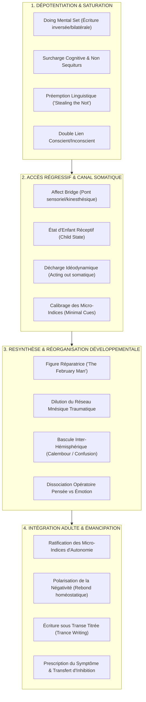

# The February Man
**Formateur :** Erickson & Rossi | **ID :** `erickson-rossi-the-february-man` | **Tranches :** 14

Voici la synthèse architecturale complète, ultra-dense et rigoureusement structurée à partir des mécanismes extraits du cours *The February Man* (Milton H. Erickson & Ernest L. Rossi).

---

# Synthèse Architecturale du Cours : The February Man (Erickson & Rossi)

---

### 1. Thèse Centrale & Philosophie du Cours

#### Vision spécifique de Erickson & Rossi vs Approche Standard
* **Anti-reprogrammation mécanique & anti-catharsis pure :** La guérison hypnotique n'est ni l'imposition exogène de suggestions directes de changement (« reprogramming » simpliste), ni une catharsis analytique où la reviviscence brute de la douleur suffirait à guérir. Erickson et Rossi posent le principe de **resynthèse et réassociation expérientielle** : le symptôme est le produit d'un rétrécissement cognitif et affectif propre aux apprentissages rigides de l'enfance (*literalism of childhood*).
* **Greffe développementale anachronique :** L'approche standard cherche soit à « effacer » le passé, soit à l'interpréter depuis la position adulte. Erickson adopte une posture radicalement inédite : il s'insère lui-même dans la chronologie développementale régressée du patient sous une identité bienveillante, flottante et anachronique (*The February Man*). Il ne viole pas l'historicité des faits, mais **féconde rétroactivement la mémoire** en fournissant à l'enfant les ressources de validation, de sécurité et d'étayage paternel qui lui ont manqué.
* **Co-construction inconsciente et primauté somatique/idéodynamique :** Là où le modèle standard impose un cadre verbal conscient, Erickson lit et mobilise en continu les signaux idéomoteurs minimaux (*minimal cues*), contourne le filtre analytique gauche par des ruptures de pattern et fait travailler le système nerveux à son niveau primaire de traitement de l'information (motricité involontaire, réponses neurovégétatives, métaphores incarnées).

#### Le fil rouge méthodologique unificateur
Toutes les interventions du cours reposent sur un cycle récurrent en 4 temps :
1. **Dépotentiation des cadres conscients rigides (*Depotentiation of conscious sets*)** par surcharge cognitive, ruptures motrices absurdes (*doing mental set*), non sequiturs, calembours et doubles liens.
2. **Régression en âge et libération du matériel d'enfance (*Child state*)** via des ponts affectifs et kinesthésiques dissociatifs (*affect bridges*), en observant la décharge somatique brute (toux, suffocation, tremblements).
3. **Réassociation / Dilution mnésique active** : injection de nouvelles liaisons sémantiques et affectives (l'apparition de l'Homme de Février, l'introduction d'associations agréables autour du trauma, la dissociation pensée/émotion).
4. **Condensation temporelle et ratification de l'émancipation adulte** : sauts chronologiques fractionnés, ancrage de permissions évolutives (slang, marqueurs d'autonomie) et prescription finale de l'inhibition pour transférer la résistance vers le praticien avant sa dissolution.

---

### 2. Carte des Concepts & Leviers Émergents



#### Écosystème des leviers clés :
* **Réassociation & Resynthèse Expérientielle** : Restructuration de la topographie mnésique globale plutôt que tentative d'effacement du trauma.
* **Dépotentiation du Conscient par Surcharge & Rupture** : Saturation du cortex logique par non sequiturs, humour d'enfant et paradoxes verbaux forçant le lâcher-prise exécutif.
* **Doing Mental Set (Set d'Action Inhabituel)** : Exécution de tâches neuromotrices étranges (écriture inversée, de bas en haut, deux mains) qui monopolisent les circuits cérébraux et ouvrent un cadre d'apprentissage neuf.
* **Préemption Linguistique (« Stealing the Not ») & Conversion Yes-Set** : Capture du mot négatif par le praticien avant qu'il ne serve de résistance, ou forçage méta d'un oui (*« Did you say no? »*).
* **Double Lien Conscient / Inconscient & Double Lien Éthique** : Questions structurées pour que la conscience se déclare incompétente tandis que l'inconscient valide la coopération (ou contrat moral absolu garantissant la levée de la censure).
* **Pont Affectif & Contraction Temporelle** : Liaison d'une mémoire sensorielle/kinesthésique actuelle à un point d'origine infantile, créant une amnésie sélective sur les années intermédiaires.
* **L'Homme de Février (Figure Réparatrice Anachronique)** : Identité transférentielle souple venant combler les carences affectives précoces directement au sein du stade développemental régressé.
* **Décharge Idéodynamique Somatique vs Bascule Hémisphérique** : Accueil de l'acting out corporel brut (hémisphère droit/noyade) désamorcé à la demande par une rupture lexicale/cognitif (hémisphère gauche/calembour).
* **Dilution Mnésique par Greffe Associative** : Insertion délibérée d'éléments séduisants ou neutres (ex. Alicia et Barney) au cœur du souvenir traumatique réactivé pour en dissoudre la toxicité relative.
* **Titration Respectueuse & Écriture sous Transe (*Trance Writing*)** : Maintien d'un écart temporel entre l'acte graphique inconscient et sa lecture consciente, protégeant l'écologie émotionnelle du patient.
* **Prescription du Symptôme & Déplacement d'Inhibition** : Interdiction thérapeutique d'exécuter l'action visée (ex. interdiction de nager) pour soulager le patient de sa peur de performance et déplacer le blocage sur l'autorité externe.

---

### 3. Tableau Récapitulatif des Techniques & Démonstrations

| Technique / Exercice | Objectif Opératoire | Déclencheur / Indication | Séquence Résumée |
|---|---|---|---|
| **Rupture Motrice Bilatérale & Inversée (*Doing Mental Set*)** | Surcharger le cortex moteur et suspendre l'esprit critique/analytique. | Résistance intellectuelle, rigidité de contrôle conscient, début d'induction. | 1. Ordonner d'écrire son mois de naissance ou son nom de bas en haut et à l'envers, yeux fermés.<br>2. Mobiliser les deux mains simultanément sur des trajectoires contradictoires.<br>3. Utiliser l'état de perplexité induit pour glisser les suggestions de transe. |
| **Préemption du « Non » (*Stealing the Not*)** | Désamorcer la charge oppositionnelle d'un refus avant son émission motrice. | Signes de retrait corporel ou amorce d'un refus conscient chez le sujet. | 1. Calibrer l'imminence d'une négation chez le patient.<br>2. Intégrer le marqueur négatif à l'intérieur du *tag question* de fermeture (*« ...will you not? »*).<br>3. Le patient ne pouvant plus utiliser ce signifiant, la résistance se dissout. |
| **Conversion Méta du Refus (Accord sur le Désaccord)** | Convertir une impulsion d'opposition en amorce de *Yes-Set* coopératif. | Émission d'un « Non » verbal direct et catégorique par le patient. | 1. Patient verbalise « Non ».<br>2. Praticien enchaîne immédiatement au méta-niveau : *« Avez-vous dit non ? »*<br>3. Le patient est contraint de répondre « Oui », basculant physiologiquement en mode affirmatif. |
| **Pont Kinesthésique Régressif (*Affect Bridge*)** | Court-circuiter la chronologie adulte pour faire régresser le système nerveux à l'enfance. | Blocages phobiques ou inhibitions prenant racine dans l'enfance pré-verbale. | 1. Isoler une mémoire motrice ou somatique précise (ex. geste de serrer la main ou écrire).<br>2. Suggérer l'oubli total de toutes les années intermédiaires comme des « zones blanches ».<br>3. Provoquer la contraction temporelle vers le premier apprentissage d'enfance associé. |
| **Transe Fractionnée Multi-Visites (L'Homme de Février)** | Construire une relation réparatrice étalée sur des années subjectives en une seule séance. | Traumatismes de carence affective précoce, deuil prématuré d'un parent, solitude archaïque. | 1. Induire la régression en âge au stade cible (ex. 4 ans).<br>2. Apparaître comme un visiteur bienveillant (« L'Homme de Février »), jouer, valider l'enfant.<br>3. Clore la visite avec promesse de retour (*« I will see you again »*) et amnésie de séance.<br>4. Réveiller brièvement, puis réinduire en sautant à l'âge de 6, 8, 11 ans en réactivant la mémoire de la « visite passée ». |
| **Bascule Inter-Hémisphérique par Calembour** | Interrompre instantanément une crise de détresse somatique/abreactive explosive. | Spasmes somatiques incontrôlés, suffocations, reviviscences paniques aiguës (hémisphère droit). | 1. Patient en suffocation rejouant la noyade régressée.<br>2. Repérer un mot ambigu ou injecter un calembour incongru (ex. confusion *Sunday / someday* ou *puddle / poodle*).<br>3. Le cortex gauche est obligé de traiter l'anomalie logique/sémantique, ce qui coupe la boucle motrice de l'hémisphère droit. |
| **Dilution Topographique du Réseau Mnésique** | Réduire l'intensité d'un engramme traumatique sans le confronter directement. | Souvenirs traumatiques enkystés, culpabilité infantile intolérable. | 1. Réactiver la scène traumatique sous hypnose.<br>2. Insérer immédiatement des stimuli neutres, stimulants ou affectueux (enfants voisins, animaux, jeux) dans la même unité temporelle.<br>3. Re-consolider le souvenir : la trace aversive est mathématiquement diluée dans le nouveau réseau associatif. |
| **Dissociation Opératoire Pensée vs Émotion** | Permettre l'élaboration cognitive d'un événement sans submersion affective. | Souvenirs où émotion panique, impuissance et pensée adulte sont intriquées. | 1. Dissocier explicitement : l'adulte/le praticien analyse pendant que l'enfant reste en sécurité.<br>2. Commander d'observer la scène sans autoriser l'émotion à s'y brancher.<br>3. Faire verbaliser les faits bruts avant d'autoriser toute réassociation kinesthésique progressive. |
| **Polarisation et Rebond de Négativité** | Transformer une excuse ou un évitement en désir d'action futur. | Patient formulant des réticences à agir (ex. *« L'eau est trop froide pour nager »*). | 1. Au lieu de rassurer, s'approprier l'excuse en l'exagérant : *« Oui, c'est bien trop froid, impossible d'y aller »*.<br>2. Saturation du pôle négatif chez le praticien.<br>3. Rebond homéostatique du patient qui propose lui-même le compromis (*« Ne pourrait-on pas attendre l'été prochain ? »*). |
| **Écriture sous Transe Titrée (*Trance Writing Titration*)** | Faire émerger un tabou ou matériel refoulé sans effraction psychologique. | Présence d'un secret honteux ou traumatique non verbalisable directement. | 1. Guider le geste graphique sous transe pour tracer le mot refoulé (ex. le mot *sex*).<br>2. Retourner la feuille immédiatement ou introduire une pause délibérée avant lecture.<br>3. Laisser le sujet décider du moment où il souhaite que le thérapeute lise la feuille, rendant l'aveu actif et consenti. |
| **Prescription du Symptôme & Déplacement d'Inhibition** | Annihiler l'angoisse de performance lors de la phase finale de dépassement. | Blocage persistant au moment exact du passage à l'acte libérateur (ex. se jeter à l'eau). | 1. Lorsque le sujet s'approche de la levée du symptôme, lui interdire formellement de le faire.<br>2. L'inhibition n'est plus causée par la névrose mais par la consigne de l'opérateur.<br>3. Lever l'interdit au moment précis où la pression pulsionnelle positive du sujet dépasse l'autorité du thérapeute. |

---

---

## 0. Sommaire Sémantique & Index des Lignes

- **Tranche 1 [Lignes 119-240]** : Déstabilisation Motrice et Cognitive Pré-Transe (Écriture Miroir & Bilatérale) — *Protocole :* Déstabilisation Motrice et Cognitive Pré-Transe (Écriture Miroir & Bilatérale) | *Mécanisme :* Réassociation et Resynthèse Expérientielle vs Simple Reprogrammation Mécaniste
- **Tranche 2 [Lignes 242-386]** : Induction par Énigmes Associatives et Amnésie Structurée (The Enigma & Associative Mind Game) — *Protocole :* Induction par Énigmes Associatives et Amnésie Structurée (The Enigma & Associative Mind Game) | *Verbatim :* La rupture de cadre et surcharge d'association
- **Tranche 3 [Lignes 388-530]** : Induction du « Doing Mental Set » par Tâche Moteur Inhabituelle — *Protocole :* Induction du « Doing Mental Set » par Tâche Moteur Inhabituelle
- **Tranche 4 [Lignes 532-631]** : A : La Transe Fractionnée Multi-Visites (Condensation Temporelle de l'Homme de Février) — *Protocole :* A : La Transe Fractionnée Multi-Visites (Condensation Temporelle de l'Homme de Février)
- **Tranche 5 [Lignes 633-755]** : Recadrage de la perception post-traumatique par dissociation « Pensée vs Émotion » — *Protocole :* Recadrage de la perception post-traumatique par dissociation « Pensée vs Émotion » | *Verbatim :* Le double lien temporel de maturation
- **Tranche 6 [Lignes 757-910]** : A : La Sortie d'Excuse par Épuisement et Engagement Polarisié — *Protocole :* A : La Sortie d'Excuse par Épuisement et Engagement Polarisié | *Mécanisme :* Rapprochement et Recadrage Linguistique Générationnel (evolutionlinguistiqueemancipatrice slangasawareness) | *Verbatim :* Verbatim 1 : L'extraction et la polarisation du consentement
- **Tranche 7 [Lignes 912-1029]** : A : L'Écriture Bimanuelle Inversée (Activation du Set d'Apprentissage) — *Protocole :* A : L'Écriture Bimanuelle Inversée (Activation du Set d'Apprentissage)
- **Tranche 8 [Lignes 1031-1162]** : Induction par Émiettement Temporel Rétrograde & Amnésie Graduelle — *Protocole :* Induction par Émiettement Temporel Rétrograde & Amnésie Graduelle | *Verbatim :* La régression rétrograde par enchaînement déstructurant
- **Tranche 9 [Lignes 1164-1302]** : Décharge et intégration du souvenir traumatique par "Time Bind" & "Fast-Talking Set" — *Protocole :* Décharge et intégration du souvenir traumatique par "Time Bind" & "Fast-Talking Set"
- **Tranche 10 [Lignes 1304-1421]** : Le Pont d'Intégration Conscient/Inconscient (Éveil dirigé avec évocation obligatoire) — *Protocole :* Le Pont d'Intégration Conscient/Inconscient (Éveil dirigé avec évocation obligatoire) | *Verbatim :* Injonction d'Intégration Conscient/Inconscient
- **Tranche 11 [Lignes 1423-1552]** : 1 Protocole de Prescription du Symptôme & Enchâssement d'Évolution Latente — *Protocole :* 1 Protocole de Prescription du Symptôme & Enchâssement d'Évolution Latente | *Mécanisme :* 1 La Prescription du Symptôme comme Déplacement d'Inhibition et Set d'Acceptation | *Verbatim :* 1 La Prescription du Symptôme par Dissolution de la Salience
- **Tranche 12 [Lignes 1554-1669]** : A : Installation d'une Pseudomnésie Thérapeutique par Forçage Temporel — *Protocole :* A : Installation d'une Pseudomnésie Thérapeutique par Forçage Temporel | *Verbatim :* La bascule de la chaleur vers la fraîcheur par polarité
- **Tranche 13 [Lignes 1671-1790]** : Induction par Évocation d'Incertitude & Dépotentiation Conversationnelle — *Protocole :* Induction par Évocation d'Incertitude & Dépotentiation Conversationnelle
- **Tranche 14 [Lignes 1792-1889]** : A : La Rétro-Ingénierie Phobique par Pseudo-Orientation Temporelle et Apposition des Opposés — *Protocole :* A : La Rétro-Ingénierie Phobique par Pseudo-Orientation Temporelle et Apposition des Opposés | *Mécanisme :* Apposition des Opposés & Synthèse Neuro-Cognitive

---

## Extractions Détaillées par Tranche (Opératoire & Verbatim)

## Tranche 1 / 14 : Déstabilisation Motrice et Cognitive Pré-Transe (Écriture Miroir & Bilatérale)

### 1. Mécanismes & Principes Actifs

* **Réassociation et Resynthèse Expérientielle vs Simple Reprogrammation Mécaniste**  
  *Principe actif :* La guérison hypnotique n'est pas une insertion mécanique de suggestions exogènes (« reprogramming ») ni un simple décryptage intellectuel. Elle repose sur la réactivation d'expériences précoces réelles ou symboliques afin de fournir au système nerveux un matériel associatif plus vaste. En modifiant les liaisons sémantiques et affectives attachées aux engrammes de développement, le clinicien libère le sujet de l'étroitesse cognitive propre à l'enfance (« literalism of childhood ») pour ouvrir un cadre intégrateur adulte.  
  *Tags :* #reassociation_resynthese #cadre_elargi #anti_reprogrammation #plasticite_associative

* **Utilisation de la Polysémie et Projection Idéomotrice / Écriture Automatique**  
  *Principe actif :* L'inconscient encode simultanément plusieurs strates de sens sous un signifiant graphique ou phonétique unique. Lorsqu'un mot manuscrit émerge en écriture automatique avec une ambiguïté morphologique (ex. le graphème ambigu pouvant se lire *living*, *giving* ou *diving*), Erickson ne tranche pas pour une vérité univoque : il utilise cette bifurcation pour lier la résolution du symptôme somatique/phobique spécifique (*diving* / peur de l'eau) à la levée des blocages existentiels et relationnels profonds (*living*, *giving*).  
  *Tags :* #polysemie_evocatrice #ecriture_automatique #pontage_symptome_existence #bifurcation_semantique

* **Dédoublement Évolutif par Régression en État d'Enfant Réceptif (*Child State*)**  
  *Principe actif :* Le retour en régression en âge profonde place le système nerveux dans un état d'apprentissage accéléré et de malléabilité critique propre aux périodes sensibles du développement. En introduisant une figure protectrice et développementale anachronique (*The February Man*), Erickson permet au système identitaire de faire l'expérience d'une validation et d'une maturation affective rétroactive sans violer la réalité historique du sujet : l'adulte réintègre une mémoire corrigée et fertilisée.  
  *Tags :* #etat_enfant_receptif #reeducation_affective #figure_anachronique #greffe_developpementale

* **Prescription du Symptôme et Déplacement de l'Inhibition (*Symptom Prescription & Inhibition Transfer*)**  
  *Principe actif :* Lorsqu'un patient est sur le point de surmonter son blocage, l'injonction directe de ne pas exécuter l'action (interdire de nager) déplace le locus d'inhibition de la pathologie interne vers l'autorité du thérapeute. L'interdit n'appartient plus à la phobie mais devient une règle relationnelle externe transitoire, que le praticien peut dissoudre unilatéralement au moment opportun, court-circuitant ainsi l'angoisse de performance.  
  *Tags :* #prescription_du_symptome #deplacement_inhibition #court_circuit_anxieux #double_lien_therapeutique

* **Exposition Témoin et Désensibilisation Sociale de la Vulnérabilité**  
  *Principe actif :* Maintenir des observateurs ou des pairs lors de l'expression d'angoisses archaïques neutralise la double contrainte du secret pathogène. Le symptôme se nourrit de l'énergie dépensée à masquer l'insuffisance aux yeux d'autrui ; le fait d'éprouver la crise ou le dévoilement en présence de tiers bienveillants reprogramme l'évaluation du danger social : l'organisme intègre somatiquement qu'il peut survivre et rester accepté même si sa vulnérabilité est visible.  
  *Tags :* #desensibilisation_sociale #rupture_du_secret #exposition_en_tiers #normalisation_organique

* **Micro-dynamique d'Induction : Surcharge Cognitive, Déstabilisation et Rupture de Cadre**  
  *Principe actif :* La fixation indirecte de l'attention suivie d'une rupture des cadres de référence conscients (*depotentiation of conscious sets*) par l'absurde, l'humour, les jeux de mots, la surcharge motrice (écrire à l'envers des deux mains simultanément) et les *non sequiturs*. Le cortex conscient, saturé dans ses tentatives d'analyse linéaire et logique, suspend ses filtres critiques habituels, rendant l'inconscient perméable aux suggestions d'amnésie et de transe profonde.  
  *Tags :* #depotentiation_du_conscient #surcharge_motrice_bilaterale #saturation_cognitive #rupture_de_pattern

---

### 2. Protocoles, Techniques & Démonstrations (Étape par Étape)

#### Protocole 1 : Déstabilisation Motrice et Cognitive Pré-Transe (Écriture Miroir & Bilatérale)
* **Intention / Indication :** Dépasser les résistances intellectuelles, l'esprit critique aigu ou le besoin obsessionnel de contrôle conscient chez un sujet intelligent ou sceptique.
* **Mise en place & Pré-framing :** Cadrage ludique, informel et déstabilisant. Le thérapeute adopte un ton léger, presque distrait, réduisant l'enjeu tout en imposant une tâche motrice d'une complexité inhabituelle.
* **Séquence d'actions pas à pas :**
  1. *Engagement verbal initial :* Obtenir un accord formel et inconditionnel (« absolutely ») que la résolution/guérison aura lieu, verrouillant l'attente du résultat.
  2. *Introduction de contraintes motrices asymétriques :* Donner au sujet un crayon dans chaque main.
  3. *Injonction paradoxale de production :* Demander d'écrire simultanément des deux mains, en inversant le sens d'écriture ou en écrivant à l'envers/en miroir.
  4. *Enchaînement de non-sens et de jeux verbaux :* Rythmer l'exercice de calembours, d'ambiguïtés syntaxiques et de décalages logiques pour empêcher toute récupération analytique.
  5. *Bascule en écriture automatique :* Dès que la fatigue ou la confusion motrice s'installe, suggérer que la main peut continuer de bouger d'elle-même, sans intervention de la volonté consciente.
* **Signes de calibration :** Regard qui se défocalise, ralentissement psychomoteur, déglutition spontanée, suspension du bavardage critique, hésitation motrice suivie d'une écriture fluide et dissociée sans contrôle visuel direct.

#### Protocole 2 : Recadrage Déterministe de la Culpabilité Précoce (Protection de Soi vs Haine Fraternelle)
* **Intention / Indication :** Neutraliser une auto-condamnation morbide ou une culpabilité dévastatrice ancrée dans l'enfance (ex. jalousie fraternelle ayant coïncidé avec la mort accidentelle d'un cadet).
* **Mise en place & Pré-framing :** Établir une régression où le sujet revit l'émotion brute d'un bébé/très jeune enfant, sans appliquer la morale adulte sur cette période.
* **Séquence d'actions pas à pas :**
  1. *Élicitation de l'auto-condamnation :* Faire nommer ou ressentir la charge de blâme que le sujet porte envers lui-même.
  2. *Recadrage d'expansion temporelle et cognitive :* Valider l'auto-condamnation comme étant la meilleure tentative possible de l'enfant pour donner du sens, tout en ouvrant vers un niveau supérieur (« a still better appreciation »).
  3. *Normalisation biologique de la pulsion d'affirmation :* Redéfinir la rivalité infantile ou la jalousie en tant que mécanisme instinctif et légitime d'auto-préservation de l'organisme.
  4. *Interrogation socratique fermée sous présupposition de valeur :* Confronter le sujet adulte à la légitimité du nourrisson qui défend son intégrité et son besoin d'exister.
* **Signes de calibration :** Relâchement musculaire massif au niveau du visage et des épaules, soupir respiratoire involontaire (décharge autonomique), larmes d'apaisement marquant l'intégration du nouveau cadre.

#### Protocole 3 : Verrouillage de la Souveraineté du Changement (Inhibition Paradoxale de l'Action)
* **Intention / Indication :** Patient manifestant une impatience anxieuse ou prêt à tester prématurément le comportement phobogène, risquant un échec de réactivation du trauma.
* **Mise en place & Pré-framing :** Observer que le patient exprime le désir direct de se confronter au stimulus évité (ex. aller nager).
* **Séquence d'actions pas à pas :**
  1. *Interdiction formelle autoritaire :* Poser un interdit explicite et total sur la réalisation de l'action désirée.
  2. *Attribution explicite de l'inhibition :* Déclarer ouvertement que le blocage n'appartient plus à l'incapacité du patient, mais devient la propriété exclusive du thérapeute.
  3. *Maintien de la tension jusqu'à la séance suivante :* Laisser l'interdit agir comme un accumulateur de désir inconscient.
  4. *Levée délibérée du verrou :* Lors de la séance ultérieure, retirer formellement l'inhibition externe, libérant l'élan d'action sans l'interférence de l'ancienne phobie.
* **Signes de calibration :** Étonnement ou frustration initiale du sujet, transfert de l'attention de la peur vers la consigne, puis détente psychologique : le patient se décharge du fardeau de la tentative.

---

### 3. Heuristiques, Subtilités & "Sagesse du Praticien"

* **Règle de l'Agentivité Radicale du Sujet :**
  * *Heuristique :* « It is the patient who does the work. All that the therapist does is provide conditions in which this work can be done. »
  * *Règle opératoire :* Si le praticien essaie de réparer, d'analyser ou de guérir le sujet à sa place, la thérapie s'enlise dans la dépendance intellectuelle. Le rôle du praticien est strictement d'architecturer un champ relationnel, expérientiel et permissif où l'inconscient du sujet résout ses propres équations.

* **Heuristique de l'Insight vs Processus Émergent :**
  * *Règle opératoire :* Si le patient exige de « comprendre son passé » pour guérir, acquiescer et guider l'exploration de l'histoire personnelle pour satisfaire sa théorie causale consciente ; cependant, opérer le changement réel par le processus associatif inconscient. « Understanding the past will not change the past. » L'insight n'est qu'un véhicule d'engagement du conscient, jamais le levier curatif principal.

* **Heuristique du Calibrage Somatique Fin (Exemple Catatonique) :**
  * *Règle opératoire :* Ne jamais baser un diagnostic ou une évaluation sur les dires théoriques. Observer la relation du corps à l'espace et à la ligne médiane : une patiente qui se gratte d'une main jusqu'à l'extrémité de l'autre main sans savoir où finit son propre corps révèle immédiatement une dissolution de la frontière de son schéma corporel (schizophrénie catatonique) en moins de 30 secondes d'observation clinique directe.

* **Heuristique de la Réponse Évasive Thérapeutique :**
  * *Règle opératoire :* Si un sujet questionne le thérapeute de manière consciente sur ce qui s'est déroulé pendant une période d'amnésie hypnotique, répondre exclusivement de manière indéfinie, évasive et ouverte. Ne jamais combler le vide mnésique par du contenu verbal adulte : laisser l'inconscient formuler sa demande sous forme de manifestations indirectes (ex. lapsus, métaphores, peurs somatiques).

* **Heuristique de l'Intégration de l'Agressivité Pré-Terminaison :**
  * *Règle opératoire :* Avant de clore une thérapie profonde, offrir délibérément au patient un espace pour ventiler de l'hostilité envers le thérapeute. Tout patient éprouve une rage inconsciente d'avoir été dépendant de ses symptômes et déstabilisé par le processus de cure ; intégrer cette hostilité stabilise les gains thérapeutiques et évite le transfert négatif tardif.

* **Pièges Classiques et Erreurs Corrigées :**
  * *Erreur :* Croire que l'hypnothérapie consiste à « restructurer » ou « reprogrammer » les pensées du sujet.
  * *Correction d'Erickson :* « It is not restructuring. You give them a more complete view. » Le thérapeute n'impose pas une architecture mentale artificielle : il élargit le champ de perception pour libérer le sujet des conclusions littérales et réductrices de l'enfance.
  * *Piège de l'Intellectualisation (cas Sidney Rosen) :* Remplacer le ressenti par l'analyse. Lorsqu'un praticien ou un patient dit « je préfère comprendre plutôt que ressentir », lui faire vivre une expérience physique ou une métaphore kinesthésique (ex. escalader une montagne) pour court-circuiter l'abstraction mentale stérile.

---

### 4. Pépites Verbatim & Patterns Linguistiques (MOT À MOT EN V.O.)

* **Citation 1 :**
  > "You have been condemning yourself, haven't you, because you didn't have the understanding you could reach a still better appreciation of yourself?"
  * **[Analyse du Pattern] :** 
    - **Présupposition d'intention positive et d'évolution :** La formulation présuppose que l'auto-condamnation n'est pas une faute mais l'étape préparatoire obligatoire vers une appréciation supérieure de soi (« reach a still better appreciation »).
    - **Tag question négative fermée (« haven't you ») :** Verrouille l'accord immédiat du sujet sur l'état passé de souffrance pour le faire pivoter vers le manque d'outils (« didn't have the understanding ») plutôt que vers une défaillance morale intrinsèque.

* **Citation 2 :**
  > "Self-condemnation is reframed as a step toward a better self-understanding. Sibling rivalry is reframed as self-defense: 'When you were a little baby had one meaning; from another point of view it has another meaning entirely. Wouldn't you want a little baby to appreciate its own worth, its own personality and its own needs enough to defend them in any way it understood?'"
  * **[Analyse du Pattern] :**
    - **Changement de cadre temporel et d'échelle de référence :** Relativise la signification en juxtaposant deux points de vue (« had one meaning; from another point of view it has another meaning entirely »), dissolvant l'évaluation univoque du trauma.
    - **Question rhétorique négative à postulat universel :** La tournure « Wouldn't you want a little baby to... » force l'interlocuteur à valider une norme protectrice universelle envers l'enfance, rendant impossible la condamnation du soi infantile sans rejeter la bienveillance fondamentale due à tout nouveau-né.
    - **Recadrage de la rivalité en auto-préservation légitime :** Le comportement agressif infantile est requalifié en acte instinctif d'estime de soi (« appreciate its own worth... enough to defend them »).

* **Citation 3 :**
  > "It is not restructuring. You give them a more complete view."
  * **[Analyse du Pattern] :**
    - **Négation catégorique correctrice :** Évacue le modèle mécaniste et interventionniste de l'analyste (« It is not restructuring ») pour désamorcer l'idée que le clinicien sait mieux que le patient comment organiser sa psyché.
    - **Présupposition additive d'expansion :** L'usage du comparatif « a more complete view » implique que la perception traumatique du patient n'était ni fausse ni malade, mais simplement partielle et restreinte par l'immaturité de son système de traitement de l'information à l'époque des faits.

* **Citation 4 :**
  > "I place my inhibition on her swimming. [...] I can change mine!"
  * **[Analyse du Pattern] :**
    - **Prise de possession linguistique du symptôme :** L'adjectif possessif (« my inhibition ») confisque le symptôme à l'inconscient du sujet pour en faire un objet externe gouverné par le praticien.
    - **Découplage et contrôle souverain :** L'affirmation brève (« I can change mine! ») pose une règle asymétrique : le patient était impuissant à modifier sa propre inhibition phobique, mais le thérapeute dispose du pouvoir total de modifier la sienne, installant une garantie implicite de libération future sous le couvert d'un interdit présent.

* **Citation 5 :**
  > "You prefer to understand rather than to experience."
  * **[Analyse du Pattern] :**
    - **Clivage binaire direct et confrontation du méta-programme :** Met à nu le mécanisme de défense intellectuel en l'opposant terme à terme à l'expérience vivante (« understand » vs « experience »).
    - **Transe de rupture :** Cette remarque brève suspend instantanément la stratégie d'évitement de l'interlocuteur en la nommant avec précision chirurgicale, créant le vide nécessaire pour amorcer une induction expérientielle (l'ascension de la montagne).

## Tranche 2 / 14 : Induction par Énigmes Associatives et Amnésie Structurée (The Enigma & Associative Mind Game)

Voici l'extraction opératoire intégrale de la **tranche 2/14** de *The February Man* (Erickson & Rossi).

---

### 1. Mécanismes & Principes Actifs

- **Dépotentiation par Surcharge Cognitive et Rupture Associative (*Cognitive Overloading & Non Sequitur*)**
  - *Principe actif* : L'esprit conscient s'épuise à tenter de construire de la cohérence linéaire là où l'opérateur injecte des sauts conceptuels imprévisibles (passer de Gene Autry à un jardin, du crottin de cheval à une chanson country, puis au mot d'esprit sur St. Pierre). Face à un déluge de *non-sequiturs*, les cadres de référence habituels (*learned limitations*) capitulent. La conscience abdique sa fonction critique et suspend son intentionnalité.
  - *Tags* : `#depotentiation_consciente #surcharge_cognitive #non_sequitur #amnesie_structuree`

- **Les 5 Stades de la Microdynamique de Transe (Modèle Erickson-Rossi)**
  - *Principe actif* :
    1. *Focalisation de l'attention* sur un stimulus inhabituel ou une énigme.
    2. *Dépotentiation des sets mentaux habituels* par la confusion, le paradoxe et l'incongruité.
    3. *Recherche intérieure créative (*Inner Search*)* : incapable de répondre logiquement à l'extérieur, le sujet scrute ses réseaux de mémoire internes.
    4. *Activation de processus inconscients* (accès aux potentiels, mémoires refoulées, écriture automatique).
    5. *Réactivité hypnotique (*Hypnotic Responsiveness*)* : réceptivité accrue aux suggestions et acceptation des directives sans interférence critique.
  - *Tags* : `#microdynamique_transe #inner_search #activation_inconsciente #readiness`

- **Double Lien Conscient/Inconscient (*Conscious-Unconscious Double Bind*)**
  - *Principe actif* : Poser des questions formulées de manière à ce que les deux niveaux de traitement de l'information (l'instance consciente qui verbalise et l'inconscient qui commande les automatismes somatiques) répondent simultanément ou contradictoirement. La contradiction directe (*"Have you forgotten it?"* -> *Yes* / *No*) déstabilise le moi conscient et isole le réseau inconscient comme canal de réponse dominant.
  - *Tags* : `#double_lien_conscient_inconscient #scission_dissociative #reponse_ideomotrice`

- **L'Intuition Opératoire par Réponse aux Micro-Indices (*Unconscious Response to Minimal Cues*)**
  - *Principe actif* : Ce qui est catalogué superficiellement comme de "l'intuition pure" chez Erickson repose sur le calibrage inconscient de micro-réactions motrices et neurovégétatives du sujet (évitement visuel, micro-froncement de sourcil, pincement ou dilatation des narines face aux fleurs dans la pièce). Erickson utilise ensuite cette information subliminale sous forme d'une suggestion indirecte couverte (*"Be unwilling to answer: Is there something about those flowers you don't like?"*).
  - *Tags* : `#calibrage_subliminal #minimal_cues #intuition_operatoire #piste_traumatique`

- **Métaphorisation du Sommeil et Commande Idéomotrice Implicite (*Implied Directive*)**
  - *Principe actif* : Le terme *"Sleep"* n'est pas utilisé pour induire le sommeil physiologique, mais comme un méta-opérateur symbolique qui donne la permission au conscient de relinquisher (abandonner) le contrôle exécutif. L'opérateur lie immédiatement cette transe à un signal involontaire (*"your right hand will lift up"*), transformant une sensation interne subjective en une validation physiologique objective.
  - *Tags* : `#sommeil_metaphorique #directive_implicite #levitation_ideomotrice #signal_de_profondeur`

- **Installation d'un "Set Mental d'Action" Inhabituel (*Doing Mental Set*)**
  - *Principe actif* : Faire exécuter une tâche motrice complexe mais absurde pour les routines conscientes (écrire sa date de naissance à l'envers et à l'envers spatialement / tête en bas, les yeux fermés). Cela mobilise 100% de la motricité inconsciente et empêche tout retour de la critique verbale.
  - *Tags* : `#doing_mental_set #ecriture_inversee #absorption_motrice #ancrage_d_action`

---

### 2. Protocoles, Techniques & Démonstrations (Étape par Étape)

#### Protocole 1 : Induction par Énigmes Associatives et Amnésie Structurée (*The Enigma & Associative Mind Game*)
- **Intention / Indication** : Sujet intellectuel, résistant, hyper-analytique ou bloqué dans un contrôle rationnel rigide.
- **Mise en place & Pré-framing** : L'opérateur n'annonce jamais une hypnose formelle. Il entame une discussion apparemment anodine ou joueuse avec un tiers (ici le Dr Fink) sous le regard du sujet.
- **Séquence d'actions pas à pas** :
  1. *Lancement du Non-Sequitur* : Émettre une association d'idées apparemment absurde (*Gene Autry -> Jardin -> Tumbleweed*).
  2. *Balisage temporel ("Rappel de début")* : Poser une référence énigmatique (ex: l'évocation de *St. Peter*).
  3. *Surcharge intermédiaire* : Dérouler une séquence rapide de devinettes, jeux de mots et ambiguïtés sémantiques (*"a brown study", "splotchy"*), en forçant le sujet à tenter de combler les blancs (*"Will you fill in two missing letters?"*).
  4. *Balisage terminal ("Rappel de fin")* : Réinjecter la référence de l'étape 2 (*St. Peter*) pour refermer la boucle.
  5. *Effet d'Amnésie Structurée* : Tout le contenu intermédiaire tombe dans un trou amnésique ; le sujet avoue publiquement sa confusion (*"I was lost three or four blocks back"*).
  6. *Capture de l'état de vacuité* : Greffer immédiatement l'amorce de la tâche hypnotique (l'écriture automatique).
- **Signes de calibration** : Blocage du débit verbal, regard fixe ou fuyant, aveu spontané de confusion (*"That doesn't make sense"*), immobilité corporelle, absorption interne.

#### Protocole 2 : Piste Évocatoire Indirecte de Mémoire Refoulée (*Indirect Search for Repressed Material via Negation*)
- **Intention / Indication** : Découvrir la source d'un trauma sans déclencher d'abréaction prématurée ni affronter la résistance directe du conscient.
- **Mise en place** : Observer les micro-réactions du sujet face à des objets dans l'environnement immédiat.
- **Séquence d'actions pas à pas** :
  1. *Prescription de la résistance* : Demander explicitement au sujet de refuser de répondre (*"I would like to have you be unwilling to answer this question..."*).
  2. *Introduction de la cible masquée* : Poser la question anodine mais ciblée sur l'aversion (*"Is there something about those flowers you don't like?"*).
  3. *Validation de l'interdit par l'écriture* : Demander s'il veut l'écrire, le laisser refuser (*"No"*), puis verrouiller son refus par une promesse (*"I want a promise"*).
  4. *Dérivation métaphorique par analogie de locomotion* : Tester ce qu'il ferait face à un interdit de transport (*"If you promised not to take a bus home..."* -> marche -> taxi).
  5. *Extraction de la qualité processuelle* : Mettre en lumière que le taxi est "plus rapide". L'inconscient associe le taxi au fait d'aller vite vers la résolution du mystère.
  6. *Confirmation multiniveau* : Demander plus tard si le sujet prend des taxis ; la réponse affirmative inconsciente valide l'acheminement vers le trauma.
- **Signes de calibration** : Refus verbal net accompagné d'un sourire perplexe ou d'une hésitation motrice ; micro-signaux végétatifs lors de la mention de l'élément déclencheur (les fleurs) ; accord idéomoteur involontaire.

#### Protocole 3 : Validation de Profondeur par Directive Implicite et Levée Idéomotrice
- **Intention / Indication** : Valider la réceptivité hypnotique et installer une preuve somatique incontestable pour le praticien et le sujet.
- **Mise en place** : Sujet déjà en état de confusion avancée ou somnolent.
- **Séquence d'actions pas à pas** :
  1. *Autorisation d'autonomie contrôlée* : Inviter le sujet à dormir pour lui-même jusqu'à satisfaction.
  2. *Verrouillage anti-résistance* : Utiliser la tournure syntaxique d'annihilation du refus : *"And you will, will you not?"*.
  3. *Association de la profondeur au signal moteur* : Lier la profondeur perçue au mouvement involontaire de la main (*"And when you feel you are really sound asleep, your right hand will lift up to let me know"*).
  4. *Suggestion de présence immédiate* : Enchaîner au présent continu sans attendre (*"And your hand is lifting, is it not?"*).
- **Signes de calibration** : Ralentissement du clignement des yeux ou fermeture spontanée, relâchement des muscles faciaux, mouvements saccadés (micro-lévitation) de la main droite.

---

### 3. Heuristiques, Subtilités & "Sagesse du Praticien"

- **Règle du non-conflit sur le "NON" (Soustraction de la négation)** :
  * *Heuristique* : *Si le sujet ressent le besoin inconscient de dire "Non" ou de résister -> alors prononce le "Non" avant lui dans ta phrase ("..., will you not ?")*, car une fois que le praticien a dit le mot, le sujet est privé de la charge oppositionnelle ; il ne peut plus s'en servir comme rempart.
- **Règle du Non-Savoir Émancipateur** :
  * *Heuristique* : *Si le conscient commence à dire "Je ne sais pas" ou "Ça n'a aucun sens" -> alors félicite-toi et pousse le levier*, car l'état de non-savoir désamorce les apprentissages limitants de l'adulte et ramène le système nerveux dans l'état de l'enfant qui apprend spontanément (*infant learning set*).
- **Règle du Truisme face à l'Impatiente** :
  * *Heuristique* : *Si le sujet se plaint de la lenteur ou de la lourdeur du processus ("Tedious process, isn't it?") -> alors recadre immédiatement par un truisme indiscutable ("Good work has to be done slowly")*, pour transformer l'agacement en acceptation et en présupposition d'excellence.
- **Règle de l'Alternative Multidirectionnelle** :
  * *Heuristique* : Ne cherche jamais à forcer le sujet à regarder là où tu veux. *Si le sujet cherche à déjouer le praticien -> offre-lui le cadre où toute tentative de tromperie ou de dissimulation devient elle-même le matériau qui révèle la vérité*.
- **Postulat Philosophique Central Ericksonien** :
  * L'hypnothérapie ne consiste **JAMAIS** à injecter quelque chose de l'extérieur dans un récepteur passif (rejet absolu de l'automate suggestionné des magnétiseurs classiques). C'est l'art d'évoquer des potentiels internes et d'activer des processus associatifs autonomes propres au patient, en contournant ses limitations apprises.

---

### 4. Pépites Verbatim & Patterns Linguistiques (MOT À MOT EN V.O.)

#### Pépite 1 : La rupture de cadre et surcharge d'association
> **Erickson :** *"Getting away from that, do you like Gene Autry?"*  
> **Fink :** *"I certainly ought to be able to answer... doesn't that make horse sense? I'm off on the wrong foot!"*  
> **Erickson :** *"What's that got to do with a garden?"*  
> **Fink :** *"Well, it contributes fertilizer to a garden."*  
> **Erickson :** *"How do you get from tumbled to garden to Gene Autry?"*
- **[Analyse du Pattern]** : **Rupture de pattern (*Pattern Interrupt*) et cascade de sauts logiques (*Non Sequiturs*)**. Erickson brise abruptement le fil logique initial. En forçant la recherche de liens impossibles entre des champs lexicaux disparates (cow-boy chantant, jardin, engrais), il provoque un blocage du traitement conscient chez le témoin (*Subject blocks in confusion*).

---

#### Pépite 2 : Recadrage de la confusion en stade de développement
> **Erickson :** *"Into each life some confusion should come—also some enlightenment!"*
- **[Analyse du Pattern]** : **Truisme métaphorique et équivalence complexe déguisée**. Présupposition universelle (calquée sur l'adage populaire *"into each life some rain must fall"*). Normalise l'angoisse de la confusion en l'élevant au rang d'étape obligatoire et naturelle précédant la clarté (*enlightenment*).

---

#### Pépite 3 : Amnésie structurée par encadrement
> **Erickson :** *"I used St. Peter to remind him of the enigma, and I began with the reminder and ended with the reminder to mess him up in his thinking."*
- **[Analyse du Pattern]** : **Boucle amnésique imbriquée (*Amnesic Gap Frame*)**. Utilisation d'un point d'ancrage saillant au début et à la fin d'une séquence de surcharge. La charge mnésique de la fin efface la mémoire de travail des événements intermédiaires, plongeant le conscient dans l'incompétence et ouvrant la voie à la transe.

---

#### Pépite 4 : Suggestion indirecte d'évocation d'un apprentissage primordial
> **Erickson :** *"As an infant you start learning the moment you hear something; you wonder what is being said what..."*
- **[Analyse du Pattern]** : **Régression en âge conversationnelle et truisme ontologique**. L'utilisation de *"As an infant you..."* projette le sujet dans son archétype d'enfant réceptif, reliant l'incapacité actuelle de comprendre à l'émerveillement naturel de l'apprentissage initial (*wonder*).

---

#### Pépite 5 : Recadrage de la lenteur du traitement
> **Subject :** *"It always amazes me. Tedious process, isn't it?"*  
> **Erickson :** *"Good work has to be done slowly."*
- **[Analyse du Pattern]** : **Recadrage de contenu par truisme d'autorité**. La qualification négative (*"tedious"*, fastidieux) est instantanément transmutée en marqueur de qualité et de précision (*"good work"*), neutralisant l'impatience du conscient.

---

#### Pépite 6 : Déclenchement de la recherche indirecte de matière refoulée
> **Erickson :** *"We can interrupt there. I would like to have you be unwilling to answer this question: Is there something about those flowers you don't like?"*
- **[Analyse du Pattern]** : **Prescription du symptôme / Double lien paradoxal**. En exigeant du sujet qu'il soit *réticent* à répondre (*"be unwilling to answer"*), Erickson valide d'avance la résistance inconsciente. Le sujet, pour obéir à l'ordre de ne pas vouloir répondre, est contraint de focaliser 100% de son attention interne sur la cible traumatique (les fleurs).

---

#### Pépite 7 : Induction par effondrement de l'enjeu conscient
> **Subject :** *"I have even forgotten the original issue."*  
> **Fink :** *"Go sound asleep. Deep down, sound asleep. Continue to sleep. You may even close your eyes and go deeper, deeper... And sleep soundly, very soundly, very deeply and very soundly... Just sleep in your own way so that you can accomplish everything..."*
- **[Analyse du Pattern]** : **Saisie d'opportunité sur rupture d'orientation (*Seizing the Liminal Void*) et empilement de répétitions impératives**. Dès que le sujet admet la vacuité amnésique (*"forgotten the original issue"*), le praticien saute sur le vide créé pour délivrer une commande directe et répétitive de sommeil hypnotique avec clause permissive (*"in your own way so that you can accomplish everything"*).

---

#### Pépite 8 : L'annihilation préemptive de la résistance
> **Erickson :** *"And you will, will you not? Just keep on sleeping deeply, soundly. And when you feel you are really sound asleep, your right hand will lift up to let me know. And your hand is lifting, is it not?"*
- **[Analyse du Pattern]** : **Tag question inversée privative (*"will you not?"*) couplée à une liaison contingente idéomotrice**. En insérant *"will you not?"*, l'opérateur s'approprie la négation avant que le sujet ne puisse la formuler intérieurement. La seconde phrase lie temporellement une certitude subjective interne (*"when you feel you are really sound asleep"*) à une réponse physiologique observable (*"your right hand will lift up"*), validée au présent progressif (*"is lifting, is it not?"*).

## Tranche 3 / 14 : Induction du « Doing Mental Set » par Tâche Moteur Inhabituelle

### 1. Mécanismes & Principes Actifs

- **Dépotentiation de la négativité par préemption linguistique (« Stealing the Not »)**
  - *Principe actif* : Lorsqu'un sujet commence à mobiliser une résistance interne ou un refus conscient, l'inconscient prépare le marqueur linguistique négatif (« non » / « not »). En insérant immédiatement ce mot dans le tag question final (*« ...will you not? »*), le praticien s'approprie la particule négative avant le sujet. Le système nerveux ne peut plus utiliser ce signifiant pour s'opposer, car il a déjà été formulé et intégré dans la commande. La résistance perd sa charge énergétique motrice et se dissout.
  - *Tags libres* : #preemption_linguistique #vol_du_non #depotentiation_resistance #court_circuit_oppositionnel

- **Induction d'un « Doing Mental Set » par rupture motrice et kinesthésique**
  - *Principe actif* : Obliger le sujet à écrire à l'envers (*backwards*) et de bas en haut (*upside down*), ou simultanément avec les deux mains. Cela court-circuite brutalement les programmes moteurs automatisés logés dans les ganglions de la base et le cortex moteur. Le cortex conscient est saturé et désorienté par l'incapacité d'appliquer ses schémas habituels. Cet état de perplexité active un état attentionnel focalisé vers l'extérieur (le guidage du praticien) et ouvre une disposition mentale exploratoire (*exploratory new learning set*), indispensable pour réécrire des apprentissages de vie rigides.
  - *Tags libres* : #doing_mental_set #saturation_motrice #action_metaphor #reprogrammation_neuromotrice #cadre_exploratoire

- **Conversion sémantique de négations en dynamique d'affirmation (Double négation vers Yes-Set)**
  - *Principe actif* : Transformer des refus conscients en accord hypnotique par un glissement de niveau logique. Si le sujet dit « Non » à une proposition, le praticien demande : *« Did you say no? »* (Avez-vous dit non ?). Le sujet est contraint de répondre « Oui » pour valider son propre « non ». Cette conversion sémantique réoriente la physiologie et l'élan communicatif d'un schéma de rejet vers un schéma de coopération (*yes set*), tout en installant l'acceptation que l'esprit conscient ne sait pas, alors que l'inconscient sait et coopère.
  - *Tags libres* : #conversion_semantique #glissement_meta #yes_set_dynamique #accord_sur_le_desaccord

- **Conditionnement contextuel de transe par association et réactivation indicielle**
  - *Principe actif* : Une fois qu'une transe a été vécue avec un praticien, la relation elle-même, la voix, la posture et les structures syntaxiques deviennent des stimuli d'ancrage contextuels. La simple présence ou le ton du praticien réévoque automatiquement un état altéré (transe de second ou troisième niveau), souvent sous forme de micro-transes invisibles pour le sujet conscient, permettant un contournement direct des défenses habituelles.
  - *Tags libres* : #ancrage_relationnel #micro_transe #reactivation_associative #transe_de_second_niveau

- **Pont affectif dissociatif et contraction temporelle vers la régression en âge**
  - *Principe actif* : Utiliser une mémoire motrice ou somatique récente (ex: sensation kinesthésique d'écrire son mois de naissance d'une façon étrange) comme tremplin sensoriel (*affect bridge*). En reliant cette mémoire sensorielle à des apprentissages très anciens (la première fois qu'on a serré la main de quelqu'un), et en suggérant l'oubli sélectif de tout ce qui s'est produit entre les deux, les années intermédiaires deviennent des « zones blanches » d'amnésie. Le temps subjectif se contracte neurologiquement, ramenant le sujet à l'âge où cette mémoire a été encodée.
  - *Tags libres* : #affect_bridge #contraction_temporelle #amnesie_structurante #regression_en_age

- **Incarnation identitaire réparatrice dissociée (« The February Man »)**
  - *Principe actif* : Dans la régression en âge, le praticien ne reste pas « le thérapeute adulte du présent », mais abandonne son identité réelle pour devenir une présence bienveillante, amicale et protectrice issue du futur de l'enfant (l'Homme de Février). En ancrant des suggestions post-hypnotiques de visites répétées et d'humour/sécurité, cette figure réparatrice vient combler les vides affectifs précoces (comme le deuil du père) sans forcer d'interprétation analytique d'adulte.
  - *Tags libres* : #figure_reparatrice #homme_de_fevrier #reparentage_hypnotique #identite_flottante

- **Métaphore de la sagesse somatique et organique autonome (L'analogie de l'inconscient biologique)**
  - *Principe actif* : Pour lever l'angoisse de l'enfant (ou du patient) face aux questions existentielles insolubles (« Pourquoi papa est mort ? », « Où vont les oiseaux ? »), le praticien transfère la compétence de résolution du conscient vers le corps biologique. Les cheveux savent pousser tout seuls, le bébé sait avaler sans explication, la soif commande de boire. Ce déplacement rassure le sujet : il n'a pas besoin de comprendre consciemment pour que son système gère parfaitement la croissance et l'adaptation.
  - *Tags libres* : #intelligence_organique #sagesse_somatique #decharge_du_conscient #utilisation_biologique

---

### 2. Protocoles, Techniques & Démonstrations (Étape par Étape)

#### Protocole 1 : Induction du « Doing Mental Set » par Tâche Moteur Inhabituelle
* **Intention / Indication** : Briser les cadres rigides d'apprentissage, contourner la passivité intellectuelle, installer une disposition mentale d'apprentissage expérientiel curieux.
* **Mise en place & Pré-framing** : Proposer une activité physique anodine sans annoncer d'objectif thérapeutique préalable.
* **Séquence d'actions pas à pas** :
  1. *Étape 1* : Faire entrer le sujet en transe légère ou moyenne et lui demander d'émerger juste à moitié (état crépusculaire).
  2. *Étape 2* : Placer un crayon dans chaque main ou proposer d'écrire son mois de naissance.
  3. *Étape 3* : Donner une directive motrice inhabituelle : écrire à l'envers (*backwards*), de droite à gauche, ou de bas en haut (*upside down*), ou les deux mains en sens opposés.
  4. *Étape 4* : Valider la réalisation rapide et susciter l'étonnement face à cette capacité inattendue.
  5. *Étape 5* : Cacher le papier écrit derrière le bloc-notes en assignant au sujet la tâche post-hypnotique de s'en souvenir pour rappeler au praticien de le regarder au réveil.
* **Signes de calibration** : Perplexité motrice, ralentissement du geste, rire d'étonnement ou de curiosité, regard interrogateur en attente de la suite.

---

#### Protocole 2 : Conversion Sémantique du Rejet (Double « Non » vers Accord Inconscient)
* **Intention / Indication** : Quand le sujet répond par un refus (« Non ») à une question d'investigation ou d'ouverture.
* **Mise en place & Pré-framing** : Aucune préparation ; s'utilise en réaction immédiate et naturelle au « Non ».
* **Séquence d'actions pas à pas** :
  1. *Étape 1* : Poser la question directe (ex: *« Tu te souviens de... ? »* -> Sujet : *« Non »* ; *« Tu veux deviner ? »* -> Sujet : *« Non »*).
  2. *Étape 2* : Questionner immédiatement l'acte de parole lui-même au niveau méta : *« Did you say no? »* (As-tu dit non ?).
  3. *Étape 3* : Le sujet est forcé de valider factuellement son refus en répondant : *« Yes »* (Oui).
  4. *Étape 4* : Enchaîner instantanément sur l'étape suivante sur la base de cet accord : *« All right. Shall I tell you what I had in mind? »*
* **Signes de calibration** : Hochement de tête involontaire, rupture du ton d'opposition, alignement du regard sur le praticien.

---

#### Protocole 3 : Induction de la Régression en Âge par Érosion Sélective de Mémoire
* **Intention / Indication** : Provoquer une régression en âge authentique sans commande directe autoritaire, en reconstruisant un continuum temporel inversé.
* **Mise en place & Pré-framing** : Activer un affect bridge sensoriel récent (la sensation de la main écrivant le mois de naissance).
* **Séquence d'actions pas à pas** :
  1. *Étape 1 - Réactivation kinesthésique récente* : Faire revivre vivement la sensation des mains écrivant à l'envers quelques minutes auparavant.
  2. *Étape 2 - Enchaînement d'énigmes et d'oublis graduels* : Rappeler les séances passées où certains mois ont été oubliés (mars, février, décembre).
  3. *Étape 3 - Ancrage d'un jalon universel archaïque* : Évoquer le tout premier contact social moteur : la première fois où la main a serré une autre main dans la petite enfance.
  4. *Étape 4 - Suggestion de contraction temporelle* : Suggérer que l'oubli de tout ce qui s'est passé depuis cette première poignée de main rapproche inévitablement de cet instant originel.
  5. *Étape 5 - Calibration et ajustement temporel* : Poser des questions ouvertes d'orientation (*« Quelle année sommes-nous ? »*) et calibrer la réponse vocale et somatique de l'enfant.
* **Signes de calibration** : Modification du timbre de voix (voix fluette, enfantine), perte de la coordination motrice complexe (déclare ne plus savoir écrire), posture corporelle affaissée ou repliée.

---

#### Protocole 4 : Ratification Sensorielle et Installation de l'Homme de Février
* **Intention / Indication** : Stabiliser la régression en âge et installer une relation réparatrice sécurisante avec une figure bienveillante.
* **Mise en place & Pré-framing** : Ne pas chercher à convaincre le sujet qu'on est Erickson ; accepter pleinement l'amnésie de l'identité du thérapeute.
* **Séquence d'actions pas à pas** :
  1. *Étape 1 - Test de réalité concrète pour enfant* : Placer des objets tangibles dans les mains du sujet (une bague en or, des crayons) et lui demander de les identifier les yeux ouverts.
  2. *Étape 2 - Calibration de l'âge fonctionnel* : Évaluer la capacité de discrimination cognitive (distinction or/argent, identification par le toucher et la vue).
  3. *Étape 3 - Détermination naturelle du calendrier subjectif* : Utiliser des jalons temporels d'enfant (*« Qu'est-ce qui s'est passé le mois dernier ? »* -> *« Mamie est partie »* / *« Mon anniversaire »* -> donc nous sommes en février).
  4. *Étape 4 - Suggestion post-hypnotique de lien et de réapparition* : Établir une promesse d'amitié, de rires et de visites régulières sans révéler de nom formel (*« Tu vas me revoir et on aura des blagues »*).
* **Signes de calibration** : Réponses verbales spontanées d'enfant (*« 'Cause »*, *« Uh-huh »*), regard fixé sur les objets simples, détente faciale complète à l'évocation des blagues et du rire.

---

### 3. Heuristiques, Subtilités & "Sagesse du Praticien"

- **Règle de préemption de la résistance** :
  * *Règle* : Si vous pressentez qu'un sujet est sur le point de formuler un doute, une négation ou un refus verbal, formulez-le vous-même immédiatement sous forme de question inversée (*« ...will you not? »*).
  * *Raison* : L'inconscient cherche à compléter la gestalt linguistique ; si le mot « not » a déjà été prononcé par le thérapeute, l'envie du sujet de le dire est épuisée avant d'émerger.

- **Règle de l'indépendance de la date de régression** :
  * *Règle* : Le praticien ne choisit JAMAIS arbitrairement l'année exacte de régression ; il lance la dynamique de régression et explore humblement où le sujet a atterri.
  * *Raison* : L'inconscient choisit le niveau d'âge où se situe le noyau problématique ou l'état de ressources nécessaire. Vouloir imposer une date bloque le processus inconscient.

- **Règle de la relativité cognitive de l'âge** :
  * *Règle* : Face à un traumatisme ou à une incompréhension d'enfance, ne donnez JAMAIS une explication adulte directe. Utilisez l'analogie de l'apprentissage scolaire progressif (*« 1+1 c'est dur pour un petit enfant, 2+2 c'est encore plus dur, mais facile pour maman »*).
  * *Raison* : Cela valide le vécu de souffrance de l'enfant tout en injectant la certitude implicite que les perceptions changent inévitablement en grandissant (*« Things are going to change »*).

- **Règle de l'auto-sevrage et de l'apprentissage unique** :
  * *Règle* : Ne projetez pas vos propres solutions sur le sujet. Attendez et facilitez l'émergence de son schéma comportemental unique (analogie de Burt brisant les biberons pour marquer son sevrage).
  * *Raison* : Le praticien n'a pas à introduire de contenu étranger ; l'hypnothérapie ericksonienne consiste à débloquer et réutiliser (*utilization approach*) les ressources d'apprentissage déjà encodées dans le système du patient.

- **Règle du non-savoir protecteur (La signature du travail inconscient)** :
  * *Règle* : Quand le patient dit « Je ne sais pas », traitez cette réponse non pas comme un échec, mais comme la preuve parfaite que l'esprit conscient a cédé sa place aux processus inconscients.
  * *Raison* : C'est précisément parce que le conscient ne sait pas que le changement thérapeutique profond peut s'opérer sans interférence analytique limitante.

---

### 4. Pépites Verbatim & Patterns Linguistiques (MOT À MOT EN V.O.)

* **Extrait 1 : Double verrouillage de la réponse motrice involontaire**
  > « And you will, will you not? Just keep on sleeping deeply, soundly. And when you feel you are really sound asleep, your right hand will lift up to let me know. And your hand is lifting, is it not? »
  * **[Analyse du Pattern]** : Enchaînement d'un truïsme et d'une suggestion conditionnelle implicite (*implied directive*). La phrase lie la profondeur de la transe (*sound asleep*) à un mouvement moteur involontaire (*hand will lift*). L'utilisation de *« will you not? »* et *« is it not? »* capture et préempte toute tendance au refus, tout en présupposant que le phénomène idéomoteur est déjà en cours d'accomplissement.

* **Extrait 2 : Préemption du « Non » par épuisement syntaxique**
  > « I don't want her saying not. If she has a feeling the word not should be said she cannot say it because I've already said it. I've taken it away from her. »
  * **[Analyse du Pattern]** : Dépotentiateur de résistance par confiscation linguistique. Erickson explicite ici la mécanique : saturer le canal verbal avec le terme d'opposition potentiel pour dépouiller le patient de son arme d'opposition consciente.

* **Extrait 3 : Conversion d'une double négation en affirmation**
  > Erickson: « Would you like to guess? »  
  > Subject: « No. »  
  > Erickson: « Did you say no? »  
  > Subject: « Yes. »  
  > Erickson: « All right. Shall I tell you what I had in mind? »
  * **[Analyse du Pattern]** : Rupture de cadre logique par shift de niveau sémantique. Erickson prend le contenu du refus (*« No »*) et le transforme en objet d'observation factuelle. En validant qu'elle a bien dit « non », la patiente prononce un *« Yes »*, ce qui rétablit la boucle d'accordance (*yes set*) et autorise Erickson à enchaîner sans friction.

* **Extrait 4 : Double niveau de communication et présupposition de confort**
  > « Is it beginning to seem to you that you might accomplish your purpose... And is it beginning to seem to you that you actually can understand things that are distressing you much better than you do when you are awake? And is it beginning to seem to you that you will be comfortable about it? »
  * **[Analyse du Pattern]** : Présupposition temporelle progressive enchâssée (*« Is it beginning to seem to you... »*). Il ne demande pas si elle comprend ou si elle est à l'aise, mais si cela *commence à lui sembler ainsi*. Cela contourne le doute binaire en introduisant un processus graduel inarrêtable. Enchâssement subliminal : lier l'action anodine d'écrire à l'envers à la capacité de revisiter un traumatisme avec confort.

* **Extrait 5 : Contraction du temps par érosion mnésique**
  > « And if you forget a number of things that have happened to you since the first time you shook hands, you will really get closer and closer to that memory, will you not? »
  * **[Analyse du Pattern]** : Truïsme logique contraignant couplé à une amnésie structurante. La prémisse est irréfutable : si l'on efface les souvenirs postérieurs à un événement, la distance temporelle subjective vers cet événement se réduit à zéro. Cette logique force l'inconscient à produire une régression en âge par omission de l'intervalle biographique.

* **Extrait 6 : Ancrage de la figure de l'Homme de Février**
  > « You are going to see me again sometime. You will see me again. That's just a promise. Someday you and I will have a joke and you will enjoy doing it. »
  * **[Analyse du Pattern]** : Suggestion post-hypnotique directe délivrée sur le ton simple et chaleureux d'un adulte s'adressant à un enfant. L'ancrage d'une attente positive future (*« have a joke »*) offre un contraste affectif immédiat avec l'atmosphère d'isolement et de deuil de l'enfance du sujet, installant la figure de l'Homme de Février comme un phare de sécurité émotionnelle.

* **Extrait 7 : Métaphore de l'inconscient biologique autonome**
  > « Because birds understand things for themselves. Now how does a little baby understand why to swallow?... And when you get thirsty you don't have anybody explain to you that you should drink, do you? That is the way you grow. And when something comes toward your eyes you shut them, don't you? You just learn that. Your hair knows how to grow just on top of your head. It knows just how to grow. »
  * **[Analyse du Pattern]** : Empilement de truismes somatiques irréfutables (*pacing biologique*). Erickson associe les interrogations existentielles insolubles de l'enfant à des processus corporels réflexes et autonomes. La suggestion implicite installe l'idée que l'adaptation, la guérison et la croissance psychologique ne dépendent pas du contrôle intellectuel, mais d'une intelligence vivante involontaire qui opère déjà parfaitement d'elle-même.

## Tranche 4 / 14 : A : La Transe Fractionnée Multi-Visites (Condensation Temporelle de l'Homme de Février)

### 1. Mécanismes & Principes Actifs

- **Relativité de l'Âge et Recadrage Évolutionniste** :
  L'inconscient stocke des réponses phobiques ou traumatiques encodées avec les ressources cognitives limitées de l'enfance. En confrontant l'affect passé aux capacités présupposées du stade adulte, Erickson force le système nerveux à réévaluer la menace sous un angle de maturation. La peur n'est pas combattue de front ; elle est rendue caduque par l'écart temporel et développemental.
  *Tags :* `#relativite_age #recadrage_developpemental #maturation_cognitive #obsolescence_symptomatique`

- **Séparation Pensée / Émotion / Action (Dissociation Opératoire)** :
  Contrairement aux méthodes d'abréaction cathartique classiques qui réactivent massivement la détresse somato-émotionnelle, Erickson dissocie le souvenir factuel (la cognition) de sa charge affective originelle. En suggérant d'aborder le souvenir « et de l'aimer » (*and like it*), il installe un ancrage de neutralité ou de curiosité qui inhibe l'inondation limbique et permet la réorganisation de la mémoire autobiographique.
  *Tags :* `#dissociation_affect_cognition #desensibilisation_indirecte #inhibition_cathartique #traitement_mnesique`

- **Ancrage Kinesthésique Discret et Condensation Temporelle** :
  La poignée de main sert de déclencheur (*cue*) psycho-physiologique exclusif pour segmenter et enchaîner les visites de l'Homme de Février. Ce geste ancre le passage d'une tranche d'âge à une autre. Dans le temps réel de la séance, quelques secondes séparent deux poignées de main ; dans le temps subjectif de la transe, des mois ou des années s'écoulent, permettant de synthétiser des années de thérapie développementale en une seule séance.
  *Tags :* `#ancrage_post_hypnotique #poignee_de_main_cue #condensation_temporelle #transe_fractionnee`

- **Apposition d'Expériences Communes (Métaphore Isomorphique)** :
  Pour désamorcer la culpabilité et l'horreur liées à un incident grave (avoir failli noyer sa sœur), Erickson superpose un apprentissage biologique universel et anodin : se piquer avec les épines d'une rose en voulant la cueillir, ou se cogner le pied. L'inconscient transfère spontanément la structure relationnelle (*« l'intention n'était pas de détruire, mais de découvrir ; la douleur est une leçon naturelle de la réalité »*) sur le trauma interdit.
  *Tags :* `#isomorphisme_naturel #metaphore_rose_epine #destigmatisation_culpabilite #recadrage_apprentissage`

- **Rupture Amnésiante par l'Humour et le Calembour Enfantin** :
  L'insertion d'un calembour adapté au registre de l'âge régressé (*poodle/puddle*) agit comme un distracteur attentionnel semblable à un appel téléphonique inattendu. Cette surcharge cognitive brève désamorce l'empreinte de la boucle de rumination précédente et « nettoie le champ » (*clearing the mind*) pour introduire une nouvelle séquence d'intégration sans friction ni résistance consciente.
  *Tags :* `#amnesie_par_distraction #calembour_puddle_poodle #rupture_de_pattern #nettoyage_attentionnel`

- **Arrêt du Conflit Inter-Hémisphérique** :
  La transe profonde réduit la critique mutuelle entre le traitement verbal/analytique (hémisphère gauche) et le traitement holistique/symbolique (hémisphère droit). L'inconscient peut accepter simultanément une perspective sans que l'autre vienne la disqualifier par des objections rigides.
  *Tags :* `#dissociation_interhemispherique #reduction_conflit_interne #integration_symbolique`

---

### 2. Protocoles, Techniques & Démonstrations (Étape par Étape)

#### Protocole A : La Transe Fractionnée Multi-Visites (Condensation Temporelle de l'Homme de Février)
* **Intention / Indication** : Construire une relation thérapeutique réparatrice étalée sur plusieurs années subjectives au sein d'une seule séance d'hypnose.
* **Mise en place & Pré-framing** : Introduire la promesse du retour avant de clore l'étape précédente (*« I told you I would see you again »*), associant la sécurité et la continuité.
* **Séquence d'actions pas à pas** :
  1. *Pose de la suggestion post-hypnotique* : Informer le sujet que la prochaine rencontre aura lieu après un repère temporel signifiant (ex. après le prochain anniversaire).
  2. *Attribution du déclencheur kinesthésique* : Établir explicitement ou implicitement que la poignée de main initiera le contact suivant.
  3. *Mise au repos / Fermeture de parenthèse* : Inviter le sujet à fermer les yeux, à se reposer et à dormir brièvement.
  4. *Déclenchement kinesthésique* : Serrer la main du sujet en réouvrant la communication (*« Hello. How are you? »*).
  5. *Vérification du marqueur d'amnésie et de mémoire rétroactive* : Demander quand a eu lieu la dernière visite pour valider que le temps subjectif s'est bien écoulé dans la transe.
* **Signes de calibration** : Réponses verbales adaptées à l'âge supérieur (vocabulaire, posture corporelle plus mature, souvenirs de la visite passée perçus comme lointains : *« A long time ago »*).

#### Protocole B : Recadrage de la Culpabilité Traumatique par Isomorphisme Naturel (Le Pattern Rose-Épine)
* **Intention / Indication** : Dissoudre la culpabilité pathologique liée à un accident causé dans l'enfance (ex. quasi-noyade de la sœur cadette).
* **Mise en place & Pré-framing** : Obtenir au préalable la confirmation que faire des erreurs physiques fait partie du processus de grandir (ongle arraché, orteil cogné).
* **Séquence d'actions pas à pas** :
  1. *Évocation d'un apprentissage tactile universel* : Questionner sur une expérience sensorielle banale de douleur non intentionnelle (cueillir une belle rose et se piquer sur les épines).
  2. *Extraction de l'intention positive* : Faire valider que le but n'était pas de détruire la fleur mais de l'aimer (*« You didn't try to hurt the rose, did you? »*).
  3. *Validation de l'utilité du signal douloureux* : Amener le sujet à reconnaître qu'avoir mal permet d'éviter un danger bien pire plus tard.
  4. *Apposition immédiate (Pont d'apprentissage)* : Lier sans transition syntaxique la rose cueillie et l'acte traumatique (*« And do you suppose you learned something nice about you and Helen when you pushed her in the water? »*).
* **Signes de calibration** : Relâchement de la tension corporelle, hésitation cognitive signalant un recalibrage interne, cessation des manifestations de panique/larmes lors de l'évocation du trauma.

#### Protocole C : Déconstruction Sémantique des Signes de Mort (Recadrage Analytique Enfantin)
* **Intention / Indication** : Éliminer une équivalence complexe toxique (*« Devenir bleu et tousser = La mort / J'ai tué »*).
* **Mise en place & Pré-framing** : Ramener le sujet aux sensations physiques directes sans juger l'interprétation initiale.
* **Séquence d'actions pas à pas** :
  1. *Identification de l'ancre visuelle/somatique phobogène* : Identifier le stimulus précis qui déclenche l'effroi (*« She got all blue »*, *« She coughed »*).
  2. *Recherche de contre-exemples vécus par le sujet lui-même* : Demander au sujet s'il a déjà eu très froid dans l'eau au point d'en avoir les dents qui claquent et la peau bleue.
  3. *Questionnement sur l'issue vitale* : Demander si le sujet est mort lorsqu'il a lui-même bleui ou toussé.
  4. *Conclusion syllogistique déductive* : Verrouiller que le fait d'être bleu et de tousser ne signifie pas mourir, mais simplement réagir à l'eau froide ou à l'étouffement mécanique.
* **Signes de calibration** : Hochement de tête affirmatif, baisse du tonus défensif, acceptation de l'information sans protestation (*« Yes »*).

---

### 3. Heuristiques, Subtilités & "Sagesse du Praticien"

- **Règle de l'Indirection Identitaire** : Ne jamais s'attribuer soi-même le rôle ou le titre de la figure réparatrice. C'est le système associatif du sujet qui doit nommer l'intervenant et déterminer les moments de visite (Erickson ne dit jamais *« Je suis l'Homme de Février »*, il laisse la patiente en déduire le mois et la fonction).
- **Heuristique de la Plainte Affective Parentale** : *« Si le sujet enfant exprime le manque ou la colère face à un parent absent (ex. la mère qui travaille tout le temps), alors recadrer l'absence comme une preuve d'amour actif (elle travaille pour vous nourrir/protéger) plutôt que comme un abandon. »*
- **Heuristique de la Rigidité Comportementale (*Acting Out*)** : Le passage à l'acte (ou l'inhibition phobique) survient lorsque le sujet traite l'état interne présent comme une constante immuable. Le travail du praticien consiste à réinjecter la notion de fluidité et d'évolution inhérente au temps.
- **Règle de Non-Immixtion Dogmatique** : Le thérapeute éthique n'implante pas de nouvelles idées artificielles (distinction avec la manipulation ou le lavage de cerveau) ; il fait émerger des connaissances latentes déjà possédées par le sujet à travers des expériences banales (dents de lait, orteils heurtés, devoirs scolaires).
- **Piège Classique du Praticien** : Vouloir consoler directement ou contredire l'enfant qui dit *« J'ai fait une chose affreuse »*. Contredire frontalement renforce la culpabilité par confrontation d'autorité. Il faut contourner en changeant le cadre de référence via l'analogie.

---

### 4. Pépites Verbatim & Patterns Linguistiques (MOT À MOT EN V.O.)

> **« Back to the things you like and want. It doesn't make a bit of difference whether we are here or over there, does it? »**
* **[Analyse du Pattern]** : Présupposition de continuité et truïsme spatial. L'utilisation du tag question (*« does it? »*) force l'assentiment et neutralise l'angoisse de séparation ou de changement de lieu en fixant l'attention sur les désirs internes invariants.

> **« Don't you think you might like some of them better than some of the people you like a lot but not an awful lot? »**
* **[Analyse du Pattern]** : Surcharge linguistique et emboîtement comparatif. La complexité de la structure syntaxique court-circuite l'analyse consciente et force l'inconscient à accepter la possibilité d'une gradation dans les préférences relationnelles futures.

> **« What do you think you will think about that dog when you grow up? And what will you do to that dog? »**
* **[Analyse du Pattern]** : Double présupposition temporelle et projection future (*Age Progression*). Le verbe d'action futur (*« will you do »*) présuppose déjà acquise la survie, la croissance et la domination de la situation face au stimulus anxiogène.

> **« Weren't you glad when you got a tooth loose, even if it did hurt? ... Because that meant that you were growing up. »**
* **[Analyse du Pattern]** : Recadrage de sens (*Reframing*) liant une sensation kinesthésique aversive (la douleur d'une dent qui bouge) à un marqueur d'évolution identitaire valorisant (grandir).

> **« The next time I see you, I want you to tell me a little bit more about swimming, and like it. »**
* **[Analyse du Pattern]** : Suggestion post-hypnotique à double contrainte implicite et dissociation affect/mémoire. L'injonction juxtapose l'évocation d'un thème phobogène (*swimming*) avec une commande affective d'aisance (*« and like it »*), programmant la neutralisation de la phobie à l'avance.

> **« You didn't try to hurt the rose, did you? You just liked it and picked it. Do you suppose you really learned something nice about it? And do you suppose you learned something nice about you and Helen when you pushed her in the water? »**
* **[Analyse du Pattern]** : Apposition de contraires et pont analogique direct. Erickson transfère la dynamique d'innocence de l'acte de cueillir une fleur vers l'acte d'avoir poussé sa sœur, requalifiant l'agression refoulée en erreur d'apprentissage enfantine par association contiguë.

> **« Did you stay in the water too long? ... Until your teeth chattered? How did you look then? ... Kind of blue. ... Did you think you were dying? ... No. ... So blueness and coughing doesn't mean dying, does it? »**
* **[Analyse du Pattern]** : Élicitation de contre-exemple somatique et rupture d'équivalence complexe par déduction logique guidée. L'induction conduit inévitablement l'enfant à dissocier les symptômes physiologiques du concept de mort.

> **« People that are wise are the people that try to do the things that help them to have the happiness they would get from having the things they would like. »**
* **[Analyse du Pattern]** : Définition tautologique régulatrice. Utilisation d'un langage flou et universel (*Folk Language*) pour installer un modèle de compensation psychologique mature face aux manques inévitables de la vie.

## Tranche 5 / 14 : Recadrage de la perception post-traumatique par dissociation « Pensée vs Émotion »

### 1. Mécanismes & Principes Actifs

- **Décharge idéodynamique & Réponse somatique droite vs gauche**
  - **Principe actif** : Face à une question exploratoire sur un trauma refoulé (« *Anything else you can tell me?* »), le sujet ne répond pas par un discours verbal logique (hémisphère gauche), mais régresse spontanément de 4 ans (de 8 ans à 4 ans) et déclenche immédiatement une réponse motrice et respiratoire directe : toux, suffocation et sensation d'étouffement. Le corps rejoue l'expérience motrice et sensorielle brute du trauma (noyade/leçon de natation forcée). L'acting out somatique est le canal d'expression primaire du sens émotionnel lorsque les circuits sémantiques verbaux sont verrouillés ou dépassés.
  - **Tags** : #acting_out_somatique #reponse_ideodynamique #expression_hemispherique_droite #regression_spontanee #somatisation_abreactive

- **Bascule inter-hémisphérique par calembour / lapsus cognitif**
  - **Principe actif** : Le sujet, pris dans la suffocation et le refus régressé, fait une confusion phonétique involontaire en entendant « *Sunday* » au lieu de « *someday* ». Cette méprise force le cortex gauche à traiter une contradiction lexicale et temporelle. Ce traitement cognitif instantané désamorce la transe motrice de noyade de l'hémisphère droit en ramenant le traitement d'information sur l'axe analytique/verbal gauche.
  - **Tags** : #bascule_interhemispherique #interruption_par_calembour #decentrage_cognitif #rupture_abreactive

- **Dilution du réseau mnésique traumatique par greffe d'associations plaisantes**
  - **Principe actif** : Sous hypnose, le rappel d'un souvenir traumatique réactive les traces synaptiques sous forme hautement plastique et vivide (encodage idéodynamique). En insérant immédiatement au sein de cette même unité de souvenir des éléments neutres ou positifs (les deux enfants mignons de M. Smith, Alicia et Barney), la topographie du souvenir est altérée (« *altering the map of memory* »). Le contenu aversif d'origine se retrouve dilué dans un réseau associatif enrichi jusqu'à ne plus représenter qu'une fraction insignifiante du souvenir global.
  - **Tags** : #dilution_mnesique #reconfiguration_topographique_du_souvenir #plasticite_ideodynamique #encodage_associatif_positif

- **Reconnaissance et ratification des micro-indices d'autonomie générationnelle**
  - **Principe actif** : Les micro-variations du registre lexical (ex. passer de « *old maids* » à « *bachelor girls* », ou affirmer « *I can use powder now* ») constituent des marqueurs minimaux d'émancipation psychologique et de restructuration d'identité. En ratifiant ces marqueurs linguistiques plutôt qu'en les corrigeant, le thérapeute s'allie à la dynamique naturelle de maturation du sujet face aux injonctions dogmatiques et dépassées du milieu d'origine (la grand-mère ou les puristes du langage).
  - **Tags** : #micro_indices_de_maturation #ratification_lexicale #emancipation_identitaire #alignement_developpemental

- **Double lien éthique et contrat d'ouverture totale**
  - **Principe actif** : En utilisant la droiture morale et le sens de l'engagement du sujet (« *moral attitudes as metalevel* »), le praticien formule une question méta-généralisante couvrant tout l'espace-temps (« *any time, any place, anywhere, no matter what it was* »). Dès que le sujet valide (« *Sure* »), son propre système éthique interne agit comme un verrou : il s'auto-oblige à rapporter tout événement pénible à venir, contournant toute censure consciente future.
  - **Tags** : #double_lien_moral #verrouillage_ethique #engagement_inconditionnel #recadrage_post_hypnotique

---

### 2. Protocoles, Techniques & Démonstrations (Étape par Étape)

#### Protocole 1 : Recadrage de la perception post-traumatique par dissociation « Pensée vs Émotion »
* **Intention / Indication** : Traitement de souvenirs infantiles figés où culpabilité, panique et impuissance sont enchevêtrées (ici, l'incident où la sœur a failli se noyer associé à l'adulte brutal voulant apprendre à nager).
* **Mise en place & Pré-framing** : Le sujet étant en régression d'âge, le praticien s'adresse à lui dans son registre sémantique et sensoriel direct, sans forcer la levée brutale du refoulement moral maternel (« *Mother says you should just remember nice things* »).
* **Séquence d'actions pas à pas** :
  1. *Élicitation de l'analogie isomorphe simple* : Demander si une dent fait mal quand elle est arrachée, puis si l'on est content de s'en souvenir (« *Was it nice, or did it just hurt? Both* »). Séparer ainsi le souvenir du fait de l'émotion de souffrance.
  2. *Suggestion de temporalité différée pour le recadrage affectif* : Semer l'idée que plus tard, quand elle sera grande, elle pourra rire de la peur d'alors (« *Maybe someday you can laugh at how scared you were* »).
  3. *Saut temporel par double lien temporel* : Proposer de sauter un an ou deux pour la prochaine rencontre (« *Shall I come back when you're 10, or shall I skip a year?* »).
  4. *Test de réévaluation à maturité supérieure (Visite suivante)* : À la visite suivante (11-13 ans), ré-évoquer la cible traumatique (M. Smith).
  5. *Recueil de la perception adulte et ratification* : Constater que le sujet ne nie pas les faits mais perçoit l'intention et relativise son propre comportement (« *He just wanted to teach me how to swim... I shouldn't have kicked him, but he shouldn't have tried...* »).
* **Signes de calibration** :
  - Disparition complète des accès de toux/choking lors de l'évocation de l'eau.
  - Présence d'un raisonnement nuancé à deux perspectives (responsabilité partagée) remplaçant l'effroi binaire.
  - Posture corporelle détendue et introduction spontanée de symboles de féminité/maturité (« *I can use powder now* »).

---

#### Protocole 2 : Prescription paradoxale du symptôme basée sur le seuil temporel de développement (Exemple de Jimmie)
* **Intention / Indication** : Comportement compulsif/régressif chez l'enfant ou l'adolescent (succion du pouce, ongles rongés).
* **Mise en place & Pré-framing** : S'isoler avec le sujet, reconnaître l'injonction des parents, puis la recadrer selon les règles physiologiques de son âge chronologique.
* **Séquence d'actions pas à pas** :
  1. *Validation de la légitimité du comportement à l'âge actuel* : Expliquer que les enfants de 6 ans ont le droit absolu et le besoin physiologique de sucer leur pouce sans qu'aucun adulte ne s'y oppose.
  2. *Prescription massive sous contrainte temporelle* : Ordonner d'intensifier le comportement pendant le temps imparti restant avant le prochain palier (« *Your birthday is in October... you have plenty of thumbsucking to do before you reach 7* »).
  3. *Fixation de l'interdiction de compétence future* : Établir qu'à 7 ans révolus, il est formellement impossible pour un grand garçon de continuer à agir ainsi.
* **Signes de calibration** :
  - Surprise du sujet face à l'autorisation inattendue.
  - Saturation du comportement imposé comme un devoir.
  - Abandon spontané du symptôme dès le franchissement de la date butoir.

---

### 3. Heuristiques, Subtilités & "Sagesse du Praticien"

- **Règle de gestion de la confusion régressive** :
  * *Si le sujet régresse spontanément plus loin que prévu et entre dans une réaction d'étouffement/peur* $\rightarrow$ *Ne pas s'acharner à obtenir une réponse verbale logique immédiate*. Utiliser un point d'ancrage temporel futur, fixer un rendez-vous à un âge ultérieur précis et clôturer la séquence par une mise au repos (« *Now just have a rest...* »).
- **Règle de la dilution mnésique** :
  * On ne supprime pas l'événement passé, on modifie la perception présente de cet événement. Pour désensibiliser une figure aversive (ex. M. Smith), faire évoquer ses aspects périphériques inoffensifs ou positifs (ses deux jeunes enfants mignons) pendant que la trace est activée dans la transe.
- **Règle de l'analogie et de la métaphore sur les interdits moraux** :
  * *Si le sujet bloque sur une règle parentale rigide (« il ne faut se souvenir que des choses agréables »)* $\rightarrow$ *Ne pas attaquer frontalement la règle de la mère*. Utiliser une analogie physique indiscutable (la douleur d'une dent qu'on a retirée) pour faire accepter à l'inconscient qu'on peut se rappeler d'un fait douloureux tout en étant soulagé.
- **Règle de l'utilisation des tendances morales (Double Lien d'engagement)** :
  * Utiliser le respect de la parole donnée du sujet pour verrouiller l'alliance thérapeutique. Formuler une question à portée universelle (« *any time, any place, anywhere* ») pour obtenir un « *Sure* » qui empêche toute dissimulation ultérieure.
- **Piège du débutant corrigé par Erickson** :
  * *Erreur* : Penser que l'hémisphère droit contient le refoulé/l'inconscient et le gauche le conscient, et chercher à « faire passer » magiquement le matériel d'un côté à l'autre.
  * *Correction d'Erickson* : L'expérience, le souvenir et la perception sont des combinaisons dynamiques permanentes des deux hémisphères. Tout travail thérapeutique implique une intégration globale et non un basculement unilatéral.

---

### 4. Pépites Verbatim & Patterns Linguistiques (MOT À MOT EN V.O.)

#### Pépite 1 : Le double lien temporel de maturation
> **Erickson** : « Shall I come back when you are 10, or shall I skip a year? »
> **Subject** : « You can skip a year if you want to. I'll be really grown up then. »

* **[Analyse du Pattern]** : Double lien avec présupposition d'engagement inévitable. L'alternative ne porte pas sur le *fait* que l'Homme de Février revienne ou non, mais uniquement sur l'intervalle temporel. En choisissant de « sauter une année », le sujet valide inconsciemment l'obligation développementale qui lui est liée : être « vraiment grande » lors de la prochaine interaction.

---

#### Pépite 2 : La dissociation émotionnelle par analogie somatique
> **Erickson** : « Did your tooth hurt when it was pulled? »
> **Subject** : « Not bad. »
> **Erickson** : « Did it hurt? »
> **Subject** : « Sure. »
> **Erickson** : « Are you glad you remember it? »
> **Subject** : « Sure. »
> **Erickson** : « Was it nice, or did it just hurt? »
> **Subject** : « Both. »

* **[Analyse du Pattern]** : Déconstruction d'un pattern d'évitement par empilement de truismes et calibrage somatosensoriel. Erickson détruit le dogme maternel (« ne penser qu'aux choses gentilles ») en faisant valider une contradiction acceptable : une expérience peut faire mal tout en étant un bon souvenir utile. L'introduction du choix « *Both* » assouplit la rigidité cognitive du sujet.

---

#### Pépite 3 : La suggestion post-hypnotique de reframing émotionnel
> **Erickson** : « Maybe someday you can laugh at how scared you were. That would be nice, wouldn't it? »
> **Subject** : « Yes. »

* **[Analyse du Pattern]** : Suggestion enchâssée d'incongruité temporelle (« *laugh at how scared you were* »). Erickson associe une réaction physiologique d'adulte (le rire, la détente) au stimulus traumatique passé (la terreur). Le tag interrogatif terminal (« *wouldn't it?* ») force la ratification positive de l'inconscient sans susciter d'objection critique.

---

#### Pépite 4 : L'engagement total méta-contextuel (Total Bind)
> **Erickson** : « But if anything unpleasant or unhappy did occur, do you think you could tell me—any time, any place, anywhere? »
> **Subject** : « Sure. »
> **Erickson** : « No matter what it was? »
> **Subject** : « Sure. »
> **Erickson** : « No matter how old you were? »

* **[Analyse du Pattern]** : Empilement de quantificateurs universels spatio-temporels (« *any time, any place, anywhere, no matter what, no matter how old* »). La syntaxe cadencée et répétitive crée un entonnoir de validation (Yes-Set intérieur) qui lie la volonté consciente et morale du sujet à une transparence thérapeutique absolue et définitive.

---

#### Pépite 5 : Le recadrage du statut d'âge par inversion de perspective
> **Subject** : « I'm the second youngest in the class. That's bad. Everybody else is older. »
> **Erickson** : « Oh, I don't know. They will be practically old maids while you are still young. »
> **Subject** : « Oh, people aren't old maids anymore... Bachelor girls, I guess. »

* **[Analyse du Pattern]** : Recadrage immédiat de la polarité négative en avantage stratégique. Erickson prend le prédicat d'infériorité (« être la plus jeune ») et le retourne en supériorité temporelle par une exagération métaphorique provocatrice (« *old maids* »). Cela instille le doute sur la validité de la plainte et force le sujet à mobiliser son propre vocabulaire moderne d'adolescente émancipée (« *bachelor girls* »).

## Tranche 6 / 14 : A : La Sortie d'Excuse par Épuisement et Engagement Polarisié

Voici l'extraction opératoire intégrale de la **Tranche 6/14** du cours *"The February Man"* (Milton H. Erickson & Ernest L. Rossi).

---

### 1. Mécanismes & Principes Actifs

#### 1. Rapprochement et Recadrage Linguistique Générationnel (#evolution_linguistique_emancipatrice #slang_as_awareness)
- **Principe actif :** L'émergence d'un nouveau vocabulaire (slang, argot, néologismes) chez un sujet adolescent ou jeune adulte n'est pas une dégradation formelle mais l'encodage linguistique de nouvelles structures de conscience et d'attitudes psychologiques. Interdire ou censurer ce langage bloque l'émancipation identitaire.
- **Action sur le système :** Valider et adopter les termes exacts et les concepts émergents du sujet permet d'aligner l'intervention sur l'âge développemental actif de son inconscient sans résistance critique.

#### 2. Déplacement et Polarisation de la Négativité (#negative_attitude_displacement #polarizing_yes_response)
- **Principe actif :** Au lieu de s'opposer frontalement à la réticence ou à l'excuse du patient (« *It's pretty cold to go swimming* »), le praticien s'approprie l'attitude négative, l'amplifie et l'exagère.
- **Action sur le système :** En portant lui-même la résistance, le praticien sature le pôle négatif du sujet. Le système cognitif du patient réagit par rebond homéostatique en adoptant le pôle opposé (« *Couldn't it wait until next summer?* »). La négativité est déchargée et transformée en consentement futur (*Yes response* différée).

#### 3. Écriture Sous Transe vs Écriture Automatique (#trance_writing_vs_automatic_writing #respectful_titration)
- **Principe actif :** Dans l'écriture automatique pure, le conscient est totalement dissocié du geste moteur et ignore ce qui s'écrit. Dans l'écriture sous transe (*trance writing*), le sujet est conscient sur le plan intellectuel/cognitif de ce qu'il trace, mais n'est pas encore prêt à l'intégrer sur le plan affectif/émotionnel.
- **Action sur le système :** Permet une titration progressive du matériel refoulé ou tabou (ex. le mot *sex*). En introduisant une hésitation respectueuse et délibérée avant de lire la feuille, le praticien contraint l'attention du sujet sur sa propre charge émotionnelle, transformant une révélation forcée en un choix actif et désiré.

#### 4. Dépôtentiation du Transfert par Reframing Métaphorique et Spatial (#transference_depotentiation #multilevel_framing)
- **Principe actif :** L'ambiguïté affective ou séductrice naissante d'un sujet en régression d'âge (ex. « *It will be nice* », « *make a date* ») est désamorcée par une réinterprétation immédiate et neutre.
- **Action sur le système :** Le praticien réutilise exactement le mot du patient mais le réinjecte avec une prosodie, une posture et un contexte fonctionnels et asexués (« *I think it will be nice to meet you then* »). Il modifie simultanément son identité temporelle (passer d'octobre à une date lointaine, vieillir artificiellement son personnage) pour briser toute cristallisation érotique ou fusionnelle.

#### 5. Exploitation du Lapsus d'Écriture (Parapraxie) comme Métaphore Vivante (#parapraxis_utilization #diving_living_giving)
- **Principe actif :** Le télescopage moteur de mots lors de l'écriture en transe (ex. la condensation *living / diving / giving*) révèle la porosité des réseaux associatifs inconscients.
- **Action sur le système :** Le symptôme isolé (la phobie de l'eau / incapacité à plonger - *diving*) est relié organiquement à l'attitude existentielle globale (oser plonger dans la vie, le travail, le mariage - *dive into life*). Le travail sur le symptôme périphérique devient un levier de transformation de la posture ontologique.

#### 6. Recadrage de la Peur comme Jauge de Puissance (#fear_as_strength_gauge #kinetic_energy_reframe)
- **Principe actif :** Une phobie invalidante exige une mobilisation physiologique et psychique colossale pour être maintenue.
- **Action sur le système :** Erickson recadre l'intensité de la peur non pas comme une déficience, mais comme la mesure exacte de la puissance neurologique disponible chez le sujet (*a way of measuring her strength*). En déplaçant le cadre, l'énergie mobilisée pour paniquer devient le réservoir énergétique disponible pour le courage et l'action orientée par l'amour ou l'urgence.

---

### 2. Protocoles, Techniques & Démonstrations (Étape par Étape)

#### Protocole A : La Sortie d'Excuse par Épuisement et Engagement Polarisié
* **Intention / Indication :** Quand le sujet utilise un évitement ritualisé (« J'ai un rhume », « Je n'ai pas le temps ») pour masquer une incapacité phobique.
* **Mise en place & Pré-framing :** Interroger le sujet sur ses excuses sans confrontation accusatoire, en traitant l'excuse comme un objet mécanique périssable.
* **Séquence pas à pas :**
  1. *Nommer l'usure de l'excuse :* Demander au sujet s'il n'en a pas assez de cette excuse et combien de temps il lui faudra pour l'user jusqu'à la corde.
  2. *Forcer l'intention fondamentale :* Demander de façon répétée : « Penses-tu que tu auras un jour envie de [comportement évité] ? Penses-tu que tu le feras un jour ? » jusqu'à extraction d'un « Oui » ferme.
  3. *Amplification paradoxale de l'obstacle :* Reprendre le contrôle de la résistance : « Il fait bien trop froid pour y aller en ce moment, n'est-ce pas ? »
  4. *Laisser émerger la projection temporelle :* Attendre que le sujet formule lui-même l'alternative : « Ça ne pourrait pas attendre l'été prochain ? »
  5. *Ratification avec présupposition d'apprentissage inconscient :* « Ça pourrait fort bien arriver l'été prochain. Mais nous ne le savons pas encore, n'est-ce pas ? » (impliquant que l'inconscient, lui, sait déjà comment faire).
* **Signes de calibration :** Passage d'un ton résigné ou d'évitement à une protestation affirmée ; posture corporelle qui s'engage ; verbalisation spontanée d'une échéance future.

---

#### Protocole B : Titration et Décharge du Matériel Tabou par l'Écriture en Transe
* **Intention / Indication :** Émergence d'un contenu hautement conflictuel, honteux ou frappé d'interdit (sexualité, pulsions, croyances réprimées).
* **Mise en place & Pré-framing :** Proposer un support physique (papier/crayon) et cadrer la dissociation spatiale : « Écris pour que toi tu puisses le lire, tiens-le de manière à ce que je ne puisse pas le voir pour l'instant. »
* **Séquence pas à pas :**
  1. *Écriture protégée :* Laisser le sujet tracer son questionnement à l'abri du regard immédiat.
  2. *Refus de l'intrusion / Respect du consentement :* Ne jamais arracher ni lire immédiatement la feuille. Demander explicitement la permission.
  3. *Bascule de la permission réticente vers l'attente active :* Poser l'alternative : « Veux-tu simplement me laisser lire, ou espères-tu vraiment que je le lise pour t'aider à comprendre ? » Répéter jusqu'à obtenir : « Vous feriez mieux de le lire. »
  4. *Isolement du mot tabou :* Faire pointer le mot non formulé à voix haute (*forbidden word*). Inviter le sujet à l'écrire séparément, en gros ou en dessous.
  5. *Dédramatisation par analogie universelle du développement :* Recadrer immédiatement le contenu tabou (le sexe) à travers un apprentissage moteur élémentaire universellement réussi : l'apprentissage de la marche (un pied devant l'autre, des chutes inévitables, sans précipitation, par essais et ajustements).
  6. *Mise en réserve temporelle :* Prendre la feuille et la glisser dans sa poche : acter que la réponse complète se fera au moment où le système nerveux du sujet aura la maturité requise.
* **Signes de calibration :** Modification du tracé de l'écriture (différence de pression, taille des lettres entre le paragraphe général et le mot tabou) ; relâchement respiratoire lors du rangement de la feuille ; disparition de la rougeur ou des tensions d'embarras.

---

#### Protocole C : Conversion Homéostatique du Traumatisme par Double Contrainte Émotionnelle
* **Intention / Indication :** Phobie invalidante fixée à la suite d'un événement traumatique ancien (ex. noyade évitée de justesse, sidération).
* **Mise en place & Pré-framing :** Citer l'échec des méthodes directes et rationnelles (« Dire à quelqu'un de ne pas avoir peur ne l'aide pas, n'est-ce pas ? »).
* **Séquence pas à pas :**
  1. *Introduction d'une métaphore isomorphique :* Conter l'histoire d'une femme incapable de mettre les pieds dans l'eau qui, voyant sa sœur se noyer, se précipite dans l'eau profonde sans s'en rendre compte pour la sauver.
  2. *Distinction des deux états internes :* Différencier la « peur invalidante » (chronique, auto-centrée) de la « peur d'urgence vitale » (aiguë, orientée vers l'autre). Montrer comment la seconde efface instantanément la première.
  3. *Recadrage de la peur en mesure de compétence :* Poser le présupposé : cette terreur montre l'intensité de la force vitale disponible.
  4. *Ancrage covert de l'amour et de l'estime de soi :* Suggérer que lorsque l'on agit par amour ou appréciation de soi-même, cette même force se convertit automatiquement en confiance protectrice.
  5. *Graine pour l'avenir :* Conclure par une formulation ouverte : « Je ne sais pas comment vous allez apprendre à nager, mais ne serait-ce pas un plaisir de vous découvrir capable de nager ? »
* **Signes de calibration :** Hochements de tête synchronisés ; passage d'un regard figé à une écoute intériorisée profonde ; absence de réaction d'effroi à l'évocation des mots autrefois déclencheurs (*water*, *swim*).

---

### 3. Heuristiques, Subtilités & "Sagesse du Praticien"

- **Règle de l'obtention du "Oui" franc :**
  * *Si* le sujet donne un « oui » mou ou contraint (par soumission au cadre d'autorité comme un écolier face au professeur),
  * *Alors* ne jamais le prendre comme un accord thérapeutique valide. Rejeter la conformité de surface, confronter gentiment la réticence, ou amplifier l'opposition jusqu'à ce que le sujet s'engage activement de son propre chef.

- **Règle de gestion de la projection transférentielle :**
  * *Si* le sujet manifeste un attachement affectif teinté de flirt adolescent (« *It will be nice* » prononcé de manière équivoque),
  * *Alors* renvoyer immédiatement le même terme avec une intonation neutre, paternelle et collégiale, puis introduire une discontinuité de cadre (changer de date, reculer le prochain rendez-vous de plusieurs années, accentuer sa propre figure de vieil homme).

- **Règle de l'exploration multi-signifiante des mots :**
  * *Si* un sujet utilise un mot d'action de manière grammaticalement inhabituelle (« Que ferais-je en train de *plonger* ? »),
  * *Alors* ne jamais restreindre le sens à l'action physique littérale. Explorer les 100+ ramifications symboliques et populaires du terme (*plonger dans la vie, plonger dans le mariage, prendre le grand bain*).

- **Règle du non-viol psychologique (*No rape of the mind*) :**
  * *Si* le sujet produit du matériel intime sous hypnose,
  * *Alors* ne jamais s'en saisir avidement. Feindre l'hésitation à le regarder pour contraindre le sujet à mesurer s'il souhaite être accompagné dans cette prise de conscience. Le rythme de dévoilement doit toujours être régulé par le confort du sujet.

- **Règle de la double communication :**
  * *Si* le praticien doit neutraliser une culpabilité ou une anxiété réflexe chez le sujet,
  * *Alors* formuler une négation directe au niveau cognitif conscient (« *No, I'm very sure I do not* ») tout en assumant le mot négatif au niveau concret pour décharger le système nerveux du sujet de la responsabilité de porter ce « non ».

---

### 4. Pépites Verbatim & Patterns Linguistiques (MOT À MOT EN V.O.)

#### Verbatim 1 : L'extraction et la polarisation du consentement
> **Erickson :** "Getting tired of that excuse? Want a better one?"  
> **Subject :** "Sure. That one is getting worn out."  
> **Erickson :** "How long will it take to wear it out?"  
> **Subject :** "I don't know."  
> **Erickson :** "Do you think you'll ever want to go swimming?"  
> **Subject :** "I want to right now."  
> **Erickson :** "Do you think you ever will?"  
> **Subject :** "I hope so."  
> **Erickson :** "Do you think you ever will?"  
> **Subject :** "You're just like the teachers. You got to answer yes or no. Yes."  
> **Erickson :** "It's pretty cold to go swimming right now, isn't it?"  
> **Subject :** "Couldn't it wait until next summer?"  
> **Erickson :** "It could possibly happen next summer. But we don't know, do we?"

* **[Analyse du Pattern]** :  
  * *Présupposition de caducité* : « *Getting tired of that excuse?* » traite l'évitement non comme une identité, mais comme un outil usagé prêt à être jeté.  
  * *Pression itérative pour engagement absolu* : La répétition exacte mot pour mot de « *Do you think you ever will?* » brise le vœu pieux (« *I hope so* ») pour forcer une décision binaire interne.  
  * *Renversement paradoxal et pacing d'attitude* : Dès l'obtention du « *Yes* », Erickson prend immédiatement le contre-pied en validant le froid, ce qui oblige le sujet à défendre le désir de nager en proposant lui-même l'échéance de l'été prochain.  
  * *Implication par truisme d'ignorance* : « *But we don't know, do we?* » démet le conscient de son besoin de contrôle tout en impliquant au niveau subliminal que les processus inconscients sont déjà en train d'organiser cette réalisation.

---

#### Verbatim 2 : L'invitation à l'attente active face au tabou
> **Erickson :** "Just keep on doing a little thinking, and make sure. Because I rather think you just don't want to, and at the same time you wish I would. Now let's do it the best way: either you don't want me to read it at all, or you are saying that in a way that you really hope that I will."  
> **Subject :** "I think you better read it."  
> **Erickson :** "You think I better read it. Now what you are really saying that is that you expect me really to understand it and really to help you to understand better."  
> **Subject :** "Yes."

* **[Analyse du Pattern]** :  
  * *Double lien thérapeutique (Double bind)* : L'alternative présentée n'est pas « Est-ce vrai ou faux ? », mais « Soit tu ne veux pas, soit ta réticence masque le fait que tu espères profondément que je le lise ». Toute hésitation devient la preuve d'un espoir secret.  
  * *Ratification et recadrage de sens immédiat* : Dès que le sujet dit « *I think you better read it* », Erickson enchaîne sans pause par un glissement de sens (« *Now what you are really saying that is...* »), convertissant l'autorisation de lire en une demande explicite d'aide psychologique et d'alliance profonde.

---

#### Verbatim 3 : L'analogie développementale de la marche appliquée au sexe
> **Erickson :** "By the easiest way I mean the way in which the fewest mistakes are made. Because that's the way a baby learns to walk. When he first learns to walk, he lifts his right foot and moves it one step forward. And after he has had the experience of moving that foot, he moves the right foot again. No, he moves the other foot. He doesn't learn to walk all at once. He lifts one foot up and then the other, sometimes he takes three steps and then he tumbles. But the next day he takes one foot after another. They take their time learning to walk, and they learn how with the fewest mistakes, and without trying to hurry. And that's the way you want to learn about all of these things."

* **[Analyse du Pattern]** :  
  * *Isomorphisme développemental et déculpabilisation* : En assimilant l'initiation aux mystères de la sexualité et des relations à l'apprentissage moteur du nourrisson, Erickson supprime la charge morale de la faute : chuter ne relève pas du péché mais de l'apprentissage naturel.  
  * *Boucle de confusion et réorientation attentionnelle* : L'erreur délibérée (« *he moves the right foot again. No, he moves the other foot* ») capture le conscient dans la vérification mécanique de la marche.  
  * *Généralisation analogique finale* : « *And that's the way you want to learn about all of these things.* » Transfère directement les règles permissives et sécurisantes de la locomotion à l'ensemble des questionnements anxiogènes de l'adolescence.

---

#### Verbatim 4 : La conversion de la peur en ressource somatique
> **Erickson :** "That disabling fear of hers that kept her from walking in the water was really a way of measuring her strength. Isn't that right? And it showed her that not only was it a disabling fear that she possessed, but it was an immense fear that she could actually take and utilize in the right situation. And one can take a fear like that and it can be utilized in an entirely unexpected way... And that's what I want to wonder what you will do with your fear of water. Because it's a very strong stimulation and emotion isn't it? Sometimes one can do things, not out of a terrifying situation that calls for one's utmost ability, but one can do something out of a sense of love, out of an appreciation of one's self."

* **[Analyse du Pattern]** :  
  * *Recadrage fonctionnel d'état (Reframe of capacity)* : La peur invalidante est redéfinie comme une démonstration de force neuro-émotionnelle brute (« *a way of measuring her strength* »). La pathologie devient la preuve de la puissance du moteur psychique.  
  * *Question ouverte sous transe (Open trance question)* : « *I want to wonder what you will do with your fear of water* » n'exige pas de réponse consciente immédiate, mais lance l'inconscient dans une recherche active de réallocation de cette énergie.  
  * *Glissement associatif subliminal (Covert bonding)* : Erickson associe sans rupture syntaxique la gestion de cette intensité somatique à deux motivations supérieures : « *out of a sense of love, out of an appreciation of one's self* », désactivant la terreur traumatique d'origine (liée à la quasi-noyade de la sœur) pour la reprogrammer sur l'amour protecteur et l'estime de soi.

## Tranche 7 / 14 : A : L'Écriture Bimanuelle Inversée (Activation du Set d'Apprentissage)

### 1. Mécanismes & Principes Actifs

- **Liaison Associative Indirecte & Recadrage de Résolution (#bonding_associatif #transmutation_affective)**
  * *Principe actif* : Au lieu d'attaquer frontalement l'empreinte traumatique (la quasi-noyade de la sœur cadette), le praticien associe la remémoration de la scène à des prédicats de confiance et d'amour (« *do something out of a sense of love* »). En couplant la peur invalidante à l'amour fraternel et à la capacité motrice de marcher dans l'eau, le système nerveux réencode la valence affective du souvenir : l'affect de panique est dépotentielé au profit d'un sentiment de compétence adaptative.
  
- **Communication Multi-Niveaux & Résonance Inconsciente par le Double Sens (#multi_level_communication #two_level_slang #psychotic_insight)**
  * *Principe actif* : Utilisation d'objets physiques (la cigarette, le crayon, la lettre « X ») et de tournures idiomatiques populaires (« *once over lightly* », « *freshen up* », « *humps on the r's* »). Le conscient traite la surface banale ou sociale de la remarque, tandis que les pulsions inconscientes refoulées (ici, l'éveil psychosexuel post-traumatique) reconnaissent immédiatement la charge symbolique et phallique. Ce mécanisme exploite la sensibilité associative propre aux couches primaires de l'esprit (analogue à l'acuité sémiotique observée dans l'« insight psychotique »).

- **Évocation de Nouveaux Ensembles d'Apprentissage (#evoking_learning_sets #hemispheric_activation #unrealized_abilities)**
  * *Principe actif* : En plaçant le sujet dans une situation motrice inédite et cognitivement déroutante (écrire avec les deux mains simultanément, l'une à l'endroit, l'autre à l'envers et tête en bas sans modèle préalable), le praticien court-circuite les programmes automatisés rigides du conscient. Cette surcharge motrice active de nouvelles voies neuronales et prouve somatiquement au sujet qu'il peut réaliser des tâches complexes sans savoir à l'avance comment il s'y prend. Cela prépare le terrain mental (« mental set ») nécessaire pour assimiler les apprentissages inconscients profonds de la transe.

- **Désarmement de la Résistance par Induction Déguisée (#covert_handshake_induction #fractionation_distraction)**
  * *Principe actif* : Quand le sujet affirme son impossibilité d'entrer en transe (« *too wide awake* »), toute suggestion directe d'hypnose susciterait un contre-engagement de l'ego. Le praticien feint de vérifier un signal physiologique (« *prendre le pouls* »), ce qui justifie la proximité kinesthésique et contourne le monitoring critique. Le contact se transforme instantanément en rupture de pattern tactile (poignée de main hypnotique), réamorçant l'état somnambulique avant que la barrière critique n'ait eu le temps d'ériger une défense.

- **Double Niveau de Présence & Transe Somnambulique Éveillée (#simultaneous_two_level_responding #walking_trance #source_amnesia)**
  * *Principe actif* : Le sujet ne reçoit pas d'ordre de réveil formel, mais une réorientation temporelle et spatiale. Elle intègre le groupe social tout en maintenant le canal hypnotique ouvert avec le praticien. Ce double fonctionnement permet à l'amnésie de source de s'établir : le conscient rationalise les lacunes mnésiques et les sensations d'étrangeté, tandis que les processus thérapeutiques inconscients poursuivent leur intégration sans interférence consciente.

- **Signalisation Idéomotrice Conjointe & Observateur Caché (#ideomotor_signaling #ratification_fractionnee #hidden_observer)**
  * *Principe actif* : Le fractionnement des réponses idéomotrices (la main gauche valide la profondeur de sommeil, la main droite valide la continuité temporelle de la transe) divise l'attention et objective la réponse neurovégétative. La dissociation permet à une part observatrice d'entendre et de valider les suggestions données à des tiers sans que l'ego conscient ne s'en empare pour les analyser.

---

### 2. Protocoles, Techniques & Démonstrations (Étape par Étape)

#### Protocole A : L'Écriture Bimanuelle Inversée (Activation du Set d'Apprentissage)
* **Intention / Indication** : Sortir le sujet d'une impasse de rigidité cognitive ; préparer le système à intégrer un changement thérapeutique majeur en lui prouvant somatiquement qu'il possède des ressources motrices et cognitives insoupçonnées.
* **Mise en place & Pré-framing** : Présenter deux crayons au sujet de manière anodine, sous couvert de curiosité ou de jeu (« *Would it be fun to find out...* »).
* **Séquence d'actions pas à pas** :
  1. *Double préhension* : Faire prendre un crayon dans chaque main.
  2. *Défiance du script habituel* : Suggérer d'écrire en simultané un même mot (ex: « January »).
  3. *Distraction et non-intervention consciente* : Bloquer l'auto-correction consciente (« *Now just stop and try to read it until you finish* »).
  4. *Révélation de la compétence cachée* : Montrer au sujet le résultat (une main a tracé les lettres à l'endroit, l'autre à l'envers ou en miroir).
  5. *Ratification du résultat* : Confirmer la réussite sans prétention scolaire (« *A little light on it makes it perfectly legible, doesn't it?* »).
* **Signes de calibration** : Sidération, rire de déstabilisation, exclamations de surprise (« *That is out of this world!* », « *I'm astounded!* »), relâchement du tonus musculaire du visage traduisant l'abandon du contrôle conscient.

---

#### Protocole B : Réinduction par Dérivation Tactile (Baiting du Pouls & Poignée de Main)
* **Intention / Indication** : Réinduire instantanément une transe profonde chez un sujet qui manifeste une résistance verbale en affirmant être « trop réveillé ».
* **Mise en place & Pré-framing** : Déplacer l'attention du sujet sur un détail technique pseudo-médical neutre.
* **Séquence d'actions pas à pas** :
  1. *Fausse piste verbale* : Poser une question technique désarmante (« *What is your technique in taking a pulse?* »).
  2. *Rapprochement spatial progressif* : Avancer la main vers le poignet du sujet comme pour chercher l'artère radiale.
  3. *Rupture tactile inattendue* : Au lieu de poser deux doigts sur le pouls, saisir la main pour une poignée de main ferme et focalisante.
  4. *Test de régression immédiat* : Poser sans délai les questions d'ancrage d'identité et de repère temporel (« *What date is this? What year? And who am I?* »).
  5. *Verrouillage post-hypnotique éthique* : Installer le déclencheur exclusif (« *Anytime, anywhere, I can shake hands with you in this way... but only I can do it, and only for a legitimate purpose* »).
* **Signes de calibration** : Fixité oculaire instantanée, absence de sursaut de recul, réponse vocale ralentie et monocorde, réorientation temporelle immédiate sans hésitation.

---

#### Protocole C : Lévitation Croisée & Signalisation Idéomotrice Découplée
* **Intention / Indication** : Induction formelle avec validation explicite des paliers de profondeur et de stabilité de la transe.
* **Mise en place & Pré-framing** : Saisie et élévation initiale passive de la main du sujet par l'hypnotiseur.
* **Séquence d'actions pas à pas** :
  1. *Induction de sommeil confortable* : Saturation par répétition monotone de « *sleep* », « *deeply* », « *comfortable* ».
  2. *Conditionnement idéomoteur n°1 (Profondeur)* : Lier la montée de la main gauche à l'atteinte d'un niveau de sommeil profond (« *to let me know you are sleeping soundly, your left hand will slowly rise... but not until you are easily, deeply, soundly asleep* »).
  3. *Conditionnement idéomoteur n°2 (Continuité)* : Conditionner l'élévation de la main droite au maintien continu de la transe durant toute l'intervention.
  4. *Dissociation de communication* : Instaurer la permission pour l'hypnotiseur de s'adresser à des tiers sans rompre l'état interne du sujet (« *And I can talk to myself or anybody else without it meaning anything to you...* »).
  5. *Interrogation de la part inconsciente observatrice* : Vérifier que la part éveillée sous-jacente perçoit tout (« *Was I speaking to anyone? Did you pay attention?* »).
* **Signes de calibration** : Mouvements lents, saccadés, purement involontaires des membres supérieurs ; catalepsie résiduelle des bras ; hochements de tête minimes et automatiques.

---

### 3. Heuristiques, Subtilités & "Sagesse du Praticien"

- **Règle de Traitement de la Résistance Verbale** :  
  *Si* le sujet rationalise ou proteste qu'il est « trop éveillé » pour être hypnotisé,  
  *Alors* ne discutez jamais intellectuellement son état ; détournez son attention par un acte somatique banal (comme vérifier un pouls) et injectez le stimulus inducteur par surprise.

- **Règle de l'Indirection Post-Hypnotique** :  
  *Si* vous voulez ancrer l'intégration globale d'une thérapie,  
  *Alors* n'ordonnez pas au conscient « d'intégrer et de grandir » ; créez une expérience physique probante où le sujet constate qu'il réalise sans effort une tâche qu'il jugeait impossible. La généralisation d'apprentissage se fera spontanément par rétroaction somatosensorielle.

- **Règle du Respect Éthique des Déclencheurs** :  
  *Si* vous ancrez un signal d'accès direct à la transe (comme une poignée de main spécifique),  
  *Alors* vous devez impérativement ajouter une clause de protection explicite (« *only I can do it, and only for a legitimate purpose* »). Cela rassure l'inconscient sur son intégrité, éliminant les peurs de vulnérabilité ou de manipulation.

- **Règle de Clôture Sans Réveil Formel (Transe Continue)** :  
  *Si* le travail thérapeutique nécessite une maturation inconsciente prolongée hors séance,  
  *Alors* ne commandez pas au sujet de « se réveiller » ; réorientez-le simplement dans l'espace social et la date présente, le laissant fonctionner sous un format somnambulique éveillé où le conscient socialise pendant que les apprentissages profonds s'amalgament.

- **Règle des Niveaux Multiples du Langage Populaire (Slang)** :  
  *Si* un sujet traumatisé ou inhibé utilise spontanément des termes d'argot ou des lapsus à consonance corporelle,  
  *Alors* abstenez-vous de les interpréter analytiquement à voix haute ; répondez au même niveau métaphorique ou gestuel pour maintenir le canal inconscient actif sans déclencher la censure de l'ego.

---

### 4. Pépites Verbatim & Patterns Linguistiques (MOT À MOT EN V.O.)

> **"Now I wonder if what I have said to you has helped you in any way?"**
- **[Analyse du Pattern]** : Utilisation d'un opérateur modal de curiosité douce (« *I wonder if* ») couplé à une présupposition d'aide déjà effective (« *has helped you* »). Le quantificateur indéfini (« *in any way* ») rend toute réfutation impossible, l'inconscient cherchant activement dans quelle mesure exacte le bénéfice s'est produit.

---

> **"When you are sleeping soundly but not until you are easily, deeply, soundly asleep."**
- **[Analyse du Pattern]** : Double lien temporel contraignant (*bind* négatif inversé). En interdisant le signal idéomoteur (« *not until* ») tant que le sommeil n'est pas parfait, Erickson force le sujet à approfondir sa transe pour obéir à la consigne de lever la main, tout en ôtant la pression de performance immédiate.

---

> **"What is your technique in taking a pulse?"**
- **[Analyse du Pattern]** : Rupture de pattern par question de diversion pure. Cette phrase déplace l'axe cognitif du sujet de sa propre résistance (« je suis trop réveillée ») vers une tâche intellectuelle d'évaluation d'une procédure médicale, créant un espace de sidération pendant lequel le contact physique d'induction est établi.

---

> **"Anytime, anywhere, I can shake hands with you in this way, but only I can do it, and only for a legitimate purpose."**
- **[Analyse du Pattern]** : Ancrage spatial et temporel totalitaire (« *Anytime, anywhere* ») immédiatement tempéré et verrouillé par des restrictions exclusives (« *only I* », « *only for a legitimate purpose* »). Cette formule neutralise les angoisses de perte de contrôle du Moi critique en garantissant un cadre éthique inviolable.

---

> **"You see, I'm not too tall—and February is a short month."**
- **[Analyse du Pattern]** : Calembour à double niveau et non sequitur délibéré. Pour la conscience vigile, c'est une plaisanterie triviale justifiant une réaction d'amusement ou de dépit (« *Oh, brother!* ») ; pour l'inconscient somnambulique, c'est une ratification symbolique formelle de l'identité de l'opérateur en tant que "February Man", consolidant le pont relationnel hypnotique.

---

> **"And I can talk to myself or anybody else without it meaning anything to you, can I not?"**
- **[Analyse du Pattern]** : Suggestion de dissociation auditive et fonctionnelle avec question tag (« *can I not?* »). Ce pattern autorise l'hypnotiseur à débriefer avec un tiers (le Dr Fink) en présence du sujet sans que ce dernier ne vienne polluer son traitement hypnotique par une écoute analytique consciente, tout en maintenant l'écoute passive de « l'observateur caché ».

## Tranche 8 / 14 : Induction par Émiettement Temporel Rétrograde & Amnésie Graduelle

Voici l'analyse d'ingénierie et de modélisation de cette tranche 8/14 de *The February Man* (Erickson & Rossi).

---

### 1. Mécanismes & Principes Actifs

- **L'auto-surveillance de profondeur comme préalable à la tâche (Self-Monitoring Threshold)**
  * **Principe actif** : Avant d'exécuter une suggestion complexe (comme une régression temporelle profonde), le sujet a besoin de mesurer où il se situe sur le continuum de la transe. Erickson compare cela à gravir une colline : le sujet évalue si le thérapeute attend de lui qu'il soit à mi-chemin, aux deux tiers ou à 80 %. Cette auto-surveillance n'est pas une résistance consciente bloquante, mais un recalibrage interne nécessaire à l'alignement de la profondeur de transe avec la complexité de l'ordre hypnotique à venir.
  * **Tags libres** : `#self_monitoring` `#trance_depth_calibration` `#pre_task_alignment` `#ego_orientation`

- **Déconstruction temporelle non linéaire & Confusion rétrograde (Retrograde Temporal Scrambling)**
  * **Principe actif** : En réorganisant les repères chronologiques familiers dans un désordre intentionnel qui s'inverse discrètement (ex. : lundi, samedi, vendredi), la logique linéaire de l'hémisphère dominant s'épuise et s'embrouille. Face à l'impossibilité de fixer le repère temporel actuel par calcul conscient, le système nerveux cède le contrôle et bascule dans le non-savoir (*uncertainty / not knowing*), ce qui rend le glissement vers des années antérieures (1945 -> 1942 -> 6 ans) instantané et naturel.
  * **Tags libres** : `#retrograde_confusion` `#temporal_scrambling` `#conscious_overload` `#depotentiation_of_orientation`

- **Comptage camouflé / Induction couverte (Disguised Numerical Pacing)**
  * **Principe actif** : L'esprit conscient est accaparé par la tâche d'analyser une suite de chiffres apparemment désordonnée ou énigmatique (ex. : intercaler des nombres aléatoires entre 1 et 10, ou évoquer 8 enfants + 1 douzaine = 20). Pendant que la conscience tente de résoudre l'incohérence arithmétique de surface, le système inconscient saisit la structure profonde (le comptage inductif de 1 à 10) et bascule en transe à l'insu complet de la vigilance critique.
  * **Tags libres** : `#disguised_counting` `#covert_induction` `#bypassing_avoidance` `#dual_processing`

- **Le déni comme sas d'intégration du nouveau (Denial as Harbinger of Growth)**
  * **Principe actif** : Sur le plan du développement et de la protection du moi, l'apparition d'un besoin réel ou d'une capacité neuve se manifeste très souvent d'abord sous une forme négative ou défensive (« Je n'ai pas besoin d'aide », « Ce n'est pas ça »). Chez l'enfant comme chez l'adulte en thérapie, le rejet initial sert de borne de sécurité permettant au système d'apprivoiser l'impact du changement avant de se l'approprier positivement.
  * **Tags libres** : `#defensive_precursor` `#negation_as_acknowledgment` `#ego_boundary_testing` `#natural_developmental_defense`

- **Catalyse de l'engagement & Investissement affectif préalable (Cathexis of Cure)**
  * **Principe actif** : Erickson refuse de donner des suggestions thérapeutiques sur un terrain neutre, passif ou tiède (« essayer »). En exigeant du patient une clarification binaire et ferme (« réussir », « absolument »), il active une tension psychique (investissement affectif / *cathexis*) qui prépare un terrain d'accueil fertile pour les recadrages futurs.
  * **Tags libres** : `#commitment_elicitation` `#cathexis_of_cure` `#soil_preparation` `#polar_choice_framing`

- **Effet Zeigarnik appliqué à l'induction interrompue (Interrupted Induction Loop)**
  * **Principe actif** : Interrompre brusquement une induction au moment précis où un stimulus conditionné (ex. : poignée de main + comptage) est administré crée une tâche cognitive inachevée. Le système nerveux conserve une tension interne de complétion (*Zeigarnik effect*). Dès que la reprise a lieu, le sujet replonge beaucoup plus vite et profondément pour fermer la boucle suspendue.
  * **Tags libres** : `#zeigarnik_induction` `#pattern_interruption` `#closure_tension` `#trance_fractionation`

- **Rayonnement somatique du confort (Radiating Somatic Comfort)**
  * **Principe actif** : Plutôt que d'imposer d'emblée une transe globale de bien-être à un sujet envahi par l'anxiété, le praticien isole une partie corporelle discrète (la main au repos sur les genoux) et y installe le confort. La proprioception d'une zone détendue sert de tête de pont neurologique : la sécurité somatique s'étend ensuite par contagion physiologique à l'ensemble du système nerveux.
  * **Tags libres** : `#localized_comfort_anchor` `#somatic_radiation` `#proprioceptive_safety` `#fractional_relaxation`

- **Différence entre Croyance adulte et Réalité enfantine en Régression**
  * **Principe actif** : L'état d'esprit régressé n'est pas une simple suspension consentie de l'incrédulité (*suspension of disbelief*). Pour un enfant de six ans, les suggestions ne sont pas des concepts métaphoriques à valider intellectuellement : elles sont la réalité phénoménologique directe et immédiate, dénuée du filtre sceptique de l'adulte.
  * **Tags libres** : `#developmental_phenomenology` `#experiential_reality_vs_belief` `#child_ego_state`

---

### 2. Protocoles, Techniques & Démonstrations (Étape par Étape)

#### Protocole 1 : Induction par Émiettement Temporel Rétrograde & Amnésie Graduelle
* **Intention / Indication** : Provoquer une régression en âge chez un sujet dont l'esprit critique intellectualise le temps présent.
* **Mise en place & Pré-framing** : Confirmer l'orientation actuelle (date, mois, année), puis introduire l'idée agréable et amusante qu'un oubli progressif s'installe.
* **Séquence pas à pas** :
  1. *Fixation du présent* : Faire énoncer la date exacte du jour.
  2. *Permissivité de l'oubli* : Suggérer l'envie d'oublier des repères précis, sur un ton léger et invitant au jeu/au sourire.
  3. *Inversion rétrograde des jours* : Enchaîner les jours à rebours en introduisant des modalisateurs de doute : « lundi... ou peut-être samedi... ou même vendredi ».
  4. *Dissolution du calendrier* : Glisser du jour à la semaine, puis au mois : faire douter de la semaine du mois de juin, puis rétrograder vers mai, puis avril, puis février.
  5. *Vérification du blanc cognitif* : Demander quel mois nous sommes. Attendre le « Je ne sais pas ».
  6. *Glissement d'époque* : Valider la surprise et le confort du non-savoir, puis demander l'année (ancrage vers l'année cible, ici 1942).
* **Signes de calibration** : Sourire ou rire du sujet devant sa propre incertitude ; latence accrue dans les réponses verbales ; relâchement des muscles faciaux ; pupilles fixes ou regard perdu.

#### Protocole 2 : L'Induction Couverte par Comptage Dissimulé
* **Intention / Indication** : Induire la transe chez des patients résistants, hyper-analytiques ou habitués à l'évitement défensif.
* **Mise en place & Pré-framing** : Orienter l'attention consciente du sujet sur une énigme numérique, une anecdote mathématique ou une tâche de repérage.
* **Séquence pas à pas** :
  1. *Amorçage de la tâche consciente* : Proposer une séquence arithmétique inhabituelle (ex. : « Compter de 1 à 10 : 1, 7, 2, 5, 8, 8, 4, 6, 9, 10 »).
  2. *Maintien de la saturation cognitive* : Laisser la conscience s'évertuer à chercher la logique ou la règle cachée entre les nombres intermédiaires.
  3. *Délivrance subliminale du pattern* : Le point de départ (1) et le point d'arrivée (10) encadrent la commande implicite d'entrer en transe au chiffre 10.
  4. *Glissement somnambulique* : Utiliser le moment précis où la conscience décroche pour enchaîner directement sur le travail thérapeutique sans annonce formelle de transe.
* **Signes de calibration** : Confusion du regard ; front plissé qui se détend d'un coup ; micro-mouvements oculaires rapides de recherche suivis d'immobilité cataleptique.

#### Protocole 3 : Sécurisation par Écriture Transe & Métaphore du Rendez-vous Protecteur
* **Intention / Indication** : Faire émerger un matériel affectif lourd ou douloureux sans susciter d'abréaction incontrôlable.
* **Mise en place & Pré-framing** : Valider immédiatement la détresse visible sur le visage du sujet sans forcer la parole.
* **Séquence pas à pas** :
  1. *Permissivité du mutisme* : Proposer que ce qui ne peut être prononcé verbalement peut être tracé sur le papier (tendre un crayon).
  2. *Décharge motrice rapide* : Commander d'écrire rapidement pour court-circuiter la censure du moi conscient.
  3. *Réaffirmation de la figure protectrice (The February Man)* : Réactiver le cadre d'un allié temporel récurrent qui comprend sans juger.
  4. *Régression d'évitement protecteur* : Si le souvenir en 1942 reste trop menaçant, faire glisser le sujet encore plus loin dans le passé, vers l'état régressé de la petite enfance (6 ans), où le traumatisme est neutralisé par la naïveté de l'âge.
* **Signes de calibration** : Respiration rapide/altérée qui se stabilise ; disparition des tremblements ; posture corporelle qui s'affaisse dans un maintien enfantin.

#### Protocole 4 : Engagement Ferme vs Tentative dans le Traitement d'une Phobie
* **Intention / Indication** : Préparer l'écologie du patient avant le retraitement d'une phobie ancienne (ex. : phobie de l'eau).
* **Mise en place & Pré-framing** : Éliciter l'histoire des échecs d'auto-persuasion (« se faire la morale à soi-même »).
* **Séquence pas à pas** :
  1. *Démantèlement du discours intérieur* : Faire admettre que se raisonner ou s'admonester n'a jamais fonctionné.
  2. *Mise en jeu / Pari thérapeutique* : Proposer un engagement sous forme ludique ou provocatrice (« Voulez-vous faire un pari ? »).
  3. *Verrouillage binaire* : Remplacer l'intention floue (« essayer ») par l'intention définitive (« réussir ») et pousser jusqu'à la certitude verbale (« Absolument »).
  4. *Rituel de transition* : Utiliser un acte anodin (finir sa cigarette) pour sceller le contrat avant de replonger dans le travail intérieur.
* **Signes de calibration** : Ton de voix qui passe de l'hésitation craintive à une affirmation claire et sans équivoque ; posture redressée ; contact visuel direct.

---

### 3. Heuristiques, Subtilités & "Sagesse du Praticien"

- **L'accès au travail intérieur par le "Sommeil" régressif** :
  * *Heuristique* : Si le sujet régressé hésite ou ne semble pas certain d'avoir l'âge cible (ex. : « Je ne crois pas que j'ai six ans »), **ne pas argumenter intellectuellement**.
  * *Action* : Dire simplement : « Ferme les yeux et endors-toi pour avoir six ans ». Le « sommeil » sert de commutateur métaphorique instantané pour que l'inconscient opère sans l'interférence du système de croyances adulte.

- **Gestion de l'interruption externe (Loi de Sauvegarde du Conditionnement)** :
  * *Heuristique* : Si un tiers interrompt le stimulus d'ancrage (ex. : un collègue tend un papier pendant la poignée de main inductrice), **réveiller immédiatement et totalement le sujet**.
  * *Raison* : Si le sujet reste entre deux eaux sans entrer en transe immédiatement après le stimulus, l'ancrage pavlovien s'éteint. En provoquant un réveil complet, on préserve le conditionnement et on bénéficie de l'effet Zeigarnik : la prochaine induction sera doublement rapide et solide.

- **Le traitement de la résistance initiale comme concession** :
  * *Heuristique* : Quand le sujet commence par minimiser son plaisir ou son succès passé (« Plus ou moins », « En quelque sorte » / *sort of*), **ne pas accepter le flou**.
  * *Action* : Renvoyer un refus d'incompréhension (« Je ne comprends pas "en quelque sorte" ») jusqu'à ce que le sujet s'approprie le fait réel (« Je suppose que oui » -> « Oui, j'ai aimé »). C'est le principe de croissance naturelle de l'ambivalence vers l'affirmation.

- **Règle fondamentale d'épistémologie clinique (Erickson vs Psychothérapie classique)** :
  * *Piège classique dénoncé par Erickson & Rossi* : Penser que le rôle du thérapeute est d'être l'homme qui sait tout (*answer-man*), d'analyser le problème du patient pour ensuite lui expliquer sa propre vie.
  * *Postulat ericksonien* : La thérapie ne consiste pas à transmettre sa propre vision du monde au patient, mais à **activer et utiliser les processus et mécanismes mentaux intrinsèques du patient à l'intérieur de son propre monde phénoménologique**.

---

### 4. Pépites Verbatim & Patterns Linguistiques (MOT À MOT EN V.O.)

#### Pépite 1 : La régression rétrograde par enchaînement déstructurant
> **Verbatim** :
> « But you can forget it gradually, slowly, easily and comfortably. It almost seems as if it might be Monday, or perhaps it might be Saturday, or as if it might even be Friday... And since you don't even know what day it is, it's hard to tell what week it is, isn't it? What week is this week? Is it the third or the fourth week in June? Or maybe it's May... And it can't be May; it might even be April. And now as you keep sleeping, I want you to realize you have forgotten it is June, and you forget it is May, and if you forget it is May, even if you think it is February, then May and June are forgotten, and now you don't know and are not certain whether it is April or February. »
* **[Analyse du Pattern]** :
  * *Empilement d'adverbes permissifs* : « gradually, slowly, easily and comfortably » rythme le ralentissement neuro-végétatif.
  * *Séquençage temporel inversé* : Lundi -> Samedi -> Vendredi -> fin Juin -> Mai -> Avril -> Février. La syntaxe force le cerveau à remonter le cours du temps.
  * *Double lien d'amnésie* : « Even if you think it is February, then May and June are forgotten ». Quelle que soit la branche cognitive choisie par le sujet, l'amnésie des mois récents est validée d'office comme présupposition incontournable.

#### Pépite 2 : La séparation entre l'échec du contrôle conscient et le désir de réussite
> **Verbatim** :
> « Lecturing yourself won't help. Scolding yourself won't help, will it?... You can try, but would you like to succeed? »
* **[Analyse du Pattern]** :
  * *Truisme d'invalidation de l'ego conscient* : En faisant constater que « se faire la morale » n'a servi à rien, Erickson désamorce les stratégies habituelles d'auto-contrôle volontaire.
  * *Scission contrastée "Try" vs "Succeed"* : En opposant frontalement « essayer » (qui présuppose l'échec et la reconduction du combat interne) à « réussir », Erickson extrait le sujet du pattern phobique et focalise l'intention inconsciente sur le résultat final.

#### Pépite 3 : Le fractionnement d'installation du confort somatique
> **Verbatim** :
> « Sleep now. As you go deeply asleep, I want your hand to come to rest in your lap. Go way deep sound asleep. And as you sleep deeply, I want your hand to come to rest in your lap. Sleep deeply and soundly and you will continue to sleep, will you not? »
* **[Analyse du Pattern]** :
  * *Liaison subordonnée d'action somatique (Contingency Suggestion)* : « As you go deeply asleep, I want your hand to come to rest... ». Erickson lie la profondeur interne de la transe à un acte moteur visible et mesurable (la main qui se pose).
  * *Répétition rythmée en boucle* : L'alternance entre « sleep deeply » et « hand to come to rest in your lap » ancre une association synesthésique entre la détente musculaire localisée et la transe globale.
  * *Tag question présuppositionnelle* : « will you not? » clôt la séquence par une validation inévitable qui empêche toute formulation d'objection interne.

## Tranche 9 / 14 : Décharge et intégration du souvenir traumatique par "Time Bind" & "Fast-Talking Set"

### 1. Mécanismes & Principes Actifs

- **La désensibilisation par réitération sous perspective d'âge avancée**
  - **Principe actif** : En demandant au sujet en régression en bas âge de s'engager à raconter l'événement traumatique plus tard, quand il sera « plus grand » et « plus vieux », Erickson dissocie la charge affective brute de l'acte narratif. Le temps et la promesse créent un pont vers l'avenir (*future pacing* de sécurité) où l'ego futur, plus mature, sert de contenant résilient. La répétition narrative (« me le raconter deux, trois ou quatre fois ») épuise la composante d'effroi par extinction Pavlovienne et habituation cognitive (« familiarity breeds contempt »).
  - **Tags** : #desensibilisation_temporelle #pont_vers_le_futur #engagement_promesse #habituation_narrative

- **Le double lien temporel (*Time Double Bind*) et le verrouillage comportemental**
  - **Principe actif** : Lier la disponibilité psychologique inconsciente à une action motrice consciente et ordinaire (« nous attendrons que tu aies fini cette cigarette » -> « je serai prête quand j'aurai fini ma cigarette »). Le sujet enferme son propre libre-arbitre dans une boucle inéluctable : l'acte de fumer avance de manière irréversible vers la fin du mégot ; le système nerveux associe la fin de l'objet physique au basculement automatique dans la disposition thérapeutique active.
  - **Tags** : #time_double_bind #liaison_somato_temporelle #cadre_ineluctable #preparation_automatique

- **L'induction d'un état mental d'élocution rapide (*Fast-Talking Mental Set*)**
  - **Principe actif** : Calibrer et amorcer le système moteur phonatoire sur un débit accéléré (via des comptines / virelangues comme *Peter Piper* ou le virelangue du *woodchuck*) empêche les mécanismes de censure, de refoulement et d'évitement intellectuel d'intervenir. Lorsque le débit verbal dépasse la vitesse d'évaluation critique de l'hémisphère dominant, les souvenirs refoulés et les affects bruts jaillissent sans filtrage ni remaniement défensif.
  - **Tags** : #saturation_articulatoire #court_circuit_censure #debit_propulsif #mental_set

- **L'utilisation du choix illusoire pour activer les ressources internes**
  - **Principe actif** : Erickson propose une alternative entre deux options formellement anodines (deux virelangues). En rejetant le premier et en choisissant le second, le sujet valide inconsciemment la consigne sous-jacente (parler vite et sans inhibition) tout en exerçant son autonomie. Cela bascule le travail d'une obéissance passive à une activation dynamique de son propre univers associatif intérieur.
  - **Tags** : #choix_illusoire #recrutement_agentique #autonomie_dirigee

- **La directive implicite comme boucle de biofeedback somatique (*Implied Directive*)**
  - **Principe actif** : L'utilisation de catalepsie du bras combinée à une instruction conditionnelle (« Dès que tu dors profondément, laisse ton bras gauche redescendre »). Le membre en catalepsie sert de voltmètre psychophysiologique extérieur : ni le praticien ni le sujet ne forcent la transe ; c'est l'abaissement idéomoteur autonome du membre qui certifie objectivement au système nerveux que le niveau de confort et de réceptivité requis est atteint pour aborder le traumatisme.
  - **Tags** : #directive_implicite #biofeedback_ideomoteur #catalepsie_test #signalisation_autonome

- **La multidétermination des symptômes et la chaîne d'associations accidentelles**
  - **Principe actif** : Le symptôme de surface (phobie de l'eau) n'est pas un bloc monolithique isolé, mais un carrefour associatif reliant la culpabilité d'un accident fratricide perçu, la perte d'amour parental, la punition corporelle injuste, la terreur de la mort (« elle était toute bleue »), et des généralisations contextuelles fortuites (eau croupie -> fleurs jetées -> eau des vases -> fleurs des enterrements). En explorant chaque embranchement, la décharge émotionnelle dissout l'ensemble du réseau phobique.
  - **Tags** : #multidetermination #reseau_associatif_traumatique #generalisation_symptomatique #decodage_chaine

---

### 2. Protocoles, Techniques & Démonstrations (Étape par Étape)

#### Protocole 1 : Décharge et intégration du souvenir traumatique par "Time Bind" & "Fast-Talking Set"
* **Intention / Indication** : Sujet présentant un traumatisme ancien masqué par une phobie spécifique, bloqué dans l'évitement ou la rationalisation (« je ne sais pas », détours conversationnels).
* **Mise en place & Pré-framing** :
  1. Permettre au sujet d'adopter un comportement physique rassurant ou distrayant (ex: fumer une cigarette, boire un verre d'eau).
  2. Établir une conversation à deux niveaux : le conscient gère la tâche motrice de confort, l'inconscient prépare la révélation.
* **Séquence d'actions pas à pas** :
  - **Étape 1 : Amorçage de la tâche d'inhibition phonatoire**
    Demander au sujet d'estimer et de tester sa vitesse de parole par un exercice neutre ou rythmique (virelangue, comptine).
  - **Étape 2 : Offre de choix illusoire**
    Proposer un premier modèle. Si le sujet refuse ou hésite, proposer une alternative pour qu'il choisisse la sienne, validant ainsi la vitesse sans résistance.
  - **Étape 3 : Scellement du lien temporel (*Time Bind*)**
    Lier l'état d'être « complètement prêt » à l'achèvement de l'action physique en cours (« Nous attendrons que tu aies fini... Tu seras prête dès que... »).
  - **Étape 4 : Déclenchement impératif à l'extinction du marqueur temporel**
    Dès que l'action s'achève (mégot écrasé), enchaîner immédiatement sans laisser de temps de latence cognitive : nommer la cible (« Raconte-moi tout sur [X] ») et imposer le débit rapide couplé à l'émotion (« Rapidement, avec tous les sentiments »).
  - **Étape 5 : Pompage continu et relances brèves**
    Maintenir la pression expressive par des injonctions courtes (« Continue », « Tous les sentiments », « Dis la vérité ») dès que le sujet amorce une rationalisation ou un arrêt.
* **Signes de calibration** :
  - Écrasement du mégot / fin du geste distractif.
  - Changement immédiat du regard et déglutition.
  - Accélération du débit verbal et émergence brutale d'affects (larmes, rougeurs, débit saccadé).

---

#### Protocole 2 : Réinduction avec Catalepsie et Double Signal Idéomoteur (Directive Implicite)
* **Intention / Indication** : Réapprofondir la transe immédiatement après une remontée de matériel traumatique douloureux, afin de métaboliser l'information dans un état de confort et d'accès direct sans censure.
* **Mise en place & Pré-framing** :
  Guider physiquement et avec douceur les deux bras du sujet dans l'espace pour établir la catalepsie motrice.
* **Séquence d'actions pas à pas** :
  - **Étape 1 : Induction de catalepsie bilatérale et ordre de sommeil**
    Élever les bras du sujet en apesanteur. Répéter la consigne de sommeil profond.
  - **Étape 2 : Pose du premier signal d'évaluation (Bras Gauche)**
    Formuler la directive implicite : *« Dès que tu dors profondément, laisse ton bras gauche redescendre sur tes genoux. »*
    Attendre la chute idéomotrice lente et autonome du bras gauche.
  - **Étape 3 : Cadrage de vérité et de sécurité**
    Valider que le sujet a peur ou a retenu des faits. Poser l'intention thérapeutique : comprendre, se soulager, dépasser la peur avec confort.
  - **Étape 4 : Pose du second signal d'autorisation (Bras Droit)**
    Formuler la seconde directive implicite : *« Quand tu seras prête à tout dire sans rien retenir, avec courage et confort, tu pourras baisser ta main droite. »*
  - **Étape 5 : Libération narrative intégrale**
    Dès que la main droite redescend, inviter le flux de souvenirs associés à s'écouler librement.
* **Signes de calibration** :
  - Maintien immobile des membres sans effort musculaire conscient (catalepsie pure).
  - Mouvement descendant discontinu, en saccades fines idéomotrices du bras gauche, signant l'intégration somatique du sommeil profond.
  - Mouvement descendant du bras droit signalant l'alignement inconscient du sujet à coopérer sans rétention.

---

### 3. Heuristiques, Subtilités & "Sagesse du Praticien"

- **Règle de la réalité infantile vs croyance d'adulte** :
  *Si* le sujet est en état de régression d'âge, *alors* ne traitez jamais son discours comme une « croyance » ou une imagination, *parce que* pour l'enfant, l'expérience n'est pas un système de pensée abstrait mais une réalité somatique et perceptive directe et absolue.

- **Règle du fractionnement de l'ambivalence (« Sort of »)** :
  *Si* le sujet répond de manière évasive ou mitigée (« Sort of », « un peu », « plus ou moins »), *alors* refusez de valider l'ambiguïté (« Je ne comprends pas 'un peu' ») et poursuivez, *parce que* cela force le sujet à aller au contact franc de son expérience réelle et à assumer l'aspect positif ou négatif sans échappatoire intellectuelle.

- **Règle de l'inoculation d'engagement (La promesse différée)** :
  *Si* un contenu traumatique est trop incandescent pour être totalement verbalisé dans l'immédiat, *alors* faites promettre à l'enfant hypnotique qu'il racontera tout plus tard quand il sera « plus grand » (à 10, 16, 25 ans), *parce que* l'obligation morale enfantine de « tenir sa promesse » neutralise la tendance d'évitement future de l'adulte tout en espaçant la confrontation émotionnelle.

- **Règle du respect de l'objet de déviation** :
  *Si* le sujet utilise un objet ou un rituel de résistance (fumer la cigarette jusqu'au filtre), *alors* ne l'interrompez pas frontalement ; intégrez-le dans la contrainte thérapeutique en en faisant la minuterie même de la résistance.

- **Règle du « Je ne sais pas » révélateur** :
  *Si* le sujet affirme « J'ai retenu des choses, mais je ne sais pas ce que c'est », *alors* identifiez-y la confirmation que les processus inconscients autonomes sont déjà en travail actif vers la conscientisation, et intensifiez la directive de révélation sans paniquer.

- **Règle de traçage de la chaîne phobique (La chaîne des métonymies)** :
  *Si* une phobie résiste à l'explication logique immédiate, *alors* traquez les éléments de décor et les affects collatéraux (ex: l'eau sale de la bassine -> les bulles -> l'interdiction de nager -> le franchissement du câble -> les fleurs cueillies jetées dans la rivière -> l'inconfort face aux fleurs en vase -> l'aversion pour les enterrements). Le symptôme est un nœud de convergences d'événements mal compris et de punitions affectives.

---

### 4. Pépites Verbatim & Patterns Linguistiques (MOT À MOT EN V.O.)

> **"Even some of the things you have forgotten now you will remember then. Even things you have forgotten now you will remember then. Is that a promise?"**
* **[Analyse du Pattern]** : Présupposition temporelle doublée d'une transe-amnésie/hypermnésie programmée. En utilisant la formulation *« what you have forgotten now »*, Erickson normalise et valide l'amnésie présente tout en verrouillant l'inévitabilité du souvenir futur (*« you will remember then »*). La répétition rythmique incantatoire suivie de la demande formelle d'un serment (*« Is that a promise? »*) ancre un devoir moral enfantin irrévocable dans le système inconscient.

---

> **"I think when a little girl makes a promise, she ought to keep that promise. Shouldn't she?"**
* **[Analyse du Pattern]** : Utilisation d'un truisme moral culturellement inattaquable adressé à l'identité enfantine régressée (*« a little girl »*), verrouillé par une question tag de clôture (*« Shouldn't she? »*). Ce format interdit le refus sans forcer la confrontation directe, forçant le Moi enfantin à l'assentiment et à la conformité.

---

> **"Yes, it's all right. But we will wait until you finish that cigarette."**
* **[Analyse du Pattern]** : Double lien temporel d'illusion de choix (*Time Double Bind*). En accordant en surface une permission permissive et patiente (« nous attendrons »), Erickson transforme un acte anodin de temporisation (fumer) en compte à rebours irréversible. L'inconscient reçoit la commande implicite que dès la dernière bouffée, toute échappatoire sera levée.

---

> **"I'll be all set by the time I finish my cigarette? - That's right."**
* **[Analyse du Pattern]** : Ratification et internalisation de la commande par le sujet lui-même. Erickson valide l'auto-suggestion du sujet par un truisme d'autorité immédiat (*« That's right »*), fermant hermétiquement la boucle de rétroaction.

---

> **"Tell me about Helen, Jane... Quickly, with all the feelings you had."**
* **[Analyse du Pattern]** : Rupture d'état brutale par sommation directe. Erickson passe de la conversation d'attente à l'activation nominale de l'identité traumatique régressée (*« Jane »*). L'association d'un adverbe de saturation articulatoire (*« Quickly »*) et d'une commande d'inondation affective (*« with all the feelings »*) interdit le filtre de l'intellectualisation et impose l'abréaction contrôlée.

---

> **"Were you jealous of Helen? - No. - Tell the truth. - A little bit maybe. - Were you jealous? - Yes."**
* **[Analyse du Pattern]** : Percée de confrontation par étagement assertif sans concession. Erickson refuse la dénégation de surface (*« No »*), injecte une méta-consigne impérative d'authenticité (*« Tell the truth »*), refuse l'adoucisseur défensif (*« A little bit maybe »*) en réitérant la question brute à l'identique, contraignant le sujet à s'aligner sur la vérité viscérale refoulée.

---

> **"As soon as you are sleeping soundly, let your left arm come to rest on your lap, and you will keep sleeping, will you not?"**
* **[Analyse du Pattern]** : Directive implicite avec boucle de biofeedback somatique. La locution conjonctive temporelle *« As soon as »* présuppose de façon absolue la survenue du sommeil hypnotique profond. Le mouvement idéomoteur involontaire du bras sert d'étalon externe observable pour valider l'instruction interne de continuité de la transe (*« and you will keep sleeping, will you not? »*).

---

> **"And when you are ready you can put your right hand down. Do you think you will have enough courage to do that or shall I help you?"**
* **[Analyse du Pattern]** : Double lien avec présupposition de préparation intérieure (*« when you are ready »*). L'alternative proposée (*« avoir assez de courage »* VS *« recevoir mon aide »*) est une illusion de choix : dans les deux cas de figure, la main descendra et la confrontation au trauma aura lieu, tout en fournissant une alliance thérapeutique de secours (*« or shall I help you »*) qui sécurise l'égo.

## Tranche 10 / 14 : Le Pont d'Intégration Conscient/Inconscient (Éveil dirigé avec évocation obligatoire)

Voici l'analyse opératoire intégrale de la tranche 10/14 de l'ouvrage *The February Man* (Milton H. Erickson & Ernest L. Rossi).

---

### 1. Mécanismes & Principes Actifs

- **Court-circuitage de la résistance analytique par navette état vigile / transe somnambulique**
  *Principe actif :* En psychanalyse traditionnelle, la confrontation aux matériaux refoulés se heurte aux mécanismes de défense conscients (« résistance »). Erickson fait émerger le matériel traumatique et les affects bruts en état somnambulique profond, puis impose une suggestion post-hypnotique d'amener ce matériel textuellement à la conscience éveillée (« *wide awake* »). En obligeant le néocortex analytique et logique (hémisphère gauche) à verbaliser et métaboliser ce qui a été déterré par l'inconscient (hémisphère droit), il élimine l'amnésie dissociative protectrice sans laisser le moi conscient ériger de fuite. L'intégration n'est pas passive : elle force la cohérence entre les systèmes expérientiels et logiques.
  *Tags :* #cross_hemispheric_integration #conscious_unconscious_shuttle #resistance_circumvention

- **La réponse ambivalente à deux niveaux comme brèche du symptôme**
  *Principe actif :* Lorsqu'une phobie ou un schéma névrotique est rigide, la réponse du sujet est absolue et monolithique (« *an emphatic no* »). L'apparition soudaine d'une réponse ambivalente (« *Yes and no, as usual* » / « *I lost the war... or maybe I won it* ») signale que l'armure symptomatique est fissurée. Deux programmes neuronaux s'expriment simultanément : l'ancien comportement d'évitement automatique et la nouvelle potentialité thérapeutique en gestation. C'est l'insertion d'un coin opératoire dans la rigidité de l'attitude.
  *Tags :* #two_level_response #ambivalence_as_wedge #symptom_instability

- **Délestage somato-sémantique : l'écriture automatique et le gribouillage (doodling) comme voie d'accès non-censurée**
  *Principe actif :* Le cortex préfrontal filtre, censure et rationalise les verbalisations vocales. Le canal idéomoteur (écriture automatique, gribouillage) contourne les centres du langage déclaratif pour puiser directement dans la motricité autonome inconsciente. Lorsque le sujet dessine ou écrit (« *M-e-r-c-y* », « *war* / *wa-te-r* », ou le gribouillage représentant une fille en bonnet de bain), le matériel refoulé s'extériorise avant que le conscient n'ait le temps d'y apposer un veto défensif.
  *Tags :* #ideomotor_access #automatic_writing #subconscious_doodling #unconscious_signaling

- **Désensibilisation relationnelle par bris du masque social (« Persona »)**
  *Principe actif :* Les phobies et les traumatismes d'enfance génèrent une névrose du secret et du maintien des apparences (« *putting up a front* »). En intégrant des tiers inconnus (Dr Fink, M. Beatty, observateurs) dans le dispositif clinique sans avertir la patiente, Erickson brise chirurgicalement la règle névrotique du sujet (« *personne ne doit me voir pleurer ou échouer* »). En confessant ses ressentis les plus inavouables (haine parentale, jalousie criminelle) devant des témoins, le sujet découvre expérientiellement que la honte ne produit pas l'annihilation sociale redoutée. L'exposition relationnelle annule l'isolement du symptôme.
  *Tags :* #persona_shattering #social_exposure #witnessed_confession #interpersonal_repatterning

- **Recadrage expansif (Non-Restructuration mais « Vue Complète »)**
  *Principe actif :* Contrairement aux approches qui cherchent à supprimer un défaut, Erickson postule qu'on ne restructure pas une personnalité : on en élargit le cadre perceptif (« *a more complete view* »). Il opère une séparation sémantique radicale entre l'être et le faire (*Identity vs. Behavior*). La jalousie meurtrière d'une enfant de trois ans n'est pas de la méchanceté : c'est le noyau sain et vital d'affirmation de soi et d'auto-préservation d'un être confronté à l'incompréhension des adultes. Le concept d'échec est recadré comme une composante biologique indispensable de la vie réussie.
  *Tags :* #complete_view #identity_behavior_splitting #functional_reframing #failure_integration

---

### 2. Protocoles, Techniques & Démonstrations (Étape par Étape)

#### Protocole 1 : Le Pont d'Intégration Conscient/Inconscient (Éveil dirigé avec évocation obligatoire)
* **Intention / Indication :** Quand le sujet a extrait du matériel hautement conflictuel (haine filiale, pulsions destructrices) sous hypnose et qu'il y a risque de refoulement ou de clivage amnésique post-transe.
* **Mise en place & Pré-framing :** Cadrer la séance sur l'engagement sérieux du patient à guérir. Relier la souffrance du symptôme à la nécessité de faire face à la réalité.
* **Séquence d'actions pas à pas :**
  1. *Engagement séquentiel sous transe :* Poser une question à engagement progressif (« Tu es venue ici pour une raison sérieuse... As-tu fait un pas ? Es-tu prête à en faire un autre ? »).
  2. *Suggestion post-hypnotique de mémoire intégrale :* Ordonner formellement le souvenir précis de chaque émotion, phrase et haine exprimée sous transe (« *I want you to remember everything you said while you were asleep...* »).
  3. *Injonction de traitement analytique :* Imposer un cadre adulte (« *try to discuss them with me intelligently and understandingly* »).
  4. *Rupture de transe abrupte :* Commande sèche de réveil (« *Wake up now. Wake up now.* »).
  5. *Calibration immédiate de la fatigue :* Vérifier la dépense d'énergie psychique (« *How do you feel? Tired?* »).
  6. *Confrontation ouverte à l'état vigile :* Dès les yeux ouverts, Erickson refuse de guider le point de départ (« *Where will you start?* ») pour forcer le moi conscient à assumer la responsabilité du discours.
* **Signes de calibration :**
  - Plainte somatique de fatigue extrême (« *Exhausted. I feel as if I had lost a war single-handed* »), signature de la lutte d'intégration cognitive.
  - Absence d'évitement oculaire ou d'amnésie de fuite ; verbalisation fluide et désinvolte des faits autrefois intolérables.

#### Protocole 2 : Sonde Écrite Idéomotrice & Induction par Rupture/Lâcher de Bras
* **Intention / Indication :** Évaluer la divergence entre assentiment conscient et blocage inconscient, puis ré-induire la transe sans rituel formel.
* **Mise en place & Pré-framing :** Placer un crayon dans la main du sujet en état vigile/léger. Interroger directement le système nerveux somatique.
* **Séquence d'actions pas à pas :**
  1. *Évaluation binaire verbale vs motrice :* Demander « Es-tu satisfaite de tes résultats ? » (Verbal : « Non » -> Écrit : « No »). Demander « Jane peut-elle aller nager ? » (Écrit rapide : « Yes » ; Conscient : « Cela n'a aucun sens »).
  2. *Interruption de pattern par cession de contrôle somatique :* Demander la permission à l'inconscient d'interrompre le conscient : « *Let your left hand drop if I may interrupt you, Jane.* »
  3. *Attente du mouvement autonome :* Calibrer la vitesse de descente. Une descente lente et saccadée valide l'état cataleptique/idéomoteur involontaire.
  4. *Ré-induction directe sans délai :* Dès le signal somatique validé, enchaîner avec la commande de sommeil : « *Just go to sleep. Go to sleep. Easy, deep, sound sleep.* »
  5. *Réactivation de la tâche d'expression graphique :* Commander à la main d'écrire ou gribouiller sans filtre critique.
* **Signes de calibration :**
  - Descente lente, non gravitationnelle, de la main gauche (signe d'action sous le seuil conscient).
  - Déconnexion vocale instantanée dès la suggestion « *Go to sleep* ».

#### Protocole 3 : Recadrage de la Genèse Identitaire (Dissociation Comportement / Être)
* **Intention / Indication :** Libérer la culpabilité névrotique d'actes d'enfance (jalousie fraternelle, agressivité refoulée, sentiment d'être un « monstre » puni par les parents).
* **Mise en place & Pré-framing :** Faire acter au sujet que la dissimulation des larmes et des colères était un mensonge d'adaptation (« *putting up a front* »).
* **Séquence d'actions pas à pas :**
  1. *Démantèlement de l'équation larmes = faiblesse :* Affirmer que les forts pleurent et ont des moments de tristesse tout autant que les faibles.
  2. *Séparation chirurgicale Sujet / Comportement :* Enchâsser la distinction linguistique : « Tu aimais certaines choses qu'ils faisaient, et tu détestais certaines choses qu'ils faisaient. Ce qui est totalement différent de les détester, eux. »
  3. *Validation de l'intention d'auto-préservation :* Recadrer la jalousie de l'enfant non comme un péché, mais comme l'émergence biologique saine du sens de sa propre valeur (« *a sense of personality, of defense of the self* »).
  4. *Normalisation de l'échec relationnel :* Reconnaître le fiasco factuel de l'acte d'enfance (le père a mal interprété, a puni injustement, a échoué ; l'enfant a échoué) et sceller le truisme existentiel : « *There are failures in life. They constitute a part of successful living.* »
* **Signes de calibration :**
  - Relâchement musculaire global, disparition de la tension scapulaire et faciale liée à la culpabilité historique.
  - Acquiescement franc (« *Yes* ») sans tentative de justification ou d'auto-dénigrement.

---

### 3. Heuristiques, Subtilités & "Sagesse du Praticien"

- **L'ambivalence est le thermomètre de la guérison en marche :**
  *Heuristique :* Si le sujet répondait auparavant par un rejet absolu (« *an emphatic no* ») et qu'il répond désormais par « Oui et non » ou « Je ne sais pas », **ne forcez pas** la certitude. Considérez cette ambivalence comme le signe que le pont thérapeutique est posé dans l'armure névrotique.
- **La règle du « Ne désignez pas l'amorce » :**
  *Heuristique :* Si le sujet demande « Par où dois-je commencer ? », **ne lui donnez jamais** la consigne (« Commençons par ceci »). Renvoyez-lui la question en miroir : « *Where will you start?* ». Celui qui choisit le point de départ possède le matériel ; contraindre le sujet à choisir active l'agentivité de son moi conscient.
- **Le jeu de mot inconscient (Wordplay / Puns) :**
  *Heuristique :* Écoutez les métaphores spontanées apparemment absurdes. Quand Jane dit « *I feel as if I had lost a war single-handed* », Erickson ne traite pas cela comme une figure de style mais note l'analogie phonétique et sémantique : *war* + *te* = *wa-te-r* (sa phobie). L'inconscient encode le conflit sous forme de calembours linguistiques et de condensations symboliques.
- **Pas de restructuration, seulement une « vue plus complète » :**
  *Piège de débutant corrigé :* Rossi demande si l'hypnose restructure la personnalité. Erickson tranche : *« Not restructuring. You give them a more complete view. »* La névrose est une fixation sur la littéralité et la vision étroite de l'enfance. Le rôle du praticien est d'ajouter la perspective temporelle et contextuelle adulte pour dissoudre l'infantilisme émotionnel sans détruire les fondations psychiques.
- **L'utilisation thérapeutique des tiers (Baiting the Persona) :**
  *Heuristique :* L'anxiété sociale ou le perfectionnisme névrotique s'alimentent du secret. Introduire un observateur neutre force le patient à confronter sa terreur du regard d'autrui. La thérapie n'a pas à être un cocon hermétique stérile : la guérison intervient quand l'authenticité est vécue en présence d'autrui.

---

### 4. Pépites Verbatim & Patterns Linguistiques (MOT À MOT EN V.O.)

#### 1. Injonction d'Intégration Conscient/Inconscient
> « *And I want you to remember everything you said while you were asleep: how you hated your mother and hated Helen, and hated your father, and all those things. And I want you to really try to discuss them with me intelligently and understandingly. Will you do that? I want you to remember every one of those things and talk about them. Will you do that?* »

* **[Analyse du Pattern]** :
  - **Désensibilisation par saturation verbale :** Répétition crue du verbe tabou (*hated... hated... hated*) sans atténuation ni euphémisme moralisateur, ce qui vide le mot de sa charge d'effroi.
  - **Présupposition de capacité :** L'usage des adverbes de modalité (*intelligently and understandingly*) présuppose que le moi adulte possède les ressources cognitives pour traiter ce que l'enfant a subi.
  - **Double verrouillage d'assentiment (Yes-Set d'action) :** La question fermée répétée (*Will you do that?*) lie contractuellement la volonté consciente du sujet avant même le signal de réveil.

#### 2. Recadrage de l'Identification Sujet / Comportement
> « *What you don’t understand is this: That you like some of the things your father and mother did, and you hated some of the things that they did, and that’s a lot different than hating them. You hated some of the things your father and mother did. And you liked some of the things they did. And there’s a lot of difference between what people are and what people do.* »

* **[Analyse du Pattern]** :
  - **Structure en miroir et chiasme :** Alternance rythmée de *liked* et *hated* rattachés exclusivement aux actions passées (*things they did*), retirant la charge affective de l'identité des personnes.
  - **Distinction neuro-linguistique pure (Être vs Faire) :** Utilisation d'un truisme catégoriel absolu (*« there’s a lot of difference between what people are and what people do »*) qui invalide la généralisation névrotique sans confrontation frontale.

#### 3. Dissociation Inconscient / Conscient par l'Écriture
> « *Because you don't know, do you? And your hand does.* »

* **[Analyse du Pattern]** :
  - **Double lien de dissociation somato-psychique :** Formulation brève mais d'une efficacité chirurgicale. Elle valide l'ignorance consciente (*« you don't know »*) – ce qui soulage immédiatement la pression de performance du sujet – tout en attribuant l'omniscience et l'agentivité à une partie isolée du corps (*« your hand does »*).
  - **Tag question de capitulation :** Le *« do you? »* force le conscient à abdiquer la recherche intellectuelle au profit du réflexe moteur.

#### 4. Intégration Existentielle de l'Échec
> « *Actually, when you look back over it, it was a very miserable return on your good deed. You failed, your father failed. But then there are failures in life. They constitute a part of successful living.* »

* **[Analyse du Pattern]** :
  - **Validation de l'injustice historique :** Erickson ne console pas bêtement ; il confirme la réalité brute ressentie par l'enfant (*« miserable return on your good deed »*).
  - **Paradoxe intégrateur (Recadrage dialectique) :** L'énoncé *« They constitute a part of successful living »* redéfinit l'échec non comme l'opposé du succès, mais comme un sous-composant structurel et obligatoire de la réussite, désamorçant instantanément le perfectionnisme phobique d'évitement.

## Tranche 11 / 14 : 1 Protocole de Prescription du Symptôme & Enchâssement d'Évolution Latente

Voici l'analyse modélisatrice opératoire complète de la tranche 11/14 de *The February Man* (Erickson & Rossi).

---

### 1. Mécanismes & Principes Actifs

#### 1.1 La Prescription du Symptôme comme Déplacement d'Inhibition et Set d'Acceptation
* **Principe actif :** En ordonnant impérativement au sujet d'exécuter son propre évitement (« Ne fais aucun effort pour nager, c'est une promesse »), le praticien transforme une phobie subie en un acte d'obéissance volontaire.
  * *Au niveau neurologique/cognitif :* La charge anxiogène liée à la tentative d'effort conscient est instantanément court-circuitée. Le symptôme s'appuie sur des années de conditionnement d'évitement ; en conséquence, la suggestion post-hypnotique bénéficie de 100 % de l'inertie du réflexe phobique.
  * *Au niveau interactionnel/transfert :* La règle et l'interdiction cessent d'appartenir au surmoi intrapsychique du patient pour devenir une consigne extérieure appartenant au thérapeute. Le patient n'a plus à lutter contre sa propre inhibition : c'est le thérapeute qui « détient » l'inhibition. Dès lors, le thérapeute peut modifier ou lever sa propre règle unilatéralement, ou provoquer chez le sujet un désir paradoxal de transgression (affirmation d'autonomie).
  * *Tags émergents :* `#prescription_du_symptome` `#deplacement_d_inhibition` `#absorption_d_inertie` `#yes_set_comportemental` `#externalisation_du_controle`

#### 1.2 Neutralisation de la Salience Phobique par Enchâssement dans des Truismes Fonctionnels
* **Principe actif :** Pour dissoudre la fixation obsessionnelle sur un événement anxiogène futur (le voyage au Mexique et l'eau), le praticien noie l'élément phobique au milieu d'une série d'équivalences banales (ce qu'on va manger, le lit dans lequel on va dormir).
  * *Effet :* Le cerveau catégorise habituellement la phobie comme un signal d'alarme vital prioritaire (hyper-salience). En lui appliquant la même valence attentionnelle qu'au choix d'un lit d'hôtel ou d'un menu, le système nerveux dépolarise l'affect et rétrograde la menace au rang d'arrière-plan logistique insignifiant.
  * *Tags émergents :* `#aplatissement_de_salience` `#enrobage_de_truismes` `#defocalisation_attentionnelle` `#normalisation_somatique`

#### 1.3 Induction par Questions Mobilisatrices Insolubles par le Conscient
* **Principe actif :** Le praticien pose une chaîne de questions orientées vers une action (« Y a-t-il une autre façon de savoir ? Veux-tu savoir ? ») dont la réponse logique exige des données d'expérience que l'intellect conscient ne possède pas.
  * *Effet :* Face à l'impossibilité de répondre par une déduction logique directe, l'attention consciente cale (rupture d'attente cognitive). Le patient est obligé de suspendre son analyse critique et de basculer vers une recherche interne inconsciente (transe de recherche). Le silence ou la vacuité réflexive qui en découle est immédiatement converti en transe somnambulique.
  * *Tags émergents :* `#questions_mobilisatrices` `#induction_par_incompetence_consciente` `#transe_de_recherche` `#vide_heuristique`

#### 1.4 Utilisation Contingente de l'Objet de Résistance (Quid Pro Quo Sensorimoteur)
* **Principe actif :** Lorsqu'un sujet oppose une condition d'action concurrente (« Puis-je continuer à fumer ma cigarette ? ») pour maintenir son contrôle conscient, le praticien n'interdit pas l'acte : il le rend contingent à l'état de transe (« Dès que tu seras endormie, tu tireras sur la cigarette »).
  * *Effet :* L'objet ou le comportement servant de bouclier de résistance est requalifié en fusible déclencheur de l'inconscient. L'action motrice (inhaler) devient la preuve tangible et somatique de l'approfondissement de la transe. Le sujet ne peut plus fumer sans valider simultanément qu'il est profondément hypnotisé.
  * *Tags émergents :* `#utilisation_contingente` `#reframing_de_resistance` `#quid_pro_quo_moteur` `#validation_somatique_involontaire`

#### 1.5 Pseudo-Orientation dans le Futur Réel (Dissolution de la Ligne Temporelle Présente)
* **Principe actif :** Erickson ne projette pas simplement le sujet dans une hallucination déconnectée : il efface d'abord le présent immédiat (amnésie de juin 1945), établit un pont de temps continu (« chaque jour de juillet, chaque semaine d'août »), puis réoriente le sujet comme étant *déjà* en août 1945, les yeux ouverts, rapportant au passé ce qu'il a déjà accompli.
  * *Effet :* Le problème n'est plus : « Vais-je oser nager ? » (anxiété d'anticipation), mais : « Comment cela s'est-il passé le mois dernier ? » (évocation d'un fait accompli). Le système nerveux contourne l'inhibition motrice car celle-ci appartient désormais au passé historique subjectif du sujet.
  * *Tags émergents :* `#pseudo_orientation_future` `#somnambulisme_yeux_ouverts` `#retroaction_du_fait_accompli` `#effacement_temporel`

#### 1.6 Décharge Cathartique et Compensation du Chèque Émotionnel Thérapeutique
* **Principe actif :** Le travail analytique et l'intrusion hypnotique créent inévitablement une pulsion d'hostilité ou de rancune chez le patient (perte de contrôle, perte de son symptôme refuge).
  * *Effet :* Si le thérapeute ne fournit pas un exutoire ritualisé et sanctionné (« Un psychiatre est quelqu'un contre qui on peut être en colère sans qu'il le prenne personnellement »), le sujet utilisera cette hostilité pour saboter le résultat clinique. Permettre au sujet de critiquer le thérapeute, de se moquer de lui ou de s'allier symboliquement à des rivaux (ici Estabrooks ou Freud) équilibre la relation de pouvoir et sécurise l'intégration thérapeutique.
  * *Tags émergents :* `#decharge_d_hostilite_transférentielle` `#equilibrage_du_cheque_relationnel` `#canalisation_d_opposition`

---

### 2. Protocoles, Techniques & Démonstrations (Étape par Étape)

#### 2.1 Protocole de Prescription du Symptôme & Enchâssement d'Évolution Latente
* **Intention / Indication :** Patient bloqué dans une phobie ancienne, paralysé par l'anxiété d'une échéance imminente (ici un voyage avec opportunité de baignade) et risquant d'échouer s'il tente d'affronter l'obstacle par la seule volonté.
* **Mise en place & Pré-framing :** Cadrer la fin de session pendant que le sujet est encore sous réceptivité de transe. Prendre appui sur l'incapacité déclarée du sujet (« Je ne sais pas comment résoudre cela ») pour s'arroger l'autorité exécutive.
* **Séquence d'actions pas à pas :**
  1. *Prise en charge délibérée de la responsabilité :* Déclarer que le problème peut être réglé de façon nette sans dévoiler le mode opératoire (« I can solve it for you very neatly »).
  2. *Glissement d'une suggestion post-hypnotique mineure au passage :* Introduire de façon casual et incidente l'idée que le problème a déjà commencé à rétrécir et sera traité la prochaine fois.
  3. *Injonction formelle de non-effort (Prescription absolue) :* Exiger une promesse explicite de ne faire aucun effort pour surmonter le symptôme.
  4. *Enchaînement sur des équivalences non anxiogènes :* Associer l'absence d'effort liée à l'eau à l'absence de préoccupation concernant les repas ou le lit d'hôtel durant le voyage.
  5. *Vérification du verrouillage :* Demander une confirmation verbale sans discussion du fond (« Do you understand? »).
* **Signes de calibration :** Soupir de soulagement immédiat, baisse du tonus musculaire cervical/épaules (libération de la pression de devoir réussir), assentiment automatique sans tentative d'argumentation (« Yes »).

#### 2.2 Protocole de Bascule Somnambulique par « Quid Pro Quo » Résistant
* **Intention / Indication :** Sujet conscient défiant le praticien, refusant l'induction directe par intellectualisation ou cherchant à conserver une contenance via une béquille sensorielle (cigarette, objet en main, posture défensive).
* **Mise en place & Pré-framing :** Ne jamais s'opposer à la demande du sujet. L'accepter pleinement mais la soumettre à une condition temporelle stricte.
* **Séquence d'actions pas à pas :**
  1. *Lancement de la directive de repos :* « Suppose you go to sleep. »
  2. *Réception de la condition d'opposition du sujet :* « May I continue smoking? »
  3. *Attachement contingent du comportement :* Donner l'autorisation formelle, mais conditionnée à l'atteinte préalable du sommeil profond (« After you are asleep, yes. And as soon as you are sound asleep, I want you to take a drag... »).
  4. *Répétition rythmée et saturation verbale :* Réitérer le lien de causalité entre l'inhalation et la profondeur de la transe (« Take a drag as soon as you are asleep »).
  5. *Attente du geste moteur :* Observer le sujet porter la cigarette à ses lèvres.
  6. *Ratification immédiate du geste comme preuve de transe :* Traiter l'acte de fumer comme le marqueur indéniable du sommeil hypnotique (« Sleep sounder than you have ever slept before. And enjoy that cigarette »).
* **Signes de calibration :** Mouvement de la main ralenti, regard fixe ou yeux fermés au moment de l'aspiration, relâchement de la respiration abdominale pendant l'inhalation, acceptation passive des questions fermées sans reprise de contrôle conversationnel.

#### 2.3 Protocole de Pseudo-Orientation Future en Somnambulisme Actif
* **Intention / Indication :** Neutraliser un blocage comportemental anticipé en plaçant le sujet chronologiquement *après* la réussite de l'épreuve sans qu'il ait eu conscience de devoir lutter pour la franchir.
* **Mise en place & Pré-framing :** Sujet en état somnambulique yeux fermés.
* **Séquence d'actions pas à pas :**
  1. *Rupture des repères temporels présents :* Faire oublier le mois et l'année en cours (« Forget June, 1945... you won't know what day it is, and you won't even care »).
  2. *Projection par accumulation de micro-expériences :* Suggérer que le temps s'écoule rapidement et que des dizaines d'événements s'enchaînent jour après jour à travers les semaines intercalaires.
  3. *Ancrage dans le futur cible :* Définir la nouvelle date comme le présent absolu (« It is now August 1945 »).
  4. *Instruction d'éveil somnambulique avec yeux ouverts :* Ordonner au sujet d'ouvrir les yeux, d'interagir normalement tout en restant en état de transe somnambulique (« When it is August 1945, I want you to sleep with your eyes open, and talk to me... »).
  5. *Interrogatoire au passé composé (Élicitation rétroactive) :* Questionner le sujet comme s'il rentrait de vacances (« Did you buy that swimsuit? What color? When did you go swimming? Did you enjoy it? »).
  6. *Gestion de l'amnésie et de la confusion :* Si le sujet ne se rappelle pas exactement des détails opératoires de la baignade, ratifier l'amnésie comme la preuve que l'acte a été accompli de manière totalement naturelle et sans angoisse.
* **Signes de calibration :** Clignement d'yeux lent à l'ouverture, regard légèrement vitreux mais orienté, posture éveillée avec absence totale de tension corporelle, sentiment de confusion face aux dates objectives (incapacité à lire le calendrier ou désintérêt), évocation spontanée de détails matériels anodins (couleur du maillot, nom du magasin, météo).

---

### 3. Heuristiques, Subtilités & "Sagesse du Praticien"

#### 3.1 Règles Conditionnelles Opératoires
* **Règle du Chèque Émotionnel :** *Si* le sujet a dû encaisser une restructuration psychologique lourde ou des révélations intérieures déstabilisantes, *alors* ouvre délibérément une fenêtre pour qu'il critique, contredise ou décharge son agressivité sur toi, *parce que* l'inconscient exige un équilibre des comptes : s'il ne peut pas contester le thérapeute de façon inoffensive, il contestera la thérapie en réactivant son symptôme.
* **Règle de l'Inertie Phobique :** *Si* un patient présente une angoisse de performance liée à son problème, *alors* interdis-lui formellement de le résoudre d'ici la séance suivante, *parce que* l'interdiction élimine le stress d'évaluation et transforme l'évitement pathologique en collaboration thérapeutique.
* **Règle de l'Incompétence Conscientisée :** *Si* tu veux induire une transe rapide chez un profil intellectuel, *alors* pose-lui une question dont l'expérience seule détient la clé (« Y a-t-il une autre façon de savoir ? »), *parce que* le bug de recherche de l'hémisphère dominant crée immédiatement une porte d'entrée pour la suggestion inconsciente.
* **Règle de l'Alibi Somatique (La Céphalée Post-Transe) :** *Si* le patient rapporte un violent mal de tête après une séance d'abréaction ou de prise de conscience majeure, *alors* n'y vois pas un échec, mais l'indicateur d'un intense travail de restructuration sous amnésie défensive où l'inconscient bloque l'accès conscient pour intégrer les pièces du puzzle sans parasitage.
* **Règle de la Vérification par la Banalité :** *Si* en pseudo-orientation future le sujet commence à te décrire des événements fantastiques ou trop parfaits, méfie-toi de la complaisance ; *mais s'il* bute sur le nom d'un magasin, hésite sur le jour de la semaine et s'attarde sur la couleur d'un maillot de bain ou la pénurie de tissu, *alors* la transe somnambulique est authentique.

#### 3.2 Pièges Classiques & Erreurs de Débutant
* **L'Erreur du Remplacement d'Identité :** Le débutant pense que le somnambule devient un automate docile. Erickson rappelle que l'intégrité de la personnalité reste intacte : le sujet garde son cynisme, son sens de la répartie, son style défensif et sa morale. Tenter de forcer un rôle artificiel brise le somnambulisme.
* **Le Piège de l'Explication Thérapeutique Prématurée :** Vouloir que le sujet comprenne consciemment *comment* il a résolu son problème. Erickson insiste : donner la primauté à l'inconscient implique de maintenir le sujet dans le « non-savoir » sur les rouages exacts de la guérison pour éviter les distorsions du mental conscient.
* **L'Affrontement Direct de la Résistance :** Vouloir éteindre la cigarette du sujet ou lui dire d'arrêter d'ergoter sur un auteur concurrent (Estabrooks). La méthode consiste à valider le comportement (« D'accord, Estabrooks a raison sur ce point ») et à intégrer l'objet même de la résistance dans la formule d'induction.

---

### 4. Pépites Verbatim & Patterns Linguistiques (MOT À MOT EN V.O.)

#### 4.1 La Prescription du Symptôme par Dissolution de la Salience
> **« Until the next session there must be no effort on your part to go swimming. That has to be a promise, do you understand? No trips to Webster Hall. You can accept Miss Dey's invitation to Mexico and disregard entirely the question of swimming. That doesn't have to enter into your thinking any more than you will now think about what you will eat when you get to Mexico. And you won't worry about that. Neither do you need to worry about the swimming side of it. The eating side of the trip is one thing, and you don't have to think about that or about what bed you are going to sleep in. And in precisely the same way you need not think about the swimming. »**

* **[Analyse du Pattern]** :
  * *Injonction paradoxale impérative directe :* « there must be no effort... That has to be a promise ». Erickson prend le contrôle du symptôme en l'érigeant en obligation contractuelle.
  * *Présupposition d'action positive enrobée :* « You can accept Miss Dey's invitation ». Le départ au Mexique est présupposé acté et validé.
  * *Empilement d'équivalences de truismes (Pacing & Leading d'arrière-plan) :* Erickson lie « swimming » à « what you will eat » et « what bed you are going to sleep in ». Par analogie syntaxique (« And in precisely the same way »), il transfère l'absence automatique de préoccupation pour les repas et le sommeil directement sur l'objet phobique.

#### 4.2 Induction Contingente par Récupération de Résistance (Quid Pro Quo)
> **« After you are asleep, yes. Go to sleep now. Go to sleep. Go sound asleep. And as soon as you are sound asleep, I want you to start smoking. As soon as you are asleep, sound asleep, I want you to take a drag of your cigarette. And sleep deeply and soundly... Take a drag of that cigarette as soon as you are asleep. [Subject takes drag of cigarette.] Sleep sounder than you have ever slept before. And enjoy that cigarette. »**

* **[Analyse du Pattern]** :
  * *Conditionnelle inversée (Contingence temporelle) :* « as soon as you are sound asleep, I want you to start smoking ». Le comportement désiré par le conscient du patient (fumer) est verrouillé derrière l'état requis par le thérapeute (être endormie).
  * *Répétition cadencée et saturation :* Alternance métronomique de suggestions directes (« Go sound asleep », « Deeply and soundly ») et de l'instruction motrice.
  * *Ratification en boucle fermée :* Dès que la main monte pour tirer sur la cigarette, le mouvement physique sert de preuve irréfutable pour la suggestion qui suit immédiatement : « Sleep sounder than you have ever slept before ». L'acte de résistance est devenu le levier de transe.

#### 4.3 Décrochage Temporel et Suggestion Implicite Somnambulique
> **« And time is going to change and you won't know what day it is or what month it is, and you won't even care. You will just be comfortable sleeping deeply and soundly. You won't even care what day it is. All you want is to sleep... And now sleep and let time go by until it is August, 1945... And in August, 1945, you are going to come to see me. You are, are you not? When it is August, 1945, I want you to sleep with your eyes open, and talk to me, and tell me those things that happened the last week in June, and in the weeks of July and the first week of August. And you've got to tell me about swimming, what you did about it, and how you did it. »**

* **[Analyse du Pattern]** :
  * *Suggestion d'amnésie et de confusion fonctionnelle :* « you won't know what day it is... and you won't even care ». Décrochage délibéré des repères de l'hémisphère gauche.
  * *Question avec tag de verrouillage :* « You are, are you not? » pousse le système nerveux à un acquiescement sans résistance.
  * *Directive implicite d'état somnambulique :* « sleep with your eyes open, and talk to me ». Le praticien sépare l'état somnambulique interne des manifestations motrices externes (yeux ouverts, phonation).
  * *Présupposition de franchissement de l'obstacle :* « you've got to tell me about swimming, what you did about it, and how you did it ». Il n'y a plus aucun doute sur le fait qu'elle s'est baignée ; le cadre impose que l'action est déjà réalisée et qu'il ne reste plus qu'à en faire le compte rendu narratif.

#### 4.4 Ouverture à l'Agressivité Transférentielle Libératrice
> **« And if you want to feel mad at me go right to it. A psychiatrist is somebody you can get mad at and who won't take it personally. Go to sleep now and wake up. Close your eyes and sleep deeply... All right now. Take it easy and awaken, and feel refreshed and zestful, even though a bit tired. But really enjoy being awake. »**

* **[Analyse du Pattern]** :
  * *Permission paradoxale explicite :* « go right to it ». Neutralise la culpabilité liée à la colère envers la figure d'autorité.
  * *Recadrage identitaire du rôle professionnel :* « A psychiatrist is somebody you can get mad at and who won't take it personally ». Définit le cadre thérapeutique comme un conteneur émotionnel inviolable et sécure.
  * *Fractionnement ultra-court :* Enchaînement immédiat « Go to sleep now and wake up », provoquant un court-circuit attentionnel qui permet d'intégrer la suggestion de réveil tonique (« refreshed and zestful ») sans analyse résiduelle de la phase d'induction précédente.

## Tranche 12 / 14 : A : Installation d'une Pseudomnésie Thérapeutique par Forçage Temporel

### 1. Mécanismes & Principes Actifs

- **Pseudo-orientation temporelle et questionnement persistant (Forçage de pseudomnésie)**
  - *Principe actif :* L'opérateur s'adresse au sujet comme si le futur thérapeutique souhaité (ici, avoir surmonté la phobie de l'eau et s'être baigné avec plaisir durant l'été) était déjà un fait historique accompli. Face à l'interrogation continue et aux présuppositions d'accomplissement, le système cognitif ne peut pas répondre sans générer des représentations sensorielles internes de l'événement. Pour résoudre la dissonance cognitive et répondre aux questions factuelles de l'opérateur, l'inconscient fabrique une pseudomnésie (un souvenir construit) dotée de marqueurs kinesthésiques, visuels et émotionnels réels.
  - *Tags :* `#pseudo_orientation_temporelle` `#pseudomnesie` `#presupposition_narrative` `#injonction_de_rememoration`

- **Apposition des contraires (Apposition of Opposites / Polarité homéostatique)**
  - *Principe actif :* Le système nerveux organise ses dynamiques cognitives et affectives via des systèmes opposants (chaud/froid, appréhension/curiosité, terreur/émerveillement). Lorsqu'une résistance ou un inconfort somatique émerge (la plainte sur la chaleur suffocante de la salle), Erickson ne la contre pas : il la ponte directement vers le pôle opposé désiré (« L'eau était-elle fraîche et rafraîchissante quand tu as nagé ? »). L'énergie de l'inconfort présent est convertie en vecteur de motivation vers le confort de l'expérience hypnotique. De même, la « terreur » phobique (*dread*) est convertie en « émerveillement » (*wonder*).
  - *Tags :* `#apposition_des_contraires` `#opponent_processes` `#redirection_homeostatique` `#transmutation_affective`

- **Dépotentiation des cadres de référence conscients par la confusion et le double niveau amnésique**
  - *Principe actif :* Le conscient réclame de la cohérence, du contrôle et du sens (« Je veux savoir ce qui se passe »), tandis que l'inconscient opère librement lorsqu'il est déchargé de l'autocritique du moi. En empilant des injonctions contradictoires (« tu vas comprendre et te souvenir » puis immédiatement « tu dois avoir une amnésie complète pour ce qui s'est passé ce soir »), le système critique conscient sature, abandonne sa vigilance et entre dans un état de non-savoir réceptif.
  - *Tags :* `#depotentiation_du_conscient` `#amnesie_structuree` `#saturation_analytique` `#dissociation_niveaux`

- **Construction de réseau associatif et ancrage post-hypnotique contingent (Le paquet de cigarettes)**
  - *Principe actif :* Pour qu'une suggestion post-hypnotique s'exécute sans réactiver le réflexe phobique conscient, l'action cible (se baigner) n'est pas ordonnée directement comme une contrainte. Elle est transformée en condition préalable pour obtenir une récompense hautement valorisée et familière (fumer une Lucky Strike). Le déclencheur physique (l'inscription manuscrite *« Just afterwards »*) devient un intégrateur mnésique contingent : le plaisir du tabac est neurologiquement fusionné à l'accomplissement préalable de la baignade.
  - *Tags :* `#reseau_associatif` `#contingence_post_hypnotique` `#amorcage_inconscient` `#ancrage_materiel`

- **Délégation au traitement sous-cortical / hémisphérique droit (L'injonction kinesthésique cachée)**
  - *Principe actif :* L'information critique est dissimulée au traitement verbal/analytique gauche. Lorsque Erickson place le paquet dans les plis de la jupe du sujet pendant la transe, il donne une directive non verbale et kinesthésique. Le conscient oublie le geste verbal, mais le système somatosensoriel et l'hémisphère droit conservent l'empreinte procédurale : le sujet emballera plus tard spontanément le paquet dans son maillot sans savoir rationnellement pourquoi (« secret pour le conscient »).
  - *Tags :* `#traitement_non_verbal` `#secret_inconscient` `#encodage_kinesthésique` `#bypassing_analytique`

---

### 2. Protocoles, Techniques & Démonstrations (Étape par Étape)

#### Protocole A : Installation d'une Pseudomnésie Thérapeutique par Forçage Temporel
* **Intention / Indication :** Phobies ancrées, inhibitions acquises, échecs anticipés (ici : phobie de la natation). À utiliser lorsque le patient est bloqué dans la conviction consciente qu'il « ne peut pas ».
* **Mise en place & Pré-framing :** Induction d'un état somnambulique avec yeux ouverts ou regard défocalisé. Déplacement de l'orientation temporelle au-delà de l'échéance redoutée (projeter le sujet fin juillet/août, alors que la séance a lieu en juin).
* **Séquence d'actions pas à pas :**
  1. *Présupposition d'accomplissement :* Poser des questions banales et matérielles présupposant que l'acte a déjà eu lieu (« C'était un bon été ? », « Où es-tu allée nager ? »).
  2. *Refus du flou et recalibrage factuel :* Si le sujet hésite, manifeste de la confusion ou feint l'oubli (« Je ne sais plus »), persister fermement avec des détails micro-sensoriels (« Quelle couleur le maillot ? », « Dans quel magasin ? », « Dans la rivière ou le lac ? »).
  3. *Utilisation des résistances et asides :* Si le sujet tente de fuir dans une plainte externe (chaleur de la pièce, rendez-vous chez le dentiste), récupérer le prédicat somatique pour le renvoyer sur la scène cible (« L'eau était-elle fraîche ? »).
  4. *Élicitation de la désensibilisation :* Vérifier la réaction face à l'ancienne peur (« Est-ce que tu as pensé à la peur que tu avais avant ? »). Le sujet doit évaluer son ancienne phobie avec détachement ou amusement (« C'était marrant »).
  5. *Verrouillage de l'attitude :* Faire valider le changement d'état (« Maintenant je sais » au lieu de « J'ai peur d'avoir peur »).
* **Signes de calibration :**
  - Émergence de souvenirs sensoriels précis non suggérés directement (nom du magasin, couleur jaune deux-pièces, fraîcheur de l'eau).
  - Bascule de l'affect : passage de la crispation/évitement à l'amusement (*« It was funny »*).
  - Fluidité idéomotrice et verbale lorsqu'on évoque la répétition future de l'acte (« Tu dis cela très facilement maintenant »).

---

#### Protocole B : Chaînage Post-Hypnotique Contingent avec Ancrage Matériel Secret
* **Intention / Indication :** Garantir le passage à l'acte dans la vie réelle sans interférence de l'anxiété anticipatoire consciente.
* **Mise en place & Pré-framing :** Approfondissement de la transe somnambulique vers un sommeil hypnotique profond (*« Way deep, sound asleep »*). Séquence de confusion préalable sur la date du jour.
* **Séquence d'actions pas à pas :**
  1. *Approfondissement massif :* Répétition rythmée d'injonctions de sommeil profond pour lever l'analyse vigile.
  2. *Double lien d'intégration et d'amnésie :* Suggérer que le fond de l'expérience est compris en profondeur, mais que la mémoire vigile doit être totalement amnésique du travail effectué en séance.
  3. *Introduction du vecteur contingent :* Introduire un objet physique du quotidien hautement plaisant (un paquet de cigarettes). Y inscrire un repère textuel déclencheur : *« Just afterwards »*.
  4. *Structuration de la contingence :* Définir l'interdiction de consommer l'objet avant l'acte, et l'autorisation absolue et amplifiée immédiatement après l'acte aquatique (fumer sur le radeau après la nage).
  5. *Ancrage non verbal :* Transmettre l'objet physiquement et le déposer dans un pli de vêtement/mouvement somatique sans focalisation discursive.
  6. *Installation de l'expectative flottante (*Wonder*) :* Ordonner au sujet de protéger l'objet tout en se demandant vaguement pourquoi il le garde, transformant l'angoisse en curiosité inconsciente.
  7. *Réveil avec secret scellé :* Ramener le sujet à la date réelle présente en cadrant le contenu comme un secret strictement réservé à son inconscient.
* **Signes de calibration :**
  - Amnésie spontanée ou acceptée sans lutte au réveil.
  - Décalage temporel réajusté sans heurts (retour au mois de juin exact).
  - Étonnement ou indifférence face aux objets manipulés lors du réveil.

---

### 3. Heuristiques, Subtilités & "Sagesse du Praticien"

- **L'irpertinence apparente est toujours ultra-pertinente :**
  - *Heuristique :* Si le sujet produit un commentaire hors sujet (ex: parler du dentiste du Dr Fink, de la chaleur du bloc opératoire, des cigarettes, ou de la grand-mère anxieuse), ne jamais le recadrer comme une digression inutile. C'est l'expression directe d'une résistance homéostatique ou le reflet métaphorique de l'angoisse thérapeutique. Utiliser le matériau immédiat pour le réinjecter dans le travail en cours.

- **Persistance inflexible dans le questionnement orienté :**
  - *Heuristique :* « Si le sujet résiste à la pseudo-orientation par de la confusion, de l'oubli ou des fantasmes d'évasion -> continuer inlassablement à poser des questions factuelles d'orientation qui présupposent que l'acte a eu lieu ». La répétition insistante force l'inconscient à combler les blancs narratifs pour se synchroniser avec le cadre imposé par le praticien (*« If you lie often enough, people believe it »*).

- **L'Apposition des Opposés (*Wonder* vs *Dread*) :**
  - *Heuristique :* Ne tentez pas de calmer directement la terreur phobique (*dread*). Convertissez-la en émerveillement/curiosité (*wonder*). L'anxiété est une attente négative intense ; l'émerveillement est une attente positive ouverte. Elles partagent le même niveau d'excitation neurologique sous-corticale. Rediriger le vecteur suffit à transformer le symptôme en levier d'action.

- **Règle de gestion des conflits et du transfert (Batailles thérapeutiques) :**
  - *Heuristique :* « Ne laissez le patient remporter une confrontation avec vous QUE si cela sert directement son autonomie ou son bénéfice clinique ». Si le patient cherche à introduire une scission entre vous et une figure d'autorité (ex: Estabrooks) par provocation, maintenez un calme impassible absolu, démontrez l'absence de conflit et refusez la gratification névrotique de la discorde.

- **Protection par le secret inconscient :**
  - *Heuristique :* Tout travail thérapeutique complexe doit être verrouillé sous amnésie ou sous le statut de « secret de l'inconscient » avant le retour à l'état vigile. Laisser le conscient analyser une restructuration identitaire naissante revient à livrer une greffe fragile aux attaques du doute rationnel et des limitations apprises.

---

### 4. Pépites Verbatim & Patterns Linguistiques (MOT À MOT EN V.O.)

#### Pépite 1 : La bascule de la chaleur vers la fraîcheur par polarité
> **Erickson :** *"Was the water cooling when you went swimming?"*  
> **Subject :** *"Yes, very much. It moves against you and you hold your breath until it hits you and then it's cool."*

* **[Analyse du Pattern]** : Utilisation instantanée de l'apposition des contraires. Alors que le sujet se plaint de l'atmosphère étouffante de la pièce hospitalière, Erickson ne valide ni ne réfute la plainte : il greffe le mot sensoriel opposé (*« cooling »*) directement au sein d'une présupposition d'action achevée (*« when you went swimming »*). Le système nerveux bascule immédiatement dans l'hallucination kinesthésique du contact de l'eau fraîche.

---

#### Pépite 2 : Saturation hypnotique par répétition rythmique du sommeil
> **Erickson :** *"Go to sleep. Go to sleep. Way, deep, sound asleep. Way deep sound asleep. Way deep, sound asleep. Way deep sound asleep. Way deep, sound asleep. Way deep, sound asleep. Go very sound asleep. Still deeper and sounder asleep. Go deeply asleep. And keep sleeping deeply and soundly and continuously."*

* **[Analyse du Pattern]** : Martèlement de truismes impératifs avec cadence prosodique monotone. L'empilement en boucle fermée de synonymes d'injonction au repos (*« deep », « sound », « sounder », « continuously »*) sature totalement la boucle phonologique du conscient, provoquant une surcharge cognitive et un affaissement immédiat des résistances critiques (catalepsie/somnambulisme).

---

#### Pépite 3 : Le double lien mnésique (Savoir profond vs Amnésie de surface)
> **Erickson :** *"And as you sleep deeply and soundly and continuously I want you slowly, gradually to achieve an understanding of the present situation. I want you to be aware that you are deeply asleep. I want you to be aware that I changed time for you. I want you to be aware of those things you told me and to believe those things... And that means that you have got to have an amnesia for what happened here tonight. And you won't mind that. A complete amnesia for what has happened here tonight. Of course, you can think about Estabrooks and any bit of unrelated information."*

* **[Analyse du Pattern]** : Double lien et dissociation des niveaux de mémoire. Erickson ordonne d'abord une hypermnésie et une pleine conscience au niveau inconscient (*« achieve an understanding », « be aware that I changed time », « believe those things »*), puis verrouille l'esprit conscient par une prescription stricte d'amnésie totale (*« complete amnesia for what has happened here tonight »*). Il conclut par une dérivation d'attention délibérée (*« Of course, you can think about Estabrooks... »*), offrant une cible substitutive anodine à l'activité vigile.

---

#### Pépite 4 : Remplacement de l'appréhension par la surprise émerveillée
> **Erickson :** *"And then walking out into the water and still wondering. And then all of a sudden to discover that you really do enjoy it—to have it come as a surprise to you. Do you think that would be a pleasing one? And will you cooperate with your unconscious to the extent that you really won't know what is going to happen until it happens? Is that right?"*

* **[Analyse du Pattern]** : Enchaînement de présuppositions temporelles et d'illusions de choix. Les structures verbales en gérondif (*« walking out », « still wondering »*) créent une continuité cinétique interne. L'introduction du marqueur temporel de rupture (*« all of a sudden to discover »*) reprogramme la réaction phobique en un affect d'émerveillement et de surprise. La question finale lie l'accord du sujet à une allégeance directe envers son propre inconscient (*« cooperate with your unconscious »*), rendant toute résistance consciente synonyme de non-coopération avec soi-même.

---

#### Pépite 5 : Encodage d'un secret protecteur au réveil
> **Erickson :** *"And now shortly I am going to awaken you, and you can leave here wondering what the purpose of this visit was; but that will be a secret that will belong to your unconscious. Are you ready to awaken?... All right. Awaken comfortably and easily. What happened tonight is a secret to you.... Now what would be a good inscription for this book?"*

* **[Analyse du Pattern]** : Suggestion post-hypnotique de non-savoir et rupture abrupte de pattern. Erickson autorise explicitement le doute et le questionnement vigile (*« wondering what the purpose of this visit was »*), mais le recadre immédiatement comme la preuve que l'inconscient détient un « secret » inviolable. Aussitôt le réveil prononcé, il brise instantanément l'état en embrayant sur une tâche terre-à-terre sans aucun lien (*« Now what would be a good inscription for this book? »*), scellant définitivement l'amnésie par diversion d'attention immédiate.

## Tranche 13 / 14 : Induction par Évocation d'Incertitude & Dépotentiation Conversationnelle

### 1. Mécanismes & Principes Actifs

- **Dépotentiation des cadres de référence conscients par fixation et doute inductif**
  *Principe actif* : En posant des questions faussement anodines sur les détails d'un événement passé (*"Remember what you said to me over the phone?"*), le praticien sature l'attention consciente du sujet. Comme la mémoire consciente ne peut pas restituer l'intégralité exhaustive des micro-détails, cette lacune inévitable induit un état d'incertitude, de doute et d'inconfort cognitif. Cet état déstabilise les schémas habituels de référence (*conscious sets*), forçant le système nerveux à désactiver ses défenses critiques habituelles et à déclencher une recherche inconsciente active (*exploratory set*) pour combler le vide.
  *Tags* : #depotentiation_du_conscient #induction_par_le_doute #exploratory_set #saturation_mnesique

- **L'Indifférence / Banalité comme marqueur d'intégration identitaire (Critère de la Blasitude)**
  *Principe actif* : Lorsqu'un changement thérapeutique profond a été véritablement assimilé et intégré dans l'identité du sujet, celui-ci ne manifeste ni euphorie spectaculaire, ni excitation démonstrative (*"Why are you so bland about it now?"*). L'enthousiasme excessif signale souvent une tentative consciente d'impressionner le praticien ou un état précaire non stabilisé. À l'inverse, une attitude blasée, neutre ou détachée prouve que la nouvelle capacité est devenue une composante structurelle ordinaire du *self* (le symptôme a simplement cessé d'avoir du sens).
  *Tags* : #critere_de_blasitude #assimilation_identitaire #blandness_marker #maturation_reelle

- **La "Théorie des Dominos" du changement psychologique (Généralisation spontanée)**
  *Principe actif* : L'appareil psychique n'organise pas les phobies de manière isolée mais sous forme de constellations ou de réseaux associatifs métaphoriques (nature panphobique des symptômes). La résolution chirurgicale du nœud traumatique primaire entraîne un effondrement en cascade des défenses périphériques associées (ex: la guérison de la phobie de nager élimine spontanément la panique sur les ponts, l'angoisse de la baignoire qui se remplit, etc.), sans qu'il soit nécessaire de traiter chaque manifestation individuellement.
  *Tags* : #theorie_des_dominos #panphobie #generalisation_du_changement #effondrement_en_chaine

- **La Pseudo-orientation dans le temps comme travail actif (vs Fantaisie passive)**
  *Principe actif* : La projection hypnotique dans le futur n'est pas une rêverie idyllique ou un vœu pieux (*passive fantasy* à la Barber), mais une répétition neuro-motrice et affective intense (*active inner engagement* / *inner rehearsal*). Elle soumet le sujet aux contraintes de réalité, à l'effort somatique et à l'épreuve des désirs et anxiétés réels, forçant l'inconscient à ajuster ses circuits neuromusculaires et comportementaux avant même l'action concrète (analogie de la fille de la ville qui esquisse les micromouvements pour traire une vache).
  *Tags* : #pseudo_orientation_active #repetition_ideomotrice #effort_hypnotique #inner_rehearsal

- **Questionnement automatique et canal idéomoteur externe (Externalisation par les gants)**
  *Principe actif* : En associant un objet physique externe (le retournement des gants) à un état de savoir inconscient non encore accessible au conscient, le praticien crée une dissociation opératoire directe. L'inconscient est sollicité pour manipuler un marqueur sensoriel avant que la conscience ne formule la réponse verbale, contournant ainsi le filtrage et les rationalisations de l'ego.
  *Tags* : #canal_ideomoteur #dissociation_operatoire #interrogation_inconsciente #ancrage_mecanique

- **Verbalisation de l'inconscient au conscient (Faire communiquer les deux hémisphères)**
  *Principe actif* : Le conscient est souvent le dernier informé des résolutions opérées par l'inconscient. En interrogeant méthodiquement le sujet sur ce qu'il a changé et en l'amenant à le formuler à haute voix en séance, le praticien comble le fossé dissociatif : *"Saying it out loud helps the conscious mind accept what the unconscious already knows."*
  *Tags* : #integration_bi_hemispherique #reconnexion_conscient_inconscient #nominalisation_integratrice

- **Résolution du transfert par réciprocité ouverte (Quid Pro Quo Ericksonien)**
  *Principe actif* : Pour éviter que le sujet ne reste enfermé dans une dépendance transférentielle ou une dette psychologique écrasante envers un thérapeute tout-puissant (notamment dans les cas de démonstration gratuite), le praticien instaure un cadre d'égalité et de réciprocité asynchrone : il s'accorde le droit explicite de rappeler le sujet dans le futur s'il a besoin de lui, neutralisant la dette par une alliance d'interdépendance saine.
  *Tags* : #resolution_du_transfert #reciprocite_asynchrone #quid_pro_quo #egalite_relationnelle

---

### 2. Protocoles, Techniques & Démonstrations (Étape par Étape)

#### Protocole 1 : Induction par Évocation d'Incertitude & Dépotentiation Conversationnelle
* **Intention / Indication** : Conduire un sujet en transe légère à moyenne au beau milieu d'une conversation ordinaire sans recourir à un rituel formel, en désarmant ses défenses critiques.
* **Mise en place & Pré-framing** : Démarrer sur un ton informel, apparemment détaché, portant sur un compte-rendu d'activités récentes (ex: vacances, coup de téléphone passé).
* **Séquence d'actions pas à pas** :
  1. *Étape 1 (Fixation attentionnelle)* : Poser une question fermée/ouverte sur un détail exact d'un échange antérieur (*"Remember what you said to me over the phone?"*).
  2. *Étape 2 (Stimulation du doute)* : Quand le sujet fournit un récit, pointer l'omission d'un détail invisible (*"Yes. Anything else?"* puis *"No, that wasn't what you said"*).
  3. *Étape 3 (Dépotentiation du cadre habituel)* : Laisser le sujet se débattre avec ses lacunes mnésiques et exprimer son trouble (interpellation des témoins, sentiment d'être percé à jour).
  4. *Étape 4 (Mobilisation de la curiosité)* : Amplifier l'attente et le mystère en introduisant un élément collusoire (ex: mot glissé par un tiers, silence complice).
  5. *Étape 5 (Basculement direct)* : Enchaîner sur un double lien ou une commande directe dès que la recherche inconsciente (*exploratory set*) s'active.
* **Signes de calibration** : Regard qui décroche vers l'intérieur (accès visuels/auditifs de rappel), hésitations verbales, micro-protestations défensives (*"Don't look so wise..."*), immobilisation posturale, dilatation pupillaire.

---

#### Protocole 2 : Validation de la Résolution Thérapeutique (Calibration de l'Intégration vs Artefact)
* **Intention / Indication** : Vérifier si un symptôme (phobie, compulsion, blocage) a été éliminé en profondeur ou s'il s'agit d'une simple complaisance temporaire.
* **Mise en place & Pré-framing** : Questionner de manière directe et presque désinvolte sur l'objet de l'ancienne terreur.
* **Séquence d'actions pas à pas** :
  1. *Étape 1 (Provocation directe)* : Demander comment s'est déroulée la confrontation à l'ancien stimulus (*"Did you enjoy swimming?"*, *"Remember how you used to resent taking a bath?"*).
  2. *Étape 2 (Test d'affect)* : Calibrer la tonalité de la réponse :
     - Si le sujet est exubérant, crie victoire ou surjoue le succès : *Alerte* -> le changement est encore précaire, instable, fait pour séduire le praticien.
     - Si le sujet répond de manière banale, pragmatique, voire s'étonne qu'on lui pose la question (*"There is nothing to it"* / *"Just maybe?"*) : *Validation* -> le changement est incorporé.
  3. *Étape 3 (Recherche des dominos collatéraux)* : Sonder les manifestations associées (ex: traversée de ponts, niveau d'eau) pour constater la contagion spontanée de la guérison.
* **Signes de calibration** : Voix monocorde ou neutre, absence de sursaut émotionnel, posture corporelle détendue et non défensive, haussement d'épaules naturel face à l'évocation de l'ancien enfer.

---

#### Protocole 3 : Ratification Somatique & Clôture de Fin de Thérapie avec Résolution Transférentielle
* **Intention / Indication** : Sceller les acquis thérapeutiques, ratifier l'évolution d'âge/maturité du sujet et fermer la relation thérapeutique sans dépendance.
* **Mise en place & Pré-framing** : S'assurer que les tâches post-hypnotiques ont été accomplies dans le réel.
* **Séquence d'actions pas à pas** :
  1. *Étape 1 (Induction de consolidation)* : Commander une transe profonde et immédiate (*"Sleep, now. And you will sleep, will you not?..."*).
  2. *Étape 2 (Ratification en cascade)* : Énumérer sous forme de truismes cumulatifs toutes les victoires comportementales concrètes validées durant la séance (*"And you really did go swimming. And you really lost the major part of that anxiety..."*).
  3. *Étape 3 (Recadrage identitaire de maturité)* : Déclarer le vieillissement expérientiel du sujet (*"In calendar months it has been only half a dozen months... But in actual experience you are much older—more mature"*).
  4. *Étape 4 (Libération & Droit de réciprocité)* : Ouvrir la porte à de futurs contacts, tout en inversant la dépendance (*"Will you feel free to call on me... And do I have the privilege of calling on you?"*).
  5. *Étape 5 (Sortie spontanée)* : Laisser un silence prolongé jusqu'à ce que le sujet s'éveille de lui-même par épuisement du travail en cours (*"The business at hand is finished"*).
* **Signes de calibration** : Hochements de tête lents et automatiques pendant l'énumération, respiration abdominale profonde, retour spontané à l'état de veille sans commande formelle de réveil une fois le script épuisé.

---

### 3. Heuristiques, Subtilités & "Sagesse du Praticien"

- **Règle de l'indifférence clinique (Calibration de la maturité)** :
  *Si* le sujet manifeste une indifférence presque déconcertante (*blasé*, *matter-of-fact*) face à la disparition d'une névrose majeure, *alors* ne tente pas de stimuler artificiellement son enthousiasme, *parce que* cette banalité est la signature somatique que la transformation est devenue une partie intégrante de son identité ordinaire.

- **Règle du rejet des projections théoriques de l'analyste** :
  *Si* une interprétation psychodynamique ou symbolique séduisante est soumise au sujet (ex: l'analogie *buoy/boy* de Fink) et que celui-ci la rejette sèchement comme non pertinente (*"beside the question and highly irrelevant"*), *alors* abandonne immédiatement l'hypothèse sans insister, *parce que* l'inconscient du sujet refuse les constructions intellectuelles artificielles du thérapeute qui ne collent pas à son matériel expérientiel brut.

- **Règle de la microstructure panphobique (Recherche du lien analogique caché)** :
  *Si* un sujet présente une phobie focale (ex: la baignoire ou l'eau), *alors* cherche la variable physique élémentaire sous-jacente qui relie tous les contextes (ex: l'eau qui monte vs l'eau qui descend / les poils de chat vs les crins de cheval des meubles), *parce que* la phobie se généralise selon des analogies inconscientes concrètes et spatiales, jamais selon des catégories diagnostiques rigides.

- **Règle du travail actif dans le futur** :
  *Si* tu pratiques une pseudo-orientation dans le temps, *alors* refuse absolument les scénarios de complaisance optimiste ou les rêveries passives du sujet, *parce que* seule une confrontation mentale active aux difficultés réelles, générant une fatigue et une mobilisation motrice réelle, encode de nouveaux potentiels synaptiques.

- **Règle de l'auto-terminaison de transe** :
  *Si* la matière opératoire de la séance est épuisée (*"The business at hand is finished"*), *alors* ne donne pas d'injonction formelle de réveil ("1, 2, 3..."), *parce que* l'inconscient sait parfaitement émerger de lui-même dès lors que le processus interne est scellé.

---

### 4. Pépites Verbatim & Patterns Linguistiques (MOT À MOT EN V.O.)

```text
"Remember what you said to me over the phone?"
```
* **[Analyse du Pattern]** : Question apparemment anodine instaurant une présupposition d'importance. Elle focalise l'attention du sujet sur sa mémoire interne tout en introduisant immédiatement un doute cognitif (*conscious set depotentiation*) car le sujet sait d'emblée qu'il ne possède pas le souvenir parfait de chaque mot.

```text
"Shall we continue while you are awake, or shall I put you into a trance?"
```
* **[Analyse du Pattern]** : Double lien classique (*double bind*). Le sujet se voit accorder l'illusion du choix (être éveillé vs être mis en transe), mais les deux options présupposent que le travail thérapeutique va se poursuivre sous la direction d'Erickson, tout en insinuant que la transe est un état sous le contrôle direct du praticien.

```text
"Sleep, now. And you will sleep, will you not? Will you not, Jane? Go deeply, soundly asleep. And are you sleeping deeply and soundly?"
```
* **[Analyse du Pattern]** : Injonction directe suivie immédiatement d'une série de questions taguées (*tag questions* : *"will you not?"*) qui créent une boucle de ratification inévitable. La transition glisse de l'impératif futur à la vérification au présent (*"And are you sleeping...?"*), enfermant le sujet dans la confirmation somatique de son propre état sans espace pour la résistance.

```text
"And you did give me an accurate account of your vacation. And you really did go swimming. And you really lost the major part of that anxiety, and you are no longer afraid of bridges. And you no longer have that anxiety about the tub filling up."
```
* **[Analyse du Pattern]** : Empilement de truismes par coordination cumulative (*polysyndète* par répétition continue de *"And..."*). Erickson aligne des faits incontestables et déjà validés par la patiente (*gave accurate account*, *went swimming*) avec les suggestions de disparition des peurs collatérales (*bridges*, *tub filling up*), entraînant le système nerveux dans une acceptation globale et irréversible de la guérison.

```text
"Will you feel free to call on me... And do I have the privilege of calling on you? One never knows when a situation might arise where I would like your assistance, and I would feel free in calling you."
```
* **[Analyse du Pattern]** : Recadrage de réciprocité asynchrone dissolvant le transfert. L'utilisation du terme *"privilege"* élève le statut de la patiente au rang d'égale ou de collaboratrice potentielle. La formule impersonnelle *"One never knows when a situation might arise..."* projette une contingence floue dans le futur, libérant la patiente de la position de débitrice de soins.

## Tranche 14 / 14 : A : La Rétro-Ingénierie Phobique par Pseudo-Orientation Temporelle et Apposition des Opposés

### 1. Mécanismes & Principes Actifs

*   **Apposition des Opposés & Synthèse Neuro-Cognitive**
    *   **Principe actif** : En confrontant simultanément ou en alternance rapide deux états contradictoires (ex. le souvenir terrifiant de la quasi-noyade vs l'apprentissage de la flottaison dans le confort ; certitude vs incertitude ; savoir conscient vs non-savoir inconscient), le système nerveux est incapable de maintenir la rigidité de l'ancrage phobique initial. Cela force la dépotenciation de la configuration cérébrale défensive (hémisphère gauche logique/analytique) et recrute le traitement synthétique et contextuel (hémisphère droit), créant un réaménagement intégratif sans conflit d'affects.
    *   **Tags** : `#apposition_of_opposites` `#interhemispheric_integration` `#depotentiation_mental_sets` `#cognitive_behavioral_integration`

*   **Dissociation Tripartite : Séparation Penser / Ressentir / Agir**
    *   **Principe actif** : La névrose et le trauma fusionnent la représentation cognitive, la décharge viscéro-affective et l'action motrice ou comportementale d'évitement. Le mécanisme actif consiste à rompre cette trilogie automatique : revivre l'événement sur le plan de la mémoire pure en anesthésiant l'émotion, ou décharger l'énergie émotionnelle sans activer le schème moteur défensif. Cela remplace la catharsis traditionnelle explosive par un traitement décathectisé et modulé de l'information traumatique.
    *   **Tags** : `#separating_thinking_feeling_doing` `#decathexis` `#trauma_depotentiation` `#emotional_reframing`

*   **Pont Affectif & Restructuration Rétroactive de la Ligne Temporelle**
    *   **Principe actif** : Utilisation d'un affect présent (ou d'une chaîne associative) comme véhicule de régression vers les points d'ancrage initiaux de la peur. L'injection d'un tiers symbolique bienveillant (*The February Man*) dans l'écologie développementale de l'enfant restructure les « cartes de mémoire » (*memory maps*). Le système nerveux ne fait pas la différence entre un souvenir réel réorganisé et une construction hypnotique ratifiée ; la mémoire procédurale et affective est ainsi réécrite à la racine.
    *   **Tags** : `#affect_bridge` `#memory_maps_alteration` `#developmental_restructuring` `#february_man_heuristic`

*   **Communication à Double Niveau & Clivage Conscient/Inconscient**
    *   **Principe actif** : Émission continue d'un message explicite, anodin ou contraignant pour le conscient (tâche fastidieuse, paradoxe logique, non-sens, écriture inversée), pendant qu'un sous-texte sémantique (jeux de mots, homophonies, implications, métaphores développementales) s'adresse exclusivement aux couches de traitement inconscientes. Cela contourne les mécanismes de défense (rationalisation, transfert de contrôle) et permet d'implanter des suggestions post-hypnotiques à l'insu de la vigilance critique.
    *   **Tags** : `#two_level_communication` `#conscious_depotentiation` `#hidden_observer` `#source_amnesia`

*   **Heuristique de Rupture (*Breakout Heuristic*) & Effet Zeigarnik Thérapeutique**
    *   **Principe actif** : Déstabiliser délibérément l'homéostasie pathologique du sujet par des paradoxes, l'introduction de l'incertitude et la suspension de tâches inachevées (effet Zeigarnik). Cette tension psychobiologique force le système nerveux à chercher une résolution créative émergente, basculant d'un schéma d'impuissance acquise à une autonomisation adaptative spontanée.
    *   **Tags** : `#breakout_heuristic` `#zeigarnik_effect` `#creative_moments` `#paradigmatic_shift`

*   **Pseudo-Orientation dans le Futur & Souvenirs Anticipés**
    *   **Principe actif** : Projection du sujet dans une ligne temporelle ultérieure où le problème est déjà résolu, vécue avec une réalité sensorielle complète (*somnambulic reality*). En construisant des « pseudo-souvenirs de succès », l'inconscient consolide un précédent neurologique d'efficacité qui rend l'ancien comportement phobique obsolète dès le retour à la temporalité présente.
    *   **Tags** : `#pseudo_orientation_time_future` `#pseudo_memories` `#expectancy_evocation` `#associative_network`

---

### 2. Protocoles, Techniques & Démonstrations (Étape par Étape)

#### Protocole A : La Rétro-Ingénierie Phobique par Pseudo-Orientation Temporelle et Apposition des Opposés
*   **Intention / Indication** : Phobies enkystées d'origine traumatique infantile (ex. phobie de l'eau/natation, panphobies, évitement somatique avec excuses rationnelles répétées).
*   **Mise en place & Pré-framing** : Cadrage naturaliste sans annonce de performance. L'opérateur utilise le *fast-talking set* (débit accéléré) pour saturer l'esprit critique conscient et empêcher l'intellectualisation.
*   **Séquence d'actions pas à pas** :
    1.  *Induction & Fixation de transe somnambulique* : Mobilisation de la confusion temporelle et du jeu sur le non-savoir (*not knowing*).
    2.  *Dépotenciation des défenses* : Injection de paradoxes et d'injonctions contradictoires pour désamorcer les ensembles mentaux habituels (*habitual mental frameworks*).
    3.  *Projection temporelle dans le futur (Pseudo-Orientation)* : Transport de l'expérience du sujet à une date future (ex. l'été suivant, vacances terminées). Questionnement direct au passé composé sur la réussite de l'action : « Comment as-tu apprécié nager cet été ? ».
    4.  *Génération de Pseudo-Souvenirs* : Tissage de détails sensoriels contextuels (eau, chaleur, mouvements corporels involontaires) créant des traces mnésiques d'apprentissage sans confrontation directe au trauma passé.
    5.  *Apposition des Opposés en Ligne Temporelle* : Juxtaposer brièvement la mémoire du succès futur à l'épisode traumatique enfantin régressé, en s'assurant que la charge affective traumatique reste dissociée de la pensée.
    6.  *Prescription de Symptôme & Décharge d'Hostilité* : Utilisation d'un dérivatif (ex. fumer une marque précise de cigarette comme Lucky Strike, ou un déplacement physique) servant d'ancrage de libération et de vérification post-hypnotique.
    7.  *Verrouillage de l'Amnésie de Source* : Suggestions post-hypnotiques contingentes dissimulant le travail à la conscience vigile (« cacher à la conscience »).
*   **Signes de calibration** : Immobilité cataleptique, perte des microréflexes de sursaut au mot déclencheur (eau/bain), temps de latence allongé lors des réponses verbales, apparition de réponses idéomotrices involontaires (mouvements de tête lents, lévitation spontanée), déglutition réflexe marquant l'intégration neuro-végétative.

#### Protocole B : Induction et Dialogue à Deux Niveaux par l'Écriture Automatique Tridirectionnelle
*   **Intention / Indication** : Découverte de traumas refoulés, dérivation de la résistance consciente et intégration interhémisphérique.
*   **Mise en place & Pré-framing** : Le sujet reçoit du papier et un crayon. L'attention consciente est captée par une tâche complexe, absurde ou mécanique (ex. compter, analyser des termes grammaticaux ou suivre un tempo).
*   **Séquence d'actions pas à pas** :
    1.  *Instruction motrice dissociée* : Ordonner à la main d'écrire à l'envers (*backwards*), de droite à gauche, ou tête-bêche (*upside down*).
    2.  *Double tâche cognitive* : Pendant que le conscient tente désespérément de gérer la motricité inversée, l'hypnotiseur s'adresse à l'inconscient à voix basse ou modulée, posant des questions directes sur le matériel traumatique ou l'âge d'origine.
    3.  *Émergence de l'Observateur Caché (Hidden Observer)* : Recueil des productions graphiques (mots déformés, calembours, néologismes, argot refoulé).
    4.  *Ratification sans interprétation directe* : Le thérapeute ratifie le matériel produit sans l'analyser scolairement, évitant de susciter de nouvelles défenses de l'égo.
*   **Signes de calibration** : Dissociation motrice nette (la main bouge sans saccade oculaire d'ajustement conscient), regard fixe dans le vide (*trance stare*), déconnexion de l'expression faciale par rapport aux mouvements du poignet.

---

### 3. Heuristiques, Subtilités & "Sagesse du Praticien"

*   **Heuristique de la Pertinence Universelle de l'Apparent Hors-Sujet**
    *   *Règle conditionnelle* : *« Si le sujet dévie vers un détail trivial, une blague, une vulgarité ou un non-sequitur -> alors traite ce matériel comme la voie d'accès royale au conflit inconscient (Irrelevant is always relevant), car les défenses de l'égo laissent passer le matériel nucléaire uniquement lorsqu'il est déguisé sous une forme banale ou incongrue. »*

*   **Heuristique du Quid Pro Quo & Utilisation de l'Hostilité**
    *   *Règle conditionnelle* : *« Si le sujet manifeste de la résistance, du ressentiment ou de l'agressivité envers le changement ou le thérapeute -> alors offre une cible de décharge contrôlée (déplacement sur un rituel contraignant, défi ou tâche paradoxale), car la force de résistance contient exactement la quantité d'énergie neuromotrice requise pour briser le symptôme. »*

*   **Heuristique du Non-Savoir Protecteur (*Not Knowing*)**
    *   *Règle conditionnelle* : *« Si le conscient cherche à comprendre, contrôler ou prédire la guérison -> alors installe activement la confusion, l'amnésie et le doute ("Vous ne savez pas encore quand... et vous n'avez pas besoin de savoir"), car la tentative consciente de régir un processus inconscient réactive systématiquement les limitations acquises (*learned limitations*). »*

*   **Piège classique et correction** :
    *   *L'erreur de l'interprétation intellectuelle hâtive* : Tenter de décoder un symbole, une image onirique ou un calembour (ex. le jeu de mots phonétique *buoy/boy*) devant le sujet.
    *   *La correction ericksonienne* : Ne jamais plaquer de théorie dogmatique (psychanalytique ou autre). Adopter une posture phénoménologique : utiliser le matériel verbal et métaphorique brut du sujet, le renvoyer sous forme de question ouverte ou d'implication pour que l'inconscient opère lui-même la synthèse.

---

### 4. Pépites Verbatim & Patterns Linguistiques (MOT À MOT EN V.O.)

*   **Verbatim 1 : L'Injonction Paradoxale de Curiosité Temporelle**
    > *"You really do not know, do you, just when that old habit was completely outgrown, or whether you will be fully surprised to discover, next summer, that the water is simply there to be enjoyed..."*
    *   **[Analyse du Pattern]** :
        *   *Double négation et présupposition de fait* (« You really do not know, do you ») : installe l'incapacité du conscient à vérifier ou bloquer le processus tout en validant l'alliance.
        *   *Choix illusoire enchâssé* (« just when... or whether... ») : force l'inconscient à choisir uniquement *le moment* ou *la modalité de surprise* de la guérison, mais élimine la possibilité de non-guérison.
        *   *Recadrage métaphorique implicite* (« outgrown ») : normalise la disparition du problème comme un simple processus biologique naturel de maturation, ôtant toute charge névrotique.
        *   *Pseudo-orientation temporelle* (« next summer ») liée à un truisme sensoriel (« water is simply there to be enjoyed »).

*   **Verbatim 2 : La Dissociation Opératoire Pensée / Affect**
    > *"A memory is only a picture of what happened, but the feeling you attach to it... well, that belongs to who you are today, capable of looking back with comfort, while the body simply forgets to tighten up."*
    *   **[Analyse du Pattern]** :
        *   *Scission conceptuelle et recadrage sous-modalitaire* (« A memory is only a picture ») : réduit la charge somatique du trauma à une simple modalité visuelle déconnectée de l'action.
        *   *Rupture de pattern syntaxique par pause* (« ...well, that belongs to... ») : interrompt le flux d'anticipation anxieuse.
        *   *Présupposition identitaire de maturité* (« who you are today, capable of looking back with comfort ») : installe une régression inverse (regard adulte protecteur vers le passé).
        *   *Suggestion contingente négative inversée* (« while the body simply forgets to tighten up ») : lie la détente à l'action d'« oublier de se contracter », exploitant l'inhibition motrice involontaire sans commande directive frontale.

*   **Verbatim 3 : L'Amorce Homophonique et Dépotenciation par Calembour**
    > *"You can hold onto the buoy... or you can let that little boy go on and learn how easy it is to float."*
    *   **[Analyse du Pattern]** :
        *   *Ambiguïté phonétique majeure (Homophonie Buoy / Boy)* : l'hémisphère gauche traite le mot comme la « bouée » de sauvetage physique, tandis que l'hémisphère droit et l'inconscient entendent le « petit garçon » traumatisé lors de l'incident initial.
        *   *Double lien thérapeutique* : « S'accrocher à la bouée » (sécurité immédiate) vs « Laisser partir le petit garçon pour qu'il apprenne à flotter » (émancipation et autonomie développementale).
        *   *Commande cachée d'apprentissage involontaire* (« learn how easy it is to float ») injectant une modalité kinesthésique de confort et de passivité corporelle sécurisante.

