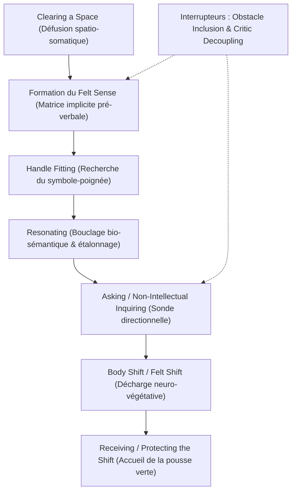

# Focusing
**Formateur :** Eugene Gendlin | **ID :** `eugene-gendlin-focusing` | **Tranches :** 11

Voici la synthèse architecturale modélisée du cours de Focusing d'Eugene Gendlin, structurée selon les exigences de modélisation cognitive et de rigueur méthodologique.

---

# Synthèse Architecturale du Cours : Focusing (Eugene Gendlin)

---

### 1. Thèse Centrale & Philosophie du Cours

#### Vision spécifique et rupture avec l'approche standard
* **Le vivant comme interaction et processus continu (*Process Model* vs *Container Fallacy*) :** Contrairement aux modèles psychodynamiques ou cognitifs classiques qui traitent l'esprit comme un conteneur (« boîte de Pandore », réservoir de pulsions ou stock de croyances statiques), Gendlin postule que l'organisme est une interaction écologique permanente en devenir. Une émotion ou un blocage n'est pas une entité figée enfouie dans l'inconscient, mais un processus corporellement généré dans l'instant par l'ensemble du système vivant.
* **Le double écueil de la thérapie verbale :** Gendlin récuse simultanément :
  1. *L'hyper-analyse intellectuelle :* Ruminer le « pourquoi », intellectualiser et étiqueter abstraitement n'opère aucun changement somatique ; cela entretient une boucle autoréférente dans le cortex préfrontal/DMN.
  2. *La catharsis émotionnelle circulaire :* Revivre une charge affective brute de manière explosive sans ancrage somatique intégratif réactive le système d'alarme sans libérer le blocage (« gut feelings that don't change »).
* **Le corps comme boussole épistémique supérieure :** L'organisme intègre des milliers de variables contextuelles, relationnelles et historiques bien avant que l'hémisphère gauche ne sache les découper en mots. L'accès à ce savoir implicite ne se fait ni par l'intellect ni par l'émotion catégorielle, mais par la formation d'une sensation corporelle globale et floue : le **Felt Sense**.

#### Fil rouge méthodologique
Le fil conducteur absolu est la **boucle cybernétique de résonance bio-sémantique orientée vers le mouvement vital** :
1. Dégager un espace d'auto-observation sécure en défusionnant des contenus.
2. Attendre patiemment la formation somatotopique du sens éprouvé global (*Felt Sense*).
3. Trouver un symbole d'accroche (*Handle*) et tester la résonance directe avec le corps.
4. Provoquer une décharge neuro-végétative objective (*Felt Shift*).
5. Protéger et accueillir la direction de croissance organique qui émerge sans la censurer.

---

### 2. Carte des Concepts & Leviers Émergents

1. **Le Sens Éprouvé (*Felt Sense / Bodily Felt Sense*) :**
   * *Rôle :* Matrice de sens implicite, globale et pré-réflexive d'une situation dans son ensemble (« all-about-that »). Localisé principalement dans le tronc (gorge, poitrine, estomac, abdomen), il n'est pas une émotion discrète mais l'aura somatique intégrative du problème.
2. **Le Déplacement Corporel (*Body Shift / Felt Shift / Uncramping Feeling*) :**
   * *Rôle :* Marqueur physiologique objectif de réorganisation de la gestalt interne (soupir, déglutition, décrispation diaphragmatique, soulagement viscéral). Même lorsque la prise de conscience est difficile, l'organisme émet un soulagement immédiat (*Odd Relief*) car la vérité somatosensorielle dissout le conflit de dissimulation.
3. **Le Dégagement de l'Espace Intérieur (*Clearing a Space / Making a Space*) :**
   * *Rôle :* Désidentification proprioceptive et spatiale. En déposant chaque stresseur métaphoriquement à distance sur le plancher ou sur une étagère, le sujet cesse « d'être le monument » pour redevenir le champ de conscience neutre (« you are no content at all »).
4. **Le Symbole-Poignée (*Handle*) :**
   * *Rôle :* Signifiant linguistique, kinesthésique ou métaphorique taillé pour capturer l'isomorphisme exact de la texture somatosensorielle brute (ex. *serré, gluant, lourd, en cage*), sans analyse causale.
5. **Le Bouclage de Résonance Bio-Sémantique (*Checking / Resonating*) :**
   * *Rôle :* Va-et-vient entre le mot et la sensation. Le corps agit comme juge ultime : si le mot est faux, le corps reste inerte ou se contracte ; si le mot est juste, il s'ouvre et s'aligne immédiatement (*clic corporel*).
6. **L'Interrogation Somatique Directe (*Open Asking*) :**
   * *Rôle :* Interpellation directionnelle du vivant (« Qu'est-ce qui rend cela si [Handle] ? », « De quoi cela a-t-il besoin ? ») en suspendant délibérément les réponses cognitives automatiques pour laisser émerger le saut qualitatif biologique.
7. **La Protection de la Pousse Verte (*Protecting the Shift / Receiving*) :**
   * *Rôle :* Sanctuarisation de la nouvelle direction organique naissante face à la censure préfrontale, au rationalisme et au perfectionnisme moral. La direction vitale est accueillie avant d'être traduite en forme concrète.
8. **L'Inclusion de l'Obstacle (*Obstacle Inclusion*) :**
   * *Rôle :* Métabolisation du bruit ou du vide (« blank », distraction, anesthésie). L'interférence n'est pas combattue : elle est traitée comme le pas légitime suivant et devient elle-même le nouveau *felt sense*.
9. **Le Découplage du Critique Intérieur (*Critic Decoupling / Externalization*) :**
   * *Rôle :* Répudiation de la voix punitive surmoïque qui fige le tonus somatique. Le critique est extériorisé spatialement et mis à la porte pour laisser place à la réceptivité interne (*still small voice*).
10. **L'Ontologie du Mouvement en Avant (*Forward Movement / Probing Forward*) :**
    * *Rôle :* Postulat homéostatique selon lequel le vivant n'est jamais figé. Tout inconfort somatique est l'expression d'un processus bloqué qui cherche son parachèvement et sa direction de complétude.

---

### 3. Tableau Récapitulatif des Techniques & Démonstrations

| Technique / Exercice | Objectif Opératoire | Déclencheur / Indication | Séquence Résumée |
|---|---|---|---|
| **Clearing a Space** *(Dégagement de l'Espace)* | Désidentifier le Soi des contenus mentaux et abaisser la charge allostatique du système nerveux. | Sensation de submersion, confusion diffuse, surcharge cognitive, anxiété aiguë. | 1. Scanner le corps et poser la question : « Qu'est-ce qui se met entre moi et le fait d'être parfaitement bien ? » 2. Identifier chaque charge sans y entrer. 3. Déposer métaphoriquement chaque problème à distance (sur une table, une étagère, le sol). 4. Recontacter l'espace intérieur dégagé et goûter la neutralité fondamentale. |
| **Sonde par Contraste d'État** *(Counterfactual Inquiry)* | Révéler instantanément le *felt sense* d'un problème latent sans analyse discursive. | Sujet rationnel, intellectualisant, ou affirmant que « tout va bien » malgré un blocage. | 1. Amener le sujet au repos dans son corps. 2. Suggérer l'injonction : « En cet instant, tout va absolument bien, tout est parfait. » 3. Observer la rupture immédiate : repérer l'endroit viscéral précis où le corps proteste et se contracte. 4. Fixer l'attention sur cette contraction : c'est le *felt sense*. |
| **Attente & Formation du Felt Sense** *(Getting a Felt Sense)* | Faire descendre l'attention corticale dans le réseau intéroceptif viscéral pour laisser se former le sens implicite. | Sujet enfermé dans la rumination mentale ou dans des explications théoriques causales. | 1. Porter l'attention au centre du corps (gorge, poitrine, estomac, abdomen). 2. Évoquer la situation dans son ensemble sans en analyser les détails. 3. Maintenir un silence actif et patient. 4. Laisser venir la sensation globale, floue et indistincte (« all about that »). |
| **Handle-Fitting & Resonating** *(Ajustement du Symbole-Poignée)* | Établir un isomorphisme sémantique entre un symbole verbal/imagé et la sensation brute pour déclencher le shift. | Présence d'un *felt sense* flou non encore symbolisé, ou stagnation sur un mot inadéquat. | 1. Demander : « Quel est le mot, la phrase ou l'image qui capture la texture de cette sensation ? » 2. Projeter le mot trouvé vers la sensation somatique (aller-retour). 3. Vérifier la résonance : le corps dit-il « oui » (détente/clic) ou reste-t-il froid/contracté ? 4. Ajuster le terme au millimètre près jusqu'au micro-relâchement somatique. |
| **Interrogation Ouverte du Corps** *(Movement 5: Asking)* | Interpeller le vivant pour forcer le saut qualitatif et la résolution d'un nœud somatique. | Le *felt sense* et son *handle* sont stables, mais la nature du blocage ou la direction de résolution reste opaque. | 1. Toucher la sensation avec son *handle* stabilisé. 2. Poser intérieurement une question ouverte : « Qu'est-ce qui, dans tout ce problème, est si [Handle] ? » ou « De quoi cette sensation a-t-elle besoin pour être OK ? » 3. Bloquer toute réponse cognitive pré-fabriquée du mental. 4. Attendre que le corps réponde de lui-même par une modification de texture ou un nouvel éclairage. |
| **Receiving & Protecting the Shift** *(Sanctuarisation de la Pousse Verte)* | Intégrer la décharge neuro-végétative et protéger l'amorce de changement contre l'autocensure. | Survenue d'un *body shift* (soupir, détente) immédiatement suivi de doutes, de cynisme ou de rejet mental. | 1. Dès le relâchement corporel, stopper toute nouvelle question. 2. Demeurer avec le soulagement pendant au moins une minute (« sit with it »). 3. Séparer le vecteur directionnel émergent de sa forme concrète immédiate. 4. Interdire au mental d'analyser la faisabilité pratique : sanctuariser la graine de vie. |
| **Inclusion du Vide & de l'Obstacle** *(Blank / Resistance Metabolization)* | Transformer l'absence de ressenti, l'agitation ou la distraction en matière première opératoire. | « Je ne ressens rien », « C'est tout vide », sentiment d'anesthésie ou d'agitation nerveuse. | 1. Cesser immédiatement de forcer pour chercher le « vrai » ressenti. 2. Déclarer le vide ou l'agitation comme l'état légitime actuel du corps. 3. Traiter le « vide » lui-même comme un *felt sense* : « Quelle est la texture de ce vide ? Est-ce lourd, brumeux, protecteur ? » 4. Chercher le *handle* de cette défense jusqu'à ce que la barrière s'ouvre. |
| **Externalisation du Critique Intérieur** *(Critic Decoupling)* | Désamorcer l'inhibition motrice et la constriction viscérale provoquées par le surmoi punitif. | Présence d'une voix interne culpabilisante, dévalorisante ou exigeante (« Tu devrais », « C'est ridicule »). | 1. Identifier la voix critique et localiser sa posture (souvent perçue au-dessus ou derrière la tête). 2. Refuser de négocier ou d'analyser son discours argumentatif. 3. Effectuer une rupture spatiale délibérée : la renvoyer hors du champ corporel (derrière la porte, sur une chaise au loin). 4. Revenir immédiatement au centre du corps et réécouter la voix timide et vulnérable de l'organisme (*still small voice*). |
| **Rétro-Ingénierie Somatique de la Solution** *(Back of the Book Heuristic)* | Calibrer le delta homéostatique en éprouvant l'état résolu avant même de connaître la stratégie rationnelle. | Problème perçu comme une impasse insoluble, sentiment de désespoir ou de fatalité. | 1. Suggérer au corps la texture somatosensorielle de la situation résolue : « Comment cela respirerait à l'intérieur si tout était totalement dénoué et réglé ? » 2. Laisser le système nerveux goûter brièvement cet état cible. 3. Comparer en miroir avec la sensation présente pour faire émerger avec netteté l'obstacle biologique exact qui empêche cette complétude. |

---
*Cette synthèse architecturale condense les mécanismes intéroceptifs et cybernétiques de l'ensemble du matériel de Gendlin pour servir de fondation opérationnelle au travail de modélisation et de pratique.*

---

## Extractions Détaillées par Tranche (Opératoire & Verbatim)

## --- Tranche 1 / 11 ---

Voici l'extraction et la modélisation intégrale de la substance opératoire de cette tranche (Tranche 1/11).

---

### 1. Mécanismes & Principes Actifs

*   **Le Sens Éprouvé Global (*The Felt Sense*)**  
    *Terme exact de Gendlin :* **"Felt sense" / "Bodily felt sense"**  
    *Tags émergents :* `#felt_sense #somatisation_de_sens #pre_verbal #non_emotionnel #zone_floue_murky`  
    *Principe actif :*  
    Le *felt sense* n'est ni une émotion standardisée (colère, tristesse, joie) ni une pensée intellectuelle. C'est une sensation corporelle globale et indifférenciée portant en elle toute la complexité d'une situation ou d'un problème donné. Neurologiquement et somatiquement, le corps intègre simultanément des milliers de variables contextuelles, de souvenirs, d'affects et de tensions relationnelles sous forme d'un schéma proprioceptif et viscéral unique. Ce ressenti est au départ structurellement flou, diffus et « marécageux » (*murky zone*). Il constitue la porte d'entrée de la mémoire implicite et non formalisée.
*   **La Décharge et Réorganisation Corporelle (*The Body Shift*)**  
    *Terme exact de Gendlin :* **"Body shift"**  
    *Tags émergents :* `#body_shift #readjustement_visceral #decharge_parasympathique #changement_somatico_cognitif`  
    *Principe actif :*  
    Le changement psychothérapeutique réel n'est pas une conclusion logique (« j'ai compris mon problème ») ni une catharsis répétitive, mais un réajustement physiologique mesurable. Lorsque l'attention reste posée sur le *felt sense* flou jusqu'à ce qu'un mot, une image ou une prise de conscience exacte vienne s'ajuster (*fit*), le système nerveux autonome bascule : relâchement des fascias et des muscles viscéraux, expiration spontanée, sensation d'expansion respiratoire (*"like inhaling fresh air"*). Le corps intègre une nouvelle gestalt informationnelle.
*   **L'Organisme comme Interaction Située (*The Living Body beyond Culture/Language*)**  
    *Terme exact de Gendlin :* **"Intricate bodily knowledge" / "The body is an interaction"**  
    *Tags émergents :* `#ontologie_de_l_interaction #corps_situationnel #avancee_organique #probing_forward`  
    *Principe actif :*  
    Le corps vivant n'est pas une machine mécanique isolée, mais une interaction écologique continue avec l'environnement. Il contient déjà la tendance adaptative et évolutive (*forward movement*) pour faire le pas suivant d'ajustement. L'intellect et le langage culturel ne font que plaquer des schémas figés ; le système somatique, lui, cherche activement le déblocage et l'étape d'action juste (*"what would be a right next step here"*).
*   **L'Immobilisme par Hyper-Analyse ou Catharsis Circulaire (*The Emotional/Analytical Rut*)**  
    *Terme exact de Gendlin :* **"Working in circles" / "Gut feelings that don't change"**  
    *Tags émergents :* `#piege_cathartique #piege_intellectuel #boucle_autoreferente #re_traumatisation_inutile`  
    *Principe actif :*  
    Deux écueils neuro-émotionnels bloquent le changement : l'analyse intellectuelle (verbalisation déconnectée du tronc somatique) et la reviviscence émotionnelle brute (crier les mêmes phrases, revivre la même douleur). Tous deux réactivent le même réseau neuronal sans modifier le pattern sous-jacent. Le changement commence uniquement lorsque l'attention plonge **sous** l'émotion connue, dans la zone où le sens n'est pas encore verbalisé.

---

### 2. Protocoles, Techniques & Démonstrations (Étape par Étape)

#### Protocole 1 : Le Pointage Somatique d'Approfondissement Immédiat (Pour Thérapeute / Praticien)
*   **Intention / Indication :**  
    À utiliser dès que le client verbalise un enjeu important, une charge émotionnelle ou un problème central, pour interrompre l'intellectualisation et court-circuiter les récits automatiques.
*   **Mise en place & Pré-framing :**  
    Interrompre le débit verbal du sujet de manière non agressive.
*   **Séquence d'actions pas à pas :**  
    1.  *Ancrage spatial et kinesthésique du praticien :* Le praticien pose sa propre main à plat sur son torse/ventre, entre le plexus solaire et l'estomac.
    2.  *Redirection attentionnelle :* Le praticien pointe ou désigne cette zone et demande au sujet :  
        *« If you attend here, what comes in your body about this? »* (Si tu portes ton attention ici, qu'est-ce qui vient dans ton corps à propos de ça ?).
    3.  *Attente silencieuse :* Laisser au moins 30 à 60 secondes sans meubler, pour permettre au système intéroceptif du sujet d'aller sonder les viscères.
*   **Signes de calibration :**  
    - *Client prêt/connecté :* Ralentissement soudain du regard, regard qui décroche vers l'intérieur (transe intéroceptive légère), voix qui ralentit, hésitation féconde (« C'est... c'est bizarre, c'est comme une lourdeur... »).  
    - *Client déconnecté de la source :* Réponse verbale immédiate, regard vif vers le praticien, incompréhension (« Comment ça ? Qu'est-ce que vous voulez dire ? ») ou réponse purement mentale sans pause corporelle.

---

#### Protocole 2 : Formation et Accueil du Sens Éprouvé (*Felt Sense Formation*)
*   **Intention / Indication :**  
    Approcher une situation bloquée, un conflit interne ou un problème chronique sans retomber dans l'analyse intellectuelle ou le déferlement de souffrance.
*   **Mise en place & Pré-framing :**  
    Poser le postulat que le processus de changement naturel doit être agréable et soulageant (*"it feels good, like inhaling fresh air"*). Si c'est de l'auto-torture, on recule.
*   **Séquence d'actions pas à pas :**  
    1.  *Évocation de la situation globale :* Penser au problème dans son ensemble, sans chercher à en résoudre les détails.
    2.  *Descente sous les pensées et les émotions connues :* Laisser de côté ce que l'on « sait » déjà sur le problème (les reproches, les explications, les étiquettes comme « colère » ou « peur »).
    3.  *Attente dans la zone floue (*Murky zone*) :* Porter son attention à l'intérieur du corps (gorge, poitrine, estomac) et attendre passivement qu'une sensation globale, floue, encore sans mots, émerge en lien avec toute la situation.
    4.  *Maintien de la présence bienveillante :* Rester assis avec cette sensation vague sans forcer une explication. L'accueillir telle qu'elle est.
    5.  *Validation du Body Shift :* Observer le moment où cette présence corporelle commence à se clarifier d'elle-même, s'accompagnant d'une détente physique ou d'un soulagement spontané.
*   **Signes de calibration :**  
    - Respiration spontanée plus profonde, relâchement des épaules.
    - Émergence de mots ou d'images métaphoriques non conventionnels avec un soupir de soulagement viscéral.

---

#### Protocole 3 : Le Contrat de Partenariat de Focusing (*Focusing Partnership*)
*   **Intention / Indication :**  
    Travailler en dyade sans dépendance thérapeutique, sans asymétrie médicale, pour explorer des blocages personnels.
*   **Mise en place & Pré-framing :**  
    Partage strict du temps (50/50). Élimination totale des conseils, interprétations, analyses et jugements.
*   **Séquence d'actions pas à pas :**  
    1.  *Ouverture du tour :* Le focuser prend son temps pour entrer en lui-même. Il peut garder le silence aussi longtemps qu'il le désire ou verbaliser ce qui émerge.
    2.  *Posture de l'accompagnateur :* Présence pure, silencieuse et non intrusive (*"minimal imposition, maximal closeness"*).
    3.  *Reflet de vérification (si nécessaire) :* L'accompagnateur ne reformule que si le focuser exprime le besoin d'être vérifié, en utilisant des reflets purs :  
        *« I think you are saying... »* sans ajouter un seul mot de contenu ni d'interprétation.
    4.  *Signal d'incompréhension neutre :* L'accompagnateur n'intervient que lorsqu'il décroche, uniquement pour que le focuser puisse réajuster sa propre clarté interne.
    5.  *Inversion des rôles :* Passage de relais strict au signal temporel.
*   **Signes de calibration :**  
    - Le focuser n'essaie pas de convaincre ou d'expliquer à l'autre ; son regard reste interne ou non focalisé.
    - Absence d'acquiescements intrusifs ou de questions d'investigation de la part de l'accompagnateur.

---

### 3. Heuristiques, Subtilités & "Sagesse du Praticien"

*   **Règle du non-acharnement dans la douleur (*Pain vs Relief Criterion*) :**  
    *Si* le travail sur un problème devient une auto-torture, une souffrance circulaire ou une douleur émotionnelle stérile,  
    *Alors* stopper immédiatement et reculer d'un pas (*"The moment it doesn't [feel good], you stop and back up just a little bit"*),  
    *Parce que* le changement somatique naturel apporte physiologiquement un soulagement (*coming alive / fresh air*). S'enfermer dans l'émotion douloureuse maintient la boucle neuronale du problème.
*   **Règle de l'absence de bavardage analytique (*No Endless Talking*) :**  
    *Si* le client se met à raconter l'histoire, à analyser intellectuellement ses patterns ou à faire des déductions logiques,  
    *Alors* le praticien doit l'interrompre sans le laisser continuer sur ce canal (*"I no longer let them talk and talk"*) et rediriger l'attention vers le ressenti corporel,  
    *Parce que* l'intellect ne possède pas la gestalt complète du problème ; seul le corps porte la trame globale (*"only your body knows your problems and where their cruxes lie"*).
*   **Règle de non-interventionnisme du praticien (*Stay out of the way*) :**  
    *Si* le praticien ressent l'envie irrépressible de donner une interprétation brillante, de diagnostiquer ou de proposer une solution,  
    *Alors* il doit réprimer cette impulsion et garder le silence (*"The most important rule... is to stay out of the focuser's way"*),  
    *Parce que* le praticien qui impose ses grilles de lecture vole au corps du sujet son propre processus d'émergence d'étapes d'action (*forward steps*).
*   **Règle du calibrage précoce du succès thérapeutique :**  
    *Si* au cours des deux premières séances, le sujet est incapable d'adopter une attitude d'attention corporelle intérieure floue et d'hésitation féconde (et qu'on ne la lui enseigne pas),  
    *Alors* la thérapie échouera statistiquement, quelle que soit sa durée (même après des années d'efforts),  
    *Parce que* ce n'est pas le contenu abordé ni la technique du thérapeute qui produit le résultat, mais la manière dont le patient s'adresse intérieurement à son propre corps.

---

### 4. Pépites Verbatim & Patterns Linguistiques (MOT À MOT EN V.O.)

#### Pépite 1 : La rupture de cadre somatique immédiate
> **« When your clients say something important, put your hand between your own stomach and chest, and ask them: “If you attend here, what comes in your body about this?” »**

*   **[Analyse du Pattern]** :  
    - **Ancrage kinesthésique par isomorphisme spatial :** Le praticien utilise son propre corps comme miroir spatial, incitant neurones miroirs et proprioception du client à localiser l'attention entre le cœur et le diaphragme.
    - **Présupposition d'existence (*"what comes"* plutôt que *"does anything come"*) :** La question présuppose qu'il y a déjà quelque chose de présent dans le corps prêt à se manifester, supprimant le doute sur la présence d'une réponse somatique.
    - **Décontextualisation sémantique (*"about this"*) :** Relie toute l'histoire verbale complexe à une seule sensation physique compactée.

---

#### Pépite 2 : Le double recadrage de l'épistémologie corporelle
> **« You have a bodily orienting sense. You know who you are and how you come to be in this room, reading this page. To know this you don’t need to think. The knowing is physically sensed in your body and can easily be found. But this bodily knowing can extend much more deeply. »**

*   **[Analyse du Pattern]** :  
    - **Empilement de truismes (Pacing sensoriel indiscutable) :** Le sujet ne peut contester le fait qu'il sait où il se trouve et ce qu'il lit sans avoir besoin d'y penser activement.
    - **Séparation hypnotique pensée/savoir :** Établissement d'une distinction nette entre « penser » (analytique) et « savoir » (proprioceptif/inconscient).
    - **Pont d'induction par conjonction d'extension (*"But this... can extend much more deeply"*) :** Utilisation d'un truisme superficiel pour transférer immédiatement la permission d'une exploration somatique profonde (*deeper level*).

---

#### Pépite 3 : La métaphore biologique du changement intégratif
> **« The change process we have discovered is natural to the body, and it feels that way in the body. The crucial move goes beneath the usual painful places to a bodily sensing that is at first unclear. The experience of something emerging from there feels like a relief and a coming alive. »**

*   **[Analyse du Pattern]** :  
    - **Présupposition de naturalité :** Enracine le Focusing non pas comme un apprentissage artificiel, mais comme un retour à un fonctionnement homéostatique naturel du corps.
    - **Orientation spatiale vers le bas (*"beneath the usual painful places"*) :** Commande de déplacement de l'attention sous la couche corticale de la douleur habituelle.
    - **Rétribution proprioceptive kinesthésique (*"feels like a relief and a coming alive"*) :** Suggestion post-hypnotique de libération parasympathique dès que le contact avec le *murky* est établi.

---

#### Pépite 4 : La définition négative et déroutante du Felt Sense
> **« A felt sense is not an emotion. We recognize emotions. We know when we are angry, or sad, or glad. A felt sense is something you do not at first recognize—it is vague and murky. It feels meaningful, but not known. It is a body-sense of meaning. »**

*   **[Analyse du Pattern]** :  
    - **Rupture de pattern catégorielle :** Casse l'équivalence cognitive habituelle (« ce que je ressens dans mon corps = une émotion »).
    - **Validation du flou cognitif :** Rend le non-savoir désirable et pertinent (*"vague and murky"*). L'absence de clarté intellectuelle immédiate est recadrée comme la preuve même que l'on se trouve au bon endroit.
    - **Oxymore hypnotique (*"meaningful, but not known"*) :** Crée une suspension cognitive (confusion douce) forçant l'esprit conscient à céder la place à l'écoute intéroceptive.

---

#### Pépite 5 : La présence d'accompagnement minimaliste
> **« To give people just our simple presence lets them be and breathe. We listen for what they mean to convey, and add nothing else. It makes for maximal closeness with minimal imposition. »**

*   **[Analyse du Pattern]** :  
    - **Contraste polaire / Équilibre dynamique (*"maximal closeness with minimal imposition"*) :** Pose le cadre d'un rapport hypnotique sans empiètement de l'ego de l'accompagnateur.
    - **Autorisation somatique couplée (*"lets them be and breathe"*) :** La présence de l'autre est syntaxiquement liée à la régulation du système respiratoire autonome du sujet, facilitant la bascule vers le *shift*.

## --- Tranche 2 / 11 ---

### 1. Mécanismes & Principes Actifs

#### A. Le « Felt Sense » (Sens Éprouvé) vs Émotion Discrète
- **Principe actif :** Le *felt sense* n'est pas une émotion pré-catégorisée (colère, tristesse, joie). C'est une perception corporelle globale, pré-réflexive, floue et implicite d'une situation ou d'un problème dans son ensemble. Sur le plan neurologique et cognitif, il correspond au traitement intégratif somato-viscéral (lié notamment au cortex insulaire et aux voies afférentes vagales) qui encode la totalité des variables contextuelles, historiques et relationnelles avant que l'hémisphère gauche ne les découpe en concepts lexicaux. 
- **Mécanisme opératoire :** Il ne préexiste pas toujours sous forme claire : il *doit se former* (*it must form*). Cela exige de déplacer l'attention de la boucle cognitive corticale (« ruminations dans le crâne ») vers le bas du corps (gorge, poitrine, estomac, abdomen).
- **Tags libres :** `#felt_sense` `#sens_corporel_global` `#pre_conceptuel` `#somato_visceral` `#sens_implicite`

#### B. Le « Clearing a Space » (Dégagement de l'Espace Intérieur)
- **Principe actif :** Face à une détresse aiguë, le système nerveux est submergé par une fusion émotionnelle : le sujet *est* le problème. Le dégagement d'espace opère une défusion spatio-somatique et une rétrogradation de l'hyperactivité de l'amygdale. En matérialisant chaque charge, en la nommant et en la déposant métaphoriquement à l'extérieur ou à distance devant soi, le sujet active une position d'observateur bienveillant (méta-position). Les problèmes restent intacts dans la pièce cognitive, mais un espace somatique neutre est libéré pour respirer et opérer.
- **Tags libres :** `#clearing_a_space` `#defusion_spatiale` `#meta_position` `#decongestion_somatique` `#interruption_de_noyade`

#### C. Le « Felt Shift » (Déplacement / Relâchement Corporel)
- **Principe actif :** Le *felt shift* est une modification physiologique objective et instantanée du tonus autonome (soupir involontaire, déglutition, détente musculaire subite, relâchement d'un nœud gastrique ou thoracique). Il signale que le système nerveux a réorganisé sa gestalt interne à propos du problème. Le nœud somatique se défait dès que la charge implicite est adéquatement contactée ou symbolisée par le mot exact.
- **Mécanisme opératoire :** Même si la découverte cognitive paraît dramatique (« je suis convaincue que je n'aurai plus jamais de désir », « je porte la croyance fondamentale que quelque chose est pourri en moi »), le corps éprouve un soulagement immédiat (*relief*). L'organisme préfère l'exactitude brute de son état réel au conflit de dissimulation ou à la confusion.
- **Tags libres :** `#felt_shift` `#decharge_neurovegetative` `#reorganisation_somatique` `#soulagement_paradoxal` `#resolution_du_noeud`

#### D. Le « Handle » (Symbole-Poignée) et l'Appariement (« Checking / Resonating »)
- **Principe actif :** Un mot, une courte phrase ou une image est proposé comme une étiquette d'accroche pour la sensation floue. Le système cognitif ne décide pas intellectuellement si le mot est logique : le mot est projeté vers la sensation somatique pour tester la résonance. Si le mot est incorrect (« discouraged » pour Fay, « out of place » pour Fred), la sensation reste figée ou se contracte. Dès que le mot juste émerge (« weary », « inappropriate »), une décharge physique immédiate (*felt shift*) valide l'isomorphisme entre le symbole verbal et la charge corporelle.
- **Tags libres :** `#handle_word` `#symbole_poignee` `#test_de_resonance` `#retroaction_somatique` `#isomorphisme_symbole_corps`

#### E. L'auto-interruption de la boucle d'analyse intellectuelle
- **Principe actif :** L'analyse (« Pourquoi suis-je en colère ? », « C'est parce que mon boss a peur du changement et que j'ai un problème d'autorité ») utilise des explications causales préexistantes qui court-circuitent l'accès au vivant. L'intellectualisation agit comme une défense homéostatique qui maintient le problème dans son impasse. L'interruption chirurgicale de cette boucle permet au sujet de redescendre dans le silence somatique, seul lieu où de nouvelles informations non déjà cataloguées peuvent émerger.
- **Tags libres :** `#interruption_de_pattern_analytique` `#silence_incubateur` `#desescalade_cognitive` `#savoir_organismique`

---

### 2. Protocoles, Techniques & Démonstrations (Étape par Étape)

#### Protocole 1 : Dégager un Espace (First Movement / Clearing a Space)
* **Intention / Indication :** Quand le sujet est submergé par une spirale émotionnelle destructrice, des ruminations paniques ou suicidaires, ou une sensation que « tout va mal » et que le corps entier fait mal.
* **Mise en place & Pré-framing :** Cadrer l'exercice non pas comme une résolution de problème, mais comme le fait de déplacer des meubles dans une pièce encombrée pour se créer un coin où s'asseoir sans faire disparaître les objets.
* **Séquence d'actions pas à pas :**
  1. **Ralentissement / Arrêt :** Interrompre fermement le récit émotionnel agitated.
  2. **Invitation au pas de recul :** Demander au sujet de se tenir en retrait mentalement : *« Just stand back, now... »*.
  3. **Déposition unitaire :** Identifier chaque élément anxiogène l'un après l'autre et le poser symboliquement en face de soi : *« take each thing that’s bad, and stash it in front of you. One by one. »*.
  4. **Constat de l'espace créé :** Vérifier que le sujet observe les problèmes placés devant lui sans être fusionné avec eux.
  5. **Tri par intensité :** Demander au sujet d'identifier la charge principale sans la rouvrir : *« Which one is the worst? »*.
* **Signes de calibration :** Ralentissement du débit verbal, pause respiratoire, diminution des pleurs ou de l'agitation motrice, posture qui recule légèrement.

---

#### Protocole 2 : Descente vers le « Felt Sense » et Extraction du « Handle » (Movements 2, 3, 4, 5)
* **Intention / Indication :** Passer d'une émotion aiguë (panique, chagrin, colère) ou d'une somatisation chronique (nœud à l'estomac) à sa signification implicite globale.
* **Mise en place & Pré-framing :** Silence requis. Interdire l'explication intellectuelle (« Pourquoi ? »). Cadrer l'attention : elle doit descendre physiquement sous la tête.
* **Séquence d'actions pas à pas :**
  1. **Descente d'attention :** Guider le sujet à orienter son écoute vers l'intérieur profond du corps : *« go down inside there and see what the worst of that is »*.
  2. **Attente réceptive (Movement 2) :** Garder le silence pendant que le sujet attend qu'une sensation globale floue, non reconnue, se forme autour de « tout ce problème » (*all of that*).
  3. **Capture de la qualité / Handle (Movement 3) :** Inviter le sujet à capter la qualité sensorielle brute (forme, texture, dynamique) et à laisser monter un mot, une phrase ou une métaphore spontanée.
  4. **Vérification de résonance (Movement 4) :** Faire tester le mot face à la sensation corporelle.
     - *Si le mot frotte ou ne libère rien :* inviter à le relâcher et à attendre un mot plus fidèle.
     - *Dès que le mot résonne :* observer le soupir ou le déblocage physique.
  5. **Interrogation directe du corps / Asking (Movement 5) :** Demander au sujet d'interroger directement la sensation et non son mental : *« Go back to the felt sense and ask it, see what the [X] is »*. Attendre la réponse sous forme de sensation qui s'ouvre, puis de verbalisation.
  6. **Itération en cascade :** Répéter le cycle sur le nouveau niveau qui vient d'émerger, sans chercher la cohérence logique avec le niveau précédent.
* **Signes de calibration :** 
  - Présence de silences prolongés (incompatibles avec une recherche mentale rapide).
  - Soupirs audibles, inspirations profondes involontaires (*gasp* de décharge).
  - Modification de la voix : voix plus posée, lente, souvent accompagnée d'un éclat de soulagement (« That's it! »).
  - Relâchement musculaire observable (décroisement des tensions, ventre qui se relâche).

---

### 3. Heuristiques, Subtilités & "Sagesse du Praticien"

#### Règles Conditionnelles (« Si... Alors... Parce que... »)
- **Si** le patient commence à analyser intellectuellement son problème (*« Why would I be angry? »* ou rationalisations causales), **alors** le praticien doit se taire, refuser d'entrer dans l'analyse et rediriger fermement le sujet vers le ressenti corporel (*« Go back to the felt sense and ask it »*), **parce que** l'intellectualisation fige la structure du problème et empêche le système nerveux d'accéder aux données implicites.
- **Si** le patient part dans une spirale émotionnelle destructrice et agitée, **alors** le praticien doit intervenir et interrompre le flux sans complaisance, **parce que** l'inondation affective (*venting*) n'est pas du Focusing et empêche la formation du *felt sense*.
- **Si** le sujet formule un mot-clé mais montre de l'hésitation ou de l'insatisfaction vocale/corporelle, **alors** ne pas valider ce mot et attendre qu'il continue d'écouter, **parce que** le corps sait si le mot correspond exactement à la sensation ; un quasi-match ne libère pas la charge somatique complète.
- **Si** ce qui émerge après un *shift* semble contredire logiquement l'étape précédente (ex: passer de « je veux aller à l'université » à « l'école est ce qui m'empêche d'exister »), **alors** accueillir immédiatement la nouvelle émergence sans tenter de réconcilier logiquement les énoncés, **parce que** l'organisation somato-psychique se réorganise par couches non-linéaires et non par syllogismes.
- **Si** le patient exprime une peur diffuse de « ne rien ressentir », **alors** recadrer cette anxiété comme étant elle-même la première sensation corporelle disponible à écouter, **parce que** l'absence de ressenti est déjà un état somatique chargé de sens.

#### Pièges Classiques & Erreurs de Débutant
1. **Le complexe du thérapeute-expert :** Vouloir expliquer au client ce qu'il a, interpréter ses rêves ou ses lapsus. L'expertise du praticien réside uniquement dans le maintien du cadre et le timing des silences ; seul le corps du sujet détient la clef structurelle du problème.
2. **Confondre catharsis émotionnelle et Felt Shift :** Penser que pleurer à chaudes larmes ou hurler de colère résout le problème. Tant que la décharge n'est pas connectée à la texture floue sous-jacente qui permet la formation d'un sens corporel nouveau, le sujet ne fait que rejouer un sillon neural d'épuisement.
3. **Se contenter de la résolution logique :** S'arrêter à une explication raisonnable qui « sonne vrai » (ex: l'analyse de Fred sur son problème d'autorité avec son boss). Une explication vraie qui ne déclenche aucun soupir somatique est une impasse thérapeutique.

#### Postulats Fondamentaux de Gendlin
- **L'organisme porte sa propre direction de croissance :** Le corps sait exactement où se trouvent les nœuds vitaux et quelle est l'étape suivante pour son accomplissement.
- **La personne n'est jamais réductible à un type :** Les catégories psychopathologiques, les profils ou les diagnostics sont des abstractions de surface qui s'effondrent dès que l'on touche l'intériorité vivante d'un être humain.
- **Le changement précède l'action :** Changer intérieurement au niveau somatique modifie spontanément la façon dont l'individu investit son environnement, avant même que les contraintes matérielles extérieures n'aient changé.

---

### 4. Pépites Verbatim & Patterns Linguistiques (MOT À MOT EN V.O.)

#### Pépite 1 : La rupture de boucle émotionnelle et l'invitation somatique
> « What feels so bad? Give yourself a peaceful minute and see what feels so bad. »
- **[Analyse du Pattern] :** Présupposition somatique et commande temporelle. L'utilisation du verbe *« feels »* (et non *« is »* ou *« do you think »*) présuppose que la réalité du problème est strictement kinesthésique. L'injonction adoucie *« Give yourself a peaceful minute »* agit comme une rupture de pattern face à l'état de panique : elle crée un ancrage temporel d'accalmie, tandis que la seconde partie de la phrase focalise le faisceau attentionnel vers l'exploration sensorielle interne plutôt que sur le récit des faits.

---

#### Pépite 2 : La spatialisation et le découplage métaphorique
> « Just stand back, now, and take each thing that’s bad, and stash it in front of you. One by one. See what each thing is that feels bad. »
- **[Analyse du Pattern] :** Commande de défusion spatiale et fractionnement. L'adverbe temporel *« now »* ancre l'action dans l'instant présent. Le verbe spatialisé *« stand back »* force une dissociation kine-visuelle. L'instruction *« stash it in front of you. One by one »* transforme une masse anxiogène chaotique et globale en objets discrets, délimités, manipulables et externes. Le double ancrage kinesthésique/visuel permet au système nerveux de récupérer une marge de manœuvre motrice et décisionnelle face à ce qui l'inondait.

---

#### Pépite 3 : La descente de l'attention et le recadrage du flou
> « Why don’t you go down inside there, and see what the worst of that is? Just stay quiet for a little while. Get to the unclear body sense of all of it. »
- **[Analyse du Pattern] :** Suggestion indirecte permissive couplée à une commande spatio-directionnelle. *« Why don’t you... »* contourne la résistance consciente. *« go down inside there »* spatialise l'inconscient et le corps vers le bas (hors de l'agitation céphalique). L'expression *« unclear body sense of all of it »* normalise et valorise le flou (*unclear*), empêchant le mental de se précipiter vers des étiquettes préfabriquées tout en regroupant la totalité holographique de la détresse dans un seul contenant corporel (*all of it*).

---

#### Pépite 4 : L'instruction d'interrogation organismique directe
> « Go back to the felt sense and ask it, see what the anger is. »
- **[Analyse du Pattern] :** Prosopopée et attribution d'agentivité autonome à l'inconscient corporel. Le praticien ne demande pas au sujet de réfléchir (*« don't think about why »*), mais traite le *felt sense* comme une entité relationnelle distincte dotée d'une intelligence propre (*« ask it »*). Cette formulation scissionne le mental analytique du sujet et son substrat somatique, plaçant le conscient dans une posture d'écoute humble et réceptive face aux signaux de son propre organisme.

## --- Tranche 3 / 11 ---

Voici la modélisation intégrale et chirurgicale de la tranche 3/11 de l'enseignement d'Eugene Gendlin sur le Focusing.

---

### 1. Mécanismes & Principes Actifs

- **Localisation somatique vs Enflammement global du système nerveux** :
  Tant qu'un conflit inconscient reste non conscientisé ou combattu mentalement, il irradie sous forme d'une hypertonie diffuse ou d'une angoisse généralisée dans l'organisme. Dès lors que l'attention somatique cible et circonscrit précisément l'expérience (« *the heavy, hurting place was localized* »), le reste de la physiologie est instantanément libéré (*released*). La charge allostatique globale baisse drastiquement, libérant des ressources motrices et cognitives pour l'action pratique.  
  *Tags :* `#localisation_somatique #decharge_diffuse #decontraction_organique #containment_naturel`

- **Découplage de la valence cognitive et du soulagement somatique (*Odd Relief*)** :
  La psyché rationnelle présuppose que découvrir une vérité « terrible » ou un affect effrayant (« *something’s terribly wrong with me* ») aggrave la souffrance. Le système nerveux réagit à l'inverse : c'est la dissonance et le déni qui créent la crispation vitale. Le simple alignement neuro-perceptif entre la conscience et la réalité biologique du corps engendre un *body shift* de soulagement. Nommer la vérité organique est homéostatique, même si le contenu intellectuel paraît désespérant.  
  *Tags :* `#decouplage_valence #soulagement_paradoxal #alignement_bio_conscient #homéostasie_par_vérité`

- **Non-terminaison des états corporels (*Nothing feels bad is ever the last step*)** :
  Le cerveau conscient traite une émotion douloureuse comme un état permanent et figé, ce qui active la sidération ou l'évitement. Le Focusing s'appuie sur le principe neurobiologique de métabolisme émotionnel : aucun état corporel douloureux n'est une destination finale. Il n'est qu'un vecteur de passage vers le palier adaptatif suivant, à condition qu'il soit accueilli sans lutte.  
  *Tags :* `#fluidite_processuelle #vecteur_transitoire #anti_cristallisation #loi_du_prochain_shift`

- **Le Felt Sense comme Ordinateur Biologique Intégratif (*All about X*)** :
  Le mental discursif sérialise l'information (opérant en mode analytique séquentiel, bit par bit), incapable d'embrasser la complexité holistique d'une relation ou d'un blocage. Le corps génère et stocke un paquet de données massif et compressé (*biological computer*) : l'« aura », le goût intérieur global (*Felt Sense*). Ce signal est pré-linguistique, non-conceptuel et synthétise simultanément le passé relationnel, les micro-indices contextuels et l'état des besoins vitaux.  
  *Tags :* `#ordinateur_biologique #compression_holistique #signal_prelinguistique #aura_organique #all_about`

- **Lenteur et maturation de la poignée verbale (*Handle-Fitting*)** :
  Pour qu'il y ait transformation, le mot ne doit pas être déduit par déduction intellectuelle. Le système nerveux procède par résonance bio-acoustique et sémantique : le sujet projette un mot vers la sensation (« *no... not that...* ») jusqu'à ce qu'un mot déclenche un clic corporel (« *Contempt !* », « *A playboy* »). C'est ce contact précis qui décristallise la motricité bloquée.  
  *Tags :* `#handle_fitting #resonance_bio_semantique #clic_corporel #ajustement_subvocal`

- **L'Écran du Vide / Le Blank comme Part Protectrice** :
  Le sentiment de « vide » (*blankness*), d'absence d'élan ou de coupure n'est pas un néant ou un défaut mécanique : c'est un affect à part entière, une réponse inhibitrice corporelle destinée à masquer un désir perçu comme menaçant, tabou ou régressif (les désirs interdits, l'interdiction de voir de l'enfance). L'accueillir comme une présence somatique déverrouille l'énergie d'action refoulée.  
  *Tags :* `#presence_du_vide #blank_as_a_feeling #inhibition_protectrice #levee_d_amnesie_motrice`

- **L'Inutilité Thérapeutique des Stratégies Discursives Classiques** :
  Gendlin démonte formellement 5 réflexes mentaux qui échouent systématiquement car ils n'opèrent pas au niveau physique :
  1. *Belittling* (minimiser/dénier).
  2. *Analyzing* (rationaliser/trouver des causes historiques).
  3. *Facing down* (serrer les dents/forcer par la volonté).
  4. *Lecturing yourself* (s'admonester/discours moralisateur du parent critique).
  5. *Drowning* (se noyer dans l'émotion brute répétitive).  
  *Tags :* `#echec_cognitif #impasse_analytique #non_operabilite_volontaire #cercle_vicieux_cathartique`

---

### 2. Protocoles, Techniques & Démonstrations (Étape par Étape)

#### Protocole A : Déblocage de la Procrastination Compulsive & Levée de l'Injonction (Cas George)

* **Intention / Indication :**  
  Sujet paralysé dans l'exécution d'une tâche créative ou professionnelle (« *je dois le faire, mais je bloque / je regarde par la fenêtre / je me déconnecte* »).
* **Mise en place & Pré-framing :**  
  Isoler la sensation corporelle brute du blocage. Interdire le débat logique intérieur et la moralisation.
* **Séquence d'actions pas à pas :**
  1. **Interrogation qualitative somatique :** Demander au sujet de fermer les yeux et de ressentir la sensation globale de « coincé » ou « déconnecté ». Poser la question : *« Quelle est la qualité corporelle brute de cette coupure ? »*
  2. **Attente du Handle (Poignée) :** Laisser le sujet rejeter les premiers mots purement intellectuels jusqu'à l'émergence d'un mot-clé qui résonne viscéralement (ex. George : *« Mépris ! »*).
  3. **Mirroring minimaliste & Dégagement de la polarité :** Reformuler sans interpréter pour faire remonter le paradoxe inconscient (*Dans la tête / Hors du monde réel*).
  4. **Questionnement dans le ressenti global du paradoxe :** Lorsque le sujet expose une contradiction absurde (*« C'est méprisable, mais c'est ce que je veux le plus faire »*), demander : *« Quelle est la sensation corporelle diffuse quand tu dis [cette phrase] ? »*
  5. **Traversée de la menace sous-jacente :** Explorer le pire scénario somatique : inviter le sujet à dire intérieurement : *« D'accord, ce serait horrible de ne pas le faire »*, puis interroger la texture de cet « horrible ».
  6. **Identification du tabou identitaire / pulsionnel :** Laisser émerger le mot tabou (ex. *« Playboy »*, *« Sexuel »*). Valider la permission fantasmée sans jugement : *« Et ce serait OK ? »*
  7. **Approche frontale du "Blank" (Le Vide) :** Dès que le sujet recule devant l'abîme d'inactivité (*« Je ferais face à un grand vide »*), donner l'instruction de contact : *« Reste présent avec la sensation corporelle de ce vide. Quelle est sa qualité ? »*
  8. **Découverte du désir interdit et Shift de libération :** Laisser la mémoire/l'injonction originelle émerger (*« Livres interdits par le père »*). Attendre l'expiration spontanée.
  9. **Recadrage post-shift naturel :** Noter comment l'énergie vitale refoulée (envie de courir, nouveau livre) réintègre la tâche initiale, désormais libérée du devoir forcé.
* **Signes de calibration :**  
  - Silence prolongé (30 à 60 secondes) yeux fermés.
  - Rejet des mots inadaptés d'un signe de tête ou d'un ton sec (« *Non, ce n'est pas ça* »).
  - Émission d'un soupir massif et sonore (*huge audible sigh*).
  - Dénouement immédiat des traits du visage, voix plus posée et rapide, regain spontané d'enthousiasme moteur.

---

#### Protocole B : Le Révélateur d'"Aura" Corporelle (Démonstration John & Helen)

* **Intention / Indication :**  
  Démontrer au sujet la différence entre une pensée conceptuelle et un *Felt Sense*, ou diagnostiquer la matrice implicite d'une relation problématique.
* **Mise en place & Pré-framing :**  
  Inviter le sujet à s'asseoir confortablement et choisir deux personnes significatives de sa vie (une fluide, une tendue).
* **Séquence d'actions pas à pas :**
  1. **Bascule attentionnelle (Slide) :** Demander au sujet de faire glisser son attention alternativement sur la Personne A, puis sur la Personne B.
  2. **Interception du paquet global :** Guider : *« Remarque l'aura globale qui prend forme dans ton corps dès que ton attention se pose sur A... tout ce qui concerne A d'un seul coup. Puis observe l'aura complètement différente pour B. »*
  3. **Différenciation de l'émotion vs Felt Sense :** Pointer que même si une émotion de surface prédomine (ex: colère), le ressenti corporel global contient des milliers d'autres données compressées.
  4. **Exploration du point de tension :** Focaliser sur l'inconfort spécifique avec B : *« Qu'y a-t-il dans tout ce sentiment bizarre que tu as avec lui ? »*
  5. **Suspension de la résolution mentale :** Constater que le mental ne peut résoudre l'inconfort en répétant « je devrais être détendu », inviter le sujet à laisser le corps former la sensation globale sans intervenir.
* **Signes de calibration :**  
  - Changement immédiat de posture selon la personne évoquée (redressement ou affaissement, ouverture thoracique vs crispation des épaules).
  - Modification de la respiration et de la micro-coloration cutanée dès l'évocation du prénom.

---

#### Protocole C : Le Modèle du "Souvenir Oublié" (Test de Concordance Neuro-Somatique)

* **Intention / Indication :**  
  Faire vivre expérientiellement le mécanisme de calibration interne du *body shift* à travers une métaphore vivante accessible.
* **Séquence d'actions pas à pas :**
  1. **Évocation du pattern universel :** Rappeler la sensation d'être assis dans un avion/train avec la certitude pré-verbale tenace d'avoir oublié quelque chose.
  2. **Test des fausses pistes intellectuelles :** Noter comment le cerveau propose une idée rationnelle (*« La fête d'Helen ! »*). Observer le corps qui répond : *« C'est vrai, mais ce n'est pas ÇA »*. Le malaise persiste.
  3. **Attente du Contact Exact :** Laisser le *Felt Sense* fluctuer (vague, puis intense).
  4. **Décharge de la trouvaille :** Constater l'instant où l'information exacte émerge (*« Les photos ! »*) : le corps se décrampe instantanément avant même toute résolution logistique.
* **Signes de calibration :**  
  - Déclenchement du « *Whew !* » physique : relâchement diaphragmatique instantané, expiration réflexe, baisse du tonus des trapèzes.

---

### 3. Heuristiques, Subtilités & "Sagesse du Praticien"

- **Règle de non-immédiateté de la forme finale :**
  *Si* le sujet contacte un sentiment sous-jacent et s'exclame avec soulagement *« Oui, c'est ça ! »*, *alors* ne t'arrête pas là, *parce que* la nature du problème change à chaque shift. Dès qu'un palier est nommé, le corps expose la couche située en-dessous ou à côté (*« Yes. No. Well—uh— »*). Le problème final n'est jamais le problème initial.

- **Règle de l'élargissement somatique vs l'émotion nue :**
  *Si* le sujet traverse une émotion vive (ex. *« Ce serait horrible »*), *alors* empêche-le de philosopher ou de fuir, et invite-le à ressentir *« toute la sensation corporelle vague qui accompagne ce mot »*, *parce que* contacter une émotion pure produit une boucle fermée stérile ; seul un *Felt Sense* large et flou possède la capacité de pivoter (*shift*).

- **Règle de l'accueil de la sentence catastrophique :**
  *Si* le dialogue interne du sujet crache un verdict d'effondrement (ex. *« Tu es foutu ! »*), *alors* accueille-le avec une curiosité bienveillante et douce (*« Tiens, c'est intéressant, un sentiment de perdition... »*), *parce que* l'agression interne signale une part confinée qui tente de se faire entendre. La traiter en allié dissout l'urgence traumatique.

- **Règle du non-forcing devant le Vide (*Blankness*) :**
  *Si* le sujet heurte un sentiment de vide complet ou d'engourdissement stérile, *alors* ne propose aucune stimulation mentale ; demande-lui de se tenir délicatement aux côtés de la qualité physique de ce vide, *parce que* le vide est un couvercle somatique protégeant une énergie vitale interdite.

- **Règle de tolérance de la rationalisation rétroactive :**
  *Si* le sujet se met à intellectualiser abondamment après avoir vécu un *body shift* libérateur, *alors* laisse-le faire sans le reprendre, *parce que* le système nerveux a déjà opéré sa réorganisation biologique ; l'intellect a simplement besoin de construire une histoire cohérente après coup pour rassurer son ego logique.

- **Postulat fondamental de Gendlin :**
  *Le corps est une interaction continue avec son environnement, pas une machine mécanique séparée.* La vérité biologique du corps a toujours une longueur d'avance sur les élaborations de l'intellect. Guérir n'est pas analyser : c'est permettre au corps de compléter un mouvement adaptatif resté figé.

---

### 4. Pépites Verbatim & Patterns Linguistiques (MOT À MOT EN V.O.)

#### Pépite 1 : La modélisation de l'accueil inconditionnel d'une sentence de mort intérieure
> « You might hear an inner feeling say, “You’re doomed!” You would consider this gently and understandingly. You would say, “Oh, that’s interesting. A feeling of doom. No wonder I felt locked up —if there’s been a feeling like that in there. Glad it came up. Let’s find out where that feeling comes from.” »
- **[Analyse du Pattern] :**
  - **Désamorçage par truisme et normalisation radicale :** Transformation instantanée d'une injonction paniquante (« *You're doomed* ») en un simple objet d'observation phénoménologique distancié (« *A feeling of doom* »).
  - **Validation causale rétroactive (*No wonder*) :** Légitime la souffrance passée de l'organisme, ce qui supprime la métasouffrance (culpabilité d'aller mal).
  - **Reframing d'accueil paradoxal (*Glad it came up*) :** Rupture complète de pattern face à l'angoisse ; le sujet passe de la posture de victime terrifiée à celle d'un hôte bienveillant qui accueille un messager.

---

#### Pépite 2 : L'instruction d'interrogation du Felt Sense de l'interdit
> « I said, “All right, go back to it and say, ‘Okay, right, it would be awful not to do this writing.’ Then ask what that whole sense of ‘awful’ is.” »
- **[Analyse du Pattern] :**
  - **Prescription de l'affect sans résistance :** Accordage verbal total avec la peur du sujet (*« Okay, right... »*) coupant court à toute velléité d'autopersuasion positive.
  - **Élargissement nominalisateur :** Utilisation de l'adjectif « *awful* » transformé en substantif (« *that whole sense of ‘awful’* »), forçant le système nerveux à rassembler l'ensemble des données proprioceptives diffuses associées à l'évaluation au lieu de débattre avec l'adjectif.

---

#### Pépite 3 : Le recadrage de la confrontation bienveillante face au Vide
> « “Be with the body sense of that blank. What is its quality?” I asked. »
- **[Analyse du Pattern] :**
  - **Commande spatiale directe de non-évitement (*Be with*) :** Prédicat relationnel invitant à une coprésence intime et non-agressive avec l'absence de sensations.
  - **Présupposition d'existence et de consistance matérielle :** L'expression « *What is its quality ?* » présuppose obligatoirement que le « vide » n'est pas une absence d'information mais une texture concrète, accessible et décodable par le système sensoriel.

---

#### Pépite 4 : La définition de l'Ordinateur Biologique et l'accès à la globalité
> « The body is a biological computer, generating these enormous collections of data and delivering them to you instantaneously when you call them up or when they are called up by some external event. Your thinking isn’t capable of holding all those items of knowledge, nor of delivering them with such speed. »
- **[Analyse du Pattern] :**
  - **Métaphore technologique d'autorité :** Équivalence complexe entre le corps somatique et un supercalculateur biologique, ce qui permet de contourner le scepticisme des profils intellectuels ou rationalistes.
  - **Double contrainte d'humilité cognitive :** Présentation du mental discursif comme structurellement inférieur, lent et incompétent pour traiter la dynamique vitale, créant un *pacing and leading* vers l'abandon de l'analyse logique au profit de l'écoute du ressenti corporel.

---

#### Pépite 5 : La promesse processuelle de transitivité
> « Nothing that feels bad is ever the last step. »
- **[Analyse du Pattern] :**
  - **Postulat universel rassurant (Truisme ontologique absolu) :** Formulation négative universelle (« *Nothing... is ever* ») qui induit une présupposition temporelle de mouvement inévitable.
  - **Détricotage de l'ancrage traumatique :** Interdit au cerveau de figer l'expérience présente comme un état définitif ; garantit neurologiquement que le seul fait d'avancer transforme la topographie de l'affect.

## --- Tranche 4 / 11 ---

Voici l'extraction et la modélisation intégrale de la substance opératoire issue de la tranche 4/11 du cours d'Eugene Gendlin.

---

### 1. Mécanismes & Principes Actifs

#### 1. Le Déblocage Somatique Global (*Body Shift / Uncramping Feeling*)
- **Principe actif :** Le changement thérapeutique n'est pas un acte intellectuel ni une prise de conscience abstraite ; c'est un réordonnancement neuro-végétatif observable. La résolution d'une impasse interne libère une tension tonique involontaire (décrispation diaphragmatique, relâchement pharyngé ou abdominal). 
- **Double source de libération :** 
  1. *Source cognitive secondaire :* Rendre l'information implicite disponible pour des plans d'action conscients.
  2. *Source somatique primaire :* Même si l'information ne peut être exploitée immédiatement (ex. avoir oublié des photos dans un avion en plein vol), l'organisme modifie son état global dès que le signifiant s'accorde avec le ressenti biologique. Le système nerveux « sait » que la configuration d'ensemble a changé.
- **Tags libres :** `#body_shift #uncramping_feeling #changement_organismique #reordonnancement_visceral #liberation_tonique`

#### 2. La Différenciation Spatiale et le Dégagement Opératoire (*Clearing a Space / Making a Space*)
- **Principe actif :** Désidentification proprioceptive. Au lieu d'être « fusionné » avec l'état ou submergé par les stresseurs (« être » le problème), le sujet dépose spatialement chaque charge émotionnelle à l'extérieur ou en marge de son champ d'attention immédiat. Cela abaisse le tonus sympathique et restaure un espace neutre d'auto-observation (le « Moi » en tant que contenant sécurisé, distinct des contenus).
- **Tags libres :** `#clearing_a_space #making_a_space #desidentification_spatiale #externalisation_somatique #espace_temoin`

#### 3. Le Sens Corporel Global et Non-Différencié (*Felt Sense / Holistic Sense*)
- **Principe actif :** Capture holistique pré-verbale. Le système nerveux encode une problématique complexe non pas sous forme de propositions logiques isolées, mais comme une résultante somatique intégrée (l'« aura » globale de la situation, analogue à l'évocation instantanée d'une symphonie entière sans en jouer chaque note). L'accès à cette configuration exige de suspendre l'interprétation discursive pour écouter la sensation vague et indistincte.
- **Tags libres :** `#felt_sense #sens_global_implicite #connaissance_organismique #aura_somatique #pre_verbal`

#### 4. L'Ancrage Symbolique Isomorphique (*Handle*)
- **Principe actif :** Trouver une étiquette verbale, métaphorique ou kinesthésique (mot, expression, image) qui entre en résonance de phase exacte avec la texture du *felt sense*. Le signifiant ne doit pas décrire la cause théorique, mais capturer l'« étiquette de texture » brute (*tight, sticky, heavy, like in a box*). L'ajustement juste déclenche un micro-relâchement somatique de validation.
- **Tags libres :** `#handle #prise_symbolique #isomorphisme_signifiant #crochet_perceptif #micro_ajustement`

#### 5. Le Bouclage de Résonance Bio-Sémantique (*Resonating*)
- **Principe actif :** Comparaison rétroactive en double boucle entre le symbole et la sensation corporelle. Si l'adéquation est imparfaite, le corps reste figé (« cold »). Dès que le mot s'ajuste au millimètre près (« warm/hot » ou « sort-of-jealous »), le système nerveux émet une décharge autonome (soupir, respiration plus ample). Ce processus n'est pas une validation logique mais un étalonnage sensoriel direct.
- **Tags libres :** `#resonating #bouclage_bio_semantique #feedback_interne #signal_de_justesse #etalonnage_continu`

#### 6. L'Interrogation Ouverte du Vivant (*Open Asking / Non-Intellectual Inquiring*)
- **Principe actif :** Poser une question directionnelle au corps (*« Qu'est-ce qui, dans tout ce problème, rend cette sensation si [...] ? »*) tout en bloquant délibérément la machinerie des réponses cognitives automatiques. L'attente patiente crée un vide mental où seule la texture somatique est autorisée à répondre par une réorganisation spontanée de son contenu.
- **Tags libres :** `#open_asking #interrogation_somato_sensorielle #silence_cognitif #emergence_spontanee #attente_receptive`

---

### 2. Protocoles, Techniques & Démonstrations (Étape par Étape)

#### Protocole 1 : Les Six Mouvements Fondamentaux du Focusing

* **Intention / Indication :** Dénouer un blocage interne, une réactivité disproportionnée, une décision floue ou une charge émotionnelle que l'intellect ne parvient pas à résoudre.
* **Mise en place & Pré-framing :**
  - Trouver un lieu et une posture confortables (siège inhabituel, bord de lit, marche lente).
  - Éliminer les irritations physiques superficielles (froid, démangeaisons, inconfort postural) pour ne pas polluer l'écoute.
  - Cadrage d'attitude : posture de curiosité amicale, sans forcer, sans chercher à analyser. Si un accompagnateur est présent, il doit maintenir un silence absolu ou de simples reflets de présence neutre.

##### Séquence d'actions pas à pas :

1. **Étape 1 : Dégager un espace (*Clearing a Space*)**
   - Fermer les yeux ou porter l'attention vers l'intérieur (estomac, poitrine).
   - Poser intérieurement : *« Comment va ma vie ? Qu'est-ce qui m'empêche d'être parfaitement bien en ce moment ? »*
   - Laisser remonter la liste des préoccupations du jour, sans chercher à être exhaustif.
   - **Règle absolue :** Ne pas entrer dans les problèmes. Les empiler mentalement à une petite distance.
   - Constater : *« En dehors de tout cela, je suis bien. »* Observer le micro-gain de bien-être.

2. **Étape 2 : Le Sens Corporel Global (*Felt Sense*)**
   - Sélectionner une seule préoccupation (souvent celle qui « pèse » le plus, fait le plus mal ou semble la plus piquante/collante).
   - Ne pas entrer dans les scénarios mentaux. Reculer d'un pas.
   - Poser la question : *« Quelle est la sensation globale de TOUT ce problème ? »*
   - Laisser venir la sensation floue, marécageuse, globale, sans chercher à la clarifier prématurément. Rester avec ce flou pendant 30 à 60 secondes.

3. **Étape 3 : Trouver une « Prise » (*Finding a Handle*)**
   - Demander délicatement : *« Quelle est la qualité exacte de cette sensation confuse ? »*
   - Laisser émerger spontanément un mot de texture (*tight, sticky, heavy, jumpy*), une courte phrase (*like in a box*) ou une image brute (*une boule de plomb*).
   - Ne pas analyser : laisser le mot flotter depuis la sensation elle-même.

4. **Étape 4 : Faire Résonner (*Resonating*)**
   - Faire des allers-retours entre le mot/l'image et le sens corporel.
   - Répéter doucement le mot intérieurement et interroger le corps : *« Est-ce que c'est bien ça ? »*
   - Laisser le mot ou la sensation s'ajuster d'eux-mêmes jusqu'à l'obtention d'un clic parfait (*fit*).
   - S'arrêter 1 à 2 minutes pour savourer le soulagement physique qui accompagne cet accord parfait.

5. **Étape 5 : Interroger (*Asking*)**
   - Utiliser la prise pour ré-activer vivement la sensation : *« Qu'est-ce qui, dans tout ce problème, rend cela si [Prise] ? »* ou *« Qu'y a-t-il au cœur de cette sensation ? »*
   - Laisser passer les réponses intellectuelles rapides.
   - Rester au contact tactile de la sensation jusqu'à ce qu'un mouvement spontané, une rupture ou un « déclic » (*give/release*) se produise.

6. **Étape 6 : Recevoir & Protéger (*Receiving*)**
   - Accueillir ce qui vient avec bienveillance et amitié, même si ce n'est qu'un micro-mouvement ou une révélation inattendue.
   - Rester un instant avec cette nouvelle ouverture.
   - Protéger l'émergence contre les voix critiques ou rationalisantes (*« Tu ne devrais pas ressentir ça »*, *« Qu'est-ce que tu vas en faire ? »*).
   - Recommencer un cycle (*Going another round*) à partir du nouvel état si le processus demande à s'approfondir.

* **Signes de calibration du praticien :**
  - Respiration qui s'approfondit soudainement (long soupir audible).
  - Relâchement des crispations faciales (détente des mâchoires, décrispation des paupières).
  - Affaissement corporel de confort dans la posture.
  - Débit verbal qui ralentit considérablement, précédé de pauses et de bafouillements exploratoires (*« C'est... euh... plutôt comme... Ah ! »*).

---

#### Protocole 2 : Gestion Démonstrative d'une Réactivité Déplacée (Modèle « Peggy »)

* **Intention / Indication :** Débroussailler une explosion de colère/chagrin en apparence disproportionnée face à un déclencheur anodin (ex. plat brisé).
* **Mise en place :** Sortir de l'environnement conflictuel, supprimer les inconforts sensoriels immédiats (se passer de l'eau sur le visage, retirer ses chaussures, s'adosser confortablement).
* **Séquence pas à pas :**
  1. *Purge des explications rationnelles :* Constater l'échec de la minimisation (*« Ce n'est qu'un plat »*) et de la rationalisation causale (*« C'est la fatigue, le manque de sommeil »*), car la sensation corporelle reste inchangée.
  2. *Évacuation de l'espace encombré :* Déposer à distance les piles de dossiers, les soucis annexes.
  3. *Accès au cœur du trouble :* Contacter le flou physique de l'incident sans jugement.
  4. *Interrogation du noyau irritatif :* *« Qu'est-ce qui est le pire là-dedans ? »*
     - Élimination somatique : La vaisselle brisée ne répond pas.
     - Prise 1 : L'attitude triomphante du conjoint.
  5. *Approfondissement par résonance :* 
     - Étiquette candidate : *« Jalouse »*.
     - Calibrage somatique : Accord partiel mais insatisfaisant.
     - Affinement : *« Une sorte de jalousie »* -> validation par une respiration débloquée.
  6. *Questionnement ouvert :* *« Qu'est-ce qui, dans tout cela, est cette 'sorte de jalousie' ? »*
  7. *Rupture et bascule (*Shift*) :* Émergence de la vérité viscérale : *« Le sentiment d'être laissée pour compte / abandonnée dans ma trajectoire »*.
  8. *Protection de la découverte :* Écarter activement le juge interne moralisateur pour consolider le shift corporel.

---

### 3. Heuristiques, Subtilités & "Sagesse du Praticien"

#### Règles Opératoires Conditionnelles (SI -> ALORS -> PARCE QUE)
- **SI** la réponse à une question intérieure arrive instantanément et sous la forme d'un train de pensées articulé, **ALORS** rejette-la poliment et laisse-la passer sans t'y accrocher, **PARCE QUE** ce qui jaillit immédiatement provient des circuits de la mémoire intellectuelle et des rationalisations préexistantes, et non du sens corporel vivant.
- **SI** en trouvant un mot pour décrire le ressenti, la sensation physique disparaît complètement pour ne laisser que le concept abstrait, **ALORS** cesse de penser au mot, répète-le doucement pour réinvoquer la sensation et attends 10 à 20 secondes, **PARCE QU'**on ne peut pas vérifier la justesse d'un symbole s'il n'y a plus de substrat somatique présent contre lequel le faire résonner.
- **SI** le mot candidat provoque un silence plat ou une absence totale de mouvement intérieur, **ALORS** traite cela comme un signal « froid/glacé » de jeu de piste et cherche un autre mot, **PARCE QUE** le corps signale l'erreur ou l'approximation par une inertie tonique totale.
- **SI** dès l'apparition d'un *shift*, des voix internes auto-critiques ou des injonctions d'action s'élèvent (*« Tu ne devrais pas ressentir ça », « Qu'est-ce qu'on fait maintenant ? »*), **ALORS** repousse-les fermement en disant *« Tout cela doit attendre »* et replonge dans le ressenti du nouveau soulagement, **PARCE QUE** l'intégration neuro-somatique exige 1 à 2 minutes de stabilisation sans interférence analytique sous peine d'avorter la réorganisation.
- **SI** après avoir parcouru les étapes aucun grand *body shift* n'apparaît, **ALORS** valide le processus sans forcer et considère que le travail de contact a eu lieu, **PARCE QUE** le déplacement somatique ne se commande pas par la volonté ; il émerge de lui-même à son propre rythme.

#### Pièges Classiques & Postulats de Gendlin
- **Le piège de la minimisation rationnelle :** Essayer d'éteindre un affect par le raisonnement (*« C'est insignifiant, remets-toi »*) ne produit jamais de dégagement somatique. Le corps maintient la charge tant que la vérité implicite n'est pas nommée.
- **Le piège du bavardage analytique (*Squawking and Jabbering*) :** Le mental projette des diagnostics psychologiques préfabriqués (*« C'est parce que j'ai peur des autres »*). Ces explications peuvent être conceptuellement exactes tout en étant thérapeutiquement stériles si elles ne provoquent aucun dégel somatique.
- **Postulat gendlinien fondamental :** « Votre corps en sait bien plus que ce que vous croyez savoir, et bien plus que tout ce que votre intellect pourrait déduire. Aucun thérapeute ni aucun individu ne peut résoudre un problème de vie par la simple logique : les détails sont dans le corps. »

---

### 4. Pépites Verbatim & Patterns Linguistiques (MOT À MOT EN V.O.)

#### 1. Définition du Changement Organismique et Calibration Somatique
> **« Not everybody feels the shift taking place specifically in the belly. It may seem to happen all over the body, or it might feel like a loosening in the chest, or it might be a relaxation of a tight throat. I call it body shift mainly to suggest that it doesn’t happen in the mind. It is always, in some way, a physical sensation. You often can see it and hear it when it happens in somebody else. There may be a long audible sigh of relief, a sudden loosening of some tight facial grimace, a quick, comfortable relaxing in the posture. »**

- **[Analyse du Pattern]** : Utilisation d'un empilement de truismes sensoriels kinesthésiques (*loosening, relaxation, physical sensation*) couplé à une calibration externe précise (V-A-K). Gendlin installe un cadre d'observation comportementale objective : le soupir audible et la détente de la posture servent d'ancres de validation non-verbales, excluant le mental de l'équation décisionnelle.

---

#### 2. Induction de l'Espace Sécurisé (*Clearing a Space*)
> **« All right—now, inside you, I would like you to pay attention inwardly, in your body, perhaps in your stomach or chest. Now see what comes there when you ask, “How is my life going? What is the main thing for me right now?” Sense within your body. Let the answers come slowly from this sensing. When some concern comes, DO NOT GO INSIDE IT. Stand back, say “Yes, that’s there. I can feel that, there.” Let there be a little space between you and that. »**

- **[Analyse du Pattern]** : Commande spatiale de dissociation kinesthésique. La suggestion directionnelle (*pay attention inwardly, in your body*) est suivie d'une injonction négative paradoxale salvatrice (*DO NOT GO INSIDE IT*), immédiatement relayée par une spatialisation relationnelle (*Stand back*, *let there be a little space*). L'utilisation de phrases d'accueil neutres (*Yes, that’s there*) désamorce l'escalade émotionnelle et ancre la posture d'observateur.

---

#### 3. Capture de la Gestalt Somatique Globale
> **« Of course, there are many parts to that one thing you are thinking about—too many to think of each one alone. But you can feel all of these things together. Pay attention there where you usually feel things, and in there you can get a sense of what all of the problem feels like. Let yourself feel the unclear sense of all of that. »**

- **[Analyse du Pattern]** : Présupposition de surcharge cognitive délibérée (*too many to think of each one alone*) pour court-circuiter le traitement séquentiel analytique de l'hémisphère gauche. Cela force une transition vers un traitement holistique analogique (*feel all of these things together*). L'expression nominalisée et floue (*the unclear sense of all of that*) agit comme une transe permissive qui empêche la saisie prématurée par le langage.

---

#### 4. Recadrage Métaphorique : La Symphonie sans Détails
> **« You are trying to get down to the single feeling that encompasses “all that about my relationships with . . .” or “all that about quitting my job.” The feeling contains many details, just as a piece of music contains many notes. A symphony, for instance, may last an hour or more and contain thousands of separate musical tones, sounded by many diverse instruments, in a multitude of combinations and progressions. But you don’t need to know all these details of its structure in order to feel it. If it is a symphony you know well, you only need hear its name mentioned and feel the aura of it instantly. »**

- **[Analyse du Pattern]** : Isomorphisme métaphorique de haute précision. La comparaison avec la symphonie offre au sujet une preuve expérientielle indiscutable : l'inconscient sait appréhender une immense complexité structurée sous forme d'une impression globale instantanée (*aura*). Ce recadrage autorise le sujet à abandonner l'hyper-vigilance analytique sans avoir l'impression de perdre le contrôle.

---

#### 5. Neutralisation Bienveillante du Saboteur Analytique
> **« When that kind of noise begins, turn it off tolerantly and gently. Tell yourself, “Yes, yes, I know all that. I’ll listen some other time, if you like. Let’s set it aside for now.” Be just as firm and polite if you find yourself trying to analyze the problem or trying to decide where the main drive of it lies. . . . Tell yourself, “Sure, you may be right about that. But right now we aren’t trying to figure anything out. What we’re trying to get at is what does this whole thing feel like?” »**

- **[Analyse du Pattern]** : Stratégie de négociation interne issue du modèle de dissociation des parties (précurseur de l'IFS et de la PNL). Au lieu de résister aux défenses cognitives (ce qui augmenterait la friction), Gendlin utilise un recadrage d'accord et de report temporel (*Pacing and Postponing*) : valider l'intention de la voix rationnelle (*Sure, you may be right*), puis réorienter fermement l'attention par une question de centrage kinesthésique pur.

---

#### 6. Le Feedback Corporel Chaud/Froid
> **« In this case it isn’t another person but your own felt sense that will say “cold, cold, cold” (by not changing one bit) and then say “ah . . . warmer . . . hot! hot!” (by releasing, or shifting just slightly in how your body feels it). »**

- **[Analyse du Pattern]** : Régression hypnotique métaphorique vers un jeu d'enfance universel (le cache-cache / chaud-froid). Cette métaphore réinstalle une heuristique d'apprentissage simple et sensorielle : le corps devient le guide absolu par des micro-variations toniques (immobilité = erreur ; micro-relâchement = direction juste).

---

#### 7. Préservation de l'Émergence et Bouclier Protecteur
> **« As she tried to stay with the relief of this shift, she had to protect it from voices that soon attacked her. “You shouldn’t feel that way.” “You’re lucky to have the teaching job.” And also, “How will you ever get your career moving?” “You know there’s nothing you can do about it.” Peggy shoved all those voices over to one side. “That all has to wait,” she said. And she came back to sensing the new opening. »**

- **[Analyse du Pattern]** : Délimitation et protection écologique de l'état modifié. L'apparition d'un nouveau contenu inconscient déstabilise l'homéostasie du système de croyances, déclenchant une riposte immédiate du surmoi ou des mécanismes de défense habituels. Gendlin démontre l'intervention de « cordon sanitaire » spatial (*shoved all those voices over to one side*) pour offrir au système nerveux le temps d'intégrer le réalignement interne.

## --- Tranche 5 / 11 ---

### 1. Mécanismes & Principes Actifs

- **Interrogation Somatique Directe vs Récupération Mémorielle Analytique** :
  L'esprit conscient fonctionne par boucles automatisées et produit des réponses déductives ultra-rapides issues de données passées. Interroger le *felt sense* exige de faire taire ces réponses automatiques pour adresser la question directement à la masse somato-émotionnelle présente dans le corps. Sur le plan neurologique et cognitif, cela désengage le réseau du mode par défaut (Default Mode Network - DMN) et sollicite les circuits intéroceptifs insulaires. La réponse corporelle n'est pas une déduction logique mais une « agitation » (*stirring*), une réorganisation physique pré-verbale qui émerge du corps.
  *Tags : #asking #felt_sense_stirring #desengagement_DMN #interrogation_somatique #open_questions*

- **Protection de la Direction Vitale Émergente (Non-Conflation Direction vs Forme Concrète)** :
  Lors d'un décalage corporel (*felt shift*), l'organisme produit une impulsion d'évolution qui se manifeste souvent d'abord sous une forme symbolique radicale, antisociale ou logiquement impossible (ex. : vouloir tout quitter, besoin d'une fortune). Le piège cognitif consiste à soumettre immédiatement cette première forme aux critères de faisabilité du cortex préfrontal (critique réaliste, obligations familiales/financières), ce qui « étouffe sous une chape de béton » la pousse naissante (*dump a truckload of cement on this new green shoot*). La règle neuro-affective est de dissocier strictement le *vecteur directionnel* (l'énergie vitale de résolution) de la *forme d'exécution finale*, en interdisant au critique interne d'intervenir avant que le shift ne soit pleinement intégré somatiquement.
  *Tags : #protecting_the_shift #green_shoot #separation_vecteur_forme #censure_prefrontale #receiving*

- **Désidentification Spatiale et Re-présentation Externe (Dés-incarnation du Monument)** :
  L'état névrotique ou bloqué amène le sujet à « être » son problème : le système neuromusculaire adopte la crispation physique exacte de la difficulté (« being a monument to your troubles »). Le corps devient le problème au lieu d'interagir avec lui. L'acte fondamental de *Clearing a Space* consiste à révoquer cette incarnation forcée en externalisant les charges dans l'espace péripersonnel (« You are here, it is there. You have it, you are not it »). La réattribution du statut de sujet non-contaminé permet au tonus parasympathique de se rétablir, libérant la plasticité somatique requise pour trouver de nouvelles solutions.
  *Tags : #stop_being_the_monument #spatial_externalization #desidentification #dis-identification #tonus_parasympathique*

- **Téléologie Homéostatique du Système Vivant (Tension Vers la Rectitude / Potentiel Corporel)** :
  Gendlin postule que le malaise corporel n'est ni une tare structurelle ni un dysfonctionnement figé, mais une interruption de processus (*stopped process*). La souffrance somatique est la signature physique d'une poussée homéostatique contrariée vers l'état sain (« The bad feeling is the body knowing and pushing toward what good would be »). L'affect négatif recèle de l'énergie potentielle accumulée qui ne demande qu'à s'actualiser dès qu'on lui donne l'espace requis.
  *Tags : #process_philosophy #stopped_process #forward_movement #potentiel_energetique_somatique #body_wisdom*

---

### 2. Protocoles, Techniques & Démonstrations (Étape par Étape)

#### Protocole 1 : Le Mouvement d'Interrogation Directe (*Movement 5: Asking*)
* **Intention / Indication** :
  À utiliser lorsque le *felt sense* est présent, stabilisé par une prise (*handle*) et qu'il a résonné, mais qu'aucun décalage somatique libérateur (*body shift*) modifiant le fond du problème ne s'est encore produit.
* **Mise en place & Pré-framing** :
  Cadrer la démarche comme une discussion bienveillante avec une personne distincte : « On ne cherche pas la réponse avec sa tête, on pose une question ouverte, puis on attend sans meubler le silence ». S'engager à y consacrer environ une minute sans forcer.
* **Séquence d'actions pas à pas** :
  1. *Réactivation de la présence* : Présenter silencieusement le *handle* (mot, phrase ou image, ex. : « jumpy / nerveux ») au corps jusqu'à ce que la sensation corporelle globale et floue soit vivement réactivée dans l'instant présent.
  2. *Formulation de la question ouverte* : Adresser la question directement à la sensation :
     - Formule canonique : « Qu'est-ce qui, dans tout ce problème, me rend tellement [Handle] ? »
  3. *Filtrage des réponses automatiques* :
     - Si des pensées ou explications intellectuelles rapides jaillissent immédiatement : les laisser passer sans s'y arrêter.
     - Réappliquer le *handle*, ré-éprouver la sensation floue, et reposer la question une 2ᵉ ou 3ᵉ fois.
  4. *Questions de relance alternatives (si le felt sense ne remue pas)* :
     - Question A : « Qu'est-ce qu'il y a de pire là-dedans ? » (*What is the worst of this?*) ou « Quelle est la chose la plus [Handle] dans tout cela ? »
     - Question B : « De quoi cette sensation a-t-elle besoin ? » (*What does the felt sense need?*) ou « Que faudrait-il pour que cela soit OK ? » (*What would it take for this to feel OK?*).
  5. *Attente réceptive* : Attendre que le *felt sense* réponde par un remuement physique (*stirring*), suivi de mots, d'images ou d'une détente qui s'en dégagent spontanément.
* **Signes de calibration** :
  - *Fausse piste / Réponse mentale* : Débit verbal rapide, justification immédiate, rationalisations familières, aucun changement respiratoire ou postural.
  - *Réponse somatique authentique* : Temps de latence marqué (silence d'au moins quelques secondes), soupir spontané, relâchement musculaire visible des épaules/mâchoires, exclamation de surprise organique (« Hey ! Mais oui, c’est exactement ça ! »).

#### Protocole 2 : L'Accueil Protecteur du Pas de Changement (*Movement 6: Receiving*)
* **Intention / Indication** :
  Dès qu'un *body shift* survient et livre un début d'éclairage ou une première direction vitale, pour empêcher le critique interne d'annihiler le travail.
* **Mise en place & Pré-framing** :
  Rappeler au sujet : « Ce n'est qu'un pas, pas le mot de la fin. Vous n'avez pas besoin d'être d'accord, de croire ou d'exécuter ce que le corps vient de révéler. Votre seul rôle est de lui souhaiter la bienvenue ».
* **Séquence d'actions pas à pas** :
  1. *Attitude d'accueil* : Remercier intérieurement le corps d'avoir parlé (« Je suis heureux que mon corps m'ait parlé, quel que soit son message »).
  2. *Maintien de la bulle d'espace (60 secondes)* : Accorder au shift au moins une minute pleine d'installation somatique, sans passer immédiatement à l'action ni analyser.
  3. *Mise en attente du critique rationnel* : Si des objections surgissent (« Mais comment je vais faire ? », « C'est irréaliste », « C'est peut-être faux »), leur signifier fermement : *« C'est possible que vous ayez raison, mais vous devez attendre. Laissez cette jeune pousse respirer »*.
  4. *Positionnement à côté (Proxémie interne)* : Maintenir une distance d'accompagnateur bienveillant (« Ni fuir, ni plonger dedans ; je suis ici, c'est là-bas. Je le porte, je ne suis pas cela »). Si nécessaire, visualiser une porte entrouverte avec la main sur la poignée.
  5. *Consolidation de l'empreinte somatique avant clôture* :
     - Pour pouvoir retrouver l'accès plus tard, se remémorer l'image ou le mot qui précédait immédiatement le shift (la prise initiale, ex. : « la pelote de laine serrée »).
     - Vérifier que l'ancrage somatique de ce pas est réactivable.
* **Signes de calibration** :
  - Baisse du tonus d'hyper-vigilance, respiration ventrale profonde, sensation d'avoir « de l'espace pour respirer », absence de panique face à des contenus incongrus.

#### Protocole 3 : Dégager un Espace (*Clearing a Space - Les 4 Variantes Opératoires*)
* **Intention / Indication** :
  Au tout début de chaque séance pour installer le « set positif » (la réceptivité somato-psychique indispensable), ou lorsqu'un sujet arrive submergé par le poids de ses problèmes.
* **Mise en place & Pré-framing** :
  Normaliser le besoin de répit : s'accorder une pause ne signifie ni fuir ni renier ses responsabilités, mais nettoyer ses outils avant de peindre.
* **Séquence d'actions pas à pas selon la métaphore choisie** :
  - *Option A - La Pièce Encombrée (Spatialisation)* :
    Prendre mentalement chaque problème qui préoccupe le sujet aujourd'hui et le pousser sur les côtés de la pièce intérieure pour libérer le centre où l'on peut s'asseoir et respirer.
  - *Option B - La Juste Distance (Étalonnage Sensoriel)* :
    Reculer de quelques pas face à l'ensemble des problèmes. Se placer à une distance où l'on peut encore tendre la main pour les toucher du bout des doigts sans pour autant être submergé ou blessé.
  - *Option C - La Dépose du Sac / Fardeau (Relâchement Neuromusculaire)* :
    Prendre conscience du sac pesant transporté depuis le matin. Le poser au sol. Sortir les problèmes un par un, les aligner devant soi sur le sol et les regarder sans avoir à en supporter le poids.
  - *Option D - La Liste d'Inventaire Apaisante (Délestage Cognitif)* :
    Lister exhaustivement et silencieusement les sources de tension sans chercher à les résoudre, pour désamorcer la panique de l'oubli et autoriser le corps à se détendre.
* **Signes de calibration** :
  - Baisse notable de la tension posturale, micro-déglutition, regard qui se défocalise, verbalisation d'un soulagement immédiat (« Je peux enfin respirer »).

---

### 3. Heuristiques, Subtilités & "Sagesse du Praticien"

- **Règles Conditionnelles Praticien :**
  * *Si* la réponse à une question posée au corps arrive à la vitesse de l'éclair sous forme de discours articulé, *alors* ignorer ce flux et reposer la question au corps, *parce que* ce qui vient vite est de l'ancienne information stéréotypée stockée dans le mental conscient.
  * *Si* le *felt sense* ne génère aucun décalage somatique après les questions standards et alternatives, *alors* stopper la session de Focusing pour le moment et inviter le sujet à y revenir plus tard ou le lendemain, *parce que* le Focusing n'est pas un labeur de force (« not work, it is a friendly time ») et que le shift relève de la grâce, non du contrôle volontaire.
  * *Si* le décalage somatique apporte une exigence radicale ou impossible à court terme (ex. : rupture de vie brutale), *alors* interdire immédiatement le passage à l'action extérieure et protéger la sensation de la direction vitale, *parce que* ce premier pas n'est qu'une étape de clarification corporelle et que la forme finale évoluera au fil des shifts ultérieurs.
  * *Si* le sujet exprime une culpabilité à se détendre durant *Clearing a Space*, *alors* le rassurer verbalement (« Le problème restera tout aussi grave pendant que vous vous reposez, rien n'est évacué »), *parce que* le cerveau du sujet craint que le soulagement corporel n'équivaille à un déni inconscient ou à de la lâcheté.
  * *Si* le praticien hésite à lancer un nouveau cycle de Focusing, *alors* demander au corps du sujet d'imaginer continuer puis d'imaginer s'arrêter en observant sa réaction somatique, *parce que* le corps sait s'il est prêt pour un pas supplémentaire ou s'il a besoin de « vivre un jour ou deux avec ce changement ».

- **Pièges Classiques & Erreurs de Débutant :**
  * *Confondre l'émotion viscérale récurrente (« gut feeling ») avec le felt sense* : Ressentir pour la centième fois sa colère ou son anxiété viscérale habituelle ne résout rien. Le *felt sense* est plus large, flou, moins violent, et contient « tout ce qui compose le problème ». Il nécessite de faire un pas en arrière par rapport à l'émotion familière.
  * *Confondre sensation purement organique et felt sense* : Une douleur ou sensation purement mécanique (sans résonance de sens avec la vie du sujet) n'est pas un *felt sense*. Il faut y rattacher la question : « Comment va ma vie actuellement ? ».
  * *Le syndrome de la prison intérieure (S'engueuler soi-même)* : Adopter la posture du gardien de prison sadique qui donne des leçons ou insulte la partie emprisonnée (« Tu n'as aucun courage »). Cette approche ne produit jamais le moindre mouvement thérapeutique.
  * *La séduction de l'analyse intellectuelle* : Croire qu'avoir trouvé l'étiologie historique (ex. : « C'est à cause de ma mère qui détestait les hommes ») résout le blocage. L'explication analytique sans décalage somatique est une forme de rationalisation pessimiste qui fige l'individu dans un statut d'objet immuable.

- **Postulats Fondamentaux de Gendlin :**
  * *L'être humain est un processus, non une structure figée* : Les problèmes ne sont pas des entités matérielles, mais des portions du processus de vie interrompues en attente de reprise de mouvement.
  * *La primauté du corps sur l'intellect* : Le corps est un système de maintien de la vie interconnecté avec l'environnement ; sa capacité de calcul implicite surpasse infiniment les capacités d'analyse conceptuelle du cortex rationnel.

---

### 4. Pépites Verbatim & Patterns Linguistiques (MOT À MOT EN V.O.)

> **"If you hear a lot of fast answers in your head, just let that go by and then ask again. What comes swiftly is old information from your mind. At first the question to the felt sense may not get down to it, but the second or third time you ask, it will. The felt sense itself will stir, in answer, and from this stirring an answer will emerge."**
* **[Analyse du Pattern]** :
  * *Présupposition temporelle et inévitabilité* : L'utilisation successive de « at first » opposé à « but the second or third time... it will » installe la certitude absolue de la réussite comme une simple fonction d'itérations légères.
  * *Nominalisation et agentivité somatique* : « The felt sense itself will stir » confère une entité vivante autonome à la sensation corporelle, déchargeant le moi conscient de l'effort de production (« an answer will emerge » utilise un verbe intransitif d'émergence passive, induisant un lâcher-prise cognitif).

> **"You ask the question, and then you wait. There is a distinct difference between forcing words or images into a feeling and letting them flow out of it. When you force them into it, you effectively smother it and prevent it from showing its real nature."**
* **[Analyse du Pattern]** :
  * *Rupture de pattern et commande d'inhibition motrice* : La juxtaposition brutale de la consigne concise « and then you wait » coupe le réflexe d'agitation cérébrale.
  * *Antithèse sensorimotrice et métaphore somatique violente* : Contraste saisissant entre l'intrusion (« forcing... into ») qualifiée d'étouffement (« smother it ») et l'écoulement naturel (« letting them flow out »). Cette formulation active une répulsion kinesthésique envers le forçage intellectuel.

> **"Don’t let them dump a truckload of cement on this new green shoot that just came up. It is time enough later to find out for sure if this step on the problem is real. Right now give it a space in which to breathe. Let it develop. Sense it. Be with it."**
* **[Analyse du Pattern]** :
  * *Métaphore à fort contraste kinesthésique et émotionnel* : L'image d'un « camion de ciment » déversé sur une « jeune pousse verte » ancre viscéralement l'impératif de protection contre le rationalisme destructeur.
  * *Empilement d'injonctions permissives et ralentissement prosodique* : L'enchaînement de phrases courtes aux verbes d'accueil sensoriel (« give it space... Let it develop... Sense it... Be with it ») opère une transe de focalisation intéroceptive et suspend le jugement critique.

> **"You are neither running away nor going into it. You get a breath. You sense that there is space between it and you. You are here, it is there. You have it, you are not it."**
* **[Analyse du Pattern]** :
  * *Double négation et désengagement polaire* : « Neither running away nor going into it » détruit le faux dilemme habituel (évitement vs submersion).
  * *Recadrage d'identité par scission spatiale et grammaticale* : L'aphorisme déictique « You are here, it is there. You have it, you are not it » opère une désidentification neuro-sémantique instantanée. L'identification ontologique (« Je suis dépressif / anxieux ») est brisée au profit d'une relation de possession externe (« J'ai cette sensation avec moi »).

> **"Every trouble and bad situation is like a cramp in the body. As long as the body is cramped by trouble, it already has the shape of the trouble and therefore can’t cope with that trouble as a fresh, whole body. It copes with the trouble while being the trouble."**
* **[Analyse du Pattern]** :
  * *Isomorphisme somato-conceptuel* : Assimilation du problème existentiel à une « crampe » neuromusculaire. Ce pattern matérialise la souffrance sous une forme purement physiologique et temporaire (une crampe se détend).
  * *Boucle de rétroaction réflexive paralysante* : L'explicitation du paradoxe « It copes with the trouble while being the trouble » met en évidence l'impasse systémique de tenter de résoudre une tension avec un système lui-même contracté dans la forme de cette tension.

> **"You aren’t escaping anything... Don’t worry. While you feel good, you know that everything will stay just as bad as you know it is. The mess will still be there and you will still have to clean it up."**
* **[Analyse du Pattern]** :
  * *Recadrage paradoxal par utilisation du pire (Pacing des résistances)* : Au lieu de rassurer par un optimisme béat, Gendlin s'allie avec l'anxiété du sujet (« tout restera exactement aussi pourri que vous le savez »).
  * *Levée de la double contrainte morale* : En confirmant la persistance intacte du problème extérieur, il neutralise la culpabilité inconsciente liée au plaisir/soulagement corporel (« permission to feel good ») sans activer les défenses psychiques.

## --- Tranche 6 / 11 ---

Voici l'analyse opératoire de la tranche 6/11 de la transcription de Eugene Gendlin :

---

### 1. Mécanismes & Principes Actifs

- **Téléologie somatique & auto-régulation homéostatique**
  - *Principe actif :* Le corps n'est pas une machine passive mais un système biologique auto-organisé tendant continuellement vers le rétablissement de son intégrité et de son équilibre (à l'image de la régulation thermique autonome). La sensation désagréable (« bad feeling ») n'est pas un dysfonctionnement à anesthésier : elle constitue l'expression directe de l'écart dynamique entre l'état actuel et l'état d'accomplissement optimal. L'inconfort est de l'énergie directionnelle orientée vers la résolution.
  - *Tags :* `#teleologie_somatique` `#homeostasie_directionnelle` `#tension_resolutive`

- **Dé-fusion spatiale & désidentification du contenu mental**
  - *Principe actif :* Le « Clearing a Space » opère une séparation entre le champ de conscience témoin (« self ») et les objets mentaux/émotionnels. En déposant spatialement les charges (« stacking », « on the floor »), le sujet découvre expérientiellement qu'il n'est pas ses problèmes (« you are no content at all »). La baisse de charge allostatique libère les ressources attentionnelles pour le travail de finesse somatosensorielle.
  - *Tags :* `#de_fusion_spatiale` `#desidentification_du_contenu` `#espace_interieur_ouvert`

- **Sonde provocatrice par contraste d'état (Counterfactual Inquiry)**
  - *Principe actif :* Affirmer verbalement au système nerveux que « tout va parfaitement bien » crée une rupture abrupte entre la suggestion cognitive et la réalité viscérale. Par réaction immunitaire/homéostatique immédiate, le corps signale précisément ce qui résiste, matérialisant instantanément le *felt sense* du problème sans passer par une analyse discursive laborieuse.
  - *Tags :* `#sonde_par_contraste` `#provocation_homeostatique` `#revelation_du_delta`

- **Calibration sub-linguistique holistique (Aiming de golf & intention pré-verbale)**
  - *Principe actif :* Le système moteur et proprioceptif encode des milliers de variables contextuelles simultanément sous une forme globale condensée (non fragmentée par le découpage analytique séquentiel). Le *felt sense* est l'équivalent cognitivo-affectif de cette coordination motrice implicite : une matrice de sens disponible avant l'émergence des mots.
  - *Tags :* `#conscience_implicite_globale` `#matrice_pre_verbale` `#sens_holistique`

- **Bords flous du sens (Fuzzy Edges Dé-nominalisation)**
  - *Principe actif :* Les étiquettes verbales habituelles (« j'ai peur », « je suis paresseux ») verrouillent le processus en figeant le problème sous forme d'états nominaux clos. En orientant l'attention vers la périphérie sensorielle de l'expérience (« fuzzy edges »), le praticien sort le sujet de la définition rigide et ré-engage l'expérience comme un processus vivant en cours d'évolution.
  - *Tags :* `#fuzzy_edges` `#de_nominalisation_viscerale` `#degel_semantique`

---

### 2. Protocoles, Techniques & Démonstrations (Étape par Étape)

#### Protocole A : Évacuation Somatique et Émergence du Grand Espace (« Vast Space »)
* **Intention / Indication :** Débroussailler un encombrement interne massif ; amener un état de ressource profond et de désidentification radicale avant toute exploration spécifique.
* **Mise en place & Pré-framing :** Posture relâchée. Postulat explicite que le corps est invité à se poser dans son état naturel sans forcer.
* **Séquence pas à pas :**
  1. *Proposition initiale :* Proposer intérieurement au corps : « Tout va parfaitement bien et joyeusement dans ma vie ».
  2. *Attente du signal :* Patienter environ 30 secondes sans répondre intellectuellement ; repérer la première tension ou contraction viscérale qui émerge.
  3. *Accusé de réception & Dépôt :* Valider la présence de l'inconfort (« Oui, c'est là ») et le poser spatialement à côté de soi (sur le sol, dans une pile imaginaire).
  4. *Test du soulagement :* Poser au corps la question : « Quel sentiment viendrait dans mon corps si ce problème était entièrement résolu ? ». Laisser résonner le soulagement corporel quelques instants.
  5. *Itération :* Répéter la question différentielle : « À part cela, est-ce que tout va parfaitement bien ? ». Déposer chaque élément qui émerge (généralement 5 à 6 paquets).
  6. *Dépôt du fond d'écran (« Background Feeling ») :* Identifier la tonalité affective permanente (ex. « toujours gris », « toujours sur le qui-vive »). La mettre de côté temporairement (« Je verrai plus tard ce qu'il y a là-dedans… pas maintenant »).
  7. *Stabilisation dans l'Espace :* Constater l'ouverture du « Vast Space » (le soi pur sans contenu) et s'y reposer.
* **Signes de calibration :** Soupir spontané, relâchement du diaphragme, décélération du rythme respiratoire, déglutition, chute des épaules.

---

#### Protocole B : Activation Rétrograde du Felt Sense par Contraste (« Backward Focusing »)
* **Intention / Indication :** Pour les sujets bloqués dans un schéma hyper-analytique ou dont les sentiments sont confondus avec des étiquettes fermées (« Je suis juste anxieux »).
* **Mise en place :** Valider les mots du sujet sans débattre de leur exactitude logique.
* **Séquence pas à pas :**
  1. *Répétition rythmée :* Faire répéter lentement au sujet l'expression la plus chargée émotionnellement 10 à 12 fois (ex. « J'ai peur de ça… peur de ça… »).
  2. *Balayage interrogatif ouvert :* Maintenir simultanément des questions ouvertes flottantes : « Qu'est-ce que c'est que cette 'peur' à l'intérieur ? À quoi ça ressemble dans le corps ? Où est-ce localisé ? ».
  3. *Recherche des contours :* Inviter l'attention à glisser du centre nominal (le mot) vers la périphérie sensorielle pour localiser les « bords flous » (« fuzzy edges ») qui dépassent de la définition.
  4. *Décrochage verbal :* Attendre que la sensation prenne plus d'espace somatique que l'étiquette verbale, jusqu'à l'amorce d'un *felt sense* global.
* **Signes de calibration :** Ralentissement du débit de parole, regard qui s'éloigne ou se fixe dans le vide (transe d'accès interne), hésitations verbales attestant du passage du cognitif au somatosensoriel.

---

#### Protocole C : Ancrage Somesthésique Progressif (« Body Sensing Ladder »)
* **Intention / Indication :** Sujets dissociés, alexithymiques ou vivant leurs émotions « dans l'air » ou hors d'eux-mêmes.
* **Mise en place :** Désamorcer l'échec en présentant l'expérience comme un test proprioceptif graduel.
* **Séquence pas à pas :**
  1. *Point d'ancrage distal :* Porter l'attention sur le gros orteil gauche. Si nécessaire, le remuer ou presser sur le sol pour déclencher le signal proprioceptif net.
  2. *Transition intermédiaire :* Remonter l'attention au genou sans bouger, par pure focalisation intéroceptive.
  3. *Transition proximale :* Glisser vers l'aine, puis monter dans l'abdomen/estomac.
  4. *Validation du récepteur somatique :* Repérer la sensation brute présente (chaleur, tension, pulsation).
* **Signes de calibration :** Orientation du menton/regard vers le bas, respiration abdominale réactivée.

---

### 3. Heuristiques, Subtilités & "Sagesse du Praticien"

- **La règle des 30 secondes somatiques :**
  - *Heuristique :* Si le sujet répond en moins de 5 secondes, c'est l'intellect qui parle.
  - *Action :* Interrompre délicatement ou réitérer la question au corps en imposant un silence strict d'au moins 30 secondes pour laisser le temps neurologique à l'intéroception d'émerger.

- **Le test de l'interlocuteur timide (« The Friendly Hearing ») :**
  - *Heuristique :* Si le dialogue interne devient accusatoire (« pourquoi tu as encore raté ça ? ») ou expéditif, le corps se referme comme une personne timide agressée.
  - *Action :* Adopter une posture de témoin bienveillant et curieux. Si une voix critique s'interpose vigoureusement (« Mais ça fait des années que j'attends ! »), ne pas lutter : reconnaître son énergie de vie, puis lui demander avec douceur de patienter quelques minutes pour écouter ce qui est dessous.

- **La métaphore de la toile (« Mural of the Whole Problem ») :**
  - *Heuristique :* Si le sujet est noyé dans les détails narratifs d'une difficulté.
  - *Action :* Lui suggérer de visualiser l'ensemble de son problème comme une immense fresque murale et d'effectuer un pas en arrière pour ressentir d'un bloc l'impact corporel de l'image globale.

- **L'indicateur du tableau de travers :**
  - *Heuristique :* Le corps sait toujours dans quelle direction se trouve le réalignement (comme l'œil sait immédiatement redresser un cadre penché). Ne jamais chercher mentalement la « solution » : faire confiance aux micro-mouvements corporels de relâchement qui indiquent la direction de vie.

---

### 4. Pépites Verbatim & Patterns Linguistiques (MOT À MOT EN V.O.)

> **"The very existence of bad feelings within you is evidence that your body knows what is wrong and what is right. It must know what it would be like to feel perfect, or it could not evoke a sense of wrong."**
- **[Analyse du Pattern]** : Recadrage ontologique par présupposition logique réversible. Gendlin utilise un syllogisme où la présence de la souffrance devient la preuve irréfutable de la compétence intrinsèque du système. Cela transforme une expérience d'échec ou de malaise en un indicateur actif d'intelligence biologique.

---

> **"Under all the packages each of us carries, a different self can be discovered. You are not any of the things you have set aside. You are no content at all!"**
- **[Analyse du Pattern]** : Suggestion de désidentification par dé-nominalisation radicale et rupture de pattern identitaire. La commande négative (« You are no content at all ») neutralise l'agrégat des définitions de soi pour ouvrir instantanément l'accès à un état d'espace pur (l'observateur transcendant).

---

> **"Look at your watch and see how long thirty seconds are. This will make you aware of their surprisingly lengthy span. Take thirty seconds. Try it now."**
- **[Analyse du Pattern]** : Induction par contrainte temporelle sensoriellement étalonnée. L'injonction directe couplée à un acte moteur (« Look at your watch ») brise l'automatisme de la réponse mentale immédiate et force le système nerveux à ralentir sur un intervalle temporel inhabituellement long.

---

> **"Hello, there," you say. "How are you feeling now?" Having asked that question, you carefully avoid answering it. Let the answer come from inside, and accept it for the moment."**
- **[Analyse du Pattern]** : Double contrainte bienveillante et dissociation fonctionnelle. La scission entre la partie qui questionne et la partie qui ressent désactive la boucle rationnelle par l'interdiction de verbaliser (« carefully avoid answering it »), créant le vide nécessaire pour l'accueil intéroceptif.

---

> **"Suppose you are focusing on a problem... Even so, try proposing to your body, 'I feel all fine about this, the problem is all solved.' If you put your attention in your body, you will quite quickly find that a very specific not-fine sense about the problem comes there."**
- **[Analyse du Pattern]** : Utilisation paradoxale de la suggestion par confrontation intéroceptive. L'affirmation volontairement dissonante (« the problem is all solved ») agit comme un réactif chimique : elle force le système somatique à faire émerger en contraste aigu l'obstacle exact présent dans le corps.

## --- Tranche 7 / 11 ---

### 1. Mécanismes & Principes Actifs

- **La ré-intériorisation somatotopique de l’affect (Somatotopic Re-interiorization)**  
  *Principe actif :* Les sujets bloqués ou déconnectés projettent fréquemment leurs affects dans l’espace péripersonnel ou l'environnement immédiat (« c'était dans l'air »), un mécanisme de dissociation spatiale qui empêche l'intégration neuro-végétative. En guidant l'attention de la périphérie distale (gros orteil gauche, avec activation motrice volontaire) vers des repères proximaux sans mouvement (genou, aine, estomac), le système nerveux recrute l'insula et le cortex somatosensoriel. Cela recrée un schéma corporel intéroceptif continu, condition *sine qua non* pour que l'organisme produise un *felt sense*.  
  *Tags :* #somatotopic_reinteriorization #interoception_mapping #proprioceptive_anchor #embodiment

- **Désétiquetage unitaire et complexité holistique (Unit-Label Deconstruction vs. Felt Sense)**  
  *Principe actif :* L’étiquette lexicale conventionnelle (« je suis en colère », « je suis blessé ») agit comme un arrêt cognitif prématuré (*premature cognitive closure*) qui gèle le processus sous forme de pattern universel et figé. Le *felt sense* n'est pas une émotion catégorielle : c'est un agrégat pré-verbal implicite (« all-about-that ») qui encapsule l'histoire relationnelle, le contexte et la signification biologique globale. Interroger la texture interne brise le réflexe de saturation verbale et permet l'accès à la matrice sous-jacente non encore formulée.  
  *Tags :* #unit_label_deconstruction #preverbal_totality #all_about_that #implicit_complexity

- **Absorbance de l’obstacle par métabolisation du vecteur d’interférence (Obstacle Inclusion)**  
  *Principe actif :* Lutter contre l'agitation, l'effort excessif, la peur ou l'absence de ressenti (« blank/empty ») crée un conflit de second ordre (résistance à la résistance). En Focusing, l’obstacle immédiat est traité comme le *prochain pas légitime du corps*. Transformer le parasite en objet d'attention désamorce la boucle de rétroaction négative et ouvre la voie d'accès naturelle choisie par l'organisme.  
  *Tags :* #obstacle_inclusion #felt_barrier #direct_metabolization #second_order_unhooking

- **Ontologie processionnelle versus Modèle du conteneur (Process-Model vs. Container Fallacy)**  
  *Principe actif :* L'angoisse de plonger en soi repose sur la croyance erronée que la psyché est un réservoir (« cage à serpents », « boîte de Pandore ») stockant des entités statiques prêtes à exploser. Gendlin postule que l’organisme est une interaction permanente en flux (*process*). Une émotion n'est pas une « chose » archéologique déterrée, mais un événement régénéré à chaque seconde par l'ensemble du corps. L’approche bienveillante et focalisée modifie instantanément le milieu et la totalité corporelle qui génère le ressenti, dissolvant la réactivation traumatique.  
  *Tags :* #process_model #container_fallacy #fluid_generation #somatic_context_shift

- **Désidentification de la voix critique par extériorisation spatiale (Critic Externalization & Spatial Decoupling)**  
  *Principe actif :* Le « critique intérieur » (surmoi) n'est pas le *felt sense*, mais une constriction somatique induite par une voix perçue comme venant du dessus ou de l'extérieur. Traiter le critique avec respect ou analyser son contenu maintient la constriction neurovégétative. Le renvoyer au dehors (geste d'éviction, mépris calibré) libère le tonus musculaire et permet à la source interne véritable (*still small voice*) d'émerger.  
  *Tags :* #critic_decoupling #spatial_externalization #somatic_unconstricting #still_small_voice

- **Lâcher-prise délibéré et double phase de contrôle (Deliberate Letting-Go)**  
  *Principe actif :* L'échec du changement provient de deux impasses : l'hyper-contrôle cortical ou l'errance associative passive. Le Focusing fonctionne par une alternance cybernétique stricte : contrôle délibéré pour orienter et stabiliser l'attention sur le *felt sense* sans dériver, puis relâchement complet des rênes (« dropping the reins ») pour laisser la réponse biologique émerger spontanément sans interférence de l'ego.  
  *Tags :* #deliberate_letting_go #cybernetic_attention #dropping_the_reins #receptive_allowing

- **Rétro-ingénierie somatique depuis la résolution (Back of the Book Heuristic)**  
  *Principe actif :* Face à une impasse où le problème ne bouge pas, demander au corps comment il se sentirait si le problème était intégralement résolu active par anticipation l'état neuro-chimique et postural de la solution (soulagement, redressement, circulation accrue). Une fois cette empreinte physique installée et ancrée, interroger « qu'est-ce qui dit non ? » ou « qu'est-ce qui barre l'accès permanent à cet état ? » isole chirurgicalement l'objection systémique réelle, transformant une stagnation globale en un verrou spécifique franchissable.  
  *Tags :* #back_of_the_book #future_somatic_pacing #systemic_objection #resolution_first

---

### 2. Protocoles, Techniques & Démonstrations (Étape par Étape)

#### Protocole 1 : Recalibrage Somatotopique Ascendant (Quand rien n'est ressenti dans le corps)
* **Intention / Indication :** Sujets intellectuels, dissociés ou alexithymiques qui perçoivent leurs émotions comme extérieures (« dans l'air ») ou qui sont incapables de localiser une sensation dans le torse/abdomen.
* **Mise en place & Pré-framing :** Cadrer l'exercice non comme une analyse émotionnelle, mais comme un apprentissage proprioceptif basique accessible à tout le monde.
* **Séquence d'actions pas à pas :**
  1. *Test initial :* Demander au sujet de poser son attention dans son estomac et de vérifier la présence d'une sensation distincte (chaleur, tension, serrement). Si absent, basculer immédiatement sur l'ancrage distal.
  2. *Ancrage distal actif :* Porter l'attention sur le gros orteil gauche. Faire bouger/presser l'orteil contre le sol jusqu'à ressentir une sensation kinesthésique nette.
  3. *Transition proprioceptive passive :* Monter l'attention jusqu'au genou sans le bouger. Tenter de le « trouver depuis l'intérieur ».
  4. *Progression axiale :* Déplacer le focus attentionnel vers l'aine.
  5. *Intégration centrale :* Remonter de l'aine directement dans l'estomac (« There you are »). Stabiliser la présence intéroceptive.
* **Signes de calibration :** Ralentissement du clignement des yeux, décélération du rythme respiratoire, micro-ajustements posturaux, confirmation verbale d'une localisation interne précise.

---

#### Protocole 2 : Défocalisation de l'Étiquette et Accès à la Complexité Implicite
* **Intention / Indication :** Sujet coincé dans une réponse émotionnelle plate ou un label préfabriqué (« Je suis énervé », « Ça fait mal, c'est normal »).
* **Mise en place & Pré-framing :** Valider la réaction standard comme universelle, puis inviter le sujet à explorer sa singularité spécifique.
* **Séquence d'actions pas à pas :**
  1. *Validation du truisme :* Valider l'étiquette initiale (« Oui, c'est naturel d'avoir mal dans ce cas... »).
  2. *Élargissement contextuel :* Poser la structure d'exploration interne : « Laisse-moi ressentir tout ce qui est impliqué pour moi là-dedans : tout ce qui concerne cette personne, tout ce qui concerne moi avec cette personne, et tout ce que ça signifie pour moi en général d'être ignoré/touché ainsi. »
  3. *Attente du flou global :* Attendre que cette masse indistincte et pré-verbale apparaisse dans le corps.
  4. *Focalisation sur le crux :* Dès que la masse se forme, focaliser sur son point nodal (*crux*).
* **Signes de calibration :** Rupture du discours automatique, regard qui dévie vers le bas/intérieur (accès intéroceptif), silences prolongés, soupir ou inspiration plus ample signalant l'accès à la complexité.

---

#### Protocole 3 : Traitement Direct de la Peur de Regarder en Soi
* **Intention / Indication :** Sujet manifestant de l'appréhension face à son monde interne (« J'ai peur d'ouvrir la boîte », « J'ai peur de ce que je vais trouver »).
* **Mise en place & Pré-framing :** Règle de non-intrusion et de respect de la frontière. Aucune obligation de plonger.
* **Séquence d'actions pas à pas :**
  1. *Pacte de sécurité et distance :* Prendre verbalement le sujet par la main : « C'est d'accord, on ne va pas te forcer à aller là où tu ne veux pas. Si tu as peur de cet endroit, on va garder nos distances. On reste exactement ici. »
  2. *Focalisation sur l'obstacle présent :* Sans reculer ni avancer, diriger l'attention sur la peur elle-même : « À quoi ressemble cette peur depuis ici ? Quel genre de peur est-ce ? »
  3. *Sens global de la résistance :* « Quelle est la sensation globale de ce refus d'y aller ? »
  4. *Libération somatique spontanée :* Attendre que la peur localisée se nomme et s'ouvre, ce qui procure instantanément un relâchement corporel (*fresh air*).
* **Signes de calibration :** Les épaules s'abaissent, le tonus musculaire défensif se détend, diminution des signes de frayeur, tonalité vocale qui se réchauffe et s'adoucit.

---

#### Protocole 4 : Expulsion du Critique et Rétablissement de la Source Interne
* **Intention / Indication :** Présence d'un discours interne culpabilisant, insultant, dévalorisant ou sarcastique qui paralyse le Focusing.
* **Mise en place & Pré-framing :** Différencier catégoriquement le critique (voix extérieure/haute, accusatrice, créatrice de constriction) de la conscience profonde ou du *felt sense* (source interne, calme, produisant une ouverture).
* **Séquence d'actions pas à pas :**
  1. *Repérage spatial et tonal :* Constater que la voix provient d'en haut ou du dehors et identifier son ton agressif.
  2. *Rejet dédaigneux / Expulsion :* Adresser un rejet explicite au critique sans débattre du contenu factuel : « Va-t'en et reviens quand tu auras quelque chose de nouveau à dire » ou « Je n'ai pas à écouter quelqu'un qui me parle sur ce ton ». Faire le geste physique de balayer de la main.
  3. *Attente du reflux de constriction :* Porter l'attention dans le corps et attendre que la crispation provoquée par l'attaque du critique s'estompe.
  4. *Reconnexion à la source :* Réorienter l'attention vers l'espace intérieur où se forme la vraie sensation corporelle globale du problème.
* **Signes de calibration :** Desserrage de la mâchoire et du plexus solaire, redressement de la posture sans raideur, disparition du sentiment d'écrasement.

---

#### Protocole 5 : « Looking Up the Answer in the Back of the Book » (Rétro-Ingénierie Somatique)
* **Intention / Indication :** Blocage persistant sur les mouvements 3, 4 ou 5 du Focusing ; le sujet tourne en rond dans son ressenti désagréable sans aucun shift.
* **Mise en place & Pré-framing :** Comparer le processus à la recherche directe de la solution à la fin d'un manuel de mathématiques pour remonter ensuite le fil du problème.
* **Séquence d'actions pas à pas :**
  1. *Induction de la résolution somatique :* Demander au corps : « Quelle sensation cela ferait-il, dans mon corps, si cette difficulté était entièrement résolue ? »
  2. *Amplification posturale/physiologique :* Laisser le corps s'ajuster librement à cette réponse (se redresser, respirer profondément, bouger les épaules).
  3. *Stabilisation de l'état ressource :* Savourer et maintenir cette sensation agréable.
  4. *Test de permanence / Provocation systémique :* Se dire délibérément : « Je peux me sentir comme ça tout le temps » et attendre.
  5. *Capture de l'objection :* Observer ce qui surgit pour dire « Non, tu ne peux pas ».
  6. *Focalisation sur l'objection :* Demander à ce « non » : « Qu'est-ce qui m'empêche d'être comme ça ? Pourquoi pas ? » et focaliser sur la nouvelle sensation spécifique qui émerge (ex: une peur inhabituelle ou subtile).
* **Signes de calibration :** Énergie soudaine, regard qui s'illumine, changement immédiat de posture (marche, ouverture thoracique), suivi d'un arrêt net marquant la rencontre avec l'objection sous-jacente.

---

### 3. Heuristiques, Subtilités & "Sagesse du Praticien"

- **Heuristique de la dérive attentionnelle :**  
  *Si* l'esprit part dans un train de pensées hors sujet,  
  *Alors* ne pas se réprimander ni forcer le retour, mais agir comme avec un jeune enfant : enlacer tendrement son attention et se reposer les deux questions pivots : *« Qu'étais-je en train de focaliser ? »* puis *« Que ressent l'ensemble de cette chose ? »*.

- **Heuristique du feedback d'un tiers :**  
  *Si* un observateur extérieur dit au sujet « Tu as l'air en colère »,  
  *Alors* accueillir l'indication qu'un affect est présent, mais rejeter l'étiquette verbale imposée par autrui ; vérifier à l'intérieur la texture exacte qui est souvent sans nom ou radicalement différente (déception, impatience, appréhension).

- **Heuristique du respect de la résistance :**  
  *Si* le sujet est trop agité, trop tendu ou trop en colère pour faire le Focusing sur son problème cible,  
  *Alors* suspendre immédiatement le problème cible et prendre l'obstacle (l'agitation, la colère, l'excès d'effort) comme le nouvel objet de Focusing, car le corps exige que ce verrou soit traité en priorité.

- **Heuristique de la saturation émotionnelle (« Welter of feelings ») :**  
  *Si* trop d'émotions surgissent simultanément à une vitesse ingérable,  
  *Alors* faire redresser le sujet, lui faire regarder la pièce des yeux, faire le geste d'écarter/balayer tout hors de soi pour faire une pause nette, puis plonger *en dessous* de la masse pour n'en laisser remonter qu'une seule à la fois.

- **Heuristique de l'évitement du trou noir (« Sinkhole trap ») :**  
  *Si* le sujet replonge immédiatement dans son ressenti douloureux habituel et ressort en disant « Je me sens mal comme d'habitude »,  
  *Alors* recadrer fermement : ceci n'est pas du Focusing. Le Focusing procure toujours un allègement somatique. Le sujet doit reculer d'un pas et demander la sensation globale de toute la zone de vie concernée plutôt que de plonger dans l'ornière émotionnelle répétitive.

- **Heuristique d'ancrage du shift naissant :**  
  *Si* un accord corporel minuscule (« unhuh » à peine perceptible) apparaît,  
  *Alors* inviter le sujet à accentuer délibérément le mouvement physique d'intégration (longue expiration, hochement de tête, relâchement postural) pour apprendre au système nerveux à amplifier la libération tissulaire.

- **Heuristique de l'orientation temporelle des questions (Backward vs. Forward) :**  
  *Si* le questionnement sur l'origine du problème (« Quel est le pire là-dedans ? », « Qu'est-ce qui est au centre ? ») tourne en boucle,  
  *Alors* basculer impérativement sur des questions de mouvement vers l'avant (« Que faudrait-il pour que ça aille mieux ? », « Quel pas de vie a besoin d'advenir ? »).

---

### 4. Pépites Verbatim & Patterns Linguistiques (MOT À MOT EN V.O.)

#### Pépite 1 : Le Recadrage de la Dérive Attentionnelle (L'Enfant Distrait)
> « Say: “What was I focusing on? . . . Oh, yeah, that . . . . And what was I trying to do with it? Oh, yeah, feel the whole thing. What does that whole thing feel like?” To bring yourself back, you need to be gentle, something like dealing with a small child, whose attention is wandering. You put your arms around the child to attract its attention, and you gently guide it to whatever lesson you want to teach. So when your mind wanders, gently put your arm around yourself, to so speak, and guide yourself back. It doesn’t matter how many times you have to do that. »

* **[Analyse du Pattern]** :  
  *Recadrage analogique parental et modélisation de dialogue interne.* Gendlin utilise une séquence de questions-réponses en monologue intérieur (« Oh, yeah, that... ») qui court-circuite le jugement critique. La métaphore kinesthésique de « mettre son bras autour de l'enfant » opère une suggestion somatique d'auto-étreinte et de douceur inconditionnelle. La formule finale « It doesn’t matter how many times... » supprime la contrainte de performance temporelle et valide la répétition comme un non-événement.

---

#### Pépite 2 : Déconstruction de l'Étiquette Émotionnelle
> « You have to say to yourself, “Yes . . . that’s right . . . I feel hurt, and that’s natural, yes, of course I know why. They ignored me. Sure, that’s it, but . . . let me sense all that which is involved for me in this. It has to do with all-about-that person and all-about-me-with-that person, and all-about-what-it-means-to-me-to-get-ignored-anyway.” Soon you will feel that mass of things not yet clearly known. »

* **[Analyse du Pattern]** :  
  *Pacing and Leading par empilement de truismes et expansion sémantique.* Gendlin commence par valider intégralement la rationalisation de surface (« Yes... that's right... natural... of course »), neutralisant toute résistance intellectuelle. Le pivot « but... let me sense... » introduit un dérivatif attentionnel. L'utilisation hypnotique répétitive de l'opérateur composé « all-about » (*all-about-that*, *all-about-me-with-that*, *all-about-what-it-means*) surcharge la mémoire de travail linguistique et force le cerveau à basculer vers le traitement synthétique droit : l'émergence d'une sensation globale implicite (« mass of things not yet clearly known »).

---

#### Pépite 3 : Pacification de la Peur du Monde Intérieur
> « Take yourself by the hand and say, “It’s all right, we will not force you to go where you don’t want to go. If you’re afraid of that place, we’ll keep our distance. We’ll stay right here and see what the fear is. All right? What does this ‘fear’ feel like from here? . . .” »

* **[Analyse du Pattern]** :  
  *Double dissociation protectrice et changement de perspective spatiale.* En employant le pluriel protecteur (« we will not force you » / « we'll keep our distance »), le praticien crée une alliance entre la conscience vigile et une instance tierce bienveillante, désamorçant l'intimité menaçante du face-à-face traumatique. L'ancrage spatial « from here » transforme la peur d'un abîme engloutissant en un objet d'observation situé à une distance calibrée et sécurisante.

---

#### Pépite 4 : Déconstruction Métaphorique de la « Boîte de Pandore »
> « The truth is that you are not a cage full of snakes. You are not any kind of container in which feelings writhe around with lives of their own. You are a process, and your feelings are a part of that process. (...) This means that we need not be scared of what is in us—for there are no things in us. Rather, our feelings are newly produced each moment. »

* **[Analyse du Pattern]** :  
  *Destruction de métaphore réifiante et bascule ontologique nominalisation/processus.* Gendlin brise la métaphore populaire pathogénique de l'inconscient-prison (« cage full of snakes »). Il attaque frontalement la nominalisation spatiale « container » pour réintroduire le verbe et le mouvement : « You are a process ». L'affirmation péremptoire « there are no things in us » dissout radicalement la charge phobique : si l'émotion n'est pas un objet stocké mais une production générée dans l'instant présent par un corps global, la relation à soi dans l'ici et maintenant change immédiatement la production corporelle.

---

#### Pépite 5 : Rejet Dédaigneux du Critique Intérieur
> « The best way to deal with the critic (everyone has one!) is to wave it away with some disrespectful comment. Mine usually says the same things, over and over. So I say to it, “Go away and come back when you have something new to say.” Or I say, “I don’t have to listen to anybody who talks to me in that tone.” »

* **[Analyse du Pattern]** :  
  *Rupture de pattern par désacralisation et recadrage tonal relationnel.* Normalisation universelle d'abord (« everyone has one! »). Gendlin refuse le dialogue rationnel ou la tentative d'amadouer la partie critique. Il applique une rupture d'autorité par le mépris (« disrespectful comment »). La commande « come back when you have something new to say » applique une double contrainte temporelle : le critique répétant toujours les mêmes boucles fermées, il est condamné au silence. Le recadrage sur le *ton* (« in that tone ») déplace l'enjeu du fond vers la forme relationnelle, restituant la souveraineté au sujet.

---

#### Pépite 6 : L'Expérience Fondatrice de la Rétro-Ingénierie de la Solution
> « “What would your body feel like if it were all solved?” And I got “Wow! I’d be free!” And my body sort of sat forward and my blood circulated more and I felt like moving my shoulders, like I was marching out into the world. It was a neat feeling! Then I said, “OK, can I stay this way?” And it came and said “No.” And I said, “OK, why not?” and right away I got this special kind of being scared. »

* **[Analyse du Pattern]** :  
  *Presupposition de complétude et extraction séquentielle de la structure du blocage.* La question initiale présuppose l'état de résolution complète déjà accompli corporellement (« if it were all solved »), provoquant une décharge neurovégétative immédiate mesurable dans la physiologie (redressement, circulation, mobilité des épaules). La commande de maintien (« can I stay this way? ») agit comme un test de réalité qui force le système de protection sous-jacent à se dévoiler instantanément (« No »). L'enquête directe « OK, why not? » capture l'objection profonde non déformée : une peur singulière et non conventionnelle (« scared of living ») enfin accessible au travail thérapeutique.

## --- Tranche 8 / 11 ---

### 1. Mécanismes & Principes Actifs

- **Rétro-ingénierie Somatique de la Solution (*Working Backward from the Answer*)**  
  *Principe actif :* Lorsqu'un problème est bloqué au niveau du *felt sense*, le système cognitif et somatique tourne en boucle fermée dans le même attracteur neural. En invitant le sujet à feindre temporairement que la résolution est totale, le système nerveux décharge l'inhibition motrice et viscérale associée au problème (« *blood circulated more* », « *felt like moving my shoulders* »). Une fois cette signature somatique optimale activée et ancrée (« *holding onto the good feeling* »), l'interrogation du veto inconscient (« *what says no?* », « *what's in the way?* ») ne réactive pas l'ancien enlisement, mais fait émerger une contrainte jusque-là inconsciente et distincte (« *special kind of being scared* »).  
  *Tags :* `#retro_ingenierie_somatique` `#resolution_simulation` `#veto_corporel` `#working_backward` `#felt_obstacle`

- **Ancrage Spatial et Temporel du Point d'Arrêt (*Checking In / Making a "Place"*)**  
  *Principe actif :* Traiter une charge non résolue non comme un échec de séance, mais comme une « balise » ou un « lieu » psychologique et somatique stable auquel on peut revenir par micro-contacts désamorce l'obligation de résultat et la suractivation du système nerveux sympathique. Le système autonome apprend qu'il n'a pas besoin de maintenir une vigilance paniquée ou un refoulement permanent ; un simple contact somatosensoriel d'une minute réouvre la boucle d'intégration sans intrusion forcée.  
  *Tags :* `#checking_in` `#stabilisation_de_bordure` `#micro_visites` `#spatialisation_du_sens` `#decongestion_psychique`

- **Inhibition du Savoir Déductif vs Réceptivité Viscérale (*Asking vs Telling Internal Attitude*)**  
  *Principe actif :* L'inférence rationnelle (« *it must be...* », « *oh, sure, I know what this is about* ») est une réaction défensive de l'ego/néocortex cherchant à refermer le champ perceptif sur des catégories préexistantes. Elle court-circuite le traitement perceptif ascendant (*bottom-up*) provenant du corps viscéral et de l'insula. Couper délibérément l'analyse rationnelle permet au signal interoceptif plus lent, plus complexe et holistique, de percoler jusqu'au seuil conscient sous forme de *felt sense*.  
  *Tags :* `#asking_not_telling` `#inhibition_top_down` `#rupture_analytique` `#signal_interoceptif` `#non_intrusion_conceptuelle`

- **Présence Silencieuse Focalisée (*Co-Presence without Demands*)**  
  *Principe actif :* La régulation du système nerveux autonome passe par la neuroception de sécurité (système d'engagement social de Porges). La présence silencieuse d'un autre être humain attentif sans exigence conversationnelle, sans attente de performance narrative (« *pick up a newspaper* » évité), crée un conteneur relationnel sécurisant. Le sujet peut alors descendre dans des couches intéroceptives profondes et vulnérables qu'il ne s'autoriserait pas à visiter en solitaire.  
  *Tags :* `#co_presence_attentive` `#conteneur_relationnel` `#neuroception_de_securite` `#co_regulation_silencieuse`

- **Écoute Absolue & Rétroaction en Miroir du Crux (*Absolute Listening & Crux Mirroring*)**  
  *Principe actif :* Renvoyer fidèlement les mots-clés émotionnels et le sens personnel (« *the crux* ») sans ajout, analyse, ni conseil interrompt la boucle de défense de la boucle phonologique interne. Quand le sujet entend son sens exact validé de l'extérieur, la tension de devoir « tenir » ou « expliquer » le problème s'éteint au niveau somatique (expiration spontanée, baisse du tonus musculaire). Cet apaisement libère la bande passante cognitive nécessaire pour que le pas suivant (*next step*) émerge.  
  *Tags :* `#absolute_listening` `#miroir_du_crux` `#relachement_somatosensoriel` `#interruption_de_justification` `#next_step_emergence`

- **Régulation de l'Accès Intéroceptif par la Rupture Oculaire (*Gaze Shift from Social to Internal*)**  
  *Principe actif :* Le contact visuel direct maintient l'activation du cortex préfrontal dorso-latéral et des circuits d'engagement social tournés vers l'extérieur. Tant que le sujet fixe l'interlocuteur dans les yeux, son attention est canalisée vers le décodage relationnel de l'autre et vers le discours intellectuel. Rompre le regard extérieur est la condition neurobiologique nécessaire pour rediriger l'attention vers les voies intéroceptives de l'insula et la perception viscérale.  
  *Tags :* `#rupture_oculaire` `#bascule_social_interne` `#circuit_interoceptif` `#desengagement_relationnel`

---

### 2. Protocoles, Techniques & Démonstrations (Étape par Étape)

#### Protocole 1 : La Rétro-Ingénierie Somatique de la Solution (*Working Backward from the Good Body Feeling*)

* **Intention / Indication :**  
  Indiqué lorsqu'un *felt sense* douloureux ou confus est complètement bloqué, identifié intellectuellement (« *I know what it is* ») mais refuse obstinément de basculer somatiquement (*shift*).
* **Mise en place & Pré-framing :**  
  Expliquer au sujet qu'on va utiliser le corps pour "consulter la solution à la fin du livre", puis remonter en arrière. Poser la consigne de faire semblant pour un court instant que tout est totalement réglé, en sachant pertinemment que le problème est encore là.
* **Séquence d'actions pas à pas :**  
  1. *Activation de l'état résolu :* Poser au corps la question : « *What would your body feel like if it were all solved?* »  
  2. *Amplification et stabilisation somatique :* Inviter le corps à habiter pleinement cette sensation de liberté, de circulation ou d'allègement. Conserver et ancrer cet état physique quelques instants (« *hold onto the good feeling* »).  
  3. *Épreuve du veto inconscient :* Depuis cette posture physique résolue, poser la question d'alignement : « *OK, can I stay this way?* »  
  4. *Interrogation de l'objection :* Dès que le corps émet un refus ou une contraction (« *No* »), ne pas régresser dans le problème initial. Poser immédiatement : « *OK, what’s in the way of feeling this way?* » ou « *OK, why not?* »  
  5. *Focalisation sur l'obstacle spécifique émergeant :* Laisser monter la signature somatosensorielle spécifique du refus (ex: une peur précise, étrange, jamais identifiée jusqu'alors). Accueillir cette sensation nouvelle (« *special kind of scared* »).  
  6. *Symbolisation du nouveau matériel :* Trouver le mot, l'image ou la métaphore exacte qui s'ajuste à cette résistance (ex: « *living in a china store* »).
* **Signes de calibration :**  
  * *Étape 1 & 2 :* Redressement spontané du buste, circulation sanguine visible, ouverture des épaules, soupir ou inspiration ample, sourire.  
  * *Étape 3 & 4 :* Micro-tension soudaine, regard qui se fige, changement du rythme respiratoire sans retour à l'abattement initial.  
  * *Étape 5 & 6 :* Étonnement cognitif, curiosité (« *it felt really good to focus on that special kind of scared* »).

---

#### Protocole 2 : Le Micro-Pointage Déambulatoire (*The "Checking In" Protocol*)

* **Intention / Indication :**  
  À utiliser lorsqu'une lisière douloureuse (*felt edge*) n'a pas bougé pendant la séance et nécessite une gestation en vie quotidienne sans s'y épuiser.
* **Mise en place & Pré-framing :**  
  Normaliser le temps d'intégration du corps. Cadrer l'exercice comme une visite amicale d'une minute, répétée quelques fois par jour.
* **Séquence d'actions pas à pas :**  
  1. *Arrêt de l'activité courante :* Faire une pause d'une minute dans sa journée.  
  2. *Reconnexion à la sensation globale :* Poser intérieurement : « *Can I still feel that whole thing?* »  
  3. *Attente réceptive :* Attendre la réapparition du contact somatique : « *Ah, there it is.* »  
  4. *Question d'actualisation ouverte :* Poser sans forcer : « *Anything new?* »  
  5. *Acceptation inconditionnelle du statu quo :* Si rien n'a bougé : « *Ah, still the same. OK.* »  
  6. *Désengagement immédiat :* Quitter le lieu somatique et reprendre les activités normales. Répéter sur plusieurs jours jusqu'à survenue spontanée du *shift*.
* **Signes de calibration :**  
  Absence d'effort mental, sensation de contact intérieur franc d'une durée inférieure à 60 secondes, apaisement du besoin compulsif de résoudre le problème immédiatement.

---

#### Protocole 3 : L'Écoute Absolue & Rétroaction du Crux (*Absolute Listening Protocol*)

* **Intention / Indication :**  
  Indiqué pour assister un partenaire en séance de Focusing parlé, ou en relation d'aide lorsque le sujet se perd dans des récits intellectuels ou défensifs sans toucher son ressenti profond.
* **Mise en place & Pré-framing :**  
  Vider son propre espace intérieur. S'engager à ne donner **aucun** conseil, **aucune** analyse, **aucune** réassurance, et à ne parler que pour refléter ou clarifier.
* **Séquence d'actions pas à pas :**  
  1. *Création de l'espace d'attente neutre :* Repérer ses propres tensions et attentes intérieures, les mettre de côté (« *clear this space* ») pour devenir un réceptacle pur.  
  2. *Écoute calibrée par blocs :* Laisser parler le sujet pendant 5 à 10 phrases maximum.  
  3. *Reflet de surface / Crux événementiel :* Interrompre doucement si nécessaire pour renvoyer en 1 ou 2 phrases l'essence de ce qui a été dit avec les mots exacts du sujet pour les points sensibles.  
  4. *Boucle de recalibrage :* Attendre la validation ou la correction du sujet. S'il corrige (« *No, it's not like that...* »), renvoyer immédiatement la correction jusqu'à validation corporelle.  
  5. *Reflet du sens personnel / Crux ressenti :* Énoncer une phrase capturant ce que tout cela fait ressentir au sujet ou ce que cela signifie intimement pour lui (« *And what’s really bad about it is that it’s made you feel put down* »).  
  6. *Protection du silence post-crux :* Dès que le reflet touche juste, se taire pendant au moins une minute pour permettre au sujet de contacter la vague somatique suivante.
* **Signes de calibration :**  
  * *Succès :* Grande expiration, épaules qui s'affaissent, soupir (« *Yes, that's what it is* »), silence prolongé et détendu (regard défocalisé), le sujet plonge plus profondément ou affine spontanément.  
  * *Erreur / Désynchronisation :* Visage crispé, sourcils froncés (effort pour comprendre le praticien), répétition en boucle des mêmes termes, fuite vers un sujet moins personnel.

---

#### Protocole 4 : L'Interruption Structurante pour Décanter le Felt Sense (*Helping a Felt Sense Form*)

* **Intention / Indication :**  
  Indiqué lorsque le sujet déverse un récit ininterrompu (*running on from point to point*), intellectualise, rationalise ou tourne en rond sur des détails factuels sans jamais descendre dans le ressenti somatique.
* **Mise en place & Pré-framing :**  
  Interrompre avec douceur et fermeté dès qu'un signifiant chargé émotionnellement est prononcé.
* **Séquence d'actions pas à pas :**  
  1. *Interruption sélective :* Couper le flot verbal au moment exact où un mot porteur de charge viscérale émerge (ex: colère, blocage, tension) : « *Wait.* »  
  2. *Recentrage somatique direct :* Formuler une consigne simple de présence corporelle : « *Be a minute with your [mot-clé] feeling. Just feel it for a minute.* »  
  3. *Inhibition du dialogue interne :* Neutraliser le commentaire mental : « *Don't think anything...* »  
  4. *Invitation à l'espace de non-savoir :* Ouvrir l'enquête sensorielle : « *See what more is in it.* »  
  5. *Tenue du silence :* Maintenir le silence complet pendant au moins 60 secondes sans bouger ni relancer, tant que le sujet ne regarde pas le praticien.
* **Signes de calibration :**  
  Rupture du débit logorrhéique, regard qui quitte le visage de l'accompagnant et plonge vers le bas/l'intérieur, décélération du rythme respiratoire, bouche qui s'ouvre légèrement (recherche de mots).

---

### 3. Heuristiques, Subtilités & "Sagesse du Praticien"

- **Heuristique de rupture du regard social :**  
  *Règle :* Si le sujet vous regarde fixement dans les yeux pendant que vous lui demandez de ressentir, alors il ne peut pas contacter son *felt sense*.  
  *Action :* Interrompre et formuler l'injonction : « *You can't get into it while you're looking at me. Let me just sit here while you go into yourself.* » Le maintien du regard social empêche le repli intéroceptif.

- **Heuristique de l'erreur d'écoute utile :**  
  *Règle :* Si vous formulez un reflet inexact et que le sujet répond : « *Non, ce n'est pas tout à fait ça, c'est plutôt...* » en s'arrêtant pour chercher à l'intérieur, alors votre reflet est une pleine réussite opératoire.  
  *Raison :* Le but du reflet n'est pas d'avoir raison, mais d'offrir une surface de friction contre laquelle le corps du sujet peut tester et ajuster avec précision son propre *felt sense*.

- **Heuristique de détection de l'incompréhension du sujet :**  
  *Règle :* Si le visage du sujet devient tendu, confus ou perplexe lorsque vous parlez, alors vous êtes en train d'intellectualiser ou d'ajouter vos propres concepts.  
  *Action :* S'arrêter immédiatement, abandonner son idée et demander simplement : « *Comment c'est pour vous, là ?* »

- **Heuristique de fuite narrative / Abandon de contact :**  
  *Règle :* Si le sujet change soudainement de sujet pour parler de quelque chose de plus neutre, de plus général ou d'extérieur, c'est qu'il a renoncé à se faire comprendre sur le point sensible précédent.  
  *Action :* Interrompre doucement et rattraper le fil : « *Je suis encore avec ce que tu essayais de dire tout à l'heure à propos de... Je sais que je ne l'ai pas compris exactement, mais je veux le comprendre.* »

- **Heuristique de dosage minimal d'aide :**  
  *Règle :* Toujours délivrer la dose minimale d'intervention verbale requise pour permettre au corps de former son ressenti.  
  *Gradation :* Silence pur (1 min) $\rightarrow$ Répétition lente et emphatique d'un mot-clé $\rightarrow$ Question ouverte intérieure (« *Qu'est-ce que c'est vraiment que tout cela ?* ») $\rightarrow$ Évocation simultanée des 2-3 points clés sans parler. Ne jamais sauter directement à des questions complexes si le silence suffit.

- **Heuristique du traitement de la tension ou de l'agitation :**  
  *Règle :* Si le sujet déclare qu'il ne peut rien ressentir parce qu'il est « trop tendu », « vide », « agité » ou qu'il « essaie trop fort », ne tentez pas de le calmer ou de contourner l'état.  
  *Action :* Faire de cet obstacle même le *felt sense* du moment en lui faisant demander : « *Qu'est-ce que c'est que ce sentiment d'agitation / de tension / de vide ?* »

- **Heuristique du désamorçage de l'explication intellectualisée :**  
  *Règle :* Si le sujet sort d'un silence avec une longue analyse causale (« *C'est parce que ma mère faisait ceci...* »), ne critiquez jamais son analyse.  
  *Action :* Valider la formulation puis rediriger vers la réponse viscérale : « *Et comment tout ce problème se fait ressentir dans le corps maintenant ?* »

- **Heuristique de la décharge par complétude (*The Exhale Cue*) :**  
  *Règle :* Tant que le sujet cherche à formuler une idée, son corps retient son souffle et maintient une tension isométrique. Lorsque le mot ou le reflet capture exactement le *crux*, une expiration spontanée survient.  
  *Action :* Interdiction absolue de parler ou d'enchaîner lors de ce soupir. Maintenir un silence total pour laisser le nouveau matériel monter depuis le calme somatique retrouvé.

---

### 4. Pépites Verbatim & Patterns Linguistiques (MOT À MOT EN V.O.)

#### Pépite 1 : La Bascule par Feinte Somatique et Veto d'Alignement
> « Working from the answer backward gives you steps you couldn’t find from the problem. Thus it is with this way of focusing. You let your body feel its answer. Not only does this feel good at the time you are doing it, but it lets you ask: “OK, what’s in the way of feeling this way?” That “what’s in the way” can be a new opening. But to use it, you must pretend to yourself for a moment (knowing better, of course) that the problem really is all solved and you will remain in this good frame of mind-body. »
* **[Analyse du Pattern] :**  
  * *Présupposition de complétude opératoire :* L'expression « *Working from the answer backward gives you steps you couldn't find from the problem* » installe le postulat que la solution existe déjà de manière implicite dans la physiologie et qu'elle contient des informations inaccessibles à l'état de problème.  
  * *Double lien libérateur et permissif :* La clause entre parenthèses « *(knowing better, of course)* » désamorce la résistance du censeur critique en validant son scepticisme intellectuel, tout en donnant l'autorisation paradoxale à l'imagination somatosensorielle de « faire semblant » sans culpabilité cognitive.  
  * *Recadrage spatial et corporel :* Le syntagme « *frame of mind-body* » unifie immédiatement la cognition et la motricité, préparant le terrain pour que l'obstacle se manifeste non comme une pensée, mais comme un empêchement physique direct (« *what's in the way* »).

---

#### Pépite 2 : Interdiction de l'Inférence Néocorticale
> « Whenever you hear phrases like “it must be,” turn them off. You are only doing what most people do throughout their lives: trying to tell yourself what is wrong. Remember the importance of an “asking” rather than a “telling” internal attitude. Tell yourself nothing. Ask, wait, and let your body reply. »
* **[Analyse du Pattern] :**  
  * *Rupture de pattern catégorique :* L'injonction comportementale directe « *turn them off* » opère comme une interruption sèche du monologue intérieur intellectualisant.  
  * *Contraste hypnotique binaire :* Opposition frontale entre « *telling* » (intrusion égocentrée, discursive, stérile) et « *asking* » (ouverture, soumission réceptive).  
  * *Commande enchâssée tripartite :* La cadence finale « *Tell yourself nothing. Ask, wait, and let your body reply* » fonctionne comme une induction hypnotique minimaliste : neutralisation de l'agent verbal (*Tell nothing*), projection de l'intention (*Ask*), suspension temporelle (*wait*), et délégation complète de l'agentivité à la biologie inconsciente (*let your body reply*).

---

#### Pépite 3 : Évacuation de l'Espace Intérieur pour l'Écoute
> « To make it easier, stop for a second and sense your own tangle of feelings, tensions, and expectations. Then clear this space. Out of this open space you can listen. You will feel alert and probably slightly excited. What will the other person say into this waiting space that exists for nothing except to be spoken into? Very rarely is anyone offered such a space by another person. »
* **[Analyse du Pattern] :**  
  * *Dé-somatisation du thérapeute :* Séquence somatique ordonnée : prise de conscience du « fouillis » intérieur (*tangle*), suivie de la suggestion spatiale directe « *clear this space* ».  
  * *Installation d'un cadre spatialisé / Vacuum métaphorique :* Le praticien transforme son propre corps en un réceptacle vide mais chargé d'énergie (« *alert and probably slightly excited* »).  
  * *Question rhétorique et truisme de rareté :* La question « *What will the other person say into this waiting space that exists for nothing except to be spoken into?* » induit une focalisation intense sur l'émergence verbale de l'autre, soutenue par le truisme existentiel de rareté qui confère à cette posture une valeur d'exception relationnelle.

---

#### Pépite 4 : L'Interruption Chirurgicale du Flot Narratif
> « WAIT. Be a minute with your angry feeling. Just feel it for a minute. See what more is in it. Don’t think anything. . . . »
* **[Analyse du Pattern] :**  
  * *Rupture de pattern acoustique et motrice :* Le monosyllabe « *Wait* » stoppe net la fuite narrative et l'emballement sympathique du sujet.  
  * *Temporisation fractionnée et tolérable :* Répétition de la limitation temporelle minimale « *a minute* » / « *for a minute* », ce qui rend la confrontation à l'affect supportable pour le système nerveux en lui assignant une borne temporelle rassurante.  
  * *Injonction de défocalisation cognitive et de sondage intéroceptif :* La combinaison « *See what more is in it* » (orientation vers l'implicite) couplée à « *Don’t think anything* » (interdiction explicite du processing analytique) force l'appareil psychique à basculer de la cognition verbale vers l'exploration somatique pure, prolongée par le silence suggéré par les points de suspension.

---

#### Pépite 5 : La Dissociation entre l'Être et les Traits Indésirables
> « If you find it hard to accept someone with unlovely qualities, think of the person as being up against these qualities inside. It is usually easy to accept the person inside who is struggling against these very qualities. As you listen, you will then discover that person. »
* **[Analyse du Pattern] :**  
  * *Dissociation spatiale des parties (Recadrage identitaire) :* L'expression « *being up against these qualities inside* » sépare radicalement l'essence du sujet (*the person inside*) de ses comportements ou affects repoussants (*unlovely qualities*), transformant ce qui apparaissait comme un défaut constitutif en un adversaire extérieur auquel l'individu est confronté.  
  * *Présupposition d'existence et de découverte inévitable :* La formulation « *As you listen, you will then discover that person* » utilise un lien temporel (« *As you listen* ») pour lier une action inévitable (écouter) à une découverte garantie au futur (« *you will then discover* »), installant une réceptivité empathique et inconditionnelle chez l'écoutant.

## --- Tranche 9 / 11 ---

### 1. Mécanismes & Principes Actifs

- **Le shift corporel comme critère de réalité du changement (#felt_shift #liberation_somatique #mouvement_organique)**
  Le problème psychologique n'est pas une abstraction cognitive mais un état neuro-somatique enkysté. Lorsque le sujet entre en contact direct avec le *felt sense* (sens corporel global) plutôt qu'avec ses représentations discursives, le corps réagit immédiatement par une détente physique mesurable (décompression respiratoire, relâchement du tonus musculaire, sensation de soulagement). Ce micro-dégagement corporel atteste que l'organisme débloque son processus naturel de complétion et passe à l'étape suivante.

- **L'accès pré-verbal et la recherche tâtonnante (#groping_for_words #zone_implicite #pre_symbolique)**
  Le *felt sense* précède la conceptualisation logique. Lorsque le système nerveux traite un ensemble complexe d'expériences non encore réduites en mots figés, les structures d'accès au langage hésitent et cherchent. Ce bégaiement ou tâtonnement verbal (*groping*) est le marqueur cognitif que le sujet n'accède pas à un script mnésique automatisé ou à une défense intellectuelle, mais décode en temps réel une texture implicite de l'expérience vécue.

- **Désamorçage des défenses intellectuelles par inclusion somatique (#méta_focalisation #defenses_comme_felt_sense)**
  Toute résistance cognitive, agitation, tension ou sur-effort intellectuel est lui-même une réponse physiologique intégrable. Plutôt que de confronter ou de critiquer l'intellectualisation du sujet, le praticien réoriente l'attention proprioceptive vers la texture somatique de l'intellectualisation ou de la résistance elle-même (ex. : *"quel est ce sentiment de tension/d'agitation ?"*). Cela interrompt le clivage mental/corps en incorporant la défense dans le champ du processus.

- **L'impulsion de vie organique / Tendance actualisante sous-jacente (#life_thrust #demi_mouvement #intention_positive_organique)**
  Les comportements dysfonctionnels, régressifs ou agressifs (plaintes geignardes, attaques, crises destructrices) ne sont pas des entités toxiques autonomes, mais des tentatives partielles ou tronquées d'accomplir un mouvement vital salutaire (poser une limite, demander de l'aide, affirmer sa frontière, exiger du soin). En répondant exclusivement à la moitié saine qui cherche à s'exprimer plutôt qu'au pattern dysfonctionnel de surface, le praticien permet au système nerveux de mener l'action à son terme physiologique naturel.

- **Désactivation du blâme par la localisation intra-systémique (#de_territorialisation #projection_vs_proprioception #responsabilite_radicale)**
  L'agressivité interpersonnelle provient de la tentative d'imposer à l'autre la cause de sa propre réaction viscérale (*"Je sens que TU es manipulateur"*). Le mécanisme actif consiste à opérer une rétroflexion consciente : le praticien ou l'intervenant ramène l'impact relationnel à sa résonance strictement interne (sa propre faille, sa zone de vulnérabilité). En dévoilant la texture spécifique de son propre vécu sans envahir le territoire psychique de l'autre, il supprime la menace relationnelle et restaure un espace relationnel neutre d'exploration.

- **Le postulat ontologique : Ce qui est vrai est déjà là (#what_is_true_is_already_so #realite_enduree #neutralisation_du_deni)**
  Le système nerveux dépense une énergie d'inhibition immense à masquer l'évidence relationnelle ou somatique pour éviter la honte ou le conflit. L'explicitation calme de la réalité implicite (ex. : une erreur commise, une lâcheté, une gêne) ne détériore rien car la situation était déjà physiquement vécue et supportée par les deux systèmes nerveux. La verbalisation libère la charge d'inhibition et permet à l'interaction de redevenir vivante et congruente.

---

### 2. Protocoles, Techniques & Démonstrations (Étape par Étape)

#### Protocole A : Recadrage de la Rupture d'Accès au Sens Corporel
* **Intention / Indication** : Le sujet regarde le praticien dans les yeux, parle instantanément après une demande de silence, ou enchaîne des explications logiques et théoriques au lieu de ressentir.
* **Mise en place & Pré-framing** : Cadrage non culpabilisant de l'attention tournée vers l'intérieur. Ne jamais sanctionner le besoin d'analyse.
* **Séquence d'actions pas à pas** :
  1. *Interruption du contact visuel externe* : Si le sujet maintient le regard fixe, verbaliser la permission de se retirer à l'intérieur en matérialisant une présence silencieuse : *"You can’t get into it while you’re looking at me. Let me just sit here while you go into yourself."*
  2. *Reflet du noyau sémantique* : Si le sujet verbalise immédiatement ou spécule, faire un écho fidèle du point nodal (*crux*) de ce qu'il vient de dire, sans y ajouter de concept.
  3. *Ré-indexation proprioceptive* : Formuler une question d'aiguillage somatique vers la texture corporelle de ce problème ou de cette tension intellectuelle.
  4. *Inclusion de l'obstacle* : Si le sujet déclare être trop agité, vide ou tendu, lui demander d'adresser une interrogation intérieure sans mots à cette sensation spécifique (*"What is this rattled/empty/trying too hard feeling?"*).
  5. *Temporisation cyclique* : Si après un effort soutenu aucun changement somatique n'apparaît, lâcher prise, faire une pause d'environ 15 minutes, puis réinviter le processus.
* **Signes de calibration** : Décrochage du regard vers le sol ou le vide intérieur, ralentissement du débit verbal, respirations spontanées profondes, apparition d'un tâtonnement lexical (*groping*).

#### Protocole B : Utilisation des Réactions Émergentes du Praticien (Deuxième Type d'Aide)
* **Intention / Indication** : Le praticien perçoit un décalage non verbal, une incongruence chez le sujet, ou éprouve en lui-même une résonance saillante (ennui, agacement, curiosité, colère).
* **Mise en place & Pré-framing** : Maintenir l'écoute pure comme substrat obligatoire (séquences de 10 à 15 minutes d'écoute sans interférence). Les hypothèses doivent être strictement présentées comme des questions ouvertes, jamais comme des certitudes.
* **Séquence d'actions pas à pas** :
  1. *Focalisation interne du praticien* : Si un sentiment émerge (ex. : ennui ou irritation), le praticien interroge son propre ressenti corporel pour identifier ce que le sujet ou la dynamique relationnelle suscite.
  2. *Formulation dubitative / Double branche* : Traduire l'hypothèse sous forme de question modale avec alternative pour laisser l'autorité au sujet : *"I don’t mean that I would know. Feel it out and see. Is it like that, or just how is it?"* ou *"Is it like you’re scared… or maybe ashamed? How does it feel?"*
  3. *Calibration de l'impact immédiat* : Observer immédiatement la micro-dynamique du visage et de la respiration du sujet pour voir si la suggestion ouvre un ressenti ou crée un rétrécissement/défense.
  4. *Règle d'abandon rapide* : Si l'idée déclenche une argumentation intellectuelle ou ne mène à aucun senti corporel, la répéter éventuellement une seconde fois avec douceur, puis l'abandonner complètement.
  5. *Bascule immédiate vers l'écoute active* : Aussitôt l'intervention énoncée, revenir à l'écoute réflective pure de la réponse du sujet.
* **Signes de calibration** : Micro-hochements de tête, soupir d'allègement ou d'assentiment viscéral si l'hypothèse résonne ; raidissement du visage, froncement de sourcils ou discours défensif si elle encombre l'espace intérieur (signal d'abandon immédiat).

#### Protocole C : Changement de Rôle avec une Sensation Obsédante (*Role Switch*)
* **Intention / Indication** : Un état émotionnel ou une sensation corporelle désagréable se répète en boucle sans bouger ni libérer son sens.
* **Mise en place & Pré-framing** : Inviter le sujet à incarner la sensation sur le mode du jeu dramatique pour contourner l'inhibition du Moi observant.
* **Séquence d'actions pas à pas** :
  1. Faire lever le sujet debout et lui demander de détendre son tonus musculaire général.
  2. Préparer le cadrage scénique : inviter le sujet à jouer le rôle de cette sensation comme un acteur sur une scène de théâtre.
  3. Donner l'induction d'ancrage somatique : *"Wait… sense it in your body, what would this feeling do to you, how would it act, what would it say, how would it stand or move? Wait and see what comes in your body."*
  4. Laisser l'expression spontanée (décharges motrices, cris, pleurs, paroles directes) se déployer pleinement jusqu'à complétion.
  5. Une fois la décharge expressive terminée, faire s'asseoir le sujet et le réinviter à trouver et focaliser le *felt sense* global sous-jacent d'où cette décharge est issue.
* **Signes de calibration** : Altération visible de la posture physique, tonus vocal plus profond ou plus tranché, libération émotionnelle spontanée, suivie d'un retour au calme avec détente corporelle.

#### Protocole D : Révélation d'Interaction Transparente (Troisième Type d'Aide)
* **Intention / Indication** : Friction, rupture de contact, manipulation implicite, dépassement de limites, ou sentiment d'être étouffé/agressé par l'autre.
* **Mise en place & Pré-framing** : Interdiction absolue d'accuser l'autre de ses propres sentiments. Partir uniquement de son propre territoire sensoriel et vulnérable.
* **Séquence d'actions pas à pas** :
  1. *Pause somatique* : Dès qu'une tension monte ou qu'une limite approche, respirer et faire un temps de Focusing interne sur ce qui est heurté ou craint.
  2. *Nomination du non-dit / Démasquage de l'implicite* : Énoncer explicitement ce qui est en train de se passer en coulisses (la peur, l'erreur, la tentative d'évitement) : *"Back a while ago, you said… and I said yes. I was too chicken to say no."*
  3. *Expression de la vulnérabilité spécifique* : Dire précisément en quoi l'acte de l'autre touche une fragilité personnelle, en évitant les généralités : *"It’s always hard for me to keep a train of thought… So when you interrupt me, it hits my weak spot."*
  4. *Pose de limites protectrices* : Poser la limite avant l'explosion de colère, pour préserver la relation dans une zone où elle reste agréable : *"I’d like to feel good about your calling. If I knew you’d call only twice a week, I know I’d like it again."*
  5. *Maintien de l'espace de réception* : Rester assis, présent et disponible pour accueillir sans rétorsion la réaction négative, blessée ou incrédule de l'autre.
* **Signes de calibration** : Baisse immédiate de la tension dans la pièce ; disparition des manœuvres passives-agressives ; respiration partagée plus ample.

---

### 3. Heuristiques, Subtilités & "Sagesse du Praticien"

- **Si le sujet cherche ses mots et hésite avec difficulté (#groping)**, alors se taire et accueillir ce qui arrive, parce que c'est la preuve indiscutable qu'un *felt sense* est présent et en cours d'élaboration symbolique.
- **Si le sujet exprime un comportement geignard, insupportable ou auto-destructeur**, alors chercher la *poussée de vie* (*life-thrust*) sous-jacente à ce comportement et répondre exclusivement à cette intention positive inaboutie, parce que sanctionner le comportement renforce la coupure, tandis que valider la poussée de vie permet son achèvement sain.
- **Si une intuition théorique ou une déduction logique complexe émerge chez le praticien**, alors ne jamais en exposer la construction intellectuelle au sujet, mais la synthétiser en une simple question sensorielle ouverte, pour ne pas encombrer son champ proprioceptif d'intellect.
- **Si une intervention ou une hypothèse suscite de l'argumentation ou du débat chez le sujet**, alors l'abandonner immédiatement (règle des deux essais maximum), car toute justification mentale éloigne de l'expérience vécue dans le corps.
- **Si le praticien commet une maladresse, pose une question stupide ou blesse involontairement le sujet**, alors ne pas se défendre ni tenter de maquiller l'erreur, mais calibrer la réaction du sujet, lui poser une question dessus et lui refléter fidèlement son ressenti négatif, ce qui réparera immédiatement l'alliance de travail.
- **Si une personne exprime une pulsion suicidaire dirigée (#suicide_at_somebody)**, alors demander explicitement à qui s'adresse cette tentative de blessure relationnelle et souligner que l'autre personne ne comprendra probablement pas mieux ce geste qu'elle n'a compris le reste, afin de ramener le travail somatique au conflit relationnel réel.
- **Si un sujet délirant ou psychotique exprime des faits impossibles (ex. : martiens)**, alors ne pas débattre sur les faits factuels mais répondre directement au noyau émotionnel et corporel de l'énoncé (ex. : le sentiment de dépossession ou de trahison).
- **Si le sujet exprime des états étranges ou dissociatifs (*weird states*)**, alors ne pas l'y enfoncer davantage par le Focusing, mais ralentir, faire une pause d'ancrage somato-sensoriel dans l'environnement immédiat (regarder la pièce) et réorienter l'énergie vers les tâches ordinaires de la vie quotidienne.
- **Si le praticien ressent un sentiment sombre, honteux ou "non aimable" (ennui, agacement, dégoût)**, alors lui donner pleine autorisation d'exister en soi sans censure, car cette honnêteté brute est un baromètre clinique d'une précision absolue sur ce qui se joue entre les deux personnes.

---

### 4. Pépites Verbatim & Patterns Linguistiques (MOT À MOT EN V.O.)

* **"You can’t get into it while you’re looking at me. Let me just sit here while you go into yourself."**
  - **[Analyse du Pattern]** : *Rupture de pattern visuel & double commande enchâssée d'intériorisation.* L'énoncé pose une impossibilité mécanique directe (*"You can't get into it while..."*) qui désactive le regard social pour lier la rupture visuelle à l'accès au soi. Le verbe permissif d'ancrage passif (*"Let me just sit here"*) crée un cadre de contention sécurisant, pendant que la seconde proposition active une commande hypnotique de transe naturelle tournée vers l'intérieur (*"while you go into yourself"*).

* **"I don’t mean that I would know. Feel it out and see. Is it like that, or just how is it?"**
  - **[Analyse du Pattern]** : *Effacement délibéré de l'expertise (Anti-présupposition d'autorité) & questionnement somatique à alternative ouverte.* Le formateur commence par retirer explicitement son savoir extérieur (*"I don't mean that I would know"*) pour éliminer le transfert d'assentiment réflexe. Il délivre ensuite une commande d'investigation somesthésique directe (*"Feel it out and see"*), couplée à une structure linguistique en fausse alternative (*"Is it like that, or just how is it?"*) qui contraint le sujet à sonder son corps pour pouvoir formuler une réponse.

* **"No bad thing that’s in a person is all bad. If it’s there, it has or might have some right or useful aspect that we have to listen for. If we find what the thing is good for, then it can let go. So give it a friendly hearing and see what it says, why it’s right."**
  - **[Analyse du Pattern]** : *Recadrage ontologique d'intention positive, truisme universel & personnification thérapeutique.* Utilisation d'un quantificateur absolu inversé (*"No bad thing... is all bad"*) pour dissiper la culpabilité du sujet. Mise en place d'un lien de cause à effet hypothétique (*"If... then it can let go"*) qui conditionne le relâchement somatique à la reconnaissance de la fonction utile. La suggestion finale utilise une métaphore auditive relationnelle (*"give it a friendly hearing"*) pour engager une alliance bienveillante avec la part ou la sensation jusque-là rejetée.

* **"Feelings and actions aren’t the same thing. You can let yourself feel whatever you do feel. Then you can still decide what you choose to do."**
  - **[Analyse du Pattern]** : *Distinction de frontières par dissociation linguistique & présupposition de contrôle exécutif.* Dissociation nette entre l'expérience affective brute et l'acte moteur (*"Feelings and actions aren't the same thing"*), levant l'inhibition du surmoi par peur de passage à l'acte. Permission d'ouverture totale de l'affect (*"let yourself feel whatever you do feel"*), immédiatement sécurisée par une restauration temporelle du libre arbitre et de l'agentivité (*"Then you can still decide what you choose to do"*).

* **"Focusing isn’t like just wallowing around in what you feel. Don’t sink into it, stay next to it. Let yourself feel whatever is there and expect it to open up."**
  - **[Analyse du Pattern]** : *Différenciation de positionnement spatial perceptuel & présupposition d'ouverture.* Recadrage spatial strict : refus de l'engloutissement régressif (*"Don't sink into it"*) au profit d'une proximité bienveillante de témoin observateur (*"stay next to it"*). La commande d'anticipation (*"expect it to open up"*) installe une présupposition de dénouement organique inévitable.

* **"Wait… sense it in your body, what would this feeling do to you, how would it act, what would it say, how would it stand or move? Wait and see what comes in your body."**
  - **[Analyse du Pattern]** : *Rythme suspensif, empilement de prédicats somato-moteurs & catalepsie d'attente.* L'impératif temporel *"Wait…"* freine le flux mental discursif. La série d'interrogations somatosensorielles déploie l'affect sur les trois canaux d'action (posture, parole, cinétique), tandis que la commande de clôture (*"Wait and see what comes in your body"*) place le sujet en position d'attention réceptive passive face à l'émergence physiologique involontaire.

* **"You’re saying what you need from people, and calling a halt to what they’ve been doing."**
  - **[Analyse du Pattern]** : *Recadrage chirurgical par valorisation de la poussée de vie (Life-thrust).* Remplacement d'une étiquette péjorative non formulée (geignardise ou plainte passive) par deux prédicats d'affirmation de soi active et légitime (*"saying what you need"*, *"calling a halt"*). Ce recadrage rétro-alimente le comportement dans sa moitié saine pour lui donner la force de s'accomplir pleinement sans régresser.

* **"It’s always hard for me to keep a train of thought, or keep feeling it’s worth saying. So when you interrupt me, it hits my weak spot. I get so I can’t make room for myself to say things to you. That’s why it makes me angry."**
  - **[Analyse du Pattern]** : *Désarmement relationnel par auto-divulgation de la fragilité structurelle.* Élimination complète de l'accusation projective (*"Tu es irrespectueux"*). La cause de la colère est explicitement rapatriée dans la limitation cognitive et le sentiment d'insuffisance propres au locuteur (*"hits my weak spot"*, *"can't make room for myself"*), ce qui rend impossible toute riposte défensive chez l'interlocuteur et modélise la communication transparente.

* **"What is true is already so. Owning up to it doesn’t make it worse. Not being open about it doesn’t make it go away. And because it’s true, it is what is there to be interacted with. Anything untrue isn’t there to be lived. People can stand what is true, for they are already enduring it."**
  - **[Analyse du Pattern]** : *Empilement d'axiomes d'évidence (Truismes existentiels) & clôture par double contrainte libératrice.* Enchaînement de tautologies philosophiques irréfutables (*"What is true is already so"*, *"Doesn't make it go away"*). La proposition pivote sur l'inutilité cognitive de l'illusion (*"Anything untrue isn't there to be lived"*), pour culminer sur une suggestion d'apaisement par la réalité somatique déjà intégrée : puisque le système endure déjà silencieusement l'état réel, la vérité n'ajoute aucune charge, elle ne fait que lever le coût neurologique du déni.

## --- Tranche 10 / 11 ---

Voici l'analyse opératoire de la tranche 10/11 du cours de Focusing par Eugene Gendlin.

---

### 1. Mécanismes & Principes Actifs

*   **Rupture de la Complaisance Narcissique par Auto-Révélation Symétrique**
    *   *Principe actif* : Lorsqu'une personne est idéalisée ou craint d'avoir blessé/détruit autrui, le système nerveux de l'autre fige l'interaction dans un fantasme projectif de toute-puissance ou de fragilité extrême. En révélant délibérément une vulnérabilité ordinaire, un sentiment « non noble » ou l'état exact de la blessure somatique sans anéantissement, l'opérateur désactive la charge névrotique projective. Cela rétablit la parité relationnelle et désamorce l'inhibition motrice de l'autre.
    *   *Tags* : #auto_revelation_tactique #desamorcage_de_projection #parite_intersubjective #reset_relationnel

*   **Démantèlement des Boucles de Répétition par Écoute Réflective Déstabilisante**
    *   *Principe actif* : Dans un conflit, les protagonistes s'enferment dans des boucles de justification parce que le cerveau reptilien et limbique interprète l'absence de répétition comme une capitulation. Le fait de reformuler fidèlement la position adverse (« Je ne suis pas d'accord, mais voyons si je comprends ce que tu dis... ») sature le canal auditif de la boucle défensive du sujet. Le système nerveux perçoit le signal d'écho et libère l'attention cognitive, ouvrant immédiatement la voie à une descente proprioceptive vers le *felt sense* sous-jacent.
    *   *Tags* : #saturation_de_boucle #neutralisation_defensive #restitution_fidele #acces_au_felt_sense

*   **L'Implicite Corporel Au-delà de l'Émotion Catégorielle (*Beyond Feelings*)**
    *   *Principe actif* : Être « en contact avec ses émotions » (colère, peur, tristesse) maintient souvent le système dans des étiquettes sémantiques rigides et des patrons comportementaux pré-câblés. L'émotion catégorisée est déjà une forme figée. Le *felt sense* corporel holistique est au contraire une zone pré-conceptuelle floue (*murky*), vivante et non structurée. C'est uniquement depuis cet espace implicite qu'un *shift* somatique (décrispation, soulagement viscéral) peut advenir, car il intègre l'ensemble de la situation vécue sans la réduire à un concept.
    *   *Tags* : #sens_corporel_holistique #au_dela_de_l_emotion #espace_preconceptuel #shift_somatique

*   **Désenclavement Sécurisé de la Parole en Groupe par « Écouteur Tampon »**
    *   *Principe actif* : Prendre la parole dans un groupe hiérarchisé ou conflictuel déclenche une réponse de menace (inhibition de l'action, anxiété d'évaluation). Désigner un tiers comme « écouteur dédié » avant d'adresser le groupe crée un bouclier dyadique. La charge affective est régulée par le couplage vagal avec une seule personne bienveillante, ce qui permet à l'orateur d'exprimer son expérience interne sans être court-circuité par le jugement du collectif.
    *   *Tags* : #bouclier_dyadique #co_regulation_vagale #desinhibition_de_parole #tampon_relationnel

*   **Form-Making & Dégagement des Rôles Sociaux (*Structure-Making*)**
    *   *Principe actif* : Les schémas relationnels et les rôles préétablis (l'épouse modèle, le collègue coopératif, le parent parfait) obligent le sujet à contracter sa corporéité pour entrer dans des formes prédéterminées. L'expression fidèle d'un ressenti corporel non verbalisé jusqu'alors libère une tension neuromusculaire (*uncramping*). Le Focusing agit comme un générateur continu de nouvelles structures internes et externes (*structure-making*) à partir de l'exactitude de l'expérience vécue, évitant l'anomie ou la rigidité dogmatique.
    *   *Tags* : #creation_de_forme #emancipation_des_roles #depliement_de_l_implicite #uncramping_somatique

---

### 2. Protocoles, Techniques & Démonstrations (Étape par Étape)

#### Protocole 1 : Le Déblocage Dyadique d'un Conflit Figé (*The Stuck Argument Shift*)

*   **Intention / Indication** :
    *   Pour deux personnes (couple, associés, collègues) enfermées depuis des semaines ou des années dans un schéma de dispute récurrent où chacune répète sa position sans écouter.
*   **Mise en place & Pré-framing** :
    *   Cesser les tentatives habituelles de « s'expliquer » ou de débattre du tort/raison.
    *   Poser comme règle : l'un des deux suspend temporairement son propre agenda pour devenir le récepteur pur de l'expérience de l'autre.
*   **Séquence d'actions pas à pas** :
    1.  *Arrêt de la spirale réflexe* : Dès que la discussion s'envenime ou tourne en boucle depuis plusieurs minutes, l'opérateur (ou l'un des protagonistes) stoppe net le flux verbal.
    2.  *Offre d'écoute sans capitulation* : L'un s'adresse à l'autre en formulant : « Quand il se passe X et que tu te fermes/t'énerves, que ressens-tu exactement à l'intérieur ? Je peux écouter maintenant, pour changer. »
    3.  *Silence de descente somatique* : L'interrogé ne répond pas avec ses plaintes habituelles. Les deux observent un silence intérieur strict pendant plusieurs dizaines de secondes pour laisser le ressenti corporel émerger.
    4.  *Capture du Felt Sense sous-jacent* : L'interrogé nomme ce qui émerge viscéralement, même si la formulation est surprenante, dérangeante ou déconnectée de la dispute de surface (ex: « Tu te transformes soudain en un homme effrayé et non attirant, et je perds tout désir »).
    5.  *Accusé de réception neutre et validant* : L'écouteur valide la découverte sans se justifier ni contre-attaquer : « Je ne savais pas cela. Je suis content que tu l'aies trouvé et que tu me le dises. »
    6.  *Changement de côté* : Une fois le premier camp vidé et validé, inverser les rôles si nécessaire.
*   **Signes de calibration** :
    *   Cessation du débit verbal rapide et agressif.
    *   Regard qui décroche vers l'intérieur lors du silence.
    *   Expiration profonde ou soupir de soulagement viscéral lorsque le mot exact est posé.
    *   Absence de riposte réflexe chez l'écouteur, tonalité vocale qui se réchauffe et s'adoucit.

---

#### Protocole 2 : L'Écouteur Bouclier en Groupe (*The Designated Listener Shield*)

*   **Intention / Indication** :
    *   Lorsqu'un membre d'un groupe est intimidé, submergé, incompris, ou lorsque le groupe fait bloc contre un individu.
*   **Mise en place & Pré-framing** :
    *   Interdire les débats croisés, les critiques et les analyses sauvages. Désigner un individu unique dans la pièce dont le seul mandat sera d'être le récepteur de l'orateur.
*   **Séquence d'actions pas à pas** :
    1.  *Appel du tiers* : Le sujet bloqué ou timide s'adresse à un membre précis : « [Nom], veux-tu bien m'écouter pour que je puisse sortir ce que j'ai à dire ? »
    2.  *Engagement dyadique* : L'interpellé acquiesce et verrouille son attention visuelle et corporelle exclusivement sur l'orateur. Le reste du groupe se tait.
    3.  *Énonciation par fragments* : Le sujet formule une première phrase ou un noyau de pensée.
    4.  *Renvoi du cœur du message* : L'écouteur restitue fidèlement l'essence brute sans juger, corriger, ni rajouter quoi que ce soit.
    5.  *Vérification et progression* : L'orateur vérifie intérieurement si le reflet sonne juste (« Oui, c'est ça », ou « Non, plus comme ceci... »), puis continue à explorer.
    6.  *Clôture de la séquence* : L'orateur vide l'intégralité de son message jusqu'à apaisement corporel avant que le groupe n'ait le droit d'interagir.
*   **Signes de calibration** :
    *   Posture du sujet qui passe du retrait défensif à l'alignement corporel.
    *   Relâchement de la mâchoire et résonance de la voix.
    *   Gouttes de larmes ou étincelle dans le regard (*glistening eyes*), signe d'un dénouement d'emprise interne (*uncramping*).

---

#### Protocole 3 : Structure d'un Groupe « Changes » (*Mutual Listening & Focusing Circle*)

*   **Intention / Indication** :
    *   Créer une communauté autosuffisante d'aide psychologique mutuelle sans hiérarchie médicale ou analytique.
*   **Mise en place & Pré-framing** :
    *   Aucune politique d'adhésion rigide. Zéro interprétation, zéro diagnostic. Sécurité absolue : chacun est libre de ne dire que ce qu'il souhaite, sans que personne ne commente ou n'ajoute quoi que ce soit.
*   **Séquence d'actions pas à pas** :
    1.  *Phase 1 : Grand Groupe & Modélisation* : Début en plénière. Une personne parle, une autre reflète fidèlement pour recalibrer l'attention collective sur l'écoute active.
    2.  *Phase 2 : Focusing Collectif Guidé* : Un animateur lit les instructions de Focusing à voix haute. La salle entière plonge dans le silence intérieur et explore son *felt sense*.
    3.  *Phase 3 : Échange par Paires (Temps Égalitaire)* :
        *   Division de la salle en duos (ou petits groupes).
        *   Chronométrage strict : temps alloué divisé à part égale (ex: 2 min 30 par personne).
        *   Une minute de silence préalable pour que chacun clarifie ce qu'il a envie de dire.
        *   Rotation des rôles : A parle, B écoute fidèlement ; puis B parle, A écoute.
    4.  *Phase 4 : Marché Libre des Pratiques* : Pause informelle suivie d'ateliers spontanés proposés par les membres (interventions corporelles, rêves, apprentissage de l'écoute).
*   **Signes de calibration** :
    *   Diminution du bavardage intellectuel superficiel.
    *   Pauses silencieuses confortables et partagées.
    *   Capacité des participants à dire simplement « Non, je ne suis pas disponible pour écouter maintenant » sans culpabilité.

---

### 3. Heuristiques, Subtilités & "Sagesse du Praticien"

#### Règles Opératoires Conditionnelles :

*   **Si** le sujet commence à idéaliser le praticien/thérapeute, **alors** ce dernier doit immédiatement exprimer un sentiment intérieur imparfait ou une difficulté personnelle réelle, **parce que** cela brise la projection de supériorité et préserve le canal d'autonomie du sujet.
*   **Si** le sujet a peur d'avoir détruit, blessé ou anéanti le praticien, **alors** exprimer précisément la nature du choc ou de la contrariété tout en manifestant qu'on est intact et pleinement fonctionnel, **parce que** l'invisibilité ou le stoïcisme entretient le fantasme de toxicité du patient.
*   **Si** une interaction conflictuelle empire après 10 minutes d'échanges, **alors** arrêter immédiatement l'échange verbal, présupposer explicitement une intention positive chez l'autre (« Je sais que tu essaies d'accomplir quelque chose de bon ici... ») et refléter sa position, **parce que** l'escalade symétrique empêche toute écoute tant que la menace d'invalidation est active.
*   **Si** un membre d'un groupe émet un grognement, un geste inachevé ou une amorce corporelle sans prendre la parole, **alors** l'animateur doit intervenir pour lui ouvrir l'espace et l'inviter à s'exprimer, **parce que** c'est précisément là que réside le *felt sense* non encore formulé qui contient l'information critique du groupe.
*   **Si** un participant exprime quelque chose de profond et que le groupe dévie immédiatement vers des anecdotes triviales ou des questions intellectuelles, **alors** ramener d'autorité le groupe vers la première personne avec une invitation à approfondir, **parce que** le système collectif utilise la fuite sémantique pour désamorcer l'intensité du contact émotionnel.
*   **Si** l'on doit écouter un proche dans sa vie intime tout en étant personnellement impliqué, **alors** baisser drastiquement ses exigences de fluidité et accepter que le processus soit lent et laborieux, **parce que** le système nerveux ne peut pas dissocier facilement son propre besoin de survie/sécurité de la posture d'accueil thérapeutique.

#### Pièges Classiques & Erreurs Corrigées :

*   *Le piège du « Process » sauvage de groupe* : Croire que « vider son sac » et exprimer crûment les ressentis négatifs résout les conflits. Gendlin démontre que cela ne fait que blesser inutilement les gens, car sans Focusing ni écoute réflective, les sentiments s'enveniment sans jamais changer de forme somatique.
*   *Le piège de la psychopathologisation intellectuelle* : Appliquer des grilles théoriques (ex: « elle est égoïste », « elle a un problème d'attachement », « elle régresse ») sur le besoin brut exprimé par un sujet. L'intellectualisation étouffe l'expérience naissante au lieu de lui permettre de se déployer.
*   *L'illusion du « Je sais déjà ce que je ressens »* : Les sujets croient que parce qu'ils connaissent leur sentiment de surface (« Je suis jaloux », « Je suis en colère »), il n'y a rien de plus. Le rôle du praticien est d'orienter le sujet vers ce qui est juste *au-delà* de ce sentiment connu, dans la texture corporelle floue.

#### Postulats Fondamentaux de Gendlin :

*   *La non-fixité de l'expérience* : L'expérience humaine n'est pas faite de briques ou de contenus statiques ; au moment même où l'on ressent la forme complexe exacte d'un vécu, elle se transforme par le simple fait de la ressentir.
*   *La primauté de l'implicite sur les concepts* : Aucun système théorique (psychanalyse, comportementalisme, typologies) ne peut englober la texture unique d'un être humain. L'expérience est intrinsèquement plus riche que n'importe quel patron culturel.
*   *La non-contradiction somatique* : Deux méthodes thérapeutiques peuvent être en contradiction logique dans les livres ; dans le corps humain, tout ce qui apporte une libération physiologique s'intègre naturellement sans aucun conflit.

---

### 4. Pépites Verbatim & Patterns Linguistiques (MOT À MOT EN V.O.)

#### Pépite 1 : La Désactivation de la Boucle Répétitive

> "I don’t agree but let me see if I know what you’re saying. Your point is. . . ."
*   **[Analyse du Pattern]** : Dissociation stratégique entre *accordage cognitif* et *accord idéologique*. En affirmant d'emblée le désaccord (« I don't agree »), le praticien préserve son intégrité et évite la condescendance. En enchaînant immédiatement avec l'engagement d'écoute (« let me see if I know what you're saying »), il coupe net l'injonction défensive chez l'interlocuteur, brisant le réflexe de surenchère argumentative.

---

#### Pépite 2 : L'Invitation à la Profondeur dans le Conflit

> "When I ask you those questions and you get mad and won’t talk to me, what are your feelings? I can listen now, for a change."
*   **[Analyse du Pattern]** : Recadrage temporel et rupture de pattern relationnel. L'utilisation de la conjonction temporelle « When... » contextualise précisément la boucle névrotique. L'aveu direct « for a change » opère une rupture d'attente (auto-dérision et prise de responsabilité unilatérale) qui désamorce instantanément la posture de retrait de la partenaire en ouvrant un espace de sécurité somatique.

---

#### Pépite 3 : Le Reflet Dénudant qui Provoque le Shift (*Uncramping*)

> "You long to be in yourself, to rest, to be able to refuse. Is that right?"
*   **[Analyse du Pattern]** : Empilement de prédicats viscéraux et validation minimale non intrusive. Gendlin élimine tout jargon psychologique (culpabilité, retrait, individuation). Il utilise des verbes d'état élémentaires (« to be in yourself », « to rest », « to refuse »). La question finale de calibration (« Is that right? ») transfère immédiatement l'autorité de validation au système viscéral de la cliente, provoquant la décrispation physique instantanée (*uncramping*).

---

#### Pépite 4 : L'Interruption Protectrice au Sein du Collectif

> "Wait, Gene, I think she’s trying to say. . . ."
*   **[Analyse du Pattern]** : Commande d'interruption directe couplée à une présupposition d'implicite fécond (« trying to say »). Ce pattern linguistique signale que la surface verbale de l'oratrice n'est pas encore égale à sa signification corporelle profonde, forçant les participants les plus dominants (y compris le fondateur lui-même) à suspendre leur intervention pour laisser l'implicite se déployer.

---

#### Pépite 5 : La Déclaration de Parité Face au Transfert

> "Say openly how it is with you. Don’t let the other try to relate to what you really were not feeling. Even though it may be easier for you to remain unseen, misunderstood, and unapproachable, no interaction is possible if you do."
*   **[Analyse du Pattern]** : Double lien thérapeutique et confrontation bienveillante. Gendlin utilise un recadrage de réalité impitoyable : il reconnaît le gain secondaire de la fermeture (« easier for you to remain unseen ») pour immédiatement la lier à une impossibilité systémique radicale (« no interaction is possible if you do »). Cela place le sujet face à la responsabilité inévitable de sa propre visibilité.

## --- Tranche 11 / 11 ---

### 1. Mécanismes & Principes Actifs

- **Structure-Making vs. Form-Forcing (Création de forme vs Imposition de forme)**
  - *Principe actif* : Le système nerveux et l'organisme social s'étiolent lorsqu'une structure préconçue (rôle, idéologie, règle sociale rigide) est plaquée de l'extérieur sur l'expérience vécue. L'imposition d'un pattern (*form-forcing*) déclenche une scission interne : culpabilité, auto-blâme et incongruence somato-psychique (*"What's wrong with me?"*). Le principe de *structure-making* (ou *form-making*) postule que l'ordre n'est pas l'absence de structure, mais un métaprocessus de restructuration constante, généré depuis l'expérience directe du corps en interaction avec l'environnement.
  - *Tags libres* : `#structure_making` `#form_forcing` `#restructuration_continue` `#incongruence_normative` `#auto_organisation_somatique`

- **The Unsplit Body-Mind (L'unité corps-esprit pré-conceptuelle)**
  - *Principe actif* : Avant que la cognition logique ne segmente la réalité en mots, catégories ou abstractions polaires (pensée vs émotion, devoir vs vouloir, raison vs sentiment), l'organisme appréhende la situation comme un tout indifférencié mais hyper-organisé. Le *felt sense* n'est pas une émotion brute (qui est déjà un pattern figé), mais l'encodage somatique holistique de toute la complexité situationnelle.
  - *Tags libres* : `#unsplit_body_mind` `#ordre_implicite` `#non_dualite_somatique` `#depassement_du_clivage` `#intelligence_biologique`

- **Felt Shift & Living Further (Le pas en avant de l'organisme)**
  - *Principe actif* : L'organisme n'est pas un système statique contenant du sens emmagasiné, mais un flux orienté vers son propre déploiement (*directionality*). Lorsqu'un symbole (mot, image, son, geste) correspond exactement à l'état corporel implicite (*matching / resonating*), le corps libère une micro-tension homéostatique : c'est le *felt shift*. Ce déblocage permet à la situation d'être « vécue plus loin » (*lived further*). Le soulagement somatique valide la justesse neuro-sémantique du pas franchi.
  - *Tags libres* : `#felt_shift` `#living_further` `#directionnalite_organique` `#resolution_homeostatique` `#reponse_somatique_de_validation`

- **Trusting the Series of Steps (Confiance dans la succession des pas)**
  - *Principe actif* : Ni la pensée intellectuelle seule, ni le corps figé, ni même un seul pas de changement isolé ne constituent la vérité finale. Le processus thérapeutique ou de résolution repose sur la dynamique séquentielle d'auto-correction : chaque étape révèle une nouvelle facette du *felt sense*, qui appelle un nouveau pas. La validité est processuelle et non dogmatique.
  - *Tags libres* : `#trust_the_steps` `#epistemologie_processuelle` `#dynamique_auto_correctrice` `#boucle_reiterative`

- **Biological Computer / Biological Intelligence (Hyper-calcul parallèle de l'organisme)**
  - *Principe actif* (Citant Ward Halstead) : Le corps effectue l'équivalent de centaines de milliers d'opérations cognitives inconscientes en une fraction de seconde (intégration de rythmes, micro-signaux interpersonnels, temporalités, arrangements spatiaux). Le *felt sense* est la compression consciente de ce calcul massif parallèle.
  - *Tags libres* : `#biological_computer` `#calcul_parallele_inconscient` `#compression_informationnelle` `#intelligence_somatique`

- **Non-Intrusion Radicale & Conteneur de Présence (Partenariat de Focusing)**
  - *Principe actif* : L'intervention d'autrui (conseils, jugements, interprétations, analyses) réintroduit immédiatement du *form-forcing* et réactive les défenses ou l'adaptation aux attentes extérieures. En s'abstenant de tout ajout de contenu et en se limitant à un miroir épuré de présence, le partenaire offre un espace neutre qui permet au sujet d'accéder au niveau profond de son expérience implicite en toute sécurité neuroceptive.
  - *Tags libres* : `#non_intrusion` `#miroir_propre` `#securite_neuroceptive` `#presence_epuree` `#partenariat_focusing`

---

### 2. Protocoles, Techniques & Démonstrations (Étape par Étape)

#### Protocole 1 : Le Focusing – Forme Courte (Short Form)

* **Intention / Indication** :  
  Débloquer une situation problématique, transformer un malaise indifférencié, accéder à la créativité ou résoudre un conflit interne en reconnectant la pensée logique à la sagesse corporelle implicite.

* **Mise en place & Pré-framing** :  
  Posture assise confortable, yeux fermés ou regard posé vers l'intérieur. Rappel fondamental : l'esprit cognitif ne doit pas répondre par des raisonnements analytiques préfabriqués ; on interroge le corps et on attend que le corps remue et donne sa réponse.

* **Séquence d'actions pas à pas** :
  1. **Clear a Space (Dégager un espace)** :
     - Poser la question interne : *"How are you? What’s between you and feeling fine?"*
     - Règle de suspension : Ne pas répondre intellectuellement. Laisser le corps répondre.
     - Interdiction : Ne pas entrer dans le problème.
     - Accueillir chaque préoccupation qui monte : la saluer, puis la déposer mentalement et spatialement à côté de soi pour un moment.
     - Calibrer le soulagement : *"Except for that, are you fine?"*. Répéter jusqu'à sentir un espace de fond dégagé.
  2. **Felt Sense (Émergence du sens corporel)** :
     - Sélectionner un seul problème précis.
     - Maintenir la consigne : Ne pas entrer dans le film narratif du problème.
     - Se demander : *"What do you sense in your body when you recall the whole of that problem?"*
     - Porter l'attention au centre du corps (gorge, poitrine, estomac, abdomen) pour contacter l'inconfort trouble (*murky discomfort*) ou la sensation corporelle globale et floue de toute la situation.
  3. **Get a Handle (Trouver une poignée / prise)** :
     - Demander : *"What is the quality of the felt sense?"*
     - Laisser émerger spontanément du corps un mot, une courte phrase ou une métaphore/image (ex: « serré », « lourd », « cage en fil de fer »).
     - Tester si un autre mot de qualité s'ajuste plus précisément.
  4. **Resonate (Résonance & Accordage)** :
     - Faire des allers-retours attentifs entre le mot/l'image et le *felt sense* corporel : *"Is that right?"*
     - Si ça concorde parfaitement, savourer la sensation physique d'ajustement exact plusieurs fois d'affilée.
     - Si le *felt sense* se modifie au contact du mot, suivre la modification avec l'attention.
     - Maintenir l'adéquation exacte pendant au moins une minute pour stabiliser le shift.
  5. **Ask (Interrogation & Exploration)** :
     - Poser au corps la question ouverte : *“What is it about the whole problem, that makes me so [mot-clé/handle]?”*
     - En cas de blocage, utiliser les relances catalytiques :
       * *“What is the worst of this feeling?”*
       * *“What’s really so bad about this?”*
       * *“What does it need?”*
       * *“What should happen?”*
       * *“What would it feel like if it was all OK?”* puis immédiatement : *“What is in the way of that?”*
     - Règle opératoire : Ne rien forcer. Attendre immobile que la sensation s'agite d'elle-même (*stir*) et relâche son sens.
  6. **Receive (Réception & Protection)** :
     - Accueillir ce qui est apparu avec bienveillance et gratitude (*"Be glad it spoke"*).
     - Poser le cadre relativisant : ce n'est qu'un premier pas dans la résolution, pas le dernier.
     - Protéger le résultat contre les attaques du critique intérieur ou des voix de jugement intellectuel.
     - Clôture : Interroger le corps pour savoir s'il souhaite un autre cycle de focusing ou si c'est un bon point d'arrêt.

* **Signes de calibration** :
  - Déglutition spontanée, expiration profonde (soupir de soulagement somatique).
  - Détente visible des épaules, décrispation des traits du visage.
  - Sensation d'espace intérieur, sensation physique d'air frais (*"like fresh air"*).

---

#### Protocole 2 : Le Partenariat de Focusing (Focusing Partnership Protocol)

* **Intention / Indication** :  
  Pratique hebdomadaire bilatérale pour approfondir le travail personnel, dénouer les enjeux professionnels, relationnels ou créatifs sans biaiser le processus par des projections extérieures.

* **Mise en place & Pré-framing** :  
  Durée fixe de 1 heure (30 minutes par personne, inversion stricte des rôles). Pratique en présentiel ou par téléphone. Contrat de non-ingérence absolue.

* **Séquence d'actions pas à pas** :
  1. **Phase Partenaire A (30 minutes)** :
     - A se connecte à ses préoccupations du jour (action professionnelle, démarche intérieure, texte difficile).
     - A ne verbalise que ce qu'il/elle souhaite partager ; liberté de garder des pans entiers du travail en silence intérieur (*privacy*).
     - B écoute avec une présence totale, sans interrompre, sans analyser.
     - **Interdictions formelles pour B** : Aucun conseil, aucun jugement, aucun commentaire personnel.
     - **Obligation pour B** : Honnêteté réflexive pure. Si l'attention de B décroche, le formuler sans détour : *"My mind wandered. Would you please repeat that for me."*
  2. **Transition neutre** :
     - Clôture de la première demi-heure sans débriefing analytique ni feedback d'opinion.
  3. **Inversion des rôles (Phase Partenaire B - 30 minutes)** :
     - B devient le focaliseur ; A devient le conteneur d'attention pure selon les mêmes règles.

* **Signes de calibration** :
  - Ralentissement du débit vocal du focaliseur.
  - Pauses silencieuses prolongées attestant de l'attention tournée vers l'intérieur.
  - Absence totale de posture défensive ou de justification sociale chez le sujet qui s'exprime.

---

### 3. Heuristiques, Subtilités & "Sagesse du Praticien"

- **L'Heuristique du "Fresh Air" (Critère Somatique Ultime)** :
  * *Règle* : Si le processus thérapeutique ou la séance d'accompagnement ne produit pas chez le sujet une sensation physique directe de soulagement semblable à une bouffée d'air frais (*"like fresh air"*), alors **ce n'est pas du focusing et ce n'est pas une véritable thérapie**, quelle que soit la réputation de l'accompagnateur. Le ressenti direct du corps est le seul juge légitime.

- **Règle Face aux Émotions Cristallisées** :
  * *Conditionnel* : Si le sujet est submergé par une émotion intense, répétitive ou figée (ex: jalousie, colère, angoisse récurrente) -> *Alors* ne pas travailler l'émotion comme un objet clos en soi, mais inviter le sujet à **sentir au-delà** (*"sense beyond it"*) pour contacter la sensation corporelle globale et floue de l'ensemble de la situation (*"the whole of a situation as a not yet clear body-sense"*). L'émotion connue est déjà un pattern usé ; seul le *felt sense* global contient le potentiel de restructuration.

- **Règle Face au Conflit Raison vs Sentiments** :
  * *Conditionnel* : Si le sujet oscille entre logique intellectuelle et impulsion émotionnelle -> *Alors* ne choisir ni l'un ni l'autre. La raison est trop rigide pour changer l'être, et les émotions sont souvent moins sages que la raison. Amener l'attention dans le *felt sense* holistique, car il intègre les arguments de la raison ET les racines de l'émotion, tout en disposant de sa propre trajectoire d'évolution.

- **Règle de Non-Intrusion du Praticien** :
  * *Heuristique* : *"Judgments, advice and comments express the person who is giving them, not the person he or she is listening to."* Tout conseil donné par l'accompagnateur informe sur la carte du monde de l'accompagnateur, jamais sur celle du sujet. Si le praticien intervient sur le contenu, il empêche le sujet d'accéder à son pas créatif personnel.

- **Erreur de débutant : Le piège de l'Abandon de la Pensée** :
  * Gendlin insiste : le Focusing n'est en aucun cas une invitation à abandonner l'intellect pour « simplement ressentir » (*"just feel"*). L'abandon de la pensée laisse les émotions intactes et répétitives. Le génie du Focusing réside dans l'aller-retour constant entre le langage logique/conceptuel et le *felt sense*, jusqu'à ce que la pensée déclenche un shift corporel.

- **Gestion des Voix Critiques (Étape Receive)** :
  * *Conditionnel* : Dès qu'une nouvelle prise de conscience ou une image fragile émerge du corps, si le sujet formule un autodénigrement intellectuel (ex: « c'est idiot », « c'est impossible », « ça ne résout rien ») -> *Alors* intervenir immédiatement pour protéger l'émergence (*"Protect it from critical voices that interrupt"*). Ce qui vient d'émerger n'est qu'un premier pas germinal, pas la construction achevée.

---

### 4. Pépites Verbatim & Patterns Linguistiques (MOT À MOT EN V.O.)

#### Pépite 1 : La Libération des Modèles Imposés
> "Instead of static structures we need structure-making. This would not be unstructured. Without structure nothing happens. It would be an expected and understood constant restructuring."

- **[Analyse du Pattern]** :  
  - *Distinction conceptuelle / Nominalisation déconstruite* : Gendlin prend le substantif figé *structure* et le transforme en verbe d'action continue (*structure-making*, *restructuring*).
  - *Anticipation de l'objection / Recadrage par le truisme* : Il pose immédiatement une double négation clarificatrice (*"This would not be unstructured. Without structure nothing happens"*), neutralisant la peur du chaos pour faire accepter l'idée d'un processus mouvant prévisible et rassurant (*"expected and understood"*).

---

#### Pépite 2 : Définition Opératoire des Sentiments Clairs vs Flous
> "Instead of having only the predictable, expected emotions the roles call for, we often have unclear feelings. They are unclear because “clear” feelings are those that are already patterned. We must make new phrases to express these unclear feelings, and new forms of action to carry the feelings into daily life."

- **[Analyse du Pattern]** :  
  - *Recadrage épistémologique radical* : Inversion de valeur entre clarté et flou. Être « au clair » sur ce qu'on ressent signifie simplement qu'on applique une étiquette culturelle stéréotypée et figée (*already patterned*). L'état flou (*unclear*) est redéfini non comme une confusion déficiente, mais comme la matrice fertile contenant du neuf.
  - *Présupposition d'action incarnée* : Utilisation du modal déontologique d'habilitation (*"We must make..."*) reliant la création de nouvelles formules verbales à des actions concrètes (*carry the feelings into daily life*).

---

#### Pépite 3 : La Réconciliation Corps-Esprit
> "A felt sense is body and mind before they are split apart. What is the relation between this unsplit body-mind and our more usual logical thinking? [...] Focusing is not an invitation to drop thinking and just feel. That would leave our feelings unchanged."

- **[Analyse du Pattern]** :  
  - *Rupture de pattern anti-nouvel âge* : Gendlin brise le préjugé anti-intellectuel classique des approches psychocorporelles (*"drop thinking and just feel"*). Il avertit immédiatement par une relation de cause à effet logique (*"That would leave our feelings unchanged"*).
  - *Présupposition ontologique temporelle* : *"before they are split apart"*. Le clivage corps/esprit est présenté linguistiquement comme un événement second et artificiel, réinstallant l'unité somato-psychique comme l'état originel accessible.

---

#### Pépite 4 : La Puissance Dépassant les Boîtes Conceptuelles
> "Logical thinking stays within whatever “conceptual boxes” it starts with. It has only the different, competing interpretations, assumptions, viewpoints – and one must stay within one of these. When felt sense is the touchstone, one can try out all kinds of different concepts without being locked into any one set."

- **[Analyse du Pattern]** :  
  - *Métaphore spatiale restrictive vs Ancrage somatique libérateur* : Comparaison de la logique pure à des boîtes d'enfermement fermées (*"conceptual boxes"*, *"locked into"*).
  - *Métaphore de la pierre de touche* : En posant le *felt sense* comme « pierre de touche » (*touchstone*), le corps devient le référent métacognitif extérieur qui permet de manier et traverser les modèles théoriques sans s'y identifier ni s'y aliéner.

---

#### Pépite 5 : La Suspension Cognitive dans la Recherche de Poignée
> "Don’t answer; let what comes in your body do the answering. Don’t go into anything. Greet each concern that comes. Put each aside for a while, next to you."

- **[Analyse du Pattern]** :  
  - *Injonctions négatives / Interruptions de pattern d'analyse* : Deux impératifs négatifs consécutifs (*"Don't answer"*, *"Don't go into anything"*) court-circuitent le réflexe discursif analytique habituel.
  - *Commande cachée de dissociation spatiale* : Séquence d'accueil puis d'extériorisation (*"Greet... Put each aside... next to you"*), créant une séparation kino-spatiale propre entre le moi observant et le problème, condition préalable nécessaire à la régulation du système nerveux.

---

#### Pépite 6 : La Relance Subtile Face au Blocage
> "Don’t answer; wait for the feeling to stir and give you an answer. What would it feel like if it was all OK? Let the body answer: What is in the way of that?"

- **[Analyse du Pattern]** :  
  - *Présupposition cinétique somatique* : L'utilisation du verbe *stir* (remuer, s'agiter doucement) présuppose que le ressenti n'est pas inerte mais vivant et doué de mouvement propre dès lors qu'on lui laisse du temps.
  - *Pont vers le futur / Contraste phénoménologique* : Induction d'un état désiré somatique (*"What would it feel like if it was all OK?"*) pour installer l'empreinte corporelle de la résolution, immédiatement suivie par l'identification de l'obstacle énergétique précis (*"What is in the way of that?"*). Ce double mouvement empêche le mental de s'enliser dans la plainte.
