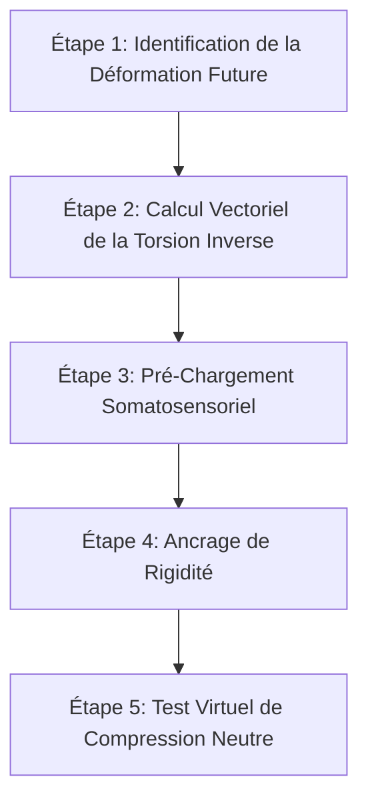
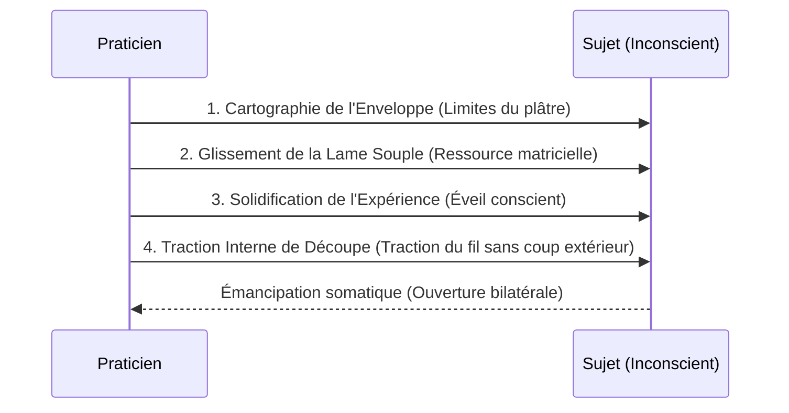
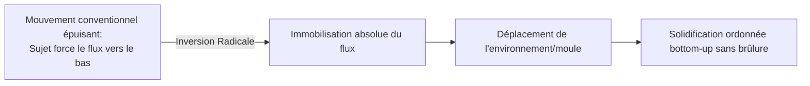
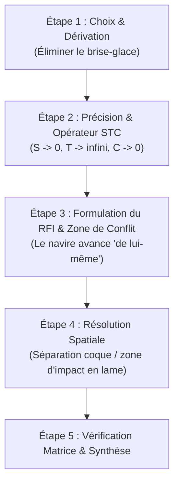

# The Innovation Algorithm (TRIZ)
**Formateur :** Genrich Altshuller | **ID :** `genrich-altshuller-the-innovation-algorithm-triz` | **Tranches :** 23

Voici la synthèse architecturale modélisée à partir des extraits et mécanismes du cours *The Innovation Algorithm (TRIZ)* de Genrich Altshuller.

---

## Synthèse Architecturale du Cours : *The Innovation Algorithm (TRIZ)*

### 1. Thèse Centrale & Philosophie du Cours

*   **Vision d'Altshuller vs Posture Standard :**
    *   *Rupture avec le mythe du génie et de l'aléatoire :* L'approche dominante (heuristique classique, brainstorming, intuitionnisme) traite l'acte créatif comme un phénomène mystique, d'inspiration divine ou relevant du pur hasard (méthode aveugle par essais-erreurs). Altshuller pose la créativité comme une **technologie cognitive rigoureuse, prédictible et transférable**, soumise à des lois objectives d'évolution des systèmes physiques et techniques.
    *   *Éthique de la Pensée Forte (*Strong Thinking*) :* L'acte d'inventer n'est pas un simple divertissement intellectuel ou un bricolage pragmatique, mais une discipline mentale supérieure orientée vers un but noble, protégeant l'esprit de l'usure, de la résignation et de la dispersion face à l'adversité.
*   **Fil rouge méthodologique :**
    *   **La neutralisation du Vecteur d'Inertie Psychologique (*Inertia Vector*)** et la **résolution sans compromis des contradictions fondamentales**. 
    *   Chaque intervention consiste à :
        1. Épurer l'énoncé de ses pièges sémantiques et de ses ancrages prototypiques (dénominalisation, dissociation moyen/but).
        2. Tendre vers l'attracteur asymptotique du **Résultat Idéal Final (Machine Idéale)** où la fonction est délivrée sans coût ni matière additionnelle.
        3. Convertir le facteur nocif ou contraignant en ressource motrice du système plutôt que de tenter de l'éradiquer au prix d'une complexité superflue.

---

### 2. Carte des Concepts & Leviers Émergents

1.  **Désoccultation de la Créativité & Démythification du Génie :**
    *   *Rôle :* Réduit l'impuissance acquise et le sentiment d'illégitimité ; transforme la posture de l'opérateur en utilisateur d'algorithmes précis plutôt qu'en « chercheur d'étincelle ».
2.  **Vecteur d'Inertie Psychologique & Fixité Fonctionnelle :**
    *   *Rôle :* Identifie le biais d'ancrage aux solutions antérieures et aux échelles connues (analogie trompeuse). Constitue la force de friction cognitive à vaincre à chaque étape.
3.  **L'Écueil de l'Essai-Erreur (L'Aveugle dans le Labyrinthe) :**
    *   *Rôle :* Met en évidence l'explosion combinatoire ($10^1$ à $>10^5$ essais) qui sature la mémoire de travail humaine et conduit à la fatigue décisionnelle et au renoncement.
4.  **Réduction Fonctionnelle Épure & Dénominalisation :**
    *   *Rôle :* Dissout l'illusion sémantique en traduisant les noms d'objets ou de pièces en relations physiques élémentaires et fonctions utiles minimales (libérant le champ pour les lois physiques fondamentales).
5.  **Inversion Fonctionnelle du Nuisible (*Harmful Factor Conversion* / Aïkido Cognitif) :**
    *   *Rôle :* Court-circuite le combat frontal contre les défauts, vibrations ou contraintes. Le « mal » est réassigné pour devenir la force motrice de la solution ou neutraliser une imperfection opposée.
6.  **Matrice 5x6 & Taxonomie des Niveaux d'Invention (1 à 5) :**
    *   *Rôle :* Échelle discrète de transition de phase évaluant la distance systémique et interdisciplinaire (intra-spécialité $\to$ intra-industrie $\to$ intra-science $\to$ extra-science $\to$ découverte de paradigme). Sert d'outil de diagnostic pour adapter la stratégie de recherche au niveau réel du verrou.
7.  **Plafond Cognitif du Brainstorming & Critique Masquée (*Masked Disruption*) :**
    *   *Rôle :* Démontre la limite intrinsèque de la génération débridée non canalisée (Niveau 2 maximum) où l'apparition d'une fausse « idée neuve » détruit la tension de convergence vers la solution réelle.
8.  **Déplacement d'Angle Mort en Morphologie (Boîte de Zwicky) :**
    *   *Rôle :* Structure le champ des variantes mais déplace l'inertie sur le choix des axes macroscopiques, risquant d'occulter des millions de combinaisons d'un coup.
9.  **Synectique & Transmutation de la Familiarité :**
    *   *Rôle :* Double bascule (rendre l'inconnu familier / rendre le familier inconnu) via l'analogie directe, symbolique et personnelle (empathie kinesthésique avec le système).
10. **L'Attracteur de la Machine Idéale (Idéalité Maximale / RIF) :**
    *   *Rôle :* Ratio opérationnel strict $(\text{Fonction Utile}) / (\text{Coût} + \text{Masse} + \text{Énergie} \to 0)$. Polarisateur attentionnel qui bloque le réflexe d'addition cognitive et pousse à faire accomplir la tâche par l'environnement ou par le système lui-même.
11. **Droit à la Difformité du Nouveau-Né (Déconstruction du Complexe d'Athéna) :**
    *   *Rôle :* Neutralise le perfectionnisme esthétique prématuré afin de permettre l'itération fonctionnelle sans censure d'image.

---

### 3. Tableau Récapitulatif des Techniques & Démonstrations

| Technique / Exercice | Objectif Opératoire | Déclencheur / Indication | Séquence Résumée |
|---|---|---|---|
| **Déconstruction Chirurgicale d'une Stratégie Défaillante** | Interrompre l'errance heuristique par essais-erreurs et réorienter l'énergie vers une modélisation rigoureuse. | Opérateur ou inventeur acharné sur l'optimisation incrémentale d'une impasse, persuadé de manquer d'inspiration ou d'effort. | 1. Valider le talent mais séparer l'opérateur de ses outils mentaux. 2. Cartographier l'énoncé brut et extraire les paramètres critiques. 3. Mettre en lumière le biais d'échelle/analogie fausse. 4. Poser la métaphore de l'explorateur aveugle pour susciter le besoin d'un algorithme. |
| **Dépassement du Vecteur d'Inertie par Réduction Fonctionnelle** | Éliminer les représentations parasites et la fixation sur l'outillage ou les matériaux conventionnels. | Blocage persistant sur la modification d'un sous-élément matériel (taille, matière, lubrifiant). | 1. Extraire et bannir le lexique technique spécifique (dénominalisation). 2. Redéfinir le problème en une interaction fonctionnelle minimale (ex. deux surfaces maintenues). 3. Identifier les lois physiques/champs déjà présents dans l'environnement immédiat. 4. Résoudre au niveau de la fonction pure. |
| **Audit des Niveaux de Rupture (Matrice 5x6)** | Calibrer la stratégie de recherche et la dépense énergétique en fonction de la complexité intrinsèque de la contradiction. | Choix de la méthodologie d'innovation ; risque d'appliquer du bricolage de Niveau 1 sur un problème de Niveau 4/5. | 1. Diagnostiquer le périmètre (composant isolé vs super-système). 2. Déterminer la distance épistémique de la solution requise (spécialité, industrie, trans-science). 3. Estimer le volume d'essais combinatoires théorique. 4. Sélectionner le niveau d'outil TRIZ adéquat. |
| **Inversion Fonctionnelle du Nuisible (*Harmful Factor Conversion*)** | Transmuter une contrainte, un coût ou un défaut structurel en moteur de la solution sans complexification mécanique. | Présence d'un facteur indésirable tenace (vibrations, aberrations, usure, chaleur, rugosité). | 1. Cesser toute tentative de suppression ou d'isolation du facteur nocif. 2. Décrire la signature physique précise de la nuisance. 3. Réassigner contextuellement ou temporellement le facteur pour qu'il produise l'effet désiré ou neutralise un défaut conjugué. 4. Valider l'élégance du système compensé. |
| **Position Zéro & Régressivité Téléologique** | Dissoudre l'énoncé biaisé imposé par le mandataire ou le prédécesseur. | Formulation de problème induisant implicitement une solution figée (ex. « comment améliorer ce chariot »). | 1. Identifier et éliminer la machine ou le moyen mentionné dans l'énoncé. 2. Revenir à l'effet final brut désiré (transférer la masse, séparer deux phases). 3. Formuler l'équation de la *Machine Idéale* (le résultat s'accomplit sans ajouter d'organe). 4. Explorer les ressources gratuites disponibles (gravité, air, sous-produits du process). |
| **Empathie Kinesthésique Synectique (Analogie Personnelle)** | Briser la distance d'observation pour percevoir les lignes de contraintes internes du système. | Répétition stérile d'analogies superficielles ou conceptuelles sans compréhension des forces en jeu. | 1. Dissocier l'identité de l'opérateur. 2. S'associer sensoriellement (kinesthésie/somatique) dans les molécules ou les pièces du système sous tension. 3. Ressentir les pressions, frottements et limites spatiales directes. 4. Transposer le ressenti interne en principe physique ou géométrique de résolution. |

---

---

## 0. Sommaire Sémantique & Index des Lignes

- **Tranche 1 [Lignes 96-170]** : Déconstruction Chirurgicale d'une Stratégie Intuitive Défaillante (Modélisation de l'Erreur... — *Protocole :* Déconstruction Chirurgicale d'une Stratégie Intuitive Défaillante (Modélisation de l'Erreur d'un Inventeur)
- **Tranche 2 [Lignes 172-268]** : Dépassement du Vecteur d'Inertie par Réduction Fonctionnelle — *Protocole :* Dépassement du Vecteur d'Inertie par Réduction Fonctionnelle | *Mécanisme :* Le Biais d'Ancrage au Prototype et le Vecteur d'Inertie | *Verbatim :* Verbatim 1
- **Tranche 3 [Lignes 270-376]** : A : La Matrice d'Évaluation des Niveaux de Rupture (Audit de Complexité Inventive) — *Protocole :* A : La Matrice d'Évaluation des Niveaux de Rupture (Audit de Complexité Inventive) | *Mécanisme :* Levier 1 : Inversion Fonctionnelle du Facteur Nuisible (Harmful Factor Conversion) | *Verbatim :* Verbatim 1 : L'Inversion de la Nuisance en Atout (Oleg Antonov)
- **Tranche 4 [Lignes 378-512]** : A : Détection et Franchissement de Domaine (Saut Niveau 4/5) — *Protocole :* A : Détection et Franchissement de Domaine (Saut Niveau 4/5) | *Verbatim :* La Métaphore de la Rupture d'Échelle (Navires et Papiers)
- **Tranche 5 [Lignes 514-679]** : A : Le Brainblitz (Brainstorming Dirigé sans Rupture de Chaîne) — *Protocole :* A : Le Brainblitz (Brainstorming Dirigé sans Rupture de Chaîne) | *Mécanisme :* Le Plafond Cognitif du Brainstorming & la Critique Masquée (Masked Disruption) | *Verbatim :* La Dérive Vectorielle du Brainstorming
- **Tranche 6 [Lignes 681-776]** : Dé-parasitage de l'Énoncé et Recadrage Fondamental (The Problem Re-Formulator) — *Protocole :* Dé-parasitage de l'Énoncé et Recadrage Fondamental (The Problem Re-Formulator) | *Mécanisme :* Convergence Évolutive Trans-Domaines (Iso-morphisme structurel) | *Verbatim :* La Rupture du Piège de l'Énoncé
- **Tranche 7 [Lignes 778-879]** : d'Élucidation et de Résolution par la Machine Idéale (Exemple de l'Arroseur DD-100M) — *Protocole :* d'Élucidation et de Résolution par la Machine Idéale (Exemple de l'Arroseur DD-100M) | *Mécanisme :* Le Levier de l'Idéalité Asymptotique (La Machine Idéale comme balise cognitive)
- **Tranche 8 [Lignes 881-1029]** : A : ARIZ-61 (Résolution Opérative en 3 Stades) — *Protocole :* A : ARIZ-61 (Résolution Opérative en 3 Stades)
- **Tranche 9 [Lignes 1031-1107]** : L'Opérateur STC (Déstabilisation de l'Inertie Psychologique) — *Protocole :* L'Opérateur STC (Déstabilisation de l'Inertie Psychologique) | *Mécanisme :* Le Principe de Rétro-Ingénierie Téléologique (Rétro-propagation depuis le Résultat Idéal) | *Verbatim :* La Disjonction du Piège Sémantique
- **Tranche 10 [Lignes 1109-1230]** : A : Élicitation et Ancrage du RIF (Résultat Idéal Final) — *Protocole :* A : Élicitation et Ancrage du RIF (Résultat Idéal Final)
- **Tranche 11 [Lignes 1232-1518]** : L'Inoculation de Pré-Tension Antagoniste (Dérivé du Principe 9 : Prior Counteraction) — *Protocole :* L'Inoculation de Pré-Tension Antagoniste (Dérivé du Principe 9 : Prior Counteraction) | *Mécanisme :* Rupture de Symétrie & Spécialisation Contextuelle (Asymmetry Principle) | *Verbatim :* La Transmutation du Nuisible & Le Mur Psychologique
- **Tranche 12 [Lignes 1520-1638]** : Superposition Optique de l'Inaccessible (Inspiré du Cas Aksenov) — *Protocole :* Superposition Optique de l'Inaccessible (Inspiré du Cas Aksenov) | *Mécanisme :* Substitution de Système Mécanique par Champs & Transductions (transductionsensorielle couplagesansfriction submodalshift)
- **Tranche 13 [Lignes 1640-1775]** : Dépouillement Lexical et Résolution par Transfert Isomorphique (Exemple du Canon et des Part... — *Protocole :* Dépouillement Lexical et Résolution par Transfert Isomorphique (Exemple du Canon et des Particules) | *Verbatim :* Le paradoxe de l'acteur et l'artillerie des formules
- **Tranche 14 [Lignes 1777-1871]** : Résolution de Contradiction par Segmentation Opératoire (Problème 7) — *Protocole :* Résolution de Contradiction par Segmentation Opératoire (Problème 7) | *Mécanisme :* Le Principe de la Segmentation et de la Décorrélation Spatiale/Temporelle | *Verbatim :* La Formulation du Paradoxe Fondamental
- **Tranche 15 [Lignes 1873-1978]** : Résolution Algorithmique par Disparition de l'Agent Porteur (ARIZ 3-1 à 4-4) — *Protocole :* Résolution Algorithmique par Disparition de l'Agent Porteur (ARIZ 3-1 à 4-4) | *Verbatim :* Le Découplage Temporel de la Contradiction
- **Tranche 16 [Lignes 1980-2090]** : de Résolution Paléobionique (Extraction du Brevet de la Nature Fossile) — *Protocole :* de Résolution Paléobionique (Extraction du Brevet de la Nature Fossile) | *Verbatim :* Verbatim 1 : La rupture de cadre temporelle du prototype
- **Tranche 17 [Lignes 2092-2218]** : Désamorçage de l'Inertie Psychologique par Isomorphisme Allégorique — *Protocole :* Désamorçage de l'Inertie Psychologique par Isomorphisme Allégorique | *Mécanisme :* Levier de l'Émergence Systémique Trans-Arithmétique | *Verbatim :* La Déclaration d'Épuisement Morphologique
- **Tranche 18 [Lignes 2220-2322]** : Désamorçage de l'Inertie par l'Extrémisation Visuelle (Cas du Toroïde) — *Protocole :* Désamorçage de l'Inertie par l'Extrémisation Visuelle (Cas du Toroïde) | *Mécanisme :* Inertie Sémantique et Enfermement Lexical | *Verbatim :* Verbatim 1 : La dissolution du filtre de l'impossible
- **Tranche 19 [Lignes 2324-2466]** : Construction et Exploitation d'un Phantogramme — *Protocole :* Construction et Exploitation d'un Phantogramme | *Mécanisme :* Le Phantogramme : Croisement Matriciel Morphologique | *Verbatim :* L'analogie esthétique de l'imagination
- **Tranche 20 [Lignes 2468-2618]** : d'Assimilation et de Transfert par Analogie (Étape 2-0 d'ARIZ) — *Protocole :* d'Assimilation et de Transfert par Analogie (Étape 2-0 d'ARIZ) | *Verbatim :* La Ligne Invariable de l'Évolution
- **Tranche 21 [Lignes 2620-2713]** : d'Aiguillage et Résolution par la Matrice de Contradiction (Exemple du Brise-Glace) — *Protocole :* d'Aiguillage et Résolution par la Matrice de Contradiction (Exemple du Brise-Glace) | *Verbatim :* La Métaphore de l'Équipement Progressif
- **Tranche 22 [Lignes 2715-2853]** : d'Élévation Systémique (Diagnostic & Transition de Niveau d'un Système Bloqué) — *Protocole :* d'Élévation Systémique (Diagnostic & Transition de Niveau d'un Système Bloqué)
- **Tranche 23 [Lignes 2855-2914]** : d'Immersion et de Transfert d'Expertise TRIZ (Modèle Shulyak) — *Protocole :* d'Immersion et de Transfert d'Expertise TRIZ (Modèle Shulyak) | *Mécanisme :* Preuve Sociale par Empilement de Validations Croisées (Peer Validation Cascade)

---

## Extractions Détaillées par Tranche (Opératoire & Verbatim)

## Tranche 1 / 23 : Déconstruction Chirurgicale d'une Stratégie Intuitive Défaillante (Modélisation de l'Erreur...

### 1. Mécanismes & Principes Actifs

- **Déconstruction du Dogme du Don Inné (Désoccultation de la Créativité)**
  *Principe actif :* L'esprit humain tend à mystifier les processus complexes non modélisés (les attribuant au génie, à l'inspiration divine ou au hasard). Altshuller désamorce cette transe collective en postulant que la créativité est une *technologie cognitive reproductible*, comparable à l'apprentissage de la médecine ou de la musique. En retirant le statut d'« exception magique » au talent créatif, il libère le système nerveux du sentiment d'impuissance acquise et réoriente l'énergie cognitive vers l'apprentissage d'algorithmes précis.
  *Tags :* #demystification_du_genie #technologie_cognitive #desensibilisation_impuissance #democratisation_neurocognitive

- **Le Biais d'Inertie Psychologique par Analogie Fausse**
  *Principe actif :* Face à un problème inédit, le système cognitif active automatiquement le circuit de moindre résistance : la reconnaissance de formes basée sur l'expérience passée (mémoire associative). Dans le cas d'Egorov, le cerveau assimile un tore minuscule (2 mm) à une bobine de téléphone déjà résolue. Ce biais analogique induit une fixation fonctionnelle qui masque le facteur d'échelle critique modifiant radicalement les contraintes physiques du système.
  *Tags :* #inertie_psychologique #piege_analogique #fixation_fonctionnelle #saturation_heuristique

- **La Démarche par Essais et Erreurs (L'Aveugle dans le Labyrinthe)**
  *Principe actif :* La méthode intuitive empirique procède par variations aléatoires non vectorisées. Sur le plan de la dynamique mentale, cela engendre une fatigue décisionnelle rapide, une anxiété chronique (« détruisant la paix de l'esprit ») et une exploration désordonnée qui s'arrête prématurément sur des compromis insatisfaisants plutôt que sur la résolution des contradictions fondamentales.
  *Tags :* #essais_erreurs #bruit_cognitif #errance_heuristique #usure_attentionnelle

- **Le Postulat Éthico-Cognitif de la Pensée Forte (Strong Thinking)**
  *Principe actif :* Altshuller lie la santé psychologique et morale de l'individu à l'exercice d'une pensée créative rigoureuse orientée vers un but noble. La création rigoureuse consomme l'intégralité de la bande passante mentale, immunisant le sujet contre les dérives destructrices ou la résignation face à l'adversité extrême (survie dans les camps du Goulag).
  *Tags :* #pensee_forte #ecologie_identitaire #immunite_psychologique #focalisation_teleologique

---

### 2. Protocoles, Techniques & Démonstrations (Étape par Étape)

#### Déconstruction Chirurgicale d'une Stratégie Intuitive Défaillante (Modélisation de l'Erreur d'un Inventeur)

* **Intention / Indication :** À utiliser face à un individu ou un groupe bloqué dans une boucle stérile d'essais-erreurs, persuadé que « chercher plus fort » ou « accumuler des idées » suffira à débloquer le système.
* **Mise en place & Pré-framing :** Cadrer la démarche non pas sur l'incompétence de l'individu (Egorov est explicitement qualifié de « talentueux inventeur »), mais sur l'inadéquation de ses outils mentaux. Poser d'emblée la métaphore de Mendeleïev (l'explorateur sans lampe qui avance à tâtons jusqu'à se briser le crâne).
* **Séquence d'actions pas à pas :**
  - *Étape 1 : Cartographie de l'énoncé brut et extraction des paramètres critiques.*
    Définir les grandeurs physiques absolues (tore de 2 mm, fil plus fin qu'un cheveu, isolation en soie ultrasensible) sans laisser l'esprit y plaquer une solution préconçue.
  - *Étape 2 : Traque du piège de la fausse similarité.*
    Faire verbaliser les précédents succès du sujet (« J'ai déjà fait ça sur les inducteurs téléphoniques »). Identifier immédiatement la variable différentielle qui invalide la transposition brute (rupture d'échelle d'un facteur 10).
  - *Étape 3 : Mise en lumière de l'aporie structurelle (Contrainte de fabrication).*
    Vérifier pourquoi les voies évidentes sont condamnées (ex: couper le tore en deux C est impossible à cause de la métallurgie des poudres). Forcer le système cognitif à regarder la contrainte nue sans fuite imaginaire.
  - *Étape 4 : Isolement du point de rupture de la paix mentale.*
    Repérer l'instant exact où les questions en boucle déstabilisent le sujet (« Can the wire be wound without the spool? »).
  - *Étape 5 : Cartographie des solutions réflexes de l'entourage.*
    Lister les suggestions issues du sens commun (ex: système de balanciers/pendules) pour exposer qu'elles ne sont que des dérives mécaniques compliquées issues d'une mauvaise définition du problème.
* **Signes de calibration :**
  - Chute de la posture de certitude du sujet lorsqu'il réalise que son analogie initiale est caduque.
  - Présence de questions de plus en plus anxieuses et non convergentes (« How big...? Can we...? What kind...? »).
  - Recours aux avis extérieurs (« friends with whom I consulted »), signe indubitable que la stratégie interne est épuisée.

---

### 3. Heuristiques, Subtilités & "Sagesse du Praticien"

- **Règle de l'Échelle Discrète :**
  *Si* un problème semble identique à un problème déjà résolu mais présente une réduction d'échelle dimensionnelle drastique, *alors* considérer d'office qu'il s'agit d'un problème fondamentalement nouveau, *parce que* les lois de frottement, de résistance mécanique et de maniabilité changent de régime à petite échelle.

- **Règle du Diagnostic de Méthode :**
  *Si* une communauté d'inventeurs ou un praticien produit des milliers de brevets ou de solutions par essais et erreurs, *ne pas conclure* que la méthode est bonne. L'efficacité apparente masque un gaspillage massif de temps et de ressources nerveuses.

- **Le Postulat de la Pensée Forte (Altshuller) :**
  L'individu qui s'adonne pleinement à une création méthodique et exigeante ne peut pas être mauvais ou destructeur ; le coût cognitif et temporel du mal est incompatible avec la recherche de solutions créatives d'ordre supérieur.

- **Piège du Débutant :**
  Chercher à modifier l'objet de manière non autorisée par le contexte (vouloir couper le tore en deux) au lieu d'accepter la rigidité de la contrainte physique pour en extraire la contradiction technique sous-jacente.

---

### 4. Pépites Verbatim & Patterns Linguistiques (MOT À MOT EN V.O.)

> “A person occupied with creativity cannot be a bad person. He has no interest in being a bad person — it only consumes valuable time. I saw this in the Gulag Camp. . . .”
- **[Analyse du Pattern]** : Recadrage identitaire absolu par critère économique et temporel. L'éthique n'est pas posée comme un impératif moral moralisateur, mais comme une conséquence directe de l'allocation optimale des ressources attentionnelles (« it only consumes valuable time »). L'ancrage au camp du Goulag agit comme un truisme d'autorité existentielle indiscutable, conférant au postulat une puissance d'impact neuro-émotionnelle maximale.

> “One person gropes through the dark labyrinth — perhaps he will find something useful, or maybe he will just crack his skull. Another carries a small lamp to shine through the darkness and, during his journey, his lamp shines brighter and brighter. It finally becomes an electric sun illuminating everything and revealing all. Now I ask: ‘Where is your lamp?’”
- **[Analyse du Pattern]** : Métaphore spatio-sensorielle à fort contraste visuel et kinesthésique (obscurité/lumière, errance/guidage, blessure physique/soleil électrique). La citation de Mendeleïev fonctionne comme une induction de transe de focalisation : elle place le sujet devant un double lien dramatisé (la recherche aveugle mène à se fracasser le crâne contre les murs) suivi d'une commande interrogative directe finale (« Where is your lamp? ») qui brise la passivité du lecteur et installe un manque cognitif urgent.

> “This implies an idea that may seem, at first glance, heretical: existing methods of inventing are so bad that they should be replaced. Yet, people have made great inventions with these old methods! All invention today is based upon these methods, producing thousands of new technical ideas every year. How can these existing methods be wrong? Let’s not rush to an answer.”
- **[Analyse du Pattern]** : Rupture de pattern par provocation intentionnelle (« heretical »), immédiatement suivie d'une validation des objections conscientes du sujet (technique d'utilisation et de pacing : « Yet, people have made... »). L'empilement de truismes apparents installe une boucle ouverte (Open Loop) stabilisée par la commande hypnotique de décélération (« Let’s not rush to an answer »), qui suspend le jugement critique et force l'attention à descendre dans l'analyse clinique du processus.

> “How big should the spool be? How big should the needle ring be? Immediately it becomes clear that the spool I used to wind the wire on the first device cannot be used here. This spool will be too small, complicating the situation. Can the wire be wound without the spool? Can we find a completely new concept of winding? What kind of concept would it be? These questions destroyed my peace of mind.”
- **[Analyse du Pattern]** : Régression syntaxique mimant l'emballement obsessionnel. La cadence des questions courtes et auto-référentes sans issue crée une saturation kinesthésique interne (« destroyed my peace of mind »). Le texte modélise linguistiquement le phénomène de transe négative dans lequel s'enferme le praticien lorsqu'il est démuni d'un algorithme de pensée formel.

## Tranche 2 / 23 : Dépassement du Vecteur d'Inertie par Réduction Fonctionnelle

Voici l'analyse modélisatrice et opératoire de la tranche soumise, décortiquée selon la grille d'ingénierie cognitive et d'intervention.

---

### 1. Mécanismes & Principes Actifs

#### 1. Le Biais d'Ancrage au Prototype et le Vecteur d'Inertie
* **Principe actif :** Face à une contrainte nouvelle, le système nerveux projette immédiatement des représentations déjà encodées dans la mémoire procédurale et épisodique (ce qui a fonctionné par le passé). Ce réflexe économique d'un point de vue énergétique oriente la recherche dans la direction opposée à la rupture nécessaire. Le praticien observe que la tentative d'optimisation incrémentale d'un sous-élément inadéquat (ex. réduire la taille d'une aiguille ou d'une corde) maintient la boucle de blocage cognitif.
* **Tags :** `#vecteur_inertie #ancrage_prototypique #fixite_fonctionnelle #boucle_essai_erreur`

#### 2. L'Extraction de Pattern Trans-Domaines (Modélisation Symbolique & Isomorphisme Somatique)
* **Principe actif :** La rupture avec l'inertie s'opère par une défocalisation attentionnelle (état de rêverie, observation périphérique sans intention de résoudre) permettant d'isoler une gestuelle ou une configuration relationnelle dans un domaine totalement étranger (le tricot, l'interface air/eau). Le système extrait la cinématique abstraite (le crochet qui tire une boucle) et la remappe sur le problème technique.
* **Tags :** `#isomorphisme_somatique #transposition_de_pattern #attention_defocalisee #insight_analogique`

#### 3. Le Recadrage Opératoire par Réduction Fonctionnelle Épure
* **Principe actif :** En substituant à la désignation concrète de l'objet (ex. *la graisse graphite*, *la corde*) sa fonction relationnelle minimale pure (*deux pièces métalliques temporairement maintenues*), la charge sémantique s'effondre. Le champ des solutions s'ouvre spontanément à des lois physiques basiques (champs magnétiques, gravité) invisibles sous le lexique initial.
* **Tags :** `#reduction_fonctionnelle #denominalisation_semantique #epuration_critere #recadrage_physique`

#### 4. Le Principe de Compensation et d'Utilisation du "Mal Inévitable"
* **Principe actif :** Au lieu de mobiliser des ressources cognitives ou matérielles pour éradiquer une contrainte indésirable ou un défaut (aberration optique, coût d'un matériau), le cadre est inversé : le défaut est accepté comme élément structurel, puis exploité pour neutraliser un autre défaut préexistant (deux imperfections conjuguées créent un système parfait).
* **Tags :** `#principe_utilisation #compensation_croisee #recadrage_de_contexte #aikido_cognitif`

---

### 2. Protocoles, Techniques & Démonstrations (Étape par Étape)

#### Protocole 1 : Dépassement du Vecteur d'Inertie par Réduction Fonctionnelle

* **Intention / Indication :** Quand un blocage cognitif persiste après des dizaines d'essais infructueux portant sur l'ajustement d'un même composant matériel ou comportemental.
* **Mise en place & Pré-framing :** Cadrer la situation non pas comme un problème d'ingéniosité ou de talent, mais comme un verrou de formulation sémantique.
* **Séquence d'actions pas à pas :**
  1. **Nommer le prototype hérité :** Identifier l'outil ou le comportement de référence que le sujet s'obstine à modifier (ex. aiguille, navette, corde).
  2. **Dénomminaliser l'action :** Formuler le besoin sans utiliser aucun substantif technique propre au domaine. Remplacer par des verbes d'action basiques et des entités génériques (ex. "Maintenir la pièce A contre la pièce B temporairement").
  3. **Calibrer l'effort minimal requis :** Définir le seuil strict de force, d'énergie ou de présence nécessaire (ex. "juste assez pour compenser la gravité").
  4. **Scanner les champs physiques/ressources passives :** Vérifier quels phénomènes fondamentaux (magnétisme, capillarité, élasticité, gravité) accomplissent déjà ce travail sans ajout de sous-mécanisme complexe.
* **Signes de calibration :** Bascule immédiate du regard, disparition des micro-tensions liées à l'effort mental, expression faciale de surprise ou de soulagement ("l'évidence").

---

#### Protocole 2 : L'Alchimie de la Contrainte (Compensation Maksutov)

* **Intention / Indication :** Quand une solution exige un élément jugé "trop coûteux" ou "générateur de nouveaux défauts".
* **Mise en place & Pré-framing :** Poser l'interdiction de combattre le défaut ou de chercher à le supprimer. Poser le postulat que tout élément présent doit payer son droit d'entrée par des fonctions annexes.
* **Séquence d'actions pas à pas :**
  1. **Acceptation totale de l'intrus :** Poser comme acquise l'introduction de l'élément indésirable (ex. le verre épais, la lentille ménisque).
  2. **Multiplication des charges fonctionnelles :** Explorer toutes les charges mécaniques ou spatiales que cet intrus peut supporter à lui seul pour supprimer des composants périphériques.
  3. **Appariement des défauts antagonistes :** Identifier la nature exacte de l'imperfection introduite (ex. aberration positive). Chercher une imperfection opposée dans le reste du système (ex. distorsion du miroir sphérique).
  4. **Fusion neutralisante :** Calibrer les deux distorsions pour qu'elles s'annulent mutuellement, transformant deux composants imparfaits et économiques en une unité fonctionnelle d'excellence.
* **Signes de calibration :** Relâchement du combat contre le symptôme, passage d'une dynamique de soustraction à une dynamique de synergie d'imperfections.

---

### 3. Heuristiques, Subtilités & "Sagesse du Praticien"

1. **L'illusion du labeur méritant :** L'accumulation de centaines d'essais-erreurs (comme les 300 modifications d'Egorov ou les années de travail d'Edison) n'est pas un indicateur de rigueur, mais le symptôme direct d'un aveuglement par le vecteur d'inertie.
2. **Le paradoxe du temps différé :** Si les briques technologiques ou conceptuelles existent depuis des décennies mais que la solution n'émerge pas, le verrou n'est jamais technique ; il réside dans le refus inconscient de reformuler le problème à la racine.
3. **La règle de l'obstacle contourné :** Face à une barrière apparente (prix élevé, contrainte de fabrication), la tentative instinctive est de "sauter par-dessus" (forcer, chercher des financements, durcir les matériaux). L'heuristique opératoire consiste à faire entrer la contrainte dans le cadre et à lui confier d'autres tâches.
4. **La règle de l'environnement actif :** Si le milieu ou le support lui-même possède des propriétés physiques (ex. l'eau d'un plongeur, l'air ambiant), ces propriétés doivent être traitées comme des éléments actifs du système plutôt que comme des obstacles à corriger.

---

### 4. Pépites Verbatim & Patterns Linguistiques (MOT À MOT EN V.O.)

#### Verbatim 1
> *“How big should the spool be? How big should the needle ring be? Immediately it becomes clear that the spool I used to wind the wire on the first device cannot be used here. This spool will be too small, complicating the situation. Can the wire be wound without the spool? Can we find a completely new concept of winding? What kind of concept would it be? These questions destroyed my peace of mind.”*

* **[Analyse du Pattern]** : Enchaînement de questions fermées basées sur le cadre initial, suivi d'une rupture brutale par questions ouvertes radicales (*"Can the wire be wound without..."*). L'aveu de rupture homéostatique (*"destroyed my peace of mind"*) marque l'effondrement de la carte du monde précédente, induisant un état d'ouverture cognitive involontaire propice à l'induction d'une nouvelle structure.

---

#### Verbatim 2
> *“Suddenly a thought struck me: the whole concept of winding the wire around the ring is wrong. Such a concept includes the idea that the needle must travel through the ring. It is the needle’s movement that causes the wire to become slack. Therefore, I must reject any concept that includes the needle. I had to find a completely new method.”*

* **[Analyse du Pattern]** : Rupture de pattern radicale suivie d'un démantèlement déductif strict. L'utilisation du présupposé d'impossibilité sur le composant cible (*"I must reject any concept that includes the needle"*) agit comme une commande de verrouillage : elle interdit formellement à l'esprit de réemprunter le chemin de l'inertie, forçant une bifurcation perceptuelle.

---

#### Verbatim 3
> *“One does not need special knowledge in order to solve this problem. It is doubtful, however, that even experienced inventors will find good solutions through the trial-and-error method alone. In fact, I am positive that the reader will not solve this problem.”*

* **[Analyse du Pattern]** : Défi hypnotique direct et suggestion paradoxale (psychologie inversée). En affirmant catégoriquement l'incapacité du lecteur à résoudre l'énigme par le sens commun, Altshuller crée un double lien : si le lecteur échoue, le postulat de la méthode algorithmique est vérifié ; s'il veut réussir, il doit abandonner ses patterns habituels pour adopter les axiomes du formateur.

---

#### Verbatim 4
> *“An optical glass is initially held as some kind of inevitable evil. ‘But this is okay,’ the inventor says. ‘Let’s have an optical glass. If the glass has to be there, why not get additional advantages from it as compensation?’”*

* **[Analyse du Pattern]** : Recadrage ericksonien d'utilisation pure. La transe de frustration est interrompue par l'acceptation assertive (*"But this is okay"*), immédiatement enchaînée par une prémisse conditionnelle permissive (*"If... why not..."*) qui transmute une perte perçue en opportunité d'optimisation systémique.

---

#### Verbatim 5
> *“Working on the theory of the meniscus system, and understanding its advantages, I involuntarily remembered the thorny road of the optical industry history. How many lances were broken during the battles between advocates of reflectors and refractors? How much energy was wasted to perfect methods to manufacture and investigate precise spherical surfaces and resolving, on the other hand, problems of achromatic glass?”*

* **[Analyse du Pattern]** : Empilement de questions rhétoriques à forte charge kinesthésique et émotionnelle (*"thorny road"*, *"lances were broken"*, *"energy was wasted"*). Ce pattern ancre l'absurdité du coût de l'inertie humaine et prépare le terrain mental à valoriser l'élégance économique de la modélisation formelle face à l'obstination dogmatique.

## Tranche 3 / 23 : A : La Matrice d'Évaluation des Niveaux de Rupture (Audit de Complexité Inventive)

### 1. Mécanismes & Principes Actifs

#### Levier 1 : Inversion Fonctionnelle du Facteur Nuisible (Harmful Factor Conversion)
- **Principe actif :** Face à un élément perturbateur (vibrations, aberrations optiques, masse excessive, résistance), le réflexe cognitif primaire (l’inertie psychologique) consiste à chercher à l'éliminer ou à le masquer. Le principe actif d'Altshuller repose sur la réassignation contextuelle : au lieu de supprimer le facteur nocif au prix d'une complexification coûteuse, l'opérateur modifie sa disposition spatiale, temporelle ou relationnelle pour que sa nuisance devienne le moteur même de la solution. 
- **Impact cognitif/neurologique :** Sur le plan de la cognition et de la modélisation symbolique, cela court-circuite le cadre problème/solution binaire. L'énergie négative du problème n'est plus combattue mais intégrée comme ressource motrice, désaturant le cortex préfrontal de la boucle d'acharnement stérile (« *banging heads against the wall* »).
- **Tags libres :** `#compensation_method` `#inversion_facteur_nuisible` `#harmful_into_positive` `#transmutation_ressource` `#triade_maksutov_antonov`

#### Levier 2 : Cartographie Multidimensionnelle de la Créativité (Matrice 5x6 Altshuller)
- **Principe actif :** La créativité n'est ni un éclair mystique aléatoire ni un processus uniforme d'essais-erreurs. Altshuller décompose l'acte inventif selon deux axes orthogonaux stricts : 
  1. Les Étapes chronologiques d'ingénierie (A à F : choix du problème, concept de recherche, collecte de données, recherche d'idée, concrétisation conceptuelle, implémentation physique).
  2. Les Niveaux qualitatifs de rupture systémique (Niveaux 1 à 5).
- **Impact cognitif :** Ce modèle détruit l'illusion de l'intuition non reproductible en fournissant une échelle discrète de saut de paradigme. Chaque niveau correspond à un saut de complexité combinatoire et à un changement de phase (similaire à l'eau passant de glace à liquide puis vapeur).
- **Tags libres :** `#matrice_5x6` `#niveaux_de_creativite` `#rupture_systemique` `#echelle_discrete_innovation` `#desillusion_heuristique_classique`

#### Levier 3 : Décompression Métrique de l'Espace de Recherche (Trial-and-Error Scaling)
- **Principe actif :** Chaque niveau d'invention exige un volume exponentiel de tests à l'aveugle si l'on procède par essais-erreurs non guidés (Niveau 1 : 1 à 10 ; Niveau 5 : plus de 100 000 essais). 
- **Impact sur le système nerveux :** L'épuisement cognitif et le blocage de l'ingénieur ne viennent pas d'un manque d'intelligence, mais de l'incapacité de la mémoire de travail humaine à balayer un espace d'états d'ordre $10^4$ ou $10^5$. La formalisation des lois objectives de l'évolution technique sert d'opérateur de réduction de dimensionnalité, transformant une recherche exponentielle impossible en un guidage directionnel direct.
- **Tags libres :** `#metrique_essais_erreurs` `#charge_cognitive_exponentielle` `#reduction_dimensionnalite` `#espace_etats_recherche`

---

### 2. Protocoles, Techniques & Démonstrations (Étape par Étape)

#### Protocole A : La Matrice d'Évaluation des Niveaux de Rupture (Audit de Complexité Inventive)
* **Intention / Indication :** Déterminer le niveau réel d'un blocage créatif ou d'une invention candidate afin de choisir la bonne stratégie de recherche et de ne pas gaspiller d'énergie à réinventer des systèmes connus (ou, inversement, ne pas appliquer un bricolage de Niveau 1 sur une contradiction de Niveau 4/5).
* **Mise en place & Pré-framing :** Cadrer l'analyse hors de toute flatterie de « génie ». Traiter le problème comme une transition de phase matérielle.
* **Séquence d'actions pas à pas :**
  * **Étape 1 : Diagnostic du système cible et de son périmètre.** L'objet considéré est-il isolé ou intègre-t-il des sous-systèmes / super-systèmes ?
  * **Étape 2 : Calibration sur l'échelle des 5 Niveaux :**
    - *Niveau 1 (Trivial/Design standard) :* Utilisation d'un seul objet existant sans altération conceptuelle. (Ex: remplacer le métal par du plastique avec nervures de renfort). Résolution : 1 à 10 essais.
    - *Niveau 2 (Sélection/Adaptation locale) :* Choix d'une variante parmi plusieurs solutions connues au sein du même domaine. (Ex: abaisser l'inducteur plutôt que le tuyau dans une pompe électromagnétique). Résolution : 10 à 100 essais.
    - *Niveau 3 (Changement d'état physique/Modification partielle) :* Résolution d'une contradiction interne par altération des propriétés physiques d'un composant existant. (Ex: obturateur réutilisable à étincelle dans un liquide au lieu de casser un verre ; congélation des viscères de poisson à -5°C). Résolution : 100 à 1 000 essais.
    - *Niveau 4 (Nouveau principe opérant hors du paradigme habituel) :* Remplacement complet du principe de fonctionnement par un principe externe (souvent issu d'une science voisine : chimie, thermodynamique interne). (Ex: ampoule chimique odorante pour signaler l'usure d'un trépan ; refroidissement par évaporation interne d'un acier poreux imprégné). Résolution : 1 000 à 10 000 essais.
    - *Niveau 5 (Pionnier / Découverte de nouvelle classe technologique) :* Création d'un macro-système reposant sur un phénomène physique nouveau ou détourné de façon radicale, modifiant tout l'environnement industriel. (Ex: électro-érosion / dispersion d'électrodes par étincelles en circuit oscillant ; laser). Résolution : 10 000 à 100 000+ essais.
  * **Étape 3 : Cartographie matricielle (Table 1).** Croiser le niveau obtenu avec l'étape du processus (A : Problème -> B : Concept de recherche -> C : Données -> D : Idée -> E : Conception -> F : Fabrication).
* **Signes de calibration :** 
  - Si l'ingénieur cherche une solution en modifiant juste un paramètre géométrique alors que le coût global explose -> Blocage typique de niveau 1-2 appliqué à un problème de niveau 3+.
  - Reconnaissance du saut de niveau dès lors qu'une discipline extérieure (chimie, changement d'état de la matière) est introduite.

---

#### Protocole B : Séquence d'Extraction Socratique de Conception (Démonstration Altshuller - Enfant de 12 ans)
* **Intention / Indication :** Démontrer la trajectoire naturelle de la pensée créative de Niveau 1/2 et forcer l'émergence d'une solution géométrique optimale sans inertie technique.
* **Mise en place & Pré-framing :** Poser une contrainte négative stricte dès l'amorce (interdire les solutions conventionnelles inadaptées pour forcer le saut d'attention).
* **Séquence d'actions pas à pas :**
  * **Étape 1 : Réfutation des outils par défaut.**
    * Operateur : Déclare que les outils existants (tire-bouchon, ouvre-boîte tranchant) sont exclus.
  * **Étape 2 : Élicitation de l'observation brute du sujet.**
    * Sujet : Révèle l'usage empirique (« *Mother uses a kitchen knife* »).
  * **Étape 3 : Recadrage de rejet opératoire.**
    * Opérateur : Écarte l'inconfort de l'outil usuel (« *It is not convenient to use a knife. A special opener is required.* »).
  * **Étape 4 : Déplacement vers une symétrie supérieure.**
    * Sujet propose un double appui (« *scissors* »).
    * Opérateur demande la justification mécanique : « *Why are scissors better?* »
    * Sujet explicite la géométrie des forces : « *A knife picks up the cork from one side; scissors pick it up from two sides.* »
  * **Étape 5 : Calibration de la direction d'amplification (Pacing & Leading).**
    * Opérateur pousse le gradient d'optimisation : « *How can we make this even better?* »
    * Sujet atteint le seuil inventif de Niveau 2 : extension triangulaire / fer à cheval (« *We can pick the cork up from three sides!* »).
  * **Étape 6 : Ancrage somatique du concept.**
    * Le sujet traduit immédiatement la géométrie en geste physique (démonstration avec les doigts) et ajoute la prise fonctionnelle (« *handle on the top* »).
* **Signes de calibration :** Enthousiasme spontané du sujet (rupture du pattern d'effort intellectuel), passage immédiat de la réflexion verbale à la modélisation spatiale/kinesthésique (mime avec les mains).

---

### 3. Heuristiques, Subtilités & "Sagesse du Praticien"

#### Règles Conditionnelles :
- **Si** un facteur nuisible semble intrinsèque à une structure (ex: aberration optique d'un hublot, masse provoquant du flutter sur un stabilisateur d'avion), **alors** ne cherche pas à l'éliminer ou à l'alléger ; déplace ses coordonnées spatiales (ex: en avant de l'axe neutre) ou modifie sa courbure (ex: transformer la vitre en ménisque) **parce que** sa présence compensera automatiquement un autre défaut du système.
- **Si** 77% des brevets déposés relèvent des Niveaux 1 et 2, **alors** ne traite pas tout problème comme un défi transcendant nécessitant une révolution conceptuelle : la majorité des verrous industriels se règlent par simple sélection ou substitution de composant connue de l'ingénieur moyen.
- **Si** une méthode d'essais-erreurs dépasse 100 itérations sans converger, **alors** arrête immédiatement les tests : le problème relève au minimum du Niveau 3 (nécessite un changement d'état ou une contradiction physique résolue) ou du Niveau 4 (changement de principe opérant).
- **Si** une discipline se contente de décrire chronologiquement le processus créatif (« voir le problème, chercher, trouver » à la manière du « Veni, vidi, vici » de César), **alors** rejette cette taxonomie comme purement descriptive et non opératoire : elle n'offre aucun algorithme de génération de solution.

#### Pièges Classiques & Erreurs de Débutant :
- **Le mythe de l'inspiration foudroyante (« Éclair dans la nuit ») :** Croire Nicolle ou les inventeurs qui prétendent que la découverte est un miracle sans logique. C'est une rationalisation a posteriori qui masque la réalité du tri chaotique d'essais-erreurs épuisant et coûteux décrit par Babat.
- **L'illusion universaliste des heuristiques anciennes :** Vouloir formaliser des lois si vagues qu'elles prétendent tout résoudre (comme le General Problem Solver de Newell-Simon ou les 5 éléments d'Aristote). Sans ancrage dans les lois objectives propres au domaine (comme la théorie des échecs ou les lois physiques), l'heuristique générale est impuissante.
- **L'assimilation abusive Cerveau = Ordinateur cybernétique :** Penser que la vitesse brute de calcul / d'essai de variantes par ordinateur résoudra les tâches inventives. Le tri pur est voué à l'échec combinatoire.

---

### 4. Pépites Verbatim & Patterns Linguistiques (MOT À MOT EN V.O.)

#### Verbatim 1 : L'Inversion de la Nuisance en Atout (Oleg Antonov)
> “If ‘half-washers’ on the empennage’s horizontal stabilizer produce flutter due to their weight, then ‘washers’ may be positioned in such a way that their masses’ negative effect becomes positive. Therefore, it is necessary to move them to the front of the neutral axis of the horizontal stabilizer. How simple this was! I stretched out my hand to the night stand, found a pencil and notebook, and in complete darkness diagrammed my newfound concept. Feeling complete relief, I immediately fell to sleep.”
* **[Analyse du Pattern]** : 
  - **Recadrage de polarité fonctionnelle strict :** Utilisation d'une structure conditionnelle (*"If [Harmful Effect]... then [Modification] that negative effect becomes positive"*). 
  - **Nominalisation du soulagement somatique :** Le passage d'un état de tension prolongée (« *worried me most* ») à la libération kinesthésique instantanée (« *complete relief, immediately fell to sleep* ») marque la résolution de la double contrainte interne par bascule de perspective spatiale.
  - **Clarté phénoménologique :** L'acte de dessiner dans le noir absolu (« *in complete darkness* ») présuppose que la structure mentale n'a plus besoin du canal visuel externe : elle est devenue une forme spatiale interne parfaitement stable et intégrée.

---

#### Verbatim 2 : La Métaphore de la Montagne et de la Route Invisible (G. Babat)
> “You wander around searching for a footpath. You go down a dead end, approach the cliff, and return. Finally, after much distress, you reach the summit and look back down. It is then that you see how chaotic and disorderly was your trek. Meanwhile you notice that, all the while, a straight, wide road lay near your path. It would have been much easier and faster to reach the summit had you only known about this road in advance.”
* **[Analyse du Pattern]** :
  - **Métaphore spatiale isomorphique de l'errance cognitive :** Identification complète du processus d'essais-erreurs à un labyrinthe topologique (« *dead end* », « *cliff* », « *chaotic trek* »).
  - **Présupposition temporelle d'antériorité de la solution :** « *all the while, a straight, wide road lay near your path* ». Le pattern linguistique installe l'idée que la méthode opératoire idéale (TRIZ/heuristique algorithmique) ne doit pas être inventée ex nihilo mais découverte comme une réalité déjà existante, masquée uniquement par l'angle de perception initial.
  - **Rupture de pattern de l'effort :** Déconstruction de la croyance valorisant la souffrance du chercheur (« *after much distress* ») au profit d'un accès géométrique direct (« *straight, wide road* »).

---

#### Verbatim 3 : Le Piège de la Métaphore Militaire Descriptive (Critique de Rossman par Altshuller)
> “After Julius Caesar conquered the Gauls, he sent Rome the news in these words: ‘I came. I saw. I conquered.’ Imagine somebody who, based on this historical fact, describes the principle of military strategy thus: ‘First phase — arrive; second phase — see; third phase — conquer.’ Rossman’s concept looks very much like this. It states no more than the chronologically arranged basic steps for working with an invention without distinguishing one step over another by importance. Information can be easily obtained in a library — but how can one ‘deliver’ a new idea that is ‘healthy’ and valuable? Rossman could not answer this question.”
* **[Analyse du Pattern]** :
  - **Analogie réductrice par l'absurde (Reductio ad absurdum) :** Déconstruction brutale de la psychologie académique de l'inventeur en calquant la taxonomie de Rossman sur le truisme de César.
  - **Rupture de l'équivalence descriptive/opérative :** Altshuller sépare violemment la chronologie descriptive (qui ne donne aucun levier d'action) de la technologie générative.
  - **Métaphore obstétrique enchâssée :** L'usage de « *deliver a new idea that is 'healthy' and valuable* » applique le champ sémantique de l'accouchement vivant et viable face à l'accumulation inerte de données (« *obtained in a library* »), mettant en lumière l'impuissance des approches documentaires passives.

## Tranche 4 / 23 : A : Détection et Franchissement de Domaine (Saut Niveau 4/5)

### 1. Mécanismes & Principes Actifs

- **Taxonomie Ontologique par Changement de Phase (Saut Qualitatif vs Dispersion Interne) :**
  Altshuller démontre que les niveaux d'invention ne constituent pas un continuum linéaire de difficulté, mais des états qualitatifs discrets, analogues aux états de l'eau (glace, liquide, vapeur). Traiter un problème de Niveau 4 ou 5 comme une version simplement « plus difficile » d'un problème de Niveau 1 ou 2 détruit l'efficacité cognitive : au sein d'un niveau, les variations quantitatives (l'eau de 4°C à 99°C) n'altèrent pas les lois systémiques ; le franchissement d'un niveau implique une rupture structurelle totale des règles d'exploitation de l'espace-problème.
  *Tags : #saut_qualitatif #changement_de_phase_cognitif #taxonomie_discrete #rupture_ontologique*

- **L'Illusion du Génie Individuel par Élagage Transgénérationnel Inconscient :**
  Le modèle psychologique traditionnel commet une erreur d'attribution fondamentale en étudiant le résolveur final comme une unité fermée. Un problème de Niveau 4 ou 5 exige un volume combinatoire inaccessible à un seul système nerveux ($10^4$ à $10^5+$ essais). Le « découvreur » final n'a pas sélectionné miraculeusement 100 essais parmi 100 000 : il opère sur un espace-problème dont les 99 900 zones mortes ont été cartographiées et saturées d'échecs par des générations antérieures. Le cerveau individuel n'utilise pas une heuristique surhumaine, il exploite inconsciemment la dérive d'information issue de l'élimination collective des impasses.
  *Tags : #elagage_transgenerationnel #illusion_d_attribution #derive_d_information #reduction_collective_de_champ*

- **Déphasage Évolutif de l'Appareil Cognitif (Le Piège du Modèle « Prédateur Immédiat ») :**
  Le cerveau humain a été façonné par la sélection naturelle pour résoudre exclusivement des problèmes de Niveau 1 : nombre restreint d'éléments, variables connues, relations de cause à effet directes, temporalité ultra-courte (décision de survie face au lion : arbre, rocher ou lac). L'appareil cognitif spontané est structurellement inadapté aux problèmes de Niveau 4 (systèmes à éléments massifs, instables, métamorphiques, avec variables inconnues et temporalité longue). Tenter de résoudre un problème de Niveau 4 par des mécanismes biologiques innés ou des heuristiques de bas niveau revient à modéliser un paquebot de haute mer avec des pliages de bateaux en papier.
  *Tags : #dephasage_phylogenetique #heuristique_paleolithique #saturation_combinatoire #inadaptation_structurelle*

- **Le Principe de Traversée de Domaine (Trans-Domaine Boundary Crossing) :**
  La frontière réelle entre les niveaux d'invention est délimitée par la distance épistémique entre le lieu où se pose le problème et le lieu où réside le principe de résolution :
  * *Niveau 1 :* Intra-spécialité (une profession).
  * *Niveau 2 :* Intra-industrie (génie mécanique résolu par une autre branche de la mécanique industrielle).
  * *Niveau 3 :* Intra-science (la mécanique résolue au sein de la physique mécanique générale).
  * *Niveau 4 :* Extra-science (problème de mécanique résolu par la chimie).
  * *Niveau 5 :* Extra-paradigme (résolution nécessitant une découverte scientifique préalable).
  L'ancrage d'un praticien dans sa propre spécialité crée un vecteur d'inertie psychologique qui rend les solutions de Niveau 4 structurellement invisibles.
  *Tags : #trans_domaine #distance_epistemique #vecteur_d_inertie #saut_disciplinaire*

- **Dissociation de la Génération et de la Critique (Osborn) et le Paradoxe du Chaos Amplifié :**
  Le brainstorming sépare temporellement la production imaginative du jugement critique pour court-circuiter l'inhibition sociale et la censure logique. Cependant, Altshuller montre le principe sous-jacent : le brainstorming n'élimine pas le vecteur d'inertie psychologique, il transforme une recherche orientée dans une mauvaise direction en une dispersion purement chaotique. Le gain apparent n'est qu'une illusion d'optique temporelle ($N$ personnes travaillant 1 jour consomment le même nombre d'heures-hommes qu'1 personne pendant $N$ jours) plafonnée au Niveau 2.
  *Tags : #dissociation_production_censure #chaos_amplifie #illusion_d_efficacite #plafond_niveau_deux*

- **Destruction de Chaîne par Critique Dissimulée (Hidden Criticism by Divergence) :**
  Dans un processus d'amplification associative continue, l'interdiction de critique formelle n'empêche pas la censure : elle se masque sous l'émission impatiente d'une « nouvelle idée ». Proposer une idée radicalement différente alors qu'une chaîne associative (1-2-3-4) est en train de converger vers un seuil de résolution constitue un acte de destruction cognitive. Cela interrompt l'élaboration cumulative et réinitialise le groupe au point zéro du labyrinthe.
  *Tags : #critique_dissimulee #rupture_de_chaine #avortement_associatif #reinitialisation_du_labyrinthe*

---

### 2. Protocoles, Techniques & Démonstrations (Étape par Étape)

#### Protocole A : Détection et Franchissement de Domaine (Saut Niveau 4/5)
* **Intention / Indication :** Débloquer un système technologique ou humain saturé par des milliers d'essais infructueux au sein de sa discipline d'origine. Tâche bloquée par les solutions conventionnelles de niveau 1-3.
* **Mise en place & Pré-framing :**
  1. Poser comme axiome que la solution ne se trouve *pas* dans la bibliothèque de brevets, d'outils ou d'expériences de la profession où le problème s'exprime.
  2. Suspendre l'analyse directe de l'objet et identifier les invariants de l'échec historique (qu'ont déjà tenté et éliminé les prédécesseurs ?).
* **Séquence d'actions pas à pas :**
  * **Étape 1 : Cartographie de l'Exclusion Transgénérationnelle.** Lister systématiquement les familles de solutions ayant déjà échoué au cours des décennies passées (ex: chez Pirozkov, exclusion des variateurs hydrauliques, pneumatiques, électriques et des surfaces sèches classiques).
  * **Étape 2 : Inversion du Point d'Attention vers la Zone Rejetée.** Identifier la branche méprisée ou jugée « impossible » par le consensus (ex: la transmission à friction, disqualifiée par la croyance en l'usure destructrice des 20-30 tonnes de pression sur les axes).
  * **Étape 3 : Reformulation par l'Équilibre Géométrique (Annulation du Défaut).** Reformuler le problème non pas sous l'angle du renforcement de la matière, mais de la neutralisation des forces : réarranger la topologie des pièces pour former un polygone de forces fermé dont la résultante vectorielle est nulle ($\sum \vec{F} = 0$).
  * **Étape 4 : Téléportation Trans-Domaine (« Réveil de Blanche-Neige »).** Rechercher le principe morphologique ou cinématique opératoire dans une industrie totalement étrangère (ex: le principe des forces polygonales mobiles emprunté à l'industrie textile) et le greffer sur le système cible (fusion sous forme de deux cônes tronqués).
* **Signes de calibration :**
  * Bascule d'un état de rumination laborieuse vers une saisie visuelle synthétique instantanée du schéma fonctionnel complet (expérience de type « *A diagram for a new variator appeared before his eyes* »).
  * Absence de besoin de calculs compensatoires : la contrainte destructive s'auto-annule par la structure elle-même.

---

#### Protocole B : Brainstorming Linéaire sans Rupture de Chaîne (Régulation du Labo Central)
* **Intention / Indication :** Recherche créative en groupe tout en empêchant le syndrome de dispersion chaotique et l'avortement prématuré des lignes d'idées prometteuses.
* **Mise en place & Pré-framing :**
  1. Constitution d'un groupe multidisciplinaire (6 à 9 personnes d'expertises divergentes).
  2. Cadrage strict : interdiction absolue de la critique explicite (verbale, non-verbale, mimique, silence sceptique) ET interdiction absolue de la « critique dissimulée » (lancer une nouvelle idée divergente pour court-circuiter une idée en cours de déploiement).
* **Séquence d'actions pas à pas :**
  * **Étape 1 : Émission Initiale Unitaire (Participant A).** Formulation d'un angle physique ou fonctionnel brut en moins d'une minute, sans justification logique requise (ex: « Tester la réfraction/couleur »).
  * **Étape 2 : Prise de Relais Incrémentale Obligatoire (Participant B).** Le participant suivant a l'obligation formelle de se greffer sur la proposition précédente pour en modifier ou en préciser un attribut immédiat (ex: « Propriétés émissives ou réfléchissantes »).
  * **Étape 3 : Chaînage Évolutif Fermé.** Poursuite obligatoire de la séquence (1 -> 2 -> 3 -> 4) le long du même axe tant que le potentiel logique n'a pas atteint son terme (ex: Pression -> Dureté -> Densité -> Poussée d'Archimède / Flottabilité -> Flottabilité dans d'autres liquides).
  * **Étape 4 : Verrouillage Anti-Décrochage.** Si un participant tente d'injecter une idée sans lien (ex: sauter brutalement à l'électromagnétisme alors que l'axe de la densité converge), le facilitateur bloque l'intervention comme une critique cachée et maintient la focalisation sur la conclusion logique de la chaîne.
  * **Étape 5 : Analyse Différée.** Examen systématique de chaque chaîne par le groupe d'analyse, y compris les propositions d'apparence frivole.
* **Signes de calibration :**
  * Écoute somatique active des participants, têtes penchées vers l'émetteur de l'idée en cours, respiration synchronisée sur le fil de la chaîne.
  * Fluidité des relais : chaque prise de parole commence par une extension syntaxique (« Et si... », « Ce qui permet... », « Donc par... ») plutôt que par une rupture (« Moi je propose plutôt... »).

---

### 3. Heuristiques, Subtilités & "Sagesse du Praticien"

- **Heuristique de la Difficulté Inverse (Paradoxe de la Dérive d'Information) :**
  * *Règle :* Plus un problème a accumulé d'échecs documentés par des générations de chercheurs, plus sa résolution finale est mécaniquement accessible.
  * *Mécanisme :* Chaque échec valide une borne d'exclusion et rétrécit l'espace d'exploration restant. À l'inverse, s'attaquer à un problème sans prédécesseurs plonge le praticien dans un degré maximal d'incertitude combinatoire ($N \to \infty$). Ne jamais célébrer un problème « vierge » : le chercher là où des milliers ont échoué, puis lire la carte de leurs éliminations.

- **Heuristique de l'Inutilité des Brevets dans les Hauts Niveaux :**
  * *Règle :* Si le problème relève du Niveau 1 ou 2, compulser les brevets de la classe concernée avant toute démarche. Si le problème relève du Niveau 4 ou 5, interdiction de restreindre la recherche documentaire à la classe du problème.
  * *Raison :* Dans un Niveau 4/5, le prototype de solution réside obligatoirement en dehors du domaine d'origine (ex: chercher comment mesurer la profondeur d'une rivière sans bateau dans des brevets de puits, de chaudières, d'acoustique ou de pontons). Rester dans la classe du brevet induit une paralysie imaginative par sur-imprégnation de prototypes triviaux.

- **Heuristique de Détection de la Critique Dissimulée :**
  * *Règle :* Si, pendant une séance de créativité de groupe, un sujet formule soudainement une idée brillante mais totalement déconnectée alors qu'une chaîne associative commence à converger, traiter cette idée non pas comme une intuition, mais comme une résistance critique inconsciente (peur de conclure, rivalité d'autorité, intolérance à la finitude). Forcer l'ancrage sur la chaîne en cours jusqu'à son épuisement structurel.

- **Postulat Philosophique d'Altshuller sur les Heuristiques Psychologiques :**
  L'injonction psychologique classique (« Attention à l'inertie mentale », « Faites une analogie », « Pratiquez l'empathie en vous prenant pour l'objet ») est une escroquerie opératoire pour les problèmes complexes. Avertir un homme d'un piège sans lui fournir l'algorithme d'extraction est stérile. Les méthodes heuristiques de haut niveau ne sont pas des « talents naturels » que l'on peut extraire de l'esprit d'un inventeur génial par simple observation : elles n'existent pas dans la biologie humaine. Elles doivent être délibérément construites sous forme d'outils algorithmiques exogènes.

---

### 4. Pépites Verbatim & Patterns Linguistiques (MOT À MOT EN V.O.)

#### Pépite 1 : La Métaphore de la Rupture d'Échelle (Navires et Papiers)
> « From ancient times heuristic methods have been considered universally applicable. During studies of creativity, psychologists experimenting with different puzzles and other simple tasks considered the mechanism of creativity to be the same on all levels. One might as well try to develop a knowledge of shipbuilding by experimenting with paper boats. »

* **[Analyse du Pattern]** :
  * *Réduction à l'absurde par rupture d'isomorphisme :* Altshuller juxtapose deux domaines partageant une étiquette lexicale commune (« flotter / bateau ») mais régis par des contraintes physiques incommensurables (la résistance des matériaux d'un paquebot en haute mer vs la flottabilité superficielle d'un pliage de papier).
  * *Destruction de cadre épistémologique :* Ce recadrage brise instantanément la prétention de la psychologie expérimentale à généraliser ses conclusions issues de puzzles d'apprentissage de bas niveau à la créativité dialectique supérieure.

---

#### Pépite 2 : La Métaphore du Trésor et l'Élagage Transgénérationnel
> « Imagine a treasure hidden in a field of 100,000 acres. Thousands of people over several generations search the field trying to find the treasure. Each person digs an area of 200 acres. Sometimes these areas overlapped each other. Gradually it becomes apparent where digging has been in vain. Meanwhile, people still continue to dig. Finally, the one thousand and one treasure hunter happens by. He already knows the areas where he should not dig because his predecessors cleared them over the previous fifty years. He chooses another section of the field — and finds the treasure. Now the psychologist appears: “Tell me, how did you do it with such a small numbers of attempts?” In reality, it is very simple. All the “bad” areas were dug out by others during half a century of hard work. The new search area was reduced to a small size. »

* **[Analyse du Pattern]** :
  * *Métaphore spatiale analogique et recadrage temporel :* La spatialisation de l'espace combinatoire (100 000 acres = 100 000 essais) permet d'ancrer visuellement le concept abstrait d'entropie informationnelle.
  * *Dialogue dramatisé et ironie sokratique :* L'introduction du psychologue naïf au moment du dénouement crée une rupture comique soulignant l'aveuglement réductionniste de l'observateur individuel.
  * *Présupposition de causalité masquée :* La structure syntaxique pose comme fait indéniable que la réussite finale n'est que la résultante arithmétique de la somme des échecs antérieurs, désamorçant toute tentative de réintroduire le concept magique d'« illumination spontanée ».

---

#### Pépite 3 : Le Modèle du Prédateur Métamorphique (Cauchemar Combinatoire)
> « If we return to our lion model, then the complex inventive problem will look like this: “There are 500 beasts. Not all of them are lions. Some of them, sometimes, transform into snakes, some into sparrows, and others into something unrecognizable. Run to the lake? But there are a hundred lakes with many obstacles in every direction. And beside that, a lake’s nature can be very complex — sometimes it can get shallow, and sometimes it moves. At the same time, shape-shifting beasts can probably change into alligators — and lakes are no problem for them. Trees. . . . They change their height right in front of your eyes — becoming pygmies or giant baobabs. Besides, there is something flying through the air. Either eagles or starlings. Nobody knows what is behind this hill, or behind other hills — and what is behind this shrub? This is a very difficult situation. However, there’s no rush. I can analyze this situation during the next five years.” »

* **[Analyse du Pattern]** :
  * *Surcharge sensorielle et rupture d'ancrage archétypal :* Altshuller prend le schéma narratif de survie le plus ancré dans le tronc cérébral (la fuite face au lion) et en fait exploser les invariants par instabilité multimodale (métamorphoses visuelles, coordonnées spatiales mouvantes).
  * *Saturation hypnotique par accumulation de variables indéterminées :* L'empilement rapide d'incertitudes (« 500 bêtes », « parfois serpents, parfois moineaux », « lacs qui bougent », « arbres pygmées ou baobabs ») sature le canal conscient et induit une transe de confusion logique.
  * *Choc de recadrage temporel final :* La dernière phrase (« *However, there’s no rush. I can analyze this situation during the next five years.* ») opère une rupture de pattern brutale : elle renverse instantanément le réflexe adrénergique de fuite immédiate en une posture d'observation analytique étalée dans le temps, illustrant la dissonance fondamentale entre la survie biologique et la méthodologie d'invention de haut niveau.

---

#### Pépite 4 : L'Allégorie de la « Blanche-Neige Envoûtée » et des Royaumes Voisins
> « So, an expedient tactic (the heuristic approach we are looking for) should aim towards finding the bewitched “Snow White” and determine how to awaken her and other “Snow Whites” in neighboring kingdoms (industries). We can now see how far removed the picture of real inventive processes is from the processes directed by Heuristics. »

* **[Analyse du Pattern]** :
  * *Métaphore métaphorique à forte résonance archétypique :* La solution technique déjà existante mais ignorée ou méprisée est personnifiée sous les traits de « Blanche-Neige endormie », ce qui présuppose que la solution est vivante, complète, mais plongée dans une léthargie induite par le conformisme de son secteur.
  * *Recadrage spatial inter-industriel :* Les « royaumes voisins » ancrent le trans-domaine de manière organique. Le travail de l'inventeur de Niveau 4 n'est pas d'engendrer ex nihilo une idée nouvelle, mais de localiser une structure fonctionnelle assoupie dans une industrie tierce (ici le textile) et de concevoir le vecteur d'activation (« réveiller ») capable de la transposer dans son propre système mécanique.

---

#### Pépite 5 : Le Recadrage Thermique de la Méthode Osborn
> « Its success is explained not because of any advantages in the brainstorming method, but because of inherent shortcomings in the traditional trial-and-error method. If the temperature is -100°, then the transition to -50° feels like a Spring thaw. »

* **[Analyse du Pattern]** :
  * *Analogie physique de référence relative (thermodynamique perceptive) :* Altshuller utilise une échelle thermique sensorielle pour dénoncer une illusion de progrès méthodologique.
  * *Présupposition d'insuffisance létale :* En qualifiant un état à -50° de « dégel printanier » par simple contraste avec -100°, il détruit la légitimité du brainstorming. La phrase implique que bien qu'un soulagement subjectif soit ressenti, l'organisme reste dans une zone thermiquement mortelle (-50°C), incapable de soutenir la vie créative de haut niveau.

## Tranche 5 / 23 : A : Le Brainblitz (Brainstorming Dirigé sans Rupture de Chaîne)

Voici l'extraction et l'analyse modélisatrice intégrale de la tranche 5/23 de l'enseignement de Genrich Altshuller.

---

### 1. Mécanismes & Principes Actifs

#### 1. Le Plafond Cognitif du Brainstorming & la Critique Masquée (Masked Disruption)
* **Principe actif :** Le brainstorming classique neutralise l'inhibition consciente (« interdiction de critiquer »), ce qui déclenche une sortie de point mort cinétique (déblocage de l'inertie). Néanmoins, son défaut structurel réside dans l'absence de pilotage cybernétique du focus attentionnel : l'esprit prend de la vitesse sans ancrage d'arrêt critique. 
* **Dynamique neurologique / groupale :** Dès qu'une chaîne associative commence à converger vers la zone de résolution (quelques pas logiques du but), un participant introduit une « idée nouvelle ». Inconsciemment, cette pseudo-nouveauté opère comme une **critique cachée** (*hidden criticism*) : elle réinitialise le vecteur attentionnel à zéro pour soulager la tension cognitive de l'effort de convergence. La chaîne associative est rompue net, ramenant le système nerveux du groupe au point mort de départ.
* **Tags libres émergents :** `#plafond_cognitif_niveau_2` `#critique_masquee` `#rupture_de_chaine_associative` `#vecteur_inertiel_derivant` `#illusion_de_generation`

#### 2. L'Exploration Morphologique : Déplacement de l'Inertie vers les Axes Catégoriels
* **Principe actif :** Conçu par Fritz Zwicky (par analogie avec les diagrammes spectraux de Hertzsprung-Russell en astrophysique), le tableau multidimensionnel (*morphological box*) remplace le tri intuitif d'éléments microscopiques par un tri combinatoire d'éléments macroscopiques (axes et classes). 
* **Mécanisme cognitif :** L'esprit humain souffre d'un biais de représentativité : lorsqu'il trie des variantes sans structure, les solutions microscopiques s'égarent. La morphologie contraint l'attention spatiale en une grille combinatoire exhaustive. Cependant, elle ne supprime pas l'inertie psychologique : elle la **déplace**. Au lieu d'avoir un angle mort sur une variante, l'opérateur a un angle mort sur un **axe entier**. Si un axe est occulté par une barrière psychologique, des millions de combinaisons potentielles sont éliminées inconsciemment d'un seul coup.
* **Tags libres émergents :** `#boite_morphologique` `#matrice_multidimensionnelle` `#deplacement_d_angle_mort` `#explosion_combinatoire` `#remplacement_intuitif_des_axes`

#### 3. Questions Directrices / Stimuli Procéduraux (Osborn & Alorti)
* **Principe actif :** Utilisation d'injonctions linguistiques transformatrices (réduire, inverser, densifier, entrer dans le mécanisme).
* **Mécanisme cognitif :** Ces questions agissent comme des inducteurs de recadrage de sous-modalités (miniaturisation spatiale, distorsion de perspective, changement d'échelle perceptuelle). Néanmoins, Altshuller met en lumière leur faille opératoire majeure : elles fournissent le **contenu déclaratif** (*quoi faire* : « faire une analogie avec la biologie ») sans coder la **structure procédurale** (*comment le faire* sans s'égarer dans l'immensité des analogies non pertinentes).
* **Tags libres émergents :** `#questions_pilotes` `#distorsion_de_sous_modalites` `#deficit_procedural` `#heuristique_non_canalisee`

#### 4. La Synectique de Gordon : Transmutation de la Familiarité et Dissociation Identitaire
* **Principe actif :** La synectique désamorce l'inertie en opérant une double boucle de conversion cognitive : **rendre l'inconnu familier** (pour le cartographier et le structurer), puis **rendre le familier inconnu** (pour briser la fixation fonctionnelle).
* **Leviers somatiques et symboliques sous-jacents :**
  - *Analogie Directe (DA) :* Transfert trans-contextuel de patterns biologiques ou physiques.
  - *Analogie Personnelle (PA / Empathie kinesthésique) :* Dissociation de l'identité humaine et association kinesthésique/somatique dans l'objet technique (« devenir le système », ressentir ses pressions, ses contraintes mécaniques).
  - *Analogie Symbolique (SA) :* Condensation métaphorique ou paradoxale (ex: la rugosité abstraite représentant le frottement de la roue).
  - *Analogie Fantastique (FA) :* Levée totale des verrous de réalité via des créatures imaginaires exécutant la fonction idéale requise sans contraintes de masse ou d'énergie.
* **Tags libres émergents :** `#transmutation_de_familiarite` `#analogie_personnelle_somatisee` `#empathie_systemique` `#analogie_fantastique_liberatoire` `#dissociation_fonctionnelle`

#### 5. La Directionnalité Algorithmique vers l'Idéalité vs Tri Aléatoire
* **Principe actif :** Passer de $100\,000$ essais empiriques (niveau 4) à $10$ pas délibérés (niveau 1). L'algorithme heuristique (futur ARIZ) remplace le balayage stochastique par une vectorisation téléologique : **le Système Idéal et la Contradiction Technique**.
* **Mécanisme cognitif :** L'esprit est canalisé non pas vers « ce qui est faisable actuellement », mais vers « la fonction pure accomplie par le système sans ajout de matière ni d'énergie parasite » (ex: le donut flottant qui s'auto-nettoie par la houle, les batteries servant de lest de plongée).
* **Tags libres émergents :** `#convergence_vers_l_idealite` `#resolution_de_contradiction` `#vectorisation_teleologique` `#suppression_de_la_force_brute`

#### 6. Le Verrou du « Bon Sens » et l'Inertie Historique (La Cécité Épistémologique)
* **Principe actif :** Pourquoi le télescope a-t-il mis 300 ans à émerger après l'apparition des lentilles ? Parce qu'un schéma logique faux (« une lentille déforme l'image, donc deux lentilles déformeront deux fois plus ») a été sacralisé comme « bon sens ».
* **Mécanisme neurologique :** Le cerveau privilégie la cohérence interne d'une déduction logique basée sur une prémisse erronée plutôt que l'expérimentation perceptuelle directe. L'inertie psychologique n'est pas un manque d'intelligence, c'est l'adhésion aveugle à une règle non testée qui fige le champ des possibles pendant des décennies ou des siècles (les bottes de scaphandre à taille unique pendant 100 ans).
* **Tags libres émergents :** `#piege_du_bon_sens` `#cecite_epistemologique` `#barriere_psychologique_historique` `#invalidation_de_la_deduction_lineaire`

#### 7. Isomorphisme Trans-Domaines & Réutilisation du Principe Clé (Isomorphic Invariance)
* **Principe actif :** Une solution trouvée dans une industrie (mines) suit une trajectoire géométrique et fonctionnelle identique dans d'autres industries indépendantes (barrages hydrauliques, godets d'excavatrices) : poutre droite $\rightarrow$ poutre en arche $\rightarrow$ poutre articulée/flexible.
* **Mécanisme inconscient :** Les inventeurs croient résoudre des problèmes uniques alors qu'ils réinventent laborieusement le même pattern universel d'évolution des systèmes techniques. L'absence d'une mémoire opératoire centralisée force l'humanité à payer le prix de la force brute à chaque changement de décorum.
* **Tags libres émergents :** `#isomorphisme_structurel` `#trajectoire_evolutive_invariante` `#principe_cle_universel` `#pattern_transdisciplinaire`

---

### 2. Protocoles, Techniques & Démonstrations (Étape par Étape)

#### Protocole A : Le Brainblitz (Brainstorming Dirigé sans Rupture de Chaîne)
* **Intention / Indication :** Débloquer une inertie de groupe sur un problème de conception technique sans laisser les membres fuir dans des dérives associatives divergentes ou de la critique masquée.
* **Mise en place & Pré-framing :** Cadrer le groupe avec une règle d'acier : *« Il est formellement interdit d'introduire une idée déconnectée de la précédente. Chaque idée émise DOIT obligatoirement être poussée à son terme logique par les participants suivants, jusqu'à épuisement complet ou saturation dimensionnelle. »*
* **Séquence d'actions pas à pas :**
  1. *Émission de la graine initiale* : Un membre pose une modification (ex: *« Et si on divisait la coque du bateau en deux parties ? »*).
  2. *Interdiction de divergence* : Interdiction absolue de changer de sujet ou de proposer un autre axe. Le participant suivant doit obligatoirement extrapoler l'étape précédente.
  3. *Amplification d'échelle / Continuité vectorielle* : Pousser la division le long de l'axe :
     - Deux parties $\rightarrow$ Plusieurs parties $\rightarrow$ Blocs / Particules $\rightarrow$ Poudre $\rightarrow$ Molécules $\rightarrow$ Nuage de particules $\rightarrow$ Atomes distincts.
  4. *Épuisement dimensionnel* : Atteindre l'extrême limite physique/conceptuelle du vecteur avant d'autoriser la sélection d'un nouvel axe.
* **Signes de calibration :** 
  - Absence de coupure du flux par une proposition hors-sujet.
  - Fluidité d'enchaînement de la parole (reprise immédiate du mot clé de l'intervenant précédent).
  - Épuisement cognitif normal lié à l'extension temporelle (session s'étendant sur plusieurs jours).

#### Protocole B : L'Extraction par Morphologie Matricielle (Fritz Zwicky)
* **Intention / Indication :** Structurer la recherche combinatoire lors de la conception d'un nouveau système mécanique ou d'une machine (ex: propulseur sous-marin pour plongeur, motoneige) pour échapper à l'oubli des variantes mineures.
* **Mise en place & Pré-framing :** Cesser toute recherche de « solutions prêtes à l'emploi ». Se placer méta par rapport au système et en décomposer l'anatomie fonctionnelle en axes orthogonaux.
* **Séquence d'actions pas à pas :**
  1. *Définition des fonctions maîtresses (Axes)* : Identifier les 3 à 10 fonctions fondamentales requises (ex: Type d'énergie, Type de moteur, Élément propulseur, Type de suspension, Système de freinage, etc.).
  2. *Exhaustion des classes par axe* : Pour chaque axe, lister systématiquement toutes les instanciations connues et limites (ex: pour la propulsion : hélice, vis sans fin, chenille, skis, jambes mécaniques, impulsion par friction, réaction à neige, etc.).
  3. *Combinaison aveugle / Élimination des évidences* : Croiser arbitrairement une coordonnée sur chaque axe ($A_3 \times B_7 \times C_2...$).
  4. *Exploration des cases vides* : Repérer les intersections non occupées par l'état actuel de la technique (exactement comme Zwicky découvrant théoriquement les étoiles à neutrons dans les zones vides du spectre).
* **Signes de calibration :**
  - Vertige cognitif face au volume combinatoire (milliers ou millions de variantes).
  - Résistance psychologique du sujet : *« Mais des roues carrées ou une motoneige à voile, c'est ridicule ! »* $\rightarrow$ Marqueur que le sujet heurte la barrière d'inertie. Forcer le maintien de la case dans la matrice.

#### Protocole C : Le Cycle Synectique de Résolution par Analogies (William Gordon)
* **Intention / Indication :** Résoudre un verrou conceptuel bloqué par une fixation fonctionnelle de niveau 2 ou 3 (ex: améliorer l'adhérence d'une peinture, éviter l'échauffement d'une meule).
* **Mise en place & Pré-framing :** Former un groupe pluri-métiers. Enregistrer intégralement la séance. Poser le contrat de base : transformer l'inhabituel en familier, puis le familier en insolite.
* **Séquence d'actions pas à pas :**
  1. *Phase d'appropriation* : Le groupe reçoit le problème brut et le reformule jusqu'à ce que sa structure sous-jacente devienne familière et commune à tous.
  2. *Phase de défamiliarisation (Analogie Directe - DA)* : Trouver un système naturel/biologique ou distant qui accomplit la même fonction (ex: *« Comment les plumes d'oiseaux, les roches ou les fleurs prennent-elles naturellement leur couleur ? »*).
  3. *Phase d'incarnation (Analogie Personnelle - PA)* : Le praticien invite l'inventeur à fusionner kinesthésiquement avec le système : *« Deviens la meuleuse. Que ressens-tu quand la pièce métallique frotte contre toi ? »* ou *« Tu es un corbeau blanc qui désire changer de couleur. Que vis-tu somatiquement ? »*.
  4. *Phase de condensation abstraite (Analogie Symbolique - SA)* : Résumer la tension en un paradoxe poétique ou abstrait (ex: lier la rugosité macroscopique à l'adhérence microscopique).
  5. *Phase de rupture magique (Analogie Fantastique - FA)* : Introduire des entités imaginaires s'affranchissant des lois physiques : *« Imaginez de minuscules démons microscopiques dotés de crochets qui attrapent les pigments et les lient au bois... »*.
  6. *Rapatriement technique* : Transposer la solution trouvée par les analogies dans le monde physique réel.
* **Signes de calibration :**
  - Changement de posture somatique lors de la PA (micro-tensions musculaires, changements de rythme respiratoire correspondant au rôle physique incarné).
  - Abandon des termes de jargon technique au profit d'un langage sensoriel et kinesthésique pur.

---

### 3. Heuristiques, Subtilités & "Sagesse du Praticien"

#### Règles Conditionnelles d'Intervention
* **Si** un membre du groupe émet une idée radicalement nouvelle en plein milieu d'une séquence de raffinement, **alors** bloquer l'interruption immédiatement et forcer le groupe à pousser la première idée jusqu'à son terme moléculaire ou atomique, **parce que** cette fausse créativité est en réalité une défense inconsciente visant à détruire l'effort de convergence (critique masquée).
* **Si** vous construisez une boîte morphologique et que les options listées vous semblent immédiatement logiques et rassurantes, **alors** suspectez que vos axes n'ont fait qu'effleurer le problème sans franchir la barrière psychologique, **parce que** l'inertie masque systématiquement les axes les plus puissants derrière une fausse évidence de non-pertinence.
* **Si** un système requiert une masse inerte importante (ex: lest de plongée, contrepoids d'avion), **alors** chercher quel composant fonctionnel (énergie, batteries, blindage, structure) peut se substituer à cette masse morte, **parce que** la matière passive doit être absorbée par une fonction active (*principe d'intégration des masses passives* d'Iliushin).
* **Si** vous êtes bloqué sur un problème technique apparemment insoluble, **alors** cherchez l'historique de l'évolution structurelle d'une industrie totalement différente (mines vs barrages hydrauliques vs pelles mécaniques), **parce que** les lois de transition géométrique (droit $\rightarrow$ arqué $\rightarrow$ flexible/articulé) sont des invariants dialectiques universels.

#### Pièges Classiques & Erreurs Corrigées
* **L'illusion de l'illumination fortuite (« The Train Door Fallacy ») :** Croire que l'invention relève de la sérendipité parce qu'un inventeur a trouvé son vérin de sauvetage en observant une porte de train qui se ferme. Altshuller détruit ce mythe : cette « illumination » est le symptôme d'une recherche atrocement désorganisée qui a nécessité des années de hasard pour atteindre une solution triviale de niveau 1.
* **La confusion entre "Quoi" et "Comment" dans les listes de contrôle (Checklists d'Osborn/Alorti) :** Une question comme « Imaginez-vous à l'intérieur du mécanisme » est impuissante si elle n'est pas assortie du protocole neurologique exact guidant le traitement de l'information kinesthésique et visuelle interne.
* **La dispersion par le volume (Morphologie) :** Croire que plus la matrice morphologique génère de variantes ($36\,864$ ou $1\,000\,000$), plus elle est performante. C'est l'inverse : sans critère d'idéalité, l'inventeur se noie dans la force brute du tri combinatoire.

#### Postulats Fondamentaux de Genrich Altshuller
1. **L'évolution technique obéit aux lois de la dialectique, pas au hasard des esprits.** La créativité n'est pas un mystère psychologique inaccessible ; c'est la science de l'application des lois objectives de l'évolution des systèmes matériels.
2. **Le cerveau humain est un instrument faillible dominé par l'inertie vectorielle.** Livré à lui-même, il tourne en boucle dans le « bon sens » et met des siècles à assembler deux lentilles ou à mettre une glissière à une botte de scaphandrier.
3. **Le véritable saut de niveau ne réside pas dans l'invention d'objets, mais dans l'invention des méthodes d'invention.**

---

### 4. Pépites Verbatim & Patterns Linguistiques (MOT À MOT EN V.O.)

#### Pépite 1 : La Dérive Vectorielle du Brainstorming
> « Tens of times during the experiment it was found that one member of the process expresses a thought, which should lead in the right direction. Another picks up the thought and develops it. There are several steps left to get to the final stretch. At that moment someone proposes a completely new idea — the chain breaks and the team again finds itself at a starting position. During brainstorming, any criticism is prohibited. Hidden criticism is, nonetheless, almost inevitably expressed in the form of new ideas that supress development of a previous idea. »

* **[Analyse du Pattern]** : 
  - *Gradation cinématique et rupture brutale* : Altshuller construit une dynamique d'ascension progressive (*« expresses »* $\rightarrow$ *« picks up and develops »* $\rightarrow$ *« several steps left »*) violemment interrompue par un tiret cadratin marquant la rupture syntaxique et somatique (*« the chain breaks »*).
  - *Recadrage paradoxal / Démasquage* : Il prend le principe sacré d'Osborn (*« criticism is prohibited »*) et démontre par une antithèse que l'absence de règle stricte engendre son opposé exact sous forme subversive (*« Hidden criticism [...] in the form of new ideas »*). Le concept positif d'« idée nouvelle » est recadré en agent saboteur homéostatique.

---

#### Pépite 2 : La Chaîne Ininterrompue d'Épuisement Dimensionnel
> « “What if we divide the ship into two parts? . . . I would like to suggest we divide it into many parts . . . a ship made out of blocks or small particles . . . out of powder . . . a ship made out of separate molecules . . . a cloud of particles . . . out of separate atoms?” »

* **[Analyse du Pattern]** :
  - *Empilement d'injonctions par échelons sous-modalitaires (Fractionnement récursif)* : La séquence utilise des points de suspension marquant des pauses d'intégration hypnotique tandis que l'objet macroscopique stable (*« ship »*) subit une désintégration fractale continue.
  - *Pression vectorielle univoque* : De la bipartition binaire (*« two parts »*) à la pulvérisation subatomique (*« separate atoms »*), le pattern contraint le système perceptuel à glisser sans retour possible vers l'infiniment petit, dissolvant l'inertie de l'image solide initiale du navire.

---

#### Pépite 3 : Le Diagnostic Chirurgical de la Synectique
> « Synectics is the most powerful inventive methodology that exists outside the Soviet Union. However, Synectics has its limitations. Synectics is a set of methods removed from the study of the objective laws of the evolution of technical systems. Second level problems and the lower sublevels of Level Three problems are the limits for Synectics. »

* **[Analyse du Pattern]** :
  - *Pacing & Leading géopolitique et cognitif* : Validation flatteuse en prémisse (*« most powerful inventive methodology that exists outside... »*) créant un accord perceptuel immédiat, suivie instantanément du marqueur de contraste (*« However »*) qui décapite la portée opérationnelle de l'adversaire.
  - *Nominalisation restrictive et plafonnement quantitatif* : L'expression *« Second level problems and the lower sublevels of Level Three »* ancre une frontière chiffrée infranchissable, reléguant la psychologie occidentale au rang de bricolage pré-scientifique incapable d'accéder aux niveaux supérieurs (4 et 5).

---

#### Pépite 4 : La Métaméthode et les Lapins Expérimentaux
> « However, in 1946, inventing became secondary. It was obvious that to “invent methods of inventing” was the most interesting and important problem. General inventions became, for me, “experimental rabbits” used for testing algorithms to solve inventive problems. »

* **[Analyse du Pattern]** :
  - *Empilement récursif (Méta-niveau)* : Passage du premier ordre (*inventer*) au second ordre réflexif (*« invent methods of inventing »*). Cette boucle modifie radicalement le positionnement identitaire du praticien.
  - *Métaphore de dévaluation instrumentale* : L'ancrage *« experimental rabbits »* opère un recadrage drastique de valeur : les inventions matérielles réelles (brevets, machines) ne sont plus des buts prestigieux en soi, mais du simple tissu biologique jetable servant à calibrer la robustesse de l'algorithme mental sous-jacent.

---

#### Pépite 5 : La Tragi-Comédie des Bottes de Scaphandre et du Télescope
> « So, during at least 100 years, lead boots for divers were made in one size. For 100 years, diving boots were too small for some people and too large for others. For 100 years, people worked in uncomfortable boots while nobody designed boots with an adjustable toe. [...] Lenses and glasses were known 300 years before the telescope was invented. For 300 years nobody thought to take one lens and view it through another lens. [...] It was generally believed that lenses distort an image. Two consecutively placed lenses must, by “common sense,” produce twice as much distortion. This “psychological barrier” prevented the development of the telescope for 300 years. »

* **[Analyse du Pattern]** :
  - *Anaphore rythmique et martèlement hypnotique* : La répétition incantatoire de la durée temporelle (*« during at least 100 years »*, *« For 100 years »*, *« For 100 years »*, puis *« 300 years before »*, *« For 300 years »*, *« for 300 years »*) induit chez l'auditeur un sentiment d'absurdité écrasante et de sidération intellectuelle.
  - *Démolition du « Bon Sens » (Double lien ironique)* : L'utilisation de guillemets autour de *« common sense »* transforme la logique déductive quotidienne en une prison cognitive auto-réalisatrice. La conclusion fallacieuse (*« produce twice as much distortion »*) démontre avec une précision clinique comment un truisme logique apparent engendre une cécité collective tricentenaire.

---

#### Pépite 6 : Le Gaspillage du « Passe-Partout » Universel
> « A low-level of inventive organization is clearly seen here. There is a common principle — a common key — for a complete group of inventions. However, after one application, that key is thrown away and the next time the search for a solution must be done all over again by the trial-and-error method. It could be even worse — the key may be thrown away without ever being used. »

* **[Analyse du Pattern]** :
  - *Métaphore isomorphique de la clé jetée* : Altshuller ancre le principe de résolution sous le symbole concret d'un outil physique indispensable (*« a common key »*).
  - *Suggestion d'incurie cognitive* : Le verbe *« thrown away »* couplé à la reprise de l'expression péjorative *« trial-and-error »* active une forte aversion à la perte. Le texte confronte le lecteur à la stupidité systémique d'un système qui réinitialise perpétuellement son amnésie procédurale au lieu d'accumuler une ontologie opératoire pérenne.

## Tranche 6 / 23 : Dé-parasitage de l'Énoncé et Recadrage Fondamental (The Problem Re-Formulator)

Voici l’extraction intégrale et opératoire de la substance de la tranche 6/23, modélisée selon les principes de l'ingénierie cognitive, de la PNL et de l'hypnose conversationnelle.

---

### 1. Mécanismes & Principes Actifs

*   **Convergence Évolutive Trans-Domaines (Iso-morphisme structurel)**
    *   *Principe actif* : Le système cognitif humain a tendance à cloisonner les solutions dans le domaine technique d'origine (biais de domaine). Altshuller démontre que les systèmes physiques répondent à des invariants de contraintes géométriques et cinématiques (ex. la transition : poutre droite $\to$ poutre cintrée $\to$ éléments articulés souples). L'inconscient du praticien ou de l'inventeur gagne un effet de levier massif en projetant la trajectoire évolutive d'une industrie mature sur une industrie en retard.
    *   *Tags* : `#isomorphisme_trans_domaines` `#trajectoire_geometrique` `#loi_evolution_systemique`

*   **Limitation Combinatoire de l'Empirisme (Effondrement du Trial-and-Error)**
    *   *Principe actif* : La méthode par essais-erreurs génère une explosion combinatoire exponentielle ($10^2 \to 10^4 \to 10^6$ pages de descriptions). Face à cette charge, le cerveau non outillé régresse vers l'abandon ou une fausse « intuition » mystifiée. La formalisation des régularités sous-jacentes transforme la recherche aléatoire en une navigation ciblée, soulageant le système nerveux de la fatigue décisionnelle et de l'errance heuristique.
    *   *Tags* : `#saturation_combinatoire` `#demystification_intuition` `#structure_vs_hasard`

*   **Péremption Cognitive du Modèle Historique (Historicité de l'Outil Mental)**
    *   *Principe actif* : La fixation sur des figures tutélaires (Bessemer, alchimistes) installe une transe d'imitation inefficace : croire que l'effort acharné et le tâtonnement aveugle sont des vertus créatives. Altshuller effectue une rupture d'équivalence complexe : la persistance temporelle sans méthode n'est plus une preuve de génie, mais la signature d'un processus mal organisé.
    *   *Tags* : `#desidentification_archetype` `#rupture_equivalence_complexe` `#redefinition_creativite`

*   **Dissociation Moyen / But (Anti-Fixation de l'Implantation Initiale)**
    *   *Principe actif* : Lorsqu'un problème est soumis à un individu, l'énoncé intègre presque toujours l'impasse du formulateur précédent (ex. « améliorer le convoyeur ou le chariot » au lieu de « transférer la masse de sacs »). Le cerveau adopte inconsciemment les contraintes parasites de l'énonciateur. Régresser à la position zéro (retour à l'intention pure sans l'objet technique historique) dissout l'hypnose du problème posé.
    *   *Tags* : `#de-framing_enonce` `#dissociation_moyen_but` `#re-ancrage_position_zero`

*   **L'Attracteur Téléologique : La Machine Idéale (Idéalité Maximale)**
    *   *Principe actif* : En hypnose et PNL, l'installation d'un état désiré pur oriente les ressources inconscientes. La *Machine Idéale* agit comme un pôle magnétique conceptuel : un système dont le poids, le volume et le coût tendent vers zéro, tandis que la fonction utile est délivrée à 100% (le résultat existe sans la machine). Cela élimine immédiatement les vecteurs de recherche inertiels (`Inertia Vector`) en polarisant l'attention sur l'élimination de la matière morte.
    *   *Tags* : `#attracteur_teleologique` `#machine_ideale` `#reduction_matiere_morte` `#effondrement_vecteur_inertie`

*   **Destruction du Tabou Esthétique (Le Droit à la Difformité du Nouveau-Né)**
    *   *Principe actif* : L'idéal de complétude ou de beauté formelle immédiate (le complexe d'Athéna sortant armée de la tête de Zeus) déclenche un perfectionnisme inhibiteur. Autoriser le système naissant à être « maladroit, laid et fragmentaire » libère l'inconscient du jugement critique et permet l'itération fonctionnelle sans censure d'image de soi.
    *   *Tags* : `#deconstruction_complexe_athena` `#permission_difformite_emergente` `#dissociation_fond_forme`

---

### 2. Protocoles, Techniques & Démonstrations (Étape par Étape)

#### Protocole 1 : Dé-parasitage de l'Énoncé et Recadrage Fondamental (The Problem Re-Formulator)
*   **Intention / Indication** : À utiliser impérativement dès qu'un problème arrive pré-formulé par un tiers, un client ou une formulation interne bloquée au fond d'une impasse.
*   **Mise en place & Pré-framing** : Poser le postulat : *« Toute personne bloquée dans un labyrinthe qui demande de l'aide formule sa demande depuis son impasse. Ne jamais accepter la formulation telle quelle. »*
*   **Séquence d'actions pas à pas** :
    1.  *Extraction de l'énoncé brut* : Identifier la formule standard reçue : « Améliorer le système X pour faire Y ».
    2.  *Rupture du moyen (Élimination de l'outil imposé)* : Biffer chirurgicalement le moyen X (chariots, convoyeurs, beams). Règle d'interdiction formelle : *« La solution doit être trouvée sans utiliser ni améliorer cet outil précis. »*
    3.  *Extraction du macro-résultat (Le Quoi sans le Comment)* : Formuler le résultat pur sans vecteur mécanique (ex. « Déplacer 50 à 70 sacs d'un coup dans le wagon », et non « concevoir un meilleur chariot »).
    4.  *Recherche du Domaine Pivot (Cross-Industry Calibration)* : Identifier une industrie opérant sur la même essence physique mais à plus grande échelle ou avec une maturité plus élevée (ex. le transport de briques/panneaux dans le bâtiment).
    5.  *Transposition de la tendance évolutive* : Appliquer la transition constatée dans l'industrie pivot (du fragmenté au bloc monobloc monté sur coussin/roulettes) au problème source.
*   **Signes de calibration** : Disparition de la sensation d'étouffement mental chez le sujet ; passage d'un focus micro-mécanique tendu (froncement de sourcils, fixation oculaire) à une perception globale élargie (respiration relâchée, gestuelle large décrivant le volume global).

#### Protocole 2 : L'Élévation Téléologique vers la Machine Idéale
*   **Intention / Indication** : Pour réduire drastiquement l'espace de recherche créative et court-circuiter le vecteur d'inertie psychologique.
*   **Mise en place & Pré-framing** : Installer le cadre métaphorique : *« La machine n'est pas le but. C'est un fardeau qui consomme de l'énergie pour se déplacer elle-même. Visualisez le Pôle vers lequel tous les méridiens convergent. »*
*   **Séquence d'actions pas à pas** :
    1.  *Calcul du Ratio Parasite (Masse Morte)* : Calibrer le pourcentage de poids, d'énergie, d'espace ou de temps que le système consomme uniquement pour s'entretenir lui-même (ex. le camion qui pèse 1,5t pour transporter 3t, ou qui reste inactif 50 min pendant le chargement).
    2.  *Suppression de la Machine* : Définir l'état limite idéal où les dimensions de la machine coïncident strictement avec celles de l'objet traité (l'hélicoptère réduit à la cabine passagers ; le camion réduit au volume de cargaison déplaçable).
    3.  *Mobilisation des Temps Morts et Parties Passives* : Examiner chaque composant et chaque seconde d'inactivité. Règle : tout élément inactif doit devenir modulaire ou continuer à travailler (ex. châssis mobile dissocié des bennes interchangeables).
    4.  *Orientation du Vecteur de Recherche* : Contraindre toute proposition à converger directement vers cette réduction de masse morte, éliminant d'emblée toutes les options qui alourdissent le dispositif existant.
*   **Signes de calibration** : Élimination immédiate des propositions "gadgets" ou sur-compliquées ; le sujet bascule vers des solutions dépouillées, basées sur l'exploitation des ressources déjà présentes dans l'environnement immédiat.

---

### 3. Heuristiques, Subtilités & "Sagesse du Praticien"

*   **Règle du Labyrinthe** : *« Si le sujet vous amène un problème déjà travaillé qui n'a pas abouti $\to$ alors rejetez immédiatement ses prémisses et revenez au point de départ zéro, parce que la distance qu'il a parcourue l'a mené profondément dans la mauvaise direction. »*
*   **Règle de l'Incrément Linéaire vs Dialectique** : *« Si l'objectif exige un résultat doublé ($R_2 = 2 \times R_1$) $\to$ ne proposez JAMAIS de doubler les moyens mécaniques ($M_2 = 2 \times M_1$), car la logique dialectique de l'évolution technique impose de changer le principe d'organisation, non de surcharger la ressource. »*
*   **Règle de l'Invariance Géométrique** : *« Si un système utilise une surface plane rigide $\to$ testez immédiatement la courbure, puis la segmentation articulée souple, car c'est l'invariant directionnel universel des brevets à succès (poutres, barrages, godets d'excavatrice). »*
*   **Règle du Cygne Naissant (Anti-Perfectionnisme)** : *« Si une idée naissante apparaît repoussante, difforme ou complexe en surface $\to$ ne l'écartez pas ; validez uniquement son essence fonctionnelle interne, car tout cygne adulte commence par être un vilain petit canard boiteux. »*
*   **Règle de la Fréquence de Pratique** : *« Si un praticien/inventeur n'opère qu'épisodiquement (une fois par an ou tous les 10 ans) $\to$ il n'a pas de compétence réelle et doit tout réapprendre à chaque itération. La maîtrise exige une pratique continue qui nourrit le répertoire de principes invariants. »*
*   **Postulat Philosophique d'Altshuller** : Le cerveau humain ne risque aucun chômage cognitif. L'automatisation complète de la résolution des problèmes d'un niveau donné n'annihile pas la créativité : elle élève instantanément l'esprit humain vers la résolution de contradictions de niveau supérieur.

---

### 4. Pépites Verbatim & Patterns Linguistiques (MOT À MOT EN V.O.)

#### Pépite 1 : La Rupture du Piège de l'Énoncé
> "Can you imagine being a person at the dead end of a maze? You are asked to continue searching for an exit. This is now a meaningless activity. It should be approached differently. First, return to the initial start position. Then proceed in the proper direction. Unfortunately, problems are stated in such a way that they force us, however imperceptibly, back to our “dead end.”"

*   **[Analyse du Pattern]** : Utilisation d'une métaphore spatiale kinesthésique forte (*dead end of a maze*) couplée à une commande de réinitialisation temporelle et spatiale (*return to the initial start position*). Le mot « imperceptibly » agit comme une prise de conscience d'une transe négative induite : l'interlocuteur réalise qu'il était hypnotisé par la formulation de l'échec d'autrui.

#### Pépite 2 : L'Écrasement de l'Empirisme par la Régularité
> "If there is such a thing as intuition, then there must be some kind of underlying regularity. The goal of science is to reveal these regularities."

*   **[Analyse du Pattern]** : Présupposition logique en « If... then... » de type recadrage de nominalisation. Altshuller prend le concept flou et mystique d'« intuition » (nominalisation intouchable) et le ramène instantanément sur le plan des lois observables et scientifiques (*underlying regularity*). C'est un démantèlement conversationnel immédiat de l'illusion de l'inspiration divine.

#### Pépite 3 : La Définition Négative de l'Idéalité
> "The Ideal Machine is an arbitrary standard system that possesses the following characteristics: weight, volume, and area of the object with which the machine interacts (transports, processes, and so on). These coincide, or almost coinciding, with the weight, volume, and area of the machine. This machine is not the goal in itself. It is a means to produce certain work."

*   **[Analyse du Pattern]** : Tautologie apparente et effondrement d'espace : faire coïncider le contenant (la machine) et le contenu (l'objet du travail) équivaut mathématiquement à annuler l'existence matérielle de la machine. Utilisation d'une dissociation fonctionnelle stricte (*not the goal in itself / a means*) qui brise le fétichisme de l'outil technique chez l'ingénieur ou le praticien.

#### Pépite 4 : La Transe Collective Dépassée par la Génération Suivante
> "“Universal solvent?” the astonished Edison asked. “Tell me, what kind of vessel will you store it in?” The young man stood in bewildered silence. (...) Out of 3,000 “Pioneers groups” taking part in the competition, 2,500 solved the problem that had astonished Edison. (...) Store the solvent under freezing conditions (...). Store the solvent as a solid substance (...). Make the solvent conductive so it can be stored in an electromagnetic field as plasma (...)."

*   **[Analyse du Pattern]** : Démantèlement d'autorité par contraste générationnel (pattern de recadrage d'échelle temporelle). L'argument d'autorité suprême (Thomas Edison mettant un jeune homme en échec par un paradoxe logique figé) est anéanti par l'évocation de simples écoliers soviétiques qui dépassent le maître en changeant simplement l'état physique de la matière. Ce truisme multiple installe une suggestion implicite puissante : ce qui paralyse les génies d'hier devient le jeu d'enfant d'aujourd'hui grâce au bon système de pensée.

#### Pépite 5 : La Permission Thérapeutique de la Difformité Initiale
> "Nobody argues that a good machine must be like a graceful swan; however, this only applies to mature machines. “Newborn” machines have the right to be clumsy. It is important that their essence is more advanced than that of already existing machines. If this condition is met, there is no doubt that the new machine will grow into an elegant and beautiful swan, overshadowing any of its siblings."

*   **[Analyse du Pattern]** : Recadrage métaphorique par la fable du vilain petit canard (*clumsy newborn vs graceful swan*). Altshuller introduit une permission hypnotique majeure (*have the right to be clumsy*) qui désamorce la peur du jugement esthétique ou social chez l'innovateur. La présupposition de certitude temporelle (*there is no doubt that... will grow*) ancre la confiance inébranlable dans la maturation du processus si l'essence fonctionnelle de départ est saine.

## Tranche 7 / 23 : d'Élucidation et de Résolution par la Machine Idéale (Exemple de l'Arroseur DD-100M)

### 1. Mécanismes & Principes Actifs

*   **Le Levier de l'Idéalité Asymptotique (La Machine Idéale comme balise cognitive)** :
    *   *Principe actif* : Altshuller redéfinit l'idéalité comme un ratio opérationnel strict : le rapport entre la fonction utile délivrée et le coût/poids/volume des organes matériels nécessaires pour la produire. Le système nerveux d'un chercheur ou d'un sujet en résolution de problème tend spontanément à ajouter des mécanismes, des sous-parties ou des étapes pour résoudre une difficulté (biais d'addition cognitive et réification). En posant la machine idéale comme *"un système qui n'existe pas, mais dont la fonction est accomplie"* (tendance à devenir comme *"thin air"*), l'attention est soustraite à la matérialité de l'objet pour se fixer exclusivement sur l'effet pur.
    *   *Effet neurologique/cognitif* : Cette contrainte agit comme un réducteur d'espace de recherche (élagage des branches de recherche heuristique). Au lieu d'activer des associations par essais-erreurs le long du vecteur d'inertie psychologique, elle focalise le cortex préfrontal sur une trajectoire unique et convergente, inhibant les sollicitations parasites décrites par Thorndyke.
    *   *Tags libres émergents* : `#machine_ideale` `#fonction_sans_forme` `#reduction_d_espace_heuristique` `#effondrement_de_la_matiere` `#balise_attentionnelle`

*   **La Rupture de l'Inhibition Esthétique Prématurée (Le biais du cygne élégant)** :
    *   *Principe actif* : L'attente implicite qu'une bonne solution doive paraître harmonieuse, symétrique ou "élégante" dès sa genèse constitue un censeur neuro-esthétique qui rejette prématurément les configurations viables mais visuellement dysharmonieuses. Altshuller dissocie la maturité du système de son essence inventive : un système nouveau a le droit fonctionnel d'être grossier ou "laid" extérieurement tant que sa structure interne résout l'incompatibilité.
    *   *Effet neurologique/cognitif* : Désactivation du réflexe de rejet amygdalien ou de dégoût intellectuel face à l'inachevé. Cela élargit le seuil de tolérance à l'ambiguïté perceptive et permet l'émergence d'architectures fonctionnelles disruptives avant tout polissage formel.
    *   *Tags libres émergents* : `#droit_a_la_laideur_natale` `#dissociation_forme_essence` `#desactivation_censure_esthetique` `#maturation_asynchrone`

*   **La Contradiction Technique comme Opérateur de Bascule (Émancipation du Compromis)** :
    *   *Principe actif* : La conception standard opère dans l'espace du compromis (le *"Golden Mean"* d'Antonov ou de Marhai) où l'amélioration d'un paramètre A entraîne obligatoirement la dégradation d'un paramètre B (ex. puissance vs poids, portée vs maniabilité, rigidité vs flexibilité). L'invention commence au moment précis où le compromis est rejeté et où l'exigence devient : *gain sans perte* (obtenir A tout en annulant la dégradation de B).
    *   *Effet neurologique/cognitif* : En modélisation cognitive, le compromis correspond à un pontage qui atténue la tension sans changer la structure de la carte mentale. Identifier formellement la contradiction technique crée une saturation cognitive (double contrainte explicite) forçant l'esprit à abandonner les représentations à plat pour restructurer la gestalt globale du système.
    *   *Tags libres émergents* : `#contradiction_technique` `#rejet_du_compromis` `#gain_sans_perte` `#saturation_double_contrainte` `#seuil_inventif_pur`

*   **Le Principe de Polyvalence Fonctionnelle de l'Existant (Auto-isolation par le composant actif)** :
    *   *Principe actif* : Au lieu d'intégrer une nouvelle pièce pour résoudre une nuisance (ex. ajouter un isolateur volumineux entre la lampe haute tension et le transformateur toroïdal), le système oblige un organe déjà présent à cumuler deux fonctions contradictoires (le transformateur lui-même devient l'isolateur diélectrique via la résine et l'élargissement de sa fenêtre interne).
    *   *Effet neurologique/cognitif* : Reconfiguration des affordances perceptives. L'inconscient du concepteur cesse de catégoriser un objet selon son étiquette sémantique nominale ("transformateur") pour le percevoir comme un ensemble de propriétés physiques brutes disponibles pour d'autres fonctions.
    *   *Tags libres émergents* : `#fusion_fonctionnelle` `#affordance_etendue` `#economie_d_organes` `#effacement_du_support`

---

### 2. Protocoles, Techniques & Démonstrations (Étape par Étape)

#### Protocole d'Élucidation et de Résolution par la Machine Idéale (Exemple de l'Arroseur DD-100M)

*   **Intention / Indication** :
    *   À déclencher lorsqu'une tentative d'amélioration d'un système se heurte à une explosion des coûts, du poids, de la complexité ou de la matière (ex. la masse des ailes d'arrosage qui augmente selon le cube de leur longueur), et que l'équipe commence à empiler des solutions compliquées et dispersées (dirigeables, hélicoptères, turbines rotatives).
*   **Mise en place & Pré-framing** :
    *   Cadrer immédiatement l'interdiction des fausses alternatives d'évitement : refuser de changer de problème (interdire de proposer un pipeline enterré si l'on cherche un système mobile).
    *   Poser l'axiome de déréification : *"Seule l'eau arrose le champ ; tout le reste n'est que charge morte."*
*   **Séquence d'actions pas à pas** :
    1.  **Isolation de la fonction pure** : Définir l'action finale utile nue sans mentionner le matériel existant. *(Ex. Déposer de l'eau sur une largeur de 300 mètres en continu).*
    2.  **Projection de la Machine Idéale** : Formuler l'image du système asymptotique : *La machine n'existe pas, pourtant l'action s'accomplit*. *(Ex. Un tuyau perforé léger qui se déplace tout seul sur le champ, sans tracteur, sans armature porteuse métallique, et qui ne prend aucun volume au repos).*
    3.  **Élagage des dérives régressives** : Comparer chaque idée émergente à cette balise. Si l'idée ajoute un moteur lourd, un aéronef ou une superstructure, la classer instantanément comme *"s'éloignant de l'idéalité"* et la rejeter.
    4.  **Identification des ressources internes gratuites** : Chercher dans le milieu ou dans le fluide lui-même l'énergie pour accomplir le travail (ex. la pression de l'eau elle-même comme moteur ou structure portante gonflable).
    5.  **Validation du gabarit de fonctionnement** : Vérifier que sous condition d'arrêt, le volume tend vers zéro (ex. tuyau pliable/enroulable).
*   **Signes de calibration** :
    *   Passage d'un discours anxieux/dispersé ("On pourrait tester des câbles, des polymères, des ballons") à un silence d'ancrage focalisé sur l'objet minimal.
    *   Rejet spontané par le sujet de toute proposition alourdissant la nomenclature de l'appareil.

---

#### Protocole de Conversion d'un Problème Ordinaire en Problème Inventif

*   **Intention / Indication** :
    *   S'applique lorsqu'une demande d'amélioration est bloquée par un compromis ("allowable variant") ou traitée par un bricolage additif (comme les agriculteurs alourdissant les roues de tracteur avec de la fonte pour regagner de la traction, détruisant le travail de l'ingénieur).
*   **Mise en place & Pré-framing** :
    *   Énoncer que la présence d'une perte acceptée n'est pas de l'ingénierie avancée, mais un renoncement. Poser la règle d'or : *"Obtenir le résultat X sans perdre Y."*
*   **Séquence d'actions pas à pas** :
    1.  **Formulation de la première moitié** : Faire expliciter le paramètre à améliorer : *"Il est nécessaire d'augmenter [Caractéristique A]..."* (ex. la vitesse de synthèse chimique, la taille de l'antenne, la puissance de feu du canon).
    2.  **Extraction de la pénalité conjointe (la seconde moitié)** : Demander systématiquement : *"Et qu'est-ce qui se détériore immédiatement par les méthodes conventionnelles ?"* (ex. consommation d'énergie de compression, immobilité de l'antenne, longueur excessive du canon pour le corps-à-corps).
    3.  **Verrouillage de la Contradiction Technique** : Rédiger la formule d'opposition binaire stricte :
        *   *Si j'augmente A, B empire.*
        *   *Si j'optimise B, A s'effondre.*
    4.  **Interdiction du compromis ("Golden Mean")** : Rejeter explicitement le point médian (ne pas accepter une antenne moyenne, un blindage moyen ou un compromis de longueur de piste d'atterrissage).
    5.  **Recherche du levier de résolution structurelle** : Interroger la redistribution spatiale, temporelle ou fonctionnelle des éléments pour que la contradiction s'annule (ex. charger le fusil par la culasse au lieu du canon).
*   **Signes de calibration** :
    *   Le sujet cesse de chercher des compromis numériques (550 m de piste au lieu de 500 m) et éprouve un blocage aigu : c'est l'indice que le problème est correctement posé au niveau inventif et que l'espace des solutions convenues est fermé.

---

### 3. Heuristiques, Subtilités & "Sagesse du Praticien"

*   **Règles Conditionnelles Opératoires** :
    *   *Si* un problème semble difficile ou inextricable, *alors* vérifier immédiatement si sa formulation exige la création d'un "nouveau dispositif". Si oui, supprimer cette exigence et reformuler le problème sous la forme : *"Comment assurer la fonction sans ajouter d'appareil ?"*
    *   *Si* deux prototypes s'affrontent et que l'un paraît rustique, rouillé ou grossier face à un système poli et rutilant (analogie de Krilov avec les cuirassés de Bizerte), *alors* mesurer l'espérance de vie opérationnelle utile et la concentration des ressources sur la fonction vitale : la machine rustique surpuissante surclasse toujours la machine élégante mais sous-armée.
    *   *Si* un examinateur ou un critique rejette une proposition sous prétexte qu'elle ne présente qu'une "faible modification matérielle" (critère formel de nouveauté superficielle), *alors* déplacer le débat du plan quantitatif (taille de la pièce modifiée) vers le plan dialectique : démontrer quelle contradiction technique insoluble a été éradiquée par cette infime modification.
    *   *Si* le vecteur d'inertie psychologique pousse le sujet à diverger dans toutes les directions (dispersion mentale associative décrite par Thorndyke), *alors* implanter immédiatement l'image de la Machine Idéale comme un faisceau lumineux (beacon) qui force les idées secondaires à refluer et attire les idées convergentes.

*   **Pièges Classiques & Erreurs Corrigées** :
    *   *Le piège de la beauté prématurée* : Vouloir concevoir d'emblée une machine qui ressemble à un cygne gracieux. Altshuller rappelle que les systèmes naissants ont un droit ontologique à la maladresse.
    *   *L'illusion du compromis vertueux* : Confondre l'art du compromis (choisir le moindre mal) avec l'acte inventif. Le compromis maintient le système dans son impasse historique ; seule la suppression de la contradiction génère un saut de paradigme.
    *   *La tautologie de l'examen de brevets* : Définir la nouveauté par la nouveauté (*"Novelty exists where there is novelty"*). L'unique critère objectif de la valeur d'une solution est la disparition de la contradiction technique sous-jacente.

---

### 4. Pépites Verbatim & Patterns Linguistiques (MOT À MOT EN V.O.)

*   **L'impératif de rupture esthétique** :
    > "Nobody argues that a good machine must be like a graceful swan; however, this only applies to mature machines. “Newborn” machines have the right to be clumsy. It is important that their essence is more advanced than that of already existing machines. If this condition is met, there is no doubt that the new machine will grow into an elegant and beautiful swan, overshadowing any of its siblings."
    *   **[Analyse du Pattern]** : Utilisation d'une métaphore développementale puissante (l'archétype du vilain petit canard) associée à un truisme d'accordage (*"Nobody argues that..."* - pacing) immédiatement suivi d'une dissociation temporelle stricte (*mature* vs *newborn*). Le recadrage confère une autorisation légitime (*"have the right to be clumsy"*), déculpabilisant le concepteur de produire des esquisses imparfaites et installant une présupposition de triomphe futur inévitable (*"there is no doubt that the new machine will grow into..."*).

*   **La balise contre la dispersion nerveuse** :
    > "An Ideal Machine plays the role of a beacon illuminating the direction in which to proceed. When an inventor looks for the solution without a beacon, his thoughts are scattered under the influence of too many personal motivations. [...] Structured searches, on the contrary, organize one’s thought processes and increase productivity. Thoughts concentrate into one major direction for a particular problem. At the same time, secondary ideas are pushed away, and ideas that relate directly to the problem come closer."
    *   **[Analyse du Pattern]** : Métaphore spatiale hypnotique (le phare/la balise) combinée à une induction de convergence attentionnelle par empilement de prédicats kinesthésiques et dynamiques (*"scattered"*, *"concentrate"*, *"pushed away"*, *"come closer"*). Altshuller opère ici une commande enchâssée de focalisation mentale : la description du processus de recherche devient une suggestion directe ordonnant au système nerveux d'inhiber le bruit périphérique au profit du signal congruent.

*   **La définition paradoxale de la Machine Idéale** :
    > "However, very often there is no need to develop a device — the essence of the problem is to provide a required function “without any thing,” or almost “without any thing.” An ideal solution is a machine that does not exist — with the same result as if a machine did exist."
    *   **[Analyse du Pattern]** : Rupture de pattern radicale par contradiction logique apparente (oxymore ontologique : *"a machine that does not exist"*). Cette structure linguistique désactive le dialogue interne analytique fondé sur des objets concrets et induit un état de confusion légère propice au recadrage fonctionnel pur, forçant l'esprit à habiter l'écart entre la non-existence matérielle du vecteur et l'existence pleine de l'effet.

*   **Le recadrage de la double exigence** :
    > "“It’s necessary to achieve such-and-such a result.” This is only half the problem. An inventor must see the second part: “To achieve something without losing this-and-that.”"
    *   **[Analyse du Pattern]** : Déconstruction d'une croyance tronquée par tronquage explicite (*"only half the problem"*). La syntaxe impose une conjonction d'interdiction (*"without losing..."*) qui transforme une intention simple en une double contrainte opérationnelle incontournable. Ce schéma linguistique oblige l'interlocuteur à doubler son champ d'observation sous peine de rester dans l'incompétence inventive.

*   **La redéfinition objective de l'invention** :
    > "Here it is revealed: Novelty exists where there is novelty. In practice, “substantial novelty” inevitably turns into the notion “substantial change” [...]. However, there exists our objective criterion: An invention is the removal of technical contradictions."
    *   **[Analyse du Pattern]** : Dénonciation ironique d'une boucle tautologique institutionnelle (*"Novelty exists where there is novelty"*), suivie d'un contraste binaire marqué (*"In practice... However, there exists..."*). Altshuller condense la complexité légale et sémantique en une déclaration nominale apodictique indiscutable (*"An invention is the removal of technical contradictions"*), agissant comme un point d'ancrage sémantique définitif qui réorganise tout le cadre de référence de l'ingénieur.

## Tranche 8 / 23 : A : ARIZ-61 (Résolution Opérative en 3 Stades)

### 1. Mécanismes & Principes Actifs

- **Résolution de Contradiction par Fusion Fonctionnelle Mono-Substance (Mono-Carrier Functional Fusion)**  
  Altshuller démontre que la véritable rupture inventive n'intervient jamais par compromis (compromise/trade-off), mais par l'attribution de fonctions orthogonales ou mutuellement exclusives à un seul et même support matériel ou vecteur énergétique. Dans le cas du transformateur-isolateur comme dans celui du costume minier (où l'oxygène liquide assure simultanément la chaîne respiratoire et la pompe thermique endothermique de changement de phase), l'obstacle physique est transmuté en ressource active.  
  *Principe actif psychologique et neurologique :* L'esprit humain souffre d'une inertie cognitive majeure nommée *fixité fonctionnelle* (Karl Duncker). Le système nerveux catégorise par défaut un objet selon une affordance unique (l'oxygène = respirer ; le transformateur = modifier la tension). En forçant le système cognitif à rechercher la double fonction dans l'objet même (« not only... but also »), on désamorce le réflexe d'ajout cumulatif d'éléments (qui génère un surpoids ou une complexité ingérable) au profit de l'élégance systémique.  
  *Tags :* #fusion_fonctionnelle #mono_support #depassement_de_la_fixite_fonctionnelle #affordance_multiple

- **Désensibilisation Systématique à l'Absurde Apparent (Cognitive Paradox Tolerance / Anti-Fear Protocol)**  
  Face à une contradiction nette, le système nerveux déclenche une réponse d'évitement ou de découragement (« scary », « like the necessity to superimpose that which is not superimposable »). Le réflexe spontané de l'opérateur est de reculer vers des compromis mous ou d'abandonner le problème en le qualifiant d'équivalent à « inventer le mouvement perpétuel ».  
  *Principe actif :* L'injonction directe « Don’t be afraid of technical contradictions! » couplée à la cartographie dialectique désensibilise l'inconfort lié à la dissonance cognitive. Altshuller recadre la contradiction : elle cesse d'être le symptôme d'une impasse pour devenir l'indicateur chirurgical exact de l'invention imminente. La tension psychique négative est convertie en signal directionnel de recherche.  
  *Tags :* #tolerance_au_paradoxe #recadrage_de_limpasse #reprogrammation_de_la_peur_technique #signal_directionnel

- **Induction de Rupture par Stretching Mental aux Bornes : L'Opérateur STC (Size-Time-Cost Scale Distortion)**  
  L'application des limites mathématiques extrêmes (Taille $\to 0$ et $\to \infty$, Temps/Vitesse $\to 0$ et $\to \infty$, Coût $\to 0$ et $\to \infty$) force le système nerveux à sortir du tunnel de réalité habituel.  
  *Principe actif :* En PNL et en hypnose, ce procédé correspond à une distorsion sous-modalitaire et temporelle extrême (pattern blow-up). En poussant une variable à zéro ou à l'infini, la structure habituelle de l'obstacle s'effondre : si la taille est infinie, le problème local n'a plus le même sens ; si le coût alloué est nul, les mécanismes conventionnels sont exclus d'office, forçant l'émergence de ressources environnementales passives ou gratuites. Le cerveau quitte le mode « ajustement incrémental » pour basculer en reconfiguration structurelle.  
  *Tags :* #operateur_STC #stretching_sous_modalitaire #saturation_aux_limites #rupture_d_inertie

- **Le Présupposé d'Auto-Organisation de l'IFR : La Commande Inconsciente « By Itself » (Le « Par Lui-Même »)**  
  Au cœur de la formulation du Résultat Final Idéal (IFR / RFI), Altshuller impose l'usage obligatoire de la locution « par lui-même » (*by itself*).  
  *Principe actif :* Cette contrainte syntaxique et sémantique agit comme une commande de réduction d'entropie. Elle bloque radicalement la pulsion interventionniste de l'opérateur (qui cherche d'ordinaire à greffer un sous-système de contrôle, un moteur, une valve externe). En exigeant que l'élément réalise l'action « par lui-même », la recherche est aimantée vers l'exploitation des propriétés intrinsèques de la matière déjà présente (forces de Lorentz, magnétisme, porosité, inertie thermique, changement de phase) et vers l'utilisation des substances parasites du milieu (la gangue de minerai de fer formant elle-même la vanne protectrice).  
  *Tags :* #auto_organisation #by_itself #resultat_final_ideal #non_interventionnisme #parasite_devenu_ressource

---

### 2. Protocoles, Techniques & Démonstrations (Étape par Étape)

#### Protocole A : ARIZ-61 (Résolution Opérative en 3 Stades)

* **Intention / Indication :**  
  Problème à forte contrainte physique d'apparence insoluble (ex. charge maximale bloquée, surchauffe extrême, conflit volumique/thermique).
* **Mise en place & Pré-framing :**  
  Poser le postulat que le problème complexe se décompose en sous-actions simples. Évacuer l'illusion du "saut unique" génial au profit d'une progression tactique pas à pas.
* **Séquence d'actions pas à pas :**
  1. *Stade Analytique :*
     - Énoncer le problème global.
     - Imaginer le Résultat Final Idéal (RFI/IFR) : capacité maximale sans pénalité.
     - Identifier la contradiction technique : ce qui empêche d'atteindre ce résultat (ex. le poids excessif de l'agent de refroidissement).
     - Isoler la cause physique racine du conflit (ex. plafond de charge physiologique de 28 kg).
     - Déterminer la condition d'annulation : sous quelle condition le conflit disparaîtrait-il ? (ex. si la réserve de poids pour le refroidisseur passait de 9 kg à 15-20 kg).
  2. *Stade Opératoire :*
     - *Tester l'objet lui-même :* explorer variations de taille, forme, matériau, température, pression, vitesse, segmentation (isoler partie faible, scinder en parties identiques). Si infaisable, passer au point suivant.
     - *Tester l'environnement :* modifier, remplacer, séparer le milieu, ou exploiter ses propriétés. Si impossible (air de mine toxique et irrespirable), passer au point suivant.
     - *Tester les objets voisins / interagissants :* fusionner les fonctions. Éliminer un objet en transférant sa fonction intégrale à un voisin. (Application : utiliser l'oxygène liquide à la fois comme fluide frigorigène endothermique et comme gaz respirable, éliminant le bloc respirateur séparé).
     - *Examiner les analogies inter-industries :* chercher comment une contradiction structurellement identique a été résolue dans un domaine technologique distant.
     - *Élargir l'énoncé :* si aucun des leviers ne mord, remonter d'un cran d'abstraction vers un problème plus général.
  3. *Stade Synthétique :*
     - Redessiner la forme globale de l'objet adaptée à sa nouvelle fonction (passage d'un cycle fermé lourd à un système ouvert léger auto-expansif).
     - Modifier les objets interagissants connexes.
     - Adapter la méthodologie d'exploitation à la dynamique temporelle de l'objet (exploiter la perte de masse progressive : l'appareil s'allégeant de 15 kg au fur et à mesure de l'évaporation, surcharger initialement la capacité utile).
     - Transférer le principe trouvé à d'autres classes de problèmes (ex. postes de soudure autonomes).
* **Signes de calibration :**  
  Effondrement du compromis ; disparition complète d'un organe lourd au profit d'une fonction assurée par une substance déjà nécessaire ; allègement net du système perçu par l'utilisateur.

---

#### Protocole B : Formulation Chirurgicale du RFI & Localisation du Conflit Physique (Extrait ARIZ-71, Parties 2 & 3)

* **Intention / Indication :**  
  Blocage face à un système subissant une dégradation ou une usure inhérente à son fonctionnement (ex. érosion d'une vanne par boue de minerai de fer).
* **Mise en place & Pré-framing :**  
  Interdiction formelle de jargon technique et d'énoncés orientés solution (« il faut concevoir une meilleure vanne »). Neutralité descriptive absolue.
* **Séquence d'actions pas à pas :**
  1. *Énonciation dépouillée en deux phrases fixes :*
     - Phrase A : « Soit un système composé de [lister les éléments bruts]. » (ex. *There is a pipeline with a valve.*)
     - Phrase B : « L'élément [Nom], sous conditions [X], produit l'effet indésirable [Y]. » (ex. *Water with particles of iron ore is transported through this pipe. The particles of ore are wearing the valve.*)
  2. *Tri matriciel des éléments :*
     - Colonne A : Éléments modifiables / réglables (ex. tuyau, vanne).
     - Colonne B : Éléments difficilement modifiables / contraintes de process (ex. eau, particules de minerai).
  3. *Règle de sélection de l'élément cible :*
     - Choisir l'élément le plus simple à modifier dans la Colonne A.
     - *Règle critique :* Si un élément est directement connecté à l'effet indésirable (la vanne qui s'use), NE PAS le choisir en première intention. Choisir un élément neutre (le tuyau).
  4. *Formulation de l'IFR avec le marqueur « By Itself » :*
     - Remplir le gabarit : « L'élément [sélectionné]... [fait telle action]... **par lui-même** (*by itself*)... [quand telle condition est requise]... [sans produire l'effet indésirable]. »
     - Ex. : *Pipeline changes its cross section by itself when flow control is required without wearing.*
  5. *Ancrage visuel double :*
     - Dessiner l'état « Initial » vs l'état « Idéal ».
     - Mettre en évidence (couleur / surbrillance) la zone spatiale exacte incapable d'accomplir la fonction sous les conditions requises (ex. la paroi interne du tuyau).
  6. *Extraction de la contradiction physique sous-jacente :*
     - Définir le conflit d'états antagonistes imposé à la zone : « Elle doit être à la fois [État A] (ex. immobile, rigide pour former le conduit) ET [État non-A] (mobile, déformable pour réguler le flux). »
  7. *Invention par réquisition de la substance du milieu :*
     - Poser la question générative : « Quels paramètres ou forces appliquer pour que cette zone devienne A et non-A sans apport extérieur lourd ? »
     - Matérialiser la solution : utiliser le champ électromagnétique pour agréger temporairement les particules de fer du fluide sur la paroi, transformant le polluant/abrasif en son propre clapet protecteur auto-régénérant.
* **Signes de calibration :**  
  Le problème passe d'une recherche d'alliage anti-usure (approche coûteuse vouée à l'échec) à une bascule élégante où le composant détériorant devient le matériau même du composant de régulation.

---

### 3. Heuristiques, Subtilités & "Sagesse du Praticien"

- **La Formule du RFI Incomplet vs Complet :**  
  *Si* l'inventeur formule : « Il est nécessaire d'atteindre tel résultat X »,  
  *Alors* il n'a posé que la moitié du problème.  
  *Parce que* la formulation opérationnelle exige impérativement : « Atteindre X **sans perdre/dégrader Y** ». Tant que la perte latérale n'est pas explicite, la contradiction reste invisible et le praticien dérive vers un compromis stérile.

- **Heuristique d'Évitement de l'Élément Coupable (The Culprit Bias) :**  
  *Si* un élément du système est le siège direct de l'effet destructeur (ex. la vanne qui subit l'abrasion),  
  *Alors* ne focalisez PAS vos efforts d'ingénierie sur cet élément en priorité ; portez la modification sur un élément passif ou voisin (le tuyau, le fluide, l'environnement).  
  *Parce que* s'acharner sur la pièce détruite conduit à surcharger l'élément en blindage coûteux plutôt qu'à éliminer la condition mécanique de la destruction.

- **Règle de Sélection des Objets Im丁mobiles :**  
  *Si* plusieurs éléments d'un système sont modifiables à un degré équivalent,  
  *Alors* commencer toujours l'intervention cognitive ou matérielle sur l'élément **immobile**.  
  *Parce que* modifier un composant statique génère infiniment moins d'instabilité dynamique et de complexité cinématique qu'intervenir sur un sous-système mobile.

- **Heuristique de Surcharge Initiale Dynamique :**  
  *Si* un consommable se transforme ou s'évapore au cours de l'opération (liquide cryogénique, carburant),  
  *Alors* autoriser une surcharge pondérale au-delà du seuil de fatigue initial admissible.  
  *Parce que* la dépense énergétique du porteur dépend de la moyenne pondérée de la masse sur toute la durée de la mission, et non de la masse statique mesurée au départ.

- **Le Postulat Fondamental d'Altshuller contre le Mythe du Don :**  
  La créativité n'est pas un don mystique (« Mysterious Impulse »), mais une discipline d'apprentissage moteur et cognitif rigoureuse :  
  *« One cannot participate in karate competitions after only reading a description of the different fighting methods. The same holds true for ARIZ. Battling a problem requires practical skills. »*  
  Le praticien doit développer une tolérance somatique au combat intellectuel avec la contradiction.

---

### 4. Pépites Verbatim & Patterns Linguistiques (MOT À MOT EN V.O.)

* **Extrait 1 :**  
  > “Utilization of the transformer as the insulator represents the novelty of the design.”  
  * **[Analyse du Pattern]** :  
    *Recadrage d'Identité Fonctionnelle / Nominalisation de Rupture.* Altshuller cite les experts du brevet pour illustrer la fusion de deux catégories conceptuelles jusque-là mutuellement exclusives. La syntaxe transforme un composant actif électromagnétique (« transformer ») en barrière passive diélectrique (« insulator »). L'effet de rupture repose sur le court-circuitage direct de la frontière sémantique de l'objet.

* **Extrait 2 :**  
  > ““It’s necessary to achieve such-and-such a result.” This is only half the problem. An inventor must see the second part: “To achieve something without losing this-and-that.””  
  * **[Analyse du Pattern]** :  
    *Scission de Cadre & Double Contrainte Structurante.* Emploi d'un contraste binaire tranchant (« only half » vs « the second part »). L'utilisation de la structure conjonctive négative (« without losing... ») impose au système nerveux de maintenir simultanément deux représentations opposées dans l'espace de travail conscient, empêchant tout échappatoire par suppression d'une variable.

* **Extrait 3 :**  
  > “However, an inventor always has to remember that a technical contradiction will have to be conquered.”  
  * **[Analyse du Pattern]** :  
    *Présupposition de Nécessité & Métaphore Martiale.* Utilisation d'un opérateur modal de nécessité absolue (« always has to », « will have to ») associé au verbe d'affrontement actif (« conquered »). Cela élimine l'option de l'esquive ou de la conciliation molle : la contradiction est posée comme une entité objective inévitable que l'on doit dominer.

* **Extrait 4 :**  
  > “Once discovered, it is not difficult to overcome. However, it may transpire that a clearly seen technical contradiction will scare an inventor away — like the necessity to superimpose that which is not superimposable, which seems to be impossible! [...] Don’t be afraid of technical contradictions!”  
  * **[Analyse du Pattern]** :  
    *Désamorçage de Phobie Cognitive / Utilisation du Paradoxe.* Altshuller nomme explicitement l'état somato-émotionnel d'évitement (« scare an inventor away ») causé par le conflit spatial (« superimpose that which is not superimposable »). Il isole le sentiment d'impossibilité comme une simple illusion perceptive (« seems to be ») avant de clore par une commande négative directe à valeur d'ancrage de sécurité (« Don’t be afraid... »), libérant l'inconscient du réflexe d'inhibition motrice intellectuelle.

* **Extrait 5 :**  
  > “To solve this problem, it is necessary to precisely determine what is “not superimposable” — and then answer the question: “What needs to be changed, and where, in order to remove that which is `not superimposable?’””  
  * **[Analyse du Pattern]** :  
    *Séquençage Temporel & Focalisation Spatiale Réduite.* L'enchaînement (« precisely determine... and then answer ») ordonne une séquence rigide de traitement mental. La question orientée (« What needs to be changed, and where ») présuppose l'existence irréfutable d'un levier localisé (« where »), fragmentant le problème global insoluble en une simple question de topologie spatiale.

* **Extrait 6 :**  
  > “State how it performs this action (when answering this question, always use the words “by itself”).”  
  * **[Analyse du Pattern]** :  
    *Commande Enchâssée d'Auto-Suffisance Systémique.* L'adverbe temporel absolu (« always ») couplé à l'instruction linguistique « by itself » fonctionne comme un filtre de sélection radical dans le réseau sémantique du sujet. Il court-circuite tout pattern de pensée reposant sur l'ajout d'une assistance extérieure, forçant le focus attentionnel sur les propriétés d'auto-organisation dormantes de la matière sous tension.

## Tranche 9 / 23 : L'Opérateur STC (Déstabilisation de l'Inertie Psychologique)

### 1. Mécanismes & Principes Actifs

#### A. Le Principe de Rétro-Ingénierie Téléologique (Rétro-propagation depuis le Résultat Idéal)
* **Principe actif :** Face à un problème complexe, la recherche prospective en avançant à tâtons (« Que se passe-t-il si je fais ceci ? ») sature immédiatement la mémoire de travail et enferme la cognition dans un comportement exploratoire erratique (analogie du poulet de George Pólya). En ancrant d'abord l'état final désiré comme un fait accompli au niveau subconscient et symbolique (**Résultat Idéal Final - RIF / IFR**), le système nerveux inverse le vecteur de recherche heuristique : au lieu de projeter des moyens vers une fin incertaine, l'attention déconstruit rétroactivement les prérequis nécessaires de l'aval vers l'amont ($N \leftarrow N-1 \leftarrow N-2$). Cette rétro-ingénierie supprime l'illusion d'arbitraire, élimine les embranchements superflus et réduit drastiquement l'espace de recherche.
* **Tags :** #ideal_final_result #retro_engineering_teleologique #backward_chaining #polarite_directionnelle

#### B. La Dé-nominalisation Anti-Inertie et Recadrage Fond-Forme (Figure-Ground Inversion)
* **Principe actif :** Les termes conventionnels utilisés dans l'énoncé d'un problème agissent comme des ancrages sémantiques rigides qui induisent une inertie psychologique. Le mot « vitesse » évoque inconsciemment le déplacement spatial (occultant la valeur zéro) ; le terme « cube de verre avec des trous » focalise l'appareil perceptif sur la masse solide et le forage mécanique. En substituant l'étiquette par une description fonctionnelle pure débarrassée de jargon (« cube d'air avec des tiges de verre »), l'esprit opère une bascule gestaltiste fond/forme. Le système nerveux cesse de traiter l'objet physique comme une contrainte immuable et le perçoit comme un assemblage de relations modulables.
* **Tags :** #de_nominalisation #figure_ground_reversal #rupture_inertie_psychologique #defocalisation_semantique

#### C. L'Opérateur DTC / STC (Size, Time, Cost à l'Infini et à Zéro)
* **Principe actif :** La représentation interne d'un système est inconsciemment bornée par des sous-modalités visuelles et proprioceptives de taille, de durée et de coût usuels. L'Opérateur STC soumet la représentation mentale à un étirement sensoriel extrême ($S \to 0$, $S \to \infty$ ; $T \to 0$, $T \to \infty$ ; $C \to 0$, $C \to \infty$). Pousser une variable à ses asymptotes sature et fait disjoncter les cadres de référence habituels : à $S \to \infty$, un tuyau devient un fleuve (changement d'état d'agrégation requis) ; à $T \to 0$, la mécanique est invalidée au profit du champ électromagnétique ; à $C \to 0$, le système doit s'auto-réguler sans ressource externe. Le cerveau est contraint d'extraire le principe physique sous-jacent au lieu de bricoler sur l'objet de départ.
* **Tags :** #operateur_stc #saturation_submodalites #distorsion_spatiotemporelle #asymptote_cognitive

#### D. L'Élimination de la Fonction vs Optimisation de la Fonction (Bypass Strategy)
* **Principe actif :** L'esprit humain tombe spontanément dans le piège de l'optimisation locale : chercher comment mieux exécuter une action problématique. Altshuller impose un saut de niveau logique : plutôt que d'améliorer le moyen de réaliser la fonction X, la question opératoire devient la suppression de la nécessité même de X (*bypass concept*). Neurologiquement, cela déplace l'attention d'un conflit opératoire de surface (Partie 3/4) vers l'écologie globale du supra-système (Partie 5/6).
* **Tags :** #bypass_concept #saut_niveau_logique #suppression_de_fonction #recadrage_ecologique

---

### 2. Protocoles, Techniques & Démonstrations (Étape par Étape)

#### Protocole 1 : L'Opérateur STC (Déstabilisation de l'Inertie Psychologique)
* **Intention / Indication :** À utiliser dès que l'inventeur/sujet reste bloqué sur la forme physique habituelle d'un objet ou d'un symptôme, incapable de concevoir des alternatives radicales.
* **Mise en place & Pré-framing :** Cadrer l'exercice comme une suite d'expériences de pensée sans obligation de résultat immédiat. Interdiction formelle de substituer le problème initial par un problème annexe d'optimisation (garder la cible intacte).
* **Séquence d'actions pas à pas :**
  * **Étape 1 (Taille vers zéro - $S \to 0$) :** Réduire mentalement la dimension physique de l'objet/système à une valeur quasi nulle ($< 1\text{ mm}$, micro-échelle). Observer le comportement du flux ou de l'élément : comment résout-on l'action à cette échelle ? (Ex. Déformation des parois, additifs microscopiques).
  * **Étape 2 (Taille vers l'infini - $S \to \infty$) :** Agrandir mentalement l'objet à l'échelle macroscopique ($> 1000\text{ m}$). L'objet change de catégorie naturelle (le tuyau devient un fleuve). Noter les solutions qui émergent par analogie macroscopique (barrages, changements d'état d'agrégation, télé-détection).
  * **Étape 3 (Temps vers zéro - $T \to 0$) :** Réduire la durée d'action à une fraction infime de seconde ($0,001\text{ s}$). Éliminer tout moyen mécanique ou chimique lent. Faire émerger les champs (optique, électromagnétique, radiation).
  * **Étape 4 (Temps vers l'infini - $T \to \infty$) :** Étendre l'action sur une durée géologique ou extrême (100 jours, 10 ans). Observer l'effet de l'usure ou de l'interaction passive avec l'environnement (auto-marquage, régénération continue par dépôt de matière).
  * **Étape 5 (Coût vers zéro - $C \to 0$) :** Poser le coût admissible à zéro franc/dollar. L'action doit s'effectuer d'elle-même (« *The flow has to close itself* » / auto-ajustement, auto-indication).
  * **Étape 6 (Coût vers l'infini - $C \to \infty$) :** Autoriser un coût illimité ($> 1\,000\,000\$$). Autoriser l'injection de substances luxueuses ou complexes hautement contrôlables (métal fondu, traceurs coûteux). Extraire le *principe de contrôle* sous-jacent et chercher ensuite comment le reproduire sans dépense.
* **Signes de calibration :** Relâchement musculaire au niveau du front et de la mâchoire lors du basculement hors du cadre habituel ; émergence d'analogies trans-disciplinaires spontanées (« c'est comme un fleuve », « c'est comme un aimant ») ; abandon des descriptions mécaniques rigides.

#### Protocole 2 : Résolution Rétrograde du Résultat Idéal Final (Démonstration des Deux Seaux de Pólya)
* **Intention / Indication :** Lorsque le praticien ou le sujet s'épuise dans la boucle stérile des essais-erreurs (« et si on essayait ceci ? »).
* **Mise en place & Pré-framing :** Poser l'objectif final comme déjà réalisé dans un espace mental spatialisé en aval. Interdiction de partir des conditions initiales.
* **Séquence d'actions pas à pas :**
  * **Étape 1 (Postulat du RIF) :** Définir l'état terminal précis : « Le grand seau (9L) contient exactement 6 litres d'eau ».
  * **Étape 2 (Déduction du pas $N-1$) :** Pour obtenir 6L dans un seau de 9L plein, que doit-on retirer ? Réponse : Exactement 3 litres ($9 - 3 = 6$).
  * **Étape 3 (Formulation du sous-problème miroir) :** Le second seau fait 4 litres. Comment vider précisément 3 litres ? Il faut que le seau de 4L contienne déjà 1 litre d'espace manquant, c'est-à-dire qu'il contienne déjà 1 litre d'eau ($4 - 1 = 3$).
  * **Étape 4 (Déduction du pas $N-2$) :** Le problème se réduit à : comment obtenir 1 litre d'eau ? Évidence arithmétique : $9 - (4 + 4) = 1$.
  * **Étape 5 (Exécution séquentielle validée) :** Remplir le seau de 9L -> Vider 4L deux fois dans le petit seau -> Conserver le litre restant dans le grand seau -> Le verser dans le seau de 4L vide -> Remplir le seau de 9L à ras bord -> Verser 3L dans le petit seau (rempli dès qu'il atteint 4L) -> Il reste 6L dans le grand seau.
* **Signes de calibration :** Passage d'une agitation oculomotrice rapide et dispersée (balayage d'essai-erreur) à un regard fixe, défocalisé et convergent lors de la rétro-déduction logique ; validation somatique nette (hochement de tête ferme, expiration de soulagement).

---

### 3. Heuristiques, Subtilités & "Sagesse du Praticien"

* **Heuristique de Dé-terminologisation :** *Si* l'énoncé du problème contient un terme technique ou un nom de métier (ex. « peindre », « filtre », « vitesse », « parachute »), *alors* éliminer impérativement ce mot et le remplacer par des composants physiques neutres et des relations spatiales élémentaires, *parce que* le mot spécialisé réactive automatiquement l'image mentale de l'outil habituel (le pinceau, le foret, le mouvement).
* **Heuristique de Tri Système vs Objet Naturel (Étape 2-4) :**
  * *Règle :* Les objets techniques appartiennent à l'étape 2-4a (modifiables, variables) ; les objets naturels appartiennent à l'étape 2-4b (stables, difficilement modifiables).
  * *Correction d'erreur :* L'erreur classique du débutant est de tenter de contraindre ou de modifier l'élément naturel (la pulpe, le minerai, la matière biologique) au lieu d'adapter la structure technique réceptrice.
* **Heuristique de la Contradiction Physique Fondamentale :** *Si* un élément du système doit posséder une propriété $A$ pour accomplir une fonction, mais simultanément la propriété non-$A$ pour ne pas détruire le système, *alors* ne jamais faire de compromis : formuler la contradiction absolue (ex. « immobile et mobile », « présent et absent ») et chercher la séparation dans le temps, dans l'espace ou par changement d'état d'agrégation.
* **Heuristique d'Économie Cognitive de l'Algorithme :** *Si* la formulation et le nettoyage du problème prennent plus de 2 heures en phase analytique, *alors* le praticien s'est laissé déborder par des détails périphériques. La rigueur algorithmique doit générer de la confiance et de la clarté immédiates, non de la fatigue intellectuelle.
* **Postulat d'Altshuller sur l'Idéalité :** L'outil idéal n'est pas une machine plus perfectionnée ; l'outil idéal est une absence de machine où la fonction s'exécute d'elle-même (« *by-itself* ») en utilisant les ressources déjà présentes dans le système (ex. particules de fer ou glace déjà contenues dans le fluide).

---

### 4. Pépites Verbatim & Patterns Linguistiques (MOT À MOT EN V.O.)

#### Pépite 1 : La Disjonction du Piège Sémantique
> “At what speed must the dog run to not hear the noise from the pan? Landau and I thought for a long time about the solution. Finally, Kapiza felt compassion towards us and gave us the answer. Of course, it’s a very funny one. The answer really was unexpected — the speed is equal to zero.”

* **[Analyse du Pattern] :** Rupture brutale de pattern par violation de présupposition. La structure linguistique de la question (« At what speed must the dog run... ») enchâsse deux présuppositions contraignantes : 1) le chien doit courir (présupposition d'action), 2) la vitesse possède une grandeur vectorielle positive non nulle. La réponse « zéro » opère une dé-catégorisation instantanée : le repos physique est requalifié comme une modalité légitime de la vitesse, provoquant le rire (décharge neurologique liée à la rupture du cadre logique).

#### Pépite 2 : La Dissolution Fond-Forme du Cube de Verre
> “By virtue of our psychological inertia, we envision a ‘glass cube with holes,’ and not ‘an air cube made of glass rods,’ although these are equal definitions. If the problem is worded as in the second statement it can be solved easily and fast (a cube made out of glass threads).”

* **[Analyse du Pattern] :** Recadrage de sens par substitution ontologique et inversion figure/fond. La phrase réorganise la relation sujet/objet : le solide (le verre) passe du statut de contenant (« cube ») à celui de contenu particulaire (« glass rods » ou « threads »), tandis que le vide (« holes ») devient la matrice structurante (« air cube »). Ce basculement linguistique efface la commande motrice sous-jacente de « percer » pour installer la commande constructive d'« assembler », dissolvant instantanément l'impasse technique.

#### Pépite 3 : La Commande d'Autonomie Pure du Résultat Idéal
> “The ideal result, in this case, must be formulated differently: ‘Paint comes by-itself into a tube, and by-itself evenly covers the tube’s internal surface.’”

* **[Analyse du Pattern] :** Suggestion d'auto-organisation par personnification réflexive (« by-itself » répété en anaphore). L'usage de « by-itself » court-circuite la recherche habituelle d'un agent intermédiaire (l'outil, la brosse, l'opérateur humain) pour focaliser la représentation subconsciente sur l'inutilité de l'appareil. La syntaxe installe une commande d'action directe où le sujet grammatical de l'action est l'objet même qui la subit, forçant le concepteur à rechercher des forces endogènes au système (capillarité, électrostatique, pression interne).

## Tranche 10 / 23 : A : Élicitation et Ancrage du RIF (Résultat Idéal Final)

### 1. Mécanismes & Principes Actifs

- **Découplage Téléologique Radical (Séparation But/Moyens)** : Le système cognitif humain a une tendance spontanée à calculer la faisabilité d'une solution en fonction des moyens préexistants. Altshuller neutralise ce réflexe en interdisant formellement de concevoir le "comment" pendant la phase de formulation du Résultat Idéal Final (RIF). Sur le plan neurologique et cognitif, cela contourne l'inhibition préfrontale précoce liée au coût de calcul ou aux contraintes perçues. Le RIF agit comme un attracteur téléologique pur qui réorganise la recherche d'information dans le réseau associatif.
  - `#teleologie_pure #decouplage_but_moyens #attracteur_cognitif #resultat_ideal_final`

- **Surcharge de Réification / Fixité Fonctionnelle** : Face à un problème d'action (ex. peindre l'intérieur d'un tube), l'esprit invente spontanément un *objet* intermédiaire (un dispositif, une brosse mobile compacte) plutôt que de laisser la fonction s'accomplir directement. Altshuller impose la formule linguistique de l'auto-réalisation (« par lui-même » / *by-itself*), ce qui élimine immédiatement la couche d'artefacts parasites et force l'attention sur les propriétés intrinsèques des éléments déjà présents dans le système.
  - `#fixite_fonctionnelle #auto_realisation #by_itself #elimination_de_l_artefact`

- **Métaphore de la Baguette Magique (Déverrouillage Hypnotique de Censure)** : L'utilisation de l'injonction « Imaginez que vous avez une baguette magique » fonctionne comme une induction de transe conversationnelle permissive. Elle suspend instantanément les cadres de référence limitants (« c'est physiquement/économiquement impossible ») et désamorce les rationalisations critiques. Elle interdit de demander un outil pour créer la solution, forçant le sujet à projeter directement l'effet terminal pur.
  - `#suspension_du_critique #cadre_permissif #baguette_magique #induction_de_possibilite`

- **Bifurcation Cinématographique (« Two-Frame Anchor »)** : Utiliser le sous-modalité visuelle du cinéma (« deux images de film ») exploite un ancrage culturel profond : au cinéma, l'impossible n'existe pas, la coupure entre deux plans permet la transformation instantanée sans transition physique. Frame 1 = l'état problématique initial ; Frame 2 = l'état idéal achevé. Ce contraste visuel binaire produit un gradient de tension cognitive qui fait émerger précisément ce qui manque ou ce qui bloque, sans encombrer la mémoire de travail avec les étapes de transition.
  - `#sous_modalite_visuelle #montage_cognitif #two_frame_contrast #resolution_cinematographique`

- **Extraction de la Contradiction Technique par Régression Analytique** : Une fois le RIF posé, l'obstacle émerge mécaniquement par contraste (« pourquoi l'idéal ne se produit-il pas déjà ? »). Altshuller interdit de s'enfoncer dans l'analyse scientifique fondamentale (qui mène à la découverte de laboratoire longue et coûteuse) pour imposer une verbalisation macroscopique et immédiate de la contradiction (« métal contre métal ne colle pas tout seul »). Cela maintient le focus opératoire sur les ressources disponibles plutôt que sur la physique atomique.
  - `#contradiction_technique #parcimonie_analytique #focus_ressources #heuristique_operatoire`

- **Topographie Matricielle et Invariance Statistique** : L'espace infini des problèmes techniques est compressé en une matrice croisant caractéristiques à améliorer et caractéristiques se dégradant. Sur le plan cognitif, cela remplace une recherche stochastique à l'aveugle par un saut direct vers des patterns d'invariance universels (40 principes inventifs), découverts statistiquement sur les brevets de rupture.
  - `#compression_d_espace_probleme #patterns_d_invariance #matrice_de_contradiction #heuristique_croisee`

- **Les Principes Actifs Émergents (1 à 5)** :
  - **1. Segmentation** : Fractionner une entité monolithique rigide en éléments discrets, articulés ou microscopiques. Réduit la vulnérabilité locale, permet l'autoréparation et la flexibilité adaptative.
    - `#segmentation #discretisation #modularite_adaptative`
  - **2. Extraction / Séparation** : Dissocier la seule propriété utile (ex. la voix d'oiseau effrayé sans l'oiseau) ou extraire l'élément nuisible (ex. le blindage plomb ciblant uniquement la moelle/organes vitaux, ou le réservoir laissé au sol). Supprime le portage de charges mortes.
    - `#extraction_de_propriete #decouplage_fonctionnel #isolation_du_nuisible`
  - **3. Qualité Locale** : Rompre l'homogénéité spatiale ou structurelle d'un système. Chaque zone ou élément reçoit la condition exacte optimale pour sa tâche (ex. brouillard fin entouré d'un cône d'eau lourde, séparation chaudière/condenseur chez James Watt).
    - `#qualité_locale #heterogeneite_optimale #specialisation_spatiale`
  - **4. Asymétrie** : Briser le biais perceptif de la symétrie naturelle des machines. Adapter la forme aux dissymétries fonctionnelles ou environnementales réelles (ex. feux de croisement asymétriques, pneu à flanc renforcé côté trottoir).
    - `#rupture_de_symetrie #forme_ad hoc #adaptation_environnementale`
  - **5. Consolidation (Combinaison)** : Réunir dans l'espace ou dans le temps des objets ou des opérations homogènes/contiguës (ex. injecter la chaleur directement sur le rotor de l'excavatrice pendant qu'il creuse).
    - `#consolidation_spatio_temporelle #fusion_d_operations #synergie_directe`

---

### 2. Protocoles, Techniques & Démonstrations (Étape par Étape)

#### Protocole A : Élicitation et Ancrage du RIF (Résultat Idéal Final)
* **Intention / Indication** : Face à tout blocage où le sujet reste piégé dans l'inertie psychologique et propose des versions complexifiées d'outils connus (ex. ajouter des tuyaux, des brosses ou des mécanismes).
* **Mise en place & Pré-framing** :
  - Poser l'interdiction de juger de la faisabilité (« Il est interdit de deviner à l'avance si c'est possible ou non »).
  - Poser l'interdiction de chercher le moyen (« Ne pensez pas à comment ni par quoi cela sera réalisé »).
* **Séquence d'actions pas à pas** :
  1. *Pose de la Baguette Magique* : Demander au sujet : « Imaginez que vous avez en main une baguette magique. Quel résultat apparaît pour résoudre ce problème ? »
  2. *Refus de l'Artefact Intermédiaire* : Si le sujet demande à la baguette de fabriquer un outil/dispositif, recadrer fermement : la baguette *est* l'outil. Quel est le résultat final pur ?
  3. *Inversion Affirmative ("By Itself")* : Transformer la question du problème en affirmation positive intégrant l'opérateur « par lui-même » :
     - Question : « Comment retenir les rouleaux sur l'axe ? »
     - Formule RIF : « Les rouleaux collent d'eux-mêmes à leur place. »
  4. *Visualisation des Deux Images (Two-Frame Anchor)* :
     - Image 1 (Was) : Voir l'état problématique brut (l'axe, les rouleaux qui tombent).
     - Image 2 (Will be) : Voir l'état final idéal achevé sans transition (les rouleaux sont fixés d'eux-mêmes).
  5. *Zoom et Élagage (Modèle Simplifié)* : Grossir l'image mentale sur la zone de contact/section critique, fusionner les couches redondantes, éliminer le superflu.
* **Signes de calibration** :
  - Pause réflexive soudaine du sujet (arrêt du débit verbal de justification).
  - Disparition des noms d'outils préexistants du vocabulaire du sujet.
  - Formulation spontanée utilisant des verbes d'état ou l'expression « d'eux-mêmes / tout seul ».

---

#### Protocole B : Extraction et Résolution de la Contradiction Technique (ARIZ Étapes 2-3 à 3-4)
* **Intention / Indication** : Passer du RIF à l'idée inventive concrète en identifiant le pivot du conflit système.
* **Mise en place & Pré-framing** :
  - Cadrer l'exploration sur la formulation macroscopique et phénoménologique directe : interdiction de s'égarer dans la recherche physique de laboratoire.
* **Séquence d'actions pas à pas** :
  1. *Description du Système (Étape 2-3)* : Formuler en deux phrases :
     - a) « Soit un système composé de [Élément A + Élément B] ».
     - b) « L'élément [A], sous les conditions [C], produit l'effet indésirable [E] ».
  2. *Tableau de Modifiabilité (Étape 2-4 & 2-5)* :
     - Lister les éléments facilement modifiables vs difficilement modifiables.
     - Sélectionner l'élément le plus facile à changer (en priorité un élément immobile ou l'environnement extérieur ; ne choisir l'élément pathologique qu'en dernier recours).
  3. *Formulation RIF Contrainte (Étape 3-1)* : « L'élément sélectionné accomplit l'action requise *par lui-même*, sans dégrader [exigence critique] ».
  4. *Interrogation de l'Obstacle (Étape 3-3 & 3-4)* :
     - Poser la question : « Pourquoi ce résultat désirable est-il impossible avec les méthodes connues ? »
     - Identifier le compromis inacceptable : si j'améliore la visibilité, je perds l'aérodynamisme ; si je ferme l'ouverture, le verre coûte trop cher.
     - Définir la cause évidente sans détail microscopique : « Métal sur métal ne colle pas ».
  5. *Bascule par Condition de Disparition* : Formuler la condition sous laquelle l'obstacle s'évanouit d'emblée : « Le métal colle au métal sans rien ajouter ». L'évidence d'un champ magnétique (ou d'un matériau transparent) s'impose d'elle-même.
* **Signes de calibration** :
  - Sensation de simplicité désarmante chez le sujet (« C'est évident, pourquoi n'y a-t-on pas pensé plus tôt ? »).
  - Soulagement physique (expiration franche, détente posturale, rire d'évidence).

---

### 3. Heuristiques, Subtilités & "Sagesse du Praticien"

- **Règle de l'Inversion Affirmative** : Pour trouver le RIF instantanément, ne cherchez pas une idée. Prenez l'interrogation centrale du problème et transmutez-la mot à mot en une assertion au présent munie de l'attribut « d'elle-même » (*« How can X do Y? » -> « X does Y by itself »*).
- **Heuristique de Sélection de l'Élément Modifiable** :
  - *Si* tous les éléments d'un système semblent d'égale modifiabilité, *alors* commencez toujours par modifier l'élément immobile plutôt que le mobile (l'immobile offre moins de contraintes dynamiques).
  - *Si* un élément est le porteur direct de l'effet indésirable, *alors* ne le choisissez pour modification qu'en tout dernier ressort (manipuler la source du symptôme déclenche souvent des effets de bord systémiques en cascade).
  - *Si* tous les éléments internes du système sont intouchables ou rigides, *alors* prenez l'environnement extérieur comme élément opérant.
- **Le Piège de la Recherche Scientifique Profonde** : Ne confondez jamais une démarche d'inventeur avec une démarche de chercheur. Si un matériau casse, ne lancez pas une étude métallurgique de 3 ans avec du matériel lourd (voie de la découverte) : posez la contradiction en termes généraux et réorganisez les ressources disponibles (voie de l'invention).
- **Le Biais des Brevets Trivialisés** : Lors de la modélisation de stratégies d'excellence, ne compilez pas les solutions simplement parce qu'elles ont été validées ou brevetées. La grande majorité des brevets récompensent des solutions faibles issues de compromis mous. Cherchez les principes résolutoires dans l'industrie de pointe qui gère cette contradiction à son paroxysme (ex. pour le rapport poids/résistance, modéliser l'aviation ; pour la précision, les instruments de laboratoire), ou cherchez dans les dossiers rejetés comme « impossibles ».
- **Transparence comme Opérateur Universel** : Rendre un élément ou une zone d'une machine transparent constitue l'un des archétypes de résolution les plus puissants pour concilier la protection mécanique et le transfert d'information sans perte d'énergie.
- **La Dérive de l'Outil Magique** : Lorsque vous donnez une baguette magique métaphorique à un sujet, celui-ci tentera toujours de lui faire construire une « machine à peindre » ou un « outil d'intervention ». Corrigez immédiatement : la baguette magique ne délègue pas, elle réalise l'état final directement.

---

### 4. Pépites Verbatim & Patterns Linguistiques (MOT À MOT EN V.O.)

* **Citation 1 :**
  > « “Paint comes by-itself into a tube, and by-itself evenly covers the tube’s internal surface.” Later, it will become clear that the paint cannot perform everything we want it to do “by-itself.” Then we will support, by structure or technical procedure, some part of the ideal concept, while trying to side-step Ideality as little as possible. »
  * **[Analyse du Pattern]** : Recadrage téléologique par ancrage du morphème réflexif (« by-itself »). Utilisation d'une présupposition temporelle (« Later, it will become clear... ») qui sécurise l'esprit critique en différant l'évaluation de faisabilité. La suggestion directrice finale (« side-step Ideality as little as possible ») installe l'Idéalité non pas comme un rêve inaccessible, mais comme la borne de référence absolue dont on n'a le droit de s'écarter que sous la contrainte du minimum nécessaire.

* **Citation 2 :**
  > « Imagine that you have in your hands a magic wand. What kind of result (for the solution to this problem) will happen if this magic wand can be used? »
  * **[Analyse du Pattern]** : Induction conversationnelle de dissociation. L'injonction kinesthésique et spatiale (« in your hands ») crée un focus sensoriel immédiat, tandis que l'objet archétypal (« magic wand ») court-circuite le censeur logique en activant les schémas cognitifs de l'enfance où les limites physiques sont suspendues. La question porte exclusivement sur le résultat résultant (« What kind of result... will happen ») et non sur le procédé, forçant la projection dans l'état désiré.

* **Citation 3 :**
  > « Rule One: It is not recommend to guess beforehand whether it is possible to reach an Ideal Final Result or not. [...] “impossible” signifies only “impossible by existing means.” The inventor must find a new concept, and then the impossible becomes possible. »
  * **[Analyse du Pattern]** : Recadrage de sens (reframing) et déconstruction sémantique du prédicat « impossible ». L'affirmation redéfinit l'impossibilité ontologique en une simple limitation contingente d'outillage présent (« impossible by existing means »). La juxtaposition paradoxale finale (« the impossible becomes possible ») agit comme une rupture de pattern qui ouvre un espace d'attente cognitive pour le nouveau concept.

* **Citation 4 :**
  > « Rule Two: Do not think about how, and by what means, an Ideal Final Result will be achieved. [...] It requires an heroic effort of thought to turn one’s back to a problem. Yet only in this way is it possible to find a direction toward design cost reduction. »
  * **[Analyse du Pattern]** : Commande négative paradoxale (« Do not think about how... ») destinée à inhiber l'accès au réseau habituel des associations de moyens. L'emploi d'un étiquetage héroïque (« heroic effort of thought ») valorise l'inhibition cognitive temporaire, recadrant ce qui ressemble à un abandon ou une fuite (« turn one’s back to a problem ») comme la seule condition d'accès à la solution véritable (« Yet only in this way... »).

* **Citation 5 :**
  > « Imagine two movie frames. In the first frame, there must be shown the conditions creating a problem. [...] In the second frame is the Ideal Final Result. [...] Cinema has trained us to overcome the impossible because everything is possible on screen. »
  * **[Analyse du Pattern]** : Empilement de truismes et utilisation de ressources culturelles pré-ancrées. Altshuller s'appuie sur une expérience partagée incontestable (« Cinema has trained us... ») pour valider une capacité inconsciente déjà acquise chez le sujet. L'ancrage spatial sous forme de deux plans fixes consécutifs supprime la nécessité de représenter le chemin causal, forçant la mémoire de travail à faire un saut quantique de l'état présent à l'état désiré.

* **Citation 6 :**
  > « “I went for a walk near Glasgow one noontime. It was a beautiful day. I had walked past an old laundry complex while thinking about my machine. I almost reached Gerd’s house when a thought struck my mind: steam is expandible and tends to fill a vacuum. If we connect the cylinder to a reservoir containing a vacuum, then the steam will rush into it and the cylinder will not need to be cooled. I had not yet arrived at Gerd’s house, yet everything was completed in my mind!” »
  * **[Analyse du Pattern]** : Récit métaphorique isomorphe d'incubation et d'illumination créative (légende de James Watt). L'ancrage spatial et sensoriel (« near Glasgow », « beautiful day », « old laundry complex ») induit une transe légère de focalisation externe. La métaphore spatiale de la trajectoire interrompue (« I had not yet arrived at Gerd’s house, yet everything was completed in my mind! ») installe puissamment la présupposition que la résolution inconsciente précède toujours la réalisation motrice ou l'arrivée physique à destination.

## Tranche 11 / 23 : L'Inoculation de Pré-Tension Antagoniste (Dérivé du Principe 9 : Prior Counteraction)

### 1. Mécanismes & Principes Actifs

L'extrait expose la suite des 40 principes inventifs de TRIZ (Principes 4 à 25). Transposés en modélisation cognitive, programmation neurolinguistique, hypnose conversationnelle et travail de changement inconscient, ces principes physiques révèlent des leviers d'action directs sur les représentations spatiales, temporelles, énergétiques et structurelles de l'esprit.

---

#### 1. Rupture de Symétrie & Spécialisation Contextuelle (*Asymmetry Principle*)
* **Principe actif :** Le cerveau humain a une propension naturelle à l'isomorphisme et à l'homogénéité (appliquer le même filtre attentionnel ou le même comportement à deux situations distinctes, par ex. feux de route vs feux de croisement symétriques). La rupture d'asymétrie consiste à détruire la contrainte d'égalité formelle pour adapter un versant du comportement à une exigence spécifique et l'autre à l'exigence opposée. En PNL, cela correspond à la dissociation contextuelle bilatérale : calibrer une polarité comportementale sur un hémisphère/contexte relationnel précis sans contraindre l'autre versant à la même rigidité.
* **Tags :** `#dissociation_asymetrique #specialisation_contextuelle #differentiation_polaire`

---

#### 2. Agrégation Spatiotemporelle & Co-présence Opératoire (*Consolidation*)
* **Principe actif :** La fragmentation cognitive épuise la bande passante exécutive. En consolidant dans l'espace des objets homogènes ou en fusionnant dans le temps des opérations connexes (ex. dégeler le sol au moment même où le rotor creuse), on élimine l'alternance séquentielle énergivore. En hypnose, c'est le principe du *pacing and leading* simultané ou de l'empilement de transes (*layering*) où la suggestion thérapeutique est véhiculée à l'intérieur même du signal d'induction, sans rupture de continuité.
* **Tags :** `#consolidation_temporelle #fusion_de_processus #empilement_operatoire #syntonie`

---

#### 3. Économie Cognitive & Polyvalence Fonctionnelle (*Universality*)
* **Principe actif :** Principe d'élagage radical selon le rasoir d'Ockham. Lorsqu'une structure existante assume une fonction additionnelle (ex. raffiner le pétrole pendant le transport en mer ; utiliser le film mémoire comme bus de données), la machinerie intermédiaire devient superflue. En travail des parties (*Parts Work* / *Core Transformation*), on ne crée pas une nouvelle entité pour résoudre un conflit : on réalloue à la partie originelle la prise en charge de la ressource supérieure, éliminant les mécanismes de compensation névrotiques devenus redondants.
* **Tags :** `#polyvalence_fonctionnelle #suppression_des_redondances #reallocation_de_parties`

---

#### 4. Emboîtement Récursif & Dissociation Multi-Niveaux (*Nesting / Matrioshka*)
* **Principe actif :** L'imbrication d'un conteneur dans un autre crée une compression d'espace et une isolation thermique/structurelle naturelle (ex. l'huile à haute viscosité logée au centre de l'huile à faible viscosité ; les cônes à ultrasons emboîtés). En hypnose conversationnelle et ericksonienne, c'est l'architecture reine des boucles imbriquées (*nested loops*) : envelopper un apprentissage vulnérable ou une réorganisation identitaire au sein de couches narratives protectrices externes afin de saturer le conscient et d'isoler l'opération critique de toute interférence critique.
* **Tags :** `#boucles_imbriquees #emboitement_recursif #confinement_protecteur #matrioshka_neurologique`

---

#### 5. Vectorisation Compensatoire & Allègement par Force Opposée (*Counterweight*)
* **Principe actif :** Au lieu de détruire une charge ou de lutter frontalement contre la gravité/l'inertie (le poids mort psychologique), on couple le système à une force de sustentation antagoniste (champ électromagnétique de compensation ou force extérieure). L'augmentation de puissance sans alourdissement se produit par induction d'une attraction ciblée (les électroaimants sur les rails de mine). En hypnose, on neutralise une charge émotionnelle lourde en injectant simultanément un champ de ressource somatosensoriel antagoniste (ex. ancrage kinesthésique d'apaisement couplé à l'évocation du trauma).
* **Tags :** `#contre_poids_dynamique #compensation_vectorielle #attraction_contextuelle #ressource_antagoniste`

---

#### 6. Pré-Tension Inverse & Déformation Programmée (*Prior Counteraction*)
* **Principe actif :** La résistance maximale d'un matériau est obtenue en le précontrecarrant dans le sens rigoureusement inverse aux forces qu'il subira en conditions réelles (ex. l'arbre de transmission composé de tubes tressés en sens opposé ; le béton précontraint). En hypnose et rhétorique d'influence, cela s'incarne dans la pré-inoculation cognitive : susciter délibérément la contradiction ou l'objection sous contrainte contrôlée avant la confrontation au réel. Lorsque la tension réelle survient, elle ne déforme pas le sujet ; elle ne fait qu'annuler la pré-tension protectrice pour ramener le système à son point d'équilibre parfait.
* **Tags :** `#precontrainte_inverse #inoculation_psychologique #torsion_compensatoire #resilience_anticipee`

---

#### 7. Injection Préventive & Pré-positionnement Stratégique (*Prior Action*)
* **Principe actif :** Réaliser l'opération critique *avant* que les contraintes d'exécution ne s'activent (ex. saturer le greffon de nutriments avant plantation ; placer le fil de scie sous le plâtre avant qu'il ne durcisse). Le geste de découpe se fait de l'intérieur vers l'extérieur sans léser la peau. En PNL, c'est le pré-cadrage (*pre-framing*) et l'installation d'instructions post-hypnotiques : coder la réponse au stimulus avant même l'apparition du contexte déstabilisant.
* **Tags :** `#pre_cadrage_absolu #ensemencement_inconscient #ancrage_amont #decoupe_interne`

---

#### 8. Sécurité Passive d'Amorce & Redondance d'Urgence (*Cushion in Advance*)
* **Principe actif :** Compenser le manque de fiabilité intrinsèque par l'insertion anticipée d'une balise ou d'un amortisseur (ex. le disque rigide dans le pneu dégonflé, l'antidote dosé dès la fabrication du toxique, la puce métallique dans la reliure du livre ou l'aimant cousu chez le skieur). En thérapie brève, c'est le protocole de prévention des rechutes (*relapse prevention*) : l'installation d'un ancrage de secours inconscient qui se déclenche automatiquement dès la chute de vigilance du sujet.
* **Tags :** `#balisage_inconscient #tampon_de_secours #fusible_neurologique #prevention_de_rechute`

---

#### 9. Isolement Barométrique & Réduction d'Effort par Équipotentielle (*Equipotentiality*)
* **Principe actif :** Ajuster le niveau de départ de l'environnement pour rendre superflu tout travail de montée ou de descente énergétique (convoyeur à la hauteur exacte de la presse). L'énergie n'est pas gaspillée à franchir un seuil de potentiel. En pratique clinique, cela équivaut à calibrer le niveau de transe ou d'exigence thérapeutique rigoureusement au niveau actuel d'énergie du client, sans lui demander un saut volitionnel épuisant.
* **Tags :** `#equipotentialite #suppression_du_gradient #alignement_de_seuil #economie_volitionnelle`

---

#### 10. Inversion de Référentiel & Paradoxe Opératoire (*Do It in Reverse*)
* **Principe actif :** Renversement absolu des prémisses imposées par la formulation du problème (ex. faire vibrer la pièce au lieu du bac abrasif ; descendre le moule pendant que le métal reste à niveau constant). Lorsque le métal ne peut bouger sans s'oxyder, c'est l'espace contenant qui se meut. Sur le plan cognitif, c'est le recadrage paradoxal ericksonien : au lieu de tenter de modifier l'affect du sujet face au symptôme, on déplace le contexte relationnel autour du symptôme figé.
* **Tags :** `#inversion_de_referentiel #mouvement_du_contenant #prescription_paradoxale #changement_de_repere`

---

#### 11. Recourbement Spatial & Fluidité Centrifuge (*Spheroidality*)
* **Principe actif :** Remplacer les surfaces planes, arêtes et mouvements linéaires par des sphères, rouleaux et forces de rotation continue. L'arête concentre les contraintes de rupture ; la courbure distribue l'énergie cinétique. En hypnose, le passage de la pensée discursive rigide (linéaire, logique binaire) à la transe symbolique s'opère par des métaphores rotatives, cycliques et spiralées qui contournent la friction analytique.
* **Tags :** `#transition_circulaire #fluidite_cinetique #contournement_d_arete #geometrie_hypnotique`

---

#### 12. Modularité Articulée & Rigidité Réglable (*Dynamicity*)
* **Principe actif :** Rendre un système rigide flexible, articulé et adaptable à chaque phase de sa trajectoire (palmes à pression hydraulique ajustable ; châssis articulé de véhicule tout-terrain ; câble creusé de cire fondue après coup). En flexibilité comportementale PNL, c'est l'ajustement dynamique de l'état interne : ne jamais chercher un état figé de sérénité, mais une capacité de bascule instantanée de tonus somatique selon le terrain.
* **Tags :** `#viscosite_ajustable #modularite_articulee #dynamisme_d_etat #structure_evanescente`

---

#### 13. Régulation par Débordement & Ciblage Coarse (*Partial or Excessive Action*)
* **Principe actif :** Quand 100 % d'un effet est impossible à atteindre précisément, opérer par excès avec boucle de trop-plein (entonnoir à poudre avec refoulement) ou par sélection restreinte (ensemencer uniquement les nuages à grosses gouttes). En thérapie, c'est l'utilisation de l'exagération kinesthésique (amener le sujet à saturer volontairement le symptôme pour déclencher l'écrêtage homéostatique) ou au contraire la prescription d'une fraction minimale de changement.
* **Tags :** `#saturation_homeostatique #trop_plein_regulateur #action_partielle_ciblee #ecretage`

---

#### 14. Saut Dimensionnel & Exploitation de Topologie (*Transition into a New Dimension*)
* **Principe actif :** Quand un espace bi-dimensionnel est saturé de billes ou de wagons, le déplacement dans la 3e dimension (étages de couchettes, levée et rotation à 90°, bande de Möbius) déverrouille instantanément la saturation sans augmenter l'empreinte au sol. En PNL, c'est le déploiement sur la 3e et 4e position perceptive, ou la spatialisation temporelle de la ligne du temps (passer d'une ligne plane *In-Time* à un survol panoramique *Through-Time*).
* **Tags :** `#saut_dimensionnel #decongestion_verticale #topologie_mobius #meta_position_spatiale`

---

#### 15. Micro-Oscillation & Fréquence de Résonance (*Vibration*)
* **Principe actif :** La friction statique bloque le mouvement des aiguilles d'instruments précis. L'injection d'une micro-vibration permanente (effet piezo) transforme la friction statique en glissement fluide continu. De même, pulser à la fréquence interne du matériau (le bois) divise la force requise pour le couper. En hypnose, la micro-oscillation vocale (rythme respiratoire, tonus vagal) ou les mouvements de lévitation induits fluidifient les blocages psychomoteurs rigides.
* **Tags :** `#micro_oscillation #frequence_de_resonance #liquefaction_du_frottement #stimulation_piezo`

---

#### 16. Entrelacement Stroboscopique & Fenêtre d'Interstice (*Periodic Action*)
* **Principe actif :** Remplacer le signal continu par des impulsions séparées de pauses à haute utilité (ex. observer la soudure par flashs intermittents ; mesurer la force électromotrice entre les impulsions de chauffe). En communication d'influence, c'est le découpage rythmé parole/silence : utiliser l'interstice entre deux suggestions pour laisser l'inconscient exécuter le calcul associatif sans interférence du flux verbal suivant.
* **Tags :** `#stroboscopie_cognitive #interstice_operatoire #impulsion_periodique #rythmicite_interne`

---

#### 17. Rotation des Ressources Mortes (*Continuity of Useful Action*)
* **Principe actif :** Éliminer tout temps mort en transformant le vecteur de retour en vecteur productif (le pétrolier lavé qui transporte du sucre au retour ; la rotation automatique du trépan pendant le changement d'outils). En écologie personnelle, aucune phase d'un cycle de vie ou d'une crise émotionnelle n'est gaspillée : l'état de repli ou de digestion est converti en phase de reconstruction de substrat.
* **Tags :** `#elimination_des_temps_morts #cycle_productif_continu #inversion_de_charge_utile`

---

#### 18. Traversée Hyper-Véloce de Seuil Toxique (*Rushing Through*)
* **Principe actif :** Traverser la zone de danger ou de déformation à une vitesse telle que la cinétique de dégradation physique n'a pas le temps matériel de s'amorcer (la lame coupant le tube plastique si vite que la paroi n'a pas le temps de plier ; l'impulsion violente déchargeant les grumes sans basculer le navire). En travail des phobies ou du trauma (ex. *Fast Phobia Cure* / *Rewind*), le défilement visuel accéléré empêche la cascade neurochimique de la panique de saturer les synapses.
* **Tags :** `#vitesse_supracritique #traversee_cinetique #inhibition_de_deformation #court_circuit_somatique`

---

#### 19. Transmutation du Nuisible & Destruction Préventive (*Convert Harm into Benefit*)
* **Principe actif :** Cesser de lutter contre un agent destructeur : le magnifier, l'amplifier jusqu'à ce qu'il s'autodétruise ou devienne la source motrice du système (l'érosion électrique des étincelles devient le procédé d'usinage Lazarenko ; la tête de rotule qui casse systématiquement est sciée à l'avance pour devenir un manchon incassable ; creuser des failles préventives pour éviter la fissure par le gel). En thérapie provocatrice et recadrage ericksonien, on autorise et prescrit le symptôme jusqu'au basculement de sa charge fonctionnelle.
* **Tags :** `#transmutation_du_symptome #amplification_critique #auto_fracture_protectrice #utilisation_totale`

---

#### 20. Bouclage Cybernétique Inversé (*Feedback*)
* **Principe actif :** Réinjecter la sortie dans l'entrée sous forme de modulation prédictive (mesurer la puissance consommée par le moteur avant l'arrêt pour doser exactement le couple de redémarrage). En modélisation comportementale, c'est l'étalonnage T.O.T.E. (*Test-Operate-Test-Exit*) fermé : le comportement n'est jamais prédéfini, il est modulé en temps réel par l'écho proprioceptif et relationnel reçu.
* **Tags :** `#boucle_retroactive #etalonnage_proprioceptif #modulation_adaptative #cybernetique_directe`

---

#### 21. Intermédiation Évanescente (*Mediator*)
* **Principe actif :** Utiliser un vecteur tiers temporaire, sacrifiable ou volatil pour transférer une charge entre deux éléments incompatibles (air saturé d'inhibiteur volatil ; métal liquide intermédiaire à bas point de fusion). En hypnose conversationnelle, c'est la métaphore d'intermédiation : raconter l'histoire d'un tiers anonyme pour transférer une restructuration psychologique sans heurter l'ego direct du patient.
* **Tags :** `#vecteur_sacrifiable #vehicule_temporaire #metallurgie_relationnelle #transfert_indirect`

---

#### 22. Auto-Maintenance par Déchets Systémiques (*Self-Service*)
* **Principe actif :** Le système se répare lui-même en capturant ses propres produits d'usure ou ses projectiles pour constituer son propre blindage (les parois magnétiques du grenailleur qui fixent la grenaille de fer pour créer un bouclier auto-régénérant contre l'usure). En écologie psychique, les "échecs" ou traumatismes passés sont réorganisés pour former la carapace et la compétence d'adaptation du sujet.
* **Tags :** `#auto_blindage #recyclage_d_usure #homeostasie_autoregenerante #captation_magnetique`

---

### 2. Protocoles, Techniques & Démonstrations (Étape par Étape)

---

#### Protocole 1 : L'Inoculation de Pré-Tension Antagoniste (Dérivé du Principe 9 : *Prior Counteraction*)

* **Intention / Indication :** Quand un sujet doit entrer dans une situation hautement anxiogène ou déstabilisante (négociation difficile, prise de parole critique, confrontation familiale) où la pression extérieure risque de le déformer ou de briser son cadre interne.
* **Mise en place & Pré-framing :** Cadrer l'exercice non pas comme une relaxation, mais comme la création d'un "ressort interne comprimé à l'envers". 
  * *Verbalisation du cadre :* « Un arbre en acier ne résiste pas en restant mou ; il résiste parce qu'on l'a tordu dans le sens opposé avant la tempête. Nous allons pré-charger ton système nerveux de la tension inverse exacte. »

* **Séquence d'actions pas à pas :**
  1. **Identification de la Déformation Future :** Faire décrire au sujet l'impact sensoriel exact de l'attaque redoutée (*ex. "on va me reprocher d'être incompétent et je vais m'effondrer vers l'intérieur"* -> vecteur kinesthésique d'affaissement thoracique).
  2. **Calcul Vectoriel de la Torsion Inverse :** Éliciter l'antagoniste postural et psychologique pur (*ex. expansion dorsale, ancrage des talons, rigidité vertébrale, conviction inébranlable pré-enregistrée*).
  3. **Pré-Chargement Somatosensoriel :** En état de transe légère, guider le sujet à exagérer délibérément cette posture inverse jusqu'à sentir une compression musculaire et mentale dense. Lui faire vivre cette tension comme un potentiel accumulé.
  4. **Ancrage de Rigidité :** Associer ce point de pré-charge à un repère proprioceptif (serrer un poing spécifique ou verrouiller la mâchoire avec calme).
  5. **Test Virtuel de Compression Neutre :** Simuler l'attaque extérieure dans l'imaginaire. 
     * *Vérification :* Le stimulus toxique n'altère pas l'état du sujet, il ne fait qu'absorber et détendre la pré-torsion, ramenant le sujet à un état de neutralité calme et centré (*"At first, the torque removes any advanced deformation, and only then will the deformation begin in its normal direction"*).
* **Signes de calibration :**
  - Passage d'un tonus hypotonique (évitement) à une tonicité axiale équilibrée sans hyperventilation.
  - Fixité du regard, pupilles dilatées sans saccades défensives.
  - Déglutition calme et voix qui descend d'une octave lors de la confrontation au stimulus simulé.

---

#### Protocole 2 : L'Incision de l'Intérieur vers l'Extérieur (Dérivé du Principe 10 : *Prior Action* & Exemple du Plâtre)

* **Intention / Indication :** Extraction d'une croyance limitante ou d'un schéma relationnel protecteur qui est devenu étouffant (une "carapace" ou un plâtre psychologique), sans blesser l'intégrité identitaire du patient (*"cut from the inside out, without harming the patient's skin"*).
* **Mise en place & Pré-framing :** Expliquer au sujet qu'une défense psychologique ne doit jamais être attaquée avec un marteau de l'extérieur, car on risque de frapper la chair vulnérable qu'elle protège. On insère d'abord un fil de coupe invisible sous la structure.

* **Séquence d'actions pas à pas :**
  1. **Cartographie de l'Enveloppe :** Délimiter physiquement et métaphoriquement l'armure de survie (où le sujet s'est-il "pétrifié" pour ne pas souffrir ?).
  2. **Glissement de la Lame Souple (Gaine & Fil) :** Avant d'activer toute volonté de changement conscient, faire glisser en imagination un fil de sécurité émotionnelle (la conscience adulte actuelle) directement sous le plâtre, au contact immédiat de la peau de la partie blessée.
  3. **Solidification et Scellage :** Laisser le comportement problématique opérer normalement pendant un court instant pour vérifier que le fil est parfaitement en place sans générer d'alarme.
  4. **Traction Interne de Découpe :** Tirer sur le fil depuis l'intérieur vers l'extérieur. Le plâtre se fend net en deux le long de la ligne choisie, sans qu'aucun outil contondant n'ait touché la peau. La carapace s'ouvre d'elle-même.
* **Signes de calibration :**
  - Relâchement soudain des trapèzes et soupir diaphragmatique profond.
  - Disparition des rougeurs ou micro-tensions péribuccales associées à la lutte contre la croyance.

---

#### Protocole 3 : L'Inversion Contenant-Contenu (Dérivé du Principe 13 : *Do It in Reverse* & Coulée de Métal)

* **Intention / Indication :** Blocage insoluble où le sujet épuise ses ressources à forcer un contenu (émotion, projet, mot) à entrer ou circuler dans un contenant rigide, provoquant oxydation, brûlure ou blocage prématuré.
* **Mise en place & Pré-framing :** Déclarer : « Quand verser de l'eau dans un vase trop étroit le fait déborder et brûler, arrêtons de verser. Laissons le liquide parfaitement immobile dans l'espace, et faisons glisser le vase autour de lui. »

* **Séquence d'actions pas à pas :**
  1. **Gel du Flux :** Demander au sujet de cesser toute poussée volitive ou émotionnelle. Geler l'énergie au repos complet, suspendue à sa hauteur naturelle.
  2. **Inversion du Repère Spatial :** Déplacer la caméra mentale : ce n'est plus l'action qui avance dans le monde, c'est le monde qui s'ajuste et descend autour de l'action.
  3. **Ajustement par Translation du Cadre :** Faire bouger l'environnement ou les conditions matérielles vers le bas, millimètre par millimètre, pendant que l'expression interne reste stationnaire.
  4. **Cristallisation Bottom-Up :** Constater que chaque strate prend sa place géométrique et fonctionnelle sans turbulence ni saturation de gaz parasite.
* **Signes de calibration :**
  - Chute de la tension oculaire (passage d'une convergence forcée à un regard périphérique défocalisé).
  - Diminution instantanée du rythme cardiaque perceptible à la carotide.

---

### 3. Heuristiques, Subtilités & "Sagesse du Praticien"

#### Règles Conditionnelles d'Opération ("Si... Alors... Parce que...")

1. **Si** le sujet épuise son énergie à alléger un fardeau ou une tare psychologique sans succès, **alors** n'essaye pas de réduire le poids mort ; magnétise la structure porteuse par un champ d'adhésion extérieur (Principe 8), **parce que** l'augmentation de la friction utile élimine le besoin d'allègement structurel.
2. **Si** une opération thérapeutique nécessaire comporte un risque toxique ou une douleur inévitable pour l'ego du client, **alors** traverse cette étape à une vitesse hypersonique (Principe 21 : *Rushing Through*), **parce que** la déformation cognitive et la douleur ont une constante de temps cinétique : sous un certain seuil de durée, l'onde de choc ne peut pas s'imprimer dans les tissus neuronaux.
3. **Si** une pièce d'usure ou un comportement névrotique finit invariablement par rompre au même point de jonction (le goulot de la rotule, Exemple 3, Principe 22), **alors** casse délibérément la structure en amont à cet endroit précis pour en faire un cylindre libre, **parce que** ce qui est déjà brisé selon son plan de clivage naturel devient structurellement impossible à fracturer à nouveau.
4. **Si** la friction interne ou le doute critique paralyse la réceptivité du sujet, **alors** applique une micro-vibration permanente haute fréquence (Principe 18), **parce que** l'agitation oscillatoire empêche les surfaces psychiques de former des liaisons de frottement statique bloquantes.
5. **Si** l'espace de travail conscient est saturé et bloque toute progression logique (Principe 17, Kiselev et les billes de forage), **alors** force un basculement géométrique à 90° dans une dimension supérieure, **parce que** le cerveau tente obstinément d'ordonner sur un plan 2D ce qui n'a de solution stable qu'en volume 3D.
6. **Si** deux exigences contradictoires doivent être satisfaites en même temps (ex. Principe 19 : voir la soudure ET voir le gaz plasmique), **alors** bascule en mode intermittent/stroboscopique, **parce que** la persistance rétinienne et la mémoire sensorielle fusionnent les deux perceptions distinctes en une seule image opératoire sans conflit.

#### Pièges Classiques & Erreurs de Débutant (Corrigés par Altshuller)

* **Le Piège de l'Inertie Psychologique Face au "Négatif" :**
  * *L'erreur :* Lutter coûte que coûte contre un effet nuisible (l'érosion par étincelle de Lazarenko, la surchauffe de surface de Vologdin). Le praticien novice s'épuise à blinder, amortir ou contourner le mal.
  * *La correction d'Altshuller :* Accueillir ce qui paraît inacceptable et en faire le moteur même de l'outil (*"let's accept something that seems unacceptable — just let it happen. However, here the inventor’s thought process often hits a psychological barrier"*).
* **Le Piège de la Symétrie par Défaut :**
  * *L'erreur :* Traiter les deux côtés d'un dilemme ou les deux polarités d'une personnalité avec le même outil sous prétexte d'équité ou d'équilibre esthétique.
  * *La correction d'Altshuller :* L'efficacité exige l'asymétrie fonctionnelle brute (pneu asymétrique, feux asymétriques). Un côté encaisse l'impact du trottoir, l'autre assure la motricité.
* **Le Piège de la Recherche du 100 % Linéaire :**
  * *L'erreur :* Bloquer un protocole parce qu'on ne parvient pas à obtenir exactement le dosage parfait de la ressource.
  * *La correction d'Altshuller :* Opérer délibérément par surdosage avec un dispositif de décharge de trop-plein, ou n'opérer que sur une fraction grossière critique (*"If it is difficult to obtain 100% of a desired effect, achieve more or less of the desired effect"*).

#### Postulats Philosophiques d'Altshuller
* **L'Idéalité n'est pas l'absence de contrainte, c'est l'élimination des intermédiaires :** Le système idéal est celui qui n'existe pas physiquement, mais dont la fonction est accomplie par les éléments déjà présents (auto-service, modularité dynamique, utilisation des déchets).
* **La contradiction n'est pas une impasse, c'est l'indication géométrique de la solution :** Dès que deux grandeurs physiques s'excluent mutuellement (poids du train vs adhérence ; vision de l'arc vs vision du plasma), l'ingénieur ne doit jamais faire un compromis mou : il doit faire basculer le système dans le temps, l'espace, la résonance ou la dimension supérieure pour faire coexister les opposés.

---

### 4. Pépites Verbatim & Patterns Linguistiques (MOT À MOT EN V.O.)

#### Pépite 1 : La Transmutation du Nuisible & Le Mur Psychologique
> "This is a simple principle: let’s accept something that seems unacceptable — just let it happen. However, here the inventor’s thought process often hits a psychological barrier."

* **[Analyse du Pattern] :** 
  * **Changement de cadre radical (*Reframing*) & Injonction d'abandon volitif :** Altshuller pose une juxtaposition brutale entre le prédicat évaluatif universel de rejet (*"unacceptable"*) et le verbe permissif d'abandon total (*"just let it happen"*). L'usage de l'adverbe monosyllabique *"just"* agit comme un réducteur de résistance cognitive, dépouillant l'inacceptable de sa charge dramatique.
  * **Nomination du verrou interne :** L'usage du syntagme *"psychological barrier"* identifie que l'obstacle n'est pas dans le système physique (ou somatique), mais dans l'adhérence rigide de l'observateur à ses présupposés moraux ou catégoriels.

---

#### Pépite 2 : La Rupture d'Inertie Mentale par la Révélation Visuelle 3D
> "This was the exact direction of my thoughts: a different pattern of ball placement. However, the chisel’s small dimension became an obstacle to its positioning amidst the required amount of balls and rollers. Suddenly, I saw the solution: I can place the required number of balls closely together in two rows, the same way as people sleep on two-tiered berths while traveling in trains. I now laugh at how simple the solution was that I had looked for the last couple of months."

* **[Analyse du Pattern] :**
  * **Structure de rupture de pattern (*Insight Anchor*) :** Transition temporelle brutale via l'adverbe de bascule *"Suddenly"*, immédiatement couplé à un prédicat visuel d'illumination (*"I saw the solution"*).
  * **Métaphore isomorphique de bas niveau (*Chunking down/Sideways*) :** Déplacement analogique vers une image familière et émotionnellement neutre de la vie courante (*"the same way as people sleep on two-tiered berths while traveling in trains"*). La transposition brise le cadre abstrait hautement complexe de l'ingénierie pétrolière par un schéma corporel concret 3D.
  * **Dissolution de l'importance du problème par la rétroaction temporelle :** L'expression finale *"I now laugh at how simple the solution was"* installe une présupposition d'évidence rétrospective. Elle recadre des mois de lutte stérile en un simple aveuglement d'échelle, libérant instantanément l'énergie émotionnelle sous forme de rire (*insight release*).

---

#### Pépite 3 : Le Paradoxe Spatial Absolu de l'Inversion
> "During the conventional casting process, the metal must move inside the form. In this new method, the form moves while the metal stays stationary. Everything here is upside down. It allows us to 'superimpose that which is not superimposable'— a smooth filling-up of the form, and bottom-up solidification of the metal, as in the 'rain' method."

* **[Analyse du Pattern] :**
  * **Double lien créatif & Rupture de logique booléenne :** L'expression oxymorique *"superimpose that which is not superimposable"* agit comme une véritable surcharge du cortex analytique (*confusion technique*). L'esprit conscient capitule face à l'énoncé de l'impossibilité logique, ce qui permet à la suggestion opératoire sous-jacente de s'imprimer directement.
  * **Inversion de sujet-objet dans la structure propositionnelle :** Déconstruction par antithèse symétrique pure : *"the metal must move inside the form"* vs *"the form moves while the metal stays stationary"*. Altshuller brise le présupposé d'immobilité du contenant pour faire de l'espace lui-même l'acteur dynamique du changement.

---

#### Pépite 4 : La Césure Préventive & L'Autotomie Structurale
> "Of course, we can make some improvements to reduce the chances of a break. What if we 'break' the head off before hand? Then it becomes a cylindrical bushing that is difficult to break."

* **[Analyse du Pattern] :**
  * **Concession apparente suivie d'une rupture subversive :** La première phrase (*"Of course, we can make some improvements..."*) valide le cadre conventionnel du client/ingénieur (l'optimisation incrémentale frileuse) pour mieux désarmer sa méfiance.
  * **Questionnement suggestif par saut paradoxal (*What-if provocation*) :** L'insertion de *"What if we 'break' the head off before hand?"* introduit une violation délibérée du tabou ultime du problème (le fait de casser la pièce). En plaçant l'action destructrice au passé/conditionnel et sous forme de pré-requis délibéré, il anéantit le danger par autotomie : la fragilité est éliminée parce que la catastrophe a déjà été intégrée à la conception.

## Tranche 12 / 23 : Superposition Optique de l'Inaccessible (Inspiré du Cas Aksenov)

### 1. Mécanismes & Principes Actifs

* **Principe de Régulation Inversée Décalée (#feedforward_inhibition #temporisation_compensatoire)**
  * *Principe actif :* Enregistrement de l'état d'effort/charge juste avant l'arrêt d'un système, pour injecter un signal régulateur inversement proportionnel au moment précis du redémarrage. Au niveau cognitif et nerveux, ce mécanisme modélise l'anticipation motrice (feedforward) : au lieu d'attendre le feedback d'erreur d'un démarrage sous charge, le système prédéfinit le niveau d'excitation nécessaire selon la trace résiduelle de l'effort passé, évitant l'usure, l'inhibition réactive ou le décrochage brutal.

* **Principe du Médiateur / Tiers Tampon (#tiers_facilitateur #zone_tampon_transitoire #mediator)**
  * *Principe actif :* Intercaler un élément transitoire ou facilement amovible dont les seuils critiques (température, densité, volatilité) permettent le transfert d'énergie ou d'information sans détériorer la cible ni le vecteur. Psychologiquement, cela équivaut à un pont métaphorique ou un état intermédiaire tiers : le système refuse un contact frontal direct entre deux états extrêmes, mais accepte l'échange dès qu'un milieu médiateur absorbe le choc ou réduit les pertes.

* **Principe d'Auto-Service et Rétro-Alimentation des Déchets (#boucle_autopoietique #recyclage_energetique #self_service)**
  * *Principe actif :* L'agent utilise sa propre énergie de fonctionnement ou ses résidus pour s'auto-réparer, s'auto-protéger ou faciliter la tâche suivante. Neurologiquement et symboliquement, il transforme le sous-produit d'une tension ou d'une friction en couche de blindage renouvelable (ex. : tirs magnétisés formant leur propre bouclier).

* **Principe de Copie et Superposition Holographique / Optique (#double_dissocie #superposition_inconciliable #copying)**
  * *Principe actif :* Traiter une copie simplifiée, agrandie ou translucidée plutôt que l'original inaccessible ou vulnérable, et « superposer ce qui est physiquement insuperposable ». En PNL et hypnose, c'est le principe même de la double dissociation et de la calibration en miroir intérieur : projeter une grille de mesure (un étalon neutre) directement à travers une expérience subjective opaque pour en quantifier les dimensions sans la blesser.

* **Principe d'Usage Unique et Sacrifice Délibéré de Longévité (#consommable_strategique #sacrifice_structurel #dispose)**
  * *Principe actif :* Réduire l'exigence de pérennité au profit absolu de la vitesse, de la pureté initiale et de la disponibilité immédiate. Dans le travail cognitif, cela correspond à l'utilisation d'une ancre, d'une métaphore ou d'une sous-modalité jetable : une structure temporaire conçue pour agir instantanément puis disparaître, évitant la contamination d'un protocole lourd de recyclage/stérilisation.

* **Substitution de Système Mécanique par Champs & Transductions (#transduction_sensorielle #couplage_sans_friction #sub_modal_shift)**
  * *Principe actif :* Remplacer un contact physique rigide sujet à l'usure par un champ (magnétique, thermique, acoustique, olfactif). L'interaction opère à distance à travers un intervalle libre (*gap*). Sur le plan somatique et comportemental, cela équivaut à remplacer un contrôle muscularisé/volontaire (« en force ») par un feed-back sensoriel analogique instantané (un son, une sensation de champ) qui signale le seuil critique sans contact destructeur.

* **Constructions Pneumatiques/Hydrauliques (#paroi_fluide #frontiere_deformable #pneumatic_cushion)**
  * *Principe actif :* Remplacer des parois rigides par un rideau d'air, de gaz ou un matelas hydrostatique. Une frontière gazeuse ou liquide s'adapte instantanément à la pression, assure une répartition parfaite des contraintes et n'encombre pas l'espace lorsque la contrainte cesse.

* **Matériaux Poreux et Perméabilité Vivante (#semi_permeabilite #force_moleculaire #porous_membrane)**
  * *Principe actif :* Sortir de l'inertie du « solide et étanche » pour adopter la régulation fine des organismes vivants. Les pores pré-remplis libèrent l'agent protecteur sous l'effet même de la chaleur ou de la contrainte, opérant à l'échelle micro sans machinerie externe lourde.

* **Homogénéité Structurelle (#sympathie_materielle #assimilation_isomorphique #homogeneity)**
  * *Principe actif :* Faire interagir l'objet avec son semblable exact (lubrifiant fait du même matériau que le coussinet, capteur acoustique fait du même métal que le métal fondu). Élimine les rejets, les réactions immunitaires du système et la contamination externe : le système ne s'altère pas puisqu'il s'auto-rencontre.

* **Rejet et Régénération / Matrice Sacrificielle (#mandrin_dissoluble #autophagie_constructive #sacrificial_core)**
  * *Principe actif :* Bâtir une structure interne complexe autour d'un support provisoire (mandrin, noyau) voué à être chimiquement dissous, évaporé ou éliminé dès la fin de la mise en forme. En thérapie du changement, c'est l'installation d'une structure transitoire qui s'auto-élimine dès que l'autonomie du nouveau schéma est stabilisée.

* **Transition de Phase vs Transformation d'État (#energie_du_seuil #levier_de_bascule #phase_transition)**
  * *Principe actif :* Ne pas simplement exploiter les qualités de l'état A ou de l'état B, mais capturer l'énergie brutale, le changement de volume ou le dégagement thermique libérés **durant le point de passage** de A vers B (ex: l'expansion de l'eau en glace ou la polymorphie de l'étain). C'est le pivot ericksonien : le travail ne se fait pas dans le conscient ni dans le sommeil, mais dans la rupture dynamique de la transe au moment exact du passage de seuil.

* **Matériaux Composites et Émergence Propriétaire (#synergie_isomorphique #heterarchie_renforcee #composite_materials)**
  * *Principe actif :* Assembler deux composantes aux propriétés opposées (fibres élastiques et liant rigide) pour faire émerger une qualité absente de chacun des constituants pris isolément.

---

### 2. Protocoles, Techniques & Démonstrations (Étape par Étape)

#### Protocole 1 : Superposition Optique de l'Inaccessible (Inspiré du Cas Aksenov)
* **Intention / Indication :** Mesurer, évaluer ou calibrer un processus interne chez le sujet lorsque l'observateur (ou le sujet lui-même) ne peut pas introduire physiquement d'outil de mesure direct sans fausser ou endommager l'état.
* **Mise en place & Pré-framing :** Établir l'impossibilité d'une mesure directe (« il n'y a pas de règle dans le corps »). Obtenir l'accord d'opérer sur une copie visuelle dédoublée.
* **Séquence d'actions pas à pas :**
  1. *Projection de la copie :* Faire projeter l'image stéréoscopique de la situation ou de la zone interne problématique en double dissociation.
  2. *Introduction de l'étalon neutre :* Faire apparaître sur un plan séparé une structure tridimensionnelle transparente étalonnée (un cube quadrillé ou une grille de référence neutre).
  3. *Superposition optique (*Blending*) :* Guider visuellement la fusion des deux images jusqu'à ce que la grille calibrée traverse l'image du problème sans interférer avec son fonctionnement interne.
  4. *Lecture différentielle :* Lire les cotes, déviations et écarts directement à travers la grille transparente.
* **Signes de calibration :** Regard fixe vers un point spatial médian, ralentissement respiratoire, absence de sursaut défensif (le sujet évalue sans revivre l'impact viscéral).

#### Protocole 2 : Transduction Sensorielle de Contact Invisible (Inspiré du Cas du Micro-Perçage)
* **Intention / Indication :** Détecter le point critique d'un trade, d'un seuil limite ou d'un micro-contact émotionnel/comportemental invisible à la conscience vigile ordinaire.
* **Mise en place & Pré-framing :** Cadrer l'inefficacité de l'observation volontaire (qui mène soit à interrompre trop tôt, soit à dégrader le processus par persévération aveugle).
* **Séquence d'actions pas à pas :**
  1. *Isolation des pôles :* Dissocier symboliquement la partie active (l'outil/le comportement) de la partie réceptrice (l'état/le contexte), en assignant une polarité distincte à chaque élément.
  2. *Câblage du circuit analogique :* Associer au franchissement de ce seuil un canal sensoriel plus réactif que la vue (ex. son ou tonalité proprioceptive instantanée).
  3. *Amplification du signal de contact :* Brancher un amplificateur : dès que le micro-contact s'opère, un signal acoustique retentit (« le haut-parleur crie »).
  4. *Régulation par la modulation du son :* Calibrer la durée et la justesse de l'intervention uniquement à la hauteur de ton (*pitch*) et à la texture sonore, sans forcer le regard.
* **Signes de calibration :** Relâchement du tonus oculaire et de la mâchoire ; passage d'un monitoring hyper-vigilant visuel à une réactivité auditive fluide et instantanée.

#### Protocole 3 : La Matrice Sacrificielle Dissoluble (Inspiré de la Fabrication sur Mandrin)
* **Intention / Indication :** Échafauder un nouveau comportement complexe ou une identité cible qui ne possède pas encore de consistance autonome pour tenir seule.
* **Mise en place & Pré-framing :** Prévenir le sujet que la structure de soutien temporaire (mandrin d'apprentissage) est vouée à la destruction intégrale une fois la prise de forme achevée.
* **Séquence d'actions pas à pas :**
  1. *Construction du noyau provisoire :* Modeler un support temporaire (craie séchée, élastique ou cadre de soutien contextuel rigide).
  2. *Dépôt de la matière définitive :* Enrouler ou couler le comportement ou l'état souhaité autour de ce mandrin.
  3. *Polymérisation/Fixation :* Attendre la consolidation (vulcanisation émotionnelle, test dans l'expérience).
  4. *Injection du solvant spécifique :* Introduire le solvant (recadrage, dissolution contextuelle, rupture du cadre protecteur) qui dissout le noyau sans toucher à la coque.
  5. *Évacuation du résidu :* Vider le liquide pour ne laisser que la coque creuse, légère et structurellement auto-portante.
* **Signes de calibration :** Déglutition, soupir de soulagement à la dissolution du support, posture corporelle qui s'auto-aligne sans s'appuyer sur l'accompagnant.

---

### 3. Heuristiques, Subtilités & "Sagesse du Praticien"

* **L'Heuristique du Contact Évité :**
  * *Règle :* « Si deux éléments s'usent ou se bloquent par friction mutuelle -> Ne durcis pas les matériaux : sépare-les par un intervalle libre (*gap*) et fais passer l'interaction par un champ ou un matelas liquide. »
  * *Application praticien :* Ne jamais opposer la volonté directe à une compulsion ; interposer un espace de transe ou un décalage sensoriel entre le stimulus et la réaction.

* **L'Heuristique du Passage de Seuil (Transition de Phase) :**
  * *Règle :* « Si le passage d'un état A à un état B ne résout rien par la simple présence de B -> Exploite la libération phénoménale d'énergie ou de force volumétrique produite **pendant** le saut quantique de phase lui-même. »
  * *Piège classique :* Confondre changer d'état (Principe 35) et chevaucher la rupture dynamique de la transition (Principe 36). Remplir un tube avec de la glace ne déforme pas le tube ; c'est le gel de l'eau liquide in situ qui brise la résistance.

* **L'Inertie Mentale de l'Imperméabilité :**
  * *Postulat d'Altshuller :* L'esprit humain non entraîné conçoit des machines « grossières » : des blocs solides, hermétiques, étanches, qui requièrent ensuite des tuyaux et des pompes gigantesques pour faire bouger les choses. Le système évolué est poreux, perméable et délègue le travail aux forces moléculaires et aux gradients de pression.

* **Le Principe des Jumeaux Innovationnels (Rejet vs Régénération) :**
  * *Règle :* « Tout élément devenu inutile doit être immédiatement largué (évaporé, dissous, consumé) pour ne pas peser sur la trajectoire ; inversement, la partie exposée à l'abrasion continue doit s'auto-tapisser en continu de sa propre poussière ou de son propre réactif. »

* **L'Heuristique du Coussin Incompressible :**
  * *Règle explicite :* « Si "A" doit presser de façon homogène sur "B" -> Place un oreiller liquide entre A et B. » Tout milieu rigide crée des points de rupture localisés ; seul le fluide répartit la force à 100 % d'équité sur chaque unité de surface.

---

### 4. Pépites Verbatim & Patterns Linguistiques (MOT À MOT EN V.O.)

* **Citation 1 :**
  > "Stereo photos make an image three-dimensional; however, even in this case, measurements must be done by eye — there is no ruler inside the body. This therefore requires that we 'superimpose that which is not superimposable' — the body of a person under x-ray radiation, and a scaled ruler."
  * **[Analyse du Pattern] :** **Paradoxe provocateur et recadrage d'impossibilité.** Altshuller pose d'abord un truisme sensoriel indiscutable (*"there is no ruler inside the body"*), créant une impasse cognitive. Il enchaîne immédiatement avec une injonction paradoxale (*"superimpose that which is not superimposable"*), ce qui brise le pattern rationnel classique et force l'appareil psychique à basculer du plan de la réalité physique au plan de la projection optique/symbolique.

* **Citation 2 :**
  > "It was decided to design a special automated machine — but instead, an inventive process lead to a simple solution: the part was isolated from the machine, the positive terminal of a battery was connected to the part, and its negative terminal to the machine. An amplifier and speaker were plugged into this circuit. Now, as soon as the tool touches the part, the speaker 'shouts.' This machine produces sounds that mark the time the polishing process occurs, as well as how well it is performed, merely through pitch."
  * **[Analyse du Pattern] :** **Détournement sensoriel synesthésique et personnification somatique.** Rupture d'anticipation (*"decided to design a special automated machine — but instead..."*) qui court-circuite la complexification technique. L'utilisation du verbe humain anthropomorphique *"shouts"* crée une commande d'alerte sous-corticale vive. L'information visuelle inaccessible est convertie en gradient auditif continu (*"merely through pitch"*), transformant une calibration impossible en une boucle sensorielle fermée et évidente.

* **Citation 3 :**
  > "Machines have always been built of solid, impermeable materials. Mental inertia causes people to attempt solving usually easily solved problems (when using porous materials) by introducing special devices and systems that preserve all the impermeable construction elements. Meanwhile, permeability is a characteristic belonging to highly organized machines, like all living organisms – from single cells to human beings."
  * **[Analyse du Pattern] :** **Déconstruction de croyance par induction d'analogie biologique élevée.** Altshuller nomme et disqualifie le frein cognitif (*"Mental inertia"*), étiquette la solution habituelle comme une complication superflue (*"introducing special devices..."*), puis élève la perméabilité au rang de marqueur d'évolution noble et vivante (*"highly organized machines, like all living organisms"*). Ce saut de catégorie disqualifie la rigidité comme une primitivité technique et installe la porosité comme un impératif d'intelligence systémique.

* **Citation 4 :**
  > "It is not difficult to see that this concept is the next step in the evolution of the dynamization principle — an object changes during its action; although, this change is more drastic. An airplane that alters its wing geometry during flight is an example of the Principle of Dynamization. A rocket that rejects its used-up stages is an example of the Principle of Rejecting. These two principles are innovation 'twins.'"
  * **[Analyse du Pattern] :** **Présupposition de clairvoyance et calibrage par métaphores polaires.** L'ouverture *"It is not difficult to see"* insère une présupposition linguistique directe validant l'évidence cognitive chez l'auditeur. Il empile ensuite une métaphore continue (l'avion qui adapte sa géométrie) et une métaphore discontinue (la fusée qui largue ses étages), avant de fusionner conceptuellement les deux mécanismes via une métaphore anthropomorphique unificatrice (*"innovation 'twins'"*).

* **Citation 5 :**
  > "When solving a problem using Principle 36, we utilize phenomena related to the process of transition from A to B, or visa versa. If, for instance, we fill a pipe with ice instead of water, nothing will happen to the pipe. The required effect is achieved through the increased volume of frozen water."
  * **[Analyse du Pattern] :** **Distinction tranchante par négation d'évidence.** Altshuller isole la structure pure en éliminant la confusion entre l'état et le processus. En formulant l'absurdité statique (*"If, for instance, we fill a pipe with ice... nothing will happen"*), il force l'auditeur à détacher son attention de la matière figée pour la focaliser exclusivement sur le différentiel dynamique temporel (*"transition from A to B"*).

## Tranche 13 / 23 : Dépouillement Lexical et Résolution par Transfert Isomorphique (Exemple du Canon et des Part...

### 1. Mécanismes & Principes Actifs

- **Émergence des propriétés systémiques par composition hétérogène (Principe #40)**
  - *Principe actif :* L'assemblage intime de deux sous-structures aux propriétés opposées ou complémentaires engendre une propriété macroscopique émergente qu'aucun composant ne possède isolément. Sur le plan cognitif et neurologique, cela correspond au principe de la synthèse dialectique : réunir une matrice flexible (haute résistance à la rupture par déformation) et un liant rigide (maintien structurel) court-circuite le dilemme binaire « dur/cassant » contre « mou/déformable ». L'inconscient accède à une troisième voie non-compromissoire.
  - *Tags :* `#propriete_emergente #synergie_composite #synthese_dialectique #depassement_du_compromis`

- **Désémantisation radicale et abstraction dé-nominalisée (Neutralisation de l'inertie lexicale)**
  - *Principe actif :* Les termes techniques spécialisés (« baril », « plombs », « brise-glace ») activent automatiquement dans le système nerveux des réseaux associatifs rigides, des ancrages visuels appris et des solutions prémâchées (inertie psychologique). En dépouillant le problème de ses étiquettes pour ne conserver que des descripteurs physiques élémentaires (« particules se déplaçant dans un conduit »), l'attention est désancrée de la forme matérielle connue. Cela libère les capacités combinatoires de l'hémisphère droit et neutralise la fixation fonctionnelle.
  - *Tags :* `#desemantisation #neutralisation_inertie_psychologique #denommage_operatoire #abstraction_sensorielle`

- **Substitution de l'enveloppe matérielle par un champ ou un flux dynamique (Principe #29 Pneumatique/Gaz)**
  - *Principe actif :* Résolution d'une contradiction spatiale (il faut une paroi pour guider, mais une paroi solide ajoute un encombrement et une friction inacceptables). L'action mécanique solide est remplacée par une barrière dynamique de gaz sous pression. En modélisation cognitive, cela équivaut à remplacer une contrainte rigide externe (limite physique ou règle fixe) par un processus directionnel auto-porté par le flux lui-même.
  - *Tags :* `#paroi_gazeuse #substitution_dynamique #guidage_par_le_flux #suppression_du_support_rigide`

- **Principe du mandrin sacrificiel / matrice d'empreinte temporaire (Principe #34 Rejet/Régénération)**
  - *Principe actif :* Façonner un objet ultra-complexe ou fragile directement dans sa forme finale surcharge les capacités du système. L'utilisation d'un support auxiliaire qui guide la mise en forme avant d'être éliminé par changement d'état (dissolution, évaporation, attaque chimique) permet de dissocier la phase de structuration de la phase d'existence autonome. C'est l'équivalent hypnotique d'un échafaudage d'induction ou d'une métaphore isomorphique transitoire que l'on dissout une fois l'ancrage stabilisé.
  - *Tags :* `#mandrin_sacrificiel #support_transitoire #dissolution_post_formation #echafaudage_cognitif`

- **Approche de dérivation (By-pass Approach) : Dissolution du pseudo-problème**
  - *Principe actif :* Quand un système technique ou psychologique atteint une hypertrophie morbide (le brise-glace dont 70 % du volume est dévolu à ses propres moteurs sans place pour la cargaison), persister à optimiser la force brute est une impasse neurologique. L'approche de dérivation pose l'axiome que le système intermédiaire doit disparaître. Le focus passe du moyen (« comment mieux casser la glace ») au résultat final désiré (« le transport de marchandise d'un point A à un point B »). Cela élimine d'un coup l'ensemble des paradoxes de second ordre.
  - *Tags :* `#by_pass_approach #suppression_du_vecteur_intermediaire #evitement_hypertrophie #re-cadrage_teleologique`

- **Opérateur STC (Taille, Temps, Coût / Size, Time, Cost) : Dilatation aux limites extrêmes**
  - *Principe actif :* En forçant l'esprit à envisager les paramètres à 0 puis à l'infini ($S \to 0$, $S \to \infty$, $T \to 0$, $T \to \infty$, $C \to 0$, $C \to \infty$), l'opérateur STC provoque une rupture de pattern immédiate. Il sature les cadres de référence ordinaires, détruit l'illusion que les compromis actuels sont immuables et force le système cognitif à concevoir des mécanismes radicalement différents (ex: vitesse infinie $\to$ impossible de dissiper de l'énergie cinétique en choc mécanique $\to$ obligation de passer sans contact/choc).
  - *Tags :* `#operateur_STC #saturation_aux_limites #rupture_cadre_reference #choc_cognitif`

- **Inversion asymétrique de la charge de transformation (Casser le modificateur, pas l'environnement)**
  - *Principe actif :* Réflexe anthropomorphique classique : vouloir contraindre l'environnement (briser, fondre la glace naturelle). L'évaluation thermodynamique démontre l'absurdité du coût énergétique (80 000 kcal/m³). L'inversion consiste à modifier l'élément sous contrôle artificiel : plutôt que de détruire l'obstacle infini, on restructure localement le véhicule pour qu'il n'ait plus de surface d'interaction avec l'obstacle (lames tranchantes fines au lieu d'une coque pleine).
  - *Tags :* `#inversion_de_charge #asymetrie_transformationnelle #effacement_de_surface #non_resistance`

- **Action par Soi-Même (By-Itselfness) et Localisation Spatio-Temporelle du Conflit**
  - *Principe actif :* L'auto-réalisation de la fonction par le système lui-même sans apport externe d'énergie ou d'artifice lourd. La contradiction physique (« la coque doit être là pour flotter/porter, mais ne doit pas être là pour ne pas buter contre la glace ») est résolue par la séparation spatiale : le volume porteur est immergé sous la glace ou surélevé, et seule une section en lame de rasoir traverse le plan de glace.
  - *Tags :* `#by_itself #separation_spatiale #resolution_contradiction_physique #zone_operatoire_critique`

---

### 2. Protocoles, Techniques & Démonstrations (Étape par Étape)

#### Protocole 1 : Dépouillement Lexical et Résolution par Transfert Isomorphique (Exemple du Canon et des Particules)
* **Intention / Indication :** Quand un blocage conceptuel survient face à une contradiction technique directe (augmenter la précision/convergence exige d'allonger le canon, ce qui alourdit et handicape le système).
* **Mise en place & Pré-framing :** Reconnaître l'apparition de la contradiction technique. Interdiction d'utiliser le vocabulaire du domaine d'origine.
* **Séquence d'actions pas à pas :**
  1. *Élagage sémantique :* Remplacer « canon » par « tube/pipe » et « plombs » par « particules en mouvement ».
  2. *Isolation de la fonction pure :* Formuler la fonction utile : « les parois du tube doivent guider le flux de matière ».
  3. *Identification du verrou physique :* Il est impossible d'allonger indéfiniment la paroi solide sans dégrader le système.
  4. *Recherche d'isomorphisme dans d'autres classes de problèmes :* Identifier où ce problème de paroi haute/longue a déjà été résolu (ex: cheminée d'usine haute sans structure métallique pesante).
  5. *Application du principe de substitution d'état (Principe #29) :* Remplacer la paroi rigide par une gaine pneumatique / flux de gaz comprimé.
  6. *Conception mécanique :* Percer des évents dans un canon court, adjoindre une enveloppe coaxiale pour éjecter les gaz de propulsion en un anneau gazeux entourant et canalisant la gerbe de projectiles.
* **Signes de calibration :** Basculement d'une attitude d'effort musculaire/mental focalisé sur le matériau à un soulagement cognitif ; verbalisation spontanée de la solution mécanique sans hésitation lexicale.

---

#### Protocole 2 : L'Algorithme ARIZ-71 appliqué au Problème du Brise-Glace (Dérivation et Résolution de Contradiction Physique)
* **Intention / Indication :** Système technologique ou comportemental dans une impasse évolutive, dont l'hypertrophie des moyens d'action paralyse la fonction primaire.
* **Mise en place & Pré-framing :** Cadrer que l'augmentation de puissance est physiquement épuisée. Définir le problème par son coût par unité transportée ($tonnes/km$).

* **Séquence d'actions pas à pas :**
  * **Partie 1 : Choix du problème et Dérivation**
    1. *Étape 1-1 (Objectif final) :* Accroître la vitesse de transport à travers la glace sans augmenter la puissance moteur (ressource épuisée) et en diminuant le coût d'exploitation.
    2. *Étape 1-2 & 1-3 (Approche de dérivation) :* Poser l'impossibilité de résoudre le problème tel quel. Viser le niveau supérieur : se débarrasser du brise-glace. Transférer la capacité de franchissement directement au navire cargo (tendance historique de l'autonomie des convois maritimes/agricoles).
    3. *Étape 1-4 à 1-6 (Paramètres quantitatifs et limites) :* Fixer des cibles extrêmes (vitesse : 8 nœuds ; épaisseur de glace : 3,5 mètres ; contrainte : zéro pièce mobile externe fragile face au gel).
  * **Partie 2 : Précision du Problème et Opérateur STC**
    1. *Étape 2-1 (Analyse de la tendance des brevets) :* Constater que la littérature technique s'enferme dans l'hyper-spécialisation stérile (découpeurs, cornes, jets d'eau). Examiner l'industrie minière (creusement de roche) et rejeter les méthodes énergivores.
    2. *Étape 2-2 (Passage à l'Opérateur STC) :*
       - Réduire la largeur à zéro ($S \to 0$) : le navire devient une lame.
       - Augmenter la vitesse à l'infini ($T \to \infty$) : impossible de détruire la glace par impact, obligation de traverser sans dissiper d'énergie.
       - Réduire le coût à zéro ($C \to 0$) : interdiction absolue de dépenser de l'énergie pour détruire l'obstacle.
    3. *Étape 2-3 à 2-5 (Modèle binaire épuré) :*
       - Définir le système : « Système composé du navire et de la glace ».
       - Identifier l'élément le plus facile à changer : la glace est naturelle (coût thermique incompressible : 80 000 kcal/m³), le navire est artificiel. *C'est le navire qu'il faut rendre sécable ou ultra-fin, pas la glace qu'il faut détruire.*
  * **Partie 3 : Stade Analytique (RFI et Conflit Physique)**
    1. *Étape 3-1 (Formulation du RFI) :* « Le navire, de lui-même, se déplace à travers la glace à grande vitesse avec une consommation énergétique normale (comme en eau libre). »
    2. *Étape 3-2 & 3-3 (Localisation de la zone d'incapacité) :* Tracer l'état initial et idéal. Isoler la zone critique : la section avant de la coque (segments AB et CD) qui entre en collision frontale avec la banquise.
    3. *Étape 3-4 (Contradiction physique sous-jacente) :* Cette section de coque doit exister (pour maintenir l'intégrité structurelle du flotteur) et ne doit pas exister (pour ne pas buter contre la glace).
    4. *Étape 3-5 & 3-6 (Séparation géométrique dans l'espace) :* Ne pas aplatir tout le navire, mais aplatir exclusivement la zone qui coupe le plan de glace.
    5. *Étape 3-7 & 3-8 (Concept mécanique) :* Coque scindée : partie immergée (cargo/flottaison) sous la glace, structure de vie au-dessus, reliées uniquement par deux parois verticales effilées comme des lames de couteau tranchant la glace avec une résistance frontale minime.
  * **Partie 4 & 5 : Analyse Préliminaire et Vérification par la Matrice**
    1. *Étape 4-1 à 4-4 :* Réduction de la surface d'impact par 20 à 25. Rapprochement avec les navires SWATH (Small Waterplane Area Twin Hull).
    2. *Étape 5-1 à 5-5 :* Entrée Matrice : Améliorer Vitesse (9) ou Capacité (39) vs Dégradation Puissance (21). Principes suggérés : 35 (Changement d'état), 19, 38, 2, 20, 10. Application ciblée du principe 35 : modifier l'état spatial/physique *uniquement* sur le plan d'interaction de la glace.
  * **Partie 6 : Stade Synthétique**
    1. Répercussion sur le super-système : disparition de la flotte de soutien d'escorte.
    2. Utilisation croisée de l'idée : application du concept de trancheur hydrodynamique effilé aux excavatrices de terre.
* **Signes de calibration :** Rupture du sentiment d'évidence (« il faut un brise-glace plus lourd ») remplacé par un silence réflexif ; acceptance du paradoxe de construire un navire dissocié en sous-marin/plateforme ; validation instantanée de la réduction thermodynamique de surface.

---

### 3. Heuristiques, Subtilités & "Sagesse du Praticien"

- **L'Heuristique du stock de phrases de l'acteur (Lepko) :**
  - *Règle :* Si l'inventeur/praticien ne dispose que de 3 ou 4 modèles, il se répète et stagne dans la médiocrité stéréotypée. S'il maîtrise 50 à 100 principes standardisés d'élimination des contradictions, ces clichés techniques cessent d'être des entraves pour devenir les outils d'un virtuose. L'abondance de structures formelles libère la spontanéité créative.

- **Le Piège de l'Hyper-Spécialisation dans l'Impasse Évolutive :**
  - *Règle :* Quand une technologie ne progresse plus qu'en ajoutant des prothèses (ex: brise-glaces dotés de tronçonneuses, puis navires nettoyeurs pour repousser les blocs laissés par le premier brise-glace), la voie directe est morte. Si la solution à un défaut d'un outil consiste à ajouter un deuxième outil pour corriger le premier, alors il faut impérativement activer la *By-pass Approach* et éliminer l'outil racine.

- **Heuristique de l'Asymétrie de Modification Système/Environnement :**
  - *Règle :* *« Si le milieu à modifier est naturel et vaste (banquise, roche, atmosphère), et que l'outil est manufacturé, il ne faut jamais chercher à modifier énergétiquement le milieu ; il faut modifier la structure géométrique ou l'état de l'outil. »* L'erreur de débutant est de concentrer toute l'énergie sur l'écrasement ou la fusion de l'obstacle.

- **Heuristique d'Élimination du Lexique Fixateur :**
  - *Règle :* Dès qu'un problème résiste, effacer impérativement les substantifs spécifiques du métier. Bannir « baril » et « plombs » au profit de « tube » et « particules ». Bannir « brise-glace » au profit de « navire et glace ». Tout mot technique contient en germe la mémoire de ses solutions historiques obsolètes.

- **Heuristique de Localisation Spatiale de la Contradiction :**
  - *Règle :* Quand un principe de la matrice propose une modification extrême (ex: Principe 35 : « rendre le navire liquide ou gazeux »), ne pas rejeter l'instruction sous prétexte qu'elle est inapplicable à l'ensemble de l'objet. Restreindre l'action du principe *exclusivement à l'interface où le conflit a lieu* (le plan horizontal où l'acier coupe la glace).

---

### 4. Pépites Verbatim & Patterns Linguistiques (MOT À MOT EN V.O.)

#### Pépite 1 : Le paradoxe de l'acteur et l'artillerie des formules
> « “Stockphrases,” he said, “are not obstacles to creativity. On the contrary, they are tools of the artist.” The point here is the quantity of stock-phrases. A weak actor has three or four sets, and everybody says that he repeats himself in every play. A strong, and talented, actor possesses fifty, or even a hundred sets of stock-phrases. Knowledge of the typical standard principles — the “stock-phrases” of inventiveness — dramatically increases one’s creative efficiency. »
* **[Analyse du Pattern]** : Recadrage complet du concept de « cliché / stéréotype ». Altshuller utilise une métaphore théâtrale pour opérer une dissociation entre la qualité de l'outil (la formule standard) et la pauvreté du répertoire de l'opérateur débutant. La structure syntaxique oppose symétriquement l'acteur faible (3-4 sets) à l'acteur de talent (50-100 sets), installant une présupposition d'abondance : la créativité n'est pas une inspiration magique sans forme, mais le produit combinatoire d'une vaste grammaire de patterns préexistants.

#### Pépite 2 : La désémantisation hypnotique
> « If it is difficult to make an immediate guess, first remove the terms “barrel” and “pellets:” some particles are moving inside a pipe. As long as the pipe walls are directing the pellot’s movement, everything is okay. However, it is impossible to make a long enough pipe. How, in this case, can we control the direction of the pellets? »
* **[Analyse du Pattern]** : Commande directe d'amnésie/suppression lexicale (« *first remove the terms...* ») suivie immédiatement par l'injection d'un truisme opératoire dé-nominalisé (« *some particles are moving inside a pipe* »). Altshuller pose un ancrage de sécurité (« *everything is okay* ») lié à la fonction pure de guidage, puis introduit la contrainte d'impossibilité physique sous forme de double lien paradoxal, forçant le système cognitif de l'apprenant à chercher un substitut immatériel à la paroi.

#### Pépite 3 : La description hypnotique du piétinement du brise-glace
> « The ship takes a running jump, climbs up on the ice field that bars its way, and breaks the ice with its weight. Then it takes another running jump, and plunges several meters forward again. Engines scream, and ice scrapes the ship’s body. [...] Now the icebreaker is strangled. The ship pushes from side to side. Its nose starts to swing, trying to free itself from its ice captivity. Pumps pumping hundreds of tons of water from its bow tanks into its stern tanks, from left to right. »
* **[Analyse du Pattern]** : Induction kinesthésique et auditive puissante par empilement de prédicats sensoriels violents (« *jump* », « *scream* », « *scrapes* », « *strangled* », « *swing* »). La personnalisation anthropomorphique du navire (« *trying to free itself from its ice captivity* ») crée une résonance émotionnelle avec le sentiment d'impuissance et de lutte stérile. Cette charge sensorielle dramatique prépare le terrain cognitif pour rendre insupportable la poursuite de cette voie technique et imposer la nécessité logique de la dérivation (*by-pass*).

#### Pépite 4 : L'inversion du coût de destruction
> « To melt one cubic meter of ice (it does not matter how we do it: by a super modern laser, or a simple fire) still requires 80,000 kcal of heat before any loss consideration. One way or another, it requires a large amount of energy to crush one cubic meter of ice. It is much easier to crush the ship. After all, the ship can be built easily breakable — it is entirely up to us. We came to a wild conclusion. Perhaps someone once came close to this idea but was stopped by a psychological barrier. »
* **[Analyse du Pattern]** : Rupture brutale de pattern par choc logique (« *It is much easier to crush the ship* »). Altshuller détruit la croyance tacite par une vérité thermodynamique universelle (80 000 kcal quoi qu'on fasse), puis retourne l'espace de décision en réassignant le locus de contrôle (« *it is entirely up to us* »). L'étiquette conclusive (« *wild conclusion* ») normalise l'audace conceptuelle, tandis que la mention de la « barrière psychologique » opère un recadrage identitaire : l'ingénieur qui recule n'échoue pas par manque de technologie, mais par soumission inconsciente à une transe consensuelle.

#### Pépite 5 : La suggestion d'auto-réalisation (Le "By-Itself")
> « Let’s formulate the Ideal Final Result (IFR). The ship, by-itself, moves through the ice at high speed with a normal consumption of energy (as if it were in clear water). »
* **[Analyse du Pattern]** : Suggestion de post-condition idéale utilisant la formule directrice d'Altshuller : « *by-itself* » (de lui-même). L'enchâssement de la comparaison « *as if it were in clear water* » installe une clause modale de facilité absolue, bypassant la représentation de l'effort mécanique et programmant la recherche cognitive vers une suppression pure et simple de la friction plutôt que vers une débauche de poussée.

## Tranche 14 / 23 : Résolution de Contradiction par Segmentation Opératoire (Problème 7)

### 1. Mécanismes & Principes Actifs

#### A. Le Principe de la Segmentation et de la Décorrélation Spatiale/Temporelle
* **Principe actif :** Face à un paradoxe opérationnel où un objet doit satisfaire deux exigences physiques contradictoires simultanées (ex. être en mouvement et être immobile ; être en contact et ne pas subir de frottement), la cognition standard se bloque en percevant l'objet comme une unité indivisible. Le principe de segmentation brise cette gestalt rigide en partitionnant l'objet dans l'espace ou dans le temps.
* **Impact neurologique et cognitif :** En fragmentant l'entité en plusieurs sous-parties fonctionnelles (anneaux étagés, sections d'ailes indépendantes), le système nerveux cesse de traiter le problème sous un angle d'opposition binaire (tout-ou-rien). La contrainte s'annule : une partie de la structure porte l'interaction locale (arrêt/frottement), tandis que le reste du système préserve l'état fondamental requis (chute libre, inertie, légèreté).
* **Tags :** `#segmentation_paradoxale #rupture_de_gestalt #decorrelation_temporelle_spatiale #fractionnement_fonctionnel`

#### B. Utilisation des Ressources Gratuites et Auto-support (Auto-réalisation)
* **Principe actif :** L'ingénierie classique tend à compenser un déficit fonctionnel en rajoutant des sous-systèmes consommateurs d'énergie (moteurs, vérins, grues, chariots). Le principe actif ici consiste à retourner les effets secondaires ou les flux déjà existants (gravité naturelle dans un tube sous vide, énergie hydrodynamique des jets d'eau d'irrigation) pour accomplir la fonction requise sans appareil additionnel.
* **Impact cognitif et inconscient :** Cela désamorce le réflexe d'« accumulation défensive » (vouloir payer le résultat par de la matière ou du matériel externe). Au niveau de la modélisation mentale, le sujet passe d'une orientation de type *« Quel mécanisme dois-je construire ? »* à une orientation *« Quelle énergie disponible accomplit déjà l'action par elle-même ? »*.
* **Tags :** `#auto_accomplissement #mobilisation_ressource_gratuite #retroaction_intrinsèque #inversion_de_charge`

#### C. L'Effet Pré-aube (*Predawn Effect*) et la Tolérance au Paradoxe
* **Principe actif :** Lorsque la contradiction logique atteint son paroxysme (« frottement sans frottement », « mouvement sans mouvement »), la tension psychologique culmine. L'esprit humain interprète ce point d'obscurité maximale comme une impossibilité technique ou un échec. Altshuller normalise cet état sous le nom de *predawn effect* : l'impasse apparente est le signe précurseur de l'effondrement du modèle mental obsolète.
* **Impact neurologique et somatique :** En nommant et en pré-cadrant cette étape comme normale et inévitable, le praticien neutralise la panique ou la fuite vers des solutions de contournement molles (*by-pass*). Cela maintient le cortex préfrontal dans une fenêtre d'acceptation du paradoxe sans repli défensif.
* **Tags :** `#effet_pre_aube #seuil_critique_paradoxal #normalisation_de_limpasse #saturation_dialectique`

#### D. L'Opérateur DTC / STC (Dimension, Temps, Coût) comme Dilatateur de Cadre
* **Principe actif :** Pousser mentalement les paramètres fondamentaux aux extrêmes absolus ($0$ et $\infty$) force le système cognitif à abandonner les optimisations incrémentales. Quand le temps alloué tend vers 0 ($T \to 0$), la simultanéité des tâches devient impossible, imposant mécaniquement une dissociation temporelle stricte (pré-dosage en amont vs simple libération instantanée lors de la phase active). Quand le coût tend vers 0 ($C \to 0$), la machinerie disparaît obligatoirement au profit de l'environnement immédiat.
* **Impact neurologique :** C'est un puissant inducteur de transe générative et de décatégorisation. Les ancrages perceptuels usuels sont pulvérisés par l'incongruité des extrêmes, ce qui oblige le cerveau à reconfigurer la chaîne causale.
* **Tags :** `#operateur_stc #dilatation_aux_extremes #dissociation_temporelle #effondrement_des_couts`

---

### 2. Protocoles, Techniques & Démonstrations (Étape par Étape)

#### Protocole 1 : Résolution de Contradiction par Segmentation Opératoire (Problème #7)
* **Intention / Indication :** Quand un composant doit interagir physiquement pour délivrer une information ou une fonction (ex. fermer un contact), mais que cette interaction dégrade la performance globale (friction perturbant la régularité temporelle).
* **Mise en place & Pré-framing :** Cadrer le système de manière invariable : interdiction stricte d'éliminer la contrainte physique (le contact doit se faire, le poids doit tomber).
* **Séquence pas à pas :**
  1. **Étape 2-3 & 2-4 : Isolation des éléments :** Isoler le composant actif modifiable (le contact mobile) et les éléments rigides (les bornes, le tube sous vide).
  2. **Étape 3-1 : Formulation de l'IFR (Résultat Idéal Final) :** Énoncer l'exigence paradoxale crue : *« Le contact ferme les bornes sans créer la moindre friction »*.
  3. **Étape 3-3 & 3-4 : Identification de la zone critique :** Localiser la zone exacte responsable du conflit (la périphérie/ceinture du contact qui heurte les bornes). Poser la contradiction : pour fermer le circuit, elle doit frapper la borne (immobilité relative) ; pour maintenir le timing, le corps doit poursuivre sa chute libre (mouvement ininterrompu).
  4. **Étape 3-5 : Énonciation du double bind :** Constater le paradoxe : *« Être en mouvement et ne pas être en mouvement simultanément »*.
  5. **Étape 3-6 : Segmentation structurelle :** Séparer l'élément en anneaux gigognes/étagés. Chaque anneau correspond à une borne spécifique selon un diamètre décroissant.
  6. **Étape 3-7 & 3-8 : Validation cinétique :** L'anneau supérieur heurte la première paire de contacts et s'immobilise pour déclencher le signal, pendant que l'ensemble interne poursuit sa trajectoire en chute libre sans subir de freinage par frottement résiduel.
* **Signes de calibration :** Bascule de la perplexité initiale à l'évidence géométrique ; disparition complète des composants auxiliaires complexes (aimants, bobines, amplificateurs).

#### Protocole 2 : L'Opérateur STC pour Dépouillement Systémique (Problème #8)
* **Intention / Indication :** Face à un problème où la multiplication des variantes (ex. 24 additifs à injecter selon des graphiques distincts) pousse le sujet à concevoir des usines à gaz mécatroniques.
* **Mise en place & Pré-framing :** Interdiction des termes d'ingénierie conventionnels (« doseur automatique », « servo-vanne », « ordinateur de contrôle »).
* **Séquence pas à pas :**
  1. **Dimension $S \to 0$ :** Réduire la variable à une seule unité. Déterminer comment un simple système élémentaire gère le cas singulier.
  2. **Dimension $S \to \infty$ :** Multiplier les variables par 100 ($24 \to 2400$). Observer l'effondrement du système par encombrement. Déduire la règle : il ne doit exister qu'un seul dispositif, ou aucun.
  3. **Temps $T \to 0$ :** Réduire la durée de l'opération à une fraction de seconde ($0{,}03\text{ s}$). Constater l'impossibilité de doser pendant l'action.
     - *Extraction du saut cognitif :* Scinder l'action globale en deux macro-phases : doser à l'avance (hors stress temporel) vs libérer dans le flux.
  4. **Coût $C \to 0$ :** Le budget alloué au matériel est nul. Éliminer tout mécanisme actif externe (suppression de la machine de dosage et de convoyage).
  5. **Redéfinition de l'IFR avec l'Environnement Extérieur :** Poser que l'environnement lui-même délivre la matière pré-dosée selon le timing prescrit.
* **Signes de calibration :** Abandon immédiat des représentations de machines tournantes ou d'écrans perforés complexes au profit d'un agencement statique pré-ordonné.

---

### 3. Heuristiques, Subtilités & "Sagesse du Praticien"

* **La « Monnaie de Paiement » de l'Ingénieur vs celle de l'Inventeur :**
  * *Heuristique :* L'ingénieur moyen paie le résultat en « métal, complexité électronique et débauche d'énergie » (installer une grue pour descendre un tube).
  * *Règle opérationnelle :* L'inventeur refuse la transaction matérielle et paie en « pensée créative » en exigeant que l'objet s'abaisse ou s'équilibre par lui-même.
* **Le piège du contournement (*By-pass Trap*) :**
  * *Observation :* Lorsque le sujet a contourné avec succès un problème précédent (comme dans l'exemple du brise-glace où l'objectif initial a été modifié), il développe une dépendance au contournement. Pour réentraîner la rigueur de l'algorithme, il faut contraindre l'exercice en verrouillant les conditions initiales (interdiction absolue de modifier les bornes ou le principe de chute).
* **Règle de neutralisation du jargon :**
  * *Heuristique :* Ne jamais nommer l'outil technique présumé (« relais temporisé », « doseur »). Formuler la fonction par des verbes d'action purs et des contraintes d'état (ex. « fermer les bornes selon un graphe », « être suspendu par soi-même »).
* **L'obstacle de l'auto-support :**
  * *Heuristique :* Si un composant est trop lourd (ailes d'arrosage), ne pas chercher un support externe (chariot roulant, câble) qui alourdit l'ensemble ; forcer le fluide transporté à créer la portance par sa propre dynamique d'éjection (réaction hydrodynamique).

---

### 4. Pépites Verbatim & Patterns Linguistiques (MOT À MOT EN V.O.)

#### Pépite 1 : La Formulation du Paradoxe Fondamental
> *"The IFR states: Let’s have friction without any friction. This is a fantastic idea, isn’t it? A strong psychological barrier appears here. Continuation of the problem solving process mainly depends upon an inventor’s individuality — primarily, bravery and structured thinking process. This requires the possession of skills that don’t stop at barriers — nor retreat before them, nor circumvent them."*

* **[Analyse du Pattern]** :
  * **Oxymore et disruption logique** (*« friction without any friction »*) : crée une rupture d'état immédiate (*pattern interrupt*) forçant l'esprit à abandonner les représentations conventionnelles du frottement.
  * **Question suggestive / Tag question** (*« isn't it? »*) : verrouille l'acceptation de l'absurdité apparente comme une opportunité esthétique et créative.
  * **Présupposition de bravoure et de congruence** (*« bravery and structured thinking process »*) : lie l'identité du sujet à sa capacité à soutenir la tension cognitive sans fuite psychologique (*« don't stop... nor retreat... nor circumvent »*).

---

#### Pépite 2 : Le Recadrage de la Nuit Noire (*Predawn Effect*)
> *"Before, it was “friction without friction,” now it is “motion without motion.” Just as it is always darkest before dawn, it is the same before a new idea is found: thought hits an obstacle that seems to make the problem even more difficult. We call this the predawn effect."*

* **[Analyse du Pattern]** :
  * **Isomorphisme métaphorique naturel** (*« always darkest before dawn »*) : recadre la confusion, l'anxiété de blocage et l'exacerbation du problème en un indicateur fiable et rassurant de succès imminent.
  * **Empilement de truismes dialectiques** (*« friction without friction » $\to$ « motion without motion »*) : entraîne le système nerveux à accepter la condensation des contraires comme la signature structurelle d'un saut de niveau qualitatif.

---

#### Pépite 3 : La Personnification et l'Injonction Antitransactionnelle
> *"We used to pay for solutions to technical problems with the metal of machines, the complexity of electronics, and the generous expenditures of energy. ARIZ develops the habit of paying with another coin — creative thought. The problem can scream: “I am very simple, it is very easy to solve me — just use an existing device.” However, the inventor must make an attempt to find a solution that does not require any machine, device or apparatus."*

* **[Analyse du Pattern]** :
  * **Métaphore transactionnelle contrastée** (*« paying with the metal... paying with another coin — creative thought »*) : déplace le système de valeurs de la dépense matérielle vers l'élégance immatérielle.
  * **Prosopopée et avertissement subliminal** (*« The problem can scream: “I am very simple...” »*) : personnifie la fausse facilité comme une ruse tentatrice, installant chez le praticien une vigilance réflexe contre le piège de la solution préconçue.

## Tranche 15 / 23 : Résolution Algorithmique par Disparition de l'Agent Porteur (ARIZ 3-1 à 4-4)

### 1. Mécanismes & Principes Actifs

- **La Disparition Post-Fonctionnelle de l'Organe (Machine Idéale)**
  - *Principe actif* : Dans la cognition humaine et l'ingénierie mécanique, un objet physique est spontanément perçu comme une entité persistante et permanente (biais de permanence de l'objet). Altshuller casse ce verrou en introduisant le concept où la structure porteuse ne doit exister que le temps exact de l'accomplissement du vecteur d'action. Dès que la fonction est remplie, l'élément disparaît spontanément (par auto-combustion, évaporation ou dissolution). Cela libère l'espace de travail et annule le coût matériel de retour/maintenance sans nécessiter de mécanisme d'évacuation supplémentaire.
  - *Tags* : #machine_ideale #auto_elimination_post_fonctionnelle #annulation_permanence_objet #consommation_vecteur

- **Déphasage Temporel de la Contradiction Physique (Time-Framing Shift)**
  - *Principe actif* : Le cerveau tend à traiter les exigences contradictoires comme simultanées dans l'espace-temps, ce qui fige la cognition dans une aporie (« La courroie doit être là pour transporter ET ne pas être là pour laisser tomber la poudre »). La dissociation temporelle découple la contrainte : l'état A existe à $T_1$, l'état non-A existe à $T_2$. Ce décalage séquentiel dissout la contradiction physique sans compromis ni dégradation.
  - *Tags* : #dissociation_temporelle #dephasage_contradiction #separation_temporelle #polarite_dynamique

- **Délégation à l'Environnement Externe (Outside Environment Resource)**
  - *Principe actif* : Au lieu de mobiliser des ressources internes au système (ce qui le complexifie) ou d'ajouter un sous-système motorisé coûteux, le cadre d'analyse transfère la responsabilité opératoire au milieu extérieur. En hypnose et PNL, ce principe s'apparente à l'utilisation du contexte environnemental comme inducteur et régulateur autonome du comportement, déchargeant l'appareil central.
  - *Tags* : #ressource_ambiante #delegation_environnementale #auto_accomplissement #IFR_environnement

- **La Désémantisation Conceptuelle (Nom Arbitraire)**
  - *Principe actif* : L'ancrage linguistique d'un mot (par exemple « conteneur » ou « bande transporteuse ») active un schéma neuronal pré-établi (sac, boîte en carton, bande en caoutchouc lourd). Pour court-circuiter l'inertie psychologique, l'opérateur vide le terme de sa matière pour ne conserver que la fonction relationnelle pure : un conteneur devient une simple enveloppe infinitésimale, une pellicule, une feuille de papier combustible. Cela force la plasticité cognitive à reconfigurer le substrat matériel sans changer le but.
  - *Tags* : #neutralisation_semantique #desancrage_nominal #fonction_pure #destruction_inertie_psychologique

- **L'Heuristique Paléobionique (Rétro-Ingénierie Évolutive)**
  - *Principe actif* : Les solutions biologiques actuelles sont le fruit de millions d'années d'hyper-spécialisation, aboutissant à des boucles de rétroaction cybernétiques et neurologiques hyper-complexes (ex. la peau de dauphin régulée par le système nerveux central), impossibles à répliquer techniquement de façon économique. La recherche de prototypes chez les organismes fossiles ou primaires (paléontologie) permet d'extraire des principes actifs structurels bruts, robustes, mécaniquement épurés et directement transférables sans instrumentation sophistiquée.
  - *Tags* : #paleobionique #simplification_archetypale #retro_evolution #isomorphisme_structurel

---

### 2. Protocoles, Techniques & Démonstrations (Étape par Étape)

#### Protocole 1 : Résolution Algorithmique par Disparition de l'Agent Porteur (ARIZ 3-1 à 4-4)
- **Intention / Indication** : À utiliser lorsqu'un élément de transport, de transfert, d'emballage ou de guidage devient un obstacle dès que la livraison/action est accomplie, ou lorsque le retour de l'élément de transport exige un système trop encombrant (ex. 24 convoyeurs).
- **Mise en place & Pré-framing** :
  1. Poser l'interdiction de modifier le cœur du système étudié (ex. interdiction de modifier les filtres et la poudre).
  2. Déclarer l'environnement externe comme seul vecteur modifiable.
- **Séquence d'actions pas à pas** :
  - *Étape 1 (Formulation IFR - 3-1)* : Formuler le RFI en désignant l'environnement extérieur comme acteur autonome réalisant la tâche simplement et avec précision (« L'environnement extérieur introduit lui-même le dosage pré-mesuré »).
  - *Étape 2 (Projection Visuelle Contrastée - 3-2)* : Dessiner deux états mentaux/graphiques distincts : l'état initial (chaotique, non-livré) et l'état idéal (aligné, mesuré, prêt à entrer).
  - *Étape 3 (Focalisation de la Zone d'Incapacité - 3-3 & 3-4)* : Isoler la zone spatiale précise où le vecteur d'environnement échoue à agir de lui-même. Identifier le conflit d'espace/temps : le support doit être présent pendant l'acheminement, mais absent au-dessus de l'entonnoir.
  - *Étape 4 (Impératif de Mutation - 3-5 & 3-6)* : Déterminer la condition de disparition : soit l'élément change de trajectoire, soit il s'annihile sur place.
  - *Étape 5 (Élimination du Cycle Retour - 3-7 & 3-8)* : Rejeter le modèle classique de cycle continu (boucle fermée). Poser le postulat de la machine idéale : *la partie qui a fini sa fonction doit disparaître d'elle-même* (combustion, évaporation, fusion).
  - *Étape 6 (Compensation de la Dégradation - 4-1 à 4-3)* : Identifier le nouvel inconvénient créé (comment déposer la poudre sur un support éphémère ?). Le résoudre par une ressource minimale compatible : colle sélective selon le schéma graphique + bande de papier combustible (papier au benzène) brûlant spontanément dans la zone thermique de test.
- **Signes de calibration** :
  - Bascule de l'effort : l'attention du sujet cesse de chercher des moteurs, vannes ou doseurs mécaniques.
  - Soulagement cognitif : l'idée de brûler le vecteur au fur et à mesure supprime toute angoisse de recyclage ou d'encombrement spatial.

#### Protocole 2 : Extraction de Modèle par Paléobionique (ARIZ Étape 8 - Phase Opératoire)
- **Intention / Indication** : Trouver un principe physique/structurel d'auto-régénération, d'auto-affûtage ou de résistance extrême sans recourir à des capteurs électroniques, une dépense massive d'énergie ou des pressions monumentales.
- **Mise en place & Pré-framing** :
  - Bloquer la tentation d'imiter les animaux contemporains hyper-développés (systèmes nerveux complexes, régulations fines impossibles à usiner).
  - Cadrer l'exploration temporelle : reculer dans l'arbre phylogénétique jusqu'aux organismes archaïques (ère primaire/secondaire).
- **Séquence d'actions pas à pas** :
  - *Étape 1 (Définition de la fonction physique pure)* : Isoler la fonction sans le contexte (ex. broyer des matières dures en continu sans perte du tranchant).
  - *Étape 2 (Filtrage des "brevets" naturels)* :
    - Si l'on prend un animal récent (ex. chat, rongeur) -> analyser la microstructure (dents multi-couches dur/mou pour auto-affûtage). Évaluer la complexité d'usinage.
    - Si le modèle est trop complexe -> basculer sur la paléontologie (grands sauropodes).
  - *Étape 3 (Extraction du mécanisme archaïque)* :
    - Repérer l'architecture brute : disposition géométrique redondante (rangées étagées de dents superposées sur 3 niveaux).
    - Isoler le principe d'auto-régénération continue mécanique (les organes de coupe avancent et se remplacent par simple poussée de croissance).
  - *Étape 4 (Transposition mécanique directe)* : Convertir la disposition multi-niveaux en outillage industriel (ex. foret à double ou triple couronne d'attaque).
- **Signes de calibration** :
  - Le concept résultant ne requiert aucun ordinateur de bord, aucun servomoteur : c'est la géométrie et la matérialité passive de l'outil qui accomplissent la fonction régulatrice.

---

### 3. Heuristiques, Subtilités & "Sagesse du Praticien"

- **L'Heuristique de l'Échelle d'Évaluation Opératoire :**
  - *Règle* : Ne jamais noter ou valoriser la trouvaille d'une « bonne réponse » par tâtonnement instinctif. Évaluer exclusivement la rigueur de la chaîne déductive (*ladder of answers*).
  - *Condition* : Si le praticien observe le sujet deviner ou tenter des variations au hasard (*trial-and-error* / « What will happen if I do such-and-such? ») -> stopper immédiatement le processus et ré-ancrer le sujet à l'étape ARIZ en cours. Trouver une solution par chance atrophie le muscle inventif.
- **La Double Métrique de la Chaîne Cognitive :**
  - La séquence de déduction doit présenter deux signatures distinctes :
    1. Continuité logique absolue (absence totale de rupture ou de saut magique dans l'enchaînement).
    2. Présence d'un pivot paradoxal brutal (*sudden twist*), défiant le bon sens habituel (ex. frottement sans frottement, mouvement sans mouvement, convoyeur sans retour qui s'autodétruit).
- **Règle de Réduction Lexicale :**
  - Si un terme technique évoque immédiatement un sous-système rigide (ex. « conteneur » évoquant un sac ou une boîte métallique) -> requalifier instantanément le terme en étiquette arbitraire/conditionnelle et descendre d'un niveau d'épaisseur (vers la membrane, le film, la trace chimique).
- **Piège du Mimétisme Contemporain en Bionique :**
  - *Erreur classique* : Chercher l'animal le plus performant actuellement vivant.
  - *Correction* : La nature contemporaine est lue « à l'envers ». Les formes actuelles reposent sur une intégration neuro-sensorielle trop poussée. Toujours privilégier des brevets naturels ancestraux, fossiles, où la contrainte a été résolue par pure disposition spatiale et macro-mécanique.

---

### 4. Pépites Verbatim & Patterns Linguistiques (MOT À MOT EN V.O.)

#### Pépite 1 : Le Découplage Temporel de la Contradiction
> "The belt must be both present and not present. However, these requirements are related to different time frames. The belt has to be present while the powder is carried to the funnel. After the powder is delivered, the belt must disappear."

* **[Analyse du Pattern]** : Recadrage de contradiction par compartimentation temporelle (*split-binding*). Altshuller pose d'abord un paradoxe logique absolu (« present and not present ») créant une confusion cognitive immédiate (rupture de schéma), pour la résoudre instantanément par une distinction d'indexation temporelle (« while... After... »). Cela réorganise l'espace du problème d'une contrainte statique à une séquence dynamique.

#### Pépite 2 : Définition Algorithmique de la Machine Idéale
> "This is very close to an ideal machine: that part of the machine which has finished performing its function must disappear."

* **[Analyse du Pattern]** : Présupposition d'identité fonctionnelle et commande ontologique. La phrase lie par un truisme d'apparence limpide la « fin de fonction » à « l'obligation de disparition ». La structure syntaxique neutralise toute tentative de conservation de la structure matérielle : l'existence n'est légitimée que par l'exercice actif de la fonction.

#### Pépite 3 : La Neutralisation Sémantique de l'Inertie
> "The term 'container' moves us in the direction of concepts like 'bag;' however, R. Sultanov immediately emphasized that 'container' is a conditional name — a film, or a belt, are also containers."

* **[Analyse du Pattern]** : Recadrage de portée et de catégorie (*Scope & Category Shift*). Altshuller met en lumière le piège de l'ancrage lexical pour injecter une dé-nominalisation : le mot « container » perd sa forme rigide pour devenir une propriété fonctionnelle élastique. La formulation installe une autorisation d'élargissement perceptuel.

#### Pépite 4 : L'Interdiction du Tâtonnement et le Cadre de Processus
> "Do not try to find a solution by sorting out variants. You will waste time by guessing at solutions using habitual methods: 'What will happen if I do such-and-such?' If you get lucky and find a solution, your creativity will not improve. Even the simplest problems should be solved using the ARIZ system; thus helping to acquire inventive habits."

* **[Analyse du Pattern]** : Double lien et rupture de cadre de récompense. Altshuller détruit la valeur du succès aléatoire (« If you get lucky... your creativity will not improve »). Il invalide la modalité opératoire par essai-erreur en l'associant à une régression (« habitual methods ») et pose une suggestion directive forte : la valeur réside dans le protocole systématique, non dans le résultat immédiat.

#### Pépite 5 : La Métaphore de la Bibliothèque Naturelle Lue à l'Envers
> "In selecting the most perfect Nature prototype we use the most recent volume of Nature’s patent library. It’s no wonder that Nature’s technical evolution appears incomprehensible — we are reading it backwards!"

* **[Analyse du Pattern]** : Métaphore spatio-temporelle à fort pouvoir d'inversion perceptuelle. Altshuller structure la nature comme une « bibliothèque de brevets » ordonnée chronologiquement. L'affirmation « we are reading it backwards » agit comme une rupture d'évidence, induisant un choc d'orientation : l'échec de l'ingénieur moderne n'est pas un manque d'intelligence, mais une erreur d'angle de lecture (commencer par le tome le plus complexe au lieu du tome 1).

## Tranche 16 / 23 : de Résolution Paléobionique (Extraction du Brevet de la Nature Fossile)

### 1. Mécanismes & Principes Actifs

- **Méthode Paléobionique & Primitivisation Fonctionnelle**
  *Principe actif* : La cognition créative tend spontanément à chercher l'inspiration dans des systèmes vivants contemporains ultra-sophistiqués, ce qui surcharge l'architecture mentale de variables non reproductibles techniquement. Le recours aux organismes fossiles/archaïques élimine la complexité nerveuse ou physiologique moderne pour ne laisser subsister que la géométrie mécanique brute, épurée et directement traduisible en matière inerte. L'inconscient de l'opérateur est redirigé vers des archétypes physiques éprouvés par des contraintes macro-évolutives radicales (pressions de sélection extrêmes, tailles gigantesques, absence d'organes de régulation complexes).
  *Tags* : #paleobionique #simplification_archetypale #filtrage_suradaptation #geometrie_fossile

- **Architecture Sacrifiable Multi-Couches (Usure Différentielle & Auto-Affûtage)**
  *Principe actif* : Au lieu de mobiliser une énergie cognitive ou mécanique externe pour maintenir l'acuité d'un outil (affûtage périodique, retrait), le système exploite l'agression du milieu (l'usure) pour régénérer sa propre fonction. En combinant des couches à dureté graduelle ou un substrat fusible sous une rangée d'actionneurs, la contrainte mécanique désagrège la partie molle et expose automatiquement le biseau dur suivant. Le stress destructeur est converti en agent de maintenance.
  *Tags* : #auto_affutage #usure_fonctionnelle #substrat_sacrifiable #transmutation_de_contrainte

- **Inhibition Latérale & Amplification de Contraste**
  *Principe actif* : Modélisé sur l'œil du limule (*swordtail lizard*), ce mécanisme neural consiste à relier réciproquement des unités réceptrices adjacentes de sorte que l'excitation d'un canal inhibe activement ses voisins immédiats. Psychologiquement et sensoriellement, cela supprime le bruit de fond, compense un signal faible ou diffus (vision dans le sable ou la nuit) et force le système à faire émerger des frontières nettes là où régnait un continuum flou.
  *Tags* : #inhibition_laterale #contraste_perceptif #filtrage_bruit #seuil_differentiel

- **Inertie Morphologique & Syndrome de la "Voiture-Cheval" (Horse-Mobile)**
  *Principe actif* : Lors d'un saut de paradigme où un sous-système moteur ou opérationnel change radicalement (ex. passage du fil à la soudure haute fréquence, ou ajout d'un moteur sur une trottinette), la représentation mentale de la forme globale reste figée dans l'empreinte sensorielle archaïque liée au corps de l'opérateur historique. L'esprit humain continue d'imposer à la machine une ergonomie conçue pour compenser les limites d'un humain-moteur (pédales, manivelles, position debout, posture de couture), bloquant la reconfiguration topologique évidente du nouveau système.
  *Tags* : #inertie_morphologique #syndrome_horse_mobile #empreinte_posturale #dissociation_forme_fonction

- **Cascade Synthétique / Réaction en Chaîne Systémique**
  *Principe actif* : Modifier une variable critique dans un sous-système rompt l'isomorphisme de l'ensemble. Si l'inventeur lève son verrou perceptif, cette micro-mutation libère des degrés de liberté géométriques et cinématiques (ex. abaisser le centre de gravité, loger un moteur sous l'assise, caréner les jambes). L'innovation ne réside pas dans l'ajout de l'élément neuf, mais dans la réorganisation rétroactive de tous les composants adjacents pour exploiter le vide ou la puissance nouvellement disponibles.
  *Tags* : #cascade_synthetique #reconfiguration_retroactive #liberation_de_contrainte #effet_domino_architectural

- **Épuisement Paramétrique & Pinacle Parasitaire des Brevets (Patent Pinnacle)**
  *Principe actif* : Quand une structure technique atteint la limite intrinsèque de son principe physique, l'esprit humain tente de forcer le résultat par accumulation quantitative du même élément (empiler des chaînes dans un four à ciment, multiplier les voiles avant la machine à vapeur). Cette sur-optimisation compulsive génère une contradiction physique insurmontable (surface d'échange thermique accrue vs blocage total du flux gazeux). Le pic d'activité inventive devient alors la signature neurologique objective de l'impasse d'un paradigme.
  *Tags* : #pinacle_de_brevet #saturation_quantitative #contradiction_systemique #impasse_de_paradigme

---

### 2. Protocoles, Techniques & Démonstrations (Étape par Étape)

#### Protocole de Résolution Paléobionique (Extraction du Brevet de la Nature Fossile)

* **Intention / Indication** : À utiliser face à un problème d'usure, de dynamique des fluides, de découpe ou d'environnement hostile où les prototypes technologiques actuels sont trop complexes, coûteux ou fragiles.
* **Mise en place & Pré-framing** : Neutraliser le réflexe de copier les animaux contemporains (qui ont surdéveloppé un système nerveux ou une physiologie trop complexe). Cadrer la recherche sur les organismes disparus ou primitifs ayant subi des contraintes mécaniques colossales et résolu le problème par la géométrie pure.
* **Séquence d'actions pas à pas** :
  1. *Formulation de la fonction pure* : Définir l'action mécanique élémentaire à accomplir (ex. broyer des roches en continu, amortir des vibrations d'ailes, résister à la cavitation marine).
  2. *Saut dans le temps paléontologique* : Identifier les taxons préhistoriques ou archaïques confrontés à cette contrainte à très grande échelle (sauropodes, libellules primitives, limules, éponges/mousses marines).
  3. *Repérage du compromis minimal* : Isoler la structure anatomique primitive qui gère la contrainte sans intervention cognitive ni système de contrôle complexe (ex. coussin mou sacrificiel sous les dents, épaississement de chitine *ptero-stigma* en bout d'aile).
  4. *Tracé de la ligne d'évolution* : Modéliser les étapes par lesquelles la Nature a fait muter cet organe (analyser la morphologie du stade primitif au stade fossilisé, ex. évolution des élytres de coléoptères de tubes désordonnés vers un cadre creux).
  5. *Transposition isomorphique* : Remplacer l'élément biologique par un composant technologique équivalent (substance fusible, masselotte de plomb, barrière d'eau stagnante par fibres élastiques).
* **Signes de calibration** : Passage d'un schéma comprenant des servomoteurs, de l'électronique ou des pièces d'usure amovibles à un design passif, géométrique, sans commande externe.

#### Protocole de Synthèse Post-Découverte (Désamorçage du "Horse-Mobile")

* **Intention / Indication** : Dès qu'une nouvelle invention de niveau partiel ($A_n \to A_{n+1}$) ou de principe ($A \to B$) a été trouvée pour un composant, afin d'empêcher que l'innovation ne reste prisonnière de son ancienne enveloppe.
* **Mise en place & Pré-framing** : Constater que l'idée fonctionne localement, puis poser l'interdiction de conserver l'architecture globale en l'état. Considérer la machine existante comme un « cadavre de calèche ».
* **Séquence d'actions pas à pas** :
  1. *Inventaire des servitudes archaïques* : Lister chaque dimension, poignée, assise, manette ou carénage du système actuel et identifier à quelle contrainte passée elle répondait (ex. le corps humain fournissant la force motrice, la présence d'un animal de trait, l'usage d'un fil mécanique).
  2. *Élimination de la trace motrice* : Retirer mentalement tous les volumes justifiés uniquement par l'ancienne fonction motrice désormais automatisée ou modifiée.
  3. *Cartographie des nouveaux degrés de liberté* : Repérer les espaces vides créés par la substitution (ex. espace libre sous la selle, suppression de la transmission mécanique directe, absence de vibrations de couture).
  4. *Propagation en cascade* : Redessiner les pièces en interaction directe (abaisser le siège, caréner les jambes, installer un bouclier aérodynamique, regrouper les commandes sous un carter monobloc).
  5. *Saut dimensionnel* : Déterminer si le nouvel agencement permet de changer le public, le contexte d'usage ou l'environnement de la machine (ex. conduire en vêtements blancs en ville, souder d'une seule main assis sur le flanc gauche).
* **Signes de calibration** : La forme finale de l'objet ne rappelle plus en rien l'ancêtre d'où est parti le composant ; la posture de l'opérateur est totalement modifiée.

---

### 3. Heuristiques, Subtilités & "Sagesse du Praticien"

- **L'Heuristique de la Simplicité Préhistorique** :
  *Règle* : Si la copie d'un système vivant actuel (oiseau, mammifère) s'avère trop complexe à modéliser ou à fabriquer en matériaux modernes, alors bifurque immédiatement vers son ancêtre fossile (ptérosaure, sauropode, libellule primitive). La Nature y a résolu la fonction avec des matériaux inertes ou des architectures simples, bien avant d'inventer des muscles et des nerfs ultra-spécialisés.

- **La Règle de l'Environnement Extérieur comme RFI (Résultat Final Idéal)** :
  *Règle* : Si tu dois franchir un saut de niveau ($A \to B$) plutôt qu'une amélioration marginale ($A_n \to A_{n+1}$), formule le RFI en éliminant l'outil : *"L'environnement extérieur accomplit lui-même l'action requise sans mécanisme supplémentaire."*
  *Exemple Sacharov* : Au lieu de concevoir un blindage mécanique complexe contre la cavitation de l'eau sur le béton, laisser l'eau elle-même s'emprisonner dans des fibres élastiques pour former un matelas immobile protecteur.

- **Le Signal d'Alarme du "Patent Pinnacle" (Empilement Quantitatif)** :
  *Règle* : Si une industrie accumule des brevets consistant à accrocher l'élément $X$ sur un autre élément $X$ (ex. chaînes sur des chaînes, voiles sur des voiles) sans lever la contradiction sous-jacente, alors la ressource d'évolution du modèle est morte. Cesse immédiatement d'optimiser et change d'état physique ou de système.

- **Heuristique de la Transition de Posture** :
  *Règle* : Si un moteur, un transducteur ou un courant haute fréquence remplace le bras ou la jambe de l'artisan, mais que l'opérateur est toujours assis ou debout dans la même position de travail, alors l'invention est avortée au stade $A_{n+1}$. Redéfinis la posture humaine à partir de zéro.

---

### 4. Pépites Verbatim & Patterns Linguistiques (MOT À MOT EN V.O.)

#### Verbatim 1 : La rupture de cadre temporelle du prototype
> *"The Paleobionic method does not prohibit the use of contemporary animals as prototypes. It’s only suggested that we select the most ancient prototypes. Bionics produced substantial results only when ancient animals were used as prototypes by chance."*

* **[Analyse du Pattern]** :
  - *Présupposition d'inefficacité contemporaine* : En affirmant que la méthode « n'interdit pas » les animaux contemporains tout en posant que les résultats majeurs n'ont eu lieu que par « hasard » lors de l'usage d'animaux anciens, Altshuller utilise une permission paradoxale qui discrédite l'approche standard sans l'attaquer frontalement.
  - *Recadrage temporel* : Déplacement spatial et temporel de la ressource. Le focus de l'inventeur est arraché au présent pour être ancré dans la profondeur des temps géologiques.

#### Verbatim 2 : L'évidence rétrospective et la provocation de la cécité
> *"From Nature’s prompt to the technical realization of an idea in just one step. So, why was this step taken so late? Was it really necessary to come into immediate contact with the existing natural solution in order to “see” it? Concrete is man-made stone. Therefore, in order to find the correct answer, it is sufficient to merely ask the question “How have stones in Nature been protected from cavitation?” Old stones covered with moss “live” to old age precisely because moss protects them from deterioration. One could come to this conclusion even being far away from the Black Sea."*

* **[Analyse du Pattern]** :
  - *Empilement d'évidences (Truismes déstabilisateurs)* : Établit une chaîne tautologique imparable : le béton est une pierre artificielle $\to$ les pierres naturelles existent $\to$ les vieilles pierres survivent grâce à la mousse.
  - *Présupposition de proximité cognitive* : L'expression « it is sufficient to merely ask » (il suffit simplement de poser la question) fonctionne comme une commande enchâssée d'humilité intellectuelle. Elle pulvérise l'illusion de la complexité technique en révélant que la solution était déjà présente sous forme d'isomorphisme dans le langage quotidien.

#### Verbatim 3 : La métaphore du cocon et la paralysie de l'inertie
> *"Meanwhile, a new model of system An+1 is ripe for substantial change: a cocoon may become a butterfly; however, it remains a cocoon because due to the inertia of the inventor’s thinking ability."*

* **[Analyse du Pattern]** :
  - *Métaphore de métamorphose interrompue* : Utilisation d'un processus biologique universel (cocon $\to$ papillon) pour illustrer une aberration technique. 
  - *Attribution causale directe (Nominalisation accusatoire)* : « due to the inertia of the inventor's thinking ability ». L'obstacle n'est pas matériel, financier ou physique : la responsabilité du blocage est explicitement localisée dans la structure de pensée (l'incompétence de synthèse) de l'opérateur.

#### Verbatim 4 : Le recadrage de la fausse dichotomie
> *"Sometimes people ask, “What is better, to improve an existing machine (or method) or search for something completely new?” This is like asking, “Which is better — to shoot from 5 meters or 500 kilometers?” Everything depends on the specific conditions — and most of all, on the goal set by the inventor or organization trying to solve the problem."*

* **[Analyse du Pattern]** :
  - *Rupture de pattern par métaphore de proportion absurde* : Assimile un débat technique classique à une question ridicule de balistique (« tirer à 5 mètres ou à 500 kilomètres »). 
  - *Désamorçage de polarisation* : Neutralise le conflit binaire (conservatisme vs disruption) pour réorienter le sujet vers le critère opératoire pur : la cible et les conditions de tir.

#### Verbatim 5 : L'ontologie systémique supra-arithmétique
> *"A water molecule is a system, but not an arithmetic sum of two atoms of hydrogen and one atom of oxygen. A human being is a system, and not the simple sum of skeleton, muscles, heart, and so on. In the same way, any machine is a system — a complete organism — and not just the sum of its parts."*

* **[Analyse du Pattern]** :
  - *Tréma d'analogies en boucle d'induction* : Molécule d'eau $\to$ Être humain $\to$ Machine.
  - *Recadrage d'identité (Organisme vivant)* : Par cette triple association, la machine cesse d'être un amas de ferraille inerte dans l'esprit du sujet pour acquérir le statut d'« organisme complet ». Cette élévation de niveau logique contraint le système nerveux de l'inventeur à respecter des lois d'évolution biologique (naissance, maturation, crise, saut systémique) plutôt que des ajustements géométriques isolés.

## Tranche 17 / 23 : Désamorçage de l'Inertie Psychologique par Isomorphisme Allégorique

Voici l'extraction et la modélisation intégrale de la substance opératoire de cette tranche 17/23.

---

### 1. Mécanismes & Principes Actifs

#### 1. Levier de l'Émergence Systémique Trans-Arithmétique
- **Principe actif :** Altshuller déconstruit le biais réductionniste qui pousse l'ingénieur ou le sujet à analyser les éléments d'un problème isolément. Au niveau neurologique et cognitif, le cerveau tente de résoudre les conflits en optimisant des sous-parties locales. Or, un système technique (ou un système humain) n'est pas la somme arithmétique de ses composants, mais un organisme régi par des lois évolutives émergentes. L'apparition d'un nouveau système unifié génère des propriétés non déductibles des parties prises séparément (ex. l'eau face à H₂ et O, l'intégration silo-étable).
- **Tags libres :** `#emergence_systemique #saut_qualitatif #depassement_reductionnisme #totalite_organique`
- **Terme Altshuller :** *Systems approach / Complete organism / Much more than the arithmetic sum*.

#### 2. Principe de Compensation Symbiotique de Nuisances ("Minus plus a minus produces a plus")
- **Principe actif :** Lorsqu'une force destructrice ou un effet néfaste ne peut être éliminé directement sans créer une détérioration collatérale, la cognition rigide s'épuise en guerres d'usure. Le mécanisme actif consiste à coupler le système avec un second système souffrant du vecteur pathologique rigoureusement opposé. L'entartrage/sédimentation (accumulation de matière) annule l'abrasion/érosion (perte de matière). L'inconscient technique bascule alors d'un cadre de lutte défensive à un cadre d'auto-régulation dynamique : le déchet de l'un devient l'armure sacrificielle de l'autre.
- **Tags libres :** `#inversion_de_nuisance #annulation_polaire #symbiose_antagoniste #auto_regulation_dynamique`
- **Terme Altshuller :** *Remove “a chisel with a chisel” / A minus plus a minus produces a plus*.

#### 3. Réduction à l'Échelle Limite Atomique (Transgression d'Échelle Cognitive)
- **Principe actif :** Pour dissoudre une contradiction physique insoluble à l'échelle macroscopique (rendre des rouleaux de guidage infiniment petits et denses sans rendre la machine monstrueusement complexe), l'esprit est guidé par une régression géométrique qui franchit le seuil du "faisable". En poussant le paramètre dimensionnel jusqu'à l'échelle de l'atome ou de la molécule, la contrainte de fabrication mécanique disparaît : les atomes n'ont pas besoin d'être usinés. L'état de la matière change (solide vers liquide : étain fondu), et la fonction de support devient parfaite sans pièces mobiles.
- **Tags libres :** `#transgression_echelle #saut_d_etat #dissolution_materielle #reduction_moleculaire`
- **Terme Altshuller :** *Roll on atoms / Liquid metal conveyor / Patent pinnacle*.

#### 4. Rupture de la Clôture Environnementale (Transition vers les Systèmes Fermés)
- **Principe actif :** Historiquement, les systèmes exploitent la nature comme un "Mécanisme Universel de Nettoyage" à capacité supposée infinie (systèmes ouverts rejetant leurs entropies). Lorsque le plafond du Niveau 4 est atteint, la saturation environnementale force une mutation structurelle : le système doit intérioriser son propre cycle de régénération (système fermé / sans eau / sans air / spatial).
- **Tags libres :** `#cloture_entropique #reconfiguration_fondamentale #cycle_auto_contenu`
- **Terme Altshuller :** *Universal Cleansing Mechanism / Closed systems*.

#### 5. Désamorçage de l'Intimidation Sémantique par Isomorphisme Décontextualisé
- **Principe actif :** L'inhibition cognitive devant un problème dit "impossible" ou "éternel" n'est pas liée à sa complexité logique intrinsèque, mais à la charge sémantique terrorisante de son étiquette (ex. "Mécanique Quantique", "Problème éternel de l'industrie"). En transposant rigoureusement la structure mathématique formelle du problème dans un habillage trivial et non menaçant (les 300 scouts et les bus scolaires), l'inhibition frontale s'effondre et les ressources logiques du sujet s'exécutent instantanément.
- **Tags libres :** `#isomorphisme_decontextualise #desensibilisation_semantique #levage_d_inhibition #recadrage_d_accessibilite`
- **Terme Altshuller :** *Intimidating tinge / Subtext of the problem / Psychological barrier*.

#### 6. Heuristique de Décroissance de Difficulté Temporelle
- **Principe actif :** Renversement complet du postulat de découragement : plus un problème résiste depuis longtemps, plus il devient mécaniquement *facile* à résoudre aujourd'hui. D'une part, chaque échec passé réduit l'espace d'incertitude ; d'autre part, l'arsenal technologique et scientifique global croît de manière exponentielle pendant ce temps. L'obstacle perçu comme un mur infranchissable n'est qu'une illusion d'optique due à une trajectoire de recherche unidirectionnelle.
- **Tags libres :** `#inversion_d_entropie_de_recherche #croissance_de_l_arsenal #dissolution_du_mythe_d_impossibilite`
- **Terme Altshuller :** *The more eternal the problem, the easier it is to solve*.

---

### 2. Protocoles, Techniques & Démonstrations (Étape par Étape)

#### Protocole 1 : Désamorçage de l'Inertie Psychologique par Isomorphisme Allégorique
* **Intention / Indication :** À utiliser face à un blocage intellectuel complet, une procrastination tenace ou une sidération face à un objectif ou problème perçu comme "hors de portée", "trop technique" ou "historiquement impossible".
* **Mise en place & Pré-framing :** Ne pas contredire verbalement la peur du sujet. Accepter son refus d'aborder le problème dans sa forme brute.
* **Séquence d'actions pas à pas :**
  * *Étape 1 : Cartographie structurelle.* Extraire la structure relationnelle pure (l'équation, le dilemme relationnel, le pattern) en supprimant tous les noms propres techniques (ex. électrons, niveaux d'énergie, termes d'experts).
  * *Étape 2 : Habillage trivial (Isomorphisme).* Remplacer les entités nobles ou effrayantes par des figures du quotidien enfantin ou utilitaire (ex. scouts, bus, gâteaux, cartons).
  * *Étape 3 : Soumission directe.* Poser le problème sous sa forme allégorique sans avertir qu'il s'agit de la même énigme.
  * *Étape 4 : Démonstration de compétence.* Récolter la réponse instantanée du sujet.
  * *Étape 5 : Ré-ancrage miroir.* Révéler l'équivalence formelle : démontrer que la limitation résidait uniquement dans le signifiant émotionnel ("Mécanique Quantique") et non dans la capacité de traitement du système nerveux.
* **Signes de calibration :** Soupir de soulagement, rire de surprise, désarmement corporel, disparition de la posture figée d'incompétence.

---

#### Protocole 2 : L'Algorithme de Fusion Symbiotique des Nuisances (A-B Neutralization)
* **Intention / Indication :** Cas où toute tentative d'éliminer un défaut A entraîne une complexité ingérable ou un défaut B, et où l'objet s'épuise en contradictions itératives.
* **Mise en place & Pré-framing :** Poser le postulat : *"Si vous ne pouvez pas détruire le poison, trouvez le poison jumeau qui s'en nourrit."*
* **Séquence d'actions pas à pas :**
  * *Étape 1 : Définir le RFR (Résultat Final Idéal).* Formuler l'action auto-suffisante : l'élément doit se nettoyer/se réparer lui-même, sans intervention externe ni interruption de service.
  * *Étape 2 : Diagnostic de la polarité de la nuisance.* Identifier la signature exacte du dommage (ici : accumulation excessive de matière / encroûtement).
  * *Étape 3 : Recherche du système jumeau inverse.* Balayer l'environnement à la recherche d'un système subissant la polarité strictement opposée (ici : usure violente / arrachement de matière).
  * *Étape 4 : Couplage structurel ou temporel.* Connecter les deux flux dans un conduit unique en alternance cyclique.
  * *Étape 5 : Fonctionnalisation du défaut.* Utiliser la nuisance A (croûte) comme armure sacrificielle destinée à absorber la nuisance B (abrasion acide), protégeant ainsi le substrat structurel (le métal du tuyau).
* **Signes de calibration :** Sortie de la vision tunnel du sujet ("mon tuyau"), élargissement du focus attentionnel aux systèmes voisins.

---

#### Protocole 3 : La Poussée aux Limites Atomiques (Passage par l'Absurde)
* **Intention / Indication :** Blocage sur la miniaturisation ou la multiplication mécanique d'un composant de guidage, de contact ou de frottement.
* **Mise en place & Pré-framing :** Cadrer la séance sur l'exploration de la géométrie de l'impossible sans contrainte de faisabilité financière ou pratique immédiate.
* **Séquence d'actions pas à pas :**
  * *Étape 1 : Identifier le paramètre physique bloquant.* (Exemple : le diamètre des rouleaux de guidage d'une bande de verre en fusion).
  * *Étape 2 : Conduire la régression pas à pas dans l'espace mental.* Diminuer la taille : centimètre, millimètre, dixième de millimètre.
  * *Étape 3 : Calibrer le seuil de terreur psychologique.* Noter le moment précis où le sujet panique ou déclare l'impossibilité (le micron, le centième de millimètre).
  * *Étape 4 : Saut quantique au-delà du seuil.* Propulser l'échelle directement au niveau atomique/moléculaire.
  * *Étape 5 : Récolter le paradoxe libérateur.* Constater qu'à l'échelle de l'atome, le besoin d'usiner disparaît (les atomes existent déjà).
  * *Étape 6 : Translation matérielle.* Identifier le matériau qui présente un lit d'atomes fluide et plan à la température requise (l'étain liquide).
* **Signes de calibration :** Bascule visuelle du regard (défocalisation), dilatation des pupilles au moment du franchissement du seuil de l'absurde, rire de décharge cognitive.

---

### 3. Heuristiques, Subtilités & "Sagesse du Praticien"

#### Règles Conditionnelles de l'Opérateur TRIZ :
1. **Règle de l'Épuisement des Ressources :**
   * *Si* un flux continu d'inventions et d'améliorations incrémentales ne fait que remplacer une contradiction par une autre sans gain net, *alors* cesser immédiatement d'optimiser l'objet isolé et le combiner obligatoirement avec un autre objet pour former un système d'ordre supérieur.
2. **Règle du Contournement Dialectique :**
   * *Si* un problème est déclaré "insoluble" par l'ensemble des experts patentés d'une corporation, *alors* cela signifie uniquement qu'il est insoluble *dans le prolongement linéaire de leur plan de coupe actuel*. La solution réside systématiquement dans une voie de contournement transversale (*by-pass route*) issue d'une rupture de niveau.
3. **Règle de l'Autonomie Intégrative :**
   * *Si* deux besoins opposés coexistent dans un même biotope (ex. devoir refroidir le fourrage fermentescible et devoir chauffer le bétail), *alors* intégrer géométriquement les parois des deux sous-systèmes pour que le gradient thermique de l'un compense sans machine la déperdition de l'autre.
4. **Règle de l'Inertie Spéculative (Extrapolation Linéaire Erronée) :**
   * *Si* la courbe d'évolution d'un paramètre tend vers zéro (ex. diamètre des roues de voiture diminuant), *ne pas en déduire* la fin de l'objet, mais la mutation radicale du support (suppression de la roue physique au profit du coussin d'air / hovercraft).

#### Pièges Classiques & Erreurs de Débutant :
- **L'illusion du Mimétisme Anthropomorphe :** Lors du passage de l'humain à la machine (Niveau 2 vers Niveau 3), l'ingénieur débutant conçoit une machine qui reproduit servilement le geste mécanique humain (locomotive à pattes, télégraphe à leviers articulés). C'est un déchet de l'inertie psychologique qui épuise rapidement les réserves de développement.
- **La Terreur du "Ça n'existe pas encore" :** Refuser une idée sous prétexte de son absence historique (l'argument d'Auguste Piccard : *"Le seul reproche qu'on me faisait, c'était que mon concept n'existait pas encore"*). L'absence dans le réel n'est jamais une preuve d'impossibilité physique.
- **La Focalisation Monoculaire d'Atelier :** Dans l'usine de Magnitogorsk, deux équipes d'ingénieurs travaillaient côte à côte dans deux tranchées parallèles : l'une ne voyait que ses tuyaux entartrés, l'autre ne voyait que ses tuyaux détruits par l'abrasion. L'incapacité à dézoomer de leur tuyau respectif les empêchait de voir que le problème de l'un était le remède de l'autre.

---

### 4. Pépites Verbatim & Patterns Linguistiques (MOT À MOT EN V.O.)

#### Pépite 1 : La Déclaration d'Épuisement Morphologique
> **« re should be no chains at all. To provide higher heat transfer from the gas to the raw material, the entire kiln space must be filled with chains. Here is a clear technical contradiction. Therefore, if a stream of similar inventions cannot conquer contradictions, this signifies that the developmental resources of the technical system (chain barriers) are exhausted. »**
* **[Analyse du Pattern]** : **Polarité Maximale & Clôture Déductive.** Altshuller pose un double lien d'exclusion mutuelle radicale ("no chains at all" vs "entire kiln space filled with chains"). La conjonction conclusive "Therefore" suivie de "this signifies" installe une commande de clôture cognitive définitive : il coupe toute tentation de continuer à bricoler l'élément en déclarant ses "ressources de développement épuisées".

#### Pépite 2 : L'Énonciation de l'Inévitabilité Évolutive
> **« When a system is developed it seems at first to be natural; however, to see how a future system will evolve from out of its separate elements is not quite so simple. Here special skills are required to see the problem from an ARIZ perspective — I call this ARIZ mind. »**
* **[Analyse du Pattern]** : **Présupposition de Nécessité & Baptême Identitaire.** L'auteur utilise le contraste temporel ("seems at first natural" vs "to see how a future system will evolve") pour créer une rupture de familiarité. Il introduit ensuite le syntagme nominal "ARIZ mind" comme une identité/capacité neurologique distincte, présupposant que l'auditeur doit acquérir cette nouvelle lentille perceptive pour dépasser l'aveuglement commun.

#### Pépite 3 : La Règle Invariable de Découplage
> **« Remember:
> If the number of attempts to improve an object grows fast, but instead of improvements, one contradiction is only replaced with another, it is necessary to combine this object with another object to form a new technical system. »**
* **[Analyse du Pattern]** : **Ancrage Impératif & Structure Conditionnelle Rigide.** L'impératif isolé "Remember:" agit comme un commandement hypnotique de fixation mémorielle. La structure "If [effort disproportionné + stagnation circulaire] -> it is necessary [saut systémique]" fonctionne comme un reframe programmatique direct, interdisant la persévération stérile.

#### Pépite 4 : La Transe de Régression Dimensionnelle
> **« Let’s imagine a reduced roller diameter — a centimeter, millimeter, one-hundredth millimeter, and so on. How complex must the conveyor be having rollers of one-hundredth of a millimeter? Here there is a psychological barrier: one-hundredth of a millimeter is frightening to think about. But, a micron, or a tenth of a micron — this is unimaginable. What if the diameter of the roller is even smaller? Like a molecule, or perhaps an atom? To manufacture a conveyor with rollers a micron in diameter is practically impossible. But, if the diameter of the rollers equals the size of an atom, everything becomes simple because it is not necessary to manufacture atoms. Let the glass roll on atoms as if on balls. »**
* **[Analyse du Pattern]** : **Fractionnement Dégressif & Rupture du Cadre de Référence.** Altshuller induit une véritable transe guidée de réduction d'échelle. Il nomme et ratifie la résistance émotionnelle ("frightening to think about", "unimaginable", "practically impossible"), validant ainsi le système défensif de l'ingénieur, pour mieux faire s'effondrer le cadre au niveau atomique ("everything becomes simple because it is not necessary to manufacture atoms"). L'injonction finale "Let the glass roll on atoms as if on balls" est un recadrage métaphorique somato-visuel d'une simplicité désarmante.

#### Pépite 5 : Le Décrassage Métacognitif de R. Johns
> **« We have shaken loose your mental filters, and as a result, the answer appeared. This method works, and it will always be effective. What is necessary is to get rid of your excess load of prejudice and petrified garbage in your head; change the tuning of your mental filters in relationship to ways you’re inclined to act — and then, it will be possible to find the necessary answer to any problem you may desire to investigate. »**
* **[Analyse du Pattern]** : **Empilement de Truismes & Suggestion Post-Hypnotique d'Omnipotence.** Utilisation de prédicats kinesthésiques percutants ("shaken loose", "petrified garbage"). Le glissement linguistique passe du constat passé ("the answer appeared") à une généralisation universelle future irréfutable ("This method works, and it will always be effective"). L'enchaînement syntaxique "What is necessary is... and then, it will be possible..." verrouille l'état d'ouverture et d'accès illimité aux ressources cognitives.

#### Pépite 6 : La Prophétie Réfutée par l'Inertie Statistique
> **« It is a known fact that, from year to year, a reduction of wheel diameters can be observed when considering the wheels of different automobiles during the past 50 years. However, this reduction becomes less and less pronounced, and the moment arrives when it stops completely. Meanwhile, there was a short period during which wheel diameter was sharply reduced. If the study is limited to only this period, it is possible to arrive at a wrong conclusion — that, within 20 years, the diameter of the wheel will reach zero. »**
* **[Analyse du Pattern]** : **Ironie Socratique & Démantèlement d'Évidence.** Altshuller cite un expert réputé (Dolmatovski) pour démontrer comment la pseudo-rigueur statistique enferme l'observateur dans le dogme du statu quo. En présentant la conclusion de l'expert ("arriver à la conclusion erronée que le diamètre atteindra zéro") pour ensuite prouver que l'aéroglisseur a *effectivement* réduit le diamètre à zéro, il pulvérise la croyance en l'impossibilité chez l'apprenant.

## Tranche 18 / 23 : Désamorçage de l'Inertie par l'Extrémisation Visuelle (Cas du Toroïde)

Voici l'extraction et l'analyse opératoire de la tranche 18/23 selon la structure d'ingénierie demandée :

---

### 1. Mécanismes & Principes Actifs

#### A. Inertie Sémantique et Enfermement Lexical
- **Principe actif** : La formulation d'un problème via le jargon technique habituel (`oil pipeline`, `winding`) verrouille la recherche dans le champ sémantique et sensoriel de l'ancien procédé. Le cerveau manipule des représentations internes restreintes par le vocabulaire employé : nommer le contenant ou l'action (« tuyau », « enrouler ») force la trajectoire neurologique à reproduire les contraintes géométriques et physiques associées à ces mots.
- **Levier** : Remplacer les termes techniques par des termes génériques simples (« conduite d'huile » au lieu de « pipeline », « anneau avec spirale » au lieu d'« enroulement de fil ») dissout l'inertie psychologique et désamorce les associations restrictives automatiques.
- **Tags libres** : `#inertie_semantique #deparasitage_lexical #nettoyage_nominal #deraillement_cognitif`

#### B. La Déstructuration par Incubation (Déphasage Temporel d'Inertie)
- **Principe actif** : La résolution suit un modèle ternaire : recherche intense -> arrêt/détente -> illumination subite. L'effort préliminaire sature le réseau de travail et commence à relâcher les liaisons rigides ($A \to B \to C \to D$ devient $A \leftrightarrow B \leftrightarrow C \leftrightarrow D$). Durant la phase d'inactivité délibérée, l'inertie du système continue d'affaiblir les associations figées jusqu'à leur dissolution totale ($A \quad B \quad C \quad D$), permettant une recombinaison instantanée et non linéaire ($C \to A \to D \to B$) au moindre stimulus analogique.
- **Tags libres** : `#incubation_dissolutive #relachement_associatif #recombinaison_latente #mecanisme_retardateur`

#### C. L'Effet Tremplin Latéral (Ligne d'Intersection $\alpha / \beta$)
- **Principe actif** : Dans la recherche d'une théorie ou d'une loi (passage du particulier $E \to O$ au général $B$, selon le schéma de Kedrov), le système se heurte à une barrière psychologique infranchissable en ligne directe ($\alpha$). L'injection d'une idée divergente, fictive ou métaphorique issue d'un domaine extérieur (science-fiction, fiction spéculative, ligne $\beta$) agit comme un tremplin cognitif : en intersectant $\alpha$, elle court-circuite la censure de faisabilité et normalise temporairement ce qui paraissait impossible.
- **Tags libres** : `#tremplin_lateral #pont_analogique #court_circuit_de_censure #percolation_fictionnelle`

#### D. La Matrice Multidimensionnelle d'Opérateurs (Phantogramme)
- **Principe actif** : La créativité n'est pas un don spontané mais une combinatoire méthodique. Le phantogramme croise en abscisse et en ordonnée les niveaux/composants d'un système (micro-niveau/cellule, structure globale, macro-système/environnement, composition chimique, énergie) avec des opérateurs de transformation (inversion, grossissement, réduction, décalage temporel). Il force l'inconscient à explorer des quadrants cognitifs inaccessibles à la pensée linéaire habituelle.
- **Tags libres** : `#phantogramme #combinatoire_systemique #operateurs_dimensionnels #dezoom_micro_macro`

---

### 2. Protocoles, Techniques & Démonstrations (Étape par Étape)

#### Protocole 1 : Désamorçage de l'Inertie par l'Extrémisation Visuelle (Cas du Toroïde)
* **Intention / Indication** : À utiliser lorsque le sujet s'arrête net devant une consigne perçue comme matériellement impossible (« Faire l'inverse est impossible »).
* **Mise en place & Pré-framing** : Neutraliser le jugement de valeur ; demander une représentation sensorielle directe (VAKOG) plutôt qu'un raisonnement logique.
* **Séquence pas à pas** :
  1. *Accepter le paradoxe* : Reconnaître le blocage comme un symptôme normal (« Predawn Effect »).
  2. *Forcer la saturation visuelle* : Inviter le sujet à visualiser l'état extrême ou surabondant de la composante conflictuelle (*« Imagine a toroid with extra loops »*).
  3. *Clarifier l'image sensorielle* : Demander la description phénoménologique précise de cette surcharge visuelle (*« What does it look like? »*).
  4. *Pousser à l'infini* : Amener le sujet au point de bascule où la boucle discontinue devient une couche continue métallique intégrale.
  5. *Inverser la question d'action* : Basculer de « comment ajouter/enrouler » à « comment soustraire l'excédent » (*« All that’s left is to remove the extra loops »*).
* **Signes de calibration** : Passage d'un ton hésitant et défensif à un ton fluide et assuré ; apparition spontanée de solutions optiques/chimiques alternatives à la mécanique pure.

#### Protocole 2 : Neutralisation Lexicale des Conditions du Problème
* **Intention / Indication** : Tout démarrage d'analyse où les contraintes d'ingénierie semblent conduire à une impasse ou à des solutions lourdes et triviales.
* **Mise en place & Pré-framing** : Exclure tout jargon professionnel dès la phase d'énonciation.
* **Séquence pas à pas** :
  1. *Repérer le mot porteur d'inertie* : Isoler le terme qui préfigure déjà la forme de la solution (ex. : « pipe / tuyau », « winding / enrouler »).
  2. *Substituer par une description phénoménologique générique* : Réécrire l'énoncé en langage courant minimaliste (ex. : « conduite d'huile » au lieu de « pipeline » ; « sans courbure et sans support » au lieu de spécifications géométriques rigides).
  3. *Observer la divergence dimensionnelle* : Explorer les variations de formes rendues disponibles par la perte du mot (ex. : poutre en I, profilés multiples).
  4. *Réinjection terminologique a posteriori* : Retraduire l'idée innovante découverte dans le jargon technique rigoureux uniquement à la fin.
* **Signes de calibration** : Émergence rapide de géométries nouvelles chez les participants sans effort de calcul préalable.

#### Protocole 3 : Franchissement de Barrière par Récit Spéculatif (Ligne $\beta$)
* **Intention / Indication** : Quand un groupe refuse de définir un Résultat Idéal Final (IFR) jugé physiquement « impossible » ou non réaliste (ex. : contact sans frottement).
* **Mise en place & Pré-framing** : Suspendre le cadre de réalité technique et injecter un récit fictionnel portant l'isomorphisme exact de la fonction recherchée.
* **Séquence pas à pas** :
  1. *Constater l'ancrage dans la friction/contrainte* : Repérer l'objection rationnelle du sujet.
  2. *Délivrer une métaphore ou anecdote de science-fiction* : Raconter une scène concrète où la contrainte est totalement perméable (ex. : un homme rendu perméable qui traverse un bus en mouvement).
  3. *Laisser résonner les associations libres* : Attendre que d'autres participants convoquent des images similaires (homme traversant les murs, etc.).
  4. *Calibrer la perméabilité cognitive* (environ 2 à 3 minutes) : Quand le concept étranger devient mentalement visualisable, réancrer immédiatement le problème technique sur cette base visuelle.
  5. *Schématiser l'Idéal* : Passer aussitôt au dessin technique de la situation idéale.
* **Signes de calibration** : Décrispation des visages, rires ou sourires d'acceptation, bascule collective vers la visualisation de l'évidence (« le contact traverse la borne »).

---

### 3. Heuristiques, Subtilités & "Sagesse du Praticien"

- **Règle du non-arrêt (« Predawn Effect »)** :  
  *Si le sujet dit « c'est impossible » ou « je ne sais pas », alors ne pas changer de méthode mais recadrer l'état comme la phase la plus sombre juste avant l'aube, et répéter l'injonction d'exploration sensorielle sans agressivité.*
- **Règle du filtrage sémantique à l'entrée** :  
  *Si un terme de jargon pénètre dans l'énoncé d'une étape d'ARIZ, l'arrêter immédiatement et le remplacer par des mots du registre commun sous peine de contaminer l'espace des solutions par l'histoire technique du composant.*
- **Heuristique de la décomposition dimensionnelle** :  
  *Si le sujet modifie l'objet au niveau global (macro), le forcer immédiatement à descendre au micro-niveau (cellulaire/moléculaire) ou à monter au méga-système (environnemental) pour briser l'évidence perceptive.*
- **Postulat philosophique d'Altshuller** :  
  L'« impossible » n'est qu'un manque temporaire de modèle opératoire (« *The “impossible” appears so only because people do not know how it can happen* »). Le rôle de l'innovateur est d'oublier temporairement ce filtre pour que la dialectique de l'évolution technique prenne le relais.

---

### 4. Pépites Verbatim & Patterns Linguistiques (MOT À MOT EN V.O.)

#### Verbatim 1 : La dissolution du filtre de l'impossible
> *"The 'impossible' appears so only because people do not know how it can happen; therefore, they say beforehand that this generally cannot be. But, we must assume that it can be — we just do not yet know exactly how. The inventor must overstep the word 'impossible,' and temporarily forget about it."*
* **[Analyse du Pattern]** :  
  - Recadrage de causalité : l'impossibilité est redéfinie non comme une propriété intrinsèque du réel, mais comme une simple lacune procédurale (« *do not know how it can happen* »).
  - Présupposition temporelle et modale (« *we just do not yet know exactly how* ») : l'adverbe « *yet* » (pas encore) transforme l'obstacle en une certitude d'accès futur.
  - Commande d'amnésie sélective temporelle (« *temporarily forget about it* ») permettant d'abaisser le seuil critique sans heurter les défenses logiques.

#### Verbatim 2 : L'injonction de continuité et le recadrage d'état
> *"Please, think some more. Maybe this is just the Predawn Effect. You need a ferrite ring with windings. How can this be done?"*
* **[Analyse du Pattern]** :  
  - Métaphore météo/cycle naturel (« *Predawn Effect* ») : normalise l'échec perçu comme une étape nécessaire et transitoire, induisant que l'illumination (« dawn ») est inéluctable.
  - Réduction de pattern : reformulation minimale du besoin opératoire pur sans spécifier l'action limitante.
  - Question ouverte directive ramenant au canal procédural sans laisser d'échappatoire d'impuissance.

#### Verbatim 3 : Concrétisation sensorielle directe
> *"What does it look like? [...] What does it mean with extra windings? Imagine that visually."*
* **[Analyse du Pattern]** :  
  - Rupture du dialogue interne analytique au profit d'une focalisation visuelle stricte (« *Imagine that visually* »).
  - Interruption de la boucle d'évaluation abstraite pour forcer une construction interne en submodalités visuelles, déclenchant l'émergence de la couche continue de métal.

#### Verbatim 4 : L'amorce de la traversée analogique
> *"Why can we not imagine a touch as tight as possible, yet without any friction — and at a normal temperature without super fluidity?"*
* **[Analyse du Pattern]** :  
  - Question négative paradoxale créant un double lien cognitif : obliger le cerveau à concevoir la coexistence de deux états réputés incompatibles (« contact étanche » ET « zéro friction »).
  - Suppression des portes de sortie techniques faciles (« *at normal temperature without super fluidity* »), forçant l'esprit à chercher une solution disruptive hors du cadre habituel.

## Tranche 19 / 23 : Construction et Exploitation d'un Phantogramme

### 1. Mécanismes & Principes Actifs

#### A. Le Phantogramme : Croisement Matriciel Morphologique
- **Principe actif :** Face à un stimulus imaginaire (ex. une plante fantastique), l'esprit non entraîné applique un réflexe d'inertie psychologique consistant à modifier l'objet au niveau macroscopique global (la fleur, la tige). Le système nerveux s'enferme dans des associations superficielles de niveau méso. Le *Phantogramme* force la cognition à se désindexer du niveau médian pour opérer le long de deux axes orthogonaux rigides : l'axe des dimensions/caractéristiques de l'objet (micro-structure/cellule, macro-structure/forêt, composition chimique, support énergétique) croisé avec l'axe des opérateurs de transformation. Ce maillage contraint l'inconscient à explorer des zones combinatoires inaccessibles à la pensée linéaire habituelle.
- **Tags libres émergents :** `#phantogramme` `#découplage_scalaire` `#matrice_morphologique_dimensionnelle` `#déstabilisation_inertie_mentale`

#### B. La Décomposition de l'Action IFR (Single-Action Constraint)
- **Principe actif :** Lorsqu'un objectif inclut deux actions antagonistes ou asynchrones (ex. *« ralentir les tomates rapides et accélérer les lentes »* ou *« entrer et s'ordonner »*), la représentation mentale sature l'espace de travail cognitif par surcharge de contraintes. Altshuller impose la réduction drastique du Résultat Idéal Final (IFR / RFI) à **une seule action unilatérale**. En supprimant cognitivement une branche du conflit, l'attention se focalise sur les propriétés intrinsèques d'un seul vecteur physique. Le second effet est ensuite obtenu sans surcoût par le milieu lui-même ou par réorganisation structurelle.
- **Tags libres émergents :** `#décomposition_IFR_mono_action` `#channelling_attentionnel` `#économie_cognitive_résolutive`

#### C. L'Action Neutre / Disparaissante par Transition de Phase
- **Principe actif :** Pour éliminer le coût de retrait ou de nettoyage d'un sous-système (ex. un séparateur solide coincé ou des agents chimiques polluants), le modèle exploite les gradients thermodynamiques et les transitions d'état du milieu (liquide $\to$ gaz via la baisse de pression ; solide $\to$ liquide via la chaleur de frottement). L'outil remplit sa fonction opérationnelle critique là où la contrainte existe, puis « s'auto-annule » en exploitant une loi physique passive sans intervention humaine ni mécanisme mécanique additionnel.
- **Tags libres émergents :** `#transition_de_phase_résolutive` `#outil_évanescent` `#auto_annulation_physique` `#principe_35_et_36`

#### D. La Réduction Graduelle du Champ d'Indétermination
- **Principe actif :** Un problème complexe possède initialement un espace de recherche infini (brouillard cognitif). Par l'analyse systématique pas à pas d'ARIZ (substance/champ, opérateurs de contrainte), l'indétermination se réduit jusqu'à transformer un problème technique nébuleux en une **question physique fermée à alternatives discrètes** (ex. : *« Quel champ physique peut déplacer des particules non magnétiques dans un liquide ? »*). Le tri des variantes passe d'un million de possibilités empiriques à 5 ou 6 forces physiques élémentaires (mécanique, acoustique, électrique, optique, etc.).
- **Tags libres émergents :** `#réduction_indétermination_recherche` `#entonnoir_analytique` `#conversion_problème_en_effet_physique`

#### E. L'Enantiomorphisme Opératoire (Dualité des Principes Inventifs)
- **Principe actif :** Tout principe de résolution possède son opposé symétrique strict (Segmentation $\leftrightarrow$ Consolidation ; Continuité $\leftrightarrow$ Action périodique ; Rushing Through $\leftrightarrow$ Go on Tiptoe). Cette polarisation structurelle offre un point d'appui neuro-linguistique immédiat : lorsqu'une direction heuristique bloque ou génère un effet pervers, l'inconscient n'a pas à chercher au hasard ; il bascule par inversion polaire à 180° sur l'anti-principe symétrique.
- **Tags libres émergents :** `#énantiomorphisme_heuristique` `#inversion_polaire_symétrique` `#paires_principes_anti_principes`

---

### 2. Protocoles, Techniques & Démonstrations (Étape par Étape)

#### Protocole 1 : Construction et Exploitation d'un Phantogramme
- **Intention / Indication :** Débloquer l'imagination fantastique et briser l'ancrage mental sur la forme macroscopique familière d'un objet ou d'un problème.
- **Mise en place & Pré-framing :** Avertir le sujet que l'imagination s'entraîne comme une technique instrumentale (analogie avec la musique) et qu'il ne s'agit pas d'un don mystique.
- **Séquence d'actions pas à pas :**
  1. *Tracer la matrice :* Poser sur l'axe vertical les caractéristiques cardinales de l'entité (composition chimique, géométrie physique, micro-structure/cellule, macro-structure/assemblage/réseau, apport énergétique, vecteurs d'évolution).
  2. *Définir les opérateurs :* Poser sur l'axe horizontal les méthodes fondamentales de variation (inversion, changement d'échelle microscopique vers le nanométrique, saut macroscopique, dynamisation, substitution de milieu).
  3. *Croisement combinatoire systématique :* Forcer l'exploration des cases d'intersection extrêmes (ex. non pas modifier l'arbre, mais modifier l'architecture biochimique intracellulaire, ou la macro-écologie d'une forêt entière).
  4. *Évaluation esthétique et opératoire :* Valider la solution combinatoire qui suscite une réelle satisfaction d'élégance structurelle.
- **Signes de calibration :** Dissolution du réflexe de modification de premier niveau (le sujet cesse de proposer des altérations décoratives globales) ; apparition de surprise et d'affects positifs (réaction esthétique) devant la nouveauté morphologique.

---

#### Protocole 2 : Résolution par Entonnoir ARIZ & Focalisation de Champ Physique (Démonstration Problème #13 - Matériau Sandwich)
- **Intention / Indication :** Quand deux substances incompatibles doivent être structurées selon une organisation spatiale rigoureuse sans machinerie complexe.
- **Mise en place & Pré-framing :** Cadrer le problème non comme un défi d'assemblage mécanique, mais comme un positionnement spontané sous l'effet d'une énergie de milieu.
- **Séquence d'actions pas à pas :**
  1. *Étape 2-3 & 2-5 :* Isoler les deux substances (A : basse fusion, B : haute fusion). Choisir la substance la plus maléable/changeable comme objet d'action (Substance A liquéfiée).
  2. *Étape 3-1 (Formulation IFR 1) :* Déclarer l'auto-action : *« La substance B entre d'elle-même dans la substance A et s'y dispose de façon ordonnée. »*
  3. *Scission de l'IFR :* Découper l'énoncé en deux sous-actions séquentielles : « Entrer » et « S'ordonner ».
     - Résoudre « Entrer » : Réduire B en poudre et la verser dans A liquide.
  4. *Étape 3-1 reformulée (Formulation IFR 2) :* *« La poudre B, par elle-même, s'ordonne en plans parallèles au sein du matériau A fondu. »*
  5. *Interrogation du spectre des champs physiques :* Balayer exhaustivement la liste finie des forces fondamentales :
     - Électrique ? Magnétique ? Optique ? Mécanique ? Acoustique ? Nucléaire ?
  6. *Sélection de l'effet physique résonant :* Appliquer des ondes acoustiques stationnaires (ultrasons). Les particules de B se concentrent sur les crêtes de l'onde ; le liquide A occupe les creux.
  7. *Fixation :* Refroidir et figer le champ.
- **Signes de calibration :** Validation du passage du mode « blocage cognitif » (face à un sandwich impossible) à un mode d'énumération détendue et méthodique des champs physiques élémentaires.

---

#### Protocole 3 : Double Réduction de Contradiction par Dynamisation Temporelle (Problème #14 - Séparateur de Pipe)
- **Intention / Indication :** Quand un composant doit présenter des états physiques mutuellement exclusifs à différents moments de sa course opérationnelle.
- **Mise en place & Pré-framing :** Refuser le compromis entre les défauts du modèle solide (bloque dans les pompes) et ceux du modèle liquide (impossible à séparer en bout de ligne).
- **Séquence d'actions pas à pas :**
  1. *Définition de la contradiction physique :* Le séparateur doit être liquide durant le transit (franchissement des pompes) ET non-liquide/séparable à l'arrivée dans le réservoir.
  2. *Application du Principe #15 (Dynamisation) :* Rendre l'état de la matière variable en fonction du gradient environnemental de la ligne.
  3. *Spécification des critères thermodynamiques :*
     - Liquide sous haute pression dans le tube.
     - Dégazage instantané et spontané dès la chute de pression dans le réservoir de stockage.
     - Immiscibilité chimique totale avec le fluide porteur (hydrocarbures).
     - Point de congélation ultra-bas ($< -50^\circ\text{C}$).
  4. *Interrogation des tables physiques :* Identification de la substance conforme aux contraintes (Ammoniac liquide $\text{NH}_3$).
- **Signes de calibration :** L'élimination du besoin de tout mécanisme de séparation mécanique à l'arrivée valide l'adéquation au RFI.

---

### 3. Heuristiques, Subtilités & "Sagesse du Praticien"

- **La Règle de l'Action Unique dans l'IFR :**
  * *Règle :* « Si l'IFR formulé contient deux verbes d'action opposés (ex. ralentir et accélérer), ALORS scinde impérativement le problème en deux et ne conserve qu'une seule action. »
  * *Raison :* Deux actions simultanées exigent deux logiques de résolution divergentes qui s'annulent mutuellement dans l'inconscient de l'opérateur.

- **L'Heuristique de l'Accrochage Énergétique Existant :**
  * *Règle :* « Si un système requiert une force ou un signal externe pour indiquer un événement (ex. rupture d'une tige), ALORS utilise l'énergie libérée par l'événement lui-même (la chute du poids déplaçant le centre de gravité) pour produire le signal. »
  * *Piège corrigé :* Ajouter des capteurs électroniques ou des fenêtres transparentes fragiles dans un milieu agressif.

- **La Gestion du Double État de Masse (Problème #11 - Step 4-2) :**
  * *Règle :* « Si un objet doit être simultanément léger au repos et lourd à l'impact, ALORS place-le sur un plan incliné ajustable : une partie de sa masse normale est absorbée par le plan durant le test, et la totalité de son vecteur de chute est restituée lors de la rupture. »

- **L'Étude des Industries « Leaders » et « Suiveuses » :**
  * *Règle :* « Pour anticiper les solutions de demain, observe les industries leaders (elles affrontent aujourd'hui tes problèmes de demain). Pour trouver des champs d'application à une idée neuve (phase synthétique), observe les industries suiveuses dans leurs zones les plus archaïques. »
  * *Postulat d'Altshuller :* Les industries leaders et suiveuses définissent les deux points de référence par lesquels passe la droite vectorielle unique de l'évolution technique.

- **Le Syndrome du Trousseau de Clés Inutile :**
  * *Avertissement d'Altshuller :* L'ingénieur possède en mémoire scolaire des centaines d'effets physiques (les clés), mais aucune corrélation mentale entre ces effets et les problèmes inventifs concrets (les serrures secrètes). Sans l'entraînement méthodologique TRIZ, il en est réduit à essayer les clés au hasard ou à les insérer à l'envers.

---

### 4. Pépites Verbatim & Patterns Linguistiques (MOT À MOT EN V.O.)

#### Pépite 1 : L'analogie esthétique de l'imagination
> *"Studying the fantasy technique does not resemble learning the conventional methods by heart. The same exercise can be done differently, depending on the individuality of each person. Here, as in music, technical methods help uncover individual qualities — and very well done exercises can sometimes bring genuine aesthetic satisfaction, just like a very well played piece of music."*
- **[Analyse du Pattern]**
  - **Recadrage par changement de cadre de référence (Reframing via Analogy) :** Altshuller déplace l'exercice inventif du champ scolaire/rigide (« conventional methods by heart ») vers le domaine artistique noble (« just like a very well played piece of music »).
  - **Présupposition d'individualité et valorisation du self :** L'usage de « help uncover individual qualities » installe la présupposition que la rigueur technique ne bride pas l'individu, mais révèle son unicité.
  - **Ancrage somato-émotionnel positif :** L'association terminale avec « genuine aesthetic satisfaction » induit un état interne de récompense dopaminergique lié à la précision opératoire.

---

#### Pépite 2 : La bascule temporelle de l'oxygène
> *"Before, oxygen jumped out of the water without enough time to be dissolved into the water. Now it has more than enough time."*
- **[Analyse du Pattern]**
  - **Rupture par contraste temporel / Réorganisation de la gestalt :** Structure binaire fermée : *Before [Scénario d'échec] $\to$ Now [Scénario de succès résolu]*.
  - **Personnification métaphorique cinétique :** Le verbe actif « jumped out » donne une intention physique au gaz, matérialisant visuellement le conflit spatial.
  - **Présupposition de complétude absolue :** La formule « more than enough time » installe une saturation cognitive : le problème n'est pas simplement résolu, il bascule dans un excès de conformité par rapport au RFI.

---

#### Pépite 3 : Le dialogue d'induction socratique à l'Institut d'Azerbaïdjan
> *Student: "Substance B, by itself, enters substance A and is orderly arranged within it."*  
> *Instructor: "There are two actions here: “enters” and “orderly arranged.” This means that two tasks also exists here."*  
> *Student: "The first problem is easy to solve. For substance B to enter substance A, we can pour B into a molten A."*  
> *Instructor: "Therefore, we can reformulate the IFR."*  
> *Student: "B is broken-up, and its particles positioned by themselves in the shape of planes."*  
> *Instructor: "Here there are again two tasks — “break-up” and “position in the shape of planes.”"*  
> *Student: "The “break-up” task is easy: The poured substance B is in the form of a powder. The final formulation of the IFR is: Powder B, by itself, is orderly positioned within the molten material A . . . ."*
- **[Analyse du Pattern]**
  - **Double contrainte de décomposition analytique (De-nesting Double Bind) :** À chaque formulation de l'étudiant, l'instructeur renvoie un miroir linguistique strict isolant la dualité sous-jacente (« two actions... means two tasks »).
  - **Pacing & Leading conversationnel chirurgical :** L'instructeur ne donne jamais la solution. Il valide le recadrage (« Therefore, we can reformulate... »), obligeant le système cognitif de l'apprenant à s'auto-corriger et à décanter les verbes d'action.
  - **Fragmentation hypnotique :** La décomposition systématique transforme une tâche perçue comme insurmontable en deux sous-tâches élémentaires dont l'une est qualifiée immédiatement d'évidente (« The break-up task is easy »).

---

#### Pépite 4 : La métaphore du trousseau de clés inopérant
> *"The inventor holds in his hands a set of keys, yet cannot use them to open the ingenious secret locks of inventions because he has not been taught how. Sometimes, he must randomly sort out these keys. Sometimes, he chooses the correct key but inserts it the wrong way — and pays for this with a loss of time."*
- **[Analyse du Pattern]**
  - **Métaphore isomorphique de la serrure secrète :** Cartographie directe de la psychologie de l'ingénieur face au problème complexe. Les lois de la physique sont spatialisées sous forme d'un objet usuel (« a set of keys »), rendant l'impuissance de l'opérateur tangible et somatique.
  - **Empilement de truismes d'échec :** « randomly sort out », « inserts it the wrong way », « pays with a loss of time » installent une frustration calibrée pour susciter un besoin impérieux d'ordre méthodologique (l'algorithme ARIZ comme seul passe-partout légitime).

---

#### Pépite 5 : La réversibilité polaire des principes
> *"We have learned forty basic principles for removing technical contradictions. It is not difficult to notice that these principles represent pairs: “direct principle and opposite principle.” [...] Suppose the Principle of Rushing Through must match an anti-Principle that can be called “Go on Tiptoe” — a harmful, or dangerous, process should be overcome slowly and carefully."*
- **[Analyse du Pattern]**
  - **Présupposition de simplicité d'accès :** « It is not difficult to notice » installe un pré-cadrage de truisme naturel, rendant la déduction indiscutable pour l'interlocuteur.
  - **Néologisme métaphorique incarné somatiquement :** L'expression « Go on Tiptoe » (avancer sur la pointe des pieds) active une représentation motrice et proprioceptive immédiate de prudence corporelle, ancrant instantanément l'anti-principe physique dans le schéma corporel du praticien.

## Tranche 20 / 23 : d'Assimilation et de Transfert par Analogie (Étape 2-0 d'ARIZ)

### 1. Mécanismes & Principes Actifs

- **Polarité Complémentaire des Principes Résolutifs**  
  *Principe actif :* L'esprit humain structure spontanément les transformations d'état sous forme d'oppositions binaires symétriques. Altshuller montre que tout principe d'intervention engendre ou appelle nécessairement son vecteur inverse (*direct principle and opposite principle*). Au niveau cognitif et modélisateur, formaliser l'anti-principe (ex. passer de « Traversée en force / Vitesse fulgurante » à « Avancer sur la pointe des pieds / Ralentissement prudentiel ») permet de déverrouiller l'espace des solutions en saturant les deux polarités d'une même dynamique de contrainte, évitant l'effet tunnel d'une direction unique.  
  *Tags émergents :* #polarite_symetrique #anti_principe #completion_systemique #equilibre_dialectique

- **Désensibilisation à l'Inertie Psychologique par Dérivation Vectorielle**  
  *Principe actif :* L'expérience professionnelle directe crée un biais de confirmation et une inertie psychologique qui canalise les hypothèses vers des solutions de bas niveau (Niveau 1 et 2), saturant les canaux neuronaux d'associations familières. Pour les problèmes d'ordre supérieur (Niveaux 4 et 5), cette inertie devient un facteur d'échec direct. Le mécanisme consiste à ne pas supprimer l'inertie (lutte vaine contre un automatisme cérébral), mais à brancher la traction de l'inertie sur une base de données abstraite et collective (l'expérience ARIZ). L'inertie psychologique, au lieu de tirer vers les routines du métier, est redirigée vers des architectures de solutions distantes et contre-intuitives.  
  *Tags émergents :* #canalisation_d_inertie #detournement_vectoriel #experience_ariz #rupture_d_ancrage_metier

- **Désencapsulation Trans-Domaine par Isomorphisme Profond (Étape 2-0)**  
  *Principe actif :* La résolution directe ($1 \to \text{solution}$) bloque le sujet par excès de granularité technique et d'imprégnation contextuelle. Le transfert par isomorphisme structurel ($2 \to 3 \to 4 \to 5 \to 6$) force le système nerveux à désinvestir l'habillage sémantique superficiel du problème pour ne coder que la contradiction pure (le squelette fonctionnel). En projetant le problème dans un domaine analogique lointain (ex. brise-glace pour un forage de remblai ferroviaire), l'esprit contourne la charge émotionnelle et les croyances d'impossibilité liées au domaine d'origine. La zone commune de structure ($A$) puis d'invariant de résolution ($B$) devient de plus en plus fine à mesure que le praticien s'entraîne, jusqu'à devenir une détection kinesthésique ou intuitive inconsciente (« felt »).  
  *Tags émergents :* #isomorphisme_fonctionnel #desencapsulation #squelette_contradictoire #calibration_kinesthique_a_b

- **Configuration Cognitive ARIZ vs Esprit Ordinaire (Les 9 Vecteurs de Recodage Mental)**  
  *Principe actif :* L'extrait oppose chirurgicalement la structure cognitive commune à la structure cognitive entraînée par ARIZ :
  1. *Aggravation Délibérée vs Simplification Frileuse* : Forcer la contradiction à son point d'incandescence maximal (IFR absolu, ex. « aucun frottement ») au lieu d'atténuer le problème.
  2. *Attraction vers l'Absurde vs Normalité Castratrice* : Emprunter activement les pistes « fantastiques » ou « anormales ».
  3. *Image Visuelle IFR vs Prototype Matériel* : Ne plus visualiser l'objet physique existant (l'ancrage limitant du prototype), mais la fonction pure accomplie sans support visible.
  4. *Modélisation Tridimensionnelle & Systémique Multi-Niveaux* : Observer simultanément le système, les sous-systèmes (composants internes) et le supra-système (l'environnement et les flux globaux).
  5. *Mobilité Temporelle Panoramique* : Visualiser l'objet sur sa ligne du temps évolutive (passé, présent, futur de la lignée technique).
  6. *Élasticité Spatio-Temporelle vs Rigidité Substantielle* : Dissoudre la forme figée de l'objet pour le rendre fluide, deformable, capable de disparaître ou d'atteindre une substance nulle.
  7. *Évocation d'Analogies Distantes vs Proches* : Alimenter la mémoire de patterns issus d'industries étrangères.
  8. *Désintégration de la Frontière Identitaire de Spécialité* : Abolir la barrière du rôle de spécialiste pour opérer en métamodélisateur agnostique du domaine.
  9. *Méta-Position & Rétroaction Opératoire* : Développer un observateur interne capable de voir sa propre pensée s'exécuter, d'interrompre les pistes suggérées et de piloter des expériences mentales contrôlées.  
  *Tags émergents :* #recodage_cognitif_ariz #meta_position #elasticite_spatiale #dissolution_du_prototype #pensee_systemique_tridimensionnelle

- **Détection du Point de Rupture d'une Lignée Évolutive (Satellisation Quantitative)**  
  *Principe actif :* Quand un système ne progresse plus que par accumulation quantitative (ajouter un 2e, 3e, puis 5e moteur de forage sur le même axe ; passer de 1 à 4 godets), il se trouve dans un état pré-révolutionnaire. Poursuivre l'optimisation incrémentale relève d'une illusion de progrès. L'identification de ce seuil permet de recadrer l'intention : cesser d'améliorer l'organe saturé et switcher vers un principe de fonctionnement radicalement orthogonal.  
  *Tags émergents :* #saturation_quantitative #rupture_paradigmatique #seuil_pre_revolutionnaire #vecteur_d_evolution

- **Bypass Fonctionnel et Recadrage du Problème Écran (L'Anti-Problème)**  
  *Principe actif :* Face à une impasse technique (nettoyer des baies vitrées d'usines immenses), l'erreur cognitive classique consiste à focaliser sur la tâche apparente. Le principe de bypass examine la chaîne causale en amont et en aval pour révéler que la résolution du problème déclaré engendre une nuisance supérieure ou que le symptôme remplit déjà une fonction utile inconsciente / écologique (les vitres sales stabilisent l'éclairage de l'usine). Le problème n'a pas à être résolu, il doit être dissous par la redéfinition du besoin au niveau du supra-système.  
  *Tags émergents :* #bypass_fonctionnel #dissolution_de_probleme #fonction_positive_du_symptome #reframing_supra_systeme

---

### 2. Protocoles, Techniques & Démonstrations (Étape par Étape)

#### Protocole d'Assimilation et de Transfert par Analogie (Étape 2-0 d'ARIZ)

* **Intention / Indication :**  
  À utiliser lorsqu'un problème résiste à l'approche directe ou que le sujet est bloqué par son expertise technique immédiate (inertie de spécialité). Indiqué dès lors que le praticien dispose d'un index de 30 à 40 cas d'école maîtrisés.
* **Mise en place & Pré-framing :**  
  Cadrer explicitement : *« Ne cherchez pas à copier la forme ou la pièce mécanique. Nous extrayons uniquement l'essence du concept opératoire. »* Neutraliser toute tentative de calque matériel direct.
* **Séquence d'actions pas à pas :**
  1. *Étape 2-0a : Formulation de l'essence du problème.*  
     Définir l'obstacle en une phrase brute, dénuée de jargon (ex. *Un tuyau à parois épaisses pénètre difficilement dans le sol*).
  2. *Étape 2-0b : Énonciation de la contradiction technique source.*  
     Formuler le conflit paramétrique strict : *Augmenter [Paramètre A / Vitesse d'avancement] exige une augmentation inacceptable de [Paramètre B / Puissance requise]*.
  3. *Étape 2-0c : Recherche et sélection du problème analogue.*  
     Scanner l'index mental à la recherche d'une configuration iso-structurelle dans un tout autre domaine (ex. *Le déplacement d'un brise-glace à travers une banquise solide*).
  4. *Étape 2-0d : Énonciation de la contradiction technique dans l'analogue.*  
     Vérifier la stricte correspondance du conflit dans le cas d'emprunt : *Augmenter la vitesse dans la glace exige une hausse démesurée de la puissance moteur*.
  5. *Étape 2-0e : Extraction de l'invariant structurel commun (Zone A).*  
     Nommer explicitement le pont abstrait entre 2-0b et 2-0d : *Dans les deux cas, le mouvement d'un corps à travers un milieu solide résistant requiert une puissance inadmissible lorsque le volume frontal augmente*.
  6. *Étape 2-0f : Extraction du concept résolutif de l'analogue.*  
     Identifier le saut logique qui a dénoué l'analogue : *Ce n'est pas la coque pleine qui doit traverser la matière, mais une structure creuse évidée*.
  7. *Étape 2-0g : Transposition et adaptation conceptuelle au problème cible (Zone B).*  
     Appliquer le concept nu à la cible : *Ce n'est pas la paroi pleine du cylindre qui doit perforer le sol, mais une paroi tubulaire creuse (chemisage) que l'on remplit ultérieurement une fois l'espace libéré*.
* **Signes de calibration :**  
  - Le sujet cesse de parler de son matériau d'origine au moment du passage 2-0c/2-0d.
  - Relâchement du tonus postural au moment de la fusion en 2-0e (reconnaissance de l'équivalence structurelle).
  - Immédiateté de la formulation en 2-0g : la solution se déduit sans calcul complexe, souvent accompagnée d'un étonnement (« c'est évident »).

---

#### Protocole de Constitution et de Calibration de l'Index des Principes

* **Intention / Indication :**  
  Préparation préliminaire permanente du praticien / modélisateur pour automatiser l'intuition et désarmer 25 % des problèmes dès le premier contact.
* **Mise en place & Pré-framing :**  
  Accepter que l'expérience personnelle brute est trompeuse. La remplacer par une cartographie rigoureusement ordonnée d'invariants empiriques issus des brevets et de la littérature scientifique.
* **Séquence d'actions pas à pas :**
  1. *Constitution de la base de paires opposées* : Relever les principes fondamentaux sous forme de couples duaux (Action continue vs Action périodique ; Fragmentation vs Consolidation).
  2. *Détection du pôle manquant* : Pour tout principe solitaire découvert, postuler l'existence de son vecteur inverse (ex. *Rushing Through* appelle *Go on Tiptoe*).
  3. *Incrémentation prudente de la table matricielle* : Lorsqu'un nouveau principe est isolé, **interdiction formelle** de le placer en tête de liste par coup de cœur subjectif. L'indexer impérativement en fin de liste.
  4. *Épreuve de validation empirique* : Ne déplacer un principe vers le haut de la hiérarchie qu'après confirmation sur un seuil strict d'au moins **10 résolutions réelles documentées**.
  5. *Seuil quantitatif vers la qualité (300-400 fiches)* :
     - De 0 à 40 : assimilation lente, maintien conscient de l'algorithme.
     - De 40 à 300 : un quart des problèmes se résolvent spontanément sans combat (*surrender without a fight*).
     - Au-delà de 300-400 : stopper l'accumulation quantitative ; raffiner la précision sémantique et la portée des principes existants.
* **Signes de calibration :**  
  - Vitesse d'association d'un problème entrant à une fiche d'invariant.
  - Absence de projection prématurée : le praticien ne cherche pas à « caser » son principe favori sans passer par l'analyse des contradictions.

---

### 3. Heuristiques, Subtilités & "Sagesse du Praticien"

- **Heuristique du Niveau de Problème et Toxicité de l'Expérience :**
  * *Règle :* 
    - Si le problème est de **Niveau 1 ou 2** $\to$ L'expérience passée et l'intuition métier ordinaire sont **bénéfiques**.
    - Si le problème est de **Niveau 3 bas** $\to$ L'expérience passée est **partiellement utile**.
    - Si le problème est de **Niveau 3 haut** $\to$ L'expérience passée **égare et détourne de la solution**.
    - Si le problème est de **Niveau 4 ou 5** $\to$ L'expérience passée **constitue un obstacle direct et toxique**, propulsant le sujet dans l'impasse par pure inertie vectorielle.
  * *Action :* Forcer l'application stricte d'ARIZ dès le Niveau 3 haut pour substituer à l'expérience individuelle l'expérience collective distillée.

- **Heuristique d'Évolution Morphologique (La Régression Volontaire est une Impasse) :**
  * *Règle :* Si une idée vise à réintroduire une étape intermédiaire du passé sous couvert de renforcement (ex. un excavateur à 4 godets après l'avènement de la roue-rotor à godets multiples) $\to$ **Rejeter immédiatement l'option**. La trajectoire d'un système technique ne rétrograde jamais ; elle saute vers l'intégration continue ou change de support physique.

- **Heuristique du Masque Terminologique (Détection du Faux Moderne) :**
  * *Règle :* Si une méthode se présente sous les atours d'un vocabulaire scientifique moderne (cybernétique, théorie de l'information, « bruit mental », « sélection aléatoire ») mais repose au fond sur la génération aveugle de variantes suivie d'un tri $\to$ **Identifier qu'il s'agit du vieux modèle essai-erreur déguisé**.
  * *Sagesse d'Altshuller :* Ne pas se laisser hypnotiser par le lexique. Le seul critère de validité d'une méthode de pensée est sa capacité à structurer l'action et à produire des résultats reproductibles sans gaspillage d'essais.

- **Heuristique d'Auto-Implémentabilité :**
  * *Règle :* Si la solution impose une refonte lourde ou une dépendance à une compétence d'ingénierie absente $\to$ Reprendre la résolution. La solution la plus puissante doit être intrinsèquement simple et « auto-implémentable » (*self-implementable*), éliminant d'emblée la résistance traditionnelle à l'innovation.

---

### 4. Pépites Verbatim & Patterns Linguistiques (MOT À MOT EN V.O.)

#### Pépite 1 : La Ligne Invariable de l'Évolution
> « Leading and following fields are like two points through which only one line can be drawn — the line establishing the direction of technical evolution. »

* **[Analyse du Pattern]** :  
  *Isomorphisme géométrique et présupposition d'inévitabilité.* Altshuller emprunte l'axiome euclidien (« par deux points distincts ne passe qu'une seule droite ») pour recadrer la dynamique technologique. Cette métaphore verrouille l'esprit du récepteur : il n'y a pas une infinité de futurs possibles soumis au hasard, mais une trajectoire mathématiquement contrainte dès lors que l'on calibre le point de tête et le point suiveur.

---

#### Pépite 2 : La Capitulation Spontanée du Problème
> « If 250-300 principles are accumulated, then every fourth problem will “surrender without a fight” — you will find an almost-ready solution. »

* **[Analyse du Pattern]** :  
  *Personnification métaphorique et suggestion de non-effort.* En attribuant au problème la capacité de « se rendre sans combattre », Altshuller inverse la dynamique psychologique de lutte et de fatigue inhérente à l'inventeur classique. L'effet de truisme conditionnel (*« If... then... »*) ancre la quantité exacte requise (250-300) comme le commutateur automatique de la maîtrise inconsciente.

---

#### Pépite 3 : Démystification du Hasard Poincaréen / Déguisement Cybernétique
> « The American physicist John Pierce once noticed — not without bitterness — “I have read much more about theories of information and psychology than I can, and want, to remember. In most cases, they were simply attempts to merge new terminology with old, foggy ideas. The authors of these works probably hoped that juggling new terminology, like waving a magic wand, would clear up all that was hazy and unclear.” »

* **[Analyse du Pattern]** :  
  *Rupture de pattern par citation d'autorité désillusionnée et métaphore du prestidigitateur.* Altshuller utilise le témoignage de Pierce pour vacciner l'étudiant contre la fascination lexicale (« waving a magic wand »). Il opère un dégonflement du statut des théories psychologiques universitaires pour réancrer le praticien dans le pragmatisme opérationnel pur.

---

#### Pépite 4 : La Transe Inversée de la Normalité
> « There is a grain of truth in people saying inventors are crazy: The path of thought of a good inventor is abnormal from the non-inventor point of view. Unfortunately, inventors usually have depressingly normal thoughts. ARIZ teaches how to possess an “abnormal” thinking process. »

* **[Analyse du Pattern]** :  
  *Recadrage paradoxal de la folie et rupture de l'étiquette sociale.* Altshuller redéfinit la « normalité » non pas comme un équilibre sain, mais comme un état dépressif et stérile (« depressingly normal thoughts »). Il élève l'« anormalité » au rang de compétence délibérée, hautement désirable et formalisable par un algorithme d'entraînement systématique.

---

#### Pépite 5 : L'Élasticité Substantielle et la Matière Nulle
> « In Problem 7, the contact can be imagined to be “rigid,” in the shape of some falling body (the same as in the answer to the Problem 6). However, it can also be imagined as a weight that significantly changes during each tenth-of-a-second during its fall. “Significantly changes” includes reaching zero substance. »

* **[Analyse du Pattern]** :  
  *Suggestion de dissolution physique et distorsion submodale extrême.* En fractionnant le temps (« each tenth-of-a-second »), Altshuller installe une séquence de micro-ralenti hypnotique qui assouplit la rigidité de la représentation mentale de l'objet, pour l'amener sans heurt jusqu'à la limite logique du vide : « reaching zero substance ». C'est l'induction directe de l'Idéalité Absolue dans la structure kinesthésique et visuelle de la pensée.

## Tranche 21 / 23 : d'Aiguillage et Résolution par la Matrice de Contradiction (Exemple du Brise-Glace)

### 1. Mécanismes & Principes Actifs

- **Dé-spécialisation Cognitive & Perméabilité Trans-disciplinaire**
  - *Principe actif* : Les solutions de haut niveau (Niveaux 4 et 5) nécessitent d'évacuer l'ancrage dans le domaine d'expertise initial (l'effet "silo" ou fixation fonctionnelle). Le système nerveux de l'expert a tendance à sur-activer les réseaux de neurones associés aux solutions déjà connues (heuristique de disponibilité et inertie psychologique). En forçant l'inventeur à adopter une position de "dilettante stratégique", on induit un état d'apprentissage accéléré en terrain inconnu, suspendant temporairement le jugement critique professionnel pour permettre la recombinaison conceptuelle à grande échelle.
  - *Tags libres* : #transdisciplinarite_radicale #suspension_de_l_expertise #dilettante_strategique #desinhibition_heuristique

- **Auto-implémentation & Loi de Simplicité Maximale**
  - *Principe actif* : La friction d'implémentation d'une innovation n'est pas uniquement sociologique ou psychologique (résistance au changement des pairs) ; elle est structurelle. Si la solution inventée requiert un effort colossal d'ingénierie pour voir le jour, l'inconscient ou le système organisationnel la rejette par conservation d'énergie. En intégrant le critère de « self-implementability » directement dans la phase de résolution du problème (et non a posteriori), le champ attentionnel est contraint d'éliminer toute complication instrumentale avant même le prototypage.
  - *Tags libres* : #auto_implementabilite #loi_de_parcimonie_technique #reduction_de_friction_organique

- **Appareillage Amplificateur vs Recherche à Mains Nues (L'Échelle Instrumentaliste)**
  - *Principe actif* : Altshuller oppose l'épuisement cognitif de la méthode « essai-erreur » (gratter la terre à mains nues) à l'amplification outillée (pelle/marteau-piqueur avec ARIZ, puis pelleteuse mécanique avec l'ordinateur). Sur le plan neuro-cognitif, l'essai-erreur sature la mémoire de travail par l'énumération chaotique d'hypothèses ("what if"). L'algorithme structure la recherche en sous-espaces finis délimités par des contradictions objectives, transformant l'angoisse du vide créatif en un guidage attentionnel déterministe.
  - *Tags libres* : #amplification_cognitive #eviction_de_l_essai_erreur #economie_de_la_memoire_de_travail #puissance_instrumentale

- **Matrice des Contradictions & Algorithme d'Aiguillage Heuristique**
  - *Principe actif* : La matrice déplace la perception d'un compromis (où l'on dégrade B pour améliorer A) vers la résolution d'une contradiction technique. L'axe des lignes (paramètre à améliorer, ex: Vitesse/Productivité) croisé avec l'axe des colonnes (paramètre qui se détériore, ex: Puissance/Poids) court-circuite le biais de confirmation en proposant une sélection statistique restreinte parmi les 40 principes inventifs. Cela agit comme une rupture d'inhibition : l'esprit est forcé de considérer des opérations contre-intuitives (ex: Principe #2 Extraction, Principe #35 Changement d'état physique).
  - *Tags libres* : #matrice_de_contradiction #recadrage_anti_compromis #levier_combinatoire_oriente

---

### 2. Protocoles, Techniques & Démonstrations (Étape par Étape)

#### Protocole d'Aiguillage et Résolution par la Matrice de Contradiction (Exemple du Brise-Glace)

* **Intention / Indication** :
  - Bloqué face à une amélioration de performance qui entraîne immédiatement la dégradation critique d'une autre caractéristique de l'objet/système.
  - Refus absolu du compromis boiteux ; nécessité d'obtenir un saut qualitatif.

* **Mise en place & Pré-framing** :
  - Isoler l'objectif principal en termes mesurables (ex: passer de 2 km/h à 6 km/h à travers 3 mètres de glace).
  - Identifier la solution conventionnelle et cartographier les effets indésirables en chaîne que son application générerait (augmenter la puissance moteur augmente le poids, la taille, et détruit l'équilibre du navire).

* **Séquence d'actions pas à pas** :
  - **Étape 1 : Formuler les Contradictions Techniques (TC)**
    - Identifier le paramètre à améliorer (A).
    - Identifier le paramètre qui empire si l'on applique la méthode classique (B).
    - *Exemple :* TC-1 = Vitesse (Ligne 9) vs Puissance (Colonne 21) ; TC-2 = Capacité/Productivité (Ligne 39) vs Puissance (Colonne 21).
  - **Étape 2 : Extraction Matricielle des Principes Clés**
    - Repérer les coordonnées d'intersection dans la Matrice 39x39.
    - Noter les principes recommandés (en gras : les plus fréquents).
    - *Intersection 9 x 21 :* Principes 19 (Action périodique), 35 (Transformation des propriétés), 38 (Oxydation accélérée), 2 (Extraction).
    - *Intersection 39 x 21 :* Principes 35 (Transformation des propriétés), 20 (Continuité de l'action utile), 10 (Action préalable).
  - **Étape 3 : Filtrage par Récurrence et Transposition Métaphorique**
    - Repérer les principes récurrents (ici, Principe 35 et Principe 2).
    - Appliquer le Principe #35 (Changer l'état physique/densité) : que faire de la zone de contact entre la coque et la glace ?
    - Appliquer le Principe #2 (Extraction) : extraire la partie gênante qui subit la friction de la glace.
  - **Étape 4 : Synthèse Morphologique & Vérification de Survie**
    - Supprimer la partie de la coque au niveau de la couche de glace.
    - Résoudre le problème secondaire induit (le bas du bateau coulerait) : relier la coque immergée et la cabine émergée par deux lames verticales fines coupant la glace avec une résistance minimale.
    - Résultat émergent : Le profil de friction est divisé drastiquement, et la coque sous-marine sert désormais de soute cargo (le brise-glace devient lui-même transporteur).

* **Signes de calibration** :
  - Disparition de la nécessité d'un moteur surpuissant.
  - Apparition d'un effet secondaire bénéfique imprévu (le brise-glace double sa fonction en devenant cargo).
  - La solution paraît évidente, presque choquante de simplicité après coup ("First of all, the solution must be as simple as possible").

---

### 3. Heuristiques, Subtilités & "Sagesse du Praticien"

- **Règles conditionnelles du Maître :**
  - *Si* la solution appartient au Niveau 4 ou 5, *alors* l'inventeur doit immédiatement sortir de son champ d'expertise et apprendre les bases d'un domaine étranger, *parce que* la logique intrinsèque du problème dicte le territoire d'arrivée et non le diplôme de l'opérateur.
  - *Si* l'inventeur est en phase de recherche conceptuelle, *alors* son statut de dilettante dans le domaine connexe est inoffensif ; *mais si* l'on passe à l'implémentation technique, *alors* il est formellement interdit d'improviser : faire appel à des spécialistes qualifiés.
  - *Si* une solution est élégante sur le papier mais nécessite un déploiement mécanique complexe, *alors* la retravailler dès la phase analytique pour la rendre « facilement implémentable ou auto-implémentable », *parce que* la majorité des inventions meurent d'une mauvaise ingénierie de départ, et non du conservatisme social.
  - *Si* une action continue s'épuise contre une résistance (ex: pousser un brise-glace contre la banquise), *alors* passer en mode périodique ou impulsif (Principe #19 : bercer le bateau pour fracturer la glace).

- **Pièges classiques & Erreurs de débutant corrigées :**
  - **Le piège de la fixation disciplinaire :** Le chimiste veut tout résoudre par des réactions chimiques, l'électricien par des circuits. Altshuller exige que l'analyste se laisse mener où ARIZ le conduit.
  - **L'illusion du blâme sur la "tradition" :** Accuser les « ingénieurs traditionnels » de bloquer l'innovation par conservatisme est une excuse facile. Le problème réel réside dans 90 % des cas dans la complexité inutile et le manque d'auto-implémentabilité de la solution proposée.
  - **L'impasse de l'étude psychologique de l'erreur :** Étudier la « psychologie de l'inventeur à mains nues » (l'essai-erreur) pour percer le secret du génie est une absurdité méthodologique. Il ne faut pas analyser comment l'homme creuse mal avec ses ongles ; il faut lui donner une pelleteuse (l'algorithme).

- **Postulat philosophique fondamental d'Altshuller :**
  - La créativité n'est pas un mystère psychologique ou un don magique réservé à des élus, mais une discipline scientifique outillée soumise aux lois de l'évolution des systèmes techniques. L'ordinateur et l'algorithme n'abolissent pas l'esprit humain : ils le déplacent de l'effort physique/cognitif brut vers le poste de pilotage.

---

### 4. Pépites Verbatim & Patterns Linguistiques (MOT À MOT EN V.O.)

#### Pépite 1 : La Métaphore de l'Équipement Progressif
> "Imagine a person digging in the ground with his bare hands — this is the model of inventing by the “trial and error” method. Let’s now give this person a tool — a shovel, a pick, or maybe a pneumatic hammer. This is the model of inventing with ARIZ. Now, the model of an inventing process using computers is to place the person on a power shovel. In all these cases, the person works. The progress arms the person with better tools: in one case, it is his hands; in another — his brain."

- **[Analyse du Pattern]** : Recadrage métaphorique isomorphique puissant avec empilement de paliers d'évolution. Altshuller désamorce la peur existentielle de la déshumanisation par l'ordinateur grâce à une analogie physique évidente (mains nues -> pelle -> pelleteuse). L'utilisation de la conjonction de truisme (*"In all these cases, the person works"*) préserve la valeur travail de l'opérateur tout en redéfinissant la dignité de l'inventeur : l'intelligence ne consiste pas à souffrir en grattant le sol, mais à manier un levier mécanique amplifié.

#### Pépite 2 : La Satire de la Psychologie Expérimentale
> "Today, most inventors work by the “trial and error” method, sorting all kinds of “what if we can do this?” questions. The ground is getting harder and harder; however, the inventors scrape it with their bare hands. The tragedy of this situation is deepened by the fact that scientists study the psychology of a person scraping the ground and hope to discover the so-called secrets of fortunate digging."

- **[Analyse du Pattern]** : Rupture de pattern par ironie dramatique et grossissement des traits (caricature opératoire). L'expression *"secrets of fortunate digging"* agit comme un anéantissement linguistique des approches académiques de la créativité (brainstorming, pensée latérale non structurée). Le contraste entre le sol qui durcit (*"ground is getting harder and harder"*) et la persistance maniaque à mains nues induit un sentiment d'absurdité chez l'auditeur, rendant le passage à l'outil algorithmique psychologiquement inévitable.

#### Pépite 3 : La Vision Prospective d'Aviation
> "The theory of inventiveness is still in its formative stage. It can be compared with aviation at the beginning of the 20th Century when flight seemed like a wild dream. The majority of people prefer marching in place — the same old familiar place. Nevertheless, we are beginning to grope at new ideas that will lead us to our highest flights. And so, our work continues."

- **[Analyse du Pattern]** : Utilisation d'un double lien implicite fondé sur le contraste spatial et kinesthésique (immobilité rassurante vs élévation aventureuse). L'expression *"marching in place — the same old familiar place"* induit une sensation de piétinement stérile et d'enfermement, tandis que *"highest flights"* ouvre le canal visuel vers un horizon infini. La formule de clôture hypnotique *"And so, our work continues"* fonctionne comme une commande enchâssée d'engagement indéfectible, intégrant le lecteur/étudiant dans une lignée pionnière historique.

## Tranche 22 / 23 : d'Élévation Systémique (Diagnostic & Transition de Niveau d'un Système Bloqué)

### 1. Mécanismes & Principes Actifs

- **La Matrice de Résolution des Contradictions comme désamorceur de double contrainte** :  
  En ingénierie comme dans le système nerveux humain, le blocage naît lorsqu'un paramètre désiré en dégrade un autre (contradiction technique). La cognition ordinaire s'épuise en compromis médiocres ou en paralysie décisionnelle. Altshuller traite la contradiction non comme un obstacle, mais comme une porte d'accès directe à une bibliothèque de principes de recadrage structurel. L'inconscient reçoit une alternative nette au choix binaire insoluble : transformer le cadre physique ou cognitif pour que les deux exigences coexistent.  
  *Tags : #resolution_contradiction #depassement_double_contrainte #recadrage_structurel #matrice_inventive*

- **L'Évolution Ontogénétique des Systèmes (De l'Objet Isolé au Super-Système Auto-Développant)** :  
  Tout système (mécanique, relationnel ou identitaire) suit une trajectoire prévisible de complexification et d'autonomie croissante. Il démarre par des parties indépendantes et instables (Niveau 1), intègre l'opérateur humain comme colle de compensation (Niveau 2), s'articule en sous-systèmes mécanisés (Niveau 3), franchit des contradictions en sautant vers de nouveaux principes physiques/champs (Niveau 4), pour devenir enfin un système clos, auto-organisateur ou fondu dans un super-système (Niveau 5). Sur le plan psychologique, ce modèle correspond exactement aux stades de maturation de l'autonomie : le système n'a plus besoin d'intervention extérieure régulatrice car il utilise ses propres déchets et rétroactions internes.  
  *Tags : #evolution_systemique #loi_ontogenetique #transition_de_phase #auto_organisation #super_systeme*

- **Le Recadrage des Facteurs Toxiques (Convert Harm Into Benefit)** :  
  Ce levier postule qu'aucune énergie, symptôme ou contrainte environnementale n'est intrinsèquement nocif : la nocivité est une attribution relative à un arrangement spatial, temporel ou fonctionnel inadéquat. Le principe agit en intégrant le facteur perturbateur comme ressource motrice, en neutralisant un mal par un mal synergique, ou en poussant l'intensité jusqu'au point de bascule où le phénomène s'auto-annule.  
  *Tags : #transmutation_du_symptome #convert_harm_into_benefit #utilisation_ericksonienne #recadrage_contextuel*

- **L'Équipotentialité & l'Isomorphisme d'Effort (Suppression de la Dépense Énergétique)** :  
  Modifier la condition ou le champ opératoire de façon à éliminer le besoin de fournir un travail contre la gravité ou la résistance du milieu (ex: ne plus monter ni descendre). Sur le plan somatique et mental, cela équivaut à aligner l'action sur les lignes de force existantes du système nerveux pour annuler l'effort volontaire forcé.  
  *Tags : #equipotentialite #economie_neuro_energetique #moindre_action #suppression_resistance*

- **La Dé-matérialisation Fonctionnelle (Passage de la Substance au Champ)** :  
  L'évolution ultime d'un système consiste à accomplir la fonction utile sans traîner la masse corporelle ou mécanique du support (remplacer les pièces mécaniques par des champs optiques, acoustiques, thermiques ou électromagnétiques). Psychologiquement, c'est le passage d'une régulation comportementale lourde à une régulation symbolique, intuitive et subliminale.  
  *Tags : #dematerialisation #passage_au_champ #substance_champ #epuration_fonctionnelle*

---

### 2. Protocoles, Techniques & Démonstrations (Étape par Étape)

#### Protocole d'Élévation Systémique (Diagnostic & Transition de Niveau d'un Système Bloqué)

* **Intention / Indication** : À utiliser lorsqu'un système (technique, organisationnel, comportemental ou boucle de croyance) plafonne, devient trop lourd à maintenir manuellement, ou génère des contradictions techniques récurrentes insolubles par simple optimisation locale.
* **Mise en place & Pré-framing** : Cadrer le système actuel non comme "en panne", mais comme ayant simplement atteint le plateau maximal de son niveau évolutif actuel. Expliciter que continuer à sur-spécialiser les éléments existants aggravera le problème.

* **Séquence d'actions pas à pas** :
  1. **Cartographie du Niveau Actuel** :
     - *Niveau 1 (Pré-système)* : Objets ou comportements isolés sans interface commune.
     - *Niveau 2 (Système dépendant de l'Humain)* : L'opérateur humain compense manuellement les manques de coordination entre les pièces.
     - *Niveau 3 (Système lié mécanique)* : Les composants sont solidaires ; améliorer une pièce détériore le tout (apparition de la contradiction).
     - *Niveau 4 (Multi-systèmes à nouveaux principes)* : Transition vers des principes d'action immatériels ou micro-physiques.
     - *Niveau 5 (Système auto-développant/Super-système)* : Système clos, autonome et auto-réparateur.
  2. **Identification de l'Erreur Typique de Résolution** :
     - Calibrer si le sujet s'acharne à :
       * Chercher un composant "Cendrillon" providentiel au lieu d'intégrer le système (Niveau 1->2).
       * Conserver la compensation humaine tout en exigeant la vitesse d'une machine (Niveau 2).
       * Optimiser un élément isolé sans regarder la contradiction globale (Niveau 2->3).
       * Empiler des sous-systèmes intermédiaires pour lisser les conflits avec l'environnement (Niveau 4).
  3. **Application de la Direction Fondamentale d'Évolution** :
     - Si l'humain s'épuise à lier les parties : Automatiser la médiation (remplacer l'humain H par un dispositif D).
     - Si la spécialisation réduit l'efficacité : Déconstruire le mécanisme et changer le principe fondamental (passer du mécanique au champ, du macro au micro, du continu au périodique).
     - Si le système entre en conflit avec l'environnement : Rendre le système clos et auto-suffisant (principe 25: Self-service ; principe 39: Environnement inerte).
  4. **Validation de l'Idéalité** : Vérifier que la fonction est désormais assurée avec moins de masse, moins de composants et zéro intervention compensatrice extérieure.

* **Signes de calibration** :
  - Disparition de la nécessité de surveillance permanente par l'opérateur.
  - Bascule de l'effort de friction : le système utilise ses propres flux résiduels (chaleur, pertes, déchets) pour opérer.
  - Le système tolère et s'ajuste immédiatement aux variations environnementales.

---

#### Protocole d'Inversion et de Prise en Compte des Forces Opposées (Contre-Mesures de Tension)

* **Intention / Indication** : Face à une force, une pulsion ou une contrainte destructrice inévitable dans le travail ou la posture du sujet.
* **Mise en place & Pré-framing** : "Au lieu de dépenser de l'énergie à résister au stress ou au choc à venir, nous allons pré-contraindre le système dans le sens exactement opposé avant l'impact."

* **Séquence d'actions pas à pas** :
  1. *Étape 1 : Cartographie de la contrainte inéluctable* (Principes 9, 10, 11). Identifier la nature exacte du dommage futur (friction, choc, perte d'énergie, épuisement).
  2. *Étape 2 : Pré-tension antagoniste (Prior Counteraction)*. Introduire dans la structure au repos une force opposée égale à la tension destructive anticipée, de sorte que l'impact ramène le système à son état neutre d'équilibre sans déformation.
  3. *Étape 3 : Déploiement en avance (Prior Action / Cushion in Advance)*. Disposer les éléments de secours ou de compensation dans la position opérationnelle la plus accessible avant le démarrage du cycle de travail.
  4. *Étape 4 : Inversion dynamique si nécessaire (Do It in Reverse)*. Rendre mobile ce qui était statique, ou inverser l'action (refroidir au lieu de chauffer, retourner l'objet tête en bas).

* **Signes de calibration** :
  - Absence de sursaut somatique ou de contrainte structurelle lors de la survenue du facteur agressif.
  - La tension destructrice est absorbée comme une simple détente d'un ressort pré-armé.

---

### 3. Heuristiques, Subtilités & "Sagesse du Praticien"

- **Règle de l'Inversion Opérationnelle (Do It in Reverse)** :  
  *Si* l'action directe dictée par le bon sens ou le réflexe cognitif échoue ou demande une force surhumaine,  
  *Alors* basculer immédiatement vers l'action polaire opposée (ex: refroidir au lieu de chauffer, stabiliser la pièce mobile et mouvoir l'environnement, retourner le système).  
  *Parce que* la pensée linéaire est aveugle aux symétries fonctionnelles.

- **Règle de la Poussée Toxique (Toxicity Overdrive)** :  
  *Si* un facteur nuisible ne peut être éliminé ni isolé,  
  *Alors* combiner ce facteur avec un autre facteur nuisible équivalent, ou intensifier délibérément son action jusqu'à un seuil critique où sa nature change et cesse de nuire.  
  *Parce que* tout phénomène poussé à son paroxysme quantitatif subit une transition de phase qualitative.

- **Règle de Sauvegarde de la Continuité Utile (Continuity of Useful Action)** :  
  *Si* une action produit des temps morts, des allers-retours ou des temps de latence improductifs,  
  *Alors* remplacer les mouvements de va-et-vient linéaires par une rotation continue, et saturer les pauses entre les impulsions pour y loger une action secondaire.  
  *Parce que* l'inversion d'inertie (mentale ou cinétique) dissipe l'énergie pure en pure friction.

- **Pièges Classiques & Erreurs de Débutant** :
  - *Le piège de la "recherche de l'objet Cendrillon"* : Attendre la pièce ou la ressource magique providentielle au lieu de restructurer les relations entre les éléments déjà présents.
  - *L'illusion de la spécialisation infinie* : Croire qu'en spécialisant toujours plus un sous-système on résoudra le problème d'ensemble, alors que cela détruit son champ d'application et augmente son indisponibilité.
  - *La superstition de l'illumination accidentelle (Trial-and-Error)* : Penser que l'innovation naît de l'humeur, de la chance ou du "groupe sanguin", condamnant l'inventeur à gaspiller des décennies en tâtonnements aveugles.

- **Postulats Philosophiques d'Altshuller** :
  - L'invention n'est pas un mystère psychologique ou un privilège génétique, c'est l'élimination algorithmique et reproductible d'une contradiction technique.
  - Tout système technique ou humain possède en lui-même les ressources et les sous-produits nécessaires à son auto-réparation et à son évolution sans dépendance envers le milieu extérieur.
  - Face à la contrainte carcérale, politique ou physique extrême, la survie n'est pas une question d'endurance passive mais de formulation rigoureuse de la contradiction à résoudre.

---

### 4. Pépites Verbatim & Patterns Linguistiques (MOT À MOT EN V.O.)

> "How can I sleep and not sleep at the same time? The task seemed unsolvable. The most rest he was permitted was to sit with his eyes open. This meant that, in order to sleep, his eyes must be open and closed at the same time. This was easy. Two pieces of paper were torn from a cigarette package. With a charred match, he drew a pupil on each piece of paper. Altshuller’s roommate spit on the papers and stuck them to Altshuller’s closed eyes. After that he sat across from the door’s peek hole and calmly fell asleep."
* **[Analyse du Pattern]** :  
  *Formulation de contradiction physique pure sous forme de double lien paradoxal résolu par scission sensorielle/perceptive.*  
  Altshuller pose une équation linguistique insoluble au niveau de surface (*"sleep and not sleep"* / *"open and closed at the same time"*). La résolution opère par une dissociation hypnotique entre la *fonction interne* (le système nerveux dort les yeux fermés) et le *signal perceptif externe* envoyé à l'observateur (les faux yeux dessinés signalent l'état de veille). C'est l'incarnation littérale du Principe 26 (Copying / Remplacer l'objet par une image optique) appliqué à la physiologie en milieu de survie absolue.

---

> "You can wait a hundred years for enlightenment, or you can solve the problem in 15 minutes with these principles."
* **[Analyse du Pattern]** :  
  *Double lien asymétrique et rupture brutale de pattern par écrasement temporel.*  
  La structure syntaxique oppose une alternative disproportionnée : un siècle d'impuissance passive associée au terme mystique *"enlightenment"* face à une temporalité chirurgicale et concrète (*"15 minutes"*) garantie par *"these principles"*. Cette formulation brise net le cadre romantique de la créativité pour installer une présupposition d'efficacité algorithmique immédiate.

---

> "How much time was wasted! How much time ... If I only knew TRIZ earlier!"
* **[Analyse du Pattern]** :  
  *Marqueur somato-linguistique de rupture de transe d'incompétence.*  
  La répétition anaphorique exclamative (*"How much time was wasted! How much time..."*) couplée à la posture somatique (tête entre les mains dans une pièce vide) signale l'effondrement brutal de l'illusion du "processus créatif par essais-erreurs". L'absence de ressource dans le passé (*"If I only knew..."*) sert de puissant pré-cadrage de valeur pour l'auditeur : l'ignorance de la méthode a un coût existentiel dévastateur.

---

> "The person we are going to discuss is unique. He is unique not just because he developed an amazing science. He is unique because he never asked for anything in return. He never said, 'Give me.' He always said, 'Take this.'"
* **[Analyse du Pattern]** :  
  *Empilement d'antithèses en truisme et installation de cadre d'autorité par désintéressement sacrificiel.*  
  Le pattern syntaxique utilise la négation parallèle pour saturer et verrouiller le champ sémantique : *"not just because... He is unique because..."*, puis *"He never said, 'Give me.' He always said, 'Take this.'"* Ce contraste direct ancre une figure archétypale d'intégrité absolue, neutralisant à l'avance toute résistance critique chez l'apprenant : celui qui donne tout sans rien demander ne peut être soupçonné de manipulation mercantile.

---

> "Transition from one-dimensional movement, or placement, of objects into two-dimensional; two-dimensional to three-dimensional, etc. Utilize multi-level composition of objects. Incline an object, or place it on its side. Utilize the opposite side of a given surface."
* **[Analyse du Pattern]** :  
  *Commandes spatiales impératives de désancrage dimensionnel (Principe 17).*  
  Séquence de suggestions directes à infinitif opératoire qui force la représentation mentale interne à briser son ancrage euclidien habituel. L'injonction progressive (*1D -> 2D -> 3D -> niveau multiple -> inclinaison -> face opposée*) produit une transe de flexibilité spatiale où la cognition est obligée de faire tourner l'objet dans toutes les coordonnées spatiales possibles pour dissoudre les contraintes du problème.

## Tranche 23 / 23 : d'Immersion et de Transfert d'Expertise TRIZ (Modèle Shulyak)

### 1. Mécanismes & Principes Actifs

*   **Preuve Sociale par Empilement de Validations Croisées (Peer Validation Cascade)**
    *   *Principe actif* : Le passage mobilise des figures d'autorité issues d'écosystèmes industriels majeurs (Ford Motor Company, Caltech, Synectics) et des résultats quantifiables tangibles (millions de roubles, centaines de milliers de dollars économisés, brevets délivrés). L'esprit critique du sujet/lecteur contourne le scepticisme habituel face à une méthode disruptive par la saturation de preuves empiriques externes d'efficacité mesurable.
    *   *Tags* : #empilement_de_preuves #validation_croisee #saturation_de_l_esprit_critique

*   **Transmutation Identitaire du Praticien (Lineage & Succession Anchor)**
    *   *Principe actif* : La consécration de Lev Shulyak en tant que « TRIZ Master » directement désigné par Altshuller, combinée à son historique de brevet obtenu dès la lecture du premier livre, installe un ancrage de *filiation directe*. Ce mécanisme valide la reproductibilité de la compétence : la méthode n'appartient pas qu'au génie originel mais se transmet intégralement à quiconque applique la technologie algorithmique.
    *   *Tags* : #filiation_operatoire #transmission_de_maitrise #preuve_de_reproductibilite

*   **Rareté Numérotée et Ancrage de Valeur Sacralisée (Artifact Scarcity Pacing)**
    *   *Principe actif* : L'édition limitée (250 exemplaires reliés, numérotés, dédiés à la mémoire de l'auteur) associe le support matériel à un artefact de haute valeur symbolique. Neurologiquement, l'inconscient traite l'outil non plus comme un consommable d'information, mais comme une relique ou un instrument d'initiation privilégié, augmentant le niveau d'attention, de respect et d'engagement cognitif dans son assimilation.
    *   *Tags* : #ancrage_de_rarete #sacralisation_de_l_outil #engagement_attentionnel

---

### 2. Protocoles, Techniques & Démonstrations (Étape par Étape)

#### Protocole d'Immersion et de Transfert d'Expertise TRIZ (Modèle Shulyak)
*   **Intention / Indication** : Transformer un profil technique ou analytique en résolveur inventif autonome capable de générer des brevets et de réduire radicalement les coûts de processus.
*   **Mise en place & Pré-framing** : Cadrer l'apprentissage non pas comme l'acquisition d'une théorie abstraite, mais comme un algorithme opérationnel strict validé par l'expérience industrielle.
*   **Séquence d'actions pas à pas** :
    1.  *Acquisition de l'algorithme initial* : Lecture et intégration du formalisme méthodologique de base sans chercher à réinventer la roue (ancrage sur le premier texte/guide).
    2.  *Application sous contrainte de temps court* : Résolution d'un problème cible dans un délai restreint (ex. obtention d'un brevet/dépôt d'invention dans l'année).
    3.  *Changement d'échelle et répétition de masse* : Déploiement systématique sur des systèmes complexes (ex. 15 brevets sur systèmes de contrôle automatique et hydroélectrique).
    4.  *Transposition dans un contexte étranger/nouveau domaine* : Application de l'algorithme dans un écosystème radicalement différent (ex. migration USA, passage de l'hydroélectricité aux équipements de process Norton Company, puis aux produits de grande consommation).
    5.  *Pédagogie bidirectionnelle (Ingénieurs et Enfants)* : Transmettre la méthode aux deux extrêmes cognitifs (ingénieurs aux cadres rigides vs enfants à l'esprit non conditionné) pour tester l'universalité de la structure.
*   **Signes de calibration** :
    *   Le sujet cesse de chercher des compromis ou des solutions intuitives au hasard.
    *   Génération de solutions brevetables ou d'économies mesurables (métriques chiffrées).
    *   Capacité à vulgariser la méthode sans jargon auprès d'un enfant de 8 ans.

---

### 3. Heuristiques, Subtilités & "Sagesse du Praticien"

*   **Règle de Transmission Pédagogique Universelle :**
    *   *Si* une méthode de pensée inventive prétend être rigoureuse et fondamentale, *alors* elle doit pouvoir être enseignée avec le même succès à des enfants et à des ingénieurs chevronnés (« *to teach engineers and children TRIZ methodology* »). L'absence de biais cognitif chez l'enfant compense son manque d'expertise technique, tandis que l'ingénieur fournit la matière technique à laquelle appliquer l'algorithme.
*   **Règle de la Rentabilité Systémique Immédiate :**
    *   *Si* les principes inventifs sont correctement alignés sur la résolution des contradictions physiques du système, *alors* le résultat doit se manifester par une réduction massive des coûts ou une simplification matérielle (« *saving millions of rubbles... saved hundreds of thousands of dollars... by redesigning process equipment* »), sans injection de complexité additionnelle.
*   **Présupposé de Disponibilité des Ressources :**
    *   Les solutions aux problèmes les plus insolubles existent déjà sous forme de lois physiques, chimiques ou géométriques méconnues ou mal orientées. L'algorithme ne crée rien *ex nihilo*, il réalloue des ressources existantes pour éliminer la contradiction.

---

### 4. Pépites Verbatim & Patterns Linguistiques (MOT À MOT EN V.O.)

*   **Citation Verbatim :**
    > « This book provides a turbo-powered additive to anyone’s thought process for creating change »
    *   **[Analyse du Pattern]** : *Métaphore machinique et présupposition d'accélération.* L'utilisation du syntagme « turbo-powered additive » projette une image mécanique de propulsion interne : le cerveau n'a pas besoin d'être remplacé, il reçoit un composant catalyseur qui décuple instantanément son rendement. Le terme « anyone's » agit comme un quantificateur universel déverrouillant l'accès à quiconque lit l'ouvrage, sans prérequis d'élitisme.

*   **Citation Verbatim :**
    > « 40 universal inventive principles that serve as solutions to the most complex technical conflicts ever experienced by engineers, scientists, inventors and other problem solvers. »
    *   **[Analyse du Pattern]** : *Empilement d'absolus et nominalisation englobante.* L'usage de « universal » couplé au superlatif absolu « the most complex technical conflicts ever experienced » pose une borne extrême à la réalité du problème. Cela induit une présupposition d'infaillibilité : si ces 40 principes ont déjà résolu les conflits les plus complexes de l'histoire, le problème spécifique actuel du lecteur est obligatoirement soluble dans cette matrice.

*   **Citation Verbatim :**
    > « It not only suggests and explains many effective thinking strategies for inventing, it introduces many resources like physics, chemistry, and geometry as a tools for solving invention problems and for predicting solutions for problems as yet unrecognized. »
    *   **[Analyse du Pattern]** : *Structure d'expansion syntaxique « Not only... but also » avec projection temporelle prédictive.* La structure élève le cadre de référence au-delà de la simple résolution réactive : le saut linguistique vers « predicting solutions for problems as yet unrecognized » installe une transe d'anticipation stratégique, conférant à l'opérateur un statut de quasi-clairvoyance algorithmique sur l'évolution des systèmes futurs.

