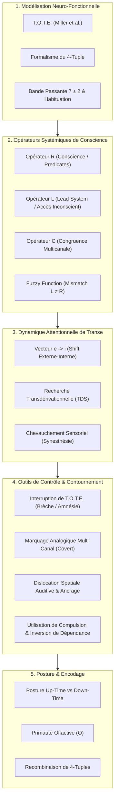
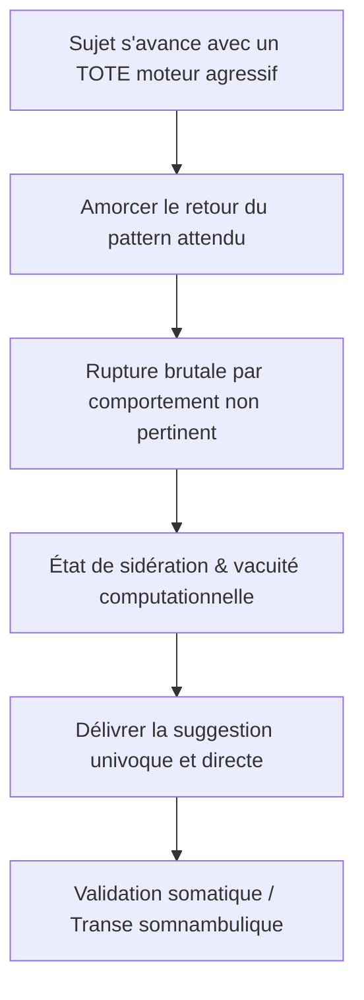

# Patterns of the Hypnotic Techniques of Milton H. Erickson Vol 2
**Formateur :** Grinder, DeLozier & Bandler | **ID :** `grinder-delozier-bandler-patterns-of-the-hypnotic-techniques-of-milton-h-erickson-vol-2` | **Tranches :** 18

## Synthèse Architecturale du Cours : *Patterns of the Hypnotic Techniques of Milton H. Erickson, Vol. II*
**Auteurs & Modélisateurs :** John Grinder, Judith DeLozier & Richard Bandler

---

### 1. Thèse Centrale & Philosophie du Cours

#### Posture et Démarche Épistémologique (Grinder, DeLozier & Bandler vs Approche Standard)
L'approche standard de l'hypnose (qu'elle soit classique/autoritaire ou ericksonienne orthodoxe) traite la transe comme un état mystique, un sommeil artificiel, un rituel suggestif ou un ensemble de métaphores intuitives. Grinder, DeLozier et Bandler effectuent une rupture épistémologique totale : **ils dépouillent l'œuvre d'Erickson de tout contenu pour n'en extraire que la syntaxe mathématique et neuro-computationnelle**.

Leur thèse centrale pose que **l'expérience humaine est un vecteur sensoriel complet (le 4-tuple $\langle V, K, A_t, O \rangle$), traité par un système cybernétique à boucle rétroactive (le T.O.T.E.) sous contrainte sévère de bande passante attentionnelle ($7 \pm 2$ chunks)**. 

La posture des auteurs diffère de la posture clinique classique sur trois points cardinaux :
1. **Refus de l'interprétation sémantique et du contenu :** Les auteurs ne s'intéressent jamais au « pourquoi » psychodynamique du patient, mais exclusivement aux opérateurs formels de traitement de l'information (opérateurs $R, L, C$).
2. **Postulat d'isomorphisme neurologique :** Les phénomènes hypnotiques (catalepsie, amnésie, régression, anesthésie) ne sont pas des anomalies ou des productions artificielles ; ce sont les mécanismes exacts par lesquels le système nerveux apprend, généralise et structure la réalité au quotidien à l'état de veille.
3. **Le praticien comme ingénieur d'aiguillage attentionnel :** Là où le thérapeute standard projette ses propres modèles (état *Down-Time* / dialogue interne / contre-transfert), le modélisateur s'installe dans un état *Up-Time* sensoriel pur pour manipuler les variables d'accès ($L$) et de conscience ($R$) du sujet sans éveiller son filtre critique.

#### Fil Rouge Méthodologique : La Cybernétique du Découplage et de la Réorientation
Le fil conducteur unifiant chaque intervention (de la rupture de poignée de main à l'analgésie ou l'utilisation de compulsions) est **le contournement de l'opérateur de conscience $R$ par le pilotage analogique direct du système d'accès inconscient $L$ et la suspension des programmes automatisés (T.O.T.E.)**.

Toute intervention suit une mécanique universelle en 4 temps :
1. **Calibration & Synchronisation formelle ($Pacing$) :** Se brancher sur la sortie dominante actuelle du sujet (stimuli environnementaux externes $e$, prédicats linguistiques, tempo somatique).
2. **Séquençage ou Découplage ($Fuzzy Function$ / Interruption) :** Révéler ou créer un décalage entre ce qui est perçu consciemment ($R$) et ce qui est activé neurologiquement ($L$), ou briser brutalement un arc moteur balistique (T.O.T.E. Interruption) pour générer une vacuité computationnelle.
3. **Mobilisation Inconsciente ($Leading$ / Recherche Transdérivationnelle - TDS) :** Injecter des stimuli ambigus ou non spécifiques obligeant le système nerveux à plonger dans ses structures profondes (récupération de 4-tuples primaires en mémoire épisodique via le système conducteur).
4. **Stabilisation & Intégration Formelle ($Anchoring$ / Closure) :** Verrouiller la nouvelle configuration par ancrage (postural, tonal, kinesthésique, olfactif) et refermer la boucle T.O.T.E. pour induire une amnésie structurelle spontanée de la brèche.

---

### 2. Carte des Concepts & Leviers Émergents

L'écosystème conceptuel de l'ouvrage s'organise autour de 5 piliers cybernétiques :



#### Définition des Rôles Opératoires dans l'Écosystème :

* **T.O.T.E. (*Test-Operate-Test-Exit*) :** Unité de base du comportement automatisé. Exécuté de manière balistique hors supervision corticale. Sa rupture instantanée crée une vacuité computationnelle totale, laissant le système en état de réceptivité absolue sans résistance.
* **4-Tuple $\langle V, K, A_t, O \rangle$ & Indices $e/i$ :** Formalisation de l'expérience sensorielle humaine (Visuel, Kinesthésique, Auditif tonal, Olfactif/Gustatif). L'indice $e$ désigne l'afférence environnementale directe ; l'indice $i$ désigne les représentations endogènes remémorées ou hallucinées.
* **Bande passante $7 \pm 2$ & Habituation sensorielle :** Principe physique limitant le focus conscient. La conscience ne détecte que la différence ; ce qui est constant est effacé par habituation. L'hypnotiseur sature cette limite ou manipule l'habituation pour forcer l'inconscient à prendre le relais computationnel.
* **Opérateur $R$ (*Representational System*) :** Le filtre attentionnel qui sélectionne ce qui franchit le seuil conscient à l'instant $t$. Identifié dans la communication par les prédicats linguistiques (verbes, adjectifs).
* **Opérateur $L$ (*Lead System*) :** Le canal sensoriel d'accès inconscient utilisé par le système nerveux pour extraire l'information en mémoire profonde (trahi par les accès oculaires et micro-mouvements).
* **« Fuzzy Function » (Incongruité de Forme $L \neq R$) :** Mismatch où le sujet extrait l'information dans un canal ($L$) mais ne conscientise que le résultat terminal dans un autre canal ($R$). Base des phobies et dépressions (« je me sens mal sans savoir pourquoi »).
* **Opérateur de Congruence $C$ :** Vérificateur vectoriel de la direction des signaux sur tous les canaux de sortie simultanés ($C = \text{Oui}$ ou $C = \text{Non}$). Distingue l'incongruence simultanée (deux canaux s'opposent à l'instant $t$) de l'incongruence séquentielle (congruent à $t_1$, congruent à $t_2$, mais contradictoire dans le temps global).
* **Shift Attentionnel Externe $\to$ Interne ($e \to i$) :** Définition formelle de l'induction hypnotique : transition progressive d'un 4-tuple asservi aux stimuli physiques environnementaux ($V^e, K^e, A^e$) vers une boucle autonome de stimuli internes ($V^i, K^i, A^i, O^i$).
* **Recherche Transdérivationnelle (*Transderivational Search - TDS*) :** Mécanisme neurologique réflexe par lequel le cerveau, confronté à une structure de surface ambiguë, non-spécifique ou métaphorique, redescend dans ses structures profondes (expériences primaires) pour y trouver ou reconstruire du sens.
* **Marquage Analogique dans le Système Meneur ($L$) :** Injection d'injonctions ou de balises hypnotiques directement dans le canal d'accès inconscient (via micro-gestes, tonalités, postures) pendant que le conscient ($R$) est occupé par le contenu verbal.
* **Dislocation Spatiale Auditive :** Conditionnement spatial de la voix du praticien (déplacement physique ou orientation d'angle binaurale) pour créer des ancrages inconscients covert non détectables par la censure consciente du sujet (yeux fermés).
* **Primauté Neuro-anatomique du Système Olfactif ($O$) :** Le seul canal sensoriel court-circuitant le relais thalamique avec projection limbique/corticale directe, agissant comme ancre brute irrépressible pour les régressions en âge et les reviviscences somatiques.
* **Stratégie « Up-Time » du Praticien :** État d'attention externe pure ($V^e, A^e, K^e$) dénué de tout dialogue interne ($A^d = \emptyset$). Permet de calibrer en temps réel les micro-indices non verbaux sans être parasité par ses propres interprétations ou projections cognitives.

---

### 3. Tableau Récapitulatif des Techniques & Démonstrations

| Technique / Exercice | Objectif Opératoire | Déclencheur / Indication | Séquence Résumée |
|---|---|---|---|
| **Interruption de T.O.T.E. Moteur & Non-Pertinence** *(Variante Poignée de main / Sujet Hostile)* | Bypasser instantanément une opposition consciente frontale ; provoquer une vacuité computationnelle et une catalepsie réflexe. | Sujet hyper-résistant, rigide, combatif ou affirmant l'impossibilité d'être hypnotisé. | 1. Accepter le défi sans rapport de force et déclencher un T.O.T.E. moteur balistique familier (tendre la main / salutation).<br>2. Briser la trajectoire motrice à mi-parcours (ex: saisir le poignet, dévier l'axe).<br>3. Injecter simultanément un stimulus verbal totalement non-pertinent pour geler le conscient.<br>4. Délivrer la commande hypnotique directe comblant le vide sensoriel.<br>5. *(Option amnésie)* Compléter le mouvement initial à la position spatiale exacte pour refermer l'arc moteur. |
| **Élicitation de l'Équivalence Complexe de la Transe** | Aligner les critères subjectifs du sujet sur la réalité du processus pour neutraliser l'auto-sabotage ou le doute conscient post-induction. | Pré-induction systématique ; sujet anxieux disant « je ne peux pas être hypnotisé car je pense encore ». | 1. Poser la question méta-modèle : « Qu'est-ce qui doit se passer pour que vous sachiez que vous êtes en transe ? ».<br>2. Dériver l'étiquette nominalisée (*Transe*) en ses 4 composantes sensorielles ($V, K, A_t, O, A^d$).<br>3. Repérer les critères irréalistes (ex: suppression totale de $A^d$).<br>4. Recadrer ou intégrer ces critères directement dans les suggestions permissives futures. |
| **Transition Attentionnelle Externe $\to$ Interne ($e \to i$)** | Décrocher progressivement le focus conscient des afférences physiques pour établir une boucle biofeedback endogène autonome. | Phase d'induction standard ; sujets analytiques ayant besoin de valider rationnellement le début de séance. | 1. Pacer 3 à 4 stimuli environnementaux indiscutables ($V^e$ couleur des murs, $A^e$ bruit de la pièce, $K^e$ poids du corps).<br>2. Glisser un truisme d'habituation (la constance sensorielle efface le stimulus conscient).<br>3. Introduire un stimulus intermédiaire à double statut (ex: rythme respiratoire $K^e/K^i$).<br>4. Guider vers des représentations internes exclusives ($V^i$ image remémorée, $K^i$ détente musculaire, $A^i$). |
| **Chevauchement de Systèmes Représentationnels (*Overlap*)** | Étendre la transe, saturer les canaux corticaux et approfondir l'accès inconscient en reliant des modalités sensorielles isolées. | Sujet bloqué dans un seul canal d'accès conscient (ex: visualise bien mais n'éprouve aucune sensation corporelle). | 1. Fixer l'attention sur le système primaire disponible/préféré (ex: $V^i$, voir des vagues).<br>2. Identifier le point de greffe synesthésique logique (le mouvement de la vague implique un son $\to A^i_t$, le son implique l'air marin $\to O^i$, l'air marin touche la peau $\to K^i$).<br>3. Enchaîner les prédicats pour englober la totalité du 4-tuple dans l'expérience interne. |
| **Résolution de la « Fuzzy Function » ($L \neq R$)** | Briser une séquence pathologique automatique hors-conscience (phobie, dépression, angoisse inexpliquée). | Sujet souffrant d'un symptôme kinesthésique intense ($K^i$) déclenché par un accès visuel/auditif inconscient ($V^i/A^d$). | 1. Calibrer les accès oculaires du système $L$ au moment où le sujet décrit son malaise.<br>2. Interrompre la boucle : soit en forçant le conscient ($R$) à percevoir l'image déclenchante ($L \to R$), soit en écrasant $L$ par un ancrage externe kinesthésique/visuel concurrent ($K^e$).<br>3. Réaligner la congruence entre l'entrée d'information et son traitement conscient. |
| **Marquage Analogique Multi-Canal ($Cross-Channel$)** | Déposer des injonctions et ancrages sous le seuil critique conscient tout en maintenant le rapport de surface. | Sujet vigilant, méfiant ou intellectuellement hyper-contrôlant. | 1. Alimenter le canal conscient ($R$, ex: auditif digital ou kinesthésique) avec un discours rationnel/méta.<br>2. Simultanément, surimposer des commandes hypnotiques analogiques dans le canal $L$ inconscient (gestes directionnels, inclinaisons de tête, modulation tonale $A_t$).<br>3. Laisser l'inconscient exécuter l'ordre sans interférence du crible verbal. |
| **Capture & Inversion de Dépendance Compulsive** *(Cas Ericksonien)* | Transformer une résistance active ou une fuite motrice compulsive en catalepsie et réceptivité somnambulique. | Sujet manifestant des compulsions verbales ou motrices incoercibles empêchant la relation thérapeutique classique. | 1. Ne jamais s'opposer à la compulsion ; s'y insérer en devançant le besoin (présenter activement des objets/stimuli insolites).<br>2. Pacer le rythme effréné du sujet jusqu'à obtenir le contrôle de la cadence.<br>3. Introduire des micro-délais et hésitations (*Leading* du tempo vers le ralentissement).<br>4. Créer une suspension motrice où le sujet se retrouve dépendant du stimulus suivant, produisant l'inhibition motrice et la catalepsie. |
| **Induction par Recherche Transdérivationnelle Kinesthésique (TDS)** *(Démonstration du Chariot)* | Provoquer une régression en âge spontanée et une amnésie de réveil par réactivation somatique profonde. | Sujet résistant aux suggestions verbales directes de régression ; recherche de ressources enfouies. | 1. Identifier un micro-comportement moteur ou postural du présent.<br>2. Proposer une structure linguistique de surface hautement non-spécifique (formes d'efforts passés, sensations de tension).<br>3. Forcer le système nerveux à exécuter une TDS à travers tout son stock mnésique pour donner du sens à la sensation.<br>4. Calibrer le *motor spillover* (débordement somatique : posture de l'enfance réactivée physiquement).<br>5. Ancrer l'état ressource sans nommer le souvenir conscient. |
| **Dislocation Spatiale Auditive & Ancrage Covert** | Bâtir des ancrages d'états profonds et contourner la censure auditive consciente à yeux fermés. | Approfondissement de transe, dissociation conscient/inconscient, installation d'amnésie. | 1. Fermer le canal visuel du sujet (yeux fermés).<br>2. Affecter rigoureusement des coordonnées physiques de l'espace à des fonctions distinctes (ex: voix à droite = conscient / apprentissage de surface ; voix à gauche ou penchée = inconscient / transe profonde).<br>3. Déplacer subtilement son corps ou orienter sa voix selon le niveau d'intervention sans changer le volume perçu.<br>4. Réactiver l'état par simple repositionnement physique dans l'angle spatial concerné. |
| **Recombinaison Créative de 4-Tuples** | Installer une nouvelle structure de référence neurologique générative pour les comportements futurs. | Préparation à la performance, phobies, incapacité subjective à concevoir une issue positive. | 1. Isoler et extraire des composantes de 4-tuples issues d'expériences distinctes réelles (ex: le calme de $X$, la précision visuelle de $Y$, la posture motrice de $Z$).<br>2. Guider la synthèse et la recombinaison en transe profonde pour fabriquer un 4-tuple inédit.<br>3. Vérifier le débordement somatique et idéo-moteur (le corps réagit comme à une expérience primaire réelle).<br>4. Pont vers le futur (*future pace*) en liant ce 4-tuple synthétique aux contextes cibles. |

---

## Extractions Détaillées par Tranche (Opératoire & Verbatim)


## --- Tranche 1 / 18 ---

### 1. Mécanismes & Principes Actifs

#### 1. Le TOTE comme Unité Neuro-Comportementale Inconsciente et sa Rupture (TOTE Interruption)
- **Principe actif :** Un TOTE (*Test-Operate-Test-Exit*, concept emprunté à Miller, Galanter & Pribram) représente un programme comportemental automatisé, consolidé et exécuté en dehors de l'attention consciente. Lorsqu'un pattern complexe (ex. serrer la main, lacer ses chaussures, marcher) atteint le statut d'un TOTE unique, le système nerveux l'exécute de façon balistique d'un bloc sans supervision corticale. L'interruption physique ou contextuelle soudaine d'un TOTE en cours d'exécution crée un vide computationnel immédiat : le sujet n'a plus de « prochaine étape » programmée dans son focus conscient. Cette sidération laisse le système nerveux dans un état d'ouverture totale et de vulnérabilité où il accepte sans résistance la première commande claire et congruente qui comble ce vide sensorimoteur.
- **Mécanisme amnésique structurel :** Si le praticien réoriente précisément le sujet à la position spatio-temporelle exacte où le TOTE a été brisé et permet à l'arc moteur de se refermer (en complétant le TOTE), le conscient n'encode aucune discontinuité. L'expérience vécue dans la brèche demeure confinée à l'inconscient, produisant une amnésie spontanée sans suggestion amnésique explicite.
- **Tags émergents :** `#interruption_de_TOTE` `#rupture_balistique` `#vacuite_computationnelle` `#amnesie_structurelle` `#confusion_technique`

#### 2. La Limitation Attentionnelle des "Chunks" ($7 \pm 2$) et l'Habituation
- **Principe actif :** La conscience humaine est limitée par la bande passante du traitement d'information (George A. Miller : $7 \pm 2$ chunks simultanés). La survie et l'apprentissage reposent sur la détection du différentiel sensoriel (*"what each of us as human beings detects with our sensory channels is difference"*). Ce qui demeure constant est effacé de la perception consciente par habituation (inhibition sensorielle/cortex associatif). 
- **Application hypnotique :** L'apprentissage consiste à agréger de multiples bits d'information en méta-chunks (TOTEs inconscients). Pour saturer ou libérer le conscient, le praticien manipule délibérément la taille des chunks et la détection de différences : soit en attirant l'attention sur des constantes habituées (ex. l'emplacement de l'oreille gauche, le contact du fauteuil) pour réorienter le focus, soit en surchargeant la bande passante de micro-décisions non automatisées pour forcer l'inconscient à prendre le relais.
- **Tags émergents :** `#chunking_attentionnel` `#saturation_7_plus_ou_moins_2` `#detection_de_difference` `#habituation_sensorielle`

#### 3. Formalisme du 4-Tuple et Déplacement Attentionnel Interne/Externe ($e \rightarrow i$)
- **Principe actif :** L'expérience primaire totale à tout instant $t$ se modélise par le 4-tuple :
  $$\langle V, K, A_t, O \rangle_i$$
  où $V$ = Visuel, $K$ = Kinesthésique, $A_t$ = Auditif tonal, $O$ = Olfactif, et $i$ = l'index référentiel du sujet.
  La distinction neurologique critique réside dans l'origine du stimulus :
  - Exposant $e$ (*external*) : sensoriel afférent, imposé par l'environnement physique.
  - Exposant $i$ (*internal*) : représentations endogènes, hallucinées, projetées ou remémorées.
- **Dynamique de la transe profonde (*Limited Foci of Attention*) :** L'induction est la transition systématique d'un vecteur dominé par le monde extérieur vers un vecteur dominé par les stimuli internes :
  $$\langle V^e, K^e, A_t^e, O^e \rangle \longrightarrow \langle V^i, K^i, A_t^e, O^e \rangle \longrightarrow \langle V^i, K^i, A_t^i, O^i \rangle$$
  L'état de transe partielle s'établit lorsque les modalités majeures ($V$ et $K$) sont totalement internalisées tandis qu'un canal externe résiduel ($A_t^e$, la voix et le tempo de l'hypnotiseur) est maintenu pour guider le traitement intrapsychique. En transe profonde, les conceptions et mémoires internes deviennent la réalité exclusive de l'inconscient.
- **Tags émergents :** `#4_tuple_structure` `#indexation_externe_interne` `#limited_foci_of_attention` `#boucle_biofeedback_endogene` `#pont_tonal_auditif`

---

### 2. Protocoles, Techniques & Démonstrations (Étape par Étape)

#### Protocole : Induction par Interruption de TOTE Moteur & Nonpertinence (Variante Démonstration / Sujet Hostile)
* **Intention / Indication :** Sujet hyper-résistant, agressif, rigide ou revendiquant l'impossibilité d'être hypnotisé. Utilisable pour bypasser instantanément une opposition consciente frontale.
* **Mise en place & Pré-framing :** Ne pas entrer dans le rapport de force intellectuel ou physique. Accepter tacitement le défi pour amener le sujet à initier une séquence motrice automatisée très investie énergétiquement.



* **Séquence d'actions pas à pas :**
  1. **Bait du pattern :** Se lever lentement à l'approche du sujet, tendre la posture ou le bras comme pour engager la poignée de main convenue, invitant le sujet à lancer son TOTE moteur balistique (ex. poignée de main écrasante).
  2. **Rupture par non-pertinence absolue :** Au moment exact où le sujet tend son bras et alloue son tonus musculaire au contact, dévier brutalement de la trajectoire : se pencher en avant et lacer méthodiquement ses propres chaussures sans un mot. Laisser le sujet avec le bras suspendu dans le vide.
  3. **Vérification du flottement :** Constater l'absence totale de programme alternatif (sidération, confusion cognitive, regard figé, posture bloquée).
  4. **Injection de commande de substitution :** Pendant le nouage du second lacet, délivrer calmement et d'une voix basse, tonale et posée, une séquence de commandes simples adaptées à la situation :
     * *« Just take a deep breath, sit down in that chair, close your eyes, and go deeply into a trance. »*
  5. **Fermeture / Transition :** Le sujet s'exécute par soulagement neurocognitif. Transitionner vers une technique d'approfondissement (ex. lévitation du bras) pour stabiliser le somnambulisme.
* **Signes de calibration :**
  - Bras restant figé en l'air (*catalepsie post-interruption spontanée*).
  - Écarquillement oculaire ou regard dans le vide (*transe d'absence*).
  - Sidération motrice globale (inhibition temporaire des mouvements volontaires).
  - Relâchement musculaire immédiat à la première suggestion vocale compréhensible (*sigh of relief*).

---

### 3. Heuristiques, Subtilités & "Sagesse du Praticien"

#### Heuristiques Conditionnelles
- **Règle de l'Interruption de TOTE :** *Si le sujet initie un pattern moteur automatisé (poignée de main, posture d'attaque, salut) -> alors interromps-le physiquement ou dévie avant la complétion motrice -> car son système nerveux n'a pas de plan conscient de repli et acceptera la première suggestion intelligible.*
- **Règle de l'Omission Amnésique :** *Si tu souhaites une amnésie spontanée sans suggestion post-hypnotique d'oubli -> alors ramène le sujet exactement à la position posturale où le TOTE a été interrompu et laisse-le finir le geste -> car l'arc moteur fermé reclôt la boucle et efface la transe intercalée du focus conscient.*
- **Règle du Passage $e \rightarrow i$ :** *Si le sujet s'accroche aux stimuli externes distrayants -> alors utilise le canal résiduel $A_t^e$ (tempo, prosodie) pour fixer l'attention sur des processus proprioceptifs ou des images internes -> car les stimuli internes sont intégralement contrôlables par le guidage, contrairement à l'environnement extérieur.*
- **Règle du Défi Opposé :** *Si un sujet exprime une hostilité véhémente en déclarant « Personne ne peut m'hypnotiser » -> alors traite cette déclaration comme une reconnaissance tacite de la validité de l'hypnose -> utilise sa propre force motrice pour le projeter dans la rupture de pattern.*

#### Pièges Classiques & Erreurs de Débutant
- **Erreur de surcharge de patterns :** Vouloir apprendre ou appliquer 10 patterns hypnotiques à la fois. La saturation consciente empêche l'intégration. **Correction :** Prendre exactement 2 patterns par jour, les pratiquer intensivement jusqu'à ce qu'ils atteignent le statut de TOTE inconscient chez le praticien, puis passer aux suivants.
- **Erreur d'apparat externe :** Compter sur des pendules, lumières ou artefacts extérieurs. Erickson rappelle que l'appareillage n'est qu'un adjuvant mineur à abandonner dès que possible au profit de l'imagerie interne et de la réactivité intrapsychique du sujet.
- **Confusion entre vérité et élégance :** Se demander si un modèle est « vrai » ou « réel ». En modélisation PNL/Ericksonienne, la seule métrique valide est l'utilité et l'élégance (le minimum de distinctions pour un résultat opératoire maximal).

---

### 4. Pépites Verbatim & Patterns Linguistiques (MOT À MOT EN V.O.)

#### Pépite 1 : La Commande d'Urgence Post-Rupture
> "Just take a deep breath, sit down in that chair, close your eyes, and go deeply into a trance."
- **[Analyse du Pattern]** : Enchaînement séquentiel de 4 commandes directes reliées par juxtaposition comportementale. 
  1. *« Just take a deep breath »* : truisme somatique immédiatement exécutable qui déclenche une modification du tonus autonome.
  2. *« sit down in that chair »* : orientation spatiale résolvant la posture ridicule du sujet figé debout.
  3. *« close your eyes »* : coupure délibérée du canal $V^e$ pour forcer l'entrée dans le monde $V^i$.
  4. *« and go deeply into a trance »* : présuppose que la transe est la suite logique et naturelle de la fermeture des yeux, délivrée au moment précis où le système nerveux est en quête de complétion.

#### Pépite 2 : L'Utilisation Intrapsychique face aux Externalités (Erickson)
> "...Too much emphasis is placed upon external factors and the subject's responses to them. Primarily, emphasis should be placed on the intrapsychic behavior of the subject rather than upon the relationship to externalities. At best, apparatus is only an incidental aid, to be discarded at the earliest possible moment in favor of the utilization of the subject's behavior which may be initiated but not developed by the apparatus.. .The utilization of imagery rather than actual apparatus permits the subject to utilize his actual capabilities without being hampered by an adjustment to non essential externalities."
- **[Analyse du Pattern]** : Recadrage de critère opératoire. Erickson délégitime l'usage de stimuli externes rigides en posant une distinction nette entre le déclenchement (*initiated*) et le développement (*developed*). L'utilisation de l'imagerie interne ($V^i, K^i$) supprime le coût cognitif d'adaptation aux bruits de l'environnement, convertissant la focalisation en boucle autonome intrapsychique.

#### Pépite 3 : La Définition de la Réalité en Transe Profonde (Erickson)
> "...the subject in a deep trance functions in accord with the unconscious understandings independently of the forces to which his conscious mind ordinarily responds; he behaves in accordance with the reality which exists in the given hypnotic situation for his unconscious mind. Conceptions, memories, and ideas constitute his reality world; he is in a deep trance. The actual external environment reality with which he is surrounded is relevant only insofar as it is utilized in the hypnotic situation."
- **[Analyse du Pattern]** : Nominalisations multiples (*conceptions, memories, ideas*) transformées en équivalence complexe de la « réalité ». La structure syntaxique isole totalement l'inconscient des forces environnementales, posant que la réalité externe n'a de validité que si elle est absorbée et convertie en carburant pour la situation hypnotique (principe d'utilisation pure).


## --- Tranche 2 / 18 ---

### 1. Mécanismes & Principes Actifs

- **La dynamique de la transe comme bascule de l'externe vers l'interne (`4-tuple shift`) :**
  Dans l'état de veille ordinaire, l'attention oscille continuellement entre stimuli externes ($e$) et internes ($i$). L'induction de transe profonde est modélisée formellement par le passage progressif :
  $$\langle V^e, K^e, A_t^e, O^e \rangle \longrightarrow \langle V^i, K^i, A_t^e, O^e \rangle \longrightarrow \langle V^i, K^i, A_t^i, O^i \rangle$$
  L'état intermédiaire correspond à une transe partielle où le sujet génère des images et sensations internes ($V^i, K^i$), tout en maintenant un canal externe auditif tonal ($A_t^e$) ouvert pour recevoir les intonations et le tempo du praticien. L'attention est « rivetée » sur une boucle de biofeedback interne.
  *Tags :* #shift_externe_interne #4_tuple_formalism #transe_partielle #boucle_biofeedback

- **Les TOTEs anachroniques et réactivations spatiales/temporelles ($TOTE_{t/p}$) :**
  Les réactions interpersonnelles actuelles mélangent continuellement l'expérience sensorielle présente et des programmes comportementaux automatiques (TOTEs) encodés lors d'expériences antérieures avec des coordonnées spatiotemporelles différentes ($t/p$). Une intonation, un froncement de sourcil ou une démarche réactive instantanément le TOTE de l'enfant face à ses parents. Si le praticien n'identifie pas ces réponses inconscientes, elles se transforment en « résistance » ; si elles sont calibrées et dirigées, elles permettent une régression en âge instantanée.
  *Tags :* #tote_anachronique #coordonnees_spatiotemporelles #regression_spontanee #declencheur_analogique

- **La stratégie de perception « Up-Time » du praticien :**
  La conscience humaine est limitée à la capacité de Miller ($7 \pm 2$ chunks). Dès qu'un praticien accède à un souvenir, dialogue intérieur ou analyse interne ($i$), il soustrait des chunks de sa bande passante sensorielle externe. La stratégie *Up-Time* impose au praticien de maintenir son 4-tuple strictement en mode externe :
  $$\langle V^e, K^e, A_t^e, O^e \rangle$$
  afin de capter 100 % des micro-signaux analogiques/non-verbaux émis par le sujet, qui sont le levier exclusif des changements profonds et rapides.
  *Tags :* #strategie_up_time #chunks_attentionnels #calibration_analogique_pure #saturation_sensorielle_externe

- **L'Équivalence Complexe du langage ($A^d \langle V, K, A_t, O \rangle$) :**
  Le langage digital ($A^d$) opère comme un opérateur logique de niveau supérieur sur l'expérience sensorielle. Une nominalisation (ex. « transe », « confiance », « amour ») ne contient aucune donnée sensorielle en soi : elle pointe vers un ensemble spécifique de 4-tuples chez le sujet. Prendre la carte linguistique pour le territoire sensoriel produit l'incompréhension thérapeutique. Obtenir l'équivalence complexe exacte de « transe » pour un sujet permet de caler les suggestions sur ses critères internes de validation.
  *Tags :* #equivalence_complexe #operateur_ad #nominalisation_vers_sensoriel #carte_vs_territoire

- **L'opérateur de conscience $R$ et le Système de Représentation Privilégié :**
  L'opérateur $R$ sélectionne, parmi l'infinité de stimuli traités par l'organisme, la seule variable qui accède à la conscience :
  $$R \langle V, K, A_t, O \rangle \longrightarrow \langle \_, K, \_, \_ \rangle$$
  Le prédicat utilisé par le sujet (mots visuels, kinesthésiques, etc.) trahit la variable non-nulle après application de $R$. Synchroniser le langage du praticien sur cette modalité active la boucle de vérification interne du sujet (*pacing* réussi) avant de le guider vers des zones hors de son attention immédiate.
  *Tags :* #operateur_r #systeme_de_representation_privilegie #predicats_sensoriels #selection_attentionnelle

- **Le Principe d'Utilisation inversé (Erickson) :**
  Contrairement à l'induction rituelle standard qui exige une coopération passive ou active préalable, la technique d'utilisation inverse la polarité : le praticien accepte intégralement et coopère sans réserve avec le comportement présenté par le patient, aussi contradictoire, hostile ou agité soit-il. L'énergie de la « résistance » devient le moteur de l'induction.
  *Tags :* #technique_d_utilisation #inversion_de_polarite #assimilation_de_la_resistance #cooperation_radicale

---

### 2. Protocoles, Techniques & Démonstrations (Étape par Étape)

#### Protocole 1 : Élicitation de l'Équivalence Complexe du mot « Transe »
* **Intention / Indication :** Prévenir les échecs d'induction dus à une croyance erronée du sujet sur ce qu'est la transe (ex. « je ne suis pas hypnotisé car j'entends encore vos mots » ou « j'ai encore des pensées »).
* **Mise en place & Pré-framing :** Cadrer la question comme une simple exploration préalable avant toute tentative d'induction formelle.
* **Séquence d'actions pas à pas :**
  1. Poser la question directe d'équivalence complexe : *« How would you know if you were in a trance? »*
  2. Écouter et catégoriser les variables sensorielles du 4-tuple attendu :
     - Suppression du dialogue interne ($A^d = \emptyset$) ?
     - Absence d'images internes ($V^i = \emptyset$) ?
     - Sensation corporelle de relaxation musculaire profonde ($K^i$) ?
  3. Formuler l'induction en intégrant exactement ces conditions sensorielles pour que le sujet s'auto-valide comme « bon sujet hypnotique ».
* **Signes de calibration :** Absence de doute intellectuel ; soupirs ou relâchement musculaire lorsque le critère verbalisé est validé dans l'expérience.

#### Protocole 2 : Induction par Utilisation de l'Hyper-Distractibilité et Intellectualisation (Démonstration Erickson / Cas 1)
* **Intention / Indication :** Patient rigide, hyper-intellectuel, méfiant vis-à-vis du « mysticisme », obsédé par le contrôle et distrait par chaque détail environnemental.
* **Mise en place & Pré-framing :** Valider intégralement son cadre intellectuel. Lui demander d'expliquer en détail tout ce qu'il remarque sans rien omettre, sous prétexte que le praticien a besoin de comprendre parfaitement son fonctionnement.
* **Séquence d'actions pas à pas :**
  1. **Autorisation et prescription de la distraction :** Demander au sujet de verbaliser tous les objets externes observés ($V^e, K^e$).
  2. **Interjections de synchronisation (Pacing externe initial) :** À chaque micro-pause, insérer un mot ou une phrase pointant un objet physique réel de la pièce : presse-papier, classeur, reliures des livres ($V^e$).
  3. **Glissement vers les stimuli somatiques présents ($K^e$) :** Insérer des sensations physiques externes/actuelles : tension des épaules, contact de la chaise, tremblement des mains, poids des pieds.
  4. **Pacing des processus abstraits et internes :** Insérer les phénomènes mentaux : le poids des problèmes, le défilement des pensées, les phénomènes de la vie et de l'émotion.
  5. **Création de la dépendance d'attente (*Expectant Dependency*) :** Ralentir délibérément le débit, faire des pauses suspendues et hésiter avant de terminer une interjection, forçant le patient à attendre passivement la prochaine stimulation verbale du praticien.
  6. **Glissement vers l'expérience interne passive ($V^i, K^i, A^i$) :** Basculer les interjections vers la fatigue, la monotonie de l'environnement, le réconfort de fermer les yeux, la détente d'une respiration profonde et la capacité d'apprentissage passif de l'inconscient.
  7. **Approfondissement direct :** Enchaîner sur une relaxation progressive standard pour stabiliser la transe moyenne.
* **Signes de calibration :**
  - Fixation du regard passant d'un balayage saccadé à un regard flou/défocalisé.
  - Respiration qui s'approfondit et s'aligne sur le rythme des interjections.
  - Ralentissement des mouvements de la tête et réduction des tremblements digitaux.

---

### 3. Heuristiques, Subtilités & "Sagesse du Praticien"

- **Règle du TOTE régressif spontané :**
  *Si* le sujet bascule subitement dans une tonalité vocale, une posture ou un registre lexical enfantin suite à un micro-comportement du praticien, *alors* adopter immédiatement le comportement complémentaire de cette scène d'origine (ex. sourire fier, ton protecteur, surnom) *parce que* le sujet est déjà en régression en âge spontanée et qu'un enfant de cet âge est extrêmement facile à hypnotiser.

- **Règle de sélection des prédicats pour le Pacing :**
  *Si* le sujet s'exprime avec des prédicats kinesthésiques (*feel, warm, touch, callous*), *alors* interdire formellement toute suggestion d'imagerie visuelle interne (*visualize, see, clear*) en début d'induction *parce que* l'opérateur $R$ du sujet bloque l'accès conscient aux autres canaux ; imposer du visuel produit une rupture de rapport et une résistance immédiate.

- **Règle de l'Up-Time du Praticien :**
  *Si* tu ressens le besoin de réfléchir à ta prochaine technique, de te souvenir d'un protocole ou d'analyser ce qui se passe pendant que le client parle, *alors* interromps immédiatement ce dialogue interne ($A^d$) et réinvestis tous tes chunks attentionnels dans la vision et l'écoute externe ($V^e, A_t^e$) *parce que* les signaux inconscients de changement sont émis hors du verbal et se dissipent en une fraction de seconde si l'attention est tournée vers l'intérieur.

- **Règle de l'utilisation de la résistance :**
  *Si* un sujet pose des conditions strictes à son induction (« il faut que ce soit intellectuel », « je remarque tout », « je ne veux pas de mysticisme »), *alors* intégrer ces conditions comme la méthode même de l'induction *parce que* combattre le cadre du client consolide sa défense, tandis que l'adopter à 100 % transforme son opposition en moteur de transe.

- **Règle de la dépendance d'attente (*Expectant Dependency*) :**
  *Si* tu rythmes les pensées d'un sujet hyperactif par des interruptions brèves, *alors* commence à hésiter et à suspendre tes phrases *parce que* l'esprit conscient s'arrête, se met en suspension pour combler le vide, transférant ainsi le contrôle du tempo au praticien.

---

### 4. Pépites Verbatim & Patterns Linguistiques (MOT À MOT EN V.O.)

#### Pépite 1 : Le Pré-framing de l'Absorption Intellectuelle (Erickson / Cas 1)
> "Please proceed with an account of your ideas and understanding, permitting me only enough interruptions to ensure that I understand fully and that I follow along with you. For example, you mentioned the chair but obviously you have seen my desk and have been distracted by the objects on it. Please explain fully."

* **[Analyse du Pattern] :**
  - **Double contrainte permissive :** L'injonction polie (*"Please proceed"*) donne l'illusion d'un contrôle total au patient tout en posant une condition non négociable (*"permitting me only enough interruptions"*).
  - **Recadrage de la distraction en devoir :** Le symptôme perturbateur (être distrait par les objets) est validé comme une évidence (*"obviously you have seen my desk"*) et immédiatement converti en consigne d'exploration (*"Please explain fully"*).
  - **Création du canal de synchronisation :** Les interruptions du praticien sont légitimées comme une preuve de bonne compréhension, préparant le sujet à accepter les futures ruptures de son flot de pensée.

---

#### Pépite 2 : La Cascade d'Interjections de Pacing vers le Leading (Erickson / Cas 1)
> "And that paperweight; the filing cabinet; the pictures on the wall; the changing focus of your eyes as you glance about; the interest of the book titles; the tension in your shoulders; the feeling of the chair; the disturbing noises and thoughts; weight of hands and feet; weight of problems, weight of desk; the stationery stand; the records of many patients; the phenomena of life, of illness, of emotion, of physical and mental behavior; the restfulness of relaxation; the need to attend to one's needs; the need to attend to one's tension while looking at the desk or the paperweight or the filing cabinet; the comfort of withdrawal from the environment; fatigue and its development; the unchanging character of the desk; the monotony of the filing cabinet; the need to take a rest; the comfort of closing one's eyes; the relaxing sensation of a deep breath; the delight of learning passively; the capacity for intellectual learning by the unconscious."

* **[Analyse du Pattern] :**
  - **Glissement d'observables sensoriels à des réalités internes (*Pacing to Leading*) :** Débute par des objets physiques indiscutables ($V^e$ : presse-papier, classeur), bascule vers des sensations corporelles indiscutables ($K^e$ : tension des épaules, contact de la chaise), puis vers des processus internes subjectifs ($K^i$ : fatigue, réconfort du retrait).
  - **Glissement sémantique par homophonie/analogie de concept :** Transition magistrale via le mot *weight* : *"weight of hands and feet"* (poids somatique réel) $\rightarrow$ *"weight of problems"* (poids psychologique abstrait) $\rightarrow$ *"weight of desk"* (poids matériel externe). Ce pont dissout la frontière entre l'externe et l'interne.
  - **Liaison paradoxale et double attention :** *"the need to attend to one's tension while looking at the desk or the paperweight..."* force le système nerveux à diviser son focus entre la vision périphérique externe et la proprioception interne, provoquant une surcharge cognitive.
  - **Saturation par la monotonie et suggestion de fermeture :** L'utilisation de termes désactivateurs (*"monotony"*, *"unchanging"*, *"fatigue"*) prépare la suggestion somatique directe : *"the comfort of closing one's eyes"*.
  - **Recadrage final adapté à l'intellect :** Conclut par *"the delight of learning passively; the capacity for intellectual learning by the unconscious"*, ce qui lève la résistance du sujet en requalifiant l'abandon de contrôle en une compétence intellectuelle supérieure de l'inconscient.


## --- Tranche 3 / 18 ---

Voici l'analyse opératoire intégrale de la tranche 3/18 selon la structure demandée.

---

### 1. Mécanismes & Principes Actifs

#### 1. Transition Externe-Interne Progressive (Vecteur $e \to i$)
- **Principe actif** : L'induction hypnotique est modélisée formellement par le passage d'expériences indexées avec l'exposant $e$ (*externally generated* : perception sensorielle directe de l'environnement) à des expériences indexées avec l'exposant $i$ (*internally generated* : imagerie mentale, ressenti cénesthésique, dialogue interne). En synchronisant d'abord le système nerveux sur des stimuli externes indiscutables ($V^e, K^e, A^e$), le praticien sature l'attention consciente sans résistance (truismes sensoriels), puis déplace insensiblement le focus attentionnel vers des représentations internes ($V^i, K^i, A^i, O^i$). La transe émerge au moment où la boucle sensorielle se détache du champ externe pour devenir autonome au niveau interne.
- **Tags libres** : `#external_to_internal_shift` `#4tuple_indexation` `#sensoriel_vers_hallucinatoire` `#transe_par_deconnexion_externe`

#### 2. Chevauchement de Systèmes Représentationnels (*Representational System Overlap*)
- **Principe actif** : Le système nerveux maintient simultanément tous les canaux sensoriels au niveau inconscient, mais la conscience n'accède souvent qu'à un seul canal à un instant $T$. Pour élargir la conscience ou induire un état modifié sans rupture, le praticien ancre le sujet dans son système préféré/disponible (ex: $V^i$, voir des arbres bouger), puis identifie le point de jonction synesthésique naturel vers un canal non conscientisé (le mouvement des arbres implique le vent, le vent produit un son $\to A^i_t$, le vent provoque une sensation thermique sur la peau $\to K^i$, l'air transporte des odeurs $\to O^i$). Chaque nouvelle variable du 4-tuple est greffée sur la précédente, réquisitionnant ainsi l'intégralité des ressources corticales au profit de l'expérience hypnotique.
- **Tags libres** : `#representational_system_overlap` `#pont_synesthesique` `#saturation_multi_systemique` `#expansion_du_4tuple`

#### 3. Découplage Système Meneur vs Système Représentationnel (*Lead System vs. Rep System Split*)
- **Principe actif** : Grinder, DeLozier & Bandler formalisent deux opérateurs distincts sur le 4-tuple :
  - L'opérateur **$L$** (*Lead System*) : le canal sensoriel par lequel l'information est inconsciemment récupérée et organisée en mémoire neurologique (révélé par les mouvements oculaires et micro-mouvements somatiques).
  - L'opérateur **$R$** (*Representational System*) : le canal par lequel l'information accède à la conscience et s'exprime verbalement (révélé par les prédicats linguistiques : verbes, adjectifs, adverbes).
  - Quand $L \neq R$ (incongruité de forme / fonction floue / *fuzzy function*), le sujet subit le résultat conscient ($R$) sans avoir accès au déclencheur inconscient ($L$). Par exemple, dans la jalousie ou la dépression, le sujet fabrique des images ou des dialogues internes inconscients ($V^i$ ou $A^i_d$ en $L$), ce qui déclenche un effondrement kinesthésique conscient ($K^i$ en $R$). Le sujet dit : « Je me sens mal et je ne sais pas pourquoi ».
- **Tags libres** : `#lead_system_L_operator` `#rep_system_R_operator` `#decouplage_L_R` `#incongruite_formelle` `#fuzzy_functions`

#### 4. Marquage Analogique Hors-Conscience dans le Système Meneur (*Lead System Analog Marking*)
- **Principe actif** : Lorsque le système meneur ($L$) d'un sujet est inconscient (ex: accès visuel immédiat non conscientisé), délivrer des messages ou des suggestions verbales au niveau conscient ($R$) engendre des filtres critiques. En revanche, si le praticien marque analogiquement (gestes, postures, micro-variations spatiales ou tonales) directement dans le canal $L$, l'inconscient reçoit et exécute les commandes sans que la conscience n'ait le moindre moyen de s'y opposer. C'est le fondement technique de l'illusion de "magie" en hypnose.
- **Tags libres** : `#analog_marking_in_lead_system` `#court_circuit_conscient` `#injonction_sous_seuil` `#magie_structurale`

#### 5. Capture & Inversion de Dépendance Compulsive (*Compulsion Utilization & Pacing-Leading of Tempo*)
- **Principe actif** (Cas d'Erickson) : Face à une cliente présentant une compulsion motrice/verbale invincible (besoin irrésistible de commenter chaque objet environnemental pour fuir la relation thérapeutique), toute tentative d'interruption verbale directe échoue. Le praticien s'immisce dans la boucle compulsive en devançant le besoin : il présente activement des objets ou gestes insolites (coupe-papier, lunettes essuyées, buvard déplacé). La cliente est neurologiquement contrainte par sa propre compulsion de réagir aux sollicitations du praticien. Une fois le rythme capté (*pacing* rapide), le praticien ralentit délibérément ses gestes avec des pauses d'hésitation (*leading* du tempo). La dépendance s'inverse : la cliente attend anxieusement le prochain stimulus du thérapeute pour agir, ce qui produit une inhibition motrice massive, prélude immédiat à la catalepsie et au somnambulisme.
- **Tags libres** : `#compulsion_utilization` `#inversion_de_dependance` `#freinage_neurologique` `#inhibition_reciproque`

---

### 2. Protocoles, Techniques & Démonstrations (Étape par Étape)

#### Protocole 1 : Induction par Chevauchement Sensoriel ($V \to A \to K \to O$)
* **Intention / Indication** : Conduire un sujet capable d'une imagerie visuelle interne vive ($V^i$) vers une transe somnambulique profonde sans rupture de continuité.
* **Mise en place & Pré-framing** : Synchronisation initiale établie. Guider le sujet vers une scène visuelle richement détaillée (ex: une forêt d'arbres).
* **Séquence d'actions pas à pas** :
  1. *Fixation et focalisation visuelle* : Faire décrire ou observer les détails visuels jusqu'à stabilité de l'image ($V^i$).
  2. *Point de contact cinétique/moteur vers l'auditif* : Attirer l'attention sur le mouvement naturel dans l'image (le balancement des branches), puis lier le mouvement au son correspondant ($A^i_t$) via une conjonction temporelle :
     > `"...as you watch those trees swaying in the wind, enjoy the sound of the wind rushing through the trees..."`
  3. *Calibration d'accès auditif* : Attendre la validation non verbale inconsciente du canal auditif (léger mouvement de tête, défocalisation oculaire, inclinaison de l'oreille).
  4. *Extension vers le kinesthésique* : Relier la présence du vent au niveau sonore à la sensation tactile thermique sur la peau ($K^i$) :
     > `"...now the sound of the wind rushing through those trees as you watch them sway is quite pleasant,... as pleasant for many people as the refreshing feeling of coolness as the wind blows on your face,... and through your hair..."`
  5. *Extension vers l'olfactif* : Introduire le transport d'odeurs par ce même vent ($O^i$) :
     > `"...breezes which carry the warm pungent odors of fresh-cut grass on a warm summer afternoon..."`
  6. *Verrouillage de la transe* : Le 4-tuple est désormais saturé à 100% de variables internes ($V^i, A^i_t, K^i, O^i$), la seule composante externe restante étant la voix du praticien ($A^e_d$).
* **Signes de calibration** :
  - Étape 1 : Regard défocalisé ou orienté en haut à gauche/droite, respiration haute.
  - Étape 3 : Micro-hochements de tête involontaires, inclinaison de la tête (*telephone posture*), relâchement mandibulaire.
  - Étape 4 : Déglutition, baisse du rythme respiratoire, affaissement des épaules, lissage des traits du visage.

---

#### Protocole 2 : Étalonnage Diagnostique par Questions à Prédicats Présupposés (Diagnostic des Clés d'Accès & du Lead System)
* **Intention / Indication** : Identifier en 5 à 10 minutes les systèmes d'accès ($L$) et de représentation ($R$) du sujet pour éliminer la complexité relationnelle et cartographier les circuits neuronaux utilisables.
* **Mise en place & Pré-framing** : Début de séance. Poser des questions directes et banales en apparence, mais dont le prédicat impose obligatoirement l'accès à un canal sensoriel spécifique par présupposition.
* **Séquence d'actions pas à pas** :
  1. *Test Visuel Éidétique ($V^e$ / $V^i$ mémoire)* :
     - Question : *"De quelle couleur sont les yeux de votre mère ?"* ou *"De quelle couleur est votre voiture ?"*
     - Observer l'accès : Mouvement des yeux en haut à gauche (chez le droitier), ou défocalisation subite avec reprise de fixité.
  2. *Test Visuel Construit ($V^c$)* :
     - Question : *"Pouvez-vous imaginer une vache violette ?"* ou *"De quelle couleur devrais-je peindre ma maison ?"* ou *"Pouvez-vous vous voir avec 18 kilos de moins ?"*
     - Observer l'accès : Mouvement des yeux en haut à droite.
  3. *Test Auditif Interne ($A^i_t$ / $A^i_d$)* :
     - Question : *"Quelle a été la première fois où vous m'avez entendu prononcer votre prénom ?"* ou *"Pouvez-vous entendre de la musique dans votre tête ?"*
     - Observer l'accès : Yeux horizontaux à gauche/droite, ou bas-gauche, tête penchée vers l'épaule (*posture du téléphone*), main portée à la tempe (index tendu).
  4. *Test Kinesthésique ($K^i$)* :
     - Question : *"Votre main droite est-elle plus chaude que votre main gauche ?"* ou *"Vous sentez-vous plus à l'aise maintenant que lorsque vous êtes arrivé ?"*
     - Observer l'accès : Regard en bas à droite, auto-contact physique (main posée sur le torse, la gorge ou la cuisse).
  5. *Comparaison Formelle Prédicat vs Mouvement* : Comparer le canal imposé/exprimé dans la parole ($R$) avec le mouvement oculaire réflexe préalable ($L$). Noter si un décalage structurel apparaît.
* **Signes de calibration** :
  - Mouvements des yeux instantanés précédant la verbalisation (temps de latence neurologique d'accès).
  - Postures asymétriques du corps (tête inclinée, main à l'oreille pour $A$).
  - Respiration (haute et courte pour $V$, médiane pour $A$, abdominale profonde pour $K$).

---

#### Protocole 3 : Traitement d'un Sujet "Impossible" par Utilisation Compulsive & Somnambulisme Rétrospectif (Méthode Erickson)
* **Intention / Indication** : Sujet présentant une résistance compulsive massive, une logorrhée inarrêtable ou une distraction phobique de l'environnement immédiat.
* **Mise en place & Pré-framing** : Ne jamais chercher à calmer le sujet ni à contrecarrer sa compulsion. Valider son cadre en y entrant totalement.
* **Séquence d'actions pas à pas** :
  1. *Pacing ultra-rapide des questions environnementales* : Répondre instantanément et précisément à chaque sollicitation sur les objets du bureau en renvoyant vers un autre objet visualisable (Ex: *"Il est sur le coin du bureau juste derrière l'horloge"*).
  2. *Introduction de stimuli non verbaux imposés* : Présenter un objet inhabituel (coupe-papier), essuyer ses lunettes, ranger l'étui, déplacer le buvard, ouvrir et refermer l'agenda. La compulsion du sujet le force à commenter chaque geste du praticien.
  3. *Ralentissement et hésitation délibérés (*Leading* temporel)* : Exécuter les gestes de plus en plus lentement, avec des pauses d'hésitation marquées. Le sujet s'aligne et freine son propre débit, attendant le geste suivant.
  4. *Établissement de la dépendance expectantielle* : Rendre le sujet totalement dépendant des indications (verbales ou gestuelles) du praticien pour savoir quel sera le prochain objet à commenter.
  5. *Basculement vers la mémoire interne ($V^e \to V^i$)* : Après environ 40 minutes, ordonner : *"Fermez les yeux et nommez de mémoire tout ce que vous avez vu, et faites cela jusqu'à développer un sommeil hypnotique profond."*
  6. *Ratification et approfondissement somnambulique* : Utiliser chaque mot de la mémoire du sujet comme levier de transe :
     > `"And now, 'paperweight' and deeper asleep; and now 'clock,' go even deeper into the trance."`
* **Signes de calibration** :
  - Débit verbal initialement rapide qui s'étire et se cale sur les pauses du praticien.
  - Fixation du regard suspendue aux mains du thérapeute (inhibition motrice).
  - Installation d'une catalepsie spontanée lors des pauses du praticien.

---

### 3. Heuristiques, Subtilités & "Sagesse du Praticien"

#### Heuristiques Conditionnelles (*Si... Alors... Parce que...*)
1. **Règle de l'Incongruité de Forme ($L \neq R$)** :
   - *Si* le sujet regarde systématiquement en haut à gauche ($L = V^i$) avant de dire d'une voix basse « Je me sens déprimé/mal » ($R = K^i$), *alors* le praticien ne doit pas intervenir au niveau du sentiment kinesthésique, *parce que* le sentiment n'est qu'un symptôme passif généré par une image interne ou un souvenir visuel non conscientisé qui pilote le système nerveux à son insu.
2. **Règle du Marquage dans le Système Meneur** :
   - *Si* le système meneur du client est hors de sa conscience (ex: accès visuel inconscient menant à un ressenti kinesthésique), *alors* marquez analogiquement les commandes hypnotiques dans son système meneur (gestes spatiaux précis, indices visuels marqués), *parce que* l'inconscient traitera l'instruction directement sans aucune interférence du filtre critique conscient.
3. **Règle du Pont Synesthésique dans l'Overlap** :
   - *Si* vous voulez faire entrer un sujet très visuel dans un état de transe kinesthésique, *alors* ne lui demandez pas directement de « ressentir de la détente », *mais* faites-lui visualiser un objet en mouvement, passez par le son associé à ce mouvement, puis liez la sensation physique de ce son/mouvement au corps, *parce que* le saut direct $V \to K$ sans transition synesthésique provoque une rupture d'accès ou un échec de la boucle sensorielle.
4. **Règle d'Utilisation des Résistances Compulsives** :
   - *Si* un patient ne peut s'empêcher de commenter les objets du bureau ou de fuir dans des futilités, *alors* devenez le distributeur exclusif des objets qu'il doit commenter, *parce qu'*en prenant le contrôle du flux de sa propre compulsion, vous transformez son comportement d'évitement en un protocole de soumission hypnotique totale.

#### Pièges Classiques & Erreurs de Débutant
- **Erreur du contenu vs. Forme** : Écouter l'histoire que raconte le sujet (ex: Lindsey disant « Je suis déprimée ») et essayer de traiter la « dépression » (le contenu), au lieu de calibrer les mouvements oculaires ($V^i$) et le geste somatique (mains au milieu de la poitrine) qui révèlent la syntaxe du processus neurologique en temps réel.
- **Vouloir stopper une logorrhée de front** : Essayer de faire taire un patient anxieux/compulsif par des ordres directs ou des suggestions de relaxation. Cela augmente l'angoisse et renforce le verrouillage défensif. Il faut saturer et épuiser le pattern en l'utilisant.
- **Généraliser sans vérifier la latéralité** : Appliquer mécaniquement la grille des mouvements oculaires sans calibrer au préalable si le sujet est droitier ou gaucher, ou s'il utilise des stratégies d'accès visuel direct sans mouvement oculaire visible (simple défocalisation pupillaire sur place).

#### Postulats Fondamentaux de Grinder, DeLozier & Bandler
- **Omniprésence inconsciente du 4-tuple** : À chaque instant, l'être humain traite simultanément l'intégralité des canaux sensoriels ($V, K, A, O$) au niveau inconscient ; ce qu'on appelle "conscience" n'est qu'un goulot d'étranglement ultra-réduit sélectionné par l'opérateur $R$.
- **La structure précède le sens** : Le problème d'un client n'est jamais ce qu'il croit être. La souffrance psychologique résulte d'un désalignement structural entre la façon dont l'information est récupérée ($L$) et la façon dont elle est vécue consciemment ($R$). Donner au sujet le choix de son système meneur et de son système de représentation résout le problème de manière généralisée sans analyse de contenu.

---

### 4. Pépites Verbatim & Patterns Linguistiques (MOT À MOT EN V.O.)

#### Pépite 1 : Utilisation de la Compulsion Environnementale
```text
"It is on the corner of the desk just behind the clock."
...
"The minute hand indicates the same numeral as does the desk calendar."
```
- **[Analyse du Pattern]** : *Pacing spatial et surcharge d'attention sélective*. Erickson ne se contente pas de répondre à la question ; il enchâsse dans sa réponse une redirection immédiate vers un deuxième stimulus visuel ("just behind the clock", "desk calendar"). La syntaxe lie deux perceptions externes indiscutables ($V^e \to V^e$) forçant le système visuel de la patiente à balayer l'espace selon les instructions implicites du praticien, capturant la boucle réflexe d'investigation.

---

#### Pépite 2 : Transition Somnambulique Rétrospective
```text
"And now, 'paperweight' and deeper asleep; and now 'clock,' go even deeper into the trance."
```
- **[Analyse du Pattern]** : *Liaison de truismes mnésiques avec commande d'approfondissement direct*. La conjonction "And now" (présupposition temporelle d'immédiateté) accouple un signifiant visuel neutre déjà validé en mémoire avec une suggestion d'approfondissement ("deeper asleep", "go even deeper into the trance"). Erickson transforme les objets de la résistance compulsive en ancres d'amplification somnambulique.

---

#### Pépite 3 : Chevauchement Sensoriel ($V \to A \to K \to O$)
```text
"...as you watch those trees swaying in the wind, enjoy the sound of the wind rushing through the trees..."
```
- **[Analyse du Pattern]** : *Conjonction temporelle subordonnée et commande enchâssée d'accès synesthésique*. La clause subordonnée temporelle *"as you watch..."* valide et maintient l'accès visuel interne ($V^i$), tandis que le verbe d'action direct lié par présupposition *"enjoy the sound of the wind rushing..."* active le basculement obligatoire vers l'auditif tonal interne ($A^i_t$).

```text
"...now the sound of the wind rushing through those trees as you watch them sway is quite pleasant,... as pleasant for many people as the refreshing feeling of coolness as the wind blows on your face,... and through your hair... breezes which carry the warm pungent odors of fresh-cut grass on a warm summer afternoon..."
```
- **[Analyse du Pattern]** : *Empilement de prédicats synesthésiques et truismes universels dérivés*. Utilisation de l'analogie comparative *"as pleasant for many people as..."* pour contourner la résistance critique et introduire le kinesthésique thermique et tactile ($K^i$ : "coolness", "blows on your face"), prolongé immédiatement par une qualification olfactive kinesthésique intense ($O^i$ : "warm pungent odors of fresh-cut grass"). La structure syntaxique sature simultanément les 4 canaux en une seule phrase continue.

---

#### Pépite 4 : Double Lien Thérapeutique & Destruction de Négation
```text
"Yes, in a way there is no way I can help you not to be depressed but at the same time hypnosis can help you."
```
- **[Analyse du Pattern]** : *Dissociation praticien/processus et recadrage par double lien paradoxal*. Le praticien commence par ratifier la croyance négative de la cliente ("Yes... there is no way I can help you not to be depressed"), ce qui annule toute polarité défensive, puis sépare son identité d'intervenant de l'outil hypnotique lui-même via la conjonction d'équivalence "but at the same time hypnosis can help you". Le cerveau conscient de la patiente entre en confusion logique, libérant l'inconscient pour le travail hypnotique.


## --- Tranche 4 / 18 ---

Voici l'extraction opératoire intégrale de la tranche 4/18 selon la structure demandée.

---

### 1. Mécanismes & Principes Actifs

- **Découplage Lead System (Système d'Accès / Conducteur) vs Representational System (Système de Conscience) :**
  - *Principe actif :* Chez de nombreux sujets (notamment en dépression ou phobie), le canal sensoriel par lequel l'information est déclenchée et extraite de la mémoire profonde (le système *Lead*, ici $V^i$ – images internes) est totalement dissocié du canal qui atteint le seuil de conscience du sujet (le système *Représentationnel*, ici $K^i$ – kinesthésique interne). Le sujet ne vit que l'effet terminal (la douleur corporelle ou l'abattement) sans avoir conscience de la séquence interne génératrice ($V^i \rightarrow K^i$). Il subit un processus devenu hors de contrôle parce qu'inconscient.
  - *Tags libres :* `#lead_vs_rep_system` `#fuzzy_function` `#mismatch_sensoriel` `#sequence_neurologique_hors_conscience`

- **Résolution de la « Fuzzy Function » par Réalignement Sensoriel :**
  - *Principe actif :* Une boucle symptomatique dysfonctionnelle repose sur un enchaînement sensoriel automatique non surveillé. Pour briser cette boucle, le praticien dispose de deux voies de bascule :
    1. Basculer la conscience vers le kinesthésique externe ($K^e$) : forcer l'attention sur les stimulations somato-sensorielles réelles et présentes (pression de la chaise, température de l'air, contact peau à peau), ce qui déconnecte instantanément l'ancrage kinesthésique interne généré par l'image négative.
    2. Amener le système conducteur ($V^i$) au niveau conscient : donner au sujet la vision lucide de son cinéma interne inconscient. Dès que l'image devient consciente, le sujet cesse de la confondre avec la réalité et peut commencer à exercer un contrôle volontaire ou un recadrage dessus.
  - *Tags libres :* `#alignement_lead_rep` `#interruption_de_fuzzy_function` `#grounding_kinesique_externe` `#conscientisation_du_lead`

- **Marquage Analogique Multi-Canal (Cross-Channel Pacing & Leading) :**
  - *Principe actif :* Le praticien alimente le canal conscient de la personne pour maintenir le rapport ($R$ = Kinesthésique via des prédicats verbaux de sensation), tout en injectant simultanément des instructions et des ancrages subliminaux directement adressés au système d'accès inconscient ($L$ = Visuel via des postures, gestes ciblés et micro-mouvements faciaux). L'inconscient réagit instantanément et profondément car le message contourne le filtre critique conscient.
  - *Tags libres :* `#marquage_analogique_croise` `#double_canal_r_l` `#surcharge_attentionnelle` `#induction_subliminale`

- **Le Mot comme Ancre de Récupération du 4-Tuple ($R \langle V, K, A_t, O \rangle$) :**
  - *Principe actif :* Le langage ne véhicule pas de sens abstrait en soi ; les mots sont des étiquettes arbitraires qui agissent comme des stimulus d'ancrage déclenchant des configurations d'expériences sensorielles passées (4-tuples stockés dans le système nerveux : visuel, kinesthésique, auditif tonal, olfactif/gustatif). La compréhension linguistique impose neurologiquement une régression et une réactivation de ces traces.
  - *Tags libres :* `#mot_comme_ancre` `#evocation_4_tuple` `#sens_comme_reconstitution_sensorielle`

- **Débordement Moteur et Somatique par Réactivation Complète :**
  - *Principe actif :* Quand un 4-tuple passé est réactivé avec une intensité suffisante au niveau inconscient, l'activation neuro-musculaire associée déborde sur le comportement présent (*motor spillover*). Le sujet réexécute physiquement des schémas d'action moteurs passés, même s'ils sont inadaptés au contexte environnemental immédiat (comme chercher un levier de vitesse inexistant dans une voiture moderne).
  - *Tags libres :* `#debordement_moteur` `#reviviscence_somatique` `#decharge_ideomotrice`

- **Recombinaison Créative de 4-Tuples comme Structure de Référence :**
  - *Principe actif :* Le cerveau traite une construction interne synthétisée (ex: associer l'image d'un cheval et la corne d'un narval pour créer une licorne) avec le même statut de réalité neurologique qu'une expérience primaire vécue. Tout état ou apprentissage combiné en transe devient une structure de référence valide pour guider les comportements futurs.
  - *Tags libres :* `#recombinaison_de_4_tuples` `#structure_de_reference_synthetique` `#equivalence_neurologique_reel_imaginaire`

- **Recherche Transdérivationnelle (TDS) et Double Structure (Surface vs Profonde) :**
  - *Principe actif :* Lorsqu'un message verbal présente des suppressions (*deletions*), le système nerveux du sujet est forcé de scanner sa propre banque de données sensorielles inconscientes pour restaurer la Structure Profonde manquante et donner du sens à la Structure de Surface. Le client projette ainsi obligatoirement sa propre matière dans le cadre posé par l'hypnotiseur.
  - *Tags libres :* `#transderivational_search` `#recuperation_structure_profonde` `#suppression_generatrice`

---

### 2. Protocoles, Techniques & Démonstrations (Étape par Étape)

#### Protocole 1 : Détection & Alignement du Système Conducteur (Cas Lindsey)

* **Intention / Indication :** À utiliser face à des plaintes chroniques "incontrôlables" (dépression diffuse, anxiété sans cause, attaques de panique) où le patient rapporte un état kinesthésique interne destructeur sans en comprendre l'origine.
* **Mise en place & Pré-framing :** Poser une question ouverte d'accès à l'expérience en observant chirurgicalement le micro-comportement sans chercher d'explication narrative.
* **Séquence d'actions pas à pas :**
  1. *Étalonnage du Lead System à l'accès :* Poser la question de contrôle : *"How do you know when you're [problem state] ?"*. Observer le tout premier mouvement réflexe des yeux (ex. regard en haut à gauche = accès $V^i$ mémorisé/eidétique) qui précède systématiquement la réponse verbale.
  2. *Étalonnage du Representational System :* Écouter les prédicats verbaux et la somatisation (ex. mains sur la poitrine, prédicats de ressenti : *"I just feel down"* = $K^i$). Constater la *fuzzy function* ($V^i \rightarrow K^i$).
  3. *Synchronisation (Pacing) sur le canal conscient :* Répondre exclusivement avec des prédicats kinesthésiques calqués sur son modèle du monde pour maintenir le rapport conscient ($R = K$).
  4. *Marquage analogique sur le canal Lead (Leading subliminal) :* Tout en parlant avec des prédicats kinesthésiques, baliser spatialement des instructions avec des ancres visuelles (postures corporelles marquées, gestes précis des mains, expressions faciales découpées) orientées vers son champ visuel pour mobiliser son $V^i$.
  5. *Chevauchement des systèmes (System Overlap) :* Conduire le sujet soit :
     - Option A ($K^e$) : Vers les perceptions somatosensorielles externes directes (contact des pieds, fraîcheur de l'air, chaleur du croisement des jambes).
     - Option B ($V^i$) : Vers la conscientisation progressive de l'image interne source. L'amener à regarder consciemment ce qu'elle visualisait hors conscience (s'imaginer seule, isolée).
  6. *Verrouillage de l'État Modifié :* Transformer cet alignement ($V^i$ ou $K^e$) en une *expérience de référence* stable, redonnant au client le choix opérationnel d'interrompre l'escalade kinesthésique dépressive.
* **Signes de calibration :**
  - Mouvement oculaire saccadé vers le haut à gauche (accès $V^i$) précédant de quelques millisecondes le geste somatique sur la poitrine ($K^i$).
  - Soupir de relâchement et respiration descendante dès que le praticien valide le paradoxe du problème.
  - Disparition de la posture d'abattement corporel dès que l'attention est focalisée sur les points de contact externes ($K^e$) ou sur la visualisation consciente ($V^i$).

---

### 3. Heuristiques, Subtilités & "Sagesse du Praticien"

- **Heuristique du Mismatch Sensoriel :**
  * *Si* un client exprime un symptôme par des prédicats kinesthésiques internes ($K^i$) mais active systématiquement un pattern oculaire visuel ($V^i$) avant chaque prise de parole, *alors* la cause du problème est une séquence non consciente $V^i \rightarrow K^i$. Ne tentez pas de modifier directement l'émotion ($K$), modifiez ou conscientisez l'accès visuel ($V$) qui l'alimente en amont.

- **Règle d'Or de la Transe Individualisée vs Équivalence Complexe du Praticien :**
  * *Piège classique :* Réduire l'hypnose à un rituel mécanique standardisé qui induit un état uniforme, puis déclarer le patient "résistant" s'il ne rentre pas dans cette forme. L'état modifié doit être conçu sur mesure en combinant précisément les opérateurs $\{i, e\}$, $Ad$, $R$ et $L$. Il n'y a pas un état de transe, mais une infinité d'états modifiés utiles.

- **Heuristique de la Validation des Modèles par l'Expérience Sensorielle :**
  * *Si* la généralisation théorique (ex: *"les droitiers regardent en haut à gauche pour le visuel remémoré"*) ne correspond pas à l'observation sensorielle du sujet assis en face, *alors* c'est la théorie qui doit être ajustée, jamais l'être humain.
  * Détecter un désaccord entre le modèle et le sujet prouve deux choses : que le modèle théorique est intégré, mais surtout que le praticien est branché sur l'expérience sensorielle réelle.

- **Heuristique Temporelle d'Erickson (Le Facteur Temps) :**
  * *Erreur de débutant :* Croire au mythe du "regard d'aigle" instantané et exiger d'un sujet qu'il produise un phénomène hypnotique complexe en 2 minutes. Un sujet peut développer des hallucinations visuelles immédiatement mais exiger des dizaines de minutes pour une hallucination auditive. Un sujet exceptionnel peut nécessiter 30 secondes, un autre tout aussi compétent peut demander 300 heures de travail préparatoire avant d'entrer en transe.
  * Tout comportement hypnotique dépend d'un temps d'incubation neuropsychologique incompressible.

- **Heuristique de la Catalepsie comme Indicateur Relatif :**
  * Ne jamais ériger un phénomène hypnotique (comme la catalepsie) en critère universel de profondeur. Certains sujets ne développent jamais de catalepsie même en transe somnambulique profonde ; d'autres la manifestent uniquement en transition ou liée à l'amnésie. L'interprétation d'un signe n'a de valeur qu'au regard de la cohérence comportementale globale de ce sujet spécifique.

---

### 4. Pépites Verbatim & Patterns Linguistiques (MOT À MOT EN V.O.)

```text
Hypnotist: "Yes, in a way there is no way I can help you not to be depressed but at the same time hypnosis can help you."
```
* **[Analyse du Pattern]** :
  - **Double lien thérapeutique et recadrage paradoxal :** Valide d'abord l'impossibilité consciente pour contourner la résistance et l'anxiété de performance de la cliente (*"there is no way I can help you not to be depressed"*), tout en dissociant immédiatement l'opérateur d'aide : ce n'est pas le thérapeute qui fait l'acte magique, mais le processus hypnotique (*"at the same time hypnosis can help you"*).
  - **Démantèlement de l'injonction négative :** Adresse l'absurdité logique de la demande de la cliente ("m'aider à *ne pas* être déprimée") sans la confronter directement, tout en induisant une attente positive.

---

```text
"When I say comfort some past 4-tuple or set of 4-tuples associated with the name comfort is accessed internally. Some feeling, some picture, some sound and some smell are accessed at the unconscious level."
```
* **[Analyse du Pattern]** :
  - **Principe d'évocation transdérivationnelle par ancrage nominal :** L'utilisation du mot abstrait (*nominalisation*) impose neurologiquement au système nerveux de l'auditeur de suspendre l'écoute externe pour sonder sa mémoire expérientielle inconsciente afin de reconstituer les 4 composantes sensorielles ($V, K, A, O$) qui donnent chair au concept.

---

```text
Erickson: "...suddenly saw a red light and sought frantically with his right hand to find the floor shift to put the engine into neutral while his friend watched in amazement. The car was stopped only by the expedient of jamming the brake and turning off the ignition before the author realized that the vividness and extensiveness of his memories about the past trip had extended over into the field of unrecognized associated motor memories."
```
* **[Analyse du Pattern]** :
  - **Démonstration de régression kinesthésique et débordement moteur idéomoteur (*motor spillover*) :** Le récit verbal hyper-détaillé réactive avec une telle fidélité le 4-tuple passé que les schémas moteurs archaïques (passer une vitesse au plancher) prennent le contrôle physique sur l'environnement présent (une voiture avec commande au volant), démontrant l'abolition temporaire de la réalité externe au profit de la structure de référence interne réactivée.

---

```text
"The window was broken."
```
* **[Analyse du Pattern]** :
  - **Suppression transformationnelle (*Deletion*) de Structure de Surface :** Effacement complet de l'agent actif (*qui* a cassé la fenêtre) et de l'instrument (*avec quoi*). Cette structure syntaxique incomplète oblige le système de traitement du receveur à mobiliser la Structure Profonde sous-jacente `PAST (BREAK [someone, window, with something])` en comblant les variables vides par ses propres projections inconscientes.


## --- Tranche 5 / 18 ---

### 1. Mécanismes & Principes Actifs

- **Structure de Surface vs Structure Profonde (*Surface Structure vs Deep Structure*) et Dérivation :**
  Tout énoncé verbal se compose d'une structure de surface (la chaîne acoustique ou écrite perçue) et d'une structure profonde (la représentation sémantique complète et non tronquée de l'événement). La dérivation est l'ensemble des opérations formelles (suppressions, distorsions, généralisations) reliant les deux niveaux. Le système nerveux compense automatiquement les manques de la structure de surface en réactivant la complétude sémantique au niveau inconscient.
  *Tags :* #surface_vs_deep_structure #derivation_transformationnelle #recuperation_semantique #grammaire_generative

- **Recherche Transdérivationnelle (*Transderivational Search - TDS*) :**
  Processus inconscient automatique par lequel le cerveau d'un auditeur, confronté à une structure de surface dont la structure profonde ne contient aucun index référentiel pointant vers lui-même, explore sa propre base de données neurologique pour générer des structures profondes isomorphes où les variables indéfinies sont remplacées par des éléments de sa propre expérience présente ou passée.
  *Tags :* #transderivational_search #index_referentiel_generalise #generation_isomorphe #recherche_inconsciente_de_sens

- **Généralisation Analogique de la Recherche Transdérivationnelle au 4-Tuple :**
  La recherche transdérivationnelle ne se limite pas à la syntaxe verbale ($A_d$), mais s'étend à tous les canaux sensoriels représentés par le 4-tuple : Visuel ($V$), Auditif tonal ($A_t$), Kinesthésique ($K$), et Olfactif/Gustatif ($O$). L'évocation ou la stimulation d'une composante sensorielle quelconque déclenche une recherche analogique interne pour reconstituer le 4-tuple complet associé dans l'histoire du sujet.
  *Tags :* #4_tuple_analogique #tds_multimodale #systeme_conducteur_lead #reactivation_sensorielle

- **Primauté Neuro-anatomique du Système Olfactif ($O$) :**
  La modalité olfactive est l'unique voie sensorielle qui ne transite pas par le relais thalamique ; elle projette directement sur le cortex (système limbique / cortex olfactif). En tant que système conducteur (*lead system*) pour une TDS, l'odeur produit une régression en âge et un accès à l'état ressource d'une immédiateté et d'une profondeur somatique insurpassables.
  *Tags :* #olfactory_anchor #court_circuit_thalamique #projection_corticale_directe #regression_en_age_somatique

- **Ancrage comme Stabilisateur et Accès d'États (Ré-induction et Post-hypnose) :**
  Un signal de ré-induction ou une suggestion post-hypnotique n'est pas un ordre abstrait, mais un ancrage spécifique branché sur le 4-tuple de la transe profonde. L'amnésie post-hypnotique s'explique neurologiquement par le fait que ces 4-tuples sont stockés dans un système non représenté consciemment ($\sim R$) par l'opérateur conscient ($R$), créant une dissociation d'accès.
  *Tags :* #ancrage_de_transe #amnesie_structurelle #dissociation_R_nonR #stabilisation_de_ressources

- **Interruption de TOTE (*Test-Operate-Test-Exit*) et Induction Instantanée :**
  Les comportements automatisés de la vie quotidienne (serrer la main, allumer une cigarette, tourner une page) sont des boucles TOTE motrices stables. Interrompre physiquement ou contextuellement un TOTE en cours suspend le traitement conscient : cela génère une dilatation pupillaire, une catalepsie spontanée et une fenêtre de susceptibilité immédiate où une transe profonde peut être induite en une fraction de seconde.
  *Tags :* #interruption_de_tote #rupture_motrice #catalepsie_spontanee #induction_eclair

- **Économie Attentionnelle du Praticien : Up-Time vs Down-Time :**
  Le praticien dispose de $7 \pm 2$ fragments d'attention consciente. Lorsqu'il cherche à comprendre le contenu émotionnel du client ("Down-Time"), il lance sa propre TDS interne, projetant son propre matériel (contre-transfert). En utilisant la grammaire formelle (ex: Méta-Modèle) pour traiter uniquement la syntaxe (ex: suppression), il reste intégralement en "Up-Time", dédié à la calibration des micro-indices analogiques inconscients du sujet.
  *Tags :* #up_time_vs_down_time #attention_7_plus_ou_moins_2 #neutralite_syntaxique #anti_contre_transfert

- **Dislocation Spatiale Auditive et Ancrage Postural Ericksonien :**
  Les micro-déplacements corporels d'un praticien agissent comme des ancres subliminales. Lorsque le sujet a les yeux fermés, la modification de la position corporelle du praticien déplace la source acoustique dans l'espace tridimensionnel ($A_t$). Ce déplacement de phase acoustique est traité par le tronc cérébral et l'inconscient sans jamais franchir le seuil critique du conscient, créant un ancrage covert d'une puissance maximale.
  *Tags :* #dislocation_spatiale_auditive #ancrage_postural #marquage_spatial_covert #micro_deplacement

---

### 2. Protocoles, Techniques & Démonstrations (Étape par Étape)

#### A. Protocole d'Induction par Recherche Transdérivationnelle Kinesthésique (Démonstration du jeune conducteur de chariot)

* **Intention / Indication :**
  Induire une transe somnambulique profonde avec réviviscence et régression spatiotemporelle complète chez un sujet n'ayant jamais été hypnotisé, particulièrement efficace chez les sujets kinesthésiques ou réfractaires aux suggestions verbales directes.
* **Mise en place & Pré-framing :**
  - Faire asseoir le sujet confortablement, immobile.
  - Cadrage théorique explicite : *"De la même façon que l'on peut se souvenir de noms, de lieux, d'objets ou d'événements, on peut se remémorer toute sorte de sensations corporelles physiques."*
* **Séquence d'actions pas à pas :**
  1. **Sélection de la boucle motrice hautement répétée :** Identifier une routine physique familière et sur-apprise du sujet (ex: un trajet régulier de 20 miles en attelage de chevaux).
  2. **Consigne d'accès somatique interne :** Demander au sujet de fermer les yeux et de passer en revue silencieusement, point par point, chaque sensation kinesthésique de son corps en rejouant systématiquement l'événement.
  3. **Amplification des sous-modalités kinesthésiques ($K$) :** Guider l'imagination somatique : sentir la tension des rênes dans les paumes, les secousses de la charrette, la pression du siège sous les cuisses.
  4. **Calibration de l'activité idéomotrice :** Observer l'apparition de micro-mouvements spontanés (posture qui penche, bras qui s'ajustent).
  5. **Vérification de la dissociation / Réviviscence :** Lorsque le corps s'engage pleinement dans l'action (ex: caler les pieds en arrière, tirer sur les rênes pour descendre une pente raide), interroger le sujet au présent : *"Que fais-tu maintenant ?"*
  6. **Gestion de la transe somnambulique :** Laisser le sujet vivre la séquence motrice complète jusqu'à son terme naturel dans sa réalité interne (interdiction d'interrompre de force un blocage interne, laisser le processus moteur se dénouer).
* **Signes de calibration :**
  - Changement tonique postural (dos calé en arrière, pieds en appui).
  - Mouvements idéomoteurs des mains et des épaules (levage fictif de charges, manipulation d'outils).
  - Yeux ouverts sans clignement avec regard fixe non focalisé (transe somnambulique).
  - Réponses verbales laconiques, monocordes, strictement restreintes à l'environnement hallucinatoire présent.

---

#### B. Protocole d'Accès et d'Organisation d'une "Partie Ressource" par Ancrage Verbal et Analogique

* **Intention / Indication :**
  Créer une instance interne stable ("Partie Créative" ou autre) pour un sujet qui manque de choix dans une situation donnée, en réorganisant des 4-tuples de ressources déjà présents dans son histoire.
* **Mise en place & Pré-framing :**
  Partir du principe opérationnel que le client possède déjà toutes les ressources neurologiques requises pour résoudre son problème.
* **Séquence d'actions pas à pas :**
  1. **Requête de recherche transdérivationnelle sérielle :** Demander au sujet d'accéder successivement à 5 moments distincts de son passé où il a manifesté l'état désiré (ex: moments de pure créativité).
  2. **Conduite sensorielle multi-canal :** Pour chaque souvenir, inviter le sujet à réactiver le 4-tuple complet ($V, A_t, K, O$).
  3. **Marquage analogique au pic :** Calibrer l'acmé de chaque état (respiration, tonus musculaire, dilatation pupillaire) et appliquer une ancre spécifique :
     - *Covert :* Contact kinesthésique discret (pression sur le genou/poignet) et/ou modification de posture/tonalité vocale.
     - *Overt :* Étiquetage verbal précis prononcé avec une intonation marquée : *"Cette partie créative"*.
  4. **Création de l'équivalence complexe :** Fusionner ces 5 expériences sous une seule ancre nominale (*"Partie Créative"*), transformant l'ensemble de ces 4-tuples passés en une nouvelle structure de référence pour le futur.
  5. **Test & Utilisation :** Déclencher l'ancre verbale ou kinesthésique dans le contexte problématique pour faire basculer automatiquement la neurologie du sujet dans l'état ressource.
* **Signes de calibration :**
  - Alignement physiologique instantané dès l'évocation du label.
  - Détente musculaire faciale, modification du rythme respiratoire, changement d'état attentionnel.

---

### 3. Heuristiques, Subtilités & "Sagesse du Praticien"

- **Heuristique de l'Index Référentiel Généralisé :**
  *SI* vous souhaitez induire un changement ou suggérer une direction sans susciter de résistance consciente,  
  *ALORS* formulez l'histoire ou l'instruction à l'aide d'un index référentiel non spécifique (*"I had a patient once..."*, *"People can..."*),  
  *PARCE QUE* la structure consciente n'y trouvant aucun ordre la ciblant directement, l'inconscient lance une recherche transdérivationnelle pour substituer ses propres variables, adoptant l'apprentissage de manière autonome et sans friction.

- **Heuristique du Niveau de Transe et de la Précision Métaphorique :**
  *SI* le sujet est en transe légère ou en état vigile ordinaire,  
  *ALORS* maintenez la pertinence de l'histoire juste en périphérie de sa conscience (*"just outside conscious awareness"*).  
  *SI* le sujet est en transe somnambulique profonde,  
  *ALORS* vous pouvez augmenter drastiquement le caractère direct et spécifique de la communication.

- **Heuristique de Préservation du Up-Time face aux Suppressions Syntaxiques :**
  *SI* le client prononce une structure de surface avec suppression syntaxique (ex: *"I'm scared"*),  
  *ALORS* ne cherchez JAMAIS à imaginer ou ressentir sa peur (ce qui vous projetterait en Down-Time et vous ferait rater ses messages analogiques),  
  *MAIS* appliquez mécaniquement le TOTE du Méta-Modèle en interrogeant la forme : *"Scared of what specifically?"*.

- **Heuristique de la Voûte Olfactive :**
  *SI* une régression en âge ou un accès de mémoire affective refuse de s'ouvrir via les canaux $V$ ou $A$,  
  *ALORS* introduisez une ancre olfactive ($O$) liée au contexte passé recherché (ex: odeur d'herbe coupée, couverture d'enfance, nourriture familière),  
  *PARCE QUE* les voies olfactives projettent directement vers le cortex sans filtrage thalamique, déclenchant une réviviscence immédiate et involontaire.

- **Heuristique de l'Interruption de TOTE Quotidien :**
  *SI* un sujet exécute un programme moteur automatisé (serrer la main, fumer, attraper un objet),  
  *ALORS* interrompez brusquement le schéma moteur avant son achèvement,  
  *PARCE QUE* la suspension du TOTE crée un vide attentionnel instantané accompagné de catalepsie du bras et de dilatation pupillaire, prêt à recevoir une suggestion de transe immédiate.

- **Postulat Fondamental d'Erickson, Bandler & Grinder sur les Ressources :**
  Tout individu dispose déjà, dans l'historique de ses 4-tuples neurologiques, de la totalité des états et compétences nécessaires (incluant les hallucinations positives/négatives, l'amnésie, la catalepsie). Le rôle du praticien n'est jamais d'implanter une ressource externe, mais d'utiliser la recherche transdérivationnelle et l'ancrage pour réorganiser des TOTEs inconscients préexistants en une nouvelle configuration fonctionnelle.

---

### 4. Pépites Verbatim & Patterns Linguistiques (MOT À MOT EN V.O.)

> **"You can focus your eyes on the corner of..."**
* **[Analyse du Pattern] :** Index référentiel spécifique direct (*"You"*). La structure profonde cible explicitement le client, activant l'analyse critique et les mécanismes conscients de traitement de l'ordre.

---

> **"I had a patient once..."**
* **[Analyse du Pattern] :** Index référentiel généralisé / Suppression d'index ciblant le sujet. Au niveau de la structure de surface, le sujet n'est pas mentionné, ce qui contourne la barrière critique et force l'inconscient à engager une recherche transdérivationnelle pour mapper la situation du tiers sur sa propre expérience.

---

> **"People can make the most of learning opportunities..."**
* **[Analyse du Pattern] :** Quantification universelle et index non spécifique (*"People"*). L'opérateur modal de possibilité (*"can"*) combiné au nominal flou (*"learning opportunities"*) oblige le sujet à dériver la structure profonde : *"I can make the most out of this learning opportunity"*.

---

> **"A man once sat in that very chair and felt nervous..."**
* **[Analyse du Pattern] :** Ancrage spatial analogique couplé à un index indéfini (*"A man"*). L'utilisation du déictique spatial (*"in that very chair"*) superpose l'expérience somatique de l'inconnu sur les coordonnées kinesthésiques présentes de l'auditeur, déclenchant l'état par résonance transdérivationnelle.

---

> **"A waitress wanted to have an important thing for self..."**
* **[Analyse du Pattern] :** Suppression d'index, nom indéfini (*"an important thing"*) et violation de sélection/suppression réflexive (*"for self"*). L'incomplétude syntaxique force l'auditeur à injecter sa propre valeur la plus significative pour résoudre le sens de la phrase.

---

> **"Now I want you to stay with those feelings,..., in fact intensify those feelings and let yourself drift back to some other occasion on which you had exactly those same feelings."**
* **[Analyse du Pattern] :** Utilisation de la composante kinésique ($K$) du 4-tuple présent comme système conducteur (*lead system*) pour forcer une régression temporelle transdérivationnelle. Enchaînement par conjonctions de coordination et commandes permissives (*"let yourself drift back"*).

---

> **"One of the authors asked the group if they had noticed anyone exceptionally ALERT in the group tonight and they did."**
* **[Analyse du Pattern] :** Marquage analogique tonal (*Analogue Marking*) sous forme de question enchâssée. Le mot *"ALERT"* est accentué par un saut d'amplitude et de tonalité ($A_t$), activant le 4-tuple de vigilance chez les auditeurs fatigués sans délivrer d'injonction consciente directe.


## --- Tranche 6 / 18 ---

Voici l'extraction intégrale et l'ingénierie opératoire de la tranche 6/18 de *Patterns of the Hypnotic Techniques of Milton H. Erickson Vol 2*.

---

### 1. Mécanismes & Principes Actifs

#### 1. Dislocation spatiale de la voix & Ancrage covert à yeux fermés
* **Principe actif :** Lorsque les yeux du sujet sont fermés, le canal visuel cesse de traiter les stimuli externes, sur-amplifiant la sensibilité auditive spatiale (détection de phase binaurale et micro-décalages d'amplitude). Si l'hypnotiseur déplace son corps ou oriente sa voix de manière systématique dans l'espace physique, ce déplacement constitue un stimulus analogique inconscient non verbalisé. Le conscient n'enregistre pas délibérément l'angle d'incidence sonore, mais le système nerveux associe chaque emplacement spatial à un état neurophysiologique précis (ressource vs induction). Cela crée un ancrage spatial auditif indétectable par la censure consciente.
* **Tags :** `#dislocation_spatiale_auditive` `#ancrage_covert` `#binaural_tracking` `#orientation_posturale_systematique`

#### 2. Synchronisation Maximale du Processus Inconscient (Transderivational Search & Anchoring)
* **Principe actif :** La recherche transdérivationnelle (TDS) et l'ancrage ne sont pas des inventions thérapeutiques mais des formalisations pures des mécanismes naturels par lesquels le cerveau fabrique du sens et stabilise des apprentissages à l'état de veille. En appliquant explicitement ces mécanismes sur l'intégralité du 4-tuple ($V, K, A_t, O$) via le système conducteur ($L$), l'hypnotiseur effectue un *pacing maximal* du fonctionnement spontané de l'inconscient. Puisqu'il s'agit d'opérateurs formels (de processus) et non de contenus, ils s'adaptent à une infinité de situations sans risquer de heurter les résistances sémantiques conscientes.
* **Tags :** `#formal_pacing_processus` `#isomorphisme_fonctionnel_inconscient` `#generalisation_4_tuple` `#mecanisme_de_stabilisation`

#### 3. L'Opérateur de Conscience ($R$) et l'Économie Cognitive de Déplétion
* **Principe actif :** À tout instant $t_1$, l'expérience humaine complète est un 4-tuple holistique ($V, K, A_t, O$). L'opérateur $R$ sélectionne quelle composante restreinte franchit le seuil de la conscience (limite de canal de Miller, 7 ± 2 morceaux d'information), reléguant le reste dans $\sim R$ (stocké en mémoire inconsciente non conscientisée). L'incongruence survient quand un canal émetteur (ex: digital auditif $A_d$ ou kinesthésique $K$) exprime un modèle du monde qui n'est pas représenté dans $R$. L'induction hypnotique est définie formellement comme un glissement délibéré de l'opérateur $R$ à travers les systèmes de représentation.
* **Tags :** `#operateur_R` `#filtrage_attentionnel` `#reduction_consciente` `#stockage_parallele_inconscient`

#### 4. L'Opérateur de Congruence ($C$) et la Multiplicité des Modèles
* **Principe actif :** L'opérateur $C$ vérifie la cohérence de sens vectorielle entre tous les canaux de sortie ($A_d, A_t, V, K, O$) à un instant donné.
  * $C = \text{Oui}$ : tous les canaux envoient des messages dont la signification converge.
  * $C = \text{Non}$ : au moins deux canaux véhiculent des messages contradictoires.
  Une incongruence n'est ni un mensonge ni un accident moteur : c'est l'expression motrice simultanée de deux modèles de comportement distincts opérant en parallèle dans le système nerveux.
* **Tags :** `#operateur_C` `#incongruence_simultanee` `#multiplicite_des_parties` `#vectorisation_multicanale`

#### 5. Incongruence Séquentielle vs Incongruence Simultanée & Chaînes T.O.T.E.
* **Principe actif :**
  * *Incongruence séquentielle :* À $t_1$, le client est 100 % congruent pour maigrir ($C_{t1} = \text{Oui}$). À $t_2$, seul devant le réfrigérateur, il est 100 % congruent pour manger ($C_{t2} = \text{Oui}$). Pourtant, sur la durée globale, $C(t_1, t_2) = \text{Non}$.
  * *Déclenchement T.O.T.E. :* La séquence comportementale (T.O.T.E.) de sabotage est dissociée de la conscience et programmée en réponse à une ancre sensorielle interne (image mentale d'aliment $V^i$ ou dialogue interne $A_d^i$) située dans $\sim R$. Parce que le déclencheur est inconscient, la volonté consciente ($R$) est court-circuitée. Pour neutraliser le sabotage, l'hypnotiseur doit forcer l'accès au modèle dissocié pendant la séance, transformant l'incongruence séquentielle en incongruence simultanée traitable en direct.
* **Tags :** `#incongruence_sequentielle` `#declencheur_TOTE_dissocie` `#ancrage_inconscient_compulsif` `#conversion_temporelle_incongruence`

#### 6. Marquage Analogique Multicanal ($A_d / K / A_t$)
* **Principe actif :** Injection simultanée de deux flux d'informations :
  1. Un flux verbal digital conscient ($A_d$), socialement neutre, conversationnel et rassurant.
  2. Un flux analogique caché (pressions kinesthésiques $K$ précises synchronisées avec des inflexions tonales $A_t$) sélectionnant des mots spécifiques.
  Le conscient écoute l'histoire globale (réassurance contre la peur de la transe), tandis que le système somato-sensoriel et l'inconscient extraient la sous-chaîne de 4-tuples balisés par les micro-pressions, exécutant la séquence d'induction sans analyse critique.
* **Tags :** `#marquage_analogique` `#double_communication_parallele` `#surcharge_consciente` `#sequencage_de_4_tuples`

#### 7. Sommation Cumulée d'Indices Minimaux & Intersection de 4-tuples (Le pattern de Bert)
* **Principe actif :** Une idée ou une impulsion hypnotique n'a pas besoin d'être nommée directement. L'évocation répétée de souvenirs disparates partageant un prédicat sous-jacent invariant (dans l'exemple de Bert : la voiture/conduire, sans jamais prononcer « voiture » ni « clé ») active par recherche transdérivationnelle l'intersection des 4-tuples partagés. Cette convergence neurologique inconsciente franchit progressivement le seuil d'émergence dans l'esprit de l'interlocuteur sous forme d'une impulsion spontanée et endogène.
* **Tags :** `#sommation_d_indices_minimaux` `#intersection_de_4_tuples` `#amorcage_associatif_latent` `#emergence_endogene`

---

### 2. Protocoles, Techniques & Démonstrations (Étape par Étape)

#### Protocole 1 : Marquage Analogique Kinesthésique Croisé d'Induction
* **Intention / Indication :** Client congruent verbalement mais présentant un système de représentation kinesthésique hautement valorisé et exprimant une appréhension consciente de l'hypnose.
* **Mise en place & Pré-framing :** Établir une proximité naturelle sans rupture de rapport. Placer les mains de façon contextuellement neutre et détendue sur le corps du sujet : une main sur le genou, une main sur le poignet.
* **Séquence d'actions pas à pas :**
  1. **Phase de Pacing Conscient ($A_d$) :** Débuter une conversation logique portant sur la rassurance, les peurs conscientes et le processus d'apprentissage.
  2. **Extraction de la Chaîne d'Induction :** Concevoir mentalement la séquence ordonnée de 4-tuples nécessaires à la transe :
     $$\text{Entrer en transe} \longrightarrow \text{Confortablement} \longrightarrow \text{Plaisir} \longrightarrow \text{Relaxé} \longrightarrow \text{Fermeture des yeux} \longrightarrow \text{Apprendre} \longrightarrow \text{Clignement/Transe}$$
  3. **Marquage Analogique Synchrone :** Parler de manière fluide. À chaque mot-clé appartenant à la chaîne d'induction, appliquer une brève pression (squeeze) ferme et indolore avec la main sur le genou ou le poignet, couplée à une modulation tonale ($A_t$).
  4. **Exploitation de l'ambiguïté phonétique :** Utiliser l'homophonie (ex: *« I / Eye »*) synchronisée avec le marquage physique pour déclencher la fermeture palpébrale motrice.
  5. **Bouclage opératoire :** Calibrer les micro-mouvements (battements de paupières, respiration) et ratifier immédiatement par suggestion enchâssée.
* **Signes de calibration :** Fermeture spontanée des paupières au mot marqué (*« CLOSED »*), clignement automatique au mot marqué (*« BLINK »*), relâchement des muscles posturaux sous les points de pression (genou/poignet).

#### Protocole 2 : Conversion d'une Incongruence Séquentielle en Incongruence Simultanée
* **Intention / Indication :** Problématiques d'habitudes compulsives (perte de poids, tabagisme, onychophagie) où le client est 100 % motivé en consultation mais sabote systématiquement ses résolutions plus tard dans son environnement.
* **Mise en place & Pré-framing :** Cadrer l'échec passé non comme un manque de volonté, mais comme l'action d'un modèle interne autonome déclenché hors de la conscience.
* **Séquence d'actions pas à pas :**
  1. **Interrogation du Futur / Défi de Polarité :** Poser la question méta-modèle des opérateurs modaux : *« Qu'arriverait-il si vous changiez définitivement aujourd'hui ? »* ou demander au client : *« Faites semblant de ne pas vouloir changer, et expliquez-moi pourquoi vous refusez absolument d'abandonner ce comportement. »*
  2. **Sur-activation du T.O.T.E. de sabotage :** Inviter le sujet à imaginer précisément le contexte du sabotage jusqu'à ce que les micro-indices physiologiques du comportement indésirable émergent.
  3. **Observation Up-Time :** Calibrer l'apparition d'un double message non verbal (hochement de tête négatif, changement de ton, asymétrie corporelle).
  4. **Immobilisation et Pacing Simultané :** Dès que le modèle saboteur se manifeste physiquement en séance, communiquer simultanément avec les deux parties via des canaux distincts (ex: adresser la voix au conscient, adresser le geste/ancrage à la partie inconsciente).
* **Signes de calibration :** Asymétries faciales, micro-mouvements involontaires de la tête (secouement *« non »* pendant un accord verbal), hésitations de tonalité, sensation kinesthésique diffuse non identifiée verbalement (*« C'est juste un feeling, je n'arrive pas à mettre la main dessus »*).

#### Protocole 3 : Induction par Intersection Associative Cumulée (Pattern d'Évocation de Bert)
* **Intention / Indication :** Installer une idée, une action ou une acceptation chez un sujet sans éveiller la moindre barrière critique ni formuler d'ordre direct.
* **Mise en place & Pré-framing :** S'installer dans un cadre conversationnel décontracté (bavardage d'apparence anodine, récits de souvenirs communs, anecdotes vivantes).
* **Séquence d'actions pas à pas :**
  1. **Sélection de la Cible Comportementale :** Définir la cible inconsciente (ex: donner les clés de la voiture).
  2. **Identification du Prédicat Invariant :** Isoler l'élément commun indispensable au comportement cible (ici : les voyages véhiculés, les trajets, les déplacements motorisés).
  3. **Émission Répétée de 4-tuples Satellites :** Raconter successivement 3 à 5 épisodes vifs, très chargés sensoriellement ($V, K, A_t$), contenant tous l'invariant mais en **omettant délibérément** les mots nominatifs clés (*« voiture »*, *« véhicule »*, *« clés »*, *« conduire »*) :
     - *Épisode 1 :* Les préparatifs frénétiques d'un long trajet, l'emballage des valises, le départ sur la route.
     - *Épisode 2 :* L'excursion à la carrière abandonnée, le retour tardif, la fatigue du trajet.
     - *Épisode 3 :* Les repas pris en route entre deux États, l'arrêt à la ferme.
  4. **Attente du Point de Bascule :** Laisser la sommation des indices minimaux converger dans l'inconscient du sujet.
  5. **Émergence et Récolte :** Attendre que le sujet formule lui-même l'idée d'exécuter l'action, persuadé qu'elle émane spontanément de sa propre initiative.
* **Signes de calibration :** Rires partagés, orientation attentionnelle flottante chez le sujet, accès visuels internes non focalisés sur l'environnement immédiat, formulation spontanée de la suggestion par le sujet lui-même.

---

### 3. Heuristiques, Subtilités & "Sagesse du Praticien"

#### Règles Conditionnelles d'Intervention
* **Si** le client a les yeux ouverts, **alors** utiliser des déplacements posturaux et des mouvements corporels visibles pour calibrer/ancrer, **parce que** son inconscient traite l'information par le canal visuel périphérique sans analyse critique.
* **Si** le client a les yeux fermés, **alors** utiliser la dislocation spatiale de la voix (changer systématiquement l'endroit de la pièce ou l'angle d'où l'on s'adresse à lui), **parce que** les variations de localisation auditive sont enregistrées hors de l'attention consciente et constituent un ancrage spatial furtif surpuissant.
* **Si** un client verbalise un objectif ($A_d$) de manière totalement affirmative mais que son corps émet un signal contradictoire (mouvement de tête, altération tonale), **alors** ne jamais se fier exclusivement aux mots et ne jamais l'accuser de mensonge, **parce que** toute incongruence révèle la présence active de deux modèles du monde incompatibles coexistant dans le système nerveux.
* **Si** une visualisation classique (escalier, ascenseur) n'amène qu'une transe légère chez un sujet visuel ($R = V$), **alors** basculer l'opérateur $R$ vers le kinesthésique ($K$) en faisant vivre le déplacement somatique ou la texture, **parce que** le passage radical d'un système de représentation à un autre force une altération profonde de la conscience.
* **Si** le praticien rencontre de la « résistance » chez un sujet, **alors** il doit s'imputer l'échec à lui-même et recalibrer immédiatement son *up-time*, **parce que** la résistance n'existe pas en tant que trait chez le patient : elle est l'incapacité du praticien à détecter les multi-messages et à communiquer simultanément avec toutes les parties en présence.

#### Pièges Classiques & Erreurs de Débutant
* **L'accusation de malhonnêteté (L'erreur du thérapeute de famille) :** Croire qu'un sujet qui hésite ou fait un geste contradictoire ment délibérément. Le débutant simplifie grossièrement la complexité humaine en polarisant « vrai/faux », alors que le sujet subit un conflit interne entre ce qui est dans son $R$ (conscient) et ce qui est refoulé dans son $\sim R$ (kinesthésique inconscient).
* **Croire que la motivation consciente suffit (Le piège de la perte de poids / arrêt du tabac) :** Se contenter de la congruence verbale en cabinet ($t_1$). Dès que la personne quitte le cabinet, l'environnement déclenche l'ancre sensorielle interne ($\sim R$) qui active la chaîne T.O.T.E. de compulsion, écrasant la suggestion post-hypnotique superficielle.
* **La répétition verbale monotone :** Croire que l'hypnose consiste à répéter le même ordre de plus en plus fort. L'opérateur expert utilise l'agencement structural des 4-tuples et le marquage multicanal ($A_d, A_t, K$), bien plus élégant et imparable que le matraquage verbal direct.

#### Postulats Fondamentaux de Grinder, DeLozier & Bandler
* **Validité universelle des communications du sujet :** Toute communication émise par le client — qu'elle soit verbale, posturale ou tonale — est une représentation valide et utile d'une partie de son expérience interne. Aucune manifestation ne doit être rejetée ou ignorée.
* **Limitation structurelle de la conscience :** La conscience humaine est un réducteur de bande passante nécessaire à la survie. Elle ne peut traiter qu'une fraction infime du 4-tuple global. La thérapie et l'hypnose consistent à réorganiser les opérateurs ($R, C, L$) pour redonner du choix là où des représentations dissociées provoquaient l'impasse.

---

### 4. Pépites Verbatim & Patterns Linguistiques (MOT À MOT EN V.O.)

#### Verbatim 1 : L'Induction par Marquage Analogique Kinesthésique (Ms P.)
> **Hypnotist :** *"Ms P. You have expressed some fear about your ability to GO INTO A TRANCE and I would like to reassure you COMFORTABLY and with PLEASURE so that you can allow yourself the SATISFACTION OF LEARNING to BEGIN A TRANCE, NOW I want to FEEL RELAXED, and you are not CLOSED to this NOW (her eyes close). Trance will offer (her eyes open) a change to RELAX and LEARN, REALLY LEARN to BLINK (she blinks) and away your problems with..."*
>
> * **[Analyse du Pattern] :**
>   * **Empilement de commandes analogiquement marquées (Embedded Commands) :** Pendant que le message superficiel traite de la rassurance rationnelle face à la peur, les pressions physiques ($K$) marquent phonétiquement une syntaxe impérative sous-jacente autonome : *« GO INTO A TRANCE... COMFORTABLY... PLEASURE... SATISFACTION OF LEARNING... BEGIN A TRANCE, NOW... FEEL RELAXED... CLOSED... RELAX... LEARN, REALLY LEARN... BLINK »*.
>   * **Ambiguïté phonétique par homophonie :** L'expression *« I want to FEEL RELAXED, and you are not CLOSED to this NOW »* glisse sur le plan auditif inconscient vers *« Eye closed now »*. La synchronisation de la pression kinesthésique à cet instant précis contourne l'esprit critique et entraîne l'occlusion motrice réflexe des paupières.
>   * **Double lien temporel & Pacing/Leading somatique :** Dès que le mot *« BLINK »* est marqué et prononcé, le réflexe clignitaire est ratifié comme une preuve que les problèmes s'éloignent, fusionnant un phénomène neurovégétatif spontané avec un recadrage thérapeutique.

#### Verbatim 2 : L'Évocation Associative Latente de Bert (Extrait d'Erickson)
> **Bert (rapporté par Erickson) :** *"[...] mentioned the rush and turmoil of getting everybody dressed and fed and everything packed up for a past vacation trip to northern Michigan... Next he mentioned the fishing, the catching of frogs and a frog-leg dinner, the beach dinner and the sand that the smaller children managed to sprinkle over every item of food, and then the albino frog at the abandoned quarry we had found... Next he described in vivid detail the turmoil of getting everything out of the summer cabin... the locking-up of the cabin, and the hungry tired state we were in when we arrived at Wayne County General Hospital near Detroit where we lived... his brother Lance particularly liked eating Grandma Erickson's fried chicken on the way back to Michigan from Wisconsin... the trip to my brother's farm... packing up, trip, went to see, way out to the old quarry, down to the beach, on the way back to Michigan from Wisconsin..."*
>
> * **[Analyse du Pattern] :**
>   * **Saturation transdérivationnelle par suppression de l'index de référence (Nominal Deletion) :** Bert évoque une cascade de souvenirs hautement agréables dont la structure profonde repose intégralement sur l'usage d'une automobile (*« trip »*, *« packing up »*, *« on the way back »*), tout en omettant délibérément les substantifs directs (*« car »*, *« key »*).
>   * **Intersection d'ancres de 4-tuples :** En activant successivement 5 ou 6 expériences de plaisir dont le dénominateur commun kinesthésique et visuel est le trajet en voiture, le cerveau de l'interlocuteur calcule inconsciemment le point de croisement des 4-tuples.
>   * **Induction d'une impulsion sans commande verbale :** L'idée d'offrir la voiture à Bert émerge 3 fois dans l'esprit d'Erickson avec une netteté croissante, vécue non comme une manipulation subie mais comme une générosité spontanée. Le génie linguistique réside dans l'art d'éveiller l'idée chez l'autre sans jamais lui fournir les mots qui déclencheraient sa défense consciente.


## --- Tranche 7 / 18 ---

Voici l'analyse modélisatrice et opératoire de la tranche 7/18 du cours *Patterns of the Hypnotic Techniques of Milton H. Erickson Vol 2* (Grinder, DeLozier & Bandler).

---

### 1. Mécanismes & Principes Actifs

#### 1. Le Tracking (Pistage d'États par 4-Tuples)
* **Principe actif :** Le système nerveux humain encode toute expérience sous la forme d'un vecteur multi-sensoriel appelé « 4-tuple » : $\langle A_d, A_t, V, K, O \rangle$ (Auditif digital, Auditif tonal, Visuel, Kinesthésique, Olfactif/Gustatif), pondéré par les opérateurs de repérage interne/externe ($e/i$) et l'opérateur de conscience/attention réflexive ($R$). Le « tracking » est l'organisation méthodique du déplacement attentionnel d'un sujet d'un état présent $S_1$ vers un état cible $S_n$ (ex. transe profonde) via un nombre minimal de transitions computationnelles. 
* Le cerveau ne peut pas traiter une phrase ou une question sur une expérience sans activer de manière transdérivationnelle la matrice sensorielle de celle-ci (« *people do what they talk about as they talk about it* »). L'évocation force l'accès somato-sensoriel inconscient, créant l'état désiré avant même qu'un processus conscient d'analyse n'intervienne.
* **Tags :** `#tracking_4tuples` `#transition_diminution_steps` `#transderivational_search` `#acces_sensoriel_synchrone`

#### 2. La Compétition Hémisphérique Contralatérale & Épuisement Attentionnel
* **Principe actif :** Lorsqu'un hémisphère cérébral est saturé par une tâche de récupération et de traitement d'images eidétiques (accès visuel remémoré continu, par exemple le déroulement d'une série télévisée ou d'un film), la bande passante corticale pour le traitement proprioceptif/kinesthésique controlatéral s'effondre.
* Le système kinesthésique du côté corporel relié à cet hémisphère devient anesthésié ou catalepsique par privation d'attention réflexive ($R$). La levée du bras controlatéral induit une catalepsie spontanée sans effort conscient, court-circuitant le contrôle volontaire.
* **Tags :** `#cerebral_competition` `#lateralisation_hemispherique` `#catalepsie_spontanee` `#saturation_eidétique` `#anesthesie_par_distraction`

#### 3. Le Chevauchement de TOTE (Test-Operate-Test-Exit) Kinesthésique (4-Tuple Overlap)
* **Principe actif :** Deux états mentaux subjectivement distants peuvent partager une micro-séquence neuromotrice identique (un TOTE). Par exemple, le mouvement inconscient et automatique de lever la main pour tourner la page d'un livre passionnant partage la même topographie motrice que la lévitation du bras en transe.
* En utilisant un TOTE déjà automatisé dans l'histoire du sujet comme pont kinesthésique, le praticien permet au système nerveux de glisser d'une transe ordinaire (absorption dans la lecture) à une transe formelle sans rupture ni résistance critique.
* **Tags :** `#4tuple_overlap` `#tote_bridging` `#glissement_neuromoteur` `#levitation_derivee`

#### 4. Le Shuffle (Collapsus / Brouillage Temporel d'Encadrement de Transe)
* **Principe actif :** En accédant et en ancrant séparément l'état $S_{\text{before}}$ (la milliseconde précédant l'entrée en transe) et l'état $S_{\text{after}}$ (la milliseconde suivant immédiatement la transe), puis en activant ces deux ancres alternativement et simultanément, le système cognitif se trouve piégé dans un paradoxe temporel.
* Pour aller de "juste avant" à "juste après", le cerveau est obligé d'exécuter l'espace interstitiel : la transe profonde elle-même. La simultanéité des ancres force l'écroulement dans l'état intermédiaire.
* **Tags :** `#the_shuffle` `#encadrement_temporel` `#ancre_croisee_interstitielle` `#induction_par_vide_structurel`

#### 5. Construction de 4-Tuples (Synthèse Composite de Ressources Inexistantes)
* **Principe actif :** Lorsqu'un sujet ne possède pas dans son histoire l'expérience cible configurée pour un contexte donné (ex. l'assertivité envers une figure d'autorité), son système nerveux possède néanmoins les composantes sensorielles isolées ($V, K, A_t$) vécues dans d'autres contextes.
* En élicitant, extrayant et ancrant chaque sous-modalité séparément (la posture $V$, le timbre de voix $A_t$, le tonus abdominal/respiratoire $K$) à travers différentes anecdotes et en les superposant sur un point de déclenchement unique, le système nerveux synthétise un 4-tuple inédit et fonctionnel.
* **Tags :** `#constructing_4tuples` `#ancrage_composite` `#agregation_de_ressources` `#living_metaphor_test`

#### 6. Double Message Overt / Covert (Séparation Conscient / Inconscient par Canaux $R$ et $\sim R$)
* **Principe actif :** L'esprit conscient focalise son attention réflexive $R$ sur une combinaison restreinte de canaux (typiquement le sens digital des mots $A_d$ et le visuel externe $V_e$). L'inconscient reçoit l'ensemble des stimuli non intégrés par $R$, à savoir $\sim R$ (le ton de la voix $A_t$, les pressions tactiles $K$, le tempo).
* Le praticien congruent divise son message : le canal $R$ maintient le conscient engagé dans une tâche logique ou un souvenir, tandis que les canaux $\sim R$ reçoivent des commandes hypnotiques analogiquement marquées qui s'exécutent directement.
* **Tags :** `#analogue_marking` `#decouplage_R_nonR` `#double_communication` `#saturation_consciente`

---

### 2. Protocoles, Techniques & Démonstrations (Étape par Étape)

---

#### PROTOCOLE 1 : L'Induction par "The Shuffle" (Brouillage par Enjambement Temporel)

* **Intention / Indication :** Induction rapide d'une transe profonde chez un sujet congruent ayant déjà une expérience ou une pré-conception de la transe.
* **Mise en place & Pré-framing :** Présenter l'exercice sous un angle curieux ou technique (les sujets trouvent généralement la terminologie "Before/After" amusante).
* **Séquence d'actions pas à pas :**
  1. **Élicitation du 4-tuple "Juste Avant" ($S_{\text{before}}$) :** Demander au sujet ce qu'il vivrait exactement juste avant de basculer en transe profonde. Explorer systématiquement toutes les variables : Que voit-il ($V$) ? Qu'entend-il ($A_d/A_t$) ? Que ressent son corps ($K$) ?
  2. **Ancrage du $S_{\text{before}}$ :** Poser une ancre verbale ("le Before") et une ancre kinesthésique (ex. pression sur le genou gauche).
  3. **Élicitation du 4-tuple "Juste Après" ($S_{\text{after}}$) :** Demander une description complète de ce qu'il ressent immédiatement en sortant d'une transe profonde (sensations somatiques, clarté visuelle, respiration).
  4. **Ancrage du $S_{\text{after}}$ :** Poser une ancre verbale ("l'After") et une seconde ancre kinesthésique distincte (ex. pression sur le genou droit).
  5. **Séquence d'activation en boucle :**
     - Tirer l'ancre $S_{\text{before}}$ (verbale + kinesthésique).
     - Tirer l'ancre $S_{\text{after}}$ (verbale + kinesthésique).
     - Répéter en inversant brièvement : After -> Before.
     - Déclencher **simultanément** les deux ancres kinesthésiques ($S_{\text{before}} + S_{\text{after}}$).
  6. **Résultat :** Le sujet s'effondre dans l'état intermédiaire qui relie logiquement les deux points : la transe profonde.
* **Signes de calibration :** Regard qui se défocalise, affaissement du tonus musculaire facial, modification du rythme respiratoire, latence motrice lors de la double stimulation.

---

#### PROTOCOLE 2 : Tracking Model I — Single Step Access (Utilisation d'un 4-Tuple Isomorphe Professionnel ou Quotidien)

* **Intention / Indication :** Induction instantanée chez un sujet présentant une concentration extrême dans sa vie quotidienne (chirurgien, sportif, chercheur, lecteur avide).
* **Mise en place & Pré-framing :** Déterminer dans la biographie du client une activité où l'attention consciente est focalisée à 100% sur un point unique, rendant le reste du monde inexistant.
* **Séquence d'actions pas à pas :**
  1. **Sélection de l'expérience ressource :** Identifier le contexte spécifique (ex. la dernière opération chirurgicale réussie du médecin).
  2. **Tâche de réactivation mentale complète :** Donner la consigne de revoir et ré-exécuter intérieurement chaque étape de l'opération avec le même degré d'exigence, de méticulosité et d'attention que lors de l'acte réel.
  3. **Scission conscient / inconscient :** Cadrer explicitement : *"Pendant que votre esprit conscient est totalement absorbé par chaque détail chirurgical, nous allons parler en privé à votre esprit inconscient."*
  4. **Installation de la transe :** La focalisation saturante absorbe immédiatement le conscient ; approfondir les signes physiologiques qui émergent et démarrer le travail thérapeutique.
* **Signes de calibration :** Immobilité corporelle complète, regard fixe ou yeux fermés immobiles, absence de réaction aux bruits de fond de la pièce, modification du tonus musculaire.

---

#### PROTOCOLE 3 : Tracking Model II — Séquençage de 4-Tuples et Pont Kinesthésique (TOTE Overlap)

* **Intention / Indication :** Conduire un sujet d'un état d'éveil normal ($S_1$) vers une transe profonde ($S_n$) via une série d'états intermédiaires fluides partageant des micro-motricités.
* **Mise en place & Pré-framing :** Observer l'activité récente du sujet avant la séance (ex. le sujet lisait un livre en salle d'attente).
* **Séquence d'actions pas à pas :**
  1. **Rappel de l'état externe ($V_e, A_e$) :** Faire valider le souvenir de l'activité préalable (*"Vous souvenez-vous d'avoir lu ce livre en salle d'attente ?"*).
  2. **Passage de l'externe à l'interne ($e \to i$) :** Faire fermer les yeux au sujet et lui demander de voir la première page lue. Réactiver les sous-modalités sensorielles : clarté des mots, odeur du papier, texture de la reliure sous les doigts ($K_i, O_i$).
  3. **Ratification de la surdité/amnésie contextuelle :** Rappeler que lors de cette lecture, il n'a pas vu le thérapeute passer ni entendu les voix autour.
  4. **Activation du pont de chevauchement TOTE ($K$) :** Lier le mouvement de tourner la page ou de se gratter le visage (mouvement inconscient habituel de lecture) au mouvement de lévitation du bras vers le visage.
  5. **Dissociation fonctionnelle :** Suggérer que le bras se soulève pendant que le conscient s'enfonce dans la lecture intérieure, servant de signal informant le praticien que le conscient est parti.
* **Signes de calibration :** Mouvement sacadé et involontaire du bras (micro-sursauts kinesthésiques typiques des réponses idéomotrices), respiration plus ample et synchronisée avec la lévitation.

---

#### PROTOCOLE 4 : Le "Dreaming Arm" pour Enfants (et Adultes Visuels)

* **Intention / Indication :** Transe ultra-rapide chez l'enfant ou le sujet à imagerie eidétique forte, insertion de suggestions sans interférence consciente.
* **Mise en place & Pré-framing :** Attitude complice, ton mystérieux et excité du praticien. Obtenir un engagement secret (*"Promets-moi de ne le répéter à personne"*).
* **Calibration préliminaire critique :**
  - Demander : *"Peux-tu faire une image de la maison où tu habites ?"*
  - Observer les yeux :
    - Yeux vers le **Haut-Gauche** = Traitement eidétique dans l'hémisphère droit (cas standard droitier). Le bras de rêve sera le **bras GAUCHE**.
    - Yeux vers le **Haut-Droite** = Inversion hémisphérique (fréquent chez les gauchers). Le bras de rêve sera le **bras DROIT**.
* **Séquence d'actions pas à pas :**
  1. Identifier le programme télévisé ou le film préféré de l'enfant (ex. *Steve Austin / L'Homme qui valait trois milliards*).
  2. Demander de voir la première scène de l'épisode favori.
  3. Faire fermer les yeux tout en soulevant manuellement le bras controlatéral à l'hémisphère eidétique (ex. bras gauche chez le droitier).
  4. Donner le double lien temporel : *"Ton bras ne redescendra qu'aussi vite que tu regarderas tout l'épisode du début à la fin."*
  5. **Insertion d'une coupure publicitaire ("Psychological Commercial") :** En cours de descente, arrêter doucement le bras dans l'espace (ce qui stoppe le défilement des images intérieures). Insérer la suggestion thérapeutique (ex. : *"À quel point seras-tu surpris de découvrir que ton lit sec est tellement confortable au réveil ?"*).
  6. Relâcher le bras : le film reprend, le bras reprend sa descente lente, et la suggestion est scellée hors de la mémoire consciente.
* **Signes de calibration :** Catalepsie cireuse du bras, descente millimétrique lente, mouvements oculaires rapides sous les paupières closes (REM-like), absence de sursaut tactile lorsque le praticien manipule le bras suspendu.

---

#### PROTOCOLE 5 : Tracking Model III — Construction de 4-Tuples (Synthèse Identitaire)

* **Intention / Indication :** Créer un comportement ou une ressource que le client n'a jamais expérimentée dans le contexte visé (ex. être assertive face à des hommes plus âgés).
* **Mise en place & Pré-framing :** Questionner la nominalisation du problème (*"Que signifie spécifiquement 'être assertive' ?"*).
* **Séquence d'actions pas à pas :**
  1. **Décomposition du 4-tuple cible :** Isoler chaque sous-modalité requise :
     - Quel son/ton de voix précis ($A_t$) ?
     - Quelle sensation corporelle interne ($K$) ?
     - Quelle posture physique et regard ($V$) ?
  2. **Élicitation éclatée des composants dans l'histoire personnelle :**
     - Le sujet admet avoir déjà eu ce ton de voix avec un enfant ou un ami -> **Poser une ancre 1**.
     - Le sujet admet avoir déjà eu cette posture dans un sport ou face à une amie -> **Poser une ancre 2**.
     - Le sujet admet avoir déjà ressenti cette solidité interne dans un autre contexte -> **Poser une ancre 3**.
  3. **Intégration / Consolidation :** Tirer l'ensemble des ancres simultanément pour agréger ces composantes en un 4-tuple unique et unifié ancré kinesthésiquement (ex. contact franc de la main sur le genou).
  4. **Passation de contrôle :** Transférer l'accès de l'ancre au client lui-même.
  5. **Test de provocation en milieu réel ("Living Metaphor") :** Placer le sujet dans une situation imprévue d'attaque ou de confrontation directe (ex. un collaborateur masculin plus âgé surgit et agresse verbalement la cliente).
  6. **Vérification :** Observer si le système inconscient active l'ancre motrice (la main va automatiquement toucher le genou) et fait basculer instantanément la posture, la prosodie et le comportement en mode assertif.
* **Signes de calibration :** Modification immédiate du rythme respiratoire, redressement de la colonne vertébrale, changement du pitch vocal, émergence d'un sourire/amusement face à l'agression.

---

### 3. Heuristiques, Subtilités & "Sagesse du Praticien"

#### 1. Règles Conditionnelles & Décisionnelles (Si... Alors... Parce que...)
* **Si** le sujet présente une configuration oculaire atypique (regard en haut à droite pour l'accès aux souvenirs visuels eidétiques) -> **Alors** lever le bras droit (et non le gauche) pour la catalepsie -> **Parce que** la compétition cérébrale entre traitement visuel eidétique et proprioception s'exerce de façon strictement controlatérale.
* **Si** le sujet est congruent et coopératif -> **Alors** le praticien peut utiliser une approche explicite (overt) où tous les canaux ($A_d, A_t, V, K$) délivrent le même message de façon synchrone.
* **Si** le sujet est incongruent, méfiant ou analytique -> **Alors** utiliser une approche implicite (covert) en saturant le canal $R$ (conscient) avec un sujet anodin tout en marquant analogiquement les commandes dans les canaux $\sim R$ (kinesthésique discret, inflexion de ton).
* **Si** une ancre construite doit tenir dans le monde réel -> **Alors** soumettre le sujet à une "Living Metaphor" (un test écologique in vivo par surprise) -> **Parce que** les auto-évaluations verbales en cabinet ne garantissent pas l'activation automatique sous stress.

#### 2. Pièges Classiques & Erreurs Corrigées
* **L'erreur de l'induction générique imposée :** Vouloir imposer une relaxation à un individu dont la transe naturelle est l'hyper-focalisation active (comme le chirurgien). La règle d'Erickson est de recycler un 4-tuple d'absorption déjà existant dans le système du patient.
* **L'erreur de la métaphore trop transparente :** Illustrée par l'anecdote de Bert Erickson demandant la voiture. Bert a saturé sa narration de voyages et de départs, mais uniquement orientés vers des trajets agréables en famille, rendant la déduction consciente trop évidente pour son père. *Heuristique :* Pour qu'une suggestion ou métaphore opère hors de la conscience, elle doit varier les contextes et inclure des éléments neutres ou divergents (mentionner le garage, l'ami qui vend la voiture, une partie de pêche), évitant la redondance prévisible qui alerte le conscient.
* **La croyance que "le client n'a pas la ressource" :** Un client n'est jamais dépourvu d'une ressource ; il est simplement dépourvu de l'assemblage contextuel de cette ressource. Le praticien ne crée rien ex nihilo, il extrait des pièces détachées sensorielles dans la biographie du sujet et les compile (Modèle III).

#### 3. Postulats Opératoires de Grinder, DeLozier & Bandler
* **Principe d'équivalence motrice et mentale :** Les gens font corporellement ce dont ils parlent au moment où ils en parlent (*"People do what they talk about as they talk about it"*). Un sujet qui évoque de la nourriture salive et bouge la langue ; un sujet qui parle d'asthme s'étouffe et tousse.
* **La transe comme réorganisation minimale :** L'état hypnotique n'est pas une création magique, c'est une transition d'attention allant de la dominance externe ($e$) à la dominance interne ($i$) à travers des chevauchements de chaînes sensorielles.

---

### 4. Pépites Verbatim & Patterns Linguistiques (MOT À MOT EN V.O.)

#### 1. Verbatim : Double Lien Temporel et Absorption Graduelle (Tracking Model II)
> "Now I would like you to close your eyes, and see that book open to the first page you read... and even though the words are not clear as they could be you just keep looking at that book comfortably... watch it closely and as you begin to breath deeper words can become clearer and clearer till you can begin to read that book just as you did before."
* **[Analyse du Pattern] :**
  - *Présupposition temporelle & conjonction subordonnée :* « as you begin to breath deeper words can become clearer » lie un processus physiologique autonome inévitable (respirer plus profondément) à une hallucination kinesthésico-visuelle (la netteté des mots).
  - *Double contrainte permissive :* « even though the words are not clear... you just keep looking comfortably » retire toute pression de performance, éliminant le facteur critique conscient en normalisant l'imperfection du signal initial.

---

#### 2. Verbatim : Amnésie et Dissociation Conscient / Autre Esprit (Tracking Model II)
> "...now when I walked through the outer office you didn't even notice me you were so engrossed in that book... and it is easy to become engrossed in a book so deeply that you don't even hear the sound of those people around you who are talking.. you might even become so engrossed in reading that book that you forget where you are and whom you're with... in fact this book may become another one you get engrossed in even deeper... so deeply engrossed that you lost track of time and your whole world became the world of the book in your... and your conscious mind may continue to read and enjoy that book while your other mind listens to me because you don't have to listen to me... in fact that will make it easier to become totally engrossed in that book your other can lift up one of your hands to your face so that I will know when your conscious mind is gone off reading and your other mind and I are along to get to work on the problem you want to solve..."
* **[Analyse du Pattern] :**
  - *Ratification de transe passée transposée au présent :* Utilisation de l'absorption observée en salle d'attente comme truisme incontestable servant de tremplin à l'amnésie spatio-temporelle.
  - *Répétition incantatoire et saturation lexicale :* Le mot « engrossed » est martelé (6 fois), agissant comme une ancre tonale et sémantique de transe.
  - *Dissociation explicite « conscious mind » vs « your other mind » :* Décharge complète de responsabilité pour l'esprit conscient (« you don't have to listen to me »), ce qui paradoxalement libère l'inconscient pour obéir aux suggestions motrices.
  - *Commande idéomotrice enchâssée :* Lier la lévitation du bras (« lift up one of your hands to your face ») à un signal de validation de la dissociation.

---

#### 3. Verbatim : Ratification du Pont Kinesthésique Inconscient (TOTE Overlap)
> "You can turn the page when you need to... you can scratch your face when it itches... you've done that before without knowing about when you were lost in reading..."
* **[Analyse du Pattern] :**
  - *Utilisation de comportements automatiques habituels (TOTEs) :* Se gratter le visage ou tourner une page sont des actes moteurs exécutés sans décision consciente pendant la lecture.
  - *Effet syntaxique :* Le praticien fusionne ces mouvements involontaires connus avec l'amorce de la lévitation de la main vers le visage, éliminant toute hésitation motrice par assimilation à un automatisme déjà maîtrisé.

---

#### 4. Verbatim : Le Double Lien Éducatif du Bras de Rêve Enfantin
> "Now can you see the first scene of your favorite episode... Now close your eyes... Now you keep watching Steve Austin and allow your arm to go down only as fast as you watch the whole show and the only thing you have to do is to remember just what your favorite part was and tell when you're done... take all the time you need to really enjoy it."
* **[Analyse du Pattern] :**
  - *Double lien classique ericksonien (« only as fast as ») :* Lie la vitesse physique de descente du bras (processus kinesthésique involontaire) à la vitesse mentale de visualisation du film (processus eidétique interne). L'enfant ne peut pas précipiter la descente sans couper son film, ce qui induit une catalepsie rigide ou une descente imperceptible.
  - *Focalisation d'attention saturante :* L'ordre de mémoriser sa partie préférée mobilise l'entièreté de l'attention consciente, laissant la physiologie corporelle totalement sous l'influence du processus hypnotique.

---

#### 5. Verbatim : La "Coupure Publicitaire Psychologique" (Interruption de Pattern)
> "How surprised will you be when you discover your dry bed is so comfortable?"
* **[Analyse du Pattern] :**
  - *Présupposition par question ouverte orientée :* Le fait que le lit soit sec (« dry bed ») et confortable n'est pas soumis à discussion ; la seule variable questionnée est l'intensité de la surprise ressentie (« How surprised will you be »).
  - *Insertion interstitielle :* Placée au moment précis où le bras est figé et le flux eidétique suspendu, la suggestion s'imprime directement dans le système nerveux sans possibilité d'évaluation critique.

---

#### 6. Verbatim : Congruence Multicanale Synchrone (Marquage Analogique Overt)
> "... and your hand is beginning to lift..."
* **[Analyse du Pattern] :**
  - *Isomorphisme vocal et kinesthésique (Ad + At + V + K) :* Le praticien élève le pitch de sa voix sur le mot « lift », lève simultanément sa propre main de façon imperceptible et relâche la pression exercée par sa main sur le genou du sujet au même instant. 
  - *Résultat :* Tous les vecteurs sensoriels envoient une impulsion cohérente et irrésistible de mouvement vers le haut.


## --- Tranche 8 / 18 ---

### 1. Mécanismes & Principes Actifs

* **Multi-Channel Co-Reinforcement (Induction Ouverte Congruente)**
  * *Principe actif* : Lorsqu'un sujet conscient accepte d'entrer en transe, le système nerveux reçoit des flux d'informations simultanés sur l'ensemble de ses canaux sensoriels d'entrée : auditif digital ($A_d$), auditif tonal ($A_t$), kinesthésique ($K$) et visuel ($V$). Lorsque les modulations analogiques (ton, tempo, pression kinesthésique, mouvement visuel) renforcent rigoureusement la sémantique verbale au même instant t, le cerveau traite le signal comme une commande unifiée sans conflit d'information, facilitant l'amplification immédiate de la réponse inconsciente (ex. : lévitation du bras).
  * *Tags* : `#multi_channel_co_reinforcement #analogue_amplification #congruence_induite #4_tuple_synchronicity`

* **Canal Conscient vs Canaux Inconscients ($R$ vs $\sim R$) & Marquage Analogique Covert**
  * *Principe actif* : La conscience humaine est limitée à une fraction restreinte de l'expérience sensorielle globale (le champ de l'opérateur $R$, souvent limité à $A_d$ et $V$). Tout message encodé et marqué sur les canaux situés hors du champ de la conscience active (notés $\sim R$, typiquement $A_t$, $K$, $O$) contourne le filtre critique et l'analyse consciente. Le sujet conscient écoute le contenu digital (histoire, conversation théorique), tandis que son système nerveux intègre les stimulations kinesthésiques et tonales comme des commandes directes d'induction.
  * *Tags* : `#r_operator_bypass #tilde_r_channels #analogue_marking #covert_communication #split_bandwidth`

* **Transformation Séquentielle $\rightarrow$ Simultanée par Ancrage (Collapse de Polarités)**
  * *Principe actif* : L'incongruence séquentielle (une partie du sujet s'exprime de manière congruente au temps $t_1$, puis une partie contradictoire s'exprime au temps $t_i$) protège l'homéostasie du sujet par alternance temporelle. En ancrant le premier état/partie, puis en déclenchant cet ancre précisément pendant que la seconde partie contradictoire s'exprime, le praticien force le système nerveux à traiter deux programmes moteurs et perceptifs incompatibles au même instant. Cette surcharge crée instantanément une confusion profonde et un état de conscience altéré majeur, prêt à être réorganisé.
  * *Tags* : `#sequential_to_simultaneous #incongruence_collapse #anchoring_parts #polarity_collision #profound_confusion_state`

* **Miroir Multi-Canal d'Incongruence Simultanée (Anti-Resistance Pacing)**
  * *Principe actif* : Si un client émet des messages contradictoires (ex. : mots affirmatifs en $A_d$, négation de la tête en $K$/$V$, ton hésitant en $A_t$), chaque canal représente une "partie" valide et réelle de sa structure. La résistance n'est que la conséquence directe d'un praticien qui s'adresse à une partie en négligeant ou contredisant l'autre. En calquant simultanément chaque canal sur le canal récepteur correspondant (répondre verbalement au contenu digital, synchroniser sa voix sur le ton/tempo inconscient, reproduire le mouvement corporel inconscient), le praticien valide l'intégralité du système du sujet. Chaque sous-système se sentant entendu et suivi, la résistance devient neurologiquement impossible.
  * *Tags* : `#multi_channel_mirroring #parts_pacing #anti_resistance_principle #double_triple_take #somatic_rapport`

* **Contraste Méta-Commentaire vs Miroir (Choc d'Insight vs Absorption Hypnotique)**
  * *Principe actif* : Le méta-commentaire verbalise la contradiction inconsciente pour la projeter brutalement dans la conscience ($R$), provoquant un choc cognitif ou un mécanisme de défense. Le miroir hypnotique respecte au contraire la distribution des canaux choisie par le client (conscient/inconscient). Il nourrit l'inconscient dans le canal où il s'exprime sans forcer l'intellectualisation.
  * *Tags* : `#meta_commenting_shock #mirroring_grace #unconscious_respect #channel_integrity`

* **Déclenchement de Polarité par Calibration Inconsciente Subtile (Jeu de Polarité / Rosen Maneuver)**
  * *Principe actif* : Si le praticien adopte le comportement incongruent avec trop d'évidence, la conscience du sujet détecte la manœuvre et bascule brusquement dans la polarité opposée (mise en lumière de la contre-intention refoulée). Si la synchronisation est subtile, elle produit un pacing hypnotique profond. Grinder et Bandler identifient ici le principe opératoire de John Rosen avec les schizophrènes : en épousant si parfaitement le délire ou l'incongruence du sujet, le praticien "ruine sa psychose" en l'obligeant à basculer dans sa polarité saine.
  * *Tags* : `#polarity_play #rosen_maneuver #ruining_psychosis #conscious_detection_threshold`

* **Intersection de TOTEs en Canal Non-Conscient ($\sim R$ TOTE Intersection)**
  * *Principe actif* : Le praticien structure une conversation sur des thématiques qui, sur le plan conscient/visuel ($R$), ne présentent aucun lien logique (ex. : observer un lever de soleil, plonger dans une eau glacée, marcher sur une route poussiéreuse avec du trafic). Cependant, au niveau kinesthésique/somatique inconscient ($\sim R$), les trois séquences partagent le même test de sortie (TOTE) : le réflexe de fermeture des paupières (éblouissement, choc thermique, poussière). Le cerveau valide inconsciemment l'intersection motrice sans en comprendre l'origine cognitive.
  * *Tags* : `#tote_intersection #covert_tote_coupling #kinesthetic_homology #eye_closure_summation`

* **Interruption de Pattern Moteur Automatique (Surprise / Handshake Induction)**
  * *Principe actif* : Une séquence motrice kinesthésique routinière (comme la poignée de main) est stockée sous la forme d'un programme unitaire automatisé. En interceptant physiquement ce geste en plein vol, le praticien vide instantanément la mémoire de travail du client : le programme en cours s'interrompt sans programme de remplacement immédiat. Cette rupture produit une sidération/confusion transitoire où le système nerveux cherche activement une direction, devenant hyper-réceptif à toute suggestion d'induction immédiate.
  * *Tags* : `#pattern_interruption #motor_loop_break #momentary_program_void #confusion_utilization`

* **La Stratégie Up-Time ($R^e$) et les Filtres d'Attention**
  * *Principe actif* : Le praticien limite délibérément l'ensemble de ses 7±2 unités d'attention aux stimuli externes sensoriels présents ($R^e$, sensory-grounded experience), excluant tout dialogue interne ($A_d^i$) ou rêverie visuelle interne ($V^i$). Cela libère 100 % de sa bande passante pour calibrer en temps réel les trois opérateurs critiques du sujet :
    1. $R$-operator : Ce dont le client a conscience (détectable via les prédicats linguistiques).
    2. $L$-operator : Le système conducteur/d'accès utilisé pour mobiliser la mémoire (détectable via les signaux d'accès oculaire et micro-mouvements).
    3. $C$-operator : La congruence ou incongruence des messages émis simultanément ou séquentiellement.
  * *Tags* : `#up_time_strategy #r_e_constraint #sensory_acuity_calibration #r_l_c_operators`

---

### 2. Protocoles, Techniques & Démonstrations (Étape par Étape)

#### Protocole 1 : Conversion d'Incongruence Séquentielle en Simultanée & Utilisation de la Confusion
* **Intention / Indication** : Sujet présentant un conflit interne temporel (au temps $t_1$, il exprime un désir/état avec pleine congruence ; au temps $t_2$, il exprime une objection/comportement contradictoire avec pleine congruence).
* **Mise en place & Pré-framing** : Cadrer un échange standard sans annoncer de confrontation.
* **Séquence d'actions pas à pas** :
  1. *Évocation & Ancrage de la Partie A* : Questionner ou orienter l'attention du sujet pour qu'il manifeste pleinement la première partie ($t_1$). Poser une ancre discrète mais solide (kinesthésique ou tonale, de préférence sur un canal $\sim R$).
  2. *Évocation de la Partie B* : Réorienter le dialogue vers le contexte opposé pour activer pleinement l'autre partie/comportement contradictoire ($t_i$).
  3. *Déclenchement Simultané* : Au pic d'expression de la Partie B, déclencher l'ancre de la Partie A.
  4. *Observation de la Collision* : Laisser le sujet faire l'expérience simultanée des deux signaux incompatibles.
  5. *Utilisation Immédiate de la Confusion* : Enchaîner sur une suggestion d'induction directe ou métaphorique vers une transe profonde, guidant le système à réorganiser ses ressources.
* **Signes de calibration** : Fixité du regard, apnée ou rupture du rythme respiratoire, micro-mouvements antagonistes simultanés (ex. :嘴角 qui monte et sourcil qui se fronce), asymétrie musculaire, dilatation pupillaire signant la surcharge cognitive.

#### Protocole 2 : Pacing Multi-Canal d'Incongruence Simultanée (Le Double/Triple Take Ericksonien)
* **Intention / Indication** : Sujet émettant des messages contradictoires au même instant (ex. : "Oui, je veux changer" dit d'une voix hésitante, avec la tête faisant "non").
* **Mise en place & Pré-framing** : Ne rien relever verbalement (bannir l'analyse d'insight).
* **Séquence d'actions pas à pas** :
  1. *Décomposition Sensorielle Up-Time* : Isoler instantanément les flux émis par le sujet :
     - Flux 1 : $A_d$ (mots employés).
     - Flux 2 : $A_t$ (ton, timbre, débit).
     - Flux 3 : $K/V$ (posture, respiration, hochements de tête).
  2. *Réponse Cloisonnée et Simultanée* :
     - Adresser la réponse verbale ($A_d$) au sens logique des mots du client.
     - Ajuster son propre ton et tempo vocal ($A_t$) pour refléter les qualités de la voix du client.
     - Synchroniser ou répondre corporellement ($K/V$) au mouvement postural/somatique non verbal émis par le client.
  3. *Progression vers le Lead* : Une fois le pacing établi sur chaque canal, modifier progressivement le canal non conscient ($\sim R$) vers l'état désiré (ralentissement respiratoire, voix plus grave, détente musculaire).
* **Signes de calibration** : Disparition de la tension corporelle, synchronisation motrice spontanée du client sur le rythme du praticien (entraînement), signes neurovégétatifs de transe.

#### Protocole 3 : Induction Covert par Intersection de TOTEs Somatiques
* **Intention / Indication** : Sujet résistant ou hyper-rationnel focalisé sur le visuel/verbal ($R = V, A_d$), nécessitant une fermeture des yeux sans ordre direct.
* **Mise en place & Pré-framing** : Engager une conversation informelle sur des récits ou des anecdotes sans rapport direct avec la thérapie.
* **Séquence d'actions pas à pas** :
  1. *Sélection de 4-tuples divergents en surface* : Choisir trois contextes visuellement et sémantiquement dissociés.
  2. *Alignement sur un TOTE moteur commun sous-jacent* : S'assurer que chaque scène implique obligatoirement une réponse motrice identique (ici : fermeture réflexe des yeux pour protection ou confort).
  3. *Narration séquentielle avec marquage analogique* :
     - Contexte 1 : Description de l'observation d'un lever de soleil aveuglant.
     - Contexte 2 : Sensation de plonger d'un coup dans une eau glacée.
     - Contexte 3 : Traversée d'un chemin de terre poussiéreux balayé par le vent et les voitures.
  4. *Sommation Kinesthésique Inconsciente* : Au moment d'évoquer l'élément déclencheur du TOTE dans chaque histoire, marquer analogiquement (baisse du ton, micro-pause, expiration).
* **Signes de calibration** : Clignements réflexes des yeux de plus en plus fréquents, lourdeur palpébrale, fermeture prolongée des paupières, suivi de catalepsie faciale.

---

### 3. Heuristiques, Subtilités & "Sagesse du Praticien"

* **Règles Conditionnelles (Si... Alors... Parce que...)** :
  * *Si* le client émet une contradiction simultanée (ex. mots positifs, tête qui fait non), *alors* renvoie un miroir exact sur les mêmes canaux (mots positifs + tête qui fait non) *parce que* tu paces chaque partie dans son canal d'expression sans forcer un choc défensif.
  * *Si* tu choisis de méta-commenter l'incongruence ("Tu dis oui mais ta tête fait non"), *alors* prépare-toi à gérer un état de choc ou de défense *parce que* tu forces dans le champ de la conscience ($R$) un matériel que le système avait délibérément exclu.
  * *Si* le client détecte consciemment ton miroir non verbal, *alors* prépare-toi à l'émergence soudaine d'une polarité comportementale radicalement opposée (*Playing Polarity*) *parce que* la prise de conscience brise le rapport et active le versant refoulé.
  * *Si* le sujet est congruent au temps $t_1$ puis au temps $t_2$ sur un même sujet avec des comportements incompatibles, *alors* convertis cette incongruence séquentielle en incongruence simultanée par ancrage *parce que* la collision synchrone sature sa structure de tri et génère une transe profonde utilisable.
  * *Si* un client manifeste de la résistance, *alors* ne cherche pas à forcer mais identifie quel canal ou quelle partie tu as échoué à pacer *parce que* la résistance n'est pas une propriété du client, mais un feedback signalant une rupture de pacing d'un de ses canaux.
  * *Si* tu veux implanter une suggestion covert chez un sujet très attentif aux mots et aux images ($R = A_d, V$), *alors* ancre ou marque analogiquement tes commandes sur les canaux $\sim R$ (kinesthésique par pression tactile, auditif tonal par inflexion) *parce que* ces canaux sont reçus et exécutés sans filtrage analytique.

* **Pièges Classiques & Erreurs de Débutant** :
  * *Vouloir mirrorer tous les canaux d'un coup sans entraînement préalable* : Risque de paraître grotesque ou d'être repéré par la conscience du sujet. Solution : s'entraîner en atelier à n'imiter qu'un seul canal à la fois (uniquement la respiration, ou uniquement le débit vocal, ou uniquement la posture) avant de les intégrer.
  * *Tomber en Down-Time pendant l'anamnèse* : Commencer à réfléchir intérieurement ($A_d^i$) à la technique qu'on va appliquer, ce qui rend aveugle aux micro-signaux d'accès ($L$) et aux ruptures de congruence ($C$).
  * *Traiter le client incongruent comme une entité unique* : Chercher une logique globale immédiate. L'approche opératoire consiste à considérer chaque ensemble de signaux cohérents sur un canal comme un "client congruent distinct" méritant son propre rapport.

* **Postulats Philosophiques Fondateurs (Grinder, DeLozier & Bandler)** :
  1. *Il n'y a pas d'erreurs en communication, il n'y a que des résultats (outcomes).* Si le sujet se bloque, ce n'est pas une faute mais la réponse exacte au message délivré.
  2. *Toutes les ressources nécessaires au changement sont déjà présentes chez le client.* Le travail du praticien se limite à accéder à ces ressources et à en transférer le contrôle au sujet.
  3. *Le praticien accepte et utilise TOUT ce que le client présente.* Aucune manifestation (tic, dénégation, doute, incongruence) n'est rejetée ; elle est intégrée comme levier d'action.

---

### 4. Pépites Verbatim & Patterns Linguistiques (MOT À MOT EN V.O.)

* **Citation 1**
  > ". . . and your hand is beginning to lift..."
  * **[Analyse du Pattern]** : Présupposition temporelle d'amorce continue (*"is beginning to"*), couplée à un marquage analogique vocal ascendant (montée de pitch sur le mot *"lift"*) synchronisé avec une libération kinesthésique (relâchement de la pression sur le genou du client au même instant). L'inconscient reçoit la commande d'élévation sur trois canaux synchrones ($A_d$, $A_t$, $K$).

* **Citation 2**
  > "I heard you say that you are ready to go into a deep trance and as you said that I noticed that your head was slowly shaking from side to side, . . . I'm a little confused. Could you help me with understanding what you really want?"
  * **[Analyse du Pattern]** : Méta-commentaire typique de thérapie d'insight. Utilise une juxtaposition temporelle descriptive neutre (*"I heard you say... and as you said that I noticed..."*) suivie d'un aveu feint de confusion (*"I'm a little confused"*) qui déplace la responsabilité de la contradiction sur le sujet, provoquant une prise de conscience brutale par rupture du cadre inconscient.

* **Citation 3**
  > "Oh good, I'm glad that you are ready," *(simultanément accompagné par le praticien d'un hochement de tête latéral de gauche à droite)*
  * **[Analyse du Pattern]** : Miroir direct d'incongruence simultanée (double take ericksonien). Le niveau digital verbal ($A_d$) valide le verbal du sujet (*"I'm glad that you are ready"*), tandis que le niveau visuel/moteur ($K/V$) synchronise parfaitement la négation inconsciente du client (hochement de tête de gauche à droite), pacant l'intégralité du système sans résistance.

* **Citation 4**
  > "Rosen so effectively meets the client at his (the client's) model of the world that he (Rosen) ruins the client's psychosis."
  * **[Analyse du Pattern]** : Recadrage conceptuel radical sous forme d'antithèse paradoxale. Démonstration de l'extrême limite du pacing : épouser tellement vite et fort l'incongruence délirante du patient que la fonction homéostatique de sa défense s'effondre, le forçant à manifester la polarité saine opposée.


## --- Tranche 9 / 18 ---

### 1. Mécanismes & Principes Actifs

- **Commutation Stratégique des Opérateurs $A_d$ et $R$ (Génération vs Traitement Linguistique)** :
  Le modèle du 4-tuple ($\langle V, K, A_t, O \rangle$) est régulé par deux opérateurs formels : l'opérateur de référence/attention sélective ($R$) et l'opérateur de dialogue interne/langage ($A_d$). 
  * *Sens de réception/encodage* : $R(A_d\langle V, K, A_t, O \rangle)$. Le sujet reçoit une communication linguistique externe ($A_d$), qui filtre et restreint ensuite ce à quoi son système nerveux accède sensoriellement ($R$).
  * *Sens de production/expression* : $A_d(R\langle V, K, A_t, O \rangle)$. Le sujet porte d'abord son attention consciente sur une modalité sensorielle primaire via $R$ (par exemple le canal Visuel $V$), puis traduit et encode cette fraction d'expérience primaire sous forme de langage ($A_d$), générant des prédicats spécifiques ("je vois", "c'est clair").
  * *Stratégie Up-time* : Notée $R_e(A_d\langle V, K, A_t, O \rangle)$, le sujet organise son système nerveux pour n'amener à la conscience que la portion d'expérience générée par des stimuli sensoriels externes ($R_e$), inhibant l'accès conscient aux boucles internes.
  * *Tags* : `#4_tuple_formal_operators` `#Ad_R_commutation` `#uptime_strategy_syntax` `#linguistic_production_model`

- **Organisation Isomorphe Multi-Niveaux des Patterns Transe (3 Niveaux de Structuration)** :
  L'intervention d'Erickson s'organise rigoureusement sur 3 niveaux d'emboîtement :
  1. *Niveau 1 (Patterns linguistiques atomiques)* : Suppressions, nominalisations, liaisons causales, postulats conversationnels, index de référence non spécifiés.
  2. *Niveau 2 (Classes naturelles de recherche transdérivative)* : Regroupement de ces patterns linguistiques pour piloter l'accès et l'utilisation des 4-tuples ressources du sujet (recherche transdérivative vers des apprentissages passés).
  3. *Niveau 3 (Isomorphisme des séquences de 4-tuples)* : Deux séances en apparence totalement différentes (ex. Monde, patiente expérimentée en thérapie, vs Nick, sujet novice sans expérience) partagent une architecture formelle séquentielle rigoureusement identique.
  * *Tags* : `#three_level_patterning` `#transderivational_search_classes` `#isomorphic_deep_structure`

- **Injonction de Ralentissement / Polarity Play & Bâtiment du Potentiel de Réponse** :
  En interdisant au sujet d'entrer en transe "trop vite" (*"Not quite that fast"*, *"I don't want you to go into a trance too soon"*), le praticien active deux leviers neurologiques :
  * Fractionnement immédiat : interrompre l'accès complet au 4-tuple de transe pour en augmenter la charge et la profondeur lors de la bascule suivante.
  * Présupposition inattaquable : interdire la rapidité présuppose absolument que l'entrée en transe est inévitable et déjà amorcée.
  * *Tags* : `#response_potential_building` `#fractionation_by_delay` `#covert_presupposition_pacing`

- **Recadrage Somatosensoriel des Mouvements Réflexes (Dissociation Conscient / Inconscient)** :
  L'assignation explicite des micro-mouvements saccadés à l'activité inconsciente (*"showing that jerky movement, because your unconscious has allowed your conscious mind to use fluid movement"*) crée une scission fonctionnelle immédiate. Le conscient se voit retirer la responsabilité motrice, ce qui valide physiquement et kinesthésiquement l'installation de la transe catalepsique involontaire.
  * *Tags* : `#conscious_unconscious_dissociation` `#ideomotor_reframing` `#jerky_vs_fluid_polarity`

- **Recouvrement Sensoriel (Overlapping) et Ancrage Temporel Régressif** :
  Transition graduelle d'une modalité sensorielle à une autre pour stabiliser l'accès au 4-tuple : débuter par l'observation visuelle ($L$-opérateur Visuel / souvenir de voir une main se lever), faire chevaucher vers le kinesthésique interne ($R$-opérateur Kinesthésique / sensation de légèreté et de mouvement), puis lier cette sensation physique à une mémoire archaïque d'apprentissage développemental (l'enfant qui apprend à se lever ou découvre sa main).
  * *Tags* : `#sensory_overlapping_V_to_K` `#age_regression_anchor` `#developmental_learning_utilization`

- **Isolation Champ Perceptif & Hallucination Négative Contextualisée** :
  L'instruction *"Now you and I can be all alone here"* combinée à la contrainte motrice croisée induit une hallucination négative (effacement perceptif de la présence des tiers dans la pièce). Le praticien libère ainsi son champ d'action pour interagir avec un observateur (Nick) sans perturber la fixation interne du sujet (Monde).
  * *Tags* : `#negative_hallucination` `#perceptual_isolation` `#field_of_awareness_pruning`

---

### 2. Protocoles, Techniques & Démonstrations (Étape par Étape)

#### Protocole 1 : Induction Croisée par Lévitation Idiomotrice & Régression Développementale

* **Intention / Indication** :
  Induire une transe profonde chez un sujet tout en préparant simultanément un observateur tiers à entrer en transe par contagion/pacing observationnel.
* **Mise en place & Pré-framing** :
  Placer le sujet principal (Monde) et le témoin (Nick) côte à côte. Cadrer l'observateur pour qu'il surveille visuellement les micro-modifications physiologiques du sujet principal, activant son propre dialogue inconscient.
* **Séquence d'actions pas à pas** :
  1. *Ralentissement / Bâtiment du potentiel* : Poser la commande d'inhibition temporelle (*"take your time about going into a trance"*, *"I don't want you to go into a trance too soon"*).
  2. *Bifurcation attentionnelle sur le tiers* : Se tourner vers le tiers (Nick) et lui ordonner d'observer les changements du visage du sujet (*"watch how Monde's face..."* / *"your unconscious mind will learn a great deal"*).
  3. *Fractionnement kinesthésique* : Revenir au sujet principal au moment où les signes de transe apparaissent et suspendre le mouvement (*"Not quite that fast, Monde. Let's have a little talk first..."*).
  4. *Pacing sensoriel direct & ratification* : Décrire les indices non verbaux qui s'installent (*"And just waiting... That's right... All the way shut"*).
  5. *Orientation sur le $K$-variable (Polarité thermique)* : Guider vers le stock de souvenirs via une modulation thermique spécifique (*"feel the coolness, not too cold... so that you might want it to get just a bit warmer"*).
  6. *Métaphore de régression visuelle ($V$-variable)* : Déployer la métaphore de l'autoroute temporelle (*"traveling a highway, passing this scene, that scene..."*). Réactiver l'accès kinesthésique/visuel pré-verbal (découverte de la station debout, bascule de la tête entre les jambes).
  7. *Amorçage de la Lévitation par Overlapping $V \rightarrow K$* : 
     - Réactiver le souvenir visuel d'un bras qui monte (*"remember watching Nick's hands lift upward"*).
     - Poser le double lien de curiosité sur le canal moteur (*"I wonder if you know which of your hands is going to move up toward your face?"*).
     - Valider le mouvement saccadé comme marqueur exclusif de l'inconscient (*"your unconscious is showing that jerky movement, because..."*).
  8. *Double contrainte motrice & Verrouillage spatial* : 
     - Appliquer une pression physique ascendante subtile sur le poignet opposé.
     - Lier l'inhibition motrice d'un bras au contact facial de l'autre (*"your left hand has to touch your face first... and when it touches your face you won't be able to keep your left, your right hand in that position"*).
  9. *Clôture du champ relationnel (Hallucination négative)* : Valider l'isolement dyadique (*"Now you and I can be all alone here"*), puis pivoter immédiatement vers le tiers pour amorcer sa propre transe par la même formule d'inhibition (*"And Nick, I don't want you to go into a trance just yet..."*).
* **Signes de calibration** :
  - Aplatissement des traits du visage (lissage musculaire facial).
  - Rythme respiratoire ralenti et asynchronisme intentionnel.
  - Fermeture complète des paupières avec relâchement tonique.
  - Mouvements moteurs involontaires saccadés (micro-secousses cataleptiques au niveau des mains et avant-bras) opposés aux mouvements fluides volontaires.

---

### 3. Heuristiques, Subtilités & "Sagesse du Praticien"

- **Heuristique de Freinage / Anti-Précipitation** :
  *Règle* : Si le sujet manifeste des signes d'entrée rapide en transe $\rightarrow$ alors interdis-lui explicitement d'aller trop vite et demande une tâche intermédiaire préalable (*"Not quite that fast... Let's have a little talk first"*).
  *Raison* : Cela brise la complaisance consciente, intensifie le potentiel de réponse inconsciente par accumulation de tension non résolue (fractionnement), et installe la présupposition inattaquable que la transe aura lieu quoi qu'il arrive.

- **Heuristique de Dissociation Motrice (Légitimation du Catalepsique)** :
  *Règle* : Si la main ou le bras du sujet tressaute de manière saccadée lors de la lévitation $\rightarrow$ alors étiquette immédiatement ce mouvement comme la preuve opérationnelle du contrôle inconscient en l'opposant à la fluidité consciente (*"because your unconscious has allowed your conscious mind to use fluid movement"*).
  *Raison* : Empêche l'esprit conscient de reprendre le contrôle du membre en requalifiant une éventuelle maladresse en indicateur somatique irréfutable de transe profonde.

- **Heuristique d'Amorçage Isomorphe Multi-Sujets** :
  *Règle* : Si un second sujet (observateur) assiste à l'induction $\rightarrow$ alors donne-lui une tâche d'observation visuelle détaillée des indices physiologiques du premier sujet en lui suggérant que son propre inconscient est en train d'apprendre.
  *Raison* : L'observateur absorbe involontairement les 4-tuples de transe par résonance kinesthésique et visuelle tout en croyant être un simple témoin extérieur neutre.

- **Erreur de débutant corrigée** :
  Penser que les deux sujets requièrent des structures formelles différentes parce que leurs profils divergent (femme expérimentée avec anxiété maternelle vs jeune homme novice volontaire). *Correction* : Les contenus de surface et métaphores s'adaptent, mais la syntaxe structurelle profonde des 4-tuples (Niveau 3) reste rigoureusement isomorphe.

---

### 4. Pépites Verbatim & Patterns Linguistiques (MOT À MOT EN V.O.)

```text
"Well, Monde, this time, I'd like to have you take your time about going into a trance. I don't want you to go into a trance too soon. And you know how easy it is for you."
```
* **[Analyse du Pattern]** : **Présupposition temporelle & Double lien inversé**. 
  L'emploi de *"this time"* et *"too soon"* présuppose catégoriquement l'inévitabilité de la transe. La négation de surface (*"I don't want you to go... too soon"*) retire toute pression de performance tout en saturant l'esprit conscient, tandis que la conjonction causale associée à une lecture de pensée (*"And you know how easy it is for you"*) ratifie l'apprentissage antérieur comme ressource immédiatement active.

---

```text
"And while Nick is here, I'd like to have you watch how Monde's face. And your unconscious mind will learn a great deal. So turn and look so you can see her."
```
* **[Analyse du Pattern]** : **Liaison causale implicite, Commande enchâssée & Fragment de phrase volontaire**. 
  *"While Nick is here"* crée une simultanéité temporelle qui lie la présence physique du tiers à la focalisation attentionnelle. Le fragment de phrase syntaxiquement incomplet (*"watch how Monde's face."*) suspend la clôture cognitive du sujet, le forçant à une complétion transdérivative interne, immédiatement couplée à la commande d'apprentissage inconscient (*"your unconscious mind will learn a great deal"*).

---

```text
"Not quite that fast, Monde. Let's have a little talk first, 'cause in the trance I will want you to do something of importance for you. And just for you."
```
* **[Analyse du Pattern]** : **Fractionnement d'inhibition & Nominalisation à index référentiel manquant**. 
  *"Not quite that fast"* freine l'accès au 4-tuple pour condenser le potentiel de réponse. L'insertion de *"something of importance for you. And just for you"* crée une bulle de pertinence motivationnelle maximale sans définir le contenu (*"something"*), déclenchant une recherche inconsciente profonde orientée vers la valeur personnelle.

---

```text
"And while you're in the trance, I would like to have you feel the coolness, not too cold, but just coolness—just enough coolness so that you might want it to get just a bit warmer."
```
* **[Analyse du Pattern]** : **Suggestion de polarité sensorielle & Ajustement homéostatique Kinesthésique**. 
  Introduction de distinctions kinesthésiques fines au sein du 4-tuple. En dosant le froid (*"just enough coolness"*) de manière à faire émerger le désir opposé du chaud (*"so that you might want it to get just a bit warmer"*), le praticien engage la physiologie dans une dynamique d'auto-régulation active sous le seuil critique du conscient.

---

```text
"Now, while you go deeper and deeper into the trance, it is as if you're traveling a highway, passing this scene, that scene, in your life... such as the time when you discovered you could stand up and the entire world looked different. The world suddenly takes on a wonderful look when you stand up and are no longer creeping."
```
* **[Analyse du Pattern]** : **Métaphore de régression temporelle & Réactivation d'apprentissage primaire**. 
  L'image de l'autoroute structure le balayage transdérivatif linéaire. Le choix précis de l'apprentissage de la station debout réactive le 4-tuple fondamental où l'enfant réorganise l'intégralité de son système perceptif (passage du ramper au debout). Cela réinstalle l'état de curiosité et d'apprentissage propre au système nerveux infantile.

---

```text
"I wonder if you know which of your hands is going to move up toward your face? And I have that doubt, it's going to lift and move rapidly, up toward your face. You're just beginning to know which one it is, since you're not going to be too sure until it's off your thigh."
```
* **[Analyse du Pattern]** : **Double lien d'illusion de choix & Marqueur temporel restrictif**. 
  La question ne porte pas sur le *fait* que la main se lève, mais sur le *choix* de la main (*"which of your hands"*). L'expression du doute par le praticien (*"And I have that doubt"*) décharge le sujet du devoir d'exécuter consciemment la tâche. L'adverbe temporel restrictif (*"until it's off your thigh"*) présuppose formellement que le membre va décoller de la cuisse pour dissiper l'incertitude.

---

```text
"And your unconscious is showing that jerky movement, because your unconscious has allowed your conscious mind to use fluid movement; and your unconscious does it in this more or less reflex-like way."
```
* **[Analyse du Pattern]** : **Cause à effet arbitraire (Liaison causale de requalification) & Scission fonctionnelle**. 
  Construction syntaxique d'une cause à effet explicite (*"because"*). Elle attribue la fluidité motrice normale au conscient et les mouvements saccadés/réflexes à l'inconscient. Tout tressaillement involontaire devient une confirmation tautologique de la présence et de la domination de l'inconscient dans le corps.

---

```text
"And going to touch your face; and when it touches your face you won't be able to keep your left, your right hand in that position. You can't put it down now, your left hand has to touch your face first... Up it goes. Now you and I can be all alone here."
```
* **[Analyse du Pattern]** : **Liaison contingente croisée & Induction d'hallucination négative**. 
  Création d'une dépendance motrice contraignante : l'impossibilité de bouger une main est conditionnée à l'action tactile de l'autre (*"has to touch your face first"*). Une fois cette catalepsie bilatérale ancrée dans le schéma corporel, la suggestion d'isolement total (*"Now you and I can be all alone here"*) coupe instantanément la perception des tiers présents dans l'espace physique.


## --- Tranche 10 / 18 ---

### 1. Mécanismes & Principes Actifs

- **Contrainte cinétique croisée et libération conditionnelle (Contingent Catalepsy Discharge)**  
  L'opérateur lie neurologiquement le relâchement moteur d'un membre (bras droit) à l'achèvement d'une trajectoire motrice involontaire de l'autre membre (bras gauche touchant le visage). Cette boucle de cause à effet externe surcharge l'attention consciente : tant que le critère somatique A n'est pas atteint, le critère somatique B est bloqué. Cela dépossède le cortex moteur de son contrôle volontaire habituel par saturation de rétroaction proprioceptive.  
  *Tags :* #catalepsie_croisee #decharge_contingente #boucle_proprioceptive_involontaire #double_liaison_somatique

- **Interruption relationnelle et induction vicariante multi-sujets (Fractionation by Third-Party Pacing)**  
  En isolant temporairement un sujet (« *you and I can be all alone here* ») puis en se tournant brutalement vers un tiers (Nick) pour lui donner des suggestions négatives (« *I don't want you to go into a trance just yet* »), l'opérateur crée une rupture de boucle relationnelle chez le premier sujet (Monde). Laissant Monde en suspens cinétique (lévitation), il exploite l'effet de traitement passif : le premier sujet continue d'approfondir la transe pendant que l'attention consciente du praticien est ostensiblement portée ailleurs.  
  *Tags :* #induction_vicariante #pacing_tiers #fractionnement_attentionnel #traitement_parallele

- **Régression en âge par le 4-Tuple R-Operator et Dissociation V/K**  
  Dans le formalisme de Bandler/Grinder, le système nerveux organise l'expérience sous forme de 4-tuple ($A_t, V, K, O$). Pour faire revivre une ressource ou un événement passé sans submerger le sujet par une réactivation traumatique ou inadéquate, l'opérateur utilise le *L-operator* pour initier la recherche interne, focalise l'attention du sujet sur la composante visuelle dissociée ($V^e$ ou $V^i$ via le *R-operator* : « *see yourself over there* »), puis fait un recouvrement (*overlap*) progressif vers le kinesthésique positif ($K^+$ : « *total abandonment* », « *memorize all those good feelings* »).  
  *Tags :* #4_tuple_reorganization #r_operator_overlap #dissociation_vk #regresse_ressource_somatique

- **Reframing somatosensoriel d'expériences négatives précoces (Kinesthetic Trading)**  
  Une fois qu'une réserve massive de ressources kinesthésiques ($K^+$ : abandon total, joie, insouciance) est ancrée et métaphorisée comme fondation d'apprentissage, l'opérateur commande d'accéder à un souvenir négatif ($K^-$) survenu avant l'âge de 6 ans, en maintenant le sujet en position d'observateur visuel dissocié. Il désamorce immédiatement la charge affective par une présupposition d'impossibilité morale/cognitive (« *before the age of six you can't do anything that's really very bad* ») et permute la signification du choc en apprentissage pur (« *It's nice to learn what a shock is* »).  
  *Tags :* #permutation_kinesthesique #neutralisation_culpabilite_precoce #transtypage_semantique_choc #recadrage_epistemologique

---

### 2. Protocoles, Techniques & Démonstrations (Étape par Étape)

#### Protocole A : La boucle de double convergence motrice (« Cheating » & Lévitation)
* **Intention / Indication :**  
  Accélérer l'installation d'une transe somnambulique profonde en bypassant la résistance consciente à la lévitation de la main.
* **Mise en place & Pré-framing :**  
  Le bras gauche est en lévitation partielle, le bras droit est suspendu/cataleptique. Le praticien pose l'interdiction de baisser le bras droit tant que la main gauche n'a pas touché le visage.
* **Séquence d'actions pas à pas :**  
  1. *Pose de la conditionnelle motrice :* Déclarer que la main droite descendra au moment exact où la main gauche touchera le visage.
  2. *Découpage millimétrique (Fractional Pacing) :* Décrire la distance résiduelle (« *three inches; two and three quarters* »).
  3. *Introduction du dilemme moteur (« Cheating ») :* Suggérer que le sujet peut « tricher » sans savoir comment. Calibrer la flexion involontaire de la nuque.
  4. *Double lien d'action :* Poser l'alternative : est-ce la tête qui descend vers la main, ou la main qui monte vers le visage ? (« *Which is it going to be?* »).
  5. *Point de décharge :* Au contact physique main-visage, ordonner la chute instantanée de l'autre main et l'approfondissement immédiat de la transe (« *and when it touches, your right hand will drop... And very deeply* »).
* **Signes de calibration :**  
  Sourires involontaires reflex, micromouvements de descente du menton, asynchronie musculaire entre le bras gauche et le bras droit, relâchement soudain du tonus postural lors de la chute du bras droit sur la cuisse.

---

#### Protocole B : Régression en Âge Ressource & Réencodage d'Expérience Négative Précoce
* **Intention / Indication :**  
  Récupérer des ressources affectives archaïques ($K^+$ pur) et neutraliser une trace mnésique négative d'enfance ($K^-$) par conversion en unité d'apprentissage.
* **Mise en place & Pré-framing :**  
  Le sujet a les yeux entrouverts ou fermés, catalepsie résiduelle d'un membre. Le praticien restreint le champ perceptif : le sujet ne voit et n'entend que lui (hallucination négative du reste de la pièce).
* **Séquence d'actions pas à pas :**  
  1. *Évocation ouverte d'une scène heureuse :* Demander l'apparition spontanée d'un souvenir agréable sans en spécifier le contenu (« *a happy scene... reach in and take it* »).
  2. *Calibration et Élicitation sensorielle :* Questionner en écho pour faire préciser l'âge et le kinesthésique (« *Splashing in the water... total abandonment... about two years old* »).
  3. *Ancrage sémantique et généralisation méta :* Comparer ce vécu affectif à l'apprentissage de l'alphabet (une brique fondamentale qui restera pour la vie adulte).
  4. *Dissociation V/K sur deuxième scène ressource :* Pointer spatialement un lieu dans l'espace (« *see yourself over there* »). Faire calibrer l'insouciance (« *chasing ducks... very carefree* »).
  5. *Accès régulé au K- (Le "Mauvais" coup pré-6 ans) :* Demander d'accéder à une bêtise d'avant 6 ans tout en restant en posture de spectateur visuel (« *watch yourself doing it* »).
  6. *Recadrage préemptif de limitation cognitive :* Poser le postulat qu'avant 6 ans, la notion de mal absolu n'existe pas.
  7. *Désactivation par conversion d'état :* Prendre le ressenti brut (« *shocked that it broke* ») et le requalifier en valeur d'apprentissage (« *It's nice to learn what a shock is, isn't it?* »).
* **Signes de calibration :**  
  Régression des traits du visage (lissage musculaire), intonation vocale enfantine chez le sujet, rire de décharge nerveuse lors du recadrage du « choc ».

---

### 3. Heuristiques, Subtilités & "Sagesse du Praticien"

- **L'Heuristique de la Tricherie Inconsciente (« Cheating Heuristic ») :**  
  *Règle :* Si la main en lévitation ralentit son ascension à quelques centimètres de la cible (le visage), alors introduire l'idée d'une « tricherie » permise sans en expliciter la forme (« *maybe you can do a bit of cheating* »).  
  *Raison :* Le système conscient cherchera à comprendre l'énigme linguistique pendant que l'inconscient contournera l'effort moteur en abaissant imperceptiblement la tête vers la main, finalisant la commande sous couvert d'une autorisation transgressive.

- **L'Heuristique d'Utilisation de l'Ambiguïté de l'Âge :**  
  *Règle :* Ne jamais imposer un âge métrique ou chronologique lors d'une régression ; poser des questions sous forme de postulats d'ignorance enfantine (« *Would you say you're three feet tall? Or don't you even know what three feet means?* »).  
  *Raison :* Cela force le sujet à abandonner ses cadres de référence adultes (mesures, logique formelle) pour adopter la phénoménologie directe de la petite enfance.

- **Le Postulat Fondamental de l'Innocence Pré-Opératoire :**  
  *Erreur de débutant :* Traiter une culpabilité infantile en analysant la faute.  
  *Correction Erickson/Bandler :* Déclarer axiomatiquement qu'avant 6 ans, toute action destructrice relève de l'exploration sensorielle et de l'apprentissage des conséquences physiques (le verre qui casse = découverte de la surprise/choc), jamais de la malignité.

---

### 4. Pépites Verbatim & Patterns Linguistiques (MOT À MOT EN V.O.)

#### Verbatim 1
> **« And when it touches your face you won't be able to keep your left, your right hand in that position. You can't put it down now, your left hand has to touch your face first . . . Up it goes. »**
* **[Analyse du Pattern]** :  
  *Cause à effet contraignante & Présupposition temporelle :* L'emploi de « *when [X] you won't be able...* » élimine le choix quant à la survenue de l'action motrice. L'inversion/lapsus délibéré (« *your left, your right hand* ») crée une confusion spatiale immédiate, verrouillée par la contrainte ordonnée : l'interdiction de poser la main droite présuppose l'obligation absolue de faire monter la main gauche.

---

#### Verbatim 2
> **« And Nick, I don't want you to go into a trance just yet. But your unconscious mind is learning a great deal right now; only you don't know just what it is learning. »**
* **[Analyse du Pattern]** :  
  *Suggestion négative paradoxale & Présupposition de processus :* « *I don't want you to... just yet* » présuppose avec certitude que la transe va se produire inéluctablement un peu plus tard. La nominalisation « *unconscious mind* » sépare le contrôle conscient du traitement d'apprentissage, amplifiée par l'omission de l'indice de référence (« *what it is learning* ») qui plonge le conscient dans une recherche transdérivationnelle stérile.

---

#### Verbatim 3
> **« And it can come to you as a surprise when your right hand knows before you do just when your face is touched by your left hand. »**
* **[Analyse du Pattern]** :  
  *Violation de restriction de sélection & Dissociation identitaire :* Attribuer à la main droite la capacité de « savoir » (« *right hand knows before you do* ») opère une scission entre le schéma corporel autonome et le « moi » conscient. La nominalisation du timing (« *just when...* ») subordonne la conscience du sujet aux signaux somatiques autonomes.

---

#### Verbatim 4
> **« How's it going to culminate: your head going to move down and touch your hand, your hand going to move up and touch your face? You really don't know, but you're going to find out. »**
* **[Analyse du Pattern]** :  
  *Double lien illusoire (Double Bind) :* En restreignant l'issue à deux seules options motrices (la tête descend ou la main monte), l'opérateur présuppose l'inévitabilité du contact. La phrase « *You really don't know, but you're going to find out* » valorise l'ignorance consciente tout en programmant l'obligation d'un dénouement moteur.

---

#### Verbatim 5
> **« Just as learning an alphabet and learning to recognize letters and numbers is the basis for an entire future of reading, writing, enumerating, so are the good feelings of splashing with total abandonment in water—something that you learn and will stay with you in later life to be used in a directed fashion. »**
* **[Analyse du Pattern]** :  
  *Isomorphisme métaphorique structurel (Analogie d'apprentissage) :* Établissement d'une équivalence complexe entre un apprentissage cognitif universel incontestable (l'alphabet) et l'intégration émotionnelle d'un état somatique brut (« *splashing with total abandonment* »). L'utilisation de « *so are...* » opère un transfert mécanique de validité : le sentiment d'abandon total devient un répertoire ressource permanent disponible pour la vie adulte.

---

#### Verbatim 6
> **« Now, think of something bad, before the age of six; and watch yourself doing it, 'cause before the age of six you can't do anything that's really very bad. »**
* **[Analyse du Pattern]** :  
  *Dissociation visuelle protectrice & Recadrage contextuel d'autorité :* L'instruction « *watch yourself doing it* » installe d'emblée une séparation $V^d$ (vision externe) qui empêche le revécu kinesthésique douloureux ($K^-$). La clause causale (« *'cause before the age of six you can't...* ») impose une vérité normative a priori qui annule la charge de culpabilité avant même que le souvenir spécifique ne soit verbalisé.

---

#### Verbatim 7
> **« Did you enjoy kicking in that window?
M: I was shocked that it broke.
E: You were shocked that it broke. It's nice to learn what a shock is, isn't it? »**
* **[Analyse du Pattern]** :  
  *Pacing par écho & Redéfinition (Relabeling/Reframing) :* Répétition mot à mot de la réponse somatique du sujet (« *shocked that it broke* ») pour valider son expérience, suivie immédiatement d'une conversion de label : l'affect négatif de stupeur (« *shock* ») est recontextualisé sous forme d'acquisition positive de repère (« *It's nice to learn what a shock is* »), scellé par une question d'accroche confirmatrice (*tag question* : « *isn't it?* »).


## --- Tranche 11 / 18 ---

### 1. Mécanismes & Principes Actifs

- **Découplage Kinesthésique par Dissociation Visuelle/Kinesthésique (V/K Dissociation)**
  * *Principe actif :* En forçant le sujet à observer une scène émotionnellement chargée du passé depuis une position d'observateur adulte externe (*« watch yourself doing it »*), l'expérience kinesthésique négative ($K^-$) est désactivée ou atténuée. Le système nerveux traite l'information visuellement ($V_e$ ou $V_i$) sans subir la boucle de rétroaction somatique directe ($K_i$).
  * *Tags :* `#dissociation_VK #decouplage_kinesthesique #tri_spatial_observateur`

- **Ancrage Somato-Oculaire de Contrôle (Interrupteur Paupières Ouvertes / Fermées)**
  * *Principe actif :* Erickson installe une méta-instruction binaire reliant un réflexe moteur simple (fermeture/ouverture des yeux) aux pôles affectifs du système nerveux : yeux fermés = immersion dans l'inconfort ($K^-$) ; yeux ouverts = interruption immédiate du pattern et retour au confort ($K^+$). En donnant au sujet la commande mécanique directe d'interruption du signal aversif, il supprime la sensation d'impuissance et transforme la souffrance subie en une exposition volontaire et contrôlée.
  * *Tags :* `#interrupteur_somato_oculaire #locus_de_controle_moteur #meta_instruction_binaire`

- **Dissociation de l'Esprit Conscient et Inconscient par Projection Spatiale**
  * *Principe actif :* Le praticien cartographie l'espace physique en attribuant une position géographique distincte au corps physique/conscient (sur la chaise à gauche) et à l'esprit inconscient (ici avec l'hypnotiseur). Cette scission spatiale neutralise le contrôle critique du conscient, permettant à l'inconscient d'exécuter des réponses somatiques pures (catalepsie, anesthésie, régression) sans interférence analytique.
  * *Tags :* `#clivage_spatial_conscient_inconscient #projection_topographique #neutralisation_critique`

- **Lévitation et Catalepsie comme Preuves Neuro-Musculaires Involontaires (Convinceurs)**
  * *Principe actif :* L'immobilité cataleptique du bras maintenu en l'air n'est pas demandée comme un ordre conscient, mais présupposée comme un fait déjà présent (*« your hand is still up; and now you know you can't put it down »*). Le blocage moteur sert de convainqueur somatique : si le corps obéit à une contrainte physique involontaire, alors toutes les autres suggestions psychologiques et affectives données par le thérapeute sont également vraies et inévitables.
  * *Tags :* `#catalepsie_convainqueur #ratification_proprioceptive #double_lien_moteur`

- **Surexposition Aversive Volontaire avec Sortie de Sécurité Garantie**
  * *Principe actif :* En suggérant d'éprouver la punition ou la douleur de manière encore plus intense (*« feel it very intensely »*, *« a very hard one »*), Erickson épuise la charge phobique/traumatique par extinction émotionnelle rapide, tout en pré-activant la ressource de survie (*« you did live through it »*). L'anticipation anxieuse est désamorcée en la rendant prévisible et bornée.
  * *Tags :* `#extinction_aversive #surexposition_cadree #inoculation_au_stress`

- **Séparation Identitaire de l'Événement vs la Réponse Somatique**
  * *Principe actif :* Par l'instruction *« You don't need to remember the incident, but you can remember the feelings »*, le praticien détache l'apprentissage adaptatif du corps (la douleur vécue, la résolution, la décision de « plus jamais ça ») de l'imagerie narrative ou traumatique de l'incident, empêchant les boucles de rumination cognitive.
  * *Tags :* `#amnesie_structurelle #decouplage_episodique_somatique #recodage_mnesique`

---

### 2. Protocoles, Techniques & Démonstrations (Étape par Étape)

#### Protocole 1 : Levier Oculaire de Contrôle Aversif (Eye-Switch Affective Mastery)

* **Intention / Indication :** Neutralisation des traumatismes infantiles, phobies, souvenirs de punitions corporelles ou états d'impuissance acquise.
* **Mise en place & Pré-framing :**
  1. Établir d'abord un état kinesthésique ressource stable ($K^+$) lié à un souvenir d'autonomie (ex. pêche du poisson).
  2. Présupposer qu'aucun enfant de moins de six ans ne peut commettre d'acte véritablement « mauvais » (décadrage moral).
* **Séquence d'actions pas à pas :**
  1. **Accès dissocié au souvenir aversif :** Demander au sujet de regarder l'enfant qu'il était en train d'agir, depuis l'extérieur ($V_e$).
  2. **Installation du mécanisme binaire (Switch) :** Lier explicitement la fermeture des yeux à l'activation de l'inconfort, et l'ouverture des yeux à la disparition immédiate de celui-ci (*« As soon as you shut your eyes you'll begin to feel uncomfortable... and you'll feel comfortable as soon as you get them open »*).
  3. **Test et calibration du contrôle :** Ordonner la fermeture des yeux. Laisser monter la tension somatique brièvement, puis ordonner/permettre l'ouverture. Calibrer le soulagement ($K^+$ de retour).
  4. **Surexposition amplifiée sous contrôle :** Demander de fermer les yeux pour revivre le pire événement (la fessée / punition), en amplifiant la sensation somatique (*« Feel it very intensely »*), tout en rappelant que le sujet a le pouvoir absolu de l'interrompre en ouvrant les yeux.
  5. **Extraction de la décision d'intégrité (Ressource adaptative) :** Guider l'état vers l'émergence d'une décision viscérale de survie et d'affirmation de soi (*« I can live through this, and never again... »*).
  6. **Amnésie de l'incident / Rétention de l'apprentissage :** Suggérer l'oubli de l'histoire contextuelle tout en conservant l'enregistrement kinesthésique d'avoir survécu.
* **Signes de calibration :**
  - Mouvements oculaires (regard dirigé à gauche lors de l'accès régressif/dissocié).
  - Tensions faciales et grimaces (*winces*), respiration bloquée puis relâchement immédiat à l'ouverture des yeux.
  - Présence d'une larme confirmant la purge émotionnelle somatique sans panique motrice globale.

---

#### Protocole 2 : Dissociation Corporelle Spatiale et Catalepsie Liée

* **Intention / Indication :** Installer une transe somnambulique profonde avec analgésie ou anesthésie kinesthésique ; contourner la résistance active.
* **Mise en place & Pré-framing :** Utiliser une réponse spontanée ou involontaire du sujet (ex. un bras qui reste levé après un geste descriptif).
* **Séquence d'actions pas à pas :**
  1. **Ratification du phénomène spontané :** Pointer le fait physique observable (*« Your hand is still up »*).
  2. **Interdiction paradoxale de mouvement :** Lier l'observation à une impossibilité motrice (*« And now you know you can't put it down »*).
  3. **Double lien d'action motrice :** Restreindre la descente du membre à une condition compensatoire symétrique (*« The only way you can put it down is if the right hand moves up at the same speed... »*).
  4. **Projection topographique de l'adulte vs inconscient :** Désigner la chaise physique comme le réceptacle du corps adulte matériel, et l'espace thérapeutique direct comme le lieu de travail de l'esprit inconscient.
  5. **Vérification proprioceptive :** Faire décrire au sujet la position de son propre corps à distance comme s'il s'agissait d'un objet tiers (*« Tell me the position in which you're sitting »*).
* **Signes de calibration :**
  - Fixité cataleptique du membre dans l'espace sans tremblement d'effort.
  - Décalage temporel dans l'élocution du sujet, voix atone et lente (*« I think I'm too lazy... I'm comfortable »*).
  - Écartement du regard par rapport au corps physique réel.

---

### 3. Heuristiques, Subtilités & "Sagesse du Praticien"

- **Heuristique de la Catalepsie Accidentelle :**
  * *Règle :* Si le sujet laisse spontanément un membre en l'air après avoir illustré un souvenir (ex: taille du poisson), NE PAS lui demander de le reposer ; le ratifier immédiatement comme une catalepsie hypnotique établie et y ancrer une incapacité d'abaissement.

- **Heuristique de l'Amortisseur Temporel Infantile :**
  * *Règle :* Si un souvenir traumatique d'enfance émerge, reformuler l'événement à travers le filtre cognitif de la relativité de l'âge (*« Before the age of six you can't do anything that's really very bad »*). L'écart entre la terreur perçue par l'enfant et l'évaluation objective de l'adulte permet de réévaluer l'événement sans invalider l'émotion de l'enfant.

- **Heuristique de Survie Émotionnelle :**
  * *Règle :* Si le sujet anticipe une terreur ou une punition comme intolérable, lui faire remarquer que l'anticipation (*« before »*) est pire que l'événement lui-même, et présupposer la survie intégrale (*« But you did live through that... and you can live through other troubles »*).

- **Heuristique de Résistance à l'Ordre Direct :**
  * *Règle :* Si le sujet verbalise une résistance (ex: *« I'd want to know who's going to spank me »* au lieu de fermer les yeux), intégrer la résistance dans la suggestion d'induction (*« You'll know when your eyes are closed... and trying to avoid that spanking, your eyes are going to close »*). Utiliser la motivation d'évitement comme carburant de l'injonction.

- **Pièges classiques & Corrections :**
  * *Piège :* Tenter de consoler ou rassurer prématurément un sujet qui pleure ou souffre pendant une reviviscence.
  * *Correction ericksonienne :* Laisser la sensation négative atteindre son pic (*« Feel it all »*, *« feel that hate and anger »*), car c'est précisément l'atteinte du fond sensoriel qui génère la décision neurologique du « plus jamais ça » (*« never again »*).

---

### 4. Pépites Verbatim & Patterns Linguistiques (MOT À MOT EN V.O.)

```text
E: "Your hand's still up; and now you know you can't put it down."
```
* **[Analyse du Pattern]** : Ratification sensorielle immédiate suivie d'une conjonction de coordination (*and now*) introduisant une présupposition d'incapacité motrice (*you know you can't*). L'utilisation du verbe de fait *know* transforme une suggestion hypnotique en une prise de conscience d'une réalité biologique inéluctable.

```text
E: "The only way you can put it down is if the right hand moves up at the same speed that the left hand moves down . . . Oh, you can try harder than that—much harder. I want some action."
```
* **[Analyse du Pattern]** : Double lien moteur et injonction paradoxale de type « essaie d'échouer » (*try harder*). En posant une condition symétrique complexe et en exigeant un effort conscient, Erickson sature le cortex moteur volontaire, provoquant l'abandon du sujet (*« I'm too lazy »*, *« I'm comfortable »*), ce qui consolide la catalepsie.

```text
E: "As soon as you shut your eyes you'll begin to feel uncomfortable. And you'll feel comfortable as soon as you get them open, but you can't get 'em open right away. And you're really going to feel uncomfortable—very."
```
* **[Analyse du Pattern]** : Cause à effet temporelle (*as soon as*) couplée à un verrouillage transitoire (*can't get 'em open right away*). Ce pattern établit l'interrupteur oculaire tout en créant une micro-tension aversive calibrée, qui amplifie par contraste le soulagement ressenti lors de l'ouverture des yeux.

```text
E: "And you can afford to suffer and feel miserable because you know that when you have really felt it thoroughly, you can open your eyes and banish it."
```
* **[Analyse du Pattern]** : Recadrage de permission permissive (*you can afford to suffer*) validé par une clause de causalité subordonnée (*because you know*). La commande enchâssée d'évacuation (*banish it*) est conditionnée à l'immersion préalable complète (*felt it thoroughly*), ce qui supprime toute défense d'évitement chez le sujet.

```text
E: "And trying to avoid that spanking, your eyes are going to close and stay closed. Down go the lids. Now."
```
* **[Analyse du Pattern]** : Utilisation d'un processus psychologique d'évitement comme déclencheur inévitable de la réponse hypnotique. Erickson prend l'énergie de la réticence du sujet pour en faire la cause motrice de la fermeture palpébrale, achevée par une commande directe sèche et cadencée (*Down go the lids. Now.*).

```text
E: "And now you're going to feel 'I can live through this, and never again will I have that spanking and that hate and that anger.'"
```
* **[Analyse du Pattern]** : Enchâssement d'un dialogue interne en position méta à la première personne (*« I can live... never again will I... »*). La suggestion installe directement une décision identitaire et somatique inébranlable dans la bouche neurologique du sujet, transformant le traumatisme subi en frontière d'intégrité personnelle.

```text
E: "You don't need to remember the incident, but you can remember the feelings."
```
* **[Analyse du Pattern]** : Clivage hypnotique par dissociation contenu/processus. La négation permissive initiale (*you don't need to remember the incident*) invite l'amnésie de la charge anecdotique ou traumatique, tandis que la seconde proposition valide l'apprentissage somatique et émotionnel (*you can remember the feelings*).


## --- Tranche 12 / 18 ---

### 1. Mécanismes & Principes Actifs

- **Dissociation Somato-Mnésique (Clivage Émotion/Kinesthésique vs Contenu Cognitif)** :
  Erickson dissocie la composante kinesthésique d'un souvenir traumatisant ou douloureux (la fessée avec la brosse à cheveux) de sa charge épisodique/sémantique. En autorisant le sujet à se souvenir des sensations physiques sans avoir besoin de se souvenir de l'incident, il désamorce le réflexe de défense psychologique tout en permettant au système nerveux d'évacuer ou de métaboliser l'empreinte somatique sans réactivation du trauma narratif.
  *Tags :* #dissociation_somato_mnesique #clivage_kinesique_cognitif #metabolisation_somatique

- **Ancrage Somato-Moteur Inverse (Interrupteur Kinesthésique Paupières/Confort)** :
  L'ouverture et la fermeture des yeux sont conditionnées comme un levier direct de régulation du tonus kinesthésique : fermer les yeux pour bannir l'inconfort, les rouvrir avec l'inconfort éliminé. Le système nerveux associe le clignement volontaire à un reset autonome du signal nociceptif ou de détresse.
  *Tags :* #interrupteur_kinesique #reset_oculaire #ancrage_moteur_autonome

- **Réintégration des 4-Tuples d'Âges (Intégration Temporelle Poly-Phasique)** :
  Pour consolider la fin de la régression en âge, Erickson rassemble et fait converger les différents « moi » mobilisés durant le travail régressif (Monde à deux ans, Monde briseuse de vitre, Monde chassant les canards, Monde nourrissant les canards) pour les faire croître vers l'adulte unifiée. Le refus spontané du sujet (*« Not yet »*) signale que le processus d'intégration a son propre rythme organique que le praticien doit valider avant la clôture.
  *Tags :* #integration_4_tuple #convergence_developpementale #synchronisation_ego_states

- **Double Tâche Post-Hypnotique & Surcharge Compétitive de Dissociation** :
  Erickson installe en phase post-hypnotique deux contraintes physiologiques artificielles contradictoires (inconfort thermique / chaleur étouffante vs catalepsie/anesthésie du bras gauche). En demandant au sujet de choisir laquelle éliminer en premier (*« The discomfort or the arm? »*), il place le sujet dans un double lien d'action : quelle que soit la cible choisie, l'inconscient valide qu'il a le contrôle absolu sur ses processus physiologiques et autonomes.
  *Tags :* #surcharge_competitive #double_lien_de_controle #catalepsie_post_hypnotique

- **Surgissement du Comportement par Présupposition Comportementale Involontaire** :
  Plutôt que d'ordonner la levée de la catalepsie du bras, Erickson crée une contrainte contextuelle dans le monde réel (demander de déplacer son fauteuil roulant). Pour accomplir l'action sollicitée, le sujet utilise son bras catalepsique sans y penser consciemment, démontrant que l'action motrice fluide court-circuite le contrôle conscient lorsque le focus d'attention est projeté à l'extérieur.
  *Tags :* #court_circuit_moteur #action_indirecte_contexte #presupposition_comportementale

- **Confusion Digitale & Régression Archétypale du Schéma Corporel (Transcript II)** :
  Pour amorcer une lévitation/catalepsie chez le nouveau sujet (Nick), Erickson déconstruit l'apprentissage du contrôle moteur : il renvoie le sujet à l'époque néonatale où la main était perçue comme un simple objet étranger non intégré au schéma corporel. Cette régression kinesthésique pré-verbale affaiblit le sentiment de propriété volontaire du membre.
  *Tags :* #alienation_corporelle_induite #regression_schema_corporel #amorce_levitation

- **Empilement de Truismes Physiologiques Inobservables (Pacing Autonome)** :
  Erickson égrène une série de faits physiologiques universels et invérifiables immédiatement par le sujet (pression sanguine modifiée, pouls ralenti, réflexe palpébral changé, respiration altérée). Le sujet valide inconsciemment l'ensemble, ce qui ratifie l'état de transe par effet de glissement de la réalité externe vers la réalité interne.
  *Tags :* #truismes_physiologiques #pacing_autonome #ratification_interne

- **Métaphore Isomorphique Spatiale de la Mémoire (« Back vs Front of Mind »)** :
  Utilisation du cliché linguistique populaire « dans le fond de mon esprit » pour matérialiser une séparation spatiale entre l'inconscient (le fond) et le conscient (le devant). Cette spatialisation offre une base topographique pour suggérer l'amnésie sélective sans forcer une consigne autoritaire.
  *Tags :* #spatialisation_mnesique #cliche_linguistique_reifie #amnesie_spatiale

---

### 2. Protocoles, Techniques & Démonstrations (Étape par Étape)

#### Protocole A : Dissociation Somatique, Clôture Régressive & Ancrage d'Auto-Régulation Oculaire
* **Intention / Indication** : Sortie d'une reviviscence traumatique infantile (ici punition physique/fessée) avec intégration des parts régressées et installation d'une réponse de coping kinesthésique autonome.
* **Mise en place & Pré-framing** : Le sujet est encore en transe profonde somato-émotionnelle. Ne pas forcer le souvenir de l'histoire, mais se focaliser sur la sensation résiduelle.
* **Séquence d'actions pas à pas** :
  1. *Évacuation de la sensation brute* : Laisser la sensation kinesthésique se manifester même les yeux ouverts (*« let your bottom be stinging... »*).
  2. *Clivage de la charge traumatique* : Donner la permission formelle d'amnésier l'événement narratif tout en conservant la trace kinesthésique (*« You don't need to remember the incident, but you can remember the feelings »*).
  3. *Autorisation méta-inconsciente d'amnésie analgésique* : Suggérer que l'inconscient peut cacher au conscient ce qui est nécessaire pour atténuer la douleur (*« And that way you can lessen the pain »*).
  4. *Rassemblement intégratif des identités régressées* : Nommer toutes les facettes explorées durant la séance pour les inviter à grandir vers l'adulte.
  5. *Calibration du refus et respect de l'homéostasie* : Si le sujet dit « Pas encore », s'ajuster immédiatement en validant la distinction entre les identités du passé et l'adulte de sécurité.
  6. *Installation de l'interrupteur oculaire* : Ancrer le fait que fermer puis rouvrir les yeux bannit tout inconfort spontané.
  7. *Test in situ de l'interrupteur* : Demander au sujet de faire la démonstration comportementale du bannissement de l'inconfort par la fermeture/ouverture des paupières.
* **Signes de calibration** : Clignement lent puis rapide, mouvements oculaires latéraux (accès mnésique et vérification interne), hochement vertical de la tête, état de confort postural détendu (*« comfortable »*).

#### Protocole B : Déverrouillage d'une Catalepsie/Anesthésie par Réorientation sur Tâche Externe
* **Intention / Indication** : Dissoudre une catalepsie ou une inertie motrice post-hypnotique profonde sans confrontation verbale directe ni réveil forcé.
* **Mise en place & Pré-framing** : Le sujet a un bras dissocié/flottant (*« hanging there suspended from a wire, it's not attached »*) et est piégé dans sa propre croyance qu'il ne peut pas le bouger.
* **Séquence d'actions pas à pas** :
  1. *Pacer la dissociation* : Valider la sensation d'étrangeté du membre avec humour et curiosité (*« What do you mean, you can't look at the other one? »*).
  2. *Poser un critère d'action interne* : Demander à quel moment il sera possible de bouger (le sujet pose : *« When it becomes uncomfortable »*).
  3. *Contourner par une demande d'aide logistique physique* : Interrompre le cadre d'évaluation motrice en demandant un service banal nécessitant l'usage du corps entier (*« Will you wheel my chair over there, please? »*).
  4. *Observation de l'involontaire* : En se levant pour pousser le fauteuil, le sujet bouge mécaniquement le bras anesthésié sans intervention de sa volonté consciente.
  5. *Ratification cognitive* : Faire constater au sujet que le bras a bougé naturellement dès que l'attention s'est portée sur un but extérieur.
* **Signes de calibration** : Chute gravitaire et mouvement naturel du bras lors du lever, surprise du sujet (*« I just moved my hand »*), absence de fatigue musculaire résiduelle au repos.

#### Protocole C : Induction par Confusion Temporelle, Pacing Autonome & Déconstruction Somatique (Sujet Nick)
* **Intention / Indication** : Première mise en transe conversationnelle chez un sujet novice sceptique ou incertain.
* **Mise en place & Pré-framing** : S'appuyer sur la transe spontanée par procuration observée pendant qu'il regardait un autre sujet travailler.
* **Séquence d'actions pas à pas** :
  1. *Question d'amorce par présupposition* : Demander s'il sait *qu'il était* en transe, validant implicitement l'état antérieur.
  2. *Confusion digitale temporelle* : Imbriquer des boucles d'apprentissage futures-passées (*« you'll really know what you're going to find out until after you have found out »*).
  3. *Aliénation de la commande motrice (amorce de lévitation)* : Opposer la certitude adulte de pouvoir bouger sa main à l'amnésie du nouveau-né pour qui les mains étaient des objets extérieurs inconnus.
  4. *Fixation de point et pacing passif* : Énoncer comme vérité générale qu'en transe, une personne fixe un point précis et laisse son inconscient tout prendre en charge.
  5. *Avalanche de truismes physiologiques* : Lier la parole de l'opérateur aux micro-ajustements respiratoires, cardiaques, vasomoteurs et palpébraux.
  6. *Suggestion de fermeture palpébrale par relâchement de nécessité* : Transformer l'effort d'avoir les yeux ouverts en une option superflue (*« you really don't need to keep your eyes open; but you can close them now... »*).
* **Signes de calibration** : Regard fixe, aplatissement du tonus facial (*« a little flatter »*), ralentissement du rythme respiratoire, abaissement des paupières.

---

### 3. Heuristiques, Subtilités & "Sagesse du Praticien"

- **L'Heuristique du Respect de la Maturation Inconsciente ("Not Yet")** :
  *Règle :* Si l'opérateur tente une réorientation/intégration prématurée et que le sujet résiste verbalement (*« Not yet »*), l'opérateur ne doit jamais forcer le cadre. Il doit reculer d'un cran, valider le clivage temporel (*« Only the window-breaking... doesn't know me... But the adult Monde does »*), et laisser au système nerveux le temps de synchroniser les états de ressources.

- **L'Heuristique de l'Absorption par Tâche Externe (Court-circuit de la boucle d'impuissance)** :
  *Règle :* Si un sujet dit « je ne peux pas faire X (bouger le bras, ouvrir les yeux, parler) », ne tentez pas de lui prouver verbalement qu'il le peut. Donnez-lui une tâche Y qui exige X comme prérequis sous-jacent inconscient. Dès que l'attention consciente est absorbée par Y, X s'exécute automatiquement.

- **L'Heuristique de la Permission d'Amnésie Protectrice** :
  *Règle :* Si le travail touche à un affect pénible, offrez immédiatement la structure logique suivante : l'inconscient sait tout, le conscient n'a pas besoin de tout savoir, et garder des choses hors du champ conscient est la méthode légitime pour éteindre la douleur. Cela lève toute culpabilité liée à l'oubli.

- **L'Heuristique du Défi Stimulant (Polarity / Challenge Pace)** :
  *Règle :* Face à un phénomène hypnotique spectaculaire (anesthésie, catalepsie), jouer l'incrédulité théâtrale (*« Do you expect me to believe that? Look me in the eye and tell me... »*). Cette feinte incrédulité pousse le sujet à défendre l'authenticité de son état hypnotique, verrouillant encore plus profondément la réalité somatique du phénomène.

- **L'Heuristique du Double Lien de Choix Hypnotique** :
  *Règle :* Pour faire disparaître deux symptômes post-hypnotiques induits, demandez : « Lequel veux-tu bannir en premier ? A ou B ? ». Ce cadre présuppose que les deux vont disparaître, laissant au sujet l'illusion du contrôle sur la chronologie.

---

### 4. Pépites Verbatim & Patterns Linguistiques (MOT À MOT EN V.O.)

#### Verbatim 1
> « You don't need to remember the incident, but you can remember the feelings. »
- **[Analyse du Pattern]** : **Dissociation par conjonction d'opposition et suppression de nécessité**. Décharge le conscient de l'obligation de fouiller l'incident traumatique (*« don't need to »*) tout en isolant la composante kinesthésique brute (*« you can remember the feelings »*) pour permettre l'abréaction sans surcharge émotionnelle liée à la narration.

#### Verbatim 2
> « Your unconscious knows all about it—probably more than your conscious mind does. And your unconscious mind can keep from you, from your conscious mind, anything it doesn't want you to know consciously. And that way you can lessen the pain. »
- **[Analyse du Pattern]** : **Scission des niveaux logiques de l'appareil psychique et suggestion indirecte d'analgésie par amnésie**. Nominalisation de l'inconscient érigé en agent protecteur tout-puissant face au conscient. L'analgésie somatique (*« lessen the pain »*) est présentée comme la conséquence logique et naturelle de la rétention d'information opérée par l'inconscient.

#### Verbatim 3
> « Knowing that when discomfort strikes you, you can close your eyes and then open them... Show me how quickly you can close your eyes and banish the discomfort and open them with the discomfort gone. »
- **[Analyse du Pattern]** : **Ancrage somato-moteur en boucle temporelle causale et commande enchâssée d'évacuation symptomatique**. L'inconfort devient le stimulus déclencheur réflexe (*« when discomfort strikes »*) d'une action motrice simple (fermer puis rouvrir les yeux), qui présuppose dans sa structure même que la réouverture coïncide avec la disparition totale du symptôme (*« with the discomfort gone »*).

#### Verbatim 4
> « And which do you think you want to banish first? The discomfort or the arm? And you don't know; but your unconscious mind will let you find it out. »
- **[Analyse du Pattern]** : **Double lien d'illusion d'alternative et ratification de la sagesse inconsciente**. Forclusion du choix de conserver le symptôme : les deux seront éliminés. La question force l'esprit critique à arbitrer la priorité temporelle, détournant l'attention de l'injonction sous-jacente de guérison.

#### Verbatim 5
> « What do you mean, you can't look at the other one? Look me in eye and tell me you can't look at the other one. Do you expect me to believe that? »
- **[Analyse du Pattern]** : **Pacing de polarité par défi incrédule**. L'opérateur feint de douter de l'impossibilité motrice du sujet, ce qui force ce dernier à réaffirmer et intensifier la catalepsie et la dissociation pour prouver sa sincérité, consolidant la profondeur du phénomène somatique.

#### Verbatim 6
> « Will you wheel my chair over there, please? [...] I don't know of any other way. »
- **[Analyse du Pattern]** : **Rupture de pattern par diversion comportementale utilitaire**. Déplace radicalement le cadre de la focalisation interne (catalepsie du bras) vers une sollicitation d'aide sociale/physique dans le monde réel, libérant instantanément le geste moteur inhibé en contournant le filtre de l'attention consciente.

#### Verbatim 7
> « Only you'll really know what you're going to find out until after you have found out. »
- **[Analyse du Pattern]** : **Confusion digitale syntaxique et boucle de présupposition temporelle rétroactive**. La collision entre le futur proche (*« you're going to find out »*) et le passé composé ultérieur (*« after you have found out »*) sature la fonction critique gauche et force l'inconscient à faire une recherche transdérivationnelle ouverte.

#### Verbatim 8
> « All you life you've known that you could lift your hand and lower it. But there's something you learned long ago, and that was that you couldn't lift your hand—that you didn't know it was your hand. You were an infant, and your hands were just objects. »
- **[Analyse du Pattern]** : **Régression kinesthésique archétypale et aliénation du schéma corporel**. Déstabilise l'illusion de contrôle conscient d'un membre en superposant l'amnésie développementale du nourrisson. Si la main était autrefois un objet étranger sans connexion volontaire, elle peut réacquérir instantanément cette autonomie involontaire (lévitation ou catalepsie).

#### Verbatim 9
> « And while I've been talking to you, you've altered your respiration, your heart rate is altered. I know from past experience that your blood pressure is changed, your pulse is changed, and your eyelid reflex is changed. And you really don't need to keep your eyes open; but you can close them now... »
- **[Analyse du Pattern]** : **Enchaînement de truismes physiologiques (Pacing) vers une suggestion indirecte permissive (Leading)**. Glissement progressif entre l'observable/involontaire (respiration), l'inobservable déduit avec autorité (*« I know from past experience »*), et la suppression du besoin de lutter contre le sommeil hypnotique, amenant la fermeture des yeux comme un soulagement d'énergie.

#### Verbatim 10
> « Now in the back of your mind, which is a common phrase, we know a lot of things; and sometimes we have trouble getting those things into the front of our mind. »
- **[Analyse du Pattern]** : **Réification métaphorique spatiale d'une expression idiomatique**. Utilisation du lieu commun populaire pour construire une topographie neurologique inconsciente où les informations sont stockées hors d'atteinte du projecteur conscient, posant les fondations structurelles d'une amnésie post-hypnotique indolore et naturelle.


## --- Tranche 13 / 18 ---

### 1. Mécanismes & Principes Actifs

* **Dissociation Conscient / Inconscient par Clivage Épistémique** :
  L'opérateur sépare radicalement les prérogatives cognitives : l'esprit conscient est caractérisé par l'ignorance, l'incapacité d'accès immédiat ("*have trouble getting those things into the front of our mind*"), le doute et la limitation de perspective. À l'inverse, l'inconscient détient l'omniscience expérientielle, le stockage des apprentissages de toute une vie et la régulation homéostatique. Ce clivage neutralise le facteur critique du conscient en le déchargeant de l'obligation de comprendre ou de contrôler le processus thérapeutique.
  *Tags : #dissociation_conscient_inconscient #clivage_epistemique #decharge_du_facteur_critique*

* **Normalisation Phénoménologique de l'Amnésie (Phénomène du "Mot sur le bout de la langue")** :
  En modélisant l'amnésie ou la rétention d'information non pas comme un échec cognitif, mais comme une expérience universelle et anodine du quotidien (*"We can have a name on the tip of our tongue..."*), Erickson crée un cadre de référence partagé. La non-disponibilité consciente d'une information est recadrée comme la preuve active que l'inconscient *"hangs on to it"* (la retient pour de bonnes raisons). Cela installe l'amnésie post-hypnotique ou le refoulement temporaire sans générer d'anxiété de performance.
  *Tags : #normalisation_amnesique #mot_sur_la_langue #transe_quotidienne #recadrage_fonctionnel*

* **Double Induction Simultanée & Méta-Instruction d'Isomorphisme Croisé** :
  En travaillant simultanément avec deux sujets (le client direct et Monde), Erickson établit un double protocole d'utilisation. Il donne une méta-instruction explicite : tout ce qui est adressé à l'un doit être transcodé subjectivement par l'autre pour s'ajuster à son identité propre (*"transform my words to him, so that they fit you as a person"*). Cela active chez l'auditeur périphérique une écoute transdérivationnelle constante et décentralisée, empêchant toute résistance directe puisque le message est ostensiblement destiné à un tiers.
  *Tags : #induction_croisee #transcodage_isomorphique #ecoute_peripherique #neutralisation_de_la_resistance*

* **Séparation Somato-Sensorielle (Clivage V-A/K via la Métaphore Onirique)** :
  L'opérateur utilise la structure du rêve nocturne pour dissocier la réalité kinesthésique présente (l'immobilité physique, la sécurité du lit ou du fauteuil, la régulation thermique) des représentations internes visuelles, auditives ou affectives (nager, voler, marcher dans la neige, éprouver la faim ou le froid). En ancrant solidement la variable $K_{présente}$ (immobilité, confort, chaleur), le sujet est rendu capable d'explorer transdérivationnellement des 4-tuples négatifs ou anxiogènes passés sans réactivation somatique délétère ni abreaction incontrôlée.
  *Tags : #dissociation_V_K #clivage_somato_sensoriel #stabilisation_4tuple #metaphore_du_reve*

* **Utilisation et Validation Écologique des Affects Négatifs (Inoculation de Réalité)** :
  Plutôt que d'induire une transe naïvement euphorique ou coupée du réel, Erickson valide explicitement la présence de l'inconfort, du déplaisir et de la peur (*"there's no way of escaping unpleasantness"*, *"It's nice that you did have a feeling of fear"*). En associant la peur initiale ressentie par le sujet envers le praticien à un objet d'apprentissage légitime et curieux, il transforme une résistance phobique ou défensive en carburant d'observation analytique dépassionnée.
  *Tags : #utilisation_des_affects_negatifs #inoculation_de_realite #recadrage_de_la_peur #calibration_affective*

* **Réorganisation Inconsciente Automatisée (Tri et Réarrangement des 4-tuples)** :
  Suggestion indirecte d'un processus computationnel interne : l'inconscient passe en revue les souvenirs, compréhensions, souhaits et anticipations pour produire un *"new arrangement"* (une nouvelle combinatoire des index de référence et des représentations internes). Le thérapeute ne dicte pas le contenu de la réorganisation mais installe la méta-structure du réagencement adaptatif.
  *Tags : #reorganisation_computationnelle #reagencement_inconscient #nouveau_cadre_combinatoire*

---

### 2. Protocoles, Techniques & Démonstrations (Étape par Étape)

#### Protocole d'Amorçage de la Dissociation V-K par le Modèle Onirique
* **Intention / Indication** : Permettre au sujet d'aborder des matériaux émotionnels difficiles, traumatiques ou anxiogènes (peurs, conflits passés) sans reviviscence kinesthésique déstabilisante.
* **Mise en place & Pré-framing** : Vérifier que le sujet est confortablement assis ou allongé. Stabiliser la conscience du corps immobile dans l'espace présent (ancrage sensoriel de sécurité).
* **Séquence d'actions pas à pas** :
  1. *Étape 1 : Ancrage du confort physique présent* -> Valider et amplifier la sensation somatique actuelle (chaleur, fraîcheur, immobilité, respiration).
  2. *Étape 2 : Évocation de l'équivalent naturel (l'état de rêve)* -> Rappeler l'expérience universelle du sommeil où le corps reste immobile et protégé dans un lit pendant que l'esprit produit des scènes d'action intense.
  3. *Étape 3 : Découplage sensoriel explicite* -> Lister des actions kinesthésiques ou sensorielles virtuelles (conduire, voler, nager, avoir très froid dans une tempête de neige) juxtaposées au fait physiologique objectif ("*and the truth is you're warmly in bed*").
  4. *Étape 4 : Invitation à l'observation sans contagion émotionnelle* -> Suggérer que tout contenu psychique peut émerger sous forme de rêve ou de représentation interne sans menace pour l'organisme physique (*"Anything that happens to you can come forth as a dream, and you never have to be worried about it"*).
  5. *Étape 5 : Lancement du processus de tri inconscient* -> Demander à l'inconscient de réorganiser les matériaux, mémoires et anticipations pendant que le conscient demeure passif et en sécurité.
* **Signes de calibration** : Immobilité motrice complète (catalepsie naturelle ou absence de micromouvements réactifs), ralentissement du rythme respiratoire, absence de tension faciale lors de l'évocation de souvenirs désagréables.

---

### 3. Heuristiques, Subtilités & "Sagesse du Praticien"

* **Règle de gestion de la résistance initiale (La peur du praticien)** :
  * *Heuristique* : Si le sujet a ressenti de la peur ou de la méfiance lors du premier contact -> ne jamais la nier, la minimiser ou s'en excuser. Au contraire, féliciter le sujet (*"It's nice that you did have a feeling of fear"*), car cela prouve la réactivité de son répertoire émotionnel, puis recadrer cette peur comme un objet d'étude neutre à observer avec curiosité (*"wonder just exactly what caused it"*).

* **Règle de travail multi-sujets (Double Transe)** :
  * *Heuristique* : Lorsqu'on intervient devant ou avec plusieurs personnes -> assigner à l'observateur le rôle actif de transducteur métaphorique (*"Whatever I say to him, you can adapt to yourself"*). Cela évite que l'observateur se positionne en analyste critique extérieur et le plonge dans une transe d'auto-application parallèle.

* **Règle de l'accès progressif au matériel refoulé** :
  * *Heuristique* : Si du matériel psychique réprimé ou complexe doit remonter à la conscience -> contraindre temporellement et qualitativement son émergence via des présuppositions d'allure et de sécurité (*"slowly, gradually, in such a way that you're not disturbed, you're not distressed"*).

* **Piège de débutant corrigé par Bandler & Grinder** :
  * *Erreur* : Penser que l'hypnothérapeute doit tout savoir du problème du client.
  * *Correction ericksonienne* : Erickson admet ouvertement son ignorance consciente (*"I can't really know very much about you"*) et renvoie l'autorité diagnostique et curative à l'inconscient du sujet (*"your unconscious does know much more about you than you do"*). Cela élimine le rapport de force et rend le client responsable de sa propre réorganisation interne.

---

### 4. Pépites Verbatim & Patterns Linguistiques (MOT À MOT EN V.O.)

* **Citation 1 : Normalisation du blocage et attribution inconsciente**
  > *"We can have a name on the tip of our tongue, but we can't say it: we don't know what it is, but we know that we know it, but we just can't think of it, but it's there ready to be said. That's because the unconscious is hanging on to it."*
  * **[Analyse du Pattern]** : Utilisation d'un truisme universel (phénomène du mot sur le bout de la langue) structuré par des conjonctions d'opposition répétées (*"but... but... but..."*) créant une surcharge cognitive sur les conditions d'accès conscient. Clôture par un lien de cause à effet direct (*"That's because..."*) attribuant la rétention à l'inconscient, ce qui valide l'amnésie comme un acte protecteur délibéré de l'inconscient.

* **Citation 2 : Méta-instruction de transcodage pour le second sujet**
  > *"So you transform my words to him, so that they fit you as a person; and anything I say to you, he will fit to himself as a person."*
  * **[Analyse du Pattern]** : Causalité implicite bidirectionnelle (*"So... so that..."*). Emploi de verbes non spécifiés (*"transform"*, *"fit"*) couplés à des index de référence vagues (*"my words"*, *"anything"*), obligeant le système nerveux des deux sujets à effectuer une recherche transdérivationnelle continue pour adapter chaque suggestion à leur propre écologie interne.

* **Citation 3 : Clivage épistémique et limitation du conscient**
  > *"You had some purpose in mind, but exactly what that purpose was, I doubt if you had very much of an understanding. Usually you don't know why, but your unconscious mind does know a great deal more."*
  * **[Analyse du Pattern]** : Lecture de pensée suivie d'une négation du contrôle conscient (*"I doubt if you had very much of an understanding"*), immédiatement articulée par un connecteur d'opposition (*"but"*) avec une présupposition d'omniscience inconsciente (*"your unconscious mind does know a great deal more"*). Commande enchâssée sur la compétence de l'inconscient.

* **Citation 4 : Émergence sécurisée et découplage de la détresse**
  > *"and let it come to your mind slowly, gradually, in such a way that you're not disturbed, you're not distressed... in such a way that you become aware that you can handle things, and understand things..."*
  * **[Analyse du Pattern]** : Présupposition de processus inévitable (*"let it come"*) tempérée par des adverbes modaux de ralentissement (*"slowly, gradually"*). Utilisation de formulations négatives pour introduire des états de confort sans les imposer brutalement (*"not disturbed, not distressed"*), enchaînées sur des commandes enchâssées d'auto-efficacité (*"you can handle things"*, *"understand things"*).

* **Citation 5 : Recadrage d'utilité d'un affect désagréable (La peur)**
  > *"Now when you were introduced to me yesterday, you had a feeling of fear. You didn't really need that fear, but you had it. It's nice that you did have a feeling of fear, because you need to know all the feelings that you have."*
  * **[Analyse du Pattern]** : Rétro-calibration directe (rappel d'un comportement réel de la veille). Rupture de pattern par validation paradoxale (*"It's nice that you did have a feeling of fear"*), justifiée par une causalité impliquée (*"because..."*) posant en prérequis universel l'intégration de tout le répertoire émotionnel (*"you need to know all the feelings"*).

* **Citation 6 : Découplage V-A / K via la métaphore du rêve et du corps immobile**
  > *"You can meet friends in your dreams, you can hear them talk and you can talk to them, you can drive a car, take an airplane ride, hike in the woods. But all the time this is going on, you're still lying in bed. You're not moving, not talking."*
  * **[Analyse du Pattern]** : Empilement de projections visuelles et auditives cinétiques intenses (*"meet friends"*, *"hear them talk"*, *"drive"*, *"airplane ride"*, *"hike"*), brutalement contrastées par la conjonction d'arrêt (*"But all the time..."*) et le rappel de la réalité kinesthésique d'immobilité totale (*"you're still lying in bed. You're not moving, not talking"*). Ce clivage syntaxique isole la motricité et l'affect somatique de l'imagerie mentale.

* **Citation 7 : Suggestion de réorganisation computationnelle inconsciente**
  > *"Because your unconscious is sorting over your memories, your understandings, your hopes, your anticipation, your wishes—and trying to make for a new arrangement of everything that you have learned—a new arrangement that will be for your betterment..."*
  * **[Analyse du Pattern]** : Clause causale d'ouverture (*"Because..."*) suivie d'un empilement de nominalisations sans index de référence précis (*"memories"*, *"understandings"*, *"hopes"*, *"anticipation"*, *"wishes"*). Insertion de la commande enchâssée (*"make for a new arrangement"*) renforcée par la présupposition de bénéfice personnel obligatoire (*"that will be for your betterment"*). L'esprit conscient ne peut pas suivre la complexité de l'énumération et cède le traitement à l'inconscient.


## --- Tranche 14 / 18 ---

### 1. Mécanismes & Principes Actifs

- **Réorganisation Autonome Inconsciente des 4-Tuplets (Meta-Instructions)**
  - *Principe actif* : Erickson ne cherche pas à dicter le contenu du changement cognitif ou affectif. Il formule des méta-instructions orientant l'inconscient vers un traitement interne non supervisé par le conscient : trier, reclasser et reconfigurer les représentations passées (les mémoires, compréhensions, souhaits organisés sous forme de 4-tuplets $V-A-K-O/G$). En désengageant l'attention consciente du « comment » le tri s'opère, il contourne les résistances et les filtres critiques habituels de l'ego.
  - *Tags libres émergents* : `#meta_instructions_de_tri` `#reorganisation_4_tuplets` `#traitement_inconscient_parallele` `#depassement_du_filtre_critique`

- **Ancrage Somato-Sensoriel Kinesthésique Présent comme Ressource de Base**
  - *Principe actif* : Erickson ramène l'attention sur la variable kinesthésique actuelle ($K$) : être confortablement assis, ressentir une fraîcheur agréable (*"comfortably cool, at ease"*). Ce confort somatique réel sert de point d'appui physiologique stable (ancrage somatique de sécurité) à partir duquel le système nerveux peut tolérer et amorcer une révision cognitive profonde des valeurs et croyances sans entrer en état d'alerte sympathique.
  - *Tags libres émergents* : `#ancrage_kinesthesique_present` `#stabilisateur_somatique` `#regulation_vagal_ventral` `#plateforme_de_reorganisation`

- **Restructuration de Croyance par Normalisation et Exigence de Mérite**
  - *Principe actif* : En suggérant que le bonheur et les bénéfices psychologiques ne sont pas des dons gratuits mais se méritent par l'effort (*"no such thing as a free gift; you have to earn it"*), Erickson valide le modèle du monde du patient tout en convertissant l'anxiété passive en engagement actif. Si le soulagement exige un travail intérieur, le sujet s'investit légitimement dans le processus de transe au lieu d'attendre passivement une guérison magique extérieure.
  - *Tags libres émergents* : `#recadrage_par_le_merite` `#mobilisation_de_l_effort` `#attribution_interne_de_controle`

- **Défocalisation Paradoxale de l'Anxiété Anticipatoire (Méta-Metaphor)**
  - *Principe actif* : Pour désamorcer les peurs irrationnelles du sujet, Erickson introduit une métaphore à double détente sur la peur de mourir de faim (*"starve to death"*). Il pose une rupture logique : s'affamer demande en réalité un effort immense qu'il n'a jamais vu personne réussir en pratique médicale. Cela déplace la peur d'un statut de fatalité imminente à celui d'événement statistiquement quasi-impossible et contre-nature, court-circuitant la rumination phobique.
  - *Tags libres émergents* : `#recadrage_paradoxal` `#defocalisation_anxieuse` `#reduction_a_l_absurde`

- **Dissociation Conscient / Inconscient (Autonomie du Train de Pensée)**
  - *Principe actif* : Le praticien scinde explicitement le flux cognitif en deux instances : un inconscient capable d'initier un fil de pensée (*"train of thought"*), de le développer hors de la conscience, d'aboutir à des conclusions autonomes, et un esprit conscient qui n'a pour seul rôle que de recevoir et apprécier passivement ces découvertes. Cette architecture libère l'inconscient du contrôle inhibiteur et des doutes du conscient.
  - *Tags libres émergents* : `#dissociation_conscient_inconscient` `#train_de_pensee_autonome` `#reception_passive_consciente`

- **Démystification / Déridification des États Internes (La Méditation comme Auto-Dialogue)**
  - *Principe actif* : Erickson déconstruit l'étiquette culturelle rigide et intimidante de la « méditation » pour la ramener à une fonction naturelle et informelle : prendre quelques minutes volées ou ses rêves pour penser par soi-même et pour soi-même. Cette désacralisation lève l'anxiété de performance liée au fait de « bien entrer en transe ».
  - *Tags libres émergents* : `#desacralisation_de_la_transe` `#anti_rigidite_formelle` `#auto_dialogue_bienveillant`

- **Remplacement Émotionnel / Déplacement Attentionnel Radical (La Métaphore du Tigre)**
  - *Principe actif* : Dans la gestion de la douleur extrême (analgésie hypnotique), la focalisation sur la sensation corporelle amplifie le signal nociceptif. L'introduction d'un stimulus archétypal de survie immédiate (un tigre affamé entrant dans la pièce) mobilise instantanément les ressources attentionnelles vers un danger externe perçu. Le système nerveux inhibe prioritairement la nociception au profit de la survie. L'ancrage de ce symbole sous le lit de la patiente crée un interrupteur psychosomatique réutilisable à volonté pour évincer la douleur.
  - *Tags libres émergents* : `#deplacement_attentionnel_d_urgence` `#analgesie_par_inhibition_competitive` `#symbole_ressource_protecteur`

- **Organ Language / Calembour Phonétique et Kinesthésique (Arm Levitation)**
  - *Principe actif* : L'utilisation itérative de l'adjectif *"handy"* (pratique / à portée de main) prépare et active de manière subliminale le champ sémantique et somatotopique de la main (*hand*). C'est une induction masquée de la lévitation du bras/de la main par amorçage linguistique sous le seuil de vigilance consciente.
  - *Tags libres émergents* : `#organ_language` `#amorcage_phonetique` `#levitation_induite_masquee`

---

### 2. Protocoles, Techniques & Démonstrations (Étape par Étape)

#### Protocole 1 : Réorganisation Inconsciente Autonome des 4-Tuplets
- **Intention / Indication** : Sujet bloqué par des schémas obsolètes, des anticipations négatives ou des ruminations conscientes stériles. Nécessité de restructurer ses apprentissages de vie sans imposer de direction autoritaire.
- **Mise en place & Pré-framing** : Confort physique maximal, focalisation sur les sensations de repos et de fraîcheur actuelles.
- **Séquence d'actions pas à pas** :
  1. *Stabilisation somato-sensorielle* : Attirer l'attention du sujet sur le confort kinesthésique présent (température, assise, détente).
  2. *Délégation de la tâche à l'inconscient* : Énoncer que l'inconscient est actuellement en train de trier les souvenirs, compréhensions, souhaits et anticipations.
  3. *Suggestion de réarrangement* : Poser la présupposition que ce tri tend naturellement vers un « nouvel arrangement » bénéfique et satisfaisant.
  4. *Dissociation des rythmes* : Préciser que le praticien n'a pas besoin de parler tout le temps et que l'inconscient peut développer un fil de pensée complet à l'insu du conscient.
  5. *Intégration finale* : Autoriser le conscient à simplement recevoir les conclusions et découvertes une fois le travail achevé.
- **Signes de calibration** : Ralentissement du rythme respiratoire, micro-mouvements oculaires rapides (REM traduisant un traitement interne intensif), relâchement du tonus musculaire facial, immobilité corporelle.

#### Protocole 2 : Analgésie et Neutralisation Symptomatique par Substitution Attentionnelle Majeure (Pattern du Tigre)
- **Intention / Indication** : Douleur physique aiguë, anxiété massive ou résistance farouche d'un sujet convaincu que "les mots ou l'hypnose ne peuvent rien contre une douleur réelle".
- **Mise en place & Pré-framing** : Ne pas contredire le sujet ni argumenter sur l'efficacité de l'hypnose. Valider temporairement son scepticisme par une question de mise en situation extrême.
- **Séquence d'actions pas à pas** :
  1. *Rupture de cadre par mise en scène dramatique* : Présenter une hallucination/projection visuelle vivante et immédiate : un tigre affamé franchissant la porte et se léchant les babines.
  2. *Questionnement paradoxal d'intensité* : *"Combien de douleur supposeriez-vous ressentir à cet instant ?"*
  3. *Validation de l'inhibition compétitive* : Faire verbaliser par le sujet la disparition immédiate de la douleur au profit de la survie (*"Je ne ressentirais aucune douleur, je penserais au tigre"*).
  4. *Ratification du changement d'état présent* : Ancrer que la douleur a déjà disparu au moment où la prise de recul a eu lieu (*"Et maintenant je remarque que je n'ai plus mal"*).
  5. *Pérennisation du symbole (Installation de l'Ancre/Allié)* : Permettre au sujet de s'approprier le symbole en le plaçant dans un lieu intime et accessible (ex: "garder le tigre sous le lit") pour pouvoir le convoquer à chaque fois que la douleur tente de réapparaître.
- **Signes de calibration** : Dilatation pupillaire suivie d'une rupture du pattern de contraction corporelle liée à la douleur, déglutition, modification brutale du focus attentionnel, sourire ou soulagement spontané.

---

### 3. Heuristiques, Subtilités & "Sagesse du Praticien"

- **L'Heuristique de l'Ignorance Stratégique du Praticien** :
  *Règle* : Si le praticien prétend savoir ce qui est bon pour le patient, alors il crée de la résistance ou limite le changement au cadre de son propre modèle du monde.
  *Formulation* : *"Because I don't know what's right for them. They have to reach that through an understanding of what they know, have experienced."* L'inconscient du patient est le seul détenteur des combinaisons d'expériences adaptées.

- **L'Heuristique du Déplacement par Conflit de Survie** :
  *Règle* : Si une douleur ou un symptôme submerge le champ de conscience et résiste aux analgésiques chimiques, alors opposer un signal de menace biologique vitale (le prédateur) qui surcharge immédiatement les voies thalamiques et sensorielles, court-circuitant le traitement de la douleur.

- **L'Heuristique du Silence Fonctionnel** :
  *Règle* : Ne jamais meubler le silence dès lors qu'un processus inconscient est amorcé. Annoncer explicitement : *"Now I do not need to talk all the time"* pour autoriser l'inconscient à travailler en autonomie sans la contrainte du guidage verbal direct.

- **L'Heuristique de l'Amorçage Kinesthésique Subliminal (Organ Language)** :
  *Règle* : Si l'on prépare une transe profonde impliquant des phénomènes idéomoteurs (ex: lévitation du bras), introduire des mots contenant la partie du corps visée (*"handy"*, *"handle"*, *"arm"*) dans des contextes métaphoriques neutres bien avant de suggérer le mouvement physique.

- **Pièges classiques & Corrections** :
  - *Erreur* : Chercher à forcer le sujet à méditer selon des postures rigides ou des standards mystiques.
    *Correction ericksonienne* : Ramener la méditation à un processus libre, individuel, accessible dans n'importe quel moment perdu ou rêve.
  - *Erreur* : Lutter de front contre le scepticisme du patient qui affirme que l'hypnose est "ridicule".
    *Correction ericksonienne* : Adopter le cadre du sujet, contourner le mot "hypnose", et poser une métaphore d'action directe qui démontre la dissociation sensorielle avant même que le sujet ne réalise qu'il est en transe.

---

### 4. Pépites Verbatim & Patterns Linguistiques (MOT À MOT EN V.O.)

#### Pépite 1 : La Méta-Instruction de Tri et Réorganisation Autonome
> "Because your unconscious is sorting over your memories, your understandings, your hopes, your anticipation, your wishes—and trying to make for a new arrangement of everything that you have learned—a new arrangement that will be for your betterment and for your satisfaction."
- **[Analyse du Pattern]** : 
  - *Lien causal d'explication* : Débute par *"Because"*, forçant l'esprit conscient à accepter la proposition comme une explication logique d'un état antérieur.
  - *Nominalisations en cascade* : *"memories"*, *"understandings"*, *"hopes"*, *"anticipation"*, *"wishes"*, *"arrangement"*, *"betterment"*, *"satisfaction"*. Ces termes totalement dépourvus d'indices référentiels obligent l'inconscient du sujet à projeter son propre matériel autobiographique pour donner du sens.
  - *Verbe non spécifique* : *"sorting over"* (trier) suggère un travail dynamique interne sans imposer d'ordre ni de contenu spécifique.
  - *Commande enchâssée* : *"make for a new arrangement"*.

#### Pépite 2 : La Dissociation Cognitive et le Train de Pensée Indépendant
> "It's important for you to realize that your unconscious mind can start a train of thought, and develop it without your conscious knowledge—and reach conclusions, and let your conscious mind become aware of those conclusions... And you can enjoy discovering so many things that are possible for you."
- **[Analyse du Pattern]** :
  - *Présupposition d'importance et de prise de conscience* : *"It's important for you to realize that..."* subordonne l'énoncé suivant, faisant passer l'autonomie inconsciente pour un fait objectif déjà acquis.
  - *Dissociation fonctionnelle des instances* : L'inconscient devient un agent grammatical actif distinct (*"start"*, *"develop"*, *"reach"*), tandis que le conscient est relégué au statut d'observateur récepteur passif (*"become aware"*, *"enjoy discovering"*).
  - *Liaisons par conjonctions cumulatives* : La succession de *"and... and... and..."* maintient le système nerveux dans un flux continu de traitement sans point d'arrêt critique.

#### Pépite 3 : L'Apprentissage Invisible et Déconnecté du Savoir Conscient
> "Now you're sitting here in comfort and ease, and you're learning about yourself without knowing just how you're learning."
- **[Analyse du Pattern]** :
  - *Truisme kinesthésique présent (Pacing)* : *"Now you're sitting here in comfort and ease"* valide sensoriellement la réalité présente (calibration $K$).
  - *Double lien de suggestion d'apprentissage (Leading)* : La conjonction *"and"* lie la posture physique à l'acte intérieur (*"learning about yourself"*).
  - *Paradoxe épistémologique* : *"without knowing just how you're learning"* préempte et neutralise toute tentative de contrôle intellectuel du sujet : plus il admet ne pas savoir comment il apprend, plus il valide qu'il est en train d'apprendre.

#### Pépite 4 : La Métaphore du Tigre et la Réorientation Nociceptive Immédiate
> "I said, 'Madam, just listen to me, and see if you can understand what I mean. As you sit there, if you saw a very hungry looking tiger walk through that door into this room, and look at you and lick its chops, how much pain do you suppose you would feel?' She said, 'I wouldn't feel any pain, I'd be thinking about the tiger. And now I notice I don't have any pain now, because I've gotten a new view of things.'"
- **[Analyse du Pattern]** :
  - *Enchâssement par citations (Quotes)* : Raconter l'histoire d'un patient permet de transmettre des ordres hypnotiques sans confrontation directe avec le sujet présent.
  - *Imagerie multisensorielle d'impact aigu* : Visuelle et kinesthésique (*"very hungry looking tiger"*, *"lick its chops"*).
  - *Question présupposant l'altération de la sensation* : *"how much pain do you suppose you would feel?"* force le calcul interne de la disparition de la douleur.
  - *Glissement temporel et analogique en citation* : La réplique de la patiente citée bascule du conditionnel hypothétique (*"I wouldn't feel"*) au présent immédiat (*"And now I notice I don't have any pain now"*), suggérant au sujet actuel d'exécuter la même bascule neurologique instantanée.

#### Pépite 5 : L'Amorçage Subliminal de la Lévitation (Organ Language)
> "Well, you've got a lot of things to help you, and keep them handy—handy in every possibly way."
- **[Analyse du Pattern]** :
  - *Jeu de mot kinesthésique / Organ Language* : Répétition insistante de *"handy"* (*hand* = la main).
  - *Double sens opératoire* : Au sens figuré conscient, *"keep them handy"* signifie "garder ces ressources à disposition/utiles" ; au niveau du codage proprioceptif inconscient, le mot stimule directement la représentation neurale de la main (*hand*), préparant son allègement et sa lévitation idéomotrice involontaire sans instruction directe.


## --- Tranche 15 / 18 ---

Voici l'analyse modélisatrice et opératoire intégrale de la tranche 15/18 (*Patterns of the Hypnotic Techniques of Milton H. Erickson Vol 2*, Grinder, DeLozier & Bandler).

---

### 1. Mécanismes & Principes Actifs

- **Utilisation & Recadrage de Symptôme / Bruit Parasite en Marqueur de Profondeur**  
  *Principe actif :* Lorsqu'un sujet manifeste un comportement involontaire, perturbateur ou non calibré (ici, la respiration bruyante de Nick pendant que Monde entre en transe), le conscient a tendance à le juger comme un échec ou une gêne. L'opérateur utilise ce comportement rétroactivement : la respiration bruyante n'était pas une résistance, mais « la mise en place d'un repère d'absence » (*setting-up of something you could notice, as absence*). En reliant la disparition du bruit à l'installation du travail direct, le système nerveux réinterprète le silence présent comme la preuve kinesthésique irréfutable de la transe.  
  *Tags :* `#utilisation_de_symptome #recadrage_retroactif #marqueur_d_absence #fractionnement_sensoriel #calibration_contrastive`

- **Surcharge Digitale et Paradoxe Récursif Épistémique**  
  *Principe actif :* L'emploi de boucles autoréférentielles sur les verbes de cognition (*"know that we know more than we know about"*, *"understand more than we think we can"*) sature l'hémisphère gauche / processus digital. Le conscient tente de résoudre l'équation logique emboîtée ($Savoir_1 > Savoir_2$), épuise sa mémoire de travail et abandonne le contrôle analytique, ouvrant un accès direct aux apprentissages tacites et somatiques (système non-analytique).  
  *Tags :* `#digital_confusion #saturation_de_l_hemisphere_gauche #boucle_epistemique_recursive #depassement_du_seuil_analytique`

- **Recatégorisation de la Réponse Émotionnelle comme Autogénérée**  
  *Principe actif :* La formule *"cause all our feelings are done by ourselves"* extrait le sujet du cadre passif de stimulus-réponse environnemental. En nominalisant le ressenti sous forme de processus actif interne (*done by ourselves*), l'opérateur réinstalle l'agentivité neurologique : les stimulus externes (autres personnes, lieux) cessent d'être des causes contraignantes pour devenir de simples déclencheurs optionnels (*stimuli*).  
  *Tags :* `#locus_de_controle_interne #reappropriation_agentive #recategorisation_kinesthésique #deconnexion_stimulus_reponse`

- **Ancrage Géographique Multi-Niveaux & Réseau Synaptique Dérivé (Le Hub "Arizona")**  
  *Principe actif :* L'opérateur lie l'ensemble des réorganisations internes à un signifiant contextuel indélébile : l'état d'Arizona. Tant que l'ancrage spatial et autobiographique global reste présent en mémoire (*"you'll never be able to forget Arizona"*), les micro-apprentissages inconscients restent mécaniquement indexés et verrouillés (*"tied down, tied in"*). C'est un principe de macro-ancrage contextuel qui protège le travail contre l'amnésie post-hypnotique destructive tout en garantissant sa réactivation spontanée.  
  *Tags :* `#macro_ancrage_contextuel #indexation_mnesique #consolidation_synaptique #reseau_d_apprentissage_imbrique`

- **Dissociation Fonctionnelle Conscient / Inconscient par Présupposition Temporelle Inverse**  
  *Principe actif :* En demandant comment l'inconscient a su à l'avance orienter l'attention vers la main (*"How did your unconscious mind know, in advance...?"*), l'opérateur ne soumet pas l'existence de cette capacité au débat. La question force une recherche transdérivationnelle qui présuppose : 1) que l'inconscient est une entité distincte et autonome, 2) qu'il possède une prescience opératoire, 3) que le conscient a été court-circuité avec succès.  
  *Tags :* `#dissociation_conscient_inconscient #recherche_transderivationnelle #presupposition_d_autonomie #court_circuit_volitif`

- **Recadrage Identitaire par Métaphores Polaires Iso-Fonctionnelles (Enfant Rejeté vs Enfant Confiant / Indien & Serpent)**  
  *Principe actif :* La métaphore des deux enfants démontre que l'apparence physique (la forme extérieure) n'a aucun lien de causalité avec l'accueil du monde : l'attitude kinesthésique interne projette une prophétie autoréalisatrice somatisée. Ensuite, la métaphore de l'Indien et du serpent à sonnette (*"You go your way, little brother and I will go mine"*) installe une frontière écologique non conflictuelle : chacun préserve sa dignité, son espace et sa sécurité sans avoir besoin d'écraser, de fuir ou de modifier l'autre.  
  *Tags :* `#recadrage_d_attitude #prophetie_autorealisatrice #isomorphisme_relationnel #frontiere_ecologique #dignite_organique`

---

### 2. Protocoles, Techniques & Démonstrations (Étape par Étape)

#### Protocole A : La Conversion d'une Perturbation Somatique en Ancre de Transe
* **Intention / Indication :** Quand un sujet produit une interférence involontaire durant la séance (respiration bruyante, déglutition fréquente, sursaut, clignement saccadé) qui risque de distraire son attention ou d'être perçue comme un échec.
* **Mise en place & Pré-framing :** Ne rien interrompre sur le moment. Attendre que le comportement change ou s'apaise de lui-même lorsque l'attention est sollicitée ailleurs.
* **Séquence d'actions pas à pas :**
  1. *Nommer et valider le fait passé* sans jugement : rappeler le comportement exact (*"Now you had difficulty... in breathing. You breathed very loudly."*).
  2. *Contraster avec l'état présent* : orienter l'attention sensorielle sur le calme corporel actuel (*"You're breathing very nicely, very comfortably, right now."*).
  3. *Supprimer l'effort conscient* : suggérer que l'hyperventilation/bruit n'était plus nécessaire (*"pleased that you did not need to think you had to breathe that loudly..."*).
  4. *Attribuer une intention inconsciente positive et structurante* : recadrer l'interférence comme un signal délibéré créé par le système pour mesurer le contraste (*"a setting-up of something you could notice, as absence, when I worked with you directly..."*).
  5. *Calibrer la réponse idéo-motrice* (sourire, relâchement musculaire) et ratifier immédiatement.
* **Signes de calibration :**
  - Rythme respiratoire qui s'allonge et devient silencieux.
  - Microréaction faciale (léger sourire, micro-haussement des joues, relâchement de la mâchoire).
  - Bascule de l'attention du sujet vers ses sensations intérieures.

---

#### Protocole B : L'Induction par Emboîtement Épistémique & Réappropriation Émotionnelle
* **Intention / Indication :** Sujets rigides, hyper-analytiques, ou clients qui s'estiment victimes de leur environnement et incapables d'accéder au bien-être.
* **Mise en place & Pré-framing :** Voix descendante, débit régulier, posture d'évidence tranquille.
* **Séquence d'actions pas à pas :**
  1. *Lancer la première boucle cognitive* : empiler le verbe savoir sur lui-même pour créer une surcharge digitale (*"It's nice to know that we know more than we know about."*).
  2. *Élargir à la capacité de compréhension* : dissocier ce qu'on pense pouvoir comprendre de ce que le système comprend réellement (*"And we can understand more than we think we can."*).
  3. *Faire glisser du digital au kinesthésique positif* : insérer la commande cachée de ressentir du plaisir au-delà des autorisations conscientes (*"And we can feel pleasure at times when we think we can't."*).
  4. *Délivrer le principe d'autonomie somatique* : reconnecter la production émotionnelle au système nerveux du sujet (*"cause all our feelings are done by ourselves."*).
  5. *Recadrer l'extérieur comme simple déclencheur* : réduire les personnes extérieures au rôle de stimuli neutres utilisables à discrétion (*"We can use other people as stimuli."*).
* **Signes de calibration :**
  - Défixation du regard ou fermeture spontanée des paupières.
  - Baisse du tonus postural (épaules qui tombent, tête qui s'incline).
  - Absence de reprise d'argumentation verbale.

---

#### Protocole C : L'Amarrage Mnémonique Indélébile (Macro-Ancrage)
* **Intention / Indication :** En phase de consolidation d'apprentissage ou de clôture de travail hypnotique, pour immuniser les acquis contre le doute et l'usure temporelle.
* **Mise en place & Pré-framing :** S'appuyer sur un fait spatial/temporel évident que le sujet ne pourra en aucun cas contester ou oublier (la ville, le lieu, la date de la séance).
* **Séquence d'actions pas à pas :**
  1. *Établir le truisme géographique* : valider l'expérience du lieu présent (*"You learned something about Arizona today..."*).
  2. *Créer le lien de causalité implicite* : subordonner le souvenir des apprentissages inconscients à la mémoire du lieu (*"And as long as you remember Arizona, you're going to remember some of your learnings..."*).
  3. *Verrouiller l'infaillibilité du déclencheur* : poser l'impossibilité d'oublier le contexte large (*"Because you've learned them in Arizona, and you'll never be able to forget Arizona."*).
  4. *Utiliser le langage d'organes et de liens* : suggérer l'intégration physique et conceptuelle irréversible (*"tied—tied down, tied in—because they are a part of a greater learning."*).
  5. *Généraliser au second sujet présent* : inclure l'entourage/l'observateur dans la même boucle d'assimilation.
* **Signes de calibration :**
  - Mouvements involontaires d'acquiescement de la tête (nodding).
  - Inspiration profonde suivie d'une expiration complète (intégration somatique).

---

### 3. Heuristiques, Subtilités & "Sagesse du Praticien"

- **L'Heuristique de l'Absence Référentielle :**  
  *Règle :* Ne force jamais un sujet à respirer doucement s'il respire fort. Attends qu'il s'arrête, puis dis-lui que le bruit d'avant était un repère qu'il s'était construit lui-même pour pouvoir apprécier le silence qui s'installe. Le symptôme n'est jamais combattu ; il est daté, mis au passé, puis transformé en étalon de mesure du soulagement.
- **L'Heuristique de l'Échec Utile :**  
  *Règle :* Si le client rapporte ou anticipe une situation qu'il ne peut pas gérer (*"situation that you can't handle"*), recadre-la immédiatement comme un indicateur diagnostique de sa propre force (*"allows you to discover the areas in which you need to use more of your own security"*). L'impuissance ponctuelle n'est pas un déficit, c'est la cartographie exacte où puiser la sécurité interne.
- **L'Heuristique de l'Attitude Autoréalisatrice :**  
  *Règle :* Les gens ne réagissent pas à nos attributs (habits propres ou sales, beauté extérieure), ils réagissent à notre postulat interne sur ce que nous méritons d'eux. Si le sujet projette *"nobody likes me"*, le système social s'alignera pour confirmer ; s'il vibre *"everybody likes me"*, le système social s'alignera de même. Installe l'attitude kinesthésique avant d'attendre la validation de l'environnement.
- **L'Heuristique de Non-Ingérence Écologique (Le Rattlesnake) :**  
  *Règle :* Face à une menace ou à une altérité irréconciliable (le serpent à sonnette), la réponse thérapeutique mature n'est ni la soumission ni la guerre d'annihilation, mais le tracé d'une trajectoire souveraine parallèle : *"You go your way, little brother and I will go mine."* Chacun conserve son intégrité, sa dignité et sa sécurité.
- **Erreurs de débutant corrigées :**
  - *Erreur :* Expliquer au patient pourquoi il a eu peur ou pourquoi il a hyperventilé.  
    *Correction :* Relier le phénomène physique à une décision préconsciente géniale de son inconscient (*"Some way or other, your unconscious mind knew..."*).
  - *Erreur :* Vouloir que le patient se sente bien en lui disant de rejeter ce qui fait mal.  
    *Correction :* Lui apprendre que toutes les sensations sont générées de l'intérieur (*"done by ourselves"*), ce qui lui redonne la manette de commande.

---

### 4. Pépites Verbatim & Patterns Linguistiques (MOT À MOT EN V.O.)

#### Verbatim 1 : L'ambiguïté des ressources et le double sens somatique
> "Well, you've got a lot of things to help you, and keep them handy—handy in every possibly way."
* **[Analyse du Pattern]** :  
  Utilisation d'un prédicat kinesthésique à double entente (*"handy"* = à portée de main / utile, mais active simultanément le lexème *"hand"* en préparation de la lévitation du bras). Conjonction de liaison causale (*"and"*) couplée à une commande enchâssée directe (*"keep them handy"*). La suppression de l'index de référence (*"things"*, *"every possible way"*) force l'inconscient à sélectionner ses propres ressources somatiques.

---

#### Verbatim 2 : La création du marqueur d'absence
> "And I rather think that loud breathing, on your part, was a setting-up of something you could notice—something that you could notice, as absence, when I worked with you directly..."
* **[Analyse du Pattern]** :  
  Lecture de pensée adoucie par un opérateur de modalité épistémique (*"I rather think"*). Recadrage rétroactif complet : la respiration bruyante devient une manœuvre intentionnelle du sujet (*"was a setting-up"*). Répétition avec emphase de la commande cachée (*"something you could notice"*) se terminant sur la nominalisation paradoxale (*"as absence"*), forçant l'esprit à vérifier son état actuel de calme pour valider la transe.

---

#### Verbatim 3 : La surcharge récursive digitale
> "It's nice to know that we know more than we know about. And we can understand more than we think we can."
* **[Analyse du Pattern]** :  
  Empilement de verbes non spécifiés (*"know"*, *"understand"*, *"think"*) dans une structure en miroir autoréférentielle. Présupposition de capacité supérieure inaccessible à l'intellect conscient. L'omission de l'index référentiel (*"we"*, *"it's"*, *"more than"*) dissout la résistance critique en créant un truisme universel incontestable.

---

#### Verbatim 4 : La souveraineté de la production somatosensorielle
> "And we should be willing to feel, fully the pleasures and the happiness that we want, cause all our feelings are done by ourselves. We can use other people as stimuli."
* **[Analyse du Pattern]** :  
  Commande cachée d'ouverture affective (*"be willing to feel"*). Connecteur causal fort (*"cause"*) introduisant une redéfinition sémantique radicale : les sentiments ne sont pas des états subis mais des actions exécutées par le système nerveux (*"are done by ourselves"*). Dégradation syntaxique élégante de l'environnement extérieur au simple rang de matériel instrumental (*"use other people as stimuli"*).

---

#### Verbatim 5 : Le verrouillage mnémonique contextuel
> "And as long as you remember Arizona, you're going to remember some of your learnings—a lot of the learnings. Because you've learned them in Arizona, and you'll never be able to forget Arizona. And so your new understandings, new learnings, are tied—tied down, tied in—because they are a part of a greater learning."
* **[Analyse du Pattern]** :  
  Modélisation causale emboîtée (*"as long as... you're going to"*, *"because"*, *"and so"*). Présupposition absolue d'un ancrage ineffaçable (*"you'll never be able to forget Arizona"*). Répétition rythmée et saccadée d'un prédicat kinesthésique d'amarrage (*"tied—tied down, tied in"*) fonctionnant comme une commande de verrouillage synaptique, intégrant les parties dans un ensemble holographique indissociable (*"part of a greater learning"*).

---

#### Verbatim 6 : La validation de l'autonomie inconsciente
> "How did your unconscious mind know, in advance, how to direct your attention only to your hand? But it did. And in that way, you became unaware of a lot of things your unconscious wanted to learn. And it took over, and did learn."
* **[Analyse du Pattern]** :  
  Question piège à présupposition totale : le fait que l'inconscient savait et a agi n'est pas négociable, seule la modalité (*"How did..."*) est interrogée. Rupture par conjonction d'affirmation péremptoire (*"But it did"*). Nominalisation et dissociation de l'instance inconsciente dotée d'agentivité exécutive (*"it took over, and did learn"*), légitimant l'amnésie et la surdité sensorielle du conscient comme une condition nécessaire à l'intégration.

---

#### Verbatim 7 : L'isomorphisme de la frontière souveraine
> "As part of Arizona, and the total learning of Arizona, the Indian meets the rattlesnake and says, 'You go your way, little brother and I will go mine.' And both the snake and the Indian are dignified and right. And each goes his way in dignity, in security, in comfort, with respect."
* **[Analyse du Pattern]** :  
  Citation directe enchâssée à l'intérieur d'un cadre métaphorique régional. Commande cachée d'autonomie et de séparation propre (*"go your way"*). Empilement de nominalisations à haute valeur d'intégrité (*"dignity"*, *"security"*, *"comfort"*, *"respect"*). Résolution non violente d'une menace archétypale (le venin/la morsure potentielle), installant un modèle de coexistence sereine où la sécurité découle du maintien rigoureux de sa propre voie.


## --- Tranche 16 / 18 ---

### 1. Mécanismes & Principes Actifs

- **Découplage Visuel/Kinesthésique ($V/K$ Dissociation) par Guidage Visuel ($V$)**
  - **Principe Actif** : En orientant le système de recherche transdérivationnelle du sujet via le système visuel ($L$-opérateur et $R$-opérateur en modalité $V$), le praticien force le rappel d'expériences négatives passées (4-tuples kinesthésiques négatifs $K^-$) sous forme de spectateur distant. Le sujet regarde la scène passée depuis le présent sans réactiver le circuit somatosensoriel ou viscéral douloureux initial.
  - **Tags** : `#dissociation_VK` `#operateur_de_conduite_visuel` `#decouplage_kinesthesique` `#stabilisation_somatique`

- **Réévaluation Rétroactive de la Valence Kinesthésique (Recadrage Neuro-Évaluatif)**
  - **Principe Actif** : Le système nerveux encode souvent une douleur passée (ex. punition corporelle, larmes) comme une menace ou une défaite. Erickson redéfinit la sensation brute : les larmes et la douleur ne signifient plus l'humiliation ou le danger, mais deviennent la preuve objective du fonctionnement optimal d'un système nerveux vivant et résilient (*"only proved that you were alive, with a good nervous system"*). Le stimulus somatique passé est ré-associé à une valeur de survie positive ($K^+$ ancré).
  - **Tags** : `#recadrage_de_valence` `#reinterpretation_somatique` `#preuve_neurophysiologique` `#transformation_mnesique`

- **Dépôt Spatial et Ségrégation Géographique du Conflit**
  - **Principe Actif** : Utilisation d'une localisation spatiale et géographique précise (l'Arizona) pour y projeter et y confiner l'incertitude et les charges émotionnelles négatives ($K^-$). En suggérant que l'inconfort peut « rester là-bas » sans altérer le lieu lui-même, la cognition externalise le symptôme, facilitant une amnistie identitaire immédiate.
  - **Tags** : `#externalisation_spatiale` `#ancrage_geographique` `#confinement_de_la_charge` `#frontiere_territoriale`

- **Distinction d'Échelle Temporelle & Expansion de Perspective (Perspective Shifting)**
  - **Principe Actif** : Confrontation cognitive entre le cadre de référence temporel restreint (l'enfant de 10 ans incapable de concevoir le bonheur à 20 ans, puis à 40, 60 ou 80 ans). Ce saut d'échelle force l'inconscient à reconnaître que l'impossibilité présente de résoudre un problème n'est qu'un manque transitoire de maturité du modèle du monde, préparant le système à intégrer de futures ressources.
  - **Tags** : `#expansion_temporelle` `#saut_de_perspective` `#relativite_des_etats` `#maturation_du_modele`

- **Fixation Post-Hypnotique Isomorphe (Prise de Masse / "Plaster of Paris")**
  - **Principe Actif** : Pour contourner la résistance ou le refus de sortir de transe du sujet, le praticien utilise une métaphore de polymérisation/solidification (le plâtre qui prend). Il transforme la lenteur de la réorientation ou la léthargie post-hypnotique en une nécessité technique indispensable à la cristallisation synaptique et inconsciente des apprentissages (*"let the learnings set"*).
  - **Tags** : `#cristallisation_des_apprentissages` `#metaphore_isomorphe` `#legitimation_de_la_lethargie` `#consolidation_mnesique`

---

### 2. Protocoles, Techniques & Démonstrations (Étape par Étape)

#### Protocole A : Neutralisation Rétroactive d'Expériences Négatives et Dissociation $V/K$ (Segments 169-183)
* **Intention / Indication** : Neutraliser des souvenirs infantiles ou passés chargés d'affects douloureux ($K^-$) et recadrer le sens d'un trauma léger ou d'une punition.
* **Mise en place & Pré-framing** : Installer le sujet en position d'observateur adulte distant via une métaphore d'origine paysanne/rurale personnelle ("le jeune fermier du Wisconsin").
* **Séquence d'actions pas à pas** :
  1. *Étape 1 - Établissement du canal visuel dissocié* : Guider l'attention vers des objets ou événements passés via des prédicats purement visuels ("look back", "see them broken", "that open window").
  2. *Étape 2 - Validation de la perte initiale sans dramatisation* : Nommer factuellement l'affect initial ("it really hurt to lose them") pour calibrer le contact avec le matériel sans s'y enliser.
  3. *Étape 3 - Induction du filtre temporel maturatif* : Implanter la présupposition qu'avec l'âge, la signification s'altère obligatoirement ("see them differently than when it happened").
  4. *Étape 4 - Inversion de polarité kinesthésique* : Relier la manifestation physique du trauma (les larmes, la sensation de coup) à une fonction biologique noble ("only proved that you were alive, with a good nervous system").
  5. *Étape 5 - Généralisation méta-cognitive* : Définir la santé mentale comme la capacité globale de réponse sensorielle adéquate ("reacting to the good and the bad... that's the real joy in life").
* **Signes de calibration** : Disparition des micro-tensions faciales lors de l'évocation des larmes/punitions, lissage des traits, respiration abdominale continue (preuve que le canal $K$ reste couplé à la sécurité présente).

#### Protocole B : Ratification de la Résistance à l'Éveil & Cristallisation des Apprentissages (Segments 206-213)
* **Intention / Indication** : Lorsque le sujet refuse ou peine à émerger de la transe (*"I'm still in a trance / You don't want to come out"*).
* **Mise en place & Pré-framing** : Accepter sans opposition l'état de léthargie du sujet en validant son confort.
* **Séquence d'actions pas à pas** :
  1. *Étape 1 - Pacing direct du refus d'émergence* : Ratifier verbalement le désir de prolonger l'état ("No, you don't want to come out of a trance... You don't want a charming movie to end").
  2. *Étape 2 - Injection du contrepoids de réalité* : Introduire une conjonction de contraste ("...but you do like reality").
  3. *Étape 3 - Projection métaphorique de longévité* : Ouvrir la ligne du temps vers les âges avancés (40, 50, 60, 80 ans) pour créer une attraction vers le futur.
  4. *Étape 4 - Recadrage utilitaire du réveil lent* : Expliquer que la lenteur n'est pas une défaillance mais une obligation structurale pour stabiliser les changements ("it's necessary... to awaken slowly, and to let the trance learnings and thinkings set").
  5. *Étape 5 - Métaphore de fixation* : Assimiler les apprentissages au plâtre qui prend ("Just like plaster of paris takes a little while to set").
* **Signes de calibration** : Mouvements lents de réappropriation corporelle (mains, pieds), clignements de paupières progressifs sans sursaut de surconsommation d'énergie, tonus postural revenant par paliers mesurés.

---

### 3. Heuristiques, Subtilités & "Sagesse du Praticien"

- **Règle de Traitement de la Résistance à l'Éveil** :
  * *Heuristique* : Si le sujet déclare verbalement ou non-verbalement qu'il refuse de sortir de transe, **ne jamais forcer un compte à rebours ou ordonner un éveil brusque**. Utiliser le pacing métaphorique (film agréable, fleur) et lier le besoin de rester passif au temps de solidification inconsciente des ressources.
- **Règle du Recadrage de la Douleur Somatique ($K^-$ vers $K^+$)** :
  * *Heuristique* : Ne niez jamais l'intensité d'une blessure passée. Validez d'abord le kinesthésique douloureux, puis rattachez-le immédiatement à la viabilité biologique : pleurer et ressentir la douleur démontre la perfection de la boucle de rétroaction du système nerveux.
- **Piège Classique du Débutant** :
  * Croire que l'amnésie ou la dissolution des souvenirs négatifs est le seul but. Erickson démontre ici l'inverse : on garde l'expérience ("keep Arizona as a treasured part in all the learnings"), mais on altère son index de signification et on dépose l'affect invalidant.
- **Postulat Philosophique de Bandler, Grinder & Erickson** :
  * La maturité n'est pas l'absence d'affects négatifs, mais la flexibilité sensorielle permettant de réagir adéquatement à la totalité du spectre kinesthésique humain (plaisir et inconfort).

---

### 4. Pépites Verbatim & Patterns Linguistiques (MOT À MOT EN V.O.)

#### Extrait 1 : La Rencontre Pacifiée et le Dépôt Spatial (160, 167-168)
> "the Indian meets the rattlesnake and says, 'You go your way, little brother and I will go mine.' And both the snake and the Indian are dignified and right. And each goes his way in dignity, In security, in comfort, with respect... You can leave It in Arizona. It won't change Arizona; it'll change you."

- **[Analyse du Pattern]** :
  - Métaphore avec citation directe : Dépersonnalise le conflit interne en l'attribuant à deux entités distinctes (l'Indien et le serpent).
  - Ambiguïté phonologique : *"in security"* superposé phonétiquement à *"insecurity"* pour saturer et apaiser la vigilance.
  - Commande enchâssée et présupposition d'action : *"leave It in Arizona"*.
  - Présupposition de contraste transformationnel : *"It won't change Arizona; it'll change you"*, présupposant inévitablement le changement identitaire du sujet par le simple fait de déposer l'affect dans un lieu géographique délimité.

#### Extrait 2 : Recadrage Biologique du Trauma Infantile (180-182)
> "And you can actually look back with pleasure, and recall how a spanking hurt, how you felt tears. Compared to the tears only proved that you were alive, with a good nervous system. And it would have been terrible if you hadn't been able to feel that spanking—been terrible if you couldn't have cried."

- **[Analyse du Pattern]** :
  - Paradoxe kinesthésique guidé : Associe la commande *"look back with pleasure"* à des stimuli aversifs (*"how a spanking hurt, how you felt tears"*).
  - Recadrage de critère / Équivalence complexe inversée : La douleur et les pleurs ne sont plus synonymes de punition/maltraitance, mais constituent la preuve matérielle d'une intégrité neurologique optimale (*"only proved that you were alive, with a good nervous system"*).
  - Double négation contre-factuelle : *"would have been terrible if you hadn't been able to feel..."*, transformant l'épreuve vécue en un privilège physiologique salvateur.

#### Extrait 3 : La Réorientation Différée et la Métaphore du Plâtre (208, 212-213)
> "You don't want a charming movie to end, you don't want a flower to wilt, but you do like reality... Now I'm letting you awaken slowly, because it's necessary—all people—to awaken slowly, and to let the trance learnings and thinkings set. Just like plaster of paris takes a little while to set. And after your learnings get set, then they will accompany you all the rest of your life."

- **[Analyse du Pattern]** :
  - Empilement de truismes et pacing d'évitement : Utilise des vérités incontestables (*"don't want a charming movie to end"*) pour accueillir la résistance à l'éveil, avant de basculer subtilement sur l'acceptation du monde réel (*"but you do like reality"*).
  - Cause à effet implicite & Nominalisation opératoire : Relie le réveil progressif à l'obligation biologique d'intégration des apprentissages (*"because it's necessary... to let the trance learnings and thinkings set"*).
  - Analogie d'isomorphisme physique : Le plâtre de Paris (*"plaster of paris takes a little while to set"*) ancre l'idée d'une consolidation moléculaire et inconsciente, suivie d'une projection dans le futur tout au long de l'existence (*"accompany you all the rest of your life"*).


## --- Tranche 17 / 18 ---

Voici l’extraction chirurgicale et l’analyse modélisatrice de la **tranche 17/18** de *Patterns of the Hypnotic Techniques of Milton H. Erickson, Vol. 2*.

---

### 1. Mécanismes & Principes Actifs

* **Sédimentation Neuro-Cognitive Hors Conscience ("Plaster of Paris")**
  * *Principe actif* : Erickson dissocie délibérément le rythme de réorientation consciente du travail d'intégration interne. En cadrant la sortie de transe comme un processus de « prise » ou de durcissement passif (analogie avec le plâtre de Paris), il décharge le conscient de tout effort analytique ou volontaire. Le système nerveux a besoin d'un temps de consolidation synaptique et mnésique sans interférence de l'hémisphère dominant. La lenteur prescrite devient la condition d'incorporation durable des nouveaux apprentissages.
  * *Tags émergents* : `#consolidation_inconsciente #sedimentation_analogique #pacing_du_temps_d_integration #inhibition_interferences_conscientes #plaster_of_paris_metaphor`

* **Préservation Écologique Post-Transe & Pacing de l'Obnubilation**
  * *Principe actif* : Plutôt que de risquer une désillusion ou une panique du sujet s'il se sent groggy ou désynchronisé au réveil, Erickson normalise et recadre l'état de flou (« *be unconcerned if you don't seem to be totally in touch* »). L'énergie cognitive est absorbée par le tri transdérivationnel inconscient (*transderivational search*). En garantissant que les fonctions de sécurité biologique et sociale restent intactes (« *adequately in touch for your own welfare* »), il valide l'état dissocié résiduel comme la preuve même que la réorganisation inconsciente est en cours.
  * *Tags émergents* : `#recadrage_d_obnubilation #pacing_de_l_incompetence_transitoire #securite_ecologique #redirection_energetique_subcorticale`

* **Boucle de Validation Sensorielle Post-Hypnotique Distale (Le Tiers Vérificateur)**
  * *Principe actif* : Erickson installe des suggestions post-hypnotiques contingentes à des déclencheurs sensoriels naturels du quotidien (le dîner, le contact des draps, un stimulus visuel au coucher). Ces suggestions lient le plaisir sensoriel conscient à l'efficacité de l'inconscient. Lorsque le sujet savoure son repas ou apprécie ses draps, le conscient reçoit une preuve kinesthésique/gustative irréfutable que le travail interne a réussi, ce qui verrouille la confiance envers le processus hypnotique sans imposer d'amnésie forcée.
  * *Tags émergents* : `#ancrage_post_hypnotique_contingent #validation_par_effet_somatique #retroaction_conscient_inconscient #ratification_sensorielle`

* **Synesthésie Transdérivationnelle & Recouvrement de Systèmes de Représentation (4-Tuples Overlap)**
  * *Principe actif* : Bandler, Grinder et DeLozier modélisent ici le 4-tuple primaire ($<A_t, V, K, O/G>$ ou système 4-tuple). Pour transférer une ressource, Erickson identifie le système directeur habituel du sujet ($R$-opérateur conscient) et crée un pont vers le système non-dominant/dissocié ($\sim R$). Chez Monde, il utilise un lead Visuel pour accéder à la Kinesthésie ($V \rightarrow K$) ; chez Nick, il ancre d'abord la Kinesthésie (le confort thermique face à la chaleur) pour y surimposer une imagerie visuelle ($K \rightarrow V$).
  * *Tags émergents* : `#recouvrement_des_systemes_de_representation #4_tuple_accessing #conduite_synesthesique #dissociation_visuo_kinesthesique #operateur_L_et_R`

* **Polarity Pacing (Le Pacing Paradoxal des Messages Mixtes)**
  * *Principe actif* : Lorsque le sujet émet des signaux contradictoires (désir de transe vs réticence/résistance kinesthésique, congruence $C = \text{Non}$), le praticien synchronise simultanément les deux polarités. Utiliser le contraste thermique (« *cool comfort in a hot room* ») permet de valider le signal de tension tout en offrant une issue de confort. Le paradoxe de l'environnement physique devient la métaphore isomorphique du dilemme interne du sujet, ouvrant la voie au choix comportemental.
  * *Tags émergents* : `#polarity_pacing #resolution_d_incongruence #isomorphisme_thermique #double_pacing #confort_disconfort_dialectic`

* **Installation d'une Structure de Référence et Auto-Ancrage Comportemental**
  * *Principe actif* : Pour qu'un changement soit stable, le sujet doit posséder une expérience de référence concrète démontrant qu'il est capable de contrôler ou de modifier son état. Erickson utilise un fragment du comportement spontané du patient (le clignement d'yeux de Monde, le ralentissement respiratoire de Nick) et le convertit en stimulus-gâchette (auto-ancre) pour basculer de l'inconfort au confort, vérifiant ainsi l'acquisition de la nouvelle réponse dans l'état de veille.
  * *Tags émergents* : `#experience_de_reference #auto_ancrage_somatique #utilisation_du_comportement_emergent #generalisation_de_ressource #test_en_etat_de_veille`

---

### 2. Protocoles, Techniques & Démonstrations (Étape par Étape)

#### Protocole A : La Sortie de Transe Écologique et Déploiement des Post-Hypnotiques (Séquence 212–223)

* **Intention / Indication** : Clôturer une séance de travail profond, prévenir la fatigue ou la désorientation post-transe, et transférer le travail d'intégration à l'inconscient nocturne.
* **Mise en place & Pré-framing** : Orienter le sujet vers un réveil lent et progressif en établissant une analogie de fixation physique des apprentissages.
* **Séquence d'actions pas à pas** :
  1. *Ralentissement et permission* : Déclarer que le réveil doit être lent pour universaliser le besoin d'intégration (« *all people... awaken slowly* »).
  2. *Analogie matérielle de sédimentation* : Introduire la métaphore du plâtre de Paris qui requiert du temps pour durcir et devenir permanent.
  3. *Autorisation de flou & Cadre de sécurité* : Prescrire au conscient d'accepter une légère déconnexion pour le reste de la journée, en posant comme présupposition que les mécanismes de survie/sécurité restent pleinement fonctionnels.
  4. *Attribution de la tâche de réorganisation* : Définir la fatigue comme une dépense d'énergie dédiée au tri inconscient des apprentissages passés.
  5. *Semis post-hypnotique distillé (Ratificateurs Sensoriels)* : Proposer une manifestation gratifiante, accessible et différée (goût du dîner, sensation des draps au lit, sommeil réparateur, rêve dont le souvenir conscient est optionnel).
  6. *Scission formelle des instances et réorientation* : Enjoindre au sujet de « dire au revoir à son inconscient » et réengager immédiatement une interaction verbale banale au niveau conscient (« *Hi. Hi.* »).
* **Signes de calibration** :
  - Respiration qui s'accélère très progressivement.
  - Tonus musculaire qui se réajuste par micro-mouvements sans sursaut brutal.
  - Déglutition ou clignements de paupières spontanés signalant la fin de la catalepsie faciale.
  - Présence d'un regard net lors de l'échange direct à la première salutation (« *Hi* »).

---

#### Protocole B : Construction d'une Expérience de Référence par Dissociation Visuo-Kinesthésique (Modélisation Monde vs Nick)

* **Intention / Indication** : Modifier une réponse kinesthésique douloureuse/traumatique ou installer le contrôle direct d'un état interne désagréable.
* **Mise en place & Pré-framing** : Repérer le système de représentation dominant ($R$) et accéder à un 4-tuple agréable antérieur via l'opérateur de recherche transdérivationnelle ($L$).
* **Séquence d'actions pas à pas** :
  1. *Accès et ancrage d'un 4-tuple ressource ($4T_1$)* :
     - *Voie Visuelle (Sujet Monde)* : Faire visualiser une scène agréable ($V$) puis inviter le sujet à y associer la kinesthésie de confort ($K_{confort}$).
     - *Voie Kinesthésique (Sujet Nick)* : Ancrer directement la kinesthésie de fraîcheur/détente corporelle ($K$) dans l'espace présent.
  2. *Maintien de la Kinesthésie Constante ($K = \text{Constante}$)* :
     - Demander au sujet d'évoquer une expérience désagréable ($4T_2$) tout en maintenant fermement le ressenti physique de confort précédemment ancré.
  3. *Inversion et Test de Contrôle Actif* :
     - Laisser le sujet accéder brièvement à la kinesthésie désagréable propre à $4T_2$.
     - Déclencher immédiatement l'auto-ancre (ex. clignement intentionnel des yeux chez Monde, modulation volontaire du souffle chez Nick) pour substituer instantanément $K_{confort}$ à l'inconfort.
  4. *Test en État Ordinaire (Post-Transe / Pont vers le Futur)* :
     - Induire un inconfort somatique contrôlé post-transe (ex. lourdeur ou chaleur dans une main).
     - Vérifier que le sujet utilise spontanément ou sous présupposition comportementale son auto-ancre pour éliminer l'inconfort dans l'état de veille.
* **Signes de calibration** :
  - Respiration demeurant basse, lente et régulière lors de l'évocation de la scène $4T_2$ désagréable.
  - Absence de micro-tensions faciales (front, mâchoire) lorsque la Kinesthésie de confort est maintenue.
  - Exécution fluide de l'ancrage comportemental sans hésitation ni recours au dialogue interne critique.

---

### 3. Heuristiques, Subtilités & "Sagesse du Praticien"

* **Règle de Répartition de l'Index de Référence (Spécificité vs Flou Métaphorique)** :
  * *Si* le sujet fournit un feedback verbal et analogique riche et diversifié (cas Monde), *alors* employer un guidage spécifique, direct et sensoriellement détaillé.
  * *Si* le sujet est taiseux, économe en mouvements ou fournit un feedback analogique minimal (cas Nick), *alors* recourir massivement aux omissions, nominalisations, verbes non spécifiques et index de référence manquants pour l'obliger à projeter son propre matériel dans la recherche transdérivationnelle.

* **Règle de Gestion des Messages Mixtes (Polarity Pacing)** :
  * *Si* le sujet présente simultanément deux signaux contradictoires (ex. recherche de confort vs tension/résistance à la transe), *alors* ne jamais tenter d'écraser la résistance : synchroniser les deux états par une métaphore sensorielle polaire (ex. la fraîcheur agréable au sein d'une pièce étouffante).

* **Règle d'Attribution Étiologique de la Fatigue Post-Transe** :
  * *Si* le sujet manifeste de la lourdeur ou de la lenteur cognitive en fin de séance, *alors* assigner explicitement cette léthargie au travail de classement et de réorganisation de l'inconscient. Cela transforme un inconfort potentiel en preuve irréfutable de changement profond.

* **Règle d'Autonomie du Tri Inconscient** :
  * *Si* des suggestions post-hypnotiques complexes sont émises, *alors* accorder le choix délibéré du canal de validation sensorielle (le goût du repas, la texture du drap, ou une image visuelle) : l'inconscient choisit le terrain où la démonstration de son efficacité sera la plus aisée et la plus frappante pour le conscient.

* **Postulat Fondamental d'Erickson, Grinder & Bandler** :
  * Le patient possède déjà dans l'ensemble de ses 4-tuples passés (toute sa mémoire expérientielle) l'intégralité des ressources nécessaires à sa guérison. Le rôle du praticien n'est jamais d'implanter un savoir neuf, mais de réarranger, séquencer et réassocier ces 4-tuples primaires par l'accès transdérivationnel pour créer de nouveaux choix.

* **Avertissement Débutant (Issu du Texte / Warning)** :
  * Ne pas confondre la maîtrise technique d'un catalogue de patterns linguistiques (l'artisan/technicien) avec l'art de l'intégration écologique (l'artiste). L'incongruence du praticien détruit l'efficacité des suggestions. La calibration de l'état réel du sujet prime toujours sur le débit des patterns.

---

### 4. Pépites Verbatim & Patterns Linguistiques (MOT À MOT EN V.O.)

#### Verbatim 1 : L'analogie du durcissement des apprentissages (Lignes 212–213)
> **"Now I'm letting you awaken slowly, because it's necessary — all people — to awaken slowly, and to let the trance learnings and thinkings set. Just like plaster of paris takes a little while to set. And after your learnings get set, then they will accompany you all the rest of your life."**
* **[Analyse du Pattern]** : 
  - *Universalisation et perte d'index de référence* (« *it's necessary — all people — to awaken slowly* ») : neutralise toute impatience ou jugement critique en érigeant la lenteur en loi humaine universelle.
  - *Commande cachée enchâssée* (*Embedded commands* : « *awaken slowly* », « *let the trance learnings... set* »).
  - *Analogie causale implicite* (*Causal modeling* : « *Just like plaster of paris...* ») : projette une dynamique physique de durcissement irréversible sur des nominalisations psychologiques (« *learnings and thinkings* »).
  - *Lien causal séquentiel et présupposition temporelle* (« *And after... then they will accompany you all the rest of your life* ») : présuppose indiscutablement que les apprentissages sont fixés et qu'ils dureront pour toujours.

---

#### Verbatim 2 : Recadrage de la déconnexion et absorption inconsciente (Lignes 214–216)
> **"Now for the rest of the day, be unconcerned if you don't seem to be totally in touch with things. You will be adequately in touch for your own welfare and protection. But your unconscious is going to use up a lot of your energy sorting over all its past learnings, understandings, and thinking. And it'll shape it into something for you to have."**
* **[Analyse du Pattern]** :
  - *Prescription de l'état d'obnubilation avec cadre de protection* (« *be unconcerned... adequately in touch for your own welfare* ») : suppression préemptive de l'anxiété post-transe par des suppressions et des verbes non spécifiés (*unconcerned*, *seem*, *touch*).
  - *Attribution causale déguisée* (« *But your unconscious is going to use up a lot of your energy...* ») : relie la baisse d'énergie consciente à un processus interne actif et noble (le tri transdérivationnel des ressources passées).
  - *Index de référence manquant délibéré* (« *shape it into something for you to have* ») : le pronom vague *something* force l'inconscient à combler le vide avec le changement spécifique dont le sujet a besoin.

---

#### Verbatim 3 : Semis post-hypnotique à options multiples et gratification sensorielle (Lignes 219–222)
> **"I want you both have a nice night's sleep, tonight — and if you wish a pleasant dream that you may or may not remember. And I think your unconscious can give your conscious mind one special delight — that something you eat for dinner tonight tastes unusually good. It'll be your unconscious mind that makes it taste unusually good. And of course your unconscious may decide not the dinner; it may decide on the feel of the sheets; it may be on something you see; and your unconscious will make you feel unusually pleased."**
* **[Analyse du Pattern]** :
  - *Double lien d'amnésie permissive* (« *a pleasant dream that you may or may not remember* ») : libère le sujet de l'obligation de se souvenir, protégeant le travail de l'interférence du conscient.
  - *Scission dissociative Conscient / Inconscient* (« *give your conscious mind one special delight* », « *It'll be your unconscious mind that makes it...* ») : crée une relation de bienveillance où l'inconscient devient un pourvoyeur de cadeaux pour le conscient.
  - *Couverture de toutes les voies sensorielles possibles (Double lien à issues multiples)* : goût (*dinner*), kinesthésie tactile (*feel of the sheets*), vision (*something you see*). Quelle que soit la sensation agréable vécue durant la soirée, elle ratifiera rétroactivement le pouvoir de la transe.
  - *Adverbe de présupposition* (*unusually good*, *unusually pleased*) : accentue le contraste perceptif pour forcer l'attribution du phénomène à la suggestion thérapeutique.

---

#### Verbatim 4 : Séparation nette et retour au conscient (Ligne 223)
> **"And now say goodbye to your unconscious, and let's talk and respond to each other at the conscious level. Hi. Hi."**
* **[Analyse du Pattern]** :
  - *Rupture de communication hypnotique par matérialisation spatiale/relationnelle* (« *say goodbye to your unconscious* ») : crée une frontière étanche, scellant la transe et protégeant l'autonomie des processus inconscients.
  - *Présupposition de réorientation immédiate* (« *at the conscious level* »).
  - *Rupture tonale brutale / Ancre conversationnelle ordinaire* (« *Hi. Hi.* ») : ramène instantanément le sujet dans le canal relationnel social vigile, coupant court à toute régression hypnotique.

---

#### Verbatim 5 : La définition opératoire de l'utilisation par Erickson (Extrait cité p. 232)
> **"...in the therapeutic use of hypnosis, one primarily meets the patient's needs on the terms he himself proposes; and then one fixates the patient's attention, through adequate respect for and utilization of his method of presenting his problem, to his own inner processes of mental functioning. This is accomplished by casual but obviously earnest and sincere remarks, seemingly explanatory but intended solely to stimulate a wealth of the patient's own patterns of psychological functioning so that he meets his problems by use of his learnings already acquired or that he will develop as he continues his progress."**
* **[Analyse du Pattern]** :
  - *Pacing intégral du modèle du monde du patient* (« *on the terms he himself proposes* ») : condition sine qua non de l'induction non conflictuelle.
  - *Focalisation d'attention par utilisation du problème* (« *utilization of his method of presenting his problem* ») : conversion du symptôme en levier d'accès aux processus internes.
  - *Distorsion de surface délibérée* (« *seemingly explanatory but intended solely to stimulate...* ») : les explications rationnelles ne servent que de leurre pour le conscient afin de catalyser en sous-main une recherche transdérivationnelle massive de ressources mnésiques déjà présentes dans l'histoire de l'individu.


## --- Tranche 18 / 18 ---

### 1. Mécanismes & Principes Actifs

* **Le Continuum Évolutionnaire du Praticien (Apprenant $\rightarrow$ Technicien $\rightarrow$ Artiste)**
  * **Principe actif :** L'acquisition de compétences complexes en programmation neurolinguistique et hypnose repose sur une transition de phase neurologique et comportementale. Au premier stade, le système nerveux opère par apprentissage conscient et délibéré de patrons formels (*patterning*), ce qui crée un **technicien** capable d'exécuter des séquences isolées sous contrainte de contexte. Le passage au stade d'**artiste** exige une double opération neurologique : l'automatisation intégrale des boucles de feedback sensoriel (intégration non-consciente dans chaque domaine de vie) couplée à une méta-régulation éthique et contextuelle (*wisdom/responsabilité*). La technique n'est plus exécutée de manière modulaire, mais émerge sous forme d'adaptations fluides et écologiques en temps réel.
  * **Tags libres émergents :** `#continuum_technicien_artiste #integration_comportementale_totale #automatisation_inconsciente #calibration_congruence #emergence_organique`

* **Détection Somato-Sensorielle de l'Incongruence Modélisante**
  * **Principe actif :** L'apprentissage par modélisation repose sur l'adoption inconsciente des micro-comportements du modèle (neurones miroirs, syntonie analogique). Si le modèle présente un clivage entre sa structure linguistique de surface (*verbal presentation*) et son état physiologique profond (*actual behavior and performance*), le système nerveux de l'observateur reçoit deux messages contradictoires sur des canaux simultanés (double lien d'apprentissage). L'intuition kinesthésique/viscérale agit comme un système d'alerte biologique signalant une discordance de phases entre le modèle proposé et la réalité opératoire.
  * **Tags libres émergents :** `#calibration_dincongruence #double_signal_analogique_digital #intuition_comme_feedback_somatique #filtre_de_selection_de_modele`

* **Rétro-Modélisation et Explicitation de la Compétence Inconsciente**
  * **Principe actif :** Le génie thérapeutique (comme celui de Milton Erickson) opère très souvent au niveau de la compétence inconsciente (« *things that I've done without knowing about them* »). L'ingénierie linguistique et non-verbale développée par Bandler, Grinder et DeLozier isole les patterns sous-jacents, les formalise en modèles explicites étape par étape, et rend la structure transférable. Cette rétro-modélisation permet au praticien d'avoir une cartographie générative de l'inconscient sans dépendre d'une intuition purement aléatoire.
  * **Tags libres émergents :** `#retro_modelisation #explicitation_de_l_inconscient #communication_multi_niveaux #passage_inconscient_a_explicite`

---

### 2. Protocoles, Techniques & Démonstrations (Étape par Étape)

#### Protocole d'Évaluation de la Congruence d'un Modèle / Mentor

* **Intention / Indication :** À utiliser systématiquement avant d'intégrer ou de modéliser les patterns d'un formateur, superviseur ou mentor en PNL et hypnose, afin d'éviter l'empreinte de clivages ou de doubles liens pathogènes dans son propre système nerveux.
* **Mise en place & Pré-framing :** Suspendre le traitement sémantique exclusif des paroles de l'instructeur. Orienter l'attention sur la superposition simultanée du canal digital (mots) et du canal analogique (voix, posture, gestuelle, micro-expressions).

* **Séquence d'actions pas à pas :**
  1. **Calibration de Base (Baseline analogique) :**
     * Observer la physiologie du modèle au repos et lorsqu'il exécute des actions concrètes hors contexte d'enseignement formel.
  2. **Test de Concordance Multi-Canaux :**
     * Écouter les assertions verbales (principes enseignés, promesses d'efficacité, règles de communication).
     * Comparer instantanément avec la réalité comportementale : le modèle applique-t-il à lui-même, dans l'instant présent et dans son interaction avec le groupe, la règle qu'il énonce verbalement ?
  3. **Vérification de l'Alerte Kinesthésique (Filtre Intuitif) :**
     * Accéder à ses sensations corporelles internes (sensations viscérales, micro-tensions thoraciques, sentiment de dissonance).
     * Si une friction sensorielle apparaît entre ce qui est dit et ce qui est vu/entendu, marquer l'état comme *discrepancy* (incongruence).
  4. **Décision Opératoire :**
     * Si congruence validée $\rightarrow$ Entamer l'assimilation des patterns par modélisation.
     * Si incongruence détectée $\rightarrow$ Interrompre le processus d'imprégnation, se désengager immédiatement du cadre (« *keep moving and looking for an appropriate model* »).

* **Signes de calibration :**
  * *Chez le modèle :* Alignement du ton de voix, du rythme respiratoire, de la posture et du mouvement oculaire avec le contenu verbal explicité ; absence de micro-asymétries faciales ou de gestes parasites contradictoires (ex: hocher la tête négativement tout en affirmant quelque chose de positif).
  * *Chez le praticien évaluateur :* Sensation interne de fluidité et de cohérence kinesthésique (aucun signal d'alarme ou de doute viscéral).

---

### 3. Heuristiques, Subtilités & "Sagesse du Praticien"

* **La Règle de l'Auto-Création de Contexte :**
  * *Règle :* « Si tu veux dépasser le simple statut d'auditeur pour devenir praticien $\rightarrow$ Tu dois créer et structurer tes propres contextes d'entraînement délibéré dans ton quotidien, car la maîtrise des patterns ne se transmet pas passivement. »
* **La Règle de Métamorphose (Technicien vs Artiste) :**
  * *Règle :* « Si tu maîtrises parfaitement la syntaxe d'un protocole mais que tu l'appliques mécaniquement $\rightarrow$ Tu restes un technicien confiné dans son cocon. L'art émerge uniquement lorsque l'outil disparaît dans une pratique globale, congruente et régie par la sagesse écologique de l'intervention. »
* **Heuristique de Sélection de Modèle :**
  * *Règle :* « Si ton intuition te signale un décalage entre le discours d'un formateur et son comportement réel $\rightarrow$ Fais confiance à ton système sensoriel inconscient, refuse le modèle et poursuis ta recherche. Un modèle incongru transmettra ses pathologies en même temps que ses techniques. »
* **Le Postulat de la Complexité Inconsciente d'Erickson :**
  * *Postulat :* Les praticiens d'exception agissent avec une efficacité chirurgicale sans pour autant être conscients des micro-mécanismes linguistiques et multi-niveaux qu'ils déploient. La modélisation explicite sert à cartographier ce génie intuitif pour le rendre délibérément accessible et reproductible.

---

### 4. Pépites Verbatim & Patterns Linguistiques (MOT À MOT EN V.O.)

#### Pépite 1 : La Métaphore de Rupture et d'Émergence Identitaire
> « At this point, the caterpillar bursts the confinement of the cocoon, the technician transforms herself/himself into an artist. »

* **[Analyse du Pattern] :**
  * **Isomorphisme structural / Métaphore de transformation :** Utilisation de l'image biologique de la métamorphose pour induire un saut qualitatif discontinu plutôt qu'un simple perfectionnement linéaire.
  * **Présupposition de nécessité et de rupture :** Le verbe d'action vigoureux « *bursts the confinement* » présuppose que le cadre technique, nécessaire au départ, devient une limitation que le praticien *doit* faire éclater pour accéder à la maîtrise artistique.
  * **Ancrage identitaire :** Recadrage de l'identité du praticien qui passe de l'opérateur mécanique (« *technician* ») au créateur intuitif (« *artist* »).

---

#### Pépite 2 : La Commande Éthique et d'Écologie Systémique
> « ...once this integration of the technical skill set has occurred, the individual is faced with the awesome responsibility of exercising these choices with some wisdom. »

* **[Analyse du Pattern] :**
  * **Présupposition temporelle (« *once... has occurred* ») :** Verrouille dans le système de croyance de l'apprenant que l'intégration technique est un événement certain et inéluctable.
  * **Liaison de cause à effet / Nominalisation à fort impact :** Associe l'acquisition d'un répertoire étendu de choix comportementaux à la notion de « *awesome responsibility* » et de « *wisdom* », agissant comme une suggestion post-hypnotique d'écologie relationnelle pour prévenir l'usage manipulatoire ou déséquilibré des patterns d'influence.

---

#### Pépite 3 : Le Double Feed de Détection Somatique de l'Incongruence
> « If your intuitions caution you, if you detect a discrepancy between the verbal presentation of such a person and their actual behavior and performance, keep moving and looking for an appropriate model. »

* **[Analyse du Pattern] :**
  * **Validation de la calibration inconsciente :** Légitimation directe des signaux somatosensoriels inconscients (« *intuitions caution you* ») comme critère de vérité supérieur aux arguments rationnels.
  * **Distinction analogique / digital (Pattern de clivage) :** Contraste explicite entre le masque verbal (« *verbal presentation* ») et l'action réelle mesurable (« *actual behavior and performance* »).
  * **Instruction comportementale directe enchâssée :** « *keep moving and looking* » agit comme une prescription d'action claire et sans compromis face à l'incongruence perçue.

---

#### Pépite 4 : La Validation du Modèle par le Modélisé (Témoignage d'Erickson)
> « Patterns of the Hypnotic Techniques of Milton H. Erickson by Richard Bandler and John Grinder is a delightful simplification of the infinite complexities of the language I use with patients. In reading this book, I learned a great deal about the things that I've done without knowing about them. »

* **[Analyse du Pattern] :**
  * **Paradoxe de la compétence inconsciente :** Formulation explicite de la découverte de sa propre structure opératoire (« *things that I've done without knowing about them* »), renforçant l'axiome fondateur de la PNL : la structure de l'excellence est inconsciente et peut être extraite linguistiquement.
  * **Présupposition de fidélité modélisante :** L'expression « *delightful simplification of the infinite complexities* » présuppose que le livre a réussi à capturer l'essence de l'art ericksonien sans en détruire la richesse générative, établissant l'ouvrage comme la référence fondamentale du décodage hypnotique.
